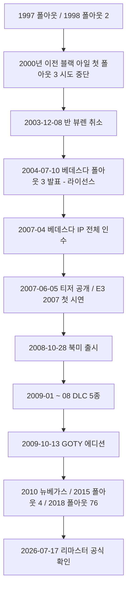
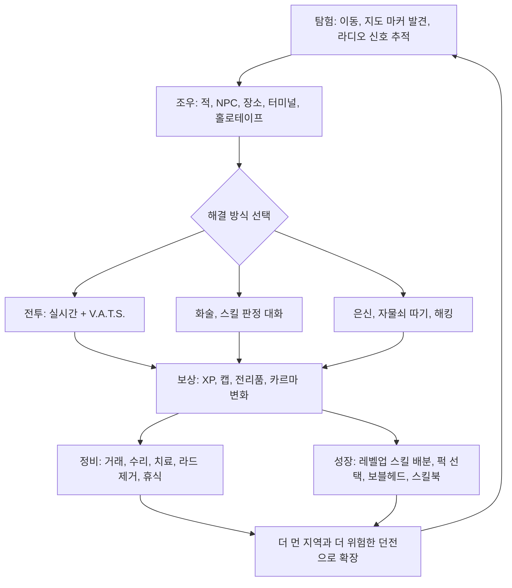
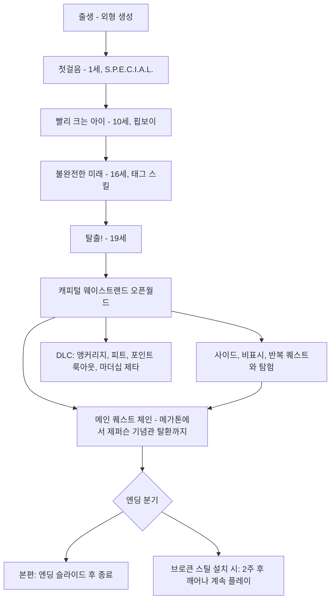

# RD-01. 게임 개요

> **폴아웃 3 역기획서 세트** | 문서 ID: RD-01 | 버전: v1.0 | 작성일: 2026-10-11
> **범위**: 제품 정보(장르·개발·엔진·플랫폼·출시일·등급·판본·패치), 개발 연혁(인터플레이·반 뷰렌·베데스다 개발·출시·DLC·GOTY·후속작·리마스터), 주요 개발진, 평가·수상·판매, 논란·검열, 게임 정체성(디자인 필러·핵심 경험·코어 루프·게임 구조·플레이 볼륨·시리즈 내 위치), DLC 5종 개요 / 다루지 않는 것: 세계관 상세(RD-02), 퀘스트 상세(RD-03~08), 시스템 수치(RD-14~18), 데이터 카탈로그(RD-19~24), 아트·오디오·연출 상세(RD-25)
> **관련 문서**: [RD-00 문서 세트 안내](00_README.md), [RD-02 세계관·설정·연표](02_world-and-lore.md), [RD-03 메인 스토리 1부](03_main-story-part1.md), [RD-04 메인 스토리 2부·엔딩](04_main-story-part2-endings.md), [RD-08a 오퍼레이션: 앵커리지](08a_dlc-operation-anchorage.md), [RD-08b 더 피트](08b_dlc-the-pitt.md), [RD-08c 브로큰 스틸](08c_dlc-broken-steel.md), [RD-08d 포인트 룩아웃](08d_dlc-point-lookout.md), [RD-08e 마더십 제타](08e_dlc-mothership-zeta.md), [RD-14 캐릭터 시스템](14_character-system.md), [RD-16 전투 시스템](16_combat-system.md), [RD-25 아트·오디오·연출](25_art-audio-presentation.md), [RD-26 용어집](26_glossary.md), [RD-27 쯔꾸르 이식 시사점 종합](27_adaptation-notes.md)

---

## 1. 문서 개요

### 1.1 목적
- 역기획서 세트의 입구 문서다. 폴아웃 3(Fallout 3)가 어떤 제품이고, 어떻게 만들어졌으며, 무엇을 핵심 재미로 삼는지를 한 문서에서 파악하게 한다.
- 팬게임 기획 단계에서 "무엇을 반드시 남기고 무엇을 바꿔도 되는가"를 판단하는 기준선(디자인 필러, 핵심 경험, 재현 요소 Top 10)을 제공한다.

### 1.2 범위
- 다룬다: 제품 정보와 판본·패치·플랫폼, 개발 연혁(반 뷰렌 포함), 주요 개발진, 평가·수상·판매, 논란·검열, 디자인 필러·핵심 경험·코어 루프·게임 구조·플레이 볼륨, DLC 5종 개요, 시리즈 내 위치, 리마스터 동향.
- 다루지 않는다: 스토리·퀘스트 상세(RD-03~08), 시스템 공식과 수치(RD-14~18), 데이터 카탈로그(RD-19~24), 음악·라디오·연출 상세(RD-25).

### 1.3 요약
- 폴아웃 3는 베데스다 게임 스튜디오(Bethesda Game Studios)가 개발하고 베데스다 소프트웍스(Bethesda Softworks)가 2008년 10월 28일(북미) 출시한 포스트 아포칼립스 오픈월드 RPG다. 엔진은 게임브라이오(Gamebryo)다.
- 인터플레이(Interplay Entertainment) 산하 블랙 아일 스튜디오(Black Isle Studios)의 원조 폴아웃 3인 반 뷰렌(Van Buren)이 2003년 취소된 뒤, 베데스다가 2004년 라이선스를, 2007년 IP 전체를 사들여 처음부터 새로 만든 작품이다.
- 1·2편의 S.P.E.C.I.A.L.(스페셜), 카르마, 블랙 유머, 레트로 퓨처리즘을 계승하면서, 아이소메트릭 턴제를 1·3인칭 실시간 3D로 바꾸고 V.A.T.S.(볼트텍 보조 조준 시스템)로 턴제의 손맛을 이식했다.
- 2009년에 DLC 5종이 나왔고, 같은 해 10월 13일 본편과 DLC 5종을 합친 GOTY 에디션(Game of the Year Edition)이 출시됐다. 2026년 7월 17일 베데스다 게임 스튜디오가 리마스터 제작을 공식 확인했다.
- 팬게임 관점의 핵심은 "볼트 문을 열고 나가 폐허가 된 워싱턴 D.C.를 홀로 탐험하며, 선택의 결과가 라디오와 세계에 되돌아오는 경험"이다.

### 1.4 표기 메모
- 날짜는 `YYYY-MM-DD` 또는 `YYYY년 M월 D일`로 적는다. 지역 표기가 없으면 북미 기준이다.
- 코퍼스(Nukapedia 2026-08-30판)에서 확인되지 않는 내용은 `(코퍼스 미확인)`으로 표시한다. 코퍼스 문서끼리 수치가 다르면 각주로 병기한다.
- DLC 태그: `[OA]` 오퍼레이션: 앵커리지(Operation: Anchorage), `[TP]` 더 피트(The Pitt), `[BS]` 브로큰 스틸(Broken Steel), `[PL]` 포인트 룩아웃(Point Lookout), `[MZ]` 마더십 제타(Mothership Zeta).
- 인명은 문서마다 처음 나올 때 `한국어(English)`로 병기한다. 실존 개발자·성우 이름은 외래어 표기법에 따라 음차했다(용어집 미등재 → 신규 용어).

## 2. 제품 정보

### 2.1 제품 정보표

| 항목 | 내용 | 비고 |
|---|---|---|
| 제목 | 폴아웃 3 (Fallout 3) | 시리즈 3번째 정식 넘버링, 시리즈 전체로는 5번째 작품 |
| 장르 | 롤플레잉 게임(RPG). 플랫폼별 문서는 액션 RPG로 표기 | 포스트 아포칼립스, 레트로 퓨처리즘, 오픈월드 |
| 개발 | 베데스다 게임 스튜디오 | 엘더스크롤 4: 오블리비언(Oblivion) 개발팀이 그대로 개발 |
| 퍼블리셔 | 베데스다 소프트웍스 / 독일: 유비소프트(Ubisoft) | |
| 엔진 | 게임브라이오 | 크레딧상 미들웨어: Havok(물리), SpeedTree(나무), FaceGen(얼굴 생성), FaceFX(립싱크), Bink Video(영상) |
| 게임 디렉터 | 토드 하워드(Todd Howard) | 크레딧 직함: Game Director & Executive Producer |
| 리드 디자이너 겸 작가 | 에밀 파글리아룰로(Emil Pagliarulo) | |
| 리드 아티스트 | 이슈트반 펠리(Istvan Pely) | |
| 음악 | 이논 주르(Inon Zur) | 상세는 [RD-25](25_art-audio-presentation.md) |
| 모드 | 싱글 플레이 | |
| 플랫폼 | Microsoft Windows, Xbox 360, PlayStation 3, Amazon Luna | 2015-11-11부터 Xbox One 하위 호환(이후 Xbox Series X/S 포함) |
| 매체 | DVD(PC·Xbox 360), Blu-ray(PS3), 디지털 다운로드 | |
| 출시일 | 2008-10-28(북미), 2008-10-31(유럽·호주), 2008-12-04(일본) | 호주판은 10월 30일 출시 예정이었다는 서술도 있음[^au] |
| 등급 | ESRB M / PEGI 18+ / BBFC 18 / CERO Z / OFLC(호주) MA15+ / OFLC(뉴질랜드) 18+ | 호주는 한때 등급 거부(6장) |
| 판매처(디지털) | Steam(본편·GOTY), GOG(GOTY), Epic Games Store(GOTY), Xbox Live | GOG판 DLC는 2017-06-02 출시[^gog] |
| PC 최소 사양 | Windows XP/Vista, HDD 7GB, RAM 1GB(XP)/2GB(Vista), 2.4GHz Pentium 4급, DirectX 9.0c 256MB VRAM(NVIDIA 6800/ATI X850 이상) | 권장: Core 2 Duo, RAM 2GB(XP)/2.5GB(Vista), 512MB VRAM(NVIDIA 8800/ATI 3800 계열)[^spec] |
| 공식 에디터 | G.E.C.K.(Garden of Eden Creation Kit) | PC 전용 무료 배포. 게임 속 장치 이름(에덴동산 창조 키트)을 그대로 씀 |
| 무대·시대 | 캐피털 웨이스트랜드(Capital Wasteland, 옛 워싱턴 D.C. 일대), 2277년 | 대전쟁(The Great War, 2077-10-23) 200년 후 |
| 주인공 | 외로운 방랑자(Lone Wanderer) | 볼트 101(Vault 101) 출신, 볼트를 나설 때 19세 |
| 레벨 상한 | 20 / [BS] 설치 시 30 | 상세는 [RD-14](14_character-system.md) |
| 캐치프레이즈 | "Prepare for the Future" | 볼트텍(Vault-Tec) 슬로건. 이슈트반 펠리가 만든 문구 |

[^au]: `Nukapedia: Fallout 3`의 정보상자는 유럽·호주 모두 10월 31일로 적고, 같은 문서 본문은 호주판이 "유럽판과 같은 10월 30일 출시 예정"이었다고 적는다.
[^gog]: `Nukapedia: Broken Steel` 기준. GOG판 본편 판매 시작일 자체는 코퍼스에서 따로 확인되지 않는다.
[^spec]: `Nukapedia: Fallout 3`의 정보상자는 최소 사양 그래픽카드를 "NVIDIA 6800 or better", `Nukapedia: Fallout 3 (PC)` 본문은 "NVIDIA 6600 or better"로 적어 서로 다르다.

### 2.2 판본(에디션)과 묶음 상품

| 판본 | 영문명 | 출시 | 구성·특징 |
|---|---|---|---|
| 일반판 | Standard Edition | 2008-10-28 | 본편 |
| 콜렉터스 에디션 | Collector's Edition | 본편 출시 시(정확한 일자 코퍼스 미확인) | 볼트텍 도시락통(Lunchbox) 모양 케이스에 볼트 보이(Vault Boy) 보블헤드, 아트북 *The Art of Fallout 3*, "The Making of Fallout 3" DVD 동봉 |
| 서바이벌 에디션 | Survival Edition | 본편 출시 시(정확한 일자 코퍼스 미확인) | 아마존(Amazon.com) 한정. 실물 크기 핍보이(Pip-Boy) 모형 디지털 시계 동봉 |
| 게임 애드온 팩 1 | Fallout 3 Game Add-on Pack | 2009-05-26 | PC·Xbox 360 디스크. [OA] + [TP] + 볼트 보이 포스터. $19.99 |
| 게임 애드온 팩 2 | Fallout 3 Game Add-on Pack | 2009-08-25 | PC·Xbox 360 디스크. [BS] + [PL]. $19.99 |
| GOTY 에디션 | Fallout 3: Game of the Year Edition | 2009-10-13 | 전 플랫폼. 본편 + DLC 5종. 뒷표지 "Vault Secure" 포스터, "Wasteland Survival Guide" 표지의 저작권 안내 책자. 가격 $29.99(Xbox 360), $19.99(PC·PS3)[^goty] |
| 폴아웃 앤솔로지 | Fallout Anthology | 2015-09-29(북미) | Windows. 폴아웃 1·2·3·뉴베가스·택틱스와 각 DLC 묶음 |
| 폴아웃 레거시 컬렉션 | Fallout Legacy Collection | 2019-10-25 | Windows. 영국·독일 한정. 1·2·3·뉴베가스·4·택틱스와 DLC |
| 폴아웃 S.P.E.C.I.A.L. 앤솔로지 | Fallout S.P.E.C.I.A.L. Anthology | 2024-04-11 | Windows. 7개 작품, 폴아웃 3는 GOTY판 코드로 제공 |

- [MZ]는 GOTY 에디션 외에는 디스크로 나온 적이 없다. PS3는 모든 DLC를 블루레이 한 장에 담은 GOTY만 있고 애드온 팩 디스크가 없다.
- 예약 특전은 판매처마다 달랐다. 대표적으로 GameStop 예약자에게 45회전 레코드 모양 사운드트랙 CD(라디오 곡 3곡 + 이논 주르 스코어 2곡), 볼트 거주자 생존 가이드 포켓판(Vault Dweller's Survival Guide: Pocket Reference Edition) 등이 주어졌다.

[^goty]: GOTY 가격은 `Nukapedia: Fallout 3 (PC)`·`Fallout 3 (Xbox 360)` 기준. DLC 단품 가격은 `Fallout 3 add-ons`가 "800 MS 포인트 또는 $9.99", `Fallout 3` 본문이 "각 $5"로 서로 다르게 적는다.

### 2.3 패치 이력

| 버전 | PC | Xbox 360 | PS3 | 주요 내용 |
|---|---|---|---|---|
| 1.0.0.15 | 출시 후 1주 이내 | - | - | 종료·Alt-Tab 시 크래시 수정 |
| 1.1 (1.1.0.35) | 2009-01-13 | 2009-01-13 | 2008-12-15 | PS3 트로피 지원 추가, V.A.T.S.·핍보이 버튼 재지정, 퀘스트 진행 불가·XP 화술 익스플로잇·캡 무한 증식 수정, 미스터 샌드맨(Mister Sandman) 퍽이 어린이에게 통하지 않게 변경 |
| 1.4 (1.4.0.6) | 2009-03-02 | 2009-03-02 | - | [TP] 업적, 복수 DLC 동시 지원(아시아 지역 [OA] 플레이 가능). 버그 수정 없음 |
| 1.5 | 2009-04-28 (1.5.0.22) | 2009-04-19 (1.5.0.23) | - | [BS] 업적, DLC 월드스페이스 LOD·동료 로딩 수정 등 |
| 1.6 | 2009-06-22 (1.6.0.3) | - | 2009-09-17 (1.6.1)[^p16] | PC: [PL] 업적, 1.5의 모드 로딩 문제 수정 / PS3: 전 DLC 트로피, 메인 메뉴 "Downloads" 추가. PS3에서 DLC를 쓰려면 필수 |
| 1.7 (1.7.0.3) | 2009-07-26[^p17] | - | - | PC 전용. [MZ] 업적, [BS] 엔딩 이후 콘텐츠 패치 |
| BLUS-30455 | - | - | 2009-11-19 | 캐나다 프랑스어권 PS3 GOTY 전용. 구판 세이브 불러오기 문제 수정 |

- 최종 버전: PC 1.7, Xbox 360 1.5, PS3 1.6(1.6.1).
- 2021-10-12 Steam판에서 구식 DRM인 Games for Windows Live(GFWL) 요구가 제거됐다. GOG판은 처음부터 GFWL이 없다.
- 커뮤니티 비공식 패치(Unofficial Fallout 3 Patch 등)가 PC에 존재한다.

[^p16]: `Nukapedia: Fallout 3 (PlayStation 3)`는 1.6.1 배포일을 2009-09-16으로 적는다.
[^p17]: `Nukapedia: Fallout 3 patch 1.7`은 7월 26일, `Fallout 3 patches`·`Fallout 3 (PC)`는 7월 27일로 적는다.

### 2.4 플랫폼별 차이 요약

| 항목 | PC | Xbox 360 | PS3 |
|---|---|---|---|
| DLC 최초 배포 | Games for Windows Live(2009-01~08) | Xbox Live(2009-01~08) | PlayStation Store(2009-09-24~10-08) |
| DLC 디스크 | 애드온 팩 1·2 | 애드온 팩 1·2, 소매점 다운로드 코드 | 없음(GOTY만) |
| 업적·트로피 | GFWL 업적 50개(1000점) | 업적 50개(1000점) | 트로피 51개(플래티넘 포함), 1.1 패치로 추가 |
| 모드 | G.E.C.K. 공식 지원 | 불가 | 불가 |
| 기타 | Steam판 DLC는 2010-07-16 출시 | DLC 5종 모두 받으면 프리미엄 테마 증정 | 일본판은 X·O 버튼 기능이 서로 바뀜 |

## 3. 개발 연혁

### 3.1 연표

| 시기 | 사건 | 비고 |
|---|---|---|
| 1997 | 인터플레이, 폴아웃(Fallout) 출시 | 볼트 13 거주자의 정수 칩(Water chip) 찾기. S.P.E.C.I.A.L. 시스템 탄생 |
| 1998 | 폴아웃 2(Fallout 2) 출시 | 블랙 아일 스튜디오 개발. 엔클레이브(Enclave)·G.E.C.K. 등장 |
| 2000년 이전(정확한 시점 코퍼스 미확인) | 블랙 아일의 첫 번째 폴아웃 3 시도 중단 | NDL(뒤의 게임브라이오) 3D 엔진 사용. 재정난과 엔진 숙련 문제로 *아이스윈드 데일*(2000)로 선회 |
| 2003-12-08 | 반 뷰렌 취소, 블랙 아일 스튜디오 인력 전원 해고 | 인터플레이 재정난. 전직 블랙 아일 인력 일부가 옵시디언 엔터테인먼트(Obsidian Entertainment)에 합류 |
| 2004-07-10 | 베데스다 소프트웍스, 폴아웃 3 개발·퍼블리싱 발표 | 인터플레이에서 폴아웃 3편 개발 라이선스 획득. 로열티 선급 최소 보장액 $1,175,000 |
| 2004~2006 | 사전 제작. 본격 개발은 오블리비언 완성 이후 | 오블리비언 개발팀·게임브라이오 엔진 그대로 사용 |
| 2005 | 콘셉트 아티스트 애덤 애더모위츠(Adam Adamowicz) 입사 | 폴아웃 3의 유일한 콘셉트 아티스트 |
| 2007-04 | 베데스다, 폴아웃 IP 전체를 $5.75M에 인수(계약일 2007-04-04) | 인터플레이에는 폴아웃 MMO 개발 라이선스만 조건부로 남음[^ip] |
| 2007-04-30 / 05-02 | 반 뷰렌 기술 데모 스크린샷·영상, 이어서 데모 자체가 팬 사이트에 공개 | 베데스다판은 반 뷰렌 코드·자료를 쓰지 않음 |
| 2007-05-02 ~ 06-05 | 공식 사이트 30일 카운트다운. 크레이그 멀린스(Craig Mullins)의 콘셉트 아트 5점을 매주 화요일 공개 | |
| 2007-06-05 | 티저 트레일러 공개 | 인트로 전반부. "War. War never changes." 뒤 "Fallout 3 → Fall 2008" |
| 2007-07 | 인트로 내레이션 전문이 호주 잡지 *Atomic*에 공개 | |
| 2007 E3 | 첫 시연. IGN "Game of E3 2007", GameSpot "Best Role-Playing Game of E3 2007" | |
| 2007-08-02 | 공식 웹사이트 정식 개설 | |
| 2008 초~중반(알파) | 월드맵 북쪽·서쪽 대폭 확장 결정 | 환경 아트·레벨 디자인 팀이 약 2개월 투입(3.3절) |
| 2008-07-04 | 호주 OFLC 등급 거부 | 실존 약물 묘사 문제(6장) |
| 2008 E3 | E3 트레일러 공개, IGN·Game Critics Awards 다수 수상 | 트레일러는 2008 Game Marketing Awards "Trailer of the Year" 수상 |
| 2008-08-22 ~ 23 | *A Post-Apocalyptic Film Festival Presented by Fallout 3* 개최 | 산타모니카 에어로 극장. 2008-07-11 발표 |
| 2008-09-09 | 피트 하인스(Pete Hines), "모든 판본에서 실존 약물명 제거" 발표 | 모르핀(morphine) → 메드-X(Med-X) |
| 2008-10-28 | 북미 출시(사운드트랙 동시 발매) | 유럽·호주 10-31, 일본 12-04 |
| 2008-12-15 ~ 2009-07 | 패치 1.1 ~ 1.7 배포 | 2.3절 |
| 2009-01-27 | [OA] 출시(PC·Xbox 360) | |
| 2009-03-24 | [TP] 출시 | 일부 환경에서 깨져 3-25 재배포 |
| 2009-05-05 | [BS] 출시 | PC는 다운로드 문제로 5-07 재배포. 레벨 상한 30 |
| 2009-06-23 | [PL] 출시 | |
| 2009-08-03 | [MZ] 출시 | 마지막 DLC |
| 2009-09-24 ~ 10-08 | PS3판 DLC 순차 출시 | [BS] 9-24, [OA]·[TP] 10-01, [PL]·[MZ] 10-08 |
| 2009-10-13 | GOTY 에디션 출시(전 플랫폼) | |
| 2010-07-16 | Steam판 DLC 5종 출시 | |
| 2010-10-19 | 폴아웃: 뉴베가스(Fallout: New Vegas) 출시 | 옵시디언 개발, 폴아웃 3와 같은 엔진·스타일 |
| 2015-11-10 | 폴아웃 4(Fallout 4) 출시 | 폴아웃 3 10년 뒤(2287년) 배경 |
| 2015-11-11 | Xbox One 하위 호환 지원 | |
| 2017-06-02 | GOG판 DLC 포함 판매 | |
| 2018-11-14 | 폴아웃 76(Fallout 76) 출시 | |
| 2021-10-12 | Steam판 GFWL 제거 | |
| 2022-09-13 | 폴아웃 76 업데이트 *Expeditions: The Pitt* | [TP]의 피츠버그를 재방문 |
| 2023-09 | 마이크로소프트 법정 문서 유출로 "폴아웃 3 리마스터"가 2024 회계연도 계획에 있던 사실 보도 | 문서 작성 시점은 2020-07 |
| 2026-02 | 게임 인포머 특집 "An Oral History of Fallout" 공개 | 개발진 회고(3.3절, 5.4절) |
| 2026-03 | 맥팔레인 토이즈 상품 목록에 "Fallout 3 Remastered" 표기 | |
| 2026-07-17 | 베데스다 게임 스튜디오, 폴아웃 3·뉴베가스 리마스터 개발 공식 확인 | 출시일 미발표. 같은 날 폴아웃 76 업데이트 *Raven Rock*(2027 예정, "폴아웃 3의 프리퀄 스토리") 발표 |

[^ip]: `Nukapedia: Fallout 3`은 IP 전체 인수를 2006년으로 적지만, `Interplay Entertainment`·`Fallout series`·`Bethesda Softworks`·`Fallout 4` 문서는 모두 2007년(4월, $5.75M)으로 적는다. 본 문서는 2007년을 따른다.

### 3.2 인터플레이 시대: 세 번의 폴아웃 3와 반 뷰렌
- 베데스다판은 "폴아웃 3"라는 이름을 단 네 번째 프로젝트다. 앞선 셋은 ① 블랙 아일의 NDL 엔진판, ② 반 뷰렌, ③ 트로이카 게임즈(Troika Games)가 라이선스 입찰을 위해 만든 프로토타입이다. 트로이카는 입찰에서 베데스다에 밀렸다.
- 반 뷰렌 개요(코퍼스 `Van Buren` 기준)

| 항목 | 내용 |
|---|---|
| 개발·유통 | 블랙 아일 스튜디오 / 인터플레이 |
| 엔진 | 제퍼슨 엔진(Jefferson Engine). 인피니티 엔진과 비슷한 화면 구성 |
| 전투 | 턴제·실시간 선택식. 실시간은 인터플레이의 요구로 추가됐고, 무게중심은 턴제 |
| 멀티플레이 | 협동 플레이 계획 |
| 무대·시대 | 미국 남서부(애리조나·네바다·콜로라도·유타), 2253년(설계 문서 기준). 서쪽 끝이 NCR(New California Republic) 동쪽 국경 |
| 도입부 | 감옥에서 깨어난 죄수. 무고한 죄수 또는 범죄자(보너스 트레잇)를 선택 |
| 악역 계획 | 프레스퍼(Presper) 박사가 뉴 플레이그(New Plague) 바이러스·AI 오디세우스(ODYSSEUS)·궤도 핵미사일 기지 B.O.M.B.-001로 지상을 "정화"하려는 음모 |
| 시스템 | S.P.E.C.I.A.L. 대폭 개편(전투 스킬 통합, 화술을 기만·설득으로 분리), 한때 인간·구울(Ghoul)·슈퍼 뮤턴트(Super mutant) 플레이어블 종족 검토 |
| 취소 | 2003-12-08. 팀 케인(Tim Cain)은 완성까지 최소 12~18개월이 필요하다고 평가했고, 인터플레이가 이를 감당할 수 없다고 판단 |
| 유산 | NCR-브라더후드 오브 스틸(Brotherhood of Steel, BoS) 전쟁, 조슈아 그레이엄, 시저 군단 등이 뉴베가스에 재활용. 이름은 8대 대통령 마틴 반 뷰렌에서 따옴(블랙 아일은 대통령 성을 순서대로 코드명에 사용) |

- 베데스다는 반 뷰렌의 코드나 자산을 전혀 쓰지 않고 처음부터 새로 개발했다. 다만 두 작품 모두 "핵전쟁 이후의 정화(淨化)"를 노리는 악역 구도를 가진다는 점은 흥미로운 우연이다(분석 의견).

### 3.3 베데스다의 개발
- **라이선스와 기본 방향**: 2004년 라이선스는 폴아웃 게임 3편 제작권(인터플레이에 로열티 지급)이었다. 베데스다는 "1·2편처럼 비선형 게임플레이, 좋은 이야기, 진정한 폴아웃식 유머"를 내걸고 처음부터 M 등급과 성인 주제·폭력을 목표로 했다. 토드 하워드는 2005년 인터뷰에서 "2편보다 1편에 더 가까운 게임"을 만들겠다고 했다.
- **오블리비언의 후속작**: 하워드는 폴아웃 3를 "오블리비언의 후속작이자 폴아웃의 리부트"로 규정했다. 이슈트반 펠리는 채도 높은 오블리비언과 확실히 다르게 보이기 위해 "색을 빼고, 어둡게 하고, 때를 묻혔다"고 회고했다(시각 정체성은 [RD-25](25_art-audio-presentation.md)).
- **주제의 출발점**: 에밀 파글리아룰로는 제퍼슨 기념관(Jefferson Memorial)과 바로 옆 타이들 베이슨(Tidal Basin)의 실제 항공 지도를 보고 "이건 물에 관한 이야기여야 한다. 1편의 원래 주제, 생존이라는 단순한 것으로 돌아가야 한다"고 판단했다. 하워드와 파글리아룰로가 모두 젊은 아버지였던 경험이 아버지와 자식의 서사로 이어졌다. 하워드는 코맥 매카시의 소설 *로드(The Road)*에서 이야기에 큰 영향을 받았다고 밝혔다.
- **"기능 누수(feature seep)"**: 파글리아룰로는 당시 리드 애니메이터의 말을 빌려 "기능이 불어나는 게 아니라 새어 나갔다"고 회고했다. 감당할 수 없는 것은 과감히 잘라 규모를 지켰다는 뜻이다. 그 결과 팩션 가입 같은 시스템이 없는 비교적 작은 구조(메인 퀘스트 + 기타 퀘스트)가 됐다.
- **월드 스케일 조정**: D.C. 도심은 한때 지금의 두 배(밀폐 구역 26개 → 최종 12개)였으나 너무 크고 헷갈려 절반 이하로 줄였다. 반대로 황무지는 오블리비언의 관심 지점(POI) 밀도를 그대로 쓴 탓에 "너무 빽빽하고, 가끔 외로워야 할 게임인데 그 톤이 안 나온다"는 판단으로 알파 단계에서 북쪽·서쪽을 크게 늘렸다(레벨 디자이너 조엘 버제스(Joel Burgess)의 GDC 2011 회고).
- **은신 설계**: 파글리아룰로는 *데이어스 엑스*에서 얻은 은신 경험을 폴아웃 3에 "인간적으로 가능한 만큼" 넣으려 했다고 밝혔다.
- **음성 분량**: 디스크 용량 때문에 개발 막바지에 대사의 약 30%를 잘라냈고, 그중 상당수가 남녀 주인공에 따라 달라지는 대사였다(퀘스트 디자이너 프레드 젤레니(Fred Zeleny)).
- **팬덤의 압박**: 하워드는 "엘더스크롤 팬도, 하드코어 폴아웃 팬도 화나게 할 것"이라는 걱정 속에 개발했다고 회고했다. 일부 팬의 살해 협박으로 베데스다는 처음으로 경비원을 고용했다.
- **엔딩 방침**: 원래는 1·2편처럼 메인 스토리를 끝내면 게임도 끝나는 구조였다. 출시 후 강한 반발이 DLC 기획 시점의 내부 논의로 이어져 [BS]에서 엔딩 이후 플레이와 레벨 상한 상향이 들어갔다(2026 게임 인포머 구술사).

### 3.4 출시 이후와 후속작에 남긴 것
- **DLC와 GOTY**: 2009년 1~8월 DLC 5종을 순차 출시하고, 10월 GOTY로 합본했다(8장).
- **폴아웃: 뉴베가스(2010)**: 옵시디언 내부 명칭이 "폴아웃 3.5"였다. 처음에는 폴아웃 3 확장팩("Fallout 3: Vegas")으로 기획됐으나 하워드가 독립 게임으로 만들 것을 권했다. 폴아웃 3의 엔진·자산을 재사용했고, 출시 초기에는 재활용 비판도 받았다. 폴아웃 3의 인기 모드(무기 개조 모드)가 무기 개조 기능으로 공식화됐다.
- **폴아웃 4(2015)**: 폴아웃 3 10년 뒤의 커먼웰스(Commonwealth)가 무대다. 폴아웃 3에서 언급된 지역이며, 메인 스토리 이후에도 계속 플레이하는 구조는 [BS]에서 이어졌다. 리버티 프라임(Liberty Prime), BoS의 아서 맥슨(Arthur Maxson), 로버트 맥크레디(Robert MacCready) 등이 이어진다.
- **폴아웃 76(2018)**: 2022년 *Expeditions: The Pitt*로 피츠버그를 다시 다뤘고, 2027년 예정인 *Raven Rock*은 폴아웃 3의 프리퀄 스토리로 발표됐다.
- **기타**: 아시아 전용 스핀오프 *Fallout Shelter Online*에 캐피털 웨이스트랜드가 등장한다(정사 여부 미정). TV 시리즈(2024~) 제작자 조너선 놀런은 폴아웃 3를 매우 많이 플레이했고 그 세계관에 깊이 매료됐다고 알려져 있다.
- **리마스터(2026)**: 2026-07-17 공식 확인됐으나 출시일·플랫폼·엔진은 미발표다. 기자 제이슨 슈라이어는 2027년 출시 가능성이 높다고 전망했다. 원작 퀘스트 디자이너 브루스 네스미스(Bruce Nesmith)는 원작 총격감이 "좋지 않았다"며 폴아웃 4 수준의 개선을 기대한다고 말했다.

## 4. 주요 개발진

### 4.1 리드급 (크레딧 `Fallout 3 developers` 기준)

| 직함(크레딧) | 영문명 | 한국어 표기 | 폴아웃 3 기여 메모 |
|---|---|---|---|
| Game Director & Executive Producer | Todd Howard | 토드 하워드 | 프로젝트 총괄. 볼트 101 프롤로그를 가장 아끼는 부분으로 꼽음. 아들 제이크 하워드(Jake Howard)가 아기 시절 주인공 목소리 담당 |
| Lead Designer & Writer | Emil Pagliarulo | 에밀 파글리아룰로 | 메인 스토리 상위 구상, 퀘스트 콘셉트, 작가진 편집. 인트로·라디오 방송국·라디오 드라마·미스터 버크·슈퍼 뮤턴트 대사 직접 집필. 트랭퀼리티 레인의 "꼬마 살인마(Pint-Sized Slasher)" 아이디어 제공 |
| Lead Artist | Istvan Pely | 이슈트반 펠리 | 시각 스타일 총괄, 인터페이스 그래픽, 환경·캐릭터 아트. "Prepare for the Future" 슬로건 고안, [MZ] 테마 제안 |
| Production Director | Ashley Cheng | 애슐리 쳉 | 중국군 병사 목소리도 담당 |
| Lead Producer | Gavin Carter | 개빈 카터 | |
| Technical Director | Guy Carver | 가이 카버 | |
| Lead Programmer | Steve Meister | 스티브 마이스터 | |
| Lead Animator | Joshua Jones | 조슈아 존스 | |
| Lead Level Designer | Joel Burgess | 조엘 버제스 | 월드 확장 결정 회고(GDC 2011). [PL] 리드 디자이너, 플릭(Plik) 목소리 |
| Audio Director | Mark Lampert | 마크 램퍼트 | 사운드 디자인·음성 녹음 총괄. 페럴 구울(Feral ghoul) 목소리를 직접 연기 |
| Quality Assurance Lead | Kevin Kauffman | 케빈 코프먼 | |
| Producers | Jeff Gardiner, Craig Lafferty, Tim Lamb | 제프 가디너, 크레이그 래퍼티, 팀 램 | 가디너는 [TP] 감독, 공식 가이드 편집 |

### 4.2 분야별 핵심 인원

| 분야 | 영문명 | 한국어 표기 | 메모 |
|---|---|---|---|
| 콘셉트 아트 | Adam Adamowicz | 애덤 애더모위츠 | 폴아웃 3의 유일한 콘셉트 아티스트(2005 입사, 2012 별세). 베데스다 폴아웃 미학의 설계자 |
| 추가 콘셉트 아트 | Craig Mullins | 크레이그 멀린스 | 사전 제작용 분위기 페인팅. 티저 카운트다운 공개작 |
| 일러스트레이션 | Natalia Smirnova | 나탈리아 스미르노바 | UI(메인 메뉴·대화·핍보이·V.A.T.S.)와 볼트 보이 일러스트 전담 |
| 특수효과·고어 | Grant Struthers | 그랜트 스트러더스 | |
| 월드 아트 | Nathan Purkeypile 외 | 네이선 퍼키파일 외 | 퍼키파일은 [TP]·[PL] 리드 아티스트 |
| 퀘스트 디자인·집필 | Erik J. Caponi, Brian Chapin, Jon Paul Duvall, Kurt Kuhlmann, Alan Nanes, Bruce Nesmith, Fred Zeleny | 에릭 J. 카포니, 브라이언 채핀, 존 폴 듀발, 커트 쿨먼, 앨런 네인스, 브루스 네스미스, 프레드 젤레니 | 채핀은 메인 퀘스트와 [MZ] 집필. 네인스는 *독립을 훔쳐라(Stealing Independence)* 집필. 카포니는 [PL] 메인 스토리 |
| 레벨 디자인 | Daryl Brigner, Jeff Browne, Philip Nelson | 대릴 브리그너, 제프 브라운, 필립 넬슨 | |
| 작곡 | Inon Zur | 이논 주르 | 오리지널 스코어 작곡·제작 |
| 바이올린 연주 | Heather MacArthur | 헤더 맥아더 | 애거사의 방송국(Agatha's Station) 연주 |
| 음악 감독·저작권 처리 | Christopher S. Parker, Tim Scanlin (Brandracket, LLC) | 크리스토퍼 S. 파커, 팀 스캔린 | 라디오 수록곡 라이선스 |
| PR·마케팅 | Pete Hines | 피트 하인스 | 베데스다 소프트웍스 부사장. 호주 검열 대응 발표 |

- 성우진(리엄 니슨(Liam Neeson)의 제임스(James), 맬컴 맥다월(Malcolm McDowell)의 존 헨리 에덴(John Henry Eden), 론 펄먼(Ron Perlman)의 내레이터 등)은 [RD-25 아트·오디오·연출](25_art-audio-presentation.md)에 정리한다.
- 공식 가이드(Prima, 본편 464쪽 / GOTY 752쪽)는 데이비드 S. J. 호지슨(David S.J. Hodgson)이 주 저자이고 개발진 다수가 공동 집필했다. 실제 게임과 다른 서술이 적지 않으므로 수치 근거로 쓸 때 주의한다.

## 5. 평가·수상·판매

### 5.1 출시 평가

| 매체 | 점수 | 요지 |
|---|---|---|
| Metacritic (PC) | 91/100 | |
| Metacritic (PS3) | 90/100 | |
| Metacritic (Xbox 360) | 93/100 | |
| IGN (에릭 브루드비그) | 9.6/10 | 대화 집필과 "흥미진진한 최상급 메인 스토리, 정말 끝내주는 클라이맥스"를 호평. 버그 등 기술 문제를 단점으로 지적하면서도 "놀라운 분위기, 다양한 재미로 빠져들 수밖에 없는 게임"으로 평가 |

### 5.2 수상

| 시기 | 주최 | 부문 |
|---|---|---|
| E3 2007 | IGN | Game of E3 2007 |
| E3 2007 | GameSpot | Best Role-Playing Game of E3 2007 |
| E3 2008 | IGN | Best Overall RPG, Best Overall Console Game, Overall Game of the Show |
| E3 2008 | Game Critics Awards | Best Role-Playing Game, Best of Show |
| 2008 | Game Marketing Awards | Trailer of the Year (E3 2008 트레일러) |
| 2008~2009 연간 시상식 | 각종 올해의 게임(GOTY) 상 | 구체적 수상 내역 (코퍼스 미확인) |

### 5.3 판매
- 출시 첫 주에 스핀오프를 포함한 이전 폴아웃 시리즈 전체의 판매량을 넘어섰다.
- 누적 판매량·출하량 수치: (코퍼스 미확인). 수치는 지어내지 않으며, 본기획 단계에서 필요하면 공식 자료로 따로 확인한다.

### 5.4 비판과 재평가
- **기술 문제**: 출시 당시부터 버그·불안정성이 단점으로 지적됐고, 패치 1.1은 일부 환경에서 성능 저하·세이브 문제를 새로 일으켰다.
- **강제 희생 엔딩**: 메인 스토리를 끝내면 주인공(또는 세라 라이언스(Sarah Lyons))이 희생하고 게임이 끝나는 구조, 방사능 면역 동료가 대신 들어가지 않는 점이 비판받았다. 파글리아룰로는 "희생이라는 주제가 중요했지만, 엔딩 방법이 적은 것은 폴아웃 정신에 어긋났다"고 인정했고 [BS]에서 바뀌었다([RD-04](04_main-story-part2-endings.md), [RD-08c](08c_dlc-broken-steel.md)).
- **원작 팬과의 긴장**: 아이소메트릭 턴제 RPG를 1인칭 실시간으로 바꾼 데 대한 반감이 컸다. 하워드는 2023년 인터뷰에서 우려 속에 개발했지만 폴아웃 커뮤니티 안에서 자기 관객을 찾았다며 "가장 좋아하는 프로젝트 중 하나"라고 회고했다.
- **총격감**: 원작 퀘스트 디자이너 브루스 네스미스는 2026년 원작의 총격감이 "좋지 않았다"고 평가하고 리마스터에서의 개선을 기대했다. 이는 실시간 사격의 한계를 V.A.T.S.로 보완한 설계와 맞닿아 있다([RD-16](16_combat-system.md)).

## 6. 논란·검열 (지역별 수정 사항)

| 지역 | 시기 | 사유 | 수정·결과 |
|---|---|---|---|
| 호주 | 2008-07-04 등급 거부 → 재심의 | OFLC가 "약물과 투여 방식의 사실적 묘사가 SF 약물을 실존 약물과 같게 만든다"고 판단해 판매 불가 등급 부여 | 실존 약물 이름 제거. 모르핀 → 메드-X로 개칭. 2008-09-09 피트 하인스가 "호주 전용 검열판은 오해이며 모든 판본에서 실존 약물 언급을 뺀다"고 발표. 단, 일본어판·체코어판은 "morphine" 명칭이 남음. 에디터 ID와 중독 효과 이름에는 Morphine이 잔존 |
| 독일 | 출시 시 | 폭력 묘사 | 피와 신체 절단 묘사 제거(블러디 메스(Bloody Mess) 퍽을 골라도 연출 변화 없음). 유통은 유비소프트. 무삭제 PEGI판에 독일어 음성·텍스트를 넣은 오스트리아판이 대안으로 쓰였다 |
| 일본 | 2008-12-04 출시판 | 히로시마·나가사키 원폭에 대한 정서 | 사이드 퀘스트 *원자의 힘(The Power of the Atom)*에서 미스터 버크(Mister Burke) 삭제 → 메가톤(Megaton) 폭파 불가(해체·방치만 가능). 무기 팻맨(Fat Man) → "Nuka Launcher"로 개칭. PS3판은 X·O 버튼 기능 교체 |
| 인도 | 출시 전 | 마이크로소프트 인도 지사가 "문화적 민감성"을 이유로 들어 발매 취소 | 미출시 |
| 미국(등급 관행) | 개발 중 | 어린이 살해 묘사 제한 | 게임 내 어린이는 죽일 수 없음. 유일한 예외가 트랭퀼리티 레인(Tranquility Lane) 가상 시뮬레이션(파글리아룰로: "시뮬레이션 속 가짜 아이라서 가능했다"). 패치 1.1에서 미스터 샌드맨 퍽이 어린이에게 통하지 않게 수정 |

- **설계 시사점**: 같은 장면(핵폭탄 폭파)도 지역 정서에 따라 퀘스트 분기 자체가 삭제됐다. 팬게임에서도 핵폭발, 약물, 아동, 고어 연출은 배포 지역과 플랫폼 정책을 기준으로 "끄기 옵션"을 고려할 대상이다.

## 7. 게임 정체성 분석

### 7.1 한 줄 정의
> "200년 동안 닫혀 있던 볼트에서 자란 아이가, 사라진 아버지를 찾아 핵전쟁 뒤의 워싱턴 D.C.로 나가 '깨끗한 물'의 운명을 결정하는 1인칭·3인칭 오픈월드 RPG."

- 장르 문법: 베데스다식 오픈월드 샌드박스(오블리비언) + 폴아웃식 캐릭터 시스템·도덕 선택·블랙 유머(1·2편).
- 톤: 황량하고 어두운 시각(펠리의 "의도적인 과잉 교정") 위에 1950년대풍 낙관과 냉소적 유머를 덧칠한 대비.

### 7.2 디자인 필러

| # | 필러 | 구현 장치 | 대표 사례 | 상세 문서 |
|---|---|---|---|---|
| 1 | 오픈월드 탐험과 발견 | 지도 마커 163곳, 빠른 이동, 지하철로 이어진 D.C. 도심 12구역, 의도적으로 띄운 POI 간격("가끔 외로워야 한다") | 볼트 문을 나서자마자 보이는 폐허, 지하철을 통해서만 닿는 도심 | [RD-12](12_world-structure-settlements.md), [RD-13](13_location-catalog.md), [RD-17](17_exploration-interaction.md) |
| 2 | 선택과 결과, 카르마 | 카르마 수치·칭호, 퀘스트 분기, 마을 단위 범죄 인지, 카르마별 동료·암살대(탤런 컴퍼니(Talon Company)/레귤레이터(Regulators)), 갤럭시 뉴스 라디오(Galaxy News Radio, GNR) 뉴스가 내 행동을 보도 | *원자의 힘*의 메가톤 핵폭탄 해체 또는 폭파, *텐페니 타워(Tenpenny Tower)*의 구울 입주 문제, *프로젝트 임퓨리티(Project Impurity)* | [RD-14](14_character-system.md), [RD-04](04_main-story-part2-endings.md) |
| 3 | S.P.E.C.I.A.L. 계승 | 기본 능력치 7종, 스킬 13종 중 태그 3개, 매 레벨 퍽, 능력치·스킬·퍽 판정이 붙은 대화 선택지(성공 확률 표시) | 그림책 *너는 스페셜해!(You're SPECIAL!)*로 능력치 배분 | [RD-14](14_character-system.md), [RD-17](17_exploration-interaction.md) |
| 4 | V.A.T.S.로 턴제 감성 이식 | 실시간 전투를 일시정지하고 행동력(AP)으로 부위 조준을 예약, 슬로모션 재생. 재생 중 받는 피해 90% 감소, V.A.T.S. 치명타 확률 +15%, 대신 발당 내구도 소모 증가 | 머리 조준 → 킬캠, 블러디 메스로 터지는 적 | [RD-16](16_combat-system.md) |
| 5 | 블랙 유머와 아이러니 | 낙관적인 볼트텍 광고와 처참한 현실의 대비, 엉뚱한 NPC, 잔혹 연출의 과장 | 트랭퀼리티 레인의 "꼬마 살인마", 핵폭탄을 숭배하는 원자의 아이들(Children of Atom), 쓰리 독(Three Dog)의 방송 | [RD-25](25_art-audio-presentation.md) |
| 6 | 환경 스토리텔링 | 의미 있게 배치된 해골, 터미널·홀로테이프·노트, 포스터와 그래피티 | 조지타운 타운홈의 시 낭송 로봇과 아이 해골 두 구 | [RD-12](12_world-structure-settlements.md), [RD-25](25_art-audio-presentation.md) |
| 7 | 레트로 퓨처리즘 | 1950년대 미국이 상상한 원자력 미래(진공관, 핀 달린 자동차, 아르데코·구기 건축), 볼트 보이 아이콘 | 핍보이 3000, 리버티 프라임, 누카콜라(Nuka-Cola) | [RD-02](02_world-and-lore.md), [RD-25](25_art-audio-presentation.md) |
| 8 | 생존과 '물' | 방사능 오염수, 라드·회복 관리, 메인 스토리 전체가 "생명의 물" | 성경 요한계시록 21:6 구절, 프로젝트 퓨리티(Project Purity), 물을 구걸하는 노인 | [RD-15](15_status-survival.md), [RD-03](03_main-story-part1.md) |
| 9 | 성장 서사와 부자(父子) 관계 | 출생부터 19세까지 플레이로 체험하는 프롤로그, 아버지 추적이 메인 동기 | 태어나는 순간 아버지가 마스크를 벗는 장면, 10살 생일 사진 | [RD-03](03_main-story-part1.md) |
| 10 | 라디오, 세계의 목소리 | 핍보이 라디오로 언제든 듣는 방송국, 진행자의 해설, 1940년대 음악 | GNR의 쓰리 독, 엔클레이브 라디오(Enclave Radio)의 에덴 대통령 | [RD-17](17_exploration-interaction.md), [RD-25](25_art-audio-presentation.md) |

### 7.3 핵심 경험 (플레이어가 기억하는 순간)
1. **세상과의 첫 대면**: 볼트 101의 거대한 톱니바퀴 문이 열리고, 처음으로 폐허가 된 황무지를 내려다보는 순간. 하워드가 가장 감정적으로 강렬하다고 꼽은 지점이다.
2. **자유로운 방랑과 우연한 발견**: 목적지 없이 걷다 마주치는 마을·던전·랜덤 인카운터·라디오 신호.
3. **무거운 선택**: 마을 하나를 날릴 수도 있는 선택, 그 결과가 라디오와 NPC 반응, 엔딩 슬라이드로 돌아온다.
4. **V.A.T.S. 처형의 쾌감**: 시간을 멈추고 확률을 고른 뒤 슬로모션으로 결과를 감상한다.
5. **수집과 성장**: 보블헤드·스킬북·유니크 장비를 모으며 캐릭터가 눈에 띄게 강해진다.
6. **음악과 아이러니**: 1940년대 노래가 흐르는 가운데 처참한 폐허를 걷는 부조화.

### 7.4 코어 루프

- **세션 루프(30분~1시간)**: 정착지에서 퀘스트를 받고 → 목적지까지 이동하며 주변 장소를 발견하고 → 던전을 공략하고 → 돌아와 보고·거래·수리한다.
- **메타 루프(전체)**: 메인 퀘스트로 지역을 넓히고, 사이드 퀘스트와 수집으로 캐릭터를 키우며, 카르마와 선택이 엔딩과 세계 반응을 바꾼다.
- **루프의 동력**: XP 보상이 전투·화술·해킹·자물쇠 따기 등 거의 모든 성공 행동에 붙어 있어 어느 플레이 스타일이든 성장이 이어진다. 소지 한도와 내구도가 정비 단계를 강제해 정착지로 돌아오게 만든다.

### 7.5 게임 구조

| 단계 | 퀘스트 | 나이·시점 | 플레이 내용 | 시스템 도입 |
|---|---|---|---|---|
| 프롤로그 1: 출생 | (출생 장면) | 2258-07-13 | 아버지 제임스(James)가 받아 내는 출생 장면. 이름·성별·얼굴(유전자 투영) 결정. 어머니 캐서린(Catherine)이 출산 직후 사망 | 캐릭터 외형 생성 |
| 프롤로그 2 | *첫걸음(Baby Steps)* | 1세 | 놀이울 탈출, 그림책으로 S.P.E.C.I.A.L. 배분, 아버지가 요한계시록 21:6을 읽어 줌 | 이동, 상호작용, 능력치 |
| 프롤로그 3 | *빨리 크는 아이(Growing Up Fast)* | 10세 생일 | 핍보이 3000과 BB건을 받고 라드로치(Radroach) 사냥 | 핍보이, 전투, V.A.T.S. |
| 프롤로그 4 | *불완전한 미래(Future Imperfect)* | 16세 | G.O.A.T.(일반 직업 적성 검사) | 태그 스킬 결정 |
| 탈출 | *탈출!(Escape!)* | 19세 | 아버지가 사라져 볼트가 혼란에 빠지고, 경비대를 피해 탈출. 볼트 문 앞에서 캐릭터를 마지막으로 수정 가능 | 오픈월드 진입, 이후 DLC 활성 |
| 오픈월드: 메인 | *아버지의 발자취(Following in His Footsteps)* ~ *되찾아라!(Take It Back!)* | 2277 | 메가톤 → GNR → 리벳 시티(Rivet City) → 볼트 112(Vault 112) → 제퍼슨 기념관 → 시타델(The Citadel) → 리틀 램프라이트(Little Lamplight) → 볼트 87(Vault 87) → 레이븐 록(Raven Rock) → 제퍼슨 기념관 탈환 | 화술로 일부 구간 단축 가능 |
| 오픈월드: 사이드·비표시·반복 | 사이드 17, 비표시 32, 반복 17(허브 표 기준) | 언제든 | 정착지 의뢰, 수집, 랜덤 인카운터 | |
| 엔딩 | *되찾아라!* / *프로젝트 임퓨리티* | | 정화기(Purifier) 가동 주체와 FEV(강제 진화 바이러스) 투입 여부로 분기, 엔딩 슬라이드 | 본편은 엔딩 후 종료 |
| [BS] 엔딩 이후 | *하늘에서 내리는 죽음(Death From Above)* 등 | 2주 후 | 주인공 생존 가능, 엔클레이브 잔당 소탕, 레벨 상한 30 | 계속 플레이 |

- 메인 스토리 우회: 화술로 *갤럭시 뉴스 라디오(Galaxy News Radio)* 퀘스트를 건너뛰고 리벳 시티로 바로 갈 수 있다. *낙원으로부터의 구출(Rescue from Paradise)*은 차일드 앳 하트(Child at Heart) 퍽으로 건너뛸 수 있다. 볼트 112를 먼저 찾아 들어가면 *트랭퀼리티 레인* 이전 퀘스트를 모두 건너뛴다([RD-03](03_main-story-part1.md)).

### 7.6 플레이 볼륨

| 항목 | 본편 | DLC 포함 | 근거(허브 문서) |
|---|---|---|---|
| 퀘스트(허브 표 행 수) | 튜토리얼 3 / 메인 12 / 사이드 17 / 비표시 32 / 반복 17 | DLC: [OA] 메인 4, [TP] 메인 3·비표시 3·반복 1, [BS] 메인 3·사이드 3·비표시 2·반복 2, [PL] 메인 5·사이드 5·비표시 2, [MZ] 메인 3·비표시 1 | `Fallout 3 quests`[^qcount] |
| 지도 마커 장소 | 163곳(로브링어(Lawbringer) 퍽 미선택 시 162) | +10곳(캐피털 지도), +51곳(별도 월드맵) = 224곳(통계 집계 221곳) | `Fallout 3 locations` |
| D.C. 도심 밀폐 구역 | 12구역(초기 26구역 계획) | - | `Fallout 3 world map` |
| 이름 있는 캐릭터 | 319명 | - | `Fallout 3 characters` |
| 크리처 | 43종, 변종 포함 63종 | DLC 변종 +18 | `Fallout 3 creatures` |
| 무기 | 허브 표 약 100행(유니크·제작 무기 포함), 제작 무기 7종 | 약 145행(DLC 약 45) | `Fallout 3 weapons` (개략치, 정본은 [RD-19](19_weapons-ammo.md)) |
| 방어구·의복 | 허브 표 약 164행 | 약 219행(DLC 약 55) | `Fallout 3 armor and clothing` (개략치, 정본은 [RD-20](20_armor-apparel.md)) |
| 퍽 | 일반 58 / 특별 5 / 퀘스트 7 | [OA] 특별 2(1개는 본편 파워 아머 훈련), [TP] 특별 1·퀘스트 2, [BS] 일반 14, [PL] 특별 1·퀘스트 2(+삭제 3), [MZ] 특별 1 | `Fallout 3 perks` 서술 |
| 능력치·스킬 | S.P.E.C.I.A.L. 7종, 스킬 13종(태그 3) | - | `Fallout 3 gameplay` |
| 레벨 상한 | 20 | 30([BS]) | |
| 보블헤드 | 20개(능력치 7 + 스킬 13) | - | `Vault-Tec bobblehead (Fallout 3)` |
| 스킬북 | 13종, 종류별 25권 | - | `Fallout 3 character creation` |
| 누카콜라 퀀텀(고정 배치) | 94병 | +14병 = 108병 | `Nuka-Cola Quantum (Fallout 3)` |
| 동료(상시) | 8명(도그밋(Dogmeat) + 인간형 1명 동시 동행) | - | `Fallout 3 companions` |
| 업적 | 50개(1000점), PS3 트로피 51개 | +22개(550점), 총 72개 | `Fallout 3 achievements and trophies` |
| 엔딩 영상 구간 | 26개 | 29개([BS]) | `Fallout 3 endings` |
| 라디오 방송국 | 주요 2(GNR, 엔클레이브 라디오) + 소규모 3(애거사의 방송국, 볼트 101 PA 시스템, 미합중국 인민공화국 라디오) + 임시 신호 | [TP] 피트 방송 + DLC 임시 신호 | `Fallout 3 radio stations` |

[^qcount]: 같은 허브 문서 본문은 "본편 59개(메인·사이드·반복), DLC 35개, 합계 94개"라고 적어 표 행 수와 집계 기준이 다르다. 본 표는 표 행 수를 그대로 센 값이며, 퀘스트별 정본은 RD-03~08이다.

- 볼륨 해석: "이름 있는 NPC 319명, 장소 163곳"은 쯔꾸르 팬게임 기준으로 매우 큰 규모다. 정착지·메인 퀘스트 경로를 1차 범위로 잡고 비표시 장소·반복 퀘스트를 후순위로 두는 단계 계획이 필요하다(11장).

### 7.7 시리즈 내 위치

| 구분 | 폴아웃 1·2에서 계승한 것 | 폴아웃 3에서 바꾼 것 |
|---|---|---|
| 시점·전투 | 행동력(AP), 부위 조준, 치명타의 잔혹 연출 | 2D 아이소메트릭 턴제 → 3D 1·3인칭 실시간 + V.A.T.S. 일시정지 |
| 캐릭터 | S.P.E.C.I.A.L. 7종, 태그 스킬 3개, 퍽, 카르마 | 스킬 18 → 13(응급처치·의사 → 의학, 투척·함정 → 폭발물, 훔치기 → 은신, 야외생활·도박 삭제), 트레잇 폐지(일부는 퍽으로 흡수, 예: 블러디 메스), 퍽을 3~4레벨마다 → 매 레벨 |
| 세계관 | 볼트텍과 볼트 실험, 브라더후드 오브 스틸, 엔클레이브, 슈퍼 뮤턴트(FEV), 구울, G.E.C.K., 레트로 퓨처리즘, 볼트 보이 | 무대를 서부 사막에서 동부 해안(워싱턴 D.C.)으로 이동. 2277년, 2편 엔클레이브 패배 30여 년 뒤 |
| 이야기 | "물"이라는 1편의 생존 주제(정수 칩 → 정화기), 볼트 출신 주인공 | 볼트 안에서 태어나고 자라는 성장 프롤로그, 아버지 찾기 |
| 연출 | 론 펄먼의 "War. War never changes." 인트로, 엔딩 슬라이드, 잉크 스파츠(The Ink Spots)의 노래 | 엔딩이 마을별 후일담 대신 핵심 선택 위주로 압축. 전 NPC 음성 연기, 라디오 방송국 도입 |
| 동료 | 도그밋 | 카르마에 따라 합류 조건이 달라지는 상시 동료 8명 |
| 구조 | 메인 스토리를 끝내면 게임 종료 | 본편은 유지, [BS]에서 엔딩 이후 플레이 도입 |

- 이후 시리즈에 남긴 틀: 1·3인칭 오픈월드 + V.A.T.S. + 라디오 + 보블헤드 수집 + 동부 해안 무대라는 "베데스다 폴아웃" 공식이 폴아웃 4·76으로 이어졌다. 뉴베가스는 같은 기반 위에 2편식 평판 시스템을 되살렸다.

## 8. DLC 5종 개요

> 공통 규칙: DLC는 *탈출!* 완료 후(볼트를 나온 뒤) 활성화된다. 탈출 이후에 설치하면 즉시 활성화된다. [BS]를 제외한 4종은 메인 스토리 진행과 무관하게 언제든 시작할 수 있다. 코퍼스에는 DLC별 **레벨 요구치가 명시돼 있지 않다**(요구 레벨 없음). 권장 레벨 수치는 (코퍼스 미확인). [OA]·[TP]·[MZ]는 캐피털 웨이스트랜드 전역에 임시 무선 신호를 띄워 시작을 알리고, 해당 스토리를 끝내면 신호가 사라진다. [BS]를 뺀 DLC는 업적 4개(100점)씩, [BS]는 6개(150점)를 추가한다.

### 8.1 오퍼레이션: 앵커리지 [OA]
- 브라더후드 아웃캐스트(Brotherhood Outcasts)가 전쟁 전 군사 시뮬레이션 시설의 무기고를 열기 위해, 핍보이를 단 주인공에게 가상현실 "앵커리지 탈환전(Anchorage Reclamation)" 시뮬레이션 완주를 맡긴다. 플레이어는 2076~2077년 알래스카에서 중국군을 몰아내는 미군 작전을 직접 치른다.
- 시뮬레이션 안에서는 장비를 빼앗기고, 전리품 대신 체력·탄약 디스펜서를 쓰며, 시체는 사라지고 장비는 닳지 않는다. 분대(Strike Team) 지휘, 정보 가방 10개 수집(커버트 옵스(Covert Ops) 퍽)이 특징이다. 완주하면 파워 아머 훈련(Power Armor Training) 퍽을 얻고 무기고 장비를 가져갈 수 있다. 그 뒤 아웃캐스트 내부 반란이 벌어진다. 상세는 [RD-08a](08a_dlc-operation-anchorage.md).

### 8.2 더 피트 [TP]
- 피츠버그 폐허의 산업 도시 피트(The Pitt)에서 레이더 지배층과 노예의 갈등에 휘말린다. 탈출 노예 베르너(Wernher)의 무선 요청으로 시작하며, 주인공은 장비를 맡기고 노예로 위장해 잠입한다. 돌연변이 질병의 "치료제"를 둘러싸고 지도자 애셔(Ashur)와 노예 반란 세력 중 하나를 고르는, 도덕적으로 회색인 선택이 핵심이다.
- 지하 철로로 연결된 별도 지도, 투기장 더 홀(The Hole), 강철 주괴 100개 수집, 회전톱 근접 무기 오토 액스(Auto axe), 변이체 트로그(Trogs)가 특징이다. 개발 기간은 약 2개월 반이었고, 리드 아티스트 네이선 퍼키파일은 버닝맨 축제에서 주황빛 대기 색을 착안했다. 상세는 [RD-08b](08b_dlc-the-pitt.md).

### 8.3 브로큰 스틸 [BS]
- 본편 엔딩 2주 뒤 시타델에서 깨어나, BoS와 함께 리버티 프라임을 앞세워 엔클레이브 잔당을 소탕한다. 본편 메인 스토리를 끝내야 새 스토리에 들어갈 수 있다. 정화된 물이 아쿠아 퓨라(Aqua Pura)로 황무지에 보급되며, 본편에서 FEV를 넣었다면 세계 모습과 주민 반응이 달라진다.
- 레벨 상한이 20 → 30으로 오르고(설치 즉시 적용), 일반 퍽 14개, 새 적(알비노 라드스코피온(Albino radscorpion), 페럴 구울 리버(Feral ghoul reaver), 슈퍼 뮤턴트 오버로드(Super mutant overlord), 엔클레이브 헬파이어 트루퍼(Enclave Hellfire trooper))이 추가된다. 엔딩도 바뀌어 주인공이 생존할 수 있고, 방사능 면역 동료가 정화기를 대신 가동할 수 있다. 메인 퀘스트 분량은 [OA]·[TP]와 비슷하며 약 5시간 걸린다. 상세는 [RD-08c](08c_dlc-broken-steel.md).

### 8.4 포인트 룩아웃 [PL]
- 페리 더치스 갬빗(Duchess Gambit)을 타고 메릴랜드 해안의 늪지 포인트 룩아웃(Point Lookout)으로 건너간다. 폭탄이 떨어지지 않았지만 세상에 버려진 땅이며, 면적은 캐피털 웨이스트랜드의 1/6~1/5이다. 구울 데즈먼드 록하트(Desmond Lockheart)와 그의 숙적이 얽힌 이야기, 부족민·늪지 주민(Swampfolk)과 러브크래프트풍 공포가 중심이다. 메인 퀘스트 5개, 사이드 퀘스트 5개로 DLC 중 가장 열린 구조다.
- 언제든 갈 수 있지만 적이 강하고 뱃삯이 필요해 초반 진입은 권장되지 않는다. 일반 동료는 따라오지 않는다. 퍽은 구울 에콜로지(Ghoul Ecology), 펑가 파워!(Punga Power!), 슈피리어 디펜더(Superior Defender)다. 개발 기간은 약 4개월이었고, 조엘 버제스와 네이선 퍼키파일이 리드를 맡았다. 상세는 [RD-08d](08d_dlc-point-lookout.md).

### 8.5 마더십 제타 [MZ]
- 해독 불가능한 무선 신호를 따라 추락한 외계 정찰선에 다가가면 외계 모선 제타(Zeta)로 납치된다. 수 세기에 걸쳐 납치된 포로들(샐리(Sally), 소마(Somah), 엘리엇 터코리언(Elliott Tercorien), 폴슨(Paulson), 도시로 카고(Toshiro Kago))과 협력해 함선을 장악하는 선형에 가까운 탈출극이다. 우주 유영, 냉동 보관실, 데스 레이 등 캐피털 웨이스트랜드와 완전히 다른 환경을 의도했다.
- 외계 무기(외계인 아토마이저(Alien atomizer), 외계인 분해기(Alien disintegrator), 드론 캐논(Drone cannon) 등), 우주복(Spacesuit)·사무라이 갑옷(Samurai armor), 퍽 제노테크 엑스퍼트(Xenotech Expert)가 추가된다. 본편의 외계인 추락 지점 이스터에그에서 출발한 기획으로, 이슈트반 펠리가 테마를 제안하고 브라이언 채핀이 퀘스트를 썼다. 클리어 후 함선을 일종의 거점으로 다시 찾을 수 있다. 상세는 [RD-08e](08e_dlc-mothership-zeta.md).

### 8.6 DLC 비교표

| 항목 | [OA] 오퍼레이션: 앵커리지 | [TP] 더 피트 | [BS] 브로큰 스틸 | [PL] 포인트 룩아웃 | [MZ] 마더십 제타 |
|---|---|---|---|---|---|
| 출시(PC·360) | 2009-01-27 | 2009-03-24(3-25 재배포) | 2009-05-05(PC 5-07 재배포) | 2009-06-23 | 2009-08-03 |
| 출시(PS3) | 2009-10-01 | 2009-10-01 | 2009-09-24 | 2009-10-08 | 2009-10-08 |
| 순서 | 1번째 | 2번째 | 3번째 | 4번째 | 5번째(마지막) |
| 요구 패치 | 1.1(PC·360) / 1.6(PS3) | 1.4 / 1.6 | 1.5 / 1.6 | 1.6(PC·PS3), 1.5(360) | 1.7(PC), 1.5(360), 1.6(PS3) |
| 용량 | 329.1MB | 336.8MB | 746MB | 370.4MB(PS3 534MB) | 324.36MB |
| 레벨 요구 | 없음(볼트 탈출 후) | 없음 | 본편 메인 스토리 완료 필요 | 없음(초반 비권장) | 없음 |
| 시작 계기 | 아웃캐스트 구조 신호(Outcast distress signal) → 베일리스 크로스로즈(Bailey's Crossroads) | 베르너의 구조 신호(Wernher's distress signal) | *되찾아라!* 완료 후 자동 | DLC 로드 시 메시지, 페리 탑승 | 정찰선 세타 신호(Recon craft Theta beacon) → 외계인 추락 지점(Alien crash site) |
| 무대 | 가상 알래스카(시뮬레이션) | 피츠버그 폐허(별도 지도) | 캐피털 웨이스트랜드 + 애덤스 공군 기지(Adams Air Force Base) | 메릴랜드 늪지(별도 지도) | 지구 궤도의 외계 모선 |
| 퀘스트(허브 표) | 메인 4 | 메인 3, 비표시 3, 반복 1 | 메인 3, 사이드 3, 비표시 2, 반복 2 | 메인 5, 사이드 5, 비표시 2 | 메인 3, 비표시 1 |
| 퍽 | 커버트 옵스 + 파워 아머 훈련 | 오토 액스퍼트(Auto Axpert), 부스터 샷(Booster Shot), 피트 파이터(Pitt Fighter) | 일반 퍽 14개 | 구울 에콜로지, 펑가 파워!, 슈피리어 디펜더 | 제노테크 엑스퍼트 |
| 대표 장비 | 가우스 소총(Gauss rifle), 방한 T-51b 파워 아머(Winterized T-51b power armor), 중국군 스텔스 아머(Chinese stealth armor) | 오토 액스, 퍼포레이터(Perforator), 애셔의 파워 아머(Ashur's power armor) | 테슬라 캐논(Tesla cannon), 트라이빔 레이저 소총(Tri-beam laser rifle), 엔클레이브 헬파이어 아머(Enclave Hellfire armor) | 백워터 소총(Backwater rifle), 이중총신 산탄총(Double-barrel shotgun), 마이크로웨이브 이미터(Microwave emitter) | 외계인 분해기, 드론 캐논, 우주복, 사무라이 갑옷 |
| 신규 적 | 중국군(Chinese soldier), 크림슨 드라군(Crimson Dragoon), 키메라 전차(Chimera tank) | 트로그, 와일드맨(Wildmen), 피트 레이더(Pitt raider) | 헬파이어 트루퍼, 오버로드, 리버, 알비노 라드스코피온 | 늪지 주민, 늪 구울(Swamp ghoul), 스웜프러크(Swamplurk) | 외계인(Alien), 드론(Drone), 어보미네이션(Abomination) |
| 시스템 변화 | 전리품·내구도 없는 전장, 분대 지휘 | 장비 압수 후 맨손 시작, 수집 퀘스트 | 레벨 상한 30, 엔딩 변경, 엔딩 후 플레이 | 페리 왕복(뱃삯), 동료 동행 불가 | 장비 압수 후 시작, 포로 동료 협력 |
| 업적 | 4개(100점) | 4개(100점) | 6개(150점) | 4개(100점) | 4개(100점) |

## 9. 설계 분석

### 9.1 설계 의도
- **"폴아웃다움"의 번역**: 턴제·아이소메트릭이라는 형식 대신 S.P.E.C.I.A.L., 카르마, 블랙 유머, 레트로 퓨처리즘, 볼트라는 "정체성 요소"를 지키는 쪽을 택했다. V.A.T.S.는 형식을 바꾸면서도 턴제의 핵심(확률 계산, 부위 조준, 잔혹한 치명타 연출)을 보존하려는 장치다.
- **단순하고 보편적인 동기**: "아버지를 찾는다"와 "깨끗한 물"은 설명이 필요 없는 동기다. 거대한 세계를 자유롭게 돌아다니게 하면서도 플레이어가 길을 잃지 않게 하는 닻 역할을 한다.
- **튜토리얼의 서사화**: 출생부터 19세까지를 직접 플레이하게 해, 캐릭터 생성·조작 학습을 이야기 속 사건(그림책, 생일 선물, 적성 검사)으로 바꿨다. 볼트를 나설 때 마지막으로 수정할 기회를 줘 초반 선택의 부담도 줄였다.
- **외로움의 연출**: POI 밀도를 오블리비언보다 낮추고 시야를 넓혀 "가끔 외로워야 하는" 황무지를 만들었다. 라디오는 그 외로움을 달래는 동시에 세계의 상황과 플레이어의 행적을 들려주는 장치다.

### 9.2 플레이어 경험 흐름
1. 프롤로그: 보호받는 공간에서의 성장과 이별.
2. 오픈월드 초반: 압도적인 폐허, 가까운 메가톤과 첫 도덕적 선택.
3. 중반: 지역 확장과 캐릭터 성장, 사이드 퀘스트·수집에 빠지는 구간.
4. 후반: 엔클레이브 등장으로 긴장 고조, 리버티 프라임 진군이라는 스펙터클.
5. 엔딩: 희생과 선택의 결과를 슬라이드로 정리. [BS]가 있으면 세계로 돌아가 결과를 직접 본다.

### 9.3 강점과 약점

| 구분 | 내용 |
|---|---|
| 강점 | 볼트 탈출의 감정적 도입, 강한 시각·청각 정체성(레트로 퓨처리즘, 라디오), 장소마다 이야기가 숨은 밀도 높은 월드, 어떤 빌드로도 진행 가능한 다중 해결 구조, V.A.T.S.의 연출 쾌감, 카르마에 반응하는 세계 |
| 약점 | 출시 당시의 버그·기술 문제, 실시간 총격감의 한계, 팩션 가입·평판 같은 구조적 선택지 부족("기능 누수"의 대가), 본편 엔딩의 강제 희생과 엔딩 후 플레이 불가(→ [BS]), 엔딩이 마을별 후일담 없이 압축됨, 디스크 용량 때문에 성별 분기 대사 축소 |

### 9.4 다른 시스템과의 연계
- 카르마([RD-14](14_character-system.md)) ↔ 동료 합류 조건([RD-10](10_characters-major-companions.md)) ↔ 암살대·NPC 반응([RD-09](09_factions.md)) ↔ GNR 보도·엔딩 슬라이드([RD-04](04_main-story-part2-endings.md), [RD-25](25_art-audio-presentation.md))가 하나의 피드백 고리를 이룬다.
- 스킬([RD-14](14_character-system.md))은 전투([RD-16](16_combat-system.md))뿐 아니라 대화 판정·자물쇠·해킹([RD-17](17_exploration-interaction.md)), 수리·거래([RD-22](22_economy-housing.md))에 고르게 쓰여 비전투 빌드도 성립한다.
- 내구도·소지 한도·방사능([RD-15](15_status-survival.md))이 탐험 루프를 끊어 정착지 귀환(거래·수리·치료)을 만들고, 이것이 정착지 NPC와의 접점을 늘린다.

## 10. 팬게임 관점의 핵심 재현 요소 Top 10

| 순위 | 재현 요소 | 왜 핵심인가 | 원작 근거 | 상세 문서 |
|---|---|---|---|---|
| 1 | 볼트 101 성장 프롤로그(출생 → 1세 → 10세 → 16세 → 19세 탈출) | 캐릭터 생성과 튜토리얼을 이야기로 체험하게 하는 폴아웃 3만의 도입부. 하워드가 가장 아낀 부분 | 튜토리얼 퀘스트 3개 + *탈출!* | [RD-03](03_main-story-part1.md), [RD-14](14_character-system.md) |
| 2 | 볼트 문이 열리고 처음 황무지를 보는 순간 | 게임 전체의 정서를 결정하는 "해방과 상실"의 장면 | 볼트 문 개방, 전용 곡 "Exit the Vault" | [RD-25](25_art-audio-presentation.md) |
| 3 | S.P.E.C.I.A.L. 7종 + 스킬 13종 + 매 레벨 퍽 | 폴아웃 시리즈의 정체성. 대화 판정·스킬 판정으로 비전투 해결을 여는 열쇠 | `Fallout 3 SPECIAL`·`skills`·`perks` | [RD-14](14_character-system.md) |
| 4 | V.A.T.S.의 감성(일시정지·확률·부위 조준·슬로모션 처형) | 전투를 단순화하더라도 "확률을 보고 부위를 고른다"는 손맛이 폴아웃 전투의 얼굴 | V.A.T.S. | [RD-16](16_combat-system.md) |
| 5 | 카르마와 선택의 결과 | 메가톤 폭파 같은 극단적 선택과 그 결과(NPC 반응, 라디오 보도, 엔딩 슬라이드) | 카르마, *원자의 힘*, 엔딩 | [RD-04](04_main-story-part2-endings.md), [RD-05](05_side-quests-part1.md) |
| 6 | 라디오(GNR·엔클레이브 라디오) | 외로운 탐험의 동반자이자 세계 반응의 창구. 쓰리 독이 플레이어를 칭호로 부르며 행적을 보도 | 라디오 방송국 | [RD-17](17_exploration-interaction.md), [RD-25](25_art-audio-presentation.md) |
| 7 | 레트로 퓨처리즘과 볼트 보이·핍보이 UI | 한눈에 폴아웃임을 알게 하는 시각 정체성 | 아트 디렉션, 볼트 보이 일러스트 | [RD-18](18_ui-ux.md), [RD-25](25_art-audio-presentation.md) |
| 8 | 캐피털 웨이스트랜드 지리와 D.C. 랜드마크 | 실존 랜드마크의 폐허가 주는 상징성(워싱턴 기념탑(Washington Monument), 국회의사당(Capitol Building), 제퍼슨 기념관), 지하철로만 닿는 도심 | 월드맵 | [RD-12](12_world-structure-settlements.md), [RD-13](13_location-catalog.md) |
| 9 | 기억에 남는 정착지와 인물 | 핵폭탄 위의 마을 메가톤, 항공모함 도시 리벳 시티, 아이들의 동굴 리틀 램프라이트 등 개성 강한 공간 | 정착지 | [RD-11](11_npc-directory.md), [RD-12](12_world-structure-settlements.md) |
| 10 | 블랙 유머와 환경 스토리텔링 | 해골 배치·터미널·홀로테이프로 말없이 전하는 전쟁 전 사람들의 마지막 순간, 그리고 그것을 비트는 유머 | 해골, 터미널, 홀로테이프 | [RD-12](12_world-structure-settlements.md), [RD-25](25_art-audio-presentation.md) |

- 차순위 후보: 보블헤드 수집([RD-23](23_collectibles-achievements.md)), 동료 시스템(도그밋), 리버티 프라임 진군, 트랭퀼리티 레인의 흑백 시뮬레이션.

## 11. 쯔꾸르 이식 메모

- **보존 필수**: 10장의 Top 10. 특히 볼트 101 프롤로그의 4단계 구조, S.P.E.C.I.A.L.·스킬·퍽 체계, 카르마 → NPC 반응·라디오 보도·엔딩 슬라이드로 이어지는 피드백 고리, "물과 아버지"라는 메인 동기.
- **단순화**: 1·3인칭 실시간 전투 → 턴제 또는 ATB 전투. V.A.T.S.는 "부위 선택 + 명중 확률 표시 + 연출 컷인" 커맨드로 압축([RD-16](16_combat-system.md) 참조). 무기·방어구 내구도와 수리는 단계를 줄여 유지 검토.
- **생략·변형 후보**: 본편 볼륨(장소 163곳, NPC 319명)을 한 번에 이식하지 말고 ① 볼트 101 → 메가톤 → GNR → 리벳 시티까지의 1차 범위, ② 메인 스토리 완주, ③ 사이드·비표시·DLC 순으로 단계화. DLC는 [BS](엔딩 이후 플레이)를 본편 확장으로, 나머지 4종을 별도 에피소드로 다루는 방식이 구조상 자연스럽다.
- **구현 시 주의**: 지역별 검열 사례(6장)처럼 핵폭발·약물·아동·고어는 옵션화 대상. 실존 곡 사용과 IP 리스크는 [RD-25](25_art-audio-presentation.md)와 [RD-27](27_adaptation-notes.md)에서 다룬다. 원작의 "레벨 요구 없음 + 위험도로 자연 유도" 방식은 도트 RPG에서도 인카운터 레벨과 지역 배치로 재현할 수 있다.

## 부록 A. 출처

Nukapedia(fallout.fandom.com) 2026-08-30 덤프 기반 로컬 코퍼스. CC BY-SA.

- 제품·판본·패치: `Nukapedia: Fallout 3`, `Fallout 3 (PC)`, `Fallout 3 (Xbox 360)`, `Fallout 3 (PlayStation 3)`, `Fallout 3 patches`, `Fallout 3 patch 1.0.0.15`, `Fallout 3 patch 1.1`, `Fallout 3 patch 1.4`, `Fallout 3 patch 1.5`, `Fallout 3 patch 1.6`, `Fallout 3 patch 1.7`, `Fallout 3 patch BLUS-30455`, `Fallout 3 promotional content`, `Fallout 3 promotional items`, `Fallout Anthology`, `Fallout Legacy Collection`, `Fallout SPECIAL Anthology`, `Gamebryo`, `Fallout 3 Official Game Guide`
- 개발 연혁: `Nukapedia: Fallout 3 announcement`, `Fallout 3 E3 trailer`, `Fallout 3 intro`, `Van Buren`, `Fallout 3 (NDL)`, `Black Isle Studios`, `Interplay Entertainment`, `Bethesda Softworks`, `Fallout series`, `Fallout 3 cut content`, `Fallout 3 world map`, `Fallout 3 remaster`, `Raven Rock (update)`, `Expeditions: The Pitt`, `Fallout: New Vegas`, `Fallout 4`, `Fallout (TV series)`
- 개발진: `Nukapedia: Fallout 3 developers`, `Todd Howard`, `Emil Pagliarulo`, `Istvan Pely`, `Adam Adamowicz`, `Natalia Smirnova`, `Mark Lampert`, `Inon Zur`, `The Art of Fallout 3`
- 게임플레이·볼륨: `Nukapedia: Fallout 3 gameplay`, `Fallout 3 character creation`, `Fallout 3 quests`, `Fallout 3 locations`, `Fallout 3 characters`, `Fallout 3 creatures`, `Fallout 3 weapons`, `Fallout 3 armor and clothing`, `Fallout 3 perks`, `Fallout 3 companions`, `Fallout 3 achievements and trophies`, `Fallout 3 endings`, `Fallout 3 radio stations`, `Vault-Tec bobblehead (Fallout 3)`, `Nuka-Cola Quantum (Fallout 3)`, `Fallout 3 skill books`
- 퀘스트·장면: `Nukapedia: Baby Steps`, `Escape!`, `Future Imperfect`, `Growing Up Fast`, `The Power of the Atom`, `Tranquility Lane`, `Catherine (Fallout 3)`, `James (Fallout 3)`
- 검열: `Nukapedia: Med-X (Fallout 3)`, `Bloody Mess (Fallout 3)`, `Fat Man`, `Atomic bomb (Fallout 3)`, `Ubisoft`
- DLC: `Nukapedia: Fallout 3 add-ons`, `Operation: Anchorage (add-on)`, `The Pitt (add-on)`, `Broken Steel`, `Point Lookout (add-on)`, `Mothership Zeta (add-on)`
- 보조 스크립트: `agent-scripts/A01/countsections.py`, `rowsdlc.py`(허브 표 행 수 집계)
