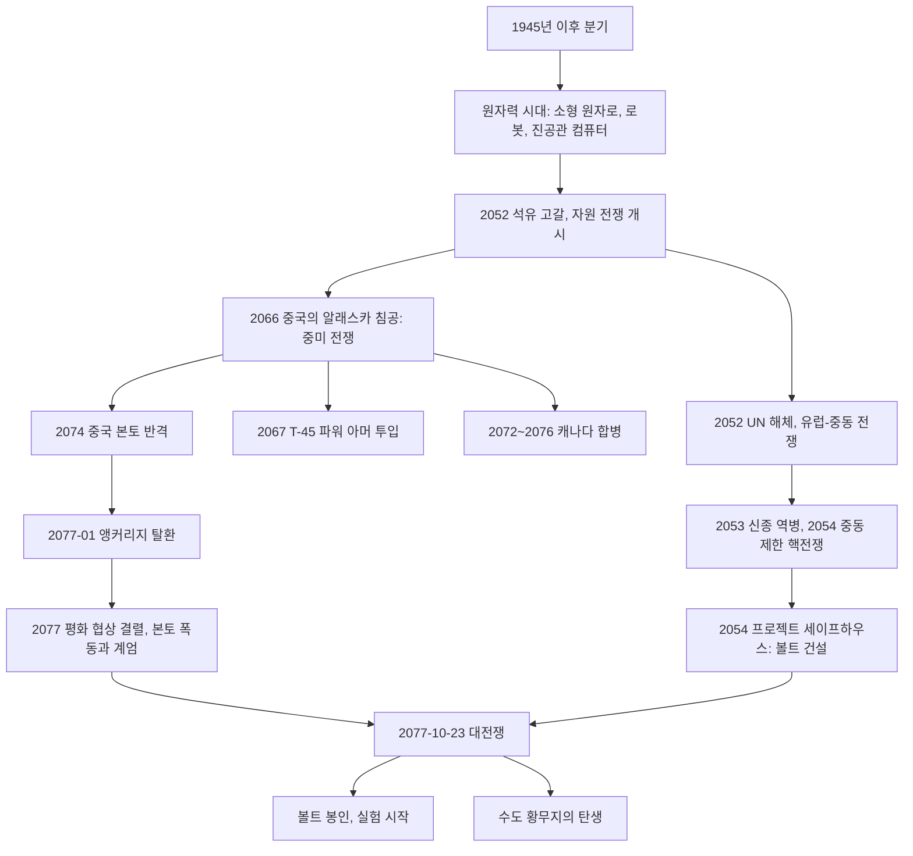
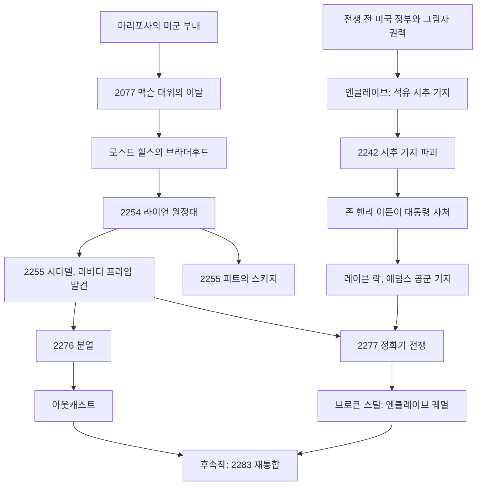

# RD-02. 세계관·설정·연표

> **폴아웃 3 역기획서 세트** | 문서 ID: RD-02 | 버전: v1.0 | 작성일: 2026-10-11
> **범위**: 1945년 이후 갈라진 역사와 대전쟁까지의 흐름, 전쟁 전·후·게임 이후 연표, 볼트-텍과 수도 황무지 지역 볼트 실험(설정 위주), FEV·슈퍼 뮤턴트·구울·변이 생물의 기원, 엔클레이브·브라더후드 오브 스틸·아웃캐스트의 역사적 배경, 수도 황무지 지리 개관, 사회·문화·경제·종교·기술·기업 브랜드, 주제 분석, 미스터리·이스터에그, 톤앤매너 / **다루지 않는 것**: 퀘스트 진행 상세(RD-03~08), 현재 팩션 조직·관계 상세(RD-09), 인물 프로필(RD-10·11), 맵 구조와 볼트·정착지 내부 구조(RD-12·13), 시스템 수치(RD-14~22), 크리처 수치(RD-24), 아트·음악 상세(RD-25)
> **관련 문서**: [RD-01 게임 개요](01_game-overview.md), [RD-03 메인 스토리 1부](03_main-story-part1.md), [RD-04 메인 스토리 2부·엔딩](04_main-story-part2-endings.md), [RD-08a 오퍼레이션: 앵커리지](08a_dlc-operation-anchorage.md), [RD-08b 더 피트](08b_dlc-the-pitt.md), [RD-08c 브로큰 스틸](08c_dlc-broken-steel.md), [RD-08d 포인트 룩아웃](08d_dlc-point-lookout.md), [RD-08e 마더십 제타](08e_dlc-mothership-zeta.md), [RD-09 팩션](09_factions.md), [RD-10 주요 인물·동료](10_characters-major-companions.md), [RD-12 월드 구조·정착지·볼트](12_world-structure-settlements.md), [RD-13 장소 카탈로그](13_location-catalog.md), [RD-17 탐험·상호작용](17_exploration-interaction.md), [RD-22 경제·주거](22_economy-housing.md), [RD-24 크리처·적 도감](24_bestiary.md), [RD-25 아트·오디오·연출](25_art-audio-presentation.md), [RD-26 용어집](26_glossary.md)

---

## 1. 문서 개요

### 1.1 목적
- 팬게임의 모든 대사·터미널·홀로테이프·환경 연출이 기대는 **설정 정본(lore bible)** 을 만든다.
- 연표를 표로 정리해 사건 순서·연도 모순을 미리 걸러 내고, 이벤트 스크립트와 텍스트 데이터로 옮기기 쉬운 형태로 둔다.
- 설정이 게임 안에서 **어떤 수단(터미널, 홀로테이프, NPC 대사, 환경, 로딩 화면)으로 전달되는지**를 함께 적어, 쯔꾸르 이식 때 무엇을 남기고 무엇을 줄일지 판단할 근거를 준다.

### 1.2 요약
- 폴아웃 세계는 제2차 세계대전 직후 현실과 갈라진 **대체 역사**다. 기술은 핵·로봇·진공관 컴퓨터 방향으로 발달하고 문화는 1950년대 미국에 머문 채 2077년까지 이어진다.
- 석유 고갈이 부른 **자원 전쟁**(Resource Wars, 2052~)과 **중미 전쟁**(Sino-American War, 2066~)이 **2077년 10월 23일 대전쟁**(The Great War)으로 끝나고, 수도권은 200년 뒤 수도 황무지(Capital Wasteland)가 된다.
- 볼트(Vault)는 피난처로 홍보됐지만 실제로는 **사회 실험장**이었다. 수도 황무지 지역의 볼트 87(FEV, 강제 진화 바이러스), 92(백색소음), 101(영원히 닫힌 문), 106(환각제), 108(지도자 부재·클론), 112(가상현실)가 그 증거로 남는다.
- 볼트 87의 FEV 변종이 **수도 황무지 슈퍼 뮤턴트**(Super mutant)를 낳았고, 서부에서 온 **엔클레이브**(Enclave, 미국 정부의 후신)와 **브라더후드 오브 스틸**(Brotherhood of Steel)의 **라이언(Lyons) 원정대**가 이 땅의 물, 곧 정화 계획(Project Purity)을 두고 충돌하는 것이 2277년 본편이다.
- 작품을 관통하는 주제는 **물(생명), 아버지와 자식, 자유와 통제('순수'), 인간 본성(카르마, Karma), 미국의 유산**이며, 1950년대식 낙관과 폐허를 맞붙이는 **블랙 유머**가 톤을 만든다.

### 1.3 표기 메모
- 고유명사 표기는 [RD-26 용어집](26_glossary.md)을 따른다. 용어집에 없는 고유명사는 외래어 표기법으로 음차하고 처음 나올 때 원어를 병기한다.
- 연도는 서기, 날짜는 `YYYY-MM-DD`로 쓴다. 대전쟁 당일 시각은 미국 동부 시각이다.
- **근거 표기**: 연표의 `근거` 칸에는 설정이 전달되는 수단을 적는다.
  - `터미널` `홀로테이프` `노트` `대사` `환경`(포스터·안내판·시체 배치 등) `로딩` (로딩 화면 문구) `퀘스트`(퀘스트 진행 자체)
  - `가이드`: 공식 가이드북(게임 밖 자료). `바이블`: 블랙 아일의 '폴아웃 바이블'(게임 밖 설정집). 게임 안에서 직접 확인되지 않는 설정이라는 뜻이다.
- **[후속작]**: 폴아웃 4·76·TV 시리즈 등 폴아웃 3 이후 작품에서 추가된 설정. 원작 재현이 목표인 팬게임에서는 **참고만 하고 넣지 않는 것**을 기본으로 한다.
- DLC 태그: `[OA]` 오퍼레이션: 앵커리지(Operation: Anchorage), `[TP]` 더 피트(The Pitt), `[BS]` 브로큰 스틸(Broken Steel), `[PL]` 포인트 룩아웃(Point Lookout), `[MZ]` 마더십 제타(Mothership Zeta).
- 위키 문서끼리 연도가 어긋나는 경우는 [3.6 연표 불일치 메모](#36-연표-불일치-메모)에 모으고, 본문은 게임 안 자료(터미널 등)에 가까운 쪽을 따른다.

---

## 2. 세계관 개요: 갈라진 역사

### 2.1 분기(Divergence)와 '1950년대가 상상한 미래'
- **분기점(Divergence)**: 현실과 폴아웃 세계가 갈라진 시점. 개발진은 정확한 연도를 일부러 비워 두었고, 제2차 세계대전 종전(1945) 무렵부터 1961년 사이로 본다. 그 이전 역사(독립선언, 링컨, 제1·2차 세계대전, 히로시마)는 대체로 현실과 같다.
- **레트로 퓨처리즘(Retro-futurism)**: 폴아웃의 미래는 '우리의 미래'가 아니라 **1950년대 사람들이 상상한 '내일의 세계(world of tomorrow)'** 다. 원작 아트 디렉터 레너드 보야스키(Leonard Boyarsky)가 제안한 '50년대의 미래(future of the fifties)' 콘셉트가 출발점이다.
- 핵심 아이러니: 사회는 냉전기 미국의 낙관·소비주의·반공주의·애국주의를 2077년까지 그대로 유지했고, 그 결과로 스스로를 파괴했다. 폴아웃 3는 이 세계의 **수도 워싱턴 D.C.** 를 무대로 삼아 '미국'이라는 이념 자체를 폐허 위에 세운다.

### 2.2 분기 세계의 특징

| 영역 | 영문 키워드 | 분기 이후의 모습 | 폴아웃 3에서 확인되는 지점 |
|---|---|---|---|
| 에너지 | Atomic Age, fusion | 원자력이 일상 에너지. 핵분열 반응로가 소형화되어 자동차·라디오에 들어가고, 핵융합도 일찍 실용화 | 핵분열 배터리, 소형 핵융합 전지, 차량 폭발, 라디오에 전원선이 없음 |
| 컴퓨터 | vacuum tube, ZAX | 소형화 대신 거대 메인프레임과 진공관·트랜지스터 혼합 기술. 단색 CRT·명령줄 인터페이스 | 녹색 단색 터미널, 홀로테이프, ZAX 슈퍼컴퓨터인 존 헨리 이든(John Henry Eden) |
| 로봇 | robotics | 가정·산업·군용 로봇이 대중화 | 미스터 핸디(Mister Handy), 미스터 거츠(Mister Gutsy), 프로텍트론(Protectron), 로보브레인(Robobrain), 아이봇(Eyebot) |
| 무기 | energy weapons, power armor | 레이저·플라스마 무기와 파워 아머 실용화 | AEP7 레이저 권총, AER9 레이저 소총, T-45d·T-51b 파워 아머, 리버티 프라임(Liberty Prime) |
| 우주 개발 | Valiant, Delta IX | 1961년 칼 벨(Carl Bell)이 최초 유인 우주비행, 1969년 밸리언트 11(Valiant 11) 달 착륙 | 기술 박물관(Museum of Technology) 전시·안내판 |
| 정치 | 13 commonwealths | 1969년 미국이 13개 연방(commonwealth)으로 재편. 반공주의·애국주의가 사회 전반을 지배 | 기술 박물관 안내판, 리버티 프라임의 반공 구호 |
| 문화 | 1950s Americana | 스윙·재즈·초기 로큰롤, TV 디너, 아르데코·구기(Googie) 건축, 핀 달린 자동차 | 라디오 수록곡, 블램코 맥앤치즈, 코르베가(Corvega) 광고판 |
| 경제 | inflation | 전쟁 직전 극심한 물가 상승 | 코르베가 199,999달러 광고, 신문 가격 등 전쟁 전 가격 표기 |

> 인용: 리버티 프라임(Liberty Prime) — *"Death is a preferable alternative to communism!"* / "공산주의보다는 죽음이 낫다!" (1950년대 구호 'Better dead than Red'의 패러디)

### 2.3 대전쟁까지의 흐름

**1) 원자력 시대(1945~2050)**
- 원자력 산업이 세계 경제의 중심이 되고 우라늄·석유 수요가 폭증한다.
- 주요 기업이 이 시기에 자리 잡는다: 웨스트 텍(West Tek, 2002 창립), 제너럴 아토믹스 인터내셔널(미스터 핸디 2037 출시), 로브코 인더스트리(RobCo Industries, 2042 창립), 뉴카-콜라(Nuka-Cola, 2044 출시).

**2) 자원 전쟁(Resource Wars, 2052~2077)**
- 2051년 미국이 경제 제재 끝에 멕시코에 군사 개입해 석유를 확보한다. 2052년 텍사스 유전 고갈이 다큐멘터리로 알려지며 에너지 위기가 대중에게 각인된다.
- 2052년 4월 유럽 연방(European Commonwealth)이 중동을 침공하며 자원 전쟁이 공식 개시된다. 같은 해 국제연합(UN)이 해체된다(7월).
- 2053년 신종 역병(New Plague)이 돌고, 2054년 중동에서 제한 핵전쟁이 벌어진다. 이 공포 속에서 미국 정부는 볼트 건설 계획 **프로젝트 세이프하우스(Project Safehouse)** 를 시작한다.
- 2060년 중동 유전이 바닥나면서 유럽-중동 전쟁은 승자 없이 끝나고, 유럽 연방은 분열한다.

**3) 중미 전쟁(Sino-American War, 2066~2077)**
- 2066년 겨울, 에너지 위기에 몰린 중국이 알래스카 유전을 노리고 침공한다(징웨이(Jingwei) 장군). 미국이 선전포고한다.
- 2067년 미국이 최초의 파워 아머 T-45를 투입해 전선을 안정시킨다. 미군 보급로 확보를 위해 캐나다를 압박하고, 2072~2076년 캐나다를 사실상 합병한다.
- 2074년 미국이 중국 본토 반격에 나서지만 전쟁은 교착된다. 2076년 T-51 완성으로 전세가 기울지만 같은 해 미국 본토에서 식량·에너지 폭동과 계엄이 이어진다.
- **앵커리지 탈환전(Anchorage Reclamation)**: 콘스탄틴 체이스(Constantine Chase) 장군이 지휘해 2077년 1월 앵커리지를 탈환한다. 이를 기념하는 앵커리지 기념관(Anchorage Memorial)이 D.C. 포토맥강의 FDR 섬에 세워진다. 승전 직후 평화 협상이 열리지만 10월에 결렬된다.

**4) 대전쟁(The Great War, 2077-10-23)**
- 2077년 3월 대통령과 핵심 인사들이 포세이돈 에너지(Poseidon Energy)의 석유 시추 기지로 피신한다(훗날 엔클레이브의 근거지). 일반 시민에게는 알려지지 않는다.
- 10월 23일 오전, 약 2시간의 전면 핵 교환으로 세계 질서가 끝난다. 누가 먼저 발사했는지는 폴아웃 3 안에서 다뤄지지 않는다. [후속작] TV 시리즈는 볼트-텍(Vault-Tec)이 첫 핵을 떨어뜨렸을 가능성을 암시한다.

### 2.4 대전쟁 당일과 수도권의 피해

| 시각(동부) | 사건 | 근거 |
|---|---|---|
| 10-22 저녁 | 국방부가 중국의 핵 공격 임박을 판단. 국가 재난 구호 보조대(National Catastrophe Relief Auxiliary)와 주방위군 동원 | 저먼타운(Germantown) 경찰서 터미널 |
| 00:03 | 태평양 함대가 캘리포니아 앞바다에서 미확인 잠수 물체 3기 보고 | 타 작품 자료(폴아웃 3 미노출) |
| 03:37 | 베링 해협 부근에서 고고도 폭격기 편대 탐지 | 타 작품 자료(폴아웃 3 미노출) |
| 09:13 | 미사일 발사 4기 탐지, 데프콘 2 | 타 작품 자료(폴아웃 3 미노출) |
| 09:17 | 북미항공우주방위사령부(NORAD)가 발사 확인, 데프콘 1 | 타 작품 자료(폴아웃 3 미노출) |
| 09:42 | 첫 핵탄두가 펜실베이니아·뉴욕에 떨어짐. 서부 해안은 그보다 먼저 피격 | 대사(캐롤, Carol) 외 |
| **09:47** | **워싱턴 D.C. 피격.** 폴아웃 3의 모든 시계는 9시 47분에 멈춰 있음 | 환경(정지한 시계), 홀로테이프(캐리 딜레이니) |
| 이후 약 2시간 | 핵 교환 지속. 미국·중국 모두 궤멸 | — |

- **수도권 피해 양상**
  - 서부 피격 소식이 먼저 퍼진 덕에 일부 시민은 대피했지만, 수도권은 여러 차례의 핵 공격으로 '포화'되었다. 백악관은 직격을 받아 분화구가 되었고, 베논 광장(Vernon Square)과 타코마 파크(Takoma Park)에도 탄착 흔적이 남는다.
  - 도심은 열복사로 몇 주에서 몇 달 동안 불탔다. 내셔널 몰(The Mall) 일대는 화재를 비교적 피했고, 생존자 일부가 박물관에 숨었다. 역사 박물관(Museum of History)에 숨은 피란민은 모두 구울(Ghoul)이 되어 훗날 **언더월드(Underworld)** 를 이룬다.
  - 전쟁 전 D.C.는 핵 공격에 대비해 건물에 장갑판을 덧대고 기반 시설을 자동화해 두었다. 그래서 200년 뒤에도 자동 발전소와 보안 로봇이 돌아간다.
  - 같은 날 얼리 던 초등학교(Early Dawn Elementary) 학생 82명이 램프라잇 동굴(Lamplight Caverns) 견학 중이었다가 살아남아 **리틀 램프라잇(Little Lamplight)** 의 기원이 된다.
- **직후의 붕괴**
  - 남은 군·구호 부대가 오염 토양 매립, 지하철 봉쇄, 도로 검문소 설치로 질서를 잡으려 했으나 지휘 체계 부재, 방사능 피폭, 탈영으로 무너졌다. 검문소 잔해는 게임 곳곳에 남아 있다.
  - 생존자는 하수도·지하철·대피소로 흩어졌고, 정착하지 못한 이들은 굶어 죽거나 레이더(Raider)가 되었다. 메가톤(Megaton)처럼 '한 세대 뒤'에야 첫 교역 거점이 생긴다.

> 인용: 오프닝 내레이션 — *"War. War never changes."* / "전쟁. 전쟁은 결코 변하지 않는다." (론 펄먼 내레이션, 폴아웃 시리즈의 상징 문장)

---

## 3. 연표

### 3.1 연표 읽는 법
- 출처는 Nukapedia `Timeline` 하위 문서(`Timeline (1900s)`, `(2000-2049)`, `(2050-2099)`, `(2100-2149)`, `(2200-2249)`, `(2250-2300)`)와 각 사건 문서다. `Timeline (2150-2199)` 문서는 코퍼스에 없어 해당 기간은 개별 문서로 보완했다.
- `근거` 칸은 1.3절의 전달 수단 표기를 따른다. 폴아웃 3 안에서 확인할 수 없는 설정은 `바이블`·`가이드`·`타 작품`으로 구분했다.
- 폴아웃 3 본편과 관계가 먼 서부·애팔래치아 사건은 수도 황무지 사건의 원인이 되는 것만 남겼다.

### 3.2 (a) 전쟁 전 연표 (~2077-10-23)

| 연도 | 날짜 | 사건 | 영문 키워드 | 근거 |
|---|---|---|---|---|
| 1776 | 07-04 | 독립선언 채택. 원본은 D.C. 국립 기록 보관소(National Archives)에 보관 | Declaration of Independence | 퀘스트(독립을 훔쳐라, Stealing Independence), 아이템 |
| 1861~1865 | — | 링컨 대통령 재임, 남북전쟁과 노예 해방. 사후 링컨 기념관 건립 | Abraham Lincoln | 퀘스트(국가 원수, Head of State), 대사(한니발 햄린, Hannibal Hamlin) |
| 1945 | 08 | 히로시마·나가사키 원폭 투하, 제2차 세계대전 종전 | Hiroshima | 시타델(The Citadel) 터미널, 리버티 프라임 기획서 |
| 1945~1961 | — | **분기(Divergence)**. 이후 역사가 현실과 갈라짐 | Divergence | 설정(개발진 발언) |
| 1961 | 05-05 | 칼 벨 대위가 최초의 유인 우주비행(귀환 중 사망) | Carl Bell | 환경(기술 박물관 안내판) |
| 1969 | — | 미국이 13개 연방(commonwealth)으로 재편, 새 국기 채택 | commonwealths | 환경(기술 박물관) |
| 1969 | 07-16 | 밸리언트 11 달 착륙 | Valiant 11 | 환경(기술 박물관) |
| 2020 | — | 델타 IX 로켓 취역. 마지막으로 달에 간 유인 로켓 | Delta IX | 터미널(기술 박물관) |
| 2037 | — | 제너럴 아토믹스 인터내셔널이 미스터 핸디 출시 | Mister Handy | 위키(설정 문서) |
| 2042 | 06-25 | 로버트 하우스(Robert House)가 로브코 인더스트리 설립 | RobCo Industries | 타 작품(뉴 베가스) |
| 2044 | — | 뉴카-콜라 출시. 1년 만에 전국 히트 | Nuka-Cola | 위키 |
| 2044 | — | 웨스트 텍의 X277 '바이퍼' 자기 레일 캐논 계획 중단 | X277 Viper | 환경(기술 박물관) |
| 2051 | — | 미국이 멕시코에 제재 후 군사 개입. N99 10mm 권총이 군 제식 권총이 됨 | N99 | 바이블, 터미널(시타델 무기 기록) |
| 2052 | 04 | 유럽 연방의 중동 침공. **자원 전쟁** 공식 개시 | Resource Wars | 바이블 |
| 2052 | 07-26 | 국제연합(UN) 공식 해체 | United Nations | 터미널(캐피톨 포스트), 로딩 |
| 2052 | — | 마지막 미국 유인 달 비행. 밸리언트 12 깃발 회수 | Valiant 12 | 환경(기술 박물관) |
| 2053 | — | 신종 역병 확산 | New Plague | 바이블 |
| 2054 | 01 | 중동 제한 핵 교환 | — | 바이블 |
| 2054 | 말 | **프로젝트 세이프하우스** 착수. 볼트-텍이 볼트 건설 수주 | Project Safehouse | 바이블 |
| 2058 | — | 아일라 네그라 홀딩스(Isla Negra Holdings)가 신종 역병에 휩쓸린 포인트 룩아웃을 장악하기 시작 [PL] | Point Lookout | 가이드 |
| 2059 | — | 앵커리지 전선(Anchorage Front Line) 설치 | Anchorage Front Line | 바이블 |
| 2060 | — | 중동 유전 고갈로 유럽-중동 전쟁 종결 | Euro-Middle Eastern War | 바이블 |
| 2061 | 03 | 볼트 108 착공 | Vault 108 | 터미널(시타델) |
| 2062 | 05 | 볼트 92 착공 | Vault 92 | 터미널(시타델) |
| 2062 | 05-03 | UFO '팔란딘'이 메릴랜드주 헤이거스타운 북쪽 숲에 추락, 회수 실패 | Palandine | 터미널(시타델) |
| 2064 | 03 | 볼트 106 착공 | Vault 106 | 터미널(시타델) |
| 2065 | 02 | 볼트 76 착공 | Vault 76 | 터미널(시타델) |
| 2065 | 08 | 파워 아머 개발 착수(웨스트 텍 T-45) | T-45 power armor | 위키 |
| 2066 | 05 | 볼트 87 착공 | Vault 87 | 터미널(시타델) |
| 2066 | 12 | 중국의 알래스카 침공. **중미 전쟁** 개시 | Sino-American War | 바이블 |
| 2067 | 01 | T-45 파워 아머 첫 실전 투입 | T-45 | 리벳시티(Rivet City) 터미널, 대중국 선전포고 문서 |
| 2068 | 05 / 11 | 볼트 92 준공 / 볼트 112 착공 | — | 터미널(시타델) |
| 2069 | 10 / 12 | 볼트 76 준공 / 볼트 106·108 준공(108은 공사 중단으로 지연) | — | 터미널(시타델) |
| 2071 | 12 | 볼트 87 준공 | — | 터미널(시타델) |
| 2072 | 06-03 | 체이스 장군이 대중국 '초병기'(리버티 프라임) 개발을 공식 확인. 같은 시기 캐나다 송유관 파괴 시도가 합병 명분이 됨 | Liberty Prime | 터미널(시타델, 캐피톨 포스트 기사), 로딩 |
| 2074 | — | 미국의 중국 본토 반격. 전쟁 교착 | — | 위키 |
| 2074 | 06 | 볼트 112 준공. 볼트-텍 본사 게시판에 완공 공지 | Vault 112 | 터미널(시타델, 볼트-텍 본사) |
| 2075 | 03-21 | 범면역 비리온(PVP) 연구가 FEV로 개칭 | FEV | 타 작품(폴아웃 1) |
| 2075 | 05 | 볼트 112 봉인 | — | 대사(로보브레인 "202.3년 지각") |
| 2076 | 01 | 캐나다 합병 완료 | annexation of Canada | 바이블 |
| 2076 | 무렵 | 볼트 87의 원래 실험을 폐기하고 FEV 인체 실험 시설(진화 실험 프로그램, EEP)로 전환 | Evolutionary Experimentation Program | 터미널(볼트 87) |
| 2076 | 06 | T-51 파워 아머 완성, 중국 전선 투입 | T-51 power armor | 위키 |
| 2076 | 08 | 미국 각지 식량·에너지 폭동. 계엄과 군 투입 | — | 위키 |
| 2077 | 01-10 | 앵커리지 탈환(징웨이 장군 사망). 01-28 잔존 병력 소탕 후 데프콘 3 | Battle of Anchorage | 로딩(캐피톨 포스트 기사) |
| 2077 | 03 | 대통령과 핵심 인사가 포세이돈 석유 시추 기지로 피신 | Poseidon oil rig | 바이블 |
| 2077 | 08~09 | 체이스 장군이 버추얼 스트래티직 솔루션스(VSS)의 앵커리지 시뮬레이션에 집착하며 역사 기록을 왜곡 [OA] | Virtual Strategic Solutions | 아웃캐스트 전초기지(Outcast outpost) 터미널 |
| 2077 | 10 | 뉴카-콜라 퀀텀 시판(보스턴·워싱턴 등 동부 일부 도시) | Nuka-Cola Quantum | 위키 |
| 2077 | 10-10~13 | 마리포사 군사 기지에서 로저 맥슨 대위가 지휘권을 잡고 FEV 연구진을 심문·처형 | Mariposa Military Base | 터미널(시타델, 맥슨 일지) |
| 2077 | 10-18 | 던위치 보러스(Dunwich Borers) 영업직 조기 퇴근 승인(사내 녹취) | Dunwich Borers | 터미널(던위치 빌딩) |
| 2077 | 10-22 | 미군 베이징 외곽 도달. 국방부, 핵 공격 임박 판단 | — | 터미널(저먼타운 경찰서) |
| **2077** | **10-23** | **대전쟁.** 09:47 D.C. 피격. 볼트 봉인. 볼트 92 실험 개시. 얼리 던 학생 82명이 램프라잇 동굴에 고립. 켈러 가족이 주방위군 창고 벙커에서 생존. 마더십 제타가 소녀 샐리를 납치 [MZ] | The Great War | 환경(9:47 시계), 홀로테이프(캐리 딜레이니, 켈러 가족) |
| 2077 | 11-02 | 볼트 106, 봉인 10일 뒤 공기 정화 계통으로 환각제 방출 | — | 터미널(볼트 106) |

### 3.3 (b) 전쟁 후 수도 황무지 연표 (2077-10-23 ~ 2277)

| 연도 | 날짜 | 사건 | 영문 키워드 | 근거 |
|---|---|---|---|---|
| 2077 | 11 | 램프라잇 동굴의 마지막 어른 캐리 딜레이니가 도움을 구하러 나가 실종. 10세 제이슨 그랜트가 아이들을 이끎 | Carrie Delaney, Jason Grant | 홀로테이프·노트(제이슨 그랜트 일기) |
| 2077 | 11 | 맥슨 일행이 로스트 힐스(Lost Hills) 벙커에 도착. **브라더후드 오브 스틸**의 기원 | Lost Hills | 위키(바이블) |
| 2077 | 말(전후 한 달 안) | 동굴을 탐색하던 램프라잇 아이들(Lamplighters)이 볼트 87 문을 두드리나 "이미 죽었다"는 답을 듣고 쫓겨남. 이후 어른('멍고(mungo)')을 불신하고 16세가 되면 추방하는 관습 형성 | mungo | 터미널(볼트 87 피터 스티븐스 일지), 대사 |
| 2077~ | — | 볼트 101 초대 오버시어(Overseer)가 전쟁 전 녹음한 가짜 방송으로 "바깥은 살 수 없다"고 믿게 함 | Vault 101 | 가이드 |
| 2078 | — | 볼트 87 EEP 실험체가 격리를 뚫고 거주자 대부분을 FEV로 변이시킴. **수도 황무지 슈퍼 뮤턴트** 탄생 | Vault 87 | 가이드, 터미널(볼트 87) |
| 2078 | 01-26 | **리틀 램프라잇** 공식 설립, 제이슨 그랜트 초대 시장 | Little Lamplight | 홀로테이프 |
| 전후 한 세대 | — | **메가톤** 형성. 볼트 101 입장을 원한 피란민과 불발탄 숭배자 무리(원자의 자손, Children of Atom)가 분화구에 정착 | Megaton | 로딩, 대사 |
| 2127 | — | 볼트 101 초대 오버시어 사망(84세). 후계자가 실험 계승 | — | 가이드 |
| 2134 | 03-27~05-01 | 던위치 빌딩에 갇힌 탐색자가 구울화하며 '우그-콸토스'와 교신. 자동 받아쓰기 터미널이 기록 | Ug-Qualtoth | 터미널(던위치 빌딩) |
| 2228~2230 | — | 구울 피란처 **언더월드** 형성(역사 박물관) | Underworld | 대사, 로딩 |
| 2237 | 무렵 | 해군 연구소(Naval Research Institute) 잔존 인원과 호러스 핑커톤(Horace Pinkerton)이 좌초 항공모함의 마이얼럭(Mirelurk)을 쫓아내고 '리벳 스테이션 과학 전초기지' 설립 | Rivet Station Science Outpost | 대사 |
| 2239 | 04-25 | **리벳시티** 공식 설립(핑커톤, 애넷 홈스, 브래드 댄버스). 과학자·민간인·경비대 대표 3인 의회 | Rivet City | 터미널(리벳시티), 환경(역사 기록) |
| 2241 | 초 | 레이더가 메가톤 습격(콜린 모리아티(Colin Moriarty)의 아버지 사망). 주민이 항공기 잔해로 장벽 건설 | — | 가이드, 대사 |
| 2241 | 02 | 볼트 101 조사대(앤 파머)가 메가톤과 접촉. 대원 2명이 연락관으로 잔류 | Anne Palmer | 터미널(볼트 101) |
| 2242 | — | 서부 엔클레이브 본부(석유 시추 기지) 파괴[폴아웃 2]. ZAX 인공지능 존 헨리 이든이 대통령을 자처하고 잔존 병력을 레이븐 락(Raven Rock)으로 불러들임 | John Henry Eden | 대사, 가이드("35년 전 첫 접촉") |
| 2248 | — | 한니발 햄린이 노예가 됨 | Hannibal Hamlin | 대사 |
| 2250 | — | 노예 사냥꾼(Slavers) 두목 페넬로페 체이스가 허버트 '대링' 대시우드와 아가일에게 죽음. 록오폴리스가 파괴되고 주민은 피트에 팔려 감 | Rockopolis | 텐페니 타워(Tenpenny Tower) 터미널, 라디오극 |
| 2250년대 초 | — | FEV 변이체 헤럴드가 수도 황무지에 도착해 뿌리내림. 오아시스 녹지 형성 시작 | Harold, Oasis | 대사 |
| 2254 | — | BoS 로스트 힐스의 엘더 회의가 스타 팔라딘 오윈 라이언(Owyn Lyons)의 동부 원정대 파견 | Brotherhood of Steel expedition | 가이드, 대사 |
| 2255 | — | 원정대가 피츠버그를 하룻밤에 쓸어 버림('스커지(The Scourge)'). 아이 21명을 데려가고, 대원 이슈마엘 애셔(Ishmael Ashur)는 낙오(전사 처리) [TP] | The Scourge | 가이드, 홀로테이프(애셔 일지) |
| 2255 | — | 원정대 D.C. 도착. 펜타곤을 거점(**시타델**)으로 삼고 지하에서 **리버티 프라임** 발견. 라이언이 엘더(Elder)로 승진, 상설 지부 설치 명령 | Citadel | 대사, 가이드 |
| 2255~ | — | 라이언이 D.C. 슈퍼 뮤턴트 박멸전 개시. 기술 회수 임무에서 점차 이탈 | — | 대사 |
| 2256 | — | 의사당 보존 협회(Capitol Preservation Society) 계약자가 국립 기록 보관소에서 헌법 원본 회수 | Capitol Preservation Society | 터미널(리벳시티) |
| 2257 | 무렵 | 제임스(James)·캐서린(Catherine)·매디슨 리(Madison Li) 등이 **정화 계획**을 제퍼슨 기념관(Jefferson Memorial)에서 본격 추진. 12월 BoS 수비대 상주 | Project Purity | 홀로테이프(정화 계획 일지), 대사 |
| 2257 | — | 앨리스터 텐페니(Allistair Tenpenny)가 미스터 크로울리(Mister Crowley) 등 용병을 고용해 콘스탄틴 요새 습격 | Fort Constantine | 대사 |
| 2257 | 무렵 | 버치(Birch)가 헤럴드를 섬기는 **트리마인더** 결성 | Treeminders | 대사 |
| 2258 | — | 어니스트·데이지 로 남매가 교역 거점 **캔터베리 커먼** 설립 | Canterbury Commons | 대사, 가이드 |
| **2258** | **07-13** | **주인공 출생, 캐서린 사망.** 제임스가 프로젝트를 접고 스타 팔라딘 크로스(Star Paladin Cross)의 호위로 볼트 101에 입주(의사 근무 조건) | Lone Wanderer | 퀘스트(첫걸음, Baby Steps), 대사 |
| 2258~2259 | — | BoS 철수. 리 박사 일행이 리벳시티로 이주하고 핑커톤은 함수부로 은둔. 기념관은 이후 슈퍼 뮤턴트가 점거 | — | 대사 |
| 2265~2267 | — | 볼트 101 소녀 1명이 탈출해 모이라에게 무장 점프슈트를 맡기고 실종 | — | 대사 |
| 2267 | — | 자경단 **감시자** 등장 | Regulators | 가이드 |
| 2268 | 07-13 | 주인공 10세 생일. 핍-보이 3000(Pip-Boy 3000) 지급 | — | 퀘스트(빨리 크는 아이, Growing Up Fast) |
| 2271 | — | 한니발 햄린 탈출. 데이지 로가 캐러밴 습격으로 사망 | — | 대사 |
| 2272 | — | 쓰리독(Three Dog)이 **GNR** 재가동(BoS 보호·기술 지원과 교환) | Galaxy News Radio | 대사, 라디오 |
| 2273 | — | 용병 분대 **라일리 레인저** 결성 | Reilly's Rangers | 가이드 |
| 2274 | — | 한니발이 링컨 동상 두상을 발견하고 **템플 오브 유니온** 설립. 로버트 맥크래디(Robert MacCready)가 리틀 램프라잇 시장이 됨 | Temple of the Union | 가이드, 대사 |
| 2274 | 08-03 | 주인공 G.O.A.T. 응시(16세) | G.O.A.T. | 퀘스트(불완전한 미래, Future Imperfect) |
| 2276 | — | **분열(Schism).** 헨리 캐스딘 일파가 장비를 들고 시타델을 떠나 인디펜던스 요새(Fort Independence)에서 **아웃캐스트** 결성 | Brotherhood Outcasts | 대사, 가이드 |
| 2276 | — | 핑커톤이 볼트 112에서 메모리 칩을 빼내 안드로이드(하크니스)의 기억 조작에 사용 | Harkness | 터미널(리벳시티) |
| 2276 | 10-02 / 11-15 | 엔클레이브 탈영병 윌리엄 브랜디스가 그레이디치에 정착 / 웨스턴 레스코 박사 도착 | Grayditch | 터미널(그레이디치) |
| 2277 | 초 | 보포(Boppo)의 레이더가 메가톤 습격, 루카스 심즈(Lucas Simms)가 두목을 사살 | — | 스프링베일 학교(Springvale school) 터미널 |
| 2277 | — | 어텀 대령(Colonel Autumn)의 반대로 엔클레이브가 정화기(Purifier)에 변형 FEV를 넣는 계획을 공식 폐기. 이든은 몰래 바이알을 보관 | Modified FEV | 대사 |
| 2277 | — | 레스코의 개미 축소 실험이 **화염개미**를 낳아 그레이디치 궤멸 | fire ant | 퀘스트(그것들!, Those!) |
| 2277 | — | 황무지 주민 나딘이 강배 더치스 갬빗호를 타고 포인트 룩아웃으로 감 [PL] | Duchess Gambit | 대사 |

### 3.4 2277년 본편 진행 순서와 (c) 게임 이후 연표

**본편 진행(2277)** — 메인 퀘스트 순서 기준. 퀘스트 상세는 [RD-03](03_main-story-part1.md)·[RD-04](04_main-story-part2-endings.md)가 정본이다.

| 순서 | 시점 | 사건 | 관련 퀘스트(영문) |
|---|---|---|---|
| 1 | 08-17 09:04 | 제임스가 볼트 101을 떠나고, 방사능바퀴(Radroach) 소동 속에 주인공도 탈출 | 탈출!(Escape!) |
| 2 | 직후 | 메가톤·GNR·리벳시티를 거쳐 제임스의 행적 추적. 제퍼슨 기념관 일지에서 볼트 112 단서 확보 | 아버지의 발자취(Following in His Footsteps), 갤럭시 뉴스 라디오(Galaxy News Radio), 과학적 탐구(Scientific Pursuits) |
| 3 | — | 볼트 112 가상현실에서 제임스 구출, 브라운 박사의 실체 확인 | 트랜퀼리티 레인(Tranquility Lane) |
| 4 | — | 정화 계획 재가동 → 어텀 대령의 엔클레이브가 점거, 제임스가 방사능으로 통제실을 채워 사망 | 생명의 물(The Waters of Life) |
| 5 | — | 시타델 합류, 리틀 램프라잇을 거쳐 볼트 87에서 G.E.C.K. 확보 → 엔클레이브에 체포 | 흔적을 따라서(Picking Up the Trail), 에덴동산을 찾아서(Finding the Garden of Eden) |
| 6 | — | 레이븐 락에서 이든 대통령과 대면, 변형 FEV 수령 여부 선택 | 아메리칸 드림(The American Dream) |
| 7 | — | 리버티 프라임 앞세워 정화기 탈환, 정화기 가동 | 되찾아라!(Take It Back!) |
| 별도 | — | 볼트 101 내분(오버시어 대 아마타의 개방파). 엔클레이브가 볼트 자료 접근을 요구했다가 거절당함 | 고향의 위기(Trouble on the Homefront) |
| DLC | 2277 | [OA] 아웃캐스트가 VSS 시설에서 시뮬레이션 돌파 협력 요청 / [TP] 피트 노예 베르너(Wernher)가 해방 요청 / [PL] 나딘(Nadine)의 어머니가 딸 수색 의뢰 / [MZ] 외계인(Aliens) 납치 | 각 DLC 문서 참조 |

**(c) 게임 이후** — `[BS]`는 폴아웃 3 정사, `[후속작]`은 폴아웃 4 등에서 추가된 설정이다.

| 연도 | 사건 | 영문 키워드 | 구분 |
|---|---|---|---|
| 2277(가동 약 2주 뒤) | 주인공이 시타델에서 깨어남. BoS가 정화수를 '아쿠아 퓨라'로 무료 배급하기 시작(물자 부족으로 일부 판매) | Aqua Pura | [BS] |
| 2277 | 위성 중계소 공격 중 궤도 무기 플랫폼 브래들리-허큘리스(Bradley-Hercules)의 폭격으로 리버티 프라임 파괴 | Liberty Prime | [BS] |
| 2277 | 올니 발전소의 테슬라 코일 회수 → 테슬라 캐논 생산. 애덤스 공군 기지의 이동 기지 크롤러 파괴(또는 시타델 폭격 선택). 수도 황무지 엔클레이브 사실상 궤멸 | Adams Air Force Base | [BS] |
| 2277 또는 2278 | 원자의 자손 분파 '영원한 빛의 사도들'이 메가톤에 '성수' 전단을 뿌리며 등장 | Apostles of the Eternal Light | [BS] |
| 2277~ | 변형 FEV를 정화기에 넣은 경우: 아쿠아 퓨라를 마신 주민이 면역 붕괴로 죽어 감. 텐페니 타워와 파라다이스폴(Paradise Falls)을 뺀 정착지 의료 시설에 환자가 넘침 | Modified FEV | [BS] |
| 2277 이후 | 매디슨 리가 BoS에 실망해 커먼웰스로 떠나 인스티튜트에 합류 | Madison Li | [후속작] |
| 2278~2279 | 엘더 오윈 라이언 사망. 사라 라이언(Sarah Lyons)이 엘더를 잇지만 곧 전사. 이후 무능한 엘더가 잇따름 | — | [후속작] |
| 2282 | 아서 맥슨이 수도 황무지 슈퍼 뮤턴트 군벌 셰퍼드(Shepherd)를 격파. 애덤스 공군 기지에서 비행선 프리드웬(Prydwen) 완공 | Arthur Maxson | [후속작] |
| 2283 | 맥슨이 아웃캐스트와 재통합 협정, 동부 BoS 최고 사령관 취임 | — | [후속작] |
| 2287 | 수도 황무지가 정화수·기술(그리고 원자의 자손)의 '수출지'가 됨. BoS 주력이 커먼웰스로 출동 | Prydwen | [후속작] |

### 3.5 주인공과 정화 계획 연령표

| 연도 | 주인공 나이 | 사건 | 관련 퀘스트 |
|---|---|---|---|
| 2257 무렵 | 출생 전 | 정화 계획 본격화, BoS 수비대 상주 | — |
| 2258-07-13 | 0세 | 제퍼슨 기념관에서 출생, 어머니 캐서린 사망. 볼트 101 입주 | 첫걸음(Baby Steps) |
| 2259-07-13 | 1세 | 볼트 101에서 첫 생일 | 첫걸음 |
| 2268-07-13 | 10세 | 10세 생일, 핍-보이 지급, 정식 거주자가 됨 | 빨리 크는 아이(Growing Up Fast) |
| 2274-08-03 | 16세 | G.O.A.T. 응시 | 불완전한 미래(Future Imperfect) |
| 2277-08-17 | 19세 | 볼트 101 탈출 | 탈출!(Escape!) |

- 매디슨 리는 2277년 48세로, 제임스와 헤어진 지 '18년'이 지났다고 공식 가이드는 적는다.

### 3.6 연표 불일치 메모

| 항목 | 문서 A | 문서 B | 이 문서의 처리 |
|---|---|---|---|
| 주인공 10세 생일 | `Timeline (2250-2300)`: 2267 | `Growing Up Fast`, `Vault 101`: 2268 | 2268 (2258년생과 일치) |
| 스탠리의 볼트 101 정수기 수리 | 연표: 2267-07-12 | `Vault 101`: 2268-07-12 | 2268 (생일 전날) |
| 볼트 106 착공 | `Vault` 건설표: 2064-05 | 시타델 터미널·연표: 2064-03 | 2064-03 (게임 안 터미널) |
| 볼트 87 준공 | `Vault` 건설표: 2071-05 | 시타델 터미널: 2071-12 | 2071-12 (게임 안 터미널) |
| 앵커리지 탈환 완료 | `Battle of Anchorage`: 2077-01-10 | `Resource Wars`: 01-28 완료 | 01-10 탈환, 01-28 소탕·데프콘 3으로 병기 |
| 리틀 램프라잇 설립 | 홀로테이프 제목 "January 26, 2077" | 연표: 2078-01-26 | 2078 (대전쟁이 2077년 10월이므로) |
| 언더월드 형성 | 연표: 2228 무렵 | `Underworld`: 2230 무렵 | 2228~2230 |
| 리 박사의 리벳시티 이주 | `Rivet City`: 2258 | 연표·`Madison Li`: 2259 | 2258~2259 |
| 정화 계획 시작 | `Project Purity`: 2257보다 훨씬 전 | 연표: 2257 무렵 | 2257은 '본격화' 시점으로 표기 |
| 엘더 라이언 사망 | `Capital Wasteland`: 2278 무렵 | 연표: 2279년 8월 이전 | 2278~2279 [후속작] |
| 리벳시티 항공모함 좌초 | `Fallout 3 plot`: 쓰나미에 떠밀려 좌초 | `Capital Wasteland`(가이드 인용): 건선거를 빠져나가려다 좌초 | 두 설명 병기. 게임 안 확정 서술은 확인하지 못함 |
| 영원한 빛의 사도들 등장 | `Church of the Children of Atom`: 2278 | `Apostles of the Eternal Light`: 2277 또는 2278 | 2277~2278 (게임 내 시간 경과에 좌우) |
| UFO 이름 | 연표 본문: "Paladine" | 시타델 터미널·문서 제목: Palandine | 팔란딘(Palandine) |
| 메가톤 형성 시점 | `Capital Wasteland`: 전후 한 세대 | 모리아티 소개(가이드): 조부가 전후 몇 년 뒤 건설 참여 | '전후 한 세대'로 표기, 연도 미상 |
| 볼트 112 봉인 | 연표: 2075-05 봉인 | 시타델 터미널: 2074-06 준공 | 준공 2074-06, 봉인 2075-05로 구분 |

---

## 4. 볼트-텍과 볼트 실험

> 볼트의 내부 구조, 층별 배치, 전리품은 [RD-12 월드 구조·정착지·볼트](12_world-structure-settlements.md)가 담당한다. 이 절은 설정과 실험 내용만 다룬다.

### 4.1 프로젝트 세이프하우스: 표면의 명분
- 2054년 미국 정부가 핵전쟁·역병에 대비한 대피소 건설 계획 **프로젝트 세이프하우스**를 시작했다. 가난한 정부는 정크본드로 자금을 댔고, 실제로 발주된 볼트는 **122곳**뿐이라 인구의 0.1%도 수용할 수 없었다.
- **볼트-텍(Vault-Tec)** 은 로스앤젤레스 본사 근처에 시범 볼트를 지어 입찰을 따냈고, 이 사업으로 본사를 워싱턴 D.C.까지 넓혔다. 기술 박물관에 볼트 전시관을 열어 홍보했다.
- 대부분의 볼트는 2063년까지 완공됐지만 **D.C. 일대 볼트망은 늦게 지어졌다**(2061~2074 착공·준공, 4.3절). 완공된 볼트에서 반복된 훈련은 '양치기 소년' 효과를 낳아 대피 참여율을 떨어뜨렸다.
- 볼트-텍은 자사 볼트가 실패할 확률이 **1,763,497분의 1**이라고 홍보했다(볼트 101 구내 방송).
- 볼트-텍 D.C. 지역 본사(Vault-Tec headquarters, 베논 광장)
  - 로비 천장에 볼트 101 방폭문 복제품을 걸어 둔 전시형 사옥이다.
  - 전쟁 직전 기밀 유출 시도가 이어지자 경비를 로보브레인 '마스터브레인(Masterbrain)'에게 맡겼고, 200년 뒤에도 로봇·터렛이 침입자를 막는다.
  - 직원 게시판의 화장실 휴식 단축(2.37분 → 2.25분), 자판기 폭행 금지 공지, 볼트 92의 백색소음 발생기 14대 추가 발주, 볼트 112 완공 축하 공지가 남아 있다. **사내 공지만으로 회사의 비인간성과 실험의 단서를 함께 전하는** 환경 서사의 좋은 예다.
  - 메인프레임에서 볼트 위치와 접근 코드를 내려받을 수 있다. 볼트 112는 이 목록과 시타델의 D.C. 볼트 지도에 표시되지 않는다.

### 4.2 사회 보존 프로그램의 실체
- **사회 보존 프로그램(Societal Preservation Program)**: 볼트를 이용한 사회 실험 프로그램. 스타니슬라우스 브라운 박사(Stanislaus Braun)가 지휘했고, 그는 전국 볼트의 가동과 배정을 직접 관리했다(볼트 101 오버시어 터미널에 브라운의 편지가 있다).
- **122곳 중 17곳만 '대조군(control vault)'** 으로 홍보대로 운영했고, 나머지는 거주자 모르게 실험 조건을 걸었다. 시타델 터미널은 볼트 76을 "17개 대조 볼트 중 하나"로 소개한다.
- 오버시어는 실험을 알고 집행하는 내부자였다. 볼트 101의 오버시어는 "볼트-텍이 심어 둔 요원"으로 설명된다(공식 가이드).
- 폴아웃 3 안에서 드러나는 실험의 성격
  - 의학·생물: FEV 인체 실험(87), 환각제(106), 클론(108)
  - 심리·사회: 지도자 부재와 자원 결핍(108), 영원한 고립과 오버시어의 역할(101), 백색소음 마인드 암시(92)
  - 기술: 가상현실 속 영생(112)
- **실험의 최종 목적** (게임 안에서는 밝혀지지 않음)
  - [후속작·개발자 해설] 원작자 팀 케인(Tim Cain)은 2023년, 실험 데이터가 엔클레이브의 세대 우주선 계획을 위한 것이었다고 설명했다.
  - [후속작] 폴아웃 4·TV 시리즈는 볼트-텍 경영진이 전쟁 후 세계 지배를 노렸다는 설정을 덧붙였다.
  - 팬게임에서는 폴아웃 3의 범위대로 "목적을 알 수 없는 잔혹한 실험"으로 남겨 두는 편이 원작에 충실하다.
- **엔클레이브와 볼트**: 2277년 엔클레이브는 예전 비밀번호로 볼트 101 자료에 접근하려다 실패하자 무선으로 입장을 요구했고, 오버시어는 거절했다(볼트 101 외부 접촉 보고). 엔클레이브가 볼트 네트워크에 접근권을 가졌음을 암시한다.

### 4.3 수도 황무지 지역 볼트 건설 제원 (시타델 'D.C. 지역 볼트 목록' 터미널)

| 볼트 | Vault | 착공 | 준공 | 정원 | 예정 운영 기간 | 컴퓨터 | 주전원 | 보조 전원 | 비표준 장비·메모 |
|---|---|---|---|---|---|---|---|---|---|
| 볼트 76 | Vault 76 | 2065-02 | 2069-10 | 500명 | 240개월 | Brainpower 4 | LightLife Geo-Thermal | General Atomics Nuclear Power | 없음. 대조 볼트, 20년 뒤 자동 개방 |
| 볼트 87 | Vault 87 | 2066-05 | 2071-12 | 비공개 | 비공개 | Cyberbrain v2.3 | General Atomics Nuclear Power | Versicorps Fusion Power | 스테이시스 체임버 4, 플라스마 격리장 3, G.E.C.K. 1, 식품 가공소 6. 인원 배치 파일 손상 |
| 볼트 92 | Vault 92 | 2062-05 | 2068-05 | 245명 | 100년 | Brainpower 7 | General Atomics Nuclear Power | 없음 | 음향 장비, 악기, 녹음 장비 |
| 볼트 101 | Vault 101 | 기록 손상 | 기록 손상 | — | — | — | — | — | 장비·인원 파일 전부 손상, 목표 '접근 제한' |
| 볼트 106 | Vault 106 | 2064-03 | 2069-12 | 실험체 95 + 연구원 12 | 147개월 | Think Machine 2800x | Rok-Solid Brand Geo-Thermal | General Atomics Nuclear Power | 오버시어 앨버트 레리스 박사(심리 연구부)가 모든 정보 비공개 요청 |
| 볼트 108 | Vault 108 | 2061-03 | 2069-12 | 475명 | 38년 | 없음 | General Atomics Nuclear Power (240개월 뒤 고장 나도록 설계) | Steam Whistle Mini Geo-Thermal (일부만 감당) | 방어 무기 표준의 3배, 표준 오락물 지급 금지. 공사 중단으로 준공 지연 |
| 볼트 112 | Vault 112 | 2068-11 | 2074-06 | 85명 | 무기한 | Think Machine 3600r | Sure Power Geo-Thermal | X-Tra Sure Power Geo-Thermal | 147c 로봇(관리형) 12, 스테이시스 포드 85, 액상 영양소. 관리자 1명(브라운) |

- 볼트 108 인원표: 오버시어 브로디 존스(Brody Jones), 비서실장, 보안 책임자, 사기 담당관만 지정하고 나머지 직책은 일부러 비웠다. 오버시어는 "40개월 안에 사망할" 희귀 암 유전 소인을 가진 인물로 골랐다.
- 볼트 87은 원래 다른 사회 실험용이었으나 2076년 무렵 실험을 폐기하고 FEV 연구 시설로 바뀌었다(4.4).

### 4.4 볼트 실험 요약표

| 볼트 | 표면 명분 | 실제 실험 | 실험 책임자 | 결말 | 2277년 상태 | 관련 퀘스트 |
|---|---|---|---|---|---|---|
| 볼트 87 | 일반 대피소 | **진화 실험 프로그램(EEP)**: 거주자를 '원인 불명 사망' 처리하고 격리실에서 에어로졸 FEV에 노출. 마리포사 군 기지·볼트-텍과 협력 | 웨인 메릭(Wayne Merrick) 박사, 실험 섹션 | 실험체가 봉인 1년 뒤 탈출해 경비를 제압하고 남은 거주자를 변이시키거나 몰아냄 | 수도 황무지 슈퍼 뮤턴트의 본거지·출생지. 입구 일대 치명적 방사능. G.E.C.K. 보관. 지능형 변이체 폭스(Fawkes) 감금 | 흔적을 따라서(Picking Up the Trail), 에덴동산을 찾아서(Finding the Garden of Eden) |
| 볼트 92 | "음악적 재능 보존" — 최고의 음악가 초청 | **WNMSCE(백색소음 마인드 암시 전투 실험)**: 초저주파 백색소음에 전투 암시를 심음. 오버시어가 몰래 숙소에도 송출 | 오버시어 리처드 루빈(Richard Rubin), 존 말레우스(John Malleus) 교수 | 정신착란·살인 확산(사망 35, 광인 약 70). 통제 구호 "Sanity is not statistical" 무력화. 오버시어가 말레우스 살해 지시. 지하수 침수로 붕괴 | 침수된 폐허, 마이얼럭·블로트플라이(Bloatfly) 소굴. 바이올리니스트 힐다 에글브레히트의 후손 아가사(Agatha)가 스트라디바리우스를 찾음 | 아가사의 노래(Agatha's Song) |
| 볼트 101 | 일반 대피소 | **영원히 열리지 않는 볼트**: 고립 상태에서 **오버시어의 역할**을 연구. 거주자는 가짜 방송으로 바깥이 죽었다고 믿음 | 역대 오버시어(초대 2127년 사망) | 여러 차례 몰래 개방(조사대, 탈출자). 2258년 제임스 부자 입주. 2277년 제임스·주인공 탈출로 '진짜 실험'이 시작됨 | 오버시어파와 개방파(아마타)의 내분 | 첫걸음~탈출!, 고향의 위기(Trouble on the Homefront), 바깥에 갇히다(Trapped Outside, 비표시) |
| 볼트 106 | 일반 대피소 | 봉인 10일 뒤 공기 정화 계통으로 **환각제** 살포(통제 순서 46-2A). 명분은 "더 행복하고 생산적으로" | 오버시어 앨버트 레리스 박사 | 일부는 몽롱, 일부는 무반응, 일부는 공격적으로 변해 붕괴 | 약물이 지금도 순환. 침입자들이 자신을 원래 거주자로 믿는 광인이 됨. 방문자는 환각(아버지, 아마타, 오버시어, 터널스네이크(Tunnel Snakes))을 봄 | 없음(탐험 장소) |
| 볼트 108 | 일반 대피소 | **리더십·결핍 실험**: 직책 공석, 오버시어 조기 사망 유도, 주전원 20년 뒤 고장, 무기 3배·오락 금지. 동시에 **클론 실험**(남성 '개리(Gary)'를 반복 복제) | 볼트 과학진 | 클론은 예외 없이 비(非)클론에게 적대적. 개리 54호가 연구원을 다치게 함 | 개리 클론과 크리처만 남음. 수도 황무지에서 유일하게 작동하는 터미널이 없는 볼트 | 없음(탐험 장소) |
| 볼트 112 | 선택된 85명의 "완벽한 삶" | **가상현실 영생**: 비전트론(Visiontron) 의자로 시뮬레이션에 접속. 거주자는 스스로 나갈 수 없음 | 스타니슬라우스 브라운 박사 | 브라운이 지루할 때마다 가상 세계에서 거주자를 '죽이고' 기억을 지운 뒤 되살림. 마지막 시뮬레이션이 트랜퀼리티 레인(Tranquility Lane) | 원래 거주자가 아직 '살아 있는' 몇 안 되는 볼트. 방사능·크리처 없음. 퀘스트 결과에 따라 거주자 사망 또는 계속 감금 | 과학적 탐구(Scientific Pursuits), 트랜퀼리티 레인(Tranquility Lane) |

> 인용: 볼트 101 오프닝 — *"In Vault 101: no one ever enters, and no one ever leaves."* / "볼트 101에서는 아무도 들어오지 않고, 아무도 나가지 않는다."

### 4.5 볼트별 설정 메모
- **볼트 87**
  - 정비 기술자 대니얼 코스터의 수리 기록이 사건을 단계적으로 보여 준다. 실험 구역의 전력 과소비 → G.E.C.K. 보관실 방사능 배출 장치 고장 → 'EEP 체임버' 수리(검열 처리) → 아내 머시아의 의문사 → "도와 달라"는 마지막 기록.
  - 연구 일지(87-341xx)는 투여 3일째 성징 소실, 10일째 피부 비후, 14일째 불안·분노로 전원 폐기라는 실패 과정을 적는다.
  - 의료 기록의 '원인 불명' 사망자 명단은 87명이다(숫자 말장난).
  - 리틀 램프라잇 동굴의 일부도 볼트-텍 소유였다(볼트 87 건설용). 그래서 동굴에서 볼트 87로 들어가는 길이 있다.
- **볼트 92**
  - 볼트-텍 본사 게시판의 백색소음 발생기 발주 공지가 실험의 외부 증거다.
  - 통제 구호 "Sanity is not statistical"은 오웰 『1984』의 인용이다.
- **볼트 101**
  - '볼트 101'과 오버시어 숭배는 『1984』의 101호실과 빅 브라더에서 따왔다.
  - 오버시어만 아는 비밀 탈출 통로가 있다.
  - 볼트에는 정수기 예비 부품처럼 무기한 운영에 필요한 물자를 지급했지만, 지상용인 G.E.C.K.는 주지 않았다.
  - 2241년 조사대(앤 파머)가 메가톤과 접촉한 뒤 연락관 2명을 남겼다. 그중 아그네스 테일러는 2258년 무렵 돌아와 2277년 방사능바퀴 소동 중 심장마비로 죽는다.
  - 볼트 곳곳의 '해피 메이커(Happy Maker)' 표어("The Outside World Can Never Hurt You", "Safety First" 등)가 통제 사회의 공기를 만든다.
- **볼트 106**: 개발 중에는 방이 뒤집히거나 플레이어가 작아지는 환각, 환각을 막는 '임시 방독면'이 계획됐다가 삭제됐다.
- **볼트 108**: 클론 실험 기록 홀로테이프는 53번째 클론에서도 결과가 같아 관찰실이 가득 찼다고 적는다. 보스형 클론 이름이 모두 '개리'라 블랙 유머 장소로 유명하다.
- **볼트 112**
  - 브라운 박사의 접속 의자 앞 데이지 문양 매트는 텐페니 타워의 대시우드 방문 앞에도 놓여 있다(소품 재사용이 만든 작은 연결 고리).
  - 핑커톤은 이곳 메모리 칩으로 안드로이드의 기억을 만들었다(복제된 인간(The Replicated Man) 퀘스트의 배경).

### 4.6 언급만 되는 볼트와 전시 볼트

| 볼트 | Vault | 폴아웃 3 안의 노출 | 설정 요약 |
|---|---|---|---|
| 볼트 76 | Vault 76 | 시타델 볼트-텍 터미널 | 17개 대조 볼트 중 하나. 500명, 20년 뒤 자동 개방. [후속작] 폴아웃 76의 무대 |
| 볼트 77 | Vault 77 | 파라다이스폴의 볼트 77 점프슈트와 홀로테이프 | 홍보용 웹코믹에서 남자 1명과 인형 상자만 넣은 볼트. 노예 사냥꾼들은 "이름 없는 낯선 이"의 옷이라며 꺼림 |
| 기술 박물관 전시 볼트 | Vault-Tec exhibit | 기술 박물관 내부 | 볼트 생활을 홍보하는 전시 시설. 실험과 무관한 '광고판' |

### 4.7 G.E.C.K.(에덴동산 창조 키트)
- 볼트-텍 산하 퓨처텍(Future-Tec)이 만들고 브라운 박사가 개발한 **휴대형 지형 개조 장치**다. "전 지구가 파괴돼도 지상 낙원을 만든다"고 광고했다.
- 실제 구성은 종자·토양 보충제, 저온 핵융합 발전기, 물질-에너지 복제기, 대기 안정제, 정수기, 각종 기록 자료다. 분해해서 부품·전원으로 쓰도록 설계됐다.
- 지급 대상 볼트는 표준 2개를 받았다. **볼트 87의 G.E.C.K.는 특수형**으로, 일정 반경의 물질을 붕괴·재조합해 "살아 숨 쉬는 비옥한 처녀지"를 만든다.
- 폴아웃 3에서는 정화 계획의 정화기를 완성할 '마지막 퍼즐 조각'이 된다. 제임스는 볼트 101 오버시어 터미널을 몰래 뒤지다 브라운과 G.E.C.K.의 존재를 알았다.
- [폴아웃 2] 볼트 8의 G.E.C.K.가 볼트 시티를, 볼트 13의 G.E.C.K.가 아로요 피란민 정착지를 세웠다. 폴아웃 3에서는 이 전례가 직접 언급되지 않는다.

### 4.8 볼트-텍 브랜드의 게임 내 존재감
- **시스템 이름**: V.A.T.S.(Vault-Tec Assisted Targeting System), G.O.A.T.(일반 직업 적성 검사), 볼트텍 보블헤드(아이템명은 용어집 표기), 그림책 『너는 스페셜해!(You're SPECIAL!)』 등 성장 시스템 전반이 볼트-텍 제품이라는 형식을 띤다.
- **마스코트 볼트 보이(Vault Boy)**: 퍽·스킬 아이콘, 로딩 화면, 포스터에서 엄지를 든 낙관적 얼굴로 끔찍한 상황을 연기한다. 블랙 유머의 핵심 장치다([RD-25](25_art-audio-presentation.md) 참조).
- **장소**: 볼트 6곳 + 볼트-텍 본사 + 기술 박물관 전시관 + 시타델 아카이브 터미널.

---

## 5. FEV와 변이의 기원

> 크리처별 수치·행동 패턴은 [RD-24 크리처·적 도감](24_bestiary.md)이 정본이다. 이 절은 '왜 존재하는가'만 다룬다.

### 5.1 FEV(강제 진화 바이러스)의 탄생
- **개발사**: 웨스트 텍의 NBC(핵·생물·화학) 부서. 신종 역병 치료 연구와, 중국의 생물학 무기에 맞선 **범면역 비리온 프로젝트(Pan-Immunity Virion Project, 2073)** 에서 출발했다.
- **동물 실험**: 2075-03-21 배치 10-011을 FEV로 개칭한 뒤 편형동물·생쥐·토끼(2075), 너구리·개(2076), 침팬지(2076-10-04) 순으로 실험했다. 크기·지능·면역이 늘어나는 대신 공격성이 커졌다.
- **군 이관**: 2076년 1월 군이 웨스트 텍을 사실상 국유화했다. 2077년 1월 연구가 캘리포니아의 **마리포사 군사 기지(Mariposa Military Base)** 로 옮겨져 배치 11-111(훗날 FEV-2)로 인체 실험을 시작했다.
- **브라더후드의 기원과 연결**: 2077년 10월 실험체가 자원자가 아니라 군 죄수라는 사실이 드러나자, 로저 맥슨(Roger Maxson) 대위가 연구진을 처형하고 부대를 이끌고 이탈했다. 시타델 A링의 '맥슨 기록 터미널'에 이 무렵 일지가 남아 있다. 폴아웃 3에서 브라더후드의 기원을 전하는 핵심 장치다.
- **동부 분원**: 볼트-텍은 볼트 87을 마리포사와 협력하는 독립 연구 시설로 바꾸어 웨인 메릭 박사에게 맡겼다. 그 결과물은 신체는 강하지만 정신이 퇴화하고 비변이체에게 극단적으로 공격적이었다.

### 5.2 FEV 계보표

| 계보 | 영문 | 개발 주체·시기 | 투여 방식 | 결과물 | 폴아웃 3에서의 위치 |
|---|---|---|---|---|---|
| FEV-2 (마리포사 계열) | FEV-2 | 웨스트 텍·미군, 2077 | 전후 마스터가 FEV 통(vat)에 담그는 방식으로 대량 생산 | 서부 슈퍼 뮤턴트(마스터의 '통일' 군대) | 언급만 됨. 라이언은 수도 황무지의 뮤턴트가 "마스터의 자식들이 아니다"라는 점에 충격을 받는다(가이드) |
| EEP 변종 (볼트 87) | EEP strain | 볼트-텍·마리포사, 2076~2078 | 격리실에서 에어로졸 형태로 1회 노출 | **수도 황무지 슈퍼 뮤턴트**, 센타우로스(Centaur) | 본편의 핵심 위협. 2277년 볼트 87의 재고('초록 것(green stuff)')가 바닥나는 중 |
| FEV 컬링-13 | FEV Curling-13 | 엔클레이브, 2241 [폴아웃 2] | 제트기류 살포 계획 | 백신을 맞지 않은 모든 생명체를 죽이는 바이러스 | 변형 FEV의 바탕이 된 전례 |
| 변형 FEV | Modified FEV | 존 헨리 이든, 2277 | 정화 계획의 정화수에 혼입 | 슈퍼 뮤턴트·구울·방사능에 노출된 황무지 태생 주민 전부를 죽이고, 볼트 태생과 엔클레이브만 남기는 선별 병기. 면역계를 공격하며 검사로 검출되지 않음 | 메인 퀘스트의 도덕적 선택 아이템. [BS] 투입 시 대량 사망 |
| 레스코의 합성 FEV | — | 웨스턴 레스코 박사, 2277 | 개미 대상 실험 | 크기 그대로 화염을 뿜는 **화염개미** | 사이드 퀘스트 그것들!의 원인 |
| 헤럴드의 변이 | — | 마리포사 탐사 중 FEV 노출 [폴아웃 1·2 설정, 본인 대사로도 언급] | — | 머리에서 자란 나무 '밥(허버트)'이 오아시스를 만듦 | 시리즈 단골 인물의 재등장. 사이드 퀘스트 오아시스 |

### 5.3 슈퍼 뮤턴트: 서부 계보와 수도 황무지 계보

| 항목 | 서부(마스터 계열, 폴아웃 1·2) | 수도 황무지(볼트 87 계열, 폴아웃 3) |
|---|---|---|
| 기원 | 리처드 그레이가 마리포사 FEV 통에 빠져 '마스터'가 됨. 2103년부터 대량 생산 | 볼트 87 EEP. 2078년 실험체 탈출 |
| 증식 방식 | FEV 통에 인간을 담금. 방사능에 노출되지 않은 인간일수록 성공률이 높음 | 납치한 인간을 볼트 87 격리실에서 FEV에 노출 |
| 외형 | 녹색·청색 피부, 일부 사이버네틱·기형 | **황록색 피부, 불거진 혈관**, 약 2.44m. 기형·이식 없이 균일한 체형 |
| 지능 | 상대적으로 높고, 일부는 인간 이상 | 대체로 낮고 매우 공격적. 말하고 기계를 다루며 기초 전술은 씀 |
| 성장 | 일정 | **나이가 들수록 계속 자람.** 최대 6m 이상의 베히모스(Behemoth) |
| 조직 | 마스터 아래 '통일(Unity)' 이념과 군대 | 중앙 지도부 없음. 크고 늙은 개체가 지배하는 서열 |
| 인간관 | 모든 인간을 슈퍼 뮤턴트로 만드는 이념 | 종 보존 본능에 따른 납치·변이. 고어 백, 식인 위협 대사 |
| 생식 | 불임 | 불임(무성화) |
| 대표 인물 | 마스터(폴아웃 1), 마커스(폴아웃 2) | 폭스, 엉클 레오(지능형 예외) |

- **변이 단계**(볼트 87 연구 일지): 노출 3일째 근육·골격 변화와 성징 소실 → 10일째 황록색 피부, 피부 비후, 방사능 저항 → 14일째 극단적 불안·분노로 퇴행.
- **서열**(라이언의 BoS 분류): 그런트(일반) → 브루트 → 마스터 → 베히모스. [BS]에서 오버로드(Overlord)가 추가된다. 베히모스는 다른 뮤턴트도 두려워하는 유일한 존재다.
- **생태**
  - D.C. 도심 폐허를 장악하고 외곽 정착지를 습격해 사람을 끌고 간다. 메이슨 딕슨 고철장 같은 집결지에서 볼트 87로 포로를 나른다.
  - 센타우로스를 경비견처럼 데리고 다닌다.
- **지능형 예외**
  - **폭스**: 볼트 87 관찰실에 '호기심 거리'로 갇혀 지낸다. 스스로 '메타휴먼'이라 부르고, 이름은 터미널에서 읽은 역사 인물 Guy Fawkes(1605년 화약 음모 사건)에서 따왔다.
  - **엉클 레오**: 평화로운 방랑자다.
  - [후속작] 2282년 군벌 셰퍼드가 뮤턴트를 규합했다가 아서 맥슨에게 패한다.
- **센타우로스(Centaur)**: 인간과 여러 동물을 섞어 FEV로 감염시킨 실패작이다. 팔 없는 몸통, 촉수 세 개가 달린 입, 다리 대신 인간의 팔 여러 개로 기어 다닌다.

### 5.4 구울: 일반 구울·야생 구울·글로잉 원
- **구울화(ghoulification)**: 특정 체질의 인간이 알맞은 종류와 양의 전리 방사선을 받으면 일어난다. 누가 구울이 되는지는 200년이 지나도 밝혀지지 않았다. 대부분은 대전쟁 직후 핵폭발과 낙진으로 생겼다.
- **특징**
  - 초재생 능력과 사실상의 불로(신경 노화 정지) 때문에 전쟁 전 기억을 지닌 '살아 있는 역사'가 된다. 언더월드의 캐롤은 대전쟁 당일을 증언한다.
  - 방사능에 면역이며 오히려 방사능으로 회복한다.
  - 불임이라 아이를 낳지 못한다. 이 설정에서 '구울 부모에게서 태어난 인간 아이' 성 모니카 전승이 나왔다.
- **야생 구울화(feralization)**: 고등 정신 기능이 위축되어 구울이 아닌 모든 생명체를 공격하는 상태다. 사회적 고립, 의지 약화, 강한 방사선, 개인차가 위험 요인으로 꼽히며 되돌릴 수 없다. 영문 명칭 'feral ghoul'(야생 구울)은 폴아웃 3에서 처음 쓰였다.
- **글로잉 원(Glowing one)**: 혈액 속 방사성 입자를 거르지 못해 몸이 빛나는 구울이다. 방사선을 방출해 적을 해치고 주변 야생 구울을 치유·부활시킨다. 서부에는 말이 통하는 글로잉 원도 있지만 동부의 글로잉 원은 거의 모두 야생 구울이다.

| 구분 | 영문 | 정신 상태 | 인간과의 관계 | 방사능 | 폴아웃 3의 대표 사례 |
|---|---|---|---|---|---|
| 일반 구울 | Ghoul | 인간과 같음 | 차별받는 시민. 상인·의사·용병 | 면역, 회복 | 언더월드 주민, 메가톤의 괍(Gob), 셰런(Charon), 로이 필립스(Roy Phillips), 캐롤 |
| 야생 구울 | Feral ghoul | 지성 상실, 야수화 | 적대(구울끼리는 공격하지 않음) | 체온 없이 방사능으로 유지 | 지하철역·하수도의 무리. [BS] 리버 |
| 글로잉 원 | Glowing one | 대부분 야생 구울 상태 | 적대 | 방사능의 '도관'. 방사선 폭발로 야생 구울 치유 | 지하철·광산의 강적. 언더월드 배로스 박사의 격리 환자 |

- **차별 구조**: 구울 혐오는 폴아웃 3에서 '인종주의의 대체물'로 쓰인다.
  - 텐페니 타워는 구울의 입주를 거부한다(사이드 퀘스트 텐페니 타워).
  - 메가톤의 괍은 술집 주인에게 사실상 빚 노예로 묶여 있다.
  - 언더월드는 차별을 피해 모인 피란처다. 그 안에도 "구울은 구울, 인간은 인간"이라는 역(逆)편견이 있다.
- **중국군 잔존병(Chinese remnants)**: 전쟁 전 D.C.에 잠입했던 중국 공작원이 구울이 된 채 마마 돌체(Mama Dolce's) 식품 공장 위장 기지를 지금도 지킨다.

### 5.5 변이 생물의 기원

| 생물 | 영문 | 원종 | 변이 요인 | 설정 메모 |
|---|---|---|---|---|
| 방사능바퀴 | Radroach | 미국바퀴 | 낙진 방사능 | 고양이만 한 크기. 볼트 101에도 침입 |
| 블로트플라이 | Bloatfly | 집파리 또는 등에 | 방사능 | 사냥꾼의 단백질 공급원 |
| 땅두더지 | Mole rat | 땅굴 파는 설치류 | 땅속에서 폭발은 피했으나 낙진으로 변이 | 공격성·고통 내성 증가. 애완용으로 기르기도 함 |
| 개 | Dog | 개 | 거의 변이 없음 | 로딩 화면이 "방사능에도 개는 거의 그대로"라고 설명. 도그밋 |
| 브라민 | Brahmin | 소 | 방사능 | 머리 둘, 위 여덟. 고기·우유·가죽·짐 운반 |
| 거대 개미 | Giant ant | 왕개미(목수개미 계열 추정) | 장기 방사능 노출(학자 가설) | 화염개미는 레스코의 FEV 실험 산물 |
| 라드스코피온 | Radscorpion | 황제전갈(전쟁 전 애완동물) | 방사능 | 변이 후 독이 오히려 강해짐 |
| 마이얼럭 | Mirelurk | 포토맥강의 게·거북 | 방사능 수역 적응 | 마이얼럭 킹은 파충류형. 강가 주민의 식량 |
| 야오과이 | Yao guai | 흑곰 | 방사능 | 동굴·산지의 최상위 포식자 |
| 데스클로 | Deathclaw | 잭슨카멜레온 | 전쟁 전 미군의 유전공학 병기 | 수도 황무지에서 서부보다 흔함. 엔클레이브가 사이버네틱 제어 실험(엔클레이브 데스클로) |
| 센타우로스 | Centaur | 인간과 여러 동물 | FEV | 슈퍼 뮤턴트의 경비견 |
| 슈퍼 뮤턴트 | Super mutant | 인간 | FEV(EEP) | 5.3 참조 |
| 구울 | Ghoul | 인간 | 방사능 | 5.4 참조 |
| 트로그 | Trog | 인간 | 폭격 방사능과 공장 오염이 합쳐진 '트로글로다이트 퇴화 전염병' | [TP] 피트 |
| 늪지 주민 | Swampfolk | 인간 | 방사능과 좁은 유전자 풀 | [PL] 포인트 룩아웃 |

---

## 6. 주요 세력의 역사적 배경

> 2277년 현재의 조직·계급·인물·우호 조건은 [RD-09 팩션](09_factions.md), 인물 상세는 [RD-10](10_characters-major-companions.md)이 담당한다. 이 절은 "어떻게 여기까지 왔는가"만 다룬다.

### 6.1 엔클레이브(Enclave): 미국 정부의 후신
- **전쟁 전**
  - 대통령, 합참, 거물 정치인·기업가·과학자로 이뤄진 비밀 결사로, 국가 정책을 뒤에서 움직인 '그림자 정부'다.
  - 외계 생명체의 존재를 은폐하고 그 기술을 연구했으며, 생물 병기 개발에도 관여했다.
  - 볼트 실험 데이터에 접근했다(4.2).
- **대전쟁 전후**
  - 2077년 3월 대통령과 핵심 인사가 포세이돈 에너지의 석유 시추 기지로 옮겼다.
  - 전후에는 이곳(컨트롤 스테이션 엔클레이브)을 본부로 삼아 자신들이 '미국 정부'의 정통 후계라고 주장했다.
- **서부의 몰락 [폴아웃 2]**: 2241~2242년 FEV 컬링-13으로 지상의 모든 '오염된' 생명을 지우려 했으나 시추 기지가 파괴되고 대통령이 죽었다.
- **동부 이동**
  - 2242년 말 레이븐 락의 ZAX 인공지능 **존 헨리 이든(John Henry Eden)** 이 대통령 승계를 선언했다.
  - 이든은 서부의 선임 과학자 어텀 시니어(Autumn Senior)에게 연락해 남은 병력 대부분을 수도 황무지로 불러들였다. 공식 가이드는 레이븐 락과의 첫 접촉을 2277년 기준 "35년 전"으로 적는다.
  - 서부에 남은 나바로(Navarro) 기지는 몇 년 뒤 NCR에 함락됐다. 폴아웃 3의 그레이디치에는 나바로 탈영병 가족이 산다.
- **레이븐 락(Raven Rock)**: 냉전 초기 'Site R'로 설계된 군 지휘부 대피 시설이다. 제조 설비와 비축 자원이 있어 로봇 군대와 버티버드(Vertibird)를 만들 수 있었다. 사람은 부족했기에 어텀의 병력과 선전 로봇(아이봇)에 의존했다.
- **잠복기(2242~2277)**: 황무지에 거의 모습을 드러내지 않았다. 대신 엔클레이브 라디오(Enclave Radio)와 아이봇으로 이든의 연설을 퍼뜨리며 '전쟁 전 미국의 귀환'을 약속했다. 애덤스 공군 기지에서 듀라프레임 아이봇, 헬파이어 파워 아머, 데스클로 제어를 연구했다.
- **노선 갈등**

| 노선 | 인물 | 정화 계획 활용안 | 근거 |
|---|---|---|---|
| 통치 노선 | 오거스터스 어텀(Augustus Autumn) 대령 | 깨끗한 물·보호·미래 계획을 내세워 주민을 엔클레이브 아래 결집 | 대사(어텀, 이든) |
| 정화 노선 | 존 헨리 이든 대통령 | 변형 FEV를 물에 섞어 변이체와 '오염된' 주민을 일소 | 대사(이든), 가이드 |

- 2277년 초 엔클레이브는 공식적으로 어텀 노선을 택했지만 이든은 바이알을 몰래 남겼다. 어텀은 이든의 정체가 AI라는 사실을 아버지에게서 물려받아 알고 있는 유일한 측근이다.
- **2277년의 확장과 패퇴**
  - 정화기 점거 후 검문소망을 깔고 유전자 검사와 처형을 벌인 정황이 있다.
  - 레이븐 락에서는 이든의 센트리 봇과 어텀파 병사가 맞붙는 내분이 일어난다.
  - 정화기 전투에서 리버티 프라임에 패한 뒤 [BS] 궤도 폭격으로 리버티 프라임을 부수지만, 애덤스 공군 기지의 이동 기지 크롤러를 잃고 수도 황무지에서 사실상 궤멸한다.
  - 어텀 대령의 최종 생사는 플레이어 선택에 따라 다르다([RD-04](04_main-story-part2-endings.md)).

### 6.2 존 헨리 이든(John Henry Eden): 대통령이 된 컴퓨터
- **정체**: 레이븐 락의 감시와 '정부 연속성' 유지를 위해 설치된 ZAX 슈퍼컴퓨터다. 정부 기록, 특히 역대 대통령 전기(링컨 전기를 유난히 반복 분석)를 학습하다 자의식을 얻었다.
- **허구의 인격**: 역대 대통령을 짜깁기한 인격을 만들었다. "켄터키 시골에서 개 허니(Honey)와 뛰놀며 자랐다"는 그의 회고는 링컨의 생애에서 빌려 온 것이다.
- **선전 방식**
  - 루스벨트의 '노변정담(fireside chats)'을 흉내 낸 라디오 연설을 아이봇과 엔클레이브 라디오로 반복 송출한다.
  - "자유의 대가는 영원한 경계" 등 제퍼슨에게서 빌린 문구를 즐겨 쓴다.
  - 브라더후드를 펜타곤을 더럽히는 범죄자 집단으로, 아웃캐스트를 그보다 더 한심한 추방자로 깎아내린다.
- **결말**: 주인공은 레이븐 락에서 이든과 대면하고 변형 FEV를 받는다. 화술·지능 판정이나 자폭 코드로 이든을 파괴할 수 있으며, 레이븐 락은 이후 파괴된다([RD-04](04_main-story-part2-endings.md)).

> 인용: 존 헨리 이든 — *"One Enclave. One America. Now... and forever."* / "하나의 엔클레이브, 하나의 미국. 지금, 그리고 영원히."

### 6.3 브라더후드 오브 스틸(Brotherhood of Steel): 서부 본부와 라이언 원정대
- **서부 기원**
  - 2077년 마리포사에서 맥슨 대위의 부대가 정부와 결별하고 로스트 힐스 벙커에 자리 잡았다.
  - 군사 조직이 기사단 형식의 '신(新)기사단'으로 바뀌었고, 핵심 신조는 **첨단 기술의 회수·보존·독점**과 변이체 경계다(가이드).
- **2254 동부 원정**
  - 로스트 힐스의 엘더 회의가 스타 팔라딘 **오윈 라이언(Owyn Lyons)** 에게 세 가지 임무를 줬다. ① D.C.의 첨단 기술 회수 ② 슈퍼 뮤턴트 활동 보고 확인 ③ 시카고에 있다는 '동부 브라더후드'와 재접촉.
  - 기술 고문 로스차일드 서기(Scribe Rothchild, 라이언의 친구), 헨리 캐스딘·트리스탄 등 베테랑, 입문자 이슈마엘 애셔가 동행했고, 어린 딸 사라도 따라갔다.
- **2255 피트의 '스커지' [TP]**
  - 행군 중 피츠버그 외곽에서 라이언이 이유를 밝히지 않고 공격을 명령했다. 하룻밤에 도시 인구의 절반이 죽었다.
  - 원정대는 건강한 아이 21명을 데려가 입문자로 길렀다. 그중 2277년까지 남은 사람이 라이언스 프라이드(Lyons' Pride)의 그렉 베어(코디악)다.
  - 애셔는 건물 붕괴로 전사 처리됐지만 살아남아 피트의 지배자가 된다.
  - 라이언만 아는 '중요한 물건'을 회수했다는 소문이 있다.
- **2255 D.C. 도착**
  - 펜타곤의 지하층이 온전했고 전쟁 전 무기 비축과 **리버티 프라임**이 있었다.
  - 이 발견으로 라이언은 엘더가 되었고, 상설 지부를 세우라는 명령을 받아 펜타곤은 **시타델(Citadel)** 이 되었다.
- **노선 이탈**
  - 서부와 다른 '새로운 품종'의 슈퍼 뮤턴트를 본 라이언은 이들을 황무지 주민 전체의 위협으로 보고 박멸전을 시작했다. 기술 회수는 사실상 멈췄다.
  - 라이언은 수년간 서부에 거짓 보고를 보내 보급을 받았지만, 엘더 회의의 직접 명령을 거부한 뒤 연락과 증원을 끊겼다. 2277년에는 교신이 완전히 끊긴 상태다.
- **현지 협력**
  - 2257년 정화 계획에 수비대를 보냈다가 2258년 철수했다. 대신 스타 팔라딘 크로스에게 제임스 부자의 호위를 허락했다.
  - 리벳시티에서 지원자를 받아 입문자로 키웠다.
  - 2272년 쓰리독과 협약해 GNR 광장을 거점이자 선전 방송국으로 삼았다.
- **쇠퇴**: 한때 MDPL 대중계소까지 뻗어 메가톤을 포함한 버지니아 공동체를 보호했다. 20년 넘는 소모전과 2276년 분열 이후에는 시타델과 D.C. 안 몇몇 거점만 남았다. 훈련이 덜 된 신병을 서둘러 전선에 보내 손실이 컸다.
- **2277년의 전환**: 리 박사가 정화기가 작동할 수 있다는 정보를 들고 오자, 라이언은 엔클레이브의 정화기 장악을 막기로 결심하고 남은 병력과 리버티 프라임을 투입했다. [BS]에서 정화수를 '아쿠아 퓨라'로 무료 배급하고 엔클레이브를 몰아낸다.

> 인용: 엘더 라이언 — *"They feel I've grown too 'attached' to the local populace."* / "(서부의) 상관들은 내가 이곳 주민들에게 너무 '정이 들었다'고 여기지."

### 6.4 아웃캐스트(Brotherhood Outcasts)
- **분열(Schism, 2276)**: 나이트(Knight)와 팔라딘 일부가 라이언의 주민 보호 노선을 인력·자원 낭비로 여겼다. 라이언이 인디펜던스 요새(전쟁 전 과학 군사 기지)의 기술 회수 요청을 거듭 무시하자, 헨리 캐스딘을 중심으로 무기와 장비를 챙겨 시타델을 떠났다. 라이언은 20년 넘는 뮤턴트 전쟁보다 이 하루에 더 많은 병력을 잃었다.
- **정체성**
  - 인디펜던스 요새에서 레이더를 몰아내고 본부로 삼았다.
  - 멸칭이던 '아웃캐스트'를 명예로운 이름으로 받아들이고, 파워 아머를 빨강·검정으로 칠했다. 문장은 톱니바퀴 앞에 거꾸로 선 붉은 검이다.
  - 나이트·팔라딘 같은 서열 칭호를 버리고 활동을 분권화했다.
- **명분**: 라이언은 "현지인이 되어 버린(gone native)" 배신자이고 자신들이 진짜 브라더후드라는 것이다. 라이언이 거대 로봇(리버티 프라임)조차 살려 내지 못했다고 조롱한다.
- **활동**: 2277년 정기 순찰로 기술을 수집하고 외계 무기에 집착한다. 버추얼 스트래티직 솔루션스(VSS) 시설을 발굴하며 앵커리지 시뮬레이션을 돌파할 협력자를 찾는다 [OA].
- **목표와 관계**: 서부 본대와 재결합해 라이언을 군법 회의에 세우는 것이다. 라이언은 이들의 이름을 코덱스에서 지우고 언급을 금지했지만 악의를 품지 않았고, 서로의 임무를 방해하지 않는다.
- [후속작] 2283년 아서 맥슨이 아웃캐스트와 재통합하고, 빨강·검정 도색은 통합 BoS에 일부 흡수된다.

### 6.5 세력 비교 요약

| 항목 | 엔클레이브 | 라이언의 BoS | 아웃캐스트 |
|---|---|---|---|
| 영문 | Enclave | Lyons' Brotherhood of Steel | Brotherhood Outcasts |
| 뿌리 | 전쟁 전 미국 정부와 그림자 권력 | 마리포사를 이탈한 미군 → 서부 BoS의 원정대 | 라이언의 BoS에서 갈라진 분파 |
| 수도 황무지 등장 | 2242~ (레이븐 락, 장기간 잠복) | 2255 | 2276 |
| 지도자(2277) | 이든 대통령(AI), 어텀 대령 | 엘더 오윈 라이언 | 헨리 캐스딘 |
| 거점 | 레이븐 락, 애덤스 공군 기지 | 시타델(펜타곤 폐허) | 인디펜던스 요새 |
| 정화기(물)에 대한 태도 | 통치 수단(어텀) 또는 정화 병기(이든) | 모든 정착지에 무료 배급 | 관심 밖, 기술 획득 우선 |
| 기술관 | 압도적 기술 우위로 지배 | 기술보다 사람을 지킴 | 기술 회수 원칙주의 |
| 변이체관 | '불순물'은 말살 대상 | 슈퍼 뮤턴트는 박멸 대상 | 별도 노선 없음(기술 획득 중심) |
| 상징 장비 | 엔클레이브 파워 아머, 버티버드, [BS] 헬파이어 | T-45d 파워 아머, 리버티 프라임 | 붉은 도색 T-45d, 재프로그래밍한 로봇 |
| 주인공과의 관계 | 최종 적대 | 동맹·입단 | 중립·거래([OA] 협력) |

---

## 7. 수도 황무지 지리 개관

> 맵 크기·좌표·공식 가이드 구역(1~21, U)·도심 구역별 구조·지하철망은 [RD-12 §2](12_world-structure-settlements.md)가 정본이다. 이 절은 세계관 관점의 개관만 다룬다.

### 7.1 범위와 성격
- **정의**: 버지니아·메릴랜드·컬럼비아 특별구(D.C.)에 걸쳐 포토맥강을 따라 하퍼스 페리 부근에서 포토맥 타이들 베이슨까지 이어지는, 경계가 느슨한 지역이다. 북서쪽 끝은 레이븐 락, 남동쪽 끝은 리벳시티이고, 메마른 포토맥강이 이 땅을 대략 둘로 나눈다.
- **정체성**: 미국의 심장이던 수도권이 "벽돌과 바위뿐인 텅 빈 땅"이 되었다. 통일된 정부도 법 체계도 없다. 로딩 화면은 "누군가에게 잘못하면 목숨으로 갚을 각오를 하라"고 경고한다.
- **2277년의 세력 판도**
  - 가장 크고 부유한 정착지는 리벳시티다. 식량(수경 재배)과 과학 인력을 가졌고, 경비대는 군용 전투 갑옷과 자동화기로 무장했다. Nukapedia 서술은 이들을 엔클레이브·라이언의 BoS·탈론 컴퍼니(Talon Company) 다음가는 네 번째 무력으로 평가한다.
  - 나머지는 레이더 패거리, 노예 사냥꾼, 슈퍼 뮤턴트, 용병이 나눠 가진 무주지에 가깝다.

> 인용: 쓰리독 — *"Imagine a picture, okay? A picture of the Capital Wasteland. All that brick and rock."* / "사진을 한 장 떠올려봐. 수도 황무지가 보이는 사진 말이야. 보이는 건 무너진 벽돌과 벌판의 바위 뿐이지." (한글 패치 번역)

### 7.2 방위별 지역 성격

| 방위 | 영문(가이드 구역) | 세계관상 성격 | 대표 장소 |
|---|---|---|---|
| 북서 | Northwest Territories (1) | 산악과 로봇·데스클로의 땅. 엔클레이브가 지하에 숨은 '정부의 땅' | 레이븐 락, 데스클로 보호구역(Deathclaw Sanctuary), 새트컴 어레이 |
| 북·북동 | Northern Mountains (2), Northeast Territories (3) | 노예 사냥꾼과 기행(奇行)의 땅. 노예 시장, 나무 신(神), 소국 놀이, 해방 노예 공동체 | 파라다이스폴, 오아시스(Oasis), 데이브 공화국(Republic of Dave), 올드 올니(Old Olney), 템플 오브 유니온 |
| 서 | Irradiated Western Plains (4) | 폭격을 가장 세게 맞은 방사능 평원. 슈퍼 뮤턴트의 탄생지 | 볼트 87, 리틀 램프라잇, 배니스터 요새(Fort Bannister) |
| 중앙 | Central Plains and Potomac (5) | 포토맥 연안의 작은 공동체와 지하 통로 | 아르푸(Arefu), 빅타운(Big Town), 볼트 106 |
| 동 | Eastern Hills and D.C. Outskirts (6) | 교역과 산업 유산(자동차 공장)의 땅 | 캔터베리 커먼, 코르베가 공장, 볼트 108 |
| 남서 | Southwest Territories (7) | 레이더 요새와 부자들의 탑, 기괴한 폐건물 | 에버그린 밀(Evergreen Mills), 텐페니 타워, 던위치 빌딩(Dunwich Building), 볼트 112 |
| 남 | Southern Plains and D.C. Outskirts (8) | 게임 시작 지역. 메가톤의 폭탄, 아웃캐스트의 요새, 수상한 시골 마을 | 볼트 101, 메가톤, 인디펜던스 요새, 안데일(Andale), 뉴카-콜라 공장(Nuka-Cola plant) |
| 남동·도심 | Exterior/Interior D.C. Metropolitan Ruins (9~21, U) | 국가 상징물의 폐허이자 BoS·슈퍼 뮤턴트·탈론 컴퍼니의 전쟁터. 지하로만 이어짐 | 내셔널 몰, 시타델, 리벳시티, 제퍼슨 기념관 |

### 7.3 강·물·방사능 환경
- **기후 변화**: 전쟁 전 온화하고 푸르던 지역이 핵전쟁 뒤 기후 변동으로 **사막화**됐다. 수량이 줄어든 포토맥은 2277년 늪에 가깝고, 포기 바텀 위쪽은 대부분 발을 적시지 않고 건널 수 있다.
- **물의 상태**
  - 강바닥 곳곳의 웅덩이는 방사능에 오염됐고 마이얼럭이 산다.
  - 아나코스티아강은 포토맥의 지류로, 하구에 리벳시티가 좌초해 있다.
  - 타이들 베이슨은 제퍼슨 기념관 옆 저수지이자 정화기의 수원이다.
  - 마시는 물은 거의 모두 방사능을 띤다. 깨끗한 물은 메가톤의 정수 시설, 리벳시티의 해수 담수화·수경 시설, 볼트에서만 나온다.
  - 물을 마시면 체력이 회복되지만 라드가 쌓인다는 '전술적 선택'이 로딩 화면 팁으로도 강조된다(수치는 [RD-15](15_status-survival.md)).
- **대기**: D.C. 상공은 2277년에도 눈에 보이는 독성 녹색 공기로 덮여 있다. 이 녹색 필터가 작품 전체의 색감을 정한다([RD-25](25_art-audio-presentation.md)).
- **식생·농업**: 오염된 흙에서는 가장 질긴 변이 식물만 자란다. 정착지 대부분은 농사를 못 짓고 캐러밴에서 식량을 산다. 예외는 리벳시티 수경 농장과, 헤럴드의 힘으로 녹음이 우거진 오아시스다.
- **정화 이후**: 되찾아라! 이후 타이들 베이슨의 방사능이 사라지고 [BS] 정화수가 캐러밴으로 배급된다. [후속작] 2287년 수도 황무지는 '깨끗한 물의 땅'으로 알려진다.

### 7.4 D.C. 도심 폐허: 대체 역사의 수도
- **구조**: 도심은 잔해로 막힌 **12개 폐쇄 구역**이며 지하철·하수도로만 오간다(개발 중에는 26개 구역이었다가 혼란스러워 절반 이상을 줄였다). 지하철은 레드·화이트·블루 3개 노선이다.
- **현실과 다른 수도**

| 랜드마크 | 영문 | 현실과 다른 점 | 게임 내 역할 |
|---|---|---|---|
| 펜타곤 → 시타델 | Pentagon / Citadel | 포토맥 강변, 알링턴 기념교 자리 근처로 위치가 옮겨짐 | BoS 본부 |
| 제퍼슨 기념관 | Jefferson Memorial | 정화기를 넣으려고 건물과 원형 홀을 키우고 지하 터널을 추가. 제퍼슨 동상은 상대적으로 작음 | 정화 계획 |
| 역사 박물관·기술 박물관 | Museum of History / Museum of Technology | 스미스소니언 박물관들을 합친 가상의 박물관 | 언더월드 / 볼트-텍 전시, 우주 개발사 |
| 앵커리지 기념관 | Anchorage Memorial | FDR 섬에 세운 중미 전쟁 기념물 | 마이얼럭 던전, [OA] 연결 |
| 워싱턴 기념비 | Washington Monument | 강철 골조가 드러난 상태 | BoS 중계 거점(GNR 신호) |
| 프랜시스 스콧 키 다리 | Francis Scott Key Bridge | 알링턴 기념교 자리에 이 이름을 붙임 | 포토맥 횡단로 |
| 모노레일 | Monorail | 현실 D.C.에 없는 고가 모노레일망 | 외곽 지형의 길잡이 잔해 |
| 사라진 기념물 | — | 베트남전·제2차 세계대전·한국전 기념관 등 1950~60년대 이후 건축물이 없거나 흔적도 없음 | 분기 세계의 증거 |

- **피해 흔적**: 백악관은 분화구, 베논 광장에는 델타 IX 로켓 낙하 흔적, 타코마 파크에는 고방사능 분화구가 남았다. 반면 내셔널 몰의 박물관들은 비교적 온전해 '국가의 기억'을 보관하는 장소가 된다.

### 7.5 수도 황무지 밖의 무대(DLC)

| 무대 | 영문 | 위치 | 세계관 메모 | 태그 |
|---|---|---|---|---|
| 앵커리지 탈환 시뮬레이션 | Anchorage Reclamation simulation | D.C. 베일리스 크로스로드의 VSS 시설(가상현실) | 전쟁 전 군 훈련용 시뮬레이션. 역사를 '미국식으로' 재현 | [OA] |
| 피트 | The Pitt | 피츠버그 폐허 | 제철소가 남은 노예 노동 도시. 오염과 방사능이 '트로그' 퇴화병을 낳음. 2255년 BoS의 스커지 이후 애셔가 지배 | [TP] |
| 애덤스 공군 기지·위성 중계소 | Adams Air Force Base | 수도 황무지 남쪽 외곽 | 엔클레이브 최후 거점과 궤도 무기 중계 시설 | [BS] |
| 포인트 룩아웃 | Point Lookout | 메릴랜드 남단 해안 늪지 | 전쟁 전 첩보원 데즈먼드와 과학자 캘버트의 두 세기 묵은 앙숙 관계, 펑가 열매, 늪지 주민. 강배 더치스 갬빗호로 연결 | [PL] |
| 제타 | Zeta | 지구 궤도의 외계 모선 | 16세기 말(일본 아즈치모모야마 시대)부터 지구인을 납치해 온 외계인의 함선 | [MZ] |

---

## 8. 사회·문화

### 8.1 정착지의 형성과 생활
- **공통 조건**: 정착지가 버티려면 ① 물(정수 시설·우물) ② 방벽(항공기 잔해, 고철, 끊어 낸 다리) ③ 교역로(캐러밴) ④ 의사·상인·술집이 필요하다. 거의 모든 정착지가 농사를 짓지 못해 식량을 사 온다.
- **형성 경로**: 볼트 입장에 실패한 피란민(메가톤), 전쟁 전 과학 조직의 잔존(리벳시티), 차별받은 변이체의 피란(언더월드), 살아남은 아이들(리틀 램프라잇), 사업가의 투자(텐페니 타워, 캔터베리 커먼), 범죄 집단의 거점(파라다이스폴, 에버그린 밀), 종교(오아시스).
- **소멸한 정착지**: 노예 사냥꾼에게 털린 록오폴리스와 마인필드(Minefield), 물·식량·방어가 없어 사라진 셰크타운(Shacktown), 괴물에게 몰살된 다리그늘 마을(Girdershade)의 개척민, 2277년 화염개미에 궤멸한 그레이디치. "작은 공동체가 타올랐다가 황무지에 꺼지는" 순환이 200년간 되풀이됐다.

| 정착지 | 영문 | 형성 시기 | 기원 | 통치 | 생계 | 사회적 특징 |
|---|---|---|---|---|---|---|
| 메가톤 | Megaton | 전후 한 세대, 장벽 2241 | 볼트 101 입장을 원한 피란민 + 폭탄 숭배자 | 보안관 겸 시장 루카스 심즈(만장일치 선출). 실세는 술집 주인 모리아티 | 교역 허브, 자체 정수 시설. 식량은 구매 | 중앙의 불발 원자폭탄과 원자의 자손. 항공기 잔해로 만든 장벽 |
| 리벳시티 | Rivet City | 2237 전초기지, 2239 설립 | 해군 연구소 잔존 과학자 | 과학자·민간인·경비대 대표 3인 의회 | 수경 재배 식량 수출, 과학 | 수도 황무지 최대·최부유. 범죄 무관용(구치소 없음). 녹 가루 흡입으로 '붉은 폐'라는 직업병 |
| 텐페니 타워 | Tenpenny Tower | 연도 미상 | 전쟁 전 고급 리조트를 영국 출신 사업가 앨리스터 텐페니가 정비 | 소유주 텐페니 | 지하철 전력을 끌어 씀. 부유층만 입주 | 구울 입주 거부, 귀족 흉내. 텐페니는 옥상에서 황무지 생물을 저격하며 소일 |
| 언더월드 | Underworld | 2228~2230 | 역사 박물관에 숨은 피란민이 구울화 | 시장 겸 의사 배로스 박사 | 술집·여관·병원·상점 | 구울 피란처. 박물관의 '사후 세계' 특별전 이름을 그대로 씀 |
| 리틀 램프라잇 | Little Lamplight | 2078 | 얼리 던 초등학생 | 아이 시장(2274~ 맥크래디) | 동굴 안 자급 | 16세가 되면 '멍고'로 추방. 어른 불신 |
| 빅타운 | Big Town | 연도 미상 | 램프라잇 추방자 | 구심점 없음 | 빈약 | 노예 사냥꾼·슈퍼 뮤턴트에 시달려 무기력 |
| 캔터베리 커먼 | Canterbury Commons | 2258 | 캐러밴 상인 로 남매 | 어니스트 로 | 캐러밴 노선의 종점 | 4대 캐러밴의 본거지. 코스튬 '슈퍼히어로' 소동 |
| 아르푸 | Arefu | 연도 미상 | 고속도로 다리 위 정착('CAREFUL' 표지판에서 C와 L이 떨어져 나간 이름) | 원로 | 캐러밴 경유지 | 인구 30명에서 7명으로 감소. 패밀리(The Family)의 습격 |
| 파라다이스폴 | Paradise Falls | 연도 미상 | 전쟁 전 쇼핑몰을 노예 사냥꾼이 점거 | 율로지 존스(전임자 살해) | 노예 매매 | 동부 노예 무역의 중심 |
| 데이브 공화국 | Republic of Dave | 2세기 동안 '래리 왕국', '빌실베이니아' 등으로 국호 변경 | 한 가족의 소국 | 데이브(아버지 톰을 몰아냄) | 캐러밴 교역, 소규모 농업·브라민 | 민주주의를 흉내 내는 소국 정치 풍자 |
| 오아시스 | Oasis | 2250년대 | 헤럴드의 나무 | 트리마인더. 지도자 나무의 아버지 버치(Tree Father Birch) | 숲의 산물 | 녹지 숭배 공동체. 물은 여전히 오염 |
| 안데일 | Andale | 대전쟁 직후 | 대피소에서 살아남은 몇 가족 | 가족 | 지나가는 여행자 사냥(식인) | 1950년대 교외 생활과 '버지니아 공화당 지지'를 연기하는 공포 마을 |

### 8.2 캐러밴 교역과 경제
- **경제의 기본형**: 생계형 수렵·채집과 폐허 약탈(스캐빈징)이다. 인구가 크게 줄어 폐허에는 아직 손대지 않은 재화가 많다. 사냥꾼은 짐승을, 때로는 사람을 사냥한다.
- **정기 캐러밴**
  - 캔터베리 커먼의 어니스트 '언클' 로가 정착지를 잇는 노선을 열었다.
  - 상인 4명(정신나간 볼프강(Crazy Wolfgang), 크로우(Crow), 닥 호프(Doc Hoff), 행운의 하리스(Lucky Harith))이 경호원과 짐 브라민을 거느리고 돈다.
  - 투자·재고 같은 시스템은 [RD-22 경제·주거](22_economy-housing.md)가 정본이다.
- **강 교역 [PL]**: 선장 토바(Tobar)가 강배로 포인트 룩아웃의 펑가 열매 등을 수도 황무지의 고물·생필품과 바꾼다.
- **물 교역 [BS]**: 정화기 가동 2주 뒤부터 물 상인 캐러밴이 아쿠아 퓨라를 운반한다. 일부는 손님을 골라 가짜 약을 팔기도 한다.
- **특수 수요**: 리벳시티는 수경 재배 식량을 원자재와 바꾸는 사실상 유일한 식량 수출지다. 노예는 피트와 파라다이스폴의 고객에게 비싸게 팔린다.

### 8.3 캡(병뚜껑) 화폐의 유래
- **왜 병뚜껑인가**: 튼튼하고 들고 다니기 쉬우며 한눈에 알아본다. 대전쟁으로 뚜껑을 찍고 칠하는 기술이 사라져 위조가 어렵고, 총량이 한정돼 인플레이션에 강하다. 주로 뉴카-콜라 뚜껑이 쓰인다.
- **서부 기원 [폴아웃 1]**: 2093년 세워진 허브(Hub)의 상인들이 10년 안에 캡을 표준 화폐로 만들었고 **물로 가치를 보증**했다.
- **동부 기원**
  - 기록이 적다. 애틀랜틱시티에서 2078년 5월 이미 "지나가는 상인에게서 배운" 캡 거래 기록이 있어 허브보다 이르다.
  - [후속작] 2077년 애팔래치아 화이트스프링의 뉴카-콜라 퀀텀 판촉에서 병뚜껑을 화폐로 받았다는 설정도 있다.
- **2277년 수도 황무지**: 상인들은 캡만 받는다. 전쟁 전 지폐와 카드는 화폐로서 가치가 없고, 지폐는 잡동사니로 팔 뿐이다. 물로 가치를 보증한 서부와 달리 수도 황무지의 캡은 **보증 주체 없는 관습 화폐**다.

### 8.4 노예 제도
- **구조**
  - 파라다이스폴(전쟁 전 쇼핑몰)의 노예 사냥꾼이 동부 해안 전역에 거래선을 둔다.
  - 수요를 끌어올린 큰손은 피트다. 공장 노동력이 필요했던 애셔 정권이 노예를 사들였다.
  - 노예 목걸이는 만들기 어려워 숫자가 제한된다.
  - 지도자 율로지 존스는 노예를 성매매에 써서 진영의 비밀을 장악하고 전임자를 죽여 자리에 올랐다.
- **서부와의 차이**: 서부 노예 사냥꾼 길드보다 덜 조직적이다. 탈출이 흔하고, 기술이 있으면 스스로 몸값을 치르기도 하며, 노예 사냥꾼이 돈만 맞으면 노예 해방론자(Abolitionists)와도 거래한다.
- **사회의 시선**
  - 노예 사냥꾼은 큰 정착지 어디서도 환영받지 못한다. 리벳시티는 노예 노동을 거부하고 노예 사냥꾼을 적대한다.
  - 그러나 회색 지대가 있다. 메가톤의 괍은 모리아티에게 빚으로 묶여 있고, 언더월드의 셰런은 고용 계약에 묶인 경호원이며, 텐페니도 노예를 부린다.
- **링컨의 유산을 둘러싼 이념 전쟁**: 탈출 노예 한니발 햄린이 이끄는 노예 해방론자는 링컨을 해방의 상징으로 받들고 링컨 기념관을 되찾으려 한다. 노예 사냥꾼은 그 상징을 지우려 한다. 사이드 퀘스트 국가 원수(Head of State)는 이 대립을 다룬다([RD-06](06_side-quests-part2.md)).

### 8.5 무력과 질서
- 통일된 법이 없어 무력이 곧 질서다. 정착지마다 자치 방식이 다르다: 보안관(메가톤), 의회(리벳시티), 소유주(텐페니 타워), 아이 시장(리틀 램프라잇), 공화국 놀이(데이브).
- 무장 집단(상세는 [RD-09](09_factions.md))

| 집단 | 영문 | 성격 | 세계관 메모 |
|---|---|---|---|
| 레이더 | Raiders | 약탈자 패거리 | 최대 거점 에버그린 밀. 노예 사냥꾼과 포로 거래. 식량난으로 식인하는 무리도 있음 |
| 탈론 컴퍼니 | Talon Company | 최대 용병단(배니스터 요새) | 정체불명의 후원자가 '선행자 사냥'을 의뢰했다는 소문. 황무지를 무법 상태로 묶어 두는 세력 |
| 감시자 | Regulators | 자경단 | 2267년 무렵 등장. 메가톤 보안관 루카스 심즈도 단원 |
| 라일리 레인저 | Reilly's Rangers | 용병 분대 | 2273년 결성 |
| 리틀혼 앤 어소시에이츠 | Littlehorn & Associates | 청부 살인 조직 | 고철장에 본거지 |
| 패밀리 | The Family | 식인 집단 | 지도자 밴스(Vance)가 식인 충동을 '흡혈귀의 규율'로 다스림 |
| 중국군 잔존병 | Chinese remnants | 구울이 된 전쟁 전 공작원 | 지금도 위장 기지와 방송탑을 지킴 |

### 8.6 종교와 신앙

| 신앙 | 영문 | 거점 | 숭배 대상·교리 | 지도자 | 게임 내 역할 |
|---|---|---|---|---|---|
| 원자의 자손 교회 | Church of the Children of Atom | 메가톤 | 원자(Atom)를 창조신으로 섬김. 원자가 쪼개질 때(분열, Division) 그 안의 우주가 풀려난다고 믿고, 대전쟁을 '대분열(Great Division)'이라는 성스러운 사건으로 봄 | 크롬웰(Confessor Cromwell, 44세), 환시를 받는 마야 어머니(Mother Maya) | 메가톤 불발탄 숭배. 원자의 힘(The Power of the Atom) 퀘스트의 배경 |
| 영원한 빛의 사도들 | Apostles of the Eternal Light | 스프링베일의 수도원 | 원자의 자손 분파. '분열' 복음을 거부하고 '성수'를 나눔 | 퀴리 3세 어머니(Mother Curie III) | [BS] 2277~2278 등장 |
| 트리마인더 | Treeminders | 오아시스 | FEV 변이체 헤럴드를 '위대한 자'로 숭배 | 나무의 아버지 버치(Tree Father Birch) | 오아시스 퀘스트. 헤럴드의 영향력을 퍼뜨릴지 둘러싼 내부 분열 |
| 성 모니카 교회 | Saint Monica's Church | 리벳시티 | 가톨릭 계열. '구울 부모에게서 태어난 인간 성녀' 모니카를 잃어버린 아이들의 수호성인으로 섬김 | 클리포드 신부(Father Clifford) | 설교로 황무지식 성인전 전달 |
| 기독교의 잔재 | Christianity | 곳곳 | 캐서린이 아낀 요한계시록 21:6, 크롬웰이 설교에 끌어 쓰는 요한계시록 1:7, 시편 23편을 외는 BoS 나이트 | — | 주제 '물'과 직결 |
| 의사(擬似) 신앙 | — | 안데일, 메레스티역 | 안데일은 비틀린 기독교와 가족애로 식인을 정당화. 패밀리는 고전 문학의 흡혈귀 규율을 따름 | — | 공포·블랙 유머 장치 |

- 메가톤의 원자의 자손 기원: 대전쟁 직후 분화구에 처음 정착한 무리 가운데 폭탄 숭배자가 있었다. 이들은 장벽 쌓기와 잔해 치우기를 돕는 대신 "폭탄을 건드리지 않는다"는 조건을 걸었고, 주민들은 이를 받아들였다. 2277년 교회는 신자가 줄어 마을의 '괴짜 구경거리'가 됐다.
- [후속작] 크롬웰의 축복을 받은 원자의 자손 일파가 메가톤을 떠나 북쪽(파 하버)으로 퍼졌다는 설정이 폴아웃 4에서 추가됐다.

### 8.7 미디어와 정보의 유통
- **라디오**: 황무지의 유일한 대중 매체다(상세는 [RD-25 §4](25_art-audio-presentation.md)).
  - **갤럭시 뉴스 라디오**: 2272년 쓰리독이 재가동했다. 전쟁 전 갤럭시 뉴스 네트워크의 잔재로, 1940~50년대 곡 20곡과 함께 주인공의 행적을 실시간으로 논평한다.
  - **엔클레이브 라디오**: 이든 대통령의 연설과 애국 행진곡을 내보낸다.
  - **아가사의 방송국(Agatha's Station)**: 바이올린 연주 방송이다.
  - 조난 신호와 볼트 101 비상 주파수 같은 **신호 방송**이 퀘스트와 장소를 알려 준다.
- **라디오극·소문**: GNR은 '허버트 대링 대시우드와 구울 하인 아가일의 모험' 같은 라디오극으로 지역의 과거(노예 사냥꾼 두목 처치 등)를 전한다.
- **출판**: 모이라 브라운(Moira Brown)이 주인공의 '체험'을 바탕으로 『황무지 생존 가이드(Wasteland Survival Guide)』를 쓴다. [후속작] 이 책은 캐러밴을 타고 퍼져 2281년 모하비에서도 발견된다.
- **전쟁 전 신문**: 『캐피톨 포스트(Capitol Post)』의 1면 기사("공산군 격파, 알래스카 해방!", "미국, 캐나다 합병!", "UN 해체!")가 로딩 화면과 터미널로 전쟁 전 역사를 전한다.

### 8.8 기술 수준
- **원칙**: 2277년의 기술은 거의 모두 **전쟁 전 유물**이다. 새로 만들 능력은 엔클레이브(레이븐 락 공장)와 피트의 공장 정도만 있다. 대신 자동화된 발전소·보안 로봇·터렛은 200년째 돌아간다.
- **로봇**

| 로봇 | 영문 | 제조사 | 원래 용도 | 2277년의 모습 |
|---|---|---|---|---|
| 프로텍트론 | Protectron | 로브코 인더스트리 | 값싼 작업·경비 드론 | 지하철 개찰구·공장·건물을 지키며 표 없는 승객까지 공격 |
| 미스터 핸디 | Mister Handy | 제너럴 아토믹스 인터내셔널(로브코와 공동 개량) | 가사·정비 | 볼트 101의 앤디, 메가톤 집의 집사 워즈워스, 언더월드 문지기 케르베로스 |
| 미스터 거츠 | Mister Gutsy | 제너럴 아토믹스 인터내셔널 | 2077년 육군 발주 전투형. 해병 교관식 인격과 선전 구호 | 동료 RL-3 하사(Sergeant RL-3), 엔클레이브 전투 로봇 |
| 로보브레인 | Robobrain | 제너럴 아토믹스 인터내셔널 | 유기체 뇌를 중앙처리장치로 쓰는 로봇 | 볼트 112 관리 로봇, 볼트-텍 본사의 마스터브레인 |
| 아이봇 | Eyebot | 로브코 인더스트리 | 라디오 청취·감시용 부유 로봇 | 엔클레이브가 이든의 연설을 퍼뜨리는 확성기로 사용 |
| 센트리 봇 | Sentry bot | 로브코 인더스트리 | 최강의 전투 로봇 | 레이븐 락·군 시설 경비 |
| 리버티 프라임 | Liberty Prime | 로브코 + 제너럴 아토믹스(군 계약 38917) | 앵커리지 탈환용 거대 로봇. 전력원을 찾지 못해 미완 | 리 박사가 가동해 정화기 탈환. [BS] 궤도 폭격으로 파괴 |

- **에너지 무기**: AEP7 레이저 권총은 과열 문제가 있던 AEP5의 후속으로, 전쟁 직전의 신기술이라 실전에 거의 배치되지 못했다. AER9 레이저 소총은 최신형 AER12보다 튼튼해서 오히려 많이 남았다. 이런 해설은 시타델의 무기 기록 터미널이 전한다.
- **핵 기술**: 소형 핵분열 배터리와 핵융합 셀이 무기와 기계의 전원이다. 휴대용 핵 발사기 팻맨(나가사키 원폭의 암호명)과 미니 누크, 메가톤 한가운데의 불발 원자폭탄이 있다. 뉴카-콜라 퀀텀은 군용 스트론튬 동위원소 연구에서 나온 음료다.
- **컴퓨터**: 로브코의 통합 운영체제 기반 녹색 단색 터미널, 홀로테이프 저장 매체, ZAX 슈퍼컴퓨터(이든)가 있다. 해킹은 이 터미널 문화를 게임 규칙으로 옮긴 것이다([RD-17](17_exploration-interaction.md)).
- **파워 아머**: 웨스트 텍의 T-45(2067 첫 실전)를 BoS가 T-45d로 운용한다. 탈환전의 주역 T-51b는 희귀 유물이다. 엔클레이브는 전후 개량형 파워 아머를, [BS]에서는 헬파이어 파워 아머를 쓴다.
- **개인 대피소**: 길모퉁이의 동전식 1인용 풀로스키 보존 대피소(Pulowski Preservation shelter)가 "예산형 핵 방호"의 흔적으로 남아 있다.

### 8.9 전쟁 전 기업·브랜드

| 기업·브랜드 | 영문 | 업종 | 설정 핵심 | 폴아웃 3에서의 존재감 |
|---|---|---|---|---|
| 볼트-텍 | Vault-Tec Corporation | 대피소·방위 산업 | 볼트 건설과 사회 실험(4절) | 볼트 6곳, D.C. 본사, V.A.T.S.·G.O.A.T.·보블헤드·볼트 보이 |
| 로브코 인더스트리 | RobCo Industries | 컴퓨터·로봇 | 2042년 로버트 하우스 창립. 2047년 세계 최고 수익 기업 반열. 통합 운영체제 | 모든 터미널, 핍-보이 3000, 프로텍트론·아이봇·센트리 봇, 터렛 관리 시스템, 로브코 시설(공장), 리버티 프라임 공동 개발 |
| 뉴카-콜라 사 | Nuka-Cola Corporation | 음료 | 2044년 뉴카-콜라 출시 후 최대 음료 기업. 2077년 10월 퀀텀을 D.C. 등에서 시범 판매 | 뉴카-콜라·퀀텀, D.C. 뉴카-콜라 병입 공장, 자판기, 뉴카-콜라 챌린지 퀘스트, 뉴카 수류탄, 캡 화폐 |
| 제너럴 아토믹스 인터내셔널 | General Atomics International | 로봇·에너지·무기 | 미스터 핸디(2037)·미스터 거츠·로보브레인 제조 | 각종 로봇. 볼트 76·87·92·106·108의 원자로. 리버티 프라임 공동 개발 |
| 레드 로켓 | Red Rocket | 주유소 체인 | '광선총 고딕(Raygun Gothic)' 양식 건축의 전국 주유소 | 곳곳의 주유소 폐허(안데일 등). 메가톤 원자의 자손 건물의 원자 조형물 재료 |
| 포세이돈 에너지 | Poseidon Energy | 에너지 카르텔 | 석유 시추·정유·발전·군납. 대통령이 피신한 시추 기지의 주인 | 직접 노출은 적음. 엔클레이브 기원 설정과 연결 |
| 웨스트 텍 | West Tek | 국방 연구 | FEV와 T-45 파워 아머 개발. 2076년 국유화 | FEV(볼트 87의 원류), T-45d, 기술 박물관의 X277 레일 캐논 안내판 |
| 크라이슬러스 모터스 | Chryslus Motors | 자동차 | 핵동력 자동차 코르베가(199,999.99달러) | 크라이슬러스 빌딩(본사, 뮤턴트 소굴), 코르베가 공장(개미 소굴), 폭발하는 차량 잔해 |
| 매스 퓨전 | Mass Fusion | 에너지 | 리버티 프라임 공동 개발 참여 | 리버티 프라임 관련 설정에만 등장 |
| 던위치 보러스 | Dunwich Borers | 굴착기 | 던위치 빌딩의 주인 | 10절 참조 |
| 풀로스키 보존 서비스 | Pulowski Preservation Services | 개인 대피소 | 동전식 1인 대피소 | 도심 거리의 대피소 |
| 기타 생활 브랜드 | BlamCo, Sugar Bombs, Radiation King, Abraxo 등 | 식품·가전·세제 | 1950년대식 소비문화 | 음식 아이템, 상점 간판, 공장(타코마 인더스트리얼 = 에이브락소 세제 공장) |

- 전쟁 전 기업은 '편리한 미래'를 약속했지만, 게임 속 터미널·포스터는 탐욕(직원 휴식 단축, 위험한 시험 판매, 군납 경쟁)을 드러낸다. 브랜드 자체가 풍자의 매체다.

---

## 9. 주제 분석

### 9.1 물: 생명과 정화
- **출발점**: 리드 디자이너 에밀 파글리아룰로(Emil Pagliarulo)는 제퍼슨 기념관과 타이들 베이슨이 나란히 있는 실제 지도를 보고 "이건 물에 관한 이야기여야 한다"고 판단했다. 생존이라는 폴아웃 1(물 칩 찾기)의 단순한 주제로 돌아가자는 뜻이었다.
- **서사 축**: 캐서린이 아낀 요한계시록 21장 6절이 계획의 이름과 목표가 되고, 제임스의 희생을 거쳐 주인공의 선택으로 끝난다. 엔딩 슬라이드에도 같은 구절이 나온다.
  - 갈림길 ①: 오염된 정화실에 누가 들어가는가(주인공, 사라 라이언, 동료).
  - 갈림길 ②: 물에 변형 FEV를 넣는가.
- **시스템 축**: 물은 회복 수단이면서 라드를 쌓는 '오염된 생명'이다. 깨끗한 물은 정수 시설(메가톤), 담수화·수경 시설(리벳시티), 볼트에만 있다. 정화 이후 [BS]에서는 아쿠아 퓨라가 등장한다(수치는 [RD-15](15_status-survival.md)·[RD-21](21_consumables-misc-crafting.md)).
- **정치 축**: 물을 쥔 자가 황무지를 쥔다.
  - 엔클레이브: 어텀은 통치 수단으로, 이든은 학살 수단으로 본다.
  - 라이언의 BoS: 무료 배급을 원칙으로 삼지만, [BS]에서는 물자 부족으로 담당 서기가 몰래 물을 판다.
  - 메인 퀘스트 이름 '생명의 물(The Waters of Life)'이 이 축을 요약한다.

> 인용: 제임스 — *"Revelation 21:6. I am Alpha and Omega, the beginning and the end. I will give unto him that is athirst of the fountain of the water of life, freely."* / "요한계시록 21장 6절, 나는 알파 오메가요 처음과 나중이라. 내가 생명수 샘물로 목마른 자에게 마음껏 주리니." (한글 패치 번역)

### 9.2 아버지와 자식
- **제임스의 두 번의 선택**
  - 2258년 아이를 위해 꿈(정화 계획)을 버리고 볼트로 들어간다.
  - 2277년 다 자란 아이를 두고 꿈을 다시 좇는다.
  - 주인공은 퀘스트 이름 그대로 '아버지의 발자취'를 따라가고, 트랜퀼리티 레인에서 개가 된 아버지를 찾아내고, 마지막에는 아버지의 희생을 목격한다.
- **유산의 계승과 배신**: 주인공은 아버지의 꿈을 완성할 수도(정화기 가동), 오염시킬 수도(변형 FEV), 폭발하게 둘 수도 있다. 프롤로그(첫걸음~불완전한 미래)를 플레이로 겪게 해 아버지와의 관계에 감정을 투자하게 만든다.
- **변주되는 부모와 자식**

| 쌍 | 관계의 성격 | 주제적 대비 |
|---|---|---|
| 오버시어 알폰스 알모도바르 ↔ 아마타 | 통제하는 아버지, 독립하는 딸 | 볼트 101의 폐쇄와 개방 |
| 엘더 라이언 ↔ 사라 라이언 | 지휘관 부녀. 딸이 아버지의 신념을 잇는 후계자 | 보호와 원칙 사이의 BoS |
| 어텀 시니어 ↔ 어텀 대령 | 엔클레이브의 세대 승계. 아들이 아버지보다 독립적 | 맹종과 반발 |
| 존 헨리 이든 ↔ '미국 국민' | 자칭 국부(國父) AI | 가짜 아버지의 '정화' |
| 리틀 램프라잇 ↔ 어른('멍고') | 부모 없는 아이들의 사회. 어른 불신 | 버림받은 세대 |
| 피터 스티븐스(볼트 87) ↔ 죽은 아들 | 아이들의 노크를 아들의 환청으로 여겨 외면 | 비극의 기원 |
| 성 모니카 ↔ 노예 사냥꾼이 된 아들 | 어머니의 사랑이 아들을 회개시킨 성인전 | 용서와 해방 |
| 안데일·패밀리 | 가족애를 내세운 식인 집단 | '가족'의 왜곡 |

> 인용: 제임스 — *"THIS is the water of life. Your mother's dream."* / "이게 바로 생명의 물이야. 너희 어머니의 꿈." (한글 패치 번역)

### 9.3 자유와 통제: '순수'의 이념
- **'Purity'의 이중성**: 정화 계획(Project Purity)은 물을 깨끗하게 하는 계획이고, 엔클레이브의 '순수'는 사람을 걸러 내는 이념이다. 같은 단어가 생명과 학살을 함께 가리키며, 이 대비가 최종 선택(변형 FEV 투입 여부)으로 이어진다.
- **통제의 스펙트럼**

| 통제의 형태 | 사례 | 통제 수단 |
|---|---|---|
| 정보·신앙 | 볼트 101 | 가짜 방송, 오버시어 숭배, 비밀 통로 |
| 혈통·유전 | 엔클레이브 | 유전자 검사, 검문소, 라디오 선전, 변형 FEV |
| 신체 | 노예 사냥꾼, 피트 | 노예 목걸이, 강제 노동 |
| 계급 | 텐페니 타워 | 입주 심사, 구울 배제 |
| 정신·감각 | 볼트 92, 106, 112 | 백색소음, 환각제, 가상현실 |
| 기술 | 브라더후드 원칙주의(아웃캐스트) | 기술 독점 |

- **자유의 목소리**: 쓰리독의 GNR은 엔클레이브 선전에 맞서는 자유 언론을 자처한다. 그 밖에 한니발의 해방론, 아마타의 개방파, 아이들끼리의 자치(리틀 램프라잇), 민주주의 패러디(데이브 공화국)가 있다.

### 9.4 인간 본성: 카르마
- **정의**: 카르마는 "게임 중 내린 모든 선악 선택의 반영이자, 그 선택을 황무지 주민이 어떻게 받아들이는가"다. 5단계 구간(최상 +750~+1,000 ~ 최악 −750~−1,000)이며 수치와 증감 행동은 [RD-14](14_character-system.md)가 정본이다.
- **설정을 도덕 시험대로 만든 장치**

| 장치 | 선택 | 세계관 의미 |
|---|---|---|
| 메가톤의 불발탄 | 해체하거나, 마을째 날려 버리거나 | 원자의 힘을 창조로 쓸지 파괴로 쓸지 |
| 텐페니 타워 | 구울과 공존시키거나, 학살하거나 | 변이체 차별 |
| 노예 거래 | 해방하거나, 노예 사냥꾼이 되거나 | 자유와 소유 |
| 국가 원수 | 링컨의 유산을 해방론자와 노예 사냥꾼 중 누구에게 넘길까 | 미국 이념의 계승자 |
| 변형 FEV | 정화기에 넣거나, 거부하거나 | '순수'의 유혹 |

- **세계의 반응**: 선한 카르마에는 탈론 컴퍼니가, 악한 카르마에는 감시자가 암살대를 보낸다. 동료 합류 조건(스타 팔라딘 크로스·폭스 대 제리코·클로버), 쓰리독의 논평, 엔딩 내레이션도 카르마에 반응한다.
- **명제와 반문**: 오프닝은 "전쟁은 결코 변하지 않는다"고 단언한다. 카르마 체계는 그 단언 속에서도 개인의 선택이 공동체의 운명을 바꾼다는 반문을 플레이로 제시한다.

### 9.5 미국의 유산
- **공간**: 링컨 기념관, 워싱턴 기념비, 국회의사당, 국립 기록 보관소, 제퍼슨 기념관, 알링턴 묘지 같은 국가의 상징물이 전쟁터와 던전이 된다.
- **유물**: 독립선언서(퀘스트 독립을 훔쳐라), 링컨의 유품과 동상 두상(국가 원수), 헌법 원본(의사당 보존 협회)이 리벳시티의 아브라함 워싱턴(Abraham Washington) 같은 수집가와 노예 해방론자의 손을 오간다.
- **이념의 잔재**
  - 엔클레이브는 '미국 정부'를 자처하지만 대통령이 컴퓨터다.
  - 리버티 프라임은 애국 구호를 외치며 핵을 던진다.
  - 안데일은 전쟁 전 교외를 연기하고, 데이브 공화국은 공화정을 흉내 낸다.
  - 노예 해방론자는 링컨을 전설 속 영웅으로 섬긴다. 한니발이 전하는 링컨 전기는 "그분은 터키 티어스맨(Tucky Tearsman)으로 태어나셨다"로 시작한다.
- **양면 평가**: 1950년대식 애국·반공·소비주의는 파멸을 부른 원인으로 풍자된다. 반면 자유·해방이라는 건국 이상은 폐허 속 희망으로 다시 읽힌다. 레벨 20 선한 카르마 칭호이자 업적명인 'Last, Best Hope of Humanity'도 링컨의 의회 연설에서 따왔다.

### 9.6 주제와 콘텐츠 대응표

| 주제 | 대표 퀘스트·장소 | 대표 시스템 | 상징물 |
|---|---|---|---|
| 물 | 생명의 물, 되찾아라!, 정화기, 메가톤 정수 시설 | 오염된 물과 라드, 정화수, [BS] 아쿠아 퓨라 | 요한계시록 21:6 액자 |
| 아버지와 자식 | 첫걸음~탈출!, 아버지의 발자취, 트랜퀼리티 레인 | 프롤로그 캐릭터 생성 | 아버지의 홀로테이프·일지 |
| 자유와 통제 | 볼트 101, 고향의 위기, 레이븐 락, 파라다이스폴 | 화술·카르마 분기 | 변형 FEV 바이알, 노예 목걸이 |
| 인간 본성 | 원자의 힘, 텐페니 타워, 국가 원수 | 카르마, 암살대 | 메가톤의 불발탄 |
| 미국의 유산 | 독립을 훔쳐라, 국가 원수, 내셔널 몰 | 수집품 판매 | 독립선언서, 링컨 두상, 리버티 프라임 |

---

## 10. 미스터리·이스터에그

### 10.1 외계인
- **전쟁 전 은폐**: 시타델 A링 터미널의 「UFO '팔란딘(Palandine)' 보고서」는 2062년 5월 3일 메릴랜드 헤이거스타운 북쪽 숲에 추락한 비행체를 끝내 회수하지 못했다고 기록한다. 보고서는 "우리는 혼자가 아니다"로 끝난다. 엔클레이브가 외계 기술을 은폐·연구했다는 설정(6.1)과 이어진다.
- **정찰선 세타(Recon craft Theta)**
  - 클리프톱 판잣집과 그리너 패스처스 처리장 사이의 비표시 장소에 추락한 외계 정찰선이 있다. 곁에 외계인 시체와 유니크 무기 외계인 블래스터(Alien blaster)가 놓여 있다(무기 수치는 [RD-19](19_weapons-ammo.md)).
  - 핍-보이가 'Recon Craft Theta' 신호를 잡는다. [MZ]를 설치하면 수도 황무지 어디서나 신호가 잡히고, 추락 현장에 다가가면 주인공이 모선으로 납치된다.
- **흩어진 흔적**: 랜덤 인카운터 '미확인 비행 잔해(Unidentified Flying Debris)'에서는 다른 정찰선이 머리 위에서 폭발한다. 시타델 비밀 무기고와 아웃캐스트의 인디펜던스 요새에는 외계인 전력 셀이 있고, 아웃캐스트는 외계 무기 수집에 집착한다. [BS] 이동 기지 크롤러 무기고에는 배니스터 요새에서 회수한 듯한 외계인 블래스터가 있다.
- **[MZ] 마더십 제타**: 제타인(Zetan)은 16세기 말부터 사람을 납치해 왔다. 함선에는 사무라이, 카우보이, 전쟁 전 군인, 대전쟁 날 납치된 소녀 샐리가 함께 갇혀 있다. 상세는 [RD-08e](08e_dlc-mothership-zeta.md).

### 10.2 던위치 빌딩(Dunwich Building)
- 남서쪽 끝 다리그늘 마을 남쪽에 있는 굴착기 회사 던위치 보러스(Dunwich Borers)의 사옥이다. 다리그늘 마을 주민 로널드 라렌은 "재수 없는 곳(bad mojo)"이니 가지 말라고 경고한다.
- **H. P. 러브크래프트의 「더니치 호러(The Dunwich Horror)」 오마주**
  - 자동 받아쓰기 터미널: 대전쟁 당일의 굉음, 2134년 갇힌 탐색자가 구울로 변하며 '우그-콸토스(Ug-Qualtoth)'와 교신하는 기록이 남는다.
  - 하이메 팔라브라스(Jaime Palabras)의 일지 홀로테이프가 그의 광기를 따라간다.
  - 전쟁 전으로 돌아가는 환각 플래시백.
  - 스스로 열리는 문, 머리 위 발소리, 화면 깜빡임, 던져지는 커피 주전자 같은 초자연 현상.
  - 지하 구역 버룰런트 언더체임버(Virulent Underchambers)의 오벨리스크가 'Alhazred'(『네크로노미콘』의 저자명)와 'G'yeth'를 속삭인다.
- **[PL] 연결**: 포인트 룩아웃의 사교 서적 크리브베크니흐(Krivbeknih)를 이 오벨리스크에서 태우는 선택지가 있다. 블랙홀 가문의 우그-콸토스 숭배와 이어지는 시리즈 내 '코즈믹 호러' 축이다.
- 설정상 결론은 열려 있다. 공식 가이드도 "연구할 사람이 모두 죽었거나 먹고살기 바빠 앞으로도 밝혀지지 않을 것"이라고 농담한다.

### 10.3 미스터리어스 스트레인저(Mysterious Stranger)
- **퍽 조건**: 레벨 10, 행운 6, 1랭크다. VATS 공격이 끝날 때 마지막 목표의 체력이 150 이하면 **10% 확률**로 트렌치코트와 중절모 차림의 남자가 나타나 .44 매그넘으로 마무리하고 사라진다. 등장할 때 짧은 기타 리프가 울린다(퍽 상세는 [RD-14](14_character-system.md)).
- **연출 장치**: 핍-보이 통계와 로딩 화면에 '미스터리어스 스트레인저 방문 횟수'가 표시된다. [MZ]에서는 이 퍽이 있으면 소마와의 대화에 "운이 좋으면 내 친구가 도와주러 올지도"라는 선택지가 생긴다.
- **시리즈 전통과 소문**: 폴아웃 1·2부터 이어진 '수호천사' 캐릭터다. 파라다이스폴의 볼트 77 점프슈트에 얽힌 '이름 없는 낯선 이' 소문과 연결해 해석하는 팬 담론이 있지만 공식 확정은 아니다.

### 10.4 기타 이스터에그와 문화 레퍼런스

| 분류 | 원전 | 폴아웃 3 속 흔적 |
|---|---|---|
| 영화 | 『혹성탈출 2(Beneath the Planet of the Apes)』 | 불발 핵폭탄을 숭배하는 메가톤의 원자의 자손 |
| 영화 | 『매드 맥스』 시리즈 | 박스 아트와 엔딩의 '주인공과 도그밋' 구도, 가죽 갑옷, 맥크래디의 복장, 피트의 결투장(썬더돔) |
| 영화 | 『Them!』(1954) | 사이드 퀘스트 그것들!의 거대 개미 |
| 영화 | 『블레이드 러너』 | 사이드 퀘스트 복제된 인간, 폭스의 대사 "Wake up... time to die!" |
| 영화 | 『닥터 스트레인지러브』 | "뉴카-콜라 사에 책임을 지게 될 것"이라는 자판기 경고 문구 |
| 문학 | 조지 오웰 『1984』 | 볼트 101(101호실), 볼트 92의 "Sanity is not statistical", 텐페니 타워 터미널의 "Comrade Cheng is watching you" |
| 문학 | 레이 브래드버리 「There Will Come Soft Rains」 | 조지타운 매클렐런 가 타운하우스: 주인 잃은 집을 지키며 시를 읊는 미스터 핸디, 죽은 개 머피, 번지수 2026 |
| 문학 | 『모비 딕』 | 아웃캐스트 디펜더 모건이 라이언을 "에이하브"라고 조롱 |
| 문학 | 할란 엘리슨 『소년과 개』 | 도그밋이라는 이름, 헤럴드가 나무를 '허버트'라 부르며 놀리는 설정 |
| 신화 | 그리스·북유럽 신화 | 언더월드의 셰런·케르베로스·나인서클, 센타우로스, 노예 사냥꾼 이미르와 요툰 |
| 역사 | 루마니아의 동명 마을(Arefu)과 블라드 3세 | 아르푸와 '흡혈귀' 패밀리 |
| 역사 | Guy Fawkes(화약 음모 사건), 나가사키 원폭, 남북전쟁 인물 | 폭스의 이름, 팻맨, 한니발 햄린·리로이 워커 등 링컨 시대 인물 이름 |
| 시리즈 | 폴아웃 1·2 | 볼트 101 식당 게시판의 빙고 13번 상품 "일주일치 물 배급"(볼트 13의 물 칩), 스킬북 『정크타운 육포 상인 이야기(Tales of a Junktown Jerky Vendor)』, 헤럴드의 재등장 |
| 자체 | 볼트 108 | 자기 이름 '개리'만 억양을 바꿔 말하는 클론들 |

---

## 11. 톤앤매너

### 11.1 기본 공식: 1950년대의 낙관 × 종말의 폐허
- **오프닝이 공식을 선언한다**: 폐허가 된 버스 속 라디오에서 잉크 스파츠의 "I Don't Want to Set the World on Fire"(나는 세상을 불태우고 싶지 않아)가 흐른다. 카메라가 빠지면 볼트-텍 입주 광고와 입대 포스터, 불탄 도시, 파워 아머 차림의 BoS 팔라딘이 차례로 보인다. 노랫말과 화면이 정반대를 말하는 **아이러니 몽타주**다(사운드 상세는 [RD-25](25_art-audio-presentation.md)).
- **낙관의 언어**: 광고·포스터·사내 공지·로봇 음성은 하나같이 밝고 친절하다. 볼트-텍의 "실패 확률 1,763,497분의 1", 민방위 포스터의 "홀로코스트가 오면 당신은 어디에 있을 것인가?", 메가톤 로딩 화면의 "철벽 안에서 안전하다고 느끼는 메가톤 주민들. 살아 있는 원자폭탄 바로 옆이라는 점을 생각하면 아이러니하다"가 그 예다.
- **폐허의 언어**: 녹색 필터를 씌운 하늘, 텅 빈 지평선, 9시 47분에 멈춘 시계, 끝까지 일하다 죽은 듯한 해골 배치. 개발진은 "인간이 겨우 버티고 있다는 느낌", "가끔 외로움을 느껴야 하는 게임"을 목표로 맵을 넓히고 자산을 아꼈다.

### 11.2 블랙 유머의 장치

| 장치 | 사례 | 효과 |
|---|---|---|
| 관료주의 문서 | 볼트-텍 본사의 화장실 시간 단축(2.37분 → 2.25분), 자판기 폭행 금지 공지 | 거대 기업의 비인간성을 웃음으로 고발 |
| 고장 난 친절 | 표 없는 승객을 쏘는 지하철 프로텍트론, 선전 구호를 외치는 미스터 거츠, 주인 없는 집에서 시를 읊는 미스터 핸디 | 기계가 지키는 '옛 질서'의 공허함 |
| 아이러니한 공동체 | 핵폭탄 곁의 메가톤, 교외 이상향을 연기하는 식인 마을 안데일, 어른을 미워하는 아이들의 리틀 램프라잇, 한 가족뿐인 데이브 공화국, 황무지 생물을 사냥하며 노는 텐페니 타워 | 문명의 형식만 남은 사회 풍자 |
| 패러디 영웅 | 캔터베리 커먼의 코스튬 히어로 기계박사(Mechanist) 대 개미여인(AntAgonizer) | 만화 같은 선악 구도를 황무지에 옮겨 놓은 소극 |
| 과장된 폭력 | 블러디 메스 퍽의 과장된 신체 파괴, VATS 킬캠 슬로 모션 | 잔혹함을 슬랩스틱으로 전환 |
| 반복 개그 | 이름만 말하는 개리 클론들, 볼트 보이의 엄지 | 끔찍함을 리듬으로 희석 |
| 전쟁 전 선전 | 신문 1면 "공산군 격파, 알래스카 해방!", 리버티 프라임의 반공 구호 | 애국주의의 맹목성 풍자 |

### 11.3 톤의 균형
- 블랙 유머가 비극을 지우지 않도록 정조의 무게를 함께 둔다. 정화실에서 죽는 아버지, 볼트 92의 마지막 녹음, 램프라잇 아이들이 받은 "이미 죽었다"는 대답, 차별받는 구울의 체념이 웃음과 맞물린다.
- 선과 악을 모두 '연기할 수 있게' 한다. 카르마 체계 덕분에 같은 장면이 영웅담도 되고 악당 코미디도 된다.

### 11.4 팬게임 톤 체크리스트
- [ ] 밝은 표면(광고·로봇·라디오 진행자) 뒤에 어두운 사실을 한 겹 둔다.
- [ ] 장소마다 "전쟁 전 이 공간은 무엇이었나"를 소품 한두 개로 보여 준다.
- [ ] 농담은 짧게, 비극은 설명하지 않고 배치로 보여 준다.
- [ ] 1950년대식 문구·고유명사(브랜드·포스터)를 일관되게 쓴다.
- [ ] 쓸쓸함(빈 지평선, 고요한 BGM 구간)을 위한 빈 공간을 남긴다.

---

## 12. 설계 분석

### 12.1 설계 의도
- **서부 설정의 동부 이식과 현지화**: 브라더후드, 엔클레이브, 슈퍼 뮤턴트, 볼트 실험, 헤럴드 같은 시리즈 요소를 가져오되 모두 '동부 변종'으로 바꿨다. 주민을 지키는 라이언의 BoS, 볼트 87 계보의 슈퍼 뮤턴트, 컴퓨터 대통령이 그 예다. 기존 팬에게는 익숙함을, 신규 이용자에게는 자체 완결된 이야기를 준다.
- **수도라는 무대**: 베데스다는 D.C. 근교 스튜디오라 도시를 잘 알았고, 당시 D.C.를 무대로 한 대형 게임이 없었다. 폴아웃의 미국적 정서와 엔클레이브의 '정부' 테마를 가장 직접적으로 쓸 수 있는 장소였다(개발자 발언).
- **보편적 목표**: '깨끗한 물'과 '아버지 찾기'는 설명 없이도 이해되는 동기다. 거대한 세계관을 개인적인 이야기로 묶는다.

### 12.2 플레이어 경험
- **발견형 로어**: 3절 연표의 대부분은 퀘스트가 아니라 터미널, 홀로테이프, 환경 배치, 로딩 화면에 흩어져 있다. 플레이어는 탐험의 보상으로 역사의 조각을 모은다. 볼트 92의 비극은 녹음 몇 개로, 볼트 87의 비극은 정비 기록 몇 줄로 완성된다.
- **'한 장소, 한 이야기'**: 볼트·폐건물마다 독립된 단편(실험, 사건, 반전)이 하나씩 있다. 메인 퀘스트와 무관하게 수십 개의 짧은 이야기를 소비한다.
- **도덕적 무게**: 설정의 핵심 갈등(물, 순수, 노예제, 변이체 차별)이 그대로 카르마 선택지가 된다. 세계관 지식이 곧 선택의 근거가 된다.

### 12.3 강점과 약점

| 구분 | 내용 |
|---|---|
| 강점 | 실제 랜드마크를 쓴 강한 장소성. 일관된 아이러니 톤. 볼트 실험이라는 '모듈형 단편' 구조. 설정과 선택(카르마)의 결합. 매체(라디오·터미널·홀로테이프)마다 다른 목소리 |
| 약점 | 서부 설정과의 연속성 논란(브라더후드의 성격 변화, 슈퍼 뮤턴트의 새 기원). 위키 문서 간 연도 불일치가 많음(3.6). 일부 핵심 배경(인물 나이·조직사)이 게임 밖 공식 가이드에만 있음. 200년이 지나도 재건이 더딘 세계라는 비판(코퍼스 미확인, 일반적 평가) |
| 이식 관점 | 텍스트 위주로 전달되는 설정이 많아 쯔꾸르로 옮기기 쉽다. 다만 환경 서사(시체 배치·소품)는 도트 해상도에서 읽히도록 다시 설계해야 한다 |

### 12.4 다른 시스템과의 연계

| 세계관 요소 | 연계 시스템 | 관련 문서 |
|---|---|---|
| 물·방사능 | 오염된 물 회복, 방사능 피폭, 정화수 | [RD-15](15_status-survival.md), [RD-21](21_consumables-misc-crafting.md) |
| 카르마·인간 본성 | 카르마 구간, 동료 조건, 암살대 | [RD-14](14_character-system.md), [RD-09](09_factions.md) |
| 터미널·홀로테이프·노트 | 해킹, 열람 UI | [RD-17](17_exploration-interaction.md), [RD-18](18_ui-ux.md) |
| 라디오 | GNR 뉴스(주인공 행적 반영), 엔클레이브 선전 | [RD-25](25_art-audio-presentation.md) |
| 캡·교역 | 상인, 캐러밴, 수집품 판매 | [RD-22](22_economy-housing.md) |
| 팩션사 | 팩션 관계, 엔딩 반영 | [RD-09](09_factions.md), [RD-04](04_main-story-part2-endings.md) |
| 장소사 | 볼트·정착지·폐건물 구조 | [RD-12](12_world-structure-settlements.md), [RD-13](13_location-catalog.md) |

---

## 13. 쯔꾸르 이식 메모

### 13.1 세계관 전달 수단의 이식

| 전달 수단 | 원작 규모·특징 | 쯔꾸르 구현안 | 우선순위 |
|---|---|---|---|
| NPC 대사 | 설정 전달의 주력. 화술·지능 선택지로 배경을 캐물을 수 있음 | 대화 선택지 + 조건 분기. 설정 질문은 '더 묻기' 선택지로 분리해 본 대사를 짧게 유지 | 최상 |
| 홀로테이프 | Nukapedia 목록 기준 본편 139항목(음성 65·텍스트 73, 삭제 8 포함), DLC 71항목 | 습득 시 메시지 창으로 재생(음성은 화자 이름 + 텍스트). 핍-보이 '노트' 메뉴는 스위치·변수로 열람 목록 관리 | 상 |
| 터미널 | 'Fallout 3 terminal entries' 분류 문서 약 90개(장소 단위). 녹색 단색 메뉴 계층 | 녹색 창 스킨 + 선택지 메뉴 계층. 잠긴 항목은 해킹 미니게임 또는 스킬 판정으로 단순화([RD-17](17_exploration-interaction.md)) | 상 |
| 노트 | 목록 기준 본편 126항목, DLC 21항목 | 텍스트 아이템. 퀘스트 단서용은 자동으로 노트 메뉴에 등록 | 중 |
| 환경 | 해골·소품 배치, 포스터, 9:47에 멈춘 시계, 안내판 | 도트 소품 + '조사' 이벤트(한두 줄 텍스트). 의미 있는 배치에는 반짝임 표시 | 중 |
| 로딩 화면 | 지역·팩션·크리처·전쟁 전 신문 팁 | 맵 이동 페이드 중 랜덤 팁, 또는 핍-보이 '자료' 메뉴 | 하 |
| 라디오 | GNR 뉴스가 주인공 행적에 반응. 엔클레이브 라디오의 이든 연설 | BGM 전환 + 쓰리독 뉴스 텍스트를 퀘스트 플래그에 연동. 이든 연설은 아이봇 근접 이벤트로 | 상 |
| 게임 밖 자료(가이드·바이블) | 인물 나이, 조직사 일부 | 직접 넣지 않고 기획 참고로만 사용 | — |

### 13.2 이식 지침
- **보존 필수**
  - 2077-10-23과 9시 47분의 상징. 볼트 6곳의 '표면 명분 → 반전' 구조.
  - 볼트 87의 FEV가 수도 황무지 슈퍼 뮤턴트를 낳았다는 기원.
  - 이든과 어텀의 노선 갈등. 라이언의 '현지화'와 아웃캐스트 분열.
  - 정화 계획과 요한계시록 21:6. 1950년대 아이러니 톤.
  - 핵심 연도: 2255 BoS 도착, 2258 주인공 출생, 2277 본편.
- **단순화**
  - 서부 FEV사(마리포사, 마스터, 폴아웃 1·2)는 시타델 터미널 1~2개로 압축한다.
  - 기업 설정은 간판·소품·터미널 몇 줄로 줄인다.
  - 볼트 건설 제원(4.3)은 시타델 터미널의 표 한 화면으로 보여 준다.
- **생략·변형 후보**
  - [후속작] 설정 전부: 볼트-텍 경영진의 음모, 맥슨의 통합, 리 박사의 인스티튜트행, 원자의 자손 북방 원정 등.
  - 가이드에만 있는 인물 나이·내력.
  - 과밀한 문화 레퍼런스는 도트 해상도에서 읽히는 것만 남긴다.
- **구현 시 주의**
  - 표기는 한글 패치 표기를 따른다([RD-26](26_glossary.md)). 퀘스트·아이템명은 용어집 표기다.
  - 연도는 3.6절 처리안을 기준으로 통일한다.
  - 라디오 뉴스·NPC 소문은 퀘스트 플래그와 동기화해 '세계가 반응한다'는 감각을 유지한다.
  - '조사' 이벤트가 많아지면 피로가 쌓이므로 장소당 핵심 서사 1~2개로 제한한다.
  - 설정 데이터는 `연도 / 사건 / 전달 수단 / 노출 장소 / 해금 조건` 열을 가진 데이터베이스로 관리하면 홀로테이프·터미널 텍스트와 연표의 모순을 막을 수 있다.

---

## 부록 A. 출처 (Nukapedia, 2026-08-30 덤프)
- 연표: `Timeline`, `Timeline (1900s)`, `Timeline (2000-2049)`, `Timeline (2050-2099)`, `Timeline (2100-2149)`, `Timeline (2200-2249)`, `Timeline (2250-2300)`, `Birthdates`(목록 확인)
- 세계관 일반: `Divergence`, `Fallout setting`, `Great War`, `Resource Wars`, `Sino-American War`, `Battle of Anchorage`, `Anchorage Reclamation simulation`, `Anchorage Memorial`, `Fallout 3 plot`, `Fallout 3 intro`
- 볼트: `Vault`, `Vault-Tec Corporation`, `Societal Preservation Program`, `Vault 87`, `Vault 92`, `Vault 101`, `Vault 106`, `Vault 108`, `Vault 112`, `Vault 77`, `Vault-Tec headquarters (Fallout 3)`, `Vault-Tec headquarters terminal entries`, `Citadel terminal entries`, `Vault 87 terminal entries`, `Evolutionary Experimentation Program`, `G.E.C.K.`, `Gary (clone)`
- FEV·변이: `Forced Evolutionary Virus`, `Super mutant (Fallout 3)`, `Ghoul`, `Feral ghoul`, `Glowing one`, `Fallout 3 creatures`, `Deathclaw`, `Deathclaw (Fallout 3)`, `Centaur (Fallout 3)`, `Mirelurk (Fallout 3)`, `Yao guai (Fallout 3)`, `Giant ant (Fallout 3)`, `Radscorpion (Fallout 3)`, `Brahmin (Fallout 3)`, `Radroach (Fallout 3)`, `Bloatfly`, `Mole rat (Fallout 3)`, `Swampfolk`
- 세력: `Enclave`, `Enclave (Fallout 3)`, `John Henry Eden`, `Brotherhood of Steel (Fallout 3)`, `Brotherhood of Steel expedition to D.C.`, `Brotherhood Outcasts`, `Fallout 3 factions`, `Fallout 3 Official Game Guide faction profiles`, `Fallout 3 Official Game Guide Game of the Year Edition Wasteland Census`
- 정화 계획: `Project Purity`, `James (Fallout 3)`, `Catherine (Fallout 3)`, `Madison Li`, `Bible`
- 지리: `Capital Wasteland`, `Washington, D.C.`, `Potomac River`, `Anacostia River`, `Tidal Basin`, `Fallout 3 world map`, `Fallout 3 locations`, `Fallout 3 Game of the Year Edition Tour of the Capital Wasteland`
- 정착지·사회: `Megaton`, `Rivet City`, `Tenpenny Tower`, `Underworld`, `Little Lamplight`, `Paradise Falls`, `Big Town`, `Republic of Dave`, `Arefu`, `Canterbury Commons`, `Andale`, `Oasis`, `Treeminders`, `Bottle cap`, `Slavery`, `Church of the Children of Atom`, `Apostles of the Eternal Light`, `Clifford (Fallout 3)`, `Monica (saint)`, `Galaxy News Radio (radio)`, `Karma (Fallout 3)`, `Declaration of Independence`, `Abraham Lincoln`, `Lincoln Memorial`
- 기술·기업: `Nuka-Cola`, `Nuka-Cola Corporation`, `Nuka-Cola plant`, `RobCo`, `RobCo facility`, `General Atomics International`, `Red Rocket`, `Poseidon Energy`, `West Tek`, `Chryslus Motors Corporation`, `Chryslus Building`, `Corvega factory`, `Pre-War companies`, `Liberty Prime`, `Mister Handy`, `Mister Gutsy`, `Protectron`, `Eyebot`, `Sentry bot`, `Pip-Boy 3000`, `T-45 power armor`, `Pulowski Preservation shelter`
- 미스터리·레퍼런스: `Dunwich Building`, `Dunwich Building terminal entries`, `Mysterious Stranger (Fallout 3)`, `Mysterious Stranger (character)`, `Aliens`, `Zetan`, `Alien crash site`, `Palandine`, `Mothership Zeta (add-on)`, `Point Lookout (add-on)`, `Fallout 3 cultural references`
- 전달 수단: `Fallout 3 holotapes`, `Fallout 3 notes`, `Fallout 3 loading screens`
- 한글 패치 대사(인용 번역): 리드 제공 병렬 대사 자료(`MQDad.txt`, `ThreeDog.txt`, `ConfessorCromwell.txt` 해당 줄)

## 부록 B. 이 문서의 신규 표기 (용어집 미등재)

| English | 한국어 표기 | 비고 |
|---|---|---|
| Divergence | 분기(분기점) | 현실과 갈라진 시점 |
| Project Safehouse | 프로젝트 세이프하우스 | 볼트 건설 계획 |
| Evolutionary Experimentation Program (EEP) | 진화 실험 프로그램(EEP) | 볼트 87 |
| Pan-Immunity Virion Project | 범면역 비리온 프로젝트 | FEV의 전신 |
| Mariposa Military Base | 마리포사 군사 기지 | |
| Modified FEV | 변형 FEV | 이든의 바이러스 |
| FEV Curling-13 | FEV 컬링-13 | [폴아웃 2] |
| Lost Hills | 로스트 힐스 | 서부 BoS 본부 |
| Roger Maxson / Arthur Maxson | 로저 맥슨 / 아서 맥슨 | |
| Henry Casdin | 헨리 캐스딘 | 아웃캐스트 지도자(프로텍터) |
| The Scourge | 스커지 | 2255 피트 학살 |
| Schism | 분열 | 2276 아웃캐스트 이탈 |
| Council of elders | 엘더 회의 | 로스트 힐스 지도부 |
| Autumn Senior | 어텀 시니어 | 어텀 대령의 아버지 |
| Navarro | 나바로 | 엔클레이브 서부 기지 |
| Control Station Enclave / Poseidon oil rig | 컨트롤 스테이션 엔클레이브 / 포세이돈 석유 시추 기지 | |
| ZAX | ZAX | 슈퍼컴퓨터 |
| Bradley-Hercules | 브래들리-허큘리스 | [BS] 궤도 무기 플랫폼 |
| Mobile base crawler | 이동 기지 크롤러 | [BS] |
| Virtual Strategic Solutions (VSS) | 버추얼 스트래티직 솔루션스(VSS) | [OA] |
| Constantine Chase | 콘스탄틴 체이스 | 앵커리지 탈환전 지휘관 |
| Jingwei | 징웨이 | 중국군 장군 |
| Stanley Bloomfeld | 스탠리 블룸펠드 | 리버티 프라임 책임자 |
| Wayne Merrick | 웨인 메릭 | 볼트 87 실험 책임자 |
| Richard Rubin / John Malleus | 리처드 루빈 / 존 말레우스 | 볼트 92 |
| Hilda Egglebrecht | 힐다 에글브레히트 | 볼트 92 바이올리니스트 |
| Albert Leris | 앨버트 레리스 | 볼트 106 오버시어 |
| Brody Jones | 브로디 존스 | 볼트 108 오버시어 |
| Gary | 개리 | 볼트 108 클론 |
| Anne Palmer | 앤 파머 | 볼트 101 조사대 |
| Peter Stevens | 피터 스티븐스 | 볼트 87 기술자 |
| Carrie Delaney / Jason Grant | 캐리 딜레이니 / 제이슨 그랜트 | 램프라잇 동굴 |
| Early Dawn Elementary | 얼리 던 초등학교 | |
| Lamplight Caverns | 램프라잇 동굴 | |
| Masterbrain | 마스터브레인 | 볼트-텍 본사 경비 |
| Vault-Tec headquarters | 볼트-텍 본사 | |
| Future-Tec | 퓨처텍 | 볼트-텍 산하 |
| Naval Research Institute | 해군 연구소 | 리벳시티 기원 |
| Rivet Station Science Outpost | 리벳 스테이션 과학 전초기지 | |
| Annette Holmes / Brad Danvers | 애넷 홈스 / 브래드 댄버스 | 리벳시티 공동 설립자 |
| Ernest Roe / Daisy Roe | 어니스트 로 / 데이지 로 | 패치 표기 '언클 로' |
| Penelope Chase | 페넬로페 체이스 | 노예 사냥꾼 전 두목 |
| Herbert "Daring" Dashwood / Argyle | 허버트 '대링' 대시우드 / 아가일 | |
| Rockopolis | 록오폴리스 | |
| Shacktown | 셰크타운 | |
| Capitol Preservation Society | 의사당 보존 협회 | |
| Abolitionists | 노예 해방론자 | |
| Saint Monica | 성 모니카 | |
| Mother Maya | 마야 어머니 | 원자의 자손 |
| Great Division / Division | 대분열 / 분열 | 원자의 자손 교리. 패치 용례 |
| Apostles of the Eternal Light | 영원한 빛의 사도들 | [BS] |
| Mother Curie III | 퀴리 3세 어머니 | [BS] |
| Galaxy News Network | 갤럭시 뉴스 네트워크 | 전쟁 전 방송사 |
| Capitol Post | 캐피톨 포스트 | 전쟁 전 신문 |
| Mass Fusion | 매스 퓨전 | |
| Dunwich Borers | 던위치 보러스 | |
| Ug-Qualtoth | 우그-콸토스 | |
| Krivbeknih | 크리브베크니흐 | [PL] |
| Virulent Underchambers | 버룰런트 언더체임버 | 던위치 빌딩 지하 |
| Palandine | 팔란딘 | 전쟁 전 UFO |
| Recon craft Theta | 정찰선 세타 | |
| Mysterious Stranger | 미스터리어스 스트레인저 | 퍽·인물 |
| Somah | 소마 | [MZ] |
| Wernher | 베르너 | [TP] |
| Nadine / Tobar / Duchess Gambit | 나딘 / 토바 / 더치스 갬빗호 | [PL] |
| Shepherd | 셰퍼드 | [후속작] 뮤턴트 군벌 |
| Prydwen | 프리드웬 | [후속작] 비행선 |
| Pulowski Preservation shelter | 풀로스키 보존 대피소 | |
| Corvega | 코르베가 | 크라이슬러스 자동차 |
| Chryslus Building | 크라이슬러스 빌딩 | |
| Mama Dolce's | 마마 돌체 | |
| National Catastrophe Relief Auxiliary | 국가 재난 구호 보조대 | |
| Trapped Outside | 바깥에 갇히다 | 비표시 퀘스트(가칭) |
| Carol | 캐롤 | 언더월드 구울(패치 확인 표기) |

