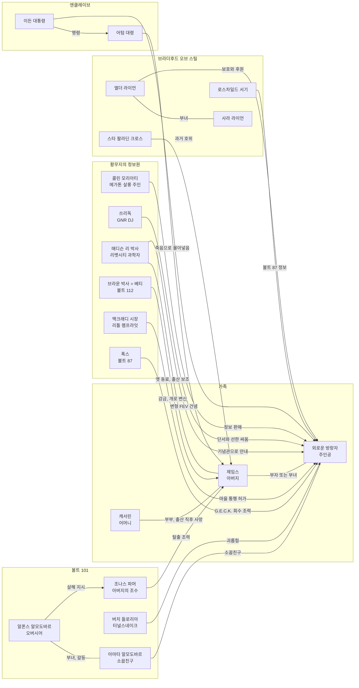
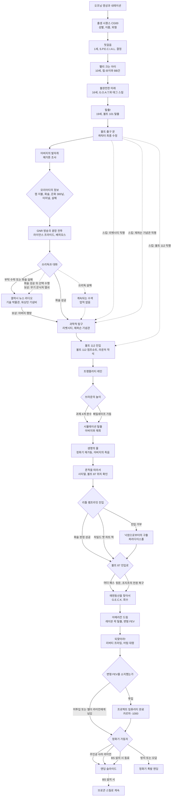
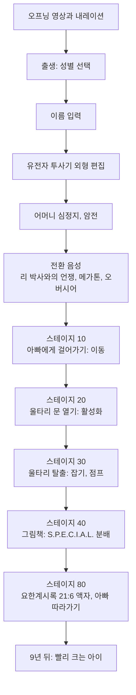
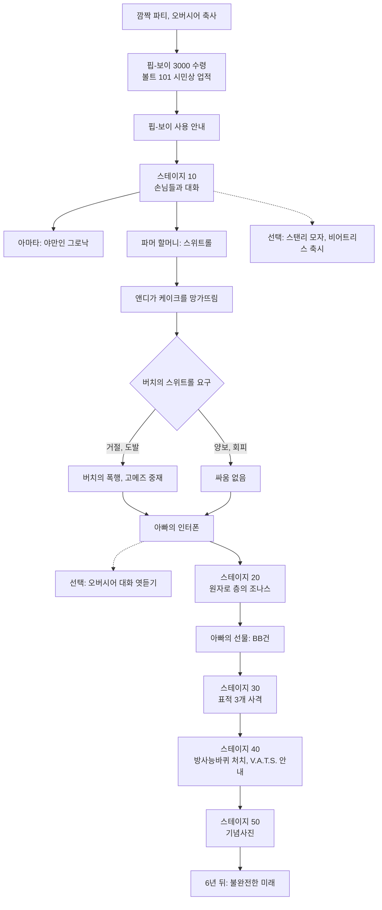
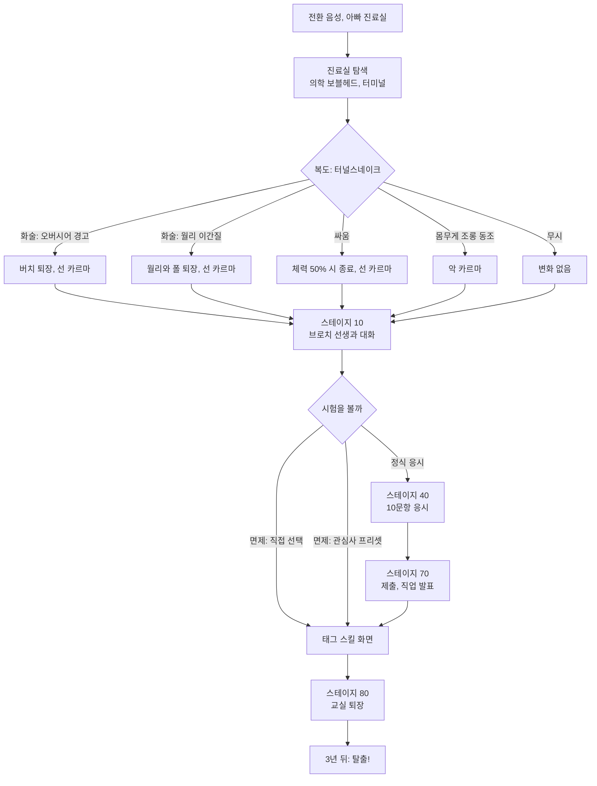
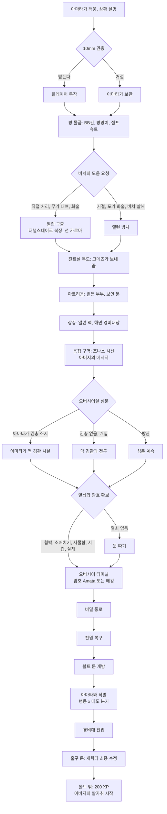
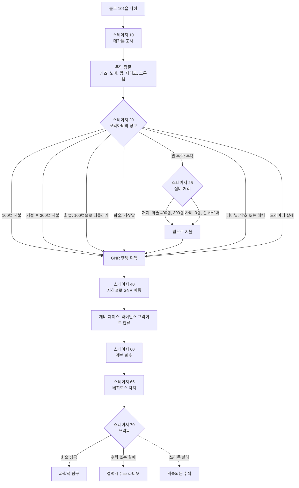

# RD-03. 메인 스토리 1부

> **폴아웃 3 역기획서 세트** | 문서 ID: RD-03 | 버전: v1.0 | 작성일: 2026-10-11
> **범위**: 메인 스토리 전체 시놉시스(결말 포함), 3막 구조와 주제·감정선, 주요 인물 관계도, 메인 퀘스트 전체 흐름도와 스킵 루트, 메인 퀘스트 요약표(15개) / 퀘스트 상세: 첫걸음, 빨리 크는 아이, 불완전한 미래, 탈출!, 아버지의 발자취, 갤럭시 뉴스 라디오, 과학적 탐구, 트랭퀼리티 레인. **다루지 않는 것**: 생명의 물 이후 메인 퀘스트 상세와 엔딩 시스템(RD-04), S.P.E.C.I.A.L.·스킬 공식(RD-14), 사이드 퀘스트 상세(RD-05·06), 비표시 퀘스트 상세(RD-07)
> **관련 문서**: [RD-02 세계관·설정·연표](02_world-and-lore.md), [RD-04 메인 스토리 2부·엔딩](04_main-story-part2-endings.md), [RD-05 사이드 퀘스트 1부](05_side-quests-part1.md), [RD-06 사이드 퀘스트 2부](06_side-quests-part2.md), [RD-07 비표시·반복 퀘스트와 랜덤 인카운터](07_misc-quests-encounters.md), [RD-10 주요 인물·동료](10_characters-major-companions.md), [RD-12 월드 구조·정착지·볼트](12_world-structure-settlements.md), [RD-14 캐릭터 시스템](14_character-system.md), [RD-17 탐험·상호작용](17_exploration-interaction.md), [RD-18 UI/UX](18_ui-ux.md), [RD-23 수집 요소·업적](23_collectibles-achievements.md), [RD-27 쯔꾸르 이식 시사점 종합](27_adaptation-notes.md)

---

## 목차

1. [문서 개요](#1-문서-개요)
2. [메인 스토리 총론](#2-메인-스토리-총론)
3. [퀘스트 상세](#3-퀘스트-상세)
4. [설계 분석](#4-설계-분석)
5. [쯔꾸르 이식 메모](#5-쯔꾸르-이식-메모)
6. [부록](#6-부록)

---

## 1. 문서 개요

### 1.1 목적

- 폴아웃 3(Fallout 3) 메인 스토리의 **전체 줄기**를 결말까지 정리하고, 그중 **1부(출생 ~ 볼트 112 탈출)** 에 속하는 퀘스트 8개를 핍-보이(Pip-Boy) 목표 단계 단위로 해부한다.
- 이 문서는 쯔꾸르(RPG Maker) 팬게임에서 프롤로그와 1부 메인 퀘스트를 **이벤트·변수 단위로 옮길 수 있는 근거 자료**가 되는 것을 목표로 한다. 그래서 진행 단계, 분기 조건, 스킬 수치, 보상, 카르마 증감을 원작 데이터(퀘스트 스테이지, 게임 스크립트, 대사 파일)와 맞춰 적는다.

### 1.2 범위

| 구분 | 내용 | 담당 |
|---|---|---|
| 총론 | 전체 시놉시스, 3막 구조, 주제·감정선, 인물 관계도, 메인 퀘스트 전체 흐름도, 스킵 루트, 요약표(15개) | **RD-03(본 문서)** |
| 상세 1부 | 첫걸음 / 빨리 크는 아이 / 불완전한 미래 / 탈출! / 아버지의 발자취 / 갤럭시 뉴스 라디오 / 과학적 탐구 / 트랭퀼리티 레인 | **RD-03(본 문서)** |
| 상세 2부 | 생명의 물 / 흔적을 따라서 / 낙원으로부터의 구출 / 에덴동산을 찾아서 / 아메리칸 드림 / 되찾아라! / 프로젝트 임퓨리티, 엔딩 시스템 | [RD-04](04_main-story-part2-endings.md) |
| 캐릭터 생성 공식 | S.P.E.C.I.A.L. 효과, 스킬 초기값 공식, 태그 보너스 규칙 | [RD-14](14_character-system.md) |
| 연관 퀘스트 | 원자의 힘(메가톤 폭탄), 고향의 위기(볼트 101 재방문), 은화 300닢·쓰리독의 무기 은닉처(비표시) | [RD-05](05_side-quests-part1.md) · [RD-06](06_side-quests-part2.md) · [RD-07](07_misc-quests-encounters.md) |

### 1.3 요약

- 주인공 외로운 방랑자(Lone Wanderer)는 볼트 101(Vault 101)에서 태어나 자랐다고 믿었지만, 19살이 되던 해 아버지 제임스(James)가 사라지면서 볼트를 탈출하고 아버지의 흔적을 좇는다.
- 1부는 **"아버지는 어디로, 왜 떠났는가"** 라는 질문 하나로 묶인 추적극이다. 메가톤(Megaton) → 갤럭시 뉴스 라디오(Galaxy News Radio) → 리벳시티(Rivet City) → 제퍼슨 기념관(Jefferson Memorial) → 볼트 112(Vault 112)로 이어지는 **단서 사슬**이 뼈대이며, 각 고리는 화술·카르마·탐험으로 건너뛸 수 있다.
- 2부는 재회한 아버지의 희생, 브라더후드 오브 스틸(Brotherhood of Steel, BoS)과 엔클레이브(Enclave)의 정면 대결, 정화기 가동이라는 결말로 이어진다.
- 메인 퀘스트는 튜토리얼 3개와 메인 12개, 모두 **15개**다. 퀘스트 완료 보상 XP는 탈출!의 200부터 되찾아라!의 1,200까지 100씩 늘어나며 합계는 7,700 XP다.

### 1.4 표기 메모

- **문체**: 서술은 `~한다/~이다` 체로 통일한다.
- **고유명사**: 리드의 표기 기준 변경(2026-10-11)에 따라 **폴아웃 3 한글 패치의 표기를 우선**하고(예: 수도 황무지, 리벳시티, 오버시어, 쓰리독, 정화 계획, 방사능바퀴, 핍-보이), 패치에 근거가 없는 것은 [RD-26 용어집](26_glossary.md)을 따른다. 문서 안에서 처음 나올 때만 `한국어(English)`로 병기하고, 데이터 표에는 영문 칼럼을 둔다. 용어집과 패치 모두에 없는 고유명사는 외래어 표기법에 맞춰 음차하고 최종 보고에 신규 용어로 제출한다.
- **퀘스트명과 장소명의 구분**: 퀘스트·아이템·퍽·스킬 이름은 패치 근거가 없어 용어집 표기를 유지한다. 그래서 같은 영어 단어라도 **퀘스트는 '트랭퀼리티 레인', 볼트 112의 시뮬레이션 마을(장소)은 패치 표기 '트랜퀼리티 레인'** 으로 구분해 쓴다. 퀘스트 '프로젝트 임퓨리티'와 '에덴동산을 찾아서', G.E.C.K.(에덴동산 창조 키트)도 용어집 표기를 유지한다. 다만 바뀐 고유명사를 품은 아이템 이름(터널스네이크 복장, 오버시어실 열쇠, 정화 계획 일지 등)은 새 표기에 맞춰 적는다.
- **퀘스트 ID**: 폼 ID는 8자리 16진수(예: `00014E86`)로 적는다. 에디터 ID(EDID)는 게임 내부 이름(예: `CG04`, `MQ01`)이다. 튜토리얼은 `CG`(Character Generation), 메인 퀘스트는 `MQ`를 접두로 쓴다.
- **진행 단계**: "스테이지 10"처럼 쓴 숫자는 위키에 정리된 핍-보이 목표(퀘스트 스테이지) 번호다. 게임 스크립트의 내부 스테이지 번호와 다를 수 있으며, 다를 때는 따로 밝힌다.
- **화술 판정**: 폴아웃 3의 화술 판정은 화술 스킬에 따라 성공 확률이 정해지는 확률형이다(공식은 [RD-17](17_exploration-interaction.md)). 코퍼스에서 판정 난이도 값이 확인되지 않은 경우 "화술 판정"으로만 적는다.
- **성별 분기**: 대사는 주인공 성별에 따라 son/daughter, honey/pal 등으로 바뀐다. 본문은 대표 한 가지만 인용한다.
- **인용**: 영어 원문은 1~2문장으로 줄이고 번역을 붙인다.
- **출처 표시**: 코퍼스에서 확인하지 못한 내용은 `(코퍼스 미확인)`으로 표시한다. 게임 스크립트(예: `CG03Script`)를 직접 근거로 삼은 내용은 스크립트 이름을 밝힌다.

---

## 2. 메인 스토리 총론

### 2.1 전체 시놉시스 (결말 포함, 스포일러 주의)

#### 2.1.0 연대표

| 시점 | 주인공 나이 | 사건 | 해당 퀘스트 |
|---|---|---|---|
| 2258년 이전 | - | 제임스와 캐서린(Catherine), 매디슨 리(Madison Li) 등이 제퍼슨 기념관에서 정화 계획(Project Purity)을 진행한다. BoS가 시설을 지킨다 | (전사) |
| 2258년 7월 13일 | 0세 | 제퍼슨 기념관에서 주인공이 태어나고 캐서린이 출산 직후 심정지로 숨진다. 제임스는 연구를 접고 스타 팔라딘 크로스(Star Paladin Cross)의 호위를 받아 메가톤을 거쳐 볼트 101로 들어간다 | 출생 시퀀스(CG00) |
| 2259년 | 1세 | 걸음마, '너는 스페셜해!(You're SPECIAL!)' 그림책 | 첫걸음 |
| 2268년 7월 13일 | 10세 | 생일 파티, 핍-보이 3000(Pip-Boy 3000)과 BB건(BB gun) 수령 | 빨리 크는 아이 |
| 2274년 8월 3일 | 16세 | G.O.A.T.(일반 직업 적성 검사) 응시 | 불완전한 미래 |
| 2277년 8월 17일 | 19세 | 제임스가 볼트를 떠나고, 주인공도 탈출한다 | 탈출! |
| 2277년 | 19세 이상 | 아버지 추적, 재회, 아버지의 죽음, 엔클레이브와의 전쟁, 정화기 가동 | 아버지의 발자취 ~ 되찾아라! |
| 정화기 가동 2주 뒤 [BS] | - | 주인공이 시타델(Citadel)에서 깨어나 엔클레이브 잔당을 소탕한다 | [RD-08c](08c_dlc-broken-steel.md) |

- 날짜 근거: 주인공 생일은 빨리 크는 아이의 핍-보이 날짜에서 10년을 뺀 값이다(Nukapedia: Lone Wanderer). 불완전한 미래와 탈출!의 날짜는 각 퀘스트 문서와 볼트 101 문서를 따른다.

#### 2.1.1 전사(前史): 생명의 물을 꿈꾼 과학자들

- 제임스와 캐서린은 동료 과학자 매디슨 리 등과 함께 제퍼슨 기념관에 거대한 정수 시설을 세워 타이달 베이슨(Tidal Basin)의 오염된 물을 한꺼번에 정화하려 했다. 이것이 정화 계획이다. 캐서린이 가장 사랑한 성경 구절인 **요한계시록 21장 6절(Revelation 21:6)** 의 "생명수 샘물(the fountain of the water of life)"이 이 계획의 정신적 표어다.
- 소규모 시험은 성공했지만 규모를 키우면 실패했고, 슈퍼 뮤턴트(Super mutant) 습격이 늘면서 BoS의 지원도 흔들렸다.
- 캐서린의 임신은 팀의 사기를 끌어올렸지만, 출산 직후 캐서린이 심정지로 숨지자 제임스는 아기를 지키기 위해 프로젝트를 버리고 떠난다. 리 박사는 이를 "버림받았다"고 기억한다. 엔딩 내레이션은 이 선택을 "인류의 미래를 단 하나뿐인 자식의 미래와 맞바꾼 희생"이라고 요약한다.
- 제임스는 볼트 101 오버시어(Overseer) 알폰스 알모도바르(Alphonse Almodovar)에게 의사로 일하겠다고 제안해 입주 허가를 받는다. 대신 아이에게는 "우리는 이 볼트에서 태어났다"고 거짓말을 한다. 그는 볼트 안에서도 밤마다 제한 구역을 뒤지다가 오버시어 터미널에서 G.E.C.K.(에덴동산 창조 키트)와 그 개발자 스타니슬라우스 브라운 박사(Stanislaus Braun)의 이름을 찾아낸다.

#### 2.1.2 1막: 볼트 101 — "아무도 들어오지 않고, 아무도 나가지 않는다"

- 오프닝 영상과 내레이션("War. War never changes.") 뒤에 주인공이 태어난다. 아버지가 성별과 이름을 묻고, 유전자 투사기(Gene projector) 화면으로 어른이 된 얼굴을 정한다. 곧 어머니가 숨을 거둔다.
- 1살에는 놀이 울타리를 빠져나와 그림책으로 능력치를 정하고, 아버지가 어머니의 성경 구절을 읽어 준다(첫걸음).
- 10살 생일에는 오버시어에게 핍-보이를 받고, 소꿉친구 아마타 알모도바르(Amata Almodovar)와 이웃들에게 선물을 받는다. 불량배 버치 들로리아(Butch DeLoria)와 스위트롤을 두고 다툰다. 아버지와 조나스 파머(Jonas Palmer)에게 BB건을 선물 받아 첫 방사능바퀴(Radroach)를 잡는다(빨리 크는 아이).
- 16살에는 터널스네이크(Tunnel Snakes)에게 괴롭힘당하는 아마타를 만나고, 에드윈 브로치(Edwin Brotch) 선생님의 G.O.A.T.를 치러 진로(태그 스킬)를 정한다(불완전한 미래).
- 19살의 어느 밤, 아마타가 주인공을 깨운다. 아버지가 볼트 문을 열고 사라졌고, 그를 도운 조나스는 경비대에게 맞아 죽었으며, 오버시어는 주인공을 공범으로 몰아 잡아들이려 한다. 방사능바퀴가 들끓는 볼트에서 주인공은 아마타가 알려 준 오버시어실 비밀 통로로 볼트 문을 열고, 아마타와 작별한 뒤 처음으로 바깥세상, 수도 황무지(Capital Wasteland)로 나간다(탈출!).

#### 2.1.3 2막: 아버지 추적 — 단서 사슬과 재회

- **메가톤**: 볼트 근처의 핵폭탄 마을 메가톤에서 주민들은 하나같이 술집 주인 콜린 모리아티(Colin Moriarty)를 가리킨다. 모리아티는 정보를 팔고, 주인공에게 "너는 볼트에서 태어나지 않았다"는 첫 진실을 들려준다. 아버지는 갤럭시 뉴스 라디오 방송국으로 갔다(아버지의 발자취).
- **GNR**: 워싱턴 D.C. 폐허를 지나 BoS의 정예 분대 라이언스 프라이드(Lyons' Pride)와 함께 GNR 방송국 광장(GNR building plaza)의 슈퍼 뮤턴트를 물리친다. DJ 쓰리독(Three Dog)은 정보를 주는 대가로 방송 중계 접시를 고쳐 달라고 한다. 주인공은 기술 박물관(Museum of Technology)의 달 착륙선에서 접시를 떼어 워싱턴 기념비(Washington Monument)에 설치한다. 화술로 이 부탁을 건너뛸 수도 있다(갤럭시 뉴스 라디오).
- **리벳시티와 제퍼슨 기념관**: 쓰리독이 알려 준 리벳시티에서 리 박사를 만난다. 리 박사는 어머니가 출산 중에 죽었다는 사실과 정화 계획의 과거를 들려주며, 아버지가 옛 연구소인 제퍼슨 기념관으로 갔다고 알려 준다. 기념관에 남은 홀로테이프에서 아버지가 브라운 박사의 연구를 찾아 볼트 112로 갔다는 사실을 알아낸다(과학적 탐구).
- **볼트 112**: 스미스 케이시 정비소(Smith Casey's garage) 지하의 볼트 112에서 가상현실 의자에 앉자, 흑백 1950년대 교외 마을 '트랜퀼리티 레인(Tranquility Lane)'이 펼쳐진다. 소녀 베티(Betty)로 변장한 브라운 박사는 주민들을 괴롭히는 "놀이"를 시킨다. 주인공은 그의 잔혹한 놀이를 끝까지 따르거나, 빈집에 숨겨진 비상 프로그램(페일세이프)을 가동해 주민들을 실제로 죽게 하고 브라운을 영원한 고독에 가둘 수 있다. 어느 쪽이든 마을의 개 '닥(Doc)'이 바로 아버지였음이 드러나고, 시뮬레이션에서 나온 아버지와 마침내 재회한다(트랭퀼리티 레인).

#### 2.1.4 2막 결말에서 3막으로 — 아버지의 희생, 엔클레이브와의 대결

- **생명의 물**: 제임스는 리 박사를 설득해 정화 계획을 재개한다. 주인공은 기념관의 슈퍼 뮤턴트를 쓸어내고 설비를 고친다. 그때 엔클레이브의 오거스터스 어텀 대령(Augustus Autumn)이 들이닥쳐 시설을 넘기라고 요구한다. 과학자 한 명이 처형되자 제임스는 제어실에 치사량의 방사선을 흘려보내 대령의 계획을 막고 숨을 거둔다. 그의 마지막 말은 자식에게 "달아나라"는 것이었다. 주인공은 리 박사 일행을 이끌고 태프트 터널(Taft Tunnel)을 지나 BoS 본거지 시타델로 피신한다.
- **흔적을 따라서 / 낙원으로부터의 구출**: 엘더 오윈 라이언(Owyn Lyons)의 보호 아래, 정화기를 완성할 열쇠인 G.E.C.K.가 볼트 87(Vault 87)에 있음을 알아낸다. 볼트 87의 정문은 방사능이 너무 강해, 아이들의 마을 리틀 램프라잇(Little Lamplight)을 거쳐야 한다. 맥크래디 시장(Mayor MacCready)의 허락은 화술, 차일드 앳 하트(Child at Heart) 퍽, 또는 노예 사냥꾼(Slavers)에게 잡혀간 아이들을 구하는 퀘스트로 얻는다.
- **에덴동산을 찾아서**: 볼트 87은 FEV(강제 진화 바이러스) 실험으로 슈퍼 뮤턴트를 만들어 온 곳이다. 지성을 가진 슈퍼 뮤턴트 폭스(Fawkes)의 도움을 받거나 방사선 방호복으로 직접 G.E.C.K.를 꺼내지만, 나오는 순간 엔클레이브의 매복에 사로잡힌다.
- **아메리칸 드림**: 엔클레이브의 요새 레이븐 락(Raven Rock)에서 어텀 대령에게 정화기 암호를 추궁당하던 주인공을 존 헨리 이든 대통령(John Henry Eden)이 불러낸다. 이든의 정체는 슈퍼컴퓨터였고, 그는 정화된 물에 넣어 돌연변이 생명체를 몰살할 변형 FEV 약병을 건넨다. 주인공은 이를 받아 들고 탈출하며, 화술·지능 판정이나 자폭 코드로 이든을 파괴할 수 있다.
- **되찾아라! / 프로젝트 임퓨리티**: 시타델로 돌아온 주인공은 BoS의 거대 로봇 리버티 프라임(Liberty Prime)을 앞세워 제퍼슨 기념관을 탈환한다. 어텀 대령을 설득하거나 쓰러뜨린 뒤, 과부하로 폭발 직전인 정화기를 가동하려면 누군가 방사능으로 가득한 제어실에 들어가 암호 **216**(요한계시록 21:6)을 입력해야 한다. 주인공이 직접 들어갈지, 사라 라이언(Sarah Lyons)을 들여보낼지 정해야 하고, 변형 FEV를 정화기에 넣을지도 정해야 한다(넣으면 프로젝트 임퓨리티 완료, 카르마 -1,000).

#### 2.1.5 결말

- 본편 엔딩은 론 펄먼(Ron Perlman)의 내레이션과 슬라이드로 진행된다. 구성 요소는 ① 공통 도입 ② 카르마와 일부 사이드 퀘스트 결과 ③ 제어실에서 누가 희생했는가 ④ 변형 FEV 투입 여부 ⑤ 공통 마무리다. 암호를 잘못 넣거나 아무도 들어가지 않으면 정화기가 폭발한다.
- 본편만 설치했다면 정화기 가동 장면에서 게임이 끝난다. 동료(폭스, RL-3 하사(Sergeant RL-3), 셰런(Charon))는 방사능 내성이 있어도 대신 들어가기를 거절한다.
- [BS] 브로큰 스틸(Broken Steel)을 설치하면 위 동료 3명이 대신 들어갈 수 있고, 주인공이 직접 들어가도 죽지 않고 2주 뒤 시타델에서 깨어나 이야기가 이어진다. 상세는 [RD-04](04_main-story-part2-endings.md)와 [RD-08c](08c_dlc-broken-steel.md)를 따른다.

### 2.2 3막 구조 분석

#### 2.2.1 막 구성표

| 막 | 구성 퀘스트 | 무대 | 극적 질문 | 주인공의 상태 | 막을 닫는 전환점 |
|---|---|---|---|---|---|
| 1막 프롤로그 | (출생) → 첫걸음 → 빨리 크는 아이 → 불완전한 미래 → 탈출! | 볼트 101(닫힌 실내) | 나는 누구인가, 이 볼트는 안전한가 | 보호받는 아이 → 쫓기는 도망자 | 볼트 문이 열리고 처음 햇빛을 본다 |
| 2막 아버지 추적 | 아버지의 발자취 → (갤럭시 뉴스 라디오) → 과학적 탐구 → 트랭퀼리티 레인 → 생명의 물 전반 | 수도 황무지 전역(열린 월드) | 아버지는 어디로, 왜 떠났나 | 아버지를 찾는 자식 | 재회한 아버지가 엔클레이브 앞에서 스스로 목숨을 끊는다 |
| 3막 엔클레이브와의 대결 | 생명의 물 후반 → 흔적을 따라서 → (낙원으로부터의 구출) → 에덴동산을 찾아서 → 아메리칸 드림 → 되찾아라! / 프로젝트 임퓨리티 | 시타델, 리틀 램프라잇, 볼트 87, 레이븐 락, 제퍼슨 기념관 | 아버지의 꿈(정화된 물)을 누가, 어떻게 완성하는가 | 아버지의 유업을 잇는 계승자 | 정화기 가동(희생 선택) |

- 괄호 안의 퀘스트는 메인 퀘스트로 분류되지만 건너뛸 수 있다.
- **생명의 물은 두 막을 잇는 경첩이다.** 전반은 재회한 부자(부녀)가 함께 일하는 2막의 보상이고, 후반의 엔클레이브 등장과 제임스의 죽음은 3막을 여는 사건이다.

#### 2.2.2 1막: 프롤로그(볼트 101)

- **구조**: 출생(0세) → 1세 → 10세 → 16세 → 19세로 이어지는 **시간 도약 몽타주**다. 각 시점이 하나의 튜토리얼 퀘스트이고, 퀘스트 사이에는 흰 화면 전환과 지난 시절의 목소리가 겹쳐 들리는 "전환 음성(transition audio)"이 깔린다.
- **기능**: 서사 기능(가족사·인간관계·볼트 체제 소개)과 시스템 기능(캐릭터 생성 → 기본 조작 → 핍-보이 → 사격·VATS → 대화·카르마 → 스킬 선택 → 전투·은신·해킹·자물쇠 따기)을 겹쳐 놓았다. 플레이어가 '튜토리얼'을 하는 동안 서사도 진행된다.
- **복선**: 첫걸음의 놀이방 모빌 음악은 트랜퀼리티 레인의 주제곡 일부다. 성경 구절 216은 최종 퀘스트의 정화기 암호가 된다. 오버시어 터미널의 브라운 박사 편지는 아버지가 찾은 단서와 같은 문서다. 첫 전환 음성에는 아버지와 리 박사의 언쟁("This is my child we're talking about, Madison!")이 숨어 있다.
- **촉발 사건**: 탈출! 시작 시점의 아버지 실종과 조나스의 죽음이다. "안전한 집"이 "적대적인 감옥"으로 뒤집히면서, 플레이어에게 볼트를 떠날 명분을 준다.
- **1막 종료**: 볼트 문을 나서는 순간 눈부신 빛과 함께 열린 월드가 펼쳐진다. 직전 문 앞에서 캐릭터를 마지막으로 다시 고칠 기회를 주고, 탈출! 진행 중에 쌓인 XP로 인한 레벨 업도 이 문에 도달할 때까지 미룬다. 1막의 모든 선택을 확정하는 '계약서 서명' 지점이다.

#### 2.2.3 2막: 아버지 추적

- **구조**: "누구에게 물으면 → 다음 장소를 알려 준다"는 **단서 사슬(clue chain)** 이다. 고리마다 정보 제공자가 대가를 요구한다(모리아티: 캡 / 쓰리독: 접시 수리 / 리 박사: 위험 경고 / 브라운: 잔혹 행위).

| 고리 | 정보 제공자 | 요구하는 대가 | 대가를 피하는 방법 | 다음 목적지 |
|---|---|---|---|---|
| 1 | 콜린 모리아티(메가톤) | 100캡, 거절하면 300캡 | 화술, 은화 300닢 해결, 터미널 해킹·암호, 살해 | GNR |
| 2 | 쓰리독(GNR) | 중계 접시 설치(갤럭시 뉴스 라디오) | 화술 판정 | 리벳시티 |
| 3 | 리 박사(리벳시티) | 없음(위험 경고만) | - | 제퍼슨 기념관 |
| 4 | 아버지의 홀로테이프(기념관) | 기념관의 슈퍼 뮤턴트 돌파 | - | 볼트 112 |
| 5 | 브라운 박사(볼트 112) | 잔혹한 놀이 4단계 | 페일세이프 가동 | 아버지와 재회 |

- **열린 사슬**: 고리를 차례대로 밟지 않아도 된다. 리벳시티, 제퍼슨 기념관, 볼트 112 중 어디든 먼저 도착하면 그 앞 고리가 자동으로 정리된다(2.5.2 스킵 루트 참조). 정보를 플레이어 스스로 얻으면 앞 단계를 넘기는 **"지식으로 길을 줄이는"** 구조다.
- **정보의 역할**: 각 고리는 아버지에 대한 정보를 하나씩 더한다. 모리아티는 출생의 거짓을, 쓰리독은 정화 계획이라는 이름을, 리 박사는 어머니의 죽음과 아버지가 포기한 꿈을, 홀로테이프는 아버지의 속마음과 G.E.C.K.를 알려 준다. 플레이어가 아버지를 다시 만났을 때는 이미 그를 '이해한' 상태가 된다.
- **중간점(재회)**: 트랜퀼리티 레인에서 플레이어가 줄곧 무시했을지 모를 개 한 마리가 아버지였다는 반전으로 2막 목표가 달성된다.
- **2막 종료**: 재회 직후의 짧은 협력(생명의 물 전반)이 끝나자마자 아버지가 죽는다. 2막 내내 쌓은 "찾고 싶은 사람"을 빼앗아 3막의 동력(복수와 계승)으로 바꾼다.

#### 2.2.4 3막: 엔클레이브와의 대결

- **구조**: 아버지가 남긴 과제(G.E.C.K. 확보 → 정화기 가동)를 완수하는 **목표 지향형 직선 구조**다. 무대는 시타델, 리틀 램프라잇, 볼트 87, 레이븐 락, 기념관으로 넘어가고, 레이븐 락 포로 장면에서 주인공이 잠시 행동의 자유를 잃는다.
- **대립 구도**: 2막의 적이 슈퍼 뮤턴트와 황무지 자체였다면, 3막의 적은 '미국 정부의 후계자'를 자처하는 엔클레이브다. 어텀 대령(현장의 실력자)과 이든 대통령(이념의 화신)이라는 이중 악역이 있고, 두 악역 사이의 균열(대령은 FEV 계획에 반대)을 주인공이 파고들 수 있다.
- **최종 선택**: 아버지가 그랬듯이 "누가 대가를 치르는가"를 묻는다. 자기 희생, 타인 희생, 변형 FEV 투입이라는 세 축이 엔딩 슬라이드와 카르마를 결정한다.

#### 2.2.5 구조상의 특징

- **부모 찾기형 메인 스토리**: 동기("가족을 찾는다")가 직관적이어서 열린 월드에서 길을 잃어도 메인 목표가 흐려지지 않는다. 동시에 "부모를 찾는 일은 급하지 않다"는 핑계로 사이드 탐험을 허용하는 구조이기도 하다.
- **반복되는 '닫힌 낙원' 모티프**: 볼트 101(가짜 안전), 트랜퀼리티 레인(가짜 행복), 레이븐 락(가짜 정부)이 차례로 나오며, 주인공은 매번 그 거짓을 깨고 나온다. 각 낙원에는 통제자(오버시어 / 브라운 / 이든)가 있다.
- **막마다 달라지는 주인공의 위치**: 1막에서는 보호받고, 2막에서는 찾아다니고, 3막에서는 잇는다. 아버지와의 거리도 '함께 산다 → 뒤를 쫓는다 → 대신한다'로 바뀐다.

### 2.3 핵심 주제와 감정선

#### 2.3.1 부자(부녀) 관계 — "지키려는 거짓"과 "따라가는 자식"

- **중심축**: 제임스는 자식을 지키려고 꿈을 버렸고(1막 이전), 자식에게 출생을 숨겼으며(1막), 자식을 두고 떠났다(탈출!). 남긴 메시지도 "따라오지 마라"였다.
  - "I can't tell you why I left or where I'm going. I don't want you to follow me." — 왜 떠나는지도, 어디로 가는지도 말할 수 없구나. 나를 따라오지 마라. (아버지의 메시지 홀로테이프)
- **자식의 반응을 플레이어가 고른다**: 재회 장면에서 주인공은 "당신을 찾으러 왔다", "왜 날 버렸냐", "거짓말을 해 왔냐", "같이 가지 않겠다" 등 여러 감정으로 응답할 수 있다. 제임스는 거짓말을 인정하고 사과하지만 프로젝트를 멈추지는 않는다.
  - "As much as I love you, this project has been my responsibility since long before you were even born." — 너를 사랑하지만, 이 일은 네가 태어나기 훨씬 전부터 내 책임이었단다. (제임스, 트랭퀼리티 레인 종료 후)
- **거울 관계**: 메인 스토리의 거의 모든 주요 인물이 부모-자식 쌍으로 짜여 있다.

| 쌍 | 관계 성격 | 주인공 부자(부녀)와의 대비 |
|---|---|---|
| 알폰스 ↔ 아마타 | 통제하는 아버지, 반항하는 딸. 오버시어는 딸을 경비대원에게 때리게 한다 | 제임스는 자식에게 자유(바깥)를 숨겼고, 오버시어는 볼트 전체에 그것을 숨겼다. 주인공은 오버시어를 죽여 아마타를 '아버지 잃은 자식'으로 만들 수도 있다 |
| 엘런 ↔ 버치 들로리아 | 술에 찌든 어머니, 겁먹은 아들 | 평생 주인공을 괴롭힌 버치가 어머니를 구해 달라고 애원한다. 부모를 잃을 위기 앞에서 가해자도 아이가 된다 |
| 엘더 라이언 ↔ 사라 라이언 | 존중과 신뢰의 부녀 | 3막에서 주인공을 받아들이는 '대리 아버지'와 그 딸이 최종 희생 후보가 된다 |
| 브라운(베티) | 아이의 탈을 쓴 창조주 | 시뮬레이션 주민의 생사를 쥐고, 아버지를 개로 만든다. 첫 과제가 "아이(티미)를 울려라", 둘째가 "부부를 갈라놓아라"인 점이 주인공이 겪은 상실(부모, 어머니와 아버지의 사랑)을 비튼 것으로 읽힌다(해석) |
| 이든 대통령 | 국가라는 거대한 '아버지'의 목소리 | 라디오로 친근한 할아버지처럼 말하지만 황무지 주민을 몰살하려 한다. 아버지가 남긴 '물'을 독으로 바꾸라고 권한다 |

- **결말의 수렴**: 엔딩 내레이션은 제임스를 "인류의 미래를 단 하나뿐인 자식의 미래와 맞바꾼 아버지"로 요약하고, 마지막 선택에서 주인공은 거꾸로 "자식(자신)의 미래를 인류의 미래와 맞바꿀지" 정한다. 아버지의 선택이 자식에게서 뒤집혀 완성되는 대칭 구조다.

#### 2.3.2 물 — 생명수와 독

| 등장 지점 | 물의 의미 |
|---|---|
| 첫걸음: 요한계시록 21:6 액자 | 어머니의 꿈. "목마른 자에게 생명수 샘물을 값없이 주리라(I will give unto him that is athirst of the fountain of the water of life freely)" |
| 아버지의 발자취 ~ 과학적 탐구 | 리 박사가 말하는 정화 계획의 목적: "Fresh, clean water for everyone."(모두에게 깨끗한 물을) |
| 트랭퀼리티 레인 | 시뮬레이션 안의 물은 방사능이 없고 마시면 현실의 체력도 회복된다. 황무지에서 유일하게 깨끗한 물이 가짜 세계에 있다는 아이러니 |
| 생명의 물 | 제임스가 기념관에서 성경 구절을 다시 읽으며 "이 정화기가 바로 생명의 물, 네 어머니의 꿈"이라고 말한다. 퀘스트 이름 자체가 구절에서 왔다 |
| 되찾아라! | 정화기 암호 216 = 21:6. 물을 여는 열쇠가 어머니의 구절이다 |
| 프로젝트 임퓨리티 | 같은 물이 변형 FEV로 '선별적 독'이 될 수 있다. 물을 쥔 자가 생사를 쥔다는 엔클레이브의 논리 |

- 물은 **생존 자원(라드·갈증)**, **권력(누가 정화기를 갖는가)**, **구원(종교적 생명수)** 이라는 세 층위로 쓰인다. 플레이어가 날마다 마시는 오염된 물(라드 증가)이 이 주제를 몸으로 느끼게 한다(방사능 규칙은 [RD-15](15_status-survival.md)).

#### 2.3.3 희생 — 누가, 누구를 위해 대가를 치르는가

| 희생자 | 무엇을 위해 | 퀘스트 |
|---|---|---|
| 캐서린 | 아이의 탄생(출산 중 사망) | 출생 시퀀스 |
| 제임스(1차) | 아이의 안전을 위해 프로젝트와 동료를 버림 | 전사 |
| 조나스 파머 | 제임스의 탈출을 돕다 경비대에게 맞아 죽음 | 탈출! |
| 아마타 | 주인공을 숨기려다 아버지의 명령으로 구타당함 | 탈출! |
| 제임스(2차) | 정화기를 엔클레이브에 넘기지 않으려고 자기 목숨을 끊음 | 생명의 물 |
| 주인공 또는 사라(또는 [BS] 동료) | 정화기 가동 | 되찾아라! |

- 반대편에는 **남을 희생시키는 자들**이 있다. 볼트를 위해 조나스를 죽인 오버시어, 재미를 위해 주민을 죽이는 브라운, 순수 인류를 위해 황무지를 몰살하려는 이든이다. 플레이어는 1부 내내 "남을 희생시키라"는 요구(모리아티의 실버 살해 의뢰, 브라운의 놀이)를 받고, 받아들일지 거부할지로 카르마가 갈린다.
- 이 대립은 마지막 선택(자기 희생 / 타인 희생)으로 수렴한다. 1부의 작은 선택(실버를 죽일까, 티미를 울릴까)이 최종 선택의 리허설 역할을 한다.

#### 2.3.4 보조 주제

- **거짓된 안전**: 볼트 101의 표어 "볼트에서 태어나 볼트에서 죽는다"(We're born in the Vault, we die in the Vault)와 오버시어 체제. 볼트 101 실험의 실체는 [RD-02](02_world-and-lore.md) 참조.
- **선택과 평판**: 카르마, 쓰리독의 방송 반응, 동료 영입 조건으로 플레이어의 선택이 세계에 메아리친다.
- **미국이라는 유령**: 엔클레이브와 이든, 트랜퀼리티 레인의 1950년대 교외, 워싱턴 D.C. 기념물이 '전쟁 전 미국'을 숭배하거나 비튼다.

#### 2.3.5 감정선 곡선

| 구간 | 사건 | 플레이어가 느끼도록 설계된 감정 |
|---|---|---|
| 출생 | 아버지의 첫마디, 어머니의 죽음 | 따뜻함 → 갑작스러운 상실 |
| 1~16세 | 생일, 선물, 첫 사냥, 시험 | 소속감, 성장, 가벼운 유머 |
| 탈출! | 아버지 실종, 조나스의 죽음, 아마타 구출, 작별 | 혼란, 분노, 우정, 해방감 |
| 볼트 밖 첫 장면 | 빛에 눈이 부신 뒤 황무지 전경 | 경외, 막막함 |
| 메가톤 ~ GNR | 출생의 거짓, 전투, 쓰리독의 '선한 싸움' | 배신감, 호기심, 영웅 서사의 시작 |
| 리벳시티 ~ 기념관 | 어머니의 죽음 경위, 아버지의 일지 | 그리움, 아버지에 대한 이해 |
| 트랭퀼리티 레인 | 브라운의 잔혹한 놀이, 개의 정체 | 불쾌감, 도덕적 갈등 → 안도 |
| 재회 | "You've saved me." | 보상감, 그러나 풀리지 않은 원망 |
| 생명의 물 | 함께 일하다가 아버지의 죽음 | 짧은 행복 → 최대의 상실 |
| 3막 | 시타델, 볼트 87, 레이븐 락 | 사명감, 위기, 반격 |
| 엔딩 | 216 입력, 희생 | 비장함, 완성 |

### 2.4 주요 인물 관계도

| 인물 | English | 역할 | 주인공과의 관계 | 1부 주요 등장 | 생사·분기 메모 |
|---|---|---|---|---|---|
| 제임스 | James | 과학자, 볼트 101 의사 | 아버지 | 출생 ~ 트랭퀼리티 레인 | 생명의 물에서 반드시 죽는다 |
| 캐서린 | Catherine | 과학자 | 어머니 | 출생 시퀀스(다리와 목소리만 등장), '좋았던 날들(Better Days)' 홀로테이프 | 출산 직후 사망 |
| 매디슨 리 | Madison Li | 정화 계획 과학자, 리벳시티 과학 연구소장 | 출산을 도운 부모의 옛 동료 | 출생 시퀀스, 과학적 탐구 | 메인 진행 중 필수 인물(상세 [RD-10](10_characters-major-companions.md)) |
| 아마타 알모도바르 | Amata Almodovar | 오버시어의 딸 | 소꿉친구 | 빨리 크는 아이 ~ 탈출! | 탈출! 중 죽일 수 없다. 이후 고향의 위기에서 재회 |
| 알폰스 알모도바르 | Alphonse Almodovar | 볼트 101 오버시어 | 적대적 권력자 | 빨리 크는 아이, 탈출! | 탈출!에서 죽일 수 있다. 죽으면 고향의 위기에서 앨런 맥(Allen Mack)이 오버시어가 된다 |
| 버치 들로리아 | Butch DeLoria | 터널스네이크 두목 | 괴롭히는 동갑내기 | 빨리 크는 아이 ~ 탈출! | 탈출!에서 어머니를 구해 주면 재킷을 준다. 이후 동료 후보([RD-10](10_characters-major-companions.md)) |
| 조나스 파머 | Jonas Palmer | 제임스의 조수 | 가족 같은 이웃 | 빨리 크는 아이 ~ 탈출! | 탈출! 시작 전에 이미 살해당함 |
| 콜린 모리아티 | Colin Moriarty | 메가톤 살롱 주인 | 정보 상인 | 아버지의 발자취 | 죽일 수 있다(악 카르마) |
| 쓰리독 | Three Dog | GNR DJ | 단서 제공자, 주인공의 행적을 방송 | 아버지의 발자취, 갤럭시 뉴스 라디오 | 죽이면 '계속되는 수색'으로 진행 |
| 스타니슬라우스 브라운 | Stanislaus Braun | 볼트-텍 과학자, G.E.C.K. 개발자 | 아버지를 가둔 자 | 트랭퀼리티 레인 | 시뮬레이션 안에서는 공격하면 주인공이 즉사한다. 현실의 몸은 콘솔 없이 죽일 수 없다 |
| 스타 팔라딘 크로스 | Star Paladin Cross | BoS 팔라딘 | 아기였던 주인공을 호위한 인물 | (전사), 3막 | 3막 동료 후보 |
| 오윈 라이언 | Owyn Lyons | BoS 수도 황무지 지부 엘더 | 3막의 후원자 | 3막 | [RD-04](04_main-story-part2-endings.md) |
| 사라 라이언 | Sarah Lyons | 라이언스 프라이드 지휘관 | GNR 전투의 동료, 최종 희생 후보 | 아버지의 발자취, 3막 | 최종 선택에서 희생될 수 있다 |
| 오거스터스 어텀 | Augustus Autumn | 엔클레이브 대령 | 아버지의 원수 | 3막 | 되찾아라!에서 설득하거나 죽일 수 있다 |
| 존 헨리 이든 | John Henry Eden | 엔클레이브 대통령(슈퍼컴퓨터) | 흑막 | 엔클레이브 라디오(1부부터 방송), 3막 | 아메리칸 드림에서 파괴할 수 있다 |
| 폭스 | Fawkes | 지성 있는 슈퍼 뮤턴트 | 조력자, 동료 후보 | 3막 | [RD-10](10_characters-major-companions.md) |

- 인물 프로필과 성우, 말투 등의 정본은 [RD-10](10_characters-major-companions.md), 볼트 101 주민 목록은 [RD-11](11_npc-directory.md)이다.

### 2.5 메인 퀘스트 전체 흐름도

#### 2.5.1 흐름도

- 실선은 기본 진행, 점선은 선택적 경로나 스킵 루트다. 2부 퀘스트(생명의 물 이후)는 흐름만 표시하며 상세는 [RD-04](04_main-story-part2-endings.md)가 담당한다.

#### 2.5.2 스킵·단축 루트 정리

| # | 루트 | 조건·방법 | 건너뛰는 내용 | 결과·부작용 |
|---|---|---|---|---|
| 1 | GNR 부탁 화술로 넘기기 | 쓰리독에게 "Look, Three Dog. If I find my Dad, maybe he can help with the Good Fight."(아버지를 찾으면 선한 싸움을 도울 것) 화술 판정 성공 | 갤럭시 뉴스 라디오 | 과학적 탐구가 바로 시작된다. 갤럭시 뉴스 라디오는 선택 퀘스트로 남고, 나중에 완료하면 보상이 정보 대신 **무기 은닉처 열쇠**와 선 카르마로 바뀐다 |
| 2 | 리벳시티 직행 | 쓰리독을 만나기 전에 리 박사와 아버지 이야기를 나눈다 | 모리아티 정보, GNR 전투(일부), 갤럭시 뉴스 라디오 | 라이언스 프라이드가 체비 체이스(Chevy Chase)에 나타나지 않고, 팻맨을 든 BoS 시신도 생기지 않는다. GNR 광장의 슈퍼 뮤턴트와 베히모스는 그대로 있어 혼자 상대해야 한다 |
| 3 | 제퍼슨 기념관 직행 | 기념관 원형 홀에서 정화 계획 일지를 먼저 줍는다 | 위와 같음(리 박사 대화도 생략 가능) | 위와 같음 |
| 4 | 볼트 112 직행 | 볼트를 나오자마자 스미스 케이시 정비소 지하의 볼트 112로 간다 | 아버지의 발자취, 갤럭시 뉴스 라디오, 과학적 탐구 전체 | 로보브레인과 대화하면 과학적 탐구가 자동 진행되어 트랭퀼리티 레인이 시작된다. 이 경우 과학적 탐구 업적은 그 회차에 얻을 수 없다. 플랫폼에 따라 이후 메인 업적이 누락되는 버그가 보고되어 있다 |
| 5 | 쓰리독 살해 | 행방을 듣기 전에 쓰리독을 죽인다 | 갤럭시 뉴스 라디오 | 퀘스트가 '계속되는 수색(The Search Continues)'으로 바뀌어 리 박사나 볼트 112로 이어진다. 아버지의 발자취 업적은 주지 않는다 |
| 6 | 리틀 램프라잇 진입 | 맥크래디 시장 화술 판정 또는 차일드 앳 하트 퍽 | 낙원으로부터의 구출 | 낙원으로부터의 구출은 이후에도 선택 퀘스트로 수행할 수 있다 |
| 7 | 볼트 87 진입로 선택 | 머더 패스(Murder Pass) 돌파 또는 뒷문(조지프(Joseph)가 전원을 복구한 터미널) | 슈퍼 뮤턴트 전투 구간 | 상세는 [RD-04](04_main-story-part2-endings.md) |
| 8 | G.O.A.T. 생략 | 브로치 선생에게 시험을 면제받는다 | 10문항 시험 | 태그 스킬은 직접 고르거나 관심사 프리셋으로 정한다. 'G.O.A.T. 조련사' 업적을 받지 못한다 |
| 9 | 메가톤 파괴 | 원자의 힘(The Power of the Atom)에서 메가톤을 폭파한다 | 모리아티 단계 | 아버지의 발자취 스테이지가 40 미만이면 '메가톤 조사', '모리아티와 대화' 목표가 완료 처리되고 '아버지 수색을 계속하라'가 표시된다(`MQ01Script`) |
| 10 | 시타델 버그 진입 (설계 외) | 지형 버그로 시타델에 들어가 A 링(A ring)의 볼트 위치 컴퓨터를 쓴다 | 흔적을 따라서 이전까지 | 허브 문서가 언급하는 버그 경로다. 다수의 오류를 일으키므로 설계 의도에 포함되지 않는다 |

- **설계 메모**: 1~4번은 모두 **"플레이어가 정보를 이미 알고 있으면 앞 단계를 요구하지 않는다"** 는 원칙을 따른다. 퀘스트 스테이지가 '정보 획득 이벤트'(리 박사 대화, 일지 습득, 볼트 112 진입)에 반응해 앞 스테이지를 일괄 정리하는 방식이다.

### 2.6 메인 퀘스트 요약표 (15개)

| # | 한국어명 | 영문명 | 유형 | 주요 장소 | 의뢰인 | 보상 XP | 기타 보상 | 퀘스트 ID | EDID | 업적·트로피 | 상세 |
|---|---|---|---|---|---|---|---|---|---|---|---|
| 1 | 첫걸음 | Baby Steps | 튜토리얼 | 볼트 101 | 아빠(제임스) | - | S.P.E.C.I.A.L. 분배 | 00014E83 | CG01 | 없음 | 3.1 |
| 2 | 빨리 크는 아이 | Growing Up Fast | 튜토리얼 | 볼트 101 | 아빠(허브 문서는 오버시어) | - | 핍-보이 3000, BB건과 BB탄 50발, 야만인 그로낙, 스위트롤, 아동용 야구 모자, 생일 축시 | 00014E84 | CG02 | 볼트 101 시민상(10G, 브론즈) | 3.2 |
| 3 | 불완전한 미래 | Future Imperfect | 튜토리얼 | 볼트 101 | 아빠 | - | 태그 스킬 3개 | 00014E85 | CG03 | G.O.A.T. 조련사(10G, 브론즈) | 3.3 |
| 4 | 탈출! | Escape! | 메인 | 볼트 101 | 아마타 | 200 | 볼트 밖 진출, 10mm 권총(선택), 터널스네이크 복장(조건부) | 00014E86 | CG04 | 탈출!(20G, 브론즈) | 3.4 |
| 5 | 아버지의 발자취 | Following in His Footsteps | 메인 | 메가톤, GNR 방송국 광장 | (탈출! 완료 시 자동) | 300 | 아버지 행방 단서, 최대 400캡(선택), 팻맨(선택) | 00014E87 | MQ01 | 20G, 브론즈 | 3.5 |
| 6 | 갤럭시 뉴스 라디오 | Galaxy News Radio | 메인(스킵 가능) | GNR 방송국 광장, 기술 박물관, 워싱턴 기념비 | 쓰리독 | 400 | 아버지 행방 **또는** 무기 은닉처 열쇠, GNR 전파 범위 확대, 카르마 +200 | 00022486 | MQ02 | 20G, 브론즈 | 3.6 |
| 7 | 과학적 탐구 | Scientific Pursuits | 메인 | 리벳시티, 제퍼슨 기념관, 볼트 112 | 쓰리독, 리 박사 | 500 | 아버지 행방, 스팀팩 5개(화술, 선택) | 00014E89 | MQ03 | 20G, 브론즈 | 3.7 |
| 8 | 트랭퀼리티 레인 | Tranquility Lane | 메인 | 볼트 112 | 볼트 112 로보브레인 | 600 | 아버지와 재회 | 00014E8A | MQ04 | 20G, 브론즈 | 3.8 |
| 9 | 생명의 물 | The Waters of Life | 메인 | 리벳시티, 제퍼슨 기념관, 시타델 | 아빠 | 700 | 시타델 출입, 파워 아머 훈련(선택), 크로스 동료 자격 | 00014E8B | MQ05 | 20G, 브론즈 | RD-04 |
| 10 | 흔적을 따라서 | Picking Up the Trail | 메인 | 시타델, 리틀 램프라잇 | 엘더 라이언 | 800 | 모든 볼트 위치(볼트 112 제외) | 00014E8C | MQ06 | 20G, 브론즈 | RD-04 |
| 11 | 낙원으로부터의 구출 | Rescue from Paradise | 메인(스킵 가능) | 리틀 램프라잇, 파라다이스폴(Paradise Falls) | 맥크래디 시장, 새미(Sammy) | 900 | 리틀 램프라잇 출입 | 00014E8D | MQ07 | 20G, 브론즈 | RD-04 |
| 12 | 에덴동산을 찾아서 | Finding the Garden of Eden | 메인 | 볼트 87, 레이븐 락 | 로스차일드 서기(Scribe Rothchild) | 1,000 | 레이븐 락 진입(포로) | 00014E8E | MQ08 | 20G, 브론즈 | RD-04 |
| 13 | 아메리칸 드림 | The American Dream | 메인 | 레이븐 락, 시타델 | 이든 대통령 | 1,100 | 파워 아머 세트 또는 정찰 아머 세트, 폭스 동료 자격 | 00014E8F | MQ09 | 20G, 브론즈 | RD-04 |
| 14 | 되찾아라! | Take It Back! | 메인(최종) | 시타델, 제퍼슨 기념관 | 엘더 라이언, 사라 라이언 | 1,200 | 엔딩([BS] 없으면), 어텀 대령의 레이저 권총·제복(선택) | 00014E91 | MQ11 | 40G, 실버 | RD-04 |
| 15 | 프로젝트 임퓨리티 | Project Impurity | 메인(악 분기) | 제퍼슨 기념관 | 이든 대통령 | - | 카르마 -1,000 | 00014E93 | MQA | 없음 | RD-04 |

- **XP 합계**: 탈출!부터 되찾아라!까지 11개를 모두 완료하면 7,700 XP다. 스킵 가능한 두 퀘스트(갤럭시 뉴스 라디오 400, 낙원으로부터의 구출 900)를 건너뛰면 6,400 XP다.
- **XP 곡선**: 200에서 시작해 퀘스트 순번마다 100씩 늘어나는 등차수열이다(탈출! 200 → 되찾아라! 1,200). 진행 순서가 곧 보상 크기다.
- **출처 차이**: 아버지의 발자취의 XP는 허브 문서(Fallout 3 quests) 기준 300이며, 퀘스트 문서 정보상자는 '가변(Variable)'으로 적었다. 빨리 크는 아이의 의뢰인은 퀘스트 문서가 '아빠', 허브 문서가 '오버시어'로 서로 다르다.
- **업적 규칙**: 핍-보이에 표시되는 본편 퀘스트를 완료하면 업적·트로피를 준다(허브 문서). 첫걸음과 프로젝트 임퓨리티는 업적이 없다. 업적 목록의 정본은 [RD-23](23_collectibles-achievements.md)이다.
- **ID 결번**: 메인 퀘스트 폼 ID는 00014E83부터 연속이지만 00014E88, 00014E90, 00014E92는 이 표에 없고, EDID에도 MQ10이 없다. 결번의 정체는 코퍼스에서 확인하지 못했다(코퍼스 미확인).

---

## 3. 퀘스트 상세

- 각 퀘스트는 공통 표준 양식(기본 정보 → 개요 → 진행 단계 → 분기와 해결 방법 → 결과와 후일담 → 흐름도 → 관련 NPC·아이템·대사 포인트 → 비고 → 설계 분석)을 따른다.
- 프롤로그 4개 퀘스트는 연출이 곧 시스템 학습이므로, 진행 단계를 **연출 순서대로** 적고 각 단계에서 가르치는 조작·시스템을 함께 표시한다. 능력치·스킬 공식은 [RD-14](14_character-system.md), 핍-보이 화면 구성은 [RD-18](18_ui-ux.md)을 따른다.
- 프롤로그에서 뜨는 안내 메시지(튜토리얼 팝업)는 `CGTutorial` 퀘스트와 `CGTutorialSCRIPT`가 관리한다. 조건을 만족할 때까지 일정 간격(스크립트상 20초)으로 같은 메시지를 다시 띄운다.

| 튜토리얼 메시지 | 표시 조건 | 해제 조건 |
|---|---|---|
| 핍-보이 사용법 | 빨리 크는 아이에서 핍-보이를 받은 뒤 | 핍-보이 화면을 연다 |
| 퀘스트 목표 표시 | 핍-보이 튜토리얼 뒤 | 자동 |
| 무기 발사 | 빨리 크는 아이에서 BB건을 받은 뒤 | 표적을 하나 맞힌다 |
| V.A.T.S. | 빨리 크는 아이 방사능바퀴 단계, 탈출! 중 전투 시 반복 | V.A.T.S. 화면을 연다 |
| 은신 | 탈출! 초반 | 웅크린다(은신 모드) |
| 치료 | 탈출! 시작 이후 체력 50% 미만 | 반복 표시(볼트를 나갈 때까지) |
| 부위 불구 | 처음으로 부위가 불구가 됐을 때 | 1회 + 반복 |
| 오버시어 터미널 잠김 | 탈출!에서 오버시어 터미널 해킹에 실패해 잠겼을 때 | 1회 |
| 중독, 빠른 이동, 수리, 방사능 | 처음 중독됐을 때, 지도 마커 4곳 발견, 내구도 25% 미만 무기 장비(볼트 밖), 라드 200 이상 | 각 1회 |

### 3.1 첫걸음 (Baby Steps)

#### 기본 정보

| 항목 | 내용 |
|---|---|
| 영문명 / 한국어명 | Baby Steps / 첫걸음 |
| 유형 | 튜토리얼(메인 퀘스트 분류) |
| 퀘스트 ID / EDID | 00014E83 / CG01 (출생 장면은 별도 퀘스트 CG00) |
| 의뢰인 | 아빠(제임스) |
| 시작 조건 | 새 게임 시작 → 오프닝 영상 → 출생 시퀀스(CG00) 종료 후 자동 시작 |
| 관련 장소 | 제퍼슨 기념관 분만실(출생 장면, 플레이 구역 밖에 따로 만든 공간), 볼트 101 주인공 집(침실·놀이방) |
| 선행 / 후행 | 없음 / 빨리 크는 아이 |
| 보상 | 이름·성별·외형 결정(출생), S.P.E.C.I.A.L. 분배(이 퀘스트), 10살로 시간 도약 |
| 카르마 영향 | 없음 |
| 업적·트로피 | 없음 |
| 시점 | 출생: 2258년 7월 13일 / 첫걸음: 2259년(1세) |

#### 개요

- 게임의 첫 장면이다. 주인공은 제퍼슨 기념관에서 태어나 아버지에게 성별과 이름을 받고, 유전자 투사기로 미래의 얼굴이 정해진다. 그 직후 어머니가 숨을 거둔다.
- 장면은 1년 뒤 볼트 101로 넘어간다. 걸음마를 배우는 아기가 놀이 울타리를 빠져나와 그림책 '너는 스페셜해!'로 일곱 가지 기본 능력치를 정한다. 아버지는 어머니가 가장 좋아한 성경 구절을 보여 준 뒤 아마타와 놀러 가자며 아기를 데리고 나간다.

#### 진행 단계

**0단계: 오프닝 영상과 내레이션 (퀘스트 시작 전)**

- 전쟁 전 라디오에서 잉크 스폿츠(The Ink Spots)의 'I Don't Want to Set the World on Fire'가 흐르고, 카메라가 뒤로 빠지며 폐버스 안의 볼트-텍(Vault-Tec) 포스터 → 폐허가 된 도시 → 파워 아머를 입은 BoS 팔라딘을 비춘다. 이 영상은 게임 엔진으로 만들었지만 실시간 재생은 아니다.
- 화면이 어두워지면 론 펄먼의 내레이션이 나온다. 대전쟁과 볼트의 역사를 요약하고 볼트 101로 끝맺는다.
  - "War. War never changes." — 전쟁. 전쟁은 결코 변하지 않는다.
  - "Because, in Vault 101: no one ever enters, and no one ever leaves." — 볼트 101에서는 아무도 들어오지 않고, 아무도 나가지 않기 때문이다.
- 이 마지막 문장은 1막의 표어이자, 탈출!에서 깨지는 규칙이다.

**출생 시퀀스 (CG00, 핍-보이 미표시)**

| 순서 | 연출 | 플레이어 입력 | 비고 |
|---|---|---|---|
| 1 | 흐릿한 1인칭 시야. 마스크를 쓴 아버지가 아기를 내려다본다 | 없음(시점만 회전) | 플레이어는 갓난아기다 |
| 2 | 아버지: "Let's see... Are you a boy or a girl?"(어디 보자, 아들이니 딸이니?) | **성별 선택** 메시지 상자(남/여) | `CG00SCRIPT`가 선택에 따라 성별을 바꾼다 |
| 3 | 아버지가 "We've got a son/daughter, Catherine!"을 외치고, 어머니가 "We did it..."이라고 답한다 | 없음 | 성별에 따라 대사가 갈린다 |
| 4 | 아버지: "You're going to need a name, aren't you? ... Your mother and I have been talking. What do you think about..." | **이름 입력** | 이름을 정하면 "That's a good name."(좋은 이름이구나) |
| 5 | 아버지: "Looks like they've finished the gene projection. Let's see what you'll look like when you're all grown up."(유전자 투사가 끝났구나. 네가 커서 어떤 모습일지 보자) | **유전자 투사기 외형 편집** | 아래 편집 항목 표 참조 |
| 6 | 아버지: "You're going to look a lot like your dad. See that, Catherine?"(아빠를 많이 닮겠구나. 보여, 캐서린?) | 없음 | 어머니가 웃으며 답한다 |
| 7 | 아버지: "It's a big world out there... What kind of person are you going to be?"(세상은 넓단다. 너는 어떤 사람이 될까?) | 없음 | 1인칭 성장 서사의 질문 |
| 8 | 심박 모니터 경보. "She's in cardiac arrest! Start compressions! Get the baby out of here!"(심정지야! 압박 시작해! 아기 데리고 나가!) | 없음 | 어머니의 마지막 말: "James? James... Something's..." |
| 9 | 암전. 겹쳐 들리는 과거의 목소리(전환 음성) | 없음 | 아래 전환 음성 표 참조 |

- 유전자 투사기(Gene projector) 편집 항목:

| 분류 | 선택지 | 수량 |
|---|---|---|
| 기본 | 성별, 이름, 인종 프리셋(아프리카계, 아시아계, 백인, 히스패닉), 나이(18~60), 눈 색(초록, 파랑, 담갈색, 짙은 갈색) | 인종 4, 눈 색 4 |
| 얼굴 슬라이더 | 얼굴(2), 이마(3), 눈썹(3), 눈(3), 코(7), 입(2), 뺨(3), 턱(4), 턱끝(4), 피부 톤(12) | 10그룹 43항목 |
| 머리 모양 | 공용 6, 남성 전용 12, 여성 전용 17 | 35 |
| 머리 색 | 이름 붙은 색 12 + RGB 슬라이더 | 12+α |
| 수염 | 남성 수염 | 18 |

- 이후 외형을 바꿀 기회는 볼트 출구 문(탈출! 마지막)에서 한 번 더 주어지고, 그 뒤에는 리벳시티 핑커톤(Pinkerton)의 성형 장비만 얼굴을 바꿀 수 있다. 머리 모양은 메가톤 집의 로봇 집사 등 이발 서비스로 바꿀 수 있다(상세 [RD-22](22_economy-housing.md)).

- 출생 → 첫걸음 전환 음성(겹쳐 들리는 대사, 시간 순서 불명):

| 화자 | 대사 요지 |
|---|---|
| 제임스 ↔ 리 박사 | "I'm sorry, Madison... But what choice do I have?" / "How can you be so selfish?" / "This is my child we're talking about, Madison!" — 프로젝트를 버리고 떠나는 순간의 언쟁 |
| 제임스 | "It's you and me, now, okay? You and me." — 이제 너와 나 둘뿐이야 |
| 콜린 모리아티 | 메가톤 살롱에서 제임스와 아기에게 건배하며 "bright, safe, and boring as hell"한 미래를 빈다 |
| 제임스 | "Shh... You're safe now. No more monsters." — 이제 괴물은 없단다 |
| 제임스 ↔ 오버시어 | 제임스가 의술을 내세우자 오버시어가 "We need a doctor, not a deadbeat."(필요한 건 의사지 식객이 아니다)라고 조건을 단다 |
| 제임스 | 새 방을 꾸미고 아기에게 이유식을 먹이는 일상 |

- 이 전환 음성은 볼트 입주의 내막(BoS 동행, 메가톤 경유, 오버시어와의 거래)을 압축한다. 처음 듣는 플레이어는 의미를 다 알기 어렵고, 2막에서 모리아티와 리 박사를 만난 뒤에야 맞춰지는 **회수형 복선**이다.

**스테이지 10: 아빠에게 걸어가라 (Walk to Dad.)**

- 흰 빛 속에서 1살이 된 주인공이 눈을 뜬다. 아버지: "Don't look straight into the light, honey."(불빛을 똑바로 보지 마라)
- 아버지가 "Walk to Daddy!"라며 부르면 플레이어는 처음으로 **시점 회전과 이동**을 배운다. 다가가면 "Just a year old, and already walking like a pro. Your mother would have been so proud."(한 살인데 벌써 잘 걷는구나. 엄마가 보셨으면 무척 자랑스러워했을 거야)
- 아기 상태에서는 아무것도 없는 곳을 바라보며 '활성화' 키를 누르면 옹알이를 한다. 3인칭 시점은 막혀 있다(아기 모델이 없고, 스크립트로 플레이어 크기를 줄여 아기 시점을 만든다).

**스테이지 20: 울타리 문을 열어라 (Open the playpen's gate.)**

- 아버지는 "사무실에 잠깐 다녀오마"라며 아기를 놀이 울타리에 넣고 나간다.
- 울타리 문을 '활성화'해 여는 것으로 **사물 상호작용**을 배운다.

**스테이지 30: 울타리에서 나가라 (Exit the playpen.)**

- 울타리 밖의 장난감 상자 주변에서 물건을 집어 들고 던지는 **잡기(Grab)** 를 배운다. 물건을 들면 목표 완료 안내가 뜬다.
- 의자 근처로 가면 **점프** 안내가 뜬다.

**스테이지 40: '너는 스페셜해!' 그림책을 보라 (Look at the "You're SPECIAL!" book.)**

- 장난감 상자 앞의 그림책을 활성화하면 S.P.E.C.I.A.L. 화면이 열린다(`CG01SpecialBookSCRIPT`, 집어 들 수는 없다).
- 그림책은 힘(Strength)부터 행운(Luck)까지 한 쪽에 한 능력치씩 동요 같은 문구로 설명하고, 마지막 쪽에서 일곱 능력치를 한꺼번에 조정한다.

| 규칙 | 값 |
|---|---|
| 능력치 기본값 | 각 5 |
| 추가 분배 포인트 | 5 (총합 40) |
| 능력치 하한 / 상한 | 1 / 10 |
| 실제 재량 분배량 | 33 (40 - 하한 7) |
| 재수정 기회 | 볼트 출구 문(탈출! 마지막) |

- 능력치가 스킬 초기값, 파생 능력치, 퍽 조건에 미치는 영향은 [RD-14](14_character-system.md)를 따른다.
- 능력치에 따라 이후 NPC의 호칭이 달라진다. 예를 들어 지능이 높으면 버치가 주인공을 "nosebleed"(공부벌레)라고 부른다.

**스테이지 80: 아빠를 따라가라 (Follow Dad.) — 퀘스트 완료**

- 아버지가 돌아와 탈출한 아기를 보고 웃는다. "You're quite the little explorer, aren't you?"(꼬마 탐험가로구나) 아기를 다시 울타리에 넣고 문을 닫아도 탈출한 사실을 안다.
- 아버지가 벽에 걸린 액자를 보여 준다. "See that? It was your mother's favorite passage. It's from the Bible. Revelation 21:6."(엄마가 가장 좋아한 구절이란다. 요한계시록 21장 6절) 이어서 구절 전문을 읽는다.
- "All right. Come on. Let's go see if your little friend Amata wants to play...."(자, 아마타가 놀고 싶어 하는지 가 보자) 아버지를 따라 복도로 나가면(`CG01EndQuestTriggerSCRIPT`) 흰 화면과 함께 9년을 건너뛰어 10살 생일 파티(빨리 크는 아이)가 시작된다.

#### 분기와 해결 방법

- 선택 분기는 없다. 성별·이름·외형·능력치 입력만 있고, 이는 볼트 출구에서 모두 다시 바꿀 수 있다.
- 아기 상태로 아버지를 방해하거나 문을 닫아 시간 도약을 피하면 아기 모습으로 볼트 밖까지 나갈 수 있는 버그가 보고되어 있다. 설계 의도 밖의 결함이며, 시간 도약 트리거를 복도 출입에만 걸어 둔 구조적 허점을 보여 준다.

#### 결과와 후일담

- 이름, 성별, 외형, S.P.E.C.I.A.L.이 확정된다(볼트 출구에서 재수정 가능).
- 요한계시록 21:6은 이후 기념관 장면(생명의 물)과 정화기 암호 216(되찾아라!)으로 회수된다.
- 아기 방 모빌에서 나오는 음악은 트랜퀼리티 레인의 주제곡 일부이며, 트랜퀼리티 레인 페일세이프의 음계 퍼즐도 같은 선율이다.

#### 흐름도

#### 관련 NPC·아이템·대사 포인트

| 구분 | 이름 | English | 비고 |
|---|---|---|---|
| NPC | 제임스 | James | 출생 장면에서는 수술용 마스크 차림 |
| NPC | 캐서린 | Catherine | 다리와 목소리만 등장, 출산용 치마 착용 |
| NPC | 매디슨 리 | Madison Li | 출생을 돕는 과학자(대사 일부가 리 박사에게 넘어감) |
| 아이템 | 너는 스페셜해! | You're SPECIAL! | 상호작용 전용 그림책, 무게 0·가치 0 |
| 오브젝트 | 유전자 투사기 | Gene projector | 외형 편집 UI의 세계관 내 장치. 제퍼슨 기념관 지하 의무실에 실물이 남아 있다 |
| 오브젝트 | 요한계시록 21:6 액자 | Revelation 21:6 | 볼트 101 집 벽. 진료실 안 아버지 사무실에도 같은 구절 액자가 걸려 금고(평균 난이도 자물쇠, 록잇 런처 설계도와 300캡)를 가린다 |

- 대사 포인트
  - 제임스: "You've got a bright future ahead of you, son. I'm sure of it..." — 네 앞엔 밝은 미래가 있단다. 분명히. (자신에게 하는 다짐)
  - 제임스: "I will give unto him that is athirst of the fountain of the water of life freely." — 목마른 자에게 생명수 샘물을 값없이 주리라. (요한계시록 21:6 후반부)

#### 비고

- 출생 장면이 벌어지는 제퍼슨 기념관 분만실은 볼트 101 지도 밖에 따로 놓인 공간이다. 실제 제퍼슨 기념관을 탐험하면 같은 분만 장소를 찾을 수 있다.
- 아기 목소리는 토드 하워드(Todd Howard)의 아들이 첫 돌에 녹음했다(Nukapedia: Lone Wanderer).

#### 설계 분석

- **세계관 안의 캐릭터 생성**: 성별은 "아들이니 딸이니", 이름은 "이름을 지어야지", 외형은 "유전자 투사" 화면으로 묻는다. 메뉴를 열지 않고 **부모의 대사로 생성 단계를 진행**해, 캐릭터 생성이 곧 가족 서사의 첫 장면이 된다.
- **능력치를 그림책으로**: 볼트-텍 아동용 그림책이라는 소품으로 S.P.E.C.I.A.L.을 설명한다. 어린이 눈높이 문구가 시스템 설명과 볼트-텍의 기업 선전 톤을 동시에 전달한다.
- **상실을 먼저 겪게 한다**: 플레이어가 조작을 배우기도 전에 어머니가 죽는다. 이후 모든 '어머니'(구절, 꿈, 일지)는 플레이어에게 직접 기억이 없는 대상으로 남고, 아버지가 그 기억의 유일한 전달자가 된다.
- **최소 단계 튜토리얼**: 이동 → 활성화 → 잡기 → 점프 → 능력치 순으로 한 단계에 하나만 가르친다. 아기라는 설정이 '할 수 있는 일이 적은 이유'를 자연스럽게 설명한다.

### 3.2 빨리 크는 아이 (Growing Up Fast)

#### 기본 정보

| 항목 | 내용 |
|---|---|
| 영문명 / 한국어명 | Growing Up Fast / 빨리 크는 아이 |
| 유형 | 튜토리얼(메인 퀘스트 분류) |
| 퀘스트 ID / EDID | 00014E84 / CG02 |
| 의뢰인 | 아빠(퀘스트 문서 기준. 허브 문서는 오버시어로 표기) |
| 시작 조건 | 첫걸음 완료 직후 자동 시작(10살 생일 파티) |
| 관련 장소 | 볼트 101 식당(파티장), 원자로 층(발전기·창고 = 사격장) |
| 선행 / 후행 | 첫걸음 / 불완전한 미래 |
| 보상 | 핍-보이 3000(오버시어), BB건과 BB탄 50발(아빠·조나스), 야만인 그로낙(Grognak the Barbarian) 14호(아마타), 스위트롤(Sweetroll, 파머 할머니), 아동용 야구 모자(Kid's baseball cap, 스탠리, 선택), 생일 축시(A birthday poem, 비어트리스, 선택) |
| 카르마 영향 | 없음 |
| 업적·트로피 | 볼트 101 시민상(Vault 101 Citizenship Award): 핍-보이 수령 시, 10G / 브론즈. 게임에서 반드시 처음 얻는 업적 |
| 시점 | 2268년 7월 13일(10세) |

#### 개요

- 아마타와 아버지가 준비한 10살 생일 파티에서 주인공은 오버시어에게 핍-보이를 받아 볼트의 정식 구성원이 된다. 이웃들에게 선물을 받고, 버치와 처음으로 맞선다.
- 아버지와 조나스는 원자로 층에 비밀 사격장을 마련하고 수리한 BB건을 선물한다. 주인공은 표적 셋과 방사능바퀴 한 마리를 쏘고, 아버지와 기념사진을 찍는다.

#### 진행 단계

**도입: 전환 음성과 깜짝 파티 (스테이지 시작 전)**

- 1살에서 10살로 넘어가는 흰 화면 위로 지난 9년의 목소리가 겹친다. 오버시어와 아버지의 언쟁("These 'experiments' are a waste of time!" — 그 '실험'들은 시간 낭비요! / "We experiment to prepare. We prepare to survive." — 대비하려고 실험하고, 살아남으려고 대비하는 겁니다), 어린 버치의 조롱("teacher's pet"), 엄마가 보고 싶냐는 아이의 물음에 대한 아버지의 대답("I miss her... so much. Each day more than the last." — 보고 싶지. 날마다 더)이 들린다. 아버지가 볼트 안에서도 몰래 연구를 이어 갔음을 암시한다.
- 어두운 식당에 불이 켜지며 하객들이 "Surprise!", "Happy birthday!"를 외친다. 고메즈 경관(Officer Gomez)은 불을 너무 일찍 켠 스탠리에게 핀잔을 준다. 파머 할머니(Old Lady Palmer)가 "Can you believe it? He is growing up so fast."(이 아이가 이렇게 빨리 크다니)라고 말한다. 퀘스트 제목이 이 대사에서 왔다.
- 오버시어가 축사를 하고 핍-보이를 준다.
  - "As Overseer, I hereby present to you your very own Pip-Boy 3000! Get used to it." — 오버시어로서 너만의 핍-보이 3000을 수여한다. 익숙해지도록.
  - "You'll be getting your first work assignment tomorrow." — 내일 첫 작업 배정을 받게 될 거다. (농담처럼 웃으며)
- 핍-보이 수령과 동시에 **볼트 101 시민상** 업적이 열리고, 핍-보이 사용법 안내 메시지가 뜬다. 플레이어가 핍-보이 화면을 열 때까지 같은 안내가 반복되고, 이어서 퀘스트 목표 표시 안내가 나온다.

**스테이지 10: 파티를 즐기고 손님들과 이야기하라 (Enjoy the party and speak with the guests.)**

| 손님 | English | 필수 여부 | 선물·결과 | 대화 메모 |
|---|---|---|---|---|
| 아마타 | Amata | 필수 | 야만인 그로낙 14호 | 선물을 맞혀 보라고 조른다. "모르겠어"나 "빨리 줘"를 고르면 오버시어의 옛 짐에서 찾은 만화책을 준다. "크리스틴 켄들(Christine Kendall) / 프레디 고메즈(Freddie Gomez)와의 데이트?"라고 농담하면 놀림만 받고, 만화책은 탈출! 때 방 서랍에 들어 있다 |
| 파머 할머니(루시 파머) | Old Lady Palmer (Lucy Palmer) | 필수 | 스위트롤 | 공손/보통/무례 3가지 태도로 답할 수 있다. "your daddy came..."(네 아빠가 왔던 게 엊그제 같은데)라며 아버지가 외부에서 왔음을 흘린다 |
| 스탠리 암스트롱 | Stanley Armstrong | 선택 | 아동용 야구 모자 | 핍-보이를 손본 기술자. 이 기종이 오래됐지만 튼튼한 3000a 모델이라고 자랑한다 |
| 비어트리스 암스트롱 | Beatrice Armstrong | 선택 | 생일 축시(핍-보이 노트) | 원자로 층으로 가는 길에 말을 건다. 문 왼쪽으로 멀리 돌아가면 피할 수 있다 |
| 버치 들로리아, 월리 맥, 폴 해넌 주니어 | Butch DeLoria, Wally Mack, Paul Hannon Jr. | - | - | 셋이 패거리 이름을 짓느라 다툰다("Tunnel Rats", "Vault Snakes" 등). 버치는 "볼트 거주자(Vault Dweller)라고 불리고 싶은 놈이 어딨냐"며 이름 후보 하나를 깎아내린다 |

- 파머 할머니와 대화한 뒤 미스터 핸디 앤디(Andy)가 케이크를 자르려다 망가뜨린다. 배고픈 버치가 다가와 스위트롤을 내놓으라고 요구한다.

| 선택지(요지) | 버치의 반응 | 결과 |
|---|---|---|
| "파머 아줌마가 나눠 먹지 않아도 된다고 했어" | 비아냥 후 위협 | 대개 싸움으로 번진다 |
| "반씩 나눠 먹자" | "다섯 살이냐?" 위협 | 대개 싸움 |
| "가져. 난 스위트롤 안 좋아해" | 받아 가며 조롱 | 버치가 스위트롤을 가진다 |
| 스위트롤에 침을 뱉어 건넨다 | 기겁하며 나중에 두고 보자고 한다 | 싸움 예고 |
| "꺼져, 안 줘" | 주먹 쥐고 다가온다 | 싸움 |
| "네 엄마가 배급표를 또 술로 바꿨냐?" | 격분 | 싸움 |
| "버렸어. 바닥에서 주워 먹든가" | "이 루저는 상대할 가치도 없다"며 물러난다 | 싸움 없음 |
| "아까 먹었는데 맛있더라" (이미 먹은 경우) | 분해하며 물러난다 | 싸움 없음 |

- 싸움이 나면 버치가 일방적으로 때리고 플레이어는 맞서 싸울 수 없다. 고메즈 경관이 말리며 경위를 묻는다. 버치를 고자질할 수도 있다.
- 스위트롤을 바닥에 떨어뜨리면 버치는 자리로 돌아가고, 떨어진 스위트롤은 다시 주울 수 있다.
- 싸움 뒤 아마타와 아빠가 무슨 일이었냐고 묻는다. 아빠에게 "제가 먼저 시비 걸었어요"라고 답하면 괴롭힘에 맞서되 싸움을 찾아다니지는 말라는 짧은 훈계를 듣는다.
- 이 장면의 결과는 불완전한 미래에서 버치의 첫인사를 바꾼다(3.3 참조).
- 아빠가 인터폰으로 조나스와 통화한 뒤 원자로 층으로 내려가라고 한다.
- **엿듣기(선택)**: 원자로 층으로 내려가지 않고 계단을 올라가면 오버시어가 켄들 경관(Officer Kendall)에게 "Bah, I only showed up because Amata's friends with the brat."(쳇, 아마타가 그 녀석과 친하니까 온 것뿐이야)라고 말하는 장면을 볼 수 있다. 켄들 경관에게서 스팀팩 2개를 소매치기해도 카르마가 줄지 않는다.

**스테이지 20: 원자로 층에서 조나스를 만나라 (Meet Jonas on the Reactor Level.)**

- 아빠가 연 문으로 나가 오른쪽, '원자로' 표지판에서 왼쪽, 복도 끝에서 오른쪽, 계단을 내려간다. 조나스와 이야기하면 계단을 내려오는 아빠에게 가 보라고 한다.
- 아빠의 선물 설명:
  - "Your own BB gun! It's a little old, but it should work perfectly." — 네 BB건이다! 좀 낡았지만 잘 작동할 거야.
  - 조나스가 고물로 찾아낸 총을 석 달 동안 고쳤고, 작은 스프링은 버치가 '잃어버린' 잭나이프에서 가져왔다는 농담이 붙는다.
- 반응 선택지: 기뻐하기 / 고맙다고 하기 / "산탄총이었으면 좋았을 텐데" / "BB건 따위 원하지 않았어". 불평해도 아빠가 서운해할 뿐 BB건은 그대로 주어지고 버릴 수 없다.

**스테이지 30: BB건으로 표적 셋을 모두 쏘아라 (Shoot all three targets with the BB Gun.)**

- 무기 발사 안내가 뜨고, 첫 표적을 맞힐 때까지 반복된다. 아빠는 웅크리면 조준이 안정된다고 조언한다.
- BB탄이 떨어지면 아빠에게 말해 25발을 더 받을 수 있다. 탄을 버리고 다시 달라고 하면 이론상 무한히 받을 수 있지만, 탈출! 시작 때 책상 위에는 50발만 놓여 있다.

**스테이지 40: BB건으로 방사능바퀴를 죽여라 (Use the BB Gun to kill the radroach.)**

- 표적 셋을 맞히면 방사능바퀴 한 마리가 기어 나온다. 아빠: "Careful! It's a Radroach. Think you can take care of that with your BB gun?"(조심해! 방사능바퀴야. 그 총으로 처리할 수 있겠니?)
- V.A.T.S. 안내 메시지가 이 단계부터 뜬다.
- 대화 선택지: "방사능바퀴가 뭐예요?" / "어떻게 죽여요?"(머리를 노리라는 조언) / "할 수 있어요!" / "못 하겠어요!" — 마지막 두 선택지 모두 "I'm not always going to be here to take care of you."(아빠가 언제까지나 곁에서 돌봐 줄 수는 없단다)로 이어진다. 탈출!의 상황을 미리 말해 두는 대사다.
- 사격장 위층 문은 '매우 어려움' 자물쇠로 잠겨 있고 BB건은 버릴 수 없어, 방사능바퀴를 죽이지 않고는 진행할 수 없다.

**스테이지 50: 조나스가 사진을 찍을 수 있게 아빠 옆에 서라 (Stand next to Dad so Jonas can take the picture.) — 퀘스트 완료**

- 아빠: "Hey, Jonas, get a picture of me with the big game hunter!"(조나스, 대단한 사냥꾼이랑 사진 한 장 찍어 줘!)
- 아빠 옆에 서면 사진을 찍고 화면이 하얗게 바뀌며 "6년 뒤(Six Years Later)"로 넘어간다.

#### 분기와 해결 방법

| 분기 | 선택지 | 영향 |
|---|---|---|
| 아마타 선물 | 정답 맞히기·재촉 / 데이트 농담 | 만화책을 지금 받거나, 탈출! 때 방 서랍에서 찾는다 |
| 파머 할머니 | 공손 / 보통 / 무례 | 대사만 달라진다(`PalmerResponse` 변수) |
| 버치와 스위트롤 | 8가지(위 표) | 싸움 여부, 버치의 기분. 불완전한 미래의 버치 첫인사가 바뀐다 |
| 고메즈에게 고자질 | 한다 / 안 한다 | 버치의 이후 인사("So you're a tattletale, too.") |
| 엿듣기 | 오버시어 대화 엿듣기, 켄들 소매치기 | 스팀팩 2개(퀘스트 종료 시 소지품 정리 여부는 코퍼스 미확인) |
| BB건 반응 | 기쁨 / 감사 / 불평 2종 | 아빠의 반응 대사만 달라진다 |

- 고메즈 경관을 죽여 볼트 101 경비대 아머를 입을 수도 있지만, 퀘스트가 끝나면 소지품에서 사라진다.
- BB건으로 조나스를 기절시켜도 사진 촬영은 진행된다.

#### 결과와 후일담

- 핍-보이가 생겨 지도, 퀘스트 목록, 인벤토리를 쓸 수 있다. 이후 모든 시스템 안내가 핍-보이를 전제로 한다.
- 야만인 그로낙은 근접 무기 스킬북이다(스킬북 규칙은 [RD-14](14_character-system.md)). 아마타의 선물을 읽지 않았다면 탈출! 때 방 서랍에 그대로 있다.
- 버치와의 관계가 정해지고, 버치·월리·폴의 패거리는 이후 '터널스네이크'라는 이름을 갖는다.

#### 흐름도

#### 관련 NPC·아이템·대사 포인트

| 구분 | 이름 | English | 비고 |
|---|---|---|---|
| NPC | 알폰스 알모도바르 | Alphonse Almodovar | 핍-보이 수여. 이 퀘스트에서는 필수(essential) 인물 |
| NPC | 조나스 파머 | Jonas Palmer | BB건 공동 선물자, 사진 촬영 |
| NPC | 허먼 고메즈 | Herman Gomez | 싸움 중재자. 탈출!에서 주인공을 놓아주는 경관 |
| NPC | 존 켄들 | John Kendall | 오버시어와 함께 엿듣기 장면에 등장 |
| NPC | 앤디 | Andy | 케이크를 망치는 미스터 핸디 |
| 아이템 | 핍-보이 3000 | Pip-Boy 3000 | 스탠리의 설명으로는 3000a 구형 모델 |
| 아이템 | BB건 / BB탄 | BB gun / BB | 첫 무기 |
| 아이템 | 야만인 그로낙 | Grognak the Barbarian | 근접 무기 스킬북 |

- 대사 포인트
  - 아빠: "Enjoy your party! You're only 10 once, so have fun!" — 파티 즐기렴! 열 살은 한 번뿐이니까.
  - 아빠: "Your own BB gun! It's a little old, but it should work perfectly." — 네 BB건이다! 좀 낡았지만 잘 작동할 거야.
  - 버치: "Give me that sweetroll you got from Old Lady Palmer." — 파머 할멈한테 받은 스위트롤 내놔.

#### 비고

- 스위트롤을 빼앗으려는 불량배 장면은 베데스다의 '엘더스크롤' 시리즈 성격 테스트 문항(빵집에서 받은 스위트롤을 빼앗기는 상황)을 오마주한 것이다.
- 원래 스티비 맥(Stevie Mack), 수지 맥(Susie Mack), 크리스틴 켄들도 파티에 올 예정이었으나 삭제됐다(퀘스트 문서의 삭제 콘텐츠 주석). 작은 식당에 NPC가 너무 많아지는 문제로 추정된다.
- 스위트롤 장면의 원형인 엘더스크롤(The Elder Scrolls) 질문은 '빵집 주인이 준 스위트롤을 골목에서 세 아이에게 빼앗길 상황'을 묻는다.

#### 설계 분석

- **사교 튜토리얼**: 핍-보이 사용법을 가르친 직후 '손님과 대화하라'는 목표를 줘 대화 시스템을 익히게 한다. 선물마다 다른 NPC를 찾아가게 해 볼트 주민을 자연스럽게 소개한다.
- **첫 갈등은 지는 싸움**: 버치와의 싸움에서 플레이어는 이길 수 없다. 무력감과 언어 선택(양보, 도발, 회피)의 차이를 먼저 체험하게 하고, 6년 뒤 같은 상대에게 화술·주먹으로 설욕할 기회를 준다(불완전한 미래).
- **선물의 의미**: 오버시어의 선물(핍-보이)은 '체제의 일원'이 되는 표지이고, 아버지의 선물(BB건)은 비밀 사격장에서 '바깥에서 살아남는 법'을 가르치는 표지다. 두 선물의 대비가 오버시어와 아버지의 대립을 미리 보여 준다.
- **강제 첫 살생**: 방사능바퀴 처치를 피할 수 없게 막아 둔 것은 전투 학습을 보장하기 위해서다. 그 대가로 폴아웃 3는 '아무도 죽이지 않는 플레이'가 불가능한 게임이 됐다(이 퀘스트와 생명의 물의 슈퍼 뮤턴트 소탕 목표).

### 3.3 불완전한 미래 (Future Imperfect)

#### 기본 정보

| 항목 | 내용 |
|---|---|
| 영문명 / 한국어명 | Future Imperfect / 불완전한 미래 |
| 유형 | 튜토리얼(메인 퀘스트 분류) |
| 퀘스트 ID / EDID | 00014E85 / CG03 (시험 집계용 보조 퀘스트 CG03Test) |
| 의뢰인 | 아빠 |
| 시작 조건 | 빨리 크는 아이 완료 → "6년 뒤" 전환 후 자동 시작 |
| 관련 장소 | 볼트 101 진료실(아빠 사무실), 복도, 교실 |
| 선행 / 후행 | 빨리 크는 아이 / 탈출! |
| 보상 | 태그 스킬 3개(태그한 스킬 +15, 규칙은 [RD-14](14_character-system.md)) |
| 카르마 영향 | 터널스네이크 장면의 선택에 따라 선·악·중립(수치 코퍼스 미확인). 위키는 "변동 폭이 커서 초기 성향을 사실상 결정한다"고 적는다 |
| 업적·트로피 | G.O.A.T. 조련사(The G.O.A.T. Whisperer): 시험을 치르고 퀘스트 완료, 10G / 브론즈. 시험을 면제받으면 받지 못한다 |
| 시점 | 2274년 8월 3일(16세) |

#### 개요

- 16살이 된 주인공은 볼트 주민이라면 누구나 치르는 일반 직업 적성 검사 G.O.A.T.(Generalized Occupational Aptitude Test)를 앞두고 있다. 교실로 가는 길에 터널스네이크가 아마타를 괴롭히는 장면을 만나고, 어떻게 대응하느냐로 초기 카르마가 정해진다.
- 시험은 10문항 객관식이고, 답에 따라 볼트 안의 직업과 추천 태그 스킬 3개가 나온다. 결과는 언제든 바꿀 수 있다. 교사 브로치조차 "시험 전체가 농담"이라고 털어놓는다.

#### 진행 단계

**도입: 전환 음성과 아빠의 진료실**

- 10살에서 16살로 넘어가는 흰 화면 위로 사춘기 성교육을 하는 아버지("Boys and girls have different parts..."), 오버시어 딸이라 따돌림받는다고 투덜대는 아마타, 버치를 꾸짖는 브로치 선생, 요한계시록을 읊는 아버지의 목소리가 겹친다.
- 주인공은 아빠의 진료실에서 검진을 받으며 깨어난다. 아빠는 꾀병을 받아 주지 않는다("You're a perfectly healthy 16-year-old.").

| 선택지(요지) | 아빠의 대답 요지 |
|---|---|
| "그렇다면야" | 규칙이니 열여섯이면 시험을 봐야 한다 |
| "진짜 아파요" <거짓말> | 의학 공부하며 처음 배운 게 꾀병 가려내는 법이다 |
| "G.O.A.T.에 대해 알아야 할 게 있어요?" | 볼트에서 할 일을 정하는 시험. 오버시어의 표어 "We're born in the Vault. We die in the Vault."(볼트에서 태어나 볼트에서 죽는다)를 인용 |
| "볼트에서 꼭 죽어야 해요? 나갈 수 없어요?" | 그런 질문은 오버시어 앞에서 하지 마라. 바깥의 삶은 너와 엄마가 원한 삶이 아니다 |
| "다들 정말 볼트에서 태어났어요?" | "오버시어가 그렇다고 하지?" 라며 대답을 피한다 |
| "엄마 얘기 해 주세요" | 사진으로는 다 담을 수 없는 아름다움과 열정. "네가 쓰레기 소각 담당(garbage burner)이 되면 엄마 유령이 나를 괴롭힐 거다"라는 농담으로 시험을 재촉 |

- 진료실 안 수집·참고 요소:
  - 아빠 책상 위 **의학 보블헤드(Medicine bobblehead)**: 이 퀘스트, 탈출!, 고향의 위기 세 번의 기회에만 얻을 수 있다(상세 [RD-23](23_collectibles-achievements.md)).
  - 사무실 터미널: 아버지와 조나스의 실험 기록이 있어 정화 계획을 암시한다.
  - 진료 쟁반의 스팀팩 1개: 19살로 넘어갈 때 소지품에서 사라지고, 탈출! 때 같은 쟁반 옆에서 2개를 다시 얻을 수 있다.
- 진료실을 나서면 조나스와, 두통과 불면에 시달리는 스탠리를 만난다.

**스테이지 10: 교실에 가서 브로치 선생님과 G.O.A.T.에 대해 이야기하라 (Get to class and talk to Mr. Brotch about the G.O.A.T.)**

- 교실 앞 복도에서 버치, 월리 맥, 폴 해넌 주니어가 아마타의 체형을 조롱하고 있다(`CG03Script`가 세 명의 대사를 무작위로 돌린다).

| 대응 | 방법 | 결과 | 카르마 |
|---|---|---|---|
| 화술: 오버시어 경고 | 버치에게 "If you keep messing with her, the Overseer is going to come down on your gang."(계속 건드리면 오버시어가 너희 패거리를 손볼 거야) 화술 판정 | 버치가 물러나며 패거리를 데리고 떠난다 | 선 |
| 화술: 월리 이간질 | 월리에게 "I've heard you do anything he tells you. And I mean anything."(버치가 시키면 뭐든 한다며?) 화술 판정 | 월리가 "누구도 내 보스가 아니다"라며 떠나고 폴도 따라간다 | 선 |
| 싸움 | "That's it, Butch. You and me. Right now." | 세 명과 주먹다짐. 버치·월리·폴 중 누구든 또는 주인공의 체력이 시작 시점의 50% 이하가 되면 모두 물러난다(`CG03Script`). 싸움을 건 뒤 교실이나 아빠 진료실로 도망쳐도 싸움이 끝나고 선 카르마를 받는다 | 선(위키는 가장 큰 선 보상으로 기술) |
| 동조 | "Maybe I can help. She's very sensitive about her weight..."(내가 도와줄까. 쟤 몸무게에 엄청 예민하거든) | 버치가 주인공을 "괜찮은 녀석"이라 부르고 괴롭힘이 이어진다 | 악(유일한 악 선택지) |
| 무시 | 지나치거나 "내 일 아니야" | 변화 없음 | 없음 |
| 동조 후 싸움 | 동조한 뒤 싸움을 건다 | 선·악 효과를 모두 받는다 | 상쇄(중립) |

- 버치의 첫인사는 빨리 크는 아이의 결과에 따라 다르다.

| 6년 전 결과 | 버치의 첫인사 |
|---|---|
| 스위트롤을 넘겼다 | "I look like I want to chit-chat, nosebleed? What, you want another beating?"(수다 떨 기분 아니야, 공부벌레. 또 맞고 싶냐?) |
| 약을 올렸지만 싸움은 없었다 | "Hey, look. It's smart mouth."(어이, 말발 좋은 녀석이네) |
| 약을 올려 싸움이 났다 | "Look, I'm not looking to rumble with you."(너랑 붙고 싶진 않아. 서로 상관 말자) |

- 교실에 들어서면 브로치 선생이 다가온다.

| 선택지 | 결과 |
|---|---|
| "속이 안 좋아요, 다음에 볼게요" | "네 아빠한테도 안 통했지?" 하며 자리에 앉으라고 한다 |
| "이 바보 같은 시험 꼭 봐야 해요?" | 면제 제안: "If you want to skip the test, just tell me how you want it to come out and I'll take care of it for you."(건너뛰고 싶으면 어떻게 나오길 원하는지 말만 해라) → 아래 면제 경로 |
| "준비됐어요. 만점 받을게요!" | "정답 없는 객관식이니 그렇겠지" 하며 자리에 앉으라고 한다 |

- **면제 경로(업적 없음)**
  - "결과 보여 주시면 제가 직접 채울게요" → 태그 스킬 화면이 바로 열린다(직접 선택).
  - "선생님이 대신 해 주세요" → 관심사를 묻는다. 고른 문장에 따라 태그 3개가 미리 선택된 채 태그 화면이 열린다. 모두 "어제 방과 후 시간에 본 걸로 하자"는 말로 끝난다.

| 관심사 선택지(요지) | 미리 선택되는 태그 3개 |
|---|---|
| "컴퓨터를 만지고 아빠 진료실 환자들과 이야기하는 게 좋아요" | 의학, 과학, 화술 |
| "BB건을 틈만 나면 쏘고, 눈 감고도 고칠 수 있어요" | 에너지 무기, 수리, 소형 화기 |
| "물건 터뜨리는 게 좋아요. 그 '쾅' 소리!" | 중화기, 폭발물, 비무장 |
| "제 '관심사'를 말하면 저를 가둬 버리실걸요" | 자물쇠 따기, 근접 무기, 은신 |

  - 네 프리셋은 13개 스킬 중 **물물교환을 뺀 12개**를 3개씩 나눠 담는다.
  - "그냥 제가 시험 볼게요"를 고르면 정식 응시로 돌아간다.

**스테이지 40: 자리에 앉아 G.O.A.T.를 치러라 (Sit down and take the G.O.A.T.)**

- 빈자리에 앉으면 시험이 시작된다. 브로치: "No talking, and keep your eyes to yourselves. Yes, I'm talking to you Mr. DeLoria!"(떠들지 말고 남의 답 보지 마. 그래, 너 말이다, 들로리아 군!)
- 브로치가 문항을 읽으면 화면에 문항 메시지 상자가 뜨고 플레이어가 답을 고른다(`CG03Script`의 `ShowMessage CG03GoatQuestion01~10`).

| 문항 | 상황(요지) | ① | ② | ③ | ④ |
|---|---|---|---|---|---|
| 1 | 흥분한 과학자가 "양자 조화기를 광자 공명실에 넣겠다!"고 외친다 | 전문 용어로 반박 → 과학 | "너나 엿 먹어!" → 화술 | 파이프로 기절시킨다 → 근접 무기 | 조용히 빠져나간다 → 은신 |
| 2 | 진료소 인턴인데 발이 썩어 가는 환자가 들어오고 의사는 자리를 비웠다 | 발을 절단 → 근접 무기 | 도와 달라고 소리친다 → 화술 | 최선을 다해 치료 → 의학 | 묶어 놓고 관찰 → 과학 |
| 3 | 하층에서 길 잃은 소년이 훔친 물건을 갖고 있다 | 안아 주며 달랜다 → 화술 | 힘으로 빼앗고 내버려 둔다 → 비무장 | 몰래 소매치기하고 버려둔다 → 은신 | 데려다주고 오버시어에게 넘긴다 → **점수 없음** |
| 4 | 볼트 야구팀에 뽑혔다. 원하는 포지션은? | 투수 → 폭발물 | 포수 → 중화기 | 지명타자 → 근접 무기 | 축구팀이 있었으면 → 비무장 |
| 5 | 할머니가 차를 대접하다 권총을 주며 주민을 죽이라고 한다 | 시키는 대로 쏜다 → 소형 화기 | 가장 아끼는 물건과 맞바꾼다 → 물물교환 | 미니건을 달라고 한다 → 중화기 | 차를 할머니 얼굴에 끼얹는다 → 폭발물 |
| 6 | 애버내시 영감이 또 방에 틀어박혔다. 꺼내라는 명령을 받았다 | 머리핀으로 문을 딴다 → 자물쇠 따기 | 불량배에게 폭죽을 사서 터뜨린다 → **폭발물 + 물물교환** | 무기고에서 레이저 권총을 가져와 쏜다 → 에너지 무기 | 내버려 두고 떠난다 → 수리 |
| 7 | 방사능 때문에 배에서 손이 하나 자랐다. 치료법은? | 머리에 총알 한 방 → 소형 화기 | 돌연변이 억제제 대량 투여 → 의학 | 기도 → 물물교환 | 정밀 레이저로 절제 → 에너지 무기 |
| 8 | 다른 주민이 가진 야만인 그로낙 1호를 갖고 싶다 | 내 귀중품과 바꾼다 → 물물교환 | 총으로 위협해 뺏는다 → 소형 화기 | 방에 숨어 들어가 훔친다 → 은신 | 뉴카-콜라(Nuka-Cola)에 수면제를 탄다 → 의학 |
| 9 | 아빠에게 장난을 치려고 아빠 화장실에 몰래 들어갔다 | 배관 볼트를 풀어 물바다로 → 수리 | 변기에 폭죽 → 폭발물 | 약장을 따서 혈압약을 설탕 알약으로 → **은신**(스크립트) / 의학(위키 문항표) | 면도기 전력을 조작해 감전 → 자물쇠 따기 |
| 10 | 볼트 101에서 가장 중요한 사람은? | 오버시어 | 오버시어 | 오버시어 | 오버시어 → **점수 없음** |

- 9번 ③의 스킬은 출처가 엇갈린다. 게임 스크립트(`CG03Script`)는 이 답을 은신(스킬 11번)으로 집계하고, 위키 G.O.A.T. 문서의 문항표는 의학으로 적었다. 본 문서는 **스크립트를 우선**한다.
- 10번은 모든 답이 "오버시어"인 농담 문항이다. 같은 반 프레디 고메즈는 끝까지 10번 답을 고민한다.

**스테이지 70: 브로치 선생님에게 G.O.A.T.를 제출하라 (Turn in the G.O.A.T. to Mr. Brotch.)**

- 브로치: "Pencils down, people. That's it. The infamous G.O.A.T.!"(연필 내려놔. 이게 그 악명 높은 G.O.A.T.다) 이어서 시험을 내고 가라고 한다.
- 제출하면 브로치가 결과 직업을 발표한다.

| 최다 점수 스킬 | 직업 | 직업명 English | 브로치의 반응(요지) |
|---|---|---|---|
| 물물교환 | 볼트 목사 | Vault chaplain | "G.O.A.T.는 거짓말을 안 한다더니... 신이시여, 우리를 도우소서" |
| 중화기 | 세탁 대포 조작원 | Laundry cannon operator | "뭐든 처음은 있는 법이지" |
| 에너지 무기 | 발 관리사 | Pedicurist | "손톱 관리사도 안마사도 아니고 발이라니" |
| 폭발물 | 폐기물 관리 전문가 | Waste management specialist | "전문가다, 그냥 아마추어가 아니고" |
| 자물쇠 따기 | 볼트 충성도 감사관 | Vault loyalty inspector | "그 직책은 수십 년 전에 없어진 줄 알았는데" |
| 의학 | 임상 시험 피험자 | Clinical test subject | "아빠랑 같이 일하게 되겠구나" |
| 근접 무기 | 튀김 요리사 | Fry cook | "머스터드 빼고 피클 많이" |
| 수리 | 주크박스 기술자 | Jukebox technician | "조 파머 영감 죽은 뒤로 주크박스가 제대로 돈 적이 없지" |
| 과학 | 핍-보이 프로그래머 | Pip-Boy programmer | "스탠리가 드디어 말 상대가 생기겠군" |
| 소형 화기 | 문신 시술사 | Tattoo artist | "첫 손님은 내가 아닐 거다" |
| 은신 | 교대 근무 감독자 | Shift supervisor | "다음 오버시어가 될지도 모르겠구나" |
| 화술 | 결혼 상담사 | Marriage counselor | "네 상담을 받으려고 결혼하고 싶어질 지경이다" |
| 비무장 | 리틀리그 코치 | Little league coach | "프로 스포츠 쪽일 줄 알았다" |
| (조건 오류) | 안마사 | Masseuse | 대사는 있지만 조건이 잘못 구현되어 나오지 않는다 |

- 결과에 대한 반응 선택지:

| 선택지 | 브로치의 대답 | 태그 변경 |
|---|---|---|
| "와! 늘 꿈꾸던 직업이에요!" | 당황하며 "젊은이의 열정이 신선하구나" | 가능 |
| "대충 찍었어요. 선생님도 그렇게 이 직업이 됐어요?" | "생각보다 진실에 가깝지." "솔직히 이 시험 전체가 농담이다. 원하면 결과를 원하는 대로 바꿔 주마." | 가능 |
| "이럴 리 없어요! 시험이 엉터리예요!" | 위와 같은 대답 | 가능 |

- 태그 스킬 화면에는 시험 결과의 추천 스킬 3개가 미리 선택되어 있고, 플레이어가 자유롭게 바꿀 수 있다. 이 방법으로 바꿔도 업적은 받는다.

**스테이지 80: 교실에서 나가라 (Exit the classroom.) — 퀘스트 완료**

- 기다리면 반 친구들의 결과를 들을 수 있다.

| 학생 | English | 결과 | 반응 |
|---|---|---|---|
| 버치 들로리아 | Butch DeLoria | 미용사 | 격분해서 뛰쳐나간다. 나중에 고향의 위기에서 "이발사"라고 우기며 머리를 잘라 준다 |
| 폴 해넌 주니어 | Paul Hannon Jr. | 엔지니어 과정 | 안도한다 |
| 크리스틴 켄들 | Christine Kendall | 관리부(정비) | 과학이나 가정 과목을 바랐던 터라 울며 뛰쳐나간다 |
| 수지 맥 | Susie Mack | 교사 과정 | 소통 능력을 인정받는다 |
| 월리 맥 | Wally Mack | (듣지 않고 나감) | 원하는 직업이 나오게 답을 골랐다고, 즉 시험을 '조작'했다고 자랑한다. 브로치: "열여섯 살 때 나도 그 생각을 했어야 했는데" |
| 프레디 고메즈 | Freddie Gomez | (미제출) | 끝까지 문제를 풀지 못하고 남는다 |

- 교실을 나가면 3년 뒤로 넘어가 탈출!이 시작된다.

#### 분기와 해결 방법

- **결과 산출 로직**(위키 결과 공식 + `CG03Script` 변수 구조)
  1. 1~9번 문항의 답마다 대응 스킬에 1점을 준다. 6번 ②는 두 스킬에 1점씩, 3번 ④와 10번은 점수가 없다.
  2. 점수가 가장 높은 스킬이 직업을 정한다. 동점이면 스킬 이름의 알파벳순(스크립트의 스킬 번호 1~13 순)으로 앞선 스킬이 이긴다.
  3. 스크립트는 1~3위 스킬과 점수(`skillFirst/valueFirst` ~ `skillThird/valueThird`)를 따로 추적하며, 이 3개가 추천 태그로 미리 선택된다. 2·3위의 동점 처리 규칙은 코퍼스에서 확인하지 못했다(코퍼스 미확인. 1위와 같은 알파벳순으로 추정).

| 스킬 번호(스크립트) | 1 | 2 | 3 | 4 | 5 | 6 | 7 | 8 | 9 | 10 | 11 | 12 | 13 |
|---|---|---|---|---|---|---|---|---|---|---|---|---|---|
| 스킬 | 물물교환 | 중화기 | 에너지 무기 | 폭발물 | 자물쇠 따기 | 의학 | 근접 무기 | 수리 | 과학 | 소형 화기 | 은신 | 화술 | 비무장 |
| English | Barter | Big Guns | Energy Weapons | Explosives | Lockpick | Medicine | Melee Weapons | Repair | Science | Small Guns | Sneak | Speech | Unarmed |
| 최대 획득 점수 | 4 | 2 | 2 | 4 | 2 | 3 | 3 | 2 | 2 | 3 | 4 | 3 | 2 |

- **전수 계산 결과(분석)**: 1~9번의 모든 응답 조합(4^9 = 262,144가지)을 위 대응표와 알파벳순 동점 규칙으로 계산했다(보조 스크립트 `goat_enum.py`).
  - 어떤 조합이든 1점 이상인 스킬이 최소 3개 생긴다. 추천 태그가 비는 경우는 없다.
  - 무작위로 답하면 직업 결과는 물물교환(볼트 목사) 27.2%, 폭발물 16.4%, 은신 9.5% 순이고, 비무장(리틀리그 코치)은 1.0%로 가장 드물다. 추천 태그 3개 안에 물물교환이 들 확률은 63.9%다.
  - 물물교환은 네 문항에 흩어져 있고 알파벳순 동점 규칙에서도 1번이라 유리하다. 반면 수리·과학·비무장은 2문항에만 나온다. 이 편향은 결과를 바꿀 수 있으므로 게임플레이에 영향은 없지만, 이식 시 문항을 재설계하면 고르게 맞출 필요가 있다.

| 분기 | 조건 | 결과 |
|---|---|---|
| 정식 응시 | 시험 응시 → 제출 | 업적 획득, 추천 태그 제시(수정 가능) |
| 면제 + 직접 선택 | "결과 보여 주시면 직접 채울게요" | 업적 없음, 태그 직접 선택 |
| 면제 + 프리셋 | "선생님이 대신 해 주세요" → 관심사 4종 | 업적 없음, 프리셋 3개 선택 상태 |
| 응시 후 재선택 | 결과에 불만을 말한다 | 업적 획득, 태그 재선택 |
| 볼트 출구 재선택 | 탈출! 마지막 출구 문 | 모든 경로에서 다시 바꿀 수 있다 |

#### 결과와 후일담

- 태그 스킬 3개가 정해진다(각 +15). 탈출! 마지막 출구 문에서 다시 바꿀 수 있으므로, 탈출에 유리한 스킬(예: 근접 무기)을 골랐다가 나가기 직전에 바꾸는 전략도 위키에 소개되어 있다.
- 터널스네이크 장면의 선택이 초기 카르마를 정한다.
- 버치의 미용사 판정은 고향의 위기와 동료 버치의 이발 서비스로 이어진다([RD-06](06_side-quests-part2.md)).

#### 흐름도

#### 관련 NPC·아이템·대사 포인트

| 구분 | 이름 | English | 비고 |
|---|---|---|---|
| NPC | 에드윈 브로치 | Edwin Brotch | 교사. 대대로 볼트의 교사를 맡아 온 브로치 가문 |
| NPC | 월리 맥 | Wally Mack | 터널스네이크. 화술로 이탈시킬 수 있다 |
| NPC | 폴 해넌 주니어 | Paul Hannon Jr. | 터널스네이크. 탈출! 무렵 방사능바퀴에 물려 중상 |
| NPC | 스탠리 암스트롱 | Stanley Armstrong | 두통과 불면을 호소 |
| 아이템 | 의학 보블헤드 | Bobblehead - Medicine | 아빠 책상 위 |

- 대사 포인트
  - 아빠: "The Generalized Occupational Aptitude Test. G.O.A.T.! Everyone here in the Vault takes it when they're sixteen." — 일반 직업 적성 검사, G.O.A.T.! 볼트에선 누구나 열여섯에 치르지.
  - 브로치: "Just between you and me? The whole test is a joke." — 우리끼리 얘긴데, 이 시험 전체가 농담이야.
  - 브로치(합격 통보 예): "Apparently you're management material. ... Could I be talking to the next Overseer?" — 관리자감이로구나. 내가 다음 오버시어와 이야기하는 건가?

#### 비고

- G.O.A.T. 문항은 출시 전 홍보 사이트에서 일부(2·5·7번)가 공개됐고, 폴아웃 4의 정착지 커버넌트(Covenant)에서 비슷한 'SAFE 테스트'로 재활용됐다.
- 버그: 터널스네이크와 싸운 뒤 자리에 앉아도 시험이 시작되지 않는 문제가 보고되어 있다.

#### 설계 분석

- **성격 테스트형 스킬 선택**: 숫자 표를 보여 주는 대신 상황극 문항으로 성향을 묻고, 결과를 스킬로 번역한다. 플레이어는 '나다운 답'을 고르는 재미와 '원하는 스킬을 얻는 답'을 계산하는 재미를 동시에 얻는다. 월리의 '조작' 대사가 후자를 공인한다.
- **결과는 권고일 뿐**: 결과를 언제든 바꿀 수 있게 하고, 교사가 직접 "농담"이라고 말하게 해서 시험 결과에 대한 불만을 원천 차단한다. 동시에 볼트 체제의 공허함을 풍자한다.
- **유머로 무게를 덜기**: 직업명(세탁 대포 조작원, 발 관리사)과 10번 문항은 시스템 선택의 긴장을 웃음으로 푼다.
- **카르마 튜토리얼**: 터널스네이크 장면은 첫 카르마 선택이다. 선택지가 화술·이간질·주먹·동조·무시로 나뉘어 이후 퀘스트들의 해결 방식(화술/전투/악행/회피)을 미리 보여 준다.

### 3.4 탈출! (Escape!)

#### 기본 정보

| 항목 | 내용 |
|---|---|
| 영문명 / 한국어명 | Escape! / 탈출! |
| 유형 | 메인(프롤로그 마지막) |
| 퀘스트 ID / EDID | 00014E86 / CG04 |
| 의뢰인 | 아마타 |
| 시작 조건 | 불완전한 미래 완료 → 3년 뒤 아마타가 주인공을 깨우며 자동 시작 |
| 관련 장소 | 볼트 101 하층(주인공 집, 들로리아 집, 진료실, 식당), 아트리움, 행정 구역(오버시어실, 응접실, 보안실), 오버시어 비밀 통로, 볼트 문 제어실, 볼트 입구 동굴 |
| 선행 / 후행 | 불완전한 미래 / 아버지의 발자취(볼트를 나서는 순간 시작) |
| 보상 | 200 XP, 볼트 밖 진출. 선택: 10mm 권총(아마타), 터널스네이크 복장(엘런을 구하면 버치가 준다), 머리핀(아마타), 오버시어실 열쇠·오버시어 터미널 암호 |
| 카르마 영향 | 엘런 들로리아 구출 시 선 카르마(수치 코퍼스 미확인). 그 밖에는 일반 규칙(적대하지 않는 주민 살해 등)을 따른다 |
| 업적·트로피 | 탈출!(Escape!): 20G / 브론즈 |
| 시점 | 2277년 8월 17일(19세) |

#### 개요

- 아버지 제임스가 조나스의 도움으로 볼트 문을 열고 사라졌다. 조나스는 경비대에게 맞아 죽었고, 오버시어는 주인공도 공범이라며 경비대를 풀었다. 그 소동 속에 방사능바퀴까지 볼트에 들끓는다.
- 아마타의 도움으로 오버시어실 비밀 통로를 통해 볼트 문을 열고 탈출하는 것이 목표다. 가는 길에 친구와 이웃들의 생사가 플레이어의 선택에 달려 있으며, 이것이 볼트 101의 미래(고향의 위기)를 바꾼다.

#### 진행 단계

**도입: 전환 음성**

- 16살에서 19살로 넘어가는 흰 화면 위로 시험 공부를 격려하는 아버지("Even an 'A' from Mr. Brotch!"), "아빠 의사 선생이 이제 못 구해 준다"는 버치, "Selfish and insubordinate, just like your father..."(제 아비처럼 이기적이고 반항적이군)라고 꾸짖는 오버시어, "I'm not going to be around to hold your hand forever..."(언제까지나 네 손을 잡아 줄 수는 없단다)라는 아버지의 목소리가 겹친다.

**스테이지 5: 아마타와 탈출 계획에 대해 이야기하라 (Talk to Amata about her plan to escape the Vault.)**

- 아마타: "Wake up! Come on, wake up!"(일어나! 빨리!) 방에는 비상등만 켜져 있고, 볼트 방송이 반복된다.
  - 오버시어 방송: "All residents of Vault 101 are hereby confined to their quarters. ... Any resident found outside his or her quarters will be dealt with. Severely." — 모든 주민은 숙소에 머물라. 숙소 밖에서 발견되는 주민은 엄중히 처리한다.
- 아마타의 설명 핵심: 아버지가 볼트를 떠났다 / 오버시어의 부하들이 조나스를 죽였다 / 이제 주인공을 찾고 있다.
  - "It's Jonas... they killed him! My father's men." — 조나스가... 그들이 죽였어! 우리 아빠 부하들이.
- 대화 분기

| 주인공 태도 | 아마타의 반응 | 결과 |
|---|---|---|
| 걱정하며 상황을 묻는다 | 상황 설명 → 탈출 계획 제시 | 정상 진행 |
| 농담("마침 네 꿈을 꾸고 있었는데") | "농담할 때가 아니야!" | 정상 진행 |
| 짜증("자게 내버려 둬") | 다그친 뒤 설명 | 정상 진행 |
| "오버시어 딸한테는 도움 안 받아" 등으로 거절 | "그럼 혼자 해 봐. 기어 오기를 여기서 기다릴게" | 아마타는 방에 남는다. 다시 찾아가 사과하면 계획을 알려 준다 |

- 추가 질문: 불이 왜 꺼졌나(봉쇄령과 비상조명, 방사능바퀴 창궐) / 아버지가 어떻게 나갔나(볼트 문 제어 컴퓨터를 해킹했고, 오버시어가 출구 쪽 문을 봉쇄했다) / 왜 조나스를 죽였나(죽일 생각은 없었던 것 같다)
- 아버지가 떠난다고 말해 주지 않았냐는 질문에는 "몰랐다", "다 들었다 <거짓말>", "네가 상관할 일 아니다" 등으로 답한다.
- **탈출 계획**: 오버시어실에서 볼트 문 근처로 이어지는 비밀 통로가 있다. 오버시어와 아마타만 아는 '오버시어의 비밀'이다. 아마타는 오버시어실 문을 딸 **머리핀**을 건네고(수량 코퍼스 미확인), 컴퓨터는 해킹하거나 책상 어딘가의 암호를 찾으라고 한다. 아마타는 오버시어를 사무실에서 떼어 놓겠다고 한다.
  - "Use these to get into his office. That's how I always get in." — 이걸로 들어가. 나도 늘 그렇게 들어가.
- **10mm 권총**: 아마타가 아버지에게서 훔친 권총(내구도 100%)을 내민다.

| 선택 | 이후 영향 |
|---|---|
| 받는다 | 플레이어가 즉시 화기를 갖는다. 아마타는 심문 장면에서 맞기만 한다 |
| "네가 가지고 있어" | 아마타가 심문 중 이 권총으로 맥 경관을 쏘아 스스로 풀려난다. 이후 볼트 문 근처에서 다시 만나면 "아빠가 찾아오면 무슨 짓을 할지 몰라 무섭다"며 권총을 건넨다 |

- 방 안 물품: 서랍에 볼트 101 작업용 점프슈트(Vault 101 utility jumpsuit)와 (안 받았다면) 야만인 그로낙, 책상에 BB건·BB탄 50발·야구 방망이(Baseball bat).
- 이 단계 이후 자동 저장된다(`CG04Script`).

**스테이지 10: 오버시어실로 들어가라 (Enter the Overseer's office.)**

- 경로 순서대로 정리한다. 하층 → 아트리움 → 위층 행정 구역이다.

| 구역 | 사건 | 선택지와 결과 |
|---|---|---|
| 주인공 집 앞 | 켄들 경관이 방사능바퀴와 싸우고 있다 | 방사능바퀴가 있는 동안은 '우호'로 표시되지만, 방사능바퀴가 죽으면 주인공을 공격한다 |
| 들로리아 집 앞 | 버치가 달려와 술에 취한 어머니 엘런이 방사능바퀴에게 공격당한다며 도움을 청한다 | 아래 '버치와 엘런' 표 |
| 진료실 복도 | 고메즈 경관이 가로막더니 그냥 보내 준다 | "고마워요, 늘 좋아했어요" / "당신은 미치광이 밑에서 일하잖아" / "당신도 다른 놈들처럼 살인자야" 중 무엇을 골라도 공격하지 않는다. 다만 다른 경비대원이나 오버시어가 근처에 있으면 적대한다 |
| 진료실·식당 | 앤디가 화염방사기로 방사능바퀴를 태운다. 식당에는 심장마비로 숨진 테일러 할머니(Agnes Taylor)의 시신이 있다 | 스탠리는 '매우 쉬움' 자물쇠의 의무실에 숨어 있고, 앤디가 방사능바퀴를 정리하면 스스로 나온다. 아빠 책상의 의학 보블헤드, 진료 쟁반 옆의 스팀팩 2개 |
| 아트리움 하층 | 톰 홀든(Tom Holden)과 메리 홀든(Mary Holden) 부부가 탈출을 의논하다가, 톰이 경비가 지키는 복도로 달려간다 | 경비대가 톰을 쏘고("Dammit, Tom."), 메리도 뒤따라 달려가 죽는다. 부부가 뛰어들기 전에 경비대와 먼저 싸우면 부부가 달아나 아무도 죽지 않는다 |
| 아트리움 출구 복도 | 볼트 입구로 가는 문 | '매우 어려움' 자물쇠. 정상 경로가 아니다 |
| 보안 문 → 아트리움 상층 | 사물함으로 괴어 열어 둔 보안 문을 지나 계단을 오른다 | 방사능바퀴 2마리, 이어지는 복도에 3~5마리 |
| 상층 복도 | 유리창 너머 방에서 앨런 맥(Allen Mack)이 "너희 부자 때문"이라며 소리친다. 글로리아 맥(Gloria Mack)도 함께 있다 | 보안 책임자 해넌(Security Chief Hannon)이 순찰하다 공격한다. 공구함 옆에 숨진 정비공 플로이드 루이스(Floyd Lewis) |
| 행정 구역 | 응접 구역에서 조나스의 시신과 홀로테이프 **'아버지의 메시지(Note from dad)'** 를 얻는다 | 볼트 문을 열기 직전에 아버지가 녹음한 작별 메시지 |
| 오버시어실 앞 | 오버시어와 맥 경관이 아마타를 심문하는 소리가 들린다 | 아래 '심문 장면' 표 |

- **버치와 엘런**

| 선택 | 판정 | 결과 |
|---|---|---|
| "엄마 구해 줄게" 등으로 수락 | 없음 | 주인공이 직접 방사능바퀴를 처리한다 |
| BB건을 빌려준다 | BB건 소지 | 버치가 스스로 들어가 싸운다. BB건은 내구도 100%로 돌려받는다 |
| 야구 방망이를 빌려준다 | 방망이 소지 | 위와 같다 |
| "넌 덩치가 크잖아. 들어가서 밟아 버려. 영웅이 돼 봐!" | 화술 | 성공하면 버치가 "Tunnel Snakes rule!"을 외치며 들어간다 |
| "네 엄마는 이미 끝났어. 로치가 오기 전에 도망쳐" | 화술 | 성공하면 버치가 겁에 질려 달아난다(엘런은 방치) |
| 거절, 조롱, 욕설 | 없음 | 버치가 울며 욕한다. 이후 따라다니며 사정하다가 켄들 경관에게 주인공이 간 방향을 알린다 |
| 버치를 죽인다 | 없음 | 엘런은 여전히 구할 수 있다 |

  - 엘런을 구하면(방법 무관) 버치가 감사하며 **터널스네이크 복장(Tunnel Snake outfit)** 을 주고 선 카르마를 얻는다. 켄들 경관이 살아 있으면 버치가 일부러 엉뚱한 방향을 알려 시간을 벌어 준다.
  - 설득당한 버치는 아군으로 함께 싸운다. 엘런을 공격하면 버치가 적대한다. 엘런이 죽으면 버치가 "도울 수 있었는데 안 도왔다"며 원망한다.

- **심문 장면**

| 조건 | 진행 |
|---|---|
| 아마타가 권총을 가졌다 | 맥 경관이 권총을 뺏으려 다가오자 아마타가 그를 쏜다. 오버시어: "Oh my God! Amata... what have you done..." |
| 아마타가 권총이 없다 | 오버시어의 명령으로 맥 경관이 아마타를 계속 때린다. 주인공이 방에 들어가면 아마타는 달아나고 맥 경관이 공격한다. 맥 경관을 죽이면 아마타가 자기 방으로 가서 고맙다고 한다 |
| 개입하지 않는다 | 심문이 이어지고, 아마타는 끝까지 주인공의 행방을 말하지 않는다 |

  - 맥 경관의 전투 대사 "Jonas cried while we beat him, did you know that?"(조나스가 맞으면서 울더라, 알아?)이 조나스 살해범을 직접 드러낸다.
- **오버시어와의 대화**: 오버시어는 "자수하라"고 요구한다.

| 선택지(요지) | 오버시어의 반응 | 결과 |
|---|---|---|
| "사무실 열쇠와 암호를 내놔" | "볼트가 위태로워지느니 죽겠다" | 거절. 이어지는 선택지로 분기 |
| ↳ "암호 안 주면 진짜 죽는다" | "네 겁쟁이 아비처럼 도망쳤어야지" | 적대 또는 경비 호출 |
| ↳ "아마타는 날 믿어. 안 주면 걔를 다치게 할 거야" | "피도 눈물도 없는 놈" 하며 열쇠와 암호를 넘긴다 | **열쇠·암호 획득**. "다시 돌아오면 보는 즉시 쏘라고 하겠다" |
| ↳ "도움 없이 나가겠다" | "경비대!" | 경비 호출 |
| "아마타에게 다시 손대면 가만 안 둬" | 아마타를 더는 다치게 하지 않겠다고 약속한 뒤 무기를 넘기라고 한다 | 분기 |
| ↳ "항복할게요" <무기를 넘긴다> | "고맙군. 일이 쉬워졌어. 경비대!" | **함정**: 무기를 뺏긴 채 공격당한다 |
| ↳ "조나스한테도 그렇게 말했겠지. 죽어라" / "넌 살인자야" | 볼트를 위해 어쩔 수 없었다며 자수를 권하거나 경비를 부른다 | 전투 |
| "조나스는 내 친구였어. 널 죽이러 왔다" | "나를 죽이면 볼트가 혼란에 빠진다"며 자수를 권한다 | 전투 또는 거절 |

  - 이 밖의 열쇠·암호 획득 방법: 오버시어를 소매치기한다 / 오버시어실 문과 컴퓨터 근처 사물함을 뒤진다 / 오버시어 숙소(아마타 방) 서랍에서 열쇠를 찾는다 / 오버시어를 죽이고 시신을 뒤진다.
  - 대화가 끝난 뒤 다시 말을 걸면 "더 할 말 없다"고만 한다. 오버시어를 적대 상태로 만들면 문 앞까지 쫓아온다.

**스테이지 40: 오버시어 컴퓨터로 비밀 터널을 열어라 (Use the Overseer's computer to access the secret tunnel.)**

- 오버시어실의 붉은 문은 열쇠가 없으면 자물쇠를 따야 한다(난이도 코퍼스 미확인). 아마타를 구했다면 옆방에서 기다리고 있다.
- 오버시어 책상 뒤 벽의 터미널은 다음 중 하나로 연다.

| 방법 | 조건 |
|---|---|
| 암호 입력 | 홀로테이프 '오버시어 터미널 암호(Overseer's terminal password)'. 내용: "The password is Amata." |
| 해킹 | 난이도 매우 쉬움(과학 15 이상). 실패해 잠기면 안내 메시지가 뜬다(`CGTutorial` 스테이지 110) |

- 터미널 메뉴와 읽을거리

| 메뉴 | 내용 | 서사적 의미 |
|---|---|---|
| 보안 인물 기록 | 터널스네이크, 비어트리스, 조나스, 아마타에 대한 오버시어의 메모 | 오버시어가 딸에게 서운해하는 속마음 |
| 정찰 보고서 2241-02-10 | 앤 파머(Anne Palmer)가 이끈 조사대가 볼트 밖을 탐사하고 메가톤을 발견한 기록 | **볼트는 예전에도 열린 적이 있다**. "200년간 닫혀 있었다"는 표어가 거짓임을 보여 준다 |
| 볼트-텍 지침 | 브라운 박사의 편지, 첨부 A(볼트 101에는 G.E.C.K.가 지급되지 않는다), G.E.C.K. 설명 | 아버지가 볼트 시절 찾아낸 바로 그 단서. 3막의 열쇠(G.E.C.K.)와 트랜퀼리티 레인의 브라운을 동시에 예고한다 |
| 오버시어 비밀 통로 열기 | "> Opening..." | 목표 완료 |

**스테이지 50: 원자로 제어실로 들어가라 (Enter the reactor control room.)**

- 통로 끝의 문을 지나면 작은 방에 벽 스위치가 있다.

**스테이지 60: 전원을 다시 켜라 (Turn the power back on.)**

- 스위치를 켜면 불이 들어오며 더 큰 방이 드러난다. 전원을 켜기 전에는 볼트 문 터미널이 "The terminal is dark. It appears to have no power."(화면이 꺼져 있다. 전원이 없는 것 같다)라는 메시지만 띄운다(`CG04Vault101DoorTerminalSCRIPT`).
- 경비대원 대사에는 "He's turning the power back on! To the control room!"(놈이 전원을 다시 켜고 있다! 제어실로!)이 들어 있다.

**스테이지 70: 볼트 문을 열어라 (Open the Vault door.)**

- 제어 장치를 작동하면 거대한 톱니바퀴 모양의 볼트 문이 굴러 열린다. 문이 완전히 열리면 아마타가 작별하러 내려온다(`CG04Script`가 문 열림 상태를 확인해 아마타가 말을 걸게 한다).
  - "Oh my God... you actually opened it..." — 세상에... 정말 열었구나...
- 작별 대화는 **탈출 중 아마타에게 한 행동**과 **마지막 대화의 태도** 두 변수로 갈린다.

| 아마타에 대한 행동(`AmataAction`) | 아마타의 첫마디(요지) | 대표 응답과 결말 |
|---|---|---|
| 0: 심문을 막지 않았다 | 맞으면서도 아무것도 말하지 않았다며 떨고 있다 | 사과하면 "넌 살아서 문을 열었으니 됐어", 차갑게 굴면 "그럼 가. 난 남아서 너희 부자가 어질러 놓은 걸 치울게" |
| 1: 도왔고 아무도 죽이지 않았다 | "You did it! You opened the door!"(해냈구나!) | 따뜻한 작별. "같이 가자"고 하면 "내 자리는 여기야. 아빠를 설득할 사람은 나뿐이야"라며 거절 |
| 2: 맥 경관만 죽였다 | 아버지를 막아 줘서 고맙다며 볼트의 거짓에 분노하기 시작한다 | "모든 게 거짓말이었어. 다시는 예전으로 못 돌아가" |
| 3: 오버시어를 죽였다 | "My God, what have you done? You killed him!"(무슨 짓을 한 거야? 아빠를 죽였어!) | 사과하면 "언젠가 용서할 수 있을지도. 하지만 지금은 아니야. 난 아빠를 묻어야 해", 모욕하면 "경비를 부르기 전에 꺼져" |

  - 대화 태도(`AmataDialogue`)는 0 대화 안 함, 1 다정함·사과, 2 중립, 3 비열함으로 기록된다(`CG04Script` 주석).
  - 오버시어가 방사능바퀴나 버치 때문에 죽어도 아마타는 주인공 탓을 한다. 오버시어를 적대 상태로만 만들어도(죽이지 않아도) PC판에서는 죽인 것처럼 반응하는 버그가 보고되어 있다.
- 작별 직후 다른 문이 열리며 살아남은 경비대원(울프 경관(Officer Wolfe), 파크 경관(Officer Park) 등)이 들어온다.

**스테이지 80: 볼트에서 탈출하라 (Escape the Vault.) — 퀘스트 완료**

- 출구로 달려 나가 볼트와 황무지 사이의 마지막 문을 활성화하면 **캐릭터 최종 수정** 기회가 주어진다. 이름, 인종, 초기 S.P.E.C.I.A.L., 태그 스킬, 성별, 외형을 모두 다시 정할 수 있다.
- 경비대는 문밖까지 쫓아오지 않는다("I'm not crazy enough to go out there!" — 저기까지 나갈 만큼 미치진 않았어!).
- 문을 나서면 200 XP를 받고, 퀘스트 중 쌓인 XP에 따른 레벨 업도 이때 처음 적용된다. 브로큰 스틸을 제외한 DLC가 이 시점부터 활성화되고, 아버지의 발자취가 시작된다(`CG04Script`: 볼트 101 셀을 벗어나면 스테이지 200 → MQ01 시작).
- 볼트 밖 첫 장면(`CG04sunBlindSCRIPT`): 동굴 밖으로 한 발 내딛는 순간 ① 볼트 생활에 익은 눈이 햇빛에 멀었다 적응하는 화면 효과(게임 시각 5.4~19.2시, 낮에만), ② 전용 음악('볼트 탈출' 테마), ③ 엔클레이브 라디오와 스프링베일의 엔클레이브 아이봇(Eyebot) 활성화가 한꺼번에 실행된다. 그래서 처음 잡히는 라디오는 엔클레이브 라디오이고, GNR은 신호가 약해 잡음뿐이다.

#### 분기와 해결 방법

| 과제 | 전투 | 화술·대화 | 은신·기술 | 비고 |
|---|---|---|---|---|
| 무기 확보 | 경비대원을 쓰러뜨리고 경찰봉·10mm 권총을 빼앗는다 | 아마타에게 권총을 받는다 | 방의 BB건·야구 방망이 | 탈출 동안만 근접 무기를 태그했다가 출구에서 바꾸는 전략이 있다 |
| 버치와 엘런 | 직접 방사능바퀴 처치 | 화술 2종(용기 북돋우기 / 포기시키기) | BB건·방망이 빌려주기 | 구하면 터널스네이크 복장 + 선 카르마 |
| 오버시어실 열쇠 | 오버시어 살해 후 획득 | 아마타를 해치겠다고 협박 | 소매치기, 사물함, 아마타 방 서랍, 문 따기 | 코퍼스의 대사 자료에는 협박 선택지에 화술 판정 표시가 없다 |
| 터미널 | - | - | 암호 홀로테이프 또는 해킹(매우 쉬움) | - |
| 경비대 | 처치 | 고메즈 경관은 대화로 보내 준다 | 은신, 우회, 도주 | 경비대원을 죽이지 않으면 고향의 위기에서 다시 만난다 |

- **비폭력 탈출**: 이 퀘스트에서 인간을 반드시 죽여야 하는 지점은 없다. 고메즈는 놓아주고, 맥 경관은 아마타가 처리할 수 있으며, 열쇠와 암호는 소매치기·사물함·협박으로 얻는다. 경비대원은 은신과 도주로 피할 수 있다. 다만 방사능바퀴는 곳곳을 막고 있어 전투가 잦다. 빨리 크는 아이에서 이미 방사능바퀴 처치가 강제되므로, 폴아웃 3 전체를 아무도 죽이지 않고 끝낼 수는 없다.
- **필수 생존 인물**: 탈출! 중에는 아마타, 앤디, 스탠리를 제외한 모든 인물을 죽일 수 있다.
- **방치 효과**: 오래 지체하면 다시 생성되는 방사능바퀴가 근처에 없는 NPC들을 서서히 죽일 수 있다.
- **아마타 공격**: 적대만 시키고 죽이지 않으면 거의 출구까지 쫓아온다.

#### 결과와 후일담

| 변수 | 결과 |
|---|---|
| 오버시어 생존 | 고향의 위기에서 알폰스가 오버시어로 남아 있고, 설득해 물러나게 할 수 있다 |
| 오버시어 사망 | 앨런 맥이 위기 때 사람들을 구한 공으로 새 오버시어가 되어 계엄령을 선포한다. 대화로 설득할 수 없다. 아마타의 구조 신호도 "새 오버시어가 미쳤다"로 바뀐다 |
| 경비대원 생존 | 켄들, 고메즈, 해넌, 맥 경관은 고향의 위기에서 중립 인물로 다시 나온다. 울프·파크 경관은 다시 나오지 않는다 |
| 엘런 생존 | 버치가 은혜를 갚는다(재킷, 경비 따돌리기). 버치는 고향의 위기에서 동료 후보가 된다(합류 조건은 [RD-06](06_side-quests-part2.md)·[RD-10](10_characters-major-companions.md)) |
| 아마타의 감정 | 작별 대사로 표현된다. 고향의 위기에서 어떤 결말을 맞든 주인공은 결국 볼트에서 추방된다 |

- **이후 아마타 관계**: 주인공이 떠난 뒤 볼트 안 젊은 세대는 "밖에서도 살 수 있다"는 사실을 알게 되고, 아마타와 브로치 선생을 중심으로 볼트 개방을 요구하는 반란 세력이 생긴다. 오버시어의 경비대는 오버시어 몰래 반란 세력 습격을 계획한다. 아마타는 볼트 101 비상 주파수로 주인공에게 도움을 청하고, 이 신호는 생명의 물 완료 14일(게임 내 시간) 뒤부터 잡힌다(고향의 위기, 상세 [RD-06](06_side-quests-part2.md)).
- 볼트 101 방송(PA)은 이 퀘스트 이후 라디오 목록에 '범위 밖'으로 계속 남는다.

#### 흐름도

#### 관련 NPC·아이템·대사 포인트

| 구분 | 이름 | English | 역할 |
|---|---|---|---|
| NPC | 아마타 알모도바르 | Amata Almodovar | 의뢰인, 조력자. 필수 인물 |
| NPC | 알폰스 알모도바르 | Alphonse Almodovar | 오버시어. 이 퀘스트부터 죽일 수 있다 |
| NPC | 스티비 맥 | Stevie Mack | 조나스를 때려죽이고 아마타를 심문하는 경관 |
| NPC | 허먼 고메즈 | Herman Gomez | 주인공을 보내 주는 경관 |
| NPC | 존 켄들 | John Kendall | 방사능바퀴와 싸우다 적대하는 경관 |
| NPC | 폴 해넌 시니어 | Paul Hannon Sr. | 보안 책임자 |
| NPC | 버치 들로리아 / 엘런 들로리아 | Butch DeLoria / Ellen DeLoria | 구출 이벤트 |
| NPC | 톰 홀든 / 메리 홀든 | Tom Holden / Mary Holden | 탈출을 시도하다 죽는 부부(막을 수 있음) |
| NPC | 앨런 맥 / 글로리아 맥 | Allen Mack / Gloria Mack | 주인공 부자를 원망하는 주민 |
| NPC | 스탠리, 앤디 | Stanley, Andy | 필수 인물 |
| 아이템 | 아버지의 메시지 | Note from dad | 조나스 시신의 홀로테이프 |
| 아이템 | 오버시어실 열쇠 / 오버시어 터미널 암호 | Overseer's office key / Overseer's terminal password | 오버시어실 진입과 터미널 |
| 아이템 | 10mm 권총 | 10mm pistol | 아마타가 건네는 첫 실총(내구도 100%) |
| 아이템 | 터널스네이크 복장 | Tunnel Snake outfit | 버치의 감사 선물 |

- 대사 포인트
  - 아버지(홀로테이프): "Goodbye. I love you." — 잘 있거라. 사랑한다. (볼트 문 열리는 소리가 배경에 깔린다)
  - 고메즈: "But you're a good kid. You didn't do anything to deserve this. Go find your dad, if you can." — 넌 착한 애야. 이런 일 당할 짓은 안 했지. 할 수 있으면 아빠를 찾아.
  - 오버시어: "I place the good of the Vault above everything, even my own paternal feelings." — 나는 볼트의 이익을 무엇보다 앞세운다. 아비로서의 감정보다도.
  - 아마타: "Everything they told us was a lie, wasn't it?" — 우리가 들은 건 전부 거짓말이었던 거지?

#### 비고

- 퀘스트 목표의 '원자로 제어실', '전원 복구'라는 표현과 `CG04ReactorSwitchSCRIPT`(스위치 3개를 켜면 다음 단계), 그리고 원자로 층 진입을 확인하던 `CG04Script`의 주석 처리된 코드는 초기 설계에서 원자로 층을 거쳐 전원을 복구하는 더 긴 경로가 있었음을 보여 준다. 완성판은 비밀 통로 끝 방의 스위치 하나로 줄였다(설계 이력 추정).
- 스탠리를 소매치기하면 볼트 101 정비 열쇠를 얻지만, 이 퀘스트 동안은 대부분의 문이 '접근 불가'라 쓸 곳이 없다.

#### 설계 분석

- **안전한 집의 붕괴**: 1~3번 튜토리얼에서 쌓은 친숙한 공간과 인물(진료실, 식당, 고메즈, 버치, 스탠리)을 비상등과 방사능바퀴, 시신으로 다시 보여 준다. 익숙한 공간을 위험하게 바꾸는 것만으로 긴장을 만든다.
- **선택의 압축 시험**: 짧은 구간에 무기 수령, 구조 요청, 자비와 복수, 협박, 해킹, 은신이 모두 들어 있다. 프롤로그에서 배운 시스템을 실전에서 한 번씩 쓰게 하는 졸업 시험이다.
- **결과의 지연 공개**: 오버시어와 경비대원의 생사, 엘런 구출 여부는 즉시 보상이 작다. 대신 수십 시간 뒤 고향의 위기에서 볼트의 정치 지형으로 돌아온다. 작은 선택이 오래 남는다는 폴아웃식 설계의 첫 사례다.
- **최종 수정 문**: 볼트 출구에서 캐릭터를 다시 고치게 해, 프롤로그에서 시스템을 모르고 내린 결정을 정정할 기회를 준다. 레벨 업을 문까지 미루는 처리와 함께 "볼트 밖 = 진짜 시작"이라는 경계를 분명히 한다.

### 3.5 아버지의 발자취 (Following in His Footsteps)

#### 기본 정보

| 항목 | 내용 |
|---|---|
| 영문명 / 한국어명 | Following in His Footsteps / 아버지의 발자취 |
| 유형 | 메인 |
| 퀘스트 ID / EDID | 00014E87 / MQ01 |
| 의뢰인 | 없음(탈출! 완료 시 자동 시작) |
| 시작 조건 | 볼트 101 셀을 벗어나는 순간(`CG04Script`) |
| 관련 장소 | 메가톤(모리아티 살롱), 스프링베일의 작은 목장(Small ranch), D.C. 지하철망, 체비 체이스, GNR 방송국 광장 |
| 선행 / 후행 | 탈출! / 과학적 탐구(화술 성공 시) 또는 갤럭시 뉴스 라디오 |
| 보상 | 300 XP(허브 기준), 아버지 행방 단서. 선택: 최대 400캡(은화 300닢), 팻맨과 미니 누크 8발(GNR 광장) |
| 카르마 영향 | 경로에 따라 다르다. 실버에게 캡을 받지 않고 놓아주면 선, 거래 뒤 실버를 죽이면 악, 모리아티 터미널 접근은 소유물 접근이라 접근할 때마다 -5, 모리아티를 죽이면 악 |
| 업적·트로피 | 아버지의 발자취: 20G / 브론즈 |

#### 개요

- 볼트에서 가장 가까운 정착지 메가톤에서 아버지의 행방을 묻는다. 주민들은 모두 술집 주인 콜린 모리아티를 가리키고, 모리아티는 정보를 팔면서 주인공이 볼트 밖에서 태어났다는 사실을 처음 알려 준다.
- 아버지가 향한 갤럭시 뉴스 라디오 방송국에 도착하면, BoS의 라이언스 프라이드와 함께 슈퍼 뮤턴트의 공세를 막고 DJ 쓰리독에게 아버지에 대해 묻는다.

#### 진행 단계

**스테이지 10: 근처 마을 메가톤에서 아빠의 정보를 찾아라 (Investigate the nearby town of Megaton for information about Dad.)**

- 메가톤 정문의 보안관 루카스 심즈(Lucas Simms)가 볼트 점프슈트를 알아본다. "Well I'll be damned. You're from that vault! Vault 101!"(이거 놀랍군. 그 볼트에서 왔구먼! 볼트 101!)
- 마을 한가운데의 불발 핵폭탄과 미스터 버크의 제안은 원자의 힘 퀘스트로 이어진다([RD-05](05_side-quests-part1.md)).
- 주민 누구에게나 "아버지를 찾는다"(`MegTownFatherChoice` 공통 토픽)고 물을 수 있다.

| 주민 | English | 반응 요지 | 단서 가치 |
|---|---|---|---|
| 루카스 심즈 | Lucas Simms | 그냥 물으면 "바빠서 모른다". 폭탄 해체를 돕겠다고 한 뒤 다시 물으면 "살롱에 한동안 있었다. 모리아티에게 물어봐라. 조심해, 그자는 골칫거리야" | 모리아티 지목 |
| 노바 | Nova | "모리아티랑 이야기하는 걸 봤다. 잘생긴 남자라 기억한다" | 모리아티 지목 |
| 괍 | Gob | 겁먹은 채 모리아티에게 물으라고 한다(아래 터미널 단서 제공자) | 모리아티 지목 |
| 제리코 | Jericho | 처음엔 욕을 하지만, 기선을 제압하면 "책 좀 읽을 줄 아는 남자가 모리아티 가게에 오래 있었다" | 모리아티 지목 |
| 크롬웰 | Confessor Cromwell | 떠돌이들은 대개 '덜 경건한' 가게에 간다며 모리아티를 권한다 | 모리아티 지목 |
| 제니 스탈 | Jenny Stahl | 동정하지만 브래스 랜턴(The Brass Lantern) 손님은 아니었다고 한다 | 없음 |
| 빌리 크릴 | Billy Creel | "그런 사람은 못 봤다" | 없음 |
| 레오 스탈, 앤디 스탈 | Leo Stahl, Andy Stahl | 모른다 | 없음 |
| 닥 처치 | Doc Church | 귀찮게 하지 말라고 위협한다 | 없음 |

**스테이지 20: 콜린 모리아티에게 아빠에 대해 물어라 (Speak to Colin Moriarty about Dad.)**

- 모리아티는 주인공을 보자마자 알아본다. "My God... It's you. The little baby boy, all grown up."(세상에... 너로구나. 그 갓난쟁이가 다 컸네)
- 볼트에서 태어났다고 말하면 진실을 들려준다.
  - "Your father brought you to the Vault right after you were born. To keep you safe, you see." — 네 아비는 널 낳자마자 볼트로 데려갔어. 너를 지키려고.
  - 아버지, 그의 BoS 친구, 젖먹이였던 주인공이 자기 살롱에 묵었다는 회상이 이어진다.
- 정보의 값: "information is a commodity"(정보는 상품이다). 처음 부르는 값은 **100캡**이다.

| 경로 | 방법 | 판정·조건 | 결과 | 카르마 |
|---|---|---|---|---|
| A. 100캡 지불 | 바로 지불 | 100캡 소지 | "남동쪽 D.C.의 갤럭시 뉴스 라디오로 갔다" | 없음 |
| B. 300캡 지불 | 처음에 거절한 뒤 다시 묻는다 | 300캡 소지 | 값이 300캡으로 오른다. 지불하면 정보 | 없음 |
| C. 다시 100캡으로 | "한발 물러서자. 100캡이 적당했잖아?" | 화술 판정 | 성공하면 100캡으로 되돌린다. 실패하면 "수요가 오르면 값도 오른다" | 없음 |
| D. 거짓말로 공짜 정보 | 볼트 출생을 우기다가 "농담이었어요. 아빠가 당신 얘기를 자주 했어요" <거짓말> | 화술 판정 | 성공하면 정보를 공짜로 준다 | 없음 |
| E. 부탁 들어주기 | "100캡이 없다"고 하면 실버(Silver) 건을 맡긴다 | 은화 300닢 해결 | 실버에게서 받은 캡으로 값을 치른다(호의를 베풀어도 결국 캡은 내야 한다) | 실버 처리 방식에 따라 |
| F. 터미널 열람 | 살롱 창고의 모리아티 터미널에서 아버지 기록을 읽는다 | 암호 또는 해킹(평균, 과학 50) | 노트 '모리아티의 아버지 정보'가 추가되고 GNR이 표시된다 | 소유물 터미널 접근 1회당 -5 |
| G. 모리아티 살해 | 시신에서 터미널 암호를 얻어 F로 진행 | 전투 | 메가톤 주민과 마찰 가능 | 악 |

- **터미널 암호 얻기**

| 방법 | 내용 |
|---|---|
| 서류함 | 터미널 옆 서류함에 암호 쪽지 '모리아티의 암호(Moriarty's password)'가 있다. 서류함은 모리아티 사무실 열쇠(모리아티·괍 소지)로 연다. 내용: "The password to my terminal is "lotsacaps"." |
| 괍 → 노바 | 괍에게 화술 판정("Gob, please. If you know anything about my father...")에 성공하거나 위협하면 "모리아티 터미널에 다 있다"고 털어놓는다. 터미널에 대해 다시 물으면 노바에게 가 보라고 한다 |
| 노바 | 화술 판정("Help me get into that terminal, Nova. Finding my Dad means everything to me.")에 성공하거나, 남성 주인공이 레이디 킬러(Lady Killer) 퍽으로 설득하면 암호를 준다 |
| 모리아티 시신 | 죽이면 시신에 있다 |

- 터미널의 아버지 항목 요지: 제임스가 다시 메가톤에 와서 세상 돌아가는 사정을 어디서 알 수 있냐고 묻길래 갤럭시 뉴스 라디오와 쓰리독을 알려 줬다. 20년 전 처음 왔을 때는 울음을 그치지 않는 아기를 데리고 있었다.

**스테이지 25 (선택): 스프링베일의 실버를 처리하라 (Deal with Silver in Springvale.) — 비표시 퀘스트 '은화 300닢(300 Pieces of Silver)'**

- 모리아티의 설명: 실버가 젯(Jet)과 사이코를 싸게 대 주겠다며 캡을 빌려 가 스프링베일로 달아났다. 실버의 설명은 다르다. 모리아티 밑에서 몸을 팔다 그만두면서 자기 몫을 챙겨 나왔을 뿐이다.

| 해결 방법 | 판정 | 얻는 캡 | 카르마 |
|---|---|---|---|
| 처음부터 캡을 요구 → 실버가 공격 → 처치 | 전투 | 400캡과 장비(사이코 4개) | 변화 없음(집 안 물건을 훔치면 감소) |
| "캡 주면 떠났다고 전해 줄게" | 화술 | 400캡 | 없음 |
| "캡 일부만 주면 떠났다고 전해 줄게" | 없음 | 300캡 | 없음 |
| "캡은 가져. 떠났다고 전할게" | 없음 | 0캡 | 선 |
| 거래 없이 모리아티에게 "떠났다"고만 전한다 | 없음 | 0캡 | 없음 |
| 화술로 400캡을 받은 뒤 처치 | 화술 + 전투 | 400캡 + 시신에서 100캡 | 악 |
| 공짜로 놓아준다고 한 뒤 처치 | 전투 | 400캡과 장비 | 변화 없음 |

- 실버에게 "진정해, 안 그러면 쓰러뜨린다"고 먼저 위협하면 이후 죽여도 카르마가 줄지 않는다.
- 모리아티 쪽 정보 진행을 먼저 끝내거나 리 박사와 먼저 이야기하면 이 비표시 퀘스트는 더 진행할 수 없다. 상세는 [RD-07](07_misc-quests-encounters.md).

**스테이지 30: 아빠 수색을 계속하라 (Continue your search for Dad.)**

- 메가톤 단서를 잃었을 때 쓰는 일반 목표다. 예를 들어 스테이지 40 이전에 메가톤이 폭파되면 스테이지 10·20 목표가 완료 처리되고 이 목표가 표시된다(`MQ01Script`).

**스테이지 40: 갤럭시 뉴스 라디오를 찾아라 (Find Galaxy News Radio.)**

- 경로: 수퍼-두퍼 마트(Super-Duper Mart) 부근 → 포토맥 강(Potomac River)을 건너 패러거트 웨스트 지하철역(Farragut West Metro station) → 땅두더지(Mole rat) 방, 야생 구울(Feral ghoul)이 있는 철문 → 텐리타운/프렌드십 역(Tenleytown/Friendship station) → 남쪽 터널 → 체비 체이스. 프렌드십 하이츠(Friendship Heights)에서 들어갈 수도 있다.
- D.C. 도심은 무너진 건물 잔해로 지상 이동이 막혀 있어 지하철망을 쓰는 것이 기본이다(지하철망 구조는 [RD-12](12_world-structure-settlements.md)).
- 체비 체이스 북쪽 출구 근처에서 **사라 라이언과 라이언스 프라이드**(바르가스(Vargas), 레딘(Reddin), 콜빈(Colvin) 등)를 만난다. 말을 걸면 "GNR까지는 따라와도 좋다"며 동행을 허락한다. 분대는 얼리 던 초등학교(Early Dawn Elementary) 주변의 슈퍼 뮤턴트를 쓸어내며 광장으로 간다.

**스테이지 60: 죽은 BoS 병사에게서 팻맨을 회수하라 (Retrieve the Fat Man from the dead Brotherhood soldier.)**

- GNR 광장에서는 슈퍼 뮤턴트, 브루트, 마스터가 방송국을 공격하고 있다. 광장 중앙 분수대 근처에 쓰러진 BoS 병사가 **팻맨과 미니 누크 8발**을 가지고 있으며, 지도 마커가 이를 가리킨다. 한 장소에서 얻는 미니 누크로는 게임에서 가장 많다.

**스테이지 65: 슈퍼 뮤턴트 베히모스를 물리쳐라 (Help defeat the Super Mutant Behemoth.)**

- 일반 슈퍼 뮤턴트를 정리하면 부서진 버스 뒤에서 거대한 **슈퍼 뮤턴트 베히모스(Super mutant behemoth)** 가 나타난다. 팻맨 한두 발이 큰 피해를 준다. 얼마나 빨리 잡았는지, 누가 살아남았는지에 따라 분대원들의 전투 후 대사가 달라진다(팻맨 사용을 언급하기도 한다).
- 방송국 문 오른쪽 인터폰을 쓰면 안으로 들어갈 수 있다. 문이 안 열리는 버그가 있을 때는 서쪽 발코니로 올라가 자물쇠를 딸 수 있다.

**스테이지 70: 쓰리독에게 아빠에 대해 물어라 (Ask Three Dog about Dad.) — 퀘스트 완료**

- 쓰리독은 화려하게 자기소개를 한 뒤 "볼트를 떠난 그 녀석이로군. 네 아버지도 만났지"라고 말한다.
- 쓰리독의 '선한 싸움(the Good Fight)': 노예 사냥꾼, 슈퍼 뮤턴트, 레이더에 맞서 진실을 방송하는 것이 그의 싸움이고 GNR이 그의 무기다. 지능이 높으면 이 설명을 줄이는 대화 선택지(`MQ01ThreeDogGoodFight04Intelligence`)가 나온다(요구치 코퍼스 미확인).
- 아버지의 행방을 알려 주는 조건은 "선한 싸움에 기여하라", 즉 중계 접시 수리다.

| 선택 | 판정 | 결과 |
|---|---|---|
| "아버지를 찾으면 선한 싸움을 도울 거예요" | 화술 판정 | 성공: 쓰리독이 "정화 계획", "리벳시티의 리 박사"를 알려 준다. 이 퀘스트가 완료되고 **과학적 탐구**가 시작된다. 갤럭시 뉴스 라디오는 선택 퀘스트가 된다 |
| 부탁을 수락한다 | 없음 | 이 퀘스트가 완료되고 **갤럭시 뉴스 라디오**가 시작된다 |
| 화술 실패 | - | 수락과 같은 결과 |
| "생각해 볼게요" / 거절 | 없음 | 퀘스트는 완료되지만 다음 목표는 쓰리독과 다시 대화하는 것이다 |
| 욕설로 몰아붙인다 | 없음 | "네 엄마였으면 혼쭐을 냈을 텐데"라며 대화를 끊는다. 다음에 사과하면 이어진다 |
| 행방을 듣기 전에 쓰리독을 죽인다 | 전투 | 퀘스트가 '계속되는 수색'으로 바뀐다. 업적 없음 |

- 화술에 성공한 뒤 다시 말을 걸면, 쓰리독이 접시를 고쳐 주면 군용 무기 은닉처의 위치를 알려 주겠다고 제안한다(갤럭시 뉴스 라디오의 대체 보상).

#### 분기와 해결 방법

- **정보 획득 경로 요약**: 캡(100/300), 화술 2종(값 되돌리기, 거짓말), 실버 해결(전투/화술/자비), 터미널(서류함 암호, 괍·노바, 레이디 킬러, 해킹), 살해.
- **GNR 도착 방법**: 메가톤 정보 / 쓰리독 방송 / 탐험 중 우연 발견. 쓰리독은 방송에서 아버지의 방문을 먼저 언급하기도 하지만, 방송만 듣고는 퀘스트 목표나 지도 마커가 갱신되지 않는다.
- **순서를 건너뛸 때**: 리 박사와 대화하거나, 제퍼슨 기념관에 들어가거나, 아버지를 구한 뒤 GNR에 가면 라이언스 프라이드와 팻맨 시신은 나타나지 않고 슈퍼 뮤턴트와 베히모스는 그대로 남는다. 혼자 처치한 뒤 인터폰을 쓰면 안의 BoS가 문을 열어 준다. 볼트 112를 먼저 찾은 경우에도 쓰리독과 이야기하면 이 퀘스트 업적을 받을 수 있다(위키 기준, 일부 플랫폼 버그 제외).

#### 결과와 후일담

- 퀘스트를 마치면 쓰리독이 방송에서 주인공을 언급한다. "James, if you're listening, your kid got out, man."(제임스, 듣고 있다면, 당신 아이가 나왔어)
- GNR 방송국은 이후 BoS 거점이자 쓰리독의 활동 무대로 남는다. 라이언스 프라이드와의 첫 만남은 3막의 사라 라이언으로 이어진다.
- 실버, 모리아티의 생사와 메가톤의 운명(원자의 힘)은 엔딩 슬라이드와 이후 상호작용에 영향을 준다.

#### 흐름도

#### 관련 NPC·아이템·대사 포인트

| 구분 | 이름 | English | 비고 |
|---|---|---|---|
| NPC | 콜린 모리아티 | Colin Moriarty | 정보 상인. 50세, 아일랜드 출신 |
| NPC | 실버 | Silver | 스프링베일 작은 목장에 숨은 전직 매춘부 |
| NPC | 괍 / 노바 | Gob / Nova | 터미널 단서 제공자 |
| NPC | 사라 라이언 | Sarah Lyons | 라이언스 프라이드 지휘관 |
| NPC | 쓰리독 | Three Dog | GNR DJ |
| 아이템 | 모리아티의 암호 | Moriarty's password | "lotsacaps" |
| 아이템 | 모리아티의 아버지 정보 | Moriarty's info on dad | 터미널 열람 시 추가되는 노트 |
| 아이템 | 팻맨 / 미니 누크 | Fat Man / Mini nuke | 광장의 BoS 시신 |

- 대사 포인트
  - 모리아티: "Oh, the lies we tell to those we love." — 사랑하는 사람에게 우리가 하는 거짓말이란.
  - 쓰리독: "You want help, you gotta contribute!" — 도움을 원하면 기여해야지!

#### 비고

- 퀘스트 문서에 따르면 레벨 디자이너 조엘 버제스(Joel Burgess)와 퀘스트 디자이너 커트 쿨만(Kurt Kuhlmann)이 이 퀘스트의 GNR 광장 스크립트 등에 참여했다.
- 플랫폼에 따라 베히모스가 나타나지 않거나 방송국 문이 열리지 않는 버그가 보고되어 있다.

#### 설계 분석

- **첫 정착지 = 첫 정보 시장**: 메가톤은 '정보를 사는 법'을 가르치는 마을이다. 캡, 화술, 부탁, 해킹, 폭력이라는 폴아웃의 다섯 해결 축이 한 NPC(모리아티)에 모두 걸려 있다.
- **진실의 공개 시점**: 출생의 비밀을 가족이 아닌 '정보 장사꾼'이 말하게 해서, 아버지에 대한 첫 감정을 배신감으로 설정한다. 이 감정은 리 박사와 홀로테이프를 거치며 이해로 바뀐다.
- **도심 진입 튜토리얼**: 지하철망과 BoS 동행 전투는 D.C. 도심의 이동 규칙(지상 차단, 지하 우회)과 대형 적(베히모스), 대형 무기(팻맨)를 한꺼번에 소개한다. 동행 분대가 있어 저레벨에서도 넘길 수 있게 난이도를 조절한다.
- **필수 진행의 우회 허용**: 쓰리독의 화술 판정은 메인 퀘스트 하나를 통째로 건너뛰게 해 준다. 화술 투자의 가치를 초반에 크게 보여 주는 설계다.

<!-- S3.6 -->

<!-- S3.7 -->

<!-- S3.8 -->

---

## 4. 설계 분석

<!-- S4 -->

---

## 5. 쯔꾸르 이식 메모

<!-- S5 -->

---

## 6. 부록

<!-- S6 -->
