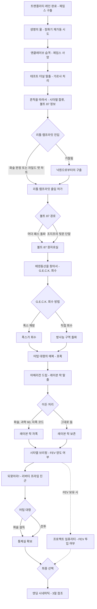
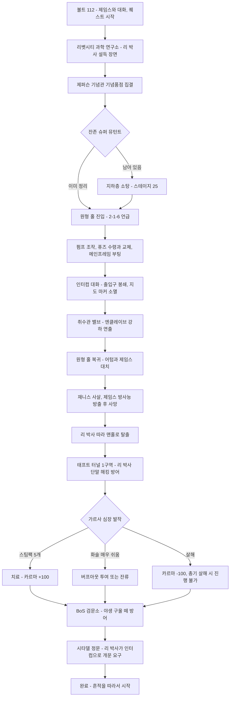
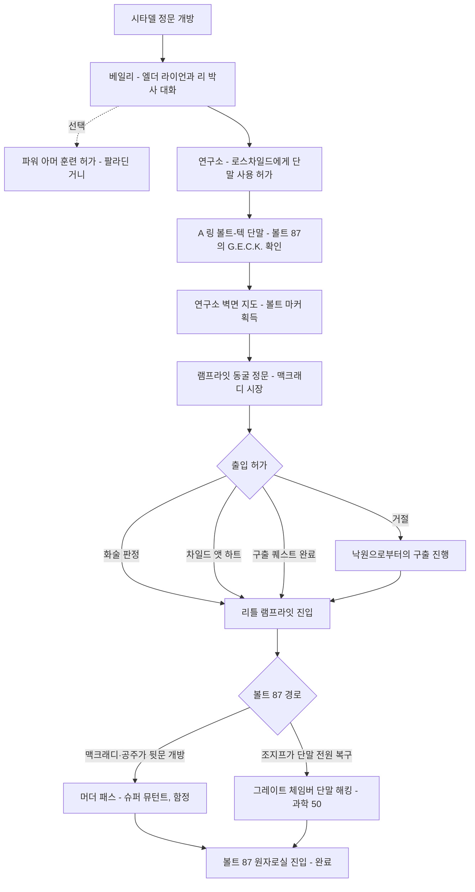
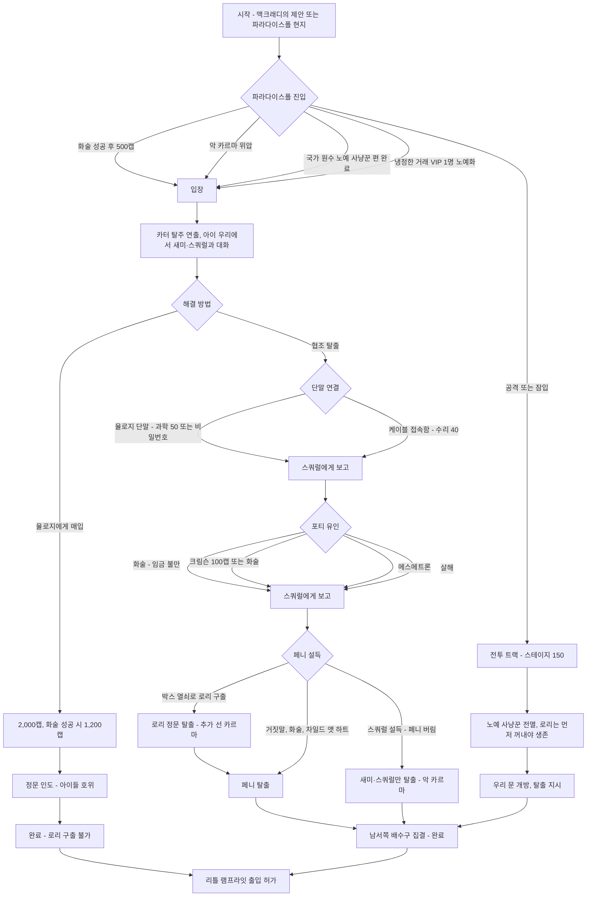
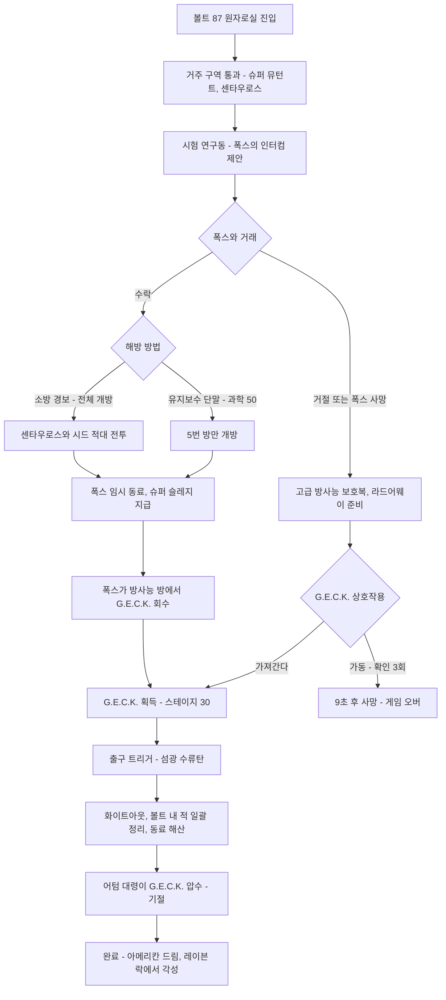
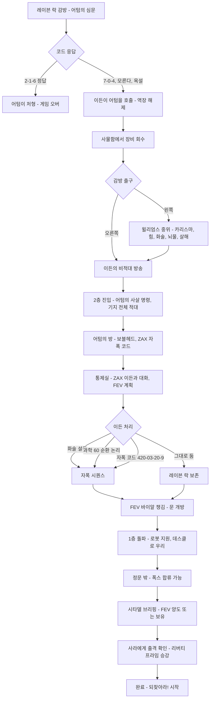
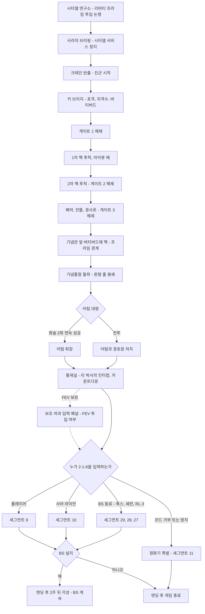
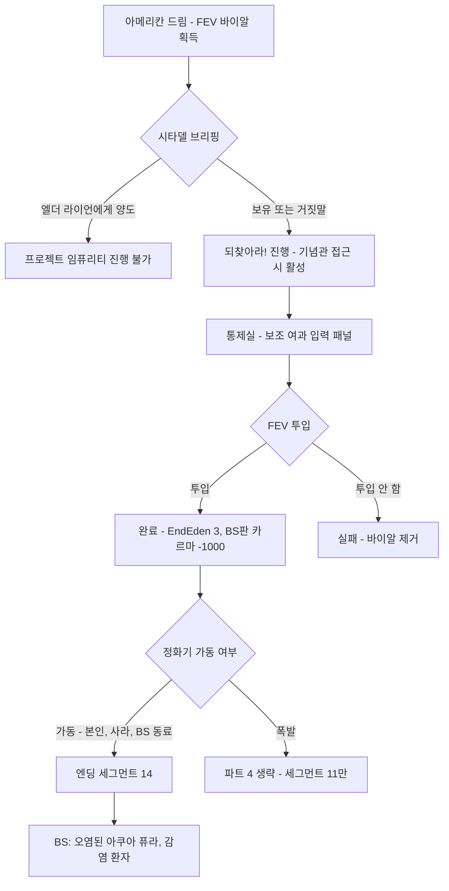
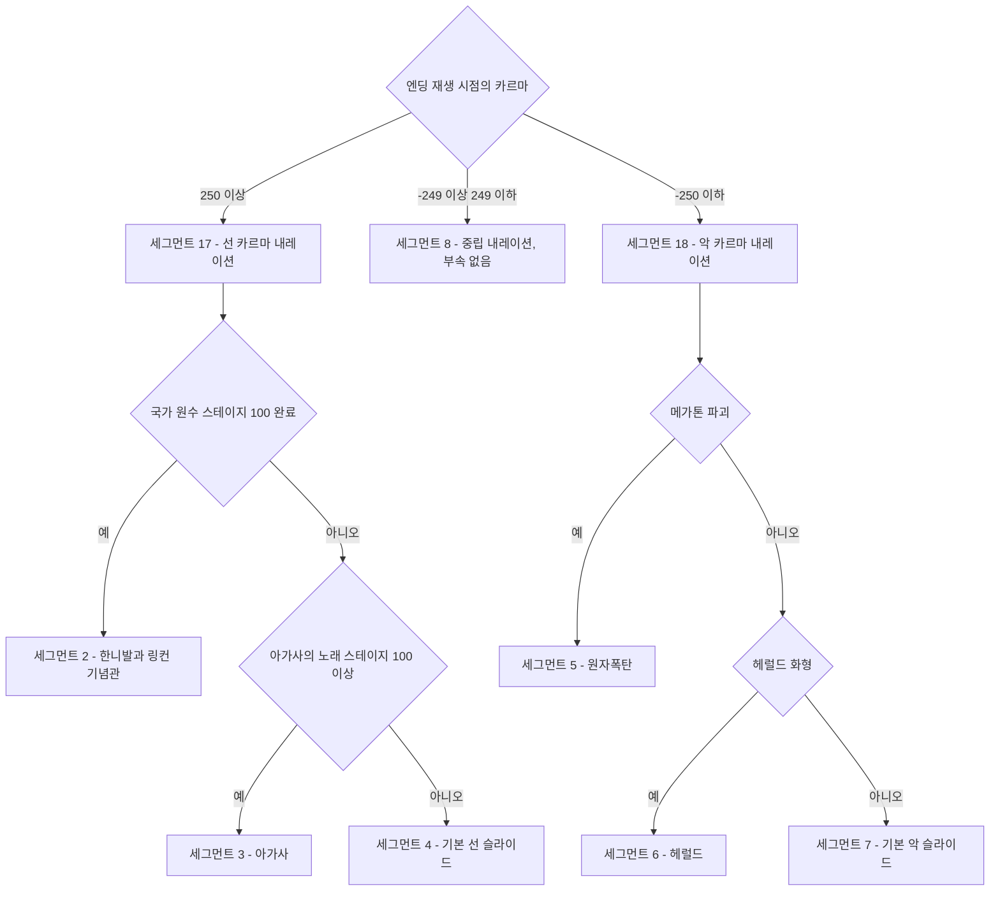
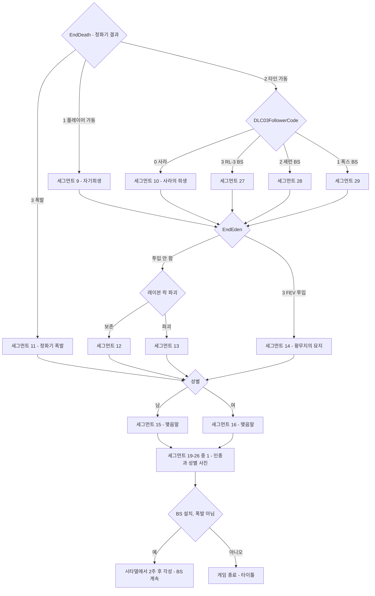

# RD-04. 메인 스토리 2부·엔딩

> **폴아웃 3 역기획서 세트** | 문서 ID: RD-04 | 버전: v1.0 | 작성일: 2026-10-11
> **범위**: 메인 퀘스트 2부 7종(생명의 물, 흔적을 따라서, 낙원으로부터의 구출, 에덴동산을 찾아서, 아메리칸 드림, 되찾아라!, 프로젝트 임퓨리티)의 상세와 엔딩 시스템 전체(결정 변수, 영상 세그먼트, 조합 규칙, 내레이션, 설계 분석). 메인 스토리 전체 시놉시스·3막 구조·1부 퀘스트·전체 흐름도와 스킵 루트는 RD-03, [BS] 후속 퀘스트와 엔딩 변경 상세는 RD-08c, 인물 프로필은 RD-10, 장소 구조는 RD-12·RD-13, 화술 판정 공식은 RD-17, 엔딩 슬라이드 UI는 RD-18에서 다루며 이 문서는 요약·링크만 한다.
> **관련 문서**: [RD-03 메인 스토리 1부](03_main-story-part1.md), [RD-08c DLC: 브로큰 스틸](08c_dlc-broken-steel.md), [RD-10 주요 인물·동료](10_characters-major-companions.md), [RD-09 팩션](09_factions.md), [RD-12 월드 구조·정착지·볼트](12_world-structure-settlements.md), [RD-13 장소 카탈로그](13_location-catalog.md), [RD-14 캐릭터 시스템](14_character-system.md), [RD-16 전투 시스템](16_combat-system.md), [RD-17 탐험·상호작용](17_exploration-interaction.md), [RD-18 UI/UX](18_ui-ux.md), [RD-05 사이드 퀘스트 1부](05_side-quests-part1.md), [RD-06 사이드 퀘스트 2부](06_side-quests-part2.md), [RD-07 비표시·반복 퀘스트와 랜덤 인카운터](07_misc-quests-encounters.md), [RD-24 크리처·적 도감](24_bestiary.md), [RD-25 아트·오디오·연출](25_art-audio-presentation.md), [RD-26 용어집](26_glossary.md)

---

## 목차

1. [문서 개요](#1-문서-개요)
2. [퀘스트 상세](#2-퀘스트-상세)
   - 2.1 [생명의 물 (The Waters of Life)](#21-생명의-물-the-waters-of-life)
   - 2.2 [흔적을 따라서 (Picking Up the Trail)](#22-흔적을-따라서-picking-up-the-trail)
   - 2.3 [낙원으로부터의 구출 (Rescue from Paradise)](#23-낙원으로부터의-구출-rescue-from-paradise)
   - 2.4 [에덴동산을 찾아서 (Finding the Garden of Eden)](#24-에덴동산을-찾아서-finding-the-garden-of-eden)
   - 2.5 [아메리칸 드림 (The American Dream)](#25-아메리칸-드림-the-american-dream)
   - 2.6 [되찾아라! (Take It Back!)](#26-되찾아라-take-it-back)
   - 2.7 [프로젝트 임퓨리티 (Project Impurity)](#27-프로젝트-임퓨리티-project-impurity)
3. [엔딩 시스템](#3-엔딩-시스템)
4. [설계 분석 (2부 전체)](#4-설계-분석-2부-전체)
5. [쯔꾸르 이식 메모](#5-쯔꾸르-이식-메모)
6. [부록](#6-부록)

---

## 1. 문서 개요

### 1.1 목적

- 메인 퀘스트 후반부(아버지 제임스(James)의 죽음부터 정화 계획(Project Purity) 가동까지)를 핍-보이(Pip-Boy) 목표 단위로 분해하여, 팬게임의 이벤트·스위치·변수로 그대로 옮길 수 있는 수준의 정본 자료를 만든다.
- 폴아웃 3(Fallout 3)의 엔딩이 **어떤 변수로, 어떤 순서로, 어떤 영상 조각을 이어 붙여** 만들어지는지를 엔진 스크립트(`EndingBinksScript` 등) 원문 기준으로 정리한다. 위키 서술과 스크립트가 다른 곳은 스크립트를 우선하고 불일치를 표시한다.

### 1.2 범위

| 구분 | 내용 |
|---|---|
| 다루는 것 | 메인 퀘스트 7종 상세(표준 양식), 리틀 램프라잇(Little Lamplight)·파라다이스폴(Paradise Falls) 진입 방법 전체, 볼트 87(Vault 87)·레이븐 락(Raven Rock)·제퍼슨 기념관(Jefferson Memorial)의 퀘스트 동선, 리버티 프라임(Liberty Prime) 진군 구간 구조, 최종 선택 전 분기, 엔딩 세그먼트 29종과 조합 규칙, 엔딩 반영 변수, [BS] 엔딩 변화 요약, 엔딩 설계 비판 |
| 다루지 않는 것 | 1부 퀘스트와 메인 전체 흐름도·스킵 루트(RD-03), [BS] 퀘스트 상세(RD-08c), 인물 생애·성우(RD-10), 볼트 87·레이븐 락의 전체 구조와 전리품(RD-12, RD-13), 퍽·카르마 수치 정본(RD-14), 화술 판정 공식(RD-17), 무기·방어구 수치(RD-19, RD-20), 적 스탯 정본(RD-24), 사이드 퀘스트 상세(RD-05, RD-06), 비표시 퀘스트(RD-07) |

### 1.3 요약

- 2부는 **아버지의 희생 → 조직 합류 → 열쇠 확보 → 납치·탈출 → 최종 결전**의 5박자 구조다. 합류하는 조직은 브라더후드 오브 스틸(Brotherhood of Steel, BoS)이다. 무대는 남동쪽의 리벳시티(Rivet City)와 제퍼슨 기념관에서 중앙의 시타델(The Citadel), 북서쪽의 리틀 램프라잇과 볼트 87, 최북서쪽의 레이븐 락을 거쳐 다시 제퍼슨 기념관으로 돌아오는 원을 그린다.
- 진행을 묶는 장치는 세 개의 '열쇠 오브젝트'다. 정화기(Purifier) 코드 **2-1-6**, 지형 변환 장치 **G.E.C.K.(에덴동산 창조 키트, Garden of Eden Creation Kit)**, 이든 대통령(President John Henry Eden)이 건네는 **변형 FEV(Modified FEV)**. 엔클레이브(Enclave)가 열쇠를 빼앗고(G.E.C.K.) 노리고(코드) 떠넘기며(FEV), 플레이어가 이를 지키거나 쓰는 구도로 긴장을 유지한다.
- 2부의 분기는 대부분 **'어떻게'**(진입·설득·전투·잠입)에 있고, **'무엇이 남는가'**(결말)는 최종 퀘스트의 통제실 한 곳에 집중된다.
- 엔딩은 마을별 후일담이 없는 **세그먼트 조합형 시네마틱**이다. 카르마 3구간 × 사이드 퀘스트 1건 × 정화기 가동자 × FEV·레이븐 락 여부 × 성별·인종 사진을 순서대로 이어 붙여 기본판 392가지, [BS] 896가지 영상열을 만든다.
- 브로큰 스틸(Broken Steel, [BS])은 엔딩을 '종결'에서 '중간 이벤트'로 바꾸었다. 주인공 생존, 방사능 면역 동료의 정화기 가동, 2주 뒤 각성과 월드 반영을 추가하여 본편 엔딩의 가장 큰 비판(면역 동료가 있는데도 희생 강요)을 사후에 수정했다.

### 1.4 표기 메모

- 퀘스트명은 [RD-26 용어집](26_glossary.md)의 번역명을 쓰고 처음에 원제를 병기한다. 고유명사는 문서 내 첫 등장 때만 `한국어(English)`로 병기한다.
- **고유명사 표기는 폴아웃 3 한글 패치(사용자 제공 본편 대사)의 실사용 표기를 우선한다**(리드 지시, 2026-10-11). 이 문서의 주요 해당 표기: 수도 황무지(Capital Wasteland), 리벳시티(Rivet City), 파라다이스폴(Paradise Falls), 레이븐 락(Raven Rock), 리틀 램프라잇(Little Lamplight), 엘더 라이언(Elder Lyons), 사라 라이언(Sarah Lyons), 이든 대통령(President Eden), 어텀 대령(Colonel Autumn), 폭스(Fawkes), 셰런(Charon), 쓰리독(Three Dog), 노예 사냥꾼(Slavers), 야생 구울(Feral ghoul), 정화 계획(Project Purity). 아이템·퍽·스킬·퀘스트 이름은 [RD-26 용어집](26_glossary.md) v0.2 표기를 따른다(예: 트랜퀼리티 레인, 아가사의 노래, 에덴동산을 찾아서, 프로젝트 임퓨리티). '에덴동산'은 G.E.C.K.의 이름에서 온 말이라 인물 이든(Eden)과 표기가 다르다.
- 인용 대사의 한국어 번역 가운데 `(한글 패치: …)`로 표시한 것은 한글 패치의 번역문을 그대로 옮긴 것이다. 표시가 없는 번역은 이 문서의 번역이며, 패치에 해당 문장이 없거나([BS] 대사, 엔딩 내레이션 등) 패치 번역이 원문과 뜻이 어긋나는 경우다.
- **스테이지**는 게임 내부 퀘스트 스테이지 번호(위키 Quest stages 표 기준)다. 핍-보이 목표 문구는 영어 원문과 번역을 함께 적는다.
- **화술 판정 난이도**는 엔진의 5단계(매우 쉬움 Very Easy / 쉬움 Easy / 보통 Average / 어려움 Hard / 매우 어려움 Very Hard)로 적는다. 판정 공식과 단계별 계수는 [RD-17](17_exploration-interaction.md) 참조. 구체적 성공률은 위키에 명시된 경우만 적는다.
- **해킹·자물쇠 난이도**는 요구 스킬로 환산한다. 매우 쉬움 15 / 쉬움 25 / 보통 50 / 어려움 75 / 매우 어려움 100(과학 또는 자물쇠 따기).
- 엔진 스크립트의 변수·함수명은 `코드체`로 원문 그대로 적는다. 예: `MQ11.Code`, `EndingBinks.EndDeath`.
- 표기 약속: `(코퍼스 미확인)` = 로컬 위키 코퍼스에서 확인되지 않음, `(불일치)` = 위키 문서 간 또는 위키와 스크립트 사이에 서술이 다름. 버그는 설계상 의미가 있을 때만 적는다.

### 1.5 2부 퀘스트 한눈에 보기

| 업적 순번 | 퀘스트 (원제) | Editor ID | Form ID | 의뢰인 | 주요 장소 | XP | 업적·트로피 |
|---|---|---|---|---|---|---|---|
| 08 | 생명의 물 (The Waters of Life) | `MQ05` | `00014e8b` | 제임스 | 리벳시티 → 제퍼슨 기념관 → 태프트 터널(Taft Tunnel) → 시타델 | 700 | 20G / 브론즈 |
| 09 | 흔적을 따라서 (Picking Up the Trail) | `MQ06` | `00014e8c` | 엘더 라이언(Elder Lyons) | 시타델 → 리틀 램프라잇 → 볼트 87 입구 | 800 | 20G / 브론즈 |
| 10 | 낙원으로부터의 구출 (Rescue from Paradise) | `MQ07` | `00014e8d` | 맥크래디 시장(Mayor MacCready) / 새미(Sammy) | 리틀 램프라잇, 파라다이스폴 | 900 | 20G / 브론즈 |
| 11 | 에덴동산을 찾아서 (Finding the Garden of Eden) | `MQ08` | `00014e8e` | 로스차일드 서기(Scribe Rothchild) | 볼트 87 | 1,000 | 20G / 브론즈 |
| 12 | 아메리칸 드림 (The American Dream) | `MQ09` | `00014e8f` | 이든 대통령 | 레이븐 락 → 시타델 | 1,100 ※ | 20G / 브론즈 |
| 13 | 되찾아라! (Take It Back!) | `MQ11` | `00014e91` | 엘더 라이언, 사라 라이언(Sarah Lyons) | 시타델 → 제퍼슨 기념관 | 1,200 | 40G / 실버 |
| — | 프로젝트 임퓨리티 (Project Impurity) | `MQA` | `00014e93` | 존 헨리 이든(John Henry Eden) | 제퍼슨 기념관 | 없음 (카르마 −1,000) | 없음 |
| (삭제) | Infiltration | `MQ10` | `00014e90` | 미상 | 리벳시티 수중 해치 | — | — |
| (삭제) | Last Rites | `MQ12` | `00014e92` | 미상 | 미상 | — | (실버 트로피 슬롯 흔적) |

- ※ 아메리칸 드림의 XP는 허브 문서 `Fallout 3 quests` 기준 1,100이다. 퀘스트 문서의 정보상자에는 XP가 적혀 있지 않다.
- 낙원으로부터의 구출을 포함한 2부 메인 XP 합계는 **5,700**이다.
- 삭제 퀘스트 2종은 번호만 남은 흔적이다. `MQ10` Infiltration은 리벳시티에 수중 해치로 잠입해 "프로토타입 동력원"을 가져와 로스차일드에게 전달하는 퀘스트였고(리버티 프라임 동력 문제의 원래 해법으로 추정), `MQ12` Last Rites는 되찾아라! 이후에 배치된 퀘스트였으나 내용이 모두 지워졌다. 설계 분석은 [3.9](#39-엔딩-설계-분석)·[4절](#4-설계-분석-2부-전체) 참조.

### 1.6 2부 전체 흐름도

메인 스토리 전체 흐름과 스킵 루트는 [RD-03](03_main-story-part1.md)을 따른다. 스킵 루트의 예로는 볼트 112(Vault 112)로 곧장 가서 트랜퀼리티 레인 이전 퀘스트를 건너뛰는 방법과 시타델 글리치가 있다. 아래는 2부 내부의 분기만 그린다.

---

## 2. 퀘스트 상세

### 2.1 생명의 물 (The Waters of Life)

#### 기본 정보

| 항목 | 내용 |
|---|---|
| 영문명 | The Waters of Life |
| 한국어명 | 생명의 물 |
| 유형 | 메인 퀘스트 (업적 순번 08) |
| 퀘스트 ID | Editor ID `MQ05` / Form ID `00014e8b` |
| 의뢰인 | 제임스 |
| 시작 조건 | 트랜퀼리티 레인(Tranquility Lane) 완료 후 볼트 112에서 깨어난 제임스와 대화하면 자동 시작 |
| 관련 장소 | 볼트 112 → 리벳시티 과학 연구소(Rivet City science lab) → 제퍼슨 기념관(기념품점, 원형 홀, 지하층, 취수관) → 태프트 터널 → 시타델 정문 |
| 선행 / 후행 | 선행: 트랜퀼리티 레인 / 후행: 흔적을 따라서 |
| 보상 | 700 XP, 시타델 출입. 이후 엘더 라이언에게 파워 아머 훈련(Power Armor Training) 허가를 받을 수 있게 됨, 스타 팔라딘 크로스(Star Paladin Cross) 동료 영입 가능(선한 카르마 필요) |
| 카르마 영향 | 가르사(Garza)에게 스팀팩 5개 제공 +100 / 가르사 살해 −100 |
| 업적·트로피 | 'The Waters of Life' 20G / 브론즈 |

#### 개요

- 제임스는 G.E.C.K.가 정화 계획의 마지막 부품이 될 수 있음을 확인하고, 20년 전 흩어진 연구팀을 다시 모은다. 리벳시티에서 매디슨 리(Madison Li, 이하 리 박사)를 설득해 팀 전원이 제퍼슨 기념관으로 복귀하고, 플레이어는 시설 정비를 맡는다.
- 정비가 끝나는 순간 엔클레이브가 버티버드(Vertibird)로 강하해 시설을 점거한다. 어텀 대령(Colonel Augustus Autumn)이 연구원 재니스 캐플린스키(Janice Kaplinski)를 사살하며 협조를 강요하자, 제임스는 정화기를 과부하시켜 통제실에 치사량의 방사능을 흘려 넣고 죽는다.
- 플레이어는 리 박사와 생존 연구원들을 이끌고 비상 탈출로인 태프트 터널을 지나 BoS의 거점 시타델에 도착한다. 1부의 '아버지 찾기'가 끝나고 2부의 '아버지의 일 완성하기'가 시작되는 전환점이다.

#### 진행 단계

| 스테이지 | 핍-보이 목표 (원문) | 번역 | 플레이어 행동과 이벤트 |
|---|---|---|---|
| 10 | Go to the Rivet City science lab. | 리벳시티 과학 연구소로 간다. | 제임스는 혼자 리벳시티로 이동한다(동행·방치 모두 가능, 스크립트 변수 `MQ05.DadEscort`). 연구소에 도착하면 제임스가 리 박사를 설득하는 장면이 재생되고, 제임스는 기념관에서 합류하자고 말한다. 전투 대비와 인벤토리 정리를 권하는 지점이다. |
| 20 | Join the scientists at Project Purity. | 정화 계획의 과학자들과 합류한다. | 과학자 7명(리 박사, 제임스, 애나 홀트(Anna Holt), 재니스 캐플린스키, 대니얼 에이전코트(Daniel Agincourt), 알렉스 다곤(Alex Dargon), 가르사)이 기념관 기념품점 입구에 모인다. 플레이어가 먼저 도착하거나 빠른 이동을 하면 과학자들을 근처 마커로 순간 이동시키는 보정 스크립트가 있다. |
| 25 | Clear Project Purity of any remaining Mutant threat. | 정화 계획에 남은 뮤턴트 위협을 제거한다. | 지하층 등의 잔존 슈퍼 뮤턴트(Super mutant)를 처치한다. 과학자들은 뮤턴트가 모두 죽기 전에는 들어오지 않는다(`MQ05.MutantsKilled`). 과학적 탐구 단계에서 이미 정리했다면 이 단계는 생략되고 일행이 곧장 원형 홀로 간다. |
| 26 | Tell Dad it's safe to enter Project Purity. | 안전하다고 아빠에게 알린다. | 제임스와 대화한다. |
| 27 | Escort the scientists inside Project Purity. | 과학자들을 안으로 호위한다. | 원형 홀 도착. 제임스를 따라가면 정화기 코드 2-1-6과 요한계시록(Revelation) 21장 6절 이야기를 직접 들을 수 있고, 노트 'Revelation 21:6'(`MQDadWatersOfLife`)이 핍-보이에 추가된다. 최종 퀘스트의 정답이 여기서 심어진다. |
| 30 | Turn on the Flood Control Pump Power. | 홍수 조절 펌프 전원을 켠다. | 지하층 이층 침대 구역 왼쪽 방, 투광등이 비추는 인터컴 옆 스위치를 조작한다. (불일치) 스테이지 문구는 'Turn on', 위키 공략 본문은 'Turn off'로 적혀 있다. |
| 40 | Get the fuses from Dad. | 아빠에게서 퓨즈를 받는다. | 원형 홀로 돌아가 제임스에게 퓨즈를 받는다. 이때 제임스가 플레이어의 행적에 반응한다(아래 '대사 포인트'). |
| 50 | Replace the damaged fuses. | 손상된 퓨즈를 교체한다. | 지하층 끝 'Fuse Access A1' 표지를 따라가 퓨즈함을 교체한다. |
| 60 | Boot up the mainframe. | 메인프레임을 부팅한다. | 퓨즈를 갈면 메인프레임 문 옆 녹색등이 켜진다. 안에 들어가 스위치를 올린다. |
| 65 | Speak with Dad over the intercom. | 인터컴으로 아빠와 대화한다. | 제임스가 복귀를 지시했다가 취수관 막힘 제거를 추가로 요청한다. **이 대화 직후 기념관의 유일한 출입구가 외부에서 봉쇄되고 월드 맵의 제퍼슨 기념관 마커가 사라진다.** 제임스가 '북쪽 문'이라 안내하지만 실제로는 남쪽 문이다(대사 오류). |
| 70 | Drain the intake pipes. | 취수관의 물을 뺀다. | 기념품점 입구 정면의 관로를 끝까지 달려가 밸브를 돌린다. 밸브를 돌리는 순간 약 16초짜리 연출(`MQ05EnclaveSceneSCRIPT`)이 시작된다. 버티버드 2기의 접근음과 착륙, 제임스의 구내 방송("Everyone, it seems we have some visitors..."), 파워 아머 병사의 이동, 전투 음악 개시. 반대편 문이 열려 다음 구역으로 진행된다. |
| 75 | Return to the control room. | 통제실로 돌아간다. | 엔클레이브 파워 아머 병사들을 뚫고 원형 홀로 복귀한다. 통제실 유리벽 너머에서 어텀이 제임스와 대치하는 장면을 본다. 이 구간에서 플레이어의 전투 능력이 제거된다(`MQ05.NoFighting`). 어텀이 재니스를 사살하고, 제임스는 협조하는 척하며 방사능을 방출한다. 어텀은 정체불명의 주사를 맞고 쓰러지고, 제임스는 비상 격벽까지 기어가 플레이어에게 도망치라 이르고 숨진다. |
| 80 | Escort Doctor Li to the evacuation point. | 리 박사를 대피 지점으로 호위한다. | 충격받은 리 박사가 원형 홀 근처 바닥의 맨홀로 달려간다. 지하 터널이 시타델로 이어진다는 설명. |
| 85 | Escort Doctor Li through Taft Tunnel to the Citadel. | 태프트 터널을 지나 시타델까지 리 박사를 호위한다. | 터널에는 엔클레이브 병사와 야생 구울(Feral ghoul) 변종이 섞여 있다. 리 박사는 명령에 따라 따라오거나 대기하지만, 플레이어가 너무 앞서가면 지정 지점까지 자동 전진한다. 대니얼 에이전코트에게 권총을 줄 수 있다. |
| 90 | Deal with the Garza's situation. | 가르사 문제를 해결한다. | 터널 두 번째 구역에서 가르사가 "Dr. Li, my heart... I must rest."라며 멈춘다. 지병인 심장병이 악화된 상황. 해결 방법은 아래 분기 표. 퀘스트 시작 전에 가르사가 죽었다면 이 단계는 통째로 생략된다. |
| 100 | Escort Doctor Li through Taft Tunnel to the Citadel. | (85와 같은 문구, 완료 단계) | 터널 끝 BoS 검문소를 지나 사다리로 지상에 오른다. 정문 경비 팔라딘 베일(Paladin Bael)이 출입을 거부하자 리 박사가 인터컴으로 엘더 라이언에게 고함을 쳐 문이 열린다. 시타델 진입 트리거(`MQ05CitadelUpdateTriggerScript`)를 지나면 완료되고 흔적을 따라서가 시작된다. |

**태프트 터널 세부 동선**

| 구역 | 내용 | 비고 |
|---|---|---|
| 1구역 (기념관 쪽 출구) | 야생 구울 다수와 방사성 드럼통이 있는 개방형 방 | 중국군 물품이 놓인 탁자: 중국군 특수 작전 교범(Chinese Army: Special Ops Training Manual) 스킬북, 중국제 돌격소총, 더러운 중국군 점프슈트, 희귀 모자 |
| 문 2개짜리 방 | 왼쪽 방의 **매우 어려움** 단말을 리 박사가 해킹하는 동안 플레이어가 엔클레이브 공격을 막는다 | 플레이어가 먼저 해킹하면 알렉스·대니얼이 출입구에서 영구 대기하는 버그가 있다 |
| 캣워크 방 | 엔클레이브 병사가 출입구 위 캣워크에서 내려다보며 사격한다(고지 매복). 동행 NPC가 방 한가운데로 뛰어드는 경향이 있어 호위 난도가 높다 | 안쪽 방 책상에 아이봇 헬멧(Eyebot helmet) |
| 하수 터널 | 발전기 뒤 피크닉 탁자에 뉴카-콜라 퀀텀(Nuka-Cola Quantum)과 니콜라 테슬라와 당신(Nikola Tesla and You) 스킬북. 이후 적이 야생 구울로 바뀐다 | 가르사용 스팀팩: 갈림길 왼쪽의 폐수술실, 터널 끝 BoS 바리케이드 뒤 구급상자 |
| BoS 검문소 | 화염방사기를 든 BoS 이니시에이트(또는 팔라딘) 1명과 천장 터렛 2기가 몰려드는 야생 구울 떼를 막는다 | [BS] 설치 시 레벨에 따라 야생 구울 리버가 최대 4체 등장. 경비가 죽으면 과학자가 화염방사기를 주워 싸우기도 한다 |

#### 분기와 해결 방법

**가르사 문제 (스테이지 90)** — 스크립트 상태값은 10 치료 / 20 약물 투여 / 30 버려 둠 / 40 자진 잔류 / 99 타인에게 사망 / 100 플레이어에게 사망이다.

| 선택 | 조건 | 결과 | 카르마 |
|---|---|---|---|
| 스팀팩 5개 제공 | 스팀팩 5개 소지 (터널 내 2곳에서 조달, 또는 터널을 빠져나가 상인에게 사 와서 다시 돌아와도 됨) | 가르사 회복, 일행 계속 이동 (전투에는 참여 못 함) | +100 |
| 버프아웃 3개 투여를 리 박사에게 설득 | 화술 판정 **매우 쉬움** + 버프아웃 3개 | 약물로 버티며 계속 이동 | 명시 없음 |
| 리 박사에게 가르사를 두고 가자고 설득 | 화술 판정 **매우 쉬움** | 가르사가 터널에 남는다 | 명시 없음 |
| 가르사에게 남으라고 설득 | 화술 판정 **매우 쉬움** ("You're only going to slow us down. Maybe you should stay behind.") | 가르사 자진 잔류 | 명시 없음 |
| 가르사 살해 | — | 리 박사 분노. **총기로 죽이면 리 박사가 진행을 거부해 퀘스트가 막힌다** | −100 |

- 알렉스 다곤은 가르사를 두고 가자고 주장하고, 리 박사는 약을 구해 오라고 요구한다. 의료 자원(스팀팩 5개)과 시간, 카르마를 맞바꾸는 소형 딜레마다.
- 대화 해결 3종이 모두 매우 쉬움인 점이 특징이다. 이 딜레마는 능력 시험이 아니라 성향 표명이다.

**동료와 호위 관련 규칙**

- 통제실에 '대기'시킨 동료는 스테이지 75의 방사능 방출과 함께 **스크립트로 즉사**한다. 방사능 면역 설정인 셰런(Charon)과 RL-3 하사(Sergeant RL-3)도 예외가 아니며, 임시 동료(스티키(Sticky), 체리(Cherry), 시드니(Sydney))와 빅토리아 와츠(Victoria Watts)도 포함된다. 이 규칙은 최종 퀘스트에서 "면역 동료가 왜 정화기를 켜지 못하는가"라는 비판과 맞물린다([3.9](#39-엔딩-설계-분석) 참조).
- 취수관 안에서 착륙 장면을 볼 때 엔클레이브는 기념관 바깥 산책로에 내린다. 미리 지뢰를 깔아 두면 일부를 처치할 수 있다. 관로 안에서 병사를 공격하면 다음 관로 끝에서 그 병사들이 기다리고 있을 수 있다.
- 기념관 입장 전에 과학자에게 무기·방어구를 역소매치기로 넣어 주면 이후 엔클레이브전에 쓴다(가르사·애나·알렉스·대니얼). 제임스와 재니스는 스크립트 사망이라 효과가 없다. NPC는 다른 셀로 이동한 뒤에야 방어구를 착용한다.
- 과학자를 대기시키고 혼자 싸울 수 있으나, 한 출입구를 지나면 역장(force field)이 생겨 플레이어는 돌아갈 수 없고 동행 NPC는 앞으로 올 수 없는 구간이 있다.

#### 결과와 후일담

| 대상 | 변화 |
|---|---|
| 제임스 | 사망 확정. 시신 근처에서 제임스의 황무지 복장(Dad's wasteland outfit)을 얻을 수 있다(시신이 문 가까이 쓰러진 경우) |
| 재니스 캐플린스키 | 사망 확정 (어텀이 사살) |
| 어텀 대령 | 생존. 이 퀘스트의 어텀과 이후(아메리칸 드림, 되찾아라!)의 어텀은 **서로 다른 레퍼런스**다. 글리치로 통제실에 들어가면 이 시점의 어텀에게서 어텀 대령의 10mm 권총과 제복을 얻을 수 있다 |
| 애나 홀트 | 엔클레이브에 붙잡힌다. 아메리칸 드림에서 레이븐 락의 협력자로 재등장 |
| 가르사 | 생존 시 시타델 연구소에서 리 박사를 따라다닌다. [BS] 시작 시 별도 언급 없이 비활성화된다 |
| 알렉스·대니얼 | 생존 시 시타델로 간다. [BS]에서는 제퍼슨 기념관으로 복귀 |
| 월드 상태 | 엔클레이브가 각지에 거점을 세우고, 전쟁 전 건물·광고판에 선전 포스터가 붙으며, 엔클레이브 출현 빈도가 크게 늘어난다. 엔클레이브 라디오(Enclave Radio)에서 어텀의 대국민 연설이 나온다 |
| 제퍼슨 기념관 | 지도 마커 소멸, 출입 봉쇄 (되찾아라! 전까지) |
| 갤럭시 뉴스 라디오(Galaxy News Radio) | 쓰리독(Three Dog)이 "정부가 제퍼슨 기념관의 큰 기계를 장악했다", "일행은 시타델에 무사히 도착, 아버지의 소식은 없다"는 취지로 보도한다 |
| 엔딩 반영 | 직접 반영 없음. 다만 이 퀘스트에서 심은 코드 2-1-6이 최종 선택의 전제가 된다 |

#### 흐름도

#### 관련 NPC·아이템·대사 포인트, 비고

- **NPC**: 제임스, 리 박사, 애나 홀트, 재니스 캐플린스키, 대니얼 에이전코트, 알렉스 다곤, 가르사, 어텀 대령, 엔클레이브 병사(파워 아머), 팔라딘 베일, 엘더 라이언, BoS 검문소 경비. 프로필은 [RD-10](10_characters-major-companions.md) 참조.
- **아이템**: 퓨즈(Fuse), 노트 'Revelation 21:6', 제임스의 황무지 복장, 중국군 특수 작전 교범, 니콜라 테슬라와 당신, 뉴카-콜라 퀀텀, 아이봇 헬멧. 캣워크 병사의 시신은 정상 동선으로는 닿지 않으며, 점프 기교로 올라가면 엔클레이브 헬파이어 아머([BS]) 또는 테슬라 아머를 얻을 수 있다.
- **대사 포인트**
  - 어텀의 첫 대사: "By the authority of the President, this facility is now under United States government control." (한글 패치: 대통령의 권한에 의해서 지금 이 시간부로 이 시설은 미국정부의 통제를 받게 되었음을 알립니다.) 이어서 제임스가 "This is a private project; the Enclave has no authority here."(한글 패치: 이건 개인적인 연구요. 엔클레이브는 이곳에서는 아무런 권한이 없소.)라고 맞선다.
  - 리 박사의 시타델 개문 요구: "I am Doctor Madison Li. I have people with me in need of shelter. You must allow us access at once." (한글 패치: 난 매디슨 리 박사입니다. 숨을 곳이 필요한 사람들도 있어요. 여길 지나가게 해 주셔야 해요.)
  - 퓨즈를 받을 때 제임스는 플레이어의 행적에 반응한다. 메가톤(Megaton) 폭탄을 해체했으면 "Is it true? Did you really disarm the bomb in Megaton?", 메가톤을 파괴했으면 "Megaton destroyed... You... You didn't have anything to do with that, did you?"라고 묻고 실망을 표한다. 카르마에 따라 "자랑스럽다" 또는 "무언가에 짓눌린 것 같다"고 말한다. 2부에서 사이드 퀘스트 결과가 메인 NPC 대사로 되돌아오는 거의 유일한 지점이다.
- **비고**: 엔클레이브 강하 장면은 플레이어가 관로 안에 갇힌 상태로 보도록 설계되었다(밸브 조작 시 등 뒤 문이 잠기고 약 10초 뒤 앞문이 열린다, `MQ05PipeControlScript`). 플레이어가 개입할 수 없는 '관찰 시점'을 강제하는 장치다.

#### 설계 분석

- **리듬 전환**: 1부의 탐색과 다르게 2부의 시작은 '심부름형 정비 퀘스트'(펌프 → 퓨즈 → 메인프레임 → 취수관)로 긴장을 낮췄다가 급습으로 뒤집는다. 사소한 잡일 4개가 이어지는 지루함 자체가 반전의 장치다.
- **개입 불가의 연출**: 제임스의 죽음은 유리벽 너머에서 일어나고 플레이어는 싸울 수 없다(`NoFighting`). 선택지를 주지 않는 것이 오히려 비극을 강조하며, 최종 퀘스트에서 플레이어가 같은 자리에서 같은 선택(자기희생)을 하도록 거울 구조를 만든다.
- **호위 + 자원 딜레마**: 탈출 호위는 전투 난도를 높이지만, 가르사 사건은 전투가 아니라 자원·성향 선택이다. 대화 해결이 모두 매우 쉬움이라 능력과 무관하게 '어떤 사람인가'를 묻는다.
- **약점**: 제임스의 방향 안내 오류, NPC 끼임 등 호위 동선 버그가 많다. 대기 동료의 즉사 처리는 설정(방사능 면역)과 어긋난다.

### 2.2 흔적을 따라서 (Picking Up the Trail)

#### 기본 정보

| 항목 | 내용 |
|---|---|
| 영문명 | Picking Up the Trail |
| 한국어명 | 흔적을 따라서 |
| 유형 | 메인 퀘스트 (업적 순번 09) |
| 퀘스트 ID | Editor ID `MQ06` / Form ID `00014e8c` |
| 의뢰인 | 오윈 라이언(Owyn Lyons, 이하 엘더 라이언) |
| 시작 조건 | 생명의 물 완료 직후, 리 박사의 인터컴 요구로 시타델 정문이 열리면 자동 시작 |
| 관련 장소 | 시타델(베일리(Bailey), 시타델 연구소(Citadel laboratory), A 링(A ring) 기록 보관소), 램프라잇 동굴(Lamplight Caverns), 리틀 램프라잇, 그레이트 체임버(Great Chamber), 머더 패스(Murder Pass), 볼트 87 원자로실 |
| 선행 / 후행 | 선행: 생명의 물 / 후행: 에덴동산을 찾아서 / 관련: 낙원으로부터의 구출 |
| 보상 | 800 XP, 수도 황무지(Capital Wasteland)의 볼트 위치 지도 마커 일괄 획득(볼트 112 제외), 파워 아머 훈련 퍽(선택: 엘더 라이언 허가 → 팔라딘 거니(Paladin Gunny)) |
| 카르마 영향 | 이 퀘스트 자체의 증감은 없음. 리틀 램프라잇에서 맥크래디를 협박해 균류를 빼앗으면 악 카르마(비표시 퀘스트 균류 거래, [RD-07](07_misc-quests-encounters.md)) |
| 업적·트로피 | 'Picking Up the Trail' 20G / 브론즈 |

#### 개요

- 리 박사가 엘더 라이언에게 엔클레이브의 습격과 제임스의 죽음을 보고한다. 엔클레이브가 정화기를 손에 넣었지만 아직 가동할 수 없다는 점(G.E.C.K.와 코드 부재)이 남은 희망이다.
- 플레이어는 시타델 기록 보관소의 볼트-텍(Vault-Tec) 단말에서 **볼트 87이 비표준 장비로 G.E.C.K.를 지급받았다**는 기록을 찾는다. 볼트 87은 직격탄을 맞아 지상 출입구가 치사량 방사능에 잠겨 있으므로, 인접한 램프라잇 동굴(아이들만 사는 마을 리틀 램프라잇)을 거쳐 들어가야 한다.
- 이 퀘스트는 '허브 내 정보 수집'과 '어린이 마을의 출입 통제'라는 두 개의 관문으로 구성된다. 실질적인 난관은 리틀 램프라잇의 시장 로버트 맥크래디(Robert MacCready, 이하 맥크래디 시장)이며, 그를 넘는 방법 중 하나가 낙원으로부터의 구출이다.

#### 진행 단계

| 스테이지 | 핍-보이 목표 (원문) | 번역 | 플레이어 행동과 이벤트 |
|---|---|---|---|
| 5 | Escort Doctor Li inside the Citadel. | 리 박사를 시타델 안으로 호위한다. | 정문 맞은편 문을 지나 베일리로 들어가면 엘더 라이언이 다가와 리 박사와 대화한다(`MQ06LiRothchildConv`). 리 박사와 남은 과학자들은 이 시점에 플레이어의 호위에서 풀린다. 이후 엘더 라이언에게 파워 아머 훈련을 요청할 수 있다. |
| 10 | Ask Scribe Rothchild for pre-War computer access. | 로스차일드 서기에게 전쟁 전 컴퓨터 사용 허가를 받는다. | 베일리 남서쪽 문으로 시타델 연구소에 들어가 레지널드 로스차일드(Reginald Rothchild, 이하 로스차일드 서기)와 대화한다. "In the archives upstairs is an old, pre-war Vault-Tec terminal." 연구소 화장실에 스킬북 덕 앤드 커버!(Duck and Cover!)가 있다. |
| 20 | Use the Vault-Tec computer in the Citadel Archives to locate a G.E.C.K. | 시타델 기록 보관소의 볼트-텍 컴퓨터로 G.E.C.K.의 위치를 찾는다. | 연구소 남동쪽 계단 위 문으로 A 링에 들어가 오른쪽(남쪽 벽)의 볼트-텍 단말을 읽는다. 볼트 87 항목의 비표준 장비 목록(정지 장치 4기, 플라스마 격리장, 식량 가공 설비 6기, G.E.C.K.)에서 G.E.C.K.를 확인한다. A 링의 '라이언 덴(Lyons' Den)'에 스킬북 건스 앤드 불리츠(Guns and Bullets)가 있다. |
| 30 | Ask Scribe Rothchild for information about Vault 87. | 로스차일드 서기에게 볼트 87에 대해 묻는다. | 로스차일드를 따라 연구소 벽면 지도로 이동한다. "Entrance to Vault 87 will be particularly difficult for you, I'm afraid."(한글 패치: 근데 볼트 87은 들어가기가 특히 까다로운 곳이라 좀 걱정이야.) 지상 입구는 치사 방사능이라 램프라잇 동굴 쪽 뒷길을 찾으라고 안내한다. **볼트 112를 제외한 모든 볼트의 지도 마커**가 추가된다. |
| 40 | Search Lamplight Caverns for a way into Vault 87. | 램프라잇 동굴에서 볼트 87로 들어갈 길을 찾는다. | 램프라잇 동굴 입구로 내려가면 정문에서 맥크래디 시장이 강제로 말을 건다. |
| 50 | Gain entrance to the town of Little Lamplight. | 리틀 램프라잇 마을에 들어갈 허가를 얻는다. | 화술 판정, 차일드 앳 하트(Child at Heart) 퍽, 또는 낙원으로부터의 구출 완료로 출입한다. 상세는 [2.3.3 리틀 램프라잇 진입 매트릭스](#233-리틀-램프라잇-진입-매트릭스). |
| 60 | Enter Vault 87. | 볼트 87에 들어간다. (완료) | 머더 패스 또는 그레이트 체임버 뒷문으로 볼트 87 원자로실 셀(`Vault87c`)에 들어서면 목표가 완료되고 내부 스테이지 200으로 종료된다(`MQ06Script`). 곧바로 에덴동산을 찾아서가 시작된다. |

- 로스차일드에게 묻기 전에 볼트-텍 단말을 먼저 읽으면 스테이지 30으로 자동 갱신된다(`MQ06.TerminalViewed`).
- 로스차일드를 건너뛰고 곧장 리틀 램프라잇으로 가서 맥크래디에게 볼트 87을 물어도 진행된다.
- 생명의 물 완료 전에 리틀 램프라잇에 가면 동굴 안에는 들어갈 수 있지만 볼트 87 관련 선택지가 나오지 않는다.

#### 분기와 해결 방법

**A. 리틀 램프라잇 진입** — 화술 판정, 차일드 앳 하트, 낙원으로부터의 구출 3가지다. 조건·대사·결과의 전체 표는 [2.3.3](#233-리틀-램프라잇-진입-매트릭스)에 정리한다.

**B. 볼트 87까지의 경로** — 두 경로 모두 같은 방(볼트 87 원자로실)으로 이어진다.

| 경로 | 개방 조건 | 내용 | 장단점 |
|---|---|---|---|
| 머더 패스 | 맥크래디 시장 또는 공주(Princess)에게 문을 열어 달라고 요청 ("I want to use Murder Pass to reach Vault 87.") → 맥크래디와 공주가 도르래를 당겨 뒷문을 연다(`LLLMayorMacCreadyScript`의 `BackDoorVar`) | 리틀 램프라잇의 옛 구역이던 동굴 폐허. 미사일 발사기·미니건을 든 슈퍼 뮤턴트, 인계철선 2개 이상과 첫 볼트 문 뒤 기둥·책상 사이의 압력판(수류탄 다발 함정). 구급상자 여러 개, 탄약, 스텔스 보이, 뉴카-콜라 퀀텀, 스킬북 'U.S. Army: 30 Handy Flamethrower Recipes'와 'Tales of a Junktown Jerky Vendor'(화장실 위) | 경험치·전리품이 많다. 탄약·의약품·장비 내구도를 소모한다 |
| 뒷문 (그레이트 체임버) | 맥크래디에게 다른 길을 묻는다 → "The other door hasn't worked since before I was here. Computer's busted, and not even Joseph can make it work." → 조지프(Joseph)에게 "Can you turn the computer back on?"이라고 요청 → 전원 복구(`MQ06.DBComputerOn` ≥ 2) → 그레이트 체임버의 **보통** 단말 해킹(과학 50) → 문 개방 | 전투 없이 원자로실로 직행 | 자원 절약, 다음 퀘스트 대비에 유리. 경험치·전리품이 적다 |

- 조지프의 협조 조건: (불일치) `Vault 87` 문서는 "페니(Penny)를 구출했거나, 과학·화술이 높거나, 차일드 앳 하트가 있을 때만" 고쳐 준다고 적었으나, 조지프 인물 문서와 대사 원문(`Joseph.txt`)에는 조건이 드러나지 않는다(대화 조건 칼럼 미수록). 페니(Penny)가 조지프의 여동생이라는 설정이 이 조건의 근거로 추정된다. 팬게임에서는 "페니 구출 시 호감 대사 + 전원 복구"로 단순화하는 것을 권한다.
- 균류 거래(Fungus Deal)에서 화술 판정으로 맥크래디를 협박해 균류를 빼앗아도 머더 패스 개방은 여전히 해 준다.

**C. 파워 아머 훈련 (선택)**

| 단계 | 내용 |
|---|---|
| 1 | 스테이지 5 이후 엘더 라이언에게 "Would you grant me permission to receive Power Armor training?" |
| 2 | 엘더 라이언 허가: "Speak to Gunny, in the Bailey. He will train you in the proper use of Power Armor." |
| 3 | 베일리의 팔라딘 거니와 대화 → 파워 아머 훈련 퍽 획득 |
| 대체 | 이 단계를 건너뛰어도 아메리칸 드림 완료 시 자동 획득 (또는 [OA] 앵커리지 탈환 시뮬레이션 완료) |

#### 결과와 후일담

- **시타델 개방**: 이후 시타델은 상시 출입 가능한 허브가 된다. 크로스(선한 카르마 필요)를 동료로 들일 수 있다. 시설 상세는 [RD-12](12_world-structure-settlements.md).
- **슈퍼 뮤턴트 정보 보상**: 엘더 라이언은 슈퍼 뮤턴트에 관한 정보 하나마다 100캡과 선한 카르마를 준다. 첫 정보는 볼트 87이 슈퍼 뮤턴트의 발원지라는 사실이다("The Super Mutants are coming from Vault 87. It's their breeding ground."). 이 보고는 에덴동산을 찾아서 이후에 가능하다.
- **볼트 지도 마커**: 볼트 112를 제외한 볼트 위치가 모두 공개되어 탐험 동기를 제공한다.
- **엔딩 반영**: 없음.

#### 흐름도

#### 관련 NPC·아이템·대사 포인트, 비고

- **NPC**: 엘더 라이언, 리 박사, 로스차일드 서기, 팔라딘 거니, 맥크래디 시장, 공주, 조지프, 램프라잇 아이들(Lamplighters).
- **아이템·자료**: 볼트-텍 단말 기록(볼트 87 비표준 장비), 연구소 벽면 지도, 스킬북 덕 앤드 커버!, 건스 앤드 불리츠.
- **대사 포인트**: 로스차일드는 G.E.C.K.의 실효성을 의심한다("I fail to see how such a device would be useful to you. In fact, I doubt such a thing really works."). 기술 보존 조직의 서기가 전설의 기술을 믿지 않는다는 아이러니가 이후 리버티 프라임 투입 논쟁과 이어진다.
- **비고**: 콘솔로 볼트 87 진입로를 미리 열면 메인 퀘스트가 고장 난다(위키 비고). 퀘스트 진행이 '셀 진입'(`Player.GetInCell Vault87c`)으로 완료되는 구조라, 진입 경로를 늘리거나 바꿀 때는 완료 판정 지점을 같은 방에 두어야 한다.

#### 설계 분석

- **허브 진입 연출**: 정문 거부 → 리 박사의 고함 → 엘더 라이언의 등장으로 이어지는 흐름이 BoS라는 조직의 폐쇄성과 권위를 보여 준다. 플레이어는 '난민의 일원'으로 들어가 이후 '라이언스 프라이드(Lyons' Pride)의 명예 회원'(아메리칸 드림)으로 승격되는 성장 곡선을 겪는다.
- **정보 퀘스트의 동선 설계**: 베일리 → 연구소 → A 링 → 연구소로 거점 내부를 한 바퀴 돌게 하여 시설 위치(의사, 상인, 리버티 프라임)를 자연스럽게 익히게 한다. 리버티 프라임을 이 시점에 미리 보여 주어 최종 퀘스트의 복선을 깐다.
- **게이트키핑 설계**: 진입 관문 하나를 화술(스킬)·퍽(캐릭터 빌드)·퀘스트(노동) 세 가지 열쇠로 열 수 있다. 폴아웃 시리즈의 '다해법' 원칙을 메인 퀘스트 경로 위에 놓은 대표 사례다. 화술 판정이 1회 실패로 닫혀도 퀘스트라는 우회로가 항상 남으므로 진행 불능이 생기지 않는다.
- **경로 선택의 비대칭**: 머더 패스(보상·위험 모두 큼)와 뒷문(안전·보상 적음)은 다음 던전(볼트 87)을 앞두고 자원을 관리하는 전략 선택이다.

### 2.3 낙원으로부터의 구출 (Rescue from Paradise)

#### 기본 정보

| 항목 | 내용 |
|---|---|
| 영문명 | Rescue from Paradise |
| 한국어명 | 낙원으로부터의 구출 |
| 유형 | 메인 퀘스트(Editor ID가 `MQ` 계열이며 업적 순번 10). 단, 리틀 램프라잇 진입을 다른 방법으로 해결하면 건너뛸 수 있는 **선택적 메인 퀘스트**이며, 건너뛴 뒤에도 언제든 사이드 퀘스트처럼 완료할 수 있다 |
| 퀘스트 ID | Editor ID `MQ07` / Form ID `00014e8d` |
| 의뢰인 | 맥크래디 시장(리틀 램프라잇에서 받을 때) 또는 새미(파라다이스폴 현지에서 시작할 때) |
| 시작 조건 | (A) 맥크래디에게 "How can I get you to trust me?" → "What if I go and help Sammy and the others? Then will you trust me?"로 제안하면 스테이지 10. (B) 파라다이스폴에 들어가 아이 노예 우리(Child slave house)에서 아이들과 대화하면 시작(스테이지 15 또는 전투 시 150). 맥크래디에게 받지 않고도 완료할 수 있다 |
| 관련 장소 | 리틀 램프라잇, 파라다이스폴(정문, 율로지의 집(Eulogy's pad), 아이 노예 우리, 박스(The Box), 오픈 바, 화장실(Toilets) 배수구), 파라다이스폴 남서쪽 집결지 |
| 선행 / 후행 | 선행: 없음(흔적을 따라서와 병행) / 후행: 리틀 램프라잇 출입 → 흔적을 따라서 계속 / 관련: 냉정한 거래(Strictly Business) |
| 보상 | 900 XP, 리틀 램프라잇 출입 허가, (조지프 협조 조건과 연동 가능성, [2.2](#22-흔적을-따라서-picking-up-the-trail) 참조) |
| 카르마 영향 | 아이들 구출 완료 시 선한 카르마, 로리를 직접 정문 밖으로 호위하면 추가 선한 카르마, 스쿼럴(Squirrel)과 새미를 설득해 페니를 버리게 하면 악 카르마(각 수치 코퍼스 미확인). 매우 악한(Very Evil) 인물 처치는 1명당 +100(카르마 문서). 해당 인물: 율로지 존스(Eulogy Jones), 캐롤라이나 레드(Carolina Red), 요툰(Jotun), 이미르(Ymir), 커터(Cutter) |
| 업적·트로피 | 'Rescue from Paradise' 20G / 브론즈 |

#### 개요

- 리틀 램프라잇의 아이 셋, 새미, 스쿼럴, 페니가 노예 사냥꾼(Slavers)에게 붙잡혀 파라다이스폴로 끌려갔다. 맥크래디 시장은 "멍고(mungo, 어른)"를 믿지 않지만, 아이들을 데려오면 마을 문을 열어 주겠다고 한다.
- 파라다이스폴은 율로지 존스가 지배하는 동해안 노예 거래의 중심지다. 아이들의 목에는 탈출하면 터지는 노예 목줄(Slave collar)가 채워져 있다.
- 이 퀘스트는 **잠입·협조 탈출, 경제적 해결(매입), 전면전, 사회적 해결(설득·뇌물)**의 네 해법 원형을 한 마을 안에 모두 담은 '해법 견본' 퀘스트다. 하위 딜레마로 페니가 박스에 갇힌 청년 로리 매클래런(Rory Maclaren)을 두고 떠나지 않겠다고 버틴다.

#### 2.3.1 진행 단계

이 퀘스트에는 **협조·매입 트랙(10~90)**과 **전투 트랙(150~170)** 두 갈래 스테이지가 있다.

| 스테이지 | 핍-보이 목표 (원문) | 번역 | 플레이어 행동과 이벤트 |
|---|---|---|---|
| 10 | Gain entrance to Paradise Falls. | 파라다이스폴에 들어간다. | 맥크래디에게 받았을 때만 표시. 파라다이스폴 월드스페이스에 들어서면 15로 자동 갱신(`MQ07Script`). 진입 방법은 [2.3.2](#232-분기와-해결-방법--파라다이스폴-진입) |
| 15 | Find and speak with the kidnapped Lamplighters. | 납치된 램프라잇 아이들을 찾아 대화한다. | 첫 방문 시 정문 근처에서 노예 카터(Carter)가 탈주하다 포티(Forty)에게 붙잡히고 목걸이가 폭발하는 연출이 나온다(`MQ07StartTriggerScript`). 우리 철망 너머로 새미와 대화하면 새미가 스쿼럴을 불러온다(`FetchSquirrel`). 카터가 목걸이 작동 전에 사살되면 근처 새미와 바로 대화할 수 있으나 노예 사냥꾼이 적대한다 |
| 20 | Connect the department store computer to the Paradise Falls secure network. | 백화점 컴퓨터를 파라다이스폴 보안망에 연결한다. | 스쿼럴의 계획: 우리 안 낡은 단말을 망에 연결하면 목걸이를 끄고 문을 열 수 있다. 율로지의 집 단말 조작 또는 오픈 바의 케이블 접속함 수리(아래 루트 A) |
| 30 | Tell Squirrel the computer is now connected to the network. | 컴퓨터가 연결됐다고 스쿼럴에게 알린다. | "All done. The terminal should work for you now." 스쿼럴: "We're only one step of the way there." |
| 40 | Arrange for Forty to be away from the slave pen. | 포티가 노예 우리를 비우게 만든다. | 화술, 크림슨(Crimson) 매수·설득, 메스메트론(Mesmetron), 살해 중 하나. 스테이지 40에서 포티가 적대 없이 죽으면(은신 처치 등) 45로 자동 갱신 |
| 45 | Tell Squirrel the guard has been distracted. | 경비를 따돌렸다고 스쿼럴에게 알린다. | 스쿼럴이 페니 문제를 꺼낸다 |
| 50 | Speak with Penny and convince her to leave Paradise Falls. | 페니와 대화해 파라다이스폴을 떠나도록 설득한다. | 페니: "I'm not going anywhere. Not without Rory." 하위 분기는 [2.3.4](#234-분기와-해결-방법--구출-루트) |
| 60 | Find a way to release Rory Maclaren from the box. | 로리 매클래런을 박스에서 꺼낼 방법을 찾는다. | 박스 열쇠 확보(포티 소매치기, 율로지의 집 하트 모양 침대 옆 탁자, 율로지 소매치기) |
| 70 | Talk to Penny and tell her to leave Paradise Falls. | 페니에게 이제 떠나라고 말한다. | 로리 생존·사망·거짓말 중 하나로 보고 |
| 80 | Meet the children southwest of Paradise Falls. | 파라다이스폴 남서쪽에서 아이들과 만난다. | 아이들은 화장실 배수구로 빠져나가 남서쪽 배수구 덮개 근처에서 기다린다(스쿼럴은 '동쪽'이라 잘못 말한다). 각 아이와 대화하면 리틀 램프라잇으로 출발 → 완료 |
| 90 | Escort the children out of Paradise Falls. | 아이들을 파라다이스폴 밖으로 호위한다. | 매입 루트 전용. 율로지가 아이들을 정문 안쪽으로 옮기고 목걸이를 벗긴다. 데리고 나가 새미와 대화하면 완료 |
| 150 | Reach the slave pen and speak with the children. | 노예 우리에 도착해 아이들과 대화한다. | 전투 트랙 (마을이 적대 상태) |
| 155 | Unlock the slave pen gate. | 노예 우리 문을 연다. | 우리 문 잠금이 풀리면 160으로 자동 갱신 |
| 160 | Tell the children to escape Paradise Falls. | 아이들에게 탈출하라고 말한다. | 적대 상태에서는 아이들의 용기(Confidence) 수치가 올라가 도망치지 않도록 보정된다(`KidConf`) |
| 170 | Meet the children southwest of Paradise Falls. | 파라다이스폴 남서쪽에서 아이들과 만난다. (완료) | 전투 트랙 완료 |

#### 2.3.2 분기와 해결 방법 — 파라다이스폴 진입

정문 앞 경비 그루스(Grouse)가 출입을 통제한다. 정문 안쪽 방벽에는 "Stow Your Piece(무기를 넣어라)"가 적혀 있다.

| 방법 | 조건 | 핵심 대사 | 결과 | 비고 |
|---|---|---|---|---|
| 뇌물 | 화술 판정 성공 후 500캡 지불 | "Everyone has a price. What's yours?" → 그루스: "I think 500 caps should cover it." → "Here's your 500 caps. I can go in now, right?" | 출입 허가 ("Enjoy your visit to Paradise Falls.") | 돈이 없으면 "If I can get 500 caps together, you'll let me in?"로 보류. 실패 대사: "Eulogy Jones pays me enough not to take shit from someone like you." |
| 악 카르마 위압 | 악 카르마(−250 이하) 또는 매우 악 | "Do you know who you're dealing with? Let me in. Now!" | 그루스가 허세로 넘어감 ("We know who you are. You can come in.") | 판정 없이 자동 성공. 위키는 선한 카르마일 때 그루스가 출입을 거부하는 카르마 판정이 있다고 적었으나 확인 필요로 표시됨 |
| 국가 원수 노예 사냥꾼 편 완료 | 국가 원수(Head of State)를 노예 사냥꾼 편으로 완료 | "Your pals over at the Lincoln Memorial seemed pretty happy with me." | 통과 | [RD-06](06_side-quests-part2.md) |
| 냉정한 거래 | 그루스의 의뢰를 받아 VIP 4명(아칸소(Arkansas), 플랙(Flak), 수전 랭커스터(Susan Lancaster), 레드(Red)) 중 1명 이상 노예화 | "What if I were to get you some slaves? Then would you let me in?" | 첫 포획 후 출입 허가, 노예 사냥꾼 협력자 취급 | 노예화 1건당 −100 카르마. 상세 [RD-05](05_side-quests-part1.md) |
| 전투·잠입 | — | — | 마을 전체 영구 적대 | 노예 사냥꾼은 리스폰하지 않는다. 그루스에게 두 번 설교하면 그루스가 적대하며 마을 전체가 적대한다 |
| (참고) 노예 신분 위장 | — | — | **원작에 없는 해법** | 코퍼스의 퀘스트·장소·인물 문서와 대사 원문 어디에도 노예로 위장해 들어가는 루트가 없다. 플레이어가 노예 목줄을 착용하는 장치도 없다. 팬게임에서 추가하면 원작 재현 원칙에서 벗어나므로 이식 메모에서 '변형 후보'로만 다룬다 |

- 진입 후 파라다이스폴 안에서는 빠른 이동이 불가능하며 정문으로 나가야 한다. 누구든 쏘면 마을 전체가 적대하고 시간이 지나도 풀리지 않는다.
- 일반 노예 사냥꾼 NPC의 말투는 카르마에 따라 다르다. 악 카르마면 존중("Let's grab a drink"), 중립·선이면 멸시와 협박을 듣는다. 이름 있는 노예 사냥꾼은 카르마와 무관하게 같은 반응이다.

#### 2.3.3 리틀 램프라잇 진입 매트릭스

맥크래디 시장은 첫 방문 시 정문에서 강제로 말을 건다(`forcegreet`). 출입 허가(`access`) 전에는 플레이어 조작 일부가 잠겨 무기를 쓸 수 없고, 허가가 떨어지면 `EnablePlayerControls`로 풀린다(`LLLMayorMacCreadyScript`). 맥크래디는 필수(essential) NPC라 죽일 수 없다.

| # | 방법 | 조건 | 핵심 대사 (원문) | 맥크래디 반응 | 비고 |
|---|---|---|---|---|---|
| 1 | 화술 판정 | 화술 판정 1회. 난이도 등급은 코퍼스 미확인(인물 문서는 'difficult'로 기술) | "Oh, come on. I'm a nice guy(gal), really. May I please come in?" (에이, 나 착한 사람이야. 들어가게 해 줄래?) | 성공: "Well, okay. But you better not be lying, or else we'll shoot you." | 화술 판정은 실패하면 같은 판정을 다시 시도할 수 없다. 인용 대사는 대화 토픽 `LLMacCreadyComeInSpeechChallenge` 기준 |
| 2 | 차일드 앳 하트 | 퍽 보유(레벨 4, 카리스마 4 필요) | "You know what? Your face looks like my butt." (있잖아, 네 얼굴은 내 엉덩이처럼 생겼어.) → 맥크래디 "Oh yeah?" → 응수 3종 중 하나: "Yeah, well at least it doesn't smell as bad as you do." / "Yeah, your mom sure likes it." / "I bet you like to look at butts, don't you?" | "You're all right for a mungo, you know that?", "Why don't you come on in?" | 판정 없이 자동 성공. 같은 퍽으로 균류 거래·브라이언 윌크스 입주(그것들!)도 해결 가능 |
| 3 | 구출 퀘스트 완료 | 낙원으로부터의 구출 완료(맥크래디에게 받지 않고 완료해도 성립) | "I got your friends back. Can I come in now?" / "I'm the one who saved the kids from Paradise Falls." | "I guess you're okay after all, mungo." / "Oh yeah? Well why didn't you say so, you stupid mungo?" | 퀘스트 수주 대사: "How can I get you to trust me?" → "What if I go and help Sammy and the others?" → "Maybe... If you can bring them back, I might let you in." |
| — | (불가) 반복 요청 | — | "Can I come in?" | "Hell no! No mungos allowed!" → 재차 "I already told you no. Stop asking!" | 짧은 시간에 너무 자주 말을 걸면 화를 내며 대화를 거부한다. 24시간이 지나야 풀린다 |
| — | (불가) 무력 | — | — | — | 필수 NPC + 허가 전 무기 제한 |
| — | (비정상) 몰래 진입 | — | — | 별도 인사 존재 | 스크립트에 '게이트를 몰래 지나온 경우'용 인사 플래그(`Failsafe`)가 있다. 정상 설계 경로가 아닌 예외 처리 |

- 출입이 허락된 뒤에야 맥크래디에게 볼트 87 가는 길을 물을 수 있다("I really need to get to Vault 87. Do you know the way?"). 허가 전에 물으면 "But it's through Little Lamplight, and you're not getting into Little Lamplight."라는 답만 듣는다.
- '멍고'는 아이들의 은어로 어른을 뜻한다. 조지프는 "humongous(거대한)"에서 왔을 것이라 설명한다. 16세가 되면 마을을 떠나 빅타운(Big Town)으로 가야 하는 리틀 램프라잇의 규칙은 [RD-12](12_world-structure-settlements.md) 참조.

#### 2.3.4 분기와 해결 방법 — 구출 루트

**루트 비교표**

| 루트 | 필요 자원·스킬 | 전투 | 로리 구출 | 페니 | 카르마 | 이후 파라다이스폴 |
|---|---|---|---|---|---|---|
| A. 협조 탈출 | 과학 50 또는 율로지의 비밀번호 / 수리 40 + 포티 처리 수단 | 없음 또는 최소 | 가능 | 설득·거짓말·구출 중 선택 | 선(로리 호위 시 추가) | 우호 유지 |
| B. 매입 | 2,000캡 또는 화술 성공 시 1,200캡 | 없음 | **불가** | 자동 동행 | 선 | 우호 유지 |
| C. 전멸 | 전투력 | 마을 전체 | 박스를 먼저 열어야 가능 | 자동 동행 | 선(매우 악한 인물 처치 +100씩) | 영구 적대, 무인화 |
| D. 혼합 | 메스메트론, 은신, '대기' 기법 | 선택적 | 가능 | 선택 | 선 | 상황에 따라 |

**루트 A. 협조 탈출 (정석)**

1. **단말 연결 (스테이지 20)** — 둘 중 하나.
   - 율로지의 집 단말: **보통 해킹(과학 50)** 또는 율로지의 비밀번호 홀로테이프(율로지를 소매치기하거나 처치해 획득, 내용은 "tryandrememberitthistime")로 접속 → 메뉴 'Update Network Connections'(이 퀘스트 중에만 표시) → "New Terminal Found. Network Updated." 같은 단말에 'Unlock Safe', 'Personal Restraint Systems(접근 거부)' 메뉴가 있다.
   - 오픈 바('Food' 간판 구역) 벽의 케이블 접속함: **수리 40** 이상이면 "수리한다 / 내버려 둔다" 선택지가 나온다. 수리하면 `MQ07.JunctionFixed`=1, 스테이지 30(`MQ07JunctionBoxScript`). 수리가 부족하면 필요 수치를 알려 주는 메시지만 나온다. 마을이 적대 상태이면 조작할 수 없다.
2. **포티 유인 (스테이지 40)** — 넷 중 하나.

| 방법 | 조건 | 대사·연출 | 결과 |
|---|---|---|---|
| 화술 | 화술 판정 | "They must pay you really well to put up with this boring job." → 포티: "Maybe I go see Eulogy about that right now, in fact." | 포티가 임금 협상을 하러 율로지에게 간다 |
| 크림슨 | 100캡 또는 화술 판정 | "I think Forty could use some company." → "There's 100 caps in it for you." 또는 "You don't think he's a good-looking guy? I bet he could show you a good time." | 크림슨이 포티를 꾀어 자리를 뜬다(`MQ07CrimsonFortyConversation`) |
| 메스메트론 | 메스메트론 보유(그루스 소지품) | 포티를 기절시킨다 | 노예 사냥꾼들이 포티를 적대하고 플레이어는 적대받지 않는다 |
| 살해 | — | — | 공개 살해 시 마을 전체 적대. 적대 없이 죽이면 스테이지 45로 자동 갱신 |

3. **페니 설득 (스테이지 50)** — 페니는 로리 없이 떠나지 않는다.

| 선택 | 조건 | 대사 | 결과 | 카르마 |
|---|---|---|---|---|
| 로리 구출 | 박스 열쇠 (스테이지 60) | 로리 탈출 후 "I got him out, all right. Now it's your turn." | 페니 탈출 | 선 (로리를 정문 밖까지 호위하면 정문에서 로리가 말을 걸고 추가 카르마) |
| 로리 사망 보고 | 로리가 탈출 중 사망 | "I tried, but he didn't make it." | 페니 탈출 | 손실 없음 |
| 거짓말 | — | "Um... sure. Maybe you'll see him sometime later. Not now, though. <Lie.>" | 페니 탈출, 로리는 박스에 남음 | 명시 없음 |
| 화술 설득 | 화술 판정 (화술 100에서 75%) | "Penny, come on. You can't save Rory. It's time to save yourself." | 페니 탈출 | 명시 없음 |
| 차일드 앳 하트 | 퍽 | "Penny, come on. Rory's a mungo. You've got to stick with your friends." | 페니 탈출 | 손실 없음 |
| 페니를 버림 | 스쿼럴에게 화술 판정 | "If she won't go, maybe it's time to leave her behind. You can't save everyone." | 새미·스쿼럴만 탈출, 페니는 잔류(`SkipPenny`). 이후 페니 설득 판정은 사라짐 | **악** |

4. **로리 탈출 방법** — 로리는 어른이라 배수구 격자를 지나지 못하므로 정문으로 나가야 한다. 스크립트 변수 `MQ07.RoryFlee`는 1 은신, 2 달리기, 3 각자도생이다.
   - **은신 호위**: 해 질 녘 노예 사냥꾼 다수가 잠자리에 들고 포티가 자리를 비웠을 때 정문으로 빠져나간다. 정문 출구 트리거(`MQ07RoryExitTriggerScript`)에서 로리가 말을 걸고 카르마를 준다. 입구의 경비 2명은 죽이지 않아도 된다.
   - **감옥 폭동**: 로리를 데리고 나가면서 어른 노예 우리의 노예 3명도 동시에 풀어 적의 화력을 분산시킨다.
   - **각자도생 + 대기**: 박스를 연 뒤 "너 혼자 가라"는 취지로 말하면 로리가 화를 내며("Thanks for nothing, asshole.") 혼자 달려 나간다. 교전이 시작되기 전에 곧바로 1~2시간 '대기'하면 로리가 마을 밖으로 옮겨진다. 호위 카르마는 없지만 로리는 메가톤 모리아티 살롱(Moriarty's Saloon)에 나타난다. 같은 기법으로 냉정한 거래에서 붙잡은 노예도 학살 없이 풀어 줄 수 있다.
   - **희생**: 로리를 따라오게 한 뒤 바로 페니에게 구출했다고 보고하면 페니는 떠나고 로리는 탈출 중 죽는다.
   - 박스를 열지 않고도 문 앞 'exact change only' 글씨 근처의 작은 지점에서 로리와 대화할 수 있다(설계 외 동작).
   - 로리를 정문 밖으로 내보내기 전에 퀘스트를 완료하면 로리 구출과 카르마가 무효가 된다.
5. **집결 (스테이지 80)** — 남서쪽 배수구 덮개 근처에서 아이들과 대화하면 각자 리틀 램프라잇으로 출발하고 퀘스트가 완료된다.

**루트 B. 매입**

| 단계 | 내용 |
|---|---|
| 1 | 율로지에게 "You've got some kids out there. I want them." 또는 "The kids, I think. There are three of them, right?" |
| 2 | 가격 제시: "500 caps each for the little ones... Sammy and Penny" + "Squirrel... I'm thinking 1000 caps for him, bringing us to a total of 2000 caps." |
| 3 | 화술 판정: "2000 is a bit steep. 1200 for all three is a more reasonable offer." 성공 시 1,200캡 (실패 시 2,000캡 그대로) |
| 4 | 지불 → 스테이지 90. 아이들이 정문 안쪽 지점으로 옮겨지고 목걸이가 제거된다. 포티: "The little shits are your problem now. I see 'em around here again, I'm gonna shoot 'em." |
| 5 | 아이들을 데리고 나가 새미와 대화하면 완료. **로리는 이 루트로 구할 수 없다** |

**루트 C. 전멸**

- 노예 사냥꾼을 모두 죽이면 전투 트랙(150 → 155 → 160 → 170)으로 완료된다. 퀘스트를 받지 않고 파라다이스폴을 습격해도 완료와 업적을 얻는다.
- 로리를 살리려면 **학살 전에** 박스에서 꺼내야 한다. 먼저 공격하면 박스를 열었을 때 로리가 시신으로 있다. 위키 권장안은 자정 무렵 로리를 꺼내 아이 우리 안쪽 구석(또는 열린 박스)에 대기시킨 뒤 소탕하는 것이다. 이 시간대 깨어 있는 노예 사냥꾼은 난이도에 따라 약 10명이다.
- 첫 방문 때 정문 경비 3명(그루스, 무명 노예 사냥꾼, 포티)을 죽이면 새미는 우리로 돌아가지 않고 정문 옆 불탄 차 근처에 머물다 혼자 귀환한다. 배수구 집결지에는 스쿼럴과 페니만 나온다.
- 은신 처치, 환경 오브젝트, 미스터 샌드맨 퍽 없이 노예 사냥꾼을 죽이면 더 피트 터널 앞 노예 사냥꾼도 적대한다([TP], [RD-08b](08b_dlc-the-pitt.md)).

**루트 D. 혼합 기법**

- 노예 우리의 브라민(Brahmin)에게 메스메트론을 쏘면 브라민이 마을을 뛰어다니며 노예 사냥꾼들을 자리에서 끌어낸다.
- 포티를 메스메트론으로 기절시켜 노예 사냥꾼끼리 싸우게 하고 플레이어는 적대받지 않는다.

**스크립트에만 있는 요소**: 율로지의 단말로 센트리 터렛을 켜고 끄거나(`TurretToggle`), '노예만 쏨 / 누구든 쏨'으로 바꾸는(`TurretBlind`) 변수가 `MQ07Script`에 선언되어 있다. 위키의 단말 기록에는 해당 메뉴가 없어 미구현 또는 삭제 요소로 추정된다.

#### 2.3.5 결과와 후일담

| 대상 | 변화 |
|---|---|
| 새미·스쿼럴·(페니) | 리틀 램프라잇으로 귀환한다. 페니는 조지프의 여동생이며, 조지프는 페니를 구한 플레이어를 각별히 대한다("You brought my sister Penny back to me") |
| 로리 매클래런 | 구출 시 메가톤 모리아티 살롱에 산다. 대사는 "Hey, talk fast, they hate it when I talk to customers." 하나뿐이며 추가 보상은 없다. 가는 길에 랜덤 인카운터로 죽을 수 있다 |
| 리틀 램프라잇 | 출입 허가 → 흔적을 따라서 계속 진행 |
| 파라다이스폴 | 루트 A·B: 우호 유지, 이후 냉정한 거래 등 가능 / 루트 C: 영구 적대·무인화. 쓰리독이 노예 사냥꾼 소탕을 가끔 언급한다 |
| 갤럭시 뉴스 라디오 | "볼트 101(Vault 101)의 그(그녀)가 파라다이스폴에 들어갔다가 활짝 웃으며 나왔다", "노예 사냥꾼들의 보닛에 벌이 한 마리 들어갔다"는 취지로 보도 |
| 엔딩 반영 | **없음** ([3.6](#36-특정-퀘스트-결과의-엔딩-반영-여부)) |

#### 2.3.6 흐름도

#### 2.3.7 관련 NPC·아이템·대사 포인트, 비고

- **NPC**: 맥크래디 시장, 새미, 스쿼럴, 페니, 조지프(리틀 램프라잇) / 율로지 존스, 그루스, 포티, 크림슨, 클로버(Clover), 커터(Cutter), 카터, 로리 매클래런, 어른 노예 브론슨(Bronson)·미스 저넷(Miss Jeanette)·블리크(Bleak)·브레드박스(Breadbox)(파라다이스폴).
- **아이템**: 박스 열쇠(Paradise Falls box key), 율로지 존스의 비밀번호(홀로테이프 `PFallsEulogyPassword`), 노예 목줄, 메스메트론(그루스 소지), 화술 보블헤드(율로지의 집 단말 옆 탁자, [RD-23](23_collectibles-achievements.md)).
- **대사 포인트**: 맥크래디의 퀘스트 제시 "Them and Penny got themselves caught... By mungos, just like you. Slavers from Paradise Falls."(한글 패치: 너 같은 멍고들이... 걔들하고 페니를 납치해 갔어. 파라다이스폴의 노예 사냥꾼 말이야.) / 율로지의 영업 화법 "Well then, you and I are a perfect fit. You want to buy slaves, and I want to sell them."(한글 패치: 이거 그렇다면 말이야, 우리 둘은 아주 딱 맞는구만. 넌 노예를 살려고 하고, 난 고것들을 팔려고 하니 말이야.)
- **비고**: 위키는 화술 판정 난이도를 대부분 적지 않는다. 확인된 수치는 페니 설득 판정 '화술 100에서 75%'뿐이다. 각 판정의 난이도 등급은 코퍼스 미확인이며, 팬게임에서는 [RD-17](17_exploration-interaction.md)의 공식에 맞춰 재설정해야 한다.

#### 2.3.8 설계 분석

- **해법 견본 퀘스트**: 한 장소에서 잠입(단말·접속함), 사회(화술·뇌물·유혹), 경제(매입), 전투(학살)를 모두 허용하고 각 해법에 고유한 손익(로리 구출 가능 여부, 마을 존속, 카르마)을 붙였다. 스킬 체크가 과학 50·수리 40처럼 중반 수준이라 대부분의 빌드가 최소 한 가지 비전투 해법을 쓸 수 있다.
- **도덕적 하위 딜레마**: 페니-로리 분기는 '모두 구하기'의 비용(위험·시간)과 '빨리 끝내기'(거짓말·버리기)의 카르마 비용을 대비시킨다. 아이(페니)의 고집이 어른(로리)을 구하게 만드는 구조는 리틀 램프라잇의 '어른 불신' 주제를 뒤집는다.
- **게이트키핑과의 결합**: 메인 경로의 관문(맥크래디)이 사이드 퀘스트급 콘텐츠를 품고 있다. 화술·퍽 빌드는 건너뛰고, 그렇지 않은 빌드는 노예제라는 세계관 핵심 소재를 직접 체험하게 하여 어떤 빌드든 손해가 적다.
- **약점**: 판정 실패 시 재시도 불가 규칙과 맞물려 페니·포티 설득을 실패하면 해법이 급격히 줄어든다. 로리 탈출의 다수 기법이 '대기'나 '대화 지점 버그' 같은 설계 외 동작에 기대며, 로리 구출의 보상이 카르마 외에 없다.

### 2.4 에덴동산을 찾아서 (Finding the Garden of Eden)

#### 기본 정보

| 항목 | 내용 |
|---|---|
| 영문명 | Finding the Garden of Eden |
| 한국어명 | 에덴동산을 찾아서 |
| 유형 | 메인 퀘스트 (업적 순번 11) |
| 퀘스트 ID | Editor ID `MQ08` / Form ID `00014e8e` |
| 의뢰인 | 로스차일드 서기 |
| 시작 조건 | 흔적을 따라서 완료(볼트 87 원자로실 진입)와 동시에 시작 |
| 관련 장소 | 볼트 87: 원자로실(Reactor Chamber, 셀 `Vault87c`) → 거주 구역(Living Quarters, `Vault87b`) → 시험 연구동(Test Labs, `Vault87a`: 격리실, 의료동, G.E.C.K. 보관실, 포획 지점). 종료 후 레이븐 락으로 강제 이송 |
| 선행 / 후행 | 선행: 흔적을 따라서 / 후행: 아메리칸 드림 |
| 보상 | 1,000 XP, 폭스(Fawkes) 동료 후보(해방한 경우), 볼트 87이 슈퍼 뮤턴트 발원지라는 정보(엘더 라이언에게 보고 가능) |
| 카르마 영향 | 플레이어가 폭스를 죽이면 −100(`MQ08FawkesScript`). 퀘스트 스크립트에 "폭스를 풀어 주지 않은 카르마 페널티" 플래그(`KarmaHit`)가 선언되어 있으나 실제 적용 여부와 수치는 코퍼스 미확인 |
| 업적·트로피 | 'Finding the Garden of Eden' 20G / 브론즈 |

#### 개요

- 볼트 87은 볼트-텍의 강제 진화 실험(Evolutionary Experimentation Program) 볼트였고, 지금은 수도 황무지 슈퍼 뮤턴트의 발원지이자 본거지다. 지상 정문은 직격탄을 맞아 게임 전체에서 가장 높은 방사능(중심 약 4,000라드/초, 문 앞 약 3,600라드/초)에 잠겨 있다.
- 시험 연구동 격리실에는 지성을 유지한 슈퍼 뮤턴트 폭스가 갇혀 있다. 그는 인터컴으로 거래를 제안한다. "풀어 주면 방사능이 들끓는 방에서 G.E.C.K.를 대신 꺼내 주겠다."
- G.E.C.K.를 손에 넣고 나가는 순간 엔클레이브의 섬광 수류탄 매복에 걸려 어텀 대령에게 G.E.C.K.를 빼앗기고 기절한다. 제목은 G.E.C.K.(에덴동산 창조 키트)와 이든 대통령의 거처(레이븐 락)를 동시에 가리키는 말장난이다.

#### 진행 단계

| 스테이지 | 핍-보이 목표 (원문) | 번역 | 플레이어 행동과 이벤트 |
|---|---|---|---|
| 10 | Locate the underground entrance to Vault 87. | 볼트 87의 지하 입구를 찾는다. | 머더 패스 또는 뒷문으로 원자로실에 들어선 직후의 상태. 볼트 내부 지정 지점(`MQ08VaultMarker`) 500 유닛 안에 들어가면 15로 갱신된다(`MQ08QuestScript`) |
| 15 | Retrieve the G.E.C.K. | G.E.C.K.를 회수한다. | 원자로실 → 거주 구역 → 시험 연구동으로 이동. 슈퍼 뮤턴트, 센타우로스(Centaur), 방사능바퀴(Radroach)와 FEV 실험 실패체의 잔해, 고어 백이 있다. 시험 연구동에서 폭스가 인터컴으로 말을 건다 |
| 20 | (Optional) Rescue Fawkes from the Observation Cells. | (선택) 관찰 감방에서 폭스를 구출한다. | 폭스의 거래 제안을 받아들이면 표시. 해방 방법은 아래 분기 표 |
| 30 | Escape from Vault 87. | 볼트 87을 탈출한다. (완료) | G.E.C.K.가 플레이어 인벤토리에 들어오는 순간 스테이지 30(`MQ08GECKScript`의 `OnAdd`). 출구 쪽 트리거에서 포획 연출이 시작되고 퀘스트가 끝난다 |

#### 분기와 해결 방법

**A. 폭스와의 협상** — 인터컴 대화의 핵심 흐름이다.

| 플레이어 대사 | 폭스 반응 | 의미 |
|---|---|---|
| "What do you know about the G.E.C.K.?" | "I know what it is, I know where it is and best of all, I know how you can get your hands on it." | 정보 제시 |
| "The G.E.C.K.? Never heard of it. <Lie.>" | "I read a tape once on how to tell if someone's lying and I must say you're a terrible liar." | 거짓말 간파 (판정 없음) |
| "Why would I have difficulty getting the G.E.C.K.?" | "The chamber in which the G.E.C.K. resides is absolutely flooded with radiation." | 방사능 관문 설명 |
| "How about you tell me all you know and I don't paint the wall with your brains?" | "What is it with your kind? This is why the bombs fell you know." | 위협에도 같은 거래 제시 |
| "How do I get you out?" | "At the end of the hallway to your right is a maintenance room." | 해방 방법 안내 |
| "Okay, Fawkes. You've got a deal." | "I'm glad to see you are a sensible person." | 거래 성립 → 스테이지 20 |
| "Sorry, I have to get going. I don't have time for this." | "So be it. Take your device and leave me here. It's what I expected." | 거절 (직접 회수 루트) |

**B. 폭스 해방 방법**

| 방법 | 위치·조건 | 효과 | 부작용 |
|---|---|---|---|
| 소방 경보(소방 제어 콘솔) | 오른쪽 복도 끝 방 안쪽. 슈퍼 뮤턴트 변종 2체가 지키는 방 | 격리실 5개 문을 한꺼번에 폭파 개방 | 센타우로스(2·4번 방에 있을 수 있음)와 시드(Sid, 3번 방)가 적대 상태로 풀려 전투 |
| 의료동 유지보수 단말 | 소방 제어 콘솔 옆 벽. **보통 해킹(과학 50)** | 격리실을 하나씩 골라 열 수 있다. 5번(폭스)만 열면 전투 없음 | 없음 |
| 격리실별 단말 | 각 격리실 문 옆. 퀘스트 문서는 **어려움**, 비고는 "과학 50~75 필요"로 기술(불일치) | 'terminate subject'로 방 안에 화염을 뿜어 실험체 즉사, 해당 문 개방. 경보 전에 위험한 실험체를 미리 제거하는 용도 | 처형한 방에는 가연성 가스가 남는다. **폭스 방(5번) 단말은 문이 고장 났다는 메시지만 나와 열 수 없고 처형만 가능** |
| 자물쇠 | 5번 방 문은 자물쇠 따기 불가 | — | — |

격리실 구성

| 방 | 내용 |
|---|---|
| 1번 | 시신 3구 (황무지인 2, 레이더 1) |
| 2번 | 비어 있음 (센타우로스가 있을 수 있음) |
| 3번 | 정신이 무너진 인간 실험체 시드. 자물쇠로 열면 대화 가능("모두 죽었다", "내 탓이다", "내 머릿속에서 나가")하고, 단말·콘솔로 열면 적대 |
| 4번 | 비어 있음 (센타우로스가 있을 수 있음) |
| 5번 | 폭스 |

**C. G.E.C.K. 회수 방법**

| 방법 | 조건 | 진행 | 결과 |
|---|---|---|---|
| 폭스 회수 | 콘솔 또는 단말로 해방 | 해방 즉시 임시 동료로 자동 편입되고 폭스의 슈퍼 슬레지(Fawkes' super sledge)를 받는다. "Free! I'm finally free!" 이후 G.E.C.K. 방까지 천천히 걸으며 슈퍼 뮤턴트와 근접전을 벌인다. 방 앞에서 다시 말을 걸면 방사능 속으로 들어가 회수하고 "As promised, here's the G.E.C.K. I hope it's worth it."라며 건넨다. 창문으로 지켜보거나 따라갈 수 있고, 2시간 대기하면 즉시 돌아온다 | 방사능 피폭 없이 회수. 이 구간의 폭스는 동료일 때보다 더 튼튼하다 |
| 직접 회수 | 방사능 대비(G.E.C.K. 방 옆 잠긴 창고의 고급 방사능 보호복, 라드어웨이, 라드-X) | 폭스 방에서 왼쪽으로 가면 G.E.C.K. 방. 입구 몇 걸음에서 최대 145라드/초. 문 바로 안쪽 한 걸음 뒤 지점은 가이거 계수기가 멈추는 안전 지점이며, 방의 먼 구석도 비교적 안전 | 피폭을 감수하고 회수 |
| 폭스 사망 | 폭스를 의도적으로 죽인 경우 | 직접 회수만 남는다. 회수 후 건네기 전에 죽이면 시신에서 G.E.C.K.를 얻는다 | −100 카르마 |
| 셰런에게 시키기 | 셰런이 동료일 때 전용 선택지 | 셰런 거절: 계약은 전투만 포함하며 "nobody's errand boy" | 불가. RL-3에는 해당 선택지가 없다 |

**D. G.E.C.K. 직접 조작 (함정 선택지)**

- 플레이어가 직접 G.E.C.K.에 다가가면 '가져간다 / 가동한다 / 취소' 선택이 나온다.
- '가동'은 확인 메시지를 두 번 더 거친다(`GECKStart` → `GECKActivate01` → `GECKActivate02`). 끝까지 진행하면 푸른 에너지 구체가 퍼지며 플레이어를 밀쳐 내고 피로도를 깎은 뒤 9초 후 사망시킨다(`MQ08GECKScript`). 게임 오버를 선택지로 제공하는 블랙 유머다.

**E. 포획 연출 (스테이지 30 이후, `MQ08CapturedScript`)**

| 순서 | 연출 | 기술 처리 |
|---|---|---|
| 1 | 출구 쪽 트리거 진입 | 조작 일부 잠금, 폭스 전투 중지 후 이탈 처리, 섬광 수류탄 생성, 포획용 문 잠금 해제 |
| 2 | 섬광 수류탄 폭발 (약 3초) | 수류탄 애니메이션 길이에 맞춘 타이머 |
| 3 | 화이트아웃 | 화면 효과 + 효과음. **볼트에 남은 슈퍼 뮤턴트 13체와 시드를 일괄 사망 처리**(스폰 트리거에 묶여 비활성화할 수 없기 때문) |
| 4 | 쓰러짐 | 플레이어를 포획 마커로 순간 이동, 1인칭 쓰러짐 동작 |
| 5 | 어텀 등장 | 어텀 대령이 엔클레이브 병사와 함께 다가와 무릎을 꿇고 G.E.C.K.를 확보하라고 명령한다 |
| 6 | 기절 → 레이븐 락 | 동료 해산 처리(`FollowerCheck`), 아메리칸 드림으로 이어짐 |

- G.E.C.K.를 가진 채 스테이지 30에서 특정 트리거에 들어가면 포획용 문을 반드시 열어 주는 보정 스크립트가 있다(`MQ08GECKFailsafeScript`).

**F. 동료 처리** — 포획 시 현재 동료는 해고 상태가 되어 각자의 귀환 지점으로 돌아간다. 아메리칸 드림이 끝나기 전에는 다시 고용할 수 없고, 맡겨 둔 소지품은 그대로 남아 있다. 포획 직전에 장비를 회수해 두는 것이 좋다.

| 동료 | 귀환 위치 | 재고용 조건 |
|---|---|---|
| 버치 들로리아(Butch DeLoria) | 리벳시티 진흙탕 술집(The Muddy Rudder) | 중립 카르마 |
| 셰런 | 언더월드(Underworld) 나인서클(The Ninth Circle) | 무료, 카르마 무관(계약 유지) |
| 스타 팔라딘 크로스 | 시타델 | 선한 카르마 |
| 도그밋(Dogmeat) | 볼트 101 앞 | 없음 (데리러 가기 전에 죽을 수 있음) |
| 클로버 | 파라다이스폴 율로지의 집 (마을을 몰살했어도) | 무료, 카르마 무관 |
| RL-3 하사 | 캔터베리 커먼(Canterbury Commons) | 무료, 중립 카르마 |
| 제리코(Jericho) | 메가톤(주로 모리아티 살롱). 메가톤이 파괴되었으면 폐허 주변 | 악 카르마(중립·선이 되면 거부) |

#### 결과와 후일담

| 대상 | 변화 |
|---|---|
| G.E.C.K. | 엔클레이브가 압수해 정화기에 설치한다. 플레이어 인벤토리에서 제거된다(퀘스트 아이템 `MQ08GECK`, 무게 5) |
| 폭스 | 해방했다면 아메리칸 드림 끝에 레이븐 락 정문 밖에 개틀링 레이저를 들고 나타난다. 해방하지 않았다면 아메리칸 드림 이후에도 격리실에 갇혀 있으며, 다시 와서 풀어 줄 수 있다 |
| 볼트 87 | 슈퍼 뮤턴트 13체 정리. 이후 재방문하면 G.E.C.K. 방 근처의 '열쇠 필요' 문이 열려 있어 밖에서 막혀 있던 볼트 정문을 안쪽에서 볼 수 있다(GOTY판 제외) |
| 엘더 라이언 | 볼트 87 = 슈퍼 뮤턴트 발원지 정보 보고 가능 → 100캡 + 선한 카르마 |
| 엔딩 반영 | 없음 |

#### 흐름도

#### 관련 NPC·아이템·대사 포인트, 비고

- **NPC**: 폭스, 시드, 슈퍼 뮤턴트·센타우로스(적), 어텀 대령, 엔클레이브 병사.
- **아이템**: G.E.C.K.(`MQ08GECK`, Form ID `0003d34d`, 무게 5, 가치 0), 폭스의 슈퍼 슬레지, 고급 방사능 보호복, 니콜라 테슬라와 당신(원자로실), 퓨질리즘 일러스트레이티드(Pugilism Illustrated)와 뉴카-콜라 퀀텀(거주 구역 보통 자물쇠 창고), 자물쇠 따기 100이 필요한 지름길 문 2개. 볼트 구조와 단말 기록은 [RD-12](12_world-structure-settlements.md).
- **대사 포인트**: 폭스 "The G.E.C.K. is in a chamber flooded with deadly radiation. I doubt you could survive inside very long. However, I can."(한글 패치: G.E.C.K.은 치명적인 방사능이 꽉 찬 방에 있어. 난 네가 그 안에서 오래 버틸 수 있을지 의심스러워. 하지만, 난 할 수 있어.) — **이 대사가 최종 퀘스트에서 폭스가 정화기를 거절하는 장면과 정면으로 충돌한다**([3.9](#39-엔딩-설계-분석)).
- **비고**: 동료 상태에서 폭스에게 맡긴 물건은 G.E.C.K. 전달 이후 대화 선택지가 사라져 되찾을 수 없고, 레이븐 락 앞에서 재회할 때 폭스의 소지품은 모두 사라져 개틀링 레이저만 남는다.

#### 설계 분석

- **방사능을 '소프트 게이트'로**: 방사능은 진행을 막는 벽이 아니라 비용이다. 폭스(협상)와 보호복·의약품(준비)이라는 두 열쇠를 주어, 플레이어가 미지의 존재를 믿을지 자원을 쓸지 고르게 한다.
- **편견의 시험**: 1부 내내 적으로만 나온 슈퍼 뮤턴트가 여기서 교양 있는 협상가로 등장한다. 그를 믿으면 강력한 동료(선한 카르마 조건)를 얻는다. 이 경험은 아메리칸 드림에서 이든이 "뮤턴트를 쓸어버리자"고 제안할 때 반대 근거로 작동한다(Fallout 3 plot 문서: 폭스의 재등장은 FEV 투입을 다시 생각하게 하려는 의도).
- **강제 패배 이벤트**: 포획은 플레이어의 승리 직후에 놓여 낙차가 크다. 장비 몰수와 동료 해산으로 다음 던전(레이븐 락)을 '맨손 탈출'로 재구성하고, 열쇠 오브젝트(G.E.C.K.)를 적에게 넘겨 최종전의 명분을 만든다.
- **약점**: 포획 직전 동료 소지품을 돌려받을 기회를 명확히 안내하지 않는다. G.E.C.K. 자가 가동 사망은 세이브가 없으면 큰 손실을 낳는 함정이다.

### 2.5 아메리칸 드림 (The American Dream)

#### 기본 정보

| 항목 | 내용 |
|---|---|
| 영문명 | The American Dream |
| 한국어명 | 아메리칸 드림 |
| 유형 | 메인 퀘스트 (업적 순번 12) |
| 퀘스트 ID | Editor ID `MQ09` / Form ID `00014e8f` |
| 의뢰인 | 존 헨리 이든(이하 이든 대통령) |
| 시작 조건 | 에덴동산을 찾아서 완료(포획) 후 레이븐 락 감방에서 각성하며 시작. 스크립트가 플레이어를 감방으로 옮기고 G.E.C.K.를 제거하며, 나머지 소지품 전부를 감방 사물함으로 옮기고 스텔스 보이 효과를 해제한다(`MQ09Script`) |
| 관련 장소 | 레이븐 락(3층 감방·생물 연구실·식당 → 2층 기술 연구실·냉동 연구실·T자 복도·어텀 대령의 방·작전실 → 통제실(1A, 이든) → 1층 → 출구) → 레이븐 락 정문 밖 → 시타델 연구소 |
| 선행 / 후행 | 선행: 에덴동산을 찾아서 / 후행: 되찾아라! / 관련: 프로젝트 임퓨리티(변형 FEV 획득) |
| 보상 | 1,100 XP(허브 기준), 사라 라이언이 주는 파워 아머+파워 헬멧 또는 정찰 아머(Recon armor)+정찰 헬멧(거절 가능), 파워 아머 훈련(미보유 시 자동), 라이언스 프라이드 명예 회원, 폭스 동료(선한 카르마), 변형 FEV(Modified FEV) |
| 카르마 영향 | 애나 홀트 살해 시 악(수치 미확인, 기지와 함께 폭사하면 손실 없음) / 대통령 직속 센트리 봇 파괴 시 악(+1 XP) / 변형 FEV를 엘더 라이언에게 양도 시 선(위키: "상당한 양", 수치 미확인) / 볼트 87 정보 보고 시 선 + 100캡 |
| 업적·트로피 | 'The American Dream' 20G / 브론즈 |

#### 개요

- 레이븐 락은 북서쪽 끝 산악의 전쟁 전 정부 지속성(Continuity of Government) 시설로, 엔클레이브의 본거지다. 어텀 대령이 정화기 활성화 코드를 내놓으라며 플레이어를 심문하던 중, 이든 대통령이 끼어들어 플레이어를 풀어 주고 자기 집무실로 부른다.
- 어텀 대령은 대통령의 명령을 뒤집고 사살 명령을 내린다. 플레이어는 기지를 뚫고 올라가 이든을 만나는데, 그는 역대 대통령의 전기 자료로 인격을 만든 ZAX 슈퍼컴퓨터였다.
- 이든은 정화기에 변형 FEV를 넣어 '오염된' 생명체(슈퍼 뮤턴트, 구울, 황무지 태생 인간)를 몰살하자고 제안하며 바이알을 건넨다. 플레이어는 설득·논리·자폭 코드로 이든과 기지를 파괴하거나, 그대로 두고 탈출한다. 시타델로 돌아가면 BoS는 리버티 프라임을 앞세운 반격을 결정한다.

#### 진행 단계

| 스테이지 | 핍-보이 목표 (원문) | 번역 | 플레이어 행동과 이벤트 |
|---|---|---|---|
| 10 | Get free from the chair. | 의자에서 풀려난다. | 역장(force field)으로 구속된 상태에서 어텀의 심문을 받는다. 아래 '심문 분기' 표. 정답 코드를 말하지 않으면 이든이 인터컴으로 어텀을 불러내고, 플레이어와 대화한 뒤 역장을 해제한다 |
| 20 | Retrieve equipment from the locker. | 사물함에서 장비를 되찾는다. | 감방(4번, 감시 카메라와 사물함이 있는 유일한 감방)의 사물함을 열기 전에는 감방 문이 잠겨 있다(`MQ09.ContAct`). G.E.C.K.는 돌려받지 못한다 |
| 30 | Meet President Eden in his office. | 집무실에서 이든 대통령을 만난다. | 감방을 나서면 처음에는 장교 1명을 빼고 모두 적대하다가 이든의 구내 방송("Please do not impede his(her) progress in any way.") 후 비적대로 바뀐다. 2층 진입 무렵 어텀이 방송으로 사살 명령을 내려 기지 전체가 다시 적대한다 |
| 40 | Take the vial of the modified FEV. | 변형 FEV 바이알을 챙긴다. | 이든과 대화. 바이알은 이든 콘솔의 FEV 패널에 있다(`MQ09RRFEVPanelScript`). 바이알을 챙겨야만 문이 열린다 |
| 50 | Escape the Enclave base. | 엔클레이브 기지를 탈출한다. | 바이알을 소지하면 문이 풀리고 스테이지 50(`MQ09EdenScript`). 1층을 지나 정문으로 나간다 |
| 60 | Report to Elder Lyons at the Citadel. | 시타델의 엘더 라이언에게 보고한다. (완료) | 시타델 연구소의 작전 회의에 합류. 사라 라이언의 출격 확인에 "I'm all ready."라고 답하면 로스차일드가 리버티 프라임을 승강기로 올리고, 프라임이 반쯤 올라왔을 때 완료되어 되찾아라!가 시작된다 |

**레이븐 락 동선 요약** (구조 상세는 [RD-12](12_world-structure-settlements.md))

| 구역 | 주요 요소 | 수집·특이 사항 |
|---|---|---|
| 3층 감방 (3A·3B) | U자 복도의 감방 6개. 메가톤이 남아 있으면 네이선 바거스(Nathan Vargas)가 옆 감방에 갇혀 있다("They are not who they say they are!") | 감방에서 왼쪽으로 나가면 윌리엄스 중위(Lieutenant Williams)를 만난다. 오른쪽으로 나가면 바로 비적대 방송 |
| 3층 생물 연구실 | 데스클로(Deathclaw)에게 길들이기 장치를 다는 실험실, 슈퍼 뮤턴트·구울 표본 생체 포드 | 탄약 상자 등 |
| 3층 식당 | 2~3개씩의 포장 식품(슈가 밤스 제외), 구급상자 2개 | 순찰 병사가 음식을 집어 먹으므로 빨리 갈수록 많이 챙긴다. 식당 경로로 가면 계단에서 어텀의 방송이 나온다 |
| 2층 기술·냉동 연구실 | 아이봇 포드, 데스클로·야오과이(Yao guai) 포드 | 생물 연구실 경로로 오면 2층 도착 시 어텀 방송 |
| 2층 T자 복도 | 바닥 밑 계단에 레이저 인계철선(게임 내 유일, 수리 85로 해제), 보통 단말(과학 50)로 끄는 장벽 뒤 상자 3개 | 2B 북서쪽 방에 애나 홀트(배신한 연구원) |
| 2층 어텀 대령의 방 (2B 끝, 2C 직전) | **에너지 무기 보블헤드(이번이 유일한 획득 기회)**, 발치 사물함(보통 자물쇠)에 ZAX 자폭 시퀀스(ZAX destruct sequence) 홀로테이프, 보통 단말 장벽 뒤 상자 | 통제실에 들어가면 문이 영구히 잠기므로 먼저 챙겨야 한다 |
| 작전실 → 통제실 입구 | 원형 작전실. 대통령 센트리 봇 2대가 엔클레이브 경비 2명을 처치하고 "continue on as the President is waiting" | 센트리 봇 파괴 시 악 카르마, +1 XP |
| 통제실 1A | 긴 계단 위의 ZAX 컴퓨터 = 이든 대통령 | 바이알을 챙기기 전에는 나갈 수 없다 |
| 1층 | 곧은 복도와 꺾인 복도. 측실에서 엔클레이브 증원이 나온다. 센트리 봇과 터렛이 플레이어 편에서 싸운다. 창밖으로 버티버드 이륙 | 데스클로 우리(보통 단말 또는 자물쇠 50): 풀어 주면 엔클레이브를 먼저 공격하고 플레이어는 마지막에 노린다. 개틀링 레이저 상자(단말 장벽 뒤). 마지막 3인조(미사일 발사기+테슬라 아머, 미니건 또는 개틀링 레이저+테슬라 아머 등) |
| 정문 밖 | 버티버드 편대 이륙. 재진입 불가 | 해방했다면 폭스가 엔클레이브와 교전 중 |

#### 분기와 해결 방법

**A. 어텀의 심문 (스테이지 10)** — 스크립트 변수 `MQ09.CodeGiven`은 1 정답, 2 가짜 코드다.

| 선택 | 대사 | 결과 |
|---|---|---|
| 진짜 코드 | "The code is 2-1-6." | 어텀이 인터컴으로 확인("Your code is 2-1-6. Repeat, 2-1-6. Confirm and enter.") 후 "Thank you for cooperating. I'm afraid we no longer have need of your services."라며 **플레이어를 처형한다(게임 오버)** |
| 가짜 코드 | "The code is 7-0-4." | 정화기 현장의 엔클레이브 장교가 입력하다 병사 1명이 죽는다. 어텀이 가장 크게 분노한다("Did you really think we would fall for that? I have had ENOUGH of your games.") |
| 모른다고 함 | "I don't know what the code is." | "You LIE!" |
| 욕설 | "Fuck you. I'm not telling you anything." → "No, seriously. Fuck you." | 어텀의 인내심 소진 |
| 기타 | "You killed my father, you son of a bitch!" / "What the hell is going on here?" 등 | 어텀: "Technically, your father killed himself." |

- 정답을 말하지 않으면 이든이 인터컴으로 끼어든다(어텀: "Mr. President, I have no time for other matters." → "Yes sir."). 어텀이 떠난 뒤 이든이 "I do apologize for Colonel Autumn's attitude."라며 플레이어를 초대한다.
- 대화의 '태도'는 변수 `MQ09.Tone`(공격적 +1 / 중립 0 / 유화적 −1)으로 기록되어 이후 반응 대사를 고르는 데 쓰인다.

**B. 윌리엄스 중위 (감방 왼쪽 출구, 3A)**

| 방법 | 조건 | 대사 | 결과 |
|---|---|---|---|
| 카리스마 판정 | 카리스마(수치 코퍼스 미확인) | "I'm on my way up to see the President. How about I put in a good word for you?" | 통과. 군복을 거꾸로 입곤 한다는 고백을 듣는다 |
| 힘 판정 | 힘(수치 코퍼스 미확인) | "Take a hike, before you get squashed." | 장교가 도망친다("I, uhh... I have somewhere else to be.") |
| 화술 판정 1 | 화술 | "Whoa, whoa. Let's calm down. I'm supposed to be here." → "The President wants to speak to me in his office." | 장교가 이든에게 직접 연락하고 재배치 명령을 받는다. 이때만 이름(윌리엄스 중위)이 드러난다 |
| 화술 판정 2 (뇌물) | 화술 | 500캡 뇌물을 약속하고 "Sure. You stay here while I get the caps. I'll be right back." | 통과. 이후 다시 말을 걸면 적대 |
| 살해 | — | 대화 전 선제 공격 | 이든의 비적대 명령은 유지된다. 다만 공격 소음으로 다른 병력이 먼저 몰려올 수 있다 |

**C. 이든 대통령 처리 (스테이지 40)** — 이든은 대화 중 자신의 정체, FEV 계획, 어텀과의 불화를 설명한다. 어떤 결말이든 **FEV 바이알을 챙겨야만** 방을 나갈 수 있다("FEV vial must be secured before door locks are released, security protocol Gamma-3.").

| 방법 | 조건 | 대화 경로 | 결과 |
|---|---|---|---|
| 화술 설득 | 화술 판정. (불일치) 퀘스트 문서는 "화술 100·카리스마 10에서도 90%로 상당히 어렵다", 이든 인물 문서는 "보통 난이도"로 기술 | "This has to end, Eden. You need to destroy yourself and this base." → 단계형 설득 `MQ09EdenSpeech1~3` ("You can't even control your own troops. You're clearly not fit for this." → "If you don't stop it now, where will it end? It's up to you to do what's right."). 다른 화술 경로로 "You can't be President. You're an abortion of science. You need to die..."(`MQ09EdenPresidentKillYourselfSPEECH`)도 있다 | 이든: "Very well, you shall have your wish. Once you have left, I will put an end to the Enclave." → 자폭 시퀀스 |
| 과학 논증 | **과학 60** (과학 스킬 문서·퀘스트 문서 기준. 레이븐 락 문서는 75로 기술해 불일치) | "But how do you know that what you're doing is right?" → 이든 "Because unlike humans, I am infallible." → "And how do you know you're infallible?" → "...Because I have been programmed to be, of course!" → "That's circular logic. You know because you know? It makes no sense." | 논리 오류를 깨닫고 자폭 |
| 자폭 코드 | ZAX 자폭 시퀀스 홀로테이프 획득(어텀의 방 사물함, 보통 자물쇠) | "Guess what? I know your self-destruct code." → "The code is 'Priority Override, Authorization code 420-03-20-9'" | 이든 "I... Oh. Oh my..." → 자폭(`MQ09.ZAXCode`) |
| 그대로 둠 | — | 바이알을 챙기고 떠난다 | 레이븐 락 보존. 1층의 화염·문 봉쇄 연출은 동일하게 일어나지만 기지는 폭발하지 않고, 이륙하는 버티버드도 무사하다 |

- 자폭이 시작되면 이든의 인사말이 기계음으로 바뀐다("High-level functions offline. Self-destruct sequence initiated. Civilian is advised to secure FEV sample and exit the facility immediately.").
- 자폭 진행 중에는 1층 증원과 다수의 병사가 폭발에 휘말려 죽고, 문틀에서 전기 스파크가 튄다. 기지 밖에서 레이븐 락이 폭발하며 터널이 무너진다. 폭발한 버티버드에서 떨어진 병사 시신을 뒤질 수 있다.
- 결과는 변수 `MQ09.RRDestroy`(0 보존 / 1 파괴)로 저장되어 어텀 설득 선택지, 쓰리독 보도, 엔클레이브 라디오, 엔딩 세그먼트 12·13에 쓰인다.

**D. 시타델 브리핑 (스테이지 60)** — 연구소에서 엘더 라이언, 사라 라이언, 로스차일드, 라이언스 프라이드가 회의 중이다. 엘더 라이언이 엔클레이브 정보를 묻는다.

| 보고 선택지 | 엘더 라이언 반응 |
|---|---|
| "The Enclave took the G.E.C.K. They're installing it now." | "Then we must go at once!" |
| "The Enclave doesn't have the activation code. They can't start the purifier." | "Well, that gives us a little more time." |
| "The Enclave is fractured. They're not as unified as they'd like us to believe." | "That's good news. Perhaps we can use it to our advantage." |
| "Raven Rock is destroyed." | "Is it now?" |
| "He wants me to add this virus to the purifier. I think you should take it." | "You've done the right thing. I'll turn this over to the Scribes for analysis." → **FEV 양도, 선한 카르마, 이후 프로젝트 임퓨리티 불가** |
| "I have it here. Take it." | "I'll see to it that it's disposed of properly, once the Scribes have had time to analyze it." → 양도 |
| "I don't have it anymore. <Lie.>" | "Just as well. No good could come from it." → 바이알 보유 유지 |

- 대화 결과와 무관하게 이후 회의 내용은 같다. 사라가 플레이어를 라이언스 프라이드의 명예 회원으로 받아들이고 아머를 고르게 한다("I'll take the Power Armor." / "I'll take the Recon Armor." / "I don't need your armor.").
- 브리핑 이후 언제든 엘더 라이언에게 볼트 87이 슈퍼 뮤턴트 발원지라고 알려 선한 카르마와 100캡을 받을 수 있다.
- 사라에게 "I'm all ready."라고 답하면 **귀환 불능 지점**이다. 기본판에서는 되찾아라! 이후 계속 플레이할 수 없으므로 남은 사이드 퀘스트를 먼저 끝내야 한다. 크로스를 영입할 마지막 기회이기도 하다([BS]에서는 이후에도 가능). "I think I need another minute or two."로 미룰 수 있다.

#### 결과와 후일담

| 대상 | 변화 |
|---|---|
| 이든 대통령 | 파괴 또는 생존. 생존 시 되찾아라! 동안 엔클레이브 라디오로 결사항전 연설을 한다("Let them come! Wave upon traitorous wave will crash against the Enclave's walls!"). [BS]에서는 그 사이 리버티 프라임이 레이븐 락을 파괴했다고 언급된다 |
| 레이븐 락 | 재진입 불가(모든 경우). 파괴 시 엔클레이브 라디오 송출 중단. 기지 밖에는 3일마다 엔클레이브 병사가 다시 생성된다 |
| 애나 홀트 | 살해 시 악 카르마, 방치하면 기지와 운명을 같이해도 카르마 손실 없음 |
| 폭스 | 해방했다면 정문 밖에서 합류. 선한 카르마면 동료 영입 가능. 카르마가 부족하거나 해고하면 역사 박물관(Museum of History)의 언더월드 입구 주변을 배회한다 |
| 쓰리독 | 레이븐 락 파괴 시 "엔클레이브 비밀 기지가 날아갔고 이든이 살아 나오지 못했다"고 보도, 이든과 손잡았다고 판단되면 "이든이 이 녀석을 부통령으로 임명하면 마이크를 삼키겠다"고 비꼰다. 레이븐 락으로 '얼음에 갇혀' 끌려갔다는 소문도 전한다 |
| 시간 경과 | 포획 후 게임 내 시간은 2시간만 흐른다. 반면 쓰리독 방송과 엘더 라이언의 대사는 "2주"를 언급한다(설정과 시스템의 불일치) |
| 동료 | 이 퀘스트에서는 동료가 따라오지 않으며 각자 귀환 지점으로 돌아간다 |
| 엔딩 반영 | `MQ09.RRDestroy` → 세그먼트 12·13, FEV 보유 여부 → 프로젝트 임퓨리티·세그먼트 14 |

#### 흐름도

#### 관련 NPC·아이템·대사 포인트, 비고

- **NPC**: 어텀 대령, 이든 대통령, 윌리엄스 중위(엔클레이브 장교), 네이선 바거스, 애나 홀트, 엔클레이브 병사·과학자(과학자와 심문 장교는 적대 후에도 무장한 채 도망치는 경우가 많다), 대통령 센트리 봇, 폭스, 엘더 라이언, 사라 라이언, 로스차일드, 라이언스 프라이드.
- **아이템**: 변형 FEV(`MQ09FEVVial`, Form ID `0003bd33`, 무게 1, 가치 0, 퀘스트 아이템이라 버릴 수 없음), ZAX 자폭 시퀀스(`MQ09AutumnHolo01`, Form ID `0001aa15`), 에너지 무기 보블헤드, 테슬라 아머·엔클레이브 파워 아머·플라스마 소총·레이저 소총(엔클레이브 전리품), 개틀링 레이저, 파워 아머 또는 정찰 아머(사라 제공).
- **대사 포인트**
  - 어텀의 방송: "Attention! This is Colonel Autumn! You are hereby ordered to ignore the President's previous directive. The prisoner from Vault 101 is to be shot on sight."(한글 패치: 주목! 어텀 대령이다! 현시간부로 이전의 대통령 지시는 무시하도록 명령한다. / 볼트 101의 죄수를 발견 즉시 사살하라.)
  - 이든의 계획: "Anyone or anything that has been affected by mutation will be eliminated. You will likely be immune, thanks to your upbringing in the vault."(한글 패치: 돌연변이에 영향을 받은 모든 것이 제거될걸세. 자네는 볼트에서 자라난 덕택에 영향을 받지 않을거야.) — 원문의 'likely(아마)'가 [BS]에서 뒤집힌다. 패치 번역은 이 단서를 빼고 단정형으로 옮겼다. 플레이어는 볼트가 아니라 제퍼슨 기념관에서 태어났기 때문이다([2.7](#27-프로젝트-임퓨리티-project-impurity)).
  - 이든이 플레이어를 고른 이유: "I'm sure you've noticed that Colonel Autumn and I do not see eye-to-eye these days." 어텀은 FEV 계획에 반대하는 쪽이며, 이 정보가 최종 퀘스트의 어텀 설득 근거가 된다.
- **비고**: 이든은 플레이어에게 엔클레이브 내 자리를 약속하지만, 게임 플레이상(그리고 [BS]의 서사상) 엔클레이브 병력은 계속 적대한다. FEV 투입을 선택해도 실질적 보상이 없는 구조는 [2.7](#27-프로젝트-임퓨리티-project-impurity)에서 분석한다.

#### 설계 분석

- **악역의 역전**: 내내 라디오 목소리로만 존재하던 '대통령'이 사람 아닌 기계로 밝혀지고, 잔혹한 하수인으로 보이던 어텀이 오히려 대량 학살에 반대하는 인물로 드러난다. 최종 보스가 둘로 갈라지면서 마지막 대면(어텀)에 설득 여지가 생긴다.
- **말로 싸우는 보스**: 이든은 전투가 아닌 대화로만 상대한다. 화술(스킬), 과학(지식), 자폭 코드(탐색 보상) 세 열쇠가 각각 다른 빌드에 보상한다. 자폭 코드를 어텀의 방에 두어 '탐색 → 대화 해법'을 연결한 점이 좋다.
- **체호프의 총으로서의 바이알**: 바이알은 반드시 들고 나와야 하는 퀘스트 아이템이다. 브리핑에서 넘기든 최종전까지 들고 가든, 플레이어는 대량 학살의 수단을 한동안 몸에 지니게 된다. 선택의 무게를 시간으로 늘리는 장치다.
- **약점**: 어텀의 사살 방송 시점이 경로마다 달라 혼란스럽다. 2시간과 2주의 시간 불일치, 감방 탈출 직후 동료와 장비 처리 등 시스템 정합성이 약하다.

### 2.6 되찾아라! (Take It Back!)

#### 기본 정보

| 항목 | 내용 |
|---|---|
| 영문명 | Take It Back! (위키 문서명 표기는 'Take it Back!') |
| 한국어명 | 되찾아라! |
| 유형 | 메인 퀘스트, 본편 최종 퀘스트 (업적 순번 13) |
| 퀘스트 ID | Editor ID `MQ11` / Form ID `00014e91`. 보조 퀘스트 `MQ11LD`(리버티 프라임 진군 연출) |
| 의뢰인 | 엘더 라이언, 사라 라이언 |
| 시작 조건 | 아메리칸 드림 완료(리버티 프라임이 승강기로 반쯤 올라온 시점) |
| 관련 장소 | 시타델 연구소·베일리 → 키 브리지(Francis Scott Key Bridge, 포토맥 다리) → 오염된 지하철역(Irradiated metro) 일대 → 두 번째 다리 → 제퍼슨 기념관(기념품점 → 원형 홀 → 통제실 → 정화 챔버) |
| 선행 / 후행 | 선행: 아메리칸 드림 / 후행: 없음(게임 종료) 또는 [BS] 하늘에서 내리는 죽음(Death From Above) / 관련: 프로젝트 임퓨리티 |
| 보상 | 1,200 XP, 엔딩. 어텀 대령의 레이저 권총(Colonel Autumn's laser pistol, [BS] 설치 시 별도 판본)과 어텀 대령의 제복(Colonel Autumn's uniform)은 어텀을 죽였을 때 획득(선택) |
| 카르마 영향 | 정화기 직접 가동 +600(카르마 문서, [BS]판 스크립트 `RewardKarma 600`). (불일치) 퀘스트 문서는 "[BS] 설치 시 +1,000", 프로젝트 임퓨리티 문서는 "+2,000"으로 기술. 사라·동료가 가동하면 변화 없음. FEV 투입은 별도로 −1,000(2.7) |
| 업적·트로피 | 'Take It Back!' 40G / **실버** |

#### 개요

- 엔클레이브는 G.E.C.K.를 정화기에 설치했고 코드만 알아내면 가동할 수 있다. BoS는 리 박사의 도움으로 동력 문제를 해결한 전쟁 전 거대 로봇 리버티 프라임을 시험도 없이 투입한다.
- 리버티 프라임이 엔클레이브의 광자 공명 방벽(photonic resonance barrier) 3개를 걸어서 부수며 다리를 건너고, 라이언스 프라이드와 플레이어가 호위한다. 기념관 앞에서 프라임과 프라이드가 외곽을 지키는 동안 사라와 플레이어만 안으로 들어간다.
- 원형 홀에서 어텀 대령과 마지막으로 대면한다(설득 또는 전투). 그 직후 리 박사가 인터컴으로 알린다. 전투로 손상된 정화기가 과부하 상태라 지금 켜지 않으면 폭발하는데, 정화 챔버 안은 치사량의 방사능이다. **누가 들어가 2-1-6을 입력할 것인가**가 게임의 마지막 선택이다.

#### 진행 단계

| 스테이지 | 핍-보이 목표 (원문) | 번역 | 플레이어 행동과 이벤트 |
|---|---|---|---|
| 1 | Follow Elder Lyons to the Citadel Lab. | 엘더 라이언을 따라 시타델 연구소로 간다. | 엘더 라이언·사라·로스차일드의 리버티 프라임 투입 논쟁 장면 |
| 10 | Speak with Sarah Lyons for the mission briefing. | 사라 라이언에게 작전 브리핑을 듣는다. | 사라가 라이언스 프라이드에게 작전을 설명한다 |
| 20 | Prepare for battle, and then report to Sarah Lyons. | 전투를 준비한 뒤 사라 라이언에게 보고한다. | 출격 명령이 떨어지면 **시타델의 모든 기능과 상점·서비스가 멈추고**, NPC는 "The purifier is as good as ours!" 같은 응원 대사만 한다. 할 일은 그 전에 끝내야 한다 |
| 30 | Follow Liberty Prime as he makes his way to the Purifier. | 정화기로 향하는 리버티 프라임을 따라간다. | 크레인이 프라임을 베일리 밖으로 들어 올린다(벽에 부딪혀 돌이 떨어지는 연출). 약 25초간 플레이어 조작이 잠긴다(`MQ11Script`의 `HoldTimer`). 이후 진군. 아래 '진군 구간 구조' |
| 40 | Reach the Project Purity Control Room. | 정화 계획 통제실에 도착한다. | 기념관 앞에서 프라임과 프라이드가 정지하고, 사라와 플레이어가 기념품점으로 진입(엔클레이브 3~4명). 원형 홀에 들어서면 문이 잠기고 어텀이 대화를 건다 |
| 50 | Secure the Project Purity Control Room. | 정화 계획 통제실을 확보한다. | 어텀과 경호원을 설득하거나 처치한다. 계단을 올라 통제실에 들어가면 리 박사의 인터컴이 울린다 |
| 60 | Activate Project Purity! | 정화 계획을 가동하라! (완료) | 플레이어가 직접 가동 |
| 61 | Cycle the airlock (for Sarah) | (사라를 위해) 에어록을 작동시킨다. (완료) | 사라에게 코드를 알려 준 경우 |
| 65 | Cycle the airlock for your follower. | 동료를 위해 에어록을 작동시킨다. (완료) | [BS] 전용. 폭스·셰런·RL-3에게 맡긴 경우 |

#### 진군 구간 구조 (`MQ11LD`)

리버티 프라임 구간은 자유 전투처럼 보이지만, 실제로는 **트리거 기반 스폰 + 3개의 관문(게이트) + 스크립트 핵 투척**으로 짜인 레일형 시퀀스다. 하나의 마스터 트리거 스크립트(`MQ11LDMasterTriggerSCRIPT`)가 수십 개 트리거의 이벤트를 몰아서 처리한다.

| 구간 | 주요 이벤트 | 스크립트 처리 | 보조 퀘스트 스테이지 |
|---|---|---|---|
| 1. 베일리 → 정문 | 크레인 반출, 프라이드 대원 기동 | 사라와 라이언스 프라이드 대원 4명에게 행동 갱신 명령, 조작 잠금 25초 | — |
| 2. 키 브리지 진입 | 해안과 다리 위 '포격' 폭발, 저격수와 BoS 저격 피해자의 교전, 초반 버티버드 3기 | 첫 트리거(`MQ11LDtrig01a`)에서 가짜 포격 폭발 생성, 적 1체씩 스폰 후 강제 교전 | 2 (프라임·동료 행동 갱신) |
| 3. 게이트 1 | 프라임이 사라에게 방벽 대사("Obstruction detected... Probability of mission hindrance: zero percent!") 후 방벽을 해제 | 게이트 충돌 판정 제거, 방벽 효과 페이드 아웃. 뒤쪽 액터를 비활성화하는 정리 트리거 활성, 앞쪽 4체 스폰 | 20 |
| 4. 다리 중간 거점 | **1차 핵 투척** + 아이봇 떼(6기)가 프라임을 공격 | `useweapon libertyPrimeWeapBomb`로 지정 마커에 투척 | — |
| 5. 다리 끝 · 스카이브리지 | 강변 저격수, 다리 끝 병력, 스카이브리지 위 병력 | 각 3체, 2체 단위 스폰. 프라임이 다리를 벗어나 대로로 남하하면 포격 좌표 세트 전환(`PrimeTurned`) | — |
| 6. 골목 → 게이트 2 | **2차 핵 투척**(스카이브리지 방향), 골목 3체, 게이트 2 앞 3체 | 게이트 2 충돌 제거·효과 페이드 아웃 | 30 |
| 7. 폐허 → 안뜰 → 경사로 → 게이트 3 | 연속 스폰(폐허 3, 안뜰 2, 경사로 3, 게이트 3 앞 3) | 같은 방식 | 40 |
| 8. 기념관 앞 | 착륙한 버티버드 2기에 **3·4차 핵 투척**, 마지막 방벽 해제 후 프라임 정지·경계 | 최종 게이트를 끄면 전투 음악 종료 | 50 |

- **동적 포격**: 게이트 1 해제(20)부터 게이트 3 해제(40)까지, 프라임 주변 6개 오프셋 중 무작위 지점에 **3~7초 간격**으로 포격 폭발을 만든다(`MQ11LDPrimeSCRIPT`). 실제 포대는 없고 포토맥 강변 바위와 강 위에서 터지는 연출용 폭발이다.
- **이탈 감지**: 플레이어가 프라임에서 1,500 유닛 넘게 떨어지면 10초 유예를 주고, 그 뒤에도 4,000 유닛 넘게 떨어져 있으면 `PCisAway`=1로 프라임이 멈춰 주변을 두리번거린다. 4,000 유닛 안으로 돌아오면 다시 걷는다. 전투 음악도 플레이어가 프라임 근처(4,000 유닛 이하)에 있을 때만 이어진다. 사라는 플레이어가 프라임에서 15,000 유닛 넘게 멀어지면 따라오기를 멈춘다(`MQ11Script`).
- **라이언스 프라이드**는 시타델에서 다리 끝까지만 동행하고 이후 대기한다. 프라이드 대원을 죽이면 리버티 프라임이 적대해 사실상 즉사한다. 프라임은 캐러밴과 동료도 적으로 취급할 수 있으며, 프라임 근처에서 해고한 폭스는 프라임과 싸우다 즉사한다.
- **지연 시 2차 웨이브**: 프라임이 일을 마친 뒤 기념관에 바로 들어가지 않으면 몇 분 뒤 방금 건넌 다리에 버티버드가 착륙하고 북쪽 원형 산책로로 병력이 접근한다. 프라임이 이들도 처리한다.
- **리버티 프라임 스탯**(전투 수치 정본은 [RD-24](24_bestiary.md)): 레벨 45, HP 5,000,000, DR 0, 공격 '리버티 레이저' 피해 1,000, '무기 폭탄' 피해 200([BS]판은 '특수 무기 폭탄' 1,000 추가), 필수(essential) 판정이라 죽지 않는다. 다만 적대하게 만들 수는 있다.

#### 분기와 해결 방법

**A. 어텀 대령과의 대면 (스테이지 50)** — 원형 홀에 들어서면 문이 잠기고 어텀이 대화로 플레이어를 붙잡는다. 결과는 `MQ11.AutumnLeave` 또는 `MQ11.AutumnDead`로 저장된다.

| 루트 | 조건 | 진행 | 결과 |
|---|---|---|---|
| 전투 | — | 어텀 + 경호원 2명. 어텀 인물 문서는 테슬라 아머에 개틀링 레이저 또는 미니건으로 무장한 정예 2명, 퀘스트 문서는 일반 병사 2명 중 1명이 테슬라 아머일 수 있다고 기술(불일치). 대화가 시작되기 전에 선제 공격할 수 있지만 병사들은 적대 상태다 | 어텀 사망. 경호원 무기를 주워 화력을 높이는 AI 동작, 시신이 통제실 아래 틈으로 떨어져 회수 불가가 될 수 있다 |
| 화술 설득 | **연속 2회 화술 판정**, 높은 난이도. 화술 100·카리스마 5에서 성공률 약 50% | 1단계 예: "Why are you doing this? Why give your allegiance to a machine?"(`MQ11AutumnSPEECHAllegiance`) 또는 "This isn't the way to do it. More fighting will just make things worse."(`MQ11AutumnSPEECHDontDoIt`). 2단계: "Just walk away. It's not too late."(`MQ11AutumnWalkAway`) | 어텀: "Very well. I shall leave you to your fate." 경호원과 함께 떠난다 |
| 화술 설득 (레이븐 락 파괴 시) | `MQ09.RRDestroy`=1. 더 쉬운 판정 | "Raven Rock is gone. Eden checked out. You've got nothing left." | 동요한 어텀을 같은 방식으로 돌려보낸다 |
| 화술 설득 (FEV 소지 시) | 변형 FEV 바이알 소지 | "Eden betrayed you. You see this vial? He trusts me more than he trusts you." → "You know I'm telling the truth. Eden, the Enclave... Both have betrayed you." → "If you're in charge, then you can stop the plans of some mad machine." | 이든의 진짜 계획을 폭로하여 설득 |
| 기타 대화 경로 | 지능·카리스마 조건 선택지로 추정 (토픽명 `MQ11AutumnINTEden...`, `MQ11AutumnCHAPawn`), 수치는 코퍼스 미확인 | "Eden's not the President. He was never elected!" → "He's not human. He assumed control... it was never given to him." / "Don't you see? You've been used. You're a pawn." | 설득 보조 |

- 설득 후 사라는 카르마에 따라 짧게 논평한다. 예: "I guess I shouldn't be surprised that you'd let him just walk away."(그냥 보내 줄 줄 알았어.) 위키에 따르면 사라는 어텀이 밖의 BoS 병력에게 그대로 걸어 들어가게 됐다는 점을 꼬집는다.
- 위키 화술 판정 목록은 이 장면에 "포기하도록 설득(레이븐 락 파괴 여부와 무관하게 나타남)"과 "걸어 나가도록 설득" 두 판정을 기록한다.

**B. 정화기 위기 (스테이지 50 → 60)**

- 통제실에 들어서면 사라가 인터컴으로 리 박사를 부른다. 리 박사: "There's pressure building up in the holding tanks. It needs to be released now, or else the whole facility could explode." / "If I'm reading this right, I'm afraid there are lethal levels of radiation inside the chamber."
- 이후 폭발까지의 카운트다운(`MQ11.EndTimer`)이 돈다. 시작 시간 값은 코퍼스 미확인이다. 인터컴 재촉 대사는 남은 시간 120·70·40·25초 지점에서 나오도록 짜여 있다(주석상 2분·1분·30초·15초, `MQ11AirlockControlPanelScript`). 예: "You only have about a minute left! Please hurry!"
- 정화 챔버는 **에어록**으로 들어간다. 바깥 문 → 안쪽 문 순서로 3초 간격 개폐가 일어나며, 사라나 동료가 들어갈 때는 대기 마커 100 유닛 안에 있어야 에어록이 작동한다.
- 챔버 안 패널에 2-1-6을 입력해야 한다. 틀린 숫자를 누르면 실패음만 나고 다시 입력할 수 있다. 정화기 단계가 40 미만이면 "전원 없음" 메시지만 뜬다(`MQ11PPurityControlPanelScript`).
- 라드어웨이, 라드-X, 방사능 저항은 결과에 아무 영향이 없다(컷신 처리).

**C. 최종 선택** — `MQ11.Code`는 대화에서 정해진다(1 플레이어, 2 사라, 3 코드 제공 거부). [BS]의 `MQ11.DLC03FollowerCode`는 1 폭스, 2 셰런, 3 RL-3이다.

| 선택 | 핵심 대사 | 처리 | 연출 | 엔딩 세그먼트 | [BS] 설치 시 |
|---|---|---|---|---|---|
| ① 본인이 가동 | "I'll do it. I'll start the purifier." (사라: "You're going to have to be quick about it.") | 패널에 2-1-6 입력 → `PanelActivated`=1, 조작 잠금, 1인칭에서 사망 동작 패키지, 정화기 가동 연출과 음악. **38초 후** `EndingBinks.EndDeath`=1로 엔딩 시작 | 비틀거리며 쓰러진다. 챔버가 정화되며 제퍼슨 동상이 드러난다 | 9 | 사망 대신 기절 → 2주 후 시타델에서 각성. `RewardKarma 600` |
| ② 사라 라이언 | "The code is 2-1-6." / "Just kidding! The code is 2-1-6." / "Look... I don't think I can do this. You should put the code in." | 사라가 에어록에 들어가 패널 작동 → 2초 대기 후 사라의 사망 동작, 정화기 연출, **38초 후** 엔딩 | 사라가 쓰러진다 | 10 | 사라 사망 확정. 이후 [BS] 진행(사라 비활성) |
| ③ 동료 ([BS] 전용) | "Fawkes, I need you to start the purifier. The code is 2-1-6." (셰런·RL-3도 같은 구조) | 동료가 에어록으로 들어가 가동(스테이지 65). 사라 대신 동료의 '버티는' 동작 | 폭스는 잠시 휘청이다 패널을 걷어차고, RL-3는 움찔할 뿐, 셰런은 담담히 가동 | 29(폭스) / 28(셰런) / 27(RL-3) | 본편에는 없음. 플레이어·사라 모두 생존 |
| ④ 코드를 알려 주지 않음 | "You know what? I'm not telling you." → "Fine. Let's all burn in Hell, then." → "I'm not telling you the fucking code." (`MQ11.Code`=3) | 아무도 가동하지 않아 타이머 만료 | 사라의 절규("How can you do this?") 뒤 폭발 | 11 | 게임 종료(계속 플레이 불가) |
| ⑤ 아무것도 하지 않음 | — | `EndTimer`가 2.5초 이하 → 연속 폭발 + 백색 페이드 → 0초에 `EndDeath`=3 | 정화기 폭발 | 11 | 게임 종료 |
| (참고) 동료에게 시키기 ([BS] 없음) | "Fawkes, I need you to go into that chamber and turn on the purifier." | 거절 | — | — | — |

- 사라에게 맡긴 뒤 "I changed my mind. I'll do it."라고 해도 받아 주지 않는다("Oh, no. We've done this once already."). 마음 바꾸기는 한 번만 허용된다(`MQ11.ChangedMind`).
- 본인이 들어가기로 하면 동행 중인 동료에게 작별 인사를 할 수 있다. 도그밋에게는 정화기를 맡길 수 없고 대신 작별 선택지("I think it's time for us to say goodbye, old buddy. Take care of yourself, okay?")가 나온다.
- 너무 오래 끌면 정화기를 가동했어도 폭발 엔딩(11)이 나올 수 있다고 위키는 적는다. 패널 스크립트는 타이머 만료 판정을 '패널이 아직 활성화되지 않았을 때'로 제한하므로, 실제로는 입력 직전에 타이머가 끝난 경우로 보인다.
- [BS]에서 동료가 플레이어와 함께 챔버에 들어간 경우(글리치)에도 게임이 끝난다고 위키는 기록한다.

**D. 동료별 거절·수락 대사**

| 동료 | 본편 (거절) | [BS] (수락 가능 여부) |
|---|---|---|
| 폭스 | "I'm sorry, my companion, but no. We all have our own destinies, and yours culminates here. I would not rob you of that."(미안하오, 친구여. 하지만 거절하겠소. 우리에겐 각자의 운명이 있고 당신의 운명은 여기서 완성되오.) | 수락: "Ah, of course! My immunity to radiation makes me a far better candidate for surviving in there." 앞서 거절한 적이 있으면 "But... you said..."로 시작한다 |
| RL-3 하사 | "Soldier, you ought to be ashamed of yourself. This is your fight! You gotta finish what your daddy started!" 로보틱스 엑스퍼트 선택지 없음 | 수락: "Sir, yes sir! My superior construction and programming will outlast your frail human form in that hostile environment." |
| 셰런 | "You and I both know that's not going to happen. I saved your sorry ass enough. This one's all you." | 수락: 계약 소유자에게 복종해야 한다는 점을 상기시키면 "If you insist..." (구울의 방사능 면역은 언급되지 않는다) |
| 버치 들로리아 | 거절: 죽거나 구울이 될까 봐 두려워한다 | 불가 |
| 스타 팔라딘 크로스 | 거절: "...we both know this is your fight to finish. Stay strong, and honor your father's memory." | 불가 |
| 클로버 | 거절: "Honey, you are out of your mind if you think I'm going in there." | 불가 |
| 제리코 | 거절: "Fuck that. Do your own dirty work." | 불가 |
| 도그밋 | 선택지 없음 (작별 인사) | 불가 |

#### 결과와 후일담

| 조건 | 결과 |
|---|---|
| [BS] 미설치 | 어떤 선택이든 엔딩 시네마틱 후 크레디트, 타이틀 화면으로 복귀(`ExitGame`). 엔딩 후 플레이 없음 |
| [BS] 설치 + 정화기 가동(①②③) | 엔딩 시네마틱 후 플레이어를 시타델 시작 마커로 옮기고 [BS] 첫 퀘스트 '하늘에서 내리는 죽음'을 시작(`SetStage DLC03BS1 0`). 2주 뒤 각성. 엘더 라이언이 에너지 급증으로 플레이어와 사라가 기절했다고 설명한다. 사라는 본인이 가동했으면 사망, 아니면 혼수 상태(이후 회복) |
| [BS] 설치 + 폭발(④⑤) | 게임 종료. 정화기가 없으면 [BS] 서사가 성립하지 않기 때문 |
| 라이언스 프라이드 | 이 퀘스트에서 죽은 대원은 [BS]에 나오지 않는다. 팔라딘 바거스(Paladin Vargas)는 살아남아도 [BS]에 나오지 않는다 |
| 어텀 대령 | 사망 또는 퇴장. 엔딩에는 반영되지 않는다 |
| 엔딩 반영 | 이 퀘스트의 선택이 엔딩 파트 3·4 전체를 결정한다. [3절](#3-엔딩-시스템) |

#### 흐름도

#### 관련 NPC·아이템·대사 포인트, 비고

- **NPC**: 엘더 라이언, 사라 라이언, 로스차일드, 라이언스 프라이드(팔라딘 바거스, 팔라딘 코디악(Kodiak), 팔라딘 글레이드(Glade), 나이트 캡틴 갤로스(Knight Captain Gallows) 등), 리버티 프라임, 어텀 대령과 경호원, 리 박사(인터컴), 동행 동료.
- **아이템**: 어텀 대령의 레이저 권총, 어텀 대령의 제복(무기·의복 수치는 [RD-19](19_weapons-ammo.md)·[RD-20](20_armor-apparel.md)), 변형 FEV(보유 시).
- **대사 포인트**
  - 로스차일드의 반대: "It's not ready for field tests, let alone live fire situations."(한글 패치: 실탄 사용은 물론이거니와 실전 테스트에 아직 적합하지 않습니다.) 실제로 프라임은 아무 오작동 없이 작전을 완수한다.
  - 사라의 출격 연설: "When we're done with this, everyone can have a nice cold glass of water on me. Let's move."(한글 패치: 우리가 이 작전을 성공시킨다면, 모두가 시원한 물이 담긴 잔을 들고 건배를 하게 될 거야. 이동하지.)
  - 리버티 프라임의 기동 대사: "Liberty Prime is online. All systems nominal. Weapons hot. Mission: the destruction of any and all Chinese communists."(한글 패치: 리버티 프라임 온라인. 모든 시스템 정상 가동. 무기 장전 완료. 임무 : 모든 중국 공산주의자들을 섬멸하라.) 200년 전의 반공 선전 문구를 반복하는 것 자체가 유머 장치다.
  - 리 박사의 마지막 재촉: "If you don't activate the purifier right now, you're all going to die!"(한글 패치: 정화장치를 당장 작동시키지 않는다면 당신들 모두 죽게 될거야!)
- **비고**: 사라는 진군 중 HP가 505로 올라가 매우 튼튼해진다(평소 120, 편의 보정). 원형 홀에서 리 박사와 나누는 인터컴 대화를 건너뛰려고 사라를 기절시켜도, 깨어나자마자 "Well, so much for celebrating."으로 다음 대사를 잇는다.

#### 설계 분석

- **권력 판타지의 정점**: 게임 내내 약자였던 플레이어가 거대 로봇의 호위병이 되어 엔클레이브의 정예를 쓸어 버린다. 실제 전투 위험은 낮게(프라임 무적, 포격은 연출) 유지하면서 화면의 규모만 극대화한 레일형 설계다.
- **스크립트 규율**: 트리거 하나에 '스폰 + 강제 교전 + 뒤쪽 정리'를 묶어 성능과 페이싱을 함께 관리했다. 이탈 감지로 플레이어가 프라임을 앞지르거나 뒤처져도 시퀀스가 깨지지 않게 했다.
- **대단원의 이중 대면**: 마지막 적(어텀)은 설득할 수 있고 마지막 '보스'는 방사능 챔버다. 승리 직후 다시 희생을 요구하는 구조로 생명의 물(제임스의 희생)과 수미상관을 이룬다.
- **약점**: 최종 선택의 정당성이 약하다. 방사능 면역 동료가 있는데도 본편은 '운명'이라는 대사로 거절시킨다. 코드를 알려 주지 않는 엔딩은 사라의 절규만 남는 막다른 결말이다. 상세는 [3.9](#39-엔딩-설계-분석).

### 2.7 프로젝트 임퓨리티 (Project Impurity)

#### 기본 정보

| 항목 | 내용 |
|---|---|
| 영문명 | Project Impurity |
| 한국어명 | 프로젝트 임퓨리티 |
| 유형 | 메인 퀘스트(Editor ID `MQA`). 핍-보이에 별도 퀘스트로 표시되는 '악 엔딩 분기' |
| 퀘스트 ID | Editor ID `MQA` / Form ID `00014e93` |
| 의뢰인 | 존 헨리 이든 |
| 시작 조건 | 되찾아라! 진행 중 제퍼슨 기념관 입구에 접근하면 곧 활성화된다(변형 FEV를 보유한 경우). 목표 문구: "Infect the Project Purity water supply... or not." |
| 관련 장소 | 제퍼슨 기념관 통제실, 정화 챔버 입구 오른쪽의 보조 여과 입력 패널(Auxiliary Filtration Input) |
| 선행 / 후행 | 선행: 아메리칸 드림(FEV 획득, 엘더 라이언에게 양도하지 않음) / 후행: [BS] 하늘에서 내리는 죽음 / 관련: 되찾아라! |
| 보상 | 없음(XP 없음). 엔딩 세그먼트 14 |
| 카르마 영향 | FEV 투입 시 −1,000 ([BS]판 `MQAPanelScript`에 `RewardKarma -1000` 명시) |
| 업적·트로피 | **없음** (본편 메인 퀘스트 중 유일하게 업적이 없다) |

#### 개요

- 이든이 건넨 변형 FEV를 정화기에 넣을지 말지를 묻는 퀘스트다. 넣으면 정화된 물에 바이러스가 섞여 '변이된' 모든 존재(슈퍼 뮤턴트, 구울, 황무지 태생 인간)를 죽이고, 볼트 거주자와 엔클레이브 같은 '순수 인간'만 남긴다는 것이 이든의 계획이다.
- 투입하지 않으면 퀘스트는 **실패** 처리되고 바이알은 인벤토리에서 자동으로 사라진다. 퀘스트 '갤럭시 뉴스 라디오'와 함께 실패할 수 있는 두 메인 퀘스트 중 하나다.

#### 진행 단계

| 스테이지 | 핍-보이 목표 (원문) | 번역 | 플레이어 행동과 이벤트 |
|---|---|---|---|
| 1 | Follow Liberty Prime as he makes his way to the Purifier. | 정화기로 향하는 리버티 프라임을 따라간다. | 되찾아라! 스테이지 30과 같은 구간 |
| 2 | Reach the Project Purity control room. | 정화 계획 통제실에 도착한다. | 되찾아라! 스테이지 40~50과 같은 구간 |
| 3 | Infect the water supply... Or not. | 물 공급원을 감염시킨다... 아니면 말고. (완료) | 보조 여과 입력 패널 조작. 투입 시 내부 스테이지 100으로 완료 |

#### 분기와 해결 방법

| 선택 | 조건 | 처리 (`MQAPanelScript`) | 결과 |
|---|---|---|---|
| FEV 투입 | 바이알 보유, `MQA` 스테이지 100 미만 | 패널 조작 → 선택 메시지('아무것도 하지 않음 / 바이알 투입') → 투입 애니메이션 종료 시 `SetStage MQA 100`, `EndingBinks.EndEden`=3, ([BS]판) `RewardKarma -1000` | 퀘스트 완료. 정화기가 가동되면 엔딩 세그먼트 14 |
| 투입하지 않음 | — | 패널에서 '아무것도 하지 않음' 또는 패널을 무시 | 퀘스트 실패, 바이알 제거 |
| 투입 불가 | 브리핑에서 엘더 라이언에게 바이알을 넘김 | 패널 조작 시 "바이알 없음" 메시지(`MQAPanelNoVialMessage`) | 퀘스트 진행 불가 |

- 투입은 **누가 정화기를 가동하느냐와 독립**이다. 패널 스크립트는 바이알 보유와 스테이지만 확인하므로, FEV를 넣고 사라나 [BS] 동료에게 가동을 맡길 수도 있다. 위키는 주로 본인 가동 시점에 넣는 흐름으로 서술한다.
- FEV를 넣었어도 아무도 정화기를 켜지 않아 폭발하면 엔딩 파트 4가 통째로 생략되어 FEV 세그먼트(14)는 나오지 않는다([3.5](#35-조합-규칙)).
- (불일치) 프로젝트 임퓨리티 문서는 "FEV를 넣고(−1,000) 직접 가동(+2,000)하면 매우 선한 카르마로 끝낼 수 있다"고 적었으나, 카르마 문서와 스크립트의 직접 가동 보상은 +600이다.

#### 결과와 후일담

| 범위 | 결과 |
|---|---|
| 본편 | 엔딩 세그먼트 14 "Sadly, when selected by the sinister president to be his instrument of annihilation, the Wanderer agreed." 이후 게임 종료 |
| [BS] — 정화수 | 정화기가 만든 아쿠아 퓨라(Aqua Pura)에 FEV가 섞인다. 플레이어도 볼트가 아닌 제퍼슨 기념관에서 태어났으므로 면역이 아니다. 마시면 S.P.E.C.I.A.L.(스페셜)에 악영향이 있고, "Continued consumption of FEV-laced water will be fatal" 경고 뒤 **짧은 시간에 4병 이상 마시면 사망**한다 |
| [BS] — 월드 | 텐페니 타워(Tenpenny Tower)와 파라다이스폴을 제외한 각 정착지 의료 시설에 FEV 감염 환자가 넘친다(면역 체계 파괴, 표준 검사로 검출 불가). 감염 경로는 아쿠아 퓨라와 타이달 베이슨(Tidal Basin) 물로 한정된다 |
| [BS] — 카르마 | 아쿠아 퓨라를 물 구걸 NPC에게 주면 원래 +50이던 카르마가 병당 −50으로 바뀐다 |
| [BS] — 기타 | 원자의 자손(Church of the Children of Atom)의 큐리 3세(Curie III)가 강한 방사능에 노출시켜 감염을 중화했다고 말한다. 쓰리독은 "깨끗한 물을 나눠 준 뒤부터 새 질병이 돌기 시작했다"고 의심하는 보도를 한다 |

상세는 [RD-08c](08c_dlc-broken-steel.md).

#### 흐름도

#### 관련 NPC·아이템·대사 포인트, 비고

- **NPC**: 존 헨리 이든(의뢰인, 등장하지 않음), 엘더 라이언(양도처), 사라 라이언.
- **아이템**: 변형 FEV(`MQ09FEVVial`). 바이알은 퀘스트 아이템이라 버릴 수 없고, 겉모양은 빈 뉴카-콜라 병 모델을 임시로 쓴다.
- **대사 포인트**: 이든의 설명 "Anything mutated that comes into contact with that water will be eliminated, removed from the gene pool."(한글 패치: 돌연변이된 어떤 것이라도 그 물에 접촉하기만 하면 소멸하여 유전자 풀에서 제거될걸세.)
- **비고**: Fallout 3 plot 문서는 폭스가 레이븐 락 앞에 나타나는 장면이 FEV 투입을 다시 생각하게 만드는 장치라고 해석한다. 다만 폭스를 해방하지 않은 플레이어에게는 이 장치가 작동하지 않는다.

#### 설계 분석

- **악의 선택지를 위한 별도 퀘스트**: 선택을 핍-보이 퀘스트로 띄워 놓아 플레이어가 '그런 길도 있다'는 것을 놓치지 않게 한다. 목표 문구 "...Or not."은 선택을 공개적으로 열어 둔 장치다.
- **동기 설계의 공백**: 투입의 보상은 카르마 감소와 비극적 엔딩뿐이다. 이든이 약속한 엔클레이브 내 지위도 주어지지 않는다. 플레이어가 '악'을 선택할 서사적·기계적 이유가 거의 없어, 실제로는 롤플레이 목적 외에는 고르기 어려운 장식 분기에 가깝다.
- **[BS]의 사후 보강**: 본편에서는 엔딩 슬라이드로만 암시된 결과를 [BS]가 월드 상태(감염 환자, 오염된 물, 카르마 반전)로 구현해 선택의 무게를 늘렸다. 플레이어 자신도 피해자가 된다는 반전(출생지)이 이든의 '아마 면역일 것'이라는 말과 맞물린다.

---

## 3. 엔딩 시스템

### 3.1 구조 개요

| 항목 | 내용 |
|---|---|
| 형식 | Bink 영상 세그먼트(`B01.bik`~`B29.bik`)를 순서대로 재생하는 **슬라이드형 시네마틱**. 각 세그먼트는 게임 화면을 연출한 정지 이미지 2~12장과 카메라 이동·효과, (일부) 내레이션으로 구성된다. 엔딩 슬라이드 UI·연출은 [RD-18](18_ui-ux.md)·[RD-25](25_art-audio-presentation.md) |
| 내레이터 | 론 펄먼(Ron Perlman). 오프닝 내레이터와 같아 수미상관을 이룬다 |
| 세그먼트 수 | 기본판 26개, [BS] 설치 시 29개(27~29 추가, 9번 교체) |
| 파트 | 5파트 고정 순서: 1 도입 → 2 카르마(+사이드 퀘스트 1건) → 3 정화기 → 4 FEV·레이븐 락 → 5 맺음말과 에필로그 사진 |
| 전작과의 차이 | 폴아웃 1·2(그리고 이후 뉴 베가스)와 달리 **마을·세력별 후일담이 없다**. 사이드 퀘스트는 파트 2의 슬라이드 선택에만 영향을 준다 |
| 재생 트리거 | `EndingBinks` 퀘스트 시작. ① 플레이어가 2-1-6 입력 후 38초(`EndDeath`=1), ② 사라·동료 가동 시 2초 + 38초, ③ 폭발 타이머 만료(`EndDeath`=3) |
| 재생 제어 | `EndingBinksScript`(Form ID `00068A9E`). 재생 전 핍-보이 라디오를 끈다(`PipBoyRadioOff`). 음악 호출은 주석 처리되어 있어 음악은 영상 안에 포함된 것으로 보인다 |
| 종료 처리 | 에필로그 사진 재생 직후 업적 13번(아이콘 번호상 되찾아라!)을 지급(`addachievement 13`)한다. 기본판은 `ExitGame`으로 타이틀 복귀. [BS]판은 폭발 엔딩이면 `ExitGame`, 그 외에는 시타델로 플레이어를 옮기고 [BS] 첫 퀘스트를 시작한다 |

### 3.2 엔딩 결정 변수

| 변수 (엔진 원문) | 값 | 설정 시점·위치 | 영향 파트 | 비고 |
|---|---|---|---|---|
| `Player.GetAv Karma` | 250 이상 / −249~249 / −250 이하 | 엔딩 재생 시점의 누적 카르마 | 2 | 스크립트 조건은 `> 249`, `>= -249 && <= 249`, `< -249`. 카르마 등급(선 +250, 악 −250)과 경계가 일치한다. 매우 선·매우 악은 따로 구분하지 않는다 |
| `GetStageDone MS06 100` | 0 / 1 | 국가 원수 | 2 (선) | 세그먼트 2 |
| `GetStage MS17 >= 100` | 0 / 1 | 아가사의 노래 | 2 (선) | 세그먼트 3 |
| `MegatonDestroyed` | 0 / 1 | 원자의 힘(The Power of the Atom)에서 메가톤 폭파 | 2 (악) | 세그먼트 5 |
| `MS10.InFlames >= 1` | 0 / 1 이상 | 오아시스(Oasis)에서 헤럴드(Harold) 화형 | 2 (악) | 세그먼트 6 |
| `EndingBinks.EndDeath` | 1 플레이어 사망(선) / 2 플레이어 생존(타인 가동) / 3 플레이어 사망(악, 폭발) | 1·3은 정화기 패널 스크립트가 설정. 2는 대화 결과에서 설정되는 것으로 보임(설정 위치 코퍼스 미확인) | 3, 4 | 3이면 파트 4를 건너뛴다 |
| `MQ11.DLC03FollowerCode` | 0 사라 / 1 폭스 / 2 셰런 / 3 RL-3 | [BS] 대화 | 3 | `EndDeath`=2일 때 10·29·28·27 중 선택 |
| `EndingBinks.EndEden` | 3 = FEV 투입 (1·2 = 투입 안 함, 주석상 구분값) | `MQAPanelScript` | 4 | 3이면 세그먼트 14 |
| `MQ09.RRDestroy` | 0 보존 / 1 파괴 | 아메리칸 드림 | 4 | FEV를 넣지 않았을 때 12·13 선택 |
| `GetPCIsSex` | 남 / 여 | 캐릭터 생성 | 5 | 15·16 선택(내레이션 동일) |
| `GetPCIsRace` | 아프리카계 / 백인 / 아시아계 / 히스패닉 | 캐릭터 생성 | 5 | 19~26 선택 |
| `MQ11.Code` | 1 플레이어 / 2 사라 / 3 거부 | 되찾아라! 대화 | (영상 외) | [BS]에서 사라 생존 여부 결정(2이고 동료 코드 0이면 사라 비활성) |

### 3.3 결정 트리

**(A) 파트 2 — 카르마와 사이드 퀘스트**

**(B) 파트 3~5 — 정화기, FEV, 맺음말**

### 3.4 세그먼트 카탈로그

| # | 파일 | 파트 | 재생 조건 (스크립트 기준) | 내레이션 | 슬라이드 구성 (요약) | 비고 |
|---|---|---|---|---|---|---|
| 1 | `B01.bik` | 1 | 항상 | 있음 | 볼트 101 관련 4장 | 도입 |
| 2 | `B02.bik` | 2 (선 부속) | 카르마 250 이상 & 국가 원수 스테이지 100 완료 | 없음 | 한니발 햄린(Hannibal Hamlin), 복원된 링컨 기념관, 링컨상 3장 | 위키 설명: 노예 측으로 국가 원수 완료 |
| 3 | `B03.bik` | 2 (선 부속) | 카르마 250 이상 & 2번 미충족 & 아가사의 노래 스테이지 100 이상 | 없음 | 바이올린을 켜는 아가사(Agatha) 2장 | 위키 설명: 바이올린을 아가사에게 전달 |
| 4 | `B04.bik` | 2 (선 부속) | 카르마 250 이상 & 2·3번 미충족 | 없음 | 듀코브(Dukov), 매기(Maggie), 정신나간 볼프강(Crazy Wolfgang) 3장 | 선 카르마 기본값 |
| 5 | `B05.bik` | 2 (악 부속) | 카르마 −250 이하 & 메가톤 파괴 | 없음 | 원자폭탄 폭발 3장 | |
| 6 | `B06.bik` | 2 (악 부속) | 카르마 −250 이하 & 5번 미충족 & 헤럴드 화형 | 없음 | 불타는 헤럴드 2장 | |
| 7 | `B07.bik` | 2 (악 부속) | 카르마 −250 이하 & 5·6번 미충족 | 없음 | 시신들 2장(이미지 파일명은 플랙 노예화) | 악 카르마 기본값. (불일치) 위키는 "리벳시티 주민 살해나 플랙 노예화 시"로 추정했으나 스크립트상 조건 없는 기본값 |
| 8 | `B08.bik` | 2 | 카르마 −249~249 | 있음 | 중립 카르마 3장 | 중립은 부속 세그먼트가 없다 |
| 9 | `B09.bik` | 3 | `EndDeath`=1 (플레이어 가동) | 있음 | 통제실로 들어가는 모습, 기념관 외관, 자기희생 장면 5장 (총 7장) | [BS]판은 같은 영상에서 주인공의 죽음을 보여 주는 장면 1개가 빠진다. 사라가 챔버 바닥의 빛나는 잔해를 내려다보는 장면으로 끝난다(본편) |
| 10 | `B10.bik` | 3 | `EndDeath`=2 & 동료 코드 0 (사라 가동) | 있음 | 통제실로 들어가는 모습, 기념관 외관, 사라 6장 (총 8장) | |
| 11 | `B11.bik` | 3 | `EndDeath`=3 (폭발) | 있음 | 걸어 나가는 모습, 기념관, 정화기, 불타는 기념관 4장 | 재생 후 파트 4 생략 |
| 12 | `B12.bik` | 4 | `EndDeath`≠3 & FEV 미투입 & 레이븐 락 보존 | 있음 | 정화기 제어 3장, 레이더, **텐페니 타워**, 윌헬름 부두(Wilhelm's Wharf) 3장 (총 8장) | 텐페니 타워 이미지는 고정 포함(퀘스트 결과 무관) |
| 13 | `B13.bik` | 4 | `EndDeath`≠3 & FEV 미투입 & 레이븐 락 파괴 | 있음 (12와 동일) | 정화기 제어 3장, 파괴된 레이븐 락 3장, 윌헬름 부두 3장 (총 9장) | |
| 14 | `B14.bik` | 4 | `EndDeath`≠3 & FEV 투입 | 있음 | 이든, FEV 희생자, 워싱턴, 엔클레이브, 윌헬름 부두(FEV판), 죽은 슈퍼 뮤턴트, 언더월드 구울, 리벳시티 경비대, 메이 웡(Mei Wong), 슈래프널(Shrapnel), 리벳시티 갑판 (총 12장) | 레이븐 락 여부와 무관 |
| 15 | `B15.bik` | 5 | 남성 | 있음 | 걸어가는 주인공 3장, 에반 킹(Evan King), 그리즐리 다이너(Grisly Diner), 언클 로(Uncle Roe), 알링턴 묘지(Arlington Cemetery) (총 7장) | 해당 장소를 방문하지 않았거나 도그밋을 만나지 않았어도 고정 재생 |
| 16 | `B16.bik` | 5 | 여성 | 있음 (15와 동일) | 여성 주인공 3장 + 15번과 같은 4장 | |
| 17 | `B17.bik` | 2 | 카르마 250 이상 (부속보다 먼저 재생) | 있음 | 헛간, 해골 3개, 걸어가는 주인공, 레이더 3명, 요한계시록 21:6, 쓰리독, 리 박사, BoS 3인, 워싱턴 기념비(Washington Monument) 전망 (총 9장) | 선 카르마 본편 |
| 18 | `B18.bik` | 2 | 카르마 −250 이하 (부속보다 먼저 재생) | 있음 | 헛간, 악 카르마 7장, 레이더 3명 (총 9장) | 듀코브가 악 카르마 슬라이드에도 나온다 |
| 19~26 | `B19.bik`~`B26.bik` | 5 | 인종 4 × 성별 2 | 없음 | 해당 인종·성별 주인공 사진 1장 | 19 아프리카계 남, 20 아프리카계 여, 21 백인 남, 22 백인 여, 23 아시아계 남, 24 아시아계 여, 25 히스패닉 남, 26 히스패닉 여 |
| 27 | `B27.bik` | 3 | [BS] 동료 코드 3 (RL-3) | 있음 | 걸어 나가는 모습, 기념관, RL-3 4장 등 (총 8장) | 사라 대신 RL-3가 '진정한 영웅' |
| 28 | `B28.bik` | 3 | [BS] 동료 코드 2 (셰런) | 있음 (27과 동일) | 셰런 5장 등 (총 8장) | |
| 29 | `B29.bik` | 3 | [BS] 동료 코드 1 (폭스) | 있음 (27과 동일) | 폭스 5장 등 (총 8장) | 폭스가 패널을 걷어차는 장면 |

### 3.5 조합 규칙

엔딩은 아래 규칙을 위에서부터 차례로 적용해 세그먼트를 이어 붙인다(`EndingBinksScript`의 플래그 `PlayIntroBink` → `PlayMainKarma`·`PlayKarmaBink` → `PlayDeathBink` → `PlayEdenBink` → `PlayClosingBink` 순서).

| 순서 | 규칙 | 결과 세그먼트 수 |
|---|---|---|
| R1 도입 | 항상 1번 | 1 |
| R2 카르마 | 엔딩 재생 시점 카르마로 판정. 중립(−249~249)이면 8번만. 선(250 이상)이면 17번 다음에 2 > 3 > 4 중 **처음 맞는 하나**. 악(−250 이하)이면 18번 다음에 5 > 6 > 7 중 처음 맞는 하나 | 1 또는 2 |
| R3 정화기 | `EndDeath`=1 → 9번. `EndDeath`=2 → 동료 코드 0이면 10번, 1이면 29번, 2이면 28번, 3이면 27번. `EndDeath`=3 → 11번 | 1 |
| R4 FEV·레이븐 락 | R3이 11번이면 **건너뜀**. FEV 투입이면 14번, 아니면 레이븐 락 보존 12번 / 파괴 13번 | 0 또는 1 |
| R5 맺음말 | 남 15번 / 여 16번 | 1 |
| R6 에필로그 사진 | 인종×성별로 19~26번 중 1개 | 1 |
| R7 종료 | 업적 지급 → 기본판 타이틀 복귀 / [BS]는 폭발이 아니면 계속 플레이 | — |

**영상열 길이**: 최소 5개(1 → 8 → 11 → 15·16 → 사진), 최대 7개(1 → 17 → 2 → 9 → 12 → 15 → 사진).

**조합 수**

| 구분 | 파트 2 | 파트 3+4 | 파트 5 (성별×인종) | 이야기 조합 (외형 제외) | 전체 영상열 |
|---|---|---|---|---|---|
| 기본판 | 7 (중립 1 + 선 3 + 악 3) | 7 (가동 2종 × 3 + 폭발 1) | 8 | 49 | **392** |
| [BS] | 7 | 16 (가동 5종 × 3 + 폭발 1) | 8 | 112 | **896** |

**카르마 판정 시점에 관한 주의**

- 파트 2는 **엔딩이 재생되는 순간**의 카르마를 본다. 코퍼스의 [BS]판 스크립트에는 직접 가동 시 `RewardKarma 600`(패널 입력 즉시), FEV 투입 시 `RewardKarma -1000`(투입 즉시)이 들어 있어, [BS] 환경에서는 최종 선택이 파트 2 판정에 섞여 들어간다. 예를 들어 카르마 0인 중립 플레이어가 직접 가동하면 600이 되어 선 카르마 세그먼트(17번)가 재생되고, 카르마 700인 선한 플레이어가 FEV를 넣고 사라에게 맡기면 −300이 되어 악 카르마 세그먼트(18번)와 14번이 함께 재생된다.
- 같은 이름의 기본판 스크립트 전사본에는 이 두 `RewardKarma` 줄이 없다. 기본판에서 같은 카르마 변화가 다른 경로(퀘스트 스테이지 결과 스크립트 등)로 적용되는지는 코퍼스 미확인이다. 카르마 문서는 +600을 DLC 표시 없이 기록한다.

### 3.6 특정 퀘스트 결과의 엔딩 반영 여부

| 대상 | 반영 | 방식 | 근거·비고 |
|---|---|---|---|
| 원자의 힘 (메가톤) | **부분 반영** | 악 카르마이면서 메가톤을 폭파했을 때만 5번. 선 카르마로 폭탄을 해체한 경우 전용 세그먼트는 없다(4번 기본 선 슬라이드에 메가톤 아이 매기가 나올 뿐) | `MegatonDestroyed`. 폭파의 카르마 −1,000 때문에 실제로는 대부분 악 카르마가 된다 |
| 텐페니 타워 | **미반영** | 12번에 텐페니 타워 이미지가 고정으로 들어 있을 뿐, 구울 입주(카르마 −600)·학살·평화 해결 어느 결과도 조건으로 쓰이지 않는다 | 스크립트에 `MS12` 조건 없음. [RD-06](06_side-quests-part2.md) |
| 국가 원수 | 선 카르마일 때 반영 | 2번 (최우선) | `GetStageDone MS06 100`. (불일치) 위키 엔딩 문서와 국가 원수 문서는 '노예 측 완료' 조건으로 설명하지만, 국가 원수 문서의 스테이지 표에는 스테이지 100이 노예 사냥꾼 편 종료 단계("Find the runaway slaves.")로 적혀 있다. 아가사의 노래 문서도 "노예 사냥꾼 편으로 완료하면 아가사 슬라이드가 나오지 않는다"고 적어, 노예 사냥꾼 편에서도 2번이 재생될 가능성이 있다. RD-06과 교차 확인이 필요하다 |
| 아가사의 노래 | 선 카르마 & 국가 원수 미완료일 때 | 3번 | `GetStage MS17 >= 100`. 위키 스테이지 표에는 100이 없다(최대 60). 바이올린 전달 완료 단계로 추정 |
| 오아시스 | 악 카르마 & 메가톤 미파괴일 때 | 6번 | `MS10.InFlames >= 1` (헤럴드 화형 대화 진행 변수) |
| 냉정한 거래 / 리벳시티 | **미반영** (조건 아님) | 7번은 악 카르마 기본값이다 | 위키 서술 수정 필요 |
| 아메리칸 드림 (레이븐 락) | 반영 | 12번 / 13번 | `MQ09.RRDestroy`. FEV 투입 시 무의미 |
| 프로젝트 임퓨리티 (FEV) | 반영 | 14번 | `EndEden`=3 |
| 되찾아라! (가동자) | 반영 | 9 / 10 / 11 / 27~29번 | `EndDeath`, `DLC03FollowerCode` |
| 어텀 대령 생사 | 미반영 | — | |
| 낙원으로부터의 구출, 리틀 램프라잇 | 미반영 | — | |
| 동료 고용·생사 | [BS] 정화기 가동만 반영 | 27~29번 | 스타 팔라딘 크로스, 라이언스 프라이드 대원의 생사도 미반영 |
| 주인공 외형 | 반영 | 15·16번, 19~26번 | 성별·인종만. 얼굴 생김새는 반영되지 않는 고정 사진 |

**정리**: 엔딩이 참조하는 사이드 퀘스트는 **4종**(국가 원수, 아가사의 노래, 원자의 힘, 오아시스)뿐이며, 그나마 카르마 구간마다 **최대 1종만** 재생된다. 중립 카르마 플레이어는 어떤 사이드 퀘스트도 엔딩에 반영되지 않는다.

### 3.7 내레이션 구성 요소

내레이션은 '출발 → 가치관 → 희생 → 대통령의 유혹 → 맺음말'의 5문장 구조다. 원문은 짧게 인용하고 요약한다.

| 파트 | 세그먼트 | 원문 (발췌) | 번역 | 요약 |
|---|---|---|---|---|
| 1 도입 | 1 | "And so it was that the Lone Wanderer ventured forth from Vault 101..." | 그리하여 외로운 방랑자(Lone Wanderer)는 볼트 101을 나섰다... | 인류의 미래를 외동 자식과 맞바꾼 아버지의 행방을 찾아 떠났다는 회고 |
| 2 중립 | 8 | "The Capital Wasteland proved a cruel, inhospitable place." | 수도 황무지는 잔혹하고 냉혹한 땅이었다. | 한 문장만으로 끝나는 가장 짧은 가치관 평가 |
| 2 선 | 17 | "...but the Lone Wanderer refused to surrender to the vices that had claimed so many others." | ...그러나 외로운 방랑자는 숱한 이들을 삼킨 악덕에 굴복하지 않았다. | 아버지에게 물려받은 이타심·연민·명예가 영혼을 이끌었다 |
| 2 악 | 18 | "...and the Lone Wanderer ultimately surrendered to the vices that had claimed so many others..." | ...그리고 외로운 방랑자는 결국 그 악덕에 굴복했다... | 이기심·탐욕·잔혹함이 길 잃은 영혼을 이끌었다 |
| 3 본인 | 9 | "...the child followed the example of the father, sacrificing life itself for the greater good of mankind." | ...자식은 아버지의 본보기를 따라 인류의 더 큰 선을 위해 목숨을 바쳤다. | 희생이라는 가장 위대한 미덕을 배웠다는 평가 |
| 3 사라 | 10 | "But the child refused to follow the father's selfless example..." | 그러나 자식은 아버지의 이타적인 본보기를 따르기를 거부했다... | 대신 '진정한 영웅'(사라)이 목숨을 바쳤다 |
| 3 폭발 | 11 | "But the child refused to follow the father's selfless example." | 그러나 자식은 아버지의 이타적인 본보기를 따르기를 거부했다. | 10번 앞부분과 같은 문장으로 끊긴다 |
| 3 동료 [BS] | 27~29 | "...instead, allowing a true hero to venture into the irradiated control chamber of Project Purity." | ...대신 진정한 영웅이 방사능에 찌든 통제실로 들어가게 했다. | 10번에서 '목숨을 바쳤다'만 뺀 문장. 세 동료가 같은 녹음을 공유한다 |
| 4 FEV 거부 | 12·13 | "Humanity with all its flaws was deemed worthy of preservation." | 결점투성이 인류라도 지킬 가치가 있다고 여겨졌다. | 생명의 물이 모두에게 흘렀고 수도 황무지는 마침내 구원받았다 |
| 4 FEV 투입 | 14 | "The Capital Wasteland, despite its progress, became a graveyard." | 수도 황무지는 진보에도 불구하고 묘지가 되었다. | 대통령의 '절멸 도구'가 되기를 받아들여, 바이러스가 자격 없다고 여겨진 모두를 지웠다 |
| 5 맺음말 | 15·16 | "...for the struggle of survival is a war without end, and war – war never changes." | ...생존을 위한 투쟁은 끝없는 전쟁이니, 전쟁은, 전쟁은 결코 변하지 않는다. | 볼트 101의 거대한 문을 나선 외로운 방랑자의 이야기는 전설로 남는다 |

- 12번과 13번, 15번과 16번, 27~29번은 각각 같은 내레이션을 쓰고 이미지만 다르다. 기본판 기준 실제 녹음된 내레이션은 1·8·9·10·11·12(13)·14·15(16)·17·18번의 10종, [BS] 공용 1종을 더해 11종이다.
- 파트 3의 문장은 선택을 **도덕적으로 평가**한다. 9번은 '아버지를 따랐다', 10·11번은 '아버지의 본보기를 거부했다'로 갈린다. 사라에게 맡기는 합리적 판단도 거부로 서술되는 이 이분법이 [3.9](#39-엔딩-설계-분석) 비판의 출발점이다.

### 3.8 [BS] 엔딩 변화 요약

상세는 [RD-08c DLC: 브로큰 스틸](08c_dlc-broken-steel.md)을 정본으로 한다. 이 문서는 본편 엔딩과의 차이만 요약한다.

| 항목 | 본편 | [BS] 설치 |
|---|---|---|
| 엔딩 후 플레이 | 불가 (타이틀 복귀) | 정화기가 가동되면 계속 플레이. 엔딩 영상 재생 후 시타델에서 **2주 뒤** 각성하고 '하늘에서 내리는 죽음'이 시작된다. 폭발 엔딩은 여전히 종료 |
| 주인공 생사 | 직접 가동 시 사망 | 생존. 엘더 라이언이 "정화기의 에너지 급증으로 플레이어와 사라가 쓰러져 시타델로 옮겨졌다"고 설명한다. 9번 영상은 주인공의 죽음을 보여 주는 장면 1개가 빠진 판본으로 교체 |
| 동료 투입 | 모든 동료 거절 | 폭스·셰런·RL-3가 수락하고 생존(27~29번). 4명(버치, 크로스, 클로버, 제리코)은 여전히 거절하고 도그밋은 선택지가 없다 |
| 사라 라이언 | 가동 시 사망 | 사라가 가동했으면 사망(비활성). 플레이어나 동료가 가동했으면 혼수 상태였다가 회복해 'Who Dares Wins' 말미에 등장 |
| 카르마 | (스크립트 미확인) | 직접 가동 +600, FEV 투입 −1,000이 엔딩 판정 전에 적용([3.5](#35-조합-규칙)) |
| FEV 결과 | 엔딩 슬라이드로만 암시 | 오염된 아쿠아 퓨라, 감염 환자, 섭취 시 페널티와 사망([2.7](#27-프로젝트-임퓨리티-project-impurity)) |
| 레이븐 락 | 보존 선택 시 그대로 | 플레이어가 파괴하지 않았다면 2주 사이 리버티 프라임이 파괴했다고 엘더 라이언이 언급 |
| 후속 서사 | 없음 | 엔클레이브 잔당과의 전쟁(하늘에서 내리는 죽음 → Shock Value → Who Dares Wins), 리버티 프라임의 궤도 폭격 파괴, 레벨 상한 20 → 30 |
| 동료 재영입 | 크로스는 되찾아라! 이후 영입 불가 | 선한 카르마면 되찾아라! 이후에도 크로스 영입 가능 |

### 3.9 엔딩 설계 분석

**설계 의도와 강점**

- **저비용 개인화**: 제작비가 큰 컷신 대신 정지 이미지 영상 조각을 조합해 기본판 392가지 영상열을 만든다. 성별·인종 사진까지 붙여 '내 캐릭터의 이야기'라는 감각을 준다.
- **수미상관**: 오프닝과 같은 내레이터가 "war never changes"로 끝맺어 시리즈 정체성을 확인한다. 9번(자기희생)은 생명의 물에서 제임스가 같은 방에서 죽은 장면과 거울을 이룬다. 1부의 '아버지 찾기'가 2부의 '아버지 되기'로 완결된다.
- **결말의 단순명료함**: 최종 선택 지점이 한 방(통제실)에 몰려 있어 이해하기 쉽고, 어떤 플레이어도 결말을 놓치지 않는다.

**비판 지점**

| # | 비판 | 내용 | [BS]의 수정 |
|---|---|---|---|
| 1 | **방사능 면역 동료가 있는데도 희생 강요** | 폭스는 볼트 87에서 "당신은 못 버티지만 나는 버틴다"며 방사능 방에 들어갔고, RL-3는 로봇이며 셰런은 구울이다. 그런데 본편은 이들에게 '운명', '네 싸움'이라는 대사로 정화기를 거절시킨다. 설정과 시스템이 충돌하는 대표적 사례다. 생명의 물에서 대기시킨 면역 동료를 스크립트로 즉사시키는 처리도 같은 문제를 안는다 | 세 동료의 수락과 생존 엔딩(27~29) 추가. 다만 셰런은 면역 언급 없이 계약상 복종으로 처리되고, 생명의 물의 즉사 처리는 그대로다 |
| 2 | **희생 서사의 도덕적 이분법** | 내레이션은 직접 가동을 '아버지를 따른 미덕', 사라 투입을 '본보기를 거부함'으로 단정한다. 플레이어가 죽음을 피할 합리적 대안(군인 사라의 자원)을 고른 것까지 비겁함으로 서술한다 | 직접 가동해도 살아남게 되어 오히려 '희생'의 의미가 약해졌다. 본편 내레이션은 그대로 재생된다 |
| 3 | **반응성 부족** | 마을별 후일담이 없고, 사이드 퀘스트는 4종만, 그것도 카르마 구간당 1종만 반영된다. 텐페니 타워, 아르푸(Arefu), 빅타운, 리틀 램프라잇 같은 큰 선택이 엔딩에서 사라진다. 폴아웃 2의 엔딩 요인 47개, 뉴 베가스의 30개 토픽과 대비된다(Fallout 3 endings 문서의 비교 절) | 엔딩 슬라이드 대신 [BS] 월드 상태(아쿠아 퓨라, 감염)로 일부 보완 |
| 4 | **거친 카르마 3분기** | 매우 선과 선, 악과 매우 악을 구분하지 않는다. 마지막 순간의 보정(+600/−1,000, [BS])이 누적 성향을 덮어쓸 수 있다 | [BS]에서 오히려 강화 |
| 5 | **엔딩 후 플레이 불가** | 기본판은 엔딩 직후 타이틀로 돌아가 플레이어가 저장 슬롯을 따로 관리해야 한다. 아메리칸 드림 말미의 '귀환 불능 지점' 경고가 필요한 이유다 | 계속 플레이 허용 |
| 6 | **악 엔딩의 동기 부재** | FEV 투입은 카르마 감소와 비극적 영상 외에 아무 보상이 없고, 이든이 약속한 엔클레이브의 지위도 없다. 악역 롤플레이를 지원하는 장치가 빈약하다 | 월드 반영은 늘었지만 보상 구조는 그대로 |
| 7 | **막다른 결말** | 코드 거부·방치 엔딩(11)은 주인공·사라·정화기 모두를 잃는 막다른 길이고, 파트 4가 생략되어 FEV를 넣었더라도 반영되지 않는다 | 변화 없음(게임 종료) |
| 8 | **압축된 후반부의 흔적** | 되찾아라! 앞뒤의 `MQ10` Infiltration(리벳시티 동력원 확보)과 `MQ12` Last Rites가 삭제되었다. 리버티 프라임의 동력원 문제는 대사 한 줄(리 박사의 협조)로 정리되었고, 엔딩 뒤에 무언가를 두려던 구상도 지워졌다(추정) | [BS]가 사실상 엔딩 이후 이야기를 다시 채웠다 |

**[BS] 수정에 대한 평가**

- 개발사가 출시 후 DLC로 엔딩 구조 자체를 고친 드문 사례다. 플레이어 반발(면역 동료, 엔딩 후 플레이 불가)을 직접 수용했다.
- 대가로 원래의 비극(아버지와 같은 죽음)이 '기절 후 2주 뒤 각성'으로 바뀌어 9번 영상의 내레이션("sacrificing life itself")과 실제 결과가 어긋난다. 본편 엔딩 영상을 수정하지 않고 재생하므로 서사 정합성이 떨어진다.
- 팬게임 관점에서는 **본편 구조(희생 엔딩)를 기본으로 재현하고, [BS] 분기는 별도 옵션 또는 후속 콘텐츠 스위치로 분리**하는 것이 원작 재현 원칙에 맞다([5절](#5-쯔꾸르-이식-메모)).

---

## 4. 설계 분석 (2부 전체)

### 4.1 구조

| 축 | 2부에서의 전개 | 설계 효과 |
|---|---|---|
| 공간 | 남동(리벳시티·제퍼슨 기념관) → 중앙(시타델) → 북서(리틀 램프라잇·파라다이스폴·볼트 87) → 최북서(레이븐 락) → 귀환(제퍼슨 기념관) | 지도를 한 바퀴 돌게 하여 1부에서 지나치지 않은 북서부를 메인 동선에 편입한다. 마지막에 출발점(기념관)으로 돌아와 원형 구조를 닫는다 |
| 열쇠 오브젝트 | 코드 2-1-6: 심음(생명의 물) → 노려짐(아메리칸 드림 심문) → 사용(되찾아라!) / G.E.C.K.: 탐색(흔적을 따라서) → 획득·탈취(에덴동산을 찾아서) → 화면 밖 설치 / 변형 FEV: 획득(아메리칸 드림) → 양도 또는 사용(프로젝트 임퓨리티) | 세 오브젝트가 퀘스트를 잇는 실 역할을 한다. 적이 열쇠를 빼앗는 사건(포획)과 적이 열쇠를 떠넘기는 사건(FEV)이 대칭을 이룬다 |
| 소속 | 난민(시타델 문 앞) → 손님(볼트 87 정보) → 명예 회원(라이언스 프라이드, 아머 지급) → 작전 핵심(정화기 가동자) | 플레이어의 사회적 지위가 퀘스트마다 한 단계씩 오른다 |
| 적대 세력 | 라디오 목소리(1부) → 습격자(생명의 물) → 추격자(에덴동산을 찾아서) → 체제의 실체: AI 대통령과 내분(아메리칸 드림) → 패잔(되찾아라!) | 엔클레이브의 정체를 단계적으로 공개한다. 최종 적이 둘(이든, 어텀)로 갈라지며 결말에 협상 여지가 생긴다 |
| 부모 서사 | 아버지의 희생(생명의 물) → 대리 부모(엘더 라이언, 리 박사) → 같은 자리에서 같은 선택(되찾아라!) | 1부 '아버지 찾기' → 2부 '아버지 되기'로 주제를 완결한다 |

### 4.2 플레이어 경험 곡선

강도는 이 문서의 분석 추정치(1 낮음 ~ 5 최고)다.

| 순서 | 구간 | 강도 | 플레이 성격 |
|---|---|---|---|
| 1 | 기념관 정비(펌프·퓨즈·메인프레임) | 1 | 심부름, 긴장 이완 |
| 2 | 엔클레이브 강하, 제임스의 죽음 | 4 | 관찰 강제 → 비극 |
| 3 | 태프트 터널 호위, 가르사 | 3 | 호위 전투 + 성향 선택 |
| 4 | 시타델 허브 투어 | 1 | 정보 수집, 휴식 |
| 5 | 리틀 램프라잇 관문 | 1~2 | 사회적 퍼즐 |
| 6 | 파라다이스폴 구출 | 2~4 | 해법 선택형(잠입·경제·전투) |
| 7 | 머더 패스 / 볼트 87 | 4 | 던전 전투, 방사능 관리 |
| 8 | 포획 | 0 | 무력화, 반전 |
| 9 | 레이븐 락 탈출 | 4 | 장비 회수 후 돌파 |
| 10 | 이든과의 대화 | 1 | 대화 보스 |
| 11 | 시타델 브리핑 | 1 | 정리, 귀환 불능 지점 |
| 12 | 리버티 프라임 진군 | 5 | 세트피스, 권력 판타지 |
| 13 | 어텀 대령 | 2~4 | 설득 또는 전투 |
| 14 | 정화기 선택 | 정적 | 카운트다운 아래의 도덕적 선택 |

- 높은 강도(4~5) 구간 사이에 반드시 허브·대화 구간(1)을 끼워 넣는 교차 패턴이다. 포획(0)은 볼트 87의 승리 직후에 놓여 곡선의 낙차를 최대로 만든다.

### 4.3 선택 구조

| 분기 유형 | 사례 | 영향 범위 |
|---|---|---|
| 진입 해법 | 리틀 램프라잇 3키, 파라다이스폴 진입 5종, 볼트 87 2경로, 레이븐 락 장교 5종 | 진행 방식(국소) |
| 처리 해법 | 가르사 5종, 포티 4종, 페니·로리, 이든 4종, 어텀 2종 | 카르마, NPC 생사, 획득 아이템 |
| 세계 상태 | 레이븐 락 파괴, FEV 양도 여부, 폭스 해방 | 이후 대사·라디오, 엔딩 파트 4 |
| 결말 | 정화기 가동자, FEV 투입 | 엔딩 파트 3·4 |

- **수렴형 구조**: 2부의 선택은 대부분 '어떻게'를 바꾸고, 결말에 남는 것은 레이븐 락·FEV·가동자 세 변수뿐이다. 모든 경로가 통제실 한 지점으로 모인다. 제작 범위를 통제하는 대신 결말의 반응성이 낮다.
- **다해법 관문의 원칙**: 메인 경로를 막는 관문(맥크래디, 그루스, 윌리엄스 중위, 이든, 어텀)마다 비전투 해법이 2개 이상 있다. 판정 실패 시 재시도할 수 없지만 항상 우회로(퀘스트, 뇌물, 전투)가 남아 진행이 막히지 않는다.

### 4.4 강점과 약점

**강점**

- 감정 곡선이 분명하다. 비극(제임스) → 협력(BoS) → 신뢰 시험(폭스) → 반전(포획, AI 대통령) → 카타르시스(리버티 프라임) → 희생의 선택.
- 관문마다 스킬·퍽·스탯·카르마·자원 해법을 고루 배치해 어떤 빌드도 소외되지 않는다.
- 국소적 반응성이 촘촘하다. 제임스는 메가톤 결과와 카르마에 반응하고, 쓰리독은 파라다이스폴·레이븐 락 결과를 보도하며, 이든은 살아남으면 라디오 연설로 결전을 예고한다. 어텀 설득 선택지는 레이븐 락 파괴 여부와 FEV 소지에 따라 달라진다.
- 리버티 프라임 구간은 전투 위험을 낮게 유지하면서 규모를 극대화해, 레벨과 무관하게 모든 플레이어가 클라이맥스를 즐길 수 있다.

**약점**

- 결말의 반응성 부족(3.9 비판 3).
- 설정과 시스템의 충돌: 방사능 면역 동료의 처리(생명의 물 즉사, 되찾아라! 거절), 포획 후 2시간 경과와 '2주' 대사.
- 강제 패배(포획)와 강제 장비 몰수는 연출 효과가 크지만 동료 소지품 회수 안내가 부족하다.
- 악 루트(FEV) 지원이 빈약하다.
- 삭제된 `MQ10`·`MQ12`의 흔적이 보여 주듯 후반부가 압축되었다. 리버티 프라임의 동력 문제는 리 박사의 협조 한 줄로 해결된다.
- 위키가 대부분의 화술 판정 난이도를 기록하지 않아, 재현 시 판정 수치를 다시 설계해야 한다.

### 4.5 다른 시스템과의 연계

| 시스템 | 연계 지점 | 정본 문서 |
|---|---|---|
| 카르마 | 가르사 +100 / −100, 폭스 살해 −100, 매우 악한 인물 처치 +100, 노예화 −100, 정화기 직접 가동 +600, FEV −1,000, 동료 영입 조건(폭스·크로스 선, 버치·RL-3 중립, 클로버·제리코 악), 엔딩 파트 2, 노예 사냥꾼 NPC의 태도 | [RD-14](14_character-system.md) |
| 화술·스탯 판정 | 맥크래디, 그루스, 포티, 크림슨, 스쿼럴, 페니, 율로지, 윌리엄스(카리스마·힘·화술), 이든(화술·과학 60), 어텀(연속 2회), 가르사 관련(매우 쉬움) | [RD-17](17_exploration-interaction.md) |
| 해킹·자물쇠·수리 | 율로지 단말(과학 50), 케이블 접속함(수리 40), 그레이트 체임버 단말(과학 50), 볼트 87 유지보수 단말(과학 50)과 격리실 단말, 레이븐 락 장벽 단말(과학 50)·데스클로 우리(과학 50 또는 자물쇠 50)·ZAX 사물함(자물쇠 50)·레이저 인계철선(수리 85), 볼트 87 지름길 문(자물쇠 100) | [RD-17](17_exploration-interaction.md) |
| 퍽 | 차일드 앳 하트(맥크래디, 페니), 파워 아머 훈련(엘더 라이언 → 거니, 아메리칸 드림 자동), 로보틱스 엑스퍼트(레이븐 락 아이캠) | [RD-14](14_character-system.md) |
| 동료 | 생명의 물 대기 동료 즉사, 포획 시 해산과 귀환 지점, 폭스 영입, 정화기 거절·[BS] 수락, 리버티 프라임의 동료 적대 | [RD-10](10_characters-major-companions.md) |
| 팩션 | BoS 합류와 명예 회원, 엔클레이브의 내분, 노예 사냥꾼과의 관계(입장·적대·더 피트 터널) | [RD-09](09_factions.md) |
| 라디오 | 갤럭시 뉴스 라디오 보도(생명의 물, 낙원으로부터의 구출, 아메리칸 드림), 엔클레이브 라디오(어텀 연설, 이든의 결전 연설, 레이븐 락 파괴 시 송출 중단) | [RD-25](25_art-audio-presentation.md) |
| 사이드 퀘스트 | 국가 원수(파라다이스폴 입장, 엔딩 2번), 냉정한 거래(파라다이스폴 입장), 원자의 힘(제임스 대사, 엔딩 5번, 레이븐 락의 네이선 바거스), 오아시스·아가사의 노래(엔딩 6·3번), 그것들!(맥크래디) | [RD-05](05_side-quests-part1.md), [RD-06](06_side-quests-part2.md) |
| 수집 요소 | 에너지 무기 보블헤드(레이븐 락, 1회성), 화술 보블헤드(파라다이스폴), 스킬북(태프트 터널, 시타델, 볼트 87, 머더 패스) | [RD-23](23_collectibles-achievements.md) |
| DLC | [BS] 엔딩 변경·후속 퀘스트, [OA] 파워 아머 훈련 대체 획득, [TP] 피트 터널 노예 사냥꾼 적대 | [RD-08a](08a_dlc-operation-anchorage.md), [RD-08b](08b_dlc-the-pitt.md), [RD-08c](08c_dlc-broken-steel.md) |

---

## 5. 쯔꾸르 이식 메모

### 5.1 보존 필수

- 제임스의 희생 장면(유리벽 너머, 플레이어 개입 불가)과 최종 선택의 거울 구조. 코드 2-1-6을 생명의 물에서 심고 되찾아라!에서 회수하는 흐름.
- 리틀 램프라잇 3키 진입(화술 / 차일드 앳 하트 / 구출 퀘스트), 파라다이스폴 진입 5종, 구출 4루트와 페니·로리 하위 분기.
- 폭스와의 거래와 방사능 관문, G.E.C.K. 자가 가동 함정, 섬광 수류탄 포획 → 장비 몰수 → 맨손 탈출.
- 이든 처리 3해법(화술 / 과학 60 / 자폭 코드)과 '바이알을 챙겨야 나갈 수 있음' 규칙, 레이븐 락 파괴 변수.
- 어텀 대면(설득 2회 또는 전투)과 레이븐 락·FEV에 따른 설득 선택지 변화.
- 최종 선택 4종(본인 / 사라 / 코드 거부 / 방치)과 FEV 투입의 독립 판정, 엔딩 조합 규칙 R1~R7.

### 5.2 단순화

| 원작 요소 | 단순화 제안 |
|---|---|
| 화술 판정 공식(카리스마·카르마·성향 계수) | [RD-17](17_exploration-interaction.md)의 팬게임 판정식으로 통일하고, 난이도 등급만 원작 서술(매우 쉬움, 높은 난이도 등)에 맞춘다. 실패 시 재시도 불가 규칙은 유지 |
| 해킹·자물쇠 미니게임 | 스킬 수치 조건(50/75 등) 충족 여부만 판정 |
| 태프트 터널 호위 AI | 일행을 대열 이벤트로 묶고, 전투는 구간별 고정 인카운터로 |
| 엔딩 영상 29종 | 세그먼트당 이미지 2~3장의 슬라이드로 축소. 같은 내레이션 세그먼트(12·13, 15·16, 27~29)는 텍스트를 공유 |
| 인종×성별 사진 8종 | 도트 RPG에 인종 선택이 없다면 '플레이어 얼굴 그래픽 1장'으로 통합 |
| 폭발 카운트다운(`EndTimer`) | 실시간 타이머 대신 '선택지 N회 미루면 폭발' 또는 화면 타이머 이벤트 |

### 5.3 생략·변형 후보

- 생략 후보: 로리 탈출의 '대기' 순간이동 기법과 박스 문 앞 대화 지점(설계 외 동작), 지연 시 2차 웨이브, 동료 오사 시 리버티 프라임 적대, 레이븐 락 식당 식료품 소모 경쟁, 포획 후 2시간 경과 처리(대사에 맞춰 '2주'로 통일 권장).
- 변형 후보: [BS] 분기(본인 생존, 면역 동료 가동)는 기본 엔딩과 분리된 '확장 모드' 스위치로 둔다. 원작 재현 원칙상 기본값은 본편 희생 엔딩이다.
- 원작에 없는 해법(예: 노예 신분 위장 잠입)은 추가하지 않는다. 추가한다면 별도 '팬 확장'으로 표시한다.

### 5.4 구현 시 주의 — 변수·스위치 설계안

| 이름(제안) | 원작 대응 | 값 | 사용처 |
|---|---|---|---|
| `V_KARMA` | `Player.GetAv Karma` | −1000~1000 | 동료 영입, 그루스 위압, 엔딩 파트 2 |
| `V_GARZA` | `MQ05` 가르사 상태 | 10 치료 / 20 약물 / 30 버림 / 40 잔류 / 99·100 사망 | 시타델 체류 여부 |
| `S_LL_ACCESS`, `V_LL_KEY` | 맥크래디 `access` | 켜짐 / 1 화술·2 퍽·3 구출 | 램프라잇 아이들 반응 |
| `V_PF_ENTRY` | 파라다이스폴 진입 | 1 뇌물·2 악 카르마·3 국가 원수·4 냉정한 거래·5 적대 | 노예 사냥꾼 태도 |
| `V_RFP_ROUTE`, `S_RORY`, `S_PENNY` | `MQ07` 트랙, `RoryFlee`, `SkipPenny` | A·B·C / 생존 / 동행 | 조지프 대사, 모리아티 살롱 |
| `V_V87_ROUTE`, `S_FAWKES_FREED` | 머더 패스 / 뒷문, 폭스 해방 | 1·2 / 켜짐 | 레이븐 락 앞 폭스 등장 |
| `V_CODE_GIVEN` | `MQ09.CodeGiven` | 1 정답(게임 오버) / 2 가짜 | 심문 분기 |
| `S_RR_DESTROYED` | `MQ09.RRDestroy` | 켜짐·꺼짐 | 어텀 설득, 라디오, 엔딩 12·13 |
| `S_FEV_HELD`, `S_FEV_GIVEN`, `S_FEV_IN` | 바이알 보유, 양도, `EndEden`=3 | 켜짐·꺼짐 | 프로젝트 임퓨리티, 엔딩 14 |
| `V_AUTUMN` | `AutumnLeave` / `AutumnDead` | 1 퇴장 / 2 사망 | 사라 논평 |
| `V_ACTIVATOR` | `MQ11.Code` + `DLC03FollowerCode` → `EndDeath` | 1 본인 / 2 사라 / 3 폭발 / 4~6 [BS] 동료 | 엔딩 파트 3 |
| `S_MEGATON_DEAD`, `S_HOS_DONE`, `S_AGATHA_DONE`, `S_HAROLD_BURNED` | `MegatonDestroyed`, `MS06`, `MS17`, `MS10.InFlames` | 켜짐·꺼짐 | 엔딩 파트 2 부속 |

- **엔딩 판정 시점**: 원작처럼 엔딩 직전 카르마를 읽으면 최종 선택의 카르마 보정이 섞인다. [BS] 동작을 재현할지, 선택 직전 값을 따로 저장할지(`V_KARMA_PRE`) 미리 정한다.
- **우선순위 규칙 고정**: 파트 2 부속은 '국가 원수 > 아가사의 노래 > 기본'(선), '메가톤 > 헤럴드 > 기본'(악)의 첫 일치 1개만 재생한다. 조건 분기를 위에서부터 검사하는 컴먼 이벤트로 그대로 옮긴다.
- **귀환 불능 지점**: 되찾아라! 출발 전 자동 저장과 경고 메시지를 둔다(원작: 사라의 출격 확인).
- **필수 NPC**: 맥크래디, 리버티 프라임, 원작에서 필수인 인물은 쓰러지지 않게 처리한다(쯔꾸르는 이벤트 전투 불능 처리 주의).

### 5.5 리버티 프라임 대규모 전투의 도트 연출

원작 구간은 '레일 위 세트피스'다. 프라임은 무적이고 포격은 연출용이며 적은 트리거마다 소규모로 나온다([2.6](#26-되찾아라-take-it-back)). 도트 RPG로 옮기기에 오히려 유리한 구조다.

| 고려사항 | 원작 근거 | 도트 구현 제안 |
|---|---|---|
| 스케일 | 거대 로봇이 다리와 건물을 넘어 걷고 크레인으로 반출된다 | 48px 타일 기준 캐릭터가 1×2타일이라면 프라임은 최소 4×8타일 이상의 대형 픽처로 그린다. 상반신만 화면에 걸치게 그려 크기를 암시하고, 발걸음마다 화면 흔들림·먼지 애니메이션·효과음을 넣는다 |
| 이동 방식 | 고정 경로를 따라 걷고 플레이어가 멀어지면 멈춘다(1,500 / 4,000 유닛 규칙) | 프라임을 '이동 경로가 정해진 대형 이벤트' 또는 픽처로 두고 맵을 자동 스크롤한다. 플레이어가 일정 영역(리전) 밖으로 뒤처지면 프라임 정지 + 사라의 재촉 대사 |
| 전투 구성 | 3개 방벽 게이트, 게이트 사이 소규모 스폰, 핵 투척 4회 | '구간 3개 = 웨이브 전투 3회'로 분할한다. 각 구간 끝에 방벽 해제 컷인(프라임 대사 "장애물 감지...")을 넣고, 핵 투척은 웨이브 시작 또는 종료 시 전체 공격 연출로 처리 |
| 프라임의 전투 참여 | HP 5,000,000, 레이저 피해 1,000, 무적 | 아군 배틀러로 넣으면 밸런스가 무너진다. 비전투 지원 유닛으로 두고 '턴 시작 시 무작위 적 1체 제거' 같은 보조 효과나 컷인 공격으로만 표현한다 |
| 포격 | 실제 포대 없이 프라임 주변 3~7초 간격 무작위 폭발 | 맵 위 병렬 이벤트로 무작위 위치 폭발 애니메이션만 재생한다(피해 없음 또는 아주 작은 피해). 장식으로 긴장감만 준다 |
| 공중 적(버티버드) | 다리 위와 기념관 앞 착륙, 핵으로 격파 | 픽처 이동으로 날아와 착륙 → 적 등장 → 프라임의 핵으로 폭발하는 컷신 |
| 동행 NPC | 라이언스 프라이드는 다리 끝까지 동행 후 대기, 사라는 끝까지 동행 | 프라이드는 맵 이벤트(대열 NPC)로만 표현하고 전투는 플레이어 파티 + 사라(임시 아군)로 한정 |
| 성능 | 구간 통과 시 뒤쪽 액터를 정리하는 트리거 사용 | 다리 / 골목·폐허 / 기념관 앞의 3~4개 맵으로 나누고, 맵마다 병렬 이벤트 수를 제한한다 |
| 사운드·텍스트 | 반공 구호를 반복하는 음성, 전투 음악 지속 | 프라임 대사를 말풍선 텍스트로 짧게 반복하고 전투곡을 구간 전체에 유지한다. 원작 대사 예: "Liberty Prime is online. All systems nominal. Weapons hot." |
| 진입·종료 연출 | 크레인 반출(벽 충돌), 기념관 앞 정지·경계 | 시작은 시타델 베일리 컷신(픽처 상승 + 돌 파편), 끝은 프라임이 기념관 앞에서 멈추고 사라와 둘만 진입하는 장면 전환 |

### 5.6 엔딩 슬라이드 구현

- 컴먼 이벤트 하나에서 R1~R7을 순서대로 검사해 '재생 목록'(픽처 번호와 텍스트)을 만든 뒤 차례로 표시한다. 슬라이드마다 페이드 인·아웃과 느린 줌·팬으로 원작의 카메라 이동을 흉내 낸다.
- 내레이션 텍스트는 원작 11종을 번역해 사용하고, 내레이션이 없는 세그먼트(2~7, 19~26)는 이미지만 넘긴다.
- 기본판 재현 시 엔딩 후 타이틀로 돌아가고, [BS] 확장 모드에서는 '2주 후 시타델' 장면으로 넘어간다.
- 화면 연출 정본은 [RD-18](18_ui-ux.md), 이식 시사점 종합은 [RD-27](27_adaptation-notes.md)에서 다룬다.

---

## 6. 부록

### 6.1 2부·엔딩 관련 스크립트 레퍼런스

엔진 스크립트 전사본(위키 Script 문서) 중 이 문서의 근거로 쓴 것이다. Form ID는 위키 표기 그대로 적는다.

| 스크립트 (Editor ID) | Form ID | 역할 |
|---|---|---|
| `EndingBinksScript` | `00068A9E` | 엔딩 세그먼트 선택·재생, 업적 지급, 게임 종료 또는 [BS] 전환 |
| `MQ11PPurityControlPanelScript` | `00070796` | 정화기 패널 2-1-6 판정, 가동 연출, 38초 타이머, 폭발 타이머, `EndDeath` 설정, [BS]판 `RewardKarma 600` |
| `MQ11AirlockControlPanelScript` | `0A0BD8` | 에어록 개폐, 사라·동료 진입 조건, 인터컴 재촉 대사 타이밍 |
| `MQAPanelScript` | `03D20A` | FEV 투입 패널, `EndEden`=3, [BS]판 `RewardKarma -1000` |
| `MQ11Script` | `025E1B` | 되찾아라! 변수(`Code`, `AutumnLeave`, `AutumnDead`, `EndTimer`, `DLC03FollowerCode` 등), 리버티 프라임 기동, 사라 추종 거리 |
| `MQ11LDSCRIPT` | `07FC2B` | 진군 보조 퀘스트 변수(게이트 플래그, `PrimeTurned`, `PCisAway`) |
| `MQ11LDPrimeSCRIPT` | `00B368C` | 프라임 주변 동적 포격(3~7초), 플레이어 이탈 감지 |
| `MQ11LDMasterTriggerSCRIPT` | `07FC28` | 진군 구간 트리거 통합 처리(스폰, 게이트 해제, 핵 투척, 정리 트리거) |
| `MQ11PrimeNukesSCRIPT` | `05FD39` | 초기 핵 투척 스크립트(마스터 트리거로 이전됨) |
| `MQ11EnergyFieldsSCRIPT` | `0603DF` | 방벽 해제 횟수 → `MQ11LD` 스테이지 20·30·40 |
| `MQ11LaunchLibertyPrimeScript` | `0854E9` | 리버티 프라임 기동 플래그 |
| `MQ09Script` | `00036558` | 아메리칸 드림 변수(`CodeGiven`, `Tone`, `RRDestroy`, `ZAXCode`), 감방 시작 처리, 동료 귀환 |
| `MQ09EdenScript` | `0791F4` | FEV 바이알 획득 시 문 해제·스테이지 50 |
| `MQ09RRFEVPanelScript` | `0BB7C5` | 이든 콘솔의 바이알 지급 |
| `MQ08QuestScript` | `022FBF` | 에덴동산을 찾아서 변수, 볼트 진입 스테이지 갱신 |
| `MQ08GECKScript` | `022FC3` | G.E.C.K. 획득·자가 가동(3단계 확인, 9초 후 사망) |
| `MQ08CapturedScript` | `02635F` | 섬광 수류탄 포획 연출, 적 정리, 동료 해산 |
| `MQ08FawkesScript` | `00068A9A` | 폭스 사망 처리(플레이어가 죽이면 −100 카르마), 동료 변수 |
| `MQ08GECKFailsafeScript` | `070887` | G.E.C.K. 소지 시 포획 문 개방 보정 |
| `MQ07Script` | `030D83` | 낙원으로부터의 구출 변수(`JunctionFixed`, `TurretToggle`, `RoryFlee`, `SkipPenny` 등), 스테이지 자동 갱신 |
| `MQ07JunctionBoxScript` | `034028` | 케이블 접속함(수리 40) |
| `MQ07StartTriggerScript` | `03185F` | 카터 탈주 연출 |
| `MQ07RoryExitTriggerScript` | `07E71B` | 로리 정문 탈출 판정 |
| `MQ06Script` | `0209F7` | 볼트 87 진입 완료 판정, 단말 선열람 시 스테이지 갱신 |
| `MQ06LLBridgeTerminalScript` | `003A17` | 그레이트 체임버 단말 전원 조건(`DBComputerOn`) |
| `MQ06BackDoorScript` | `0A611C` | 뒷문 잠김 메시지 |
| `LLLMayorMacCreadyScript` | `0000313E` | 맥크래디 강제 인사, 출입 허가와 무기 사용 제한, 머더 패스 문 개방 |
| `MQ05Script` | `01B52E` | 생명의 물 변수(가르사 상태값, `NoFighting` 등) |
| `MQ05EnclaveSceneSCRIPT` | `0A9334` | 엔클레이브 강하 연출(약 16초) |
| `MQ05PipeControlScript` | `01FDB5` | 취수관 밸브와 문 잠금 |
| `MQ05CitadelUpdateTriggerScript` | `05AE40` | 시타델 진입 시 생명의 물 완료 |

### 6.2 2부 퀘스트 아이템

| 아이템 (English) | Editor ID | Form ID | 무게 | 획득처 | 용도 |
|---|---|---|---|---|---|
| 퓨즈 (Fuse) | `MQ05Fuse` | `01a168` | 0 | 제임스(생명의 물) | 퓨즈함 교체 |
| 노트 Revelation 21:6 | `MQDadWatersOfLife` | `074164` | — | 원형 홀에서 제임스와 대화 | 정화기 코드 2-1-6의 단서 |
| 박스 열쇠 (Paradise Falls box key) | `PFallsSlavePenKey` | `00031748` | — | 율로지 존스, 포티, 율로지의 집 경비, 율로지의 집 탁자 | 노예 우리와 박스 개방 |
| 율로지 존스의 비밀번호 (Eulogy Jones' password) | `PFallsEulogyPassword` | `0b175c` | — | 율로지 존스(소매치기·처치) | 율로지 단말 접속 |
| G.E.C.K. | `MQ08GECK` | `0003d34d` | 5 | 볼트 87 G.E.C.K. 보관실 | 정화기 부품. 포획 시 압수 |
| 변형 FEV (Modified FEV) | `MQ09FEVVial` | `0003bd33` | 1 | 레이븐 락 이든 콘솔 | 프로젝트 임퓨리티. 양도 가능 |
| ZAX 자폭 시퀀스 (ZAX destruct sequence) | `MQ09AutumnHolo01` | `0001aa15` | — | 레이븐 락 어텀 대령의 방 사물함(보통 자물쇠) | 이든 자폭 코드 |

### 6.3 출처

로컬 코퍼스(Nukapedia 2026-08-30 덤프, CC BY-SA)의 다음 문서를 참고했다.

- **퀘스트**: Nukapedia: The Waters of Life / Picking Up the Trail / Rescue from Paradise / Finding the Garden of Eden / The American Dream / Take it Back! / Project Impurity / Fallout 3 quests / Fallout 3 quest IDs(표 비어 있음) / Fallout 3 achievements and trophies / Fallout 3 cut content / Infiltration / Last Rites / Head of State / Agatha's Song / Oasis (quest) / The Power of the Atom / Tenpenny Tower (quest) / Strictly Business
- **엔딩·줄거리**: Nukapedia: Fallout 3 endings / Fallout 3 plot / Battle of Project Purity
- **장소**: Nukapedia: Jefferson Memorial / The Citadel / Little Lamplight / Paradise Falls / Eulogy's pad / Eulogy's pad terminal entries / Vault 87 / Murder Pass / Raven Rock / Taft Tunnel / Francis Scott Key Bridge
- **인물**: Nukapedia: John Henry Eden / Augustus Autumn / Owyn Lyons / Sarah Lyons / Lyons' Pride / Fawkes / Robert MacCready / Eulogy Jones / Grouse / Williams (Fallout 3) / Garza / Joseph (Fallout 3) / Rory Maclaren / Penny (Fallout 3) / Squirrel (Fallout 3) / Sammy (Fallout 3) / Anna Holt / Cross / Liberty Prime
- **시스템**: Nukapedia: Karma (Fallout 3) / Speech (Fallout 3) / Science (Fallout 3) / Repair (Fallout 3) / Lockpick (Fallout 3) / Hacking (Fallout 3) / Child at Heart (Fallout 3) / Power Armor Training (Fallout 3) / Broken Steel
- **아이템**: Nukapedia: G.E.C.K. (Fallout 3) / Modified FEV / ZAX destruct sequence / Eulogy Jones' password / Fuse (Fallout 3) / Revelation 21:6 / Fallout 3 keys
- **대사 원문**: Nukapedia: MQDad.txt / DoctorLi.txt / Garza.txt / ElderLyons.txt / ScribeRothchild.txt / MayorMacCready.txt / Joseph.txt / Grouse.txt / EulogyJones.txt / Forty.txt / Crimson.txt / Squirrel.txt / Penny.txt / Sammy.txt / MQ08Fawkes.txt / ColonelAutumn.txt / John Henry Eden's dialogue / MQ09EnclaveOfficer.txt / MQ01SarahLyons.txt / ThreeDog.txt / Fallout 3 cultural references
- **스크립트**: 6.1 표의 Script 문서 전체(Nukapedia: EndingBinksScript 외 30건)와 Nukapedia: MQ05FloodControlPumpScript
- **한글 패치 대사**: 사용자 제공 폴아웃 3 한글 패치의 영-한 병렬 대사(리드 정리본). 인용문의 한국어 번역 일부와 고유명사 표기에 사용

