# RD-05. 사이드 퀘스트 1부

> **폴아웃 3 역기획서 세트** | 문서 ID: RD-05 | 버전: v1.0 | 작성일: 2026-10-11
> **범위**: 본편 사이드 퀘스트 9개, 즉 원자의 힘(The Power of the Atom), 황무지 생존 가이드(The Wasteland Survival Guide), 피의 유대(Blood Ties), 그것들!(Those!), 애거사의 노래(Agatha's Song), 빅 타운의 큰 문제(Big Trouble in Big Town), 오아시스(Oasis), 초인의 도박(The Superhuman Gambit), 냉정한 거래(Strictly Business)의 상세 역기획을 다룬다. 나머지 사이드 퀘스트 8개는 RD-06, 비표시·반복 퀘스트와 랜덤 인카운터 상세는 RD-07, 메인 퀘스트는 RD-03·RD-04가 다룬다. NPC·장소·아이템·퍽의 정본 수치는 각 카탈로그 문서에 있으며, 이 문서는 퀘스트 이해에 필요한 만큼만 인용한다.
> **관련 문서**: [RD-03 메인 스토리 1부](03_main-story-part1.md), [RD-04 메인 스토리 2부·엔딩](04_main-story-part2-endings.md), [RD-06 사이드 퀘스트 2부](06_side-quests-part2.md), [RD-07 비표시·반복 퀘스트와 랜덤 인카운터](07_misc-quests-encounters.md), [RD-09 팩션](09_factions.md), [RD-10 주요 인물·동료](10_characters-major-companions.md), [RD-11 NPC 디렉터리](11_npc-directory.md), [RD-12 월드 구조·정착지·볼트](12_world-structure-settlements.md), [RD-13 장소 카탈로그](13_location-catalog.md), [RD-14 캐릭터 시스템](14_character-system.md), [RD-17 탐험·상호작용](17_exploration-interaction.md), [RD-19 무기·탄약](19_weapons-ammo.md), [RD-20 방어구·의복](20_armor-apparel.md), [RD-21 소모품·잡화·제작](21_consumables-misc-crafting.md), [RD-22 경제·주거](22_economy-housing.md), [RD-23 수집 요소·업적](23_collectibles-achievements.md), [RD-24 크리처·적 도감](24_bestiary.md), [RD-25 아트·오디오·연출](25_art-audio-presentation.md), [RD-27 쯔꾸르 이식 시사점 종합](27_adaptation-notes.md)

---

## 1. 문서 개요

### 1.1 목적

- 쯔꾸르(RPG Maker) 팬게임에서 사이드 퀘스트를 원작과 같은 분기·조건·보상 구조로 재현할 수 있도록, 9개 퀘스트를 **이벤트 데이터로 옮길 수 있는 수준**까지 분해한다.
- 각 퀘스트는 "기본 정보 → 개요 → 진행 단계 → 분기와 해결 방법 → 결과와 후일담 → 흐름도 → 관련 NPC·아이템·대사 → 비고 → 설계 분석"의 표준 양식을 따른다.
- 문서 끝에서 9개 퀘스트에 공통으로 나타나는 디자인 패턴(도덕적 딜레마, 다중 해결, 월드 영향)을 정리하고, 이식할 때 지켜야 할 점을 짧게 적는다.

### 1.2 요약

- 9개 퀘스트는 모두 핍-보이(Pip-Boy)에 표시되는 사이드 퀘스트이며, 완료하면 같은 이름의 업적·트로피(20G, 브론즈)를 준다.
- 구조적으로 세 부류로 나뉜다. ① **양자택일형 도덕 퀘스트**(원자의 힘, 오아시스, 냉정한 거래), ② **조사·협상형 다중 해결 퀘스트**(피의 유대, 그것들!, 초인의 도박, 애거사의 노래, 빅 타운의 큰 문제), ③ **장기 연작형 퀘스트**(황무지 생존 가이드: 3장 9개 과제).
- 거의 모든 퀘스트가 전투 말고도 화술·스킬 수치·퍽·사전 지식(노트, 터미널, 다른 NPC의 정보)으로 풀 수 있는 루트를 하나 이상 가진다.
- 결과는 카르마, 갤럭시 뉴스 라디오(GNR) 보도, 랜덤 인카운터, NPC 생사·거주지 이동, 엔딩 슬라이드, 메가톤(Megaton)·빅타운(Big Town)의 존폐 같은 **월드 상태**로 되돌아온다.

### 1.3 표기 메모

- **퀘스트 ID**는 `에디터 ID / 폼 ID` 순서로 적는다(예: `MS11 / 00014e9e`). 스테이지 번호는 GECK 퀘스트 스테이지 값이며 콘솔 `setstage`의 인자와 같다.
- **핍-보이 목표 원문**은 영어로 두고 한국어 번역을 붙인다. 목표 원문은 Nukapedia의 퀘스트 스테이지 표를 따른다.
- **카르마 수치**는 코퍼스에 숫자가 있는 경우만 숫자로 쓴다(예: 메가톤 폭파 -1,000). 위키가 "선한 카르마/악한 카르마"라고만 적은 경우에는 방향만 쓴다. 참고로 카르마 문서는 퀘스트 안의 선행·악행이 최소 +50/-50이라고 적는다.
- **화술 판정**은 원작에서 성공 확률형(화술 스킬 기반)이다. 이 9개 퀘스트의 개별 판정 난이도(%)는 코퍼스에 거의 없으므로 "화술 판정"으로만 쓴다. 스킬·능력치 **문턱값**(예: 폭발물 25, 의학 40, 자물쇠 따기 100)은 확정 조건이므로 숫자로 쓴다.
- **진입 시점**은 공식 권장 레벨이 코퍼스에 없기 때문에 동선, 요구 스킬, 등장 적을 근거로 역기획자가 판단한 값이다. 표에는 `(분석)`이라고 표시한다.
- 코퍼스에서 확인하지 못한 내용은 `(코퍼스 미확인)`, 위키 문서끼리 서술이 어긋나는 내용은 `(문서 간 상충)`으로 표시한다.
- 버그는 퀘스트 설계를 이해하는 데 의미가 있는 경우(예: 진행 불능 위험, 의도된 '선제 처치' 처리)만 다룬다.
- 비표시 퀘스트(예: 레오의 약물 습관, 냉정한 수익)와 랜덤 인카운터는 이름과 연결만 적고 상세는 [RD-07](07_misc-quests-encounters.md)에 맡긴다.

---

## 2. 9개 퀘스트 총괄

### 2.1 요약표

| # | 퀘스트 (한국어 / English) | 퀘스트 ID | 의뢰인 | 주요 장소 | 진입 시점 (분석) | 핵심 보상 | 카르마 분기 | 업적·트로피 |
|---|---|---|---|---|---|---|---|---|
| 1 | 원자의 힘 / The Power of the Atom | MS11 / 00014e9e | 루카스 심즈(Lucas Simms), 미스터 버크(Mister Burke) | 메가톤(Megaton), 텐페니 타워(Tenpenny Tower) | 메가톤 첫 방문 직후(최초반). 폭발물 25 필요 | 해체: 300 XP, 100/500캡 또는 카르마 +200, 메가톤 집 / 폭파: 300 XP, 500/1,000캡, 텐페니 타워 스위트룸 | 있음 (해체 무보수 +200 / 폭파 -1,000) | 원자의 힘, 20G·브론즈 |
| 2 | 황무지 생존 가이드 / The Wasteland Survival Guide | MS03 / 00014e96 | 모이라 브라운(Moira Brown) | 메가톤 또는 언더월드(Underworld, 폭파 후), 과제 장소 9곳 | 메가톤 첫 방문 시 수주, 게임 전반에 걸친 장기 퀘스트 | 장마다 100 XP(총 300), 과제별 레벨 연동 소모품과 고유품, 서바이벌 엑스퍼트(Survival Expert) 계열 퍽 / 대안: 드림 크러셔(Dream Crusher) 퍽 | 있음 (설득 포기 루트·'아틀란티스' 거짓말은 악 카르마) | 황무지 생존 가이드, 20G·브론즈 |
| 3 | 피의 유대 / Blood Ties | MS09 / 00014e9c | 루시 웨스트(Lucy West), 에반 킹(Evan King) | 메가톤, 아르푸(Arefu), 메레스티 지하철역(Meresti Metro station) | 초반~중반 | 300 XP, 설계도 - 시시케밥(Schematics - Shishkebab), (선택) 헤마토페이지(Hematophage) 퍽 | 있음 (휴전 보고 선 카르마 / 패밀리(The Family) 학살 시 악 카르마) | 피의 유대, 20G·브론즈 |
| 4 | 그것들! / Those! | MS04 / 00014e97 | 브라이언 윌크스(Bryan Wilks) | 그레이디치(Grayditch), 마리골드 역(Marigold station), 리벳시티(Rivet City) 외 | 초반 (수퍼-두퍼 마트(Super-Duper Mart) 첫 방문 무렵) | 300 XP, 앤트 마이트(Ant Might) 또는 앤트 사이트(Ant Sight) 퍽, 레스코의 실험복(Lesko's lab coat) | 있음 (베라에게 맡기면 선 / 노예로 팔면 -400) | 그것들!, 20G·브론즈 |
| 5 | 애거사의 노래 / Agatha's Song | MS17 / 00014ea4 | 아가사(Agatha) | 아가사의 집(Agatha's house), 볼트-텍 본사(Vault-Tec headquarters), 볼트 92(Vault 92) | 중반 | 300+ XP, 아가사의 방송국(Agatha's Station) 또는 200/300캡, (선택) 블랙호크(Blackhawk) 또는 선 카르마 | 약함 (반환 시 선, 매각 시 상대에 따라 다름) | 애거사의 노래, 20G·브론즈 |
| 6 | 빅 타운의 큰 문제 / Big Trouble in Big Town | MS01 / 00014e94 | 빅타운(Big Town) 주민, 스티키(Sticky), 레드(Red) | 빅타운, 저먼타운 경찰 본부(Germantown Police HQ) | 초반~중반 | 300 XP, 300캡 또는 선 카르마(화술로 +200캡·악 카르마), 행운의 8번 공(Lucky 8 ball), 치료·수리 서비스 | 있음 | 빅 타운의 큰 문제, 20G·브론즈 |
| 7 | 오아시스 / Oasis | MS10 / 0002a274 | 헤럴드(Harold) (안내자: 버치(Birch)) | 오아시스(Oasis) | 중반 | 바크스킨(Barkskin) 퍽 / 린든의 아웃캐스트 파워 아머(Linden's Outcast power armor)+포플러의 두건(Poplar's hood) / 미사일 발사기+메이플의 옷(Maple's garb), (선택) 요우의 곰 부적(Yew's bear charm) | 있음 (헤럴드 화형 -200) | 오아시스, 20G·브론즈 |
| 8 | 초인의 도박 / The Superhuman Gambit | MS02 / 00014e95 | 언클 로(Uncle Roe) | 캔터베리 커먼(Canterbury Commons), 개미여인의 은신처(AntAgonizer's lair), 로봇 수리 센터(Robot repair center) | 중반 | 300 XP, 200~600캡, (선택) 앤츠 스팅(Ant's Sting) 또는 프로텍트론스 게이즈(Protectron's Gaze), 영웅·악당 의상 | 있음 (의상 넘기기·떠나보내기 악 / 설득 은퇴 선) | 초인의 도박, 20G·브론즈 |
| 9 | 냉정한 거래 / Strictly Business | MS13 / 00014ea0 | 그루스(Grouse) | 파라다이스폴(Paradise Falls), 표적 4명의 거주지 | 중반 (파라다이스폴 첫 접근 시 자동 시작) | 표적 1명당 75 XP·250캡(총 300 XP·1,000캡), 메스메트론(Mesmetron), 파라다이스폴 출입 | 악행 전용 (노예 목줄 1회 -100, 총 -400) | 냉정한 거래, 20G·브론즈 |

### 2.2 공통 규칙

- **업적**: 핍-보이에 표시되는 본편 퀘스트를 완료하면 업적·트로피를 준다. 비표시 퀘스트는 주지 않는다. 9개 퀘스트 모두 20G·브론즈다. 「초인의 도박」은 퀘스트를 받기 전에 두 '초인'을 죽이면 퀘스트 자체가 생기지 않아 업적을 얻지 못한다(의도된 설계, 9장 참고).
- **XP**: 확인된 퀘스트 완료 XP는 대부분 총 300 XP다(황무지 생존 가이드는 장마다 100 XP, 냉정한 거래는 표적마다 75 XP). 오아시스의 XP는 코퍼스에 없다 `(코퍼스 미확인)`.
- **카르마 구간**: 매우 선함 +750~+1,000 / 선함 +250~+749 / 중립 -249~+249 / 악함 -250~-749 / 매우 악함 -750~-1,000. 선 카르마가 높으면 탈론 컴퍼니(Talon Company), 악 카르마가 높으면 감시자(Regulators) 암살대가 나타난다(상세는 [RD-14](14_character-system.md), [RD-09](09_factions.md)).
- **매우 악한 인물 처치 보너스**: 매우 악함(Very Evil) 인물을 죽이면 +100 카르마다. 이 문서 범위에서는 미스터 버크와 율로지 존스(Eulogy Jones)가 해당한다.
- **라디오 보도**: 쓰리독(Three Dog)이 GNR에서 퀘스트 결과를 카르마 성향에 맞춰 보도한다. 아래 표처럼 9개 중 8개가 결과 보도를 갖고, 일부는 퀘스트 시작 전 '소문' 보도도 갖는다.
- **엔딩 반영**: 엔딩 영상 세그먼트 중 이 문서 범위와 관련된 것은 세그먼트 3(아가사에게 바이올린 반환), 5(메가톤 폭파), 6(헤럴드 화형), 7(리벳시티 주민 살해 또는 플랙(Flak) 노예화)이다. 엔딩 체계 전체는 [RD-04](04_main-story-part2-endings.md)를 따른다.

#### GNR 보도 연동표

| 퀘스트 | 시작 전 소문 보도 | 결과 보도 (조건) |
|---|---|---|
| 원자의 힘 | 없음 | 해체 시 칭찬 보도(선) / 폭파 시 "버섯구름은 메가톤이었다" 보도(악) |
| 황무지 생존 가이드 | 없음 | 최대 조사 시 "북클럽" 칭찬(선) / 최소 조사 시 "이 책 피하라" 경고(악) |
| 피의 유대 | 없음 | 해당 보도 없음 `(코퍼스 미확인)` |
| 그것들! | "그레이디치가 조용해졌다" | 새 집을 찾아 주면 칭찬(선) / 방치하면 비난(중립) / 노예로 팔면 강한 비난(악) |
| 애거사의 노래 | 없음 | 반환 시 "스트라디바리우스" 칭찬(선) / 매각 시 의심 보도(중립) / 반환 뒤 아가사 살해 시 "용의자 1순위는 너"(악) |
| 빅 타운의 큰 문제 | 없음 | 방어법 전수 시 칭찬(선) / 마을을 버리면 비난(악, 위키 주석 처리된 보도) |
| 오아시스 | "어딘가에 나무가 가득한 곳이 있다"(헤럴드가 불타면 중단) | 헤럴드 화형 시 "북쪽의 산불" 보도(악) |
| 초인의 도박 | "코스튬 괴짜 둘이 캔터베리 커먼을 두고 싸운다" | 어느 편도 들지 않고 해결 시 감사 보도(선) |
| 냉정한 거래 | 없음 | 「낙원으로부터의 구출」 완료 시점에 표적 1명 이상이 노예이거나 죽었으면 "웃으며 나왔다" 보도(중립·악) |

### 2.3 발견 경로(퀘스트 훅)

| 퀘스트 | NPC 접근·대화 | 지형·오브젝트 | 라디오·인카운터·노트 |
|---|---|---|---|
| 원자의 힘 | 메가톤 입구에서 루카스 심즈가 먼저 말을 건다 / 모리아티 살롱(Moriarty's Saloon)의 미스터 버크 | 원자 폭탄을 직접 조작(폭발물 25)하여 해체하면 퀘스트가 시작된다 | 없음 |
| 황무지 생존 가이드 | 분화구 잡화점(Craterside Supply)의 모이라 | 없음 | 로딩 화면 힌트("모이라가 새 프로젝트의 조수를 찾는다") |
| 피의 유대 | 메가톤의 루시 웨스트 / 아르푸의 에반 킹 / 패밀리 구성원들의 대화 엿듣기 | 메레스티 지하철역 패밀리 터미널의 "아르푸 사건에 관하여" 항목 | 없음 |
| 그것들! | 그레이디치 인근(최대 윌헬름 부두(Wilhelm's Wharf))에서 브라이언이 다가온다 / 레스코 박사(Doctor Lesko) | 그레이디치의 최근 지은 판잣집 터미널 해킹 | GNR "그레이디치가 조용하다" / 랜덤 인카운터 「그레이디치 탈출(Escape from Grayditch)」(지도 마커만 줌) / 진행 중 「화염개미의 습격(Attack of the Fire Ants)」 |
| 애거사의 노래 | 아가사 | 아가사의 집 발견 | 없음 |
| 빅 타운의 큰 문제 | 빅타운 주민 누구나 / 리틀 램프라잇(Little Lamplight)의 스티키 / 경찰 본부에 갇힌 레드 | 없음 | 비표시 퀘스트 「생일 축하합니다(Happy Birthday to You)」로 빅타운 위치 획득 |
| 오아시스 | 입구에서 나무의 아버지 버치가 "그분이 부르셨다"며 맞는다 | 오아시스 입구 접근 | GNR 나무 소문 / 랜덤 인카운터 「오아시스 습격자들」, 「오아시스 상인」 |
| 초인의 도박 | 마을에 들어서면 두 '초인'의 대결이 연출되고 이후 언클 로가 말을 건다 | 캔터베리 커먼 접근 | GNR "코스튬 괴짜" 보도 |
| 냉정한 거래 | 파라다이스폴 입구의 그루스 | 파라다이스폴 첫 접근 | 없음 |

### 2.4 퀘스트 연계도

9개 퀘스트는 NPC, 장소, 아이템을 서로 공유한다. 한 퀘스트의 결과가 다른 퀘스트의 진행 조건을 바꾸는 경우가 많으므로, 팬게임에서는 아래 연결을 스위치·변수로 반드시 남겨야 한다. 도표에 나오는 고유명사는 구울(ghoul), 로이 필립스(Roy Phillips), 알칸소(Arkansas), 마인필드(Minefield), 수잔 랭카스터(Susan Lancaster), 베라 웨덜리(Vera Weatherly), 기계박사(Mechanist), 로브코(RobCo), 노예 사냥꾼(Slavers)이다.

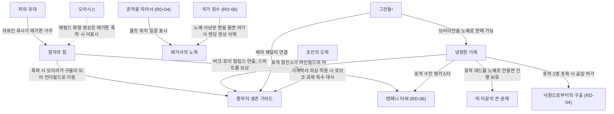

---

## 3. 원자의 힘 (The Power of the Atom)

### 3.1 기본 정보

| 항목 | 내용 |
|---|---|
| 영문명 | The Power of the Atom |
| 한국어명 | 원자의 힘 |
| 유형 | 사이드 퀘스트 (핍-보이 표시) |
| 퀘스트 ID | MS11 / 00014e9e |
| 의뢰인 | 루카스 심즈(해체 루트) / 미스터 버크(폭파 루트) |
| 시작 조건 | ① 메가톤에 처음 들어서면 심즈가 다가와 말을 걸고, 폭탄 이야기를 꺼내 해체를 의뢰받는다. ② 모리아티 살롱(Moriarty's Saloon) 구석에 앉은 버크와 대화한다. ③ 아무와도 대화하지 않고 폭탄을 직접 조작해 해체해도(폭발물 25) 퀘스트가 시작·진행된다. |
| 관련 장소 | 메가톤(폭탄 웅덩이, 모리아티 살롱, 브래스 랜턴(Brass Lantern), 정수 처리장), 텐페니 타워(펜트하우스 발코니) |
| 선행 퀘스트 | 없음. 메가톤 도착은 보통 메인 「아버지의 발자취(Following in His Footsteps)」 첫 목표와 겹친다. |
| 후행·연계 | 「텐페니 타워」(RD-06)와 발코니 연출이 연동된다. 「황무지 생존 가이드」(폭파 시 모이라 구울화), 비표시 「레오의 약물 습관(Leo's Drug Habit)」(멘타츠 공급원), 랜덤 인카운터 「뒤를 조심해(Watch Your Back)」·「메가톤의 복수(Vengeance for Megaton)」는 RD-07 참고 |
| 보상 – 해체 | 300 XP / 100캡(기본) 또는 500캡(해체 전 화술 판정 성공) 또는 무보수(카르마 +200) / 메가톤 집 열쇠와 소유 증서 |
| 보상 – 폭파 | 300 XP / 500캡(기본) 또는 1,000캡(화술 판정 성공, 또는 블랙 위도 전용 선택지) / 텐페니 타워 스위트룸 열쇠와 소유 증서 |
| 카르마 영향 | 무보수 해체 +200 / 폭파 -1,000 / 버크 처치 +100(매우 악함 인물) |
| 업적·트로피 | 「원자의 힘」 20G·브론즈. 본편 업적 중 유일하게 볼트 보이가 그려지지 않은 아이콘이다. |

### 3.2 개요

- 메가톤은 대전쟁 때 터지지 않은 원자 폭탄이 박힌 크레이터 안에 세운 판자촌이다. 폭탄 주변 웅덩이는 방사능에 오염되어 있고, 원자의 자손 교회(Church of the Children of Atom)가 이 폭탄을 숭배한다. 주민 대부분은 "지금까지 안 터졌으면 앞으로도 안 터진다"고 믿지만, 보안관 루카스 심즈만은 폭탄이 아직 살아 있다고 걱정한다.
- 같은 시기 텐페니 타워의 주인 앨리스터 텐페니(Allistair Tenpenny)의 오른팔 미스터 버크가 모리아티 살롱에 머문다. 텐페니가 "펜트하우스 발코니에서 보이는 메가톤이 눈엣가시"라고 지나가듯 불평하자 버크가 그 '처리'를 자청한 것이다.
- 볼트 101(Vault 101)에서 막 나온 외로운 방랑자(Lone Wanderer)는 첫 마을에서 곧바로 마을 전체의 운명을 결정한다. 폭탄을 해체해 마을에 정착할 집을 얻거나, 핵융합 펄스 장약(Fusion pulse charge)을 설치하고 텐페니 타워 발코니에서 직접 기폭 버튼을 누를 수 있다.

### 3.3 진행 단계 (핍-보이 목표)

**심즈 편 (해체)**

| 스테이지 | 핍-보이 목표 (원문) | 번역 | 플레이어 행동·이벤트 |
|---|---|---|---|
| 1 | [Optional] Ask Leo Stahl at the Brass Lantern about buying Mentats. | [선택] 브래스 랜턴의 레오 스탈에게 멘타츠 구입을 문의한다. | 폭발물 수치가 모자랄 때 열리는 보조 목표다. 멘타츠로 인지력을 올려 폭발물을 끌어올리게 유도한다. |
| 2 | [Optional] Meet Leo Stahl at the water treatment plant for Mentats. | [선택] 정수 처리장에서 레오 스탈을 만나 멘타츠를 받는다. | 레오와의 거래(비표시 「레오의 약물 습관」과 연결) |
| 3 | [Optional] Loot Leo Stahl's stash at the water treatment plant for Mentats. | [선택] 정수 처리장의 레오 스탈 은닉처에서 멘타츠를 챙긴다. | 은닉처는 정수 처리장 책상 안이다. 자물쇠는 '매우 어려움'이며, 처치 박사(Doc Church)를 통해서도 알 수 있다. |
| 10 | Disarm Megaton's atomic bomb. | 메가톤의 원자 폭탄을 해체한다. | 심즈의 의뢰를 수락한 상태 |
| 20 | Disarm Megaton's atomic bomb... or rig it to explode. | 메가톤의 원자 폭탄을 해체하거나… 폭발하도록 장치한다. | 심즈와 버크의 제안을 모두 들은 상태(두 편 공통 스테이지) |
| 30 | Report to Lucas Simms in Megaton. | 메가톤의 루카스 심즈에게 보고한다. | 보고하면 완료되고 보상이 지급된다. |

**버크 편 (폭파)**

| 스테이지 | 핍-보이 목표 (원문) | 번역 | 플레이어 행동·이벤트 |
|---|---|---|---|
| 15 | Rig Megaton's atomic bomb to explode. | 메가톤의 원자 폭탄이 폭발하도록 장치한다. | 버크의 제안을 수락하고 장약을 받는다. |
| 20 | Disarm Megaton's atomic bomb... or rig it to explode. | 해체하거나… 폭발하도록 장치한다. | 공통 스테이지 |
| 40 | Report to Mister Burke in Tenpenny Tower. | 텐페니 타워의 미스터 버크에게 보고한다. | 장약을 설치하면 버크가 텐페니 타워로 떠난다. 타워는 메가톤 남서쪽, 로브코 시설(RobCo facility) 근처에 있다. |
| 50 | Activate the detonator at Tenpenny Tower. | 텐페니 타워에서 기폭 장치를 작동한다. | 펜트하우스 발코니에서 텐페니·버크와 함께 빨간 버튼을 누른다. |
| 60 | Receive reward from Mister Burke in Tenpenny Tower. | 텐페니 타워에서 미스터 버크에게 보상을 받는다. | 완료 |

### 3.4 분기와 해결 방법

#### 3.4.1 핵심 판정: 폭발물 25

- 폭탄을 **해체할 때와 장약을 설치할 때 모두** 폭발물 25 이상이 필요하다. 이 퀘스트에서 루트를 막는 스킬 조건은 이것 하나다.
- 보정 수단은 멘타츠(인지력 +5, 4분. 폭발물의 지배 능력치가 인지력이다)와 레이더 블래스트마스터 헬멧(Raider blastmaster helmet, 폭발물 +5, 중화기 +5)이다. 위키는 "인지력 5 이상 또는 폭발물 20 이상이면 멘타츠로 충분히 올릴 수 있다"고 안내한다.
- 심즈에게 "자신 없다"고 말하면 그는 "그냥 긴장한 거라면 약이 좀 도움이 되겠지"라고 답해 화학약을 쓰는 우회로를 넌지시 알려 준다.

#### 3.4.2 루트 목록

| 루트 | 진입 조건 | 판정·요구 | 결과 | 보상 | 카르마 |
|---|---|---|---|---|---|
| A. 의뢰 해체(기본) | 심즈에게 "해체해 보겠다" | 폭발물 25 | 폭탄 무력화 | 300 XP, 100캡, 메가톤 집 | 0 |
| A-1. 흥정 해체 | 해체 **전에** "폭파 전문 기술은 싸지 않다. 500캡을 원한다" | 화술 판정 | 같음 | 300 XP, 500캡, 메가톤 집 | 0 |
| A-2. 무보수 해체 | "보상은 필요 없다. 다들 죽을 수 있다고 생각하면 잠이 안 온다" | 폭발물 25 | 같음 | 300 XP, 메가톤 집 | +200 |
| A-3. 선(先)해체 | 메가톤에 처음 들어가자마자 심즈가 다가오기 전에 폭탄으로 달려가 해체 | 폭발물 25 | 심즈가 다가와 해체를 치하하고 보상을 준다. | 300 XP, 100캡, 메가톤 집 | 선 카르마(자발적 해체로 처리됨) |
| B. 의뢰 폭파(기본) | 버크의 제안을 수락하고 장약을 받는다. | 폭발물 25(설치) | 메가톤 소멸 | 300 XP, 500캡, 텐페니 타워 스위트룸 | -1,000 |
| B-1. 흥정 폭파 | "500캡을 더 얹으면 거래하지" 또는 "심즈에게 해체하겠다고 했는데 웃돈이면 생각이 바뀔지도" | 화술 판정 | 같음 | 1,000캡 | -1,000 |
| B-2. 블랙 위도 흥정 | 여성 + 블랙 위도(Black Widow) 퍽: "500캡 더 내놓고, 좋아하기나 해요" | 판정 없음 | 같음 | 1,000캡 | -1,000 |
| C. 버크 고발 | 버크와 대화한 뒤 심즈에게 "버크가 폭탄을 터뜨리면 돈을 주겠다더라" → "그가 다른 사람한테 부탁하면 어쩌죠?" | 판정 없음(위키는 카르마 조건이 있다고 적지만 구체 수치는 코퍼스 미확인) | 심즈가 "황무지의 정의를 보여 주지"라며 살롱으로 가 버크를 체포하려 한다. 버크는 순순히 따르는 척하다가 등 뒤에서 소음기 10mm 권총으로 심즈를 사살한다(스크립트). | 버크 처치 시 시체 2구에서 소음기 10mm 권총, 중국제 돌격소총, 캡, 탄약 | 버크 처치 +100 |
| D. 버크 선제 처치 | 버크와 대화한 뒤라면 언제든 공격 | 전투 | 심즈가 확실히 산다. 폭파 제안을 이미 수락했다면 버크가 죽어도 기폭은 가능하다(보상 없음). | 버크 소지품 | +100 |
| E. 블랙 위도 유혹 | 여성 + 블랙 위도: "난 여기 살아요, 자기. 날 다치게 하고 싶진 않겠죠…" | 판정 없음 | 버크가 메가톤을 포기하고 떠난다. 이후 모리아티를 통해 연애편지 4통이 오고, 마지막 편지는 이별 통보다. | 없음(해체 시 해체 보상은 별도) | 0 |
| F. 공개 선언 | 심즈에게 "사실 그 폭탄을 터뜨릴 생각이다" | — | 심즈와 마을 전체가 적대한다. 웰드 부관(Deputy Weld) 등 바깥 NPC는 밖에, 주민은 안에 머문다. | — | 전투 |
| G. 거절·방치 | 양쪽 제안을 모두 거절한다. | — | 퀘스트가 열린 채로 남는다. 버크는 "제안은 유효하다"며 기다린다. | — | — |

#### 3.4.3 고발 루트(C)의 세부 규칙

- **번복 금지**: 심즈에게 고발했다가 "사실 농담이었던 것 같다"고 번복하면 심즈는 "장난치지 마라"며 이후 고발을 믿지 않는다. 늑대 소년 구조다.
- **장약 압수**: 이미 장약을 받았다면 "이걸 폭탄에 달라고 줬다"며 넘길 수 있다. 심즈가 장약을 빼앗고 버크를 잡으러 간다.
- **심즈 구하기**: 버크의 사격은 스크립트 이벤트라 탄이 모든 것을 관통해 명중한다. 따라서 심즈를 살리는 방법은 ① 버크가 총을 뽑기 전에 죽이거나, ② 총을 쏴서 손에서 떨어뜨리거나, ③ 심즈가 등을 돌린 순간 버크에게 말을 걸어 대화로 시간을 멈춘 뒤 무기를 꺼내 처치하는 것뿐이다. 심즈가 대면 중일 때 이미 언제든 버크를 공격할 수 있다.
- **심즈 사망 처리**: 심즈가 죽으면 버크는 플레이어를 위협하고 사라진다(사라지기 전에 처치하면 "친구들이 복수할 것"이라는 대사). 이후 폭탄을 해체하면 아들 하든 심즈(Harden Simms)가 퀘스트를 마무리하고 집 열쇠를 준다.
- **주의**: 이 과정에서 심즈를 실수로 맞히면 마을이 적대할 수 있다. 버크를 죽이든 심즈가 죽든 주민의 반응은 적대로 바뀌지 않고 대화 내용만 달라진다.

#### 3.4.4 특수 사례

- **장약 보관**: 버크에게 장약을 받은 뒤 심즈와 대화하지 않고 해체하고, 이후 심즈에게 보고해도 심즈는 장약을 회수하지 않는다. 이렇게 하면 장약을 고유 수집품으로 가질 수 있다(쓸모는 없음).
- **보상 없는 폭파**: 버크를 거절 → 심즈에게 고발 → 다시 버크의 제안 수락 → 장약 설치 순으로 진행하면, 심즈가 버크를 잡으러 나갔다가 갑자기 죽고 버크의 협박 연출이 나온다. 이후에도 텐페니 타워에 초대받을 수 있지만 근처 열쇠를 훔쳐 스위트룸 발코니로 가야 하며, 버크 없이 기폭하면 카르마 -1,000만 받고 다른 보상은 없다.
- **「텐페니 타워」 선행 완료**: 구울 편을 들어 타워가 구울 손에 넘어간 뒤라면, 펜트하우스로 올라갔을 때 로이 필립스(Roy Phillips)와 버크의 대화를 목격한다. 버크는 "고용주는 죽었어도 맡은 일은 끝낸다"고 말하고, 로이는 메가톤 폭파에 동의하며 버크를 받아들인다. 퀘스트는 정상 완료할 수 있다.
- **일본판**: 히로시마·나가사키 원폭에 대한 정서 때문에 버크가 아예 없다. 장약을 얻을 수 없어 해체하거나 방치하는 선택지만 남는다.

### 3.5 결과와 후일담

| 항목 | 해체 | 폭파 |
|---|---|---|
| 메가톤 | 존속. 모든 상점·NPC·퀘스트 유지 | 소멸. 높은 벽으로 둘러싸여 진입할 수 없고 하늘이 녹색으로 변한다. 폐허에 가까울수록 방사능이 강해져 최대 11라드/초, 그라운드 제로(콘솔 tcl로만 접근)는 26라드/초다. 빠른 이동 지점 이름이 "Megaton Ruins"로 바뀐다. |
| 플레이어 하우스 | 메가톤 집(브래스 랜턴 뒤 빈 집). 모이라에게 인테리어 테마를 살 수 있다([RD-22](22_economy-housing.md)). | 텐페니 타워 스위트룸 |
| 버크 | 셀을 떠나면 게임에서 사라진다. 이후 탈론 컴퍼니 용병이 "-B" 서명의 말살 계약서를 들고 습격한다(「뒤를 조심해」). 버크를 죽였어도 이 습격은 일어난다. | 텐페니 타워의 자기 스위트룸 층에 상주한다. |
| 심즈 부자 | 생존(고발 루트에서 사망 가능). 심즈가 죽으면 하든이 보안관 역할을 이어받는다. | 사망 |
| 모이라 브라운 | 변화 없음 | 유일한 생존자로 구울이 되어 나타난다. 「황무지 생존 가이드」가 진행 중이면 폐허 앞에서 언더월드(Underworld) 이주를 알린다. 진행 전이면 언더월드에 있다. |
| 기타 NPC | — | 메가톤 주민 전원 사망. 제리코(Jericho)를 고용해 데리고 있었다면 폐허 근처에 남는다. 웰드 부관의 머리가 잔해에 박혀 "메가톤에 오신 것을 환영합니다. 폭탄은 완벽하게 안전합니다"를 깨진 음성으로 반복한다. 근처의 실버(Silver)와 스프링베일 초등학교(Springvale Elementary) 레이더는 피해를 입지 않는다. |
| 적대 인카운터 | 탈론 컴퍼니 용병(선 카르마 암살대와 별개로 말살 계약서 습격) | 메가톤 난민(「메가톤의 복수」), 악 카르마에 따른 감시자 |
| 수집품 | 영향 없음 | 루카스 심즈의 집 2층 책상의 **힘 보블헤드**를 먼저 챙기지 않으면 영구 소실 |
| 경제 | 영향 없음 | 캐러밴은 여전히 폐허 앞에 정차한다(설계상 어색한 부분). |
| GNR | 쓰리독이 "심즈 보안관이 볼트 101 출신에게 해체를 맡겼다"며 칭찬 | "버섯구름이 바로 메가톤이었다"며 비난 |
| 메인 스토리 반응 | 「생명의 물(The Waters of Life)」에서 아버지 제임스(James)가 자랑스러워한다. | 제임스가 마을 학살에 경악한다. |
| 엔딩 | 변화 없음 | 엔딩 세그먼트 5(메가톤 폭파 장면)가 추가된다. 같은 악 카르마 계열인 헤럴드 화형 장면(세그먼트 6)은 메가톤을 폭파했다면 나오지 않는다. |

- 카르마 계산: 폭파 직전 카르마가 0 이하였다면 -1,000으로 곧바로 최저치(매우 악함)에 닿는다.
- 해체 뒤에도 메가톤 정착민은 여전히 플레이어를 외부인으로 대한다. 집을 가진 사실을 언급하는 사람은 심즈 부자와 모이라뿐이다.

### 3.6 흐름도

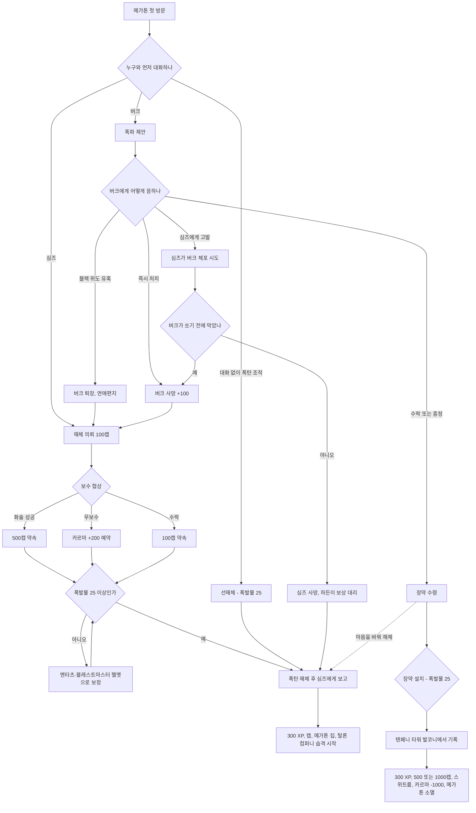

### 3.7 관련 NPC·아이템·대사 포인트

**NPC**

| 한국어명 | 영문명 | 역할 | 퀘스트 내 기능 | 비고 |
|---|---|---|---|---|
| 루카스 심즈 | Lucas Simms | 메가톤 보안관 겸 시장 | 해체 의뢰, 보상 지급, 고발 시 체포 시도 | 카르마 선함. 필수 NPC가 아니라 버크에게 죽을 수 있다. 감시자 일원이라는 설정(공식 가이드) |
| 하든 심즈 | Harden Simms | 심즈의 아들 | 심즈 사망 시 보상 대리 지급 | 후일담(공식 가이드 후기)에서 보안관직 승계 |
| 미스터 버크 | Mister Burke | 텐페니의 오른팔 | 폭파 의뢰, 장약 지급, 기폭 연출 | 카르마 매우 악함. 레벨 12. 소음기 10mm 권총 소지. 발코니에서 공격당하면 반격·도주하지 않는다. |
| 앨리스터 텐페니 | Allistair Tenpenny | 텐페니 타워 주인 | 폭파 동기 제공, 발코니에서 관람 | 원래는 "주민을 먼저 내보내자"는 정도의 불평이었다고 말한다. |
| 콜린 모리아티 | Colin Moriarty | 살롱 주인 | 터미널에서 버크를 "A급 괴짜"로 기록, 연애편지 전달 | |
| 레오 스탈 | Leo Stahl | 마약상 | 멘타츠 공급(선택 목표) | 비표시 「레오의 약물 습관」 |
| 크롬웰 | Confessor Cromwell | 원자의 자손 사제 | 폭탄 숭배. 퀘스트명이 그의 기도문 "power of Atom"에서 왔다. | |
| 모이라 브라운 | Moira Brown | 상점 주인 | 메가톤 집 인테리어 판매, 폭파 시 구울화 생존 | 4장 참고 |
| 웰드 부관 | Deputy Weld | 프로텍트론 경비 | 폭파 후 머리만 남아 대사를 반복 | |
| 로이 필립스 | Roy Phillips | 구울 지도자 | 「텐페니 타워」를 구울 승리로 끝냈다면 버크와 손잡는다. | RD-06 |

**아이템·오브젝트**

| 한국어명 | 영문명 | 유형 | 수치·특징 | 획득·사용 |
|---|---|---|---|---|
| 핵융합 펄스 장약 | Fusion pulse charge | 퀘스트 아이템 | 무게 0, 가격 1, 폼 ID 00014f81 | 버크가 지급한다. 해체 루트에서 심즈에게 넘기지 않으면 소지품에 남는다. |
| 원자 폭탄 | Atomic bomb (MegatonAtomicBomb) | 월드 오브젝트 | 폼 ID 0003bc8 | 해체·설치 대상 |
| 기폭 장치 | Detonator | 월드 오브젝트 | 화면에 표시되는 좌표 (-01,-07)은 폭탄이 있는 셀 좌표다. 누르면 다이얼이 90도 돌아간다. | 텐페니 펜트하우스 발코니 |
| 메가톤 집 열쇠·소유 증서 | My Megaton house key / Property deed: Megaton house | 열쇠·노트 | — | 해체 보상 |
| 텐페니 타워 스위트룸 열쇠·소유 증서 | My Tenpenny Tower suite key / Property deed: Tenpenny Tower suite | 열쇠·노트 | — | 폭파 보상 |
| 말살 계약서 | Contract for extermination | 노트 | "텐페니 씨의 기대를 저버린 자가 어떻게 되는지 보여 줘라. -B" | 해체·버크 처치 시 습격하는 탈론 컴퍼니 용병의 시체 |
| 버크의 연애편지 | Love letter from Burke (4통) | 노트 | 마지막 편지는 이별 통보 | 블랙 위도 유혹 루트. 며칠 간격으로 모리아티에게서 받는다. |
| 힘 보블헤드 | Vault-Tec bobblehead - Strength | 수집품 | — | 루카스 심즈의 집 2층. 폭파 전에 회수해야 한다. |

**대사 포인트**

- 심즈(해체 의뢰): "If you get the job done, there'll be 100 caps in it for you." → "일을 해내면 100캡을 주지."
- 심즈(폭파 선언에 대한 반응): "You picked the wrong man to mess with." → "건드릴 사람을 잘못 골랐어."
- 버크(제안): "Megaton is obsolete. The last vestige of a cobbled, desperate past." → "메가톤은 수명을 다했소. 기워 붙인 절박한 과거의 마지막 흔적이지."
- 버크("경고해도 되나?"라는 질문에): "I assure you, they are worth ten times as much in death, as they are in life." → "장담하건대, 그들은 살아 있을 때보다 죽었을 때 열 배는 더 가치가 있소."
- 버크(폭파 후): "That place, those people... necessary sacrifices. Here's to Tenpenny Tower!" → "그곳, 그 사람들… 필요한 희생이었소. 텐페니 타워를 위하여!"
- 버크(해체 후): "One day... one day it WILL come back to haunt you." → "언젠가… 언젠가는 반드시 당신에게 되돌아올 거요."

### 3.8 비고

- 버크의 심즈 사살은 아마타가 맥 경관을 쏘는 장면처럼 '관통 명중' 스크립트로 처리된다. 플레이어가 막을 수 있는 시간 창은 버크가 총을 뽑기 전까지다.
- 심즈가 이미 죽은 뒤에 폭탄을 해체해도 쓰리독은 "심즈가 해체를 의뢰했다"고 보도한다(보도 조건이 결과 스테이지만 본다).
- 폭발 순간 기폭 장치가 놓인 텐페니의 테이블 위 물건들이 충격파에 날아가는 연출이 있다.
- 공식 가이드는 버크가 브래스 랜턴에서 식사하며 폭탄을 관찰한다고 적지만, 게임 안에서는 늘 모리아티 살롱에 있다 `(문서 간 상충)`.
- 메가톤에는 버크 명의의 집이 있지만 버크는 거기 살지 않고 열쇠도 없다.

### 3.9 설계 분석

- **첫 마을의 극단적 선택지**: 게임 시작 직후 도착하는 첫 정착지에서 "이 마을을 지울 수 있다"는 선택을 준다. 오픈 월드의 자유도와 카르마 시스템을 한 번에 각인시키는 사실상의 '카르마 튜토리얼'이다.
- **보상 비대칭**: 폭파는 캡이 많지만(최대 1,000) 카르마 -1,000과 영구 손실(메가톤의 상점·NPC·퀘스트·힘 보블헤드)을 치른다. 해체는 '정착'이라는 장기 보상(집, 인테리어 경제)으로 균형을 잡는다. 같은 300 XP를 주어 경험치 손익은 중립이다.
- **행위의 체감**: 폭파 루트는 텐페니 타워 발코니에서 플레이어가 직접 버튼을 누르게 하고 폭발을 함께 지켜보게 한다. 버크가 "명예"를 넘겨주는 연출로 책임을 플레이어에게 확실히 지운다.
- **제3의 길의 함정**: 고발 루트는 정의 구현처럼 보이지만, 반응 속도를 요구해 실패하면 심즈가 죽는다. "선의가 늘 좋은 결과를 낳지는 않는다"는 폴아웃식 아이러니다.
- **약점**: 폭발물 25라는 단일 문턱 때문에 멘타츠 우회로가 사실상 필수 안내 장치가 된다. 해체 뒤 주민 반응이 거의 바뀌지 않아 '마을을 구했다'는 체감이 약하다. 폭파 뒤 캐러밴이 폐허 앞에 계속 서는 것도 월드 반응의 빈틈이다.
- **연계**: 「텐페니 타워」(RD-06)의 결과, 「황무지 생존 가이드」의 의뢰인 상태(구울 모이라), 엔딩 세그먼트, 탈론 컴퍼니·감시자 암살대와 묶여 있어 메인 이외 콘텐츠 가운데 월드 영향이 가장 크다.

---

## 4. 황무지 생존 가이드 (The Wasteland Survival Guide)

### 4.1 기본 정보

| 항목 | 내용 |
|---|---|
| 영문명 | The Wasteland Survival Guide (위키 문서명: Wasteland Survival Guide (quest)) |
| 한국어명 | 황무지 생존 가이드 |
| 유형 | 사이드 퀘스트 (핍-보이 표시). 3장 9과제의 연작형 |
| 퀘스트 ID | MS03 / 00014e96 |
| 의뢰인 | 모이라 브라운. 분화구 잡화점(메가톤)에 있으며, 메가톤이 폭파되면 언더월드로 옮긴다. |
| 시작 조건 | 모이라에게 쓰고 있는 책을 묻고 조수 일을 수락한다. 카르마가 음수면 첫 대화에 '보수'를 묻는 선택지가 추가된다. |
| 관련 장소 | 메가톤, 수퍼-두퍼 마트, 방사능 지역(메가톤 폭탄 웅덩이 등), 마인필드, 테피드 하수도(Tepid sewers)·주리 가 역(Jury St. station) 등 땅두더지(mole rat) 서식지, 앵커리지 기념관(Anchorage Memorial), 리벳시티(부서진 선수 포함), 로브코 생산 시설(RobCo facility), 알링턴 도서관(Arlington Library), (폭파 후) 언더월드 |
| 선행 퀘스트 | 없음 |
| 후행·연계 | 「원자의 힘」(폭파 시 의뢰인 구울화·이주), 「복제된 인간(The Replicated Man)」(RD-06, 핑커톤(Pinkerton) 터미널 관련 버그), 「초인의 도박」(기계박사 의상 착용 시 특수 대사), 「냉정한 거래」(마인필드의 알칸소가 표적), 랜덤 인카운터 「생존 가이드 서평(Survival Guide Review)」(RD-07) |
| 보상 | ① 장 완료마다 100 XP(총 300 XP)와 장 보상(1장 스팀팩, 2장 탄약, 3장 미니 누크와 책) ② 과제마다 레벨 연동 소모품 ③ 선택 목표마다 고유 보상 ④ 최종 퍽: 주니어 서바이버 / 서바이벌 엑스퍼트 / 서바이벌 구루 × 답변 성향 5종 = 15가지 |
| 대안 보상 | 드림 크러셔 퍽, 분화구 잡화점 30% 할인, 모이라의 수리 실력 향상, 진행도에 비례한 XP |
| 카르마 영향 | 드림 크러셔 루트 악 카르마 / 리벳시티 '해저 문명' 거짓말 악 카르마 / 그 외 중립 |
| 업적·트로피 | 「The Wasteland Survival Guide」 20G·브론즈. 드림 크러셔로 끝내도 업적은 얻는다. |

### 4.2 개요

- 모이라 브라운은 분화구 잡화점의 주인이자 낙천적인 아마추어 과학자다. 황무지 사람들이 살아남도록 돕는 『황무지 생존 가이드』를 쓰려고 하며, 외로운 방랑자를 '연구 조수'로 삼아 위험한 현장 실험을 맡긴다.
- 책은 3장으로 나뉘고 각 장에 과제 3개가 있다. 책 아이템 설명에 따르면 장 제목은 1장 '생존(Survive)', 2장 '번영(Thrive)', 3장 '재건(Revive)'이다. 과제마다 필수 목표와 선택(보너스) 목표가 있다.
- 보고할 때 고르는 **답변 성향**이 최종 퍽의 '형태'를, **선택 목표 달성 수와 거짓말 여부**가 퍽의 '등급'과 책의 품질을 정한다.
- 개발 중 "또 하나의 메인 퀘스트"라는 농담으로 불릴 만큼 길고 복잡했다. 설계자 프레드 젤레니(Fred Zeleny)는 "아무것도 죽이지 않고도 완료할 수 있게" 공을 들였다고 밝혔다.

### 4.3 진행 단계 (핍-보이 목표)

- 같은 장 안의 세 과제는 순서를 자유롭게 고른다. 한 장의 세 과제를 모두 끝내야 다음 장이 열린다.
- 과제를 받으면 모이라가 목적지를 지도에 표시한다.

| 스테이지 | 핍-보이 목표 (원문) | 번역 | 비고 |
|---|---|---|---|
| 2 | Ask Moira Brown about her book. | 모이라 브라운에게 책에 대해 묻는다. | 시작 |
| 5 | Help Moira with Chapter 1. | 1장 작업을 돕는다. | |
| 10 | Find Food in the Super-Duper Mart. | 수퍼-두퍼 마트에서 식량을 찾는다. | 과제 1-1 필수 |
| 12 | Find medicine in the Super-Duper Mart. (Optional) | (선택) 수퍼-두퍼 마트에서 의약품을 찾는다. | 과제 1-1 선택 |
| 16 | Return to Moira. | 모이라에게 돌아간다. | |
| 20 | Contract radiation sickness (200 rads). | 방사능 중독에 걸린다(200라드). | 과제 1-2 필수 |
| 24 | Contract more severe radiation sickness (600 rads). (Optional) | (선택) 더 심한 방사능 중독에 걸린다(600라드). | 과제 1-2 선택 |
| 26 | Return to Moira. | 모이라에게 돌아간다. | |
| 30 | Travel to the playground in Minefield. | 마인필드의 놀이터까지 간다. | 과제 1-3 필수 |
| 34 | Bring a landmine to Moira. (Optional) | (선택) 지뢰를 모이라에게 가져간다. | 과제 1-3 선택 |
| 36 | Return to Moira. | 모이라에게 돌아간다. | |
| 38 | Help Moira with Chapter 2. | 2장 작업을 돕는다. | |
| 40 | Test the repellent on three Mole Rats. | 땅두더지 세 마리에게 기피제를 시험한다. | 과제 2-1 필수 |
| 44 | Test Stick on seven more Mole Rats. (Optional) | (선택) 땅두더지 일곱 마리에게 막대를 더 시험한다. | 과제 2-1 선택 |
| 46 | Return to Moira. | 모이라에게 돌아간다. | |
| 50 | Place the Observer in a spawning pod in the Anchorage War Memorial. | 앵커리지 전쟁 기념관의 산란 둥지에 관찰 장치를 설치한다. | 과제 2-2 필수 |
| 54 | Do not kill any Mirelurks in the Anchorage War Memorial. (Optional) | (선택) 앵커리지 전쟁 기념관에서 마이얼럭(Mirelurk)을 하나도 죽이지 않는다. | 과제 2-2 선택 |
| 56 | Return to Moira. | 모이라에게 돌아간다. | |
| 60 | Become seriously injured (50% health or less). | 중상을 입는다(체력 50% 이하). | 과제 2-3 필수 |
| 64 | Receive a crippling injury. (Optional) | (선택) 부위 불구 부상을 입는다. | 과제 2-3 선택 |
| 66 | Return to Moira with your injuries. | 부상을 안고 모이라에게 돌아간다. | |
| 68 | Help Moira with the last chapter. | 마지막 장 작업을 돕는다. | |
| 70 | Learn the history of Rivet City. | 리벳시티의 역사를 알아낸다. | 과제 3-1 필수 |
| 74 | Check other sources to confirm Rivet City's History. (Optional) | (선택) 다른 출처로 리벳시티의 역사를 확인한다. | 필수 완료 후에 나타난다. |
| 76 | Uncover Rivet City's true history. (Optional) | (선택) 리벳시티의 진짜 역사를 밝힌다. | 과제 3-1 선택 |
| 78 | Return to Moira. | 모이라에게 돌아간다. | |
| 80 | Install the Processor Widget in the RobCo Production Facility mainframe. | 로브코 생산 시설 메인프레임에 프로세서 위젯을 설치한다. | 과제 3-2 필수 |
| 84 | Reprogram the RobCo facility mainframe. (Optional) | (선택) 로브코 시설 메인프레임을 재프로그래밍한다. | 핍-보이에 표시되지 않는 선택 목표 |
| 88 | Return to Moira. | 모이라에게 돌아간다. | |
| 90 | Access the card catalog in the Arlington Public Library. | 알링턴 공공 도서관의 카드 목록에 접속한다. | 과제 3-3 필수 |
| 94 | Retrieve complete library archives. (Optional) | (선택) 도서관의 전체 기록을 회수한다. | 과제 3-3 선택 |
| 98 | Return to Moira. | 모이라에게 돌아간다. | 완료 |

### 4.4 과제 상세

#### 4.4.1 1장 '생존': 식량·의약품, 방사능, 고통

**과제 1-1. 수퍼-두퍼 마트의 식량**

- 필수: 수퍼-두퍼 마트 정문 쪽 냉장고를 열면 달성한다.
- 선택: 왼쪽 안쪽 뒷방(미니 누크와 프로텍트론 옆)의 "Pharmacy Supplies" 구급함을 뒤지면 달성한다. 이때 레이더 증원이 몰려오고 인터컴으로 레이더의 목소리가 경고처럼 흘러나온다.
- 사전 완료: 퀘스트를 받기 전에 냉장고와 약품 상자를 이미 뒤졌다면, 모이라에게 경험담을 들려주는 선택지로 즉시 완료하고 선택 목표도 인정받는다.
- 거짓말: 가능하다. 거짓말로 넘기면 필수만 한 것과 같은 보상을 받는다.
- 보상: 이구아나 조각(레벨 연동). 선택 목표를 달성하면 식품 살균기가 추가된다.

| 레벨 | 1 | 4 | 7 | 10 | 13 | 17 | 20 |
|---|---|---|---|---|---|---|---|
| 이구아나 조각 | 3 | 5 | 7 | 9 | 11 | 13 | 15 |

**과제 1-2. 방사능 중독**

- 필수 200라드, 선택 600라드. 가장 가까운 방법은 메가톤 폭탄 주변의 방사능 물을 마시는 것이다. 그 밖에 백악관(White House), 볼트 87(Vault 87) 지상 입구, 뉴카-콜라 공장(Nuka-Cola plant), 스테이츠맨 호텔(Statesman Hotel) 근처에 추락한 델타 IX 로켓, 휘턴 무기고(Wheaton Armory) 내부, 스프링베일 초등학교 뒤 방사능 폐기물 구덩이가 안내된다.
- 완료하면 모이라가 라드를 0으로 치료하고 라드-X와 라드어웨이를 준다. 이때부터 모이라가 두 약을 판매한다.
- 선택 달성: 치료 뒤 모이라가 "아주 작은 돌연변이"가 생겼다고 말하며 **라드 리제너레이션** 퍽(진행성 방사능 중독, 즉 400라드 이상일 때 불구 부위 자동 재생)을 준다.
- 과학 50 이상: "과학 지식으로 직접 설명하겠다"로 피폭 없이 완료한다. 이것은 '똑똑' 답변이며 퍽 품질 계산에서는 선택 목표 달성으로 인정되지만 라드 리제너레이션은 받지 못한다.
- 사전 완료: 600라드 이상인 상태로 처음 과제를 물으면 그 자리에서 완료하고 선택 목표도 인정받는다.
- 주의: 600라드 이상이면 치명적 방사능 중독(힘 -1, 지구력 -3, 민첩성 -2) 상태라 지구력 7 답변이 막힐 수 있다. 기본 지구력이 7 이상이면 버프아웃으로 상쇄해 '터프' 답변을 고를 수 있다.

| 레벨 | 1 | 4 | 8 | 12 | 16 |
|---|---|---|---|---|---|
| 라드어웨이 | 1 | 2 | 3 | 4 | 5 |
| 라드-X | 3 | 4 | 5 | 6 | 7 |

**과제 1-3. 마인필드 통과**

- 필수: 마인필드 한가운데의 놀이터에 도착한다. 선택: 파편 지뢰를 회수해 모이라에게 가져간다. 지뢰를 해체만 하고 보고하면 인정되지 않는다(실물이 필요하다).
- 위험 요소: 거리 곳곳의 파편 지뢰, 그리고 폐건물에서 저격하는 알칸소(Arkansas)다. 알칸소는 주차된 차를 쏴 폭발을 일으키기도 한다.
- 거짓말: 가 보지 않고 다녀왔다고 거짓말한 뒤 다른 곳에서 구한 파편 지뢰로 선택 목표를 채울 수 있다. 다만 서바이벌 구루 조건에서는 탈락한다.
- 사전 방문: 이미 마을 전체를 지나갔다면 "이미 다녀왔다"로 완료할 수 있지만 이 경우 선택 목표는 달성할 수 없다.
- 보상: 파편 수류탄(레벨 연동). 선택 달성 시 설계도 - 병뚜껑 지뢰가 추가된다.

| 레벨 | 1 | 4 | 7 | 10 | 13 | 17 | 20 |
|---|---|---|---|---|---|---|---|
| 파편 수류탄 | 3 | 4 | 5 | 6 | 7 | 8 | 9 |

**1장 완료 보상**: 100 XP와 스팀팩(레벨 연동).

| 레벨 | 1 | 4 | 8 | 12 | 16 |
|---|---|---|---|---|---|
| 스팀팩 | 3 | 4 | 5 | 6 | 7 |

#### 4.4.2 2장 '번영': 크리처 대처, 부상

**과제 2-1. 땅두더지 기피제 시험**

- 필수: 기피제 막대(Repellent stick)로 땅두더지 3마리를 때린다. 선택: 7마리를 더 때린다(총 10마리).
- 실제 효과: 이름과 달리 땅두더지를 쫓지 않고 **머리를 터뜨린다**. 한 번 맞히면 몇 초 뒤 터지고 두 번 맞히면 즉사한다. 모이라는 결과를 듣고 실망한다.
- 장소: 모이라는 앵커리지 기념관 근처의 테피드 하수도(Tepid sewers)를 안내한다. 이곳은 레이더, 터렛, 폭발성 가스, 지뢰가 있어 선택 목표까지 채우기가 번거롭다. 메가톤 뒤편에도 땅두더지가 3~5마리 나타나며, 주리 가 역(Jury St. station)과 연결 터널에도 많다. 어느 땅두더지든 인정된다.
- 거짓말: "시험해 봤는데 잘 작동한다 <거짓말>" 화술 판정이 있으며 부정 답변으로 처리된다.
- 보상: 제트와 사이코(레벨 연동). 선택 달성 시 기피제 막대를 그대로 가진다. 아니면 모이라가 회수하며, 이후 그녀에게 사거나 2층 책상(매우 어려움 자물쇠)에서 훔칠 수 있다.

| 레벨 | 1 | 4 | 8 | 12 | 16 |
|---|---|---|---|---|---|
| 제트·사이코 (각각) | 1 | 2 | 3 | 4 | 5 |

**과제 2-2. 마이얼럭 둥지에 관찰 장치 설치**

- 필수: 모이라가 준 관찰 장치를 앵커리지 기념관의 마이얼럭 알 무더기 안에 놓는다. 선택: 이 과제를 하는 동안 기념관 안에서 마이얼럭을 한 마리도 죽이지 않는다.
- 판정 범위: 과제를 받기 전의 처치, 기념관 밖에서의 처치, **동료가 죽인 마이얼럭은 문제 삼지 않는다**.
- 판정 시점: 다른 선택 목표와 달리 모이라에게 "놈들은 전혀 눈치채지 못했다"고 말할 때 달성된다.
- 보상: 스텔스 보이(레벨 연동). 선택 달성 시 섀디 햇이 추가된다.

| 레벨 | 1 | 4 | 8 | 12 | 16 |
|---|---|---|---|---|---|
| 스텔스 보이 | 2 | 3 | 4 | 5 | 6 |

**과제 2-3. 부상 연구**

- 필수: 체력 50% 이하로 모이라에게 돌아간다. 선택: 한 부위 이상이 불구인 상태로 돌아간다. 자해든 전투든 원인은 상관없고, 완료 후 모이라가 모든 부상을 치료한다.
- 가장 쉬운 방법은 분화구 잡화점 앞 난간에서 폭탄 뒤쪽 바닥으로 뛰어내리는 것이다. 체력이 깎이고 다리가 부러질 수 있다.
- 의학 70 이상: "다칠 필요 없이 의사로서 설명하겠다"로 필수 목표를 인정받는다('똑똑' 답변). 선택 목표는 인정되지 않는다.
- 사전 완료: 이미 다친 상태로 가면 바로 인정된다.
- 주의: 라드 리제너레이션을 가진 상태에서 400라드 이상이면 불구가 자동 회복되어 선택 목표를 채우기 어렵다. 과제끼리 간섭하는 사례다.
- 보상: 메드-X(레벨 연동). 선택 달성 시 환경 보호복이 추가된다.

| 레벨 | 1 | 4 | 8 | 12 | 16 |
|---|---|---|---|---|---|
| 메드-X | 1 | 2 | 3 | 4 | 5 |

**2장 완료 보상**: 100 XP와 탄약. 모이라의 표현으로는 "그냥 엄청 많은 탄약"이다. 정확한 수량은 행운의 영향을 받고, 레벨 12~15 구간에서는 소형 화기 탄약 여러 종류가 무작위로 나온다.

| 레벨 | 1 | 4 | 8 | 12 | 16 |
|---|---|---|---|---|---|
| 탄약 종류 | 10mm | .32 | 5.56mm | 여러 종류 | 5mm |
| 대략 수량 | 40+ | 20+ | 70+ | 변동 | 320+ |

#### 4.4.3 3장 '재건': 정착지의 역사, 전쟁 전 기술, 지식

**과제 3-1. 리벳시티의 역사**

- 필수: 리벳시티 주민에게 역사를 묻는다. 대부분 모르지만 베논(Bannon)을 가리키며, 베논은 자신이 도시를 세웠다고 주장한다. 베라 웨덜리(Vera Weatherly)에게 물어도 같은 진척이 생긴다. 주민 누구에게든 역사를 물으면 필수 목표가 완료되고 그때 선택 목표가 새로 나타난다.
- 선택: 진짜 역사를 확인한다. 열쇠 인물은 호레이스 핑커톤(Horace Pinkerton)이다. 단서는 진흙탕 술집(The Muddy Rudder)의 벨리 보니(Belle Bonny), 베라 웨덜리 → 씨그레이브 홈즈(Seagrave Holmes)로 이어지는 소개, 그리고 핑커톤을 죽은 사람 취급하며 흘리는 경비대의 암시다.
- 핑커톤의 거처(부서진 선수, broken bow): 리벳시티를 나와 남쪽의 '무인' 선체로 간다. 통로 끝 문은 자물쇠 '매우 어려움'(자물쇠 따기 100)이다. 못 열면 문 왼쪽 물로 뛰어들어 선체 중앙 파단부의 수중 문으로 들어간다(시장 입구에서 바로 뛰어내리면 더 짧고 피폭도 적다). 수면 위로 나오면 레벨에 따른 마이얼럭 2마리가 있고, 계단 위 복도에는 가연성 가스와 부비트랩이 깔려 있다. 복도 끝 "다른 곳에서 열린다"는 문 앞 터미널은 함정이며, 진짜 스위치는 맞은편 벽에 있다.
- 핑커톤에게 "베논이 도시를 세웠다고 하더라"는 선택지를 써야 그가 직접 증거를 내놓는다. 이 선택지 없이 물으면 자기가 창립자라고만 주장하므로 선택 목표가 완료되지 않는다. 대신 그의 터미널(암호는 핑커톤에게 얻음)을 읽어도 완료된다. 베논과 대화하지 않았어도 터미널로 끝낼 수 있다.
- 보상: 멘타츠(레벨 연동). 선택 달성 시 **리벳시티 상인 영구 10% 할인**이 추가된다.
- 거짓말: "리벳시티는 사실 고대 해저 문명의 유적이다 <거짓말>"(화술 판정). 모이라가 아틀란티스였을지 모른다며 신나 한다. 멘타츠는 받지만 할인은 없고 악 카르마가 붙으며 구루 등급이 불가능해진다.

| 레벨 | 1 | 4 | 8 | 12 | 16 |
|---|---|---|---|---|---|
| 멘타츠 | 2 | 3 | 4 | 5 | 6 |

**과제 3-2. 로브코 생산 시설 메인프레임**

- 필수: 로브코 시설 최상층의 메인프레임에 로브코 프로세서 위젯을 설치한다. 설치하는 순간 시설 안의 모든 로봇이 깨어나 적대한다.
- 선택: 과학 50으로 메인프레임을 해킹해 세 가지 프로토콜 중 하나를 켜거나 끈다. 이 선택 목표는 대화 뒤에도 핍-보이에 표시되지 않는다.

| 프로토콜 | 효과 |
|---|---|
| Pest Extermination (해충 박멸) | 로봇이 방사능바퀴(radroach)와 땅두더지를 적대한다. |
| Total Liquidation (전원 청산) | 시작할 때 켜져 있는 값. 로봇이 플레이어와 그 우호 대상을 적대한다. |
| Stress Testing (내구 시험) | 로봇끼리 적대한다. |

- 로보틱스 엑스퍼트(Robotics Expert) 퍽: **퀘스트를 받는 시점에 이미 퍽이 있으면** "그 부분은 내가 써 주겠다"로 필수와 선택을 함께 즉시 완료한다('똑똑' 답변).
- 기계박사의 의상(The Mechanist's costume)을 입고 과제를 받으면 특수 유머 선택지가 나온다(「초인의 도박」과의 연결).
- 보상: 펄스 수류탄(레벨 연동). 선택 달성 시 빅 북 오브 사이언스(Big Book of Science)가 추가된다.

| 레벨 | 1 | 4 | 8 | 12 | 16 |
|---|---|---|---|---|---|
| 펄스 수류탄 | 2 | 3 | 4 | 5 | 6 |

**과제 3-3. 알링턴 공공 도서관**

- 필수: 정면 데스크 터미널에서 카드 목록 홀로테이프를 받는다. 도서관은 브라더후드 오브 스틸(BoS)이 지키고 있다. 이얼링 서기(Scribe Yearling)에게 친절하게 대하면 들여보내 주고 열쇠도 주며, 몰래 지나가도 된다. 열쇠가 없으면 터미널을 해킹해야 한다.
- 선택: 미디어 기록관(Library Media Archive) 3층, 천장 터렛이 있는 방에서 이어지는 짧은 복도 끝 방의 터미널에서 전체 기록을 내려받는다. 레이더와 방사능바퀴가 많지만 BoS 병사 2명이 정리를 돕는다.
- 거짓말: "도서관 터에 가 보니 건물이 무너져 있었다 <거짓말>". 코퍼스의 요구 조건 칸에는 'time'이라고만 적혀 있다(일정 시간 경과 조건으로 추정). 부정 답변으로 처리된다.
- 보상: 캡(레벨 연동). 선택 달성 시 라잉, 콩그레셔널 스타일(Lying, Congressional Style)이 추가된다.

| 레벨 | 1 | 5 | 8 | 10 | 15 | 16 |
|---|---|---|---|---|---|---|
| 캡 | 50 | 75 | 200 | 250 | 300 | 450 |

**최종 보상(3장 완료)**: 100 XP, 미니 누크 1개(모이라는 우물을 파려고 했는데 가지고 있으니 불안했다고 말한다), 『황무지 생존 가이드』 책, 서바이벌 계열 퍽.

### 4.5 답변 성향과 최종 퍽 산출 규칙

#### 4.5.1 답변 성향 5종

| 성향 | 열리는 조건 | 문체 | 퍽 형태 보너스 |
|---|---|---|---|
| 표준 (Standard) | 항상 | 담백하고 실용적이다. 많이 맞으며 버틴 사람의 기록 | 최대 HP |
| 냉소 (Snide) | 항상 | 냉소적이지만 경쾌하고 재미있다. | 치명타 확률 |
| 똑똑 (Smart) | 과제마다 지능 또는 인지력 7 이상 | 지적이고 철저하다. | 의학·과학 |
| 터프 (Tough) | 과제마다 힘 또는 지구력 7 이상 | 자립과 결의를 강조한다. | 피해 저항(DR) |
| 교활 (Sly) | 과제마다 카리스마 또는 민첩성 7 이상 | 친근하고 개인적인 '방랑자 선언문' | 은신·화술 |

- 능력치 7 문턱은 장비와 약물로 올린 현재값으로 판정한다.
- 퍽 형태는 **가장 많이 고른 성향**으로 정해진다.

#### 4.5.2 과제별 답변 조건표

| 과제 | 필수만 – 똑똑 | 필수만 – 터프 | 필수만 – 교활 | 선택 달성 – 똑똑 | 선택 달성 – 터프 | 선택 달성 – 교활 | 스킬·퍽 대체 | 거짓말 |
|---|---|---|---|---|---|---|---|---|
| 1-1 수퍼-두퍼 마트 | 지능 7 | 힘 7 | 민첩성 7 | 지능 7 | 지구력 7 | 카리스마 7 | 사전 완료 인정 | 가능(필수 보상만) |
| 1-2 방사능 | 지능 7 | 지구력 7 | 카리스마 7 | 인지력 7 | 지구력 7 | 카리스마 7 | 과학 50(선택 인정, 퍽 없음) / 600라드 사전 인정 | — |
| 1-3 마인필드 | 지능 7 | 지구력 7 | 민첩성 7 | 인지력 7 | 지구력 7 | 민첩성 7 | 사전 방문 인정(선택 불가) | 가능(구루 불가) |
| 2-1 땅두더지 | 지능 7 | 힘 7 | 카리스마 7 | 지능 7 | 지구력 7 | 카리스마 7 | — | 화술 판정(부정) |
| 2-2 마이얼럭 | 인지력 7 | 힘 7 | 카리스마 7 | 지능 7 | 힘 7 | 카리스마 7 | — | 선택 달성 후 냉소 답변에 <Lie> 표기가 있지만 거짓말로 치지 않는 예외 |
| 2-3 부상 | 지능 7 | 지구력 7 | 카리스마 7 | 지능 7 | 지구력 7 | 카리스마 7 | 의학 70(필수만) / 사전 부상 인정 | — |
| 3-1 리벳시티 | 인지력 7 | 힘 7 | 카리스마 7 (부정 처리) | 지능 7 | 힘 7 | 카리스마 7 | — | 화술 판정 '해저 문명'(부정, 악 카르마) |
| 3-2 로브코 | 지능 7 | 힘 7 | 카리스마 7 | 지능 7 | 힘 7 | 카리스마 7 | 로보틱스 엑스퍼트(필수+선택) | 냉소 "위젯 없이도 했다 <거짓말>"(선택 미달성이면 부정) |
| 3-3 도서관 | 인지력 7 | 지구력 7 | 카리스마 7 | 지능 7 | 지구력 7 | 민첩성 7 | — | 표준 '건물 붕괴'(부정) |

- 3-1의 '교활' 필수 답변("다들 말이 다르니 내가 세웠다고 하자")은 자기 과장으로 취급되어 부정 답변이 된다.
- 1-2의 선택 달성 후에는 구울이 된 모이라에게만 쓰는 냉소 답변("네 몰골만큼 나도 상태가 안 좋아")도 있다.

#### 4.5.3 최종 퍽 표

| 등급 | 조건 | 공통 효과 | 표준 | 똑똑 | 터프 | 교활 | 냉소 |
|---|---|---|---|---|---|---|---|
| 주니어 서바이버 (Junior Survivor) | 선택 목표 5개 미만 | 독·방사능 저항 +2% | 최대 HP +5 (02d3a2) | 의학 +2, 과학 +2 (0331d4) | DR +2% (0331d5) | 은신 +2, 화술 +2 (0331d6) | 치명타 확률 +1% (0331d7) |
| 서바이벌 엑스퍼트 (Survival Expert) | 선택 목표 5~8개 | 독·방사능 저항 +4% | 최대 HP +10 (02d3a1) | 의학 +4, 과학 +4 (0331d8) | DR +4% (0331d9) | 은신 +4, 화술 +4 (0331da) | 치명타 확률 +2% (0331db) |
| 서바이벌 구루 (Survival Guru) | 선택 목표 9개 전부 + 거짓말 없음 | 독·방사능 저항 +6% | 최대 HP +15 (02d3a0) | 의학 +6, 과학 +6 (0331dc) | DR +6% (0331dd) | 은신 +6, 화술 +6 (0331de) | 치명타 확률 +3% (0331df) |

- 괄호 안은 퍽 폼 ID다.
- 거짓말이 한 번이라도 들키면 선택 목표를 모두 채워도 구루는 불가능하다. 정직하게 5~8개를 채우면 엑스퍼트는 받을 수 있다. 예외는 2-2의 냉소 답변이다.
- 드림 크러셔와 서바이벌 계열 퍽은 서로 배타적이다.

#### 4.5.4 책의 품질

- 책 설명문은 네 부분(크레디트, 평가, 장 서술, 맺음말)으로 구성되고 '완성된 장의 수'로 정해진다. 장 하나의 선택 목표 3개를 모두 달성해야 그 장이 '완성'이다.
- 따라서 장마다 선택 목표를 2개씩(총 6개) 채우면 **퍽은 중간 등급인데 책 설명은 최악**이 될 수 있다. 퍽과 책은 별도 계산이다.

| 완성 장 수 | 크레디트 문구 | 비고 |
|---|---|---|
| 3 | Lead Author and Subject Matter Expert: 플레이어 / Assistant Author: Moira Brown | 플레이어가 주저자. "황무지 생존자에게 필요한 모든 것을 담은 필수 안내서" |
| 2 | Author: Moira Brown / Expert Researcher: 플레이어 | 어느 두 장이 완성됐는지에 따라 평가 문구가 다르다. |
| 1 | Author: Moira Brown / Researcher: 플레이어 | |
| 0 | Author: Moira Brown / Research Assistant: 플레이어 | 우스개 책 취급 |

### 4.6 대안 해결: 드림 크러셔 루트

- **진입**: 퀘스트를 시작한 뒤 모이라에게 책과 자신의 역할을 묻는 대화 가지에서 "당신은 뭘 하는지 모르는 것 같다" 쪽으로 몰아간 다음 화술 판정에 성공하고 "이 책에 시간 낭비 말고 캐러밴 돕는 일이나 하라"고 말한다. 또는 3장에 이르면 판정 없이 "이런 책을 쓸 경험이 없다. 웃음거리가 될 것" → "이러다 사람들만 다친다"로 이어지는 선택지가 열린다.
- **결과**: 드림 크러셔 퍽(적이 플레이어에게 치명타를 낼 확률 50% 감소), 분화구 잡화점 30% 할인, 모이라의 수리 스킬 24 → 54(점프슈트 +5 포함, 최대 수리 한도 54% → 72%), 그때까지 완료한 장 수에 비례한 XP(결과적으로 어느 길로 가든 XP 총량은 같다), 악 카르마. 모이라는 이후 눈에 띄게 우울하고 시무룩해진다.
- 할인과 수리 향상은 퍽 자체가 아니라 퀘스트 스테이지를 확인해 적용된다.
- **전략적 의미**: 3장의 마지막 과제 하나만 남기고 포기시키면 과제 보상은 거의 다 챙기면서 드림 크러셔도 얻는다. 업적도 그대로다.
- **정사성**: 이후 작품(폴아웃: 뉴 베가스, 폴아웃 4)에 이 책이 등장하므로 비정사 루트로 보인다.

### 4.7 결과와 후일담

| 항목 | 내용 |
|---|---|
| 퍽·아이템 | 서바이벌 계열 퍽 1개와 『황무지 생존 가이드』(무게 2, 가격 1. 효과 없는 수집품) |
| 랜덤 인카운터 「생존 가이드 서평」 | 주니어: 무장이 허술한 방랑자가 땅두더지와 싸운다. 살아남으면 "웃기는 책"이라며 책을 준다. / 엑스퍼트: 땅두더지를 이긴 방랑자가 "저자냐"고 묻고 감사한다. / 구루: 잘 무장한 방랑자가 다친 마이얼럭·방사능전갈(radscorpion)·레이더(raider) 중 하나를 마무리하고 감사와 함께 10~25캡(물물교환에 따라)을 준다. |
| GNR | 최대 조사: 쓰리독이 북클럽을 열겠다며 "탐험의 필수품"이라고 칭찬한다. / 최소 조사: "연구 방법이 엉망이다. 따라 하면 '데스클로(deathclaw)를 안아 봐'라고 말하기도 전에 죽는다"고 경고한다. |
| 모이라의 운명 | 메가톤 폭파 시 구울이 되어 살아남는다. 폭파 뒤 첫 대화를 하거나 시간이 충분히 지나면 언더월드로 옮겨 퀘스트를 계속 준다(언더월드에는 상점이 없지만 거래는 한다). 언더월드까지 **걸어서** 가므로 도중에 죽을 위험이 크다. |
| 실패 조건 | 모이라가 죽으면 메가톤에 다가갈 때 "Moira Brown has been killed and the Wasteland Survival Guide will never be written."(모이라 브라운이 죽어 『황무지 생존 가이드』는 영원히 쓰이지 못한다) 메시지가 뜨고 퀘스트가 실패한다. |
| 폭파 전 완료 시 | 메가톤이 폭파되기 전에 퀘스트를 끝냈다면 모이라는 폐허 입구 근처에 머물며 수리만 해 준다. |
| 시리즈 후일담 | 책은 4년 뒤 모하비 웨이스트랜드(뉴 베가스)와 10년 뒤 커먼웰스(폴아웃 4)에서도 발견된다. 공식 가이드 후기(Afterword, 게임 외 자료)에는 20년 뒤 모이라가 책을 캐러밴으로 배포하고 외로운 방랑자의 이야기를 모은 새 책을 쓰고 있다는 설정이 있다. |

### 4.8 흐름도

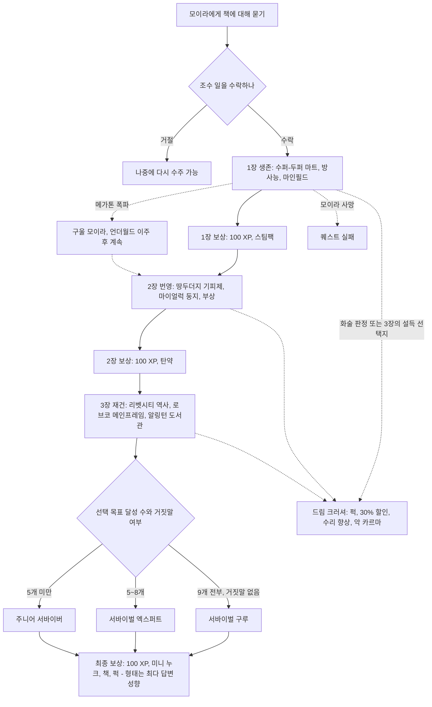

각 과제는 아래의 공통 하위 흐름을 따른다.

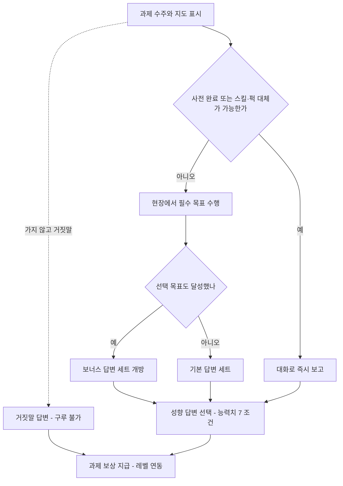

### 4.9 관련 NPC·아이템·대사 포인트

**NPC**

| 한국어명 | 영문명 | 역할 | 퀘스트 내 기능 |
|---|---|---|---|
| 모이라 브라운 | Moira Brown | 분화구 잡화점 주인, 24세 | 의뢰인. 과제 지급, 보고 청취, 치료(방사능·부상), 보상 지급. 수리 스킬 24(드림 크러셔 후 54) |
| 모이라의 용병 | Mercenary (Megaton) | 가게 경비 | "그 아가씨의 미친 실험에 날 끌어들이지 마" 같은 대사로 분위기 전달 |
| 알칸소 | Arkansas | 마인필드의 저격수 | 1-3의 위험 요소. 「냉정한 거래」의 표적이기도 하다. |
| 베논 | Bannon | 리벳시티 상층 주민 | 3-1에서 자신이 창립자라고 주장(가짜 역사) |
| 베라 웨덜리 | Vera Weatherly | 웨덜리 호텔(Weatherly Hotel) 주인 | 3-1의 대체 정보원, 씨그레이브 홈즈를 소개 |
| 벨리 보니 | Belle Bonny | 진흙탕 술집 주인 | 핑커톤의 거처를 알려 줌 |
| 씨그레이브 홈즈 | Seagrave Holmes | 리벳시티 주민 | 어릴 때부터 살아 온 주민, 선수부를 암시 |
| 호레이스 핑커톤 | Horace Pinkerton | 리벳시티 공동 창립자 | 진짜 역사의 출처, 터미널 암호 제공 |
| 이얼링 서기 | Scribe Yearling | BoS 서기 | 알링턴 도서관 출입 허가와 열쇠 |

**아이템**

| 한국어명 | 영문명 | 유형 | 주요 수치 | 획득 |
|---|---|---|---|---|
| 기피제 막대 | Repellent stick | 고유 근접 무기 | 피해 5, AP 40, 내구 100, 무게 3, 가격 120. 땅두더지에게 맞히면 머리가 폭발한다. | 2-1 수주 시 지급, 선택 달성 시 유지 |
| 관찰 장치 | Observer unit | 퀘스트 아이템 | — | 2-2 수주 시 지급 |
| 로브코 프로세서 위젯 | RobCo processor widget | 퀘스트 아이템 | 무게 1, 가격 0, 에디터 ID MS03TelemetryUnit | 3-2 수주 시 지급 |
| 식품 살균기 | Food sanitizer | 고유 잡화 | 음식의 HP 회복량 +20%, 무게 7, 가격 150 | 1-1 선택 |
| 설계도 - 병뚜껑 지뢰 | Schematics - bottlecap mine | 설계도 | 가격 300 | 1-3 선택 |
| 섀디 햇 | Shady hat | 고유 모자 | DR 1, 은신 +5, 인지력 +1, 무게 1, 가격 40 | 2-2 선택 |
| 환경 보호복 | Environment suit | 고유 의복 | DR 6, 의학 +5, 방사능 저항 +30, 무게 5, 가격 100 | 2-3 선택 |
| 빅 북 오브 사이언스 | Big Book of Science | 스킬북 | 과학 스킬북 | 3-2 선택 |
| 라잉, 콩그레셔널 스타일 | Lying, Congressional Style | 스킬북 | 화술 스킬북 | 3-3 선택 |
| 카드 목록 홀로테이프 / 미디어 기록 홀로테이프 | Card catalog holotape / Media archives holotape | 퀘스트 홀로테이프 | — | 3-3 필수 / 선택 |
| 황무지 생존 가이드 | Wasteland Survival Guide | 노트(책) | 무게 2, 가격 1, 폼 ID 0005a795 | 최종 보상 |
| 무장 볼트 101 점프슈트 | Armored Vault 101 jumpsuit | 고유 의복 | DR 12, 에너지 무기 +5, 소형 화기 +5, 무게 15, 가격 180 | 첫 대화에서 책의 '서문'을 위해 볼트 생활 이야기를 들려주면 받는다. 거절하면 사거나 훔칠 수 있다(카르마 페널티 없음). |

**대사 포인트**

- 모이라(기획 설명): "People could really use a compilation of good advice. Like a Wasteland Survival Guide!" → "사람들한테는 좋은 조언 모음이 정말 필요해. 황무지 생존 가이드 같은 거!"
- 모이라의 용병: "Leave me out of that girl's crazy experiments. I don't get paid enough for that." → "그 아가씨의 미친 실험엔 날 빼 줘. 그만큼 받지도 않는다고."
- 모이라(라드 리제너레이션 지급): "I'm sorry I twisted your DNA like a kitten with a ball of yarn." → "새끼 고양이가 털실 뭉치 갖고 놀듯 네 DNA를 꼬아 버려서 미안해."
- 모이라(드림 크러셔): "I guess you're right. It was a silly idea. I'll just stick to doing what's important." → "네 말이 맞나 봐. 바보 같은 생각이었어. 그냥 중요한 일이나 할게."
- 플레이어(완료 후 농담): "Let me guess. You need me to go print and distribute it, right?" → "맞혀 볼까. 이제 인쇄해서 배포까지 하라는 거지?" (삭제된 인쇄 단계의 흔적)
- 볼트 101 점프슈트를 입고 서문을 거절하면: "you might want to stop wearing a suit with their number writ large across the back." → "그렇다면 등에 그 번호를 크게 박은 옷부터 그만 입는 게 좋겠어."

### 4.10 비고

- **삭제된 콘텐츠**: ① 휴브리스 코믹스(Hubris Comics)에서 책을 인쇄·배포하는 단계가 있었다. 같은 설계자가 만든 「초인의 도박」과 휴브리스 코믹스를 묶으려던 흔적으로 보인다. ② 이 퀘스트와 관련된 센타우로스 '클랜시(Clancy)'가 파일에 남아 있다. 설계자는 저레벨 튜토리얼 성격의 퀘스트에 센타우로스가 어울리지 않아 빠졌을 것으로 추측했다.
- 제목은 폴아웃의 영감이 된 게임 『웨이스트랜드(Wasteland)』의 힌트·공략집 이름에서 왔다.
- **설계상 의미 있는 버그**: 「복제된 인간」 때문에 핑커톤 터미널에서 리벳시티 역사를 다시 내려받으면 모이라가 리벳시티 역사를 계속 묻는다. 거짓말 선택지로만 빠져나올 수 있어 카르마를 잃고 구루가 막힌다. 콘솔 해결책 `set "00014e96".ms03c1 to 4`는 장 진행을 퀘스트 변수 `MS03C1`로 관리한다는 것을 보여 준다. 이식할 때 장 진행 변수와 과제 완료 플래그를 분리해야 한다는 근거다.
- Xbox 360판에서는 성향 답변이 가끔 뜨지 않는 문제가 보고되었다.

### 4.11 설계 분석

- **튜토리얼을 겸한 탐험 안내**: 과제들은 사실상 게임 시스템 소개다. 루팅(식량·의약품), 방사능, 지뢰·폭발물, 크리처 대처, 부상과 불구, 정착지 탐문, 해킹과 로봇, 터미널과 홀로테이프를 차례로 체험시킨다. 장소도 메가톤에서 동심원처럼 퍼져 D.C. 남부, 리벳시티, 알링턴으로 플레이어를 이끈다.
- **이중 축 평가**: '무엇을 했나'(선택 목표 수 → 등급)와 '어떻게 말했나'(답변 성향 → 형태)를 분리했다. SPECIAL 7 문턱이 성향 답변을 열어 주므로 캐릭터 빌드가 곧 책의 문체가 된다는 롤플레잉 보상이 생긴다.
- **레벨 연동 보상**: 과제 보상이 레벨에 비례해 늘어나므로 언제 하든 보상의 가치가 유지된다. 장기 연작 퀘스트에 알맞은 장치다.
- **거짓말과 전문가 대체**: 거짓말은 시간을 아끼는 대신 최상위 보상을 잃는 위험·보상 구조다. 과학 50, 의학 70, 로보틱스 엑스퍼트는 "전문가라서 설명할 수 있다"는 정당한 우회로다. 다만 체험형 보상(라드 리제너레이션, 환경 보호복)은 놓친다.
- **반(反)퀘스트**: 드림 크러셔는 의뢰 자체를 좌절시키는 선택에도 전투 퍽과 상점 이득을 준다. 대신 카르마와 NPC의 성격 변화라는 정서적 비용을 치르게 한다.
- **약점**: "가서 하고 돌아와 보고"가 아홉 번 반복된다. 자해형 과제(방사능, 부상)의 개연성은 유머로 덮는다. 답변 성향 집계와 선택 목표 수가 화면에 보이지 않아 의도적인 빌드 공략이 어렵다.

---

## 5. 피의 유대 (Blood Ties)

### 5.1 기본 정보

| 항목 | 내용 |
|---|---|
| 영문명 | Blood Ties |
| 한국어명 | 피의 유대 |
| 유형 | 사이드 퀘스트 (핍-보이 표시) |
| 퀘스트 ID | MS09 / 00014e9c |
| 의뢰인 | 루시 웨스트(메가톤) / 에반 킹(아르푸) |
| 시작 조건 | ① 메가톤 모리아티 살롱 안팎의 루시 웨스트에게 편지 배달을 수락한다. ② 아르푸에 다가가면 에반 킹이 수류탄을 던진 뒤(실제 피해 없는 연출) 사과하며 사정을 말한다. ③ 메레스티 지하철역 패밀리 터미널의 "Regarding the Arefu Incident(아르푸 사건에 관하여)"를 읽는다. ④ 패밀리 구성원들의 대화를 엿듣는다. |
| 관련 장소 | 메가톤, 아르푸(웨스트 가·유어스 가·쉔지 가), 메레스티 조차장(Meresti trainyard), 북서 세네카 역(Northwest Seneca Station), 메레스티 서비스 터널, 메레스티 지하철역(패밀리 거처), 오답 후보지인 해밀턴의 은신처(Hamilton's hideaway)와 월광 야외 극장(Moonbeam Outdoor Cinema) |
| 선행 퀘스트 | 없음 |
| 후행·연계 | 비표시 반복 퀘스트 「네 피를 마시고 싶어(I Want to Drink Your Blood)」(혈액 팩 1개당 15캡, RD-07) |
| 보상 | 300 XP, 에반 킹 보고 시 선 카르마, 설계도 - 시시케밥(지급: 밴스(Vance)), (선택) 헤마토페이지 퍽, (선택) 스카운드럴 퍽으로 루시에게서 100캡, 아르푸 주민들의 사례 |
| 카르마 영향 | 에반 킹에게 결과를 보고하면 이안 웨스트(Ian West)의 선택과 상관없이 큰 폭의 선 카르마(수치 코퍼스 미확인). 밴스를 죽인 뒤 적대한 패밀리 구성원을 죽일 때마다 악 카르마. 밴스를 도발해 공격하게 만들면 교전해도 카르마 손실이 없다. |
| 업적·트로피 | 「피의 유대」 20G·브론즈 |

### 5.2 개요

- 아르푸는 볼트 106 북서쪽, 무너져 가는 고가도로 위에 집 네 채가 남은 마을이다. 이름은 'CAREFUL' 표지판에서 C와 L이 떨어져 나간 데서 왔다. 한때 30명이던 주민은 크리처·레이더 습격과 이주로 줄었고, 최근 정체불명 무리의 습격으로 웨스트 부부인 데이비스(Davis)와 마틸다(Matilda)가 죽고 이안이 사라져 네 명만 남았다. 습격자는 메레스티 지하철역에 사는 '패밀리'다. 이들은 식인 충동을 가진 사람들을 모아, 살 대신 피만 마시는 '흡혈귀'의 규율로 충동을 다스리려는 공동체다.
- 메가톤에 사는 루시 웨스트는 아르푸의 가족에게서 답장이 끊겨 걱정하며 편지 배달을 부탁한다. 플레이어는 아르푸에서 루시의 부모가 살해되고 남동생 이안이 사라졌음을 확인하고, 단서를 따라 패밀리의 거처에 들어간다.
- 반전: 이안은 납치된 것이 아니다. 어릴 적 사고 이후 식인 충동에 시달려 온 이안이 스스로 부모를 죽였고, 마침 습격 중이던 패밀리의 지도자 밴스가 그를 거둔 것이다. 플레이어는 이안의 거취와 아르푸·패밀리의 관계를 정한다.

### 5.3 진행 단계 (핍-보이 목표)

| 스테이지 | 핍-보이 목표 (원문) | 번역 | 플레이어 행동·이벤트 |
|---|---|---|---|
| 10 | Deliver Lucy's message to Arefu. | 루시의 편지를 아르푸에 전한다. | 루시가 봉인된 편지를 주고 아르푸를 지도에 표시한다. |
| 15 | Discover what the Family did in Arefu. | 패밀리가 아르푸에서 무슨 짓을 했는지 알아낸다. | 패밀리 쪽에서 먼저 시작했을 때의 목표 |
| 20 | Check the West Residence. | 웨스트 가를 확인한다. | 부부의 시신을 발견한다. 의학 수치에 따라 검시 노트가 생긴다. |
| 21 | Check the Ewer Residence. | 유어스 가를 확인한다. | 무사하다. |
| 22 | Check the Schenzy Residence. | 쉔지 가를 확인한다. | 무사하다. |
| 25 | Report to Evan King. | 에반 킹에게 보고한다. | 이안의 실종과 밴스 목격담을 듣고 후보지 마커를 받는다. |
| 30 | Locate The Family. | 패밀리를 찾는다. | 메레스티 지하철역 도달 |
| 40 | Locate Ian West. | 이안 웨스트를 찾는다. | 명상실 비밀번호를 얻어 이안과 대화한다. |
| 50 | Speak to Vance about Ian's decision. | 이안의 결정을 밴스에게 전한다. | 아르푸와의 관계(휴전·거래)를 협상하고 설계도 - 시시케밥을 받는다. |
| 60 | Return to Evan King. | 에반 킹에게 돌아간다. | 결과 보고. **완료**, 300 XP와 선 카르마 |
| 65 | Return to Vance to confirm deal (if applicable). | (해당 시) 거래를 확정하러 밴스에게 돌아간다. | 혈액 팩 거래를 맺었을 때만. 이후 헤마토페이지를 배울 수 있다. |

### 5.4 분기와 해결 방법

#### 5.4.1 수사: 시신 검시와 은신처 추적

| 의학 스킬 | 검시 노트 내용 | 의미 |
|---|---|---|
| 30 | 목에 뼈까지 닿는 깊은 물린 자국이 있다. | 흡혈귀 소문과 연결 |
| 50 | 그만한 상처인데 침대보에 피 얼룩이 거의 없다. | 피를 빨아 갔다. |
| 70 | 물린 자국은 날카롭게 간 송곳니를 가진 **인간**의 이빨 자국이다. | 범인이 사람이다. |
| 90 | 시신에 조차장에서 흔히 보이는 검은 가루 잔여물이 묻어 있다. | 은신처의 정답 단서 |

- 노트는 "Medical analysis of West corpses"로 핍-보이에 추가된다. 낮은 단계 판정만 통과한 채 보고하지 않고 떠났다가 스킬을 올려 다시 오면 다음 단계 노트를 별도로 더 얻을 수 있다.
- 에반 킹은 패밀리의 위치 후보로 해밀턴의 은신처, 월광 야외 극장, 북서 세네카 역을 표시해 준다. **세 곳 모두 오답**이다. 다만 북서 세네카 역의 머피(Murphy)에게 패밀리를 물으면 하수도 입구를 알려 준다.
- 의학 90 단서를 얻었다면 "근처에 조차장이 있나?"라고 물을 수 있고, 에반이 **정답인 메레스티 조차장** 마커를 추가한다. 스킬 투자가 곧 지름길이 되는 구조다.
- 스카운드럴(Scoundrel) 퍽이 있으면 부모의 운명을 확인한 뒤 루시에게 돌아가 동생을 찾는 대가로 100캡을 뜯어낼 수 있다. 카르마 손실은 없다.

#### 5.4.2 패밀리 은신처로 가는 길

- **정문 경로**: 메레스티 조차장 아래 터널로 들어간다.
- **우회 경로**: 북서 세네카 역 머피의 약물 제조장(비표시 「머피의 폭격 작전(Murphy's Bombing Run)」) 뒤쪽 사무실 해치 → 메레스티 서비스 터널(마이얼럭 2마리) → 열차 터널. 첫 열차 잔해에서 왼쪽으로 가면 양옆 파편 지뢰와 가운데 곰덫 2개가 있고, 이어서 소형 인계철선 2개(장전된 산탄총, 천장에서 떨어지는 무거운 추)가 나온다.
- 터널 전체에는 곰덫, 파편 지뢰, 폭탄이 실린 유모차, 인계철선(장전 산탄총, 수류탄 다발, 야구 피칭 머신) 같은 함정이 많다.

#### 5.4.3 정문 통과 (경비 로버트)

| 방법 | 조건 | 결과 |
|---|---|---|
| 통행료 | 100캡 | 평화롭게 들어간다. |
| 루시의 편지 | 편지 소지("이안에게 누나 편지를 가져왔다") | 무료로 들어간다. |
| 화술 판정 | 화술 | 평화롭게 들어간다. |
| 캐니벌 퍽 | 캐니벌(Cannibal) | 평화롭게 들어간다. 이후 퀘스트 전체에서 퍽 전용 선택지가 많이 열려 진행이 훨씬 쉬워진다. |
| 강행 | 로버트를 죽이고 옆 터미널을 해킹해 문을 연다. | 패밀리 적대 |
| 잠입 | 로버트 몰래 지나간다. | 패밀리 적대 |

#### 5.4.4 이안의 명상실 비밀번호

명상실 문 코드("Vespertilio", 박쥐의 한 속명)는 여러 구성원이 각기 다른 조건으로 알려 준다.

| 출처 | 한국어명 | 조건 | 비고 |
|---|---|---|---|
| Vance | 밴스 | ① 화술: "이 편지는 이안에게 남은 옛 삶의 전부다. 전하게 해 달라" ② 캐니벌: "나도 당신들과 같다" ③ 화술 또는 지능: "당신들이 뭔지 정확히 안다" ④ 실패하면 "구성원들에게 묻고 로비 터미널의 율법을 읽으라"고 하며, 율법을 이해했다고 설명하면 코드를 준다. | '조사' 루트 |
| Alan | 앨런 | 직접 주지 않는다. | 이안과 친해지려는 저스틴을 가리킨다. |
| Justin | 저스틴 | "이안에게는 외부의 목소리가 필요하다" 화술 판정, 또는 임파셜 미디에이션(Impartial Mediation) 퍽(중립 카르마가 아니어도 같은 결과) | 이안이 부모 살해 현장에 있으면서 막지 않았다고 말한다. |
| Karl | 칼 | 블랙 위도(여성) 유혹, 또는 높은 힘으로 위협(남녀 공통, 수치 코퍼스 미확인) | 밴스의 가르침을 믿지 않는 상점 주인 |
| Brianna | 브리아나 | 레이디 킬러(Lady Killer, 남성) 유혹, 스카운드럴, 또는 높은 카리스마 | |
| Holly | 홀리 | 스카운드럴 또는 높은 카리스마(팩션 문서는 화술 판정도 언급) | 밴스의 아내 |
| (시체) | 밴스 살해 | 시체에서 코드를 얻는다. | 패밀리가 적대하고, 이후 구성원을 죽일 때마다 악 카르마. 이안은 화를 내지만 같은 선택지를 준다. |
| (도발) | 밴스 도발 | 대화에서 밴스를 몰아붙이다 "사이코"라고 부르면 공격 명령을 내린다. | 교전해도 카르마 손실 없음. **이안이 결정하기 전에만** 써야 한다. |

#### 5.4.5 이안의 결정

| 선택 | 조건 | 결과 |
|---|---|---|
| 집으로 돌아가게 함 – 편지 | 루시의 편지를 건넨다("루시가 쓴 거야. 마음이 바뀔걸") | 이안이 누나의 그리움을 알고 아르푸로 돌아가기로 한다. |
| 집으로 돌아가게 함 – 설득 | 밴스가 살아 있을 때 화술 판정("악몽을 이기려면 마주해야 해") | 같음. 이안은 "방금 밴스처럼 말했다"며 동의한다. |
| 패밀리에 남게 둠 | 설득하지 않는다. | 이안이 패밀리에 남는다. |
| 실패 | 밴스를 죽인 뒤 "이제 벌레 밥이지"처럼 그의 죽음을 조롱한다. | 이안이 적대하고 퀘스트가 실패한다. |

- 루시와 대화하지 않고 아르푸로 곧장 가면 나중에 이안을 설득하지 못할 수 있다(편지가 없기 때문).
- 이안이 결정하는 순간부터 **아르푸와 패밀리는 같은 팩션으로 묶인다**(밴스와의 거래가 성사되기 전이라도). 이후 패밀리 구성원을 공격하면 아르푸까지 적대한다.

#### 5.4.6 밴스와의 협상 (스테이지 50)

| 접근 | 판정 | 밴스의 반응 |
|---|---|---|
| "계속 공격하면 아르푸는 모두 죽을 때까지 맞설 것" | 없음 | 더 이상 해치지 않겠다고 맹세한다. 혈액 팩 거래는 없다(헤마토페이지 불가). |
| "저 사람들에게 기회를 줘라. 무방비 상태다" | 화술 판정 | 습격을 멈추면 다른 사람을 사냥해야 한다고 하면서도 예전에 병원 폐허의 혈액 팩으로 버텼던 일을 떠올린다. |
| "혈액 팩에 보존된 피로 충분할 것" | 의학 판정 | 같은 흐름으로 혈액 팩 대안을 검토한다. |
| "살아남을 다른 혈액원이 있을 것" | 지능 판정 | 같음 |
| "흡혈귀는 어떤 인간의 피든 마실 수 있다. 혈액 팩이라도" | 패밀리 율법 조사 | 같음 |

혈액 팩 대안이 열리면 세 가지 제안 중 하나를 고른다.

| 제안 | 결과 |
|---|---|
| 아르푸가 혈액 팩을 기부하고, 패밀리는 마을을 건드리지 않는다. | 수락. 에반 킹에게 전하고 다시 오라고 한다. |
| 아르푸가 혈액 팩을 기부하고, 그 대가로 패밀리가 마을을 지킨다. | 수락. 이후 앨런이 아르푸에 파견된다. |
| 아르푸가 혈액 팩을 팔고, 패밀리는 마을을 건드리지 않는다. | 거절. "우리는 돈도 물건도 없다. 더 나은 제안을 해 달라." |

- 대화 선택과 상관없이 첫 협상 대화가 끝나면 밴스가 **설계도 - 시시케밥**을 준다.
- 혈액 팩 거래를 성사시키고 에반 킹에게 보고한 뒤 밴스에게 돌아가 "흡혈귀의 방식을 가르쳐 달라"고 하면 **헤마토페이지** 퍽을 배운다. 혈액 팩의 회복량이 1 HP에서 20 HP로 바뀐다.
- 헤마토페이지 불가 조건: 패밀리를 몰살하고 끝낸 경우, 혈액 팩 거래 없이 "공격만 멈춰 달라"로 끝낸 경우, 거래 뒤 아르푸 주민을 죽이거나 어느 한쪽과 적대한 경우(이때 밴스는 플레이어를 "개자식"이라 부르며 가르쳐 주지 않는다).

#### 5.4.7 에반 킹에게 보고 (스테이지 60)

- 이안이 돌아오기로 했다면 사실대로 보고한다.
- 이안이 남기로 했다면 "찾지 못했다", "죽었다", "루시와 살러 갔다" 세 가지 선택지만 나올 수 있다. 셋 다 대화창에 거짓말로 표시되지만 모두 완료로 인정되며 XP와 선 카르마를 준다. **선의의 거짓말을 허용하는 설계**다.

#### 5.4.8 실패 조건

- 아르푸 주민을 한 명이라도 죽이면 즉시 실패한다.
- 이안이 결정한 뒤 패밀리 구성원을 죽이면 아르푸가 적대한다(같은 팩션). 처음부터 공격적으로 들어갔다가 로버트를 살려 둔 채 이안과 대화하면, 나갈 때 적대 상태인 로버트를 죽이는 순간 실패한다. 로버트를 몰래 지나치면 피할 수 있다.
- 패밀리를 몰살한 뒤 이안에게 편지를 주면 이안은 집으로 가기로 하지만, 아르푸로 돌아가면 주민이 적대하고 퀘스트가 실패한다.
- 밴스의 죽음을 조롱하면 이안이 적대해 실패한다.

### 5.5 결과와 후일담

| 결과 요소 | 내용 |
|---|---|
| 아르푸의 사례 | 에반 킹: 맥주·와인·스카치·보드카·위스키 중 하나를 준다(퀘스트 문서는 1회, 인물 문서는 반복 가능 `(문서 간 상충)`). / 켄 유어스(Ken Ewers): 유료로 장비를 최대 47%까지 수리한다. / 브라일리 유어스(Brailee Ewers): '옛날식 초콜릿 칩 쿠키'를 주는데 실제로는 깡통이다. / 카렌 쉔지(Karen Schenzy): 핍-보이에 장소 여러 곳을 표시해 준다. |
| 경비 거래 시 | 앨런이 아르푸 입구 브라민(brahmin) 우리 근처 집에 상주한다. 그 집 구석 탁자에 퓨질리즘 일러스트레이티드(Pugilism Illustrated)가 있다. |
| 혈액 팩 거래 | 이후 밴스에게 혈액 팩을 개당 15캡에 팔 수 있다(「네 피를 마시고 싶어」). 칼이 혈액 팩을 15캡보다 싸게 팔 때도 있다. |
| 이안 | 돌아가기로 했다면 아르푸 부모 집으로 온다(실제로 메가톤의 루시에게 가지는 않는다). 남기로 했다면 패밀리에 머문다. 남긴 뒤에도 편지를 줄 수 있으며, 이안은 기뻐하지만 떠나지는 않는다. |
| 루시 | 편지를 전했다고 하면 "깜빡했네"처럼 덤덤하게 반응한다. 이안을 만나기 전에 부모의 죽음을 알렸다면 나중에 정식 감사 대사가 추가된다. 알리지 않고 이안과 대화하면 이후에는 편지 전달 사실만 말할 수 있다. 이안이 남은 경우 편지를 루시에게 돌려줄 수는 없다. |
| 패밀리 몰살 시 | 아르푸 습격은 끝나지만 헤마토페이지와 혈액 팩 판매는 불가능하다. 밴스(카르마 중립)는 죽으면 귀를 떨어뜨린다. |
| GNR·엔딩 | 이 퀘스트에 연동된 GNR 보도와 엔딩 세그먼트는 코퍼스에서 확인되지 않는다. |

### 5.6 흐름도

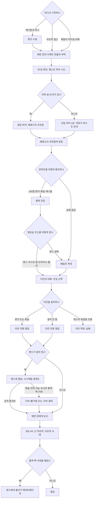

### 5.7 관련 NPC·아이템·대사 포인트

**NPC**

| 한국어명 | 영문명 | 소속·역할 | 퀘스트 내 기능 | 비고 |
|---|---|---|---|---|
| 루시 웨스트 | Lucy West | 메가톤 주민 | 의뢰인, 편지 제공 | 스카운드럴로 100캡 갈취 가능 |
| 에반 킹 | Evan King | 아르푸의 대표 | 의뢰인, 후보지 표시, 최종 보고 | 그의 집(자물쇠 50)에 수리 보블헤드가 있다. |
| 이안 웨스트 | Ian West | 15세, 루시의 동생 | 사건의 진범이자 결정 당사자 | 어린 시절 머리를 부딪친 뒤 식인 충동이 생겼다고 말한다. |
| 밴스 | Vance | 패밀리 지도자, 41세, 리벳시티 출신 | 코드·협상·설계도·헤마토페이지 | 카르마 중립. 공식 가이드는 폭군이 아니라 '사제 같은 인도자'로 묘사한다. |
| 홀리 | Holly | 밴스의 아내 | 코드 제공 | |
| 앨런 | Alan | 신입 구성원 | 저스틴을 안내, 경비 거래 시 아르푸 상주 | |
| 저스틴 | Justin | 이안의 형 같은 조력자 | 코드 제공 | |
| 칼 | Karl | 상점 주인 | 코드 제공, 혈액 팩 판매 | 율법을 믿지 않는다. |
| 브리아나 | Brianna | 구성원 | 코드 제공 | |
| 로버트 | Robert | 정문 경비 | 통행 허가 | 율법을 외우는 일을 귀찮아하는 유일한 '비신자'다. |
| 머피 | Murphy | 북서 세네카 역의 약물 제조업자 | 하수도 입구 안내 | |
| 켄 유어스 / 브라일리 유어스 / 카렌 쉔지 | Ken Ewers / Brailee Ewers / Karen Schenzy | 아르푸 주민 | 완료 후 사례 | 캐런은 패밀리가 문을 열라고 조롱하며 병을 던진다고 증언한다. 소설 『나는 전설이다』의 흡혈귀 묘사를 따른 것이다. |

**패밀리의 다섯 율법 ('조사' 루트의 지식)**

| 율법 | 원문 표어 | 요지 |
|---|---|---|
| 제1율법 | Feast not on the flesh; consume only the blood. This is our strength. | 살을 먹지 말고 피만 마신다. 살을 먹는 행위가 인간들이 우리를 짐승 취급하게 만든다. |
| 제2율법 | Bear not the child; welcome only the exile. This is our fate. | 아이를 낳지 않고, 같은 처지의 추방자만 받아들인다. |
| 제3율법 | Feed not for pleasure; partake only to nourish. This is our dignity. | 쾌락이 아니라 생존을 위해서만 먹는다. 아이는 사냥하지 않는다. |
| 제4율법 | Seek not the sun's light; embrace only the shadows. This is our refuge. | 햇빛을 피해 밤에만 움직인다. |
| 제5율법 | Kill not our kindred; slay only the enemy. This is our justice. | 지도자의 허락 없이 동족을 죽이지 않는다. |

**아이템**

| 한국어명 | 영문명 | 유형 | 비고 |
|---|---|---|---|
| 루시의 봉인된 편지 | Lucy's sealed envelope | 퀘스트 아이템 | 정문 무료 통과, 이안 설득의 열쇠 |
| 웨스트 부부 검시 노트 | Medical analysis of West corpses | 노트 | 의학 30/50/70/90 단계 |
| 설계도 - 시시케밥 | Schematics - Shishkebab | 설계도 | 밴스가 협상 대화 뒤 지급. 시시케밥(Shishkebab)은 불타는 근접 무기로 「오아시스」의 헤럴드 화형에도 쓸 수 있다. |
| 혈액 팩 | Blood pack | 소모품 | 기본 1 HP 회복, 헤마토페이지 보유 시 20 HP. 밴스에게 15캡에 판매 |
| 퓨질리즘 일러스트레이티드 | Pugilism Illustrated | 스킬북(비무장) | 경비 거래 후 앨런의 아르푸 집 |

**대사 포인트**

- 이안(고백): "I killed them, okay?! My mother and father are dead because of me!" → "내가 죽였다고요! 엄마 아빠는 나 때문에 죽었어요!"
- 이안(편지를 읽고): "She really misses being home and she's asked about me in here a lot!" → "누나가 집을 정말 그리워해요. 편지에 내 얘기를 잔뜩 물어봤어요!"
- 밴스(휴전): "I promise you that no further harm will befall you or Arefu. Of that you have my solemn oath." → "당신에게도 아르푸에도 더는 해가 없을 거요. 엄숙히 맹세하오."
- 밴스(혈액 팩 거래 후): "My people are getting accustomed to using these as substitute for live prey." → "내 사람들이 산 사냥감 대신 이걸로 버티는 데 익숙해지고 있소."

### 5.8 비고

- 아르푸에서 처음 들리는 폭발은 지뢰도, 실제 투척도 없는 연출용 폭발이다. 에반 킹이 적을 쫓아가 버리면 대화 연출이 멈춰 버리는 문제가 보고되었다.
- 편지만 들고 아르푸를 거치지 않고 패밀리 거처로 가도 로버트는 들여보낸다. 이때 밴스를 죽이고 코드로 명상실을 열어도 이안은 아직 거기 없다. 밴스와 대화하면 터미널을 통해 패밀리의 정체를 알게 되고 목표가 "아르푸에서 무슨 일이 있었는지 알아낸다"로 바뀐다. 아르푸에 가면 에반 킹과 추가 대화가 열리고 정상 진행된다.
- 패밀리 터미널을 구성원이 보는 앞에서 해킹하면 나갈 때 패밀리가 적대할 수 있다(콘솔판 보고). 은신처 경비 뒤에서 엔클레이브 라디오(Enclave Radio)를 틀어 둔 라디오를 숨지 않고 끄면 경비가 적대한다.
- 밴스의 명상실 코드 "Vespertilio"는 박쥐의 한 속명이다. 카렌 쉔지의 증언은 소설 『나는 전설이다』의 흡혈귀를 인용한 것이다.

### 5.9 설계 분석

- **수사극 구조**: 검시(의학 단계별 정보) → 증언(에반 킹) → 오답 후보지 → 정답 단서(조차장 가루)로 이어지는 추리 구조다. 스킬 투자가 정보량과 지름길로 바로 보상된다. 오답 마커 3곳은 탐험을 유도하면서 머피를 통한 '구제 경로'도 마련해 막힘을 막는다.
- **괴물의 인간화와 반전**: '마을을 습격하는 흡혈귀'라는 전형적인 토벌 퀘스트처럼 시작하지만, 패밀리를 '규율로 식인 충동을 다스리려는 공동체'로, 피해자 가족의 아들을 진범으로 뒤집는다. 학살이 정답처럼 보이는 상황을 협상 문제로 바꾼다.
- **열쇠의 분산**: 하나의 정보(명상실 코드)를 여섯 명이 각기 다른 퍽·능력치·화술·조사 조건으로 내준다. 어떤 캐릭터 빌드로 와도 비폭력 해법이 있다는 폴아웃 3 퀘스트 설계의 전형이다.
- **선의 정의**: 이안의 결정과 상관없이 에반 킹에게 보고하면 선 카르마를 준다. 거짓 보고도 허용한다. 퀘스트가 평가하는 것은 '진실 폭로'가 아니라 '분쟁 종식'이다.
- **약점**: 이안이 실제로 루시를 찾아가지 않고, 루시의 덤덤한 반응이 감정선을 깎는다. 팩션 병합이 '이안의 결정 직후'라는 보이지 않는 시점에 일어나, 공격적인 플레이어가 영문도 모른 채 실패할 수 있다.

---

## 6. 그것들! (Those!)

### 6.1 기본 정보

| 항목 | 내용 |
|---|---|
| 영문명 | Those! |
| 한국어명 | 그것들! |
| 유형 | 사이드 퀘스트 (핍-보이 표시) |
| 퀘스트 ID | MS04 / 00014e97 |
| 의뢰인 | 브라이언 윌크스(그레이디치의 소년) |
| 시작 조건 | ① 그레이디치 근처(수퍼-두퍼 마트, 하수도 중간역, 멀게는 윌헬름 부두)에 가면 브라이언이 다가와 아버지를 찾아 달라고 한다. ② 마리골드 역의 레스코 박사와 대화한다. ③ 그레이디치의 최근 지은 판잣집에서 레스코의 터미널을 해킹한다. 브라이언이 전투에 놀라 달아나면 직접 찾아야 한다(6.4.5). |
| 관련 장소 | 그레이디치의 윌크스의 집·최근 지은 판잣집·풀로스키 보존 대피소(Pulowski Preservation shelter)·도트의 식당(Dot's Diner), 마리골드 역의 레스코 연구실, 여왕개미 부화장(Queen ant's hatchery), 리벳시티의 웨덜리 호텔, 리틀 램프라잇, 파라다이스폴 |
| 선행 퀘스트 | 없음 |
| 후행·연계 | 비표시 「재미와 이윤을 위한 꿀 수집(Nectar Collecting for Fun and Profit)」(화염개미 꿀 1개 40캡), 「그레이디의 소포(Grady's Package)」(마리골드 역에서 동시 진행 가능), 랜덤 인카운터 「그레이디치 탈출(Escape from Grayditch)」·「화염개미의 습격(Attack of the Fire Ants)」(RD-07) |
| 보상 | 300 XP, 앤트 마이트 또는 앤트 사이트 퍽(택1), 레스코의 실험복(보상을 흥정한 경우), 브라이언의 쓰레기통 열쇠(선택), 브라이언을 노예로 팔면 100캡(화술 판정 시 300캡) |
| 카르마 영향 | 베라에게 맡김: 큰 선 카르마 / 리틀 램프라잇·방치: 변화 없음 / 파라다이스폴 판매: -400 / 여왕개미 처치 또는 돌연변이 유발원 파괴: 선 카르마(먼저 한 쪽만) / 레스코 살해, "수호자는 죽었다"는 거짓말: 악 카르마 |
| 업적·트로피 | 「그것들!」 20G·브론즈 |

### 6.2 개요

- 그레이디치는 대전쟁 전 벽돌 주택가였던 곳에 일곱 명이 1년 남짓 모여 살던 작은 정착지다. 이곳에 불을 뿜는 거대 개미(giant ant), 즉 **화염개미(fire ant)**가 들이닥쳐 주민 대부분이 죽었다.
- 원인은 같은 마을에 살던 곤충학자 웨스턴 레스코(Weston Lesko) 박사다. 그는 거대 개미를 세대에 걸쳐 전쟁 전 크기로 줄이려고 마리골드 역 개미 군락의 알에 돌연변이 유발원(실은 FEV)을 주입했다. 그런데 계산 착오로 새끼들이 생물학적으로 불을 내뿜는 '파이로시스(pyrosis)' 능력을 갖고 태어났다.
- 살아남은 소년 브라이언 윌크스는 아버지를 찾아 달라고 부탁한다. 플레이어는 아버지의 죽음을 확인하고, 화염개미의 근원을 처리하고, 고아가 된 브라이언의 거처를 정한다. 제목은 1954년 영화 『그것들!(Them!)』의 패러디다.

### 6.3 진행 단계 (핍-보이 목표)

| 스테이지 | 핍-보이 목표 (원문) | 번역 | 플레이어 행동·이벤트 |
|---|---|---|---|
| 10 | Find Bryan Wilks's father. | 브라이언 윌크스의 아버지를 찾는다. | 윌크스의 집에서 프레드 윌크스(Fred Wilks)의 시신을 발견한다. |
| 20 | Deliver the bad news to Bryan Wilks. | 브라이언 윌크스에게 비보를 전한다. | 브라이언은 도트의 식당 옆 풀로스키 보존 대피소에 숨어 있다. 이 보고는 퀘스트 끝까지 미룰 수 있다. |
| 30 | Remove the source of the Fire Ants. | 화염개미의 근원을 제거한다. | |
| 35 | Investigate Marigold Metro Station and remove the source of the Fire Ants. | 마리골드 지하철역을 조사하고 화염개미의 근원을 제거한다. | 판잣집 터미널이나 대화로 마리골드 역을 알게 된다. |
| 40 | Eliminate all five Nest Guardians from the Ant Queen's Hatchery. | 여왕개미 부화장의 둥지 수호자 다섯 마리를 모두 처치한다. | 레스코의 부탁 |
| 42 | (Optional) Do not harm the Ant Queen. | (선택) 여왕개미를 해치지 않는다. | |
| 43 | Send the Inhibitor Pulse from Lesko's portable terminal or Kill the Ant Queen. | 레스코의 휴대용 터미널로 억제 펄스를 보내거나 여왕개미를 죽인다. | 레스코가 죽거나 협력이 깨졌을 때 등장 |
| 45 | Return to Doctor Lesko. | 레스코 박사에게 돌아간다. | 퍽 보상 |
| 50 | Return to Bryan Wilks. | 브라이언 윌크스에게 돌아간다. | |
| 52 | Find Bryan Wilks in Grayditch. | 그레이디치에서 브라이언 윌크스를 찾는다. | |
| 60 | Find a home for Bryan Wilks. | 브라이언 윌크스가 살 곳을 찾아 준다. | **완료** |

### 6.4 분기와 해결 방법

#### 6.4.1 아버지 수색과 단서

- 프레드 윌크스(Fred Wilks)의 시신은 판잣집 옆 윌크스의 집에 있다. 시신에서 판잣집 열쇠를 얻고, 집 선반에서 중국제 돌격소총과 탄약을 챙길 수 있다.
- 판잣집(최근 지은 판잣집, 자물쇠 난이도는 캐릭터 상태에 따라 다름)에는 레스코의 장비와 터미널이 있다. 터미널 노트를 읽으면 마리골드 역 위치를 얻는다. 왼쪽 책상에는 레스코 박사의 암호 녹음 테이프가 있다.
- 첫 만남에서 보통 난이도 화술 판정이나 차일드 앳 하트(Child at Heart) 퍽으로 설득하면 브라이언이 아버지가 숨겨 둔 비상 물자, 즉 도트의 식당 뒤 쓰레기통의 열쇠를 준다. 쓰레기통은 '매우 어려움' 자물쇠이며 무작위 무기 등이 들어 있다. 설득하지 못하면 브라이언은 거짓말로 숨긴다.
- 엔터몰러지스트(Entomologist) 퍽이 있으면 브라이언과 여왕개미에 관한 특수 대화를 할 수 있다.

#### 6.4.2 마리골드 역: 레스코 박사와의 대화

- 레스코는 실험 사고를 고백하며 여왕개미를 지키는 **둥지 수호자 다섯 마리**만 처치해 달라고 부탁한다. 여왕은 몇 달 치 데이터가 담겨 있으니 절대 해치지 말라고 한다. 수호자가 사라지면 그가 휴대용 터미널로 '억제 펄스'를 보내 남은 개미들이 여왕과의 교감을 잃고 서로 죽이게 하겠다는 계획이다.
- 과학 60 이상이면 실험에 FEV를 썼다는 사실을 털어놓게 하는 선택지가 열린다(인물 문서 기준. 퀘스트 문서는 '과학이 충분히 높으면'이라고만 적는다).
- **보상 흥정**: "이건 꽤 큰일이오, 박사. 확실한 보상이 필요하오" → 원래 주려던 '돌연변이 생체 강화제' 주사(힘 또는 인지력 강화)에 자기 실험복을 얹어 준다. 이 흥정을 하지 않으면 레스코의 실험복은 정상적인 방법으로 얻을 수 없다.
- **주의**: 레스코 근처의 화염개미를 먼저 정리하지 않으면 대화가 끝난 뒤 레스코가 겁먹고 달아나다 죽기 쉽다. 이렇게 되면 퍽과 실험복을 정상적으로 얻을 수 없다.

#### 6.4.3 화염개미 문제 해결 루트

| 루트 | 조건 | 결과 | 보상 | 카르마 |
|---|---|---|---|---|
| 1. 수호자만 처치(여왕 보존) | 수호자 5마리 처치, 여왕에게 피해를 주지 않음 | 레스코에게 보고하면 그가 억제 펄스를 보낸다. | 앤트 마이트 또는 앤트 사이트(+흥정 시 실험복) | 변화 없음 |
| 1-a. 억제 펄스 직접 송신 | 부화장의 레스코 휴대용 터미널을 과학 50으로 해킹 | 그레이디치 일대 화염개미가 모두 죽는다(마리골드 역 안은 제외). | — | — |
| 2. 여왕 처치 후 설득 | 여왕을 죽이고 화술 판정 또는 과학 70 | 레스코가 "인류를 위한 최선"이었다고 납득한다. | 퍽 | 선 카르마 |
| 3. 돌연변이 유발원 샘플 파괴 | 부화장 터미널을 과학 50으로 해킹해 FEV 샘플 파괴 | 실험을 재개할 수 없다. 레스코를 납득시키려면 화술 판정 또는 과학 70이 필요하다. | 퍽(설득 시) | 선 카르마 |
| 4. 보고 뒤 여왕 처치 | 루트 1로 퍽을 받은 뒤 부화장에 돌아가 여왕을 죽인다. | 화술 판정 없이 처치 XP와 카르마를 얻는다. | 퍽 + 처치 XP | 선 카르마 |
| 5. 레스코 살해 | — | 퍽과 실험복을 얻을 수 없다. 스테이지 43(펄스 송신 또는 여왕 처치)이 열린다. | — | 악 카르마 |
| 6. 거짓 보고 | 수호자가 죽었다고 거짓말 | 레스코가 부화장으로 뛰어들어 그 자리에서 즉사하고, 해킹 목표가 생긴다. | — | 악 카르마 |

- 선 카르마는 "여왕 처치"와 "샘플 파괴" 중 **먼저 한 행동에만** 준다.
- 여왕개미는 적대 상태라 동료가 알아서 공격하고, 그러면 선택 목표(여왕 보존)가 실패한다. 동료를 떼어 두고 들어가는 것이 좋다.
- 레스코의 연구실 터미널을 해킹하면 '부화장 출입문'을 열 수 있는데, 레스코를 처음부터 쏴 죽인 경우가 아니면 쓸모가 없다.

#### 6.4.4 퍽 선택 (레스코의 보상)

| 퍽 | 효과 | 폼 ID |
|---|---|---|
| 앤트 마이트 (Ant Might) | 힘 +1, 화염 저항 +25% | 0c1a6b |
| 앤트 사이트 (Ant Sight) | 인지력 +1, 화염 저항 +25% | 00c1a6c |

- 둘 중 하나만 고른다. 브라이언의 거처를 정해 퀘스트가 끝나고 레스코가 그레이디치 판잣집으로 돌아가면 아직 받지 않은 퍽도 더는 받을 수 없다.

#### 6.4.5 브라이언 찾기

브라이언은 보통 수퍼-두퍼 마트에 처음 갈 때 플레이어를 찾아온다. 못 만났거나 전투에 놀라 달아났다면 아래 장소를 확인한다.

- 그레이디치 식당 서쪽 언덕 위, 탈론 컴퍼니 캠프 앞 다리 건너편 보도
- 고물상(scrapyard) 남쪽 입구
- 그레이디치 근처 강가, 윌헬름 부두의 할머니 판잣집
- 레스코 박사와 대화하면 브라이언의 위치가 핍-보이에 표시된다.
- 랜덤 인카운터 「그레이디치 탈출」에서 "목숨 걸고 도망쳐! 그것들이 그레이디치를 불태웠어!"라고 외치는 방랑자는 지도 마커만 줄 뿐 퀘스트를 주지 않는다.

#### 6.4.6 브라이언의 거처

| 선택 | 방법 | 결과 | 카르마 | XP |
|---|---|---|---|---|
| 리벳시티의 베라 웨덜리 | 브라이언이 말한 리벳시티의 친척 베라에게 "브라이언이 부모를 잃고 살 곳이 필요하다"고 하면 흔쾌히 받아 준다. 돌아가 브라이언에게 알리면 완료된다. | 브라이언이 리벳시티로 옮겨 웨덜리 호텔에서 일하며 친구를 사귄다. | 큰 선 카르마 | 300 |
| 리틀 램프라잇 | 로버트 맥크래디(Robert MacCready) 시장을 화술 판정 또는 차일드 앳 하트로 설득한다. 시장은 제 몫을 해야 한다는 조건을 단다. | 브라이언은 안전하지만 동굴에서 자며 개미 악몽에 시달린다. | 변화 없음 | 300 |
| 파라다이스폴 판매 | 율로지 존스에게 "팔 아이가 있다"고 하면 100캡을 제시한다. 화술 판정에 성공하면 300캡. 받은 노예 목줄을 브라이언에게 직접 채우고 "집으로 안내해 줄 것"이라고 속일 수 있다. | 브라이언은 게임에서 영영 사라진다. 쓰리독은 그가 파라다이스폴에 있다고 보도한다. | -400 | 판본에 따라 다름 `(문서 간 상충)` |
| 거절·방치 | 살 곳을 찾아 주지 않겠다고 하거나 아예 제안하지 않는다. | 즉시 완료된다. 브라이언은 그레이디치 옛집에서 혼자 산다. 되돌릴 수 없으며 이후 베라에게 부탁하는 선택지도 나오지 않는다. | 변화 없음 | 300 |

- 한 NPC가 수락하면 다른 NPC에게는 부탁할 수 없다. 특히 **맥크래디 시장과 먼저 상의하기만 해도 베라의 선택지가 사라진다**(브라이언에게 아직 알리지 않았더라도).
- 베라 웨덜리가 브라이언의 고모(aunt)인지 사촌(cousin)인지는 대사마다 다르다 `(문서 간 상충)`.

### 6.5 결과와 후일담

| 항목 | 내용 |
|---|---|
| 레스코 박사 | 살아 있으면 완료 뒤 그레이디치 판잣집으로 돌아가 화염개미 꿀을 개당 40캡에 산다(「재미와 이윤을 위한 꿀 수집」). 판잣집에 오래 머물면 무단 침입으로 처리되어 레스코와 경비 프로텍트론이 적대한다. |
| 그레이디치 | 완료 전에는 정착지 중 인구가 가장 적다. 브라이언이 떠나면 레스코 한 명만 남는다. |
| 브라이언 | 리벳시티(웨덜리 호텔), 리틀 램프라잇, 파라다이스폴(게임에서 퇴장), 그레이디치 중 한 곳 |
| GNR | 집을 찾아 줌: "브라이언 윌크스라는 소년 이야기"를 좋게 마무리한다(선). / 방치: "아이를 혼자 버려 두었다"며 덜 우호적(중립). / 노예 판매: 강하게 비난한다(악). / 시작 전: "그레이디치가 조용해졌다"는 소문 보도 |
| 주변 발견물 | 마리골드 연구실 북쪽 연결 터널에 윌리엄 브랜디스(William Brandice)의 시신이 있다. 황무지 외과의 복장(의학 +5), 그의 터미널에 언급된 '엔클레이브 지급 권총'(레이저 권총), 그레이디치 집 사물함 열쇠를 지니고 있다. |
| 인카운터 | 진행 중(화염개미가 모두 정리되기 전)에는 「화염개미의 습격」으로 그레이디치 화염개미가 필드에 나타난다. |

### 6.6 흐름도

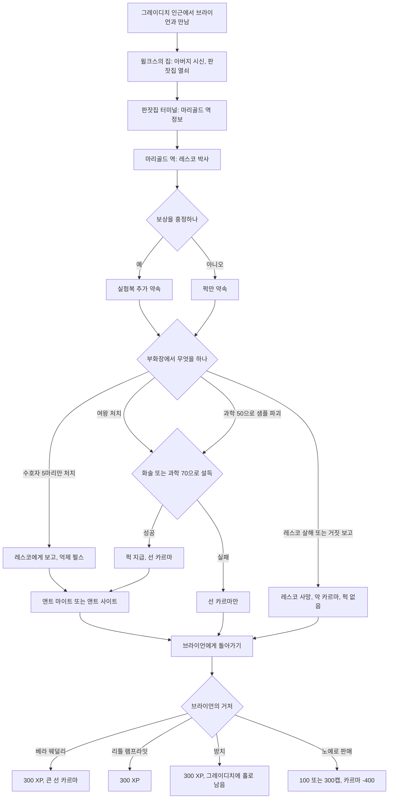

### 6.7 관련 NPC·아이템·대사 포인트

**NPC**

| 한국어명 | 영문명 | 역할 | 퀘스트 내 기능 | 비고 |
|---|---|---|---|---|
| 브라이언 윌크스 | Bryan Wilks | 생존한 소년 | 의뢰인, 쓰레기통 열쇠 | 카르마 선함. 대피소 안에서 "이제 TV 디너 기분을 알겠다"고 중얼거린다(다이 하드 패러디). |
| 프레드 윌크스 | Fred Wilks | 브라이언의 아버지 | 시신으로 등장, 판잣집 열쇠 | 사망 |
| 웨스턴 레스코 박사 | Doctor Weston Lesko | 곤충학자 | 사건의 원인, 퍽·실험복 보상 | 카르마 선함. 죽으면 귀를 떨어뜨린다. 완료 후 꿀 수집 의뢰 |
| 베라 웨덜리 | Vera Weatherly | 웨덜리 호텔 주인 | 브라이언의 새 보호자 후보 | 브라이언의 고모 또는 사촌 |
| 로버트 맥크래디 | Robert MacCready | 리틀 램프라잇 시장 | 거처 후보 | 화술 판정 또는 차일드 앳 하트 필요 |
| 율로지 존스 | Eulogy Jones | 파라다이스폴 노예 사냥꾼 두목 | 브라이언 매입 | 매우 악함 |
| 윌리엄 브랜디스 | William Brandice | 그레이디치 주민 | 시신으로 발견 | 아내 실라, 아들 윌은 언급만 된다. |

**아이템**

| 한국어명 | 영문명 | 유형 | 주요 수치 | 획득 |
|---|---|---|---|---|
| 레스코의 실험복 | Lesko's lab coat | 고유 의복 | DR 5, 내구 200, 과학 +10, 방사능 저항 +20, 무게 1, 가격 70 | 보상 흥정 시 레스코가 지급 |
| 레스코 박사의 암호 녹음 | Doctor Lesko's password recording | 홀로테이프 | 판잣집 터미널 암호 | 판잣집 왼쪽 책상 |
| 레스코의 휴대용 터미널 접속 | Lesko's portable terminal access | 홀로테이프 | 마리골드 역 터미널 암호 | 레스코의 시체 |
| 그레이디치 쓰레기통 열쇠 | Grayditch dumpster key | 열쇠 | 도트의 식당 뒤 쓰레기통(매우 어려움) | 브라이언 설득 |
| 노예 목줄 | Slave collar | 퀘스트 아이템 | — | 브라이언 판매 시 율로지 존스가 지급 |
| 화염개미 꿀 | Fire ant nectar | 소모품 | — | 완료 후 레스코에게 개당 40캡에 판매 |

**대사 포인트**

- 브라이언: "Those... THINGS. They keep coming. They scare me. Make it stop!" → "그것들… 그 괴물들이 자꾸 와요. 무서워요. 제발 멈추게 해 주세요!"
- 레스코(사고 고백): "Instead of lowering their size, the brood hatched with a new biomechanism." → "크기가 줄기는커녕 새로운 생체 기제를 가진 새끼들이 부화해 버렸다네."
- 레스코(보상 제안): "I can inject you with one of these formulas and you'll find yourself with either enhanced strength or enhanced perception!" → "이 제제 하나를 주사하면 힘이든 지각이든 강해질 걸세!"
- 레스코(여왕 처치 제안에 대한 반응): "The Queen mustn't be harmed at all! Months of work would be lost!" → "여왕은 절대 다치면 안 되네! 몇 달 치 연구가 날아간다고!"

### 6.8 비고

- **등장인물 확인**: 작업 지시서에 확인 요청으로 적힌 '레슬리 스택하우스(Leslie Stackhouse)'라는 인물은 코퍼스 전체에서 검색되지 않는다. 이 퀘스트의 과학자는 **웨스턴 레스코(Weston Lesko) 박사**이고, 이름 있는 그레이디치 관련 인물은 브라이언·프레드 윌크스, 윌리엄 브랜디스(사망), 실라·윌 브랜디스(언급만)다.
- 공식 퀘스트 설계자는 앨런 네인스(Alan Nanes)다. 그는 인터뷰에서 신입 디자이너가 맡는 "빨리 열고 빨리 닫는 작은 개인 이야기"라고 회고했다.
- 부화장을 나오려 할 때 여왕개미가 플레이어 위로 끼어 나타나 터널을 막는 문제가 보고되었다. 그러면 여왕을 죽이지 않고는 레스코에게 돌아갈 수 없다.
- 브라이언이 윌헬름 부두 근처 물속에 서서 상호작용할 수 없는 문제가 보고되었다. 밀어서 물가로 꺼내면 해결된다.

### 6.9 설계 분석

- **두 개의 반쪽**: 앞쪽 절반은 위협 제거(화염개미)이고, 뒤쪽 절반은 사후 처리(고아의 거처)다. 진짜 도덕 퀘스트는 뒤쪽이다. 베라·리틀 램프라잇·방치 모두 XP는 같고 카르마만 다르며, 노예 판매만 **물질적 이득(캡)**을 준다. 가장 이득인 선택이 가장 나쁜 선택이 되도록 설계해 '보상 없는 선행'을 시험한다.
- **과학 윤리의 축**: 레스코는 악의 없이 무책임한 과학자다. 플레이어는 실험을 이어 가게 둘지(여왕 보존), 근절할지(여왕 처치·샘플 파괴) 고른다. 근절하면 선 카르마를 주어 '위험한 연구의 종식'을 선으로 본다.
- **빌드형 보상**: 힘과 인지력 중 하나를 고르는 퍽은 SPECIAL 1점을 직접 올려 주므로 초반 빌드에서 의미가 크다. 힘은 근접 무기·소지 한도·근접 피해에, 인지력은 에너지 무기·폭발물·자물쇠 따기와 나침반 탐지 거리에 영향을 준다.
- **약점**: 레스코가 대화 직후 도주해 죽는 사고처럼 의도치 않은 보상 상실 경로가 있다. 맥크래디와 상의만 해도 베라 선택지가 잠기는 '숨은 잠금'은 플레이어에게 예고되지 않는다.

---

## 7. 애거사의 노래 (Agatha's Song)

### 7.1 기본 정보

| 항목 | 내용 |
|---|---|
| 영문명 | Agatha's Song |
| 한국어명 | 애거사의 노래 |
| 유형 | 사이드 퀘스트 (핍-보이 표시) |
| 퀘스트 ID | MS17 / 00014ea4 |
| 의뢰인 | 아가사(76세 바이올리니스트, 라디오 진행자) |
| 시작 조건 | 아가사의 집을 찾아가 대화한다. 집은 메레스티 조차장 북동쪽, 고물상 서쪽에 있으며 바위 더미에 둘러싸여 서쪽의 나무 현수교로만 들어갈 수 있다. 첫 대화에서 무례하게 굴면 아가사가 대화를 끊어 퀘스트를 받을 수 없다. |
| 관련 장소 | 아가사의 집, 볼트-텍 본사(Vault-Tec headquarters, 베논 광장 북쪽), 볼트 92와 그 근처의 올드 올니(Old Olney), 언더월드의 나인서클(The Ninth Circle), 리벳시티 |
| 선행 퀘스트 | 없음. 메인 「흔적을 따라서(Picking Up the Trail)」가 진행 중이면 시작할 때 모든 볼트 위치가 표시되어 있다. |
| 후행·연계 | 「국가 원수」(RD-06)를 노예 사냥꾼 편으로 끝내면 아가사 엔딩 영상이 빠진다. |
| 보상 | 300+ XP / 반환: 아가사의 방송국(Agatha's Station) 주파수와 선 카르마 / 매각: 200캡(화술 판정 시 300캡) / (선택) 악보집을 가져다주면 블랙호크와 .44 매그넘탄 12발, 또는 보상을 사양해 선 카르마 / (선택) 첫 대화의 화술·카리스마·레이디 킬러로 남편의 탄약 상자 열쇠 |
| 카르마 영향 | 반환: 선 / 아즈루칼(Ahzrukhal)에게 매각: 변화 없음 / 아브라함 워싱턴(Abraham Washington)에게 매각: 선(퀘스트 문서 기준) / 악보 보상 사양: 선. 허브 문서는 매각 보상을 '악 카르마'로 요약해 퀘스트 문서와 어긋난다 `(문서 간 상충)`. |
| 업적·트로피 | 「애거사의 노래」 20G·브론즈 |

### 7.2 개요

- 아가사는 대대로 클래식 음악가를 배출한 집안의 후손이다. 남편이 남긴 무전 장비로 바이올린 연주를 방송하며, 수도 황무지(Capital Wasteland) 외딴 곳에서 홀로 산다. 남편은 세상을 떠났고 그녀는 손님을 몹시 그리워한다.
- 그녀가 바라는 것은 집안의 가보인 **소일 스트라디바리우스(Soil Stradivarius)**다. 1714년 안토니오 스트라디바리가 만든 명기로, 고조할머니 힐다 에글브레히트(Hilda Egglebrecht)가 대전쟁 직전 '음악 재능 보존'을 내건 볼트 92에 들어가며 가져갔다. 위키 퀘스트 문서는 힐다를 '고조할머니의 자매'라고 적는다 `(문서 간 상충)`.
- 볼트 92의 진짜 목적은 백색 소음으로 정신을 조작하는 볼트-텍의 전투 실험(WNMSCE)이었고, 볼트는 광기와 학살로 무너졌다(상세는 [RD-12](12_world-structure-settlements.md)). 지금은 마이얼럭 소굴이 된 이 볼트에서 바이올린을 찾아오는 것이 퀘스트의 뼈대다.

### 7.3 진행 단계 (핍-보이 목표)

| 스테이지 | 핍-보이 목표 (원문) | 번역 | 플레이어 행동·이벤트 |
|---|---|---|---|
| 10 | Recover the Soil Stradivarius from Vault 92. | 볼트 92에서 소일 스트라디바리우스를 되찾는다. | 볼트 92 위치를 이미 알면 여기서부터 시작한다. |
| 20 | (Optional) Locate Vault-Tec headquarters. | (선택) 볼트-텍 본사를 찾는다. | 아가사에게 볼트 위치를 물으면 볼트-텍 본사를 지도에 표시해 준다. |
| 30 | (Optional) Discover the location of Vault 92. | (선택) 볼트 92의 위치를 알아낸다. | 본사 메인프레임에서 볼트 위치를 내려받는다. |
| 50 | Return to Agatha. | 아가사에게 돌아간다. | **완료(반환)** |
| 60 | Find a buyer for the Soil Stradivarius. | 소일 스트라디바리우스를 살 사람을 찾는다. | **완료(매각)**. 아가사가 죽었을 때도 이 목표로 바뀐다. |

- 볼트 92를 이미 발견한 상태로 퀘스트를 받으면 볼트-텍 본사 목표는 달성 처리되고 곧바로 바이올린 회수 목표가 된다.

### 7.4 분기와 해결 방법

#### 7.4.1 첫 대화의 선택지

- 쉬운 화술 판정이나 높은 카리스마로 바이올린을 꼭 찾아오겠다고 약속하면, 아가사가 선불로 남편의 탄약 상자 열쇠를 준다. 레이디 킬러 퍽이 있으면 판정이 필요 없다("어머나, 내가 아직 매력이 있었나 봐요"). 상자에는 미니 누크와 미사일을 포함해 여러 탄약이 들어 있다.
- 첫 만남에서 무례하게 굴면 아가사가 대화를 거부해 퀘스트를 받을 수 없다. 예의를 중시하는 인물이며, 무례한 말투를 '황무지 사람 같다'고 나무란다.

#### 7.4.2 볼트 92의 위치 알아내기 (선택)

- **볼트-텍 본사**: 베논 광장 북쪽, 메트로 정션(Metro Junction) 출구 옆에 있다. 메트로 정션은 체비 체이스 이스트(GNR 방송국 광장 쪽)나 듀퐁 광장에서, 베논 광장은 펜실베이니아 애비뉴에서도 들어갈 수 있다.
- 본사는 안내 로비, 사무 구역, 관리 구역으로 나뉜다. 프로텍트론(Protectron), 로보브레인(Robobrain), 터렛, 그리고 레벨과 난이도에 따라 센트리 봇(Sentry bot)이 지키며 로비에 슈퍼 뮤턴트(super mutant) 몇이 있다. 펄스 수류탄이 유용하다.
- 관리 구역의 메인프레임에 접근하려면 시스템 운영 스테이션 1·2·3의 승인이 필요하다. 지름길로, 스테이션 3을 지나 메인프레임 방 아래층 남서쪽 배관 → 빨간 불 서버 타워 위로 올라가 메인프레임에 닿으면 바로 내려받을 수 있다.
- 메인프레임은 볼트 87, 92, 101, 106, 108의 위치를 핍-보이에 추가한다.
- **대체 경로**: 메인 「흔적을 따라서」를 시작하면 시타델(The Citadel)의 로스차일드 서기(Scribe Rothchild)가 모든 볼트 위치를 표시해 준다. 이 경우 본사 방문은 완전히 생략할 수 있다.

#### 7.4.3 볼트 92 공략

- 적: 마이얼럭, 마이얼럭 헌터, 마이얼럭 킹(레벨 연동), 블로트플라이(bloatfly), 방사능바퀴. 근처 올드 올니(Old Olney)는 데스클로 둥지라 데스클로 3~4마리가 볼트 92 근처까지 올 수 있다.
- 바이올린 위치: **사운드 테스트(Sound Testing) 구역 가장 남서쪽 방(녹음 스튜디오)의 탁자**. 스튜디오 문은 바로 앞 터미널로 연다.
- 경로 두 가지:

| 경로 | 조건 | 내용 |
|---|---|---|
| 짧은 길 | '보통(Average)' 자물쇠를 딸 수 있음 | 입구 방에서 '교실·연구실' 표지가 있는 쪽으로 사운드 테스트 구역에 바로 들어간다. 첫 방에 마이얼럭 무리(쉬운 난이도: 마이얼럭 2 + 헌터 2, 어려운 난이도: 헌터 4)가 있고, '연구실(Lab)' 계단 아래에 레벨에 따라 킹 또는 헌터 2마리가 있다. |
| 긴 길 | 자물쇠를 못 땀 | 표지 없는 문으로 거주 구역을 지난다. 남자 기숙사 화장실 칸의 변기 뒤에서 **악보집**을 얻을 수 있다. 여자 기숙사 보안 터미널의 '소음 세척(Noise Flush)'으로 거주 구역 마이얼럭을 몰살할 수 있지만 경험치는 없다. 아트리움 위층 → 표지 없는 문 → 사운드 테스트 → 연구실 계단으로 합류한다. |

- 연구실 계단 아래 교차로: 정면은 보통 자물쇠 창고(스텔스 보이, 탄약, 의약품, 보통 자물쇠 금고), 오른쪽은 첫 마이얼럭 킹(또는 헌터)이 있는 휴게실(주크박스, 전쟁 전 서적), 왼쪽 T자 길에서 왼편이 스튜디오를 여는 터미널과 니콜라 테슬라 앤드 유(Nikola Tesla and You), 오른편이 바이올린 방(레이저 권총, 쉬움 자물쇠 금고의 스텔스 보이)이다.

#### 7.4.4 완료 방법

| 루트 | 조건 | 결과 | 보상 | 카르마 |
|---|---|---|---|---|
| A. 아가사에게 반환 | 바이올린 소지 | 아가사가 방송국 주파수를 알려 준다. | 300+ XP, 아가사의 방송국 | 선 |
| A-1. 악보집 추가 전달 | 악보집 소지(볼트 92 등에서 획득) 후 두 번째 선택지(보상 요구) | 아가사가 남편의 유품을 준다. 무례하게 굴면 블랙호크 내구도가 절반으로 준다. 악보집이 없으면 아가사가 악보 종이를 구해 달라고 부탁한다. | 블랙호크 + .44 매그넘탄 12발 | — |
| A-2. 악보집 보상 사양 | 악보집을 주고 보상을 받지 않음 | — | — | 선 (허브 문서 기준) |
| B. 아즈루칼에게 매각 | 나인서클의 아즈루칼(Ahzrukhal)에게 "세상에 하나뿐인 물건"이라고 설득 | 퀘스트가 완료된다. 퀘스트를 받지 않은 상태에서 팔아도 완료로 처리되어 업적을 준다. | 200캡(화술 판정 시 300캡) | 변화 없음 |
| C. 아브라함 워싱턴에게 매각 | 리벳시티 캐피톨 보존 협회(Capitol Preservation Society)의 큐레이터 워싱턴 | 퀘스트를 받지 않았어도 완료로 처리된다. 아가사에게 이 사실을 말하면 워싱턴에게서 다시 사 올 수 있다. 다만 퀘스트는 재구입을 인식하지 못해 아가사에게 "팔았다"는 선택지만 남는다. | 200캡(화술 판정 시 300캡) | 선 (퀘스트 문서 기준) |
| D. 아가사 사망 | 반환 전에 아가사가 죽음 | 목표가 '살 사람을 찾는다'(스테이지 60)로 바뀐다. | 매각 보상 | 살해 시 악 |

- 매각한 뒤 아가사에게 알리면 그녀는 "배신자"라며 크게 화낸다. 이전에 그녀를 만난 적이 없어 주인을 알 방법이 없었어도 반응은 같다.
- 바이올린은 퀘스트가 끝날 때까지 버릴 수 없다.

### 7.5 결과와 후일담

| 항목 | 내용 |
|---|---|
| 아가사의 방송국 | 반환하면 핍-보이 라디오에 추가된다. 수도 황무지 어디서나 들린다. 즉흥 연주 6곡과 명곡 5곡(바흐 파르티타 3번의 「지그」·「프렐류드」, 바흐 소나타 2번의 「그라베」, 드보르자크 바이올린 협주곡 가단조 1·2악장 제시부, 사라사테 「치고이너바이젠」)이 흐르고, 곡 사이에 아가사가 짧은 헌사를 덧붙인다. 녹음 방송이라 아가사가 죽어도 계속 나온다. |
| 엔딩 | 반환하면 엔딩 세그먼트 3(아가사의 연주 장면)이 추가된다. 퀘스트 문서는 선 카르마가 필요하고 「국가 원수」를 노예 사냥꾼 편으로 끝내면 빠진다고 적는다. |
| GNR | 반환: "스트라디바리우스란 말이야" 칭찬(선) / 매각: 이야기가 수상해진다는 보도(중립) / 반환 뒤 아가사를 죽이면 "용의자 1순위는 너야, 볼트 놈아"(악) |
| 아가사 | 반환 뒤에도 집에서 계속 산다. 방송국 헌사 중 하나는 "찾던 것을 가져다준 새 친구에게"라는 플레이어에 대한 감사다. |

### 7.6 흐름도

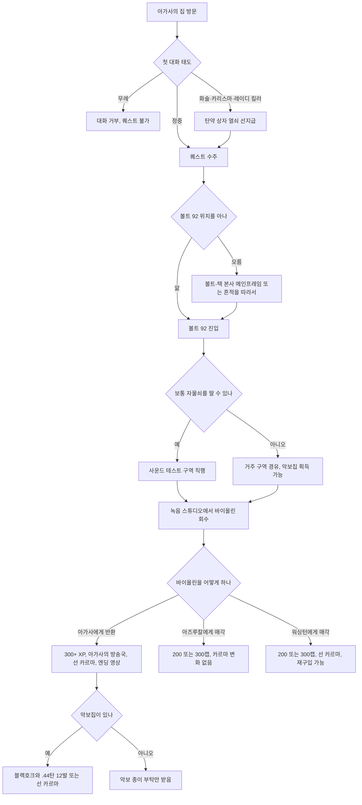

### 7.7 관련 NPC·아이템·대사 포인트

**NPC**

| 한국어명 | 영문명 | 역할 | 퀘스트 내 기능 | 비고 |
|---|---|---|---|---|
| 아가사 | Agatha | 바이올리니스트, 라디오 진행자 | 의뢰인, 보상 | 76세, 카르마 선함. 아우구스티누스를 인용하는 등 격언을 즐겨 쓴다. 죽으면 탄약 상자 열쇠를 떨어뜨린다. |
| 힐다 에글브레히트 | Hilda Egglebrecht | 볼트 92 입주 음악가 | 바이올린의 원소유자 | 사망. 아가사와의 관계는 문서마다 다르다. |
| 아즈루칼 | Ahzrukhal | 나인서클 주인 | 매입자 | 매우 악함 |
| 아브라함 워싱턴 | Abraham Washington | 리벳시티 캐피톨 보존 협회 큐레이터 | 매입자, 재판매 | 소장품과 관람객 늘리기에만 관심이 있다. |
| 쓰리독 | Three Dog | GNR DJ | 결과 보도 | |

**아이템**

| 한국어명 | 영문명 | 유형 | 주요 수치 | 비고 |
|---|---|---|---|---|
| 소일 스트라디바리우스 | Soil Stradivarius | 퀘스트 아이템 | 무게 3, 가격 0, 폼 ID 000033ff | 'Soil'은 '스왈'에 가깝게 읽는다. 1714년작 |
| 블랙호크 | Blackhawk | 고유 무기(조준경 .44 매그넘) | 피해 55, 치명타 배수 2, 치명타 피해 45, AP 32, 내구 360, 장탄 6, 무게 4, 가격 500 | 악보집 보상. 무례하면 내구도 절반 |
| 악보집 | Sheet music book | 잡화 | — | 볼트 92 남자 기숙사 화장실 외 여러 곳 |
| 아가사의 탄약 상자 열쇠 | Agatha's ammo box key | 열쇠 | — | 첫 대화 설득 보상 |
| 니콜라 테슬라 앤드 유 | Nikola Tesla and You | 스킬북(에너지 무기) | — | 볼트 92 스튜디오 터미널 방 |

**대사 포인트**

- 쓰리독(반환 후): "We're talking Stradivarius here. That's one top o' the line fiddle, you dig?" → "스트라디바리우스라고. 최고급 깽깽이란 말씀, 알겠어?"
- 아가사(레이디 킬러): "Oh my! I didn't know I still had the looks." → "어머나! 내가 아직 매력이 남아 있는 줄 몰랐네."
- 아가사(매각 사실을 들은 뒤): "It belonged rightfully in the hands of a musician, someone to appreciate its value, not to exploit it!" → "그건 값어치를 팔아먹을 사람이 아니라 알아줄 음악가의 손에 있어야 했어!"
- 아가사(방송 헌사): "Friendship is like a violin. Even if the music stops, you'll still have the strings." → "우정은 바이올린 같아요. 음악이 멈춰도 현은 남거든요." (남편의 말을 인용)

### 7.8 비고

- 볼트-텍 본사에 가지 않고 퀘스트를 끝낸 뒤 나중에 본사를 방문하면 메인프레임 보안문이 영영 열리지 않는 문제가 보고되었다. 정보 경로가 둘인 설계의 부작용이다.
- 퀘스트를 받은 직후 볼트-텍 본사 목표가 저절로 달성 처리되는 문제가 보고되었으나 진행에는 영향이 없다.
- 탄약 상자 열쇠를 받았는데 열쇠고리에 들어오지 않아 상자를 열면 절도로 처리되는 문제가 보고되었다.

### 7.9 설계 분석

- **보상이 곧 세계의 소리**: 최종 보상이 무기나 캡이 아니라 전 지역에서 들리는 라디오 채널이다. 플레이어의 선행이 이후 탐험의 배경음을 바꾸는 미적·정서적 보상이며, GNR과 엔클레이브 라디오뿐이던 라디오 생태계에 '평화로운 대안 채널'을 더한다.
- **운반 퀘스트를 핑계로 한 볼트 관광**: 구조는 단순한 '가져오기'지만 진짜 콘텐츠는 볼트 92의 환경 서사(백색 소음 실험의 터미널 기록과 현장)다. 볼트-텍 실험 시리즈를 체험시키는 장치로 기능한다.
- **월드 상태 적응**: 볼트 위치 정보를 메인 퀘스트로 이미 얻었으면 선택 단계를 자동으로 건너뛴다. 퀘스트가 플레이 순서에 맞춰 형태를 바꾸는 사례다.
- **약한 유혹**: 매각은 200~300캡이라는 작은 이득이다. 보존 협회(박물관) 매각은 선 카르마, 악당 매각은 중립으로 차등을 둔다. 퀘스트를 받지 않고 팔아도 완료로 인정해, 우연히 바이올린을 손에 넣은 플레이어도 결말에 닿게 한다.
- **약점**: 갈등이 약하고, 아가사의 '배신자' 반응이 그녀를 만난 적이 없는 플레이어에게도 똑같이 나오는 등 상태 분기가 거칠다.

---

## 8. 빅 타운의 큰 문제 (Big Trouble in Big Town)

### 8.1 기본 정보

| 항목 | 내용 |
|---|---|
| 영문명 | Big Trouble in Big Town |
| 한국어명 | 빅 타운의 큰 문제 |
| 유형 | 사이드 퀘스트 (핍-보이 표시) |
| 퀘스트 ID | MS01 / 00014e94 |
| 의뢰인 | 빅타운 주민 누구나(정보상자는 더스티(Dusty)로 표기), 리틀 램프라잇의 스티키, 저먼타운 경찰 본부에 갇힌 레드 |
| 시작 조건 | ① 빅타운 주민과 대화한다. ② 리틀 램프라잇의 스티키와 대화한다(비표시 「생일 축하합니다」로 빅타운까지 동행할 수 있다). ③ 저먼타운 경찰 본부(Germantown Police HQ)의 감방에서 레드와 대화한다. |
| 관련 장소 | 빅타운의 레드의 진료소(Red's clinic)·공동 주택·클럽하우스·타운 홀·고물 야적장·진입 다리, 저먼타운 경찰 본부 |
| 선행 퀘스트 | 없음 |
| 후행·연계 | 「냉정한 거래」(레드가 노예화 표적), 비표시 「생일 축하합니다(Happy Birthday to You)」(스티키), 랜덤 인카운터 「빅타운의 큰돈(Big Caps in Big Town)」·「빅타운 약탈(Big Loot in Big Town)」(RD-07) |
| 보상 | 300 XP / 레드에게 300캡, 또는 보상 사양(선 카르마), 또는 화술 판정으로 500캡(+200캡과 악 카르마) / 레드가 죽으면 주민에게 200캡(퀘스트 실패) / 타임밤(Timebomb)을 치료하고 습격을 막으면 행운의 8번 공 / 레드의 치료, 파피(Pappy)의 수리 서비스 / 빅타운이 캐러밴 경로에 추가된다. |
| 카르마 영향 | 레드 구출(첫 대화) 선, 쇼티(Shorty) 구출 추가 선, 보상 사양 선, 보상 갈취 악(캡을 돌려주면 회복), 습격 격퇴 선, 타임밤 살해 악 |
| 업적·트로피 | 「빅 타운의 큰 문제」 20G·브론즈 |

### 8.2 개요

- 빅타운은 리틀 램프라잇에서 열여섯 살이 되어 동굴을 떠나야 했던 아이들, 즉 '멍고(mungo)'들이 세운 마을이다(스티키만 18세라고 말한다). 리틀 램프라잇에서는 안전하고 편안한 곳이라고 선전하지만, 실제로는 자동차와 잔해로 쌓은 벽과 해자 다리 하나로 버티며 노예 사냥꾼과 슈퍼 뮤턴트에게 수시로 습격당하는 허약한 마을이다.
- 최근 슈퍼 뮤턴트가 주민을 끌고 가 저먼타운 경찰 본부에 가뒀다. 붙잡힌 사람 중에는 마을 의사이자 사실상 지도자인 레드와 그녀의 친구 쇼티가 있다. 주민들은 무엇을 위해 잡혀갔는지 모르지만, 언클 레오(Uncle Leo)는 슈퍼 뮤턴트를 만드는 데 쓰인다고 암시한다.
- 플레이어는 레드(와 선택적으로 쇼티)를 구해 호위해 오고, 이어지는 슈퍼 뮤턴트 재습격에 대비해 주민에게 자신의 기술을 가르치거나 직접 싸운다.

### 8.3 진행 단계 (핍-보이 목표)

| 스테이지 | 핍-보이 목표 (원문) | 번역 | 플레이어 행동·이벤트 |
|---|---|---|---|
| 10 | Ask the people of Big Town about their captured friends. | 빅타운 사람들에게 붙잡혀 간 친구들에 대해 묻는다. | 더스티 등이 저먼타운 경찰서 쪽을 가리킨다. |
| 20 | Rescue the Big Town captives from the Super Mutants. | 슈퍼 뮤턴트에게서 빅타운 포로들을 구한다. | |
| 25 | Rescue Red. | 레드를 구한다. | 1층 감방 |
| 30 | Escort Red safely back to Big Town. | 레드를 빅타운까지 무사히 호위한다. | |
| 40 | [Optional] Rescue Shorty. | [선택] 쇼티를 구한다. | 지하 주방 |
| 45 | Escort Shorty safely back to Big Town. | 쇼티를 빅타운까지 무사히 호위한다. | |
| 49 | Explain Red's death to the people of Big Town. (If Red dies) | (레드가 죽었을 때) 빅타운 사람들에게 레드의 죽음을 알린다. | 200캡을 받고 **실패로 종료** |
| 50 | Speak to Red about your reward. | 레드와 보상에 대해 이야기한다. | **완료**. 이어서 재습격 경고 |

### 8.4 분기와 해결 방법

#### 8.4.1 저먼타운 경찰 본부 진입과 구출

| 단계 | 방법 | 조건·비고 |
|---|---|---|
| 진입 | 북쪽 위층 문 | 슈퍼 뮤턴트가 있는 복도와 간헐적 함정을 지나야 한다. |
| 진입 | 서쪽 아래층 문 | 자물쇠 따기 100. 레드의 감방 바로 근처로 나온다. |
| 감방 개방 | 자물쇠 따기 | 감방 문 직접 따기 |
| 감방 개방 | 터미널 | 위층의 '봉쇄 컴퓨터 암호(Password for lockdown computer)' 홀로테이프로 연다. |
| 감방 개방 | 저먼타운 간수 열쇠 | 건물에서 가장 강한 슈퍼 뮤턴트가 지닌다. [BS] 설치 시 이 개체가 트라이빔 레이저 소총이나 개틀링 레이저를 든 오버로드(overlord)일 수 있다. |
| 쇼티 구출(선택) | 지하 주방으로 간다. | 슈퍼 뮤턴트가 쇼티를 먹으려고 말을 걸고 있다. 보통 10~20초 뒤 쏘기 시작하므로 서둘러야 한다. 상대는 레벨에 따라 일반 슈퍼 뮤턴트부터 오버로드([BS])까지 다양하지만 이름은 모두 '슈퍼 뮤턴트'로 표시된다. |

- 레드와 대화하면 구출 감사와 함께 선 카르마를 받고, 지하 주방의 쇼티 이야기를 듣는다. 쇼티를 구하면 선 카르마를 더 받는다.
- **호위 주의**: 건물 곳곳에 파편 지뢰가 있다. 라이트 스텝(Light Step) 퍽을 가진 플레이어는 밟아도 터지지 않지만 동행자는 밟으면 터지고, 한두 번 폭발이면 죽는다. 레드와 쇼티에게 갑옷과 무기를 쥐여 줄 수 있지만 퀘스트가 끝나기 전에 회수하지 않으면 대화로 돌려받을 방법이 없다.
- 탈출할 때 슈퍼 뮤턴트가 다시 나타날 수 있다([BS] 설치 시 출구 앞에 오버로드가 생성되기도 한다).

#### 8.4.2 레드의 생사와 보상

| 상황 | 처리 | 보상 | 카르마 |
|---|---|---|---|
| 레드 생존, 보상 사양 | 레드와 대화 | 300 XP | 선 |
| 레드 생존, 보상 요구 | 레드와 대화 | 300 XP, 300캡 | 변화 없음 |
| 레드 생존, 화술 판정으로 추가 요구 | 레드와 대화 | 300 XP, 500캡 | 악. 캡을 돌려주면 회복 |
| 레드 사망 | 즉시 실패하지 않고 목표가 '죽음을 알린다'로 바뀐다. 주민에게 알리면 "이제 우리는 필요 없다"며 200캡을 준다. | 200캡 | — (퀘스트 실패) |

- 레드가 호위 도중 죽으면 빅타운에 도착했을 때 레이더 무리가 주민 대부분을 죽인다는 보고가 있다.
- 레드가 살면 이후 레드는 치료를, 파피(Pappy)는 수리를 해 준다.

#### 8.4.3 재습격 대비: 주민 훈련 (후속 이벤트)

퀘스트는 레드와 보상 대화를 마친 시점에 기술적으로 끝난다. 그러나 레드가 곧바로 슈퍼 뮤턴트의 재습격을 경고하고 도움을 청한다. "스스로 지키는 법을 가르쳐 주겠다"를 고르면 스킬에 따라 훈련 방법이 열린다.

| 훈련 | 요구 스킬 | 진행 방식 | 습격 결과 |
|---|---|---|---|
| 사격 | 소형 화기 50 | 고물 야적장에 병과 깡통으로 만든 즉석 사격장이 생기고, 플레이어가 시범으로 쏜다. | 주민이 총으로 맞선다. |
| 은신 | 은신 50 | 플레이어가 은신 모드로 움직이면 주민이 한동안 은신 상태로 따라 한다. | 슈퍼 뮤턴트 2마리가 들어와 주민을 찾다가, 방해받지 않으면 그대로 떠나 메레스티 조차장과 핼로드 무어스 묘지 사이 길을 따라 경찰 본부로 돌아간다. 교전 없이 끝난다. |
| 로봇 | 과학 50 | 고물 야적장의 센트리 봇과 프로텍트론을 재가동한다. 하나만 켜면 나머지 하나는 주민이 켠다. | 로봇이 경호한다. |
| 지뢰 | 폭발물 50 | 다리 입구에 지뢰를 던져 시범을 보인다. | 다리에 지뢰밭이 생긴다. |
| 없음 | — | 아무것도 가르치지 않고 떠나거나 직접 싸운다. | 주민은 약하다. 무기·탄약·갑옷을 역소매치기로 넣어 줄 수 있으며, 셀을 드나드는 등 로딩을 거쳐야 장착한다. |

- 습격은 슈퍼 뮤턴트가 둘씩 짝지어 오며, 무기는 레벨에 따라 못 박힌 판자부터 미니건까지 다양하다. 은신을 고르지 않았다면 슈퍼 뮤턴트를 모두 쓰러뜨려야 하며, 완료하면 선 카르마를 준다.
- 폭스(Fawkes)를 동료로 데리고 있으면 지뢰 방어를 제안하는 특수 선택지가 나온다. 이 경우 폭스 주변에 몇 초마다 파편 지뢰가 생성된다.
- 마을 북쪽의 노예 사냥꾼 무리가 슈퍼 뮤턴트를 먼저 죽여 방어 이벤트가 저절로 끝나는 경우도 있다.

#### 8.4.4 타임밤 치료 (선택)

- 타임밤(Timebomb)은 지난 습격 때 크게 다쳐 레드의 진료소 수술실에 혼수상태로 누워 있다.
- 의학 40 이상: 소생시키거나 죽일 수 있다. 의학 40 미만: "내버려 둔다" 또는 "고통에서 해방시킨다"(죽이기)만 고를 수 있다. 타임밤을 죽이면 악 카르마다.
- 소생시킨 뒤 슈퍼 뮤턴트 습격을 막고 말을 걸면 **행운의 8번 공**(행운 +1)을 준다.
- 타임밤을 치료하면 레드가 "나보다 나은 의사"라며 감탄하고, 이후 플레이어를 **무료로 치료**해 준다.

### 8.5 결과와 후일담

| 결과 | 내용 |
|---|---|
| 방어 성공 | 슈퍼 뮤턴트 습격이 멈추고 빅타운은 비교적 안전한 곳이 된다. 특수 훈련을 했다면 주민들이 배운 것을 이어 가려고 물자를 사들인다. 랜덤 인카운터 「빅타운의 큰돈」의 스캐빈저가 훈련 종류에 맞춰 "빅타운이 총을 대량 주문했다"처럼 말한다. 빅타운은 캐러밴 경로에 추가된다. |
| 방치·방어 실패 | 아무것도 가르치지 않으면 습격으로 마을이 전멸할 가능성이 크다. 빈 마을에 슈퍼 뮤턴트 하나가 배회하고 주민 시체가 흩어져 있다. 「빅타운 약탈」 스캐빈저가 "마을이 끝장났으니 털러 간다"고 말한다. |
| 레드 | 생존하면 의사(치료 서비스). 「냉정한 거래」에서 레드를 노예로 만들면 이 퀘스트는 레드가 죽거나 목줄이 풀릴 때까지 완료할 수 없다. |
| 무기 지급의 부작용 | 총기 훈련과 장비 지급을 하면 이후 빠른 이동 때 레이더나 슈퍼 뮤턴트가 하나씩 앞에 나타나 주민·동료와 교전하는 일이 잦다는 보고가 있다. |
| GNR | 방어법을 가르치면 "빅타운을 도왔다"고 칭찬한다(선). 마을을 버린 경우의 비난 보도("도울 수 있었는데 안 도왔다")는 위키에서 주석 처리되어 있고, 완료했는데도 이 비난이 나오는 오류가 보고되었다. |
| 위험 | 레벨에 따라 마을 안에 방사능전갈이나 거대 방사능전갈이 나타나 주민 대부분을 죽이는 경우가 있다. 퀘스트를 시작하기 전에 근처 레이더나 엔클레이브 병사에게 주민이 죽을 수도 있다. 타임밤이 살아 있으면 퀘스트를 시작해 완료할 수 있다. |

### 8.6 흐름도

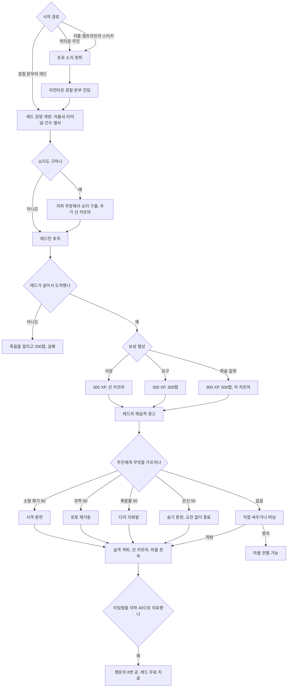

### 8.7 관련 NPC·아이템·대사 포인트

**NPC**

| 한국어명 | 영문명 | 역할 | 퀘스트 내 기능 | 비고 |
|---|---|---|---|---|
| 레드 | Red | 빅타운의 의사, 사실상 시장 | 구출 대상, 보상, 재습격 경고, 치료 | 카르마 선함. 리틀 램프라잇의 루시에게 의술을 가르쳤다. 「냉정한 거래」 표적 |
| 쇼티 | Shorty | 레드의 친구 | 선택 구출 대상 | 구하지 않고 끝내면 나중에 찾아가도 풀어 줄 선택지가 없다. |
| 더스티 | Dusty | 주민 | 정보상자상 의뢰인, 슈퍼 뮤턴트 출몰 방향 안내 | |
| 파피 | Pappy | 주민 | 완료 후 수리 서비스 | |
| 타임밤 | Timebomb | 주민(중상자) | 의학 40 치료 시 행운의 8번 공 | 죽이면 악 카르마 |
| 스티키 | Sticky | 리틀 램프라잇 소년 | 퀘스트 훅(빅타운 동행) | 「생일 축하합니다」 완료 후 빅타운에 산다. |
| 킴바 | Kimba | 주민 | 로봇이 마을 밖으로 날아가 있으면 고치러 나간다. | |
| 비더컵 / 플래쉬 | Bittercup / Flash | 주민 | 방어 훈련 참여자 | |
| 언클 레오 | Uncle Leo | 떠돌이 슈퍼 뮤턴트 | 포로가 슈퍼 뮤턴트 생산에 쓰인다고 암시 | |

**아이템**

| 한국어명 | 영문명 | 유형 | 주요 수치 | 획득 |
|---|---|---|---|---|
| 행운의 8번 공 | Lucky 8 ball | 고유 잡화 | 행운 +1(소지 효과), 무게 1, 가격 4, 폼 ID 0002edfb | 타임밤 치료 + 습격 격퇴 후 |
| 봉쇄 컴퓨터 암호 | Password for lockdown computer | 홀로테이프 | — | 경찰 본부 위층 |
| 저먼타운 간수 열쇠 | Germantown jailors key | 열쇠 | — | 가장 강한 슈퍼 뮤턴트 |
| D.C. 저널 오브 인터널 메디신 | D.C. Journal of Internal Medicine | 스킬북(의학) | — | 레드의 진료소 부엌 탁자 |
| 파티 모자 | Party hat | 모자 | — | 「생일 축하합니다」 보상 |

**대사 포인트**

- 더스티(슈퍼 뮤턴트의 출처를 묻자): "Skulk up toward German Town, near the police station. They always come from that direction." → "저먼 타운 쪽, 경찰서 근처로 살금살금 가 봐. 놈들은 늘 그쪽에서 오거든."
- 레드(빅타운의 유래): "The Lamplighters who turn sixteen aren't allowed to stay in the caves, but they have to go somewhere." → "열여섯 살이 된 램프라잇 아이들은 동굴에 남을 수 없어. 그래도 어딘가엔 가야 하잖아."
- 슈퍼 뮤턴트(은신 루트에서 엿들을 때): "Don't you want to be like us?" → "우리처럼 되고 싶지 않아?"

### 8.8 비고

- 제목은 1986년 영화 『빅 트러블(Big Trouble in Little China)』의 오마주다.
- 과학 훈련 루트는 로봇이 '날아다니는 물체' 오류로 마을 밖으로 튕겨 나가 진행이 막히는 문제가 많이 보고되었다. 주민이 로봇을 찾아 나가 늦게 돌아오기도 한다. 이식할 때는 훈련 대상 오브젝트를 고정 배치해야 한다.
- 레드와 쇼티를 메가톤 집 같은 다른 곳에 세워 두어도 빅타운 셀 근처에 가면 귀환한 것으로 처리되는 문제가 보고되었다. 도착 판정을 영역(셀) 진입으로 한 설계의 부작용이다.

### 8.9 설계 분석

- **2부 구성**: 1부는 구출과 호위, 2부는 마을 방어다. 2부는 퀘스트가 기술적으로 끝난 뒤 이어지는 선택형 이벤트라, 보상(XP·캡)은 1부에 몰려 있고 2부의 보상은 마을의 존속과 카르마, 행운의 8번 공이다.
- **스킬 전수형 다중 해결**: 플레이어의 스킬(소형 화기·은신·과학·폭발물 50)이 NPC 집단의 생존 능력으로 옮겨 간다. 같은 위협을 스킬에 따라 사격전, 무혈 은폐, 로봇 방어, 지뢰 방어로 풀게 한 드문 구조다. 특히 은신 루트는 아무도 죽지 않는 결말이다.
- **안전망**: 레드가 죽어도 즉시 실패시키지 않고 "죽음을 알리는" 목표로 닫아 서사적 마무리와 소액 보상을 준다. 호위 임무 실패의 좌절감을 줄이는 장치다.
- **리틀 램프라잇의 이면**: 아이들만의 낙원(리틀 램프라잇)이 열여섯 살이 된 아이들을 내쫓아 생긴 허약한 마을을 보여 줘, 메인 스토리에서 만나는 리틀 램프라잇의 유토피아 서사를 비튼다.
- **약점**: 호위 AI와 지뢰, 로봇 오류처럼 시스템 의존도가 높아 버그가 많다. 2부가 퀘스트 목표로 표시되지 않아 놓치기 쉽다.

---

## 9. 오아시스 (Oasis)

### 9.1 기본 정보

| 항목 | 내용 |
|---|---|
| 영문명 | Oasis (위키 문서명: Oasis (quest)) |
| 한국어명 | 오아시스 |
| 유형 | 사이드 퀘스트 (핍-보이 표시) |
| 퀘스트 ID | MS10 / 0002a274 |
| 의뢰인 | 헤럴드(Harold). 안내와 의식은 나무의 아버지(Tree Father) 버치(Birch)가 맡는다. |
| 시작 조건 | 수도 황무지 북부 바위 지대에 숨은 오아시스 입구에 다가가면 버치가 "그분이 당신을 부르셨다"며 따라오라고 한다. 동의하면 문을 열고 의식 장소로 안내한다. |
| 관련 장소 | 오아시스(입구, 마을, 숲(the Grove), 침수된 방(sunken chambers), 습한 동굴(Damp Cave)) |
| 선행 퀘스트 | 없음 |
| 후행·연계 | 시작 전 훅인 랜덤 인카운터 「오아시스 습격자들(Oasis Raiders)」·「오아시스 상인(The Oasis Merchant)」(RD-07), GNR의 '나무가 가득한 곳' 소문 보도 |
| 보상 | 헤럴드 편, 심장 파괴: 바크스킨 퍽 / 버치 편, 수액: 사이프러스(Cypress)가 미사일 발사기와 미사일 2발, 메이플(Maple)이 메이플의 옷 / 로렐(Laurel) 편, 연고: 린든(Linden)이 린든의 아웃캐스트 파워 아머, 포플러(Poplar)가 포플러의 두건 / 공통 선택: 요우(Yew)의 곰 부적(화술 판정 또는 차일드 앳 하트). 완료 XP는 코퍼스에서 확인되지 않는다. |
| 카르마 영향 | 헤럴드 화형 -200, 그리고 오아시스 전체 적대. 나머지 세 결말은 카르마 변화가 확인되지 않는다. |
| 업적·트로피 | 「오아시스」 20G·브론즈 |

### 9.2 개요

- 오아시스는 메마른 수도 황무지에서 유일하게 푸른 숲이 우거진 계곡이다. 그 중심에는 폴아웃 1·2편에 등장했던 돌연변이 헤럴드가 있다. FEV와 방사능에 함께 노출된 헤럴드의 머리에서 '밥(Bob)'이라는 나무가 자라났고, 동쪽 끝까지 떠돌던 그는 이곳에서 쉬다가 나무에 뒤덮여 땅에 뿌리박힌 채 이삼십 년을 보냈다.
- 버치가 세운 숭배 집단 트리마인더(Treeminders)는 헤럴드를 '위대한 분'으로 모신다. 그런데 2277년 현재 집단은 둘로 갈라졌다. 버치는 오아시스를 비밀로 지키려고 헤럴드의 성장을 멈추고 싶어 하고, 잎새의 어머니(Leaf Mother) 로렐(Laurel)은 그 은혜를 황무지 전체에 퍼뜨리려고 성장을 가속하고 싶어 한다.
- 정작 헤럴드는 수십 년 동안 먹지도 자지도 읽지도 못한 채 한자리에 묶여 있었다며 플레이어에게 **자신을 죽여 달라**고 부탁한다. 플레이어는 지하 동굴 깊은 곳에 있는 헤럴드의 심장에 무엇을 할지 정한다.

### 9.3 진행 단계 (핍-보이 목표)

| 결말 | 스테이지 | 핍-보이 목표 (원문) | 번역 |
|---|---|---|---|
| 공통 | 5 | Undertake the Treeminder's Ceremony. | 트리마인더의 의식을 치른다. |
| 공통(화형 제외) | 8 | Obtain the key to the caves from Branchtender Cypress. | 나뭇가지의 파수꾼(Branchtender) 사이프러스에게서 동굴 열쇠를 받는다. |
| 헤럴드 편 | 10 | Enter the caves below and destroy Harold's heart. | 아래 동굴로 들어가 헤럴드의 심장을 파괴한다. |
| 버치 편 | 20 | Apply Birch's Sap to Harold's heart and stop his growth. | 버치의 수액을 헤럴드의 심장에 발라 성장을 멈춘다. |
| 로렐 편 | 30 | Apply Laurel's Liniment to Harold's heart and accelerate his growth. | 로렐의 연고를 헤럴드의 심장에 발라 성장을 가속한다. |
| 화형 | 35 | Kill Harold by burning him. | 헤럴드를 불태워 죽인다. (**완료**) |
| 헤럴드·버치 편 | 40 | Speak with Tree Father Birch. | 나무의 아버지 버치와 대화한다. (**완료**) |
| 로렐 편 | 50 | Speak with Leaf Mother Laurel. | 잎새의 어머니 로렐과 대화한다. (**완료**) |

### 9.4 분기와 해결 방법

#### 9.4.1 의식과 헤럴드와의 만남

- 버치는 '그분'의 정체를 직접 알아보라며 말을 아낀다. 화술 판정에 성공하면 미리 알 수 있다. 라이프 기버(Life Giver)나 애니멀 프렌드(Animal Friend) 퍽이 있으면 오아시스의 동식물에 관한 특수 대화가 열린다.
- 의식에서는 몸속의 악을 씻어 그분을 해치지 않게 한다는 명목으로 수액을 마신다. 환각 연출이 나온 뒤 플레이어는 숲에서 헤럴드를 만난다.
- 숲을 나와 왼쪽으로 가면 철망 근처에서 버치와 로렐의 말다툼 장면이 재생되고, 두 사람이 각자 자기편을 들라고 요구한다.

#### 9.4.2 동굴에 들어가기 전의 대화 (보상 결정)

보상은 심장에 무엇을 하느냐와, **동굴에 들어가기 전에 누구와 대화했느냐**로 정해진다.

| 편 | 대화 대상 | 대화 내용 | 비고 |
|---|---|---|---|
| 버치 편 | 나뭇가지의 파수꾼 메이플(Maple) | 어떻게 오아시스에 왔는지 묻는다. '선택받아 왔다'고 느끼며 외부인이 오아시스를 망칠까 두려워한다. | 메이플의 옷 |
| 버치 편 | 나뭇가지의 파수꾼 사이프러스(Cypress) | 어떻게 트리마인더가 되었는지 묻는다. 버치가 거둬 주었고 오아시스를 외부에 숨기는 일의 중요성을 배웠다고 말한다. | 미사일 발사기 |
| 로렐 편 | 꽃의 현자(Bloomseer) 포플러(Poplar) | '그녀의 신'에 대해 묻는다. 헤럴드는 모두의 신이니 황무지 전체와 나눠야 한다고 말한다. | 포플러의 두건 |
| 로렐 편 | 나뭇가지의 파수꾼 린든(Linden) | 어떻게 오아시스에 왔는지 묻는다. 화술 판정에 성공하면 아웃캐스트 출신으로 부상당해 포플러의 간호를 받고 합류했다고 털어놓는다. | 린든의 아웃캐스트 파워 아머 |
| 헤럴드 편 | (없음) | 요우(Yew)를 제외하고 미리 대화할 필요가 없다. | 바크스킨 |
| 공통 | 묘목(Sapling) 요우(Yew) | '그녀의 신'에 대해 묻고 화술 판정에 성공하거나 차일드 앳 하트로 "나도 무섭지 않게 헤럴드가 뭘 무서워하는지 알려 줘"라고 하면 헤럴드가 **불을 두려워한다**는 비밀을 털어놓는다. | 헤럴드를 불태우지 않고 완료하면 요우의 곰 부적(화술 +10 영구). 어느 결말이든 받는다. |

- 동굴 정문 자물쇠는 자물쇠 따기 100이며, 사이프러스에게 열쇠를 받을 수도 있다. 의식 전에 자물쇠를 따고 들어가도 심장으로 가는 길은 뿌리에 막혀 있다.
- 트리마인더를 대화로 화나게 하거나 어떤 이유로든 오아시스가 적대하면 **헤럴드 화형만이 유일한 완료 수단**이 된다. 적대 상태에서는 헤럴드도 대화를 거부한다.

#### 9.4.3 헤럴드의 심장: 네 가지 결말

| 결말 | 행동 | 즉시 효과 | 보상 | 카르마 |
|---|---|---|---|---|
| A. 헤럴드 편 (안락사) | 심장을 공격해 파괴한다. | 헤럴드가 죽는다. 심장에서 나온 방사능에 노출되어 그 자리에서 **바크스킨** 퍽(피해 저항 +5%)을 얻는다. 버치가 숲에서 헤럴드의 말을 듣지 않았던 것을 후회한다. | 바크스킨, (요우의 부적) | 변화 없음 |
| B. 버치 편 (성장 정지) | 버치의 수액을 심장에 바른다. | 헤럴드의 성장이 멈추고 오아시스는 비밀로 남는다. 헤럴드는 자기 욕심이었다며 체념한다. | 메이플의 옷, 미사일 발사기와 미사일 2발, (요우의 부적) | 변화 없음 |
| C. 로렐 편 (성장 가속) | 로렐의 연고를 심장에 바른다. | 헤럴드의 성장이 가속되어 영향이 황무지로 퍼진다. | 린든의 아웃캐스트 파워 아머, 포플러의 두건, (요우의 부적) | 변화 없음 |
| D. 화형 | 화염 계열 무기로 헤럴드(나무)를 불태운다. | 헤럴드가 크게 울부짖고 몸부림치다 죽는다. 오아시스 전체가 즉시 적대한다. 다시 가 보면 숯이 된 헤럴드가 남아 있다. | 없음(요우의 부적도 없음) | -200 |

- **화형이 통하는 무기**: 화염방사기, 헤비 인시너레이터([BS]), 플라스마 소총, 미사일 발사기, 누카 수류탄(Nuka-grenade, 터지지 않고 맞기만 해도 된다), 플라스마 수류탄, 미니 누크, 시시케밥. **통하지 않는 무기**: 파이어랜스(Firelance), 파편 지뢰, 플라스마 지뢰, 번마스터(Burnmaster).
- 헤럴드와 대화하기 전에 불태우면 "말하는 나무가 죽었다", 대화한 뒤에 불태우면 "헤럴드는 더 이상 당신과 이야기할 수 없다"는 메시지가 나온다.
- **악랄한 복합 루트**: 수액이나 연고로 결말을 내 보상을 받은 뒤 헤럴드를 불태우면, 보상은 그대로 갖고 악 카르마와 화형 결과가 추가된다.
- 보상은 지지 세력의 트리마인더가 준다. 심장을 파괴한 경우에는 요우만 보상을 준다.

#### 9.4.4 동굴 탐험 (침수된 방, 습한 동굴)

- 적: 마이얼럭, 마이얼럭 헌터, 마이얼럭 킹(레벨 연동), 가끔 방사능바퀴. 길이 막힌 것 같으면 물속을 확인해야 한다. 끝부분에서 쿵쿵거리는 소리가 헤럴드의 심장이다.
- 침수된 방의 주요 전리품: D.C. 저널 오브 인터널 메디신(야구 글러브 아래 상자), 스텔스 보이 여러 개, 전쟁 전 서적, 소음기 10mm 권총, 레일웨이 라이플 재료인 목발, 체리 밤, 방사능 웅덩이 한가운데 물속의 미니 누크, 미사일·화염방사기 연료가 든 탄약 상자(각각 보통·쉬움 자물쇠), 심장 근처 해골 옆의 정화수·라드어웨이·혈액 팩·미사일·스팀팩.
- 습한 동굴: 심장 근처 문이나 헤럴드 남동쪽 수중 입구(오아시스 동굴 열쇠 또는 자물쇠 따기 25)로 들어간다. 숲으로 빠르게 나가는 출구 역할이며, 저격소총 등 소소한 전리품이 있다.
- 심장을 처리한 뒤 근처 문으로 다른 동굴을 지나 숲으로 돌아오면 결말에 따라 버치나 로렐이 기다리고 있다.

### 9.5 결과와 후일담

| 결과 | 내용 |
|---|---|
| 헤럴드 | A·D: 사망 / B: 생존, 성장 정지 / C: 생존, 성장 가속 |
| 오아시스 | A·B·C: 우호 유지. 트리마인더와 이후 결말에 대해 대화할 수 있다. / D: 전체 적대 |
| GNR | 시작 전부터 "어딘가에 나무가 가득한 오아시스가 있다"는 소문 보도가 나오고, 헤럴드가 불타면 중단된다. 화형하면 "북쪽에서 나무 타는 냄새가 나는 산불, 200년 전에 이미 다 타 버린 땅에서. 101, 너밖에 없지"라는 보도가 나온다. |
| 엔딩 | 화형하면 악 카르마일 때 엔딩 세그먼트 6(불타는 헤럴드)이 추가된다. 메가톤을 폭파했거나 리벳시티 주민을 몰살했다면 나오지 않는다. |
| 시리즈 연속성 | 헤럴드는 폴아웃 1·2의 인물이다. 이 퀘스트의 결말이 그의 이야기의 마지막 장이 된다. |

### 9.6 흐름도

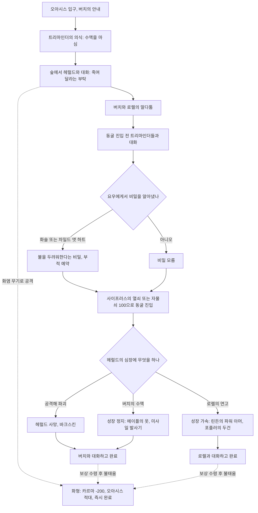

### 9.7 관련 NPC·아이템·대사 포인트

**NPC**

| 한국어명 | 영문명 | 역할 | 입장 | 퀘스트 내 기능 |
|---|---|---|---|---|
| 헤럴드 | Harold | 나무에 뒤덮인 돌연변이 | 죽음을 원한다. | 의뢰인. 요우만 좋아한다. |
| 밥 | Bob | 헤럴드 머리에서 자란 나무 | — | 헤럴드가 친구처럼 부르며, 심심하면 '허버트'라고도 부른다. |
| 나무의 아버지 버치 | Tree Father Birch | 트리마인더 창시자 | 성장 정지(비밀 유지) | 안내, 의식, 수액 지급, 결말 대화 |
| 잎새의 어머니 로렐 | Leaf Mother Laurel | 트리마인더 지도자 | 성장 가속(전파) | 연고 지급, 결말 대화 |
| 나뭇가지의 파수꾼 사이프러스 | Branchtender Cypress | 트리마인더 | 버치 편 | 동굴 열쇠, 미사일 발사기 |
| 나뭇가지의 파수꾼 메이플 | Branchtender Maple | 트리마인더 | 버치 편 | 메이플의 옷 |
| 꽃의 현자 포플러 | Bloomseer Poplar | 트리마인더 | 로렐 편 | 포플러의 두건 |
| 나뭇가지의 파수꾼 린든 | Branchtender Linden | 트리마인더(전 아웃캐스트) | 로렐 편 | 린든의 아웃캐스트 파워 아머 |
| 묘목 요우 | Sapling Yew | 가장 어린 트리마인더 | 헤럴드의 말벗 | 헤럴드의 약점 정보, 곰 부적 |

**아이템**

| 한국어명 | 영문명 | 유형 | 주요 수치 | 획득 |
|---|---|---|---|---|
| 버치의 수액 | Birch's sap | 퀘스트 아이템 | 무게 1, 가격 0 | 버치 |
| 로렐의 연고 | Laurel's liniment | 퀘스트 아이템 | 무게 1, 가격 0 | 로렐 |
| 헤럴드의 심장 | Harold's heart | 월드 오브젝트 | — | 침수된 방 끝 |
| 메이플의 옷 | Maple's garb | 고유 의복 | DR 15, 내구 150, 인지력 +1, 민첩성 +1, 무게 2, 가격 200 | 수액 결말 |
| 미사일 발사기 | Missile launcher | 중화기 | 미사일 2발 동봉 | 수액 결말(사이프러스) |
| 린든의 아웃캐스트 파워 아머 | Linden's Outcast power armor | 고유 파워 아머 | DR 40, 내구 1,000, 힘 +1, 민첩성 -1, 중화기 +5, 방사능 저항 +10, 무게 45, 가격 740. 파워 아머 훈련 필요 | 연고 결말 |
| 포플러의 두건 | Poplar's hood | 고유 모자 | DR 2, 내구 50, 민첩성 +1, 은신 +10, 무게 1, 가격 100 | 연고 결말 |
| 요우의 곰 부적 | Yew's bear charm | 고유 잡화 | 화술 +10(영구), 무게 1, 가격 50 | 요우의 비밀을 알아내고 화형 없이 완료 |
| 바크스킨 | Barkskin | 퍽 | 피해 저항 +5%, 폼 ID 00035e04 | 심장 파괴 |

**대사 포인트**

- 버치(첫 만남): "He's been waiting for someone like yourself to arrive." → "그분은 당신 같은 이가 오기를 기다려 오셨소."
- 헤럴드(부탁): "I had you brought in here to ask a very simple favor. Would you please kill me?" → "아주 간단한 부탁 하나 하려고 불렀어. 나 좀 죽여 줄래?"
- 헤럴드(이유): "I've been literally rooted to this spot thanks to Bob for maybe twenty or thirty years..." → "밥 덕분에 이 자리에 말 그대로 뿌리박힌 지 이삼십 년은 됐을 거야…"
- 요우(차일드 앳 하트): "Harold told me that he's scared of fire." → "헤럴드가 그러는데 불이 무섭대."
- 쓰리독(화형 후): "A forest fire in the Capital Wasteland, where all the trees were ALREADY burnt to a crisp 200 years ago. Only you, 101." → "나무란 나무는 200년 전에 이미 다 타 버린 수도 황무지에서 산불이라니. 너밖에 없다, 101."

### 9.8 비고

- 공식 설계에는 앨런 네인스가 참여했다(단독 설계는 아님).
- 의식 중 요우가 "산 자와 죽은 자를 심판하리라"고 말하는 대목은 사도신경을 인용한 것이다.
- 설계상 의미 있는 버그: 동굴에서 나오면 숲과 오아시스의 문이 잠겨 갇히는 문제, 철망 근처의 말다툼 트리거를 보지 못하면 조작이 잠기는 문제가 보고되었다. 장면 트리거와 문 잠금 상태를 퀘스트 스테이지에 단단히 묶어야 한다는 이식상의 교훈이다.
- 위키의 화형 스테이지 표에는 완료 표시가 3번째 칸에 잘못 들어가 있다. 스테이지 35가 완료 스테이지로 보인다.

### 9.9 설계 분석

- **안락사 딜레마의 3+1 구도**: 의뢰인 헤럴드의 소망(죽음), 수호파 버치의 신앙(정지), 전파파 로렐의 신앙(확산)이 부딪친다. 여기에 금지된 네 번째 선택(화형)이 있다. "누구의 뜻이 옳은가"가 아니라 "누구의 뜻을 따를 것인가"를 묻는다.
- **보상 유형의 차별화**: 의뢰인 편(안락사)은 영구 퍽 하나, 공동체 편은 장비 두 점이다. 화형은 보상이 전혀 없고 페널티만 있다. 선택마다 보상의 '종류'를 다르게 해 단순한 손익 비교를 막는다.
- **지식의 윤리**: 요우에게서 얻은 비밀(불을 두려워한다)은 화형 루트의 힌트이자, 그 지식을 악용하지 않은 사람에게만 부적이라는 보상을 준다. 정보를 얻는 행위와 쓰는 행위를 분리해 평가한다.
- **탐문 보상**: 동굴 진입 전 대화 대상이 보상 지급을 결정한다. 마을 사람 모두와 대화하는 탐색 행동에 보상을 준다.
- **시리즈 연속성**: 1·2편의 헤럴드를 다시 등장시켜 그의 긴 이야기를 매듭짓게 한다. 팬 서비스이면서 시리즈의 시간 축을 보여 주는 장치다.
- **약점**: 스크립트 잠금 버그가 많고, 화형 외의 결말이 월드에 남기는 가시적 변화(오아시스의 확장이나 쇠퇴)가 거의 없다.

---

## 10. 초인의 도박 (The Superhuman Gambit)

### 10.1 기본 정보

| 항목 | 내용 |
|---|---|
| 영문명 | The Superhuman Gambit |
| 한국어명 | 초인의 도박 |
| 유형 | 사이드 퀘스트 (핍-보이 표시) |
| 퀘스트 ID | MS02 / 00014e95 |
| 의뢰인 | 언클 로(Uncle Roe, 본명 어니스트 로(Ernest Roe)). 캔터베리 커먼의 시장 |
| 시작 조건 | 캔터베리 커먼에 들어서면 '악당' 개미여인(AntAgonizer)과 '영웅' 기계박사(Mechanist)의 대치와 난투가 연출된다. 연출이 끝나 둘이 각자 은신처로 달아나면 언클 로가 말을 걸어 해결을 부탁한다. 연출은 마지막 거대 개미가 죽는 순간 끝나므로 개미를 빨리 처치하면 바로 넘어갈 수 있다. |
| 관련 장소 | 캔터베리 커먼의 언클 로의 집·포터의 카페·도미닉과 마체테의 집(Dominic and Machete's house), 개미여인의 은신처(마을 북쪽, 캔터베리 터널 포함), 로봇 수리 센터(마을 남쪽 고지대, 기계박사의 대장간 포함), (선택 정보원) 휴브리스 코믹스(Hubris Comics) |
| 선행 퀘스트 | 없음 |
| 후행·연계 | 비표시 「상인 제국(Merchant Empire)」(언클 로, 캐러밴 강화, RD-07), 「황무지 생존 가이드」(기계박사의 의상을 입고 로브코 과제를 받으면 특수 대사), 랜덤 인카운터 「슈퍼휴먼 서명(Superhuman Signature)」·「개미여인의 분노(Wrath of the AntAgonizer)」(RD-07) |
| 보상 | 300 XP / 200캡(한 명 해결), 400캡(둘 다 해결 또는 화술로 두 배 약속 후 한 명), 600캡(두 배 약속 후 둘 다) / (선택) 앤츠 스팅 또는 프로텍트론스 게이즈 / 개미여인의 의상, 기계박사의 의상 |
| 카르마 영향 | 상대의 의상을 넘겨줌: 악 / 개미여인을 "그 의상은 신경 쓸 가치가 없다"며 떠나보냄: 악 / 설득해 은퇴시킴: 선(기계박사, 휴브리스 편지 루트) / 처치: 변화 없음 |
| 업적·트로피 | 「초인의 도박」 20G·브론즈. 퀘스트를 받기 전에 둘 중 하나라도 죽이면 얻을 수 없다. |

### 10.2 개요

- 캔터베리 커먼은 캐러밴 교역로의 중계지인 작은 마을이다. 몇 달 전부터 거대 개미를 부리는 자칭 슈퍼 악당 '개미여인'이 마을을 괴롭혔다. 그녀가 마을 정비공이 가장 아끼던 로봇을 부수자, 정비공은 로봇 군단을 이끄는 슈퍼 영웅 '기계박사'로 변신해 맞섰다. 두 사람의 싸움은 매일 같은 장면으로 반복되고 마을 사람들은 지쳐 있다(언클 로의 조카 데릭(Derek Pacion)만 이 상황을 즐긴다).
- 두 '초인'의 정체는 상처 입은 평범한 사람이다. 개미여인 타냐 크리스토프(Tanya Christoff, 27세)는 캐러밴을 하던 부모가 개미에게 죽을 때 혼자 살아남은 고아로, 휴브리스 코믹스의 만화 세계에 빠져 개미를 '자기를 구해 준 존재'로 여긴다. 기계박사 스캇 '빈' 월린스키(Scott "Bean" Wollinski, 40세)는 콩 농사를 짓던 아버지가 콩과 맞바꿔 캐러밴 상인에게 팔아넘긴 소년이었다.
- 플레이어는 둘 중 하나 또는 둘 다를 처치하거나, 한쪽과 손잡거나, 정체를 짚어 설득하거나, 상대의 의상을 넘겨 망상을 부추기는 방식으로 대립을 끝낸다.

### 10.3 진행 단계 (핍-보이 목표)

| 스테이지 | 핍-보이 목표 (원문) | 번역 | 플레이어 행동·이벤트 |
|---|---|---|---|
| 20 | Find the Mechanist or AntAgonizer and stop their rivalry. | 기계박사나 개미여인을 찾아 둘의 대립을 끝낸다. | 언클 로의 의뢰 수락. 화술 판정으로 보수를 두 배로 올릴 수 있다. |
| 30 | (Optional) Ask Derek for information about the Mechanist and AntAgonizer. | (선택) 데릭에게 기계박사와 개미여인에 대한 정보를 묻는다. | 두 은신처가 지도에 표시된다. |
| 70 | Defend the Lair from the Mechanist! | 기계박사로부터 은신처를 지켜라! | 개미여인과 손잡은 경우 |
| 75 | Defend the Forge from the AntAgonizer! | 개미여인으로부터 대장간을 지켜라! | 기계박사와 손잡은 경우 |
| 110 | (Optional) Find the Mechanist and stop him. | (선택) 기계박사를 찾아 막는다. | 개미여인 쪽을 먼저 해결한 뒤 추가 보수용 |
| 115 | (Optional) Find the AntAgonizer and stop her. | (선택) 개미여인을 찾아 막는다. | 기계박사 쪽을 먼저 해결한 뒤 추가 보수용 |
| 120 | Report back to town for your reward. | 마을로 돌아가 보상을 받는다. | **완료** |

### 10.4 분기와 해결 방법

#### 10.4.1 정보 수집

| 정보원 | 조건 | 얻는 정보 | 용도 |
|---|---|---|---|
| 데릭 파시온(Derek Pacion) | 대화 | 두 은신처 위치(지도 표시). 마을에서 유일하게 이 소동을 즐기는 청년이다. | 스테이지 30 |
| 데릭 파시온 | 차일드 앳 하트 | 약점: 기계박사는 무고한 사람을 해치지 않는다. 개미여인의 개미는 근위대를 빼면 약하다. 덤으로 플레이어에게 어울리는 영웅 이름을 지어 준다(데스클로 군단의 "무시무시한 손톱(Awesome-Claw)", 슈퍼 뮤턴트를 부리는 "슈퍼 휴먼거스(Super Humongous)", 땅두더지 군단의 "그림자 이빨(Shadow Bite)" 등. 높은 스킬·능력치에 따라 "행운아(The Lucky Guy)" 같은 이름도 나온다). | 공략 힌트(유머) |
| 조 포터(Joe Porter) | 화술 판정 | 몇 년 전 개미 떼에 몰살된 캐러밴 가족의 딸 '타냐 크리스토프'의 시신이 끝내 발견되지 않았다는 이야기. 그 아이가 개미여인일지도 모른다. | 개미여인 정체 폭로 설득 |
| 휴브리스 코믹스 터미널 | 터미널의 「편집자에게 보내는 편지, 2077년 2월」 열람 | 『그로그낙 더 바바리안(Grognak the Barbarian)』 만화 속 악당 '개미여인'이 연재 중단된 사연 | 개미여인 설득 시 매우 어려운 화술 판정과 퍽 조건을 우회하고 선 카르마 |

#### 10.4.2 개미여인의 은신처

- **정문 경로**: 계단 세 개를 내려가 꺾인 복도 다음 오른쪽 첫 방에 들어가 맞은편 벽의 버튼을 누르면 동굴로 내려가는 계단이 나온다. 동굴(캔터베리 터널)을 지나 은신처에 이른다. 거대 개미가 지킨다.
- **뒷문 경로**: 같은 바위 언덕 꼭대기, 정문 서쪽의 배관 입구(자물쇠 따기 50)로 들어가면 개미를 모두 건너뛴다. 처음 마을의 난투 때 개미여인에게서 은신처 열쇠를 소매치기했다면 자물쇠 없이 들어갈 수 있다.
- 은신처 안에는 개미가 없고 개미여인만 있다.

| 선택 | 조건 | 결과 | 보상 | 카르마 |
|---|---|---|---|---|
| 기계박사로 오인됨 | 기계박사의 의상을 입고 들어감 | 짧은 대사 뒤 개미와 함께 공격한다. | — | — |
| 기계박사의 의상 넘기기 | 의상을 가졌지만 입지 않음 | 그녀는 여전히 망상 속의 '악당'으로 남는다. | 앤츠 스팅 | 악 |
| 처치 | 공격하거나 공격적인 대사 | 전투 | 개미여인의 의상(시체) | 변화 없음 (악인이지만 카르마 보너스 없음) |
| 협력: 기계박사 타도 | "기계박사를 무너뜨리는 걸 돕겠다" | 기계박사가 은신처로 쳐들어오고 함께 격퇴한다(스테이지 70). | — | — |
| 무관심 유도 | "그 의상은 당신이 신경 쓸 가치가 없다" | 그녀가 동의하고 마을을 떠날 채비를 한다. 선행처럼 보여도 악 카르마다. | — | 악 |
| 정체 폭로 설득 | 조 포터에게 본명을 듣고 매우 어려운 화술 판정. 레이디 킬러가 있으면 확정 | 악당 노릇을 그만두고 의상을 넘긴 뒤 조용히 떠난다. | 개미여인의 의상 | 명시 없음 `(코퍼스 미확인)` |
| 휴브리스 편지 설득 | 편지 내용을 근거로 "아직 구원받을 수 있다"고 말함 | 위와 같다. 성별 전용 퍽과 어려운 화술 판정을 건너뛴다. | 개미여인의 의상 | 선 |

#### 10.4.3 기계박사의 대장간 (로봇 수리 센터)

- **엘리베이터 지름길**: 입구 맞은편 복도의 엘리베이터를 자물쇠 따기 75로 열면 경비가 삼엄한 계단을 건너뛰고 기계박사의 은신처로 바로 간다. 이 경우 커피 메이커를 쓸 필요가 없다.
- **정규 경로**: 시설은 사무실(입구 왼쪽), 정비 구역 A·B(위층 통제실로 연결), 기계박사의 대장간으로 나뉜다. 대장간 입구는 A구역 위층에 있고, 거기 놓인 커피 메이커를 작동하면 은신처가 드러난다. 문 오른쪽의 작은 톱니바퀴 하나를 작동해 들어간다.
- **보안 터미널**: B구역 터미널(위층 통제실)은 터렛과 경비 로봇을 끈다. A구역 터미널(구역 뒤쪽 작은 통제실)은 터렛을 끄고, 비상 펄스 폭발로 구역의 가동 중인 로봇을 모두 파괴한다.
- 개미여인을 먼저 죽였다면 기계박사의 은신처 문을 열려면 자물쇠 따기 75가 필요하다.

| 선택 | 조건 | 결과 | 보상 | 카르마 |
|---|---|---|---|---|
| 개미여인으로 오인됨 | 개미여인의 의상을 입고 들어감 | 공격한다. | — | — |
| 개미여인의 의상 넘기기 | 의상을 가졌지만 입지 않음 | 그는 여전히 망상 속의 '영웅'으로 남는다. | 프로텍트론스 게이즈 (시체에서는 일반 레이저 권총만 나온다) | 악 |
| 처치 | 공격하거나 위협 | 전투 | 기계박사의 의상(시체) | 변화 없음 |
| 협력: 개미여인 타도 | "개미여인을 무찌르는 걸 돕겠다" | 개미여인이 대장간을 습격하고, 기계박사를 따라가 함께 개미와 그녀를 물리친다(스테이지 75). | — | — |
| 설득 은퇴 | 매우 어려운 화술 판정 | 영웅 노릇을 그만두고 의상을 넘긴다. | 기계박사의 의상 | 선 |
| 퍽 설득 | 블랙 위도 또는 차일드 앳 하트: "당신이 마을 전체를 겁주고 있어요" | 같다. 두 퍽이 다 있으면 블랙 위도 선택지만 나온다. | 기계박사의 의상 | 선 |

#### 10.4.4 보수 구조와 선제 처치

| 상황 | 언클 로의 보수 |
|---|---|
| 기본 약속, 한 명 해결 | 200캡 |
| 기본 약속, 두 명 해결 | 400캡 |
| 화술로 두 배 약속(400캡), 한 명 해결 | 400캡 |
| 화술로 두 배 약속, 두 명 해결 | 600캡 |
| 퀘스트를 받기 전, 마을 연출 중에 하나 또는 둘을 죽임 | 400캡을 주지만 **퀘스트 자체가 생기지 않아** XP와 업적이 없다. |

- 선제 처치 처리는 의도된 설계다. 위키가 인용한 G.E.C.K. 퀘스트 로그 메모: "CHANGED! If the player does this, now they don't even get the quest, the rewardxp, or the achievement. CHOICE & CONSEQUENCES, PUNK!" → "변경! 플레이어가 이러면 이제 퀘스트도, 보상 XP도, 업적도 없다. 선택과 결과다, 이 녀석아!" 이 경우에도 쓰리독은 두 초인이 살아 있는 것처럼 계속 보도한다.
- 한쪽을 해결하면 다른 쪽을 막는 선택 목표(110 또는 115)가 열려 추가 보수를 유도한다.

#### 10.4.5 모든 고유 보상을 얻는 조합 (위키 비고 요약)

역소매치기로 상대에게 의상을 몰래 입혀 두었다가 회수하는 식으로 앤츠 스팅, 프로텍트론스 게이즈, 두 의상을 한 캐릭터가 모두 얻을 수 있다. 다만 의상을 넘길 때마다 악 카르마를 받는다. 의상을 두 벌씩 얻는 것도 가능하다. 이 조합은 상호작용 시스템(소매치기·대화 조건)의 빈틈을 이용하는 것으로, 의도된 해법은 아니다.

### 10.5 결과와 후일담

| 결과 | 내용 |
|---|---|
| 보고 | 언클 로가 300 XP와 약속한 캡을 준다. |
| GNR | 시작 전에는 "코스튬 괴짜 둘이 캔터베리 커먼을 두고 싸운다"는 소문 보도. 어느 편도 들지 않고 해결하면 "캔터베리 커먼을 구한 볼트 101의 여행자에게 감사"하는 보도(선). |
| 떠난 개미여인 | 설득으로 떠나보내면 메가톤으로 간다. 랜덤 인카운터 「개미여인의 분노」에서 그녀와 거대 개미 셋이 방랑자들을 공격하는 장면이 나온다(그녀 자신은 적대하지 않을 수 있지만 개미는 적대한다). |
| 의상 착용 | 완료 후 두 초인의 의상 중 하나를 입고 다니면 랜덤 인카운터 「슈퍼휴먼 서명」에서 아이가 다가와 사인을 부탁한다("아저씨, 슈퍼해 보여요!"). |
| 마을 | 이후 언클 로의 비표시 퀘스트 「상인 제국」으로 캐러밴을 키울 수 있다. 레벨이 높을 때 빠른 이동으로 오면 식당 앞에 데스클로나 알비노 방사능전갈이 나타나 마을 사람 대부분을 죽이는 경우가 드물게 보고되었다. |
| 기계박사의 로봇 | 오프닝 난투에서 기계박사의 로봇이 부서지면, 나중에 다른 종류일 수 있는 우호 로봇 둘로 대체되어 마을 입구를 지키는 경우가 있다(PC판 보고). |

### 10.6 흐름도

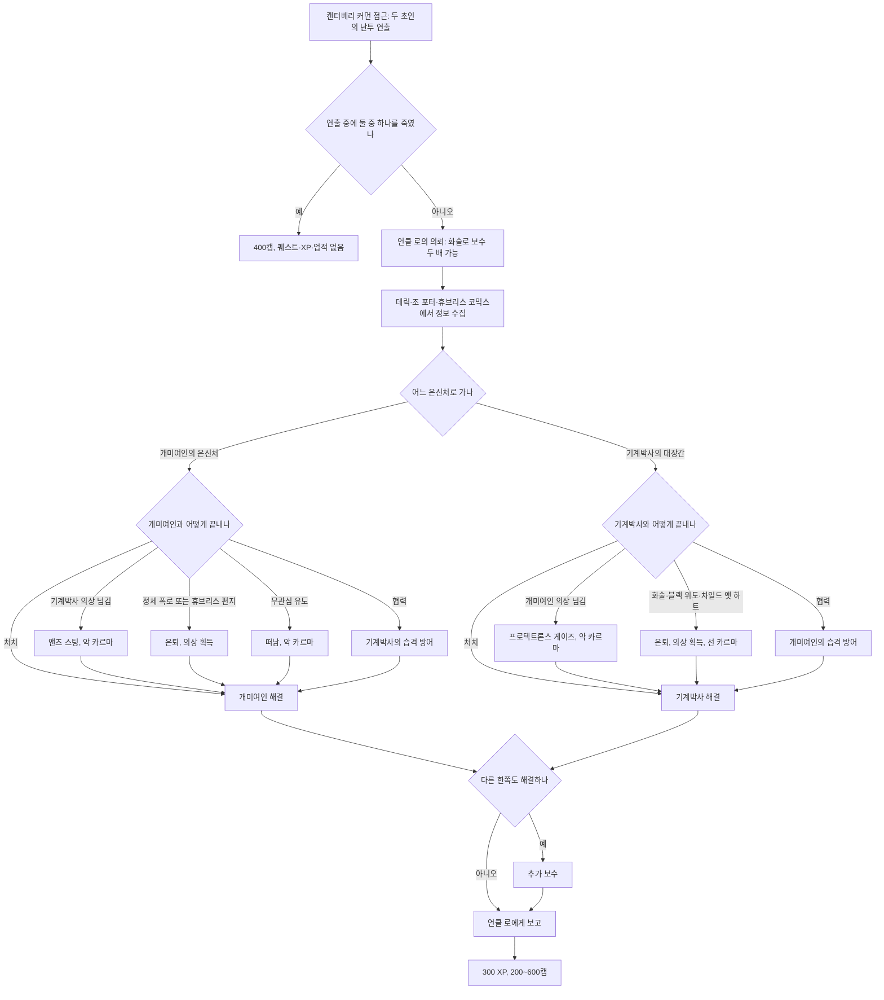

### 10.7 관련 NPC·아이템·대사 포인트

**NPC**

| 한국어명 | 영문명 | 역할 | 퀘스트 내 기능 | 비고 |
|---|---|---|---|---|
| 언클 로 | Uncle Roe (Ernest Roe) | 캔터베리 커먼 시장 | 의뢰인, 보수 지급 | 조카 데릭과 옛 소방서에 산다. 「상인 제국」 의뢰인 |
| 개미여인 | AntAgonizer (Tanya Christoff) | 자칭 '개미의 여왕' 슈퍼 악당 | 해결 대상 | 27세, 카르마 악함 |
| 기계박사 | Mechanist (Scott "Bean" Wollinski) | 자칭 슈퍼 영웅 | 해결 대상 | 40세, 카르마 중립. 마을 정비공 출신 |
| 데릭 파시온 | Derek Pacion | 언클 로의 조카 | 은신처 위치, 약점 정보 | 차일드 앳 하트 전용 대화 |
| 조 포터 | Joe Porter | 식당 주인, 마을 유일의 상설 상인 | 개미여인의 본명 | 개와 함께 산다. |
| 도미닉 / 마체테 | Dominic / Machete | 주민 | 배경 인물 | 이 집부터 들어가면 오프닝을 놓치는 문제가 보고되었다. |

**아이템**

| 한국어명 | 영문명 | 유형 | 주요 수치 | 획득 |
|---|---|---|---|---|
| 앤츠 스팅 | Ant's Sting | 고유 근접 무기 | 피해 4, 독 초당 4×10초(중첩), AP 20, 내구 250, 무게 1, 가격 30 | 개미여인에게 기계박사의 의상을 넘김 |
| 프로텍트론스 게이즈 | Protectron's Gaze | 고유 에너지 무기(레이저 권총) | 피해 24, AP 17, 장탄 20, 내구 500, 무게 3, 가격 320, 치명타로 죽이면 분해 | 기계박사에게 개미여인의 의상을 넘김 |
| 개미여인의 의상 | The AntAgonizer's costume | 고유 의복+모자 | 몸통 DR 20, 내구 100, 카리스마 -1, 민첩성 +1, 무게 15, 가격 120 / 모자 DR 6, 내구 50, 무게 5, 가격 60 | 처치 또는 설득 |
| 기계박사의 의상 | The Mechanist's costume | 고유 의복+모자 | 몸통 DR 20, 내구 100, 카리스마 -1, 지구력 +1, 무게 15, 가격 30 / 모자 DR 6, 내구 50, 무게 5, 가격 60 | 처치 또는 설득 |
| 개미여인의 은신처 열쇠 | AntAgonizer Lair key | 열쇠 | — | 오프닝 난투 중 소매치기 |

**대사 포인트**

- 개미여인(오프닝): "You and your pathetic tin cans are no match for my army." → "너와 네 한심한 깡통들은 내 군대의 상대가 안 돼."
- 언클 로(자기소개): "Name's Roe. Uncle Roe, to most. Welcome to Canterbury Commons... for what that's worth." → "로라고 하네. 다들 언클 로라고 부르지. 캔터베리 커먼에 온 걸 환영하네… 그게 무슨 의미가 있을진 모르겠지만."
- 조 포터(단서): "Said her name was "Tanya Christoff." That might just be our little AntAgonizer." → "그 애 이름이 '타냐 크리스토프'였대. 그게 바로 우리 개미여인일지도 몰라."
- 기계박사: "Humans may be weak sometimes, but our creations are strong and pure." → "인간은 때로 나약하지만 우리의 창조물은 강하고 순수하지."

### 10.8 비고

- 설계자 프레드 젤레니는 이 퀘스트와 「황무지 생존 가이드」를 동시에 만들었고, 휴브리스 코믹스 터미널의 '독자 편지'를 직접 써서 개미여인의 비밀 대화 선택지와 연결했다고 밝혔다.
- 개미여인이 공격을 받아도 체력이 줄지 않는 문제가 보고되었다(그녀의 은신처에서도 발생).
- 기계박사와 함께 대장간을 지키던 중 그가 사라져 프로텍트론스 게이즈를 얻을 수 없게 되는 문제, 오프닝을 보지 않고 바로 언클 로와 대화하면 세 인물이 모두 사라지는 문제가 보고되었다. 연출 중심 시작 이벤트의 위험을 보여 준다.

### 10.9 설계 분석

- **장르 패러디와 정체 반전**: 1950년대 만화식 영웅·악당 구도를 황무지에 옮겨 놓고, 그 가면 아래 고아와 팔려 간 소년이라는 상처를 숨겨 두었다. 해결의 열쇠는 무력보다 **정체를 아는 것**(데릭, 조 포터, 휴브리스 코믹스)이다.
- **대칭 설계**: 두 진영에 거의 같은 선택지 묶음(오인, 의상 넘기기, 처치, 협력, 설득)을 주어 결말 조합을 늘린다. 한쪽과 손잡으면 다른 쪽과의 방어전이 생겨 전투형 플레이어에게도 한 판의 이벤트를 준다.
- **보상의 역설**: 고유 무기 두 자루는 상대의 의상을 넘겨 망상을 부추기는 악행으로만 얻는다. 설득이라는 선행은 의상과 선 카르마만 준다. '좋은 장비'와 '옳은 일'을 저울에 올리게 하는 장치다.
- **선제 처치의 메타 메시지**: 대화 없이 쏘는 플레이를 400캡으로 오히려 더 크게 보상하면서도 퀘스트·XP·업적은 빼앗는다. "선택과 결과"를 개발자가 노골적으로 드러낸 사례다.
- **약점**: 개미여인처럼 악인을 죽여도 카르마 보상이 없어 다른 퀘스트의 악인 처치(매우 악함 +100)와 체감이 다르다. 스크립트 연출 의존도가 높아 진행 불능 버그가 많다.

---

## 11. 냉정한 거래 (Strictly Business)

### 11.1 기본 정보

| 항목 | 내용 |
|---|---|
| 영문명 | Strictly Business |
| 한국어명 | 냉정한 거래 |
| 유형 | 사이드 퀘스트 (핍-보이 표시). 악행 전용 |
| 퀘스트 ID | MS13 / 00014ea0 |
| 의뢰인 | 그루스(Grouse). 파라다이스폴 입구를 지키는 노예 사냥꾼 |
| 시작 조건 | 파라다이스폴에 처음 다가가면 그루스가 "볼일이 없으면 못 들어간다"며 막는다. 그가 내민 'VIP 명단'의 인물을 노예로 잡아 오는 일을 수락하면 시작된다. |
| 관련 장소 | 파라다이스폴, 마인필드(알칸소), 텐페니 타워(수잔 랭카스터), 빅타운(레드), 리벳시티(플랙) |
| 선행 퀘스트 | 없음 |
| 후행·연계 | 메인 「낙원으로부터의 구출」(RD-04)의 파라다이스폴 출입 수단 중 하나, 「빅 타운의 큰 문제」(레드), 「텐페니 타워」(RD-06, 수잔), 「황무지 생존 가이드」(마인필드의 알칸소), 비표시 반복 퀘스트 「냉정한 수익(Strictly Profitable)」(RD-07), 랜덤 인카운터 「작은 경쟁(A Little Competition)」·「노예 사냥꾼 처단(Kill the Slaver)」(RD-07) |
| 보상 | 수락 시: 메스메트론(Mesmetron), 메스메트론 전지 50발, 노예 목줄, 노예 목줄 사용 설명서, 파라다이스폴 '신입' 명단, 메스메트론 설명서 요약 홀로디스크 / 표적 1명당 75 XP와 250캡(총 300 XP, 1,000캡) / 표적 1명 이상을 넘기면 파라다이스폴 출입 허가 |
| 카르마 영향 | 노예 목줄을 채울 때마다 -100(표적 4명이면 -400). 목줄은 누구에게 채우든 -100이다. |
| 업적·트로피 | 「냉정한 거래」 20G·브론즈 |

### 11.2 개요

- 파라다이스폴은 전쟁 전 쇼핑센터를 개조한 수도 황무지 노예 무역의 본거지다. 두목 율로지 존스(Eulogy Jones) 아래의 노예 사냥꾼들이 사람을 사고판다.
- 입구 경비 그루스는 군사 기지에서 주운 '메스메트론'이라는 전쟁 전 비살상 제압 장치를 시험해 볼 겸, 율로지가 특별히 원하는 네 명을 잡아 오라고 플레이어에게 맡긴다. 네 명은 모두 노예 사냥꾼에게 원한을 산 사람들이다.
- 메인 퀘스트 「낙원으로부터의 구출」에서 파라다이스폴에 들어가야 할 때, 이 퀘스트는 '악행으로 여는 출입문'이 된다.

### 11.3 진행 단계 (핍-보이 목표)

| 스테이지 | 핍-보이 목표 (원문) | 번역 | 비고 |
|---|---|---|---|
| 1 | Enslave the sniper Arkansas from Minefield. | 마인필드의 저격수 알칸소를 노예로 만든다. | |
| 2 | Enslave Susan Lancaster from Tenpenny Tower. | 텐페니 타워의 수잔 랭카스터를 노예로 만든다. | |
| 3 | Enslave Red from Big Town. | 빅타운의 레드를 노예로 만든다. | |
| 4 | Enslave Flak from Rivet City. | 리벳시티의 플랙을 노예로 만든다. | |
| 5 | Return to Grouse | 그루스에게 돌아간다. | 표적마다 보고하고 새 목줄을 받는다. 네 명을 모두 처리하면 **완료** |

- 표적 하나를 처리할 때마다 그루스에게 돌아가 보수와 다음 목줄을 받아야 한다. 목줄을 여러 개 가진 상태에서 보고 없이 여러 명을 연달아 잡으면, 노예 우리에는 모두 들어가지만 마지막 한 명만 인정되어 퀘스트를 완료할 수 없게 된다.
- 퀘스트를 받기 전에 레드·수잔·알칸소가 이미 죽었다면 명단에서 빠지고, 그루스는 그대로 출입을 허락한다.

### 11.4 분기와 해결 방법

#### 11.4.1 메스메트론과 노예화 절차

| 항목 | 내용 |
|---|---|
| 무기 성능 | 에너지 무기 계열 고유 무기. 피해 1, AP 65, 장탄 5, 탄약은 메스메트론 전지, 무게 2, 가격 500. 최대 내구도에서 2,500회(전지 500개) 발사하면 부서진다. |
| 효과 확률 | 기절(최면) 50% / 광란 30% / 머리 폭발 20%. 기절하지 않는 대상에게는 광란 확률이 80%로 오른다. **퀘스트 표적 4명은 '항상 최면 가능' 목록에 있다.** |
| 기절 상태 대화 | ① 소지품 열기(마술이라거나 도둑이 있다는 핑계) ② 노예 목줄 채우기(카르마 -100) ③ "그냥 털고 가라"(대화 종료) |
| 목줄을 채운 뒤 | ① "파라다이스폴의 노예 사냥꾼들에게 안부 전해. 움직여, 안 그러면 머리가 펑 터진다!" ② 소지품 열기 ③ "이제 넌 노예야. 개인적인 감정은 없어. 살고 싶으면 파라다이스폴로 가." |
| 주의 | 최면 행위는 폭행으로 처리되므로 들키지 않아야 한다. 이미 목줄을 찬 사람을 최면하면 목줄이 오작동해 터진다. 기절 시간 안에 말을 걸지 않으면 대상이 보이는 모두에게 적대한다. |
| 탄약 보급 | 그루스가 전지 10발을 200캡에 판다. |

- **목줄 후 대사의 영향**: 첫 번째("머리가 펑 터진다")를 고르면 일부 표적이 도망치며 정착지를 적대시킨다. 레드는 "폭행이야!"를 외쳐 빅타운이 적대하고, 수잔은 비명을 질러 경비를 부른다. 플랙은 어느 대사를 골라도 리벳시티를 적대시키지 않는다. 알칸소는 정착지에 있지 않아 영향이 없다. 세 번째 대사("개인적인 감정은 없어")는 적대를 일으키지 않는다.

#### 11.4.2 표적별 공략

| 표적 | 위치 | 노예 사냥꾼이 노리는 이유(그루스의 설명) | 공략 포인트 | 대안 처리 |
|---|---|---|---|---|
| 알칸소(Arkansas) | 마인필드의 폐건물 저격 위치 | 마인필드에 숨어 파라다이스폴 사냥꾼 한 무리를 몰살했다. 율로지가 그의 고통을 원한다. | 거리의 지뢰와 차량 폭발에 주의한다. 목줄을 찬 알칸소는 지뢰밭을 가로질러 파라다이스폴로 달려가므로 빠른 이동이 안전하다. | 퀘스트 전에 죽었으면 명단에서 빠진다. |
| 수잔 랭카스터(Susan Lancaster) | 텐페니 타워 3층 자기 스위트룸(밤) | 원래 노예 사냥꾼 쪽 사람이었는데 떠나면서 '탈퇴 대가'를 치르지 않았다. | 방문을 닫고 단둘일 때 최면을 걸고 목줄을 채운다. 다른 사람이 보거나 특정 대사를 고르면 타워 전체가 적대한다. | 그녀의 방에서 에드가 웰링턴 2세(Edgar Wellington II)와의 불륜을 드러내는 편지를 찾아 아내 밀리센트 웰링턴(Millicent Wellington)에게 보여 주면 밀리센트가 수잔을 죽인다. 수잔이 마지막 표적이면 그 즉시 완료된다. |
| 레드(Red) | 빅타운의 레드의 진료소 | 노예 사냥꾼에게 약속을 하고 갚지 않았다. | 「빅 타운의 큰 문제」를 끝내지 않았다면 저먼타운 경찰 본부에 갇혀 있으며 거기서도 노예화할 수 있다. 그러면 빅타운 퀘스트는 레드가 죽거나 목줄이 풀릴 때까지 완료할 수 없다. | 이후 슈퍼 뮤턴트 습격으로 죽으면 명단에서 빠진다. |
| 플랙(Flak) | 리벳시티 상층 갑판의 자기 방(밤) | 노예 사냥꾼 출신으로 리벳시티에서 새 삶을 꾸리려 하며, 여러 번 동료를 팔아넘겼다. | 가장 어려운 표적이다. 가끔 가게를 오가는 길에 혼자 있다. | — |

#### 11.4.3 파라다이스폴 출입의 다른 방법

이 퀘스트는 파라다이스폴에 들어가는 여러 열쇠 중 하나다. 다른 방법과 비교하면 다음과 같다.

| 방법 | 조건 | 대가 |
|---|---|---|
| 냉정한 거래 | 표적 1명 이상 포획 | 카르마 -100 이상 |
| 뇌물 | 화술 판정 후 500캡(그루스는 어차피 못 낼 줄 알고 부른 값이지만 실제로 내면 받는다) | 500캡 |
| 「국가 원수」 노예 사냥꾼 편 | 퀘스트 완료 | 악 카르마, 템플 오브 유니온(Temple of the Union) 파괴 |
| 악명 | 악함 이상 카르마로 "내가 누군지 알아?" 선택 | — |
| 강행 | 싸우거나 몰래 들어감 | 노예 사냥꾼 적대 |

- 그루스에게 말을 걸지 않고 지나치면 노예 사냥꾼 전체가 적대하고 선 카르마를 받는다.
- 그루스를 죽이면 "Grouse has died"(그루스가 죽었다) 메시지와 함께 퀘스트가 실패한다. 그루스는 게임에서 유일한 노예 목줄 공급원이다.
- 그루스 문서에는 선 카르마 플레이어의 출입을 거절하고 악 카르마 플레이어에게 퀘스트를 권하는 카르마 판정이 있다고 적혀 있으나 검증 필요 표시가 붙어 있다 `(코퍼스 미확인)`.

### 11.5 결과와 후일담

| 결과 | 내용 |
|---|---|
| 노예가 된 표적 | 네 명 모두 파라다이스폴 노예 우리로 들어간다. |
| 표적 해방 | 과학 스킬이 충분하면 목줄을 풀어 줄 수 있다. 그러나 노예 사냥꾼이 살아 있으면 걸어 나가다 사살된다. 노예 사냥꾼을 모두 죽이고 풀어 주면 각자 집으로 돌아가 "그 개자식들한테서 구해 줬지. 잊지 않을게"라는 말만 반복한다. 플랙은 이후 거래를 하지 않으므로 샤프넬(Shrapnel)과 거래해야 한다. 풀려난 알칸소는 목줄 찬 사람을 보이는 대로 쏘며 템플 오브 유니온으로 가겠다고 말한다. 노예 사냥꾼이 다 죽은 상태에서 수잔은 노예 집에 남아 "세상에, 다 죽이고 있잖아!"만 반복한다. |
| 냉정한 수익 | 완료 후 그루스가 목줄을 더 주며 비표시 반복 퀘스트 「냉정한 수익」이 시작된다. 다른 NPC를 노예로 만들 때마다 250캡을 받는다. |
| 노예 사냥꾼 관련 인카운터 | 노예를 3명 이상 잡으면 「작은 경쟁」(노예 사냥꾼 4명이 경쟁자인 플레이어를 제거하러 온다)이, 메스메트론으로 노예를 만든 적이 있으면 「노예 사냥꾼 처단」(친구의 복수를 하려는 방랑자 암살대)이 일어날 수 있다. |
| 리벳시티 | 플랙을 노예로 만들면 엔딩 세그먼트 7(리벳시티 관련 장면)이 나올 수 있다(리벳시티 주민 살해나 악 카르마로도 나오는 조건이라 확정은 아님). 플랙과 함께 자는 AI 설정 때문에 샤프넬이 플랙을 찾아 황무지를 떠도는 현상이 보고되었다. |
| GNR | 「낙원으로부터의 구출」을 끝낼 때 이 퀘스트가 진행 중이고 표적이 1명 이상 노예가 되었거나 죽었으면, "볼트 101 출신이 웃으며 파라다이스폴을 나왔다"는 보도가 나온다(중립·악). |
| 카르마 | 메스메트론 사용 자체보다 목줄 채우기에 -100이 붙는다. 노예화 대상이 적대적 NPC여도 마찬가지다. |

### 11.6 흐름도

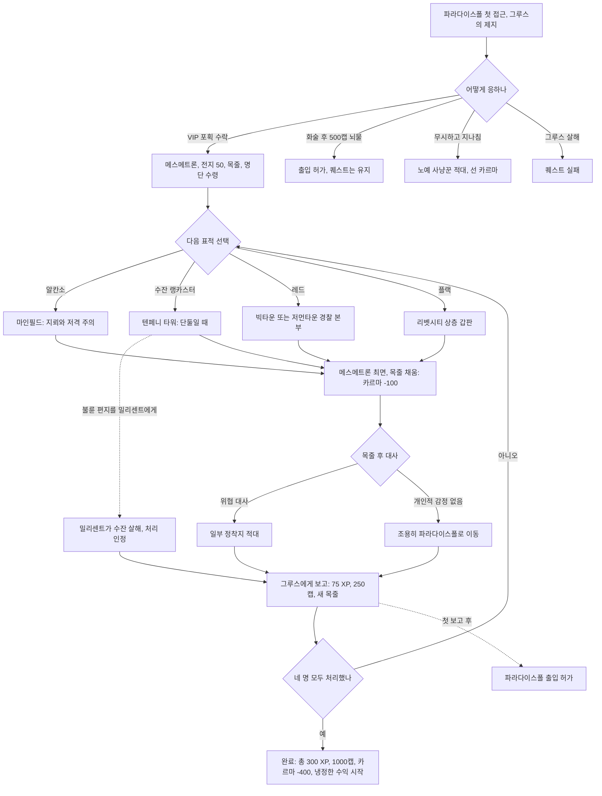

### 11.7 관련 NPC·아이템·대사 포인트

**NPC**

| 한국어명 | 영문명 | 역할 | 퀘스트 내 기능 | 비고 |
|---|---|---|---|---|
| 그루스 | Grouse | 파라다이스폴 입구 경비 | 의뢰인, 보수·목줄 지급, 전지 판매 | 2247년생. 율로지에게 두목 자리를 빼앗긴 전 노예 사냥꾼 두목 하먼 절리(Harmon Jurley)의 아들로, 아버지의 유산을 의식한다. |
| 율로지 존스 | Eulogy Jones | 노예 사냥꾼 두목 | VIP를 원하는 배후 | 매우 악함(처치 시 +100) |
| 알칸소 | Arkansas | 마인필드의 저격수 | 표적 | 카르마 중립. 노예 사냥꾼에게 부족을 잃고 복수 중이다. |
| 수잔 랭카스터 | Susan Lancaster | 텐페니 타워 주민 | 표적 | 전에 파라다이스폴에 있었다. |
| 레드 | Red | 빅타운의 의사 | 표적 | 8장 참고 |
| 플랙 | Flak | 리벳시티 무기상(플랙 앤 샤프넬) | 표적 | 50세, 전직 노예 사냥꾼, 카르마 선함 |
| 샤프넬 | Shrapnel | 플랙의 동업자이자 동반자 | 플랙이 노예가 되면 거래 상대 | |
| 밀리센트 웰링턴 / 에드가 웰링턴 2세 | Millicent Wellington / Edgar Wellington II | 텐페니 타워 주민 부부 | 수잔 처리의 대안 루트 | |

**아이템**

| 한국어명 | 영문명 | 유형 | 주요 수치 | 비고 |
|---|---|---|---|---|
| 메스메트론 | Mesmetron | 고유 에너지 무기 | 피해 1, AP 65, 장탄 5, 내구 100, 무게 2, 가격 500, 폼 ID 00004339 | 전쟁 전 '임플라이드 히프노틱스(Implied Hypnotics)'와 미군이 공동 개발한 비살상 제압 장치. 그루스가 군사 기지에서 주웠다. |
| 메스메트론 전지 | Mesmetron power cell | 탄약 | 그루스가 처음에 50발 지급, 이후 10발 200캡 | [PL] 세인트 오빈 의료 시설에도 있다. |
| 노예 목줄 | Slave collar | 퀘스트 아이템 | 버릴 수 없다. | 채울 때마다 카르마 -100 |
| 노예 목줄 사용 설명서 / '신입' 명단 / 메스메트론 설명서 요약 | Slave collar instructions / List of "recruits" for Paradise Falls / Mesmetron manual - summary page | 노트·홀로디스크 | — | 수락 시 지급 |
| 불륜 편지 | Love letter | 노트 | — | 수잔의 방. 밀리센트에게 보여 주는 대안 루트 |

**대사 포인트**

- 그루스(다른 노예에 대해): "If you round up any slaves, I'll gladly split the commission with you." → "노예를 더 잡아 오면 수수료는 기꺼이 나눠 주지."
- 그루스(알칸소에 대해): "Arkansas is that asshole holed up in that minefield. Killed a whole Paradise Falls crew." → "알칸소는 그 지뢰밭에 틀어박힌 개자식이야. 파라다이스폴 무리 하나를 통째로 죽였지."
- 그루스(보고): "The slaves keep rolling in. Keep this up and you're going to be rich!" → "노예들이 계속 굴러들어 오는군. 이대로만 하면 부자 되겠어!"

### 11.8 비고

- 레드를 저먼타운 경찰 본부에서 노예로 만든 뒤 노예 우리에서 풀어 주면, 레드는 "빨리 빅타운으로 돌아가고 싶다"며 따라온다. 정문으로 나가면 그루스가 그녀를 쏴 죽일 수 있으므로 정문을 나서자마자 빠른 이동하는 것이 안전하다. 이 경우에도 빅타운 퀘스트는 정상 대화로 완료된다.
- 노예 우리 열쇠를 소매치기해 이미 잡은 VIP와 대화한 뒤 그루스에게 가면 같은 VIP의 보수를 반복해 받는 무한 캡 문제가 보고되었다. 보고 판정을 '대화 이벤트'로만 처리한 설계의 허점이다.
- 「텐페니 타워」에서 구울 편을 들어 주민이 사라졌어도 수잔은 명단에 남는다. 타워에 들어가기만 하면 목표가 완료 처리되지만 메시지와 XP는 나오지 않는다.
- 카르마 문서는 악 카르마 효과로 "그루스가 포획마다 탄약·캡·때로 화학약이나 수류탄을 준다"고 적는다. 퀘스트 문서의 보상(표적당 250캡과 75 XP)과 표현이 다르며, 반복 퀘스트 「냉정한 수익」의 보상을 섞어 적은 것으로 보인다 `(문서 간 상충)`.

### 11.9 설계 분석

- **명시적 악행 퀘스트**: 보상(캡, 출입권)과 카르마 손실이 표적 하나마다 1:1로 묶여 있다. 플레이어가 "얼마에 사람을 팔 것인가"를 네 번 반복해서 고르게 한다.
- **메인 관문의 악한 지름길**: 「낙원으로부터의 구출」에서 파라다이스폴 출입이라는 실용적 필요가 생기는 시점에 이 퀘스트가 가장 손쉬운 열쇠로 나타난다. 뇌물(500캡)이나 화술보다 싸게 느껴지도록 해 편의로 악을 유혹한다.
- **다른 콘텐츠를 파괴하는 표적 선정**: 표적 넷은 각각 다른 콘텐츠의 핵심 NPC다(빅타운의 의사, 리벳시티의 무기상, 마인필드의 위험 요소이자 「황무지 생존 가이드」의 장애물, 텐페니 타워 주민). 노예화는 그 지역의 서비스와 퀘스트를 함께 지운다.
- **간접 처리의 허용**: 수잔을 불륜 폭로로 죽게 해도 완료로 인정한다. 직접 목줄을 채우지 않는 '깨끗한 손'의 악행도 같은 결과로 묶여, 플레이어가 자기 손을 더럽히는 방식만 고르게 한다.
- **약점**: 목격·적대 판정이 대사 선택에 크게 의존해 일관성이 떨어진다. 보고 처리의 허점(무한 캡, 다중 포획 미인정)이 있고, 선한 플레이어에게는 이 퀘스트를 거절하는 것 말고는 대안 해결(예: 표적에게 경고하기)이 없다.

---

## 12. 사이드 퀘스트 디자인 패턴 분석

### 12.1 도덕적 딜레마 구조

| 퀘스트 | 딜레마 축 | 선 쪽 결말 | 악 쪽 결말 | 회색·중립 선택 | 물질 보상이 큰 쪽 |
|---|---|---|---|---|---|
| 원자의 힘 | 공동체의 생존 대 권력자의 돈 | 해체(집, 무보수 +200) | 폭파(-1,000) | 고발(심즈 희생 위험), 블랙 위도 유혹 | 악(최대 1,000캡, 스위트룸) |
| 황무지 생존 가이드 | 타인의 꿈 지원 대 냉소 | 완성(서바이벌 퍽) | 드림 크러셔(악 카르마) | 거짓말(시간 절약 대 최고 등급 포기) | 대등(드림 크러셔도 할인·퍽) |
| 피의 유대 | 처벌 대 공존 | 휴전과 혈액 팩 거래 | 패밀리 학살(악) | 이안의 잔류 존중, 선의의 거짓 보고 | 선(헤마토페이지·설계도) |
| 그것들! | 고아 보호 대 이익, 연구 지속 대 근절 | 베라에게 맡김, 여왕 처치 | 노예로 판매(-400), 레스코 살해 | 리틀 램프라잇, 방치 | 악(100/300캡) |
| 애거사의 노래 | 약속과 유산 대 돈 | 반환(방송국) | — | 매각(아즈루칼 중립, 워싱턴 선) | 매각(200/300캡) |
| 빅 타운의 큰 문제 | 자립 지원 대 방관·갈취 | 훈련과 방어 | 보상 갈취(악, 되돌릴 수 있음) | 보상만 받고 떠남 | 갈취(500캡) |
| 오아시스 | 개인의 죽을 권리 대 공동체의 신앙 | (카르마상 구분 없음) | 화형(-200) | 안락사·정지·확산 셋 다 카르마 0 | 공동체 편(장비 2점) |
| 초인의 도박 | 망상의 치유 대 이용 | 설득 은퇴 | 상대 의상 넘기기(악) | 처치(0), 협력 | 악(고유 무기) |
| 냉정한 거래 | 편의(출입권) 대 인간 존엄 | 거절뿐 | 노예화(-100×4) | 불륜 폭로로 간접 처리 | 악(1,000캡) |

- **"이득은 악에 붙는다"**: 9개 중 6개에서 가장 큰 물질 보상(캡, 고유 무기)이 악행 쪽에 있다. 선행의 보상은 집, 라디오 채널, 마을의 존속, 무료 치료처럼 **관계와 세계의 변화**로 주어진다. 폴아웃 3는 선행을 "손해를 감수하는 선택"으로 체감하게 만든다.
- **XP 중립**: 확인된 완료 XP는 결말과 상관없이 대부분 300 XP로 같다. 레벨업 손익을 선택에서 떼어 내, 선택이 성장 효율이 아니라 가치 판단이 되게 한다.
- **카르마 수치의 비례**: 마을 학살 -1,000, 아동 매매 -400, 헤럴드 화형 -200, 노예 목줄 1회 -100, 무보수 선행 +200, 매우 악한 인물 처치 +100. 피해의 규모와 의도에 비례해 크기를 매긴다.
- **회색 지대 처리**: 안락사(오아시스), 선의의 거짓말(피의 유대), 규율을 지키는 식인 공동체(패밀리)처럼 단순한 선악으로 나누기 어려운 지점에서는 카르마를 움직이지 않거나 모든 결말에 같은 선 카르마를 준다. 카르마 시스템의 한계를 '판단 보류'로 피해 간다.
- **반전과 재해석**: 피의 유대(피해자 가족의 아들이 범인), 초인의 도박(초인은 상처 입은 평범한 사람), 그것들!(괴물의 원인은 선의의 과학자)처럼 처음의 선악 구도를 뒤집어 '토벌'을 '협상'이나 '보살핌'으로 바꾸는 패턴이 반복된다.

### 12.2 다중 해결 구조

| 퀘스트 | 전투 | 화술 판정 | 스킬 문턱 | 퍽 전용 | 능력치·카르마 | 정보·아이템 열쇠 | 은신·잠입 | 거짓말 |
|---|---|---|---|---|---|---|---|---|
| 원자의 힘 | 버크 처치 | 500/1,000캡 흥정 | 폭발물 25 | 블랙 위도 | — | 핵융합 펄스 장약 | — | — |
| 황무지 생존 가이드 | 과제 수행 | 거짓말, 설득 포기 | 과학 50, 의학 70 | 로보틱스 엑스퍼트 | SPECIAL 7 성향 답변 | 사전 완료 인정 | 마이얼럭 무살생 | 과제별 거짓말 |
| 피의 유대 | 패밀리 학살 | 로버트, 저스틴, 밴스, 이안 | 의학 30/50/70/90 | 캐니벌, 블랙 위도, 레이디 킬러, 스카운드럴, 임파셜 미디에이션 | 힘, 카리스마, 지능 | 루시의 편지, 패밀리 율법 | 정문 잠입 | 거짓 보고 허용 |
| 그것들! | 수호자·여왕 처치 | 쓰레기통 열쇠, 레스코 설득, 맥크래디 | 과학 50/60/70 | 차일드 앳 하트, 엔터몰러지스트 | — | 판잣집 터미널, 암호 녹음 | — | 거짓 보고(악) |
| 애거사의 노래 | 볼트 92 | 탄약 상자 열쇠, 매각가 | 보통 자물쇠 | 레이디 킬러 | 카리스마 | 볼트 위치 정보, 악보집 | — | — |
| 빅 타운의 큰 문제 | 구출·방어전 | 보상 갈취 | 소형 화기·은신·과학·폭발물 50, 의학 40, 자물쇠 따기 100 | 라이트 스텝(역효과), 폭스 동행 대사 | — | 봉쇄 컴퓨터 암호, 간수 열쇠 | 은신 훈련 | — |
| 오아시스 | 화형 | 버치, 린든, 요우 | 자물쇠 따기 100/25 | 차일드 앳 하트, 라이프 기버, 애니멀 프렌드 | — | 요우의 비밀, 수액·연고 | — | — |
| 초인의 도박 | 처치, 협력 방어전 | 보수 두 배, 은퇴 설득, 조 포터 | 자물쇠 따기 50/75 | 레이디 킬러, 블랙 위도, 차일드 앳 하트 | — | 본명, 휴브리스 편지, 상대 의상 | 뒷문, 소매치기 | — |
| 냉정한 거래 | 강행 돌파 | 뇌물 500캡 | 과학(목줄 해제) | — | 악명(악 카르마) | 불륜 편지 | 들키지 않는 최면 | — |

- **열쇠 분산**: 같은 목표에 이르는 열쇠를 여러 NPC·조건에 흩어 둔다(피의 유대의 명상실 코드는 6가지 경로). 어떤 빌드로 와도 비폭력 해법이 하나는 있다.
- **전문가 우회**: 높은 스킬은 "직접 겪지 않아도 안다"는 지름길을 준다(과학 50 방사능, 의학 70 부상, 의학 90 단서, 로보틱스 엑스퍼트). 대신 체험형 보상은 놓치게 해 우회의 대가를 둔다.
- **정보가 곧 열쇠**: 노트·터미널·다른 NPC의 증언(조 포터, 휴브리스 편지, 패밀리 율법, 요우의 비밀)이 화술 판정을 대신한다. 탐색 행동을 해법으로 바꾸는 설계다.
- **퍽·성별 전용 대사**: 블랙 위도와 레이디 킬러, 차일드 앳 하트, 캐니벌 같은 퍽이 거의 모든 퀘스트에서 전용 선택지를 연다. 퍽 선택이 전투 수치뿐 아니라 '대화 빌드'가 된다.
- **스킬을 남에게 주는 해법**: 빅타운의 훈련처럼 플레이어의 스킬이 NPC 집단의 능력으로 옮겨 가는 해법도 있다.

### 12.3 월드 영향

| 퀘스트 | 영구적인 월드 변화 | 되먹임 경로 |
|---|---|---|
| 원자의 힘 | 정착지 소멸 또는 존속, 플레이어 하우스, 방사능 지대, 난민·용병 습격 | GNR, 인카운터, 메인 대사(제임스), 엔딩, 암살대 |
| 황무지 생존 가이드 | 모이라의 판매 목록(라드-X·라드어웨이), 리벳시티 10% 할인, 모이라의 수리 실력과 성격, 책의 유통 | GNR, 인카운터, NPC 성격 변화, 상점 가격 |
| 피의 유대 | 아르푸와 패밀리의 동맹, 앨런 상주, 혈액 팩 시장, 아르푸의 수리 서비스 | 팩션 관계, 반복 퀘스트 |
| 그것들! | 브라이언의 거주지, 레스코의 꿀 시장, 그레이디치 인구 | GNR, 반복 퀘스트 |
| 애거사의 노래 | 새 라디오 채널 | 라디오, 엔딩 |
| 빅 타운의 큰 문제 | 마을의 존속 또는 전멸, 캐러밴 경로, 치료·수리 서비스 | GNR, 인카운터 대사 |
| 오아시스 | 헤럴드의 생사, 오아시스의 적대 여부 | GNR(소문 중단, 산불 보도), 엔딩 |
| 초인의 도박 | 마을의 평화, 개미여인의 이동, 캐러밴 강화(상인 제국) | GNR, 인카운터 |
| 냉정한 거래 | 표적 NPC의 노예화(상점·의사 상실), 노예 사냥꾼 습격 | GNR, 인카운터, 엔딩 가능 |

- **되먹임 채널 6가지**: ① GNR 보도 ② 랜덤 인카운터 ③ NPC 대사·성격 변화 ④ 엔딩 영상 세그먼트 ⑤ 상점·서비스 변화(할인, 수리, 치료, 판매 목록) ⑥ 카르마에 따른 암살대. 사이드 퀘스트의 결과가 최소 두 개 이상의 채널로 다시 돌아오도록 짜여 있다.
- **소멸의 비가역성**: 메가톤 폭파, 브라이언 판매, 헤럴드 화형, 빅타운 전멸, 노예화는 되돌릴 수 없다. 반면 빅타운 보상 갈취는 캡을 돌려주면 카르마를 회복하는 등 작은 악행은 되돌릴 수 있게 차등을 둔다.

### 12.4 발견과 정보 전달

- **라디오가 퀘스트 게시판 역할을 한다**: GNR의 소문 보도("그레이디치가 조용하다", "코스튬 괴짜", "나무가 가득한 곳")가 장소를 가리키고, 결과 보도가 플레이어의 평판을 기록한다.
- **NPC가 먼저 다가온다**: 루카스 심즈, 브라이언, 버치, 그루스, 에반 킹은 플레이어가 지역에 들어서면 먼저 말을 건다. 퀘스트 로그 없이 지나가도 놓치지 않게 하는 장치다.
- **인카운터 훅**: 「그레이디치 탈출」, 「오아시스 상인」, 「오아시스 습격자들」처럼 랜덤 인카운터가 퀘스트 장소를 미리 알려 준다.
- **월드 상태 적응**: 볼트 위치를 이미 알면 단계를 건너뛰고(애거사의 노래), 과제를 이미 했으면 대화로 인정한다(황무지 생존 가이드). 비선형 진행을 허용하는 오픈 월드형 처리다.

### 12.5 보상 설계

| 보상 유형 | 사례 | 설계 의도 |
|---|---|---|
| 퀘스트 퍽 | 라드 리제너레이션, 서바이벌 계열 15종, 드림 크러셔, 헤마토페이지, 앤트 마이트·사이트, 바크스킨 | 선택의 흔적을 캐릭터 시트에 영구히 남긴다. |
| 고유 장비 | 블랙호크, 앤츠 스팅, 프로텍트론스 게이즈, 린든의 아웃캐스트 파워 아머, 섀디 햇, 환경 보호복 | 도덕적 대가와 엮어 유혹으로 쓴다(초인의 도박). |
| 레벨 연동 소모품 | 황무지 생존 가이드 과제 보상 | 장기 퀘스트의 보상 가치를 유지한다. |
| 서비스 | 무료 치료(레드), 할인(분화구 잡화점 30%, 리벳시티 10%), 수리(켄 유어스, 파피, 모이라) | 정착지와의 관계를 경제로 환산한다. |
| 공간·환경 | 메가톤 집, 텐페니 타워 스위트룸, 아가사의 방송국 | 플레이 공간과 분위기 자체를 바꾼다. |

### 12.6 장르 인용과 시리즈 연속성

- 1950년대 B급 SF와 냉전 정서: 『그것들!(Them!, 1954)』(그것들!), 원폭(원자의 힘).
- 고딕·괴물 문학: 드라큘라, 『나는 전설이다』(피의 유대).
- 코믹스: 슈퍼히어로와 휴브리스 코믹스의 『그로그낙 더 바바리안』(초인의 도박).
- 영화: 『빅 트러블』(빅 타운의 큰 문제), 『다이 하드』(브라이언의 대사).
- 시리즈: 폴아웃 1·2의 헤럴드(오아시스), 원조 『웨이스트랜드』의 힌트북 이름(황무지 생존 가이드).

### 12.7 공통 약점

- **스크립트 의존**: 연출 트리거, 호위 AI, 문 잠금, 로봇 배치처럼 엔진 상태에 기대는 부분에서 진행 불능 문제가 많다(오아시스, 빅 타운의 큰 문제, 초인의 도박).
- **보이지 않는 상태 변화**: 팩션 병합 시점(피의 유대), 다른 NPC와 상의만 해도 잠기는 선택지(그것들!), 화면에 보이지 않는 성향 집계(황무지 생존 가이드)가 플레이어에게 예고되지 않는다.
- **월드 반응의 빈틈**: 폭파된 메가톤 앞의 캐러밴, 해체 뒤에도 냉담한 메가톤 주민, 만난 적 없는 플레이어에게도 '배신자'라고 하는 아가사처럼 상태 분기가 거친 곳이 있다.
- **보고 처리의 허점**: 대화 이벤트만으로 보상을 판정해 반복 지급이 일어난다(냉정한 거래).

---

## 13. 쯔꾸르 이식 메모

### 13.1 보존 필수

- 9개 퀘스트의 핵심 분기와 결말 수: 원자의 힘(해체·폭파·고발·유혹), 피의 유대(이안 2결정 × 거래 3종), 그것들!(해결 3방식 × 거처 4곳), 오아시스(4결말), 초인의 도박(진영별 5처리), 냉정한 거래(표적 4명과 대안 처리).
- 문턱 수치: 폭발물 25, 의학 30/50/70/90, 의학 40, 과학 50/60/70, 자물쇠 따기 25/50/75/100, 스킬 50(빅타운 훈련), SPECIAL 7(성향 답변).
- 카르마 수치: +200, -1,000, -400, -200, -100(목줄), +100(매우 악한 인물 처치).
- 월드 변화: 메가톤 폐허 맵 교체와 모이라의 언더월드 이주, 빅타운 존폐, 아가사의 방송국, 브라이언의 거처, 헤럴드의 생사, 표적 NPC의 노예화.
- 되먹임: GNR 결과 보도와 소문 보도, 엔딩 세그먼트 3·5·6·7, 결과 연동 랜덤 인카운터.

### 13.2 단순화

- **화술 판정**: 원작은 확률형이다. 판정 난이도 데이터가 없으므로 "화술 수치 문턱" 또는 "화술 기반 확률"로 통일하고 판정 등급(쉬움·보통·어려움·매우 어려움)만 퀘스트별로 지정한다.
- **실시간 연출**: 버크의 심즈 사살, 초인의 난투, 쇼티 처형 직전 장면은 컷신 + 제한 시간 선택지(또는 선제 공격 선택지)로 바꾼다.
- **호위·방어전**: 빅타운의 호위와 방어는 '따라오기' 이벤트와 단일 전투 이벤트로 압축한다. 훈련 4종은 결과 연출만 다르게 하고 전투 수(슈퍼 뮤턴트 2인 1조)와 승패 조건을 유지한다.
- **메스메트론**: 확률(기절 50·광란 30·폭발 20)은 유지하되 VIP 4명은 원작처럼 확정 최면으로 둔다.

### 13.3 생략·변형 후보

- 버그성 공략(무한 캡, 역소매치기로 의상 중복 획득, 선해체 보상 중복)은 재현하지 않는다.
- 일본판처럼 버크를 빼는 콘텐츠 옵션은 필요할 때만 둔다.
- 황무지 생존 가이드의 레벨 연동 표는 그대로 쓰되, 장 보상 탄약은 레벨 구간별 고정 수량으로 단순화할 수 있다(행운 보정 생략).

### 13.4 구현 시 주의

| 퀘스트 | 핵심 변수·스위치 (예시) | 주의점 |
|---|---|---|
| 원자의 힘 (MS11) | 결말(미진행·해체·폭파), 보수 협상값(0·100·500·1,000), 심즈 생존, 버크 상태(생존·사망·퇴장·유혹) | 폭파 시 메가톤 맵 전체를 폐허 맵으로 교체하고 힘 보블헤드를 회수 불가 처리한다. 암살대 공통 이벤트와 연결한다. |
| 황무지 생존 가이드 (MS03) | 장 진행(0~3), 과제 완료 9, 선택 목표 9, 성향 카운트 5종, 거짓말 플래그, 드림 크러셔 | 원작도 장 진행 변수(MS03C1)를 따로 둔다. 과제 완료와 장 진행을 분리하지 않으면 원작의 '역사 반복 질문' 같은 꼬임이 생긴다. |
| 피의 유대 (MS09) | 이안 결정(귀향·잔류·적대), 거래 유형(없음·불가침·경비), 아르푸-패밀리 동맹 | 동맹 플래그는 '이안이 결정한 순간' 켜진다. 이후 패밀리 공격이 아르푸 적대로 번지는 규칙을 명시적으로 안내하거나 그대로 재현할지 결정해야 한다. |
| 그것들! (MS04) | 해결 방식(펄스·여왕 처치·샘플 파괴), 퍽 선택, 브라이언 거처(4), 맥크래디 상의 플래그 | 맥크래디와 상의만 해도 베라 선택지가 잠기는 규칙을 유지할지 결정한다. |
| 애거사의 노래 (MS17) | 결말(반환·아즈루칼·워싱턴), 악보집 보상, 방송국 개방 | 퀘스트를 받지 않고 매각해도 완료되는 경로를 남긴다. |
| 빅 타운의 큰 문제 (MS01) | 레드·쇼티 생존, 보수 선택, 훈련 유형(5), 타임밤 상태, 마을 존속 | 훈련용 로봇은 고정 이벤트로 배치해 원작의 로봇 이탈 문제를 없앤다. |
| 오아시스 (MS10) | 결말(4), 지지자 대화 플래그(메이플·사이프러스·포플러·린든), 요우 비밀 플래그 | 말다툼 장면 트리거와 숲·출구 문 잠금을 스테이지 값에 묶는다. |
| 초인의 도박 (MS02) | 초인별 처리 방식(처치·설득·의상·협력·떠남), 보수 배율, 선제 처치 | 선제 처치 시 퀘스트를 생성하지 않는 원작 규칙을 그대로 둔다. |
| 냉정한 거래 (MS13) | 표적 4명 상태(미처리·노예·사망), 보고 대기 플래그, 출입 허가 | 표적은 한 번에 하나만 보고 대기 상태가 되게 막는다. 보수 지급은 상태 변수로 한 번만 처리한다. |

- 카르마 변화, GNR 보도 갱신, 엔딩 세그먼트 등록은 수치를 인자로 받는 공통 이벤트로 만들면 9개 퀘스트가 같은 경로로 월드에 되먹임된다.
- 퀘스트 간 연동(2.4절)은 스위치로 공유한다. 예: 메가톤 폭파 → 모이라 위치, 레드 노예화 → 「빅 타운의 큰 문제」 보류.

---

## 부록 A. 출처

모두 Nukapedia(fallout.fandom.com) DB 덤프 2026-08-30판의 로컬 코퍼스이며 CC BY-SA를 따른다. 고유명사 표기는 리드가 제공한 폴아웃 3 한글 패치 병렬 대사(`esm/parallel.tsv`)와 표기 기준(FANPATCH_TERMS)을 따랐다.

- 허브·공통: Nukapedia: Fallout 3 quests, Fallout 3 quest IDs, Karma (Fallout 3), Experience Points, Fallout 3 achievements and trophies, Fallout 3 endings, Galaxy News Radio (radio), Fallout 3 random encounters, Explosives (Fallout 3), Perception (Fallout 3), Strength (Fallout 3), Mentats (Fallout 3), Raider armor (Fallout 3)
- 원자의 힘: Nukapedia: The Power of the Atom, Atomic bomb (Fallout 3), Fusion pulse charge (Fallout 3), Burke (Fallout 3), MisterBurke.txt, Lucas Simms, LucasSimms.txt, Megaton, Contract for extermination, Megaton refugee, Love letter from Burke, Black Widow (Fallout 3), My Megaton house, Tenpenny Tower suite
- 황무지 생존 가이드: Nukapedia: Wasteland Survival Guide (quest), Wasteland Survival Guide (Fallout 3), Moira Brown, MoiraBrown.txt, Survival Expert, Dream Crusher, Rad Regeneration, Repellent stick, Shady hat (Fallout 3), Environment suit, Food sanitizer (Fallout 3), Schematics - bottlecap mine, RobCo processor widget, Armored Vault 101 jumpsuit
- 피의 유대: Nukapedia: Blood Ties, Lucy West, Evan King, Ian West, IanWest.txt, Vance (Fallout 3), TheFamilyVance.txt, Robert (Fallout 3), The Family, Arefu, Hematophage, I Want to Drink Your Blood, Medical analysis of West corpses, Murphy's Bombing Run
- 그것들!: Nukapedia: Those!, Bryan Wilks, Weston Lesko, DoctorLesko.txt, Ant Might, Ant Sight, Lesko's lab coat, Grayditch, Grady's Package, Nectar Collecting for Fun and Profit
- 애거사의 노래: Nukapedia: Agatha's Song, Agatha, Soil Stradivarius, Blackhawk (Fallout 3), Agatha's Station, Vault 92, Abraham Washington, Nikola Tesla and You (Fallout 3)
- 빅 타운의 큰 문제: Nukapedia: Big Trouble in Big Town, Big Town, Red (Fallout 3), Timebomb, Pappy, Lucky 8 ball, Happy Birthday to You
- 오아시스: Nukapedia: Oasis (quest), Harold, Treeminders, Birch's sap, Laurel's liniment, Barkskin, Linden's Outcast power armor, Poplar's hood, Maple's garb, Yew's bear charm
- 초인의 도박: Nukapedia: The Superhuman Gambit, AntAgonizer, Mechanist (Fallout 3), Canterbury Commons, Joe Porter, Ant's Sting, Protectron's Gaze (Fallout 3), The AntAgonizer's costume, The Mechanist's costume, Merchant Empire
- 냉정한 거래: Nukapedia: Strictly Business, Grouse, Grouse.txt, Mesmetron, Mesmetron power cell, Paradise Falls, Strictly Profitable, Arkansas, Flak, Susan Lancaster

## 부록 B. 이 문서의 신규 표기 (용어집 미등재)

근거 표시: **패치** = 한글 패치 대사 용례, **음차·번역** = 외래어 표기법에 따른 이 문서의 결정. 퍽·아이템·퀘스트 이름은 패치 근거가 없어 음차·번역으로 정했다.

| English | 한국어 | 근거 |
|---|---|---|
| Fusion pulse charge | 핵융합 펄스 장약 | 번역 |
| Contract for extermination / Love letter from Burke | 말살 계약서 / 버크의 연애편지 | 번역 |
| Survival Expert / Junior Survivor / Survival Guru | 서바이벌 엑스퍼트 / 주니어 서바이버 / 서바이벌 구루 | 음차(퍽) |
| Dream Crusher / Rad Regeneration | 드림 크러셔 / 라드 리제너레이션 | 음차(퍽) |
| Hematophage / Barkskin | 헤마토페이지 / 바크스킨 | 음차(퍽) |
| Ant Might / Ant Sight | 앤트 마이트 / 앤트 사이트 | 음차(퍽) |
| Black Widow / Lady Killer / Child at Heart | 블랙 위도 / 레이디 킬러 / 차일드 앳 하트 | 음차(퍽) |
| Cannibal / Scoundrel / Impartial Mediation | 캐니벌 / 스카운드럴 / 임파셜 미디에이션 | 음차(퍽) |
| Robotics Expert / Entomologist / Light Step | 로보틱스 엑스퍼트 / 엔터몰러지스트 / 라이트 스텝 | 음차(퍽) |
| Life Giver / Animal Friend | 라이프 기버 / 애니멀 프렌드 | 음차(퍽) |
| Repellent stick / Shady hat / Environment suit | 기피제 막대 / 섀디 햇 / 환경 보호복 | 번역·음차 |
| Food sanitizer / Iguana bits / Observer unit | 식품 살균기 / 이구아나 조각 / 관찰 장치 | 번역 |
| RobCo processor widget | 로브코 프로세서 위젯 | 음차 |
| Armored Vault 101 jumpsuit | 무장 볼트 101 점프슈트 | 번역 |
| Big Book of Science / Lying, Congressional Style | 빅 북 오브 사이언스 / 라잉, 콩그레셔널 스타일 | 음차(스킬북) |
| Pugilism Illustrated / D.C. Journal of Internal Medicine / Nikola Tesla and You | 퓨질리즘 일러스트레이티드 / D.C. 저널 오브 인터널 메디신 / 니콜라 테슬라 앤드 유 | 음차(스킬북) |
| Blood pack / Lucy's sealed envelope | 혈액 팩 / 루시의 봉인된 편지 | 번역 |
| Lesko's lab coat / Fire ant nectar | 레스코의 실험복 / 화염개미 꿀 | 번역 |
| Soil Stradivarius / Blackhawk / Sheet music book | 소일 스트라디바리우스 / 블랙호크 / 악보집 | 패치(소일 스트라디바리우스)·음차 |
| Lucky 8 ball | 행운의 8번 공 | 번역 |
| Linden's Outcast power armor / Poplar's hood / Maple's garb | 린든의 아웃캐스트 파워 아머 / 포플러의 두건 / 메이플의 옷 | 번역 |
| Yew's bear charm / Birch's sap / Laurel's liniment | 요우의 곰 부적 / 버치의 수액 / 로렐의 연고 | 번역 |
| Ant's Sting / Protectron's Gaze | 앤츠 스팅 / 프로텍트론스 게이즈 | 음차 |
| The AntAgonizer's costume / The Mechanist's costume | 개미여인의 의상 / 기계박사의 의상 | 번역 |
| Mesmetron / Mesmetron power cell / Slave collar | 메스메트론 / 메스메트론 전지 / 노예 목줄 | 패치 |
| Harden Simms / Deputy Weld / Doc Church | 하든 심즈 / 웰드 부관 / 처치 박사 | 패치 |
| Evan King / Davis West | 에반 킹 / 데이비스 웨스트 | 패치 |
| Ken Ewers / Brailee Ewers / Karen Schenzy | 켄 유어스 / 브라일리 유어스 / 카렌 쉔지 | 패치 |
| Holly / Alan / Justin / Karl / Brianna / Robert / Murphy | 홀리 / 앨런 / 저스틴 / 칼 / 브리아나 / 로버트 / 머피 | 패치(앨런·저스틴·칼·브리아나), 음차(나머지) |
| Bryan Wilks / Fred Wilks / Weston Lesko | 브라이언 윌크스 / 프레드 윌크스 / 웨스턴 레스코(레스코 박사) | 패치 |
| William Brandice / Vera Weatherly | 윌리엄 브랜디스 / 베라 웨덜리 | 패치 |
| Hilda Egglebrecht | 힐다 에글브레히트 | 패치(힐다)·음차 |
| Dusty / Pappy / Timebomb / Sticky / Kimba / Flash | 더스티 / 파피 / 타임밤 / 스티키 / 킴바 / 플래쉬 | 패치 |
| Uncle Leo | 언클 레오 | 음차(Uncle Roe의 패치 표기 '언클'에 맞춤) |
| Cypress / Maple / Linden / Yew / Sapling / Bob | 사이프러스 / 메이플 / 린든 / 요우 / 묘목 / 밥 | 패치(묘목은 번역) |
| Ernest Roe / Derek Pacion / Joe Porter / Dominic / Machete | 어니스트 로 / 데릭 파시온 / 조 포터 / 도미닉 / 마체테 | 패치(데릭·조 포터·마체테), 음차(나머지) |
| Tanya Christoff / Scott "Bean" Wollinski | 타냐 크리스토프 / 스캇 '빈' 월린스키 | 패치 |
| Flak / Shrapnel / Arkansas | 플랙 / 샤프넬 / 알칸소 | 패치 |
| Susan Lancaster / Millicent Wellington / Edgar Wellington II | 수잔 랭카스터 / 밀리센트 웰링턴 / 에드가 웰링턴 2세 | 패치 |
| Belle Bonny / Seagrave Holmes / Scribe Yearling / Harmon Jurley | 벨리 보니 / 씨그레이브 홈즈 / 이얼링 서기 / 하먼 절리 | 패치(하먼 절리는 음차) |
| Meresti trainyard / Meresti service tunnel | 메레스티 조차장 / 메레스티 서비스 터널 | 패치(메레스티)·번역 |
| Northwest Seneca Station / Hamilton's Hideaway / Moonbeam Outdoor Cinema | 북서 세네카 역 / 해밀턴의 은신처 / 월광 야외 극장 | 패치 |
| Marigold station / Queen ant's hatchery | 마리골드 역 / 여왕개미 부화장 | 패치·번역 |
| Pulowski Preservation shelter / Dot's Diner / Wilhelm's Wharf | 풀로스키 보존 대피소 / 도트의 식당 / 윌헬름 부두 | 음차·패치(도트의 식당) |
| Vault-Tec headquarters / Metro Junction / Capitol Preservation Society | 볼트-텍 본사 / 메트로 정션 / 캐피톨 보존 협회 | 번역·음차 |
| Germantown Police HQ / Red's clinic / Hallowed Moors Cemetery | 저먼타운 경찰 본부 / 레드의 진료소 / 핼로드 무어스 묘지 | 패치(저먼타운)·번역 |
| Tepid sewers / Jury St. station | 테피드 하수도 / 주리 가 역 | 패치(테피드 하수도)·번역 |
| The Grove / sunken chambers / Damp Cave | 숲 / 침수된 방 / 습한 동굴 | 패치(숲)·번역 |
| AntAgonizer's lair / Robot repair center / Mechanist's Forge | 개미여인의 은신처 / 로봇 수리 센터 / 기계박사의 대장간 | 번역 |
| Hubris Comics / Grognak the Barbarian | 휴브리스 코믹스 / 그로그낙 더 바바리안 | 음차(그로그낙은 패치) |
| Fire ant nest guardian / Mungo | 화염개미 둥지 수호자 / 멍고 | 번역·음차 |
| Leo's Drug Habit / I Want to Drink Your Blood / Murphy's Bombing Run | 레오의 약물 습관 / 네 피를 마시고 싶어 / 머피의 폭격 작전 | 번역(비표시 퀘스트, RD-07과 조정 필요) |
| Nectar Collecting for Fun and Profit / Grady's Package | 재미와 이윤을 위한 꿀 수집 / 그레이디의 소포 | 번역(RD-07과 조정 필요) |
| Happy Birthday to You / Merchant Empire / Strictly Profitable | 생일 축하합니다 / 상인 제국 / 냉정한 수익 | 번역(RD-07과 조정 필요) |
| Watch Your Back / Vengeance for Megaton / Survival Guide Review | 뒤를 조심해 / 메가톤의 복수 / 생존 가이드 서평 | 번역(랜덤 인카운터, RD-07과 조정 필요) |
| Escape from Grayditch / Attack of the Fire Ants | 그레이디치 탈출 / 화염개미의 습격 | 번역(랜덤 인카운터) |
| Big Caps in Big Town / Big Loot in Big Town | 빅타운의 큰돈 / 빅타운 약탈 | 번역(랜덤 인카운터) |
| Oasis Raiders / The Oasis Merchant | 오아시스 습격자들 / 오아시스 상인 | 번역(랜덤 인카운터) |
| Superhuman Signature / Wrath of the AntAgonizer | 슈퍼휴먼 서명 / 개미여인의 분노 | 번역(랜덤 인카운터) |
| A Little Competition / Kill the Slaver | 작은 경쟁 / 노예 사냥꾼 처단 | 번역(랜덤 인카운터) |
