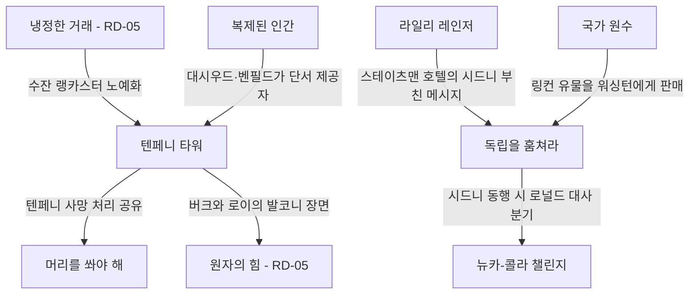
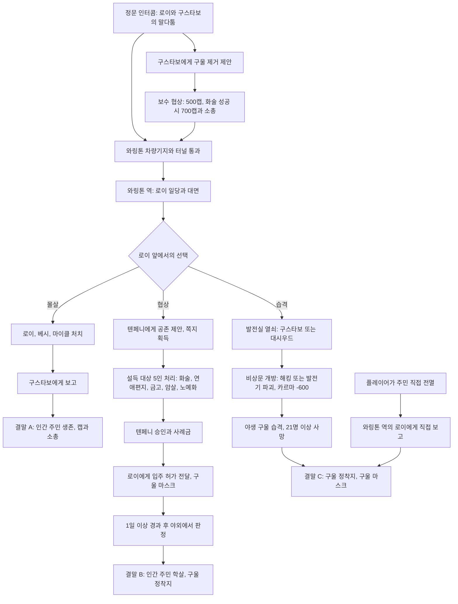
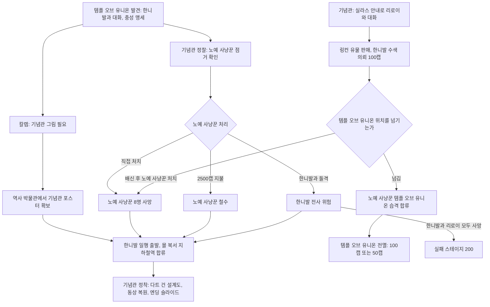
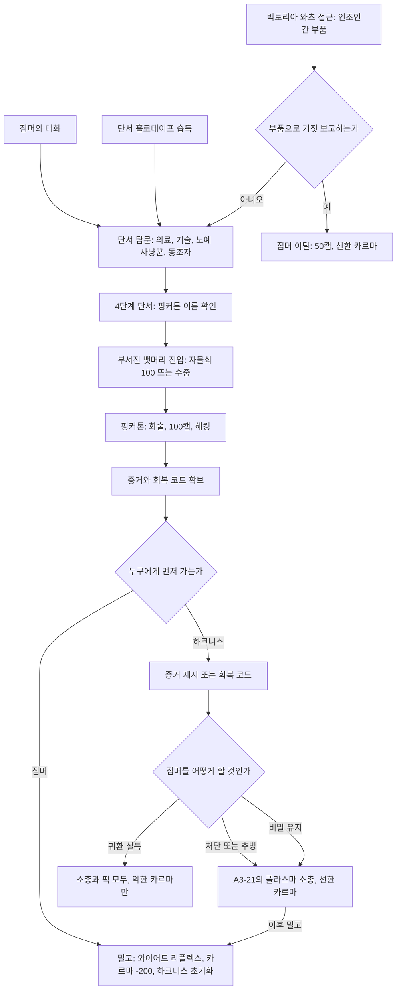
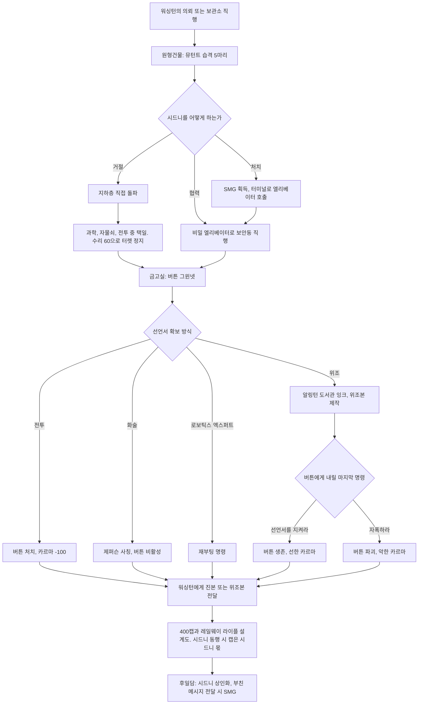
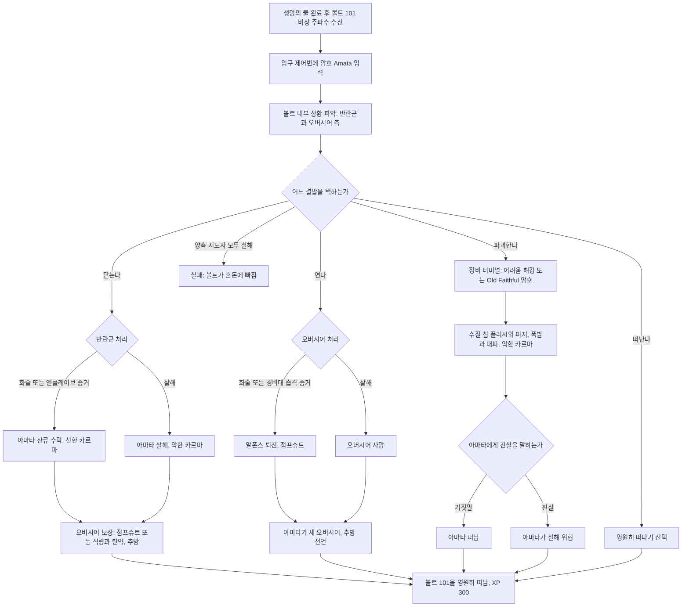
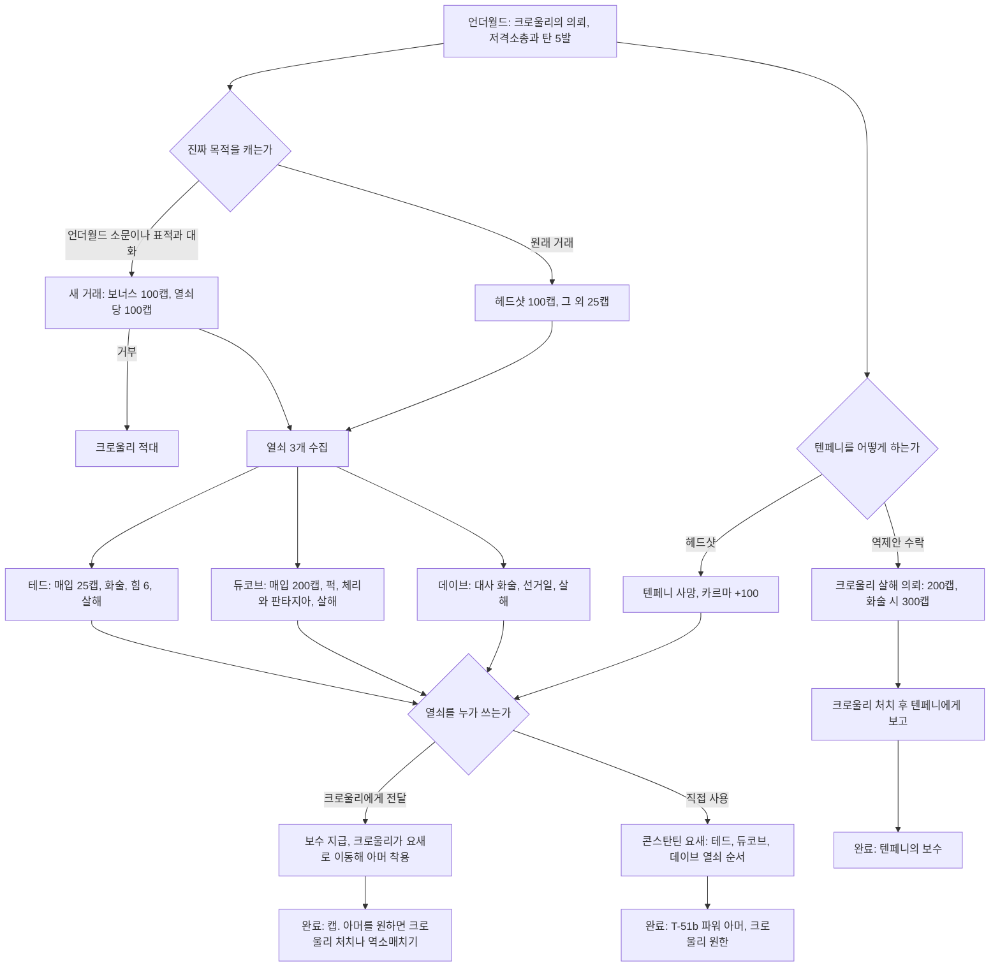
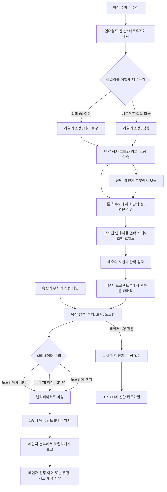
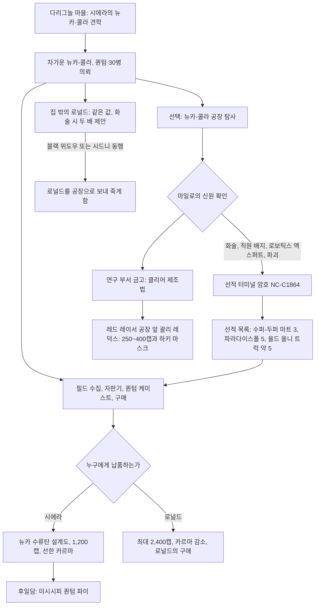

# RD-06. 사이드 퀘스트 2부

> **폴아웃 3 역기획서 세트** | 문서 ID: RD-06 | 버전: v1.0 | 작성일: 2026-10-11
> **범위**: 본편 사이드 퀘스트 8종의 상세 — 텐페니 타워(Tenpenny Tower), 국가 원수(Head of State), 복제된 인간(The Replicated Man), 독립을 훔쳐라(Stealing Independence), 고향의 위기(Trouble on the Homefront), 머리를 쏴야 해(You Gotta Shoot 'Em in the Head), 라일리 레인저(Reilly's Rangers), 뉴카-콜라 챌린지(The Nuka-Cola Challenge). 사이드 퀘스트 1부 9종은 RD-05, 이 8종에 딸린 비표시·반복 퀘스트 — 링컨의 이윤(Lincoln's Profit Margins), 라일리와 지도 제작(Geomapping with Reilly) 등 — 과 랜덤 인카운터는 RD-07이 정본이며 여기서는 연결 지점만 요약함. 아이템·퍽 수치의 정본은 각 카탈로그 문서임.
> **관련 문서**: [RD-05 사이드 퀘스트 1부](05_side-quests-part1.md), [RD-07 비표시·반복 퀘스트와 랜덤 인카운터](07_misc-quests-encounters.md), [RD-03 메인 스토리 1부](03_main-story-part1.md), [RD-04 메인 스토리 2부·엔딩](04_main-story-part2-endings.md), [RD-09 팩션](09_factions.md), [RD-10 주요 인물·동료](10_characters-major-companions.md), [RD-11 NPC 디렉터리](11_npc-directory.md), [RD-13 장소 카탈로그](13_location-catalog.md), [RD-14 캐릭터 시스템](14_character-system.md), [RD-17 탐험·상호작용](17_exploration-interaction.md), [RD-19 무기·탄약](19_weapons-ammo.md), [RD-20 방어구·의복](20_armor-apparel.md), [RD-21 소모품·잡화·제작](21_consumables-misc-crafting.md), [RD-22 경제·주거](22_economy-housing.md), [RD-23 수집 요소·업적](23_collectibles-achievements.md)

---

## 1. 문서 개요

### 1.1 목적
- 원작 사이드 퀘스트 8종을 팬게임 이벤트로 옮길 수 있는 수준까지 분해함: 트리거, 핍-보이(Pip-Boy) 목표(스테이지), 모든 해결 루트와 판정 조건, 보상·카르마, 월드 상태 변화, 후일담.
- 각 퀘스트의 '선택 구조'와 '결과 전달 방식'을 분석해 사이드 퀘스트 설계 패턴을 정리함(11장).

### 1.2 범위와 경계

| 구분 | 이 문서에서 다룸 | 다른 문서로 넘김 |
|---|---|---|
| 퀘스트 | 위 8종의 전 단계·전 루트·후일담 | 1부 9종(RD-05), 메인 퀘스트(RD-03·04) |
| 딸린 비표시 퀘스트 | 연결 조건과 보상 요약 | 상세: 링컨의 이윤, 라일리와 지도 제작, 오직 맛을 위해(Just for the Taste of It) 등(RD-07) |
| 랜덤 인카운터 | 퀘스트 결과로 생기는 인카운터 이름·조건 | 인카운터 상세(RD-07) |
| 아이템·퍽 | 보상으로서의 핵심 수치 | 정본 수치표(RD-19·20·21·14) |
| 인물·장소 | 퀘스트 안에서의 역할 | 프로필·장소 상세(RD-10·11·12·13) |
| 판정 규칙 | 퀘스트별 판정 위치와 요구치 | 화술 판정 공식·자물쇠·해킹 규칙(RD-17) |

### 1.3 요약
- 8종 모두 '하나의 의뢰 → 둘 이상의 상충하는 이해관계자 → 3~6개의 해결 루트'라는 같은 골격을 가짐. 미스터 크로울리(Mister Crowley)나 짐머(Zimmer)처럼 의뢰인의 말이 거짓이거나, 텐페니 타워처럼 의뢰 자체가 도덕적 함정인 경우가 많음.
- 보상은 대개 '선한 루트 = 카르마와 평판, 악한 루트 = 더 큰 물질 보상'으로 비대칭 설계됨(뉴카-콜라 챌린지의 2,400캡, 복제된 인간의 와이어드 리플렉스(Wired Reflexes), 머리를 쏴야 해의 T-51b 파워 아머(T-51b power armor)).
- 결과는 즉시 보상보다 '시간차 후일담'으로 전달되는 비중이 큼: 텐페니 타워 주민 학살, 링컨 동상 복원, 볼트 101(Vault 101) 주민의 황무지 조우, 쓰리독(Three Dog)의 GNR(Galaxy News Radio) 뉴스, 엔딩 슬라이드.
- 판정은 화술, 스킬 문턱(의학 60, 수리 35/60/75, 자물쇠 따기 100 등), SPECIAL(힘 6), 그리고 블랙 위도우(Black Widow)·레이디 킬러(Lady Killer)·로보틱스 엑스퍼트(Robotics Expert) 같은 퍽을 고루 씀. 전투로만 막히는 퀘스트는 없음.

### 1.4 표기 메모
- **근거 표시**: 수치 옆의 `〔스크립트: 이름〕`은 코퍼스의 GECK 스크립트 전사본, `〔대사〕`는 NPC 대사 원문(`이름.txt`) 문서에서 직접 확인한 값임. 표시가 없는 값은 Nukapedia 퀘스트·인물·아이템 문서 기준임.
- **화술 판정**: 폴아웃 3의 화술 판정은 매우 쉬움~매우 어려움 5단계 난이도와 카리스마·카르마·화술 스킬을 조합한 확률식임(공식은 RD-17). 개별 판정의 난이도 값은 코퍼스에 표로 남아 있지 않으므로 위키의 서술(쉬움·어려움 등)만 옮기고, 나머지는 `난이도 코퍼스 미확인`으로 둠. 화술 판정 성공 시 난이도에 따라 5/10/20/30/50 XP가 따로 지급됨.
- **스킬 문턱 판정**: `[의학 60]`처럼 수치를 넘으면 무조건 성공하는 판정은 스크립트 값을 그대로 씀.
- **스테이지**: 퀘스트 스테이지 번호(GECK)와 핍-보이 목표 원문을 함께 적음. 위키의 스테이지 표는 일부 내부 스테이지를 생략하므로, 스크립트에서 찾은 내부 스테이지(예: 실패 200, 종료 250)는 별도 표기함.
- **XP**: 퀘스트 완료 XP는 정보상자·흐름도 기준이며, 화술·해킹·자물쇠 XP는 포함하지 않음.
- **용어**: [RD-26 용어집](26_glossary.md)을 따름. 용어집에 없는 고유명사는 이 문서에서 처음 정한 표기이며 최종 보고에 신규 용어로 제출함.

---

## 2. 8개 퀘스트 한눈에 보기

### 2.1 요약표

| # | 퀘스트 | 영문명 | 의뢰인 | 주요 장소 | 진입 시점 | 대표 보상 | 카르마 분기 | 업적·트로피 |
|---|---|---|---|---|---|---|---|---|
| 1 | 텐페니 타워 | Tenpenny Tower | 구스타보(Gustavo) 경비대장 또는 로이 필립스(Roy Phillips) | 텐페니 타워, 와링톤 역(Warrington station) | 텐페니 타워 첫 방문(정문 다툼 목격) 이후 언제든 | 500~700캡+소총 / 구울 마스크(Ghoul mask), 300XP | 있음(구울 방출 -600) | Tenpenny Tower, 20G·브론즈 |
| 2 | 국가 원수 | Head of State | 한니발 햄린(Hannibal Hamlin) 또는 리로이 워커(Leroy Walker) | 템플 오브 유니온(Temple of the Union), 링컨 기념관(Lincoln Memorial), 역사 박물관(Museum of History) | 템플 오브 유니온·기념관 발견 이후 언제든 | 다트 건 설계도(Schematics - dart gun) / 50~100캡, 300XP | 있음(노예제 폐지론자(Abolitionists) + / 노예 사냥꾼(Slavers) -) | Head of State, 20G·브론즈 |
| 3 | 복제된 인간 | The Replicated Man | 짐머 박사(또는 홀로테이프·빅토리아 와츠(Victoria Watts)) | 리벳시티(Rivet City), 리벳시티 함수(Rivet City bow) | 리벳시티 도착 이후 | A3-21의 플라스마 소총(A3-21's plasma rifle) / 와이어드 리플렉스 / 50캡, 300XP | 있음(하크니스(Harkness) 편 + / 짐머 편 -200) | The Replicated Man, 20G·브론즈 |
| 4 | 독립을 훔쳐라 | Stealing Independence | 아브라함 워싱턴(Abraham Washington), 시드니(Sydney) | 리벳시티, 국립 기록 보관소(National Archives), 알링턴 도서관(Arlington Library) | 언제든(기록 보관소 직행 가능) | 400캡+레일웨이 라이플 설계도(Schematics - railway rifle), 330XP | 있음(버튼 그윈넷(Button Gwinnett) 처치·자폭 -) | Stealing Independence, 20G·브론즈 |
| 5 | 고향의 위기 | Trouble on the Homefront | 아마타(Amata)가 녹음한 볼트 101 비상 주파수(Vault 101 emergency frequency) | 볼트 101 | 탈출!(Escape!) + 생명의 물(The Waters of Life) 완료 이후, 신호 송출 기간 한정 | 개조 작업용 점프슈트(Modified utility jumpsuit) 또는 식량·탄약, 300XP | 있음(설득 + / 반란군 살해·볼트 파괴 -) | Trouble on the Homefront, 20G·브론즈 |
| 6 | 머리를 쏴야 해 | You Gotta Shoot 'Em in the Head | 미스터 크로울리 | 언더월드(Underworld), 리벳시티, 듀코브의 집(Dukov's Place), 데이브 공화국(Republic of Dave), 텐페니 타워, 콘스탄틴 요새(Fort Constantine) | 언더월드 도착 이후 | 캡(머릿수·열쇠당 100) / T-51b 파워 아머, 300XP | 있음(표적 살해 -, 텐페니 살해 +) | You Gotta Shoot 'Em in the Head, 20G·브론즈 |
| 7 | 라일리 레인저 | Reilly's Rangers | 라일리(Reilly) 또는 부처(Butcher)·레인저 비상 주파수(Ranger emergency frequency) | 언더월드, 희망의 성모 병원(Our Lady of Hope Hospital), 스테이츠맨 호텔(Statesman Hotel), 레인저 본부(Ranger compound) | 언더월드 또는 베논 광장(Vernon Square) 일대 진입 이후 | 레인저 전투 아머(Ranger battle armor) 또는 유진(Eugene, 미니건), 300XP | 약함(레인저 공격 시 실패) | Reilly's Rangers, 20G·브론즈 |
| 8 | 뉴카-콜라 챌린지 | The Nuka-Cola Challenge | 시에라 페트로비타(Sierra Petrovita) | 다리그늘 마을(Girdershade), 뉴카-콜라 공장(Nuka-Cola plant) | 다리그늘 마을 발견 이후 | 1,200캡+뉴카 수류탄 설계도(Schematics - Nuka grenade) / 최대 2,400캡, 300XP | 있음(로널드 래런(Ronald Laren)에게 납품 -) | The Nuka-Cola Challenge, 20G·브론즈 |

- 업적은 8종 모두 '퀘스트 완료' 조건이며 엑스박스 360/PC 20 게이머스코어, PS3 브론즈 트로피임. 어떤 루트로 끝내도 동일하게 지급됨.

### 2.2 식별 정보

| 퀘스트 | 편집기 ID | 퀘스트 폼 ID | 위키 표기 스테이지 | 완료(finish) 스테이지 | 스크립트상 내부 스테이지 |
|---|---|---|---|---|---|
| 텐페니 타워 | MS12 | 00014e9f | 10, 11, 20, 100, 101, 120 | 120 | 250(구울 방출 후 전원 사망 시 퀘스트 종료) 〔스크립트: MS12QuestScript〕 |
| 국가 원수 | MS06 | 00014e99 | 5~40, 80 / 45~70, 90, 100 | 80(노예제 폐지론자), 90·100(노예 사냥꾼 쪽) | 200(실패) 〔스크립트: MS06Script〕 |
| 복제된 인간 | MS08 | 00014e9b | 3, 5, 10, 11, 15, 20, 100, 200 | 200 | 1(단서 지급 함수 역할) 〔스크립트: MS08NoteScript〕 |
| 독립을 훔쳐라 | MS15 | 00014ea2 | 20, 30, 50, 60 | 60 | 40(원형건물 방어 종료) 〔스크립트: MS15QuestScript〕 |
| 고향의 위기 | MS16 | 00014ea3 | 10~190 | 190 | 0(시작), 200(실패), 210·215·240(종료 유형) 〔스크립트: MS16script 외〕 |
| 머리를 쏴야 해 | MS14 | 00014ea1 | 10~100 | 100 | — |
| 라일리 레인저 | MS18 | 00014ea5 | 5~50 | 50 | 150(실패) 〔스크립트: MS18ReillyScript〕 |
| 뉴카-콜라 챌린지 | MS05 | 00014e98 | 10, 15, 20, 30, 40, 45 | 40 또는 45 | 100(30병 달성 처리) 〔스크립트: MS05QuestScript〕 |

### 2.3 의뢰인·지명 확인 결과
작업 지시서에서 추정으로 적힌 항목을 코퍼스로 확인한 결과임.

| 항목 | 지시서 추정 | 코퍼스 확인 결과 |
|---|---|---|
| 독립을 훔쳐라 의뢰인 | 애보트 워싱턴? | **아브라함 워싱턴**. 리벳시티 '국회의사당 보존 협회(Capitol Preservation Society)'의 큐레이터. 국립 기록 보관소 원형건물에서 만나는 **시드니**도 공동 의뢰인으로 등록됨 |
| 국가 원수의 아브라함 워싱턴 | 퀘스트 관련 인물 | 의뢰인이 아님. 비표시 퀘스트 '링컨의 이윤(Lincoln's Profit Margins)'에서 링컨 유물을 사들이는 3인(한니발 햄린, 리로이 워커, 아브라함 워싱턴) 중 하나 |
| 라일리 레인저 장소 | 듀폰트 서클? | 레인저들이 고립된 곳은 **베논 광장**의 **스테이츠맨 호텔** 옥상, 진입로는 **희망의 성모 병원**. 레인저들의 본거지 **레인저 본부**는 **수어드 스퀘어(Seward Square)**에 있음. 듀퐁 광장(Dupont Circle)은 라일리가 알려 주는 경유지일 뿐이며, 위키는 실제 '마른 하수도(Dry sewer)' 입구가 듀퐁 광장역이 아니라 듀퐁 광장 동쪽(Dupont Circle East)에 있다고 정정함 |
| 라일리 레인저 무전 | 무전 신호 | '레인저 비상 주파수'. 송신자는 의무병 부처 |
| 텐페니 타워 의뢰인 | 로이 필립스의 구울들 vs 주민 | 의뢰인은 둘: 텐페니 경비대장 **구스타보**(구울 제거 의뢰) 또는 구울 **로이 필립스**(입주 협조 의뢰) |
| 고향의 위기 의뢰 | 볼트 101 재방문 | '볼트 101 비상 주파수'의 자동 구조 신호. 내용은 아마타의 녹음 메시지 |
| 머리를 쏴야 해 표적 | 타깃 4명과 열쇠 | 표적 4명: 데이브(Dave), 테드 스트레이어(Ted Strayer, 故 제프 스트레이어의 아들), 듀코브(Dukov), 앨리스터 텐페니(Allistair Tenpenny). 열쇠는 텐페니를 뺀 3명이 가짐(크로울리는 '자기 것까지 4개'라고 말하지만 실제로 필요한 것은 3개) |

### 2.4 퀘스트 간 연동

- 텐페니 타워와 머리를 쏴야 해는 앨리스터 텐페니의 생사를 공유함. 구울 입주 협상이 성립하면 즉시 '텐페니가 죽었다고 크로울리에게 알릴 것' 목표가 갱신됨.
- 스테이츠맨 호텔 3층에 놓인 '조그만 달빛의 아버지가 남긴 메시지(A note from Little Moonbeam's father)'는 라일리 레인저 동선 위에 있지만 독립을 훔쳐라 후일담(시드니의 SMG)에 쓰임.
- 복제된 인간의 단서 제공자에는 텐페니 타워의 할버트 대시우드(Herbert Dashwood)·줄리어스 벤필드(Julius Banfield), 언더월드의 튤립(Tulip)·배로우즈 박사(Doctor Barrows)·윈드롭(Winthrop)이 포함되어, 다른 퀘스트 거점을 재방문하게 만듦.

---

## 3. 텐페니 타워 (Tenpenny Tower)

### 3.1 기본 정보

| 항목 | 내용 |
|---|---|
| 영문명 | Tenpenny Tower |
| 한국어명 | 텐페니 타워 |
| 유형 | 사이드 퀘스트(핍-보이 표시) |
| 퀘스트 ID | 00014e9f (편집기 ID MS12) |
| 의뢰인 | 구스타보 경비대장(Chief Gustavo) — 구울 제거 의뢰 / 로이 필립스(Roy Phillips) — 입주 협조 의뢰 |
| 시작 조건 | ① 텐페니 타워 정문 인터콤 앞에서 로이와 구스타보의 말다툼을 목격(트리거 진입 시 로이가 '정문 다툼' 패키지 실행 〔스크립트: MS12ArgumentTriggerScript〕)한 뒤 타워 안 구스타보에게 '구울 문제를 돕겠다'고 제안 ② 와링톤 역에서 로이와 대화 ③ 플레이어가 타워 주민을 직접 전멸시키면 퀘스트가 자동 추가되고 '로이에게 입주해도 된다고 알려라' 단계로 직행 |
| 관련 장소 | 텐페니 타워(로비·스위트 층·펜트하우스), 와링톤 차량기지(Warrington trainyard), 와링톤 터널(Warrington tunnels), 와링톤 역, 지하철 연결 통로·발전실(Metro access & generator) |
| 선행 퀘스트 | 없음 |
| 연동 퀘스트 | 머리를 쏴야 해(텐페니 생사 공유), 원자의 힘(The Power of the Atom) — 버크와 로이의 발코니 장면(RD-05), 냉정한 거래(Strictly Business) — 수잔 랭카스터(Susan Lancaster) 노예화(RD-05), 험한 꼴 당한 하인(A Manhandled Manservant) — 대시우드 금고 열쇠(RD-07) |
| 보상 | **구울 제거**: 500캡(화술 성공 시 +200 = 700캡) + 돌격소총(Assault rifle)·탄약(화술 성공 시 중국제 돌격소총(Chinese assault rifle)·5.56mm 탄) / **구울 입주**: 텐페니의 사례금(위키: 500캡) + 구울 마스크 / XP 300(흐름도 기준, 모든 루트 공통) |
| 카르마 | 발전실 탈출문 개방(야생 구울(Feral ghoul) 방출) **-600** 〔스크립트: MS12AccessDoorScript〕, 텐페니 살해 +100(매우 악한 인물), 구스타보 살해 +(악인), 그 밖의 주민·구울 살해 시 일반 감점. 화술로 주민을 설득하는 방식이 '선한 해결'로 분류됨 |
| 업적·트로피 | Tenpenny Tower(20G / 브론즈) |

### 3.2 개요
- 텐페니 타워는 수도 황무지(Capital Wasteland) 남서쪽, 전쟁 전 리조트를 개조한 부유층 전용 거주 타워임. 영국 출신 사업가 앨리스터 텐페니가 소유하고, 용병 출신 구스타보가 경비를 맡음. 입장부터 '100캡 보증금'을 요구하는 배타적인 공간임.
- 전쟁 전 경찰 출신의 늙은 구울 로이 필립스는 동료 베시 린(Bessie Lynn), 마이클 매스터스(Michael Masters)와 함께 캡을 내고 입주하려 했으나 총격으로 쫓겨남. 지금은 와링톤 역에 숨어 야생 구울 무리를 침입자 억지력으로 두고, 타워 지하 비상 탈출문을 열어 야생 구울을 풀 계획을 세움.
- 플레이어는 ① 구울을 몰살하거나 ② 구울과 함께 타워를 습격하거나 ③ 주민을 설득해 공존을 중재할 수 있음. 그러나 ③조차 며칠 안에 구울이 인간 주민을 몰살하는 결말로 귀결됨 — 폴아웃 3의 대표적인 '정답 없는 딜레마'.

### 3.3 진행 단계 (핍-보이 목표)

| 스테이지 | 핍-보이 목표(원문) | 번역 | 플레이어 행동·이벤트 |
|---|---|---|---|
| 10 | Kill Roy Phillips and his followers. | 로이 필립스와 추종자들을 죽여라. | 구스타보 의뢰 수락 시. 보수 500캡 제시 〔대사〕 |
| 11 | Kill Roy Phillips and his followers, or Help the Ghouls get into Tenpenny Tower. | 로이 일당을 죽이거나, 구울의 텐페니 타워 입주를 도와라. | 구스타보 의뢰를 받은 뒤 로이의 입주 협조 제안도 들은 상태(문구 기준 해석) |
| 20 | Report back to Chief Gustavo. | 구스타보 경비대장에게 보고하라. | 로이·베시 린·마이클 매스터스 사망 후 |
| 100 | Help the Ghouls get into Tenpenny Tower. | 구울의 텐페니 타워 입주를 도와라. | 로이에게서 먼저 시작했을 때 |
| 101 | Help the Ghouls get into Tenpenny Tower, or Kill Roy Phillips and his followers. | 입주를 돕거나 로이 일당을 죽여라. | 로이에게서 시작한 뒤 구스타보 의뢰도 들은 상태(문구 기준 해석) |
| 120 | Tell Roy Phillips the Ghouls can move in. | 로이 필립스에게 구울이 입주해도 된다고 알려라. | 텐페니 승인 또는 주민 전멸 후. 완료 스테이지 |
| (250) | — | — | 야생 구울 방출 후 인간 주민·경비 21명 이상 사망 시 퀘스트를 끄는 내부 스테이지 〔스크립트: MS12QuestScript〕 |

### 3.4 등장인물과 타워 구조

| 인물 | 영문명 | 역할 | 퀘스트상 의미 |
|---|---|---|---|
| 앨리스터 텐페니 | Allistair Tenpenny | 소유주, 펜트하우스 거주 | 입주 최종 승인권자. 구울을 경멸하지만 실제로는 무관심 — "규칙을 지키고 월세만 내면 된다"는 태도 |
| 구스타보 | Gustavo | 경비대장, 용병 출신 | 구울 혐오자이자 의뢰인. 무기고 열쇠, 발전실 열쇠(지하 정보 입수 후 생성) 소지. 텐페니 사망 시 지휘권 승계, 설득 불가 |
| 허버트 '데어링' 대시우드 | Herbert "Daring" Dashwood | 은퇴한 모험가 | 친구울 성향. 발전실 열쇠를 '게임'처럼 훔쳐 보라고 암시. 레일로드(The Railroad) 동조자(복제된 인간의 단서 제공자) |
| 에드가 웰링턴 2세 | Edgar Wellington II | 주민 | 설득 대상. 수잔 랭카스터와 불륜 중 |
| 밀리센트 웰링턴 | Millicent Wellington | 에드가의 아내, 타워의 소문꾼 | 설득 대상. 연애편지를 보면 남편과 수잔을 살해 |
| 앤서니 링 | Anthony Ling | 의류점 '뉴 어번 어패럴(New Urban Apparel)' 주인 | 설득 대상. 금고를 털리면 떠남 |
| 리디아 몬테네그로 | Lydia Montenegro | 잡화점 '부티크 르 시크(Boutique Le Chic)' 주인 | 설득 대상. 다트 건 설계도·플레이어 하우스 인테리어 판매. 금고를 털리면 떠남 |
| 수잔 랭카스터 | Susan Lancaster | 고급 매춘부, 전직 노예 사냥꾼 | 설득 대상. 냉정한 거래의 노예화 표적 |
| 마거릿 프림로즈 외 | Margaret Primrose, Michael Hawthorne, Julius Banfield, Irving Cheng, Tiffany Cheng | 기타 주민 | 설득 불필요. 스크립트에는 처리 변수가 있으나 승인 조건에 쓰이지 않음 |
| 셰이크스 | Shakes | 바 로봇. 바 '페더럴리스트 라운지(Federalist Lounge)' 담당 | 모든 결말에서 생존 처리 |
| 로이 필립스 | Roy Phillips | 구울 지도자, 전쟁 전 경찰 | 의뢰인. 카르마 '선함' 등급. 협상 후 학살의 주모자 |
| 베시 린 | Bessie Lynn | 로이의 '구울프렌드' | 입주 후 의류점 인수 |
| 마이클 매스터스 | Michael Masters | 전쟁 전 과학자 구울 | 와링톤 역 문지기. 입주 후 부티크 인수(다트 건 설계도 재판매) |

- 타워 진입: 정문 인터콤에서 구스타보가 100캡 '보증금'을 요구함. 화술 판정('텐페니 씨에게 제안할 것이 있다')으로 무료 입장 가능, 서쪽 외벽의 무너진 틈으로 넘어갈 수도 있음.
- 와링톤 역 정문은 잠겨 있음(열쇠는 로이 사망 시 획득). 처음에는 서쪽 와링톤 차량기지(약한 방사능, 야생 구울) → 와링톤 터널(야생 구울 약 12마리) 경유가 필수임.
- 지하철 연결 통로·발전실: 방 4개 구조. ① 지하철 쪽 방과 ② 타워 로비 쪽 방 사이를 잠긴 비상문이 막고 있으며, ③ 타워 외벽 안 뒤뜰 문(열쇠 필요)으로 들어가는 제어실의 터미널로 그 문을 엶. ④ 로비와 연결된 창고는 협상 결말에서 시체가 쌓이는 곳임.

### 3.5 분기와 해결 방법

#### 루트 A — 구울 몰살 (구스타보 편)
1. **의뢰와 보수 협상**
   - 구스타보: "How's 500 bottlecaps sound? Payable upon termination of that damn Ghoul, Roy Phillips, and all his followers." 〔대사〕
   - "다른 도움도 받겠다"를 고르면 소총과 탄약을 줌. 기본은 돌격소총이며, 무작위로(고레벨일수록 확률 상승) 중국제 돌격소총이 나오기도 함.
   - [화술] "You want this problem resolved or not? You can spare more than that..." 성공 시 "another 200 caps"(총 700캡) + 소총·탄약. 위키 서술상 성공하면 중국제 돌격소총과 5.56mm 탄, 실패하면 10mm SMG(10mm submachine gun)를 받음. 난이도 코퍼스 미확인.
   - 구스타보는 플레이어가 어느 편을 택하든 소총과 소량의 탄약을 줌(인물 문서 주석).
2. **잠입**: 와링톤 차량기지 → 와링톤 터널 → 와링톤 역. 입구에서 마이클 매스터스가 심문하며, 고집하면 로이에게 안내함.
3. **처치**: 로이·베시·마이클 3명을 사살. 카르마를 잃지 않는 방법:
   - 야생 구울에게 쫓기며 로이의 방으로 들어가면, 야생 구울을 공격하지 않았어도 셋이 먼저 적대함 → 반격 처치는 감점 없음(그래도 GNR 비난은 나옴).
   - 대화 선택지로 로이·베시·마이클을 도발해 먼저 공격하게 함.
   - 미스터 샌드맨(Mister Sandman) 퍽으로 잠든 셋을 처치(베시 먼저, 비명이 다른 둘을 깨우지 않음).
   - 정문 인터콤 장면 직후 떠나는 로이를 쫓아가 죽이거나, 지뢰·수류탄을 역소매치기로 넣을 수도 있음(악한 카르마). 이 경우에도 구스타보와 대화해야 나머지 단계가 진행됨.
4. **보고**: "There's your caps. Contract fulfilled, debt paid." 〔대사〕 — 보수 지급, 퀘스트 완료.
- 특징: 인간 주민이 모두 사는 유일한 루트이며, 타워 상인 6곳이 그대로 유지됨. 구울 마스크는 얻을 수 없음.

#### 루트 B — 협상: 공존 중재 (로이 편, 평화적)
1. 로이에게 평화적 해결을 제안해 의뢰를 받음.
2. **텐페니 승인 조건**: "What if the residents are okay with Ghoul neighbors?" → 텐페니는 웰링턴 부부, 링, 몬테네그로, 랭카스터를 설득하면 허락하겠다고 하고 쪽지 '텐페니의 요청(Tenpenny's request)'을 줌.
   - 텐페니보다 먼저 주민에게 구울 이웃 이야기를 꺼내면 퀘스트가 꼬일 수 있음(위키 주석). 협상 결말에서 지하 창고에 시체가 나오지 않는 버그도 같은 순서 문제와 연관됨.
3. **설득 대상 5인 처리 방법**

| 대상 | 화술 강제 퇴거 | 연애편지 | 금고 털기 | 은밀한 살해 | 노예화 | 비고 |
|---|---|---|---|---|---|---|
| 에드가 웰링턴 2세 | 가능 | 밀리센트가 살해 | — | 가능(악) | — | 퇴거 시 "I never forget a slight." 보복 암시 |
| 밀리센트 웰링턴 | 가능 | 남편·수잔을 죽이고 떠남 | — | 가능(악) | — | 화술로 퇴거시키면 이후 편지를 보여 줄 수 없음 |
| 앤서니 링 | 가능 | — | 의류점 금고를 털면 떠남 | 가능(악) | — | 퇴거 후 메가톤(Megaton) 입구에서 배회 |
| 리디아 몬테네그로 | 가능 | — | 부티크 금고를 털면 떠남 | 가능(악) | — | 떠나거나 죽으면 하우스 인테리어 구매 불가(입주 후 매스터스가 대체 판매) |
| 수잔 랭카스터 | 가능 | 밀리센트가 살해 | — | 가능(악) | 냉정한 거래로 가능 | 노예로 보낸 뒤 구출하면 대사가 사라져 사살해야 함 |
   - **화술**: "This is happening. You're going to have to deal with it, or get forced out." 성공 시 "Forced out by a bunch of dirty Ghouls...?"라며 퇴거함 〔대사〕. 퇴거자는 황무지나 메가톤 입구 등에서 배회하며 대화 대신 욕설만 함. 위키는 이를 '화술 60 판정, 선한 카르마 루트'로 적었으나, 실제 성공률은 확률식이고 난이도 값은 코퍼스 미확인.
   - **연애편지(Love letter)**: 수잔 랭카스터 방(스위트 층 북동쪽 방) 책상의 훌라 걸 인형 옆에 있음. 밀리센트에게 보여 주면 10mm 권총으로 에드가, 이어서 수잔을 사살하는 스크립트 장면이 진행되며 경비원은 개입하지 않음. 이후 밀리센트는 타워를 떠나 와링톤 터널로 들어가 구울에게 죽음(호위해 살리면 첫 정비실에 머묾). 한 번에 3명을 처리하는 지름길이며 플레이어 손은 더럽히지 않음.
   - **금고 털기**: 링과 몬테네그로는 상점 금고를 털린 뒤 말을 걸면 '타워도 안전하지 않다'며 떠남.
   - **은밀한 살해**: 미스터 샌드맨 퍽이 유용함. 일반 살해 감점.
   - **노예화**: 수잔은 냉정한 거래 표적이며 스크립트상 '노예화' 값(3)으로 처리됨 〔스크립트: MS12QuestScript〕.
4. **승인**: "The bigots have all been taken care of. So the Ghouls can move in now. Right?" → "if my tenants want Ghoul neighbors, they can have them! Though the Ghouls must pay and follow the rules like everyone else." + "here's a little something for your troubles."(사례금, 위키: 500캡·300XP) 〔대사〕
5. **보고(스테이지 120)**: 로이에게 알리면 구울 마스크 지급 → 퀘스트 완료. 이후 3.6의 '시간차 학살'이 진행됨.
- **텐페니가 이미 죽은 경우**: 구스타보가 지휘권을 이어받아 끝까지 반대하므로 구스타보를 죽여야 함(악인 사살이므로 선한 카르마 + 로브링어(Lawbringer) 퍽용 손가락). 승인 판정은 'GhoulsOk = (텐페니 생존 그리고 텐페니 동의) 또는 (텐페니 사망 그리고 구스타보 사망)'임 〔스크립트: MS12QuestScript〕.
- **스크립트 메모**: 승인 조건식은 에드가·밀리센트·링·랭카스터 4명의 처리 변수만 검사함(몬테네그로 변수는 빠져 있음). 몬테네그로 조건은 텐페니 대사 조건에서 처리되는 것으로 보이나 코퍼스 미확인.
- **텐페니를 죽이고 싶을 때**(머리를 쏴야 해, 텐페니의 정장, +100 카르마): 텐페니가 승인한 뒤 로이에게 알리기 전이 구스타보 승계 문제를 피하는 유일한 시점임(위키 팁).

#### 루트 C — 습격: 야생 구울 방출 (로이 편, 폭력적)
1. 로이의 계획: "They think I'm a monster. I'll show them the real monsters! We'll unleash our feral brethren on them..." 〔대사〕 — 문제는 타워 지하와 지하철을 잇는 비상문임.
2. **열쇠 확보**: 로이나 텐페니에게 '지하실'을 묻는 등 지하 정보를 얻으면 구스타보와 대시우드에게 '텐페니 발전실 열쇠(Key to Tenpenny Generator Room, 00022643)'가 생성됨 〔스크립트: MS12QuestScript, keysSpawned〕.
   - 구스타보: 소매치기 또는 살해.
   - 대시우드: 훔쳐 보라는 '게임'을 제안함. "I don't have time for games" 등 일부 선택지로 바로 받을 수 있고, 소매치기·살해도 가능(소매치기에 걸리면 적대).
3. **비상문 개방**: 타워 외벽 안쪽 뒤편의 발전실 문 → 제어실 터미널 해킹(과학 스킬), 또는 왼쪽 발전기를 사격해 파괴. 전기 박스 둘 중 하나만 파괴돼도 문이 열림 〔스크립트: MS12DoorTerminalScript〕.
4. **개방 순간**: 카르마 -600, 야생 구울이 로비로 이동 시작, 로이가 축하하러 이동함 〔스크립트: MS12AccessDoorScript〕.
5. **습격 장면** 〔스크립트: MS12QuestScript, SetUpAttackScene〕
   - 타워가 '습격 버전' 셀로 바뀜. 일반 주민 NPC는 비활성화되고 경비원 8명에게 약화 효과(MS12GimpGuards)가 걸림. 일부 경비원은 시작부터 사망 상태로 배치됨.
   - 층별로 레벨 연동 야생 구울과 글로잉 원(Glowing one)이 배치됨. 마이클 호손은 구울이 마지막에 공격하도록 팩션에서 빠진 채 바에서 술을 마시고 있어, 플레이어가 대화할 수 있음.
   - 로이가 플레이어를 붙잡아 구울 마스크를 줌: "Here, take this mask. It'll keep you safe from the Ferals... Don't forget to PUT IT ON!" 〔대사〕
   - 인간 주민·경비 21명 이상 사망 → 내부 스테이지 250, 퀘스트 완료.
   - 플레이어가 야생 구울을 직접 죽이기 시작하면 리스폰이 멈추고, 남은 인간 NPC는 플레이어와 다른 셀에 있을 때 즉사 처리됨(경험치 사냥터화 방지) 〔스크립트〕.
6. **정리**: 플레이어가 야외로 나가면 베시와 마이클이 로비로 이동하고, 1일이 지난 뒤 타워가 정상 셀로 복구되며 구울이 입주함 〔스크립트: MS12FinScript〕.
- 습격 중 플레이어 스위트(원자의 힘 보상)는 발코니 쪽 입구로만 들어갈 수 있으며, 스위트에서 나오면 습격이 끝남.

#### 루트 D — 플레이어가 주민을 직접 전멸
- 플레이어가 혼자 주민 전원을 죽이면 퀘스트가 자동 추가되어 스테이지 120으로 이동함. 와링톤 역의 로이에게 **직접** 알리면 구울이 입주함.
- 주의: 주민 전멸 뒤 비상문을 터미널로 열면 로이가 이미 입주한 상태로 취급되어 퀘스트를 끝낼 수 없게 됨(버그). 원작에서도 '로이에게 말한다'를 유일한 완료 조건으로 두는 편이 안전함.
- 노획: 몬테네그로(부티크 재고 열쇠, 다트 건 설계도), 구스타보(무기고 열쇠), 텐페니(저격소총(Sniper rifle), 정장), 링(의류점), 셰이크스(술장), 벤필드(약장), 대시우드(금고 — 병뚜껑 지뢰 설계도), 경비원(경비 제복, 돌격소총).

### 3.6 결과와 후일담

#### 결과 비교

| 결과 | 타워 거주자 | 상인 | 플레이어 보상 | 카르마 | GNR(쓰리독) |
|---|---|---|---|---|---|
| A. 구울 몰살 | 인간 주민 전원 생존 | 6곳 유지 | 500~700캡, 소총 | 구울 처치 방식에 따라 감점 | "The butcher-at-large? ... Nice going, scumbag." |
| B. 협상 | 1일 이상 지나 인간 주민 전원 학살, 구울이 거주 | 매스터스가 부티크, 베시 린이 의류점 인수 | 사례금 + 구울 마스크 | 화술 설득은 선, 암살은 악 | "...all it took was the wholesale slaughter of every other Tenpenny resident!" |
| C. 습격 | 인간 주민 전원 사망, 구울이 거주 | B와 같음 | 구울 마스크 | -600 | B와 같은 계열 + "You look like a complete freakshow in that mask." |
| D. 직접 전멸 | 인간 주민 전원 사망, 구울이 거주 | B와 같음 | 구울 마스크 + 노획 | 대량 살해 감점 | B·C 계열 |

#### 시간차 학살의 작동 방식 〔스크립트: MS12FinScript〕
- 구울 입주 처리 시 '학살일 = 현재 경과일 + 1'을 기록함. 이후 플레이어가 **야외에 있고** 경과일이 학살일 이상이면(습격 루트는 즉시) 학살을 일괄 처리함.
- 처리 내용: 텐페니·링·구스타보·벤필드·에드가·대시우드·어빙 쳉·몬테네그로·프림로즈·호손·밀리센트·수잔·티퍼니 쳉·경비원 전원을 사망·비활성 처리, 지하 창고의 시체 더미와 야생 구울 1마리 활성화, GNR 뉴스 플래그 설정.
- 이미 타워를 떠나 메가톤 입구 등에 있던 링·몬테네그로도 같은 목록으로 처리되어 사라짐 — '떠나서 살아남는' 길도 없음.
- 셰이크스는 지정 위치로 옮겨져 생존하고, 미스터 버크(Mister Burke)는 원자의 힘에서 죽지 않았다면 계속 거주함. 친구울 성향의 대시우드도 예외 없이 학살됨.
- 텐페니의 시신은 펜트하우스 욕조에 있으며(벽과 바닥의 핏자국), 로이는 둘이 '의견 차이'가 있었고 텐페니가 '사고'를 당했다고 말함.
- 플레이어는 학살 장면을 볼 수 없고 결과만 마주함. 로이에게 묻거나 창고 시체를 본 뒤 추궁하면 대사가 분기함: "Nice pile of bodies in the storage room. You're proud of yourself, aren't you?" → "They had it coming." 〔대사〕
- 학살을 확인한 뒤 로이를 죽여도 대체로 카르마가 깎이며(특정 순서로 빠르게 죽이면 감점이 없는 경우도 보고됨), 이때 마이클 매스터스는 적대해 더는 거래할 수 없음.

#### 월드·다른 퀘스트 영향
- 협상·습격·전멸 결말 이후 타워는 언더월드에 이은 두 번째 구울 정착지가 됨. 인터콤에는 여전히 인간 경비원 목소리가 응답함(원작의 잔재).
- 랜덤 인카운터 '분노한 구울들(Angry Ghouls)': 퀘스트 완료 후 타워로 향하는 구울 무리. 결과에 따라 입주하러 가는 중이거나 로이의 복수를 하러 가는 중임(상세 RD-07).
- 구울 입주 후 구울 주민을 모두 죽이면 '텐페니 생존자'를 만나는 드문 조우가 보고됨(위키 주석).
- 머리를 쏴야 해: 협상이 성립하는 즉시 '크로울리에게 텐페니가 죽었다고 알려라' 목표가 갱신됨(실제 사망은 학살 시점). 습격 루트에서 텐페니가 죽어 있으면 헤드샷 보수를 받을 수 없음(8장).
- 원자의 힘: 구울 입주 후 메가톤 폭파 루트를 진행하면 펜트하우스 발코니에서 버크와 로이가 마주치고, 로이가 버크의 계획을 듣고 물러나 그를 오른팔로 받아들임(RD-05).
- 플레이어 하우스: 몬테네그로가 없어지면 텐페니 스위트 인테리어는 구울 입주 후 마이클 매스터스에게서 사야 함(RD-22).

### 3.7 흐름도

### 3.8 관련 NPC·아이템·대사 포인트

| 아이템 | 영문명 | 획득 | 핵심 수치·효과 |
|---|---|---|---|
| 구울 마스크 | Ghoul mask | 로이(협상·습격·전멸 결말) | DR 3, 내구도 100, 무게 1, 가치 50. 착용 중 야생 구울이 플레이어·동료에게 비적대(먼저 공격하면 예외). 안경 슬롯 취급이라 일부 모자와 겹쳐 쓸 수 있고, 상인만 수리 가능 |
| 텐페니의 요청 | Tenpenny's request | 텐페니 | 설득 대상 목록 쪽지 |
| 연애편지 | Love letter | 수잔 랭카스터 방 책상 | 밀리센트 살인 이벤트 트리거 |
| 텐페니 발전실 열쇠 | Key to Tenpenny Generator Room | 구스타보·대시우드(지하 정보 입수 후) | 뒤뜰 발전실 문 개방 |
| 다트 건 설계도 | Schematics - dart gun | 몬테네그로, 입주 후 매스터스 | 같은 회차에 2부 확보 가능 |
| 병뚜껑 지뢰 설계도 | Schematics - bottlecap mine | 대시우드 금고 | 험한 꼴 당한 하인 보상과 같은 금고 |

**대사 포인트**
- 로이(계획): "They think I'm a monster. I'll show them the real monsters!" — "놈들은 날 괴물로 보지. 진짜 괴물이 뭔지 보여 주겠어!"
- 텐페니(승인 조건): "I don't suppose I'd mind terribly if Ghouls were to live here. And it'd be a good bit of sport hunting them down if they misbehaved." — "구울이 여기 산다 해도 크게 개의치는 않겠네. 말썽을 부리면 사냥하는 재미도 쏠쏠하겠고."
- 로이(학살 후): "Let's just say those two-faced smoothskins didn't like the new management. So they all got themselves 'evicted.'" — "두 얼굴의 매끈이들이 새 경영진을 싫어했다고만 해 두지. 그래서 다들 '퇴거'당했어."
- 쓰리독(GNR): "Come on Al, cut the ghoulies a break. If they've got the bottle caps and you've got the space, it's a win-win, right?" — "이봐요 앨, 구울들 사정 좀 봐줘요. 그쪽은 캡이 있고 당신은 방이 있으니 서로 좋은 거잖아요?"

**비고**
- 정문 다툼 장면 중 근처 레이더(Raiders)가 로이를 죽이면 몰살 루트밖에 남지 않음(위키 주석).
- 원작 스크립트에는 '야생 구울 방출 시 미스터 버크를 사라지게 하던' 코드가 주석 처리된 채 남아 있음 — 개발 중 결과 연출을 줄인 흔적임.
- 냉정한 거래로 경비원을 노예로 보낸 뒤 야생 구울을 풀면 사망 집계가 끝나지 않아 습격이 영원히 이어지는 버그가 있음. '인원수 집계형 종료 조건'의 위험을 보여 주는 사례임.

### 3.9 설계 분석
- **정답 없는 딜레마**: 세 루트 모두 누군가가 죽음. 특히 협상 루트는 카르마상 '선한 해결'로 보이게 만든 뒤 하루 뒤에 배신함. 카르마 시스템의 판정(선)과 서사의 결과(학살)를 의도적으로 어긋나게 해, 플레이어가 '선의'를 의심하게 만드는 장치임.
- **혐오의 대칭**: 인간 주민의 차별(구스타보, 웰링턴 부부)과 구울의 복수(로이)를 대칭으로 배치하고, 정작 소유주 텐페니는 무관심하게 그림. 친구울 인물 대시우드조차 학살되어 '좋은 사람은 살아남는다'는 기대를 깸.
- **시간차 결과**: 보상 지급 뒤 1일이 지나야 결과가 처리되어, 플레이어가 결과를 '사후에 발견'함. 즉시 보상과 장기 결과를 분리하는 폴아웃 3 사이드 퀘스트의 대표 사례임.
- **해결 수단의 다양성**: 화술, 소매치기, 금고 털기, 연애편지(정보 조작), 암살, 노예화(다른 퀘스트 연동), 해킹, 기물 파괴(발전기 사격)가 모두 하나의 목표('5명 처리', '문 개방')로 수렴함.
- **보상 비대칭**: 회색·악한 루트의 보상(구울 마스크)이 실용성이 높음. 반면 선한 듯한 몰살 루트는 '상인 유지'라는 장기 경제 보상을 줌.
- **약점**: 학살을 막을 수단이 없어 플레이어의 노력이 무력화된다고 느끼기 쉬움. 집계·순서 의존 조건이 많아 버그가 잦음(대화 순서, 노예화, 사망 집계).

---

## 4. 국가 원수 (Head of State)

### 4.1 기본 정보

| 항목 | 내용 |
|---|---|
| 영문명 | Head of State |
| 한국어명 | 국가 원수 |
| 유형 | 사이드 퀘스트(핍-보이 표시) |
| 퀘스트 ID | 00014e99 (편집기 ID MS06) |
| 의뢰인 | 한니발 햄린(Hannibal Hamlin, 템플 오브 유니온 지도자) / 리로이 워커(Leroy Walker, 노예 사냥꾼 우두머리) |
| 시작 조건 | ① 템플 오브 유니온에 들어가 한니발과 대화 ② 링컨 기념관에서 실라스(Silas)의 안내로 리로이 워커와 대화 ③ 링컨 기념관의 노예 사냥꾼을 처치(퀘스트 자동 시작) |
| 관련 장소 | 템플 오브 유니온, 링컨 기념관, 역사 박물관 사무동, 몰 북서 지하철역(Mall Northwest Metro station) |
| 선행 퀘스트 | 없음. 템플 오브 유니온 지도 마커는 리벳시티의 메이 웡(Mei Wong)을 돕거나, 랜덤 인카운터에서 노예의 목줄을 풀어 주거나, 탈주 노예 시체의 지도로 얻음 |
| 연동 퀘스트 | 링컨의 이윤(Lincoln's Profit Margins, 비표시 — 링컨 유물 판매, RD-07), 독립을 훔쳐라(구매자 아브라함 워싱턴 공유) |
| 보상 | **노예제 폐지론자 편**: 다트 건 설계도 + XP 300(허브 문서 표기 300~400XP) / **노예 사냥꾼 편**: 한니발 소재 정보료 100캡(리로이가 지급), 종료 시 100캡(리로이가 한니발을 죽임) 또는 50캡(플레이어가 죽임) + XP 300 |
| 카르마 | 노예제 폐지론자 편 = 선(카르마 문서 '선한 행동' 항목), 노예 사냥꾼 편·템플 오브 유니온 위치 밀고 = 악(구체 수치 코퍼스 미확인) |
| 엔딩 반영 | 노예제 폐지론자 편으로 완료하면 엔딩 영상 세그먼트 2에 한니발과 복원된 링컨 기념관 슬라이드가 추가됨(내레이션 없음, RD-04). 퀘스트 문서는 '선한 카르마로 끝낼 때'라는 조건을 덧붙임 |
| 업적·트로피 | Head of State(20G / 브론즈) |

### 4.2 개요
- 14살부터 노예였던 한니발 햄린은 6년 전 탈출해, 템플 오브 유니온이라는 폐건물에서 탈주 노예 공동체 '노예제 폐지론자'를 이끎. 그는 '위대한 해방자' 링컨을 숭배하며, 링컨 기념관을 탈주 노예의 피난처이자 상징으로 되찾으려 함.
- 링컨 동상의 머리는 어째서인지 템플 오브 유니온에 보관되어 있고, 석공 칼렙 스미스(Caleb Smith)가 비문을 복원하는 중임.
- 한편 파라다이스폴(Paradise Falls)의 노예 사냥꾼 리로이 워커는 노예제 폐지론자의 계획을 눈치채고 부하들과 링컨 기념관을 먼저 점거함. 플레이어는 노예제 폐지론자를 도와 기념관을 되찾게 하거나, 템플 오브 유니온 위치를 팔아 노예 사냥꾼의 습격에 가담할 수 있음.

### 4.3 진행 단계 (핍-보이 목표)
**노예제 폐지론자 편**

| 번호 | 핍-보이 목표(원문) | 번역 | 플레이어 행동·이벤트 |
|---|---|---|---|
| 5 | Talk to Caleb Smith. | 칼렙 스미스와 대화하라. | 템플 오브 유니온 충성 맹세 후 한니발이 의뢰. 칼렙은 복원용 그림·사진이 필요하다고 함 |
| 10 | Make sure the Lincoln Memorial is free of Super Mutants. | 링컨 기념관에 슈퍼 뮤턴트(Super mutant)가 없는지 확인하라. | 기념관에는 뮤턴트 대신 노예 사냥꾼이 있음. 노예 사냥꾼이 죽인 뮤턴트 시체를 발견하면 충족 〔스크립트: MS06SupermutantScript 주석〕 |
| 15 | Kill all the slavers. | 노예 사냥꾼을 모두 죽여라. | 기념관 노예 사냥꾼 8명(일반 노예 사냥꾼 7명 + 리로이) 사망 시 완료 〔스크립트: MS06Script SlaversDead ≥ 8, MS06SlaverScript·LeroyWalkerScript가 사망 시 1씩 집계〕 |
| 20 | Get a picture of the Lincoln Memorial | 링컨 기념관 그림을 구하라. | 역사 박물관 사무동 2층(최상층) 계단 위 첫 책상 뒤 벽의 '링컨 기념관 포스터'(퀘스트 시작 후에만 생성) |
| 25 | Take the picture of the Lincoln Memorial to Caleb. | 그림을 칼렙에게 가져가라. | 포스터 전달 |
| 30 | Meet Hannibal at the Memorial. | 기념관에서 한니발과 만나라. | 한니발 일행 출발(1시간 안), 몰 북서 지하철역에서 합류 |
| 35 | Tell Hannibal the Memorial is free of Super Mutants. | 한니발에게 기념관에 뮤턴트가 없다고 알려라. | 보고 |
| 40 | Tell Hannibal that Caleb is ready. | 한니발에게 칼렙이 준비됐다고 알려라. | 보고 |
| 80 | Talk to Hannibal Hamlin. | 한니발 햄린과 대화하라. | 기념관 도착 후 보상 대화. 완료 |

**노예 사냥꾼 편**

| 번호 | 핍-보이 목표(원문) | 번역 | 플레이어 행동·이벤트 |
|---|---|---|---|
| 45 | Find at least one Lincoln artifact in Museum of History. | 역사 박물관에서 링컨 유물을 하나 이상 찾아라. | 리로이의 첫 의뢰 |
| 50 | Sell Lincoln artifacts to Leroy Walker. | 리로이 워커에게 링컨 유물을 팔아라. | 유물을 하나라도 팔면 기념관 출입 허용(WalkerTrust) |
| 55 | Find Hannibal Hamlin and the Temple of the Union. | 한니발 햄린과 템플 오브 유니온을 찾아라. | 리로이가 한니발 정보에 100캡 제시 |
| 60 | Report Hannibal Hamlin's location to Leroy Walker. | 한니발의 위치를 리로이에게 알려라. | "They're up north, near Old Olney." → 노예 사냥꾼 출발 |
| 70 | Join Leroy Walker in attacking the Temple of the Union. | 리로이와 함께 템플 오브 유니온을 습격하라. | 템플 오브 유니온 서쪽 고가도로 아래에서 리로이와 대화하면 공격 개시 |
| 90 | Talk to Leroy Walker. | 리로이 워커와 대화하라. | 템플 오브 유니온 거주자 5명 사망 후 〔스크립트: TempleDeadCount = 5〕. 완료 |
| 100 | Find the runaway slaves. | 탈주 노예를 찾아라. | 템플 오브 유니온을 모르는 상태에서 노예 사냥꾼을 먼저 죽였을 때 표시되는 목표(스크립트상 목표 100) |

- **번호 해석 주의**: 위키 표는 '목표(objective)' 번호를 스테이지처럼 적었음. 스크립트에서 목표 80과 100은 '스테이지 10 완료 여부'에 따라 갈라 표시되며, 기념관 정착 연출(텐트·동상 복원)을 켜는 것은 '스테이지 100 완료' 조건임 〔스크립트: MS06FinScript〕.
- **실패**: 리로이와 한니발이 모두 죽으면 스테이지 200(실패). 리로이 쪽 의뢰(스테이지 50)를 받기 전에 한니발이나 칼렙이 죽어도 실패 처리됨 〔스크립트: MS06Script〕.

### 4.4 장소 구조
- **템플 오브 유니온**: 캔터베리 커먼(Canterbury Commons) 북서쪽의 3층 폐건물. 시몬 캐머런(Simone Cameron)이 문을 열어 주며, 문이 닫힌 뒤에는 'Ring Me' 표지 아래의 초인종을 누르거나 매우 어려움 자물쇠를 따야 함. 한니발은 "노예 사냥꾼에게 배신하지 않겠다"는 맹세 전까지 나갈 수 없다고 하지만 창문으로 나갈 수 있음. 템플 오브 유니온 주변은 빠른 이동 금지 구역임. 거주자는 한니발, 칼렙, 빌 수어드(Bill Seward), 시몬 캐머런, 알레한드라 토레스(Alejandra Torres), 개 포 스코어(Four Score).
- **링컨 기념관**: 머리가 없는 링컨 동상. 실라스가 접근자를 막고, 왼쪽 옆문 안의 정비실로 리로이에게 안내함. "stay off the Memorial steps... The dirt path is safe." 〔대사〕 — 계단에 오르면 즉시 적대. 뒤편·옆쪽 둘레에 파편 지뢰 13개, 인계철선 3개(수류탄 꽃다발), 벽 구멍의 인계철선 2개(수류탄 꽃다발, 그네식 낙하물)가 있음. 정비실 선반의 뉴카-콜라 퀀텀(Nuka-Cola Quantum)은 카르마 손실 없이 챙길 수 있음.
- 파라다이스폴을 이미 소탕했다면 기념관 노예 사냥꾼은 실라스와의 대화 직후 적대함. 반대로 기념관 노예 사냥꾼을 죽여도 파라다이스폴은 적대하지 않음.

### 4.5 분기와 해결 방법

#### 루트 A — 노예제 폐지론자 돕기 (정석)
1. **맹세**: "I solemnly swear to protect the Temple of the Union." → 한니발이 템플 오브 유니온 대문 열쇠를 줌("As a symbol of our trust, here is a key to the gate.") 〔대사〕
2. **두 갈래 준비**
   - 기념관 정찰: 기념관에 가면 노예 사냥꾼이 점거 중임. 뮤턴트는 노예 사냥꾼이 이미 죽였으며("It's good target practice.") 그 시체를 확인하면 '뮤턴트 없음' 목표가 충족됨. 이어 '노예 사냥꾼을 모두 죽여라' 목표가 생김.
   - 칼렙의 그림: 역사 박물관 사무동 2층 계단 위 첫 책상 뒤 벽의 '링컨 기념관 포스터'를 가져다줌.
   - 두 조건(뮤턴트 확인, 포스터)이 갖춰지면 템플 오브 유니온의 링컨 두상과 비문 작업물이 짐 브라민에 실림 〔스크립트: MS06Script〕.
3. **노예 사냥꾼 처리** — 선택:
   - (A1) 플레이어가 먼저 기념관 노예 사냥꾼 8명을 모두 처치. 가장 안전함.
   - (A2) 한니발 일행이 도착했을 때 함께 돌격. "In a moment we will charge them. We will have liberty or we will have death!" — 한니발이 자주 전사해 실패하므로, "You wait here. Let me investigate first."로 대기시키고 혼자 정리한 뒤 돌격시키는 편이 좋음.
   - (A3) **노예 매입**: 리로이에게 "How about I buy all the Temple of the Union slaves from you?" → 2,500캡을 지불하면 "We'll clear out of here. Those slaves can have this goddamn place."라며 노예 사냥꾼이 기념관을 떠나고 팩션 관계가 중립이 됨 〔대사: LeroyWalker.txt / 스크립트 변수 BoughtOff〕. 위키 퀘스트 문서에는 없는 경로이며, 이후 스테이지 처리 세부는 코퍼스 미확인.
4. **호위**: 한니발에게 완료를 알리면 "We'll start out within the hour. We'll meet you at the site." 〔대사〕 일행(한니발, 칼렙, 빌, 시몬, 알레한드라, 개, 짐 브라민)이 출발함. 몰 북서 지하철역에서 기다리는 것이 안전함(위키 권장: 24시간 대기).
   - 동행 중 "Wait here. I need to scout ahead." → "I'll give you six hours. Then we're moving on anyway." / "Okay, it's safe." → 재출발 〔대사〕.
   - 위험: 지하철 입구의 들개 무리(최대 5마리)가 일행 3명까지 죽일 수 있음. 엔클레이브(Enclave)가 제퍼슨 기념관(Jefferson Memorial)을 점령한 뒤라면 레이저 차단벽 때문에 목적지까지 동행할 수 없음.
5. **완료**: 기념관 도착 → "We made it! The Memorial is really ours! I cannot thank you enough." + "Here, take this. It's a token of our thanks." → 다트 건 설계도 〔대사〕.

#### 루트 B — 노예 사냥꾼 편 (템플 오브 유니온 밀고)
1. 리로이와 처음 대화하면 링컨 유물을 찾아오라고 함(링컨의 이윤). 유물을 하나 팔거나 두 번째로 대화하면 한니발을 찾아 달라며 100캡을 제시함. "Don't kill him yourself. Just find out where he's holed up..." 〔대사〕
2. 템플 오브 유니온을 다녀온 상태에서 "They're up north, near Old Olney."라고 위치를 넘기면 정보료 100캡과 함께 노예 사냥꾼이 기념관을 떠남(악한 카르마). 이미 알고 있는 경우 "Actually, I already know he's up north, near Old Olney."로도 같은 결과임.
3. 노예 사냥꾼은 템플 오브 유니온까지 이동하는 데 하루 이상 걸림. 건물 서쪽 고가도로 아래에서 기다리는 리로이에게 말을 걸면 공격이 시작됨. 밀고 직후 건물 밖에 몰래 다가오는 노예 사냥꾼 몇 명이 먼저 나타나지만, 대개 랜덤 인카운터에 죽음.
4. 템플 오브 유니온 거주자 5명이 모두 죽으면 리로이와 대화해 완료. 보수: 리로이가 한니발을 죽였으면 100캡, 플레이어가 죽였으면 "I'm only paying half because you didn't follow orders."(50캡) 〔대사〕.
- **배신의 배신**: 위치를 판 뒤 노예 사냥꾼을 몰래 처치하고 노예제 폐지론자 루트로 돌아갈 수 있음.
- 전투 중 리로이와 한니발이 모두 죽으면 실패.

#### 링컨 유물 거래 (비표시: 링컨의 이윤) 요약
- 역사 박물관에서 링컨 유물 9종(링컨의 연발총, 모자, 육성 녹음, '액션 에이브' 피규어, 남북전쟁 징병 포스터, 일기, 동전 수집품, 존 윌크스 부스 수배 포스터, 링컨 기념관 포스터)을 구해 한니발·리로이·아브라함 워싱턴에게 팔 수 있음. 보상 범위는 최소 10캡~최대 1,110캡이며, 화술 성공 시 대부분 가격이 2배가 됨. 상세 가격표는 RD-07.
- 퀘스트상 의미: 리로이에게 하나라도 팔면 기념관 통행권(WalkerTrust)을 얻음. 한니발에게 판 유물은 다시 훔쳐 올 수 있지만, 리로이·워싱턴에게 판 것은 링컨 기념관 포스터를 빼고 회수 불가.

### 4.6 결과와 후일담

| 결과 | 월드 변화 | 보상 | GNR |
|---|---|---|---|
| 노예제 폐지론자 정착 | 기념관 옆 텐트 3동(사용 가능한 침대), 링컨 동상 머리 복원과 비문 복원, 기념관 함정 비활성. 한니발(돌격소총·전투 아머), 시몬(전투 산탄총·전투 아머), 알레한드라(10mm SMG), 빌(10mm 권총)이 새로 무장함 〔스크립트: MS06FinScript〕 | 다트 건 설계도, XP | "...a previously decapitated statue has had an unexpected reunion... with its head." |
| 노예 사냥꾼 승리 | 템플 오브 유니온 주민 전멸. 리로이 일당은 파라다이스폴로 귀환한 뒤, 플레이어가 멀리 있을 때 제거됨 〔스크립트: MS06FinScript〕 | 100 또는 50캡, XP | "Human bondage is here to stay, folks, thanks to that asshole from Vault 101..." |

- 노예제 폐지론자 편 완료 뒤에는 한니발 외 노예들과 대화할 수 없음(칼렙: "Thanks to you, we're rebuilding the Memorial.").
- 언더월드와 리벳시티의 일부 주민이 '기념관 노예들과 언더월드 구울 사이의 교역'을 언급하는 대사가 추가됨.
- 엔딩 슬라이드: 한니발과 복원된 기념관 이미지(세그먼트 2).
- 노예제 폐지론자가 떠나거나 전멸한 뒤에는 템플 오브 유니온 2층에 랜덤 인카운터(A형) 지점이 생기고, 건물 남서쪽 고가도로 레이더 요새에 전리품이 생김(생명의 물도 완료한 경우).
- 랜덤 인카운터 '템플 오브 유니온을 찾는 노예들(Looking for the Temple of the Union)': 길을 바르게 알려 주면 +카르마, 거짓말하면 -카르마(RD-07).

### 4.7 흐름도

### 4.8 관련 NPC·아이템·대사 포인트

| 대상 | 영문명 | 비고 |
|---|---|---|
| 한니발 햄린 | Hannibal Hamlin | 링컨 이야기와 게티즈버그 연설을 '전설'처럼 들려줌(역사적 오류투성이인 구전 — 설정 연출) |
| 칼렙 스미스 | Caleb Smith | 석공. 링컨 두상과 'temple -- of the -- union' 비문 조각을 다룸 |
| 리로이 워커 | Leroy Walker | 이익보다 '강자의 지배'를 믿는 노예 사냥꾼. 실존 남부연합 전쟁장관에게서 딴 이름 |
| 실라스 | Silas | 기념관 문지기 노예 사냥꾼 |
| 링컨 기념관 포스터 | Lincoln Memorial poster | 퀘스트 시작 후에만 생성되는 수집 대상 |
| 다트 건 설계도 | Schematics - dart gun | 보상. 텐페니 타워·MDPL-05 발전소에도 1부씩 있음(RD-19) |

**대사 포인트**
- 한니발(완료 후): "Our abolitionist hero!" — "우리의 노예제 폐지론자 영웅!"(한글 패치 번역)
- 한니발(맹세 요구): "We are all escaped slaves. I need your solemn promise not to betray us to Paradise Falls or the Slavers." — "우리는 모두 탈주 노예요. 파라다이스폴이나 노예 사냥꾼에게 우리를 팔아넘기지 않겠다는 엄숙한 약속이 필요하오."
- 리로이(매입 제안 응답): "Still, business is business... You can have them all for 2500 caps." — "그래도 장사는 장사지... 2,500캡이면 전부 넘겨주지."

**비고**
- '템플 오브 유니온'이라는 이름은 링컨 기념관 동상 위 비문 "In this TEMPLE as in the hearts OF THE people for whom he saved the UNION..."에서 따옴. 주민 이름은 링컨 내각 인사(한니발 햄린 부통령, 칼렙 스미스, 윌리엄 수어드, 사이먼 캐머런)에서 따옴.
- 한니발을 만나기 전에 탈론 컴퍼니(Talon Company)가 템플 오브 유니온을 습격해 그가 죽으면 퀘스트가 진행 불가가 됨(모든 주민이 한니발과 먼저 대화하라고만 함).

### 4.9 설계 분석
- **상징 복원형 퀘스트**: 보상의 핵심이 아이템보다 '머리가 돌아온 링컨 동상'이라는 월드 변화와 엔딩 슬라이드에 있음. 수도 D.C.라는 무대의 정치적 상징(링컨, 노예 해방)을 퀘스트 목표에 직접 묶은 사례임.
- **거울 구조**: 한니발과 리로이가 같은 유물(링컨 유물)과 같은 장소(기념관)를 놓고 경쟁하며, 플레이어에게 거의 같은 형식의 의뢰(정찰·수색)를 줌. 선택은 '정보를 누구에게 주는가'로 압축됨.
- **호위 리스크**: 전투가 약한 NPC 집단을 맵 반대편까지 이동시키는 구간이 실패 요인이 됨. '기다려' 명령과 6시간 제한, 지하철역 합류 지점은 그 리스크를 줄이는 장치임.
- **숨은 평화 경로**: 2,500캡 매입 선택지는 공략에 잘 드러나지 않지만, 경제력으로 폭력을 대체하는 대안 해법을 제공함.
- **약점**: 목표 문구('뮤턴트가 없는지 확인')와 실제 상황(노예 사냥꾼 점거)이 어긋나 혼란을 줌 — 의도된 반전이지만 핍-보이 표시가 부정확해짐. 호위·이동 AI 버그가 많음.

---

## 5. 복제된 인간 (The Replicated Man)

### 5.1 기본 정보

| 항목 | 내용 |
|---|---|
| 영문명 | The Replicated Man |
| 한국어명 | 복제된 인간 |
| 유형 | 사이드 퀘스트(핍-보이 표시), 수사·추적형 |
| 퀘스트 ID | 00014e9b (편집기 ID MS08) |
| 의뢰인 | 짐머 박사(Dr. Zimmer) — 리벳시티 과학 연구소에 머무는 커먼웰스(Commonwealth) 출신 과학자. 대안 시작: '복제된 인간 홀로테이프(Replicated Man holotapes)' 습득, 또는 레일로드 요원 빅토리아 와츠의 접근 |
| 시작 조건 | 리벳시티에서 짐머와 대화(쪽지 '실종된 인조인간(Missing android)'와 홀로테이프 '자기 결정은 오작동이 아니다' 지급), 또는 각지의 단서 홀로테이프를 재생 |
| 관련 장소 | 리벳시티(과학 연구소, 시장, 함수 쪽 '부서진 뱃머리'), 단서 제공자가 있는 정착지들(메가톤, 텐페니 타워, 언더월드, 리틀 램프라잇(Little Lamplight), 빅타운(Big Town), 파라다이스폴, 시타델(Citadel)) |
| 선행 퀘스트 | 없음(리벳시티 도착 필요) |
| 보상 | XP 300 / **하크니스 편**: A3-21의 플라스마 소총 + 선한 카르마(정보상자 +200~250) / **짐머 편**: 퍽 와이어드 리플렉스(Wired Reflexes, V.A.T.S. 명중률 +10%) + 카르마 -200 / **거짓 보고**: 50캡 + 선한 카르마 |
| 카르마 | 위 보상 행 참조. 두 보상을 모두 받는 순서도 있음(5.5 루트 E) |
| 업적·트로피 | The Replicated Man(20G / 브론즈) |

### 5.2 개요
- 커먼웰스 '인스티튜트(Institute)'의 인조인간 관리소(Synth Retention Bureau) 책임자 짐머는 탈주한 최신형 인조인간(android) A3-21을 찾아 호위 인조인간 아미티지(Armitage)와 함께 리벳시티에 와 있음.
- A3-21은 원래 탈주 인조인간을 잡아들이던 회수 요원이었으나, 회수 대상들에게 '자기 결정'의 사상을 듣고 스스로 탈주함. 레일로드의 도움으로 리벳시티의 핑커톤(Pinkerton)에게 얼굴 성형과 기억 교체를 받아, 지금은 리벳시티 경비 책임자 **하크니스**로 살고 있음 — 플레이어가 리벳시티에 처음 들어올 때 맞아 준 바로 그 인물임.
- 퀘스트는 각지의 단서(홀로테이프·터미널·대화)를 모아 핑커톤에게 도달한 뒤, 하크니스를 짐머에게 넘길지, 하크니스에게 진실을 알릴지, 둘 다 속일지 정하는 구조임. 『안드로이드는 전기양의 꿈을 꾸는가?』·「블레이드 러너」를 직접 오마주하며, 폴아웃 4의 신스·레일로드·인스티튜트 설정의 출발점임.

### 5.3 진행 단계 (핍-보이 목표)

| 스테이지 | 핍-보이 목표(원문) | 번역 | 플레이어 행동·이벤트 |
|---|---|---|---|
| 3 | Learn more about the escaped android. | 탈주한 인조인간에 대해 더 알아내라. | 짐머를 만나기 전 홀로테이프로 시작했을 때의 모호한 목표 |
| 5 | Visit Rivet City to learn more about the android from the Commonwealth. | 리벳시티에 가서 커먼웰스에서 온 인조인간에 대해 알아보라. | 짐머에게 유도 |
| 10 | Search for clues about Zimmer's missing android. | 짐머의 실종 인조인간에 대한 단서를 찾아라. | 의사·기술자를 탐문. 단서 4단계 수집 시작 |
| 11 | [Optional] Discover what Dr. Preston knows about the android. | (선택) 프레스턴 박사가 아는 것을 알아내라. | 짐머에게 '어디서부터 찾느냐'고 물으면 추가. 프레스턴은 인조인간의 녹음 1개를 넘겨주며 '거의 모든 의사에게 비슷한 테이프가 갔다'고 함 |
| 15 | Continue to search for clues to the android's identity OR tell Zimmer he's dead. | 인조인간의 정체를 계속 추적하거나, 짐머에게 그가 죽었다고 말하라. | 빅토리아 와츠에게 인조인간 부품을 받은 뒤 |
| 20 | Find out what Pinkerton at Rivet City knows about the android. | 리벳시티의 핑커톤이 아는 것을 알아내라. | 4단계 단서 '자유인... 새로운 인간...' 습득 후 |
| 100 | Report to Zimmer OR warn Harkness about Zimmer. | 짐머에게 보고하거나, 하크니스에게 짐머를 경고하라. | 하크니스가 인조인간임을 확인한 뒤 |
| 200 | (게임 내 표시 없음) | 퀘스트 종료용 스테이지 | 결말 장면 종료 시 설정 〔스크립트: MS08FinQuestScript〕 |

### 5.4 단서 수집 시스템 (핵심 메커니즘)
- **단계형 단서**: 단서는 4단계(티어)로 정해져 있고, '어디서 찾았느냐'가 아니라 '몇 번째로 찾았느냐'로 내용이 결정됨. 1단계 단서를 이미 얻었다면 다른 장소에서도 2단계 단서가 나옴 〔스크립트: MS08TerminalScript, ClueNumber 계산〕. 짐머나 빅토리아로 시작하면 1단계는 건너뛰고 첫 단서가 2단계가 됨.
- **유형별 변주**: 1·3단계 단서는 제공자의 유형(의료·기술·노예 사냥꾼·동조자)에 따라 문서 내용이 달라짐. 2·4단계는 누구에게서든 같은 내용임.
- **획득 방식**: 대부분 제공자마다 ① 대화(화술·뇌물 등) ② 그 인물 소유의 홀로테이프·터미널 열람 두 가지 길이 있음. 예외: 프레스턴 박사는 대화로만, 동조자는 홀로테이프를 먼저 찾아야 대화가 열림. 노예 사냥꾼에게 물으려면 먼저 노예 사냥꾼 쪽 쪽지를 발견해야 함 〔스크립트: MS08QuestScript, slaverNoteFound·sympathizerNoteFound〕.
- 단서마다 XP 지급 여부를 따로 기록함(clue1XPReward~clue4XPReward). 지급량은 코퍼스 미확인.

| 유형 | 제공자(장소) | 영문명 |
|---|---|---|
| 의료 | 벤필드 박사(텐페니 타워), 처치 박사(메가톤), 배로우즈 박사(언더월드), 커터(파라다이스폴), 루시(리틀 램프라잇), 프레스턴 박사(리벳시티), 레드(빅타운) | Doctor Banfield, Doc Church, Doctor Barrows, Cutter, Lucy, Doctor Preston, Red |
| 기술 | 닉낵(리틀 램프라잇), 모이라 브라운(메가톤), 씨그레이브 홈즈(리벳시티), 보우디치 서기(시타델), 윈드롭(언더월드) | Knick Knack, Moira Brown, Seagrave Holmes, Scribe Bowditch, Winthrop |
| 노예 사냥꾼 | 율로지 존스, 그루스(파라다이스폴), 시스터(파라다이스폴/리벳시티) | Eulogy Jones, Grouse, Sister |
| 동조자(레일로드) | 매냐 바가스(메가톤), 클리포드 신부(리벳시티), 할버트 대시우드(텐페니 타워), 튤립(언더월드) | Manya Vargas, Father Clifford, Herbert Dashwood, Tulip |

| 단계 | 대표 홀로테이프 | 내용 요지 |
|---|---|---|
| 시작 | 자기 결정은 오작동이 아니다(Self determination is not a malfunction) | A3-21이 짐머에게 남긴 조롱조 작별 인사. "Self determination is NOT a malfunction." |
| 1 | 믿을 만한 외과의 구함 / 커먼웰스발 의뢰 / 탈주 인조인간 / 인조인간은 실재한다 | 인조인간이 얼굴 수술 의사와 컴퓨터 전문가를 찾는다는 소문(유형별 4종) |
| 2 | 도움 요청(A request for help) | 인조인간 본인이 얼굴 재건과 기억 소거를 원한다고 밝힘 |
| 3 | 기술은 구했고 의사가 필요하다 / 빨리 끝내라 / 극단적 조치 / 서킷 뉴럴라이저라니! | 리포플라스티케이터·마이크로 더멀 그래프틸라이저(얼굴 성형), 서킷 뉴럴라이저(기억 회로) 확보(유형별 4종) |
| 4 | 자유인... 새로운 인간...(A free man... a new man...) | "Let me say thank you now, for referring me to Pinkerton at Rivet City..." — 핑커톤 이름이 드러남 |
| 종결 | 하크니스 이전 음성 기록(Pre-Harkness Audio Recording) | 핑커톤이 주는 증거. "My designation is A3-21..." |

### 5.5 분기와 해결 방법

#### 1) 핑커톤 찾기
- 위치: 리벳시티 앞의 끊어진 함수 '부서진 뱃머리(Rivet City bow)'. 마이얼럭(Mirelurk, 레벨 연동), 지뢰, 함정이 있음.
- 진입: ① 우현 쪽 잠긴 문 — [자물쇠 따기 100](매우 어려움) ② 끊어진 단면의 수중 문으로 방사능 물속을 헤엄쳐 진입 ③ 갑판에서 뱃머리 쪽으로 미끄러져 내려가 물에 떨어지는 지름길(피해 없음, 피폭 적음). 안쪽의 매우 어려움 잠금 문은 안쪽 스위치로 열 수 있어 이후 왕래가 쉬워짐.
- 정보 얻기:
  - [화술] "Let's just say it's in your best interest to tell me what I want to know." — 협박 성공 시 자백 〔대사〕. 실패 시 "Maybe if you came back with some caps."
  - 뇌물: "Maybe 100 caps will jog your memory?" — 100캡 지불 시 자백 〔대사〕.
  - 해킹: 핑커톤의 터미널을 먼저 열람한 뒤 "I took a little peek at the files in your computer."
- 결과: 하크니스가 인조인간임을 밝히고 터미널 암호·사진·홀로테이프(하크니스 이전 음성 기록)를 넘겨줌. 추가로 "기억을 지운 게 아니라 묻어 뒀다"며 회복 코드 **"Activate A3-21 Recall Code Violet"**을 알려 줌 〔대사〕.

#### 2) 빅토리아 와츠와 레일로드
- 퀘스트 진행 중 언제든(수중에서도) 빅토리아가 접근해 '질문을 그만하라'고 경고하고, 인조인간이 죽었다고 짐머에게 말해 달라며 증거로 **인조인간 부품(Android component, 일명 신경-서보 장치)**을 줌. 퀘스트를 아직 시작하지 않았다면 이때 시작됨.
- 대화 전에는 필수(essential) NPC이며, 메시지를 전한 뒤에는 카르마 손실 없이 죽일 수 있음.

#### 3) 결말 루트

| 루트 | 조건·대사 | 결과 | 보상·카르마 |
|---|---|---|---|
| A. 거짓 보고 | 짐머에게 부품을 주며 "The android is dead. See, here's an internal component. <Lie.>" | 짐머: "This is a Neuro-Servo... Unique to the A3-21..." 화를 내며 아미티지와 함께 리벳시티를 영영 떠남 | 50캡, 선한 카르마. 와이어드 리플렉스 획득 불가. 소총을 원하면 하크니스와 먼저 대화해야 함 |
| B. 하크니스에게 진실 → 짐머 처단 | 증거 제시 또는 회복 코드 → "What are you going to do about Zimmer?" → "Actually, I was hoping you'd let me kill him." | 하크니스가 짐머 처형을 승인("I authorize you to carry out Doctor Zimmer's execution."). 짐머·아미티지의 필수 속성 해제 | A3-21의 플라스마 소총, 선한 카르마 |
| B'. 하크니스가 직접 처리 | "Sometimes you have to kill the bad guys." | 하크니스가 짐머를 처치하러 감 | 소총, 선한 카르마 |
| C. 하크니스가 추방 | "Is violence really necessary? Can't you just... kick him off the boat?" | 하크니스가 혐의를 꾸며 짐머와 아미티지를 즉시 추방. 이후 짐머에게 보고할 기회 없음 | 소총, 선한 카르마 |
| D. 비밀 유지 | "Don't worry, Harkness. Your secret is safe with me." | 하크니스는 아무것도 하지 않음. 이후 짐머에게 팔거나 부품으로 거짓 보고하는 것도 가능 | 소총, 선한 카르마 |
| E. 짐머에게 데려가라 설득 | "Zimmer's waiting..." → [화술] "People will kill you when they find out. The Commonwealth is where you belong." | 하크니스가 귀환에 동의("Go tell Zimmer I'm ready to go home."). 짐머에게 보고 | 소총 + 와이어드 리플렉스. 카르마는 악한 쪽만 적용 |
| F. 남으라 설득 | "Zimmer's waiting..." → [화술] "You're more than 'just a machine.' You're a person, Harkness. You belong here." | 하크니스가 남기로 하고 짐머를 처리하러 감 | 소총, 선한 카르마 |
| G. 본인 선택에 맡김 | "It's your decision. I'm sure you'll do the right thing." | "I'll figure something out." — 리벳시티가 더는 안전하지 않다며 고민. 퀘스트 후에는 '배 사람들이 나를 의지한다'며 경비 책임자로 남음 | 소총, 선한 카르마 |
| H. 짐머에게 밀고 | 짐머에게 "I've found your android. It's Harkness, Rivet City's security chief!" + 회복 코드 공유 | 짐머가 하크니스에게 가서 공장 초기화 명령 "A3-21, initialize factory reset, authorization code: Beta, 5, 3, Alpha." → 하크니스를 데리고 떠남 | 와이어드 리플렉스("This combat module will directly affect your central nervous system."), 카르마 -200 |
| I. 최대 보상 | B로 소총·선 카르마를 먼저 받은 뒤 H로 밀고 | 하크니스 초기화 후 짐머 일행 이탈, 또는 이후 짐머·아미티지를 사살 | 소총 + 와이어드 리플렉스, 카르마는 상쇄 |

- 하크니스에게 '비밀은 지키겠다'고 한 뒤 짐머에게 밀고하면, 짐머와 아미티지는 하크니스를 초기화할 때까지 무적 상태임.
- 초기화 뒤에 짐머와 아미티지를 죽이면 하크니스는 그 자리에 선 채 '매개변수 입력을 기다린다'는 대사만 반복함.
- 화술 판정 E·F의 난이도는 코퍼스 미확인. 위키에는 '하크니스를 도주시키는 결말'이 자료 미비로 표시되어 있으며, 스크립트에는 결말 장면 유형이 '1 짐머가 데려감 / 2 하크니스가 짐머와 대치 / 3 하크니스 도주' 세 가지로 정의되어 있음 〔스크립트: MS08FinQuestScript〕.

### 5.6 결과와 후일담
- **하크니스 잔류**: 경비 책임자로 계속 근무. "I'm choosing to be human. It's my choice." 이후 하크니스를 'A3-21'로 부를지 묻는 대화 등 후일담 대사가 열림.
- **하크니스 귀환·초기화**: 새 경비 책임자가 등장해 하크니스가 떠났다고 말함. GNR: "...head of security Harkness has abandoned his life here in the Capital Wasteland... and gone with him."
- **짐머 이탈**: GNR "Looks like Rivet City's latest visitor, a certain Zimmer from the scientifically superior Commonwealth, has finally packed his bags and headed home."
- **짐머 사망**: 시신에서 인조인간 부품이 나옴(게임 파일상 짐머는 인간으로 분류됨 — 설정상 미스터리).
- **빅토리아 와츠**: 부품 루트를 끝까지 따른 경우 이후 '레일로드를 위해 다시는 말을 걸지 말라'고 함. 다른 루트로 끝내면 첫 만남 대사가 그대로 유지됨.
- **거짓말 기록**: 짐머 또는 하크니스 중 한쪽에게 부품 거짓말을 했다면, 후일담 대화에서는 다른 한쪽에게만 계속 거짓말할 수 있음 〔스크립트: MS08FinQuestScript, liedAboutAndroidParts〕.
- 완료 XP는 한 번만 지급되도록 막혀 있음(하크니스에게 비밀 유지를 약속한 뒤 밀고해도 XP 중복 없음) 〔스크립트: MS08QuestScript, finishedXPAwarded〕.

### 5.7 흐름도

### 5.8 관련 NPC·아이템·대사 포인트

| 대상 | 영문명 | 핵심 |
|---|---|---|
| 짐머 박사 | Dr. Zimmer | 인조인간 관리소 책임자. 리 박사(Madison Li)에게 무시당하면서도 연구소에 눌러앉아 있음 |
| 아미티지 | Armitage | 짐머의 호위 인조인간(구형 3세대). 짐머를 위협하면 즉시 대응 |
| 하크니스 | Harkness | A3-21. 필수 NPC. 원래 커먼웰스 경찰 특수 부서 소속 회수 요원 |
| 핑커톤 | Pinkerton | 리벳시티를 처음 가동시킨 괴짜 기술자. 리 박사와 앙숙 |
| 빅토리아 와츠 | Victoria Watts | 레일로드 요원. 하크니스의 비밀 경호역 |
| A3-21의 플라스마 소총 | A3-21's plasma rifle | 피해 50, 치명타 배수 2.5, AP 25, 장탄 12, 내구도 1,200, 무게 8, 가치 2,200(RD-19) |
| 와이어드 리플렉스 | Wired Reflexes | 퀘스트 퍽. V.A.T.S. 명중률 +10%(곱연산)(RD-14) |
| 인조인간 부품 | Android component | 무게 0·가치 0의 퀘스트 아이템. 제퍼슨 기념관 퓨즈와 같은 모델 |

**대사 포인트**
- 하크니스(기억 회복 직후): "You... You made me remember. Why? How? ... My life, everything, it's all a lie..." — "네가... 네가 기억나게 했어. 왜? 어떻게?... 내 인생 전부가 거짓이었어..."
- 하크니스(잔류 결심): "But I'm choosing to be human. It's my choice." — "하지만 난 인간이기를 택하겠어. 이건 내 선택이야."
- A3-21(녹음): "I am not malfunctioning! Since when is self determination a malfunction?" — "난 오작동하는 게 아니야! 언제부터 자기 결정이 오작동이었지?"

**비고**
- 버그: 부품을 짐머에게 먼저 주면 하크니스의 정체를 끝내 알 수 없어 퀘스트가 미완료로 남는 경우가 있음(진행 순서 의존).
- 이름 유래: 짐머는 1993년 영화 「맨드로이드」, 아미티지는 『뉴로맨서』·「아미티지 III」 등에서 따온 것으로 추정됨(위키).

### 5.9 설계 분석
- **탐정형 구조**: 정해진 장소가 아닌 '획득 순서'로 단서 내용이 결정되는 단계형 시스템 덕분에, 어느 정착지부터 돌아다니든 이야기가 자연스럽게 진행됨. 오픈월드 수사 퀘스트의 모범 사례임.
- **정체성의 질문**: 반전 대상이 이미 친숙한 NPC(리벳시티 입장 때 만난 하크니스)라서 충격이 큼. 플레이어가 '인간이란 무엇인가'라는 주제를 하크니스의 선택(잔류·귀환·초기화)으로 체험함.
- **보상 비대칭과 '둘 다 먹기'**: 선한 보상(소총)과 악한 보상(퍽)을 순서만 잘 잡으면 모두 얻을 수 있어, 카르마 상쇄를 노리는 실리적 플레이를 허용함. 반대로 거짓 보고 루트는 보상이 가장 작아 '깔끔한 선행'에 비용을 매김.
- **시리즈 확장**: 인조인간(신스)·레일로드·인스티튜트·회수 코드가 폴아웃 4의 핵심 설정으로 이어짐.
- **약점**: 결말 루트가 대사 순서에 강하게 의존해 버그가 많고, 화술 판정 결과(E·F)가 시각적으로 크게 다르지 않음.

---

## 6. 독립을 훔쳐라 (Stealing Independence)

### 6.1 기본 정보

| 항목 | 내용 |
|---|---|
| 영문명 | Stealing Independence |
| 한국어명 | 독립을 훔쳐라 |
| 유형 | 사이드 퀘스트(핍-보이 표시), 던전 탐사·유물 회수형 |
| 퀘스트 ID | 00014ea2 (편집기 ID MS15) |
| 의뢰인 | **아브라함 워싱턴(Abraham Washington)** — 리벳시티 중간 갑판 '국회의사당 보존 협회(Capitol Preservation Society)'의 큐레이터 / **시드니(Sydney)** — 국립 기록 보관소 원형건물에서 만나는 유물 사냥꾼(워싱턴이 먼저 보낸 인물) |
| 시작 조건 | 워싱턴과 대화하거나, 곧바로 국립 기록 보관소 1층 원형건물에 들어감 |
| 관련 장소 | 리벳시티(국회의사당 보존 협회), 국립 기록 보관소(원형건물·지하층·기록 보안동 동관·금고실), 알링턴 도서관 미디어 기록실(media archive), 스테이츠맨 호텔(후일담) |
| 선행 퀘스트 | 없음 |
| 보상 | 400캡(혼자 완수했거나 시드니를 거절·잃었을 때) + 레일웨이 라이플 설계도 + XP 330(정보상자) / 선택: 시드니의 10mm '울트라' SMG(Sydney's 10mm "Ultra" SMG), 권리장전 100캡·마그나 카르타 75캡(화술 성공 시 125캡·100캡) |
| 카르마 | 버튼 그윈넷 살해 -100 〔스크립트: ButtonGwinnettScript〕, 위조본 제작 후 '선언서를 지켜라' 명령 +, '자폭하라' 명령 - |
| 업적·트로피 | Stealing Independence(20G / 브론즈) |

### 6.2 개요
- 역사광 아브라함 워싱턴은 전쟁 전 문서를 모아 보존 협회 벽에 걸고 있으며, 컬렉션을 완성할 '독립선언서(Declaration of Independence)'를 원함. 보상은 '유일하게 알려진' 레일웨이 라이플 설계도임.
- 국립 기록 보관소에는 슈퍼 뮤턴트·센타우로스(Centaur)와 로봇이 들끓고, 지하 금고실은 자신을 서명자 버튼 그윈넷이라 믿는 고장 난 프로텍트론(Protectron) **버튼 그윈넷**이 '영국군(레드코트)'으로부터 지키고 있음.
- 앞서 파견된 유물 사냥꾼 시드니가 원형건물에서 슈퍼 뮤턴트에게 포위되어 있어, 플레이어는 그녀와 손잡을지, 무시할지, 처치할지 고름. 금고실에서는 전투, 화술 연기(토머스 제퍼슨 사칭), 위조본 제작, 로봇 해킹 퍽 중 하나로 선언서를 얻음.

### 6.3 진행 단계 (핍-보이 목표)

| 스테이지 | 핍-보이 목표(원문) | 번역 | 플레이어 행동·이벤트 |
|---|---|---|---|
| 20 | Retrieve the Declaration of Independence from the National Archives. | 국립 기록 보관소에서 독립선언서를 회수하라. | 워싱턴의 의뢰 수락 또는 보관소 진입 |
| 30 | Defend the Rotunda. | 원형건물을 방어하라. | 원형건물 진입 트리거 → 슈퍼 뮤턴트 3마리, 2마리 사망 시 2마리 추가(총 5마리) 〔스크립트: MS15QuestScript〕 |
| (40) | — | — | 5마리 사망 시 내부 스테이지. 시드니가 동행 여부를 물음 |
| 50 | (Optional) Bring Button Gwinnett the ink. | (선택) 버튼 그윈넷에게 잉크를 가져다줘라. | 금고실 입구 마커 400 유닛 이내 접근 시에도 스테이지 50 설정 〔스크립트〕. 위조 루트 선택 시 목표 표시 |
| 60 | Return to Abraham Washington in Rivet City. | 리벳시티의 아브라함 워싱턴에게 돌아가라. | 선언서(진본 또는 위조본)가 인벤토리에 들어오면 설정 〔스크립트: MS15DeclarationFinalRefScript〕. 완료 스테이지 |

### 6.4 국립 기록 보관소 구조

| 구역 | 내용 |
|---|---|
| 입구 | 'National Archives Guess and Win!' 터미널(미국사 퀴즈 8문항, 전부 맞히면 상품권 → 한정판 멘타츠 3종 교환). 원형건물 앞 터미널실의 동쪽 문으로 가면 뮤턴트 습격이 일어나지 않음 |
| 원형건물(헌장 원형건물) | 시드니와 파편 지뢰. 뮤턴트 2파(미니건·미사일 발사기 개체 가능). 시드니의 원격 터미널로 '비밀 엘리베이터'를 부를 수 있음 |
| 일반 층 | 함정 다수(폭발물, 흔들리는 엔진, 파성추, 황소 머리, 수류탄 꽃다발, 지뢰), 전쟁 전 서적, 서쪽 여자 화장실 감전 함정(활성화 시 25 피해, 수리 20 이상이면 마이크로퓨전 셀 35개를 안전하게 회수) |
| 지하층 | 첫 방의 고장 난 문(위키: 과학 67로 수리), 매우 어려움 잠금 철문, 가스 누출, 레벨 연동 로봇(프로텍트론, 미스터 거스티(Mister Gutsy), 센트리 봇(Sentry bot), 로보브레인(Robobrain))과 마크 IV 터렛 |
| 기록 보안동 동관 | 터렛 발전기 — [수리 60] 이상이면 해당 층 터렛 전부 정지 〔스크립트: MS15TurretGeneratorScript〕. 서쪽 방 금고(보통 잠금 문 2개, 터렛 2기): 권리장전 + 「라잉, 콩그레셔널 스타일」 / 동쪽 방 금고(어려움·보통 문): 마그나 카르타 |
| 금고실(Archival Strongroom) | 버튼 그윈넷. 선언서는 금고실 보안 터미널로 여는 잠긴 문 뒤 금고에 있음. 버튼의 가발(유니크 모자)과 「정크타운 육포 상인 이야기」 |
| 유틸리티 구역 | 금고실 서쪽 유틸리티 문(매우 어려움 잠금) → 프로텍트론 보관 포드 방. '백업 프로텍트론'에 토머스 제퍼슨 프로그램(TJEFF002)을 이식할 수 있으나, 전쟁 전 장난으로 음성 모듈이 GNR 라디오로 바뀌어 있음. 리콜 신호는 작동하지 않고 '셧다운'은 폭발함 |

### 6.5 분기와 해결 방법

#### 1) 의뢰 단계 (워싱턴)
- [화술] "All this info on the Declaration... Where'd you get it?" 성공 시 워싱턴이 '당신 같은 사람(시드니)'을 먼저 보냈다가 몇 달째 소식이 없다고 털어놓음. "Many have died for causes far less grand than what you're about to undertake." 〔대사〕
- 보상을 물으면 "the only known schematic for the creation of something called the Railway Rifle"을 제시함.
- 지능 7이면 '워싱턴이 선언서를 찾는다'는 사실을 짚는 선택지가 나오고, 지능 8에서는 오히려 나오지 않음(위키 주석, 설계 의도 불명).

#### 2) 원형건물과 시드니

| 선택 | 진행 | 결과 |
|---|---|---|
| 협력 | 뮤턴트 5마리를 함께 막은 뒤 동행 수락 | 시드니가 해킹해 둔 비밀 엘리베이터로 기록 보안동 동관 직행. 퀘스트 끝까지 임시 동료(스팀팩(Stimpak)을 주면 즉시 사용). 워싱턴 보상 400캡은 시드니가 받음 |
| 거절 | 동행 거절 | 시드니는 퇴장. 퀘스트 완료 후 랜덤 인카운터 '자랑할 권리(Bragging Rights)'로 시드니와 연인 에멀린(Emaline)이 복수하러 옴(살해 시 악한 카르마, RD-07) |
| 처치 | 시드니 사살 | 시신에서 시드니의 10mm '울트라' SMG 획득. 비밀 엘리베이터는 그녀의 원격 터미널로 직접 열어야 함 |
| 회피 | 뒷문으로 진입하거나 원형건물을 거치지 않고 선언서를 먼저 획득 | 시드니가 사라짐(언더월드 상인 등장도 없음). 뒷문 진입이어도 원형건물 뮤턴트 습격 자체는 발생할 수 있음 |
- 시드니가 동료일 때는 금고실 앞까지 길 안내 대사가 이어지고, 터렛 발전기 위치도 알려 줌. 선언서를 얻은 뒤 워싱턴에게 넘기기 전까지는 어디든(포인트 룩아웃 포함) 따라옴.

#### 3) 지하층 돌파

| 경로 | 요구 | 비고 |
|---|---|---|
| 비밀 엘리베이터 | 시드니 협력 또는 그녀의 터미널 | 가장 짧음 |
| 빠른 길: 유틸리티 게이트 수리 | 과학(위키: 67) | 위키 흐름도 표기 |
| 느린 길: 금속문 우회 | 자물쇠 따기(어려움·매우 어려움 문) | 보안 우회 |
| 가장 느린 길 | 전투 | 기록 보안동 통로를 전투로 통과 |
| 공통 보조 | [수리 60] 터렛 발전기 | 층 전체 터렛 정지 |
- 부가 수집: 권리장전·마그나 카르타(워싱턴 매입가 100캡·75캡, 화술 성공 시 "Will you give me 125 caps for it?"·"Will you give me 100 caps for it?"로 증액 〔대사〕). 권리장전은 퀘스트 아이템이라 버릴 수 없고, 마그나 카르타는 버릴 수 있음.

#### 4) 버튼 그윈넷과의 대면
- 버튼은 레벨 3, HP 75의 프로텍트론이며 보관소 로봇 전체를 지휘함. 플레이어를 '레드코트'라 부르며 "The Declaration must remain here!"라고 외침 〔대사〕.

| 해결 | 조건·대사 | 결과 | 카르마 |
|---|---|---|---|
| 전투 | "This is what's going to happen. You die, I get the Declaration." 등 | 버튼과 휘하 로봇 다수와 교전. 처치 시 잉크 퀘스트 아이템 해제 | -100 〔스크립트〕 |
| 화술: 제퍼슨 사칭 | [화술] "I'm Thomas Jefferson and I've returned to liberate the Declaration."(여성: "I'm an agent of Thomas Jefferson...") | 버튼이 경례하고 선언서 반출을 허락함. '최종 명령'을 물은 뒤 스스로 비활성화되며, 이후 처치해도 카르마 손실·터렛 적대 없음. "You're a disgrace. I order your immediate dismissal from the Congress!"라고 하면 자폭함 | 중립 |
| 위조본 제작 | "Let me prove my honesty by helping you trick the Redcoats." → 알링턴 도서관 미디어 기록실의 '복원용품' 금속 상자에서 잉크 용기(Ink container) 확보 → 버튼이 완벽한 위조 선언서(Forged Declaration) 제작 | 마지막 명령: "Keep the Declaration safe... don't let anyone take it."(선언서를 계속 지킴) / "Do whatever you want... I'm out of here." / "Blow yourself up."(자폭) | 지키게 하면 +, 자폭시키면 - |
| 퍽: 로보틱스 엑스퍼트 | "Enough of this. Command protocol delta-seven-six. Reset." | 버튼이 재부팅되어 명령 대기 상태가 됨 | — |
- 진본과 위조본을 **둘 다** 가져갈 수 있음. 워싱턴은 어느 쪽이든 받아 줌. 위조본을 준 뒤 진본을 다시 가져오면 진본은 퀘스트 아이템이라 버릴 수 없게 됨(판본에 따라 잉크도 함께 묶임).
- 버튼에게서 선언서를 받는 방식(진본·위조본)으로 끝내면 보관소의 센트리 봇·터렛이 모두 우호로 바뀜. 단, 시드니는 계속 터렛을 공격함.
- 위조 루트로 잉크를 가져온 뒤에는 금고와 1층으로 바로 이어지는 지름길이 열림.

#### 5) 귀환 보고 (워싱턴)

| 보고 선택지 | 워싱턴 반응 | 보상 |
|---|---|---|
| "Yes... I recovered it all by myself." | "You're a true American hero and will be remembered for this glorious day!" | 400캡 + 레일웨이 라이플 설계도 |
| "Yes... but I had a little help from Sydney." | "I will award Sydney's promised bounty to her personally." | 설계도(캡은 시드니 몫) |
| "Yes... but I had a little help from Sydney. She didn't make it, though." | "Sydney's name will forever be memorialized for her great sacrifice." | 400캡 + 설계도 |
- 보상을 무례하게 재촉하면("Okay pops, just hand over the reward...") 핀잔을 들어도 보상은 같음.
- 코퍼스 대사에는 워싱턴이 '위대한 웅변가의 말솜씨를 주는 홀로테이프'를 건네는 대사도 남아 있으나 실제 지급 품목은 확인되지 않음(코퍼스 미확인).

### 6.6 결과와 후일담
- **전시**: 독립선언서·권리장전·마그나 카르타를 팔면 보존 협회 벽의 금빛 액자에 차례로 걸림.
- **GNR**: "Huzzah! The time of British oppression is finally over! Now we can finally turn our attention to the Super Mutants, Raiders, and Radscorpions..." — "만세! 마침내 영국의 압제가 끝났습니다! 이제 슈퍼 뮤턴트랑 레이더랑 방사능전갈에 신경 쓸 수 있겠네요..."
- **시드니의 행방**: 퀘스트 후 리벳시티 북쪽 아나코스티아 크로싱 역(Anacostia Crossing station)을 거쳐 언더월드 '나인서클(Ninth Circle)'로 가서 무기·탄약 상인이 됨(구울들이 치근대지 않아서라고 함). 언더월드 주민과 싸우면 그들 편에 섬.
- **아버지 이야기**: 보고 후 "So, whatever happened to your father?"를 물으면 '조그만 달빛(Little Moonbeam)'이라 불렸던 사연을 들려줌. 스테이츠맨 호텔 3층 침대 위 해골 아래의 홀로테이프 '조그만 달빛의 아버지가 남긴 메시지(A note from Little Moonbeam's father)'를 전하면 시드니의 10mm '울트라' SMG(피해 9, 장탄 50, RD-19)를 받음. 이 대화는 반복 가능해 SMG를 무한히 받을 수 있음(설계상 누락).
- **보복**: 협력을 거절하거나 배신했다면 '자랑할 권리' 인카운터가 발생함.

### 6.7 흐름도

### 6.8 관련 NPC·아이템·대사 포인트

| 대상 | 영문명 | 핵심 |
|---|---|---|
| 아브라함 워싱턴 | Abraham Washington | 링컨 유물(국가 원수)과 건국 문서를 모두 사들이는 수집가 |
| 시드니 | Sydney | 임시 동료, 유물 사냥꾼. 열네 살부터 홀로 생존, 남성의 접근을 싫어함. 연인 에멀린 |
| 버튼 그윈넷 | Button Gwinnett | 'BGWIN009' 프로텍트론. 전쟁 전부터 메모리 누수가 있었고 지금은 자신을 실제 서명자로 믿음 |
| 독립선언서 | Declaration of Independence | 무게 1, 가치 0, 퀘스트 아이템 |
| 위조 독립선언서 | Forged Declaration | 버튼이 잉크로 만드는 사본 |
| 잉크 용기 | Ink container | 알링턴 도서관 미디어 기록실(철조망·모래주머니로 요새화된 방) |
| 레일웨이 라이플 설계도 | Schematics - railway rifle | 보상. 언더월드 튤립 판매, MDPL-13 발전소에도 있음(RD-19) |

**대사 포인트**
- 버튼(제퍼슨 사칭 성공): "Saints alive! It is both an honor and a privilege, sir. I was hoping this day would arrive." — "세상에! 영광이자 특권입니다, 각하. 이날이 오기를 고대했습니다."
- 버튼(위조 제안 수락): "We create a forgery of the Declaration and send it off to Great Britain!" — "선언서의 위조본을 만들어 영국으로 보내는 겁니다!"
- 버튼(신념): "This is no mere scrap of paper, sir. This is the doctrine laid down by my fellow members of the Second Continental Congress." — "이건 종잇조각이 아닙니다. 제2차 대륙회의 동료들이 세운 교리입니다."

**비고**
- 설계: 담당 디자이너 앨런 네인스(Alan Nanes)가 '독립선언서를 회수하게 하라'는 수석 디자이너 에밀 파글리아룰로(Emil Pagliarulo)의 한 줄 지시에서 보관소 배경, 라이벌 시드니, 버튼 캐릭터를 만들어 냄(위키 인용 인터뷰). 영화 「내셔널 트레저」의 영향이 거론됨.
- 개발 초기에는 노예 해방 선언, 먼로 독트린, 대중국·대독일 선전포고문도 찾을 수 있었으며, 지금은 보존 협회 터미널 기록으로만 남음.

### 6.9 설계 분석
- **역사 패러디의 톤 관리**: 자신을 18세기 인물로 믿는 로봇, 500년 뒤에도 '레드코트'와 싸우는 충성심이라는 희극적 설정으로, 무거운 다른 사이드 퀘스트(텐페니 타워, 국가 원수)와 균형을 맞춤.
- **'적'을 설득하는 해법**: 최종 수호자를 죽이지 않고 연기·협력(위조)·해킹으로 넘길 수 있으며, 협력 루트가 가장 많은 보상(진본+위조본, 버튼 생존, 선한 카르마)을 줌. 비폭력의 보상이 실질적임.
- **라이벌 동료**: 시드니는 '협력하면 보상(캡)을 나눠야 하고, 거절하면 보복이 온다'는 비용 구조를 가진 임시 동료임. 동료 시스템과 보상 경제를 한 퀘스트 안에서 연결함.
- **스킬 경로의 병렬 배치**: 과학·자물쇠·수리·전투 경로가 한 던전 안에 나란히 놓여 캐릭터 빌드별 동선이 갈림.
- **약점**: 시드니 생사·문서 중복 보유에 따라 워싱턴의 대사가 사라지는 버그가 잦음. 후일담 SMG 반복 지급은 명백한 누락임.

---

## 7. 고향의 위기 (Trouble on the Homefront)

### 7.1 기본 정보

| 항목 | 내용 |
|---|---|
| 영문명 | Trouble on the Homefront |
| 한국어명 | 고향의 위기 |
| 유형 | 사이드 퀘스트(핍-보이 표시), 귀향·정치 분쟁형 |
| 퀘스트 ID | 00014ea3 (편집기 ID MS16) |
| 의뢰인 | 볼트 101 비상 주파수(Vault 101 emergency frequency) — 아마타 알모도바르(Amata Almodovar)가 녹음한 자동 구조 신호 |
| 시작 조건 | 스크립트 조건: 탈출!(CG04) 스테이지 200 이상 **그리고** 생명의 물(MQ05) 스테이지 200 이상이면 스테이지 0 설정 〔스크립트: MS16script〕 → 볼트 101 근처에서 비상 주파수 수신. 퀘스트 문서는 '생명의 물 완료 14일 후'라고 적었으나, 비상 주파수 문서와 스크립트 주석은 '14일'이 원래 '볼트 탈출 14일 후' 설계였다고 밝힘 — 실제 대기일 적용 여부는 코퍼스 미확인 |
| 신호 제한 | 신호는 한정 기간만 송출되며, 놓치면 정상적으로는 시작할 수 없음(콘솔, 또는 더 피트 다녀오기로 재발생 보고). 볼트로 돌아오면 신호가 사라짐. 정화기가 이미 가동된 경우 시작되지 않을 수 있음(위키 주석) |
| 관련 장소 | 볼트 101(입구, 아트리움, 클리닉, 오버시어(Overseer) 사무실, 보안실, 원자로·정비 구역) |
| 선행 퀘스트 | 탈출!(RD-03), 생명의 물(RD-04) |
| 보상 | XP 300 / 개조 작업용 점프슈트 또는 식량·탄약 / 버치 들로리아(Butch DeLoria) 동료 영입 가능(조건부) |
| 카르마 | 아마타 설득(잔류) +, 볼트 개방(오버시어 퇴진·사망) +, 반란군 살해 -, 볼트 파괴(수질 칩 폭주) - |
| 업적·트로피 | Trouble on the Homefront(20G / 브론즈) |

### 7.2 개요
- 주인공과 아버지 제임스(James)가 떠난 뒤, 볼트 101은 '볼트를 열어 바깥과 교류하자'는 반란군(아마타 중심, 클리닉에 농성)과 '볼트는 영원히 닫혀야 한다'는 오버시어 측으로 갈라짐. 젊은 세대는 볼트가 과거에 열린 적이 있다는 사실, 그리고 오버시어가 이를 숨겨 왔다는 사실을 알게 됨.
- 버치는 아예 볼트를 떠나고 싶어 하지만, 아마타와 다른 반란군은 볼트에 살면서 필요할 때 바깥으로 나갈 자유를 원함.
- 근본 문제는 200년 고립에 따른 인구 감소와 유전적 정체임. 오버시어를 평화적으로 설득하면 그 스스로 '외부 유입 없이는 한두 세대도 버티기 어렵다'고 인정함.
- 어느 쪽으로 끝내든 주인공은 다시 추방됨. 아마타가 『폴아웃』 1편 엔딩의 대사를 되풀이하는 장면이 이 퀘스트의 상징임.

### 7.3 진행 단계 (핍-보이 목표)
**반란군 편**

| 번호 | 핍-보이 목표(원문) | 번역 | 플레이어 행동·이벤트 |
|---|---|---|---|
| 10 | Return to Vault 101. | 볼트 101로 돌아가라. | 비상 주파수 수신 |
| 20 | Learn what happened to Vault 101. | 볼트 101에 무슨 일이 있었는지 알아내라. | 입구 제어반에 암호 'Amata' 입력 시 설정 〔스크립트: MS16Vault101ControlPodScript〕 |
| 30 | End Vault 101's troubles. | 볼트 101의 분쟁을 끝내라. | 아마타·오버시어 측과 대화 |
| 40 | Stop the Overseer. | 오버시어를 막아라. | 반란군 편 선택 |
| 80 | (Optional) Sabotage Vault 101. | (선택) 볼트 101을 파괴하라. | 버치가 제안 |
| 90 | (Optional) Leave Vault 101 forever. | (선택) 볼트 101을 영원히 떠나라. | 개입 포기 선택지 |
| 140 | Talk to Amata. | 아마타와 대화하라. | 오버시어 퇴진·사망 후 |
| 160 | Evacuate the Vault | 볼트에서 대피하라. | 수질 칩 폭주 후 |
| 190 | Leave Vault 101 forever. | 볼트 101을 영원히 떠나라. | 완료 |

**오버시어 편**

| 번호 | 핍-보이 목표(원문) | 번역 | 플레이어 행동·이벤트 |
|---|---|---|---|
| 10~30 | (반란군 편과 같음) | | |
| 60 | Stop the Rebels. | 반란군을 막아라. | 오버시어 편 선택 |
| 80 | (Optional) Sabotage Vault 101. | (선택) 볼트 101을 파괴하라. | |
| 90 | (Optional) Leave Vault 101 forever. | (선택) 볼트 101을 영원히 떠나라. | |
| 160 | Talk to the Overseer. | 오버시어와 대화하라. | 반란 진압 후 |
| 180 | Evacuate the Vault | 볼트에서 대피하라. | 수질 칩 폭주 후 |
| 190 | Leave Vault 101 forever. / Everyone in Vault 101 has been killed. | 볼트 101을 영원히 떠나라. / 볼트 101 주민이 모두 죽었다. | 완료 |

**스크립트상 종료 스테이지** 〔스크립트: MS16script, MS16VaultDoorCloseTrigScript〕

| 스테이지 | 의미 | 조건 |
|---|---|---|
| 200 | 실패('볼트가 혼돈에 빠짐') | 아마타와 현 오버시어(알폰스 또는 앨런 맥(Allen Mack))이 모두 사망 |
| 210 | 추방 종료 | 아마타 또는 오버시어에게 추방당한 뒤 출구 트리거 통과 |
| 215 | 자발적 이탈 종료 | '영원히 떠나겠다'를 고른 뒤 출구 통과 |
| 240 | 대피 종료 | 수질 칩 폭주 후 출구 통과 |

### 7.4 볼트 내부 상황
- **입장**: 입구 제어반에 아마타가 방송에서 알려 준 새 암호 'Amata'를 입력함. 들어서자마자 짐 윌킨스(Jim Wilkins)의 시신이 보이고, 허먼 고메즈(Herman Gomez) 경관이 막아섬("Stop right there! I don't know how you got in here, but... Hold on...").
- **아트리움 장면**: 프레디 고메즈(Freddie Gomez)와 테일러(Taylor) 경관의 대치 끝에 테일러가 총을 쏨. 어느 한쪽이 전투에 들어가면 프레디는 도주함 〔스크립트: MS16script, Atrium 변수〕.
- **오버시어**: 탈출!에서 알폰스 알모도바르(Alphonse Almodovar)가 살아남았으면 그가, 죽었으면 앨런 맥이 오버시어임. 앨런 맥은 대화로 설득할 수 없고 시도하면 전투가 됨.
- **경비대**: 탈출!에서 살려 둔 켄들·맥·해넌 경관이 순찰함. 탈출! 때 적대 상태로 살아남은 윌킨스 경관(Officer Wilkins)은 플레이어를 찾아다니며, 다른 주민이 그를 보면 팩션 의리로 함께 적대함 — 은신·스텔스 보이로 조용히 처리하는 편이 안전함.
- **동료**: 동료를 데리고 들어가면 오버시어를 보자마자 공격해 평화적 해결이 깨질 수 있음. 안에서 '대기'시킨 동료는 재입장이 막혀 며칠 뒤 원래 거처로 돌아갈 때까지 갇힘.

### 7.5 분기와 해결 방법

#### 결말 1 — 볼트를 닫아 둔다 (오버시어 편)

| 방법 | 조건 | 카르마 |
|---|---|---|
| 아마타 설득: 화술 | "You need to understand the dangers outside, and why you should stay here." 이후 [화술] 선택지(예: "I can't let you go and die out there in the Wastes...") 성공 → "Okay, you win. Go ahead and tell my father that we'll stop trying to leave the vault." 〔대사〕 | + |
| 아마타 설득: 증거 | 오버시어 터미널을 해킹해 엔클레이브가 볼트 진입을 시도했고 오버시어가 거절했다는 기록을 확인 → "The Overseer's actually protecting you from a deadly group called the Enclave." — 판정 없이 설득 | + |
| 반란군 살해 | 아마타(필요하면 다른 반란군까지) 살해. 목격되면 볼트 전체(오버시어 포함)가 적대할 수 있음 | - |
| 무시 | 신호를 무시하거나, 한 번 들어갔다 나오면 볼트가 다시 잠김 | — (보상 없음) |
- 반란 진압 후 오버시어(알폰스 또는 앨런 맥)에게 보상을 받고 떠나야 함.
  - "I'll take your G.E.C.K., and whatever technology you can spare." → "instead of a G.E.C.K., our Vault was supplied with technology better suited to functioning indefinitely... But take this Modified Utility Jumpsuit." 〔대사〕 — 폭력을 썼어도 점프슈트를 줌.
  - "I'll take my payment in food and ammo." → "We don't have much ammunition down here, but we should be able to spare some packaged meals." 〔대사〕 — 크램(Cram)과 5mm 탄. **수량은 코퍼스 내 불일치**: 퀘스트 문서는 크램 13개·5mm 탄 350발, 퀘스트 허브는 크램 10개, 크램 아이템 문서는 15개라고 적음.

#### 결말 2 — 볼트를 연다 (반란군 편)

| 방법 | 조건 | 비고 |
|---|---|---|
| 오버시어 설득: 화술 | 알폰스에게 [화술] 성공 → "our numbers have dwindled a little. But we have enough genetic diversity for... a few more generations." 하며 스스로 한계를 깨닫고 퇴진 〔대사〕 | 앨런 맥에게는 불가 |
| 오버시어 설득: 증거 | 보안실 터미널(보통 난이도 해킹, 또는 윌킨스 경관 시신·건너편 사물함의 홀로테이프 '감방 암호' "Stockholm")에서 경비대가 오버시어 명령을 어기고 반란군 습격을 준비 중이라는 기록 확인 → "You can't even keep your security in line. They're planning to raid the rebels." 〔대사〕 → 판정 없이 퇴진 | 같은 터미널로 감방에 갇힌 에드윈 브로치(Edwin Brotch)를 풀어 줄 수 있음 |
| 오버시어 살해 | 어떤 방식이든 살해. 시신에서 손가락 획득(카르마 손실 없음) | 앨런 맥은 이 방법 또는 반란 진압만 가능 |
- 결과: 아마타가 새 오버시어가 됨(개방 결말은 오버시어 생사와 무관하게 선한 카르마). 평화적으로 퇴진시키면 알폰스가 점프슈트를 줌.
- 아마타는 오버시어가 죽었을 때 슬픔과 후회를, 평화적으로 물러났을 때 놀라움과 기쁨을 보임. 그러고는 주인공에게 볼트를 떠나 달라고 함.
  - 오버시어를 죽인 경우: "You saved us. But that doesn't change the fact that you killed the overseer in cold blood to do it... I'm sorry. You're a hero... and you have to leave." 〔대사〕 — 『폴아웃』 1편 볼트 13 오버시어의 엔딩 대사를 거의 그대로 옮긴 장면.
  - 평화 해결의 경우 1편을 인용하지 않는 다른 작별 대사가 나옴.
- 추방 선언 뒤에는 출구까지 테일러 경관 외에는 대화할 수 없음(테일러: "Good riddance. Get out.").

#### 결말 3 — 볼트를 파괴한다 (수질 칩 폭주)
1. 버치가 '볼트 101을 파괴하라'는 선택 목표를 줌(받지 않아도 수행 가능).
2. 지하 원자로·정비 구역의 정비 터미널: 어려움 해킹, 또는 정비공 스탠리 암스트롱(Stanley Armstrong)에게서 홀로테이프 '볼트 101 정비 암호'("Old Faithful")를 훔침.
3. 수동 조작 모드에서 '플러시'와 '퍼지'를 실행 → 수질 칩이 폭주해 연쇄 폭발. 스탠리가 작업 위치에 있으면 폭발로 사망함 〔스크립트: MS16TerminalSCRIPT〕.
4. 생명 유지 장치 고장으로 전원 대피(악한 카르마).
   - 아마타에게 거짓말: "Your father started this. He said no one would leave if they all died. <Lie>" → 아마타는 믿고 바깥에서 사람들을 찾아보겠다며 떠남 〔대사〕.
   - 아마타에게 사실대로 말하거나 화술에 실패: "You're worse than my father ever was!... If you ever talk to me again out there, I'll kill you." 〔대사〕 — 대피하는 길에 말을 걸면 실제로 공격함.
   - 알폰스에게 '반란군이 했다'고 거짓말하면 그는 수치심에 볼트에 남아 죽음을 택함("This is my fate for failing the people of my Vault."). 앨런 맥은 대면 즉시 적대함.
- 패치 1.1 이후: 아마타·오버시어와의 대화로 이미 결말을 낸 뒤에는 정비 터미널의 '수질 칩 정비 시작'이 "Service Disabled - See Vendor"로 막힘(버치의 파괴 목표를 받았어도 동일).
- 보상은 악한 카르마뿐임.

#### 그 밖의 종료
- **자발적 이탈**: 아마타에게 "I'm leaving, forever."(아마타: "You can just get out, and never come back!") 또는 오버시어에게 "Let me leave and I'll never come back." → 스테이지 215.
- **실패**: 결말을 낸 뒤 오버시어와 아마타를 모두 죽이면 '볼트 101이 혼돈에 빠졌다'는 메시지와 함께 실패(스테이지 200). 볼트 문이 열린 채 남고 주민은 모두 적대하며, 전원이 죽은 뒤 다시 오면 방사능바퀴(Radroach)가 들끓음. 아마타를 설득한 뒤 오버시어를 찾아갔을 때 윌킨스가 근처에 있으면 팩션 의리로 오버시어까지 적대할 수 있어, 의도치 않게 실패하기도 함.

### 7.6 결과와 후일담

| 결말 | 볼트 상태 | 주인공 | 이후 조우 |
|---|---|---|---|
| 닫힘(오버시어 편) | 봉쇄 유지, 오버시어 체제 지속 | 추방, 점프슈트 또는 식량·탄약 | 버치가 리벳시티의 진흙탕 술집(The Muddy Rudder)에 나타나지만, 오버시어 편이면 영입이 안 되는 경우가 보고됨(볼트가 닫혔는데 나온 모순) |
| 개방(아마타 오버시어) | 인근 정착지와 제한적 교역 시작 | 추방, 평화 해결이면 점프슈트 | 랜덤 인카운터 '볼트 밖에서(Out of the Vault)': 수지 맥(Susie Mack)이 정화수를 주며 볼트가 잘 지낸다고 전함(그래도 돌아올 수는 없다고 함) |
| 파괴(대피) | 볼트 거주 불가, 주민 흩어짐 | 악한 카르마 | '아마타의 운명(Amata's Fate)': 엔클레이브가 아마타를 심문하며 볼트 위치를 묻고, 말하면 처형함(구해 줘도 정착지 없이 떠돌다 죽음). '갇힌 바깥(Trapped Outside)': 고메즈 일가(프레디, 페퍼, 허먼)의 시신 |
| 실패 | 문이 열린 채 적대 상태 | — | 방사능바퀴 서식 |

- **버치 들로리아**: 탈출!에서 살아남았다면, 볼트를 열었거나 파괴한 결말 뒤 리벳시티 진흙탕 술집에 거주하며 **중립 카르마**일 때만 동료로 영입 가능함(RL-3 하사와 함께 중립 카르마 요구 동료). 퀘스트 중에는 머리를 잘라 주는 서비스도 함(RD-10).
- **GNR**: "Who says you can't go home again, huh? The kid from Vault 101 did, but it looks like the prodigal son's return didn't last all that long." — "누가 고향에 다시 못 간대요? 볼트 101 꼬마는 갔죠. 다만 탕자의 귀향은 그리 오래가지 못한 모양입니다."
- **마지막 기회**: 이번 방문이 볼트 내부 아이템을 챙길 마지막 기회임. 제임스의 클리닉 사무실 '보블헤드 - 의학(Bobblehead - Medicine)', 성경 구절 액자 뒤 보통 잠금 금고(록잇 런처 설계도(Schematics - Rock-It Launcher), 홀로테이프 'Home sweet home', 300캡), 프레디 고메즈에게 역소매치기로 옷을 바꿔 입혀 얻는 터널스네이크(Tunnel Snakes) 재킷, 버치를 소매치기해 얻는 유니크 스위치블레이드 '버치의 이쑤시개(Butch's Toothpick)'.

### 7.7 흐름도

### 7.8 관련 NPC·아이템·대사 포인트

| 대상 | 영문명 | 핵심 |
|---|---|---|
| 아마타 알모도바르 | Amata Almodovar | 반란군 지도자, 오버시어의 딸. 개방 결말에서 새 오버시어 |
| 알폰스 알모도바르 | Alphonse Almodovar | 오버시어. 엔클레이브의 볼트 진입 요청을 거절한 기록이 터미널에 있음 |
| 앨런 맥 | Allen Mack | 알폰스가 죽었을 때의 오버시어. 설득 불가 |
| 버치 들로리아 | Butch DeLoria | 볼트를 떠나고 싶어 하는 터널스네이크. 파괴 목표 제안자, 후일 동료 |
| 스탠리 암스트롱 | Stanley Armstrong | 정비공. 정비 암호 홀로테이프 소지 |
| 에드윈 브로치 | Edwin Brotch | 반란군 쪽 교사. 감방 수감 중이며 개조 점프슈트의 제작자 |
| 개조 작업용 점프슈트 | Modified utility jumpsuit | DR 1, 행운 +1, 수리 +5, 방사능 저항 +10, 무게 2, 가치 8. 볼트 의복 중 유일하게 방사능 저항을 줌(RD-20) |
| 볼트 101 정비 암호 | Vault 101 maintenance password | "Old Faithful" |
| 감방 암호 | Jail cell password | "Stockholm" |

**대사 포인트**
- 비상 방송(알폰스 생존 시): "My father's gone mad with power. If you can hear this, please stop looking for your dad and help stop mine." — "아버지가 권력에 미쳐 버렸어. 이걸 듣는다면 네 아빠 찾는 건 잠시 멈추고 우리 아빠를 막는 걸 도와줘."
- 알폰스(봉쇄 논리): "In a generation or two, no one will remember it ever happened, and we'll still be the safest, purest humans left." — "한두 세대만 지나면 그런 일이 있었다는 것조차 아무도 기억하지 못할 거고, 우린 여전히 가장 안전하고 순수한 인간으로 남을 걸세."
- 아마타(추방): "I'm sorry. You're a hero... and you have to leave." — "미안해. 넌 영웅이야... 그리고 떠나야 해."

### 7.9 설계 분석
- **귀향 서사의 반전**: 플레이어가 떠나온 출발점을 다시 찾아가 '고향은 변했고 나는 더 이상 속하지 않는다'는 감정을 확정함. 어떤 결말이든 추방된다는 고정 결과가 오히려 주제를 강화함.
- **증거 기반 설득**: 화술이 부족해도 터미널 해킹·암호 획득으로 얻은 '증거'가 판정을 대체함(엔클레이브 기록, 경비대 습격 계획). 탐색 보상을 대화 해법으로 환원하는 설계임.
- **시리즈 인용**: 1편 엔딩 대사의 재현은 오래된 팬에게 주는 보상이자, '영웅이 공동체에서 배제되는' 시리즈의 반복 주제를 계승함.
- **시간 제한형 트리거**: 메인 퀘스트 진행도와 연동된 한정 방송이라, 놓치면 사라지는 콘텐츠임. 긴장감은 주지만 놓친 플레이어에게 복구 수단이 없음(설계상 약점).
- **약점**: 윌킨스·동료의 팩션 의리 때문에 의도치 않은 전면전과 실패가 잦음. 오버시어 편 결말 뒤 버치가 나타나는 모순 등 결말별 정합성이 덜 다듬어짐.

---

## 8. 머리를 쏴야 해 (You Gotta Shoot 'Em in the Head)

### 8.1 기본 정보

| 항목 | 내용 |
|---|---|
| 영문명 | You Gotta Shoot 'Em in the Head |
| 한국어명 | 머리를 쏴야 해 |
| 유형 | 사이드 퀘스트(핍-보이 표시), 암살·수집형 |
| 퀘스트 ID | 00014ea1 (편집기 ID MS14) |
| 의뢰인 | 미스터 크로울리 — 언더월드의 구울. '나인서클' 또는 '캐롤의 집(Carol's Place)'에 있음 |
| 시작 조건 | 크로울리와 대화하되 첫 대화에서 모욕하지 않아야 함(모욕하면 "You bigot! Take your sweaty carcass elsewhere." 〔대사〕로 끝나 의뢰를 받지 못함) |
| 관련 장소 | 언더월드, 리벳시티(테드 스트레이어), 듀코브의 집, 데이브 공화국, 텐페니 타워, 콘스탄틴 요새 |
| 선행 퀘스트 | 없음 |
| 연동 퀘스트 | 텐페니 타워(텐페니 생사), 선거일(Election Day, 데이브 공화국 비표시 퀘스트, RD-07) |
| 보상 | 선금: 저격소총 + .308 탄 5발 / 표적당 100캡(헤드샷), 그 외 사망은 25캡 / 진짜 목적을 캐낸 뒤 '새 거래': 보너스 100캡 + 열쇠당 100캡 / 또는 T-51b 파워 아머 직접 확보 / 텐페니의 역제안: 크로울리 살해 대가 200캡(화술 성공 시 300캡) / XP 300 |
| 카르마 | 표적 살해는 대체로 감점(텐페니 살해는 +100). 체리를 리벳시티까지 호위하면 +50 〔스크립트: CherryScript〕 |
| 업적·트로피 | You Gotta Shoot 'Em in the Head(20G / 브론즈) |

### 8.2 개요
- 2257년, 앨리스터 텐페니는 용병 다섯 명 — 크로울리, 데이브, 듀코브, 제프 스트레이어, 타라 필즈(Tara Fields) — 을 고용해 콘스탄틴 요새에서 '희귀한 무기'를 회수하게 함. 임무 중 타라는 죽었고, 더 큰 몫을 노린 듀코브는 크로울리를 야생 구울이 있는 방에 가둬 버림. 이미 구울이던 크로울리는 살아남았지만 모두 그가 죽은 줄 앎.
- 크로울리는 콘스탄틴 요새 실험실에 온전한 T-51b 파워 아머가 잠들어 있다는 비밀을 알고 있음. 실험실 문을 열려면 살아남은 동료들이 받은 보안 열쇠 3개가 필요함(제프 스트레이어는 죽고 아들 테드가 열쇠를 물려받음).
- 크로울리는 '구울 혐오자에게 복수하고 싶다, 좀비처럼 머리를 쏴서 죽여라'는 그럴듯한 명분을 내세워 플레이어에게 네 사람의 암살과 '증표(열쇠나 반지 같은 것)'를 요구함. 제목은 '좀비는 머리를 쏴야 죽는다'는 좀비물 관습에서 따옴.

### 8.3 진행 단계 (핍-보이 목표)

| 스테이지 | 핍-보이 목표(원문) | 번역 | 비고 |
|---|---|---|---|
| 10 | Kill Allistair Tenpenny. | 앨리스터 텐페니를 죽여라. | |
| 20 | Kill Dukov and get his key. | 듀코브를 죽이고 열쇠를 가져와라. | |
| 25 | Find Dukov's key. | 듀코브의 열쇠를 찾아라. | 진짜 목적을 안 뒤(살해 불필요) 표시 |
| 30 | Kill Ted Strayer and get his key. | 테드 스트레이어를 죽이고 열쇠를 가져와라. | |
| 35 | Find Ted Strayer's key. | 테드 스트레이어의 열쇠를 찾아라. | 테드를 살린 채 열쇠를 얻으면 살해 목표(30)가 꺼짐 〔스크립트: MS14TedsKeyScript〕 |
| 40 | Kill Dave and get his key. | 데이브를 죽이고 열쇠를 가져와라. | |
| 45 | Find Dave's key. | 데이브의 열쇠를 찾아라. | 살리고 열쇠를 얻으면 목표 40 숨김 〔스크립트: MS14DavesKeyScript〕 |
| 50 | Tell Mister Crowley that Allistair Tenpenny is dead. | 텐페니가 죽었다고 크로울리에게 알려라. | 텐페니 타워 협상 성립 시에도 갱신 |
| 60 | Bring Dukov's key to Mister Crowley. | 듀코브의 열쇠를 크로울리에게 가져가라. | |
| 70 | Bring Ted Strayer's key to Mister Crowley. | 테드의 열쇠를 크로울리에게 가져가라. | |
| 80 | Bring Dave's key to Mister Crowley. | 데이브의 열쇠를 크로울리에게 가져가라. | |
| 90 | (Optional) Kill Mister Crowley. | (선택) 미스터 크로울리를 죽여라. | 텐페니의 역제안 수락 시 |
| 100 | Collect reward from Allistair Tenpenny. | 앨리스터 텐페니에게서 보수를 받아라. | 완료 스테이지 |

- **완료 조건**(위키): ① 열쇠 3개를 모두 크로울리에게 전달 ② 플레이어가 콘스탄틴 요새에서 T-51b를 확보 ③ 텐페니의 의뢰로 크로울리를 죽이고 보고. (오퍼레이션: 앵커리지의 동계용 T-51b를 집거나 장착해도 완료 처리되는 버그가 있음 [OA])

### 8.4 보수 규칙 〔대사: MisterCrowley.txt〕

| 상황 | 크로울리의 지급 |
|---|---|
| 표적을 헤드샷으로 죽이고 열쇠(증표) 전달 | 100캡 — "Shot in the head, just like you asked." |
| 헤드샷이 아닌 사망 | 25캡 — "If they die some other way, I'm only paying 25 though." |
| 헤드샷이 아니지만 [화술] 거짓말 성공 | 100캡. 거짓말은 언더월드를 한 번 나갔다 와야 가능(LieTimer) 〔스크립트: MS14Script〕 |
| 표적이 살아 있는데 열쇠만 전달(원래 거래) | 열쇠값은 주지만 불만("I'll pay for the key, but you really screwed up!") |
| 텐페니 사망 | 헤드샷이면 100캡. 텐페니는 증표 불필요("word will get around"), 거짓말은 통하지 않음 — "Don't lie to me. The whole wasteland would be talking about it if Tenpenny died." |
| 텐페니가 이미 다른 이유로 죽어 있음 | "I'll give you 25 caps for the news, but I'm not going to pay you to kill a dead man." — 25캡. 퀘스트 문서는 구울 입주로 텐페니가 죽은 경우 50캡이라 적어 대사와 불일치함 |
| 진짜 목적을 캐낸 뒤 새 거래 | 보너스 100캡 선지급 + 열쇠당 100캡(살해 여부 무관). 텐페니는 여전히 죽이라고 함 |
| 새 거래 거부("No way. I'm going to keep those keys for myself.") | 크로울리 적대 — "What! You bastard, I'll kill you!" |

- 헤드샷 판정: 블러디 메스 퍽 등으로 머리가 터지면 헤드샷으로 인정되지 않는 버그가 있음. 소음기 10mm 권총 처치가 헤드샷으로 집계되지 않는다는 보고도 있음.
- 크로울리에게 열쇠 일부를 준 뒤 소매치기로 되찾아 다시 주면 열쇠당 25캡씩 반복 수급 가능(악인 상대 소매치기라 카르마 손실 없음) — 설계 허점.

### 8.5 분기와 해결 방법

#### 1) 진짜 목적 캐기
- 언더월드의 이름 있는 주민 7명(아즈루칼, 캐롤, 배로우즈 박사, 윈드롭, 패치워크, 튤립, 퀸)에게 크로울리에 대해 물으면 뇌물이나 쉬운 [화술]로 '표적들은 구울 혐오자가 아니다'라는 소문을 얻음. 표적 본인들과 대화해도 같은 의심이 생김. 스크립트에는 셰런의 소문 변수도 있으나 위키는 셰런을 제외함 〔스크립트: MS14Script, Rumor 변수〕.
- 크로울리에게 따지면: "It's true. Tenpenny is a bigot, but the others aren't. All I want are those keys." → "How about an extra hundred caps to seal the new deal?" 〔대사〕
- [화술]로 크로울리에게 콘스탄틴 요새의 위치와 T-51b의 존재를 캐낼 수 있음(듀코브·데이브도 위치를 앎).

#### 2) 표적별 해결

| 표적 | 위치 | 열쇠 | 비살상 획득 | 살상 |
|---|---|---|---|---|
| 테드 스트레이어(Ted Strayer) | 리벳시티 | 테드 스트레이어의 특수 열쇠(MS14TedsKey) | 25캡에 매입("I'll give you 25 caps for that key.") / [화술] 협박("Just give me the key. Don't ask why.", 어려움) / [힘 6 이상 또는 터프니스(Toughness) 퍽] 위협(대사 "Give me that key. I'd hate to see you bleed to death."로 추정) / 소매치기 | 사살 후 획득. 위치는 하크니스도 알려 줌 |
| 듀코브(Dukov) | 듀코브의 집(호텔 건물) | 듀코브의 특수 열쇠(MS14DukovsKey) | 200캡에 매입("Can your table handle 200 caps?") / [블랙 위도우] 여성 주인공 유혹 / [레이디 킬러] 남성 주인공이 판타지아(Fantasia)를 설득해 훔치게 함 / [화술] 체리(Cherry)가 리벳시티 호위를 조건으로 훔쳐 줌(제안은 한 번뿐) / [화술] 협박("You can give me the key, or I can take it.", 화술 100으로도 매우 어려움) / 소매치기 | 사살 후 획득 |
| 데이브(Dave) | 데이브 공화국 | 데이브의 특수 열쇠(MS14DavesKey, 데이브 금고와 겸용) | [화술] '황무지 대사' 인정 → 열쇠를 선물("It is a gift from the Republic of Dave to the Wasteland.") / 대사 판정 실패 시 다른 [화술] "A gift of the key would be a strategic diplomatic move, Mister President." | 사살, 또는 비표시 퀘스트 '선거일'을 로지나 밥 승리로 끝낸 뒤 올드 올니(Old Olney)의 데이브 시신에서 획득 |
| 앨리스터 텐페니 | 텐페니 타워 펜트하우스 | 없음 | 역제안 수락(아래) | 헤드샷이면 100캡. 텐페니는 '매우 악한 인물'이라 처치 시 +100 카르마 |
- 체리 호위: 리벳시티 하크니스 근처에 도착하면 카르마 +50. 5일 안에 데려가지 않으면 체리가 화를 내며 돌아감 〔스크립트: CherryScript〕.
- 듀코브·데이브·테드 모두 '증표를 주면 크로울리에게 죽었다고 거짓말하겠다'는 거래 선택지가 있음(테드 25캡, 듀코브 200캡 등).

#### 3) 텐페니의 역제안
- 텐페니에게 "Mister Crowley is alive. I'm here to kill you because you hate Ghouls."라고 밝히면 "Whatever he's paying you, I'll double it."(크로울리를 죽이는 대가 200캡, 일이 끝난 뒤 지급) 〔대사〕.
- [화술] "I want more than that to spare your miserable life. 300 caps." → "100 now, 200 when the job is done." 〔대사〕 — 선금만 받고 배신하는 것도 가능.
- 크로울리를 죽이고 텐페니에게 보고하면 퀘스트 완료(스테이지 100). 미스터 샌드맨 퍽으로 죽이면 처치가 인정되지 않는 경우가 있음.

#### 4) T-51b 파워 아머의 행방

| 방식 | 진행 | 결과 |
|---|---|---|
| 크로울리에게 열쇠 전달 | 텐페니를 죽이고 열쇠 3개를 주면 보수 지급 → 크로울리가 스크립트 여정으로 콘스탄틴 요새에 가서 아머를 입고 며칠 뒤 언더월드로 귀환 | 아머를 원하면 언더월드에서 크로울리를 죽이거나(목격 시 언더월드 72시간 적대) 역소매치기(DR 50 장비라 어려움), 메스메트론(Mesmetron)으로 적대시키면 주민들이 대신 죽여 줌 |
| 크로울리 추적 | 열쇠를 준 뒤 걸어서 따라가면 크로울리는 요새에서 적대함 → 처치(박물관 로비 등에서 죽이면 카르마 손실 없음) | 열쇠와 아머 확보. 이동 중 위험을 막아 줘야 함 |
| 선수 확보 | 열쇠를 모아 직접 요새로 가서 아머를 챙김 | 퀘스트 완료. 크로울리는 "You stole what was rightfully mine! Get lost."만 반복하며, 이후 적대 상태로 플레이어를 추적하기도 함 |
| 선수 개방 후 전달 | 요새의 문만 모두 열고 아머는 두고 돌아와 열쇠를 전달 → 보수를 받은 뒤 다시 가서 아머 회수 | 보수와 아머 모두. 크로울리 추적 가능성 있음 |
- 크로울리는 요새까지 이동하는 동안만 미세 재생 퍽을 받아, 즉사하지 않는 한 체력과 부상이 회복됨. 원래는 높은 DR 퍽을 줄 계획이었다가 빠짐(인물 문서 주석). 플레이어가 같은 셀에 없으면 문을 열지도, 로봇과 싸우지도 않고 아머를 얻는 '보이지 않는 처리'가 이뤄짐.
- 열쇠를 넘긴 뒤 3일 안에 요새로 빠른 이동하면 폭탄 저장고 지하에서 아머를 입고 담배를 피우는 비적대 크로울리를 만날 수 있음.

#### 5) 콘스탄틴 요새 동선
1. CO 관사(CO Quarters) 지하: 열린 금고 옆 황무지인 시신. 금고에 '보블헤드 - 중화기(Bobblehead - Big Guns)'와 발사 코드가 있음. 지하 문은 **테드의 열쇠**로 열려 발사 통제 벙커(Launch Control Bunker)로 이어짐.
2. 계단을 내려가 **듀코브의 열쇠**로 폭탄 저장고(Bomb Storage) 진입.
3. 폭탄 저장고 안 잠긴 문 앞의 타라 필즈 시신 → **데이브의 열쇠**로 문을 열고, 다음 방의 정지장(stasis field)을 끄면 T-51b 파워 아머와 헬멧.
4. 타라의 시신에서 '탄두 보관소 열쇠(Warhead Storage Key)': 근처 계단 위의 고방사능 탄두 보관실, 그리고 지상의 매우 어려움 잠금 폭탄 저장고 문 두 곳을 엶.
- 기지 안팎에는 센트리 봇·미스터 거스티·로보브레인·프로텍트론과 터렛이 있고, 도착 시 아웃캐스트(Brotherhood Outcasts)가 로봇과 교전 중임.

### 8.6 결과와 후일담
- **GNR**: "Looks like that loony lass from Vault 101's been busy lately, this time systematically executing some of the Wasteland's most colorful characters." — 비폭력으로 열쇠를 모으고도 크로울리에게 '죽였다'고 거짓말하면 쓰리독이 표적들이 살해됐다고 보도함.
- **표적의 생사**: 데이브가 죽으면 데이브 공화국의 권력 구도가 바뀜(선거일, RD-07). 텐페니가 죽으면 텐페니 타워는 구스타보 체제가 되고, 리벳시티 주민들이 그의 죽음을 화제로 삼음.
- **크로울리**: 아머를 얻으면 플레이어가 빠른 이동하거나 대기한 장소에 무작위로 나타나기도 함. 아머를 빼앗기면 적대 추적자가 됨(살해해도 카르마 무관).
- **텐페니 타워 연동**: 구울이 타워를 장악하면 텐페니가 이미 죽어 있어 헤드샷 보수는 받을 수 없음(크로울리는 25캡만 줌). 반대로 텐페니를 죽이고 싶다면 텐페니 타워의 '승인 직후 ~ 로이 보고 전' 창을 쓰는 것이 구스타보 승계 문제를 피하는 방법임(3장).
- **삭제된 설계**: 실험실 터미널이 아머를 '의료 아머 시제품(Medical Armor Prototype)'이라 부르고, 원래 보상이었던 듯한 '시제품 의무 파워 아머(MS14PowerArmorMorphine)'의 스크립트가 남아 있음 — 전투 중 부위가 불구가 되거나 체력이 33% 이하가 되면 인벤토리의 모르핀을 자동 투여하고 음성으로 상황을 알려 주는 기능임 〔스크립트: MS14PowerArmorScript〕.

### 8.7 흐름도

### 8.8 관련 NPC·아이템·대사 포인트

| 대상 | 영문명 | 핵심 |
|---|---|---|
| 미스터 크로울리 | Mister Crowley | 녹색 머리털의 구울. 구울 혐오자 명단이 '11명에서 4명으로 줄었다'고 주장 |
| 듀코브 | Dukov | 크로울리를 가둔 장본인. 쾌락주의자, 체리·판타지아와 동거 |
| 데이브 | Dave | 데이브 공화국 '대통령' |
| 테드 스트레이어 | Ted Strayer | 리벳시티의 한량. 아버지 제프의 열쇠를 물려받음 |
| 체리 / 판타지아 | Cherry / Fantasia | 듀코브의 동거인. 열쇠 절도 협력자 |
| T-51b 파워 아머 | T-51b power armor | DR 50, 내구도 2,000, 방사능 저항 +25, 무게 40, 가치 1,000. 헬멧 DR 10, 카리스마 +1, 방사능 저항 +8, 무게 4. 다른 아머로 수리 불가(상인 수리). 파워 아머 훈련(Power Armor Training) 퍽 필요(RD-20) |
| 저격소총 | Sniper rifle | 선금 보상(.308 탄 5발) |

**대사 포인트**
- 크로울리(의뢰): "They all deserve to die. But it has to be done with a head shot. Just like the old stories where zombies can only be killed that way." — "다 죽어 마땅해. 단, 머리를 쏴야 해. 좀비는 그렇게만 죽는다는 옛날이야기처럼."
- 텐페니(크로울리 생존 소식): "He's alive? I should have known. It's hard to kill those zombies. You gotta shoot 'em in the head." — "살아 있다고? 그럴 줄 알았지. 그 좀비들은 죽이기 힘들어. 머리를 쏴야 하거든."
- 듀코브(크로울리 생존 소식): 격한 욕설로 분노함(퀘스트 문서 인용문). 원문 인용은 생략함.

### 8.9 설계 분석
- **명분과 실리의 이중 구조**: '차별에 대한 복수'라는 도덕적 명분이 사실은 '파워 아머 탈취'라는 탐욕을 덮는 거짓말임. 조사(언더월드 탐문)를 한 플레이어만 진실과 더 나은 거래를 얻음.
- **비살상 설계의 폭**: 4명 중 3명은 매입·화술·SPECIAL·퍽·제3자(체리, 판타지아) 등으로 죽이지 않고 열쇠를 얻을 수 있음. '암살 퀘스트'인데도 살인 없이 끝낼 수 있다는 점이 핵심 반전임.
- **의뢰인 배신 선택지**: 표적(텐페니)이 의뢰인을 역으로 노리게 하는 구조로, 플레이어가 '누구의 칼이 될지' 고름.
- **최상위 보상의 위치**: 본편에서 가장 강한 방어구 중 하나인 T-51b를 '의뢰인을 배신하면 얻는 보상'으로 배치해, 실리와 의리 사이의 유혹을 만듦.
- **약점**: 헤드샷 판정이 퍽·무기에 따라 불안정하고, 크로울리의 장거리 이동(스크립트 여정)이 사망·끼임 버그를 일으킴. 여러 퀘스트(텐페니 타워, 선거일, 앵커리지 아머)와 얽혀 완료 판정 버그가 많음.

---

## 9. 라일리 레인저 (Reilly's Rangers)

### 9.1 기본 정보

| 항목 | 내용 |
|---|---|
| 영문명 | Reilly's Rangers |
| 한국어명 | 라일리 레인저 |
| 유형 | 사이드 퀘스트(핍-보이 표시), 구출·던전 돌파형 |
| 퀘스트 ID | 00014ea5 (편집기 ID MS18) |
| 의뢰인 | 라일리(Reilly) — 용병대 '라일리 레인저(Reilly's Rangers)' 대장. 언더월드 병원 '찹 숍(The Chop Shop)'에 혼수상태로 누워 있음 / 대안: 옥상의 의무병 부처(Butcher) |
| 시작 조건 | ① 찹 숍에서 배로우즈 박사와 이야기한 뒤 라일리를 깨움 ② 레인저 비상 주파수(Ranger emergency frequency) 수신 — 국립 기록 보관소 앞(몰 북동쪽), 펜실베이니아 애비뉴(Pennsylvania Avenue), 베논 광장 일대 ③ 스테이츠맨 호텔 옥상에서 부처와 대화 ④ 레인저 본부의 라일리 터미널에서 '모두 스테이츠맨 호텔로 갔다'는 기록 확인 |
| 관련 장소 | 언더월드(찹 숍), 마른 하수도(Dry sewer), 희망의 성모 병원(Our Lady of Hope Hospital, 베논 광장), 스테이츠맨 호텔(Statesman Hotel, 베논 광장), 레인저 본부(Ranger compound, 수어드 스퀘어) |
| 선행 퀘스트 | 없음 |
| 연동 퀘스트 | 라일리와 지도 제작(Geomapping with Reilly, 반복 퀘스트, RD-07), 독립을 훔쳐라(호텔 안 '조그만 달빛' 메시지) |
| 보상 | 레인저 전투 아머 또는 유니크 미니건 유진(Eugene) 중 택1 + 레인저 본부 출입·회원 대우 + 지오매퍼 모듈(후속 반복 퀘스트) / XP 300 / 옥상 엘리베이터를 직접 수리하면 XP 50 추가 〔스크립트: MS18ElevatorRoofPanelScript〕 |
| 카르마 | 큰 분기 없음. 레인저를 공격하면 퀘스트 실패. 레인저가 전멸해도 선한 카르마는 받음(위키) |
| 업적·트로피 | Reilly's Rangers(20G / 브론즈) |

### 9.2 개요
- 라일리 레인저는 슈퍼 뮤턴트 소탕과 황무지 지도 제작을 하는 5인 용병대임: 대장 라일리, 엔지니어 도노반(Donovan), 중화기 담당 브릭(Brick, 미니건 '유진' 사용), 의무병 부처, 보급관 테오(Theo).
- 베논 광장 지도 작업 중 대규모 슈퍼 뮤턴트 매복에 걸려 희망의 성모 병원으로 피신했고, 쓰러진 안테나를 다리 삼아 옆 스테이츠맨 호텔로 건너가 옥상까지 몰림. 그 과정에서 탄약 대부분을 지고 있던 테오가 전사함.
- 라일리는 구조를 요청하러 혼자 빠져나왔다가 중상을 입고 언더월드 입구에서 발견되어 혼수상태임. 남은 셋은 탄약이 바닥난 채 옥상 엘리베이터가 고장 나 고립되어 있음.

### 9.3 진행 단계 (핍-보이 목표)

| 스테이지 | 핍-보이 목표(원문) | 번역 | 플레이어 행동·이벤트 |
|---|---|---|---|
| 5 | Find Reilly in Underworld inside the Museum of History. | 역사 박물관 안 언더월드에서 라일리를 찾아라. | 비상 주파수로 시작했을 때 |
| 10 | Find Our Lady of Hope Hospital. | 희망의 성모 병원을 찾아라. | 라일리가 경로와 탄약 상자 코드를 알려 줌 |
| 12 | (Optional) Gear up at Ranger Compound. | (선택) 레인저 본부에서 장비를 갖춰라. | 기지에 들어가면 완료, 옥상 도착까지 안 가면 목표가 사라짐 〔스크립트: MS18QuestScript〕 |
| 15 | (Optional) Locate the Ranger's ammo crate. | (선택) 레인저의 탄약 상자를 찾아라. | 테오의 탄약 상자를 코드로 열면 완료 〔스크립트: MS18TheosAmmoBoxScript〕 |
| 20 | Locate Reilly's Rangers. | 라일리 레인저를 찾아라. | 병원 1층 셀 진입 시 설정 〔스크립트〕 |
| 25 | Locate a Fission Battery. | 핵분열 배터리(Fission battery)를 구하라. | 도노반이 엘리베이터 수리에 필요하다고 함 |
| 28 | Give a Fission Battery to Donovan | 도노반에게 핵분열 배터리를 줘라. | 배터리를 가지면 25 완료·28 표시 〔스크립트〕 |
| 30 | Lead Reilly's Rangers to safety. | 레인저들을 안전한 곳으로 이끌어라. | 옥상 합류 후 |
| 40 | Get to the Statesman Hotel exit. | 스테이츠맨 호텔 출구로 가라. | 엘리베이터 수리 완료 시 설정 |
| 50 | Return to Reilly at Ranger Compound. | 레인저 본부의 라일리에게 돌아가라. | 1층 매복 뮤턴트 5마리 처치 시, 또는 옥상 레인저 3명 전멸 시 즉시 설정. 완료 스테이지 |
| (150) | — | — | 레인저를 공격하면 실패 스테이지(10 이전이면 퀘스트 중지) 〔스크립트: MS18ReillyScript, MS18DonovanScript〕 |

### 9.4 분기와 해결 방법

#### 1) 라일리 깨우기 (찹 숍)

| 방법 | 조건 | 결과 |
|---|---|---|
| 직접 소생 | 배로우즈 박사와 먼저 대화한 뒤 라일리를 활성화, [의학 60] 이상 〔스크립트: MS18ReillyScript〕 | 라일리가 깨어나지만 양다리 불구 상태로 절뚝거림 |
| 배로우즈 설득 | [화술] "If you revive her, I can find out what happened. Maybe even help her!" 등(위키 표기 '화술 78', 실제는 확률식) | 배로우즈가 깨움. 라일리는 정상 상태 |
| 의학 미달 | 의학 60 미만 | 직접 소생 불가 메시지 |
- 라일리에게 처음부터 거친 말을 고르면 화가 나서 다시는 대화하지 않음(퀘스트 진행 불가). 건 너트(Gun Nut) 퍽이 있으면 라일리 레인저의 화력을 아는 척하는 장식용 선택지가 나옴.
- 라일리가 주는 것: 테오의 탄약 상자 코드 쪽지(코드 'Reilly9090', 일부 판본 보고로 'Reilly0247'), 레인저 본부 위치, 경로 안내 — "Head north from here to Metro Central. Then look for the tunnels to the Dupont Circle Station... Exit from Dupont Circle Station into what we call the Dry Sewers and eventually you'll wind up in Our Lady of Hope Hospital." 〔대사〕
  - 위키 정정: 마른 하수도는 듀퐁 광장역에서가 아니라 듀퐁 광장 동쪽(Dupont Circle East)에서 들어가야 함.
- 보상 약속: "How about I set you up with a suit of Ranger Armor if you get them back? If that doesn't do it for you I'll set you up with a minigun from our armory." 〔대사〕

#### 2) 희망의 성모 병원 (베논 광장)
- 마른 하수도 쪽 입구와 광장 쪽 입구가 있음. 1층에는 센타우로스 최소 2마리, 슈퍼 뮤턴트 브루트 7마리 등이 있음(브로큰 스틸 설치 시 오버로드 다수 [BS]).
- 함정: 레인저가 설치한 압력판·인계철선 수류탄 꽃다발, 소화기 위 파편 지뢰, 여자 화장실 수류탄 꽃다발, 변기의 마이크로퓨전 셀 감전 함정, 터미널 뒤판 파편 수류탄([폭발물 45]로 해제), 2층 발코니 계단 꼭대기의 파편 지뢰 2개.
- 보조: 로비 북동쪽 방의 터렛 제어 터미널, 1층 동쪽 보통 잠금 벽장 속 작동하는 미스터 핸디(Mister Handy)(풀어 주면 뮤턴트와 싸움), 서쪽 간호사실 터미널로 여는 금고.
- 2층으로 올라가 병원에서 쓰러진 방송 안테나(크레인)를 건너 스테이츠맨 호텔로 뛰어내림.

#### 3) 스테이츠맨 호텔

| 구간 | 내용 |
|---|---|
| 중간층 첫 계단실 | 테오의 시신과 코드 잠금 탄약 상자(라일리의 코드가 있어야 열림) |
| 중간층 객실 | 3층 침대 위 해골 아래의 '조그만 달빛의 아버지가 남긴 메시지'(독립을 훔쳐라 후일담용), 쉬움 잠금 비품실(탄약·의약품) |
| 중간층 엘리베이터 | [수리 35] 이상이면 수리해 레스토랑 층으로 이동 〔스크립트: MS18Statesman02ElevatorPanelSCRIPT〕. 수리 못 하면 북동쪽 모퉁이 계단 이용 |
| 레스토랑 층 | 보통 잠금 문을 따거나, 무너진 바닥으로 내려갔다 다시 올라가 주방을 거쳐 라운지로 우회 |
| 라운지(당구대·주크박스·바) | 남서쪽 계단 밑 작은 방의 고장 난 정비용 프로텍트론에서 **핵분열 배터리**를 얻음(배터리를 안 가져왔다면 유일한 공급원). 「그로그낙 더 바바리안」 |
| 옥상 | 발코니의 옥상 문 → 마지막 폭발로 뮤턴트 웨이브가 정리되고 부처가 손짓해 부름 |

#### 4) 옥상: 보급과 엘리베이터 수리
- 레인저별 탄약 보급(선택): 브릭 5mm 탄 150발, 부처 10mm 탄 50발, 도노반 5.56mm 탄 50발.
- 엘리베이터 수리 방법:

| 방법 | 조건 | 비고 |
|---|---|---|
| 도노반에게 배터리 | 핵분열 배터리 1개 전달 | 도노반이 수리 애니메이션 후 완료 〔스크립트: MS18QuestScript, FixitTimer〕 |
| 직접 수리 | 배터리를 소지하고 [수리 75] 이상 | 배터리는 소모되지 않음. XP 50 추가 〔스크립트: MS18ElevatorRoofPanelScript〕 |
| 도노반의 렌치 | 배터리 소지 + 도노반의 렌치(도노반 사망 시 그의 시신) | 수리 스킬과 무관하게 수리 가능(XP 추가 없음) |
- 경고: 옥상 왼쪽의 발전기를 쏘면 레인저가 적대하고 퀘스트가 실패함. 배터리를 잃으면 엘리베이터를 고칠 수 없어 호텔에서 나갈 수 없게 됨.
- 수리하면 레인저 3명이 엘리베이터로 내려가 매복 지점에 자리 잡음 〔스크립트: AllMove〕.

#### 5) 탈출과 귀환
- 1층 로비로 내려가면 슈퍼 뮤턴트 5마리가 매복함. 다 잡으면 스테이지 50 → 부처가 "기지로 와라"고 함.
- 레인저 본부: 리벳시티 북쪽 아나코스티아 크로싱 역 → 수어드 스퀘어 출구 → 코르누코피아 식료품점(Cornucopia grocery store) 지나 첫 골목 동쪽. 라일리를 만났거나 레인저를 구했으면 카메라 옆 터미널로 문이 열림(매우 어려움 자물쇠를 따도 됨, 카르마 손실 없음).
- 라일리 보고: 'Ranger Battlearmor or one of Brick's Miniguns?' 중 택1 〔대사〕.

#### 6) 레인저 전멸 시
- 옥상의 부처·브릭·도노반이 모두 죽으면 메시지와 함께 즉시 스테이지 50으로 넘어감 〔스크립트: MS18QuestScript, EndEarly〕.
- 라일리는 보상을 거부함: "We had a deal... you get my men back, I give you payment. No men, no armor. That's it." 〔대사〕 부처를 통해 시작했다면 "If you had some sort of a deal going with Butcher, then that was between you and him."
- 결과: XP 300과 선한 카르마, 레인저 시신의 장비(유진 포함)만 남음. 라일리와 지도 제작은 시작할 수 없음.

### 9.5 결과와 후일담
- **회원 대우**: 레인저 본부를 '집처럼' 쓸 수 있고(매트리스, 안전한 사물함), 기지 안 물건은 카르마 손실 없이 가져갈 수 있음. "Consider this place your home away from home." 〔대사〕
- **서비스**: 부처 — 무료 치료(방사능·중독은 치료 불가). 도노반 — 다른 상인보다 싼 수리(실제 수리 능력은 낮음).
- **라일리와 지도 제작(반복)**: 지오매퍼 모듈을 받고 다니면 새로 '직접 발견한' 지도 마커 1곳당 30캡 〔스크립트: MS18FinQuestScript〕. 익스플로러 퍽이나 지도 정보로 마커만 표시된 곳은 해당하지 않음. 모듈은 재지급 한도가 있음(상세 RD-07).
- **랜덤 인카운터 '외로운 레인저(The Lone Ranger)'**: 도노반이 살아남았다면 이후 황무지에서 슈퍼 뮤턴트 3마리와 싸우는 그를 만날 수 있고, 도와주면 미니 누크(Mini nuke)를 줌. 그의 시신을 발견하는 형태로 나오기도 함(RD-07).
- **GNR**: "It would seem that a brave soldier named Theo was lost in the line of duty... but some of the others have been rescued." / 전멸 시 "Sorry for your losses, Reilly... assuming you ain't one of 'em."
- 베논 광장 뮤턴트가 많은 이유를 묻으면 라일리는 '브릭은 놈들이 이 지역에서 뭔가를 찾고 있다고 생각한다'고 답함(실제로는 FEV 실험용 인간 납치 — 메인 스토리와 연결).

### 9.6 흐름도

### 9.7 관련 NPC·아이템·대사 포인트

| 대상 | 영문명 | 핵심 |
|---|---|---|
| 라일리 | Reilly | 대장. 부처와 미묘한 관계라는 업무 기록이 터미널에 있음. 브라더후드 오브 스틸(Brotherhood of Steel) 내 연줄도 언급 |
| 도노반 | Donovan | 엔지니어. 레인저 전투 헬멧 착용, 지오매퍼 개발자 |
| 브릭 | Brick | 중화기 담당. "Brick's the name, and I call this fine looking roomsweeper Eugene." |
| 부처 | Butcher | 의무병. 비상 주파수 송신자 |
| 테오 | Theo | 신참 보급관, 전사. 레인저 아머가 아닌 용병 복장 |
| 레인저 전투 아머 | Ranger battle armor | DR 39, 내구도 1,100, AP +5, 행운 +1, 소형 화기 +10, 무게 27, 가치 430. 헬멧 DR 6. 전투 아머 계열로 수리 가능. 동력 없는 방어구 중 최강(RD-20) |
| 유진 | Eugene | 유니크 미니건. 피해 7, 장탄 240, AP 30, 내구도 1,500(일반 미니건보다 50% 높음), 무게 18, 가치 1,500(RD-19) |
| 지오매퍼 모듈 | Geomapper module | 무게 1, 가치 20. 스텔스 보이 모델 재사용 |
| 탄약 상자 코드 | Ammo box code | 쪽지. "the code to Theo's ammo box is Reilly9090" |

**대사 포인트**
- 라일리(의뢰): "Get the Rangers home. Please. That's all I want. I don't care how you do it." — "레인저들을 집에 데려와 줘. 부탁이야. 바라는 건 그것뿐이야. 방법은 상관없어."
- 부처(비상 방송): "We're trapped on the roof of the Statesman Hotel by a large contingent of Super Mutants. We are low on ammo and running out of time." — "스테이츠맨 호텔 옥상에 대규모 슈퍼 뮤턴트에게 갇혔다. 탄약은 바닥나고 시간도 없다."
- 라일리(전멸 시): "No men, no armor. That's it. There's no middle ground." — "대원이 없으면 아머도 없어. 그게 전부야. 타협은 없어."

**비고**
- 브릭이 죽거나, 특정 동료(폭스·셰런·도그밋)·아이템(어텀 대령의 레이저 권총, 텐페니의 정장)을 지닌 채 처음 접촉하면 레인저가 적대하는 버그가 보고됨. 탈출 웨이브 중 브릭이 죽으면(또는 직접 쏴도 다른 레인저가 적대하지 않는 순간이 있어) 유진과 아머를 모두 챙기는 공략이 알려져 있음.
- 담당 디자이너는 앨런 네인스(독립을 훔쳐라, 오아시스, 뉴카-콜라 퀀텀 수집과 같은 담당자).

### 9.8 설계 분석
- **구출 퀘스트의 동선 설계**: 목적지(옥상)까지 '하수도 → 병원 → 공중 다리 → 호텔 층별 돌파'라는 수직 던전을 이어 붙이고, 중간에 보급(테오의 탄약)·열쇠 자원(핵분열 배터리)·스킬 지름길(수리 35·75, 의학 60)을 배치함.
- **NPC 생존 = 보상 조건**: 보상이 '구한 사람 수'와 직결되며, 전멸 시 계약 불이행으로 보상이 사라짐. 용병다운 계약 논리를 시스템 규칙으로 표현함.
- **후속 경제 루프**: 완료 보상이 '지도 마커 1곳당 30캡'이라는 장기 탐험 보상으로 이어져, 오픈월드 탐험 동기를 사이드 퀘스트가 공급함.
- **메인 스토리 암시**: 베논 광장의 뮤턴트 밀집 이유가 메인 스토리의 FEV·볼트 87과 연결되는 복선 역할을 함.
- **약점**: 동료·아이템 소지에 따른 이유 없는 적대 같은 버그, 배터리를 잃으면 탈출이 불가능해지는 소프트록 위험이 있음.

---

## 10. 뉴카-콜라 챌린지 (The Nuka-Cola Challenge)

### 10.1 기본 정보

| 항목 | 내용 |
|---|---|
| 영문명 | The Nuka-Cola Challenge |
| 한국어명 | 뉴카-콜라 챌린지 |
| 유형 | 사이드 퀘스트(핍-보이 표시), 수집형 |
| 퀘스트 ID | 00014e98 (편집기 ID MS05) |
| 의뢰인 | 시에라 페트로비타 — 다리그늘 마을의 뉴카-콜라(Nuka-Cola) 수집광. 대안 구매자: 이웃 로널드 래런 |
| 시작 조건 | 다리그늘 마을(조코의 팝 & 가스 정류장(Jocko's Pop & Gas stop) 북서쪽, 스미스 케이시의 정비소(Smith Casey's garage) 남서쪽)에서 시에라와 대화 → '뉴카-콜라 견학'을 마치면 의뢰. [화술]로 견학을 건너뛰고 바로 의뢰받을 수도 있음 |
| 관련 장소 | 다리그늘 마을, 뉴카-콜라 공장, 파라다이스폴, 수퍼-두퍼 마트(Super-Duper Mart), 올드 올니 인근 도로, 레드 레이서 공장(Red Racer factory) 앞 |
| 선행 퀘스트 | 없음 |
| 연동 퀘스트 | 오직 맛을 위해 — 비표시, 퀘스트 완료 전에만 가능(RD-07), 미시시피 퀀텀 파이(Mississippi Quantum Pie) — 완료 후 반복 요리(RD-07) |
| 보상 | 견학 보상: 차가운 뉴카-콜라(Ice cold Nuka-Cola) / **시에라 납품**: 병당 40캡 × 30 = 1,200캡 + 뉴카 수류탄 설계도 + XP 300 + 선한 카르마 / **로널드 납품**: 병당 40캡, [화술] 성공 시 80캡(최대 2,400캡), 설계도 없음, 카르마 감소 |
| 카르마 | 시에라 편 +, 로널드 편 - (구체 수치 코퍼스 미확인). 시에라 집의 뉴카-콜라를 훔쳐 퀀텀 케미스트(Quantum Chemist) 퍽으로 바꾸면 절도 감점 |
| 업적·트로피 | The Nuka-Cola Challenge(20G / 브론즈) |

### 10.2 개요
- 부모가 남긴 유산으로 뉴카-콜라 상품을 모아 온 시에라 페트로비타는 다리그늘 마을 고가도로 밑 집을 '뉴카-콜라 박물관'으로 꾸며 놓고, 방문객에게 견학을 시켜 줌. 그녀의 숙원은 전쟁 전 한정판 음료 '뉴카-콜라 퀀텀'으로 자판기를 가득 채우는 것임.
- 시에라에게 흑심을 품은 이웃 로널드 래런은 퀀텀을 자기에게 넘기면 같은 값(화술로 두 배)을 주겠다고 꼬드김. 퀀텀을 선물해 시에라의 환심을 사려는 속셈임.
- 퀘스트의 본체는 수도 황무지 곳곳에 흩어진 퀀텀 30병을 모으는 장기 수집이며, 뉴카-콜라 공장의 선적 기록이 대량 보관처 3곳을 알려 주는 '힌트 아이템' 역할을 함. 설계자 앨런 네인스가 직접 '퀀텀 수집'을 자신의 작업으로 꼽은 퀘스트임.

### 10.3 진행 단계 (핍-보이 목표)

| 스테이지 | 핍-보이 목표(원문) | 번역 | 플레이어 행동·이벤트 |
|---|---|---|---|
| 10 | Take Sierra's Nuka-Cola Tour. | 시에라의 뉴카-콜라 견학을 하라. | 견학 후 차가운 뉴카-콜라 획득 |
| 15 | Speak to Sierra Petrovita. | 시에라 페트로비타와 대화하라. | 퀀텀 수집 의뢰. 이때부터 로널드가 집 밖에 생성됨 |
| 20 | (Optional) Find the ruins of the Nuka-Cola Bottling Facility. | (선택) 뉴카-콜라 병입 시설 폐허를 찾아라. | 시에라가 공장 이야기를 꺼낸 뒤 |
| 30 | (Optional) Recover the Nuka-Cola Quantum shipping manifests. | (선택) 뉴카-콜라 퀀텀 선적 목록을 회수하라. | 스테이지 20 이후 공장 내부 셀에 들어가면 설정 〔스크립트: MS05QuestScript〕 |
| 40 | Recover 30 bottles of Nuka-Cola Quantum and bring them to Sierra Petrovita. | 퀀텀 30병을 모아 시에라에게 가져가라. | 완료 스테이지(시에라 편) |
| 45 | (Optional) Recover 30 bottles of Nuka-Cola Quantum and bring them to Ronald Laren. | (선택) 퀀텀 30병을 모아 로널드 래런에게 가져가라. | 완료 스테이지(로널드 편) |
| (100) | — | — | 누적 납품이 30병 이상이 되면 설정되는 퀘스트 종료 처리 〔스크립트〕 |

### 10.4 납품 규칙 〔스크립트: MS05QuestScript〕

| 항목 | 시에라 | 로널드 |
|---|---|---|
| 병당 지급 | 40캡(소지한 퀀텀 전부를 한 번에 회수하고 개수 × 40 지급) | 기본 40캡, 의뢰 수락 대화의 [화술] 성공 시 80캡 |
| 누적 집계 | 시에라용 카운터 | 로널드용 카운터(별도) |
| 종료 조건 | 누적 30병 이상 → 종료 | 누적 30병 이상 → 종료 |
| 최종 보상 | 뉴카 수류탄 설계도("the only one in the whole Capital Wasteland"), XP 300 | 캡뿐 |
- 퀀텀을 정확히 30병 소지하면 "I HAVE THE LAST OF THE QUANTUM!" 선택지가 나와 한 번에 끝낼 수 있음. 시에라는 '25병 이상 받았다'는 기준으로 말하므로, 이미 29병을 줬어도 소지한 퀀텀을 전부 가져갈 수 있음.
- 두 카운터가 따로 돌기 때문에 로널드에게 29병(80캡씩)을 판 뒤 시에라에게 30병을 주는 '이중 수급'이 가능함(위키 계산상 추가 수익 2,320캡) — 설계 허점.
- 퀘스트 완료 후에도 시에라는 퀀텀을 계속 사 줌. 위키는 병당 40캡으로 적었으나, 후속 스크립트(MS05FinQuestScript)는 '개수 × 50'으로 계산함(주석은 '병당 5캡') — 코퍼스 내 불일치.

### 10.5 분기와 해결 방법

#### 1) 의뢰 단계
- 견학: 시에라가 집 안의 전시물을 하나씩 설명하며, 플레이어가 움직이지 않으면 다음 전시물로 넘어가지 않아 중간에 멈출 수 있음. 마치면 차가운 뉴카-콜라를 줌.
- [화술](위키: 꽤 쉬움) "What's the secret prize?" → "I have a schematic for the Nuka Grenade... the only one in the whole Capital Wasteland." 〔대사〕
- 시에라에게 '중독자 같은 말투를 그만하라'고 하면, 로널드가 즐겨 하는 말 "You can't resist the taste that'll blow up in your face!"를 그녀가 광고 문구로 착각했다는 이야기가 나옴(로널드의 속셈을 드러내는 복선).

#### 2) 퀀텀을 모으는 방법

| 방법 | 내용 |
|---|---|
| 필드 수집 | 본편에 배치된 퀀텀 94병(DLC 포함 108병). 뉴카-콜라 자판기에서 10% 확률로 나옴(위키). HDR을 켠 PC판에서는 병이 빛나 보임 |
| 선적 목록 추적 | 뉴카-콜라 공장의 선적 터미널에서 '퀀텀 유통 내역(Quantum distribution details)'을 내려받으면 대량 보관처 3곳이 드러남(아래) |
| 퍽 [BS] | 퀀텀 케미스트(Quantum Chemist, 레벨 22·과학 70): 일반 뉴카-콜라 10병이 자동으로 퀀텀 1병으로 바뀜. 차가운 뉴카-콜라는 바뀌지 않으므로 메가톤·텐페니 타워 집의 냉장 자판기에 넣지 말 것 |
| 구매 | 랜덤 인카운터 '퀀텀 판매원(Quantum Sales Pitch)': 고물상이 퀀텀을 100캡에 팖. [화술] 성공 시 50캡(RD-07) |
| 시에라 집 털기 | 퀀텀 케미스트 퍽이 있으면 시에라 집의 뉴카-콜라를 훔쳐 퀀텀으로 바꿀 수 있음(절도 감점) |

**뉴카-콜라 공장과 선적 목록**
1. 공장 반장(Foreman)인 미스터 핸디 **마일로(Milo)**가 직원 신원을 요구함. 거짓 신원·욕설 등으로 경고(demerit)가 2회를 넘으면 "Expulsion Protocol KL-001"을 발동해 적대함 〔대사〕.
2. 터미널 암호 얻기:
   - [화술] "I'm John-Caleb Bradberton. I don't need an ID number. I own this place!" → 경영진 권한 인정 〔대사〕
   - 직원 배지: 쪽지 '뉴카-콜라 가족이 된 것을 환영합니다!(Welcome to the Nuka-Cola family!)'를 찾아 직원으로 인정받음
   - [로보틱스 엑스퍼트] 전용 대화
   - 마일로 파괴
   - 결과: "The pass code for the terminal is NC-C1864." 〔대사〕(「스타 트렉 2」의 U.S.S. 릴라이언트 등록번호 패러디)
3. 마일로가 있는 방의 선적 터미널에서 선적 목록 회수 → 보관처 3곳:

| 보관처 | 수량 | 위치·비고 |
|---|---|---|
| 수퍼-두퍼 마트 | 3병 | 약품 창고와 같은 뒤쪽 창고, 쓰러진 선반 옆 프로텍트론 근처 |
| 파라다이스폴 | 5병 | '율로지의 숙소(Eulogy's pad)' 계단 아래 침대 옆. 훔쳐도 카르마 손실은 없지만 들키면 마을 전체가 적대함 |
| 올드 올니 인근 | 약 5병(+일반 뉴카-콜라 약 28병) | 배송 트럭은 올드 올니에 도착하지 못함. 올드 올니 건물 계단의 운전사 유골 옆 쪽지 '뉴카-콜라 사고 보고서(Nuka-Cola accident report)'가 단서. 트럭은 올드 올니와 체이스트 에이커스 낙농장(Chaste Acres Dairy Farm) 중간, 레드 로켓 휴게소(Red Rocket truck stop) 남동쪽 고속도로에 있음 |

**연계: 서든-데스 오버타임(Sudden-Death Overtime)과 클리어 제조법**
- 마일로의 '연구 부서 금고 열쇠(Research Dept. Safe Key)'로 공장 연구 부서 금고를 열면 '뉴카-콜라 클리어 제조법(Nuka-Cola Clear formula)'을 얻음. 이를 가진 채 레드 레이서 공장 앞에 가면 하키 갱 '서든-데스 오버타임'의 괄리 레덕스(Goalie Ledoux)가 기다리고 있음 → 250~400캡([화술] 성공 시 400캡)과 레덕스의 하키 마스크를 얻을 수 있음.
- **챌린지를 먼저 끝내면 이 갱이 생성되지 않아** 하키 마스크를 얻을 수 없음 — 수집형 퀘스트 완료가 다른 콘텐츠를 닫는 드문 사례.
- 공장 안에는 갱 단원 '윙어 메르시에'의 시신이 있음(제조법을 노리다 죽음).

#### 3) 납품처 선택

| 선택 | 조건 | 결과 |
|---|---|---|
| 시에라에게 납품 | 30병 누적 | 뉴카 수류탄 설계도, 1,200캡, XP 300, 선한 카르마. 이후 미시시피 퀀텀 파이 요리 |
| 로널드에게 납품 | 30병 누적, [화술] 성공 시 병당 80캡 | 최대 2,400캡, 카르마 감소. 로널드가 곧장 시에라 집으로 가서 노골적으로 구애하고, 시에라는 이를 청혼으로 착각함 — "For my wedding present I'm giving him the super secret prize too!" 〔대사〕 |
| 로널드 제거: 블랙 위도우 | 여성 주인공 + [블랙 위도우] | 퀀텀을 구해 오면 시에라와 셋이서 즐기자고 꼬드기면 로널드가 신나서 뉴카-콜라 공장으로 달려가 죽음(도중에 죽으면 공장까지의 직선 경로에 시신). 호위해서 공장에 도착시키면 로비에 서 있다가, 지역을 떠났다 오면 사망 처리됨 |
| 로널드 제거: 시드니 동행 | 독립을 훔쳐라의 시드니가 동료일 때 | 블랙 위도우와 비슷하게 '시드니도 함께한다'는 선택지 |
- 시에라를 죽인 뒤 로널드와 대화하면 [화술]로 '뉴카-콜라 사가 그녀를 암살했다'고 둘러댈 수 있음(그가 준 자판기의 '함부로 만지면 뉴카-콜라 사가 가만두지 않는다' 경고문 — 영화 「닥터 스트레인지러브」 패러디).

### 10.6 결과와 후일담
- **미시시피 퀀텀 파이(Mississippi Quantum pie)**: 완료 후 시에라에게 밀가루·보드카·퀀텀을 1개씩 주면 파이를 만들어 줌(반복).
- **GNR**: "Hey, wouldn't you know it, the lone Wanderer is done collecting bottles of soda. Christ, talk about your slow news days..." — "이런, 그 외로운 방랑자가 드디어 음료수병 수집을 끝냈답니다. 세상에, 이렇게 뉴스거리 없는 날도 다 있군요..."
- **설계도 중첩**: 뉴카 수류탄 설계도는 1부당 제작 수가 하나씩 늘어(1부 1개, 2부 2개, 3부 3개) 이 보상이 세 번째 설계도라면 효율이 오름. 다만 위키 계산상 30병을 쓰고도 이득을 보려면 퀀텀을 91병 이상 모아야 함(제작 상세 RD-21).
- **로널드 결말**: 로널드가 시에라에게 추근대지만 시에라는 끝까지 그의 의도를 눈치채지 못함.

### 10.7 흐름도

### 10.8 관련 NPC·아이템·대사 포인트

| 대상 | 영문명 | 핵심 |
|---|---|---|
| 시에라 페트로비타 | Sierra Petrovita | 뉴카-콜라 팬클럽 회장이자 유일한 회원. 에버그린 밀(Evergreen Mills)이 위험하다고 알려 줌. 폴아웃 4의 '누카 월드'에도 재등장 |
| 로널드 래런 | Ronald Laren | 아내를 잃은 홀아비. 비표시 퀘스트 '그레이디의 소포(Grady's Package)'의 수령인이기도 함 |
| 마일로 | Milo, shipping foreman | 뉴카-콜라 공장의 선적 반장인 미스터 핸디. 전쟁 직전 규정 위반 직원들을 가둬 굶겨 죽인 기록이 있음 |
| 괄리 레덕스 | Goalie Ledoux | 하키 갱 서든-데스 오버타임의 '주장'. 대사가 하키 용어 범벅 |
| 뉴카-콜라 퀀텀 | Nuka-Cola Quantum | 라드 +10, AP +20(4분), 무게 1, 가치 30, 중독 확률 10%(RD-21) |
| 뉴카 수류탄 설계도 | Schematics - Nuka grenade | 보상. 재료: 깡통·아브락소 세제·테레빈유·퀀텀(RD-21) |
| 차가운 뉴카-콜라 | Ice cold Nuka-Cola | 견학 보상 |

**대사 포인트**
- 시에라(의뢰): "But if you're super cool and find like enough bottles to fill my Nuka-Cola machine, 30 in all, I got a super secret cool prize for you!" — "그런데 네가 완전 멋진 사람이라서 내 뉴카-콜라 자판기를 채울 만큼, 그러니까 30병을 찾아오면 완전 비밀스럽고 멋진 상품을 줄게!"
- 마일로(인사): "Hello there, fellow employee. I don't believe we've met. I'm your Factory Foreman, Milo." — "안녕하세요. 동료 직원님. 우리가 만났다는 것이 믿기지 않아요. 전 당신의 공장 감독관 마일로입니다."(한글 패치 번역)

**비고**
- 퀘스트명은 펩시의 블라인드 시음 마케팅 '펩시 챌린지'의 패러디임.
- 한글 패치 대사는 설계도를 '뉴카 수류탄 설계도'로 옮겼으나, 이 문서는 아이템명 규칙에 따라 용어집 표기(뉴카 수류탄)를 유지함.
- 버그: 동료가 시에라 집 안에서 이유 없이 그녀를 공격하거나, 주변 크리처 때문에 시에라가 도망만 다녀 퀘스트를 시작·완료할 수 없는 경우가 있음. 의뢰받는 대화에서 30병을 한꺼번에 넘기면 설계도 없이 캡만 받고 끝나는 경우도 보고됨.

### 10.9 설계 분석
- **오픈월드 수집의 서사화**: 흩어진 소모품(퀀텀)을 모으는 행위에 '괴짜 수집가의 꿈'이라는 가벼운 이야기를 입혀, 탐험 자체를 퀘스트 진행으로 바꿈. 선적 목록은 무작정 수집의 피로를 줄이는 중간 보상임.
- **경쟁 구매자 구조**: 같은 물건을 두 구매자가 다른 조건(설계도 대 두 배 가격)으로 원해, '정직한 거래 대 이익'의 작은 도덕적 선택을 만듦. 다만 두 카운터가 분리되어 이중 수급 허점이 생김.
- **선택적 확장 콘텐츠**: 마일로·클리어 제조법·서든-데스 오버타임·퀀텀 판매원·미시시피 파이 등 주변 콘텐츠가 퀘스트에 매달려 있음. 반대로 '완료하면 하키 갱이 사라지는' 잠금은 플레이어가 알기 어려운 함정임.
- **톤**: 사이드 퀘스트 2부 중 가장 가벼운 코미디 퀘스트로, 텐페니 타워·국가 원수 같은 무거운 퀘스트와 균형을 맞춤.

---

## 11. 사이드 퀘스트 디자인 패턴 분석

### 11.1 8종 비교

| 퀘스트 | 핵심 선택 축 | 주요 루트 수 | 플레이어가 직접 죽이지 않고 완료 | 시간차 결과 | 세계 반응 |
|---|---|---|---|---|---|
| 텐페니 타워 | 인간 주민 대 구울 | 4(몰살·협상·습격·직접 전멸) | 가능(화술·연애편지·금고 털기), 단 결과적으로 학살이 일어남 | 협상 1일 뒤 학살 | GNR, 상인 교체, 인카운터 '분노한 구울들' |
| 국가 원수 | 노예제 폐지론자 대 노예 사냥꾼 | 3(해방·밀고·매입) | 가능(2,500캡 매입, 코퍼스상 후속 처리 미확인) | 동상 복원(플레이어가 멀리 있을 때) | GNR, 엔딩 슬라이드, 교역 대사 |
| 복제된 인간 | 하크니스의 자유 대 짐머의 소유권 | 9(5.5 표) | 가능 | 결말 장면 후 인물 이탈 | GNR, 경비 책임자 교체 |
| 독립을 훔쳐라 | 수호자 버튼과의 관계, 시드니와의 동행 | 4×3(대면 방식 × 시드니 처리) | 가능(화술·위조·퍽) | 시드니의 상인화·복수 | GNR, 전시 벽 갱신, 인카운터 '자랑할 권리' |
| 고향의 위기 | 볼트 개방 대 봉쇄 대 파괴 | 3 + 이탈·실패 | 가능(설득·증거) | 바깥에서 볼트 주민과 조우 | GNR, 인카운터 3종, 버치 동료화 |
| 머리를 쏴야 해 | 의뢰인 대 표적, 아머의 주인 | 표적별 4~6 × 결말 4 | 가능(열쇠를 매입·화술·퍽으로 모아 아머를 직접 확보하면 완료) | 크로울리의 요새 왕복(며칠) | GNR, 크로울리 추적 |
| 라일리 레인저 | 구출 성공 대 실패 | 1(구출) + 수리 방법 3 | 가능(슈퍼 뮤턴트 전투는 사실상 필수) | 귀환 후 본부 서비스, 도노반 조우 | GNR, 반복 퀘스트 |
| 뉴카-콜라 챌린지 | 시에라 대 로널드 | 2 + 로널드 제거 | 가능 | 파이 요리, 로널드의 구애 | GNR |

### 11.2 패턴 목록

| 패턴 | 정의 | 이 문서의 사례 | 플레이어 경험 | 주의점 |
|---|---|---|---|---|
| 정답 없는 딜레마 | 모든 선택지가 대가를 치르게 함 | 텐페니 타워(협상조차 학살), 고향의 위기(어떤 결말이든 추방), 복제된 인간(진실을 알리면 하크니스의 평온이 깨짐) | 선택의 무게, 오래 남는 여운 | '선행이 무의미하다'는 무력감. 이유를 서사로 납득시켜야 함 |
| 시간차 결과 | 보상 뒤 일정 시간·조건이 지나야 결과가 처리됨 | 텐페니 학살(1일, 야외 판정), 링컨 동상 복원(플레이어가 기념관에서 멀어진 뒤), 크로울리의 아머 귀환, 볼트 101 주민 조우 | 세계가 플레이어 없이도 움직인다는 감각 | 결과를 '발견'하게 만드는 단서(시체 더미, GNR 뉴스)가 필요 |
| 믿을 수 없는 의뢰인 | 의뢰인의 명분과 실제 동기가 다름 | 크로울리(복수 → 아머), 짐머(분실물 → 소유물 회수), 로이(입주 → 학살), 리로이(유물 수집 → 노예 사냥), 로널드(수집 협력 → 구애), 워싱턴(시드니를 먼저 보낸 사실 은폐) | 조사·탐문이 보상받는 구조 | 진실을 캐는 수단(소문·화술·문서)을 반드시 제공해야 함 |
| 역의뢰·이중 의뢰인 | 같은 사건에 두 의뢰인이 반대 보상을 제시 | 구스타보↔로이, 한니발↔리로이, 짐머↔하크니스, 크로울리↔텐페니, 시에라↔로널드 | '누구 편인가'의 명확한 갈림길 | 양쪽 보상의 가치 균형 |
| 제3의 길 | 정면 해결 대신 정보·거래·위조로 우회 | 연애편지, 2,500캡 매입, 선언서 위조, 증거 설득, 열쇠 매입, 인조인간 부품 거짓 보고, 블랙 위도우 | 창의적 해법의 쾌감 | 우회로가 정면 해결보다 너무 쉬우면 긴장이 사라짐 |
| 다중 판정 문 | 같은 목표에 화술·스킬·SPECIAL·퍽·돈·전투를 병렬 배치 | 테드의 열쇠(매입·화술·힘 6·소매치기·살해), 엘리베이터(배터리·수리 75·렌치) | 어떤 빌드든 길이 있음 | 판정 위치를 분명히 표시해야 함 |
| 정보의 아이템화 | 증거·암호·지도를 아이템·쪽지로 지급 | 텐페니의 요청, 연애편지, 핑커톤의 증거, 회복 코드, 엔클레이브 기록, 'Old Faithful'·'Stockholm'·'Amata' 암호, 선적 목록, 'Reilly9090', 'NC-C1864' | 탐색이 대화 선택지를 연다 | 분실·중복 시 진행 불가(퀘스트 아이템 처리 필요) |
| 순서 무관 수집 | 수집 순서와 무관하게 진행이 일정하게 쌓임 | 복제된 인간 단서 단계, 퀀텀 30병, 열쇠 3개, 링컨 유물 | 자유로운 탐험 | 카운터 분리·중복 수급 허점 |
| 세계 반응 레이어 | 결과를 여러 매체로 되돌려줌 | GNR 뉴스(8종 모두), 엔딩 슬라이드(국가 원수), 랜덤 인카운터, 상인·동료·서비스 변화 | 행동이 기록된다는 감각 | 결과 조합이 많아 대사 정합성 관리가 어려움 |
| 보상 비대칭 | 선한 루트는 명예·카르마, 악한·회색 루트는 물질 | 2,400캡(로널드), 와이어드 리플렉스(짐머), T-51b(크로울리 배신), 구울 마스크(로이) | 유혹이 있는 선택 | '둘 다 먹기' 순서 허점(복제된 인간 최대 보상) |
| 퀘스트 간 결합 | 한 퀘스트의 결과가 다른 퀘스트 조건을 바꿈 | 텐페니 생사(텐페니 타워·머리를 쏴야 해·원자의 힘), 수잔 노예화, 스테이츠맨 호텔 메시지, 클리어 제조법과 챌린지 완료 순서 | 세계가 하나로 이어진 느낌 | 순서 버그의 주된 원인 |

### 11.3 '정답 없는 딜레마' 해부 — 텐페니 타워

| 층위 | 몰살 | 협상 | 습격 |
|---|---|---|---|
| 시스템 판정(카르마) | 중립~악(처치 방식 의존) | 선(화술) | 악(-600) |
| 즉시 보상 | 캡·소총 | 사례금·구울 마스크 | 구울 마스크 |
| 서사 결과 | 차별 주민 생존, 구울 학살 | 하루 뒤 인간 전원 학살 | 인간 전원 학살 |
| 플레이어의 책임감 | 직접 죽임 | 간접 책임(중재가 학살을 불러옴) | 직접 책임 |
| GNR 평가 | "scumbag" | 학살 풍자 | 학살 풍자, 마스크 조롱 |
- 협상 루트는 시스템이 '선'이라고 판정하는데도 서사가 이를 뒤집음. 카르마를 '행위의 의도', 서사를 '세계의 결과'로 분리해 보여 주는 장치이며, 같은 구조는 고향의 위기(선한 해결도 추방)에서도 반복됨.
- 학살을 '보이지 않는 곳에서, 하루 뒤에' 처리하는 방식은 연출 비용을 줄이면서도(학살 장면 제작 불필요) 발견의 충격을 키우는 효율적 해법임.

### 11.4 시간차 결과의 구현 방식

| 사례 | 지연 조건 | 처리 |
|---|---|---|
| 텐페니 학살 | 입주 후 경과일 ≥ 학살일(+1일), 플레이어가 야외에 있을 때 | 주민 일괄 사망·비활성, 창고 시체 활성, GNR 플래그 〔스크립트: MS12FinScript〕 |
| 습격 후 타워 복구 | 다음 날 이후, 플레이어가 야외에 있을 때 | 습격 셀 → 정상 셀 교체, 구울 입주 |
| 링컨 기념관 정착 | 플레이어가 기념관 중심에서 16,000 유닛 이상 떨어졌을 때 | 텐트·동상 복원·무장 지급·함정 해제 〔스크립트: MS06FinScript〕 |
| 노예 사냥꾼 귀환 정리 | 플레이어가 파라다이스폴 카페에서 8,000 유닛 이상 떨어졌을 때 | 리로이 일당 제거 〔스크립트: MS06FinScript〕 |
| 크로울리의 아머 확보 | 스크립트 여정(플레이어가 다른 셀에 있으면 전투 없이 처리) | 수일 뒤 아머 착용 상태로 귀환 |
| GNR 뉴스 | 결과 확정 후 일정 시간 | 다음 뉴스 순번에 해당 퀘스트 보도 |
- 공통점: '플레이어가 보고 있지 않을 때' 바꾼다. 거리·실내 여부·경과일을 조건으로 써서 전환 연출 없이 월드 상태를 교체함.

### 11.5 판정 총괄표 (8종)

| 퀘스트 | 판정 | 요구 | 효과 |
|---|---|---|---|
| 텐페니 타워 | [화술] 구스타보 보수 증액 | 확률(난이도 코퍼스 미확인) | +200캡, 중국제 돌격소총 |
| 텐페니 타워 | [화술] 정문 무료 입장 | 확률 | 100캡 절약 |
| 텐페니 타워 | [화술] 주민 강제 퇴거 ×5 | 확률(위키 '화술 60') | 설득 대상 처리 |
| 텐페니 타워 | 터미널 해킹 / 발전기 파괴 | 과학(수치 코퍼스 미확인) / 사격 | 비상문 개방 |
| 텐페니 타워 | 퍽: 미스터 샌드맨 | 퍽 보유 | 카르마 손실 없는 처치 |
| 국가 원수 | [화술] 링컨 유물 흥정 | 확률(갈수록 어려움) | 판매가 약 2배 |
| 국가 원수 | 돈 | 2,500캡 | 노예 사냥꾼 철수 |
| 복제된 인간 | [화술] 핑커톤 협박 / 뇌물 | 확률 / 100캡 | 정체 자백 |
| 복제된 인간 | 자물쇠 따기 | 100(매우 어려움) | 뱃머리 우현 문 |
| 복제된 인간 | [화술] 하크니스 귀환·잔류 설득 | 확률 | 결말 E·F |
| 독립을 훔쳐라 | [화술] 제퍼슨 사칭 | 확률 | 선언서 획득 |
| 독립을 훔쳐라 | 퍽: 로보틱스 엑스퍼트 | 퍽 보유 | 버튼 재부팅 |
| 독립을 훔쳐라 | 수리 / 과학 | 수리 60 / 과학 67(위키) | 터렛 정지 / 지름길 |
| 독립을 훔쳐라 | 지능 | 7(8에서는 미표시, 위키) | 장식 선택지 |
| 고향의 위기 | [화술] 아마타·오버시어 설득 | 확률 | 결말 1·2 평화 해결 |
| 고향의 위기 | 해킹 | 오버시어 터미널, 보안실(보통), 정비 터미널(어려움) | 증거 확보, 볼트 파괴 |
| 머리를 쏴야 해 | [화술] 표적 사망 거짓말, 요새 위치 | 확률 | 보수 100캡, 정보 |
| 머리를 쏴야 해 | 힘 6 또는 퍽 터프니스 | SPECIAL·퍽 | 테드의 열쇠 |
| 머리를 쏴야 해 | 퍽: 블랙 위도우 / 레이디 킬러 | 퍽 보유(성별) | 듀코브의 열쇠 |
| 머리를 쏴야 해 | [화술] 체리 설득, 듀코브 협박(매우 어려움), 데이브 대사 인정 | 확률 | 열쇠 |
| 머리를 쏴야 해 | [화술] 텐페니 역제안 증액 | 확률 | 300캡 |
| 라일리 레인저 | 의학 | 60 | 라일리 직접 소생 |
| 라일리 레인저 | [화술] 배로우즈 설득 | 확률(위키 '78') | 라일리 소생 |
| 라일리 레인저 | 수리 | 35(중간층 엘리베이터), 75(옥상 엘리베이터, +50XP) | 지름길, 탈출 |
| 뉴카-콜라 챌린지 | [화술] 견학 생략, 상품 확인, 마일로 경영진 사칭 | 확률 | 편의, 정보, 터미널 암호 |
| 뉴카-콜라 챌린지 | [화술] 로널드 두 배 | 확률 | 병당 80캡 |
| 뉴카-콜라 챌린지 | 퍽: 블랙 위도우, 로보틱스 엑스퍼트, 퀀텀 케미스트 [BS] | 퍽 보유 | 로널드 제거, 마일로 우회, 퀀텀 변환 |

### 11.6 정리: 2부 사이드 퀘스트가 남기는 설계 교훈
- **'선택의 결과'를 늦게, 간접적으로 전달하라**: 텐페니 학살, 동상 복원, 볼트 주민 조우처럼, 결과를 다른 시점·다른 매체로 다시 보여 줄 때 선택이 기억에 남음.
- **의뢰인을 의심할 이유와 수단을 함께 주라**: 크로울리·짐머·로이는 모두 거짓 명분을 내세우지만, 소문·문서·대화로 진실을 캘 경로가 항상 있음.
- **같은 목표에 여러 열쇠를 꽂아라**: 화술·스킬·퍽·돈·정보·전투가 같은 문을 열게 하면 어떤 캐릭터로도 퀘스트를 끝낼 수 있음.
- **집계형·순서형 조건은 견고하게**: 원작 버그 대부분이 '사망 인원 집계', '대화 순서', '아이템 중복 보유'에서 생김. 이식 시 명시적 플래그로 대체해야 함(12장).

---

## 12. 쯔꾸르 이식 메모

### 12.1 보존 필수
- **텐페니 타워의 시간차 학살**: 승인·보상 → 1일 경과 → 야외 전환 시 일괄 처리 → 창고 시체 발견. 퀘스트의 정체성 그 자체이므로 생략하지 않음.
- **복제된 인간의 단계형 단서**: '몇 번째 단서인가'로 내용이 정해지는 구조(어느 정착지부터 가도 이야기가 이어짐). 하크니스의 회복 코드와 짐머의 초기화 명령.
- **의뢰인의 거짓말과 역의뢰**: 크로울리의 거짓 명분 → 소문 탐문 → 새 거래, 텐페니의 역제안. 리로이의 정보료와 2,500캡 매입 선택지.
- **버튼 그윈넷의 4가지 대면 방식**(전투·제퍼슨 사칭·위조·로보틱스 엑스퍼트)과 시드니 동행 여부에 따른 보상 분배.
- **고향의 위기의 3결말과 추방 엔딩**, 아마타의 『폴아웃』 1편 인용 대사.
- **링컨 동상 복원**(맵 변화)과 엔딩 슬라이드 반영, 결과별 GNR 뉴스.
- **시에라 대 로널드의 경쟁 구매**, 선적 목록이라는 수집 힌트.

### 12.2 단순화

| 원작 요소 | 단순화 방안 |
|---|---|
| 확률형 화술 판정 | 원작 공식(RD-17)을 쓰되 성공률을 선택지에 표시하거나, 난이도별 고정 문턱(코퍼스의 난이도 값: 매우 쉬움 10·쉬움 40·보통 55·어려움 70·매우 어려움 80)으로 치환. 이 문서의 '난이도 코퍼스 미확인' 항목은 본기획에서 일괄 지정 |
| NPC 호위(한니발 일행, 크로울리 여정, 체리) | 실시간 이동 대신 '출발 → N시간 경과 → 목적지 등장' 시간 경과 이벤트. 호위 위험은 도중 습격 이벤트 1회로 압축 |
| 야생 구울 습격 장면(텐페니) | 층별 전투 이벤트 + 주민 사망 연출 컷으로 구성. 사망 집계 대신 '습격 이벤트 종료' 플래그로 완료 |
| 헤드샷 판정(크로울리) | 도트 RPG 전투에서는 '저격 이벤트'(선택지: 머리 조준 / 일반 처치) 또는 처치 후 확인 대사로 대체 |
| 스테이츠맨 호텔·희망의 성모 병원·기록 보관소 던전 | 층 수를 줄이되 핵심 지점(테오의 탄약 상자, 배터리 위치, 수리 문턱, 금고실)은 유지 |
| 퀀텀 30병 수집 | 필요 수량 30과 대량 보관처 3곳은 유지하고, 필드 배치 수는 맵 규모에 맞게 조정 |

### 12.3 생략·변형 후보
- 원작 허점은 이식하지 않음: 시드니 SMG 반복 지급, 퀀텀 이중 수급, 열쇠 재판매, 퀘스트 아이템 중복 보유 문제.
- 부가 콘텐츠의 축소 후보: 서든-데스 오버타임 갱(클리어 제조법), 기록 보관소 퀴즈 터미널, 백업 프로텍트론의 GNR 음성 장난, 시제품 의무 파워 아머(원작에서도 삭제된 설계).
- 링컨 유물 9종 거래와 라일리와 지도 제작(마커당 30캡)은 RD-07 범위로 넘겨 함께 판단.

### 12.4 구현 시 주의
- **변수 설계 예시**(이벤트 변수·스위치로 옮길 단위)

| 퀘스트 | 핵심 변수 |
|---|---|
| 텐페니 타워 | 진행 루트(몰살/협상/습격/전멸), 설득 대상 5인 처리 상태(퇴거·사망·노예화·편지), 텐페니 승인, 학살 예정일, 학살 완료, 구울 마스크 지급 |
| 국가 원수 | 맹세 여부, 뮤턴트 확인, 포스터 전달, 노예 사냥꾼 처치 수 또는 철수(매입), 밀고 여부, 출발 시각, 기념관 정착 완료 |
| 복제된 인간 | 단서 단계(0~4), 단서 제공자별 획득 여부, 핑커톤 자백, 회복 코드 사용, 결말 유형(A~I), 거짓말 대상 |
| 독립을 훔쳐라 | 시드니 상태(동행·거절·사망·회피), 버튼 상태(생존·비활성·자폭·사망), 위조본·진본 보유, 터렛 정지 |
| 고향의 위기 | 현 오버시어(알폰스/앨런), 증거 확보(엔클레이브, 습격 계획), 결말(닫힘·개방·파괴·이탈·실패), 버치 생존 |
| 머리를 쏴야 해 | 표적별 상태(생존·사망·헤드샷), 열쇠 3종 보유·전달, 새 거래, 텐페니 역제안, 아머 소유자 |
| 라일리 레인저 | 라일리 소생 방식, 탄약 상자 개방, 배터리 보유, 엘리베이터 수리 방식, 레인저 생존 수, 보상 선택 |
| 뉴카-콜라 챌린지 | 시에라 납품 수, 로널드 납품 수, 로널드 단가(40/80), 선적 목록, 클리어 제조법, 로널드 생존 |
- **집계 조건 대신 명시적 플래그**: 원작은 '21명 사망', '노예 사냥꾼 8명', '거주자 5명', '뮤턴트 5마리', '퀀텀 30병' 같은 집계로 단계를 넘기며, 노예화·끼임·중복으로 집계가 어긋나 진행 불가 버그가 잦았음. 이벤트 종료 시 플래그를 직접 켜는 방식이 안전함.
- **대화 순서 의존 제거**: 텐페니보다 주민과 먼저 대화하거나, 부품을 먼저 건네면 진행이 꼬이던 원작 문제를 피하도록, 각 대화는 현재 플래그만 보고 분기하게 작성함.
- **시간차 처리 공통 이벤트**: '경과일 ≥ 예정일 + 플레이어가 해당 맵 밖' 조건을 검사하는 공통 이벤트를 맵 이동 시 호출해 텐페니 학살·동상 복원·크로울리 귀환을 처리함.
- **한정 트리거 복구 수단**: 고향의 위기 방송처럼 놓치면 사라지는 시작 조건에는 대체 진입로(예: 볼트 입구 조사)를 두는 편이 안전함.
- **표기**: 브랜드는 '뉴카-콜라', 퀘스트명은 '뉴카-콜라 챌린지', 아이템은 '뉴카 수류탄'으로 서로 다름(현 표기 기준). 본기획 단계에서 통일 여부를 결정해야 함.

---

## 13. 부록 – 출처

모두 Nukapedia(fallout.fandom.com) 2026-08-30 DB 덤프 기반 로컬 코퍼스임(CC BY-SA). 고유명사 표기와 일부 대사 번역은 사용자가 제공한 폴아웃 3 한글 패치의 병렬 대사 자료(리드 정리본)를 따름.

**퀘스트·허브**
- Nukapedia: Fallout 3 quests / Fallout 3 quest IDs / Tenpenny Tower (quest) / Head of State / The Replicated Man / Stealing Independence / Trouble on the Homefront / You Gotta Shoot 'Em in the Head / Reilly's Rangers (quest) / The Nuka-Cola Challenge
- Nukapedia: Lincoln's Profit Margins / Geomapping with Reilly / Sudden-Death Overtime / Fallout 3 random encounters / Fallout 3 endings / Fallout 3 achievements and trophies / Karma (Fallout 3) / Speech (Fallout 3) / Experience Points / Slavery

**인물**
- Nukapedia: Roy Phillips / Gustavo (Fallout 3) / Allistair Tenpenny / Herbert Dashwood / Michael Masters / Bessie Lynn / Edgar Wellington II / Millicent Wellington / Anthony Ling / Lydia Montenegro / Susan Lancaster
- Nukapedia: Hannibal Hamlin / Leroy Walker / Caleb Smith / Zimmer / Armitage / Harkness / Victoria Watts / Sydney / Button Gwinnett (robot)
- Nukapedia: Alphonse Almodovar / Allen Mack / Butch DeLoria / Crowley (Fallout 3) / Reilly / Theo / Sierra Petrovita / Ronald Laren / Milo, shipping foreman

**장소**
- Nukapedia: Tenpenny Tower / Warrington station / Warrington tunnels / Warrington trainyard / Metro access & generator / Temple of the Union / Lincoln Memorial / National Archives / Fort Constantine / Ranger compound / Our Lady of Hope Hospital / Statesman Hotel

**아이템·퍽·문서**
- Nukapedia: Ghoul mask / Tenpenny's request / Schematics - dart gun / Replicated Man holotapes / Missing android / Android component / A3-21's plasma rifle / Wired Reflexes
- Nukapedia: Declaration of Independence / Forged Declaration / Ink container / Schematics - railway rifle / Sydney's 10mm "Ultra" SMG / A note from Little Moonbeam's father
- Nukapedia: Vault 101 emergency frequency / Modified utility jumpsuit / Vault 101 maintenance password / Jail cell password / Cram (Fallout 3)
- Nukapedia: T-51b power armor (Fallout 3) / Fallout 3 keys / Ranger emergency frequency / Ammo box code / Ranger battle armor / Eugene (weapon) / Geomapper module / Nuka-Cola Quantum (Fallout 3) / Quantum Chemist

**대사 원문**
- Nukapedia: RoyPhillips.txt / ChiefGustavo.txt / AllistairTenpenny.txt / EdgarWellingtonII.txt / HannibalHamlin.txt / LeroyWalker.txt / MS06Slaver01.txt / CalebSmith.txt
- Nukapedia: Zimmer.txt / Harkness.txt / Pinkerton.txt / AbrahamWashington.txt / MS15ButtonGwinnett.txt / Overseer.txt / Amata.txt
- Nukapedia: MisterCrowley.txt / TedStrayer.txt / Dukov.txt / Dave.txt / Cherry.txt / Fantasia.txt / RRReilly.txt / DoctorBarrows.txt / SierraPetrovita.txt / MS05NukaColaFactoryForeman.txt / ThreeDog.txt

**GECK 스크립트 전사본**
- Nukapedia: MS12QuestScript / MS12FinScript / MS12AccessDoorScript / MS12DoorTerminalScript / MS12ArgumentTriggerScript / MS12GhoulMaskScript / MS12KeyScript / MS12TenpennyDeadTriggerScript
- Nukapedia: MS06Script / MS06FinScript / MS06SlaverScript / MS06SupermutantScript / MS06PosterScript / LeroyWalkerScript
- Nukapedia: MS08QuestScript / MS08NoteScript / MS08TerminalScript / MS08FinQuestScript
- Nukapedia: MS15QuestScript / MS15TurretGeneratorScript / MS15SydneyScript / MS15DeclarationFinalRefScript / ButtonGwinnettScript
- Nukapedia: MS16script / MS16TerminalSCRIPT / MS16Vault101ControlPodScript / MS16VaultDoorCloseTrigScript / MS16finSCRIPT
- Nukapedia: MS14Script / MS14FinScript / MS14PowerArmorScript / MS14DavesKeyScript / MS14TedsKeyScript / CherryScript
- Nukapedia: MS18QuestScript / MS18ReillyScript / MS18DonovanScript / MS18ElevatorRoofPanelScript / MS18Statesman02ElevatorPanelSCRIPT / MS18TheosAmmoBoxScript / MS18AlternateQuestTriggerScript / MS18RadioQuestScript / MS18FinQuestScript
- Nukapedia: MS05QuestScript / MS05FinQuestScript / MS05TerminalDataModuleScript / MS05MercierScript

