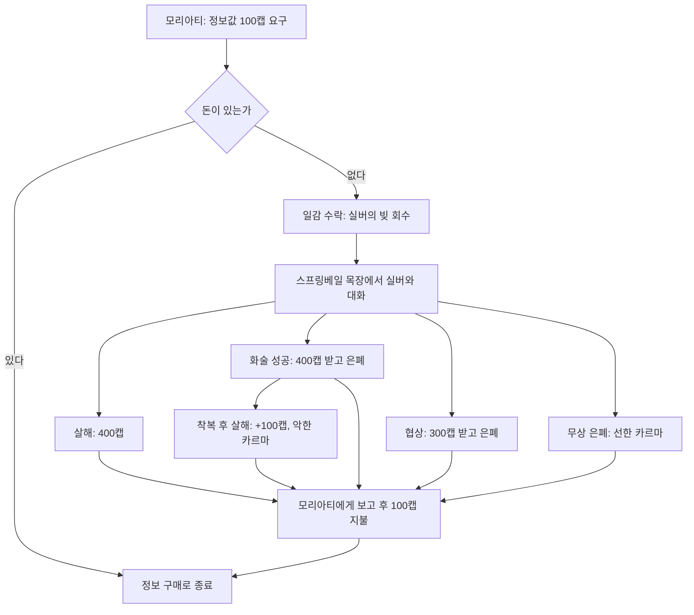
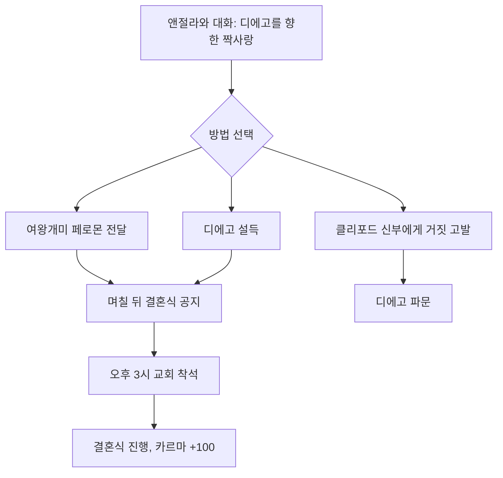
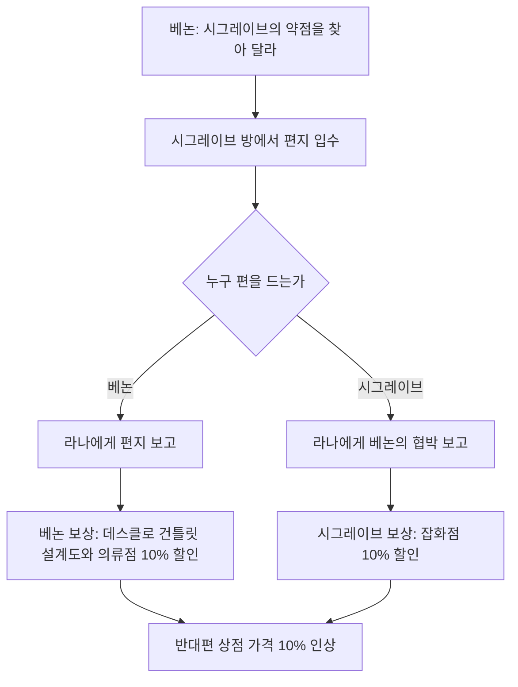
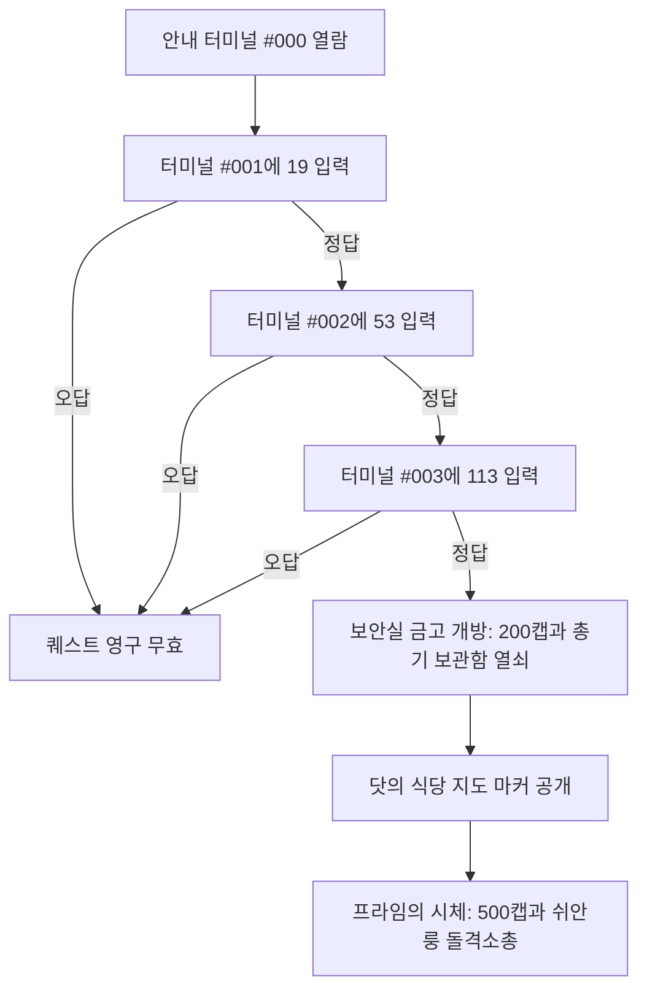
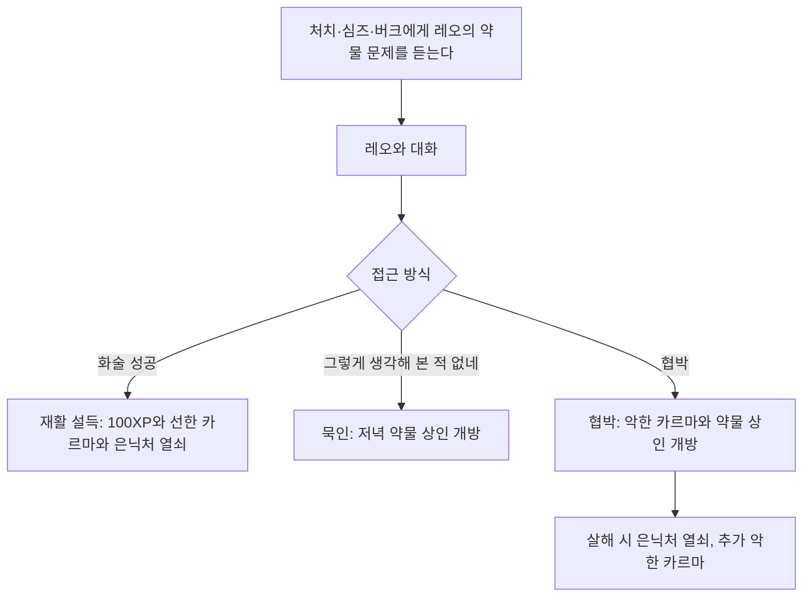
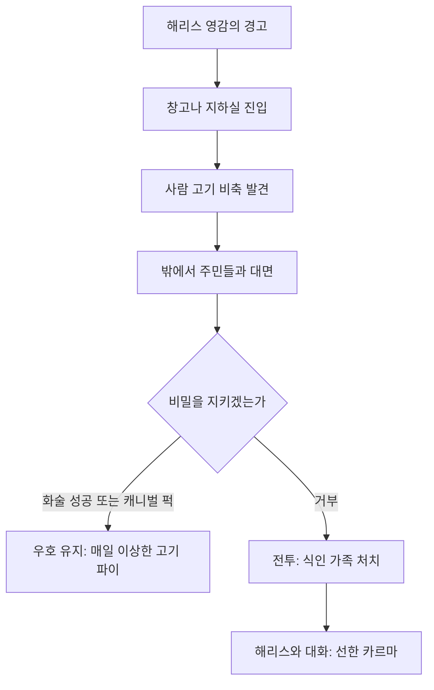
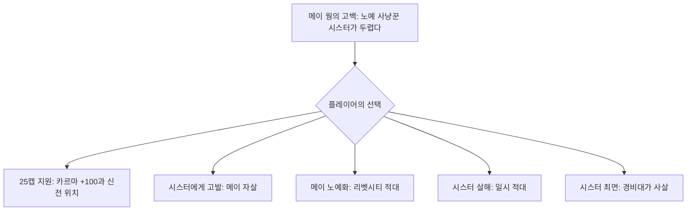
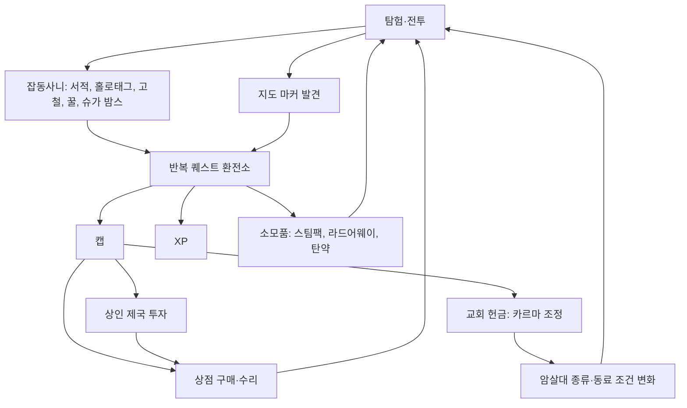
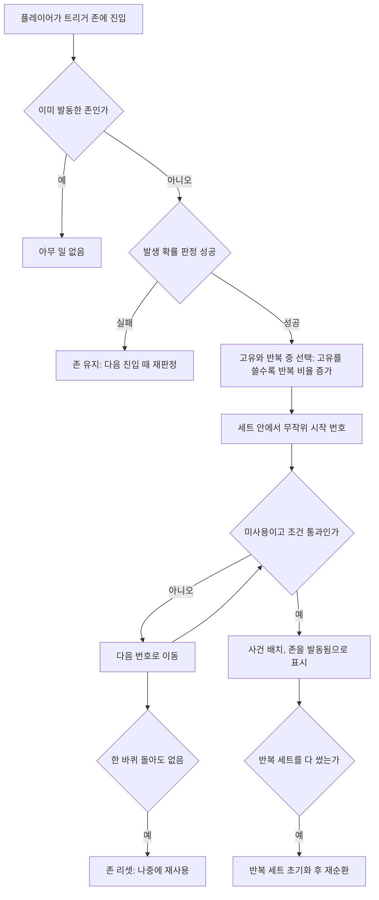

# RD-07. 비표시·반복 퀘스트와 랜덤 인카운터

> **폴아웃 3 역기획서 세트** | 문서 ID: RD-07 | 버전: v1.0 | 작성일: 2026-10-11
> **범위**: 본편 비표시(Unmarked) 퀘스트 32건(허브 표 기준), 반복(Repeatable) 퀘스트 17건, 본편 랜덤 인카운터 전체(위키 목록 80건 + 스크립트 확인 슬롯), 카르마 암살대 고정 지점 31곳, 특수 이벤트 링크. DLC 비표시·반복 퀘스트와 [BS] 고정 인카운터는 다루지 않는다(각 DLC 문서 참조). 메인·사이드 퀘스트 본문은 다루지 않고 링크만 한다.
> **관련 문서**: [RD-03 메인 스토리 1부](03_main-story-part1.md), [RD-05 사이드 퀘스트 1부](05_side-quests-part1.md), [RD-06 사이드 퀘스트 2부](06_side-quests-part2.md), [RD-08c DLC: 브로큰 스틸](08c_dlc-broken-steel.md), [RD-09 팩션](09_factions.md), [RD-11 NPC 디렉터리](11_npc-directory.md), [RD-13 장소 카탈로그](13_location-catalog.md), [RD-14 캐릭터 시스템](14_character-system.md), [RD-17 탐험·상호작용](17_exploration-interaction.md), [RD-21 소모품·잡화·제작](21_consumables-misc-crafting.md), [RD-22 경제·주거](22_economy-housing.md), [RD-24 크리처·적 도감](24_bestiary.md)

---

## 1. 문서 개요

### 1.1 목적과 범위
- 핍-보이(Pip-Boy) 퀘스트 목록에 뜨지 않는 **비표시 퀘스트**, 같은 거래를 계속 되풀이하는 **반복 퀘스트**, 이동 중 무작위로 벌어지는 **랜덤 인카운터**를 한 문서에서 정리한다. 세 요소 모두 메인·사이드 퀘스트 사이의 빈 공간을 채우는 '월드 충전재'라는 점에서 하나로 묶었다.
- 목적은 두 가지다. ① 팬게임에서 이벤트·데이터로 옮길 수 있도록 조건·보상·분기를 빠짐없이 적는다. ② 이 콘텐츠들이 월드의 밀도와 경제를 어떻게 받치는지 분석한다.
- 다루지 않는 것
  - 메인·사이드 퀘스트 본문: [RD-03](03_main-story-part1.md)~[RD-06](06_side-quests-part2.md)이 정본이다. 이 문서는 연결 고리만 적는다.
  - DLC 비표시·반복 퀘스트(예: [TP] Toys for Tots(곰 인형 → 30캡), [BS] Getting Ready for Prime Time(카메라·센서 모듈 → 캡·XP)·Blood Brotherhood(슈퍼 뮤턴트 혈액 샘플 → 50캡·10XP), [PL]·[MZ] 비표시 퀘스트): 각 DLC 문서([RD-08a](08a_dlc-operation-anchorage.md)~[RD-08e](08e_dlc-mothership-zeta.md)). 이름 목록은 6장 표 참고.
  - 퍽 연계 판매(로브링어(Lawbringer) 손가락, 컨트랙트 킬러(Contract Killer) 귀), 수집품(보블헤드, 뉴카-콜라 퀀텀(Nuka-Cola Quantum)): 6장에서 링크만 한다.

### 1.2 요약
- 허브 문서 `Fallout 3 quests`의 비표시 퀘스트 표는 **32행**이다(작업 지시의 '31개'와 1건 차이. 아래 1.4 참고). 반복 퀘스트 표는 **17행**이다. 모두 상세화했다.
- 비표시 퀘스트에는 **업적·트로피가 없고**, 대부분 **독립된 퀘스트 레코드도 없다**. 정착지 대화 퀘스트(예: `DialogueRivetCity`, `FreeformMegaton`)의 대화 분기·변수로 만들어져 있다. 그래서 '퀘스트'라기보다 **이야기가 붙은 대화 이벤트**에 가깝다.
- 반복 퀘스트는 거의 모두 **'잡동사니 → 캡(caps)·XP·카르마·소모품' 환전소**다. 기본 가격이 1캡인 아이템(전쟁 전 서적, BoS 홀로태그)을 100캡에 사 주는 식으로, 탐험의 부산물에 시장가와 따로 노는 값을 매겨 탐험 자체를 수익원으로 만든다.
- 랜덤 인카운터는 **고정된 트리거 존(A·B 두 계열)에 무작위 사건을 꽂아 넣는 구조**다. 스크립트상 슬롯 번호는 고유 29개(A 21, B 8)와 반복 57개(A 27, B 30)다. 같은 내용을 두 번 넣은 슬롯(사냥꾼 RA08·RA09, 버티버드(Vertibird) RB71·RB77)을 빼면 **84종**이다. 위키 목록 80건은 생존 가이드 서평 3종을 1건으로, A·B 사냥 파티를 1건으로 합쳤고 땜장이 조(Tinker Joe) 슬롯(RB54)은 싣지 않았다. 퀘스트 결과를 전해 주는 '후일담 배달', 미발견 장소를 알려 주는 '위치 힌트', 카르마에 반응하는 '암살대'라는 세 가지 일을 한다.

### 1.3 표기 메모
- 고유명사는 문서에서 처음 나올 때 `한국어(English)`로 병기하고, 이후 한국어만 쓴다. 표에는 영문 칼럼을 둔다. 용어집(RD-26)에 없는 표기는 외래어 표기법으로 음차했고, 최종 보고에 신규 용어로 제출한다.
- 고유명사(지명·세력·인물·크리처)는 리드 지시(2026-10-11)에 따라 **한글 패치 표기를 우선**한다(예: 리벳시티, 빅타운, 파라다이스폴, 감시자(Regulators), 탈론 컴퍼니, 노예 사냥꾼, 땅두더지, 뉴카-콜라, 핍-보이). 아이템·퍽·스킬·**퀘스트 이름**은 패치 근거가 없어 기존 용어집 표기를 유지한다. 그래서 용어집 퀘스트명 '빅 타운의 큰 문제', '누카콜라 챌린지', '라일리스 레인저스'는 지명·브랜드 표기와 달라도 그대로 둔다. 이 문서에서 새로 번역한 퀘스트·인카운터 이름(예: '비더컵의 잔이 넘치나이다', '감시자 암살대')에는 새 고유명사 표기를 반영했다.
- 퀘스트 이름은 번역하고 원제를 병기한다. 말장난 제목은 뜻을 살렸다(예: `Treatment` → '정수 처리', 물 처리(water treatment)와 일 처리를 겹친 제목).
- 문서 내부 ID
  - `U01~U32`: 비표시 퀘스트(허브 표 순서 = 영문 알파벳 순서)
  - `R01~R17`: 반복 퀘스트(허브 표 순서)
  - `UA01~UA21`, `UB51~UB58`, `RA01~RA27`, `RB51~RB80`: 랜덤 인카운터의 **게임 내부 슬롯 번호**. 스크립트 `FFEUniqueAQuestSCRIPT`, `FFEUniqueBQuestSCRIPT`, `FFERepeatASCRIPT`, `FFERepeatBSCRIPT`의 `encounterNumber` 값이고, 대응 레코드 접두어는 `FFEU##`(고유), `FFER##`(반복)이다.
- 수치는 코퍼스(Nukapedia 2026-08-30 덤프) 기준이다. 코퍼스에 없는 내용은 `(코퍼스 미확인)`으로 표시했다. `계산값`은 코퍼스 수치로 이 문서에서 직접 계산한 값이다.
- '난이도'(요약표) 칼럼은 이 문서의 **설계 평가값**이다(원작 데이터 아님). 기준은 다음과 같다.
  - **하**: 대화·전달 위주이고 전투 위험이 거의 없다.
  - **중**: 중간 수준의 전투나 이동이 있고, 스킬 판정이 보통이다.
  - **상**: 고위험 지역이나 강적이 있거나, 최고난도 판정 또는 장거리 수집이 필요하다.

### 1.4 허브 대조 메모(완전성 검증)
- 허브 `Fallout 3 quests` → `Unmarked quests` 표의 행 수는 32다(스크립트로 표 행을 세어 확인). 작업 지시 목록에 적힌 이름도 32개다. '31개'라는 수는 셈 오류로 보고 32건을 모두 다룬다.
- 허브 링크 중 5건은 다른 문서로 이어진다.

| 허브 표기 | 실제 링크 대상 | 처리 |
|---|---|---|
| Biwwy's Wazer Wifle | `Wazer Wifle (Fallout 3)` (무기 문서) | 무기 문서의 '획득' 절로 정리 |
| Caching in with Three Dog | `Galaxy News Radio (quest)`로 넘겨주기 | 메인 퀘스트 [RD-03](03_main-story-part1.md)의 부가 보상 절로 정리 |
| Cherry's Freedom | `You Gotta Shoot 'Em in the Head`로 넘겨주기 | 사이드 퀘스트 [RD-06](06_side-quests-part2.md)의 열쇠 획득 루트와 `Cherry` 문서로 정리 |
| Give Sydney A Note from Little Moonbeam's Father | `A note from Little Moonbeam's father` (홀로테이프 문서) | 실제로는 '독립을 훔쳐라'의 선택 목표. 공식 가이드가 자유 퀘스트로 분류 |
| Rube's Gold Ribbon Prize | `Gold Ribbon Grocers` (장소 문서) | 장소의 장치 퍼즐로 정리 |

- 허브의 'Quest ID' 칼럼은 32건 모두 `-`다. 즉 비표시 퀘스트에는 자체 퀘스트 폼 ID가 없다. 개별 문서 정보상자에 적힌 EDID는 대부분 **호스트 대화 퀘스트**의 것이다(예: '제대로 된 결혼식'과 '의회 의석'이 둘 다 `DialogueRivetCity`, 폼 ID `01d572`). 이 문서의 '구현' 칸은 이 값을 그대로 옮긴다.
- `Fallout 3 quest IDs` 문서는 덤프 판에서 표 본문이 비어 있어 대조에 쓰지 못했다.

## 2. 전체 목록 요약

### 2.1 비표시 퀘스트 32건 요약표
- 카르마 표기: `+`는 선한 카르마, `-`는 악한 카르마. 숫자는 코퍼스에서 확인한 값이고, 숫자 없는 `+`/`-`는 수치를 확인하지 못한 경우다.
- 업적·트로피는 32건 모두 **없음**(허브 명시).

| ID | 한국어명 | 영문명 | 장소 | 의뢰인(시작점) | 주요 보상 | 카르마 | 난이도 |
|---|---|---|---|---|---|---|---|
| U01 | 은화 300닢 | 300 Pieces of Silver | 스프링베일(Springvale) 작은 목장 → 메가톤(Megaton) | 콜린 모리아티(Colin Moriarty) / 실버 | 최대 400캡(실버 시체에서 +100), 아버지 정보 | + / - | 하 |
| U02 | 험한 꼴 당한 하인 | A Manhandled Manservant | 록오폴리스(Rockopolis) → 텐페니 타워(Tenpenny Tower) | 아가일(Argyle)의 시체 / 허버트 대시우드(Herbert Dashwood) | 대시우드 금고 열쇠(미니 누크, 설계도 - 병뚜껑 지뢰 등) | 없음 | 중 |
| U03 | 제대로 된 결혼식 하기 좋은 날 | A Nice Day for a Right Wedding | 리벳시티(Rivet City) | 앤절라 스테일리(Angela Staley) | 결혼식 관람 | +100 | 하 |
| U04 | 비더컵의 잔이 넘치나이다 | Bittercup Runneth Over | 빅타운(Big Town) | 비더컵 | 24시간마다 소모품 선물(약 30회) | 없음 | 하 |
| U05 | 비위의 와저 와이플 | Biwwy's Wazer Wifle | 리틀 램프라잇(Little Lamplight) | 비위 | 고유 레이저 소총 '와저 와이플' 구매권(500/250캡, 퍽 시 무료) | 없음 | 하 |
| U06 | 괴롭히는 애 괴롭히기 | Bully the Bully | 리틀 램프라잇 | 공주(Princess) / 새미(Sammy) | 없음(공주 대화 단절) | - | 하 |
| U07 | 쓰리독의 무기 은닉처 | Caching in with Three Dog | GNR 방송국 광장(GNR building plaza) → 해밀턴의 은신처(Hamilton's hideaway) | 쓰리독 | 은닉처 열쇠·홀로테이프·지도 마커, 스킬북·미니 누크 등 | + | 중 |
| U08 | 체리의 자유 | Cherry's Freedom | 듀코브의 집(Dukov's Place) → 리벳시티 | 체리 | (연계 시) 듀코브의 특수 열쇠 | +50 이상 | 중 |
| U09 | 의회 의석 | Council Seat | 리벳시티 | 베논(Bannon) | 베논 편: 설계도 - 데스클로 건틀릿(Deathclaw gauntlet) + 의류점 10% 할인 / 시그레이브 편: 잡화점 10% 할인 | 없음 | 하 |
| U10 | 폭력의 경제학 | Economics of Violence | 파라다이스폴(Paradise Falls) | 프론토(Pronto) | 록 앤 로드 재고 개선, 20% 할인 | 없음 | 중 |
| U11 | 선거일 | Election Day | 데이브 공화국(Republic of Dave) | 데이브 | 25캡 또는 데이브 금고(올 페인리스) | 없음 | 하 |
| U12 | 교수대 유머 | Gallows Humor | 시타델(The Citadel) A링 | 라이언스 프라이드(Lyons' Pride) / 글레이드(Glade) | 판돈 1,000캡 | 없음 | 상 |
| U13 | 리틀 문빔 아버지의 쪽지 | Give Sydney A Note from Little Moonbeam's Father | 스테이츠맨 호텔(Statesman Hotel) | 시드니 아버지의 유골(홀로테이프) | 시드니의 10mm '울트라' SMG | 없음 | 상 |
| U14 | 그레이디의 소포 | Grady's Package | 메리골드 역(Marigold station) → 다리그늘 마을(Girdershade) | 그레이디의 시체(홀로테이프) | 야한 잠옷 또는 200/300캡 | + | 중 |
| U15 | 생일 축하합니다 | Happy Birthday to You | 리틀 램프라잇 → 빅타운 | 스티키(Sticky) | 파티 모자, 빅타운 지도 마커 | 없음 | 중 |
| U16 | 고용된 일손 | Hired Help | 언더월드(Underworld) 나인서클(The Ninth Circle) | 아즈루칼(Ahzrukhal) | 셰런(Charon) 고용 계약서(동료 영입) | - (그레타 살해 시) | 하 |
| U17 | 직스의 전리품 | Jiggs' Loot | 기술 박물관(Museum of Technology) → 닷의 식당(Dot's Diner) | 터미널(프라임의 기록) | 쉬안룽 돌격소총, 700캡, 총기 보관함 열쇠 | 없음 | 중 |
| U18 | 오로지 맛을 위해 | Just for the Taste of It | 뉴카-콜라 공장(Nuka-Cola plant) → 레드 레이서 공장(Red Racer factory) | 윙어 메르시에의 시체(쪽지) | 250/400캡, 르두의 하키 마스크(선택) | 없음 | 중 |
| U19 | 켈러 가족의 피난처 | Keller Family Refuge | 수도 황무지(Capital Wasteland) 5곳 → 주 방위군 기지(National Guard depot) | 켈러 가족 녹취 홀로테이프 | 실험용 MIRV, 미니 누크 5발 등 | 없음 | 상 |
| U20 | 레오의 약물 습관 | Leo's Drug Habit | 메가톤 | 닥 처치(Doc Church) / 루카스 심즈(Lucas Simms) / 미스터 버크(Mister Burke) | 100XP + 은닉처 열쇠 또는 약물 상인 개방 | + / 0 / - | 하 |
| U21 | 링컨의 이윤 | Lincoln's Profit Margins | 역사 박물관(Museum of History) → 리벳시티·템플 오브 유니온(Temple of the Union)·링컨 기념관(Lincoln Memorial) | 아브라함 워싱턴(Abraham Washington) / 한니발 햄린(Hannibal Hamlin) / 리로이 워커(Leroy Walker) | 캡(최소 10 ~ 최대 1,110) | 없음 | 중 |
| U22 | 상인 제국 | Merchant Empire | 캔터베리 커먼(Canterbury Commons) | 언클 로(Uncle Roe) | 캐러밴 4곳 강화 + 상인별 선물 | 없음 | 하 |
| U23 | 우리만의 작은 비밀 | Our Little Secret | 안데일(Andale) | 해리스 영감(Old Man Harris) | 선한 카르마 또는 매일 이상한 고기 파이 | + / 0 | 중 |
| U24 | 과다 복용 | Overdose | 리벳시티 | 폴리 칸텔리(Paulie Cantelli) | 없음 | -100(사이코 1개당) | 하 |
| U25 | 루브의 골드 리본 경품 | Rube's Gold Ribbon Prize | 골드 리본 식료품점(Gold Ribbon Grocers, 주리 스트리트 지하철역(Jury Street Metro station) 인근) | 자발(장소 발견) | 스킬북 2권, 미니 누크, 미사일 3발 | 없음 | 하 |
| U26 | 셰릴을 찾아서 | Searching for Cheryl | 랑팡 사우스(L'Enfant South) → 캘버턴(Calverton) 북쪽 슈퍼 뮤턴트(Super mutant) 캠프 | 무덤의 수색대 일지 #1 | 미니 누크(베히모스(Behemoth) 소지), 잡다한 전리품 | 없음 | 상 |
| U27 | 노예 사냥 | Slave Hunt | 리벳시티 | 메이 웡(Mei Wong) | 템플 오브 유니온 위치 | +100 / - | 하 |
| U28 | 자살 감시 | Suicide Watch | 리벳시티 | 미스터 로페즈(Mister Lopez) | 없음 | + / -500 | 하 |
| U29 | 아이 유괴범 | The Kid-Kidnapper | 파라다이스폴 → 리틀 램프라잇 | 율로지 존스(Eulogy Jones) | 부기맨의 두건 | -200 | 중 |
| U30 | 실종된 이니시에이트 | The Lost Initiate | 폴스 처치(Falls Church) | 팔라딘 호스(Paladin Hoss) | 250~350XP + 100캡 또는 선한 카르마 | + (보수 거절 시) | 중 |
| U31 | 가출한 아이들 | The Runaways | 리벳시티 → 아나코스티아 크로싱 역(Anacostia Crossing station) | 제임스 하그레이브(James Hargrave) | 없음 | -100 → +100 | 하 |
| U32 | 정수 처리 | Treatment | 메가톤 | 월터(Walter) | 200캡 + 100XP, '월터의 고철' 해금 | (허브: 캡 대신 + 선택지) | 하 |

### 2.2 반복 퀘스트 17건 요약표
- 교환 비율과 경제성은 4장에서 다룬다.

| ID | 한국어명 | 영문명 | 장소 | 의뢰인 | 가져올 것 | 받는 것 | 해금 조건 |
|---|---|---|---|---|---|---|---|
| R01 | 교회 헌금 | Church Donations | 메가톤, 리벳시티 | 크롬웰(Confessor Cromwell), 클리포드 신부(Father Clifford) | 캡 10/50/100 | 캡 1당 카르마 +1 | 없음 |
| R02 | 홀로태그 수집 | Collecting Holotags | 시타델 | 제임슨 서기(Scribe Jameson) | BoS 홀로태그 | 개당 100캡 + 25XP | '생명의 물' 완료(시타델 출입) |
| R03 | 버섯 거래 | Fungus Deal | 리틀 램프라잇 | 루시(Lucy), 에클레어(Eclair) | 버프아웃, 이상한 고기 | 동굴 버섯 | 맥크래디(MacCready) 시장 승인 |
| R04 | 라일리와 지형 측량 | Geomapping with Reilly | 레인저 기지(Ranger compound) | 라일리 | 새로 발견한 장소 | 장소당 30캡(최대 4,890캡) | '라일리스 레인저스' 완료 |
| R05 | 네 피를 마시고 싶다 | I Want to Drink Your Blood | 메레스티 지하철역(Meresti Metro station) | 밴스(Vance) | 혈액 팩 | 개당 15캡 | '피의 유대' 완료 |
| R06 | 손버릇 나쁜 하그레이브 | Light-Fingers Hargrave | 리벳시티 | 제임스 하그레이브 | (퍽 '차일드 앳 하트') | 12시간마다 무작위 탄약 | 퍽 '차일드 앳 하트' |
| R07 | 미시시피 퀀텀 파이 | Mississippi Quantum Pie | 다리그늘 마을 | 시에라 페트로비타(Sierra Petrovita) | 뉴카-콜라 퀀텀 + 보드카 + 밀가루 | 미시시피 퀀텀 파이 1개 | '누카콜라 챌린지' 완료 |
| R08 | 머피의 폭격 작전 | Murphy's Bombing Run | 노스웨스트 세네카 역(Northwest Seneca Station) | 머피 | 슈가 밤스 | 상자당 15캡(화술 성공 시 30), 8상자당 울트라제트 구매권 1 | 없음 |
| R09 | 재미와 돈벌이를 위한 꿀 채집 | Nectar Collecting for Fun and Profit | 그레이디치(Grayditch, 메리골드 역) | 레스코 박사(Doctor Lesko) | 화염개미(Fire ant) 꿀 | 개당 40캡 | 화염개미 꿀 소지 |
| R10 | 라이언 브리그의 원더 미트 | Ryan Brigg's Wonder Meat | 주리 스트리트 터널(Jury St. tunnels) | 원더 미트 메이커(장치) | 땅두더지(Mole rat) 고기 + 원더글루 | 땅두더지 원더 미트 1개 | 없음(장치 사용) |
| R11 | 냉정한 이윤 | Strictly Profitable | 파라다이스폴 | 그루스(Grouse) | 노예(메즈메트론(Mesmetron) 포획) | 1명당 250캡 | '냉정한 거래' 진행 |
| R12 | 아웃캐스트의 수거 대리인 | The Outcast Collection Agent | 인디펜던스 요새(Fort Independence) | 프로텍터 캐스딘(Protector Casdin) | 파워 아머, 에너지 무기, 센서 모듈, 고철 등 | 5.56mm 탄·파편 수류탄·라드어웨이·스팀팩, 50점 달성 시 신뢰 | 디펜더 모건과 대화 |
| R13 | 이 낡은 집 | This Old House | 언더월드 | 윈드롭(Winthrop) | 고철 5개 | 스팀팩·라드어웨이·라드-X 중 1개 | 없음 |
| R14 | 월터의 고철 | Walter's Scrap Metal | 메가톤 | 월터 | 고철 1개 | 10캡 + 5XP 또는 카르마 +10 | '정수 처리' 완료 |
| R15 | 물 구걸꾼 | Water Beggars | 메가톤·리벳시티·텐페니 타워 밖 | 미키(Micky), 카를로스(Carlos), 윌리(Willy) | 정화수, [BS] 아쿠아 퓨라 | 카르마 +50(FEV 오염수는 -50) | 없음 |
| R16 | 배움에 대한 갈망 | Yearning for Learning | 알링턴 도서관(Arlington Library) | 이어링 서기(Scribe Yearling) | 전쟁 전 서적 | 권당 100캡 + 10XP | 없음(이어링을 모욕하지 않을 것) |
| R17 | 지프의 뉴카 중독 | Zip's Nuka Fix | 리틀 램프라잇 | 지프 | 뉴카-콜라 1병(하루 1회) | 물물교환 스킬별 무작위 물품 | 없음 |

### 2.3 랜덤 인카운터 요약
- 출처: `Fallout 3 random encounters` 목록 80건. 5장에 전체 표가 있다.

| 분류(위키 절) | 건수 | 고유 | 반복 | 비고 |
|---|---|---|---|---|
| 카르마 연동(Karma-related) | 2 | 0 | 2 | 감시자(Regulators)·탈론 컴퍼니(Talon Company) 암살대 |
| 퀘스트 연동(Quest-related) | 18 | 11 | 7 | 퀘스트 전·중·후 상태에 반응 |
| 사냥꾼·강도(Hunters and robbers) | 8 | 6 | 2 | 식인 사냥꾼 3부작, 라이벌 저격수 |
| 노예 사냥꾼·노예(Slavers and slaves) | 6 | 0 | 6 | 노예 사냥꾼 활동과 플레이어의 노예 사냥 이력에 반응 |
| 스캐빈저·황무지인(Scavengers and wastelanders) | 20 | 7 | 13 | 상인·의사·구조 요청. '고철 그 이상'은 위키 표기 '반복/고유' → 스크립트상 고유(UA16) |
| 아웃캐스트·엔클레이브·탈론(Outcasts, Enclave, Talon) | 11 | 0 | 11 | B형 순찰 위주 |
| 슈퍼 뮤턴트(Super mutants) | 3 | 0 | 3 | 엉클 레오(Uncle Leo) 포함 |
| 크리처(Creatures 'n' Critters) | 8 | 2 | 6 | |
| 기타(Other) | 4 | 3 | 1 | UFO, 중국군 조종사 등. '레이더(Raiders) 신고식(Raider Initiation)'은 위키 표기 반복 → 스크립트상 고유(UA18) |
| **합계** | **80** | **29** | **51** | 위키의 고유 27 + 반복 52 + 혼합 1을, 스크립트 슬롯 기준으로 정정함(5.2 참고) |

- 지점군(위키 'Locations' 칸): A 42건, B 33건, A·B 공통 3건(암살대 2, 사냥 파티 1), 특정 지역 한정 A* 1건·B* 1건(슈퍼 뮤턴트 계열).
- 트리거 접근 경로 표: 126행(A 62, B 64), 가장 가까운 지도 마커 81종.

### 2.4 정착지별 분포
| 정착지·지역 | 비표시 퀘스트 | 반복 퀘스트 | 비고 |
|---|---|---|---|
| 리벳시티(Rivet City) | U03, U09, U24, U27, U28, U31 (+U08 목적지) | R01, R06, R15 | 비표시 퀘스트 최다 밀집지 |
| 메가톤(Megaton) | U01(종착), U20, U32 | R01, R14, R15 | 초반 허브. 카르마 튜토리얼 성격 |
| 리틀 램프라잇(Little Lamplight) | U05, U06, U15, U29(표적) | R03, R17 | 아이 전용 대화 퍽(차일드 앳 하트) 시험장 |
| 파라다이스폴(Paradise Falls) | U10, U29 | R11 | 악 카르마 루트의 경제 허브 |
| 언더월드(Underworld) | U16 | R13 | |
| 시타델(The Citadel) | U12 | R02 | 메인 퀘스트 진행 후 해금 |
| 빅타운(Big Town) | U04, U15(종착) | - | |
| 텐페니 타워(Tenpenny Tower) | U02(종착) | R15 | |
| 다리그늘 마을(Girdershade) | U14(종착) | R07 | 누카콜라 챌린지 권역 |
| 그레이디치·메리골드 역(Grayditch / Marigold station) | U14(시작) | R09 | '그것들!' 권역 |
| 단독 장소·던전 | U02, U07, U08, U11, U13, U17, U18, U19, U21, U22, U23, U25, U26, U30 | R04, R05, R08, R10, R12, R16 | 탐험 보상형 |

## 3. 비표시 퀘스트 상세 (U01~U32)

- 양식: 기본 정보 표 → 진행 요약 → 해결 루트와 판정 → 결과 → (필요 시) 흐름도 → 설계 메모.
- 공통 사항: 32건 모두 핍-보이 퀘스트 목록에 뜨지 않고 업적·트로피도 없다. 목표 표시 대신 **노트(쪽지)·홀로테이프 추가, 지도 마커 공개, NPC 대사 변화**로 진행 상황을 알린다.
- 스킬 판정 표기: `화술 판정`은 FO3 특유의 확률형 판정이다(화술 스킬이 높을수록 성공률이 오른다. 공식은 [RD-17](17_exploration-interaction.md) 참고). `[스킬 N]`은 수치를 넘으면 반드시 통과하는 문턱형 판정이다.

### U01. 은화 300닢 (300 Pieces of Silver)

| 항목 | 내용 |
|---|---|
| 영문명 / 한국어명 | 300 Pieces of Silver / 은화 300닢 |
| 유형 / 구현 | 비표시 / 호스트 `FreeformMegaton` (FormID `0173d8`) |
| 의뢰인 | 콜린 모리아티(Colin Moriarty). 대상은 실버(Silver) |
| 시작 조건 | 메인 퀘스트 '아버지의 발자취(Following in His Footsteps)'에서 모리아티가 아버지 정보 값으로 100캡을 요구할 때, 돈이 없다고 답하면 일감으로 제안한다. 모리아티와 말하기 전에 실버를 먼저 만나도 진행할 수 있다 |
| 장소 | 메가톤(Megaton) 모리아티 살롱(Moriarty's Saloon) → 메가톤 북서쪽 스프링베일(Springvale)의 작은 목장(Small ranch) |
| 연관 퀘스트 | 선행: 아버지의 발자취(RD-03). 그 메가톤 단계를 다른 방법으로 끝내거나 리 박사에게 아버지 이야기를 먼저 들으면 이 퀘스트는 사라진다 |
| 보상 | 실버에게서 최대 400캡(시체 약탈 시 +100캡), 모리아티 우호, 아버지 정보(정보값 100캡은 따로 내야 한다) |
| 카르마 | 돈을 받지 않고 '못 찾았다'고 보고하면 +. 돈을 받은 뒤 실버를 죽이면 - |
| 업적 | 없음 |

**진행 요약**
1. 모리아티가 "실버라는 약쟁이가 빌려 간 캡을 받아 오면 그 돈으로 정보값을 치르라"고 제안한다.
2. 스프링베일 목장의 실버를 찾아 대화한다. 실버는 자기 몫을 정당하게 벌어 떠났다고 주장한다.
3. 실버를 처리하는 방식(아래 6가지)을 고른다.
4. 모리아티에게 돌아가 보고한다. 보고와 별개로 정보값 100캡은 여전히 내야 한다("It's called economics, kid." / "이게 경제라는 거다, 꼬마야.").

**해결 루트와 판정**

| 루트 | 조건·판정 | 결과 |
|---|---|---|
| ① 살해 | "캡 받으러 왔다"고 밝히면 실버가 바로 공격해 온다 | 400캡과 장비 획득. 오두막 물건을 훔치지 않으면 카르마 변화 없음 |
| ② 화술 협상 | 화술 판정 성공 | "떠났다고 말해 달라"며 400캡을 준다 |
| ③ 일반 협상 | 판정 없음 | 300캡을 받는다 |
| ④ 무상 은폐 | 돈을 받지 않고 "못 찾았다"고 보고하기로 한다 | 선한 카르마. 정보값은 직접 마련해야 한다 |
| ⑤ 거래 없는 거짓 보고 | 협상 없이 모리아티에게 "떠났다"고만 말한다 | 정보값을 직접 내야 한다 |
| ⑥ 착복 후 살해 | ② 성공으로 400캡을 받은 뒤 살해 | 시체에서 100캡 추가, 카르마 감소 |

**결과**
- 실버의 생사, 모리아티 우호 여부가 확정된다. 아버지 정보는 어느 루트로든 '모리아티에게 돈을 내는' 결말로 모인다.
- 제목은 유다가 받은 '은화 30닢'을 비틀었다(인물 이름 Silver와 화폐를 겹친 말장난).

**설계 메모**: 메인 퀘스트의 '돈이 부족한' 상황을 비표시 퀘스트로 받아 주는 **결핍 해소형 우회로**다. 같은 대상(실버)을 놓고 카르마 + / 0 / - 와 캡 수익이 맞바뀌는 구조여서, 게임 초반에 카르마 시스템을 가르치는 역할을 한다.

### U02. 험한 꼴 당한 하인 (A Manhandled Manservant)

| 항목 | 내용 |
|---|---|
| 영문명 / 한국어명 | A Manhandled Manservant / 험한 꼴 당한 하인 |
| 유형 / 구현 | 비표시 / (코퍼스 미확인) |
| 의뢰인 | 아가일(Argyle)의 시체(발견이 시작점). 보고 대상은 허버트 '대링' 대시우드(Herbert "Daring" Dashwood) |
| 시작 조건 | 텐페니 타워(Tenpenny Tower)의 대시우드에게 아가일 이야기를 듣거나(선택), 지도 마커가 없는 장소 록오폴리스(Rockopolis)에서 아가일의 시체를 찾는다 |
| 장소 | 록오폴리스(다리그늘 마을 북쪽, 야오과이(Yao guai) 터널 남동쪽) → 텐페니 타워 |
| 연관 퀘스트 | '텐페니 타워(Tenpenny Tower)'(RD-06)와 상태가 얽힌다 |
| 보상 | 대시우드 금고 열쇠. 금고 내용: 캡, 멘타츠, 미니 누크, 라드-X, 설계도 - 병뚜껑 지뢰, 스텔스 보이(Stealth Boy), 스팀팩 |
| 카르마 | 없음(버그로 금고 사용이 절도로 처리될 수 있다) |
| 업적 | 없음 |

**진행 요약**
1. (선택) 대시우드가 은퇴한 모험가로서 옛 하인 아가일이 아직 살아 있으리라 믿는다고 말한다. GNR 라디오 극 '허버트 대시우드의 모험'이 둘의 과거를 들려준다.
2. 록오폴리스 입구(문처럼 쓰는 바위)로 들어가 무너진 굴 근처에서 아가일의 시체를 찾는다.
3. 대시우드에게 소식을 전하면 모험 인생을 접겠다며 금고 열쇠를 준다. 대시우드와 미리 이야기하지 않았어도 보고할 수 있다.

**해결 루트와 판정**: 전투나 판정 없이 탐색·전달만 하면 된다. 다만 '텐페니 타워' 진행 상태가 루트를 막는다.
- 구울(Ghoul)을 몰살하기 **전에** 대시우드가 아가일 이야기를 꺼내게 해야 한다(로이 필립스(Roy Phillips)의 평화 협상안을 텐페니에게 가져간 뒤, 대시우드와 대화할 때 구울 편을 든다).
- 대화 전에 구울을 죽이면 대시우드를 죽여 열쇠를 얻는 길만 남는다(소매치기 불가).
- 구울이 탑을 점령해 인간 주민이 몰살되면 대시우드는 지하실에서 시체로 발견되고 열쇠도 없다.

**결과**: 대시우드의 '모험가 시대'가 끝난다. 시체 위에 쌓인 바위가 라디오 극 마지막 회("This could be the end of…")의 결말을 보여 준다.

**설계 메모**: **라디오 극 → 숨겨진 장소 → 시체 → 귀환**으로 이어지는 환경 서사형 퀘스트다. 다른 매체(라디오)에 뿌려 둔 정보를 탐험으로 회수하게 만든다.

### U03. 제대로 된 결혼식 하기 좋은 날 (A Nice Day for a Right Wedding)

| 항목 | 내용 |
|---|---|
| 영문명 / 한국어명 | A Nice Day for a Right Wedding / 제대로 된 결혼식 하기 좋은 날 |
| 유형 / 구현 | 비표시 / 호스트 `DialogueRivetCity` (FormID `01d572`) |
| 의뢰인 | 앤절라 스테일리(Angela Staley) |
| 시작 조건 | 리벳시티(Rivet City)에서 앤절라에게 디에고(Diego)와의 관계를 묻는다 |
| 장소 | 리벳시티(성 모니카 교회, 중앙 갑판) |
| 연관 퀘스트 | '그것들!(Those!)'(RD-05). 여왕개미를 잡으면 페로몬을 얻는다 |
| 보상 | 결혼식 관람. 신혼부부 방이 생긴다 |
| 카르마 | 결혼식 성사 시 +100 |
| 업적 | 없음 |

**진행 요약**
1. 앤절라는 신부 수련생 디에고를 사랑하지만 디에고는 사제 서원 때문에 응하지 못한다. 앤절라는 디에고를 유혹할 여왕개미 페로몬(Ant queen pheromones)을 원한다.
2. 아래 세 가지 방법 중 하나로 둘을 이어 주거나 떼어 놓는다.
3. 며칠 뒤 앤절라·디에고·베라 웨덜리(Vera Weatherly)·게리 스테일리(Gary Staley)에게 말을 걸면 "오후 3시에 교회에서 결혼식"이라는 소식을 듣는다.
4. 오후 3시에 교회 좌석에 앉으면 리벳시티의 이름 있는 NPC들이 모이고 클리포드 신부(Father Clifford)가 식을 진행한다.

**해결 루트와 판정**

| 루트 | 조건 | 결과 |
|---|---|---|
| 페로몬 전달 | 신디 칸텔리(Cindy Cantelli)의 가게 '어 퀵 픽스(A Quick Fix)'에서 사거나 여왕개미에게서 얻은 여왕개미 페로몬을 앤절라에게 준다 | 며칠 뒤 디에고가 교회를 떠나 청혼한다. 결혼식이 열리고 +100 |
| 디에고 설득 | 대화로 디에고가 교회 대신 앤절라를 택하게 한다 | 결혼식이 열리고 +100 |
| 거짓 고발 | 클리포드 신부에게 "디에고가 앤절라와 잔다"고 거짓말한다 | 디에고가 파문된다. 위키 본문에는 '식이 없다'와 '결혼으로 이어진다'는 서술이 섞여 있다(버그 절에도 '초대가 오지 않음'이 있다) |

**결과**
- 식이 끝나면 부부는 교회 옆 복도 첫 번째 방(식 전에는 빈방)으로 옮겨 가고, 방에 더블베드와 가구가 생긴다.
- 식 전에 클리포드 신부를 죽이면 두 사람은 나타나지 않는다.
- 페로몬을 준 뒤 둘이 만나면 유혹 대화가 들리고, 엿들으면 'Angela and Diego' 노트가 추가된다.

**설계 메모**: NPC 일정(오후 3시), 군중 연출, 방 내부 변화까지 엮은 **정착지 생활 이벤트**의 표본이다. 버그 보고가 많은 것은 여러 NPC의 AI 패키지를 동시에 맞물리게 한 탓이다. 이식할 때는 시간 조건을 단순화해야 한다.

### U04. 비더컵의 잔이 넘치나이다 (Bittercup Runneth Over)

| 항목 | 내용 |
|---|---|
| 영문명 / 한국어명 | Bittercup Runneth Over / 비더컵의 잔이 넘치나이다 |
| 유형 / 구현 | 비표시 / 호스트 `DialogueBigtown` (FormID `02816f`). 이름은 공식 가이드에서 유래 |
| 의뢰인 | 비더컵(Bittercup) |
| 시작 조건 | 빅타운(Big Town) 공동 주택(Common house)에서 비더컵과 대화 |
| 장소 | 빅타운 |
| 연관 퀘스트 | '빅 타운의 큰 문제(Big Trouble in Big Town)'(RD-05) |
| 보상 | 24시간마다 무작위 선물 1회(약 30회 반복) |
| 카르마 | 없음 |
| 업적 | 없음 |

**진행 요약**
1. 죽음에 집착하는 고스족 소녀 비더컵에게 무례하게 굴든 공손하게 굴든, 비더컵은 결국 "만나는 사람이 있냐"며 호감을 보인다.
2. "나를 이해하는 사람도 없다"고 공감하면 빅타운에서 사귄 남자들을 줄줄이 나열한다. 이어지는 응답 중 처음 세 개 가운데 아무것이나 고른 뒤 "사귀는 사람이 없다"고 답하면 연인 관계가 된다. 주인공의 성별과 무관하다.
3. 이후 24시간마다(대기 기능으로도 가능) 말을 걸 때마다 선물을 1개 받는다.

**선물 목록**(무작위 1종): 라드-X, 메드-X, 라드어웨이, 스팀팩(1개 이상), 캡(1개 이상), 뉴카-콜라, 정화수, 오염된 물, 브라민 스테이크, 다람쥐 꼬치, 바삭한 다람쥐 조각, 국수, 블램코 맥앤치즈, 이구아나 꼬치, 정크 푸드, 마이얼럭(Mirelurk) 케이크, 혈액 팩, 산탄총 탄, 5mm 탄, 5.56mm 탄, 10mm 탄, .44 매그넘 탄, .308 탄

**결과**: 약 30회가 지나면 퀘스트 전 대사로 돌아가고 선물도 끊긴다.

**설계 메모**: 연애 플래그 하나에 **일일 보급 상자**를 붙인 구조다. 정해진 횟수(약 30회)로 끝나는 '반복형 비표시 퀘스트'로, 정착지를 다시 찾아갈 이유를 준다.

### U05. 비위의 와저 와이플 (Biwwy's Wazer Wifle)

| 항목 | 내용 |
|---|---|
| 영문명 / 한국어명 | Biwwy's Wazer Wifle / 비위의 와저 와이플 (아이 말투로 'Billy's Laser Rifle'을 흉내 낸 제목) |
| 유형 / 구현 | 비표시 / 무기 EDID `WeapUniqueWazerWifle` (FormID `00061793`) |
| 의뢰인 | 비위(Biwwy) |
| 시작 조건 | 리틀 램프라잇(Little Lamplight)에서 비위와 대화. 비위는 정찰대에서 쫓겨나 더는 총이 필요 없다며 총을 팔겠다고 한다 |
| 장소 | 리틀 램프라잇 |
| 보상 | 고유 레이저 소총 와저 와이플(Wazer Wifle) |
| 카르마 | 없음 |
| 업적 | 없음 |

**해결 루트와 판정**

| 루트 | 조건 | 가격 |
|---|---|---|
| 정가 구매 | 없음 | 500캡 |
| 흥정 | 물물교환 스킬이 충분할 것(수치 코퍼스 미확인) | 250캡. 이 선택지가 뜨면 이 가격으로 '반드시' 사야 한다(고가 지불 불가) |
| 퍽 | 퍽 '차일드 앳 하트(Child at Heart)' 보유 | 무료. 돈을 낼 선택지가 아예 없다 |

**보상 성능**(일반 레이저 소총과 비교): 피해 29(일반 23), 탄창 30(일반 24), 내구 1,800(일반 1,000), 치명타 피해 28(일반 22), AP 17, 무게 8, 가치 900(일반 1,000). 성능은 더 좋은데 가치는 오히려 낮다. 상세 수치는 [RD-19](19_weapons-ammo.md) 참고.

**설계 메모**: 아이들만 사는 마을에서 **퍽 '차일드 앳 하트'와 물물교환 스킬의 보상을 체감시키는 상점형 이벤트**다. 판정 결과가 가격 차이로 바로 드러난다.

### U06. 괴롭히는 애 괴롭히기 (Bully the Bully)

| 항목 | 내용 |
|---|---|
| 영문명 / 한국어명 | Bully the Bully / 괴롭히는 애 괴롭히기 |
| 유형 / 구현 | 비표시(문서 정보상자는 'side'로 잘못 표기) / (코퍼스 미확인) |
| 의뢰인 | 공주(Princess). 정보원은 새미(Sammy) |
| 시작 조건 | 리틀 램프라잇 뒷문의 공주에게 별명의 유래를 묻는다(거절당한다). '낙원으로부터의 구출(Rescue from Paradise)'(RD-04)에서 새미를 구출해야 정보를 얻을 수 있다 |
| 장소 | 리틀 램프라잇 |
| 보상 | 없음 |
| 카르마 | 악한 카르마(수치 코퍼스 미확인) |
| 업적 | 없음 |

**진행 요약**
1. 공주에게 별명을 물으면 화를 내며 거절한다.
2. 구출된 새미에게 공주 이야기를 꺼내고 화술 판정에 성공하면 내막을 듣는다. 공주는 시장이 되자마자 직함을 '공주'로 바꾸려 했고, 5분 만에 맥크래디에게 코를 얻어맞고 쫓겨났다. 그 뒤로 몰래 맥크래디를 좋아한다.
3. 이 정보로 공주를 조롱한다. 카리스마가 높을수록 더 깊은 상처를 주는 선택지("맥크래디는 루시를 좋아한다", "모두 너를 싫어한다")를 쓸 수 있다.

**결과**: 악한 카르마를 얻고, 공주는 다시는 말을 걸어 주지 않는다.

**설계 메모**: 정보 수집(화술) → 카리스마 판정 → **순수한 악행**으로 이어지는 소품이다. 보상 없이 카르마만 깎는 선택지를 일부러 열어 두어, '할 수 있지만 할 필요는 없는' 악을 보여 준다.

### U07. 쓰리독의 무기 은닉처 (Caching in with Three Dog)

| 항목 | 내용 |
|---|---|
| 영문명 / 한국어명 | Caching in with Three Dog / 쓰리독의 무기 은닉처 ('한몫 챙기다'라는 뜻의 cashing in과 cache를 겹친 말장난) |
| 유형 / 구현 | 비표시 / 메인 퀘스트 '갤럭시 뉴스 라디오(Galaxy News Radio)'(`MQ02`, FormID `00022486`)의 부가 보상. 홀로테이프 EDID `MQ02WeaponsCache` (FormID `000bc721`) |
| 의뢰인 | 쓰리독(Three Dog) |
| 시작 조건 | ① 쓰리독과 첫 대화에서 화술 판정에 성공하면 아버지 정보를 먼저 듣고, 접시 안테나 수리는 보상(무기 은닉처)이 걸린 선택 목표가 된다. ② 또는 GNR 퀘스트를 끝내기 전에 리 박사·볼트 112 등 다른 경로로 아버지 위치를 알아낸다 |
| 장소 | GNR 방송국 광장(GNR building plaza) → 해밀턴의 은신처(Hamilton's hideaway) |
| 연관 퀘스트 | 갤럭시 뉴스 라디오(RD-03), 피의 유대(은신처가 근처) |
| 보상 | 홀로테이프 '무기 은닉처(The weapons cache)', 무기 은닉처 열쇠, 해밀턴의 은신처 지도 마커. 은닉처 내용: 스킬북 『총과 총알(Guns and Bullets)』, 미니 누크, 스텔스 보이, 레벨 연동 헬멧·방어구, 무작위 전리품 |
| 카르마 | 선한 카르마(수치 미확인). 별도로 안테나 설치 시 +200(GNR 퀘스트 보상) |
| 업적 | 없음(GNR 메인 퀘스트 업적과는 별개) |

**진행 요약**
1. 안테나(통신 중계 접시)를 고쳐 주면 아버지 정보를 준다는 쓰리독의 거래를 화술로 뒤집는다. 또는 다른 경로로 아버지의 행방을 먼저 알아낸다.
2. 워싱턴 기념비(Washington Monument)에 접시를 설치해 GNR 퀘스트를 마친다.
3. 쓰리독이 "빈손으로 보낼 순 없다"며 은닉처 홀로테이프와 열쇠를 준다. 보낸 사람은 코퍼헤드(Copperhead)로, "해밀턴의 은신처에서 찾은 군 무기고 좌표"를 담았다.
4. 해밀턴의 은신처 북서쪽 끝 잔해 뒤 감방 문을 열쇠로 연다.

**해결 루트와 판정**
- 화술에 실패했거나 판정을 고르지 않았고, 아버지 위치도 다른 경로로 알아내지 못했다면 은닉처에 들어갈 수 없다. 쓰리독을 죽여도 열쇠는 나오지 않는다.

**설계 메모**: 메인 퀘스트의 '정보를 얻는 순서'에 따라 보상이 하나 더 붙는 **순서 보상형** 장치다. 화술에 투자했거나 탐험을 앞서 한 플레이어에게 보너스를 준다.

### U08. 체리의 자유 (Cherry's Freedom)

| 항목 | 내용 |
|---|---|
| 영문명 / 한국어명 | Cherry's Freedom / 체리의 자유 |
| 유형 / 구현 | 비표시 / 사이드 퀘스트 '머리를 쏴야 해'(MS14)의 대화 토픽 `MS14DukovStealKey`, 듀코브의 집 대화 토픽 `DukovComeWithMe`·`DukovRivetCityYes` 등 |
| 의뢰인 | 체리(Cherry) |
| 시작 조건 | 듀코브의 집(Dukov's Place)에서 체리에게 "나와 함께 가자"고 제안한다. 체리는 "리벳시티로 데려가 준다면"이라는 조건을 건다 |
| 장소 | 듀코브의 집(앵커리지 기념관(Anchorage Memorial) 근처) → 리벳시티 |
| 연관 퀘스트 | '머리를 쏴야 해(You Gotta Shoot 'Em in the Head)'(RD-06). 화술 판정에 성공하면 체리가 듀코브(Dukov)의 특수 열쇠를 훔쳐 준다 |
| 보상 | (MS14 연계 시) 듀코브의 특수 열쇠 |
| 카르마 | 리벳시티 도착 시 최소 +50(카르마 문서의 '퀘스트 선행' 예시) |
| 업적 | 없음 |

**진행 요약**
1. 체리에게 듀코브 이야기를 들으면 "안전 때문에 참고 산다"고 털어놓는다.
2. "Rivet City it is.(리벳시티로 가자.)"를 고르면 임시 동료로 합류한다. "아직은 못 간다"를 고르면 거절당한다.
3. 리벳시티에 도착하면 카르마가 오르고, 체리는 리벳시티를 돌아다니며 산다. 3일이 지나면 속옷 차림에서 황무지 정착민 옷으로 갈아입는다.

**해결 루트와 판정**
- MS14 연계: 듀코브의 열쇠 이야기를 할 때 화술 판정에 성공하고 리벳시티 동행을 약속하면 체리가 열쇠를 훔쳐 온다("He never even noticed." / "눈치도 못 챘어."). 이 선택지는 한 번만 뜨고, 거절하면 다시 뜨지 않는다.
- 제한 시간: 5일 안에 리벳시티에 가지 않으면 "5일이 넘었다"며 듀코브에게 돌아간다.
- 호위 난도: 체리는 체력이 낮고 적을 보면 거의 항상 도망친다(스위치블레이드만 가끔 쓴다). 빠른 이동을 쓸 수 없으면 까다로운 호위다.

**설계 메모**: 사이드 퀘스트의 열쇠 획득 루트 하나가 **독립된 도덕 서사(구출)**로 자라난 사례다. 제한 시간과 겁 많은 NPC로 호위의 긴장을 만든다.

### U09. 의회 의석 (Council Seat)

| 항목 | 내용 |
|---|---|
| 영문명 / 한국어명 | Council Seat / 의회 의석 |
| 유형 / 구현 | 비표시 / 호스트 `DialogueRivetCity` (FormID `01d572`) |
| 의뢰인 | 베논(Bannon), 의류점 포토맥 어타이어(Potomac Attire) 주인 |
| 시작 조건 | 베논이 시그레이브 홈스(Seagrave Holmes)가 자기 의석을 노린다며 약점을 찾아 달라고 한다(노트 'Bannon's request'). 베논이 제안하지 않으면, 증거를 먼저 찾은 뒤 베논에게 말해도 시작된다 |
| 장소 | 리벳시티 중앙 갑판(시그레이브의 방), 브리지 타워 3층(라나 댄버스) |
| 보상 | 베논 편: 설계도 - 데스클로 건틀릿, 포토맥 어타이어 영구 10% 할인, 리벳시티 서플라이(Rivet City Supply) 영구 10% 인상 / 시그레이브 편: 리벳시티 서플라이 영구 10% 할인, 포토맥 어타이어 영구 10% 인상 |
| 카르마 | 없음(시그레이브 방 자물쇠를 따면 -) |
| 업적 | 없음 |

**진행 요약**
1. 시그레이브의 방(쉬움 자물쇠)에 들어간다. 오전 7시에 시그레이브가 방을 나서는 틈을 타면 카르마를 잃지 않는다.
2. 침대 밑 사물함 옆에서 '시그레이브의 편지(Seagrave's incriminating letter)'를 얻는다(소유물 표시가 없어 가져가도 카르마 변화 없음). 편지는 노예 사냥꾼 우두머리 율로지 존스와 연락한 흔적이다.
3. 양쪽 주장을 듣는다.
   - 시그레이브: 편지는 노예 사냥꾼과 손잡지 않겠다는 내용이니, 오히려 베논이 협박하고 있다고 라나 댄버스(Lana Danvers)에게 알려 달라고 한다.
   - 베논: 증거를 라나에게 넘기되 자기가 시켰다는 사실은 숨기라고 한다.
4. 라나 댄버스(브리지 타워 3층, 또는 오후 9시 이후 시장)에게 한쪽 편을 들어 보고한 뒤, 편든 사람에게 돌아간다. 시장은 밤에 닫으므로 오래 머물면 NPC가 적대할 수 있다.

**결과와 메모**
- 의회는 매주 월요일 아침에 모인다(베논 대사). 어느 편을 들든 한쪽 상점은 비싸지고 다른 쪽은 싸지는 **영구 상점 보정**이 남는다.
- 시그레이브 터미널의 '생존 무기 구상(철도 대못 탄약, 증기 동력)' 메모 때문에, 원래 시그레이브 편 보상이 레일웨이 라이플(Railway rifle) 설계도였을 것이라는 추정이 있다(근거 약함, 위키 노트).
- **설계 메모**: 즉시 보상(설계도)과 장기 보상(대형 잡화점 할인) 사이의 선택이다. 상점 가격표 자체를 퀘스트 보상으로 쓴 드문 사례다.

### U10. 폭력의 경제학 (Economics of Violence)

| 항목 | 내용 |
|---|---|
| 영문명 / 한국어명 | Economics of Violence / 폭력의 경제학 |
| 유형 / 구현 | 비표시 / (코퍼스 미확인). 공식 가이드의 '자유 퀘스트' 이름 |
| 의뢰인 | 프론토(Pronto), 파라다이스폴의 무기점 '록 앤 로드(Lock and Load)' |
| 시작 조건 | 프론토가 노예 사냥꾼들이 쓰다 버린 잡동사니만 들어온다고 불평할 때 돕겠다고 하면 '프론토의 쪽지(Note from Pronto)'를 준다 |
| 장소 | 파라다이스폴(Paradise Falls) |
| 요구 물품 | 중국제 돌격소총(Chinese assault rifle) 20정(내구도 무관, 쉬안룽 돌격소총은 받지 않음) |
| 보상 | 24시간 뒤 상점 재고가 '좋은 총기·탄약상' 수준으로 바뀌고 20% 할인. 보유 캡 약 150 → 약 400 |
| 카르마 | 없음 |
| 업적 | 없음 |

**조달처**(위키 목록): 마마 돌체(Mama Dolce's)의 중국군 잔존병(대부분 소지해서 가장 빠름), 슈퍼 뮤턴트 마스터, 탈론 컴퍼니 용병(고레벨·고난도에서 자주 소지, 배니스터 요새(Fort Bannister)는 자주 리스폰), 메가톤 무기고 3정, 리벳시티 '플랙 앤 슈래프널'(Flak 'N Shrapnel's) 재고 2정 + 그들 방 1정(보통 자물쇠), 국회의사당, 그레이디치 윌크스 집 1정, 로이 필립스 소지품, 리벳시티 무기고 문 옆 선반, 태프트 터널(Taft Tunnel), 데이브 박물관(Museum of Dave), [TP] 버려진 아파트 3정, [PL] 캘버트 저택 옆 벙커

**판정·제약**
- 파라다이스폴에서 적대 상태가 되면 프론토도 적대해 완료할 수 없다(의사 커터는 계속 영업).

**설계 메모**: 중국제 돌격소총의 기본 가치는 500캡이라 20정이면 장부상 10,000캡어치다(`계산값`). 그만한 물자를 '상점 등급 상승'과 맞바꾸는, **현금 대신 물량을 요구하는 투자형 퀘스트**다. 악 카르마 거점에 고급 상점을 여는 장치이기도 하다.

### U11. 선거일 (Election Day)

| 항목 | 내용 |
|---|---|
| 영문명 / 한국어명 | Election Day / 선거일 |
| 유형 / 구현 | 비표시 / (코퍼스 미확인) |
| 의뢰인 | 데이브(Dave), 데이브 공화국(Republic of Dave)의 '대통령' |
| 시작 조건 | 메리(Mary)의 안내로 데이브를 만난다("'대통령 아빠'라고 불러 줘요!"). 데이브는 재선을 위해 투표 독려를 부탁한다 |
| 장소 | 데이브 공화국(필요 시 올드 올니(Old Olney)) |
| 연관 퀘스트 | '머리를 쏴야 해'(RD-06): 데이브의 특수 열쇠 획득 루트 |
| 보상 | 25캡(개표 요청 시). 데이브가 지면 금고(코드 1138) 내용물, 고유 사냥용 소총 올 페인리스(Ol' Painless) 포함 |
| 카르마 | 없음(금고를 털면 버그로 절도 처리될 수 있으니 목격자 없을 때) |
| 업적 | 없음 |

**진행 요약**
1. 성인 넷, 제시카(Jessica)·숀나(Shawna)·로지(Rosie)·밥(Bob)에게 투표하라고 전한다.
2. 이때 로지나 밥을 설득해 출마시킬 수 있다(아직 투표하지 않았다면 각자 자기 표 1표를 얻는다).
3. 데이브에게 투표가 끝났다고 알리면 데이브가 투표함으로 가서 개표한다.

**해결 루트와 판정**

| 루트 | 방법 | 결과 |
|---|---|---|
| 정상 선거 | 개입하지 않는다 | 데이브 과반이나 동률이면 데이브 당선. 25캡 |
| 선거 조작 | 데이브가 투표함을 연 직후 표를 빼내 원하는 후보 표만 1장 남긴다 | 그 후보가 당선되고 금고 코드를 알려 준다. 데이브는 분노해 올드 올니(Old Olney)로 떠난다 |
| 전부 빼기(비권장) | 표를 하나도 남기지 않는다 | 데이브가 패배 연설을 하지만 실제로는 당선 처리되는 이상 동작 |

- 올드 올니로 간 데이브는 데스클로 때문에 대개 길에서 죽는다. 따라가 보호하면 골목에 자리 잡고 "새 데이브 공화국이다. 꺼져라"라고 하며, 세 번 말을 걸면 적대한다. 데이브가 먼저 공격해 와서 죽였더라도 데이브 공화국 주민은 적대한다.
- 숀나와의 대화가 막히면(로드블록) 선거를 끝낼 수 없다.

**설계 메모**
- 금고 코드 1138은 조지 루커스의 영화 'THX 1138'을 가리킨다.
- '물리적 투표용지 조작'을 상호작용 퍼즐로 만든 사례다. 정치 풍자와 YGSETH 열쇠 루트를 동시에 해결한다(데이브가 낙선해 떠나면 목격자 없이 처치할 수 있다).

### U12. 교수대 유머 (Gallows Humor)

| 항목 | 내용 |
|---|---|
| 영문명 / 한국어명 | Gallows Humor / 교수대 유머 (갤로스의 이름과 '블랙 유머'를 뜻하는 관용구를 겹친 제목) |
| 유형 / 구현 | 비표시 / 호스트 `DialogueCitadel` (FormID `018569`) |
| 의뢰인 | 라이언스 프라이드(Lyons' Pride) 대원들. 판돈 관리자는 팔라딘 글레이드(Paladin Glade) |
| 시작 조건 | '생명의 물' 이후 시타델(The Citadel) A링 대회당에서 대원들에게 나이트 캡틴 갤로스(Knight Captain Gallows)의 본명 내기 이야기를 듣는다 |
| 장소 | 시타델 A링 |
| 보상 | 판돈 1,000캡 |
| 카르마 | 없음 |
| 업적 | 없음 |

**진행 요약**
1. 대원들에게 내기 이야기를 듣는다. 듣기 전에는 갤로스에게 물어볼 선택지가 없다.
2. 갤로스에게 화술 판정을 건다. 성공하면 본명이 '어빙(Irving)'이라고 밝히고, 이제 좀 내버려 두라고 한다.
3. 글레이드에게 알려 1,000캡을 받는다.

**판정**
- 게임에서 가장 어려운 화술 판정 가운데 하나다. 화술 100에 카리스마 9여도 100%가 아니다. 모든 DLC와 최신 패치 기준으로 화술 100에 카리스마 10이어야 100%가 된다.
- 첫 만남 때 침묵을 지키면 갤로스의 호감이 올라 판정에 유리한 보정이 붙는다(`Irving Gallows` 문서).

**제약**: '되찾아라!(Take It Back!)'에서 리버티 프라임(Liberty Prime)이 출격하기 전까지만 가능하다([BS] 설치 시 이후에도 가능). 글레이드가 죽으면 완료할 수 없다.

**설계 메모**: 영화 '라이언 일병 구하기'의 '대위의 전직 맞히기 내기'를 옮긴 패러디다(갤로스의 "판돈이 얼마나 쌓였지?" 대사도 같다). **고난도 판정 한 번에 고액 보상**을 거는, 화술 특화 빌드를 위한 보너스다.

### U13. 리틀 문빔 아버지의 쪽지 (Give Sydney A Note from Little Moonbeam's Father)

| 항목 | 내용 |
|---|---|
| 영문명 / 한국어명 | Give Sydney A Note from Little Moonbeam's Father / 리틀 문빔 아버지의 쪽지 |
| 유형 / 구현 | 공식 가이드는 '자유 퀘스트'로 분류하지만, 게임에서는 사이드 퀘스트 '독립을 훔쳐라(Stealing Independence)'(`MS15`)의 선택 목표다. 홀로테이프 EDID `MS15FinSydneyDadAudioNote` (FormID `0b3972`) |
| 의뢰인 | 시드니(Sydney) 아버지의 유골 옆 홀로테이프 |
| 시작 조건 | 스테이츠맨 호텔(Statesman Hotel)에서 홀로테이프 '리틀 문빔 아버지의 쪽지(A note from Little Moonbeam's father)'를 줍는다 |
| 장소 | 스테이츠맨 호텔 3층(최상층): 테오(Theo)의 시체가 있는 계단에서 두 층 위, 복도 왼쪽 첫 문, 침대 위 해골 옆. 맞은편은 쉬움 자물쇠 창고 |
| 연관 퀘스트 | 독립을 훔쳐라(RD-06), 라일리스 레인저스(호텔 공유) |
| 보상 | 시드니의 10mm '울트라' SMG(Sydney's 10mm "Ultra" SMG, 가치 430, 피해 9) |
| 카르마 | 없음 |
| 업적 | 없음 |

**진행 요약**
1. 홀로테이프를 듣는다. 아버지가 거래 중 총격을 받아 죽어 가며 딸('리틀 문빔')에게 남긴 작별 인사다. "Daddy loves you very much. Goodbye.(아빠는 너를 정말 사랑한다. 안녕.)"
2. 시드니가 자기 이야기(아버지의 실종)를 털어놓은 뒤 홀로테이프를 건네면, 감사의 뜻으로 고유 SMG를 준다.

**설계 메모**: 던전 깊은 곳의 오디오 로그가 다른 곳의 NPC와 이어지는 **유물-NPC 연결형** 보상이다. 호텔에는 슈퍼 뮤턴트가 들끓어 회수 위험이 크다.

### U14. 그레이디의 소포 (Grady's Package)

| 항목 | 내용 |
|---|---|
| 영문명 / 한국어명 | Grady's Package / 그레이디의 소포 |
| 유형 / 구현 | 비표시 / 보상 의복 EDID `MS04AmorousAttire` (FormID `0c8e07`) |
| 의뢰인 | 그레이디(Grady)의 시체와 홀로테이프 '그레이디의 마지막 녹음(Grady's last recording)' |
| 시작 조건 | 메리골드 역(Marigold station) 첫 중층 관리인 부스에서 시체와 녹음을 찾는다. 시체를 못 찾아도 열쇠를 얻거나 금고를 따면 진행된다 |
| 장소 | 메리골드 역 → 다리그늘 마을(Girdershade) |
| 연관 퀘스트 | 그것들!(같은 던전), 누카콜라 챌린지(받는 사람이 같은 다리그늘 마을에 있음) |
| 보상 | 야한 잠옷(Naughty nightwear: 행운 +1, 화술 +10, 가치 200) 또는 로널드 래런(Ronald Laren)에게 전달해 200캡(화술 성공 시 300캡) |
| 카르마 | 래런에게 200캡을 받고 전달하면 +. 화술 성공 루트(300캡)는 카르마 없음 |
| 업적 | 없음 |

**진행 요약**
1. 녹음: "If you're listening to this tape then my brains are splattered all over a wall somewhere and you've got a job to do.(이 테이프를 듣고 있다면 내 머리는 어딘가 벽에 흩뿌려졌고, 너한테는 할 일이 생긴 거다.)"
2. 아래층 동쪽의 두 터널 중 오른쪽으로 가서 오른쪽 첫 문 → 정비실 소방 호스함에서 '그레이디의 금고 열쇠'를 얻는다. '그것들!'을 끝내지 않았다면 화염개미가 나온다.
3. 터널을 지나 열차 오른쪽의 경광등 아래 쉬움 자물쇠 문을 자물쇠 따기나 터미널(과학)로 연다. 금고에서 야한 잠옷을 얻는다(방에 리퍼(Ripper)도 있다).
4. 레이더 러그너트(Lug-Nut)가 나타나 잠옷을 내놓으라고 한다.
5. 잠옷을 갖거나 래런에게 넘긴다.

**해결 루트와 판정**

| 분기 | 선택 | 결과 |
|---|---|---|
| 러그너트 대응 | 화술 판정 성공 | "내 실수"라며 물러간다 |
| | 내준다 | 잠옷을 갖고 떠난다. 죽이고 되찾으면 내구도가 완전 수리된 상태다 |
| | 죽인다 | 잠옷 유지 |
| | 메즈메트론(Mesmetron)으로 노예화 | 파라다이스폴로 가면 250캡 |
| 최종 처분 | 직접 착용 | 잠옷 |
| | 래런에게 전달 | 200캡 + 선한 카르마. 화술 성공 시 300캡(카르마 없음). 화술에 실패한 뒤 "Sure, here you go"를 고르면 200캡 + 카르마 |

**제약**: '누카콜라 챌린지'에서 블랙 위도우(Black Widow) 선택지로 래런을 뉴카-콜라 공장에 보냈다면 전달할 수 없다.

**설계 메모**: 퀘스트 디자이너 앨런 네인스(Alan Nanes)가 스스로 '이스터에그성 미니 퀘스트'로 꼽은 작품이다. 정보상자 보상 표기는 '100~300캡'이지만 본문 수치는 200/300캡이다.

### U15. 생일 축하합니다 (Happy Birthday to You)

| 항목 | 내용 |
|---|---|
| 영문명 / 한국어명 | Happy Birthday to You / 생일 축하합니다. 공식 가이드 이름은 'A Sticky Situation(끈적한 상황)' |
| 유형 / 구현 | 비표시 / 정보상자 EDID `MS02`, FormID `0af3a2`. '초인의 도박'의 `MS02`(FormID `00014e95`)와 겹쳐 확인이 필요하다 |
| 의뢰인 | 스티키(Sticky) |
| 시작 조건 | 맥크래디 시장의 허락으로 리틀 램프라잇 문이 열리면, 빨간 생일 모자를 쓴 스티키가 아이들에게 둘러싸여 있다. 16세가 되어 마을을 떠나야 한다 |
| 장소 | 리틀 램프라잇 → 빅타운 |
| 연관 퀘스트 | 빅 타운의 큰 문제(RD-05) |
| 보상 | 파티 모자(Party hat), 빅타운 지도 마커. 둘 다 대화만으로 얻는다. 약속한 캡은 실제로 주지 않는다 |
| 카르마 | 없음(스티키를 죽여도 카르마 변화 없음) |
| 업적 | 없음 |

**진행 요약**
1. 스티키가 어른들이 가는 빅타운에 데려가 달라고 한다. 합류하면 임시 동료가 되고 무기·방어구를 쥐여 줄 수 있다.
2. 가는 동안 스티키는 '빈칸 채우기(매드립)' 식으로 단어만 바꾼 이야기를 끝없이 늘어놓는다. 화술 판정에 성공하면 입을 다물게 할 수 있다. 실패하면 "너나 닥쳐!" 식의 따라 하기 놀이가 이어지고, "I'm not playing this game"을 고르면 끝난다.
3. 빅타운으로 가는 다리를 건너면 완료된다.

**예외**
- '빅 타운의 큰 문제'를 레드(Red)를 죽여 실패했다면 스티키가 없다.
- 그 퀘스트 전에 데려가면 한동안 "레드 어디 있어?"만 반복한다.
- 지뢰 방어 루트로 빅타운을 구했다면 마을 주변 지뢰가 스티키를 아군으로 인식하지 않는다. 다리 앞에서 기다리게 하고 지뢰를 먼저 해체해야 한다.
- 빅타운 근처에는 늘 슈퍼 뮤턴트 한 마리가 나타난다.
- 스티키는 리틀 램프라잇 대공동 비계에서 떨어지면 물에 빠져 죽는다.

**설계 메모**: 수다스러운 호위 대상, 따라 하기 놀이 같은 **코미디 호위**다. 실질 보상은 퀘스트를 시작하기만 해도 얻으므로, 완주는 순전히 롤플레이 선택이다.

### U16. 고용된 일손 (Hired Help)

| 항목 | 내용 |
|---|---|
| 영문명 / 한국어명 | Hired Help / 고용된 일손 |
| 유형 / 구현 | 비표시 / (코퍼스 미확인) |
| 의뢰인 | 아즈루칼(Ahzrukhal), 나인서클(The Ninth Circle) 주인 |
| 시작 조건 | 언더월드(Underworld)의 나인서클에서 아즈루칼에게 셰런(Charon)의 고용 계약 이야기를 듣는다. 그레타(Greta)가 이미 죽어 있으면 대화가 열리지 않는다 |
| 장소 | 언더월드 나인서클 / 캐롤의 집(Carol's Place) |
| 보상 | 셰런의 고용 계약서(Charon's employment contract) → 동료 셰런 |
| 카르마 | 그레타(선한 카르마 NPC)를 죽이면 일반 규칙상 -100. 구매 루트는 변화 없음 |
| 업적 | 없음 |

**해결 루트와 판정**

| 루트 | 조건 | 결과 |
|---|---|---|
| 구매 | 2,000캡. 물물교환 50 이상이면 1,000캡. 청부를 수락한 뒤에는 고를 수 없다. 돈이 없으면 그냥 거절당한다 | 계약서 |
| 청부 살인 | 경쟁 술집 캐롤의 집 점원 그레타를 죽이고, 주민 적대가 풀린 뒤 돌아온다 | 계약서 |
| (비권장) 아즈루칼 살해 | 직접 죽인다 | 아즈루칼은 '매우 악한' NPC라 선한 카르마를 얻지만, 구울들이 3일간 적대하고 계약서는 어디에도 없어 셰런을 영입할 수 없다 |

**결과**
- 계약서를 넘기면 셰런이 아즈루칼에게 걸어가 산탄총으로 머리를 날리고 한 발 더 쏜다. 구울들이 모여 "He shot Ahzrukhal!(아즈루칼이 총에 맞았어!)"라고 외친다.
- 아즈루칼 시체에서 냉장 보관함 열쇠(캡 등)가 나오고, 방 안 물건은 카르마 없이 가져갈 수 있다. 다만 금고 자물쇠를 따거나 터미널을 해킹하면 적대될 수 있다(플랫폼별 차이 있음).
- 낸 캡은 되찾을 수 없다.
- 셰런의 동료 사양은 [RD-10](10_characters-major-companions.md) 참고.

**설계 메모**: '돈이냐 살인이냐'의 양자택일에 **물물교환 50 문턱(가격 절반)**을 끼워 넣은 구조다. 계약에 묶인 동료가 계약이 넘어가는 순간 옛 주인을 처형하는 연출로 동료의 성격을 단번에 보여 준다.

### U17. 직스의 전리품 (Jiggs' Loot)

| 항목 | 내용 |
|---|---|
| 영문명 / 한국어명 | Jiggs' Loot / 직스의 전리품 |
| 유형 / 구현 | 비표시 / (코퍼스 미확인) |
| 의뢰인 | 터미널. 스캐빈저 프라임(Prime)이 동료 직스(Jiggs)에게 남긴 보안 시험 |
| 시작 조건 | 기술 박물관(Museum of Technology) 아트리움 안내 터미널 목록 맨 아래의 `#000` 항목을 읽는다(읽으면 `#001`로 바뀐다). 금고 옆 터미널에서도 시작할 수 있다 |
| 장소 | 기술 박물관 → 주리 스트리트 지하철역(Jury Street Metro station) 맞은편 닷의 식당(Dot's Diner) |
| 연관 퀘스트 | 갤럭시 뉴스 라디오(같은 던전, RD-03) |
| 보상 | 보안실 금고: 200캡, 귀중품, 총기 보관함 열쇠(천문관 사무실 보관함: 레이저 권총이나 미사일 발사기와 탄약. 보통 돌격소총 3정 + 무작위 무기·탄약) / 프라임의 시체: 500캡, 폭발물, 탄약, 쉬안룽 돌격소총(Xuanlong assault rifle, 가치 400, 피해 12). 합계 700캡 |
| 카르마 | 없음 |
| 업적 | 없음 |

**진행 요약**

| 단계 | 위치 | 입력 코드 |
|---|---|---|
| 터미널 #001 | 1층, 입구 정면 | 19 |
| 터미널 #002 | 서관(볼트 투어 너머), 들어가서 왼쪽 앞. 입구에서 가장 먼 터미널 | 53 |
| 터미널 #003 | 1층 델타 IX 로켓 옆 | 113 |
| 금고 | 천문관 서쪽, 버고 II 착륙선이 내려다보이는 보안실 | 위 셋을 풀면 열림. 쪽지 'Earned your share' 획득 |
| 닷의 식당 | 주리 스트리트 지하철역 맞은편(쪽지를 얻는 순간 지도에 표시) | 카운터 뒤 테이블에서 프라임의 시체 발견 |

**판정·제약**
- 코드는 **한 번만** 입력할 수 있고 한 번이라도 틀리면 퀘스트가 무효가 된다. 퍽 '컴퓨터 위즈(Computer Whiz)'로도 다시 시도할 수 없다.
- 힌트는 이름 'Prime'에 있다. 정답은 모두 소수(19, 53, 113)다. 프라임은 "늘 하던 빵부스러기를 터미널에 남겨 뒀다"고 썼다.
- 총기 보관함은 자물쇠 따기(어려움)로도 열 수 있다. 프라임의 시체는 세 터미널을 모두 풀어야 식당에 생긴다.

**설계 메모**: 플레이어의 **지식(소수)을 판정 대신 쓰는 퍼즐**이다. 스킬과 상관없이 단 한 번의 기회를 주어 긴장감을 만들고, 보상은 다른 장소로 넘겨 탐험을 한 번 더 시킨다.

### U18. 오로지 맛을 위해 (Just for the Taste of It)

| 항목 | 내용 |
|---|---|
| 영문명 / 한국어명 | Just for the Taste of It / 오로지 맛을 위해 (다이어트 코크의 1982년 광고 문구) |
| 유형 / 구현 | 비표시 / 제조법 EDID `MS05NukaColaDisk` (FormID `000cade6`) |
| 의뢰인 | 하키 갱 '서든데스 오버타임(Sudden-Death Overtime)'의 윙어 메르시에(Winger Mercier) 시체와 쪽지 '제조법 찾기(Finding the formula)' |
| 시작 조건 | 뉴카-콜라 공장(Nuka-Cola plant) 사무동 2층에서 메르시에의 시체를 찾는다 |
| 장소 | 뉴카-콜라 공장 → 레드 레이서 공장(Red Racer factory, 공장 북동쪽) |
| 연관 퀘스트 | 누카콜라 챌린지(RD-06). 그 퀘스트를 끝내기 **전에** 제조법을 주워야 갱이 나타난다 |
| 보상 | 250캡(화술 성공 시 400캡). 골리 르두(Goalie Ledoux)를 죽이면 르두의 하키 마스크(AP +25, DR 4, 가치 100)와 제조법(가치 150)을 되찾는다 |
| 카르마 | 없음 |
| 업적 | 없음 |

**진행 요약**
1. 쪽지 내용: "제조법을 구해서 레드 로켓 세발자전거 공장에서 만나자. 구매자가 캡을 잔뜩 약속했다."
2. 공장 입구 왼쪽 첫 방 R&D 부서('RESEARCH'라고 쓰인 벽)의 벽 금고를 열 열쇠가 필요하다.
3. 공장 아래층의 미스터 핸디(Mister Handy) 마일로(Milo)에게서 열쇠를 얻는다.
4. 뉴카-콜라 클리어 제조법(Nuka-Cola Clear formula)을 꺼내 레드 레이서 공장 앞의 르두와 갱원 2명에게 간다.

**해결 루트와 판정**

| 분기 | 방법 | 결과 |
|---|---|---|
| 금고 열쇠 | 화술 판정으로 직원인 척 속인다 | 열쇠 사본 |
| | 퍽 '로보틱스 엑스퍼트(Robotics Expert)' | 자동으로 받는다 |
| | R&D 옆 사무실 컴퓨터 옆 쪽지 '뉴카-콜라 가족이 된 걸 환영합니다!(Welcome to the Nuka-Cola family!)'의 ID 정보 | ID 확인 통과 |
| | 마일로 파괴 | 열쇠 획득 |
| 거래 | 그냥 넘긴다 | 250캡 |
| | 화술 판정 성공 | 400캡 |
| | 넘긴 뒤 르두 처치 | 마스크와 제조법 회수. 퍽 '로브링어(Lawbringer)'가 있으면 손가락도 나온다 |

**제약**: 제조법을 줍지 않고 누카콜라 챌린지를 먼저 끝내면 갱이 나타나지 않아 영원히 완료할 수 없다.

**설계 메모**: 사이드 퀘스트(퀀텀 수집)와 같은 던전에 **경쟁 세력의 비표시 퀘스트**를 겹쳐 놓았다. 같은 장소를 두 번 의미 있게 만든다.

### U19. 켈러 가족의 피난처 (Keller Family Refuge)

| 항목 | 내용 |
|---|---|
| 영문명 / 한국어명 | Keller Family Refuge / 켈러 가족의 피난처 |
| 유형 / 구현 | 비표시 / (코퍼스 미확인) |
| 의뢰인 | 켈러 가족 녹취(Keller family transcript) 홀로테이프 5개 중 아무것이나 |
| 시작 조건 | 홀로테이프 하나를 줍는다 |
| 장소 | 수도 황무지 5곳 → 주 방위군 기지(National Guard depot) 무기고 벙커 |
| 보상 | 실험용 MIRV(Experimental MIRV: 가치 2,498, 피해 80, 무게 30), 미니 누크 5발, 스킬북 『미 육군: 간편 화염방사기 레시피 30선』, 뉴카-콜라 퀀텀, 그 밖의 물품(플라스마 수류탄 등) |
| 카르마 | 없음 |
| 업적 | 없음 |

**홀로테이프 위치와 암호 숫자**

| 테이프 | 위치 | 위험 요소 | 암호 숫자 | 필수 여부 |
|---|---|---|---|---|
| 1/5 | 송전탑 오두막(pylon shack): 아르푸(Arefu) 남서쪽 VAPL-58 발전소에서 송전탑을 따라 북쪽 끝까지. 책장 아래 칸 | 낮음. 미니 누크와 전쟁 전 서적도 있다 | 없음(배경 설명) | 불필요 |
| 2/5 | 할로드 무어스 묘지(Hallowed Moors Cemetery, 빅타운 북쪽) 교회 정문 왼쪽 연단 | 슈퍼 뮤턴트(레벨에 따라 브루트·오버로드), 포로, 미니 누크, 스킬북 2권 | 5 | 필수 |
| 3/5 | 끔찍한 식당(grisly diner) 뒤편 야외 책상 | 압력판 흔들 함정, 레이더, 지뢰 | 7 | 필수 |
| 4/5 | 저격수 오두막(sniper shack): 록브레이커의 라스트 가스(Rockbreaker's Last Gas) 서쪽 절벽 위. 작업대 | 슈퍼 뮤턴트·센타우로스(Centaur) | 4 | 필수 |
| 5/5 | 앵커리지 기념관 북쪽 강 건너 세미트럭 뒤 텐트 | 슈퍼 뮤턴트, 센타우로스 2마리, 포로. [BS]에서는 오버로드 가능 | 6 | 필수 |

**진행 요약**
1. 테이프 2~5의 네 자리 숫자를 모은다. 게임은 테이프를 가지고 있는지로 판정하며, 숫자의 입력 순서는 코퍼스에서 확인하지 못했다.
2. 주 방위군 기지에서 훈련동 → 사무동 → 기지 첫 구역으로 돌아가 전기 스위치로 아래층 문을 연다. 무기고 터미널로 벙커 방폭문을 연다. 위키 안에서도 스위치·터미널 위치 서술이 '최상층'과 '최하층'으로 엇갈린다.
3. 벙커 안에는 글로잉 원(Glowing one)이 된 켈러 씨(Mr. Keller)가 있다.

**서사**: 전쟁 직전 군인 알렉스 켈러가 훔친 벙커 암호를 가족에게 한 자리씩 나눠 보내 모두 모이게 하려 했다. 그러나 가족은 끝내 모이지 못했다. 막내 랄프는 "Have a happy holocaust!(즐거운 대학살 되시길!)"라며 아버지를 거부한다.

**설계 메모**: 맵 전역에 흩어진 다섯 조각을 모으는 **보물찾기형 장거리 퀘스트**다. 수집 동선이 곧 탐험 동선이고, 최종 보상(MIRV)이 본편 최강급 무기다. 가족 드라마가 위험한 수집 과정을 감정적으로 받쳐 준다.

### U20. 레오의 약물 습관 (Leo's Drug Habit)

| 항목 | 내용 |
|---|---|
| 영문명 / 한국어명 | Leo's Drug Habit / 레오의 약물 습관 |
| 유형 / 구현 | 비표시 / (코퍼스 미확인). 작성자: 퀘스트 디자이너 에릭 J. 카포니(Erik J. Caponi) |
| 의뢰인 | 정보원은 닥 처치(Doc Church), 루카스 심즈(Lucas Simms), 미스터 버크(Mister Burke). 모리아티의 터미널을 해킹해도 알 수 있다 |
| 시작 조건 | 닥 처치에게 메가톤 주민에 대해 묻고 화술이나 의학 선택지를 고른다. 또는 '원자의 힘'에서 버크에게 망설임을 보이면 버크가 레오의 약물 문제를 흘린다 |
| 장소 | 메가톤: 낮에는 브래스 랜턴(The Brass Lantern), 밤에는 정수 처리장(water processing plant) |
| 보상 | 선: 100XP(화술 판정 보너스 +10 별도) + 은닉처 열쇠 / 중립·악: 레오가 저녁마다 약물 상인으로 영업 |
| 카르마 | 선 루트 + / 중립 루트 0 / 협박 루트 - (이후 살해 시 추가 -) |
| 업적 | 없음 |

**해결 루트와 판정**

| 루트 | 방법 | 결과 |
|---|---|---|
| 선(재활) | 레오에게 약물 이야기를 꺼내고 화술 판정으로 끊으라고 설득 | 100XP, 선한 카르마, 정수 처리장 책상 은닉처 열쇠. 형 앤디 스탈(Andy Stahl)의 태도가 우호적으로 바뀐다 |
| 중립(묵인) | 선 루트로 시작하되 화술 대신 "그렇게 생각해 본 적은 없네"를 고른다 | 노트 '레오 스탈의 쪽지(Note from Leo Stahl)', 레오가 저녁에 정수 처리장에서 약물 상인이 된다. 카르마·XP 없음 |
| 악(협박) | "입 다물어 주는 값은 얼마냐"고 묻는다 | 레오가 약물 상인이 되고 악한 카르마. 나중에 죽여 은닉처 열쇠를 얻을 수 있다(추가 악 카르마) |

- **은닉처 내용**(종류 고정, 수량 무작위): 캡(항상 60 초과), 멘타츠(항상 5 이상), 스팀팩(항상 1 이상), 버프아웃·메드-X·사이코·제트(나올 수도 있음).
- 재활 후에도 레오는 밤에 정수 처리장에 가며, 물으면 "아무것도 안 한다"며 얼버무린다(재발을 암시).

**설계 메모**: 같은 NPC를 **치료하든, 상인으로 쓰든, 착취하든** 고를 수 있는 3갈래 구조다. 중립 루트는 '편의성'(메가톤 안 약물 공급원)을 보상으로 준다.

### U21. 링컨의 이윤 (Lincoln's Profit Margins)

| 항목 | 내용 |
|---|---|
| 영문명 / 한국어명 | Lincoln's Profit Margins / 링컨의 이윤 |
| 유형 / 구현 | 비표시 / 정보상자 EDID `MS06`, FormID `05ecfd`. '국가 원수'(`MS06`, FormID `00014e99`)의 하위 기능으로 보인다 |
| 의뢰인 | 매수자 3명: 아브라함 워싱턴(Abraham Washington, 리벳시티 국회의사당 보존회), 한니발 햄린(Hannibal Hamlin, 템플 오브 유니온), 리로이 워커(Leroy Walker, 링컨 기념관의 노예 사냥꾼) |
| 시작 조건 | 역사 박물관(Museum of History)에서 링컨 유물을 줍는다 |
| 장소 | 역사 박물관 → 리벳시티 / 템플 오브 유니온(Temple of the Union) / 링컨 기념관(Lincoln Memorial) |
| 연관 퀘스트 | 국가 원수(Head of State, RD-06) |
| 보상 | 캡. 정보상자 기준 최소 10 ~ 최대 1,110 |
| 카르마 | 없음(누구에게 파느냐가 서사적 선택) |
| 업적 | 없음 |

**유물 9종과 매입가**(`A/B`: 기본가 / 판정 성공 시 2배. 햄린·워커는 화술, 워싱턴은 물물교환 판정. 굵은 글씨는 품목별 최고가)

| 유물 | 영문명 | 한니발 햄린 | 리로이 워커 | 아브라함 워싱턴 | 일반 상인(물물교환 100) |
|---|---|---|---|---|---|
| 링컨의 연발총 | Lincoln's repeater | **150/300** | 100/200 | 100/200 | 450 |
| 링컨의 모자 | Lincoln's hat | 25/50 | 25/50 | **70/140** | 36 |
| 링컨의 목소리 | Lincoln's voice | 50/100 | 50/100 | **60/120** | 5 |
| 액션 에이브 피규어 | Action Abe action figure | **10/20** | **10/20** | **10/20** | 5 |
| 남북전쟁 징집 포스터 | Civil War draft poster | **75/150** | 50/100 | 60/120 | 5 |
| 링컨의 일기 | Lincoln's diary | **100/200** | 75/150 | **100/200** | 5 |
| 링컨 기념주화 수집품 | Antique Lincoln coin collection | **15/30** | **15/30** | **15/30** | 5 |
| 존 윌크스 부스 현상수배 포스터 | John Wilkes Booth wanted poster | 50/100 | **75/150** | 70/140 | 5 |
| 링컨 기념관 포스터 | Lincoln Memorial poster | 매입 안 함 | **100/200** | 매입 안 함 | 0 |

- 일반 상인 칸은 위키 표의 `0.9 × 기본 가치` 식을 계산한 값이다(`계산값`).
- 품목별 최고가를 모두 더하면 1,310캡이다. 기념관 포스터를 빼면 1,110캡으로 정보상자의 최대치와 같다(`계산값`). 포스터는 '국가 원수'를 시작해야 생기므로 정보상자는 이를 뺀 값으로 보인다.

**판정·예외**
- 햄린의 화술 판정은 품목마다 따로 하고, 팔수록 어려워진다(순서는 무관). '국가 원수' 전에는 더 어렵다. 위키 예시로 같은 캐릭터의 성공률이 신전에서는 48~57%, 기념관 이주 후에는 74~78%였다.
- 워싱턴의 물물교환 선택지 문구는 실제보다 낮은 금액을 보여 준다(실제로는 2배를 준다). 액션 에이브를 먼저 팔면 징집 포스터의 물물교환 선택지가 뜨지 않는다.
- 워커에게 1점이라도 팔면 기념관에 총격 없이 들어갈 수 있다. 워커에게 판 물건은 기념관 포스터 말고는 모두 사라진다.
- 기념관 포스터를 신전에 주려면 워커에게 먼저 팔아야 한다. 케일럽 스미스(Caleb Smith)를 먼저 만나면 그가 공짜로 가져간다.
- 햄린은 모자와 연발총을 받으면 바로 장착한다. 햄린에게 판 물건은 소매치기로 되찾을 수 있지만(빨간 글씨, 카르마 손실 없음), 되찾은 물건을 워싱턴에게 다시 팔 때는 판정 선택지가 뜨지 않는다.

**설계 메모**: 같은 유물을 **노예 해방론자·노예 사냥꾼·학자** 중 누구에게 넘기느냐는 가치 판단을 가격 차이로 보여 준다. 시장가(대부분 5캡)와 수집가 가격(최대 300캡)의 차이를 이용한 **가치 재평가형 퀘스트**다.

### U22. 상인 제국 (Merchant Empire)

| 항목 | 내용 |
|---|---|
| 영문명 / 한국어명 | Merchant Empire / 상인 제국 |
| 유형 / 구현 | 비표시 / (코퍼스 미확인) |
| 의뢰인 | 언클 로(Uncle Roe, 본명 어니스트 로(Ernest Roe)) |
| 시작 조건 | 캔터베리 커먼(Canterbury Commons)에서 언클 로에게 "상인들을 하나로 묶을 생각은 없나"라고 묻는다. 퍽 '마스터 트레이더(Master Trader)', 높은 물물교환, 퍽 '블랙 위도우' 중 하나가 있거나 캡을 250 이상 들고 있으면 캐러밴 경로 지도와 투자 선택지가 열린다 |
| 장소 | 캔터베리 커먼. 캐러밴 경로상 어디서든 상인에게 선물을 받는다 |
| 보상 | 캐러밴 상인 4명의 보유 캡·재고·수리 능력 향상, 상인별 감사 선물 |
| 카르마 | 없음 |
| 업적 | 없음 |

**투자 규칙**
- 상인당 1차 200캡, 2차 500캡. 4명 모두에 투자하면 총 2,800캡이다. 퍽 '마스터 트레이더'가 있으면 각각 절반(100/250캡, 총 1,400캡).
- 수리 향상과 선물은 즉시 적용되고, 재고 향상은 다음 재고 갱신(72시간 주기) 때 적용된다.
- 2차 투자까지 마친 뒤 그 상인을 처음 만날 때 선물을 준다.

| 상인 | 영문명 | 취급 | 초기 보유 캡 / 수리 | 1차 투자 후 | 2차 투자 후 | 최대 수리 상태 | 선물 |
|---|---|---|---|---|---|---|---|
| 정신나간 볼프강 | Crazy Wolfgang | 잡동사니 | 약 61~249 / 15 | 약 222~648 / 50 | 약 483~1,197 / 75 | 85% | 스텔스 보이 2~6개(레벨 비례) |
| 크로우 | Crow | 방어구 | 약 61~249 / 15 | 약 222~648 / 40 | 약 483~1,197 / 65 | 79% | 크로우의 아이봇 헬멧(인지력 +1, DR 5) |
| 닥 호프 | Doc Hoff | 약물 | 약 161~399 / 15 | 약 322~798 / 40 | 약 483~1,197 / 65 | 79% | 스팀팩 3~7개(레벨 비례) |
| 행운의 하리스 | Lucky Harith | 무기·탄약 | 약 161~399 / 20 | 약 322~798 / 45 | 약 483~1,197 / 70 | 82% | 미니 누크 1발 |

- 캐러밴 순회지: 캔터베리 커먼, 템플 오브 유니온, 아가사의 집(Agatha's house), 파라다이스폴, 아르푸(Arefu), 에버그린 밀(Evergreen Mills), 메가톤, 리벳시티.
- 보유 캡은 72시간마다 채워지고 쌓이기도 한다(수리를 자주 맡기면 매우 높아진다).
- 상인이 죽었으면 언클 로는 "한동안 못 봤다"고 답한다. 상인과 호위가 모두 죽으면 짐 브라민은 캔터베리 커먼으로 와서 눌러산다.

**설계 메모**: 플레이어가 캡을 **상점 인프라에 재투자**하는 유일한 본편 장치다. 돈이 남는 중후반에 '수리 상한'과 '판매처의 지불 능력'이라는 경제적 병목을 풀어 준다. 경제 공식은 [RD-22](22_economy-housing.md) 참고.

### U23. 우리만의 작은 비밀 (Our Little Secret)

| 항목 | 내용 |
|---|---|
| 영문명 / 한국어명 | Our Little Secret / 우리만의 작은 비밀 |
| 유형 / 구현 | 비표시 / 호스트 `DialogueAndale` (FormID `0002e377`) |
| 의뢰인 | 해리스 영감(Old Man Harris) |
| 시작 조건 | 안데일(Andale)에서 해리스 영감에게 "어서 이 마을을 떠나라"는 경고를 듣는다 |
| 장소 | 안데일: 스미스 집 지하실, 정원 창고(garden shed) |
| 보상 | 식인 가족 처치 시 선한 카르마 / 비밀을 지키면 린다 스미스(Linda Smith)가 매일 이상한 고기 파이(strange meat pie)를 준다 |
| 카르마 | + / 0 |
| 업적 | 없음 |

**진행 요약**
1. 해리스 영감의 경고를 듣는다.
2. 정원 창고나 스미스 집 지하실에 들어간다. 두 문 모두 매우 어려움(자물쇠 따기 100)이고, 자물쇠를 따면 악한 카르마를 얻는다.
3. 안에서 '이상한 고기'가 사람 고기임을 확인한다.
4. 밖으로 나오면 주민(주니어·제니·해리스 제외)이 기다리고 있고, 잭 스미스(Jack Smith)가 "뭐 이상한 거 봤냐"고 묻는다.

**해결 루트와 판정**

| 분기 | 조건 | 결과 |
|---|---|---|
| 열쇠 확보 | 성인 남자 빌 윌슨(Bill Wilson)이나 잭 스미스를 소매치기한다(악인이라 카르마 손실 없음). 침실 협탁이나 윌슨 집 라디오 위 열쇠를 가져가면 카르마 손실 | 문 개방 |
| 즉시 적대 | 해리스 영감과 말하지 않은 채 낮에 자물쇠를 따고 들어갔다 | 바로 전투 |
| 비밀 공유 | 화술 판정 ①("간식 좀 먹으려 했지", 퍽 '캐니벌(Cannibal)' 보유 시 확정 성공) 또는 ②(시치미를 뗀 뒤 소극적 수용, 더 쉬움. 버그 보고 있음) | 우호 유지, 매일 이상한 고기 파이 |
| 거부 | 비밀 유지를 거절한다 | 주민이 적대한다. 모두 처치한 뒤 해리스에게 가면 마을의 역사(근친 식인 가문)를 듣고, 해리스는 아이들을 바르게 키우겠다고 약속한다. 선한 카르마 |

- 사실을 확인하기 전에 주민을 죽이거나 냉장고의 이상한 고기를 가져가면 악한 카르마를 얻는다.
- 안데일에는 이상한 고기가 약 80개 있다(반복 퀘스트 R03 '버섯 거래'의 재료).

**설계 메모**: 1950년대 풍 전원 마을의 겉모습 아래 식인 비밀을 숨긴 **장소 반전형** 퀘스트다. '캐니벌' 퍽을 가진 플레이어에게 동족 의식을 보상으로 주는 퍽 연계 선택지가 있다.

### U24. 과다 복용 (Overdose)

| 항목 | 내용 |
|---|---|
| 영문명 / 한국어명 | Overdose / 과다 복용 |
| 유형 / 구현 | 비표시 / (코퍼스 미확인). 공식 가이드의 '자유 퀘스트' |
| 의뢰인 | 폴리 칸텔리(Paulie Cantelli) |
| 시작 조건 | 리벳시티에서 약물 중독자 폴리가 사이코·버프아웃을 더 달라고 조른다 |
| 장소 | 리벳시티 중앙 갑판 빈방 |
| 보상 | 없음 |
| 카르마 | 사이코를 줄 때마다 -100(폴리가 살아 있는 동안 계속) |
| 업적 | 없음 |

**진행 요약**
1. 폴리에게 사이코를 준다(1개면 충분하다).
2. 폴리가 중앙 갑판 빈방으로 가서 약을 하고 과다 복용으로 죽는다. 도착 전에 더 주면 카르마가 더 깎인다.

**결과**: 아내 신디 칸텔리는 남편이 가게 물건을 더 축내지 않게 되어 이제 장사가 된다며 안도한다.

**설계 메모**: 플레이어가 **아이템 하나로 NPC를 죽일 수 있다**는 사실을 확인시키는 블랙 코미디형 악행 소품이다. 보상이 전혀 없어 순수한 '악의 표현' 선택지로 남는다.

### U25. 루브의 골드 리본 경품 (Rube's Gold Ribbon Prize)

| 항목 | 내용 |
|---|---|
| 영문명 / 한국어명 | Rube's Gold Ribbon Prize / 루브의 골드 리본 경품 ('루브 골드버그 장치'와 가게 이름 'Gold Ribbon'을 겹친 제목) |
| 유형 / 구현 | 비표시(장소 퍼즐) / 셀 `zJuryStreetGrocer`, RefID `0cafdf`. 레벨 디자이너 제시 터커(Jesse Tucker) |
| 의뢰인 | 없음(허브 표기 'Self', 장소를 발견하면 시작) |
| 시작 조건 | 주리 스트리트 지하철역 북서쪽 골드 리본 식료품점(Gold Ribbon Grocers)에 들어간다 |
| 장소 | 골드 리본 식료품점 |
| 보상 | 천장 구멍에서 해골과 함께 떨어지는 물품: 스킬북 『니콜라 테슬라와 당신(Nikola Tesla and You)』, 스킬북 『텀블러스 투데이(Tumblers Today)』, 미니 누크, 미사일 3발. 도미노 상자 줄에 슈가 밤스(Sugar Bombs) 8상자 |
| 카르마 | 없음 |
| 업적 | 없음 |

**장치 연쇄(정답 순서)**
1. 남서쪽 압력판(주변 화살표가 모두 이곳을 가리킨다)을 밟는다.
2. 브라민 해골을 매단 통나무가 천장에서 풀려 선반 위 상자 줄의 첫 상자를 친다.
3. 상자가 도미노처럼 넘어지고, 마지막 상자가 두 번째 압력판에 떨어진다.
4. 피칭 머신이 야구공을 쏘아 냄비 → 양동이 → 위태롭게 선 소화기를 차례로 넘어뜨린다.
5. 소화기가 곰덫에 떨어져 터진다.
6. 가스통 폭발로 수류탄 다발(grenade bouquet)이 떨어져 터지고, 가스 누출에 불이 붙는다.
7. 남서쪽 천장 구멍에서 해골과 전리품이 떨어진다.

**판정·우회**
- 퍽 '라이트 스텝(Light Step)'이 있으면 압력판이 눌리지 않는다. 물건을 떨어뜨리거나, 동료가 밟거나, 통나무를 쏘거나 직접 부딪쳐도 작동한다.
- 함정을 해체한 뒤 가스에 직접 불을 붙이거나, 뒤쪽 발전기를 총으로 쏴서 바로 보상을 받을 수도 있다. 가스에 불이 붙기 전에는 보상이 생기지 않는다.
- 가스에 불이 붙기 전에 가게 뒤쪽으로 가면 폭발 피해를 입는다.
- 가게를 나서면 카르마에 따라 탈론 컴퍼니나 감시자 3명이 자주 나타난다(주리 스트리트 지하철역은 고정 암살대 지점이다. 5.3 참고).

**설계 메모**: 물리 엔진 자체를 보여 주는 **장치 퍼즐 겸 이스터에그**다. 보상(슈가 밤스 8상자)이 반복 퀘스트 R08 '머피의 폭격 작전'의 1회분(울트라제트 1개 = 8상자)과 정확히 맞물린다.

### U26. 셰릴을 찾아서 (Searching for Cheryl)

| 항목 | 내용 |
|---|---|
| 영문명 / 한국어명 | Searching for Cheryl / 셰릴을 찾아서 |
| 유형 / 구현 | 비표시 / (코퍼스 미확인) |
| 의뢰인 | 무덤 속 수색대 일지(Search party log) #1 |
| 시작 조건 | 랑팡 사우스(L'Enfant South)의 무덤에서 일지 #1을 얻는다 |
| 장소 | 랑팡 사우스 → 레인저 기지 → 포토맥 다리 북쪽 → 하수도 중간 기착지 북서쪽 → 캘버턴(Calverton) 북쪽, 주리 스트리트 지하철역 서남서쪽 슈퍼 뮤턴트 캠프 |
| 보상 | 미니 누크(슈퍼 뮤턴트 베히모스 소지), 매니 코크(Manny Koch)의 소지품 |
| 카르마 | 없음 |
| 업적 | 없음 |

**진행 요약**(캔터베리 커먼에서 출발한 수색대가 셰릴 코크(Cheryl Koch)를 찾다 차례로 죽어 간 흔적)

| 단계 | 위치 | 비고 |
|---|---|---|
| 일지 #1 | 랑팡 사우스, 방사능 지하철에서 나와 동쪽, 오른편 마지막 집 앞 무덤 | "셰릴은 아직 못 찾았다. 도시는 소문대로 죽음의 덫이다" |
| 일지 #2 | 레인저 기지 바깥 터미널 | '라일리스 레인저스'에서 라일리에게 코드를 받거나 매우 어려움 해킹 |
| 일지 #3 | 포토맥 다리 북쪽, 축제 레이더 캠프 아래 무덤 | 듀코브의 집에서 남쪽으로 |
| 일지 #4 | 하수도 중간 기착지(sewer waystation) 바로 북서쪽, 코베가 광고판 앞 무덤 | |
| 결말 | 주리 스트리트 지하철역 서남서쪽의 작은 열차 잔해 근처 슈퍼 뮤턴트 캠프, 매니 코크의 시체 | 쇼핑 카트 우리(테디 베어가 든 카트)가 있는 컨테이너에 다가가면 동북동쪽에서 베히모스가 나타난다 |

**판정·제약**
- 베히모스는 퀘스트와 무관하게 카트 우리에 다가가면 등장한다. 이미 처치했다면 다시 나오지 않는다.
- 무덤 보상은 레벨 30이어도 10mm 권총 같은 저레벨 물품이다.

**설계 메모**: 무덤 4개로 수색대의 행로를 되짚는 **흔적 추적형 환경 서사**다. 결말에서 베히모스를 만나는 것으로 '비극의 원인'과 '보스전'을 하나로 묶었다.

### U27. 노예 사냥 (Slave Hunt)

| 항목 | 내용 |
|---|---|
| 영문명 / 한국어명 | Slave Hunt / 노예 사냥 |
| 유형 / 구현 | 비표시 / (코퍼스 미확인) |
| 의뢰인 | 메이 웡(Mei Wong) |
| 시작 조건 | 리벳시티에서 메이 웡이 자기가 탈출 노예이고, 배에 와 있는 노예 사냥꾼 시스터(Sister)가 자기를 쫓는다고 고백한다. 시스터는 실제로는 '복제된 인간'의 도망 안드로이드를 쫓고 있다 |
| 장소 | 리벳시티 |
| 연관 퀘스트 | 복제된 인간(The Replicated Man, RD-06) |
| 보상 | 템플 오브 유니온 위치(메이 웡을 도울 때) |
| 카르마 | 25캡 지원 +100 / 고발·노예화 - / 시스터 살해 0 |
| 업적 | 없음 |

**해결 루트와 판정**

| 루트 | 방법 | 결과 |
|---|---|---|
| 무기 자금 지원 | 메이에게 25캡을 줘 권총을 사게 한다 | +100, 템플 오브 유니온(Temple of the Union) 위치 |
| 고발 | 시스터에게 메이가 탈출 노예라고 알리고, 그 사실을 메이에게 전한다 | 메이 자살, 악한 카르마 |
| 재노예화 | 메이를 메즈메트론으로 노예화한다 | 리벳시티 적대, 악한 카르마(노예화 -100) |
| 시스터 살해 | 직접 죽인다 | 리벳시티 적대(메이 포함), 카르마 변화 없음. 진정된 뒤 경비는 불쾌해하고 메이는 고마워한다 |
| 시스터 최면 | 시스터를 메즈메트론으로 쏜다 | 시스터가 난동을 부리다 경비대에게 사살된다. 아무도 적대하지 않는다 |

**설계 메모**: 근거 없는 공포(시스터는 메이에게 관심이 없다)를 플레이어가 **해소하거나 현실로 만들 수 있는** 구조다. 가장 값싼 선행(25캡)이 가장 큰 카르마와 다음 장소 정보를 준다.

### U28. 자살 감시 (Suicide Watch)

| 항목 | 내용 |
|---|---|
| 영문명 / 한국어명 | Suicide Watch / 자살 감시 |
| 유형 / 구현 | 비표시 / 대사 토픽 접두 `dialogueri_`(리벳시티 대화 퀘스트로 추정). 공식 가이드의 '자유 퀘스트' |
| 의뢰인 | 미스터 로페즈(Mister Lopez) |
| 시작 조건 | 리벳시티 주민들에게 로페즈가 날마다 자살하려 한다는 이야기를 듣는다. 로페즈는 매일 8:00~12:00, 15:00~17:00에 브리지 타워 꼭대기 전망 갑판에 선다(공식 가이드는 오후 2시~5시로 표기) |
| 장소 | 리벳시티 브리지 타워 전망 갑판 |
| 연관 퀘스트 | 머리를 쏴야 해(테드 스트레이어가 살아 있어야 선 루트가 가능) |
| 보상 | 없음 |
| 카르마 | 설득 + / 자살 유도·밀기 -500 / 물리적 사고 0 |
| 업적 | 없음 |

**해결 루트와 판정**

| 루트 | 방법 | 결과 |
|---|---|---|
| 삶 설득 | [화술 50] 테드 스트레이어(Ted Strayer)에게 인생의 길잡이가 필요하고 그게 당신이라고 설득한다 | 선한 카르마. 로페즈는 다시는 전망대에 오지 않고 테드에게 글을 가르친다 |
| 밀어 주기 | "도와주겠다"며 대화로 민다 | -500 |
| 모욕 | [화술 50] "한심하다"며 뛰어내리게 부추긴다 | -500 |
| 물리적 밀기 | 대화 없이 몸으로 민다 | 카르마 변화 없음 |
| 사고 유도 | 경비가 없을 때 약한 무기로 쏴서 도망치다 떨어지게 한다 | 카르마 변화 없음 |

- 화술이 50 미만이면 상황 노트만 받고, 나중에 다시 시도할 수 있다.
- 갑판 반대편에 경비가 서 있으면 대화를 거절한다(PC 기준).
- 교회 교리에 호소하는 선택지는 효과가 없다(공식 가이드).

**설계 메모**: 문턱형 판정 [화술 50] 하나로 삶과 죽음이 갈린다. 카르마 판정이 대화 선택에만 걸리고 물리 행동에는 걸리지 않아, **카르마 시스템의 사각지대**(물리 엔진을 이용한 살해)가 드러나는 사례이기도 하다.

### U29. 아이 유괴범 (The Kid-Kidnapper)

| 항목 | 내용 |
|---|---|
| 영문명 / 한국어명 | The Kid-Kidnapper / 아이 유괴범 |
| 유형 / 구현 | 비표시 / (코퍼스 미확인). 공식 가이드의 '자유 퀘스트' |
| 의뢰인 | 율로지 존스(Eulogy Jones) |
| 시작 조건 | 리틀 램프라잇에 가 본 뒤 율로지에게 "램프라잇 아이를 잡아 오면 더 쉽고 비싸게 팔리지 않겠냐"고 제안한다. 쪽지 '납치 지령(Kidnap Order)'을 받는다 |
| 장소 | 파라다이스폴 → 리틀 램프라잇 동굴 입구 |
| 보상 | 부기맨의 두건(Boogeyman's hood: DR 8, 가치 110) |
| 카르마 | 아이에게 목걸이를 채우는 순간 -200 |
| 업적 | 없음 |

**진행 요약**
1. 동굴 입구에서 아동 노예 사냥꾼(child slaver)이 기다린다.
2. 범블(Bumble)을 화술 판정이나 퍽 '차일드 앳 하트'로 꾀어 밖으로 데려간다.
3. 노예 사냥꾼이 범블에게 목걸이를 채워 데려간다(-200). "What a lovely dress you have!(드레스가 참 예쁘구나!)"
4. 율로지에게 돌아가 보상을 받는다.

**예외 루트**
- 범블을 밖으로 데리고만 나와 노예 사냥꾼을 죽음으로 유인할 수 있다. 목걸이를 채우지 않았다면 카르마 손실이 없고 범블은 집으로 돌아간다.
- 아이를 꾀어내기 전에 노예 사냥꾼을 직접 죽이면 노예 사냥꾼 전체가 적대한다(근처 슈퍼 뮤턴트가 죽이게 하면 괜찮다).
- 목걸이를 채운 뒤 노예 사냥꾼을 죽이면 노예 사냥꾼이 적대하고, 범블은 목걸이를 찬 채 마을로 돌아간다.
- 목걸이를 채운 직후 파라다이스폴로 빠른 이동해 두건을 받고 곧바로 돌아와 노예 사냥꾼이 제3자에게 죽게 하면, 두건도 받고 범블도 마을에 남는다(-200은 그대로. 위키 '검증 필요').

**설계 메모**: 본편에서 가장 노골적인 악행 퀘스트 가운데 하나다. 보상(DR 8 두건)은 평범해서 **악을 고르는 동기는 롤플레이 쪽에 있다**.

### U30. 실종된 이니시에이트 (The Lost Initiate)

| 항목 | 내용 |
|---|---|
| 영문명 / 한국어명 | The Lost Initiate / 실종된 이니시에이트 |
| 유형 / 구현 | 비표시 / (코퍼스 미확인) |
| 의뢰인 | 팔라딘 호스(Paladin Hoss), 브라더후드 오브 스틸(Brotherhood of Steel, BoS) |
| 시작 조건 | 폴스 처치(Falls Church)에 들어간다(메리골드 역 쪽에서 들어오면 BoS와 슈퍼 뮤턴트의 전투가 시작된다) |
| 장소 | 폴스 처치 남쪽 사무용 건물 |
| 보상 | 250~350XP. 보수를 요구하면 100캡, 요구하지 않으면 선한 카르마 |
| 카르마 | 보수 거절 시 + |
| 업적 | 없음 |

**진행 요약**
1. 훈련 중 슈퍼 뮤턴트의 습격으로 나이트 처치(Knight Church)가 전사하고, 이니시에이트 펙(Initiate Pek)이 사무용 건물 1층 안쪽 관리실에 고립됐다.
2. 호스를 도와 건물까지 길을 연 뒤 건물에 들어가 펙을 구한다. 펙은 총이 고장 나 숨어 있었다.
3. (선택) [소형 화기] 또는 [수리] 판정으로 펙의 총을 고쳐 준다(요구 수치 코퍼스 미확인).
4. 건물 밖에서 호스와 합류해 보상을 받는다.

**결과와 예외**
- 보수를 거절하면 호스와 펙이 함께 주변을 정리해 준다. 이후 폴스 처치 안에서만 추종자처럼 따라다닌다.
- 너무 늦으면 펙의 방이 잠기고(매우 어려움) 펙이 죽어 소지품이 털려 있을 수 있다. 폴스 처치를 나갔다 오면 모두 죽어 있을 수도 있다.
- 퀘스트 후 호스가 죽고 펙만 살면 펙은 버스 정류장 벤치에 앉아 지낸다.
- 셋 중 누구라도 죽으면 보상을 받을 수 없다.

**설계 메모**: BoS 하위 조직의 일상(훈련)을 보여 주는 **구출 전투형** 퀘스트다. 보수를 거절했을 때의 보상(동행 전투)이 선한 카르마를 '체감되는 도움'으로 바꿔 준다.

### U31. 가출한 아이들 (The Runaways)

| 항목 | 내용 |
|---|---|
| 영문명 / 한국어명 | The Runaways / 가출한 아이들 |
| 유형 / 구현 | 비표시 / (코퍼스 미확인). 공식 가이드의 '자유 퀘스트' |
| 의뢰인 | 제임스 하그레이브(James Hargrave) |
| 시작 조건 | 리벳시티에서 제임스에게 알코올 중독자인 엄마 태미 하그레이브(Tammy Hargrave) 이야기를 꺼낸다 |
| 장소 | 리벳시티 → 아나코스티아 크로싱 역(Anacostia Crossing station). 공식 가이드는 아나코스티아 지하철 입구 서쪽의 의자·탁자로 표기 |
| 연관 퀘스트 | 반복 퀘스트 R06 '손버릇 나쁜 하그레이브'(가출 중에는 일시 중단) |
| 보상 | 없음 |
| 카르마 | 가출 유도 -100, 귀가 설득 +100(+50씩 두 번) |
| 업적 | 없음 |

**진행 요약**
1. 화술 판정으로 제임스를 모욕하고 부추겨 가출하게 만든다(-100). 영(Young) 가족의 얌전한 딸 C.J. 영(C.J. Young)도 함께 사라지고, 리벳시티 주민과 경비가 실종 소식을 전한다. 핍-보이에 '네 책임일 수 있다'는 노트가 추가된다.
2. 여성 경비가 아이들이 리벳시티 다리를 건너 뛰어가는 걸 여러 번 봤다고 알려 준다(이른 아침에 다리에 있으면 직접 볼 수도 있다).
3. 아나코스티아 크로싱 역 근처에서 둘을 찾아 설득하면 귀가한다(+100). 이후 C.J.와 대화할 수 있게 된다.

**예외**
- "집에 데려다주겠다"고 말한 뒤 바로 빠른 이동해도 카르마는 들어온다.
- 화를 낸 직후 리벳시티를 떠나기 전에 붙잡아 "가자"고 하면, 아나코스티아까지 갔다가 바로 돌아온다.
- 역에 암살대가 기다리고 있으면 아이들에게 총을 쏘지만 아이들은 죽지 않는다(아이 보호 설정). 이 틈을 기습에 쓸 수 있다.
- 태미를 죽였다면 제임스를 데려올 수 없다.

**설계 메모**: 플레이어가 **문제를 만들고 스스로 해결하는** 자작극 구조다(-100 → +100). 카르마가 결과의 총합이 아니라 행위마다 쌓인다는 점을 보여 준다.

### U32. 정수 처리 (Treatment)

| 항목 | 내용 |
|---|---|
| 영문명 / 한국어명 | Treatment / 정수 처리 (water treatment와 '처치·수리'를 겹친 제목) |
| 유형 / 구현 | 비표시 / 대사 토픽 `MegFFWalterHelpPipes1`, `MegFFWalterRewardChoiceCaps`, `MegFFWalterRewardChoiceDeal`. 음성 파일 접두어로 보아 호스트는 `FreeformMegaton` |
| 의뢰인 | 월터(Walter), 메가톤 정수 처리장 관리인 |
| 시작 조건 | 월터에게 "이 동네에 할 일 없나?"라고 묻는다 |
| 장소 | 메가톤 |
| 후행 | 반복 퀘스트 R14 '월터의 고철' |
| 보상 | 200캡 + 100XP. 허브는 'XP + 캡 또는 XP + 선한 카르마'로 표기 |
| 카르마 | (허브 기준) 캡 대신 카르마를 고르는 선택지. 수치는 코퍼스 미확인 |
| 업적 | 없음 |

**진행 요약**
1. 월터는 정수 처리장을 지켜야 해서 마을 배관 누수를 직접 고칠 수 없다고 한다. 물을 끄는 밤에만 시간이 나는데, 그때는 누수가 보이지 않는다.
2. [수리 30]으로 누수 지점 세 곳을 고친다.
   - 원자의 자손(Children of Atom) 교회 건물 지붕(분화구 잡화점(Craterside Supply) 옆 울타리 모서리에서 뛰어내린다)
   - 마을 입구 쪽 언덕, 플레이어 하우스로 올라가는 계단 옆
   - 맞은편 언덕, 공동 주택으로 가는 길 근처
3. 월터에게 보고하면 "압력이 올라왔다"며 고마워하고, 앞으로 고철을 사겠다는 거래를 제안한다.
   - "I'm not your errand boy. Just pay me for the repairs.(심부름꾼 아니야. 수리비나 줘.)" → 캡 수령
   - "Sounds good to me. I'll bring you the parts I find.(좋아요, 찾는 대로 가져올게요.)" → 고철 거래 수락

**결과**: 배관은 다시는 터지지 않는다(월터의 경고와 달리 고철을 안 가져와도 마찬가지). 주민들은 계속 옛 누수 자리를 쳐다본다.

**설계 메모**: 수리 스킬의 쓰임을 초반 허브에서 가르치는 **스킬 튜토리얼형** 퀘스트다. 일회성 보상 대신 **반복 거래(R14)를 여는 열쇠** 구실을 한다.

## 4. 반복 퀘스트 (R01~R17)

- 허브 정의: "특정 아이템을 원하는 인물에게 그 아이템을 거듭 건네 XP·캡·카르마를 받는 퀘스트". 17건 모두 비표시이고 업적이 없다.
- 이 장의 '기본가'는 아이템 정보상자의 가치(value)다. 실제 매매가는 물물교환 스킬에 따라 달라진다(공식은 [RD-22](22_economy-housing.md)).

### 4.1 교환 비율 총괄표

| ID | 한국어명 (영문명) | 가져올 것(기본가) | 받는 것(기본가) | 교환 비율 | XP | 카르마 | 반복 조건·한도 |
|---|---|---|---|---|---|---|---|
| R01 | 교회 헌금 (Church Donations) | 캡 10 / 50 / 100 | 카르마 | 1캡 = 카르마 +1 | - | +10 / +50 / +100 | 무제한. 카르마 범위가 ±1,000이라 2,000캡이면 '매우 악'에서 '매우 선'까지 오른다 |
| R02 | 홀로태그 수집 (Collecting Holotags) | BoS 홀로태그(1) | 100캡 | 1개 → 100캡 | 25 | - | BoS 병사가 리스폰하므로 사실상 무한. 레이븐 락(Raven Rock) 탈출 이후 중단([BS]는 정화 계획(Project Purity) 가동 후 재개) |
| R03 | 버섯 거래 (Fungus Deal) | 이상한 고기(2) 또는 버프아웃(20) | 동굴 버섯(50) | 기본 3:1, 물물교환 75면 2:1, '차일드 앳 하트'면 1:1 | - | - | 무제한. 악 카르마면 불가('낙원으로부터의 구출' 후 재개) |
| R04 | 라일리와 지형 측량 (Geomapping with Reilly) | 새로 발견한 장소(지도 마커) | 30캡 | 1곳 → 30캡 | - | - | 본편 최대 4,890캡(163곳). DLC 장소도 인정 |
| R05 | 네 피를 마시고 싶다 (I Want to Drink Your Blood) | 혈액 팩(5) | 15캡 | 1개 → 15캡 | 없음 | 없음 | 무제한 |
| R06 | 손버릇 나쁜 하그레이브 (Light-Fingers Hargrave) | 없음(퍽 '차일드 앳 하트') | 무작위 탄약 | 12게임시간마다 1회 | - | - | 무제한. '가출한 아이들' 중에는 중단 |
| R07 | 미시시피 퀀텀 파이 (Mississippi Quantum Pie) | 뉴카-콜라 퀀텀(30) + 보드카(20) + 밀가루(2) | 미시시피 퀀텀 파이(20) | 재료 3종 → 1개 | - | - | 재료가 있는 만큼 |
| R08 | 머피의 폭격 작전 (Murphy's Bombing Run) | 슈가 밤스(5) | 15캡(화술 성공 시 30) | 1상자 → 15/30캡. 8상자마다 울트라제트(50) 1개 구매권(약 70캡) | - | - | 무제한 |
| R09 | 재미와 돈벌이를 위한 꿀 채집 (Nectar Collecting for Fun and Profit) | 화염개미 꿀(20) | 40캡 | 1개 → 40캡 | - | - | 유한(화염개미는 리스폰하지 않음) |
| R10 | 라이언 브리그의 원더 미트 (Ryan Brigg's Wonder Meat) | 땅두더지 고기(4) + 원더글루(10) | 땅두더지 원더 미트(20) | 2종 → 1개 | - | - | 재료가 있는 만큼(장치) |
| R11 | 냉정한 이윤 (Strictly Profitable) | 노예 1명(메즈메트론 + 노예 목걸이) | 250캡 + 새 목걸이 | 1명 → 250캡 | - | 노예화 1회 -100 | 노예화 가능한 NPC 수만큼 |
| R12 | 아웃캐스트의 수거 대리인 (The Outcast Collection Agent) | 기술 물품(점수표 4.2.12) | 5.56mm 탄 / 파편 수류탄 / 라드어웨이 / 스팀팩 | 1점 = 탄 12발 또는 회복약·수류탄 1개(고점수일수록 탄 배율 상승) | - | - | 무제한. 누적 50점이면 '신뢰' |
| R13 | 이 낡은 집 (This Old House) | 고철(1) × 5 | 스팀팩(25) / 라드어웨이(20) / 라드-X(20) 중 1 | 5:1 | 없음 | - | 무제한. 협박하면 영구 중단 |
| R14 | 월터의 고철 (Walter's Scrap Metal) | 고철(1) | 10캡 + 5XP 또는 카르마 +10 | 1개 → 10캡 | 5 | 보수 거절 시 +10 | 무제한(한 번에 최대 1,000개 회수) |
| R15 | 물 구걸꾼 (Water Beggars) | 정화수(20), [BS] 아쿠아 퓨라(6) | 카르마 | 1개 → +50 | - | +50(FEV 오염 아쿠아 퓨라는 -50) | 무제한. '프로젝트 임퓨리티'를 완료했으면 + 없음 |
| R16 | 배움에 대한 갈망 (Yearning for Learning) | 전쟁 전 서적(1, 초록 표지) | 100캡 | 1권 → 100캡 | 10 | - | 유한(월드에 배치된 서적 수) |
| R17 | 지프의 뉴카 중독 (Zip's Nuka Fix) | 뉴카-콜라(20) | 물물교환 스킬별 무작위 물품 | 1병 → 1회 | - | - | 하루 1회 |

### 4.2 개별 상세

#### 4.2.1 R01 교회 헌금 (Church Donations)
- 구현: 호스트 `DialogueRivetCity` (FormID `0001d572`)
- 의뢰인: 메가톤 원자의 자손 교회(Church of the Children of Atom)의 크롬웰(Confessor Cromwell), 리벳시티 성 모니카 교회(Saint Monica's Church)의 클리포드 신부
- 규칙: 10/50/100캡 중 하나를 헌금하면 같은 양의 선한 카르마를 얻는다. "May Saint Monica bless you.(성 모니카의 축복이 함께하길.)"
- 설계 메모: 카르마를 **캡으로 사는 상점**이다. 악행으로 생긴 카르마 페널티(암살대·동료 제한)를 돈으로 되돌릴 수 있게 해 주는 안전판이다.

#### 4.2.2 R02 홀로태그 수집 (Collecting Holotags)
- 구현: 호스트 `FreeformDC` (FormID `000173d1`). 아이템 `FFDCBrotherhoodDogtag` (FormID `01edc5`)
- 해금: '생명의 물' 완료로 시타델 출입이 가능해진 뒤, A링 도서관의 제임슨 서기(Scribe Jameson)와 대화
- 규칙: 홀로태그 1개당 100캡 + 25XP. 제임슨은 가끔 "더 흥미로운 것"도 주겠다고 말한다(구체적 보상은 코퍼스 미확인).
- 원천: 죽은 BoS 대원의 시체(GNR 방송국 광장, 워싱턴 기념비, 시타델, 알링턴 도서관 등). 대원이 리스폰하므로 무한하다.
- 제약: 레이븐 락 탈출 뒤로는 거래할 수 없다(엘더 라이언(Elder Lyons)에게 가라는 말만 한다). [BS]를 설치하면 정화 계획 가동 후 재개된다.
- 설계 메모: BoS 진영의 **전사자 추모를 거래로 바꾼** 장치다. BoS가 자주 싸우는 도심 전투 지대를 돌아다닐 이유가 된다.

#### 4.2.3 R03 버섯 거래 (Fungus Deal)
- 구현: 호스트 `DialogueLilLamplight` (FormID `018579`)
- 의뢰인: 루시(Lucy)는 구루병 치료제를 만들려고 버프아웃을, 요리사 에클레어(Eclair)는 버섯 배양용으로 이상한 고기를 원한다. 첫 램프라잇 아이들이 죽은 어른들을 웅덩이에 버렸더니 버섯이 잘 자랐다고 한다.
- 해금: 맥크래디 시장의 승인이 필요하다. 물물교환 약 50이나 퍽 '차일드 앳 하트'로 승인을 받는다.

| 협상 상태 | 교환 비율(투입 → 동굴 버섯 1개) |
|---|---|
| 기본 | 이상한 고기 3 또는 버프아웃 3 |
| 물물교환 75로 협상 | 2 |
| 퍽 '차일드 앳 하트' | 1 |

- 물물교환이 오르면 맥크래디와 다시 협상해 비율을 낮출 수 있다.
- 함정 선택지: 승인 협상에서 화술로 위협하면 버섯 10개를 한 번 받지만, 에클레어가 거래를 끊고("넌 끊겼어. 먹을 건 알아서 구해.") 루시는 협상이 없었던 것처럼 군다.
- 제약: 악 카르마면 "보급품에 독을 탈 것"이라며 거부한다('낙원으로부터의 구출' 후 다시 열린다).
- 동굴 버섯: 기본가 50, HP +5, 라드 -10. 안데일의 이상한 고기 약 80개와 연결된다(U23).

#### 4.2.4 R04 라일리와 지형 측량 (Geomapping with Reilly)
- 구현: FormID `02e8f7`. 지오매퍼 모듈(Geomapper module) EDID `MS18FinGeomapper` (FormID `00040d4d`)
- 해금: '라일리스 레인저스' 완료 후 라일리(Reilly)의 지도 제작을 돕겠다고 하면 지오매퍼 모듈을 준다. 레인저가 전멸했다면 시작할 수 없다.
- 규칙: 모듈을 가진 채 레인저 기지에 돌아오면 발견한 장소 1곳당 30캡을 준다(본편 최대 4,890캡). 판정은 `GetPCMiscStat "Locations Discovered"`를 쓴다.
- 예외: 패치 이후 퍽 '익스플로러(Explorer)'로 공개된 장소는 인정하지 않는다(직접 방문해야 한다). 지하철 지도 다운로드는 인정하지 않는다. 감시자 본부(Regulator HQ)는 퍽 '로브링어'가 있어야 갈 수 있다.
- 설계 메모: **발견 자체에 현금을 주는** 장치다. 지도 마커 수집(빠른 이동 거점)과 수익이 겹친다.

#### 4.2.5 R05 네 피를 마시고 싶다 (I Want to Drink Your Blood)
- 해금: '피의 유대(Blood Ties)' 완료 후 메레스티 지하철역의 밴스(Vance)
- 규칙: 혈액 팩 1개당 15캡. XP·카르마 없음. 혈액 팩을 가지고 있으면 '기부' 선택지가 뜬다.
- 원천: 상인 칼(Karl)이 가끔 15캡보다 싸게 판다. 사서 되파는 차익 거래가 가능하다.
- 제목은 '드라큘라'에서 흔히 잘못 인용되는 대사에서 따왔다.

#### 4.2.6 R06 손버릇 나쁜 하그레이브 (Light-Fingers Hargrave)
- 해금: 퍽 '차일드 앳 하트'로 제임스 하그레이브를 꼬드긴다.
- 규칙: 첫 대화 12게임시간 뒤부터 12시간마다 무작위 탄약을 훔쳐 온다(가끔 .44 매그넘 같은 희귀탄).
- 제약: '가출한 아이들'(U31)로 가출했다 돌아오면 며칠 동안 멈춘다.
- 설계 메모: 퍽 하나로 여는 **정기 배달 서비스**다. 투입 비용 없이 시간만 쓰는 반복 보상이다.

#### 4.2.7 R07 미시시피 퀀텀 파이 (Mississippi Quantum Pie)
- 해금: '누카콜라 챌린지' 완료 후 다리그늘 마을의 시에라 페트로비타(Sierra Petrovita)에게 레시피를 묻는다.
- 규칙: 밀가루 1 + 뉴카-콜라 퀀텀 1 + 보드카 1 → 파이 1(EDID `MS05FinNukaPie`)
- 파이 효과: 240초 동안 힘 +1, 지능 -1, AP +20, 라드 +5. 기본가 20.
- 설계 메모: 재료 기본가 합계(52)가 결과물 기본가(20)보다 높다. **돈벌이가 아니라 전투 버프 아이템 제작소**다.

#### 4.2.8 R08 머피의 폭격 작전 (Murphy's Bombing Run)
- 의뢰인: 노스웨스트 세네카 역(Northwest Seneca Station) 입구 안쪽의 구울 과학자 머피(Murphy). 제트를 개량한 울트라제트를 개발 중이고, 재료로 슈가 밤스가 필요하다.
- 규칙: 슈가 밤스 1상자당 15캡(화술 성공 시 30캡). 8상자를 넘길 때마다 울트라제트 1개를 살 수 있다(약 70캡, 물물교환에 따라 다름).
- 특이: 처음 거래 창을 열면 머피의 보유 캡이 0이다. 울트라제트는 몇 초에 하나씩 인벤토리에 '합성'되어 생긴다(어려움 자물쇠 사물함에 보관되므로 훔칠 수도 있다). 근처에 바닥에 떨어뜨린 슈가 밤스는 돈을 주지 않고 주워 간다.
- 연결: 골드 리본 식료품점(U25)의 슈가 밤스 8상자가 정확히 1회분이다.

#### 4.2.9 R09 재미와 돈벌이를 위한 꿀 채집 (Nectar Collecting for Fun and Profit)
- 구현: 호스트 `MS04Fin` (FormID `00036C05`)
- 의뢰인: 웨스턴 레스코 박사(Doctor Weston Lesko). '그것들!' 중에는 메리골드 역 지하 연구실, 이후에는 그레이디치 오두막에 있다.
- 규칙: 화염개미 꿀(일반 개미 꿀은 안 받음) 1개당 40캡. 꿀을 가진 채 말을 걸어야 시작된다.
- 원천: 화염개미 일꾼은 40%, 병정·전사는 70% 확률로 떨어뜨린다(행운 보정). 화염개미는 리스폰하지 않아 **유한 자원**이다.
- 설계 메모: 꿀은 '민첩성 +4' 버프 아이템이라 판매(40캡)와 사용 사이에서 고르게 된다.

#### 4.2.10 R10 라이언 브리그의 원더 미트 (Ryan Brigg's Wonder Meat)
- 장소: 주리 스트리트 터널(Jury St. tunnels). 라이언 브리그(Ryan Brigg)는 적대 NPC이고, 터미널 기록으로 '땅두더지 고기 + 원더글루' 조합에 성공했음을 알 수 있다.
- 규칙: 원더 미트 메이커(Wonder meat maker)에 땅두더지 고기 1 + 원더글루 1을 넣으면 땅두더지 원더 미트 1(HP +20, 라드 +3, 기본가 20)이 나온다.
- 설계 메모: NPC가 아닌 **월드 오브젝트가 퀘스트 주체**인 드문 사례다(허브의 의뢰인 칸도 '장치').

#### 4.2.11 R11 냉정한 이윤 (Strictly Profitable)
- 해금: '냉정한 거래(Strictly Business)'에서 그루스(Grouse)에게 메즈메트론을 받은 뒤
- 규칙: 메즈메트론으로 기절시킨 NPC에게 노예 목걸이를 채우고 파라다이스폴로 보내면, 1명당 250캡과 새 목걸이를 받는다. 빠른 이동으로 가면 바로 정산된다.
- 비용: 메즈메트론 전지 10발에 200캡(그루스 판매). 처음 받는 50발과 VIP 포상금으로 상쇄할 수 있다.
- 대상: 미리 지정된 NPC만 노예화할 수 있다. 위키 목록에는 이름 있는 NPC 38명(예: 앤절라 스테일리, 체리, 메이 웡, 미스터 로페즈, 이니시에이트 펙, 라슬로 래드퍼드, 샘 워릭)과 일반 NPC 19종(BoS·아웃캐스트·엔클레이브·레이더·감시자·스캐빈저·황무지인 등)이 있다. 보낸 NPC는 VIP 4명을 빼고 **게임에서 영구히 사라진다**.
- 카르마: 메즈메트론으로 노예화할 때마다 -100. 많이 하면 랜덤 인카운터 '노예 사냥꾼을 죽여라'(RA17)와 '작은 경쟁'(RA18)이 열린다.
- 설계 메모: **월드의 NPC 자체를 소모성 자원으로 만드는** 극단적 악 루트다. 비표시 퀘스트 여러 건의 대상 NPC를 지워 버릴 수 있다.

#### 4.2.12 R12 아웃캐스트의 수거 대리인 (The Outcast Collection Agent)
- 구현: 호스트 `FFOutcasts` (FormID `00061F98`)
- 해금: 인디펜던스 요새(Fort Independence) 첫 방문 때 디펜더 모건(Defender Morgan)이 레이더 2명을 함께 처리한 뒤 말을 건다. "총 치워"류의 적대 선택지를 고르지 않고 "기술을 모은다고? 어떻게 가입하지?"까지 묻는다. 프로텍터 캐스딘(Protector Casdin)이 문을 열고 나온다. 캐스딘에게 먼저 말을 걸면 적대한다.
- 점수표(점수 = 신뢰도 누적치. 보상은 하나를 골라 그 수량만큼 받는다)

| 물품 | 영문명 | 기본가 | 점수 | 5.56mm 탄 | 파편 수류탄 | 라드어웨이 | 스팀팩 |
|---|---|---|---|---|---|---|---|
| 고철(2개 단위) | Scrap metal | 2 | 1 | 12 | 1 | 1 | 1 |
| 센서 모듈 | Sensor module | 30 | 1 | 12 | 1 | 1 | 1 |
| 레이저 권총 | Laser pistol | 320 | 2 | 24 | 2 | 2 | 2 |
| 레이저 소총 | Laser rifle | 1,000 | 4 | 96 | 5 | 5 | 5 |
| 플라스마 권총 | Plasma pistol | 360 | 3 | 48 | 3 | 3 | 3 |
| 플라스마 소총 | Plasma rifle | 1,800 | 5 | 144 | 7 | 7 | 7 |
| 외계인 블래스터 | Alien blaster | 500 | 10 | 484 | 20 | 20 | 20 |
| 외계인 동력 전지(12개 단위) | Alien power cell | 120 | 7 | 240 | 11 | 11 | 11 |
| 파워 아머(T-45d) | Power armor | 740 | 6 | 192 | 9 | 9 | 9 |
| 파워 헬멧(T-45d) | Power helmet | 110 | 3 | 48 | 3 | 3 | 3 |
| 엔클레이브 파워 아머 | Enclave power armor | 780 | 7 | 240 | 11 | 11 | 11 |
| 엔클레이브 파워 헬멧 | Enclave power helmet | 110 | 3 | 48 | 3 | 3 | 3 |
| 테슬라 아머 | Tesla armor | 820 | 8 | 288 | 13 | 13 | 13 |

- 규칙
  - 50점이 쌓이면 아웃캐스트에게 '우호'로 인정받는다. 이후 요새 주민이 적대하지 않고, 아웃캐스트 파워 아머 압수도 멈춘다. 요새 문은 여전히 자물쇠를 따거나 캐스딘의 열쇠를 소매치기해야 한다.
  - 내구도와 상관없이 같은 점수를 준다. 받은 물건은 완전 수리된 채 캐스딘 인벤토리에 남는다(소매치기로 회수 가능).
  - 고유 장비, DLC 장비, T-51b, 테슬라 헬멧은 받지 않는다. 같은 종류를 장착하고 있으면 그 종류를 넘기는 선택지가 뜨지 않는다.
  - 외계인 블래스터를 넘기면 캐스딘이 놀라는 전용 대사가 있다.
- 경제성(위키 분석): 상태가 나쁜 물건일수록 이득이다. 블래스터는 25% 상태일 때 약 4배, 파워 헬멧은 약 2.7배다. 레이저 무기는 25% 상태에서도 약 0.52배라 손해이고, 10% 미만이어야 이득이다. 리벳시티의 플랙·슈래프널이 파는 싸구려 레이저 권총이나 언더월드 튤립(Tulip)의 싼 레이저 소총을 사다 넘기면 차익이 난다. [TP] 탄약 프레스와 연결하면 5.56mm 탄 보상이 유리해진다.

#### 4.2.13 R13 이 낡은 집 (This Old House)
- 의뢰인: 언더월드의 윈드롭(Winthrop). 역사 박물관 건물 안이다.
- 규칙: 고철 5개 → 스팀팩·라드어웨이·라드-X 중 1개. 5개 미만이면 넘길 수 없다. XP는 주지 않는다.
- 함정 선택지: 힘이나 소형 화기·중화기·에너지 무기·근접 무기 수치가 충분하면 위협해서 스팀팩과 라드어웨이 10개씩을 한 번에 뜯어낼 수 있다(요구 수치 코퍼스 미확인). 대신 거래가 영구히 끊긴다.
- 비교: 캐스딘은 고철 2개당 1개를 준다(R12). 같은 고철이 2.5배 효율이다.

#### 4.2.14 R14 월터의 고철 (Walter's Scrap Metal)
- 해금: '정수 처리'(U32) 완료 후 거래를 수락하거나 다시 말을 건다. 대사 토픽은 `MegFFWalterBuyP…`.
- 규칙: 고철 1개당 10캡 + 5XP. 보수를 거절하면 카르마 +10(XP는 그대로).
- XP 반올림: 경험치 보너스(숙면 효과, 퍽 '스위프트 러너')가 있으면 올림 처리된다. 10% 보너스면 2개마다 11XP, 남는 1개는 6XP다.
- 원천: 파괴한 로봇, 잡화 상인(땜장이 조, 칼, 정신나간 볼프강 등), 콘스탄틴 요새(Fort Constantine)·국립 기록 보관소(National Archives)·주 방위군 기지·로브코 시설·로봇 수리 센터, 레드 레이서 공장(15~20개). [MZ] 로봇 포드에서 55개 이상.
- 특이: 넘긴 고철은 바로 사라진다(소매치기·시체 회수 불가). 한 번에 최대 1,000개만 가져가지만 보상은 가진 개수 전부에 대해 준다(콘솔 상황).

#### 4.2.15 R15 물 구걸꾼 (Water Beggars)
- 구현: 호스트 `WaterBeggars` (FormID `0c6e93`)
- 대상: 메가톤 밖의 미키(Micky), 리벳시티 밖의 카를로스(Carlos), 텐페니 타워 밖의 윌리(Willy)
- 규칙: 정화수나 [BS] 아쿠아 퓨라를 주면 +50. '프로젝트 임퓨리티'로 오염된 아쿠아 퓨라를 주면 -50.
- 예외
  - "물은 알아서 구해"라고 거절하면 다음 맵 전환 때 죽는다(카르마 손실 없음). 거절한 뒤 물을 줘도 살지만, 물을 준 뒤 거절하면 죽는다.
  - 구걸꾼은 물을 마시지 않아 소매치기로 되찾을 수 있다.
  - [BS] 아쿠아 퓨라는 오염 여부와 상관없이 스크립트 미완성 때문에 받은 사람을 다음 로드 때 죽게 한다(버그).
  - 미키는 메가톤을 폭파하면 사라지고, [BS] '성수(Holy Water)'의 특정 장면에서 죽을 수 있다.
- 관련: 랜덤 인카운터 '갈증으로 죽어 가는 자'(UA01, 벤 캐닝)는 별도 이벤트다(오염된 물도 받는다).
- 설계 메모: 정화수(기본가 20)로 카르마 50을 사는 셈이다. 헌금(1캡 = 1카르마)보다 2.5배 효율이 좋다(`계산값`).

#### 4.2.16 R16 배움에 대한 갈망 (Yearning for Learning)
- 의뢰인: 알링턴 도서관(Arlington Library)의 이어링 서기(Scribe Yearling). 시타델 기록 보관소를 채울 전쟁 전 서적을 모은다.
- 규칙: 전쟁 전 서적 1권당 100캡 + 10XP. 이어링을 모욕하지 않아야 한다.
- 인정 기준: 기본가 1, 초록 표지, '책' 아이콘인 서적만 받는다. 정신나간 볼프강이 다루는 파란 표지 희귀본(기본가 5, '잡동사니' 아이콘), 악보집, 스킬북은 받지 않는다.
- 한도: 퀘스트는 끝나지 않지만, 월드에 배치된 서적 수만큼만 가능하다(유한).
- 설계 메모: 기본가 1짜리 잡동사니를 100배 값으로 사 주는 **탐험 보상형 환전소**다. 던전의 책장 하나하나가 수익원이 된다.

#### 4.2.17 R17 지프의 뉴카 중독 (Zip's Nuka Fix)
- 의뢰인: 리틀 램프라잇의 지프(Zip). 뉴카-콜라 중독이다.
- 규칙: 하루 1회, 일반 뉴카-콜라 1병(아이스 뉴카-콜라·퀀텀은 안 받음)을 넘기면 물물교환 스킬에 따라 아래 확률로 보상 1종을 준다.

| 보상 | 물물교환 30 미만 | 30~49 | 50~69 | 70 이상 |
|---|---|---|---|---|
| 10mm 탄 1발(지프는 '행운의 총알'이라 부르지만 효과 없음) | 100% | 33% | 19.8% | 16.67% |
| 5.56mm 탄 24발 | - | 33% | 19.8% | 16.67% |
| 바삭한 뮤트프루트 1개 | - | 33% | 19.8% | 16.67% |
| 멘타츠 1개 | - | 1% | 19.8% | 16.67% |
| 스팀팩 1개 | - | - | 19.8% | 16.67% |
| 마이크로퓨전 전지 20개 | - | - | 1% | 16.67% |

- 설계 메모: **물물교환 스킬 투자를 확률표로 보여 주는** 교과서적 사례다. 30 미만에서는 사실상 손해(뉴카-콜라 1병 → 탄 1발)다.

### 4.3 경제 루프 분석
- 상세 가격 공식, 상인별 재고·보유 캡은 [RD-22 경제·주거](22_economy-housing.md)가 정본이다. 여기서는 반복 퀘스트가 그 경제에서 어떤 위치를 차지하는지만 분석한다.

#### 4.3.1 유형 분류
| 유형 | 해당 | 구조 | 설계 기능 |
|---|---|---|---|
| 캡 환전형 | R02, R04, R05, R08, R09, R11, R14, R16 | 잡동사니·발견 실적 → 고정 단가 캡 | 탐험 부산물에 시장가와 무관한 가치를 매겨 **탐험을 수입원으로** 만든다 |
| 물물교환형 | R03, R12, R13, R17 | 잡동사니 → 소모품(회복약·탄약) | 상점을 거치지 않는 **자원 변환기**. 캡 경제를 우회한다 |
| 가공형 | R07, R10 | 재료 조합 → 상위 소모품 | 간이 제작 시스템. 작업대 제작([RD-21](21_consumables-misc-crafting.md))의 전 단계 |
| 카르마 구매형 | R01, R15, R14(보수 거절) | 캡·물자 → 카르마 | 카르마를 **되돌릴 수 있는 자원**으로 만든다 |
| 서비스형 | R06 | 퍽 1개 → 정기 보급 | 시간이 곧 자원 |

#### 4.3.2 가치 배율(기본가 대비 받는 값, `계산값`)
| 거래 | 투입 기본가 | 받는 값 | 배율 | 메모 |
|---|---|---|---|---|
| R16 전쟁 전 서적 → 이어링 | 1 | 100캡 + 10XP | ×100 | 최고 배율(유한) |
| R02 홀로태그 → 제임슨 | 1 | 100캡 + 25XP | ×100 | 최고 배율(무한, 위험 지역) |
| R03 이상한 고기 3 → 동굴 버섯 | 6 | 50 | ×8.3 | '차일드 앳 하트'면 ×25 |
| R12 고철 2 → 스팀팩 | 2 | 25 | ×12.5 | 고철의 최고 효율 사용처 |
| R14 고철 1 → 월터 | 1 | 10캡 + 5XP | ×10 | 유일하게 XP를 주는 고철 거래 |
| R13 고철 5 → 스팀팩 | 5 | 25 | ×5 | |
| R08 슈가 밤스 → 머피 | 5 | 15 / 30캡 | ×3 / ×6 | 화술 성공 시 2배 |
| R05 혈액 팩 → 밴스 | 5 | 15캡 | ×3 | |
| R09 화염개미 꿀 → 레스코 | 20 | 40캡 | ×2 | 버프 사용과 경쟁 |
| R10 땅두더지 고기 + 원더글루 | 14 | 20 | ×1.4 | HP 회복량 5 → 20 |
| R07 퀀텀 + 보드카 + 밀가루 | 52 | 20 | ×0.38 | 손해. 버프 목적 |
| R15 정화수 → 구걸꾼 | 20 | 카르마 50 | 2.5카르마/가치 1 | 헌금의 2.5배 효율 |
| R01 헌금 | 1캡 | 카르마 1 | 1카르마/캡 | 기준선 |

#### 4.3.3 원천의 유한성
- **무한 원천**(리스폰·상점 재입고): BoS 홀로태그, 고철, 혈액 팩, 뉴카-콜라, 정화수, 캡(헌금)
- **유한 원천**(월드 고정 배치): 전쟁 전 서적, 화염개미 꿀, 지도 마커(본편 163곳), 노예화 가능한 NPC
- 설계 해석: 배율이 높은 유한 원천(서적 ×100)은 '한 번의 탐험'을 보상하고, 무한 원천(홀로태그 ×100, 고철 ×10)은 '전투 지대 반복 순회'를 보상한다. 무한·고배율 조합(홀로태그)은 BoS 전사자가 생기는 위험 지역에 걸어 두어 위험과 수익을 맞췄다.

#### 4.3.4 고철 수요 경쟁
| 수요처 | 고철 1개당 가치 | 부가 보상 | 해금 |
|---|---|---|---|
| 월터(R14) | 10캡 | 5XP 또는 카르마 +10 | 정수 처리(메가톤, 초반) |
| 윈드롭(R13) | 스팀팩 0.2개(기본가 5) | 없음 | 즉시(언더월드, 중반) |
| 캐스딘(R12) | 스팀팩 0.5개(기본가 12.5) | 신뢰 점수 0.5점 | 인디펜던스 요새(중반) |
| 일반 상인 | 기본가 1 × 물물교환 보정 | 없음 | - |
- 같은 잡동사니에 **초반 허브는 현금+XP, 중반 거점은 회복약**이라는 서로 다른 출구를 줘서, 어느 단계에서든 고철을 주울 이유를 남긴다. [TP] 탄약 프레스·[MZ] 대량 공급이 들어오면 출구가 더 늘어난다(각 DLC 문서 참고).

#### 4.3.5 카르마 경제
- 카르마는 소모되지 않는 '평판 잔고'이고, 반복 퀘스트는 이를 **입금(R01·R14·R15)**과 **출금(R11 노예화 -100)** 양쪽으로 다룬다.
- 악행 비표시 퀘스트(U24 과다 복용 -100, U28 자살 유도 -500, U29 유괴 -200)의 페널티는 헌금 100~500캡으로 상쇄된다. 카르마는 '돌이킬 수 없는 낙인'이 아니라 **조정할 수 있는 상태값**이다. 이것이 카르마 연동 암살대(5.3)와 동료 영입 조건([RD-14](14_character-system.md))을 플레이어가 통제할 수 있게 해 준다.

## 5. 랜덤 인카운터

### 5.1 시스템 구조
- 정의: 수도 황무지 곳곳에 미리 정해 둔 **인카운터 지점(트리거 존)**에 들어가면, 큰 목록에서 사건 하나를 무작위로 골라 그 자리에 배치한다. 특정 장소에 붙은 스크립트 이벤트(엔클레이브 캠프, 고정 암살대 등)와는 다르다.
- 핵심 규칙(위키 + 스크립트 `FFETriggerScript`)
  1. 트리거 존은 3종이다: `FFETriggerA`(A군), `FFETriggerB`(B군), `FFETriggerBNoVertibird`(B군이지만 버티버드 착륙 금지). 존마다 연결된 마커가 최대 7개 있고, 마커 1~5가 없으면 실패한다. 다른 존에 연결된 '자식 트리거'는 부모 존을 대신 발동시킨다.
  2. 진입할 때 `GetRandomPercent ≤ FFEncounterChance`이면 사건을 만든다. 실패하면 존이 소모되지 않아 **다음에 들어올 때 다시 굴린다**(전역값 수치는 코퍼스 미확인).
  3. 고유와 반복 중 무엇을 고를지 굴린다. 반복 확률 = `FFERepeatChance + 50 × (사용한 고유 수 ÷ 고유 최대)`. 고유 사건을 쓸수록 반복 사건이 나올 확률이 최대 50%p까지 오른다.
  4. 해당 세트에서 시작 번호를 무작위로 정한 뒤, 번호를 하나씩 올리며 **아직 쓰지 않았고 조건을 통과하는** 슬롯을 찾는다. 조건은 별도 퀘스트 `FFEUniqueCond`/`FFERepeatCond`의 단계로 검사하고, 그 조건 레코드는 코퍼스에 없다.
  5. 찾으면 배치하고 존을 '발동됨'으로 표시한다. **한 지점에서는 사건이 한 번만 일어난다**(위키 서술과 같다).
  6. 반복 세트를 모두 한 번씩 쓰면 `ResetQuest`로 세트를 초기화해 다시 순환한다. 조건 때문에 건너뛴 슬롯도 사용으로 센다.
  7. 쓸 수 있는 슬롯이 하나도 없으면 존의 '발동됨'을 해제해 나중에 다시 쓸 수 있게 한다.
  8. 버티버드 착륙은 기본 B 트리거(`FFETriggerB`)에서만 허용된다.
- A형과 B형(위키 'Encounter types')
  - **A형**: 스폰 지점이 사실상 1곳이고 주변에 머문다. 일부는 먼 목적지나 순찰로로 이동하지만, 플레이어가 같은 셀에 있을 때만 움직여서 셀을 벗어나면 그 자리에 '얼어붙는다'.
  - **B형**: 정해진 순찰로를 따라 움직이고 스폰 지점(경유점)이 여럿이다. 지도 2칸까지 덮는다. 순찰로가 다른 경로와 겹치면 그쪽 경유점으로 이탈하는 버그가 있다(아웃캐스트 순찰과 자주 겹친다).
  - 스폰 지점은 모퉁이 너머 사각지대에 두어 '허공에서 생기는' 장면을 피한다. 대립 세력은 서로 가장 먼 지점에 배치한다.
- 성능 보호: 같은 셀에 개체가 이미 많으면 일부 구성원을 생략한다.
- 공략 팁(위키): 트리거 전에 저장했다가 원치 않는 사건이 나오면 다시 불러올 수 있다.
- 슬롯 번호 체계

| 세트 | 번호 범위 | 슬롯 수 | 비고 |
|---|---|---|---|
| 고유 A (`FFEUniqueA`) | 1~21 | 21 | 별도로 255번(도그밋 고정 이벤트)이 같은 퀘스트 변수를 쓴다 |
| 고유 B (`FFEUniqueB`) | 51~58 | 8 | |
| 반복 A (`FFERepeatA`) | 1~27 | 27 | 8·9번이 같은 '사냥꾼' 사건이라 사실상 가중치 2배 |
| 반복 B (`FFERepeatB`) | 51~80 | 30 | 77번은 71번(버티버드 강하)의 복제라 가중치 2배 |

- **스크립트 속 행운 보정**: 많은 사건이 행운으로 위협 수준이나 보상을 굴린다.

| 사건 | 행운 공식(스크립트) | 효과 |
|---|---|---|
| 데스클로 추격(UA02) | 데스클로 체력 190 감소 후, 남은 체력 × 0.6 × 행운 × 0.1만큼 추가 감소 | 행운이 높을수록 약한 데스클로 |
| 죽은 자와 팻맨(RA12) | 주사위 1~10 < 행운이면 팻맨 소지 버전 | 팻맨 버전 확률 약 (행운 - 1) × 10% (`계산값`) |
| 엔클레이브 순찰대(RB65) | 주사위(0~99) + 25 - 5 × 행운이 66 초과면 데스클로, 33 초과면 특수병 | 행운이 높을수록 셋째 대원이 약하거나 없음 |
| 엔클레이브 대 아웃캐스트(RB67) | 주사위(0~99) - 5 × 행운으로 같은 판정 | 같은 경향 |
| 미친 브라민의 난동(UB58) | 주사위(0~99) - 5 × 행운이 25 초과·50 초과면 브라민 추가 | 행운이 낮을수록 브라민 증가 |
| 아이봇 → 버티버드 호출(RB62) | 주사위(0~99) - 10 × 행운 + 50 > 50 | 호출 확률 약 (100 - 10 × 행운)% (`계산값`). 5.5 참고 |

### 5.2 전체 목록
- 출처: `Fallout 3 random encounters` 목록 80건 + 스크립트에서만 확인한 1건(RB54). 분류는 위키 절을 따랐다.
- 칸 설명: `슬롯` = 스크립트 번호(5.1). `구분` = 고유/반복(위키와 스크립트가 다르면 스크립트 기준, 위키 값 병기). `지점` = A/B군.

#### 5.2.1 카르마 연동
| 슬롯 | 한국어명 | 영문명 | 구분 | 지점 | 등장 조건 | 내용 | 보상·결과 |
|---|---|---|---|---|---|---|---|
| RA27, RB79 | 감시자 암살대 | Regulator Hit Squad | 반복 | A·B | 카르마 '악' 이하(스크립트 `Karma <= KarmaEvil`) | 감시자 3명(리더 1 + 대원 2) 매복. 모두 노트 '현상금 고지(Bounty notice)'를 지님 | 감시자 더스터, 레벨 연동 무기(5.3) |
| RA27, RB79 | 탈론 컴퍼니 암살대 | Talon Company Hit Squad | 반복 | A·B | 카르마 '선' 이상(스크립트 `Karma >= KarmaGood`) | 탈론 컴퍼니 용병 3명(리더 1 + 대원 2) 매복. 모두 노트 '개인 계약(Private contract)'을 지님 | 탈론 전투 아머, 무기(5.3) |

#### 5.2.2 퀘스트 연동
| 슬롯 | 한국어명 | 영문명 | 구분 | 지점 | 등장 조건 | 내용 | 보상·결과 |
|---|---|---|---|---|---|---|---|
| UA21 | 아마타의 운명 | Amata's Fate | 고유 | A | '고향의 위기'(MS16) 완료, 주민을 볼트 밖으로 몰아낸 결말 | 적대 엔클레이브 병사 2명과 비적대 장교 1명이 아마타에게 핍-보이 출처와 볼트 위치를 캐묻고 "사격 개시"를 명령한다 | 구해도 보상·선택지 없음("Stay away from me, this is all your fault." / "가까이 오지 마, 다 네 탓이야."). 스크립트상 며칠 뒤 플레이어가 멀리 있을 때 볼트 101(Vault 101) 앞 엔클레이브 캠프가 활성화된다 |
| RA14 | 성난 구울들 | Angry Ghouls | 반복 | A | '텐페니 타워'(MS12) 완료 | 텐페니 타워로 이주하러, 또는 로이 필립스의 복수를 하러 가는 구울 무리 | '구울 노트' 소지(MS12의 구울 전멸 여부에 따라 노트 A/B) |
| RB74 | 화염개미의 습격 | Attack of the Fire Ants | 반복 | B | '그것들!' 진행 중(그레이디치·메리골드 화염개미 전멸 전) | 그레이디치에서 퍼져 나온 화염개미 여러 마리 | 화염개미 꿀 드롭 가능(R09) |
| UA12 | 빅타운의 큰돈 | Big Caps in Big Town | 고유 | A | '빅 타운의 큰 문제' 완료(마을 구함) | 빅타운으로 장사하러 가는 스캐빈저(야오과이 동반). 해결 방식(총기·로봇·은신·폭발물·단독 전투)에 따라 '주문 품목' 대사가 다르다 | 후일담 전달 |
| UA11 | 빅타운의 큰 약탈 | Big Loot in Big Town | 고유 | A | '빅 타운의 큰 문제' 완료(마을 버림) | 슈퍼 뮤턴트에게 파괴되어 버려진 빅타운을 털러 가는 스캐빈저 | 후일담 전달 |
| UA17 | 자랑할 권리 | Bragging Rights | 고유 | A | '독립을 훔쳐라'(MS15) 완료, 시드니 생존, 시드니와 손잡지 않았거나 배신함 | 시드니와 여자친구 에멀린(Emaline, 화염방사기)이 습격 | 둘의 장비 |
| UB55 | 그레이디치 탈출 | Escape from Grayditch | 고유 | B | '그것들!' 시작 전 | 그레이디치에서 도망친 황무지인 | 그레이디치 위치 공개(퀘스트 진입점) |
| RA16 | 오아시스 습격자 | Oasis Raiders | 반복 | A | '오아시스'(MS10) 시작 전. 스크립트 주석은 '오아시스 순례자' | 용병 옷 차림 황무지인 2~4명이 오아시스 습격을 의논 | 의논 내용을 물으면 오아시스 위치를 흘리고 적대한다. 무시하면 그 자리에 계속 머문다. 적대 전에 죽이면 악 카르마 |
| UB57 | 볼트 밖으로 | Out of the Vault | 고유 | B | '고향의 위기' 완료, 아마타를 오버시어(Overseer)로 만든 결말 | 수지 맥(Susie Mack)이 볼트가 잘 지낸다는 소식을 전한다 | 정화수 |
| RA15 | 퀀텀 판매 권유 | Quantum Sales Pitch | 반복 | A | '누카콜라 챌린지'(MS05) 진행 | 다리그늘 마을로 간다는 스캐빈저(짐 브라민·개·길들인 야오과이 동반)가 뉴카-콜라 퀀텀을 판다(화술로 할인) | 퀀텀, 다리그늘 마을 위치. 첫 만남에만 판다. 스캐빈저는 리스폰하지 않고 동물은 리스폰한다. 실제로 다리그늘 마을에는 가지 않는다 |
| UA13 | 초인의 사인 | Superhuman Signature ("Gee, Mister, You Look Super!") | 고유 | A | '초인의 도박'(MS02) 완료 + 슈퍼히어로 복장 착용 | 아이가 다가와 사인을 부탁한다 | 아이 소지품 10캡 |
| RA23·RA24·RA25 | 생존 가이드 서평 | Survival Guide Review | 반복 | A | '황무지 생존 가이드'(MS03) 완료. 세 슬롯이 책 완성도(나쁨/보통/좋음) 버전 | 땅두더지나 마이얼럭을 사냥하는 황무지인. 사냥 성패도 버전마다 다르다(스크립트가 상대 체력을 50~75% 깎아 둔다) | "책을 도왔다"고 하면 칭찬이나 조롱. "모른다"고 하면 『황무지 생존 가이드』 1권을 준다 |
| UB56 | 외로운 레인저 | The Lone Ranger | 고유 | B | '라일리스 레인저스'(MS18) 완료 + 도너번(Donovan) 생존 | 슈퍼 뮤턴트 3마리와 싸우는 도너번 | 구하면 미니 누크 |
| UA20 | 오아시스의 상인 | The Oasis Merchant | 고유 | A | '오아시스' 시작 전 | 황무지 상인이 '위대한 분' 이야기를 하다 쓰러져 죽는다(이미 죽어 있을 수도 있다) | '황무지 상인의 쪽지'. 쪽지를 얻으면 스크립트가 오아시스 지도 마커를 공개 |
| RA26 | 바깥에 갇힌 자들 | Trapped Outside | 반복 | A | '고향의 위기' 완료, 주민을 몰아낸 결말 | 죽은 볼트 101 주민(프레디 고메즈 → 페퍼 고메즈 → 허먼 고메즈 순. 볼트 방문 때 살아남은 인물만) | 후일담 전달 |
| UA15 | 메가톤의 복수 | Vengeance for Megaton | 고유 | A | '원자의 힘'(MS11) 완료, 메가톤 폭파 | 메가톤 난민(Megaton refugee) 3명의 습격 | - |
| UA14 | 뒤를 조심해 | Watch Your Back | 고유 | A | '원자의 힘' 완료, 폭탄 해체 | 미스터 버크가 보낸 청부업자(탈론 전투 아머)의 습격("Mr. Burke says goodnight!" / "버크 씨가 잘 자라는군!") | 청부 노트 1장 |
| RB70 | 개미여인의 분노 | Wrath of the AntAgonizer | 반복 | B | '초인의 도박' 완료 | 개미여인과 거대 일개미 3마리가 황무지인 2~3명을 공격하고, 1명은 겁에 질려 웅크린다 | 개미여인은 자기 개미와 싸우는 대상을 공격한다 |

#### 5.2.3 사냥꾼·강도
| 슬롯 | 한국어명 | 영문명 | 구분 | 지점 | 등장 조건 | 내용 | 보상·결과 |
|---|---|---|---|---|---|---|---|
| UB53 | 캠핑 가기 | Going Camping | 고유 | B | 없음 | 저격수 샘 워릭(Sam Warrick, 레벨 4→15, 플레이어 레벨 × 1.5)이 황무지인을 저격한다. 황무지인이 죽으면 플레이어를 노린다 | 저격소총 |
| RA08·RA09, RB63 | 사냥 파티 | Hunting Party | 반복 | A·B | 없음 | 사냥꾼 최대 3명이 거대 일개미·병정개미·땅두더지·사나운 개·야오과이를 사냥한다. 성공하면 고기를 챙긴다 | 고기 구매. 사냥감은 72시간마다 리스폰하고 사냥꾼은 리스폰하지 않는다 |
| UB52 | 가장 맛있는 고기 사냥 | Hunting the Most Delicious Flesh of All | 고유 | B | 없음 | 식인 사냥꾼들이 '먹잇감'(사람)을 사냥한다 | 식인 사냥꾼은 '매우 악'이라 처치 시 카르마 +100 |
| UA09 | 장전 해제 | Locked and Unloaded | 고유 | A | 없음 | 풋내기 강도 멜(Mel)이 캡과 물건을 요구한다(레이더 화면에 아군으로 표시) | 화술: "5캡 줄 테니 꺼져". 소드오프 산탄총 |
| UA06 | 라이플맨 | Rifle Man | 고유 | A | 레일웨이 라이플 설계도 1장 이상 보유 | 라슬로 래드퍼드(Laszlo Radford)가 레일웨이 라이플로 공격한다("The right to bear arms shall never be infringed!" / "무기를 가질 권리는 결코 침해될 수 없다!") | 레일웨이 라이플, 전투 나이프 |
| UB51 | 가장 맛있는 고기 판매 | Selling the Most Delicious Flesh of All | 고유 | B | 없음 | 식인 사냥꾼 3명이 이상한 고기를 판다 | 이상한 고기 구매 |
| RB75 | 여전히 가장 맛있는 고기 사냥 중 | Still Hunting the Most Delicious Flesh of All | 반복 | B | 없음. UB51·UB52와 같은 인물이라 앞에서 죽인 사람은 빠진다 | 사냥꾼 3명이 황무지인을 쫓는다 | 처치 시 선한 카르마, 이상한 고기 |
| UB54 | 인간 폭탄 | The Human Bomb | 고유 | B | 없음 | 레이더가 몸에 폭탄을 묶은 황무지인이 달려온다. 레이더 3명(중화기 1명 포함)이 뒤따른다 | [폭발물 75]로 해체를 시도할 수 있지만 그래도 실패할 수 있다. 해체하지 못하면 10초 뒤 폭발 |

#### 5.2.4 노예 사냥꾼·노예
| 슬롯 | 한국어명 | 영문명 | 구분 | 지점 | 등장 조건 | 내용 | 보상·결과 |
|---|---|---|---|---|---|---|---|
| RA18 | 작은 경쟁 | A Little Competition | 반복 | A | 노예를 많이(3명 이상) 잡아 노예 사냥꾼의 체면을 깎음. 스크립트 주석은 '냉정한 거래(MS13) 이후' | 노예 사냥꾼 4명이 경쟁자 제거에 나선다 | - |
| RA17 | 노예 사냥꾼을 죽여라 | Kill the Slaver | 반복 | A | 메즈메트론으로 NPC를 노예화한 이력(일정 수 이상). '냉정한 거래'를 VIP 4명 포획으로 끝냈어도 해당 | 노예 해방론자 청부업자(황무지인)들이 "노예 사냥꾼 놈!"이라며 습격 | 쪽지 '청부 살인(Contract killing)' |
| RB57 | 탈주 노예 수색 | Escaped Slaves | 반복 | B | 없음 | 노예 사냥꾼 3명이 탈주 노예 행방을 묻는다 | 거짓말하면 선한 카르마. 정보값을 요구하면 50캡을 받지만 결국 적대한다. 죽여도 파라다이스폴은 적대하지 않는다 |
| RB56 | 탈주하는 노예들 | Escaping Slaves | 반복 | B | 없음 | 노예 사냥꾼 2명과 도망치려는 노예 2~3명 | - |
| RB69 | 템플 오브 유니온을 찾아서 | Looking for the Temple of the Union | 반복 | B | 스크립트 주석 '국가 원수(MS06) 이후' | 탈주 노예 몇 명이 신전 위치를 묻는다 | 신전 위치를 알면 바른 길을 알려 줘 선한 카르마. 거짓말하면 악한 카르마 |
| RB55 | 노예 호송 | Slavers Escort | 반복 | B | 없음 | 노예 사냥꾼 3명과 노예 3명 | 높은 과학이나 폭발물로 목걸이를 해제하면 선한 카르마를 얻지만 노예 사냥꾼이 적대한다(요구 수치 코퍼스 미확인) |

#### 5.2.5 스캐빈저·황무지인
| 슬롯 | 한국어명 | 영문명 | 구분 | 지점 | 등장 조건 | 내용 | 보상·결과 |
|---|---|---|---|---|---|---|---|
| UA10 | 고장 난 로봇 | A Broken Robot | 고유 | A | 없음 | 고장 난 미스터 핸디를 데리고 있는 스캐빈저(스크립트 주석: '서로 대화하는 로봇') | 수리하면 에너지 전지 2개, 화술 성공 시 100캡 추가. 로봇을 파괴할 수도 있다(보상 없음). 화술로 '곧 폭발한다'고 속이면 보상과 XP. 수리 후 캐러밴 경로를 돈다(같은 셀에 있을 때만 이동) |
| RA12 | 죽은 자와 팻맨 | Dead Guy, Fat Man | 반복 | A | 없음 | 상인 물품을 지닌 스캐빈저의 시체 | 중국제 돌격소총 또는 무작위 중화기(팻맨 + 미니 누크까지). 내구도는 낮다. 팻맨 확률은 행운 보정(5.1) |
| UA02 | 데스클로 추격 | Deathclaw Chase | 고유 | A | 없음 | 다리를 다친 데스클로에게 쫓기는 황무지인들 | 데스클로를 처치하고 말을 걸면 록 크리크 동굴(Rock Creek Caverns) 위치를 준다(노트 '마이얼럭 킹의 보물실!') |
| UA01 | 갈증으로 죽어 가는 자 | Dying of Thirst | 고유 | A | 없음 | 벤 캐닝(Ben Canning, 레벨 1→10, 플레이어 × 2)이 탈수로 쓰러져 물을 구걸한다(스크립트: 체력 절반으로 생성) | 정화수나 오염된 물을 주면 선한 카르마. 이후 캐러밴 상인들의 경로를 함께 돈다(판매는 하지 않음) |
| RA11 | 아이봇 구경꾼 | Eyebot Spectators | 반복 | A | 없음 | 황무지인 2명이 곁을 맴도는 엔클레이브 아이봇을 두고 긴 대화를 나눈다 | 대화 불가. 엿듣기만 가능 |
| RA20 | 구울 친구들 | Ghoul-Friends | 반복 | A | 없음 | 드럼통 불가의 구울 황무지인 4명. 슈퍼 뮤턴트 때문에 언더월드에 가지 못했다고 한다 | 언더월드 위치와 지도 마커. 위협 선택지도 있다 |
| RA22 | 땅두더지에게 물어뜯기다 | Mauled by Mole Rats | 반복 | A | 없음 | 땅두더지에게 공격당하는 황무지인 | 구하면 소액의 캡 |
| UA19 | 지뢰 해체 | Minefield Dismantling | 고유 | A | 없음 | 파편 지뢰 근처의 황무지인 2명. 한 명이 지뢰를 집으려다 실패한다 | - |
| UA16 | 고철 그 이상 | More Than Just Scrap (John's Treasure Box) | 고유(위키 '반복/고유') | A | 없음 | 죽은 황무지인 존(John)과 살아 있는 사나운 개 1마리, 죽은 개 2마리 | '황무지인의 쪽지'와 존의 열쇠 → 고철 처리장(Scrapyard) 북서쪽 탄약 상자: 스킬북 『야만인 그로그낙(Grognak the Barbarian)』, 『미 육군: 간편 화염방사기 레시피 30선』, 『총과 총알』 |
| RB58 | 멋진 차 | One Fine Ride | 반복 | B | 없음 | 스캐빈저(애완동물 동반 가능)가 차까지 가서 지킨다(스크립트 주석: '차를 찾는 기술 스캐빈저') | - |
| UA05 | 냉장고를 지키는 라드스코피온 | Radscorpion Guarding Refrigerator (Fire Hydrant) | 고유 | A | 없음 | 유난히 큰 거대 라드스코피온이 지키는 냉장고(스크립트는 소화전)에서 물을 얻으려는 방랑자들 | 라드스코피온을 처치하면 물을 가져가도 된다. 방랑자를 죽이면 악 카르마 |
| RA03 | 라드스코피온 대 황무지인 | Radscorpions vs Wastelander | 반복 | A | 없음 | 라드스코피온이 황무지인을 공격한다. 황무지인이 죽으면 플레이어를 노린다 | - |
| RB59 | 레이더 대 스캐빈저 | Raiders vs Scavenger | 반복 | B | 없음 | 로봇 동료를 둔 스캐빈저를 레이더가 습격 | - |
| RB60 | 레이더 대 황무지인 | Raiders vs Wastelanders | 반복 | B | 없음 | 레이더 1~3명이 황무지 정착민 1~3명을 공격 | - |
| RA10 | 로봇 고물 줍기 | Robot Scavenging | 반복 | A | 없음 | 스캐빈저와 애완동물(개·야오과이)이 쓰러진 로봇(대개 프로텍트론이나 로보브레인. 스크립트 주석은 '엔클레이브 아이봇') 곁에 있다. 로봇은 약한 상태로 생성되어 보통 스캐빈저가 먼저 잡는다 | 먼저 말을 걸면 거래할 수 있다. 로봇을 뒤지거나 오래 조준하면 적대한다. 이유와 상관없이 적대 상태에서 죽여도 악 카르마 |
| RB73 | 떠돌이 스캐빈저 | Wandering Scavenger | 반복 | B | 없음 | 짐 브라민과 애완동물(개·로봇·야오과이)을 거느린 스캐빈저 | 일반 스캐빈저 거래·수리 |
| RA21 | 황무지 약물 상인 | Wasteland Chem Dealer | 반복 | A | 없음 | 약물을 파는 황무지 중독자(Wasteland junkie) | 약물 구매. 중독자는 죽여도 카르마 손실 없음 |
| RA05 | 황무지 상인 | Wasteland Merchant | 반복 | A | 없음 | 불타는 드럼통 옆에 서 있는 스캐빈저(짐 브라민·애완동물) | 매번 다른 무작위 재고, 보유 캡 적음 |
| RA06 | 황무지 돌팔이 의사 | Wasteland Sawbones | 반복 | A | 없음 | 황무지 의사(Wasteland doctor, 레벨 4→10). 나타나자마자 떠돌기 시작해 같은 자리에서는 다시 보기 어렵다 | 치료 서비스, 회복약 판매 |
| UA03 | 물, 물, 어디에도 없네 | Water, Water, Nowhere | 고유 | A | 없음 | 정착민 2명과 탈주 노예 2명이 정화수 10개가 든 냉장고를 두고 다툰다 | 화술로 함께 나누게 설득할 수 있다. 냉장고를 열거나 근처에 오래 서 있으면 적대 |

#### 5.2.6 아웃캐스트·엔클레이브·탈론 컴퍼니
| 슬롯 | 한국어명 | 영문명 | 구분 | 지점 | 등장 조건 | 내용 | 보상·결과 |
|---|---|---|---|---|---|---|---|
| RB51 | 아웃캐스트 순찰대(고유 인물) | Brotherhood Outcast Patrol (unique characters) | 반복 | B | 없음 | 아웃캐스트 3명(또는 2명 + 로봇)이 넓은 경로로 떠나 돌아오지 않는다. 고정 아웃캐스트 순찰 스폰과 같은 인물 | - |
| RB80 | 아웃캐스트 순찰대 | Brotherhood Outcast Patrol | 반복 | B | 없음 | 위와 같은 구성이지만 인카운터 구역 안에서만 순찰 | - |
| RB52 | 아웃캐스트 대 레이더 | Brotherhood Outcast Patrol vs Raiders | 반복 | B | 없음 | 아웃캐스트 3명(또는 2명 + 로봇)과 레이더의 교전 | - |
| RB67 | 엔클레이브 대 아웃캐스트 | Enclave vs Brotherhood Outcasts | 반복 | B | 엔클레이브 병사 문서: '생명의 물' 전에도, 이르면 '아버지의 발자취' 무렵부터 목격 | 아웃캐스트 2~3명 대 엔클레이브 병사 3명(또는 2명 + 엔클레이브 통제 데스클로) | 셋째 엔클레이브 대원은 행운 보정(5.1) |
| RB53 | 아웃캐스트 대 데스클로 | Brotherhood Outcast Patrol vs Deathclaws | 반복 | B | 없음 | 데스클로 1마리 이상에게 쫓기는 아웃캐스트 1명과, 달려오는 아웃캐스트 2명 | 데스클로는 타이머로 생성(`FFER53Outcast1SCRIPT`) |
| RB62 | 엔클레이브 아이봇 조기 경보 | Enclave Eyebot Early Warning System | 반복 | B | 없음 | 순찰하는 엔클레이브 아이봇 | '생명의 물' 이후 공격하면 버티버드가 조사하러 올 수 있다(5.5) |
| RB72 | 엔클레이브 대 탈론 컴퍼니 | Enclave vs Talon Company | 반복 | B | 엔클레이브 등장 조건(5.5) | 엔클레이브 병사 3명(일반 2 + 특수 1) 대 탈론 용병 4명 | - |
| RB65 | 엔클레이브 순찰대 | Enclave Patrol | 반복 | B | 엔클레이브 등장 조건(5.5) | 엔클레이브 병사 2~3명 + 엔클레이브 통제 데스클로 0~1마리 | 셋째 대원은 행운 보정(5.1) |
| RB64 | 탈론 컴퍼니 순찰대 | Talon Company Patrol | 반복 | B | 플레이어 레벨 8 이상 | 탈론 용병 3~5명의 순찰 | - |
| RB76 | 탈론 컴퍼니 순찰대 2 | Talon Company Patrol 2 | 반복 | B | 없음(인원만 레벨 연동) | 레벨 7 이하 2명, 8~11 3명, 12~15 4명, 16 이상 5명(스크립트: 레벨 8·12·16에서 1명씩 추가) | - |
| RB71·RB77 | 버티버드 강하 | Vertibird Drop-Off | 반복 | B(기본 B 트리거만) | 버티버드 허용 트리거 + 엔클레이브 등장 조건(5.5) | 버티버드가 착륙해 엔클레이브 병사·센트리 봇을 내려놓고 떠난다. 일부 지역에서는 끝없이 반복된다 | - |

#### 5.2.7 슈퍼 뮤턴트
| 슬롯 | 한국어명 | 영문명 | 구분 | 지점 | 등장 조건 | 내용 | 보상·결과 |
|---|---|---|---|---|---|---|---|
| RA19 | 슈퍼 뮤턴트의 포로 | Super Mutant Captives | 반복 | A* | 저먼타운 경찰 본부(Germantown Police HQ)·볼트 87(Vault 87) 인근 A 지점에서만 | 포로 두어 명을 둔 슈퍼 뮤턴트 캠프 | 포로 구출 시 카르마 +50, 보상을 사양하면 +75(카르마 문서) |
| RB68 | 슈퍼 뮤턴트 대 황무지인 | Super Mutant vs Wastelanders | 반복 | B* | 볼트 87·저먼타운 경찰 본부 인근 B 지점에서만 | 황무지인 3명 대 슈퍼 뮤턴트 또는 센타우로스 | 1명이라도 살아남으면 고맙다며 아이템을 준다 |
| RB66 | 슈퍼 뮤턴트 철학자 | The Super Mutant Philosopher | 반복 | B | 없음 | 평화주의 슈퍼 뮤턴트 엉클 레오(Uncle Leo) | "털겠다"고 하면 더러운 전쟁 전 정장을 선물로 준다. 공격하면 싸우지 않고 도망친다(5.7) |

#### 5.2.8 크리처
| 슬롯 | 한국어명 | 영문명 | 구분 | 지점 | 등장 조건 | 내용 | 보상·결과 |
|---|---|---|---|---|---|---|---|
| RA01 | 개미 대 라드스코피온 | Ants vs Radscorpion | 반복 | A | 없음. 볼트 106(Vault 106) 바로 밖에서는 거의 확정으로 나온다 | 우호적인 거대 라드스코피온 대 거대 일개미 1~4마리. 너무 가까이 가면 적대한다. 도그밋은 우호 상태여도 공격한다 | - |
| RA02 | 거대 개미의 습격! | Attack of the Ant Giant! | 반복 | A | 없음 | 독성 폐기물 통 주위의 거대 개미 1~4마리. 1마리가 더 크다 | - |
| RB78 | 브라민 떼 | Brahmin Herd | 반복 | B | 없음 | 브라민 2~5마리 | - |
| RA07 | 앉아! | Down, Boy! | 반복 | A | 없음 | 시체를 지키는 개 무리 | 시체 소지품 |
| RB61 | 이리 온, 멍멍아 | Here, Doggie, Doggie | 반복 | B | 없음 | 순찰하는 사나운 개 무리 | - |
| UB58 | 미친 브라민의 난동 | Mad Brahmin Rampage | 고유 | B | 없음 | 미친 브라민 2~5마리가 주변 모두를 공격한다(행운이 낮을수록 많다) | 퍽 '애니멀 프렌드(Animal Friend)'가 있으면 우호. 공격 중이 아니면 넘어뜨릴 수 있다 |
| RA04 | 시체 뜯는 방사능바퀴 | Radroach Scavengers | 반복 | A | 밤(20:00~05:00)에만 | 죽은 황무지인 주위의 방사능바퀴 2~7마리 | 시체에 음식이 많다 |
| UA04 | 부상당한 데스클로 | Wounded Deathclaw | 고유 | A | 없음 | 부상당한 데스클로가 황무지인을 뒤쫓았고, 황무지인은 이미 죽어 있다(스크립트: 데스클로 체력 80% 감소, 팔·다리·인지 손상) | 시체에 설계도 - 데스클로 건틀릿 |

#### 5.2.9 기타
| 슬롯 | 한국어명 | 영문명 | 구분 | 지점 | 등장 조건 | 내용 | 보상·결과 |
|---|---|---|---|---|---|---|---|
| UA07 | 격추된 중국군 조종사 | Downed Chinese Pilot | 고유 | A | 없음 | 중국군 무선 비콘(Chinese radio beacon) 신호를 받고 따라가면 죽은 중국군 특공대원이 있다 | 중국제 권총·중국군 장교 검(각 90%), 스팀팩 2, 메드-X, 10mm 탄 35 |
| RA13 | 파편 지뢰 발견 | Frag Mines Found | 반복 | A | 없음 | 정사각형 네 꼭짓점과 중앙에 놓인 파편 지뢰 5개. 처음엔 해체할 수 없고, 빠른 이동으로 나갔다 오면 해체할 수 있다 | 파편 지뢰 |
| UA18 | 레이더 신고식 | Raider Initiation | 고유(위키 '반복') | A | 없음 | 레이더 5명 중 4명이 속옷 차림 1명을 근접 무기로 때린다. 들키지 않고 다가가면 "Pain is your friend.(아픔은 네 친구다.)" 등의 대사가 끝없이 반복된다 | - |
| UA08 | 미확인 비행 잔해 | Unidentified Flying Debris | 고유 | A | 없음 | 하늘에서 UFO가 폭발한다 | 외계인 무기 파이어랜스(Firelance)와 외계인 동력 전지 24개가 땅에 흩어진다(높은 구조물에 걸리거나 근처 NPC가 주울 수 있다) |

#### 5.2.10 위키 목록에 없는 슬롯
| 슬롯 | 한국어명 | 영문명 | 구분 | 지점 | 등장 조건 | 내용 | 비고 |
|---|---|---|---|---|---|---|---|
| RB54 | 땜장이 조 재배치 | Tinker Joe (FFER54) | 반복 | B | 스크립트 확인(조건 레코드 미확인) | 순회 상인 땜장이 조(Tinker Joe)와 로봇 2대, 아직 고용되지 않았다면 RL-3 하사까지 B 지점 순찰로로 옮긴다(살아 있을 때만) | 땜장이 조의 기본 거처는 로브코 시설(RobCo facility) 근처 순찰이다. 이 슬롯 때문에 B 지점에서 마주칠 수 있다 |
| (UA)255 | 도그밋 구출 | Dogmeat encounter (FFEU255) | 고정 | 고철 처리장 | 전용 트리거(1회) | 주인의 시체(머리 파손) 옆에서 도그밋이 레이더 3명과 싸운다. 레이더 1명은 다리 불구, 체력 75% 감소 상태 | 무작위가 아닌 고정 이벤트. 동료 영입은 [RD-10](10_characters-major-companions.md) |

### 5.3 카르마 암살대 상세 (감시자·탈론 컴퍼니)
- 팩션 배경과 관계는 [RD-09 팩션](09_factions.md), 전투 수치는 [RD-24](24_bestiary.md) 참고. 여기서는 출현 규칙만 다룬다.

| 항목 | 랜덤 인카운터 암살대 | 고정 지점 암살대 |
|---|---|---|
| 슬롯·스크립트 | RA27(A군), RB79(B군) | `FFHitSquadDCRegulatorControlSCRIPT`, `FFHitSquadDCTalonCompanyControlSCRIPT` |
| 카르마 조건 | 악·매우 악 → 감시자 / 선·매우 선 → 탈론 컴퍼니. 중립이면 없음 | 같음 |
| 레벨 조건 | 없음 | 레벨 6 이상(랜덤 인카운터 문서). 팩션 문서는 '레벨 6 초과'로 적어 1레벨 차이가 있다 |
| 퍽 차단 | 없음(퍽이 있어도 나온다) | 퍽 '로브링어'가 있으면 감시자, 퍽 '컨트랙트 킬러(Contract Killer)'가 있으면 탈론이 나오지 않는다 |
| 인원 | 스크립트: 리더 1 + 대원 2 = 3명(위키 목록도 3명) | 팩션 문서: 감시자 2~4명, 탈론 2~3명 |
| 재출현 | 처치한 분대는 리스폰하지 않지만, 같은 존에 새 분대가 다시 걸릴 수 있다 | 지점마다 1회만 |
| 첫 조우 연출 | 첫 분대는 비적대 상태로 달려와 말을 건 뒤, 대화가 끝나면 적대한다. 이후 분대는 처음부터 적대 | 같음 |
| 셀 이동 | 저처리 AI가 없어 새로 로드된 셀까지는 따라오지 않는다 | 같음 |

- 노트 내용
  - '현상금 고지(Bounty notice)': 1,000캡 또는 그에 준하는 장비·치료비. "생포는 권하지 않음. 사망 증거(머리)를 가져오면 지급." 노트 EDID `HitSquadNoteGoodGuys`.
  - '개인 계약(Private contract)': "또 하나의 독선적인 백기사를 처리할 일이 생겼다", 1,000캡, 이번엔 머리를 원함. 노트 EDID `HitSquadNoteBadGuys`.
- 장비
  - 감시자: 레벨 8/11/14(랭크 1/2/3, HP 75/105/135). 감시자 더스터(내구도 20~30%). 랭크별 무기표는 1랭크 돌격소총·사냥용 소총·레이저 권총, 2랭크 10mm 기관단총·돌격소총·전투 산탄총·레이저 권총, 3랭크 중국제 돌격소총·전투 산탄총·레이저 소총. 보조 무기 33%, 담배 또는 1~9캡 50%.
  - 탈론 용병: 레벨 8/11/14(+[BS] 17). 탈론 전투 아머, 무기는 중국제 돌격소총·전투 산탄총·레이저 소총·미사일 발사기·전투 나이프·저격소총·레이저 권총·경찰봉·납 파이프·팻맨 중 하나.
- 카르마가 오락가락한 경우: 카르마가 바뀌기 전에 스폰된 분대를 놓쳤다면 두 세력이 함께 나타나 서로 싸울 수 있다. 탈론의 첫 대화를 피했다면 카르마가 '선' 아래로 내려가도 추적을 계속한다.
- 비슷한 '보복 분대'(카르마가 아닌 행동이 조건): '뒤를 조심해'(UA14, 버크의 청부업자), '노예 사냥꾼을 죽여라'(RA17, 노예 해방론자 청부업자), '작은 경쟁'(RA18, 노예 사냥꾼), '메가톤의 복수'(UA15, 난민), '자랑할 권리'(UA17, 시드니).

**고정 암살대 스폰 지점 31곳**(감시자와 탈론이 같은 지점을 쓴다. 따로 적지 않으면 가장 가까운 지도 마커로 빠른 이동하면 발동. 기울임 글씨 장소는 원문에서 비표시 장소)

| No | 장소 | 영문명 | 스폰 위치 요약 |
|---|---|---|---|
| 1 | 아나코스티아 크로싱 역 | Anacostia Crossing Station | 지하철 출구 서쪽 건물 아래. 리벳시티 빠른 이동 지점도 반경 안 |
| 2 | *캘버턴* | Calverton | 주리 스트리트 지하철역에서 멀리 남서쪽, 삼거리의 폐가 |
| 3 | 코베가 공장 | Corvega factory | 공장에서 멀리 남서쪽 로터리의 주유소 옆 폐가(근처에 빠른 이동 지점 없음) |
| 4 | 파이브 액슬스 휴게소 | Five Axles Rest Stop | 북쪽의 무너진 고가도로 아래. 휴게소에서는 멀고 바로 북쪽 도로가 반경 안 |
| 5 | 침수 지하철(윌헬름의 부두 근처) | Flooded metro near Wilhelm's Wharf | 지하철 출구 바로 밖 |
| 6 | 조지타운 웨스트 | Georgetown West | 마커 바로 북쪽 |
| 7 | 할로드 무어스 묘지 | Hallowed Moors Cemetery | 교회 남쪽 길가 오두막 안. 빠른 이동으로는 발동하지 않는다 |
| 8 | 휴브리스 코믹스 | Hubris Comics | 건물 바로 밖. 폴스 처치/메이슨 디스트릭트 지하철 출구도 반경 안 |
| 9 | 잴버트 브러더스 폐기물 처리장 | Jalbert Brothers waste disposal | 북쪽 통로. 빠른 이동 지점은 반경 밖 |
| 10 | 주리 스트리트 지하철역 | Jury Street Metro station | 마커 정남쪽 식당 뒤 |
| 11 | 랑팡 플라자 | L'Enfant Plaza | 마커 바로 동쪽 버스 정류장 |
| 12 | 랑팡 사우스 | L'Enfant South | 마커 바로 앞 |
| 13 | 메리골드 역 | Marigold station | 지하철 출구 동쪽 건물 아래. 그레이디치 빠른 이동 지점은 반경 밖 |
| 14 | 메이슨 디스트릭트 사우스 | Mason District South | 북동쪽 길, 슈퍼 뮤턴트 점거 건물 뒤 |
| 15 | MDPL-13 발전소 | MDPL-13 power station | 마커 동쪽 폐발전소 바깥, 두 입구 사이 |
| 16 | MDPL-21 발전소 | MDPL-21 power station | 마커 바로 위 |
| 17 | 몽고메리 카운티 저수지 | Montgomery County Reservoir | 북서쪽 레이더 점거 헛간 안 |
| 18 | 마운트 메이블 캠핑장 | Mount Mabel Campground | 서쪽 강가의 무너진 차량 터널 안(빠른 이동 지점 없음) |
| 19 | 노스웨스트 세네카 역 | Northwest Seneca Station | 지하철 출구 바로 밖 |
| 20 | 오아시스 | Oasis | 오아시스로 들어가는 협곡 입구 |
| 21 | 펜실베이니아 애비뉴 노스 | Penn. Ave North | 펜 애비뉴 노스와 메트로 센트럴 출구 사이의 북쪽 거리 |
| 22 | 펜실베이니아 애비뉴 이스트 | Penn. Ave East | 지하철 출구 오른쪽 바로 밖 |
| 23 | 록브레이커의 라스트 가스 | Rockbreaker's Last Gas | 서쪽 절벽 위 저격수 오두막 바로 밖 |
| 24 | 시워드 스퀘어 노스 지하철 | Seward Sq. North Metro | 시워드 스퀘어 중앙, 북쪽 고가도로 아래 |
| 25 | 레인저 기지 | Ranger compound | 시워드 스퀘어에서 기지로 가는 골목 바깥 |
| 26 | 로봇 수리 센터 | Robot repair center | 서쪽 절벽 아래, 캔터베리 커먼 로터리로 오르는 길 |
| 27 | 리버보트 선착장 | Riverboat landing | 근처 도로의 전복된 트레일러 안. [PL] 지명이지만 본편에도 있는 지점 |
| 28 | 하수도 중간 기착지 | Sewer waystation | 건물 밖, 도로 쪽 |
| 29 | 타코마 파크 | Takoma Park | 거리에서 타코마 인더스트리얼로 가는 바위길 |
| 30 | 베논 광장 동부 | Vernon Square East | 구역 중앙 북쪽 하수도 입구 밖 |
| 31 | 워링턴 역 | Warrington station | 남서쪽 작은 쇼핑 플라자, 러키스(Lucky's) 입구 밖 |

### 5.4 등장 조건별 정리
| 조건 유형 | 해당 인카운터 | 규칙 |
|---|---|---|
| 카르마 | 암살대 RA27·RB79 | '악' 이하 → 감시자, '선' 이상 → 탈론 |
| 플레이어 레벨 | 탈론 컴퍼니 순찰대 RB64 | 레벨 8 이상 |
| | 탈론 컴퍼니 순찰대 2 RB76 | 인원이 2/3/4/5명(레벨 7 이하 / 8~11 / 12~15 / 16 이상) |
| | 고정 암살대 31곳 | 레벨 6 이상(5.3) |
| 시간대 | 시체 뜯는 방사능바퀴 RA04 | 20:00~05:00 |
| 아이템 보유 | 라이플맨 UA06 | 레일웨이 라이플 설계도 1장 이상 |
| 장비 착용 | 초인의 사인 UA13 | 슈퍼히어로 복장 착용 |
| 지역 한정 | 슈퍼 뮤턴트의 포로 RA19, 슈퍼 뮤턴트 대 황무지인 RB68 | 볼트 87·저먼타운 경찰 본부 인근 지점에서만 |
| 퀘스트 이전 | 그레이디치 탈출 UB55, 오아시스 습격자 RA16, 오아시스의 상인 UA20 | 해당 퀘스트를 시작하기 전(퀘스트 진입점 역할) |
| 퀘스트 진행 중 | 화염개미의 습격 RB74, 퀀텀 판매 권유 RA15 | 해당 퀘스트 진행 중 |
| 퀘스트 결과 | UA11·UA12(빅타운 구함/버림), UA14·UA15(메가톤 해체/폭파), UA21·UB57·RA26(볼트 101 결말), UA17(시드니 배신), RA14(텐페니 타워), UB56(도너번 생존), UA13·RB70(초인의 도박), RA23~25(생존 가이드 완성도) | 결말 분기마다 서로 다른 슬롯 |
| 플레이어 행동 이력 | 노예 사냥꾼을 죽여라 RA17, 작은 경쟁 RA18 | 노예 포획 실적 |
| 메인 퀘스트 진행 | 엔클레이브 계열 RB62·RB65·RB71·RB72 | 엔클레이브 병사는 원칙적으로 '생명의 물' 이후(5.5) |
| NPC 레벨 연동 | 벤 캐닝(1→10, 플레이어 × 2), 샘 워릭(4→15, × 1.5), 에멀린(5→15, × 2), 황무지 의사(4→10) | 배치 인물 레벨이 플레이어를 따라 오른다. 대부분 적은 레벨 연동 목록으로 배치(`placeLeveledActorAtMe`) |

### 5.5 엔클레이브 등장 이후의 인카운터
- 원칙: 엔클레이브 병사는 보통 메인 퀘스트 '생명의 물(The Waters of Life)'(`MQ05`) 이후에 등장한다(`Enclave soldier (Fallout 3)` 문서). 예외로 '엔클레이브 대 아웃캐스트' 랜덤 인카운터는 '생명의 물' 전, 이르면 '아버지의 발자취' 무렵에도 목격된다. [BS]를 설치하면 엔클레이브 캠프 예정지에 미리 병사가 나타난다([RD-08c](08c_dlc-broken-steel.md)).
- 이후 월드 변화: 엔클레이브 캠프와 전초기지가 고정 위치에 활성화된다(목록은 [RD-13](13_location-catalog.md)). 랜덤 인카운터에서는 순찰대(RB65), 버티버드 강하(RB71·RB77), 대 탈론 전투(RB72)가 이를 받쳐 준다.
- **아이봇 → 버티버드 호출 규칙**(스크립트 `FFER62EyebotSCRIPT`)

| 단계 | 조건·처리 |
|---|---|
| 발동 | 플레이어가 순찰 아이봇과 전투를 시작한다(`OnStartCombat player`) |
| 전제 | `GetStage MQ05 >= 80`('생명의 물' 80단계 이상), 아이봇이 순찰 마커에서 5,000유닛 안, 현재 존이 버티버드 허용(`vertibirdLand == 1`) |
| 확률 | 주사위(0~99) - 행운 × 10 + 50 > 50이면 호출. 행운 1이면 약 90%, 행운 5면 약 50%, 행운 10이면 0%(`계산값`) |
| 지연 | 30~129초 뒤(`GetRandomPercent + 30`) 버티버드 생성 |
| 결과 | 버티버드가 착륙해 엔클레이브 병사 2명(`FFER62EnclaveGun`)을 내려놓고 떠난다 |

- 버티버드 공통 처리(`GenericVertibirdEncounterSCRIPT`): 착륙 애니메이션이 끝났을 때 기체가 파괴되지 않았으면 착륙 지점 양옆(±75유닛)에 레벨 연동 엔클레이브 순찰대를 배치하고, 이륙한 뒤 사라진다. 착륙 전에 격추하면 병력이 내리지 않는다.

### 5.6 고정 위치 인카운터 (무작위가 아닌 스크립트 사건)
| 이벤트 | 위치 | 조건 | 내용 | 참고 |
|---|---|---|---|---|
| 고정 암살대 31곳 | 5.3 표 | 카르마, 레벨 6 이상, 퍽 미보유 | 지점마다 1회 | 5.3 |
| 도그밋 구출(FFEU255) | 고철 처리장(Scrapyard) | 전용 트리거 1회 | 도그밋 대 레이더 3명 | [RD-10](10_characters-major-companions.md) |
| 골드 리본 식료품점 출구 | 주리 스트리트 지하철역 인근 | 카르마 | 가게를 나서면 탈론이나 감시자 3명이 자주 나타난다(고정 지점 #10과 같은 권역) | U25 |
| 아나코스티아 역 암살대 | 아나코스티아 크로싱 역 | 카르마 | '가출한 아이들'의 아이들에게 총을 쏘는 장면이 나올 수 있다 | U31, 고정 지점 #1 |
| 죽은 감시자 | 알링턴 묘지 북쪽 알링턴 웨이스트랜드 지하철 입구 | 퍽 '로브링어' | 레이더 전더스 플렁킷(Junders Plunkett)의 현상금 쪽지를 지닌 시체 → 알링턴 하우스의 표적을 잡으면 소노라 크루즈가 현상금을 준다 | [RD-14](14_character-system.md) |
| 아웃캐스트 고정 순찰 | 위키 인카운터 지도의 녹색 점 | 없음 | 랜덤 인카운터 RB51과 같은 인물이 고정 지점에서 순찰 | [RD-09](09_factions.md) |
| 엔클레이브 캠프·볼트 101 캠프 | 고정 지점 | '생명의 물' 이후. 볼트 101 캠프는 UA21 이후 | 캠프 활성화 | [RD-13](13_location-catalog.md) |
| [BS] 고정 인카운터 | 알링턴 도서관, 빅타운, 메가톤, 텐페니 타워 등 | [BS] 설치 | `Broken Steel encounters` 문서 | [RD-08c](08c_dlc-broken-steel.md) |

### 5.7 특별 떠돌이 인카운터와 이스터에그
**작업 지시의 후보 확인 결과**

| 후보 | 실재 여부 | 정체 | 근거 문서 |
|---|---|---|---|
| 엉클 레오 | **실재**(랜덤 인카운터 RB66 '슈퍼 뮤턴트 철학자') | 볼트 87에서 도망친 평화주의 슈퍼 뮤턴트(레벨 12, HP 360). 무장하지 않았고 반바지만 입었으며 먼저 싸우지 않는다. 데스클로·야오과이를 봐도 도망친다. 소매치기 불가. 최대 세 번 만날 수 있는데, 두 번째 만남부터는 구덩이에 빠졌다가 정화수 창고를 발견했지만 '블리더(인간)'에게 쫓겨 물을 버렸다는 후일담을 들려준다. 폭스(Fawkes)를 데리고 가면 놀라는 전용 대사가 있다. "털겠다"고 하면 옷을 선물하며 "Have you ever watched the moon rise over the Wasteland?(황무지 위로 달이 뜨는 걸 본 적 있나?)"라고 한다(선종 화두 '도둑에게 옷을 준 료칸' 인용) | `Uncle Leo` |
| 정신나간 볼프강 | 실재하지만 **랜덤 인카운터가 아님** | 잡동사니를 파는 캐러밴 상인. 정해진 순회 경로(캔터베리 커먼 → 템플 오브 유니온 → 아가사의 집 → 파라다이스폴 → 아르푸 → 에버그린 밀 → 메가톤 → 리벳시티)를 도는 고정 일정 NPC. U22 '상인 제국'의 투자 대상 | `Crazy Wolfgang`, `Merchant Empire` |
| 우체부 | **폴아웃 3에는 없음** | 우체부 인카운터는 코퍼스에서 찾을 수 없다. 아르푸의 브레일리 이워스(Brailee Ewers)가 "Is this the mailman?(우체부인가요?)"라고 말하는 대사에만 등장한다 | `Brailee Ewers` |
| 땜장이 조 | 실재(RB54, 위키 목록 미기재) | 로봇 부품 상인. 미스터 거츠 RL-3 하사를 판다(협상하면 500캡). 랜덤 슬롯으로 B 지점에 재배치될 수 있다 | `Tinker Joe`, `FFERepeatBSCRIPT` |
| 벤 캐닝 | 실재(UA01) | 물을 주면 캐러밴 경로를 따라 떠돌게 된다(판매는 없음) | `Ben Canning` |
| 미스터 핸디 스캐빈저 | 실재(UA10) | 로봇을 고쳐 주면 캐러밴 경로를 떠돈다. 같은 셀에 있을 때만 움직이고, 한 시간 기다리면 다음 정류장(메가톤·리벳시티·아가사의 집 앞 등)으로 순간 이동한다 | `Fallout 3 random encounters` |
| 라슬로 래드퍼드와 샘 워릭 | 실재(UA06, UB53) | 라이벌 저격수 2인조. 샘은 라슬로에게 일방적 경쟁심을 품고, 라슬로는 샘을 친구로 여긴다. 샘은 에버그린 밀 레이더와 한패다 | `Laszlo Radford`, `Sam Warrick` |
| 메가톤 정착민의 선물 | 실재(카르마 이벤트) | 카르마가 '매우 선'이면 메가톤에 있을 때 하루 한 번 정착민이 다가와 선물(캡, 가끔 1캡뿐, 음식, 스팀팩, 탄약)을 준다. 대개 마을 입구 근처 | `Megaton settler`, `Karma (Fallout 3)` |

**이스터에그성 인카운터**
- 미확인 비행 잔해(UA08): 하늘에서 UFO가 폭발해 외계인 무기 파이어랜스가 떨어진다. 스크립트 주석이 "falling exploding UFO?"라고 물음표까지 달아 둔 유머러스한 사건이다. [MZ]의 외계인 테마와 이어진다.
- 격추된 중국군 조종사(UA07): 라디오 비콘 신호를 쫓는 '신호 추적형' 사건이다. 라디오 시스템([RD-17](17_exploration-interaction.md))을 탐험 유도에 쓴다.
- 레이더 신고식(UA18): 몰래 다가가야만 들리는 반복 대사("Don't flinch, you coward!" / "움찔하지 마, 겁쟁아!")가 은신 플레이를 보상한다.
- 초인의 사인(UA13): 슈퍼히어로 복장을 입은 플레이어에게 아이가 사인을 받으러 오는 팬서비스다.
- 생존 가이드 서평(RA23~25): 사이드 퀘스트 결과물(책)이 월드에서 '읽히고 평가받는' 메타 유머다.
- 골드 리본 식료품점(U25): 루브 골드버그 장치. 데이브의 금고 코드 1138(U11)도 같은 계열의 영화 인용이다.

### 5.8 인카운터 지점 분포
- 위키 '트리거 접근 경로' 표: **126행**(A 62행, B 64행), 가장 가까운 지도 마커 81종. 일부 행은 같은 마커 주변의 다른 접근로다.
- 접근 경로가 많은 마커(행 수): 방송 송신탑 LP8(Broadcast tower LP8) 6, 템플 오브 유니온 5, 클리프톱 판잣집(Clifftop shacks) 4, 코베가 공장 4, 그리너 패스처스 폐기물 처리장(Greener Pastures disposal site)·감시자 본부·중계탑 KX-B8-11·주리 스트리트 지하철역·위성 통신 기지 NW-05a(SatCom Array NW-05a)·야오과이 터널·메가톤 각 3.
- 해석: 접근 경로는 **정착지 출입로, 지하철 출구, 송신탑 같은 랜드마크 주변**에 몰려 있다. 플레이어가 빠른 이동 뒤 걸어 나오는 동선에 사건을 걸어 두는 배치다. 메가톤 남쪽 끝 B 지점처럼 초반 허브 바로 옆에도 지점이 있어, 게임 초반부터 인카운터를 경험하게 한다.

## 6. 특수 이벤트·반복 콘텐츠 (링크 전용)
이 문서 범위 밖에 있는 반복형·이벤트형 콘텐츠다. 정본 문서로 링크만 하고, 이 문서와 맞물리는 지점만 적는다.

| 콘텐츠 | 요약 | 이 문서와 맞물리는 지점 | 정본 |
|---|---|---|---|
| 손가락 판매(퍽 '로브링어') | 악인 시체의 손가락을 감시자 본부(Regulator HQ)의 소노라 크루즈(Sonora Cruz)에게 판다. 손가락당 카르마 +10 | 르두(U18) 등 악인 처치 보상, 죽은 감시자 쪽지(5.6), 고정 암살대 차단(5.3) | [RD-14](14_character-system.md), [RD-22](22_economy-housing.md) |
| 귀 판매(퍽 '컨트랙트 킬러') | 선인 시체의 귀를 대니얼 리틀혼(Daniel Littlehorn)에게 판다. 귀당 카르마 -10 | 탈론 고정 암살대 차단(5.3) | [RD-14](14_character-system.md), [RD-22](22_economy-housing.md) |
| 뉴카-콜라 퀀텀 수집 | 사이드 퀘스트 '누카콜라 챌린지' | R07 미시시피 퀀텀 파이, RA15 퀀텀 판매 권유, U18 | [RD-06](06_side-quests-part2.md), [RD-23](23_collectibles-achievements.md) |
| 보블헤드·스킬북 수집 | 수집 동선 | U25(스킬북 2권), UA16(스킬북 3권), U07·U19(스킬북) | [RD-23](23_collectibles-achievements.md) |
| 캐러밴 상인 순회 | 상인 4명이 8개 정류장을 72시간 주기로 돈다 | U22 상인 제국, UA01·UA10(캐러밴 경로 합류) | [RD-22](22_economy-housing.md), [RD-11](11_npc-directory.md) |
| 메가톤 정착민의 선물 | 카르마 '매우 선'이면 하루 1회 선물 | 5.7 | [RD-14](14_character-system.md) |
| GNR 쓰리독의 카르마 뉴스 | 쓰리독이 플레이어의 선행·악행을 방송한다(악인이 선행을 해도 둘 다 언급) | U07 | [RD-17](17_exploration-interaction.md), [RD-25](25_art-audio-presentation.md) |
| 동료 영입 | 셰런(U16), 임시 동료 체리(U08)·스티키(U15)·펙(U30), 도그밋(FFEU255) | 3장, 5.6 | [RD-10](10_characters-major-companions.md) |
| 노예화(메즈메트론) | '냉정한 거래'의 도구 | R11, U14·U27·U28 분기, RA17·RA18 | [RD-05](05_side-quests-part1.md) |
| 슈가 밤스·고철·전쟁 전 서적 등 잡화 | 아이템 사양(가치·무게·효과) | R08·R14·R16 | [RD-21](21_consumables-misc-crafting.md) |
| 엔클레이브 캠프·전초기지 | '생명의 물' 이후 고정 위치 활성화 | 5.5 | [RD-13](13_location-catalog.md), [RD-04](04_main-story-part2-endings.md) |
| [TP] 비표시·반복 퀘스트 | Mill Worker, Wild Bill's Last Stand, Slave Snitch / 반복: Toys for Tots | - | [RD-08b](08b_dlc-the-pitt.md) |
| [BS] 비표시·반복 퀘스트, 고정 인카운터 | The Sorrowful Suitor(U14 그레이디의 소포와 연결), Wastelander Water Request / 반복: Getting Ready for Prime Time, Blood Brotherhood / `Broken Steel encounters`(물 캐러밴 등) | U14, R02·R15의 [BS] 예외 | [RD-08c](08c_dlc-broken-steel.md) |
| [PL] 비표시 퀘스트 | Tailing the Tomboy, The Seafarer's Friend | - | [RD-08d](08d_dlc-point-lookout.md) |
| [MZ] 비표시 퀘스트 | The Legend of Zeta | R14(고철 55개 이상 공급) | [RD-08e](08e_dlc-mothership-zeta.md) |

## 7. 설계 분석

### 7.1 비표시 퀘스트가 월드를 채우는 방식
**주 유형 분류**(32건, 퀘스트마다 주 유형 하나만 배정)

| 유형 | 건수 | 해당 | 작동 방식 |
|---|---|---|---|
| 도덕 시험형 | 11 | U01, U06, U08, U16, U20, U23, U24, U27, U28, U29, U31 | NPC 한 명의 운명을 플레이어 손에 쥐여 주고 카르마로 즉시 반응한다. 대개 보상보다 선택 자체가 핵심이다 |
| 환경 서사·추적형 | 6 | U02, U13, U14, U18, U19, U26 | 시체·홀로테이프·쪽지에서 시작한다. 던전 탐험을 '누군가의 마지막 이야기'를 되짚는 일로 바꾼다 |
| 정착지 생활형 | 5 | U03, U04, U09, U11, U15 | 결혼, 연애, 의회 정치, 선거, 성인식(16세 독립)처럼 마을의 일상 사건이다 |
| 경제·해금형 | 5 | U05, U10, U21, U22, U32 | 상점 등급, 할인, 수리 능력, 반복 거래를 연다 |
| 퍼즐·내기형 | 3 | U12, U17, U25 | 고난도 화술 판정, 소수 암호, 물리 장치 |
| 메인 퀘스트 확장형 | 1 | U07 | 메인 퀘스트의 진행 순서에 보너스를 건다 |
| 구출 전투형 | 1 | U30 | 세력(BoS)의 일상 전투에 끼어든다 |

- **시작 방식**: NPC 대화가 24건, 사물·장소(시체, 홀로테이프, 터미널, 무덤, 장소 진입)가 8건(U02, U13, U14, U17, U18, U19, U25, U26)이다. 사물에서 시작하는 퀘스트는 거의 모두 던전 안에 있다. 전투 지역에 '읽을거리'를 깔아 탐험에 동기를 붙이는 방식이다.
- **정착지 밀도**: 리벳시티 한 곳에 6건이 몰려 있다(U03, U09, U24, U27, U28, U31). 대형 정착지를 작은 사건으로 촘촘히 채워 '살아 있는 도시'라는 느낌을 준다. 메가톤(3건 + 반복 3건)은 카르마 튜토리얼 성격(U01, U20, U32)이 강하다.
- **메인·사이드와의 연결**: 3분의 1가량이 다른 퀘스트의 부속 루트이거나 분기다(U01·U07 → 메인, U08·U11 → 머리를 쏴야 해, U13 → 독립을 훔쳐라, U14·U18 → 그것들!·누카콜라 챌린지, U15 → 빅 타운의 큰 문제, U21 → 국가 원수, U02 → 텐페니 타워, U28 → 테드 스트레이어 생존). 비표시 퀘스트는 독립 콘텐츠라기보다 **큰 퀘스트 사이의 틈을 메우는 접합재**다.
- **보상의 성격**
  - 고유 장비 9종: 와저 와이플, 올 페인리스, 시드니의 SMG, 쉬안룽 돌격소총, 르두의 하키 마스크, 실험용 MIRV, 야한 잠옷, 부기맨의 두건, 크로우의 아이봇 헬멧
  - 설계도 2종(병뚜껑 지뢰, 데스클로 건틀릿), 동료 1명(셰런)
  - 상점 보정 3건(U09, U10, U22), 정보·위치 4건(U07, U15, U17, U27)
  - 대형 캡: U12 1,000, U21 최대 1,110~1,310, U17 700, U01 최대 500
  - 비표시 퀘스트는 업적 대신 **수집·성장 보상**으로 보상한다.
- **표시하지 않는 설계의 효과**: 퀘스트 목록에 뜨지 않아 플레이어가 '스스로 발견했다'고 느낀다. 그 대신 놓치기 쉽다(조건부 소멸: U01, U18, U12). 원작은 노트·지도 마커·NPC 대사 변화로 최소한의 추적 단서만 남긴다.

### 7.2 인카운터의 리듬과 밀도
- **1회성 지점 + 재굴림**: 사건이 일어난 지점은 소모되지만, 발생 판정에 실패한 지점은 다음에 다시 굴린다(5.1). 그래서 같은 길에서도 사건이 '가끔' 생긴다. 지점이 하나씩 소모되므로 플레이 시간이 쌓일수록 자연스럽게 밀도가 줄어든다.
- **고유 → 반복 전환**: 고유 사건을 쓸수록 반복 확률이 최대 50%p 오른다. 초반에는 이야기가 있는 고유 사건이 자주 나오고, 후반에는 상인·순찰·전투 같은 반복 사건이 주를 이룬다. 이야기성 콘텐츠를 앞쪽에 몰아 둔 셈이다.
- **A형 = 장면, B형 = 흐름**: A형은 멈춰 있는 상황극(물 다툼, 신고식, 구조 요청)이라 대화와 선택을 만든다. B형은 움직이는 순찰·추격(아웃캐스트, 엔클레이브, 노예 사냥꾼 호송)이라 전투와 세력 간 충돌을 만든다. 위키 기준 A 42건 대 B 33건으로 '장면'이 약간 많다.
- **후일담 배달 채널**: 퀘스트 결과를 반영하는 인카운터가 13종이다(UA11·UA12·UA13·UA14·UA15·UA17·UA21, UB56·UB57, RA14·RA23~25·RA26, RB70). 엔딩 슬라이드를 기다리지 않아도 **월드가 플레이어의 선택을 기억한다**는 감각을 준다.
- **위치 힌트 장치**: 8종(UB55 그레이디치, RA16·UA20 오아시스, RA15 다리그늘 마을, RA20 언더월드, UA02 록 크리크 동굴, UA16 고철 처리장 보물 상자, RB69 템플 오브 유니온). 지도에 없는 목적지를 이동 중에 알려 주는 '내비게이션 이벤트'다.
- **카르마 피드백 루프**: 카르마가 한쪽으로 치우치면 반대 세력의 암살대(무작위 + 고정 31곳)가 찾아온다. 중립이면 아무도 오지 않는데, 이것 자체가 중립의 보상이다. 카르마를 헌금(R01)으로 조정할 수 있으니 플레이어가 이 압력을 관리할 수 있다.
- **행운의 숨은 가치**: 데스클로 추격, 엔클레이브 순찰대, 미친 브라민, 아이봇의 버티버드 호출이 모두 행운으로 위협 수준을 낮추고, 팻맨 시체의 등장 확률은 행운으로 높인다(5.1). 행운이 '보이지 않는 난이도 조절기'로 쓰인다.
- **밀도 지표**: 트리거 접근 경로 126행, 인근 지도 마커 81종이다. 본편 지도 마커 163곳의 약 절반(49.7%) 주변에 인카운터 지점이 있다(`계산값`). 정착지 입구, 지하철 출구, 송신탑 같은 '빠른 이동 직후 동선'에 몰려 있다(5.8).
- **약점**: 저장·불러오기로 사건을 다시 굴릴 수 있어 긴장감이 떨어진다. B형 순찰로 이탈 버그, 셀 이동 시 얼어붙는 A형 이동 사건, 개체가 많은 셀에서 구성원이 생략되는 문제가 있다.

### 7.3 반복 퀘스트의 경제 루프 설계
- **고정가 환전소**: 시장가가 1~5캡인 잡동사니(서적, 홀로태그, 고철, 슈가 밤스, 혈액 팩)를 10~100배로 사 준다(4.3.2). 루팅의 동기를 '팔 수 있는 물건'에서 '특정 NPC가 원하는 물건'으로 넓혀, 상점 단가만으로는 생기지 않는 수집 목표를 만든다.
- **제동 장치 4종**
  1. 유한 원천: 서적, 화염개미 꿀, 지도 마커 4,890캡 상한
  2. 위험 지대: 홀로태그는 BoS 전사 지역에서 나온다
  3. 시간 쿨다운: 하그레이브 12시간, 지프 하루 1회, 비더컵 24시간·약 30회
  4. 해금 조건: 퀘스트 완료, 퍽, 카르마
- **수요처 분산**: 고철 하나에 월터(캡+XP), 윈드롭(회복약), 캐스딘(회복약+신뢰)이라는 서로 다른 출구가 있다. 단계별로 해금되어(메가톤 → 언더월드 → 인디펜던스 요새) 진행 내내 같은 잡동사니가 의미를 잃지 않는다.
- **카르마 환전**: 헌금과 물 기부로 카르마를 사고, 노예화로 판다. 도덕을 **되돌릴 수 있는 자원**으로 만들어 악행 퀘스트(U24·U28·U29)를 시험해 볼 여지를 준다. 동시에 '돈으로 산 선행'이라는 풍자도 된다.
- **약점**: ×100 환전(서적·홀로태그)과 1,000캡급 일회성 보상(U12)이 중반 이후 캡을 넘치게 만들고, 캡을 쓸 곳은 상인 제국 투자(최대 2,800캡) 정도로 적다. 결국 '돈이 남는' 후반 경제가 된다. 경제 전체의 균형 분석은 [RD-22](22_economy-housing.md)에 맡긴다.

### 7.4 강점과 약점
| 구분 | 강점 | 약점 |
|---|---|---|
| 비표시 퀘스트 | 발견의 기쁨, 정착지 밀도, 도덕적 선택의 빈도, 큰 퀘스트 사이를 이어 주는 접합재 | 놓치기 쉽다(조건부 소멸), 진행 추적이 어렵다, NPC 일정 의존 사건(결혼식)의 버그 |
| 반복 퀘스트 | 잡동사니에 의미 부여, 단계별 수요처, 카르마 조정 수단 | 캡 인플레이션, 단순 반복 대화 |
| 랜덤 인카운터 | 후일담·위치 힌트·카르마 반응을 한 시스템에 통합, 행운 보정, 고유 → 반복 리듬 | 지점 소모로 후반 밀도 저하, 재굴림 악용, 이동형 사건의 엔진 한계 |

### 7.5 다른 시스템과의 연계
- **카르마**([RD-14](14_character-system.md)): 비표시 퀘스트 다수의 핵심 보상과 벌, 암살대 종류, 메가톤 선물, 헌금·물 기부의 환전
- **퍽**: 차일드 앳 하트(U05·U29·R03·R06), 블랙 위도우·레이디 킬러(U08 연계, U22), 캐니벌(U23), 로보틱스 엑스퍼트(U18), 마스터 트레이더(U22), 로브링어·컨트랙트 킬러(5.3, 6장), 애니멀 프렌드(UB58), 라이트 스텝(U25), 컴퓨터 위즈(U17에서는 무효), 익스플로러(R04 무효화)
- **스킬 판정**: 화술(다수), 물물교환(U05·U16·U21·R03·R17), 수리(U32·U30), 과학(U14·RB55), 자물쇠 따기(U09·U14·U23), 폭발물(UB54·RB55), 소형 화기(U30)
- **동료 시스템**([RD-10](10_characters-major-companions.md)): 셰런 영입(U16), 임시 동료 호위(U08·U15·U30)
- **상점 시스템**([RD-22](22_economy-housing.md)): 영구 가격 보정(U09), 재고 등급 상승(U10), 캐러밴 투자(U22)
- **탐험·라디오**([RD-17](17_exploration-interaction.md)): 지도 마커 보상(R04), 위치 힌트 인카운터, 라디오 극(U02), 비콘 신호(UA07)

## 8. 쯔꾸르 이식 메모
- **보존 필수**
  - 도덕 시험형 비표시 퀘스트 11건의 선택지와 카르마 수치(U24 -100, U28 -500, U29 -200, U27 +100 등). 카르마 범위 ±1,000.
  - 반복 환전소의 고정 교환비(4.1 표를 그대로 데이터베이스화). 해금 조건과 쿨다운(12시간·하루 1회·약 30회)도 함께 옮긴다.
  - 카르마 암살대(무작위 + 고정 31곳), 후일담 인카운터 13종, 위치 힌트 인카운터 8종.
- **단순화**
  - 랜덤 인카운터: 월드맵 '리전 ID'를 A/B 트리거 존으로 쓴다. 맵 진입 시 공통 이벤트가 `발생 확률 → 고유/반복 선택 → 미사용·조건 슬롯 순차 탐색`을 수행한다(5.1 알고리즘). 존의 1회성은 셀프 스위치로, 고유 사용 여부는 스위치 배열로, 반복 세트 초기화는 카운터 변수로 처리한다.
  - A형은 정지 이벤트(대화·상황극), B형은 이동 루트를 지정한 순찰 이벤트로 나눈다. 셀 로드 문제는 생기지 않는다.
  - NPC 일정 의존 사건(U03 오후 3시 결혼식, U28 전망대 시간대)은 '일수 경과 + 시간대 변수'로 단순화한다.
  - 루브 골드버그 장치(U25)는 스위치 연쇄 컷신으로, 투표용지 조작(U11)은 '투표함 열기 → 표 선택' 메뉴로 바꾼다.
- **생략·변형 후보**
  - 물리 엔진 의존 루트: U28 밀기·사고 유도, U15 지뢰 사고, UA08 잔해 산개
  - 버그성 루트: U29 빠른 이동 꼼수, U14 수리 버그, R14 1,000개 상한
  - 버티버드 강하는 짧은 연출 이벤트로 축약한다
- **구현 시 주의**
  - **NPC 공유 플래그**: 한 NPC가 여러 퀘스트에 걸린다. 체리(U08 ↔ 머리를 쏴야 해), 데이브(U11 ↔ 같은 퀘스트), 테드 스트레이어(U28 선 루트), 그레타·아즈루칼(U16), 래런(U14 ↔ 누카콜라 챌린지). 메즈메트론 노예화(R11)는 NPC를 영구 삭제하므로, 모든 퀘스트 NPC에 '생존·존재' 체크를 넣는다.
  - **조건부 소멸**: U01(아버지의 발자취 진행), U18(누카콜라 챌린지 완료 전), U12(리버티 프라임 출격 전), R02(레이븐 락 이후)처럼 기회가 사라지는 조건을 변수로 명시한다.
  - **행운 보정 공식**(5.1)은 인카운터 생성 스크립트에 그대로 옮길 수 있다.
  - 표기: 고유명사는 리드 지시에 따라 한글 패치 표기를 우선한다(리벳시티, 감시자, 탈론 컴퍼니 등).

**이벤트 구현 난이도와 우선순위**

| 묶음 | 대표 | 구현 난이도 | 우선순위 | 이유 |
|---|---|---|---|---|
| 반복 환전소 | R01~R17 | 하 | 1 | 공통 이벤트 + 변수만으로 구현. 경제 루프의 뼈대 |
| 대화 분기형 비표시 퀘스트 | U01, U06, U16, U20, U24, U27, U28, U31 | 하 | 1 | 선택지와 카르마 처리만 있으면 된다 |
| 카르마 암살대 | RA27·RB79, 고정 31곳 | 중 | 1 | 카르마 시스템의 체감 장치 |
| 랜덤 인카운터 프레임워크 | 5.1 알고리즘 | 상 | 1 | 시스템을 먼저 만들어야 개별 사건을 얹을 수 있다 |
| 수집·추적형 | U02, U13, U14, U19, U26 | 하~중 | 1 | 아이템 플래그와 지도 마커 공개 |
| 후일담·위치 힌트 인카운터 | 7.2의 21종 | 중 | 2 | 퀘스트 결과 변수와 연동 |
| 상점 보정형 | U09, U10, U22 | 중 | 2 | 상점 목록 교체와 가격 배율 |
| 일정·군중 이벤트 | U03, U04, U11, U15 | 중~상 | 2 | 시간·이동 연출 비용 |
| 퍼즐형 | U12, U17, U25 | 중 | 2 | 숫자 입력·스위치 연쇄 |
| 단순 반복 전투 인카운터 | 크리처·순찰 계열 | 하 | 3 | 일반 몬스터 조우로 대체할 수 있다 |
| 엔클레이브 버티버드 | RB62·RB71·RB77 | 상 | 3 | 연출 비용이 크다. 메인 퀘스트 이후 콘텐츠 |

## 9. 부록 – 출처
- 모든 자료는 Nukapedia(fallout.fandom.com) DB 덤프 2026-08-30판의 로컬 코퍼스에서 확인했다(CC BY-SA). 고유명사 표기는 리드가 정리한 한글 패치 표기 기준(2026-10-11)을 적용했다.

**허브·시스템**
- Nukapedia: Fallout 3 quests
- Nukapedia: Fallout 3 random encounters
- Nukapedia: Fallout 3 quest IDs(덤프에서 표 본문이 비어 있음)
- Nukapedia: Karma (Fallout 3)
- Nukapedia: Random encounter
- Nukapedia: RandomEncounters
- Nukapedia: Broken Steel encounters

**비표시 퀘스트(32)**
- Nukapedia: 300 Pieces of Silver, A Manhandled Manservant, A Nice Day for a Right Wedding, Bittercup Runneth Over, Wazer Wifle (Fallout 3), Bully the Bully, Galaxy News Radio (quest), The weapons cache, You Gotta Shoot 'Em in the Head, Cherry, Cherry.txt, Dukov, Dukov's Place, Fantasia, Council Seat, Economics of Violence, Election Day, Gallows Humor, Irving Gallows, A note from Little Moonbeam's father, Grady's Package, Lug-Nut, Ronald Laren, Happy Birthday to You, Hired Help, Greta, Jiggs' Loot, Just for the Taste of It, Keller Family Refuge, Keller family transcript, National Guard depot, Leo's Drug Habit, Lincoln's Profit Margins, Merchant Empire, Crazy Wolfgang, Our Little Secret, Old Man Harris, Andale, Overdose (quest), Gold Ribbon Grocers, Searching for Cheryl, Slave Hunt, Suicide Watch, MisterLopez.txt, The Kid-Kidnapper, The Lost Initiate, Pek, Hoss (Fallout 3), The Runaways, Treatment, Walter (Fallout 3), Walter.txt, Silver (character), ColinMoriarty.txt, Rockopolis

**반복 퀘스트(17)**
- Nukapedia: Church Donations, Collecting Holotags, Fungus Deal, Geomapping with Reilly, I Want to Drink Your Blood, Light-Fingers Hargrave, Mississippi Quantum Pie (quest), Murphy's Bombing Run, Nectar Collecting for Fun and Profit, Ryan Brigg's Wonder Meat, Strictly Profitable, The Outcast Collection Agent, This Old House, Walter's Scrap Metal, Water Beggars, Yearning for Learning, Zip's Nuka Fix

**랜덤 인카운터·암살대**
- Nukapedia: Regulator (Fallout 3), Regulators (Fallout 3), Talon Company, Talon Company merc, Bounty notice, Private contract, Hitman, Uncle Leo, Tinker Joe, Ben Canning, Laszlo Radford, FFEU06NPC1.txt, Sam Warrick, Mel (Fallout 3), Emaline, Child (Fallout 3), Susie Mack, Donovan, John (Fallout 3), Dead Chinese commando, Firelance, Wasteland doctor, Wasteland junkie, Megaton settler, Brailee Ewers, Enclave soldier (Fallout 3), Fallout 3 characters
- 스크립트: Nukapedia: FFETriggerScript, FFETriggerQuestSCRIPT, FFEUniqueAQuestSCRIPT, FFEUniqueBQuestSCRIPT, FFERepeatASCRIPT, FFERepeatBSCRIPT, FFER62EyebotSCRIPT, FFER62VertibirdEncounterSCRIPT, FFER71VertibirdEncounterSCRIPT, GenericVertibirdEncounterSCRIPT, FFEU255DogmeatTriggerSCRIPT

**아이템(가치·효과 대조)**
- Nukapedia: Sugar Bombs (Fallout 3), Blood pack (Fallout 3), Pre-War book (Fallout 3), Scrap metal (Fallout 3), Fire ant nectar (Fallout 3), Cave fungus (Fallout 3), Strange meat (Fallout 3), Strange meat pie (Fallout 3), Buffout (Fallout 3), Psycho (Fallout 3), Brotherhood of Steel holotag (Fallout 3), Nuka-Cola (Fallout 3), Nuka-Cola Quantum (Fallout 3), Purified water (Fallout 3), Aqua Pura, Mole rat meat (Fallout 3), Wonderglue (Fallout 3), Mole rat wonder meat (Fallout 3), Mississippi Quantum pie, Flour (Fallout 3), Vodka (Fallout 3), Ultrajet (Fallout 3), Stimpak (Fallout 3), RadAway (Fallout 3), Rad-X (Fallout 3), Sensor module (Fallout 3), Chinese assault rifle (Fallout 3), Frag grenade (Fallout 3), 5.56mm round (Fallout 3), Ant queen pheromones (Fallout 3), Party hat (Fallout 3), Naughty nightwear (Fallout 3), Boogeyman's hood, Ledoux's hockey mask, Xuanlong assault rifle, Crow's Eyebot helmet, Experimental MIRV, Ol' Painless (Fallout 3), Sydney's 10mm "Ultra" SMG, Schematics - deathclaw gauntlet, Schematics - bottlecap mine, Nuka-Cola Clear formula, Mesmetron, Slave collar (Fallout 3), Geomapper module

**퀘스트 편집기 ID 대조**
- Nukapedia: The Waters of Life, Tranquility Lane, Scientific Pursuits, Following in His Footsteps, Picking Up the Trail, The Superhuman Gambit, Big Trouble in Big Town, The Power of the Atom, Trouble on the Homefront, Oasis (quest), Head of State, Reilly's Rangers (quest), Stealing Independence, Tenpenny Tower (quest), Strictly Business, Wasteland Survival Guide (quest), The Nuka-Cola Challenge, Blood Ties, Agatha's Song, The Replicated Man
