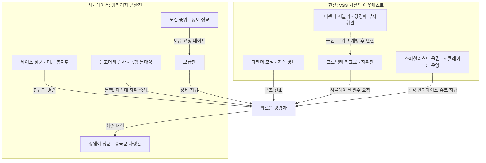
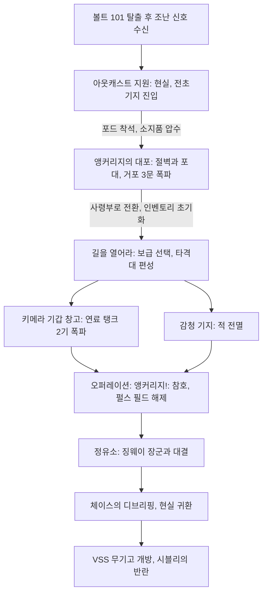
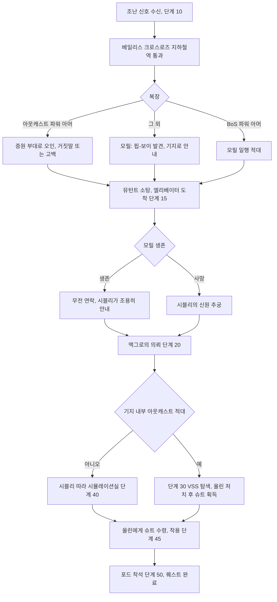
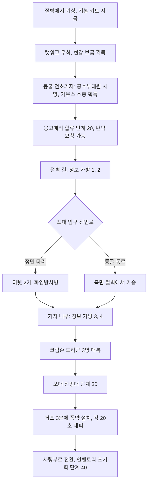
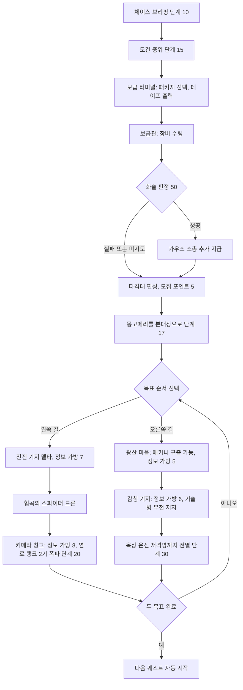
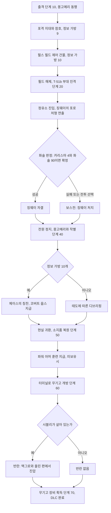
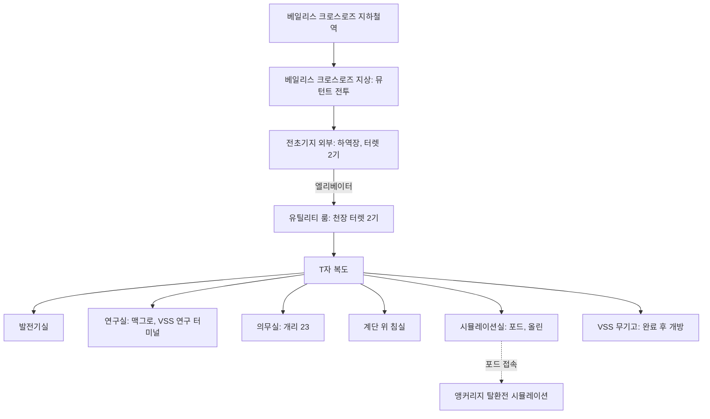
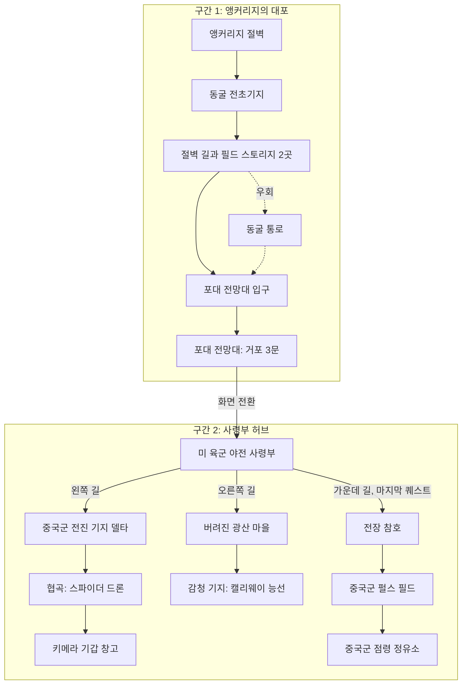
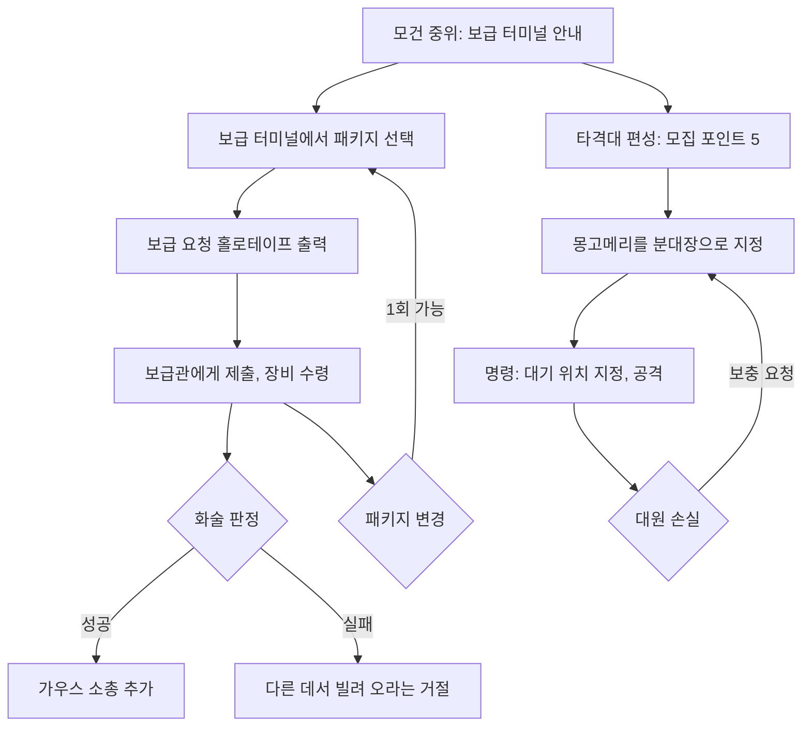
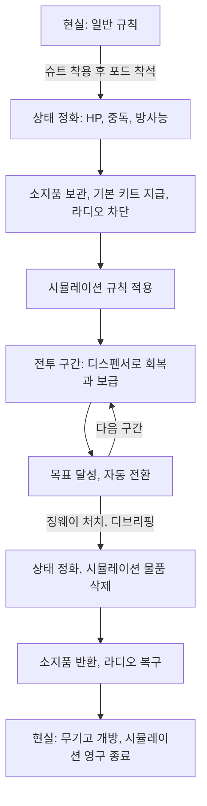

# RD-08a. DLC: 오퍼레이션: 앵커리지

> **폴아웃 3 역기획서 세트** | 문서 ID: RD-08a | 버전: v1.0 | 작성일: 2026-10-11
> **범위**: [OA] 오퍼레이션: 앵커리지(Operation: Anchorage)의 제품 정보, 스토리, 퀘스트 4개 상세(표준 양식), 신규 장소·NPC·장비·퍽·적, 시뮬레이션 규칙, 업적, 설계 분석, 쯔꾸르 이식 메모. 무기·방어구 전체 수치는 [RD-19](19_weapons-ammo.md)·[RD-20](20_armor-apparel.md), 퍽 정본은 [RD-14](14_character-system.md), 적 상세 수치는 [RD-24](24_bestiary.md), 장소 카탈로그는 [RD-13](13_location-catalog.md)이 정본이며 이 문서는 DLC 맥락의 요약과 링크만 둔다.
> **관련 문서**: [RD-01 게임 개요](01_game-overview.md), [RD-03 메인 스토리 1부](03_main-story-part1.md), [RD-06 사이드 퀘스트 2부](06_side-quests-part2.md), [RD-09 팩션](09_factions.md), [RD-10 주요 인물·동료](10_characters-major-companions.md), [RD-13 장소 카탈로그](13_location-catalog.md), [RD-14 캐릭터 시스템](14_character-system.md), [RD-16 전투 시스템](16_combat-system.md), [RD-19 무기·탄약](19_weapons-ammo.md), [RD-20 방어구·의복](20_armor-apparel.md), [RD-23 수집 요소·업적](23_collectibles-achievements.md), [RD-24 크리처·적 도감](24_bestiary.md), [RD-08e DLC: 마더십 제타](08e_dlc-mothership-zeta.md), [RD-26 용어집](26_glossary.md)

---

## 0. 문서 개요

### 0.1 목적
- 폴아웃 3의 첫 번째 애드온 오퍼레이션: 앵커리지를 팬게임 기획의 근거 자료로 쓸 수 있게 구조화한다.
- 이 DLC는 본편 규칙(루팅, 스팀팩(Stimpak), 내구도, 자유 탐험)을 의도적으로 걷어 낸 '규칙 변형 DLC'이므로, 퀘스트 흐름과 함께 **시뮬레이션 규칙**을 데이터화하는 데 중점을 둔다.

### 0.2 요약
- 아웃캐스트(Brotherhood Outcasts)가 점거한 전쟁 전 군수업체 시설에서, 외로운 방랑자(Lone Wanderer)가 핍-보이 3000(Pip-Boy 3000)으로 가상현실 군사 시뮬레이션에 접속해 앵커리지 탈환전(Anchorage Reclamation)을 재체험한다.
- 시뮬레이션 안에서는 소지품이 모두 압수되고, 적 시체는 사라지며, 스팀팩 대신 회복 디스펜서로 회복한다. 장비는 빨갛게 깜빡이는 지정 지점에서만 얻는다.
- 퀘스트는 4개(메인 4, 비표시·반복 없음)이며 완전 선형이다. 중반에 타격대(Strike team) 편성·보급 패키지 선택이라는 '사전 준비' 단계가 들어간다.
- 완주 보상은 현실의 VSS 무기고 개방(가우스 소총, 방한 T-51b 파워 아머, 중국제 스텔스 아머 등)과 파워 아머 훈련(Power Armor Training) 퍽이다. 무기고를 열면 아웃캐스트 내부 반란이 벌어진다.

### 0.3 표기 메모
- 퀘스트명은 번역하고 원제를 병기한다. 최종 퀘스트 「Operation: Anchorage!」는 DLC 이름과 같으므로 「오퍼레이션: 앵커리지!」로 음차해 DLC명과 일치시킨다.
- 같은 장비가 시뮬레이션판(sim version)과 현실판(wasteland version)으로 나뉘어 있다. 이 문서에서는 '시뮬레이션판', '현실판'으로 구분한다.
- 수치는 Nukapedia 코퍼스(2026-08-30판)의 정보상자·퀘스트 단계표·스크립트 전사본 기준이다. 코퍼스에서 확인되지 않는 내용은 `(코퍼스 미확인)`으로 표시한다.
- 퀘스트 단계 설명(핍-보이 목표)은 영어 원문을 함께 적어 이벤트 데이터 이식 시 대조할 수 있게 한다.

---

## 1. DLC 개요표

| 항목 | 내용 |
|---|---|
| 정식 명칭 | 오퍼레이션: 앵커리지(Operation: Anchorage), 태그 `[OA]`, 폴아웃 3의 첫 번째 애드온 |
| 개발 / 배급 | 베데스다 게임 스튜디오(Bethesda Game Studios) / 베데스다 소프트웍스(Bethesda Softworks) |
| 출시일 | PC·Xbox 360: 2009-01-27 / PS3: 2009-10-01 |
| 판본 | 「Fallout 3 Game Add-on Pack」 디스크(PC·Xbox 360, 2009-05-26, 더 피트와 합본) / GOTY 에디션(2009-10-13) 수록 / Steam 2010-07-16 |
| 용량·필요 패치 | 329.1MB / 패치 1.1(PC·Xbox 360), 패치 1.6(PS3) |
| 플랫폼 | PC, Xbox 360, PlayStation 3 |
| 최소 진입 조건 | 볼트 101(Vault 101) 탈출 이후(「탈출!(Escape!)」 완료). 스크립트상 엔클레이브 라디오(Enclave Radio) 신호가 켜진 뒤 60초가 지나면 '아웃캐스트 조난 신호(Outcast distress signal)'가 켜지고 퀘스트 단계 10이 자동 시작됨. 위키 서술 기준 새 게임은 탈출 후 약 3~5분, 진행 중인 세이브는 거의 즉시 수신 |
| 권장 레벨 | 공식 수치 코퍼스 미확인. 참고: 시뮬레이션 주력 적인 중국군 병사는 레벨 3/5/7/10/13의 5단계 레벨 연동, 보스 징웨이 장군은 플레이어 레벨의 10배로 설정됨. 장비 반입이 불가하므로 레벨보다 스킬(소형 화기·에너지 무기·화술·자물쇠 따기)의 영향이 큼 |
| 시작 트리거 | 핍-보이 라디오의 아웃캐스트 조난 신호 → 지도 마커(레드 레이서 공장(Red Racer factory) 부근 베일리스 크로스로즈(Bailey's Crossroads)) |
| 플레이 볼륨 | 퀘스트 4개(메인 4). 현실 지역 3곳(지하철역·지구·전초기지), 시뮬레이션 지역 지도 마커 11곳 + 비표시 3곳. 수집 요소: 정보 가방 10개, 홀로테이프 6개. 플레이 시간 공식 수치는 코퍼스 미확인 |
| 핵심 콘셉트 | "장비를 빼앗긴 채 군사 시뮬레이션 속 역사적 전투를 치르고, 그 대가로 현실의 봉인된 무기고를 연다." 본편의 오픈 월드 탐험 대신 선형 전투 캠페인, 루팅 대신 보급 지점, 동료 대신 분대 지휘 |
| 보상 요약 | 퀘스트 XP 합계 400, 파워 아머 훈련(미보유 시), 코버트 옵스(Covert Ops) 퍽(정보 가방 10개 수집 시), VSS 무기고 품목 |
| 업적·트로피 | 4개, 합계 100G(실버 3, 골드 1) |
| 재방문 | 시뮬레이션은 1회성. 완료 후 다시 앉으면 "You must wear a neural interface suit to start the simulation" 메시지만 나오며 재진입 불가. 현실의 아웃캐스트 전초기지는 계속 방문 가능 |

---

## 2. 스토리 시놉시스 (스포일러 포함)

### 2.1 배경
- **역사 속 사건**: 앵커리지 탈환전은 중미 전쟁(Sino-American War) 중 중국 인민해방군(People's Liberation Army)에게 점령된 알래스카를 미군이 되찾은 전투다. 위키 서술 기준 T-51b 파워 아머가 처음 투입된 2076년 6월부터 중국군이 알래스카에서 완전히 축출된 2077년 1월까지가 해당 기간이다.
- **시뮬레이션의 출처**: 전쟁 전 군수업체 버추얼 스트래티직 솔루션스(Virtual Strategic Solutions, VSS)가 미 육군을 위해 제작했다. 지휘관 콘스탄틴 체이스(Constantine Chase) 장군이 직접 감수하면서 빌드를 거듭 폐기했고, 전초기지 연구 터미널(2077년 8월 15일·9월 6일자 기록)은 체이스가 "느낌이 맞지 않는다"며 빌드를 폐기하고 한 달 사이 18개 빌드를 갈아엎었으며, 결과물이 "현실과 동떨어졌다"고 증언한다. 즉 플레이어가 겪는 전투는 **체이스가 미화한 버전**이다. 버티버드(Vertibird)가 실전 투입된 점, 키메라 전차, 아직 완성되지 않았던 팻맨(Fat Man)의 등장 등이 사실과 어긋나는 대목으로 지적된다.
- **2277년 현재**: 프로텍터 맥그로(Protector McGraw)가 이끄는 아웃캐스트 분견대가 베일리스 크로스로즈 지하의 VSS 시설을 점거했다. 무기고(VSS Armory)는 시뮬레이션을 완료해야 열리고, 시뮬레이션 접속에는 핍-보이 같은 인터페이스 장치가 필요하다. 아웃캐스트는 볼트 108(Vault 108)에서 클론 개리 23(Gary 23)을 납치해 핍-보이를 빼앗으려 했으나, 팔을 잘라 내고도 실패했다(시설 의무실에 개리 23의 시체가 남아 있음).

### 2.2 전개
1. **현실 – 조난 신호**: 디펜더 모릴(Defender Morrill)의 구조 요청 방송을 듣고 베일리스 크로스로즈로 간다. 슈퍼 뮤턴트(Super mutant)와 교전 중인 아웃캐스트를 도와 전초기지 엘리베이터에 도착한다.
2. **현실 – 거래**: 맥그로는 "핍-보이를 가진 사람만 시뮬레이션을 완주해 무기고를 열 수 있다"며 협력을 요청한다. 안전장치가 해제되어 있어 시뮬레이션 속 죽음은 현실의 죽음이다. 스페셜리스트 올린(Specialist Olin)에게 신경 인터페이스 슈트(Neural interface suit)를 받아 입고 시뮬레이션 포드에 앉는다.
3. **시뮬레이션 1부 – 앵커리지의 대포**: 낙하산 침투조의 일원으로 깨어나 벤저민 몽고메리(Benjamin Montgomery) 중사와 합류한다. 아군 전선을 포격하는 중국군 거포 3문을 폭약으로 파괴한다.
4. **시뮬레이션 2부 – 길을 열어라**: 미 육군 야전 사령부로 전환된다. 체이스 장군이 플레이어를 현장 진급시켜 전사한 패터슨(Patterson)의 타격대를 맡긴다. 키메라(Chimera) 전차의 연료 탱크를 폭파하고, 중국군 감청 기지를 장악한다.
5. **시뮬레이션 3부 – 오퍼레이션: 앵커리지!**: 참호를 돌파해 펄스 필드(pulse field)를 끄면 방한 T-51b 파워 아머 부대가 팻맨(Fat Man)으로 정유소 정문을 부순다. 정유소 안뜰에서 미군 포로를 처형하는 징웨이(Jingwei) 장군과 대면한다. 화술로 자결을 유도하거나 전투로 쓰러뜨린다. 모든 인물이 정지한 가운데 체이스가 나타나 훈련 종료를 선언한다.
6. **현실 – 무기고와 반란**: 포드에서 깨어나 무기고를 연다. 장비를 외부인과 나누는 데 반대해 온 디펜더 시블리(Defender Sibley)가 대부분의 아웃캐스트와 함께 맥그로·올린에게 반기를 든다. 플레이어는 반란군에게도 공격받으며, 맥그로 편에서 싸운 뒤 무기고 장비를 가져간다. 올린이 살아남으면 수리 서비스를 제공한다.

### 2.3 주제와 연출 포인트
- **미화된 전쟁 vs 실제 기록**: 체이스의 시뮬레이션은 영웅적 승리를 그리지만, 사령부 홀로테이프는 군의관 에이드리언 아다미(Adrienn Adami)가 명령에 따라 실험 단계 약물 사이코(Psycho)를 병사에게 투여한 사실을 기록한다. 길가에서는 미군 병사가 중국군 포로를 처형하는 장면도 연출된다.
- **기념비의 기원**: 사령부에서 종군기자가 병사 세 명의 포즈를 찍으며 "언젠가 누가 이걸로 동상을 만들지도 모른다"고 말한다. 이 포즈는 본편 워싱턴 D.C.의 앵커리지 기념관(Anchorage Memorial) 동상과 같다.
- **본편과의 연결**: 트랜퀼리티 레인(Tranquility Lane)의 비상 탈출 터미널에서 체이스가 스타니슬라우스 브라운 박사에게 보낸 편지(앵커리지 시뮬레이션 코드 관련)를 읽을 수 있고, 페일세이프를 실행하면 중국군 특공대가 마을을 습격한다. 맥그로와의 첫 대화에는 이 경험을 떠올리는 선택지 "Great, more psychotic little girls."("좋네, 또 정신 나간 꼬마 여자애들이겠군.")가 있다. 체이스는 리버티 프라임(Liberty Prime) 개발을 발주한 인물로도 본편 시타델(The Citadel) 터미널에 등장한다. 상세 연결은 [RD-02](02_world-and-lore.md)·[RD-03](03_main-story-part1.md) 참조.

### 2.4 인물 관계도

---

## 3. 퀘스트 상세

### 3.0 퀘스트 목록과 전체 흐름
허브 문서 `Fallout 3 quests`의 *Operation: Anchorage* 섹션에는 메인 퀘스트 4개만 있다(비표시·반복 퀘스트 없음).

| # | 영문명 | 한국어명 | 유형 | 퀘스트 ID (EDID) | 의뢰인 | 보상 | 업적 |
|---|---|---|---|---|---|---|---|
| 1 | Aiding the Outcasts | 아웃캐스트 지원 | 메인 | `0009be` (DLC02OA1) | 아웃캐스트 조난 신호 | 100 XP | 20G / 실버 |
| 2 | The Guns of Anchorage | 앵커리지의 대포 | 메인 | `0009bf` (DLC02OA2) | 몽고메리 중사 | 100 XP | 20G / 실버 |
| 3 | Paving the Way | 길을 열어라 | 메인 | `0009c0` (DLC02OA3) | 체이스 장군 | 100 XP | 20G / 실버 |
| 4 | Operation: Anchorage! | 오퍼레이션: 앵커리지! | 메인 | `0014f6` (DLC02OA4) | 체이스 장군 | 100 XP, 파워 아머 훈련(미보유 시), 코버트 옵스(조건부), VSS 무기고 | 40G / 골드 |

- 퀘스트 ID의 앞 두 자리는 DLC 로드 순서에 따라 바뀌므로 위키 표기(`{{DLC ID}}`)대로 하위 6자리만 적는다.
- 네 퀘스트는 완전한 직렬 구조다. 앞 퀘스트가 끝나는 순간 다음 퀘스트가 자동 시작되며 중간에 시뮬레이션 밖으로 나갈 수 없다(퀘스트 1 종료 = 포드 착석, 퀘스트 4의 단계 50 = 현실 귀환).

---

### 3.1 아웃캐스트 지원 (Aiding the Outcasts)

#### 기본 정보
| 항목 | 내용 |
|---|---|
| 영문명 / 한국어명 | Aiding the Outcasts / 아웃캐스트 지원 |
| 유형 | [OA] 메인 퀘스트 (1/4) |
| 퀘스트 ID | `0009be` (EDID `DLC02OA1`) |
| 의뢰인 | 아웃캐스트 조난 신호(디펜더 모릴의 방송) |
| 시작 조건 | 볼트 101 탈출 후 신호 활성화 시 자동 추가(단계 10). 스크립트상 엔클레이브 라디오가 켜진 시점(볼트 탈출 이후), 또는 라디오가 꺼진 후반부라면 「아메리칸 드림」(MQ09) 단계 60 이후를 기점으로 60초 타이머 |
| 관련 장소 | 베일리스 크로스로즈 지하철역(Bailey's Crossroads Metro), 베일리스 크로스로즈, 아웃캐스트 전초기지(Outcast outpost) |
| 선행 / 후행 | 없음 / 「앵커리지의 대포」 |
| 보상 | 100 XP |
| 카르마 영향 | 퀘스트 자체 변동 없음(아웃캐스트를 죽이는 행동은 일반 규칙 적용) |
| 업적·트로피 | Aiding the Outcasts — 20G / 실버 |

#### 개요
- 방송: "This is a high-priority message, backup is needed at our location." — "최우선 메시지다. 이곳에 지원이 필요하다."(디펜더 모릴)
- 아웃캐스트는 VSS 무기고를 열기 위해 핍-보이를 가진 외부인이 필요하다. 플레이어는 슈퍼 뮤턴트에게 시달리는 분견대를 돕고, 지휘관 맥그로에게서 시뮬레이션 참가를 의뢰받는다.

#### 진행 단계
| 단계 | 핍-보이 목표 (원문) | 플레이어 행동과 이벤트 |
|---|---|---|
| 10 | Investigate the Outcast Radio Signal | 레드 레이서 공장 북동쪽 베일리스 크로스로즈 지하철역을 지나 베일리스 크로스로즈로 이동. 지하철역에는 야생 구울(Feral ghoul)이 소수 있음 |
| 15 | Find and Enter the Outcast Base | 아웃캐스트(모릴 + 2명)와 슈퍼 뮤턴트의 교전 지원. 건물을 지나 Mark IV 자동 터렛(Automated turret)이 지키는 전초기지 엘리베이터에 도착. 모릴과 대화 |
| 20 | Speak with the Outcast Leader | 엘리베이터 하강(대화 연출) → 시블리가 맥그로에게 안내 → 맥그로의 의뢰 |
| 30 | (Optional) Explore the VSS Outpost | 기지 내부 아웃캐스트를 적대시했을 때만 표시되는 대체 목표. 마커가 올린을 가리킴 |
| 40 | Follow Sibley to the Simulator Room | 시블리를 따라 시뮬레이션실로 이동, 올린과 대화 |
| 45 | Put on the Neural Interface Suit | 올린에게 받은 신경 인터페이스 슈트 착용(첫 착용 시 자동 저장 생성) |
| 50 | Enter the simulation pod | 포드에 앉으면 퀘스트 종료, 「앵커리지의 대포」 시작 |

#### 분기와 해결 방법
- **복장 분기(아웃캐스트 파워 아머)**
  - 아웃캐스트 파워 아머와 헬멧을 입고 베일리스 크로스로즈에 도착하면 모릴이 '증원 부대'로 오인한다. 거짓말로 맞장구치기, 상관 행세하며 지시하기, 사실대로 밝히기 중 선택한다. 사실을 밝히면 아머 입수 경위를 추궁당하고 답에 따라 적대화된다.
  - 현장에서 죽은 아웃캐스트에게 벗긴 아머라면 모릴이 이를 목격하고 분노한다. 아웃캐스트를 죽여 아머를 얻었다고 인정하면 영구 적대.
  - 헬멧 없이 아머만 입으면 모릴이 출처를 묻는다. 고유 아이템인 린든의 아웃캐스트 파워 아머는 이 효과가 없다.
  - BoS(브라더후드 오브 스틸, Brotherhood of Steel) 파워 아머를 입고 가면 모릴 일행이 적대한다.
  - 아웃캐스트 복장으로 들어가면 맥그로가 정체를 알아챈 뒤에도 일반 NPC 인사말은 플레이어를 아웃캐스트로 부른다.
- **모릴 생사 분기**: 고레벨에서는 모릴 일행이 전초기지 도착 전에 전사하기 쉽다. 모릴이 살아 있으면 무전으로 미리 알려 엘리베이터에서 '핍-보이만 빼앗자'는 불평과 시블리의 제지가 들리고, 시블리가 말없이 안내한다. 모릴이 죽었으면 시블리가 신원을 추궁한다(아웃캐스트 파워 아머 착용 또는 블랙 위도우(Black Widow) 퍽 선택지로 태도가 누그러짐).
- **맥그로 대면 분기**: 시블리를 따라가면 맥그로가 시블리를 칭찬하고 넘어가며, 앞질러 가면 시블리가 감시 소홀로 질책받는 대화가 나온다. 특수 선택지는 다음과 같다.
  - 「아버지의 발자취」를 거쳐 트랜퀼리티 레인을 경험했다면 "또 정신 나간 꼬마 여자애들" 선택지
  - 인디펜던스 요새(Fort Independence)의 아웃캐스트를 죽였다면 그 사실을 들먹이는 도발 선택지(아웃캐스트 적대화)
  - 캐스딘(Casdin)의 신임을 얻었다면 "인디펜던스 요새에서 만난 적 있다" 선택지
- **올린 대화**: 레이디 킬러(Lady Killer) 퍽 선택지로 긴장한 올린을 진정시키고 아웃캐스트·시뮬레이션에 대한 추가 정보를 얻는다.
- **적대 루트**: 기지 내부 아웃캐스트가 적대화돼도 퀘스트는 깨지지 않는다. 단계 30으로 전환되고 올린을 쓰러뜨려 신경 인터페이스 슈트를 얻으면 시뮬레이션에 들어갈 수 있다. 시뮬레이션 전에 아웃캐스트를 공격했다면 퇴장 후에도 적대가 유지된다.

#### 결과와 후일담
- 포드 착석 순간의 스크립트 처리: HP 전부 회복, 모든 금단 증상 제거와 중독 해제, 방사능 1000 회복(사실상 0), 인벤토리 전체를 보관 컨테이너로 이동하고 시뮬레이션 기본 키트 지급(9.1절 참조), 갤럭시 뉴스 라디오(GNR)·엔클레이브 라디오·아가사의 방송국(Agatha's Station)·볼트 101 외부 방송 비활성화.
- 동료는 엘리베이터로 내려가지 않고 지상에 남는다. 지상은 슈퍼 뮤턴트가 리스폰되므로 미리 해산하는 편이 안전하다.

#### 흐름도

#### 관련 NPC·아이템·대사 포인트, 비고
- NPC: 디펜더 모릴, 디펜더 시블리, 프로텍터 맥그로, 스페셜리스트 올린, 무명 아웃캐스트, 개리 23(사망, 의무실 Easy 자물쇠).
- 아이템: 신경 인터페이스 슈트(퀘스트 중 무게 0의 퀘스트 아이템판 → 퇴장 후 무게 10의 일반판으로 교체).
- 터미널: 맥그로의 방에 Very Easy 해킹 'VSS 연구 터미널'(해킹해도 카르마 손실 없음) — 시뮬레이션 제작 경위.
- 브로큰 스틸(Broken Steel)이 설치되어 있으면 지상 경로에서 슈퍼 뮤턴트 오버로드 3마리(슈퍼 슬레지, 개틀링 레이저, 트라이빔 레이저 소총 소지)가 나올 수 있다.
- 아웃캐스트를 오사하면 즉시 적대화되므로 난전에서 주의가 필요하다.

#### 설계 분석
- '조난 신호 → 현장 전투 → 거래'라는 3단 도입으로 DLC 콘셉트(핍-보이가 열쇠)를 빠르게 설명한다.
- 복장·과거 행적(인디펜던스 요새, 캐스딘, 트랜퀼리티 레인)에 반응하는 선택지가 많아 짧은 도입부에서도 본편 진행을 인정받는 느낌을 준다.
- 핵심 NPC가 적대돼도 '시체에서 슈트 획득'으로 우회가 가능해 진행 불능을 막았다.

---

### 3.2 앵커리지의 대포 (The Guns of Anchorage)

#### 기본 정보
| 항목 | 내용 |
|---|---|
| 영문명 / 한국어명 | The Guns of Anchorage / 앵커리지의 대포 |
| 유형 | [OA] 메인 퀘스트 (2/4) |
| 퀘스트 ID | `0009bf` (EDID `DLC02OA2`) |
| 의뢰인 | 벤저민 몽고메리 중사 |
| 시작 조건 | 「아웃캐스트 지원」에서 포드 착석 시 자동 |
| 관련 장소 | 앵커리지 절벽(Anchorage cliffs), 동굴 전초기지(Cave outpost), 동굴 통로(Cave passage), 포대 전망대 입구(Artillery overlook entrance), 포대 전망대(Artillery overlook) |
| 선행 / 후행 | 「아웃캐스트 지원」 / 「길을 열어라」 |
| 보상 | 100 XP |
| 카르마 영향 | 없음 |
| 업적·트로피 | The Guns of Anchorage — 20G / 실버 |

#### 개요
- 제목과 전개는 소설·영화 「나바론 요새(The Guns of Navarone)」의 패러디다. 낙하산 침투조가 적진의 거포를 파괴한다.
- 포탄에는 914mm 표기가 있어 실존 거포 '리틀 데이비드'를 참고한 것으로 보인다(위키 비하인드).
- 시뮬레이션 규칙(빨간 깜빡임 아이템, 회복·탄약 디스펜서, 사라지는 시체)을 처음 익히는 튜토리얼 겸 첫 전투 구간이다.

#### 진행 단계
| 단계 | 핍-보이 목표 (원문) | 플레이어 행동과 이벤트 |
|---|---|---|
| 10 | Infiltrate the Chinese Artillery Site | 절벽에서 몽고메리가 깨움("Wake up...Ole' Benji's got something for ya!" — "일어나, 벤지 아저씨가 줄 게 있어!"). 몽고메리는 절벽을 타고 먼저 올라가고, 플레이어는 우회로(캣워크·다리·파이프)로 이동 |
| 20 | Rendezvous with Sergeant Montgomery | 동굴 전초기지에서 낙하산에 걸린 미군 공수부대원이 사살되며 가우스 소총을 떨어뜨림. 위층에서 몽고메리가 천장으로 내려와 합류, 이후 동행 |
| 30 | Destroy all three Artillery Guns | 포대 전망대 입구 기지 돌파 → 포대 전망대에서 거포 3문에 폭약 설치 |
| 40 | Report to General Chase at the U.S. Field Headquarters | 세 번째 거포 파괴 후 자동으로 야전 사령부로 전환되며 완료 |

#### 분기와 해결 방법
- **시작 장비(스크립트 지급)**: 소음 10mm 권총, 트렌치 나이프, 폭약 3개, 10mm 탄 60발, 방한 전투 아머·헬멧, 스텔스 보이(Stealth Boy) 1개, 머리핀(Bobby pin) 50개. 모두 시뮬레이션판이다.
- **현장 보급**: 절벽 초입에 회복 디스펜서·파편 지뢰·저격소총, 작은 건물에 탄약·폭발물·중국제 돌격소총, 부서진 다리 위 상자에 스텔스 보이, 동굴 남동쪽 구석에 마이크로퓨전 셀·탄약 디스펜서·회복 디스펜서.
- **몽고메리 탄약 지원**: 합류 대화에서 탄약을 요청하면 5.56mm 탄 50발, 10mm 탄 60발, 마이크로퓨전 셀 10개를 받는다(이미 상한이어도 지급).
- **포대 입구 공략 루트**
  - 정면: 다리를 건너면 벙커 위 중국군 2명과 좌측 Mark III 터렛 2기가 사격하고, 좌측 벙커에 접근하면 화염방사병이 스폰된다.
  - 우회: 다리 직전 오른쪽 빨간 문으로 '동굴 통로'에 들어가 계단을 오르면 기지 오른쪽 절벽 위로 나온다. 터렛 사각에서 적을 정리할 수 있다.
- **기지 내부**: 이어지는 전투 끝에 포탄이 쌓인 큰 방에서 크림슨 드라군(Crimson Dragoon) 3명이 중국 장교도를 들고 은신 상태로 기습한다.
- **스텔스 적과 V.A.T.S.**: 은신 중인 중국군은 V.A.T.S.(볼트-텍 보조 조준 시스템) 명중률이 0%다. 수동 사격으로 은신을 벗기면 V.A.T.S. 사용이 가능하며, 수류탄은 은신 중에도 조준할 수 있다.
- **거포 파괴**: 각 거포는 일반 병사·화염방사병·저격병(저격소총을 든 크림슨 드라군)이 지킨다. 거포 뒤쪽 지점에 폭약을 설치하면 20초 안에 거리를 벌려야 한다. 옆 벙커 안도 피해를 막지 못한다.
- **정보 가방(코버트 옵스 조건)**: 이 퀘스트에서 4개를 얻을 수 있으며 **되돌아갈 수 없다**.
  - #1 파이프를 건넌 벙커의 'Door to Field Storage'(Very Easy) 책상 밑 + 홀로테이프 「Bombardment」
  - #2 다리 두 개를 건넌 절벽의 'Door to Field Storage'(Very Easy) + 홀로테이프 「Goodbye」
  - #3 포대 입구 기지 첫 계단 위 복도의 Very Easy 문 + 홀로테이프 「Invasion」 + 스텔스 보이
  - #4 키메라 행렬이 내려다보이는 복도 다음 방(Very Easy, 수류탄 2개·터미널)
  - 추가로 계단 위 Very Easy 문 안에 홀로테이프 「Overrun」
  - 몽고메리의 장소 대사("We're crossing that pipe?" 등)가 지나친 지점을 알려 주는 청각 단서 역할을 한다.

#### 결과와 후일담
- 세 번째 거포가 무너지면 화면이 전환되며 인벤토리가 비워지고(가우스 소총 포함), 야전 사령부의 체이스 장군 앞으로 이동한다.
- 이 구간(절벽·포대)은 이후 다시 방문할 수 없다.

#### 흐름도

#### 관련 NPC·아이템·대사 포인트, 비고
- NPC: 몽고메리 중사(동행, 필수 NPC), 미군 공수부대원(사망 연출), 중국군 병사·화염방사병·저격병, 크림슨 드라군.
- 아이템: 폭약(Explosive charge, 무게 0, 3개 지급), 가우스 소총(시뮬레이션판), 정보 가방 4개, 홀로테이프 4개.
- 대사 포인트: 포대 진입 후 몽고메리가 "포탄이 떨어져 가는 걸 보니 올 필요도 없었나"라고 말했다가 거대한 포탄 저장실에서 "그래, 내가 틀렸다"고 정정하는 연출이 있다.
- 비고: 이 퀘스트의 레벨 디자인에는 레벨 디자이너 대릴 브리그너(Daryl Brigner)가 참여했다(스크립트 주석 근거).

#### 설계 분석
- 오르막 일방통행 동선(절벽 → 기지 → 정상 포대)과 정보 가방의 '되돌아갈 수 없음' 규칙이 결합해 탐색 욕구와 전진 압박을 동시에 준다.
- 몽고메리의 위치별 대사는 내비게이션 보조 장치이자 캐릭터 연출이다.
- 마지막 목표(폭약 설치 + 20초 대피)는 본편에 드문 '시한 목표'로, 다수 적이 지키는 포대 3곳을 순회하게 해 전투 밀도를 높인다.

---

### 3.3 길을 열어라 (Paving the Way)

#### 기본 정보
| 항목 | 내용 |
|---|---|
| 영문명 / 한국어명 | Paving the Way / 길을 열어라 |
| 유형 | [OA] 메인 퀘스트 (3/4) |
| 퀘스트 ID | `0009c0` (EDID `DLC02OA3`) |
| 의뢰인 | 체이스 장군 |
| 시작 조건 | 「앵커리지의 대포」 완료 시 자동 |
| 관련 장소 | 미 육군 야전 사령부(U.S. Army field headquarters), 중국군 전진 기지 델타(Chinese Forward Camp Delta), 키메라 기갑 창고(Chimera armor depot), 버려진 광산 마을(Abandoned mining town), 감청 기지(Listening post, 캘리웨이 능선) |
| 선행 / 후행 | 「앵커리지의 대포」 / 「오퍼레이션: 앵커리지!」 |
| 보상 | 100 XP. 퀘스트 중 미군 포로 구출 시 50 XP(카르마 변동 없음) |
| 카르마 영향 | 없음 |
| 업적·트로피 | Paving the Way — 20G / 실버 |

#### 개요
- 모건 중위의 첫 대사 "So... you're in charge of Patterson's Suicide Squad, huh?" — "그래서… 당신이 패터슨의 자살 특공대를 맡았다고?"
- 체이스가 플레이어를 현장 진급시켜 패터슨의 타격대를 맡기고, 정유소 총공격 전에 해결할 목표 3개(키메라 연료 탱크, 감청 기지, 펄스 필드)를 제시한다. 이 퀘스트는 앞의 두 목표를 다루며, 펄스 필드는 마지막 퀘스트로 넘어간다.

#### 진행 단계
| 단계 | 핍-보이 목표 (원문) | 플레이어 행동과 이벤트 |
|---|---|---|
| 10 | Listen to General Chase's Briefing | 체이스의 브리핑. 지도 앞에서 세 목표 설명. 펄스 필드는 마지막에 하라는 지시 |
| 15 | Speak with Lieutenant Morgan | 지휘 텐트의 모건 중위에게 목표별 상세 정보, 보급 요청 절차 안내 |
| 17 | (Optional) Speak to Sergeant Montgomery to command your Strike Team | 보급 터미널에서 타격대 편성 → 몽고메리를 분대장으로 지정 |
| 20 | Destroy two Fuel Tanks at the Chimera Depot | 왼쪽 길: 전진 기지 델타 → 협곡 → 키메라 기갑 창고, 연료 탱크 2기 폭파 |
| 30 | Secure the Chinese Listening Post | 오른쪽 길: 광산 마을 → 감청 기지, 내부·옥상 적 전멸. 두 목표를 모두 끝내면 완료 |

#### 분기와 해결 방법
- **보급 패키지 선택(보급 요청 홀로테이프)**: 지휘 텐트의 보급 터미널에서 패키지를 고르면 테이프가 나오고, 보급관(Quartermaster)에게 주면 장비를 받는다. 패키지 변경은 1회만 가능하다.

  | 패키지 | English | 구성 |
  |---|---|---|
  | 근접 돌격 | Close assault | 파워 피스트 1, 10mm 권총 1, 전투 산탄총 1, 파편 수류탄 8, 파편 지뢰 8 |
  | 중화기 | Heavy weapons | 미사일 발사기 1, 10mm 기관단총 1 |
  | 저격 | Sniper | 저격소총 1(.308탄 24발), 10mm 권총 1 |
  | 화력조 | Fire team | 돌격소총 1, 트렌치 나이프 1, 파편 수류탄 12 |

- **보급관 화술 판정**: "The stuff you have is okay, but I need something with more... punch." 선택지로 화술 판정에 성공하면 포대 파괴 공적을 이유로 스코프 달린 가우스 소총과 탄약을 추가로 받는다("If anyone asks, it fell off a truck." — "누가 물으면 트럭에서 떨어졌다고 해."). 가우스 소총 문서 기준 **화술 50 이상** 필요.
- **타격대 편성**: 모집 포인트(recruitment marker) 5점으로 구성원을 고른다(구성원과 비용은 5.2절, 9.4절). 한 번 확정하면 터미널에서 다시 바꿀 수 없고, 전사하거나 해산한 인원은 몽고메리를 통해 보충 요청한다. 명령은 몽고메리를 통해 '대기 위치 지정 / 공격'으로 단순화되어 있다.
- **목표 순서**: 두 목표는 순서 자유다. 사령부 출구에서 왼쪽 길은 키메라 창고, 오른쪽 길은 감청 기지, 가운데 길은 펄스 필드·정유소로 이어진다. 두 목표 전에 펄스 필드에 접근하면 포격으로 즉사한다.
- **키메라 창고 루트**
  - 출구 근처에서 미군 병사가 중국군 포로 4명을 권총으로 처형하는 장면이 나온다. 앞쪽 모래주머니에 중국군 특공대 모자(Chinese commando hat)가 있다.
  - 전진 기지 델타: 텐트 3동, 병사 약 8명과 경비견. 망루가 있는 두 번째 캠프 왼쪽 앞 텐트에 정보 가방 #7. 미군 인질 2명을 잡은 병사가 있다.
  - 얼어붙은 호수 뒤 협곡에는 스파이더 드론(Spider drone)이 몰려 있다.
  - 창고: 키메라 전차 1대와 병력. 입구 오른쪽 철제 오두막 무전기 옆에 정보 가방 #8. 중화기 패키지의 미사일 발사기나 파편 수류탄이 유효하다. 연료 탱크 2기에 폭약을 붙이면 폭발 후 사령부로 자동 귀환한다.
- **감청 기지 루트**
  - 광산 마을 입구 열차 차량 뒤에서 미군 매키니(McKinney)가 동료의 경고를 무시하고 고개를 내밀다 저격당하는 연출이 있다. 저격수를 먼저 쓰러뜨리면 매키니가 살아서 합류한다.
  - 크림슨 드라군, 저격병, 미사일 발사기를 든 로켓병이 배치되어 있다. 첫 폭격 건물 북서쪽 상자 위에 정보 가방 #5.
  - 감청 기지 내부: 계단이 있는 방의 계단 밑 선반에 정보 가방 #6. 기술병은 접근해도 일을 계속하지만, 무전기(HAM radio)에 도달하면 증원을 불러 옥상에 드라군 분대가 나타난다. 옥상의 은신 저격병 2명까지 처치해야 목표가 끝난다.
- **포로 구출**: 중국군에 붙잡힌 미군 포로를 풀어 주면 50 XP를 받는다(카르마 변동 없음). 중국군 포로에게는 말을 걸어도 대사가 없다.

#### 결과와 후일담
- 두 목표 완료 시 자동으로 「오퍼레이션: 앵커리지!」가 시작된다.
- 첫 목표를 마치고 사령부로 돌아오면 종군기자가 병사들에게 포즈를 요청해 사진을 찍는다. 이 장면이 앵커리지 기념관 동상의 원형이다.
- 키메라 창고 파괴 후 모건은 "감청 기지를 잡으니 중국 폭격기가 제자리만 돈다"는 식으로 전황 변화를 보고한다(목표 달성의 결과를 대사로 피드백).

#### 흐름도

#### 관련 NPC·아이템·대사 포인트, 비고
- NPC: 체이스 장군, 모건 중위, 보급관, 몽고메리 중사, 타격대원, 아다미 박사(의무 텐트), 종군기자, 미군 정비병, 매키니.
- 아이템: 보급 요청 홀로테이프(4종), 폭약, 정보 가방 4개(#5~#8), 홀로테이프 「I'm Okay」(지휘 텐트)·「Psycho」(아다미의 텐트).
- 보급 요청 테이프는 퀘스트 아이템이라 보급관에게 내지 않으면 현실로 가지고 나올 수 있고, 이후 제거되지 않는다.
- 보급관은 시뮬레이션에서 유일하게 죽여도 시체가 사라지지 않는 NPC다. 보급관을 죽이면 몽고메리가 적대하고 정비병이 몽고메리를 공격한다.

#### 설계 분석
- 본편에 없던 **출격 전 준비 단계**(로드아웃 선택 + 분대 편성)를 도입해, 선형 캠페인에 전략 선택의 맛을 더했다. 다만 명령 체계가 '대기/공격'뿐이고 분대원 AI가 단순해 실제 체감 차이는 장비 선택 쪽이 크다.
- 두 목표의 순서 자유는 작은 '허브 앤 스포크' 구조로, 완전 선형인 앞뒤 퀘스트 사이에서 숨 쉴 틈을 준다.
- 포로 처형, 사이코 홀로테이프 같은 장면을 동선 위에 배치해 '체이스의 영웅담' 이면을 플레이어가 스스로 발견하게 했다.

---

### 3.4 오퍼레이션: 앵커리지! (Operation: Anchorage!)

#### 기본 정보
| 항목 | 내용 |
|---|---|
| 영문명 / 한국어명 | Operation: Anchorage! / 오퍼레이션: 앵커리지! |
| 유형 | [OA] 메인 퀘스트 (4/4, 최종) |
| 퀘스트 ID | `0014f6` (EDID `DLC02OA4`) |
| 의뢰인 | 체이스 장군 |
| 시작 조건 | 「길을 열어라」의 두 목표 완료 시 자동 |
| 관련 장소 | 전장 참호(Battlefield trenches), 중국군 펄스 필드(Chinese pulse field), 중국군 점령 정유소(Chinese occupied refinery), 아웃캐스트 전초기지 |
| 선행 / 후행 | 「길을 열어라」 / 없음(DLC 종료) |
| 보상 | 100 XP, 파워 아머 훈련 퍽(미보유 시), 코버트 옵스 퍽(정보 가방 10개 수집 시), VSS 무기고 개방(6.1절) |
| 카르마 영향 | 퀘스트 자체 변동 없음. 반란 진압 시 반란군 처치는 적대 대상이라 일반 규칙 적용 |
| 업적·트로피 | Operation: Anchorage! — 40G / 골드 |

#### 개요
- 체이스의 출격 명령: "Let's wrap this thing up, soldier. We're cold, we're tired and we want our goddamn oil back!" — "이제 끝내자, 병사. 우린 춥고 지쳤고, 빌어먹을 석유를 되찾고 싶다!"
- 펄스 필드는 파워 아머를 입은 병사를 막는 방어선이다. 맨몸의 플레이어가 제어 건물에서 필드를 끄면 T-51b 부대가 진격하고, 정유소에서 중국군 사령관 징웨이와 최후의 대면이 벌어진다. 이후 현실로 돌아와 무기고를 연다.

#### 진행 단계
| 단계 | 핍-보이 목표 (원문) | 플레이어 행동과 이벤트 |
|---|---|---|
| 10 | Disable the Pulse Field | 가운데 길로 출격. 박격포 포격 지대 → 참호 → 펄스 필드 맨 오른쪽 제어 건물의 스위치 조작 |
| 11 | (Optional) Speak to Sergeant Montgomery to command your Strike Team | 데이터상 타격대 지휘 목표가 있으나, 위키 진행 서술 기준 이 퀘스트는 몽고메리 단독 동행이 기본 |
| 20 | Enter the Chinese Compound | 스위치 후 몽고메리의 무전 → T-51b 부대(팻맨 장비)가 터렛과 정문 파괴 → 정유소 진입 |
| 30 | Kill General Jingwei | 진입 연출: 미군과 중국군의 난전 속에서 징웨이가 미군 포로를 쇼크소드로 처형 → 대화 → 화술 또는 전투 |
| 40 | Report to General Chase for debriefing | 징웨이 사망 시 몽고메리를 제외한 전원이 정지. 몽고메리와 마지막 대화 가능. 체이스가 나타나 디브리핑 |
| 50 | Exit the Simulation | 현실 귀환(포드). 소지품 복원 |
| 60 | Access the VSS Armory | 같은 층 반대편 터미널에서 무기고 개방(아웃캐스트가 이미 대기) |
| 70 | Enter the VSS Armory and take whatever you need | 무기고 진입 → 시블리의 반란 → 장비 획득. 완료 |

#### 분기와 해결 방법
- **참호와 펄스 필드**: 참호 첫 번째 적 구간의 판잣집(회복 디스펜서, 포로 미군)에서 정보 가방 #9, 펄스 필드 제어 건물 스위치 왼쪽 상자 위에서 정보 가방 #10을 얻는다. 화염방사병은 일정 거리 안에 들어와야 스폰된다(원거리 수류탄 처리 방지). 펄스 필드에서 전사하는 파워 아머 병사는 연출용이며 대화하면 작별 인사만 할 수 있다.
- **징웨이 대결 – 화술 루트**: 대화에서 "You've already lost, General. Don't throw away your dignity."("이미 진 싸움이오, 장군. 품위를 버리지 마시오.") 계열 화술 판정에 성공하면 징웨이가 자신의 검으로 자결한다. 위키 기준 **카리스마 4 + 화술 90이면 성공률 100%**. 실패 시 "Your head will be mounted as a trophy, dog!"("네 머리를 전리품으로 걸어 주마, 개 같은 놈!")와 함께 전투.
- **징웨이 대결 – 전투 루트**: 징웨이는 플레이어 레벨의 10배 레벨, HP 295~1245(브로큰 스틸 설치 시 최대 1745), 군복과 모자의 DR 합계 31인 보스다. 쇼크소드 피해가 크다. 주변에서는 T-51b 부대와 중국군이 계속 교전한다. 전투 루트에서는 시간이 지나면 T-51b 부대가 플레이어에게 적대하는 현상이 보고되어 있다(버그 여부 불명).
- **체이스의 디브리핑 변형**: 시뮬레이션 중 체이스에게 한 태도(경례·존중 vs "이건 시뮬레이션일 뿐" 같은 무례)와 정보 가방 10개 수집 여부로 대사가 달라진다. 무례했어도 정보를 다 모았으면 "태도는 눈감아 주겠다"고 하고, 정보를 다 모았으면 코버트 옵스 퍽이 지급된다.
- **현실 귀환 처리**: 포드로 돌아오는 순간 HP 리셋, 금단·중독 해제, 방사능 제거가 다시 적용되고, 보관 컨테이너의 소지품이 모두 돌아온다. 무게 10짜리 신경 인터페이스 슈트가 지급·착용된다. 꺼 두었던 라디오 방송은 본편 진행 상태에 맞춰 다시 켜진다.
- **시블리의 반란 분기**
  - 기본: 무기고를 열면 시블리가 "외부인에게 나눠 줄 수 없다"며 맥그로와 충돌하고, 시블리와 대부분의 아웃캐스트가 맥그로·올린을 공격한다. 플레이어도 반란군의 표적이 된다.
  - 맥그로 편 진압: 맥그로·올린을 지키며 반란군을 처치한다. 맥그로가 살면 감사 대사를 하고, 올린이 살면 수리 서비스를 제공한다(최대 내구도 50%까지, 수리 스킬 51 상당).
  - 선제 공격 주의: 반란군이 맥그로를 공격하기 전에 먼저 쏘면 모든 아웃캐스트가 적대한다(조준점이 빨갛게 바뀌는 시점이 기준).
  - 반란 회피: 시뮬레이션 진입 전에 아웃캐스트를 적대시키지 않는 방식(기습·폭발물 심기·미스터 샌드맨(Mister Sandman) 등)으로 시블리를 죽이면 반란 스크립트가 실행되지 않아 전투 없이 무기고를 가져간다. 이때도 올린은 반란이 있었던 것처럼 말한다.
  - 반란 중 아웃캐스트가 무기고로 뛰어들어 유니크 장비를 집어 갈 수 있다.

#### 결과와 후일담
- 파워 아머 훈련: 미보유 시 시뮬레이션 완료로 지급된다. 본편 경로(「흔적을 따라서」 중 엘더 라이언(Elder Lyons)에게 허가를 받고 시타델의 팔라딘 거니(Gunny)에게 훈련받기)보다 훨씬 이른 시점에 파워 아머를 입을 수 있는 경로다.
- VSS 무기고 보상(6.1절): 방한 T-51b 파워 아머·헬멧, 중국제 스텔스 아머, 징웨이의 쇼크소드, 트렌치 나이프, 가우스 소총, 미니 누크(Mini nuke)와 일반 무기·탄약·폭발물. 무기고 물건은 소유권이 없어 가져가도 카르마 손실이 없다.
- 시뮬레이션은 다시 사용할 수 없다. 아웃캐스트 전초기지는 무기고·침실·방어 터렛·수납공간 덕분에 비공식 거점으로 쓸 수 있다(위키 노트).
- 연계 주의: 「머리를 쏴야 해(You Gotta Shoot 'Em in the Head)」 진행 중에 방한 T-51b 파워 아머를 집으면 콘스탄틴 요새(Fort Constantine)의 T-51b를 얻은 것으로 판정되어 그 퀘스트가 완료되는 현상이 있다. 이 경우 미스터 크로울리(Mister Crowley)는 이후 대화를 거부한다. 상세는 [RD-06](06_side-quests-part2.md).

#### 흐름도

#### 관련 NPC·아이템·대사 포인트, 비고
- NPC: 몽고메리 중사, 미군 T-51b 병사·파워 아머 병사, 징웨이 장군, 체이스 장군, 맥그로, 시블리, 올린, 반란 아웃캐스트.
- 아이템: 정보 가방 #9·#10, 무기고 품목, 미니 누크.
- 징웨이 전투 중 쇼크소드를 손에서 쳐 내면 시뮬레이션판을 주울 수 있다(현실 반입은 글리치 영역).
- 몽고메리의 작별: 경례하며 언젠가 한잔하자고 말한다. 몽고메리는 징웨이 사망 후에도 정지하지 않는 유일한 인물이다.

#### 설계 분석
- **결말을 두 번 준다**: 시뮬레이션 안의 승리(징웨이·체이스) 뒤에 현실의 사건(반란)을 배치해 "가상 전쟁의 보상이 현실의 갈등을 부른다"는 아이러니를 만든다. 아웃캐스트 팩션의 내분을 보여 주는 장치이기도 하다.
- 보스전에 화술 우회로를 둔 것은 본편의 '전투 외 해결' 원칙을 최종전에도 유지한 것이다. 다만 화술 90 요구는 DLC 진입 가능 시점(볼트 탈출 직후)과 비교하면 매우 높다.
- 보상(파워 아머 훈련 + 최상위권 장비)이 강해서, 이른 시점에 클리어하면 본편 난이도 곡선을 크게 흔든다. 이 DLC가 '초반 강화 DLC'로 인식되는 이유다.

---

## 4. 신규 장소

장소 카탈로그 정본은 [RD-13](13_location-catalog.md)이다. 여기서는 DLC 동선과 구역 구조를 정리한다.

### 4.1 현실 지역: 수도 황무지(Capital Wasteland)

| 장소 | English | 유형 | 위치·연결 | 내용 | 출현 | 관련 퀘스트 |
|---|---|---|---|---|---|---|
| 베일리스 크로스로즈 지하철역 | Bailey's Crossroads Metro | 지하철(지도 마커) | 레드 레이서 공장 북동쪽. DLC 설치 시 지도에 추가 | 내부 1구역의 짧은 터널. GOTY 가이드 기준 '우리 해골과 잔해'(소드오프 샷건·제트(Jet)), '알코올 중독 채집꾼의 은신처'(구급상자·탄약 상자) 소지점 | 야생 구울 | 아웃캐스트 지원 |
| 베일리스 크로스로즈 | Bailey's Crossroads | 지구(district) | 지하철역 출구 | 지하철 출구, 작은 광장, 큰 폐건물, 전초기지 엘리베이터 | 슈퍼 뮤턴트(리스폰), 아웃캐스트 | 아웃캐스트 지원 |
| 아웃캐스트 전초기지 (VSS 시설) | Outcast outpost (VSS Facility) | 지구 / 지하 벙커 (셀 `DLC02VSS01`) | 베일리스 크로스로즈의 엘리베이터 | 전쟁 전 VSS의 미완공 시설. 상부 골조·엘리베이터·벙커만 완공된 상태 | 아웃캐스트, 자동 터렛 | 아웃캐스트 지원, 오퍼레이션: 앵커리지! |

**아웃캐스트 전초기지 구역 구조**
- 외부: 반쯤 지어진 골조 아래 지하 주차·하역장. 모릴을 포함한 아웃캐스트 최대 4명과 Mark IV 터렛 2기가 지킨다.
- 엘리베이터 하강(대화 연출) → 붕괴된 작은 방 → 천장 터렛 2기가 있는 2층 유틸리티 룸. 오른쪽 붕괴된 곁방의 우유 상자 밑 흰 컨테이너에 제트·버프아웃(Buffout).
- T자 복도에서 갈라지는 방
  - 핵 발전기실: 전력 우회로 무기고 문을 열려다 실패한 흔적(GOTY 가이드).
  - 연구실: 맥그로가 있는 방. 수납공간이 많고 'VSS 연구 터미널'(Very Easy)이 있다.
  - 의무실(Easy 자물쇠): 팔이 잘린 개리 23의 시체, 의자 주변 혈흔과 황동 너클(구타 정황).
  - 계단 위 침실: 침대 1개, 총기 캐비닛.
  - 시뮬레이션실: 포드와 올린.
  - VSS 무기고: 시뮬레이션 완료 전까지 봉인.
- 엘리베이터 연출에서는 접근할 수 없는 하층 3개 층 이상이 보인다.
- 동료는 엘리베이터로 내려오지 않는다.

### 4.2 시뮬레이션 지역 (앵커리지 탈환전 시뮬레이션)
- 별도의 월드 공간이다. 지도 마커는 있지만 **빠른 이동이 불가**하다.
- 구간을 넘어가면 이전 구간의 문이 파란 역장으로 막혀 되돌아갈 수 없다(퀘스트 2의 절벽·포대 구간은 퀘스트 3 시작과 함께 영구 종료).
- 사령부를 중심으로 왼쪽(창고)·오른쪽(감청 기지)·가운데(참호 → 펄스 필드 → 정유소) 세 갈래로 뻗는 허브형 전장이다.

| 장소 | English | 유형(지도) | 셀 이름 | 퀘스트 | 내용 요약 | 회복 / 탄약 디스펜서 | 정보 가방 |
|---|---|---|---|---|---|---|---|
| 앵커리지 절벽 | Anchorage cliffs | 랜드마크("Cliffs") | `DLC02ChasmFort` | 앵커리지의 대포 | 시작 지점. 캣워크·흔들다리·대형 파이프, 필드 스토리지 2곳 | 2 / 목록 외 배치 있음 | 2 (#1, #2) |
| 동굴 전초기지 | Cave outpost | 비표시 | `DLC02GlacierCave` | 앵커리지의 대포 | 공수부대원 사망 연출, 가우스 소총, 몽고메리 합류 | 갤러리상 1 / 1 | - |
| 동굴 통로 | Cave passage | 비표시 | `DLC02zEndGlacierCave` | 앵커리지의 대포 | 포대 입구 측면으로 나가는 우회로 | - | - |
| 포대 전망대 입구 | Artillery overlook entrance | 랜드마크 | `DLC02ArtilleryBase` | 앵커리지의 대포 | 중국군이 점거한 미군 포대 기지 내부. 창고, 매복 복도, 키메라 행렬 조망, 포탄 저장실 | 4 / 4 | 2 (#3, #4) |
| 포대 전망대 | Artillery overlook | 군사 시설 | `DLC02Battlefield`, `DLC02Overlook01` | 앵커리지의 대포 | 절벽 정상 거포 3문, 갈림길과 벙커 | 5 / 4 | - |
| 미 육군 야전 사령부 | U.S. Army field headquarters | 정착지(중) | `DLC02FieldHQ`, `DLC02CommandTent` | 길을 열어라, 오퍼레이션: 앵커리지! | 깃대 기준 지휘 텐트(서), T-51b 정비 텐트(북동), 보급관 텐트(동), 운동 텐트(남남동), 아다미 의무 텐트(남남서), 출구(북) | 2 / 갤러리상 있음 | - |
| 중국군 전진 기지 델타 | Chinese Forward Camp Delta | 정착지(중) | `DLC02IceCamp` | 길을 열어라 | 텐트 캠프 2단(망루·눈사람), 미군 인질, 얼어붙은 호수, 스파이더 드론 협곡 | 갤러리상 있음 / 2 | 1 (#7) |
| 키메라 기갑 창고 | Chimera armor depot | 군사 시설 | `DLC02RallyPointChimeraCell` | 길을 열어라 | 망루 2기, 철제 오두막, 정박한 키메라, 연료 탱크 2기 | 2 / 2 | 1 (#8) |
| 버려진 광산 마을 | Abandoned mining town | 정착지(대) | `DLC02RallyPointMinesCell` | 길을 열어라 | 폐조차장, 벙커, 폭격 건물, 드라군 저격 거점 | 2 / 2 | 1 (#5) |
| 감청 기지 | Listening post | 정착지(대) | `DLC02ListeningPost`, `DLC02CommCenter` | 길을 열어라 | 발전기·무전실, 계단 방, 옥상 | 2 / 2 | 1 (#6) |
| 캘리웨이 능선 | Calliway Ridge | 비표시 | - | 길을 열어라 | 감청 기지가 박힌 능선(체이스의 브리핑에서 언급) | - | - |
| 전장 참호 | Battlefield trenches | 지구 | `DLC02AnchorageBattleCenter` | 오퍼레이션: 앵커리지! | 사령부 북쪽 참호 미로. 갈림길 중 왼쪽이 정로, 해독된 터미널이 있는 간이 벙커 | 5 / 4 | 1 (#9) |
| 중국군 펄스 필드 | Chinese pulse field | 랜드마크 | `DLC02Minefield` | 오퍼레이션: 앵커리지! | 펄스 전극이 묻힌 무인지대, 벙커와 터렛, 북동쪽 제어실 | 갤러리상 있음 / - | 1 (#10) |
| 중국군 점령 정유소 | Chinese occupied refinery | 공장 | `DLC02ChineseHQCourtyard` | 오퍼레이션: 앵커리지! | 내부 진입 불가. 안뜰에서 최종 전투 | - | - |

- 디스펜서 수는 위키의 회복 디스펜서·탄약 디스펜서 문서 목록 기준이다(회복 24, 탄약 21). 각 문서 갤러리에는 목록에 없는 배치(절벽 탄약, 동굴·사령부·전진 기지·펄스 필드 회복 등)도 보이므로 실제 수는 더 많을 수 있다.
- 환경 연출: 미군 전투 아머를 입힌 눈사람(공격하면 피가 튐), 중국군 화염방사병이 눈사람을 표적 삼아 태우는 장면, 에버그린 밀(Evergreen Mills)과 같은 "McLean" 급수탑, 중국어 선전 포스터.

---

## 5. 신규 NPC

인물 프로필 정본은 [RD-10](10_characters-major-companions.md)·[RD-11](11_npc-directory.md), 팩션 정본은 [RD-09](09_factions.md)이다.

### 5.1 현실: 아웃캐스트 분견대

| 이름 | English | 역할 | 위치 | 핵심 데이터 | 상호작용·운명 |
|---|---|---|---|---|---|
| 프로텍터 맥그로 | Protector McGraw | 전초기지 지휘관 | 연구실 | 레벨 20, HP 170 | 시뮬레이션 의뢰인. 외부인과 협상하는 온건파. 반란의 표적. 생존 시 감사 대사 |
| 디펜더 시블리 | Defender Sibley | 부지휘관, 강경파 | 엘리베이터 하단 → 안내 | 레벨 7→20, HP 95→160. 위키상 '가장 약한 인간 적대자'급 능력치 | 안내역. 무기고 개방 후 반란 주모. 진입 전 조용히 처치하면 반란 미발생 |
| 스페셜리스트 올린 | Specialist Olin | 시뮬레이션 운영 기술자 | 시뮬레이션실 | 레벨 5→20, HP 85→160 | 슈트 지급. 레이디 킬러 선택지. 반란 생존 시 수리(최대 50%) |
| 디펜더 모릴 | Defender Morrill | 지상 경비 지휘 | 베일리스 크로스로즈 | 레벨 20, HP 415, DR 48 | 조난 신호 발신자. 볼트 108 습격과 개리 23 납치를 실행. 고레벨에서 전사하기 쉬움 |
| 아웃캐스트(무명) | Brotherhood Outcast | 병사 | 기지 내외 | - | 다수가 반란에 가담 |
| 개리 23 | Gary 23 | 볼트 108 클론(사망) | 의무실 | - | 핍-보이 탈취 실패의 물증. 삭제된 '심문 기록'에 경위가 있음 |

### 5.2 시뮬레이션: 미군

| 이름 | English | 역할 | 위치 | 핵심 데이터 | 상호작용 |
|---|---|---|---|---|---|
| 벤저민 '벤지' 몽고메리 중사 | Benjamin "Benji" Montgomery | 미 해병대 일등상사(Gunnery Sergeant), 공수부대원, 타격대장 | 절벽 → 사령부 → 전장 | **필수 NPC, 임시 동료**. 레벨 1→20→30(브로큰 스틸), HP 105→200→250, DR 32 | 세 퀘스트 동행, 탄약 지원, 타격대 명령 중계, 위치별 안내 대사. 보급관을 죽이면 적대 |
| 콘스탄틴 체이스 장군 | General Constantine Chase | 미 육군 4성 장군, 앵커리지 미군 총지휘 | 지휘 텐트 | 필수. 피해·소매치기 불가. 게임에서 시가를 피우는 유일한 NPC | 현장 진급, 목표 브리핑, 태도·정보 수집에 따른 디브리핑 |
| 토머스 모건 중위 | Lieutenant Thomas Morgan | 정보군단 정보·병참 장교 | 지휘 텐트 | - | 목표별 정보, 보급 터미널 안내, '패터슨의 자살 특공대' 농담 |
| 에이드리언 아다미 박사 | Doctor Adrienn Adami | 군의관 | 의무 텐트 | 레벨 10, HP 115 | 사이코 투여 기록(홀로테이프 「Psycho」)의 주인 |
| 보급관 | Quartermaster | 보급 담당 | 보급관 텐트 | 레벨 1, HP 70 | 보급 테이프 교환, 화술 판정(가우스 소총). 죽여도 시체가 남는 유일한 시뮬레이션 NPC |
| 미국 종군기자 | American war correspondent | 「캐피털 포스트(Capital Post)」 기자 | 사령부 | 레벨 1 | 기념 사진 연출. 공격하면 전원 적대 |
| 미군 정비병 | American grease-monkey | 정비병(남녀) | 사령부 | HP 70 | T-51b 정비 연출. 여성 정비병은 음성 없음 |
| 매키니 일병 | Private McKinney | 보병(게임 내 표기 'American soldier') | 광산 마을 입구 | - | 저격 사망 연출. 저격수를 먼저 쓰러뜨리면 생존·합류 |
| 패터슨 | Patterson | 전사한 타격대장(언급만) | - | 체이스는 '대령', 터미널은 '중위'로 호칭 | 플레이어가 그의 타격대를 인수 |

**미군 병사 변형**

| 변형 | English | 장비 | 등장 |
|---|---|---|---|
| 미군 소총병 | American soldier | 방한 전투 아머·헬멧, 돌격소총 | 전역 |
| 미군 저격병 | American sniper | 저격소총 | 참호 등 |
| 미군 화염방사병 | American inferno unit | 화염방사기 | 전장 |
| 미군 로켓병 | American launcher | 미사일 발사기 | 전장 |
| 미군 T-51b 병사 / 파워 아머 병사 | American T-51b unit / Power armored soldier | 방한 T-51b 파워 아머. 레이저 소총·10mm 기관단총·돌격소총·중국제 돌격소총·슈퍼 슬레지 등, 펄스 필드 돌파조는 팻맨 | 펄스 필드, 정유소 |
| 미군 공수부대원 | U.S. paratrooper | 방한 전투 아머, 가우스 소총 | 동굴 전초기지(사망 연출) |

**타격대 (동료형 지휘 유닛)**

| 구성원 | English | 비용(모집 포인트) | 장비 |
|---|---|---|---|
| 타격대 보병 | Strike team infantryman | 1 | 방한 전투 아머·헬멧, R91 돌격소총 |
| 타격대 척탄병 | Strike team grenadier | 1 | 10mm 기관단총, 파편 수류탄 5 |
| 타격대 미사일병 | Strike team missile unit | 2 | 미사일 발사기, N99 10mm 권총 |
| 타격대 저격병 | Strike team sniper | 2 | 저격소총, 트렌치 나이프 |
| 타격대 미스터 거츠 | Strike team Mister Gutsy | 3 | 방한 도색 미스터 거츠: 플라스마 무기, 화염방사기 |
| 타격대 센트리 봇 | Strike team sentry bot | 4 | 방한 도색 센트리 봇: 미니건, 미사일 발사기 |

- 총 5포인트로 2~4명을 편성한다. 인간 대원의 성별·인종은 무작위다. 대원에게 말을 걸어 해산할 수 있고, 몽고메리에게 보충을 요청할 수 있다.

### 5.3 동료형 NPC 정리
- 현실의 동료(도그밋(Dogmeat) 등)는 전초기지 지하와 시뮬레이션에 들어갈 수 없다.
- 시뮬레이션의 동행 체계는 **몽고메리(필수 임시 동료) + 타격대(지휘형 소모 유닛)** 2층 구조다. 마지막 퀘스트에서는 몽고메리만 동행한다.
- 상세한 동료 시스템은 [RD-10](10_characters-major-companions.md) 참조.

---

## 6. 신규 무기·방어구·아이템

무기 전체 수치는 [RD-19](19_weapons-ammo.md), 방어구는 [RD-20](20_armor-apparel.md), 소모품·잡화는 [RD-21](21_consumables-misc-crafting.md)이 정본이다.

### 6.1 현실로 가져오는 보상

| 아이템 | English | 분류 | 핵심 수치 | 획득처 |
|---|---|---|---|---|
| 가우스 소총 | Gauss rifle | 유니크 에너지 무기 | 피해 100, AP 38, 탄창 1, 마이크로퓨전 셀, 무게 12, 가치 500, 치명타 시 4초 넘어뜨림 | VSS 무기고 |
| 징웨이의 쇼크소드 | Jingwei's shocksword | 유니크 근접(중국 장교도 변형) | 피해 35, AP 28, 무게 3, 가치 500 | VSS 무기고(파워 아머 뒤 캐시) |
| 트렌치 나이프 | Trench knife | 유니크 근접(전투용 칼 변형) | 피해 7, AP 17, 무게 1, 가치 50 | VSS 무기고 |
| 방한 T-51b 파워 아머 | Winterized T-51b power armor | 유니크 파워 아머 | DR 45, 방사능 저항 +25, 무게 40, 가치 1000. 실제 지급품이 시뮬레이션판(내구도 약 999만)이라 사실상 파손되지 않음 | VSS 무기고 |
| 방한 T-51b 파워 헬멧 | Winterized T-51b power helmet | 유니크 헬멧 | DR 10, 카리스마 +1, 방사능 저항 +8, 무게 4, 가치 120 | VSS 무기고 |
| 중국제 스텔스 아머 | Chinese stealth armor | 아머 | DR 28, 은신 +15, 웅크리면 스텔스 필드, 무게 20, 가치 500 | VSS 무기고 |
| 신경 인터페이스 슈트 | Neural interface suit | 유니크 의복 | DR 3, 무게 10(퇴장 후판), 가치 180 | 올린 지급 |
| 아웃캐스트 서기 로브 | Outcast scribe robe | 의복 | [RD-20](20_armor-apparel.md) 참조 | 올린 착용(사망 시 획득) |

- 무기고 일반 품목: 중국제 돌격소총, 파편 수류탄·지뢰, 펄스 수류탄·지뢰, 플라스마 수류탄·지뢰, 5.56mm 탄, 마이크로퓨전 셀, 전자 충전팩, 미니 누크, 미사일 발사기와 미사일, 구급상자, 화염방사기.
- 마이크로퓨전 셀 수량은 퀘스트 문서(7)와 가우스 소총 문서(300발)가 다르게 기재한다.
- 가우스 소총(현실판)은 플레이어 전용이라 동료가 장착하지 못한다. 1회만 얻을 수 있어 수리는 상인 또는 [MZ]의 외계인 에폭시(Alien epoxy)로만 가능하다.

### 6.2 시뮬레이션 전용 장비
현실 반입이 불가하다(글리치·콘솔 제외). 시뮬레이션판은 내구도가 극단적으로 높아 사실상 닳지 않는다.

| 아이템 | English | 핵심 수치 | 비고 |
|---|---|---|---|
| 방한 전투 아머·헬멧 | Winterized combat armor / helmet | 아머 DR 32, 무게 25, 가치 390. 시뮬레이션판 내구도 999,400 | 시작 키트. [MZ]의 방한 의무병 아머가 유사품 |
| 소음 10mm 권총 | Silenced 10mm pistol | [RD-19](19_weapons-ammo.md) 참조 | 시작 키트(몽고메리는 현실판 모델 사용) |
| 체이스 장군의 외투 | General Chase's overcoat | DR 20, 카리스마 +1, 소형 화기 +10, 화술 +5, 무게 4, 가치 150 | 시뮬레이션에서는 체이스 착용. [MZ] 폐기물 처리장 군용 사물함에서 현실판 입수(외형은 방한 전투 아머 변형) |
| 징웨이 장군의 군복·장군 모자 | General Jingwei's uniform / Chinese General hat | 군복 DR 25, 무게 2, 가치 10 | 입수 불가 |
| 방한 중국군 점프슈트·특공대 모자 | Winterized Chinese jumpsuit / commando hat | 점프슈트 DR 6, 무게 2, 가치 10 | 입수 불가. 일반 중국군 특공대 모자 1개는 사령부 출구 모래주머니 위에 있음 |
| 육군 정비병 점프슈트 | Army mechanic jumpsuit | - | 입수 불가 |
| 보급 패키지 무기 | 파워 피스트, 전투 산탄총, 미사일 발사기, 10mm 기관단총, 저격소총, 돌격소총 등 | 각 무기 시뮬레이션판 | 미션 종료·패키지 교체 시 회수 |

### 6.3 퀘스트·잡화 아이템

| 아이템 | English | 무게 / 가치 | 용도 |
|---|---|---|---|
| 폭약 | Explosive charge | 0 / 0 | 거포 3문, 연료 탱크 2기 폭파. 시뮬레이션 시작 시 3개(스크립트), 「길을 열어라」에서 모건이 지급 |
| 보급 요청 홀로테이프 | Requisition holo | 0 / 0 | 4종: 근접 돌격 `002f2c`, 화력조 `002f2d`, 중화기 `002f2e`, 저격 `002f2f` |
| 정보 가방 | Intel suitcase | 0 / 0 | 10개 수집 시 코버트 옵스. 빨간빛과 전자음으로 표시 |
| 앵커리지 침공 홀로테이프 | Anchorage Invasion holotapes | - | 6종. 「Bombardment」「Invasion」: 재커리 로이드(Zachary Lloyd) 대위의 보고 / 「Goodbye」「Overrun」「I'm Okay」: 헨리 호지스(Henry Hodges) 일병이 연인 몰리(Molly)에게 / 「Psycho」: 아다미 박사의 의무 기록 |

### 6.4 삭제된 콘텐츠 (참고)
- 연막 수류탄(Smoke grenade), 신호탄(Signal flare), 'The Peepers', 베타판 가우스 소총(레이저 소총 모델, 5발 탄창, 최종판 피해의 약 25%, 100% 넘어뜨림), 개리 23 심문 기록(Interrogation log).

---

## 7. 신규 퍽

퍽 정본은 [RD-14](14_character-system.md)이다.

| 퍽 | English | 종류 | 레벨 | 조건 | 효과 | 랭크 | 폼 ID |
|---|---|---|---|---|---|---|---|
| 코버트 옵스 | Covert Ops | 특별 퍽 | - | 시뮬레이션 안의 정보 가방 10개를 모두 수집 | 과학·소형 화기·자물쇠 따기 각 +3 | 1 | `00BF70` |
| 파워 아머 훈련 (지급 경로 추가) | Power Armor Training | 본편 특별 퍽 | - | 시뮬레이션 완료 시 미보유자에게 지급 | 파워 아머 착용 가능 | 1 | 본편 퍽 |

- 코버트 옵스 설명문: "You've recovered all the hidden intel from Operation: Anchorage. Good work, soldier!" — "오퍼레이션: 앵커리지의 숨은 정보를 모두 회수했다. 잘했다, 병사!"
- 지급 시점은 징웨이 처치 후 체이스의 디브리핑이다(퇴장 후 지급되는 경우도 보고됨).
- 수집 분포: 앵커리지의 대포 4개, 길을 열어라 4개, 오퍼레이션: 앵커리지! 2개. 첫 구간 4개는 놓치면 회수 불가라 사실상 '첫 구간 완벽 탐색'이 조건이다.

---

## 8. 신규 적

적 상세 수치 정본은 [RD-24](24_bestiary.md)이다. 시뮬레이션 적은 처치 시 파란 정전기 효과와 함께 소멸하므로 루팅할 수 없다.

| 적 | English | 레벨 | HP | 무장·특징 | 주요 출현지 |
|---|---|---|---|---|---|
| 중국군 병사(소총수) | Chinese soldier | 랭크 1~5: 3 / 5 / 7 / 10 / 13 | 40 / 50 / 60 / 75 / 90 | 중국제 돌격소총, 방한 중국군 점프슈트(DR 6, 낮은 방어). "For General Jingwei!" 등 함성 | 전역 |
| 중국군 저격병 | Chinese sniper | 병사 템플릿 | 병사 기준 | 저격소총. 포대·감청 기지의 일부는 은신한 크림슨 드라군 | 포대 전망대, 광산 마을, 감청 기지 옥상 |
| 중국군 화염방사병 | Chinese inferno unit | 병사 템플릿 | 일반 병사의 약 2배(위키 서술) | 화염방사기. 근접 거리에서만 스폰 | 포대 입구, 거포, 참호 |
| 중국군 로켓병 | Chinese launcher | 병사 템플릿 | 화염방사병과 비슷 | 미사일 발사기 | 광산 마을 |
| 중국군 기술병 | Chinese technician | - | 병사보다 약함 | 비전투형. 무전기에 도달하면 드라군 증원 호출 | 감청 기지 |
| 크림슨 드라군 | Crimson Dragoon | 포대 기지판: 플레이어 레벨×1.3(1~20) | 40(65) | 중국제 스텔스 아머(은신, V.A.T.S. 명중률 0%), 중국 장교도 또는 저격소총, 이동 속도 200% | 포대 입구 매복, 포대 전망대, 감청 기지 |
| 키메라 | Chimera | 12 | 500 | 개조 채굴 장비 전차. 레이저 캐논(피해 10) 1, 박격포 1. 로봇 판정(로보틱스 엑스퍼트로 정지 가능) | 키메라 기갑 창고, 포대에서 행렬 조망 |
| 스파이더 드론 | Spider drone | 1 | 20 | 빠르게 접근해 자폭(근접 피해 22, 파편 지뢰급 폭발, 주변 드론 연쇄 폭발). 작은 표적이라 V.A.T.S. 명중률이 거리에 따라 0~50% | 전진 기지 델타 뒤 협곡 |
| 경비견 | Guard dog | 1 | 20 | 근접 피해 5, XP 1. 시뮬레이션 개체라 애니멀 프렌드(Animal Friend) 퍽이 통하지 않음 | 전진 기지 델타, 광산 마을 |
| 자동 터렛 | Automated turret (Mark III) | - | - | 벙커 설치형 | 포대 입구, 펄스 필드 |
| 징웨이 장군 (보스) | General Jingwei | 플레이어 레벨×10 (10→200, 브로큰 스틸 300) | 295 → 1245 (브로큰 스틸 1745) | 징웨이의 쇼크소드, 군복+모자 DR 31. 화술(카리스마 4 + 화술 90 = 100%)로 자결 유도 가능 | 중국군 점령 정유소 |

- 현실 구간의 적: 베일리스 크로스로즈의 슈퍼 뮤턴트(리스폰, 브로큰 스틸 설치 시 오버로드 출현 가능), 지하철역의 야생 구울. 본편 크리처는 [RD-24](24_bestiary.md) 참조.
- 반란 이벤트에서는 아웃캐스트(시블리 일파)가 일시적 적이 된다.

---

## 9. 신규 시스템·규칙 변화

### 9.1 시뮬레이션 진입·퇴장 처리 (스크립트 기준)
코퍼스의 스크립트 전사본(`DLC02SimChairScript`, `DLC02OA1QuestScript`, `DLC02OA4QuestScript`, `DLC02PlayerContainerScript`)에서 확인되는 처리 순서다.

| 시점 | 처리 |
|---|---|
| 포드 착석 (「아웃캐스트 지원」 단계 50, 슈트 착용 상태) | HP 전부 회복 → 금단 증상(알코올·개미 꿀·버프아웃·제트·멘타츠(Mentats)·모르핀(메드-X, Med-X)·사이코·뉴카-콜라 퀀텀(Nuka-Cola Quantum)·울트라제트) 제거 → 중독 플래그 해제 → 방사능 1000 회복 → 조작 잠금, 포드 닫힘 연출, 흰색 페이드 |
| 시뮬레이션 이동 | 퀘스트 아이템판 슈트 제거 → **소지품 전부를 보관 컨테이너로 이동** → 기본 키트 지급(소음 10mm 권총, 트렌치 나이프, 폭약 3, 10mm 탄 60, 방한 전투 아머·헬멧, 스텔스 보이 1, 머리핀 50)과 장착 → 시작 지점으로 이동 |
| 시뮬레이션 중 | GNR, 엔클레이브 라디오, 볼트 101 외부 방송(「고향의 위기」 관련), 아가사의 방송국 송신 비활성화. 핍-보이 라디오 끔 |
| 디브리핑 종료 (「오퍼레이션: 앵커리지!」 단계 50) | HP 회복, 금단·중독·방사능 제거(진입 때와 동일) → 포드 위치로 이동 |
| 현실 복귀 | 시뮬레이션에서 얻은 물건 전부 제거 → 보관 컨테이너의 원래 소지품 반환 → 무게 10짜리 슈트 지급·장착 → 라디오 방송을 본편 진행 상태(「아메리칸 드림」 진행도와 레이븐 락(Raven Rock) 파괴 여부, GNR 접시 수리 여부, 아가사의 방송국·「고향의 위기」 진행 여부)에 맞춰 재활성화 → 포드 열림 → 단계 60 |

- 즉 시뮬레이션은 **'캐릭터의 능력치·퍽·스킬만 가지고 들어가는 별도 런'**이다. 들어갈 때와 나올 때 상태 이상을 모두 씻어 내므로, 진입 전 상태가 시뮬레이션 난이도에 영향을 주지 않는다.
- 퀘스트 아이템은 압수되지 않는다(예: 「황무지 생존 가이드」의 퇴치봉을 가지고 들어갈 수 있음).

### 9.2 본편 규칙과 시뮬레이션 규칙 비교

| 규칙 | 본편 | 시뮬레이션 |
|---|---|---|
| 소지품 | 자유 반입 | 전부 압수, 기본 키트로 시작. 퀘스트 2 종료 시 인벤토리 초기화 |
| 회복 수단 | 스팀팩·음식·물·의사·수면 | **회복 디스펜서**(HP 전량 회복)만. 스팀팩 없음 |
| 탄약 보급 | 루팅·구매 | **탄약 디스펜서**(종류별 상한까지 보충) + 디스펜서 주변에 놓인 마이크로퓨전 셀·미사일·수류탄·지뢰 |
| 루팅 | 시체·컨테이너·잡동사니 | 적 시체가 몇 초 뒤 파란 정전기 효과로 소멸(보급관 제외). 컨테이너·잡동사니 획득 불가. **빨갛게 깜빡이며 웅웅거리는 물건만** 집을 수 있음 |
| 장비 내구도 | 사용하면 감소, 수리 필요 | 시뮬레이션판 장비는 내구도가 극단적으로 높아 사실상 감소하지 않음 |
| 장비 선택 | 루팅으로 점진 확보 | 보급 패키지 4종 중 택1(1회 변경) + 현장 지정 물품 + 화술 보너스 |
| 동료 | 상시 1명(+도그밋) | 몽고메리(필수) + 타격대(포인트제) |
| 이동 | 빠른 이동 가능 | 지도 마커는 있으나 빠른 이동 불가, 지난 구간 재진입 불가 |
| 사망 | 게임 오버 | 설정상 안전장치 해제로 현실 사망 = 게임 오버(동일) |
| 카르마·소유권 | 적용 | 포로 구출에 카르마 변동 없음. 무기고 장비는 소유권 없음 |
| 캐니벌(Cannibal) 퍽 | 시체 섭취 | 시체가 사라지기 전에 먹을 수 있음 |
| 미스터리어스 스트레인저 퍽 | 적용 | 시뮬레이션 안에서도 등장 |
| 재사용 | - | 완료 후 재진입 불가(1회성 콘텐츠) |

### 9.3 회복·탄약 디스펜서
- **회복 디스펜서(Health dispenser)**: 전쟁 전 제약사 리 래피드 파마슈티컬스(Lee Rapid Pharmaceuticals) 제품이라는 설정의 '가상 스팀팩'. 사용 시 HP를 남은 양과 무관하게 최대치까지 채운다. 퀘스트 동선의 '체크포인트'마다 탄약 디스펜서와 짝지어 놓인다.
- **탄약 디스펜서(Ammo dispenser)**: 아래 종류를 상한까지 채운다. 마이크로퓨전 셀·미사일·파편 수류탄·파편 지뢰는 채우지 않으며, 대신 주변에 낱개로 놓인다.

| 탄약 | English | 1회 보충 상한 |
|---|---|---|
| .308 탄 | .308 caliber round | 24 |
| 10mm 탄 | 10mm round | 120 |
| 5mm 탄 | 5mm round | 480 |
| 5.56mm 탄 | 5.56mm round | 240 |
| 화염방사기 연료 | Flamer fuel | 120 |
| 산탄총 탄 | Shotgun shell | 36 |

- 5mm 탄과 화염방사기 연료는 플레이어가 정상적으로 쓸 무기가 없는데도 보충 대상에 들어 있다. 스크립트에는 주석 처리된 마이크로퓨전 셀 10, 미사일·파편 수류탄·파편 지뢰 각 4의 상한 코드가 남아 있다(삭제된 기획 흔적).
- 보급 패키지를 바꾸면 기존 패키지 탄약 중 디스펜서 상한만큼이 회수된다(마이크로퓨전 셀은 유지, 미사일 최대 4개 회수 등).

### 9.4 보급 요청과 타격대

- 타격대는 '고용형 동료'가 아니라 **포인트 예산으로 사는 일회성 분대**다. 로봇(3~4포인트)은 강하지만 인원수가 줄어드는 트레이드오프가 있다.
- 몽고메리가 명령을 중계하므로 플레이어는 개별 대원을 직접 지휘하지 않는다.

### 9.5 정보 가방과 구간 잠금
- 정보 가방 10개는 빨간빛과 전자음으로 표시되며, 수집할 때마다 축하 메시지가 뜬다.
- 첫 구간(앵커리지의 대포) 4개는 2개씩 두 '중단점(breakpoint)'이 있다. 포대 입구 건물에 들어가면 앞의 2개, 건물을 나서면 뒤의 2개를 다시 얻을 수 없다.
- 「길을 열어라」 구간의 4개는 마지막 퀘스트 중에도 돌아가 회수할 수 있다.
- 보상(코버트 옵스)은 디브리핑에서 일괄 지급되고, 체이스의 칭찬 대사도 함께 변한다.

### 9.6 시한 파괴 목표와 연출 규칙
- 폭약 목표: 설치 지점에 상호작용하면 20초 후 폭발. 근처 벙커 안도 안전하지 않다.
- 체크포인트 이후 '자동 화면 전환'(텔레포트)으로 다음 무대에 이동한다. 이동 중 걷기 구간이 생략된다.
- 은신 적(크림슨 드라군): 은신 중 V.A.T.S. 명중률 0%. 수동 사격으로 은신을 벗겨야 V.A.T.S.를 쓸 수 있고, 수류탄은 은신 중에도 조준된다. → 시스템 규칙으로 '스텔스 보이 기술'을 적에게 적용한 첫 사례.

### 9.7 시뮬레이션 전체 상태 흐름

---

## 10. 업적·트로피

업적 전체 정본은 [RD-23](23_collectibles-achievements.md)이다.

| 업적·트로피 | English | 조건 | 포인트 | 트로피 |
|---|---|---|---|---|
| 아웃캐스트 지원 | Aiding the Outcasts | 「Aiding the Outcasts」 완료 | 20G | 실버 |
| 앵커리지의 대포 | The Guns of Anchorage | 「The Guns of Anchorage」 완료 | 20G | 실버 |
| 길을 열어라 | Paving the Way | 「Paving the Way」 완료 | 20G | 실버 |
| 오퍼레이션: 앵커리지! | Operation: Anchorage! | 「Operation: Anchorage!」 완료 | 40G | 골드 |

- 4개 모두 메인 퀘스트 완료형이라 놓칠 수 있는 업적이 없다. 수집형 보상(정보 가방)은 업적이 아니라 퍽(코버트 옵스)으로 주어진다.
- 브로큰 스틸을 제외한 애드온은 모두 업적 4개·100G 구성이다.

---

## 11. 설계 분석

### 11.1 본편과 다르게 실험한 것
1. **규칙을 빼는 DLC**: 루팅·스팀팩·내구도·자유 탐험이라는 본편의 핵심 루프를 의도적으로 제거했다. 대신 디스펜서·지정 보급품·체크포인트 전환으로 '한 판짜리 FPS 캠페인' 리듬을 만들었다. 시뮬레이션이라는 설정이 규칙 변경을 서사적으로 정당화한다(시체가 사라지는 이유 = 데이터라서).
2. **출격 전 준비 단계**: 보급 패키지와 타격대 포인트 예산은 본편에 없던 '빌드 선택' 장치다. 무기 스킬 분포에 따라 패키지를 고르는 구조라 캐릭터 빌드가 장비 대신 선택지로 반영된다.
3. **분대 전투**: 아군 NPC 다수가 함께 싸우는 대규모 전장 연출(참호, T-51b 돌격, 정유소 난전)을 처음 시도했다.
4. **역사 재현과 신뢰할 수 없는 화자**: 전쟁 전 사건을 '직접 체험'시키면서도 터미널·홀로테이프로 그 재현이 조작되었음을 알려 준다. 플레이어가 겪는 영웅담과 기록이 어긋나는 구조다.
5. **1회성 무대**: 완료 후 다시 들어갈 수 없는 첫 애드온이다. 이후 더 피트·포인트 룩아웃·마더십 제타는 재방문 가능 구조로 돌아갔다.

### 11.2 플레이어 경험
- 강점: 짧고 밀도 높은 전투, 명확한 목표, 몽고메리의 대사로 생기는 동료감, 강력한 보상(파워 아머 훈련·가우스 소총·스텔스 아머·방한 T-51b). 볼트 탈출 직후부터 접근 가능해 '초반 강화 DLC'로 기능한다.
- 약점: 폴아웃 3의 장점인 탐험·대화·선택이 크게 줄었다. 퀘스트 분기는 화술 판정(가우스 소총, 징웨이 자결)과 정보 가방 수집 정도다. 타격대 명령 체계가 단순해 전략성이 기대보다 약하다. 보상이 강해 본편 난이도 곡선을 무너뜨릴 수 있다.

### 11.3 다른 시스템과의 연계
- **파워 아머 훈련**: 본편 메인 퀘스트 중반 이후에 얻는 퍽을 볼트 탈출 직후 얻게 하는 대체 경로다([RD-14](14_character-system.md)).
- **수리 체계**: 방한 T-51b(사실상 무한 내구도)와 가우스 소총(1개뿐, 상인·외계인 에폭시로만 수리)은 본편의 '같은 종류로 수리' 규칙의 예외다([RD-19](19_weapons-ammo.md)·[RD-20](20_armor-apparel.md)).
- **세계관 연결**: 앵커리지 기념관 동상의 기원, 체이스와 리버티 프라임, 사이코의 기원(체이스의 연구 회사), [MZ]의 엘리엇 터코리언과 소대원(앵커리지 전선의 의무병)과 체이스 장군의 외투·「앵커리지 보급관 화물」 홀로테이프로 이어진다([RD-08e](08e_dlc-mothership-zeta.md)).
- **팩션**: 아웃캐스트의 내부 갈등(온건파 맥그로 vs 강경파 시블리)을 보여 주며, 인디펜던스 요새·캐스딘과의 관계에 반응하는 선택지가 있다([RD-09](09_factions.md)).

---

## 12. 쯔꾸르 이식 메모

**보존 필수**
- '핍-보이가 열쇠'라는 도입과 시뮬레이션 규칙 세트(소지품 압수, 회복 디스펜서, 소멸하는 적, 지정 보급품, 재진입 불가).
- 4퀘스트 직렬 구조와 사령부 허브의 두 목표 순서 자유.
- 징웨이 화술 우회(카리스마·화술 조건), 보급관 화술 보너스, 정보 가방 10개 → 코버트 옵스, 완료 시 파워 아머 훈련 지급.
- 현실 귀환 후 시블리의 반란과 '사전 암살 시 반란 없음' 분기.

**단순화**
- 타격대: 포인트 예산 편성은 유지하되, 전투에서는 '지원 유닛 소환/턴당 자동 공격' 정도로 축약한다. 명령은 대기/공격 2개면 충분하다.
- 보급 패키지 4종은 그대로 두고 패키지 교환(1회) 규칙만 이식한다. 탄약 상한은 표(9.3절)를 데이터로 쓴다.
- 탄약 디스펜서와 회복 디스펜서는 '조사하면 회복/보충되는 이벤트'로 묶는다.

**생략·변형 후보**
- 은신 적의 V.A.T.S. 0% 규칙은 도트 전투에서 '은신 상태: 첫 공격 전까지 회피율 대폭 상승' 같은 상태 이상으로 바꾼다.
- 폭약 20초 타이머는 '설치 후 N턴 안에 이탈' 또는 짧은 실시간 탈출 이벤트로 변형한다.
- 키메라·스파이더 드론은 보스급 기계 적과 자폭형 잡몹으로 역할만 남긴다.

**구현 시 주의**
- 소지품 전체 보관·반환은 RPG Maker 기본 기능에 없다. 전용 플러그인(인벤토리 스냅숏 저장·복원) 또는 아이템·무기·방어구 전수 루프 스크립트가 필요하다. 퀘스트 아이템 예외 처리를 잊지 말 것.
- 진입·퇴장 시 HP·상태 이상·방사능 초기화를 공통 이벤트로 만든다.
- 시뮬레이션 맵에서는 메뉴의 빠른 이동, 라디오, 일반 상점·회복 아이템 사용을 스위치로 잠근다.
- 장비 내구도 시스템을 이식한다면 시뮬레이션판 장비는 내구도 무시 플래그로 처리한다.
- 1회성 콘텐츠이므로 놓친 수집품(첫 구간 정보 가방) 안내를 UI나 NPC 대사로 보강하는 것을 검토한다.

---

## 13. 출처

- Nukapedia: Fallout 3 quests
- Nukapedia: Operation: Anchorage (add-on)
- Nukapedia: Fallout 3 add-ons
- Nukapedia: Anchorage Reclamation simulation
- Nukapedia: Outcast outpost
- Nukapedia: Fallout 3 Game of the Year Edition Tour of Operation: Anchorage (요약 인용만)
- Nukapedia: Aiding the Outcasts / The Guns of Anchorage / Paving the Way / Operation: Anchorage! (quest)
- Nukapedia: Benjamin Montgomery / Constantine Chase / Thomas Morgan / Adrienn Adami / Quartermaster (Operation: Anchorage) / American war correspondent / American grease-monkey / McKinney / Patterson / American soldier (Operation: Anchorage) / Strike team
- Nukapedia: McGraw / Sibley / Olin / Morrill / Jingwei
- Nukapedia: Chinese soldier (Operation: Anchorage) / Crimson Dragoon / Chimera / Spider drone / Chinese technician / Dog (Fallout 3)
- Nukapedia: Gauss rifle (Operation: Anchorage) / Jingwei's shocksword / Trench knife / Chinese stealth armor (Operation: Anchorage) / Winterized T-51b power armor / Winterized combat armor / General Chase's overcoat / General Jingwei's uniform / Winterized Chinese jumpsuit / Neural interface suit / Explosive charge (Operation: Anchorage) / Requisition holo / Intel suitcase / Anchorage Invasion holotapes
- Nukapedia: Health dispenser / Ammo dispenser / Covert Ops / Power Armor Training (Fallout 3) / Fallout 3 perks
- Nukapedia: Bailey's Crossroads / Bailey's Crossroads Metro / Anchorage cliffs / Cave outpost / Cave passage / Artillery overlook entrance / Artillery overlook / U.S. Army field headquarters / Chinese Forward Camp Delta / Chimera armor depot / Abandoned mining town / Listening post / Calliway Ridge / Battlefield trenches / Chinese pulse field / Chinese occupied refinery
- Nukapedia: Outcast distress signal / The American Dream / Picking Up the Trail
- Nukapedia: DLC02GeneralJingwei.txt / DLC02FieldHQQuartermaster.txt
- Nukapedia: DLC02OA1QuestScript / DLC02OA4QuestScript / DLC02SimChairScript / DLC02PlayerContainerScript
- Nukapedia: Fallout 3 achievements and trophies
