# RD-08b. DLC: 더 피트

> **폴아웃 3 역기획서 세트** | 문서 ID: RD-08b | 버전: v1.0 | 작성일: 2026-10-11
> **범위**: [TP] 더 피트(The Pitt)의 제품 정보, 스토리, 퀘스트 7개 상세(메인 3·비표시 3·반복 1, 표준 양식), 신규 장소·NPC·장비·퍽·적, 강철괴 수집·투기장·탄약 압착기 등 시스템 변화, 업적, 설계 분석, 쯔꾸르 이식 메모. 무기·방어구 전체 수치는 [RD-19](19_weapons-ammo.md)·[RD-20](20_armor-apparel.md), 퍽 정본은 [RD-14](14_character-system.md), 적 상세 수치는 [RD-24](24_bestiary.md), 장소 카탈로그는 [RD-13](13_location-catalog.md), 팩션 정본은 [RD-09](09_factions.md)이며 이 문서는 DLC 맥락의 요약과 링크만 둔다.
> **관련 문서**: [RD-01 게임 개요](01_game-overview.md), [RD-02 세계관·설정·연표](02_world-and-lore.md), [RD-04 메인 스토리 2부·엔딩](04_main-story-part2-endings.md), [RD-09 팩션](09_factions.md), [RD-10 주요 인물·동료](10_characters-major-companions.md), [RD-11 NPC 디렉터리](11_npc-directory.md), [RD-13 장소 카탈로그](13_location-catalog.md), [RD-14 캐릭터 시스템](14_character-system.md), [RD-15 상태·생존 시스템](15_status-survival.md), [RD-19 무기·탄약](19_weapons-ammo.md), [RD-20 방어구·의복](20_armor-apparel.md), [RD-21 소모품·잡화·제작](21_consumables-misc-crafting.md), [RD-22 경제·주거](22_economy-housing.md), [RD-23 수집 요소·업적](23_collectibles-achievements.md), [RD-24 크리처·적 도감](24_bestiary.md), [RD-26 용어집](26_glossary.md)

---

## 0. 문서 개요

### 0.1 목적
- 폴아웃 3의 두 번째 애드온 더 피트를 팬게임 기획의 근거 자료로 쓸 수 있게 구조화한다.
- 이 DLC의 핵심은 ① 장비를 빼앗긴 '노예' 신분에서 출발하는 계급 상승 구조, ② 강철괴(Steel ingot) 100개 수집과 10개 단위 보상, ③ 결말을 가르는 도덕적 양자택일이다. 이 세 축을 데이터와 흐름도로 정리한다.

### 0.2 요약
- 피츠버그의 폐허 위에 세워진 레이더(Raider) 도시 피트(The Pitt)는 노예 노동으로 제철소를 돌린다. 도시를 지배하는 애셔(Ashur)가 주민을 괴물로 만드는 질병의 치료제를 개발했다는 소문을 듣고, 탈출 노예 베르너(Wernher)가 외로운 방랑자(Lone Wanderer)에게 잠입을 의뢰한다.
- 플레이어는 노예로 위장해 장비를 모두 빼앗긴 채 피트에 들어간다. 제강소에서 강철괴를 모으고, 투기장 '더 홀(The Hole)'의 3연전에서 이겨 자유민이 된 뒤 애셔를 만난다.
- '치료제'의 정체는 애셔의 갓난 딸 마리(Marie)다. 아기를 빼앗아 노예 반란을 돕는 베르너 편, 반란을 막고 애셔의 질서를 지키는 애셔 편, 아기를 훔쳤다가 되돌려 주는 절충 루트가 있다.
- 퀘스트는 7개(메인 3, 비표시 3, 반복 1)다. 별도의 월드맵을 가지며 완료 후에도 재방문할 수 있다.

### 0.3 표기 메모
- DLC명은 '더 피트', 도시 지명은 '피트'로 구분한다(용어집 기준).
- 'The Mill'은 '제철소', 'Pitt steelyard'는 '제강소'로 번역하고, 투기장 'The Hole'은 고유명사 '더 홀'로 음차한다. 이 세 표기는 용어집에 없는 신규 표기다.
- 질병 'Troglodyte degeneration contagion(TDC)'는 '혈거인 퇴행 전염병(TDC)'으로 옮기고, 피해자 유형은 '와일드맨(Wildmen)', '트로그(Trogs)'로 음차한다.
- 화술 판정 중 난이도 수치가 코퍼스 대화 파일에 기재되지 않은 경우 `(난이도 수치 코퍼스 미확인)`으로 표시한다.
- 퀘스트 단계 설명은 핍-보이(Pip-Boy) 목표 문구이며, 영어 원문을 함께 적는다.

---

## 1. DLC 개요표

| 항목 | 내용 |
|---|---|
| 정식 명칭 | 더 피트(The Pitt), 태그 `[TP]`, 폴아웃 3의 두 번째 애드온 |
| 개발 / 배급 | 베데스다 게임 스튜디오 / 베데스다 소프트웍스. 개발 기간 약 2개월 반. 리드 아티스트 네이선 퍼키파일(Nathan Purkeypile, 버닝맨 축제에서 주황빛 대기와 헤이븐 앞 조각상의 영감을 얻음), 프로듀서 제프 가디너(Jeff Gardiner) |
| 출시일 | PC·Xbox 360: 2009-03-24(최초 배포분의 텍스처 누락·멈춤 문제로 2009-03-25 재배포) / PS3: 2009-10-01 |
| 판본 | 「Fallout 3 Game Add-on Pack」 디스크(PC·Xbox 360, 2009-05-26, 오퍼레이션: 앵커리지와 합본) / GOTY 에디션(2009-10-13) 수록 / Steam 2010-07-16 |
| 용량·필요 패치 | 336.8MB / 패치 1.4(PC·Xbox 360), 패치 1.6(PS3) |
| 플랫폼 | PC, Xbox 360, PlayStation 3 |
| 최소 진입 조건 | 볼트 101(Vault 101) 탈출 이후. 스크립트상 엔클레이브 라디오(Enclave Radio)가 켜진 뒤(또는 「아메리칸 드림」 단계 60 이후) 30초가 지나면 퀘스트 단계 10 시작, 다운로드 안내 메시지 표시, '베르너의 조난 신호(Wernher's distress signal)' 활성화 |
| 권장 레벨 | 공식 수치 코퍼스 미확인. 참고: 주력 적 트로그는 레벨 3~12(유체~새비지), 투기장 챔피언 그루버는 레벨 8→17. 진입 직후 장비를 모두 잃으므로 맨몸 생존력(체력, 근접 무기·비무장 스킬)의 영향이 큼 |
| 시작 트리거 | 핍-보이 라디오의 베르너 조난 신호 → 수도 황무지(Capital Wasteland) 최북단 라디오 탑(Radio tower). 가장 가까운 빠른 이동 지점은 새트컴 어레이 NN-03d(SatCom Array NN-03d) |
| 플레이 볼륨 | 퀘스트 7개(메인 3, 비표시 3, 반복 1). 별도 월드맵 '피트'(카테고리 기준 장소 16곳) + 수도 황무지 진입 지점 2곳. 수집 요소: 강철괴 100개, 곰 인형(반복 퀘스트용). 플레이 시간 공식 수치는 코퍼스 미확인 |
| 핵심 콘셉트 | "노예로 잠입해 바닥부터 올라가 도시의 운명을 결정한다." 장비 압수 → 강제 노동(채집) → 투기장 → 자유민 → 영주 또는 해방자. 선악이 분명하지 않은 두 지도자 사이의 선택 |
| 보상 요약 | 퀘스트 XP 합계 450(메인 각 150), 퍽 3개(오토 액스퍼트·피트 파이터·부스터 샷), 강철괴 교환 유니크 장비 10종, 탄약 압착기(Ammo press) 사용권, 애셔의 파워 아머(선택) |
| 업적·트로피 | 4개, 합계 100G(실버 3, 골드 1) |
| 재방문 | 가능. 피트 철도 조차장의 핸드카와 수도 황무지의 철도 터널로 왕복 |

---

## 2. 스토리 시놉시스 (스포일러 포함)

### 2.1 배경
- **피츠버그의 몰락**: 전쟁 전 미국의 철강 도시였던 피츠버그는 대전쟁 때 중국 핵탄두의 우선 표적이 되었다. 낙진과 제철 산업의 독성 오염이 섞이며 주민에게 기형과 유전 손상이 퍼졌다. 오래 노출된 사람은 정신이 무너진 '와일드맨', 완전히 퇴행한 괴물 '트로그'가 된다(혈거인 퇴행 전염병, TDC). 샌드라의 연구 기록상 감염자의 약 20%가 트로그로 퇴화한다.
- **스커지(The Scourge)**: 2255년경, 수도 황무지로 향하던 브라더후드 오브 스틸(Brotherhood of Steel) 원정대(당시 팔라딘 오윈 라이언(Owyn Lyons) 지휘)가 피트를 하룻밤 사이에 휩쓸어 인구의 절반을 죽였다. 살아남은 아이들 일부는 이니시에이트로 거두어졌는데, 시타델(The Citadel)의 팔라딘 코디악(Kodiak)이 그중 유일하게 남은 사람이다.
- **애셔의 재건**: 원정대원이었던 이니시에이트 이슈마엘 애셔(Ishmael Ashur)는 건물 붕괴로 혼수상태에 빠져 남겨졌다. 깨어난 그는 이곳이 아직 가동되는 제철소임을 알아보고 생존자를 규합해 '피트'를 재건했다. 레이더 무리를 꺾을 때마다 두목만 죽이고 나머지를 흡수했으며, 질병 때문에 아이를 낳을 수 없어 인력은 노예 사냥으로 채웠다. 애셔 자신은 일기에서 노예제를 "일시적인 해결책"이라 부른다.
- **치료제**: 과학자 샌드라 쿤다니카(Sandra Kundanika)가 애셔의 측근이자 아내가 되었고, 둘 사이에 태어난 딸 마리는 방사능과 TDC에 선천적 면역을 지녔다. 애셔 부부는 마리의 피를 조금씩 뽑아 치료제를 연구하고 있다.
- **베르너의 반역**: 애셔의 부관이던 베르너는 쿠데타에 실패해 노예로 강등되었고(다른 노예와 달리 폭발 목걸이를 착용), 목걸이를 해제해 탈출했다. 그는 노예 지도자 미디아(Midea)와 손잡고 반란을 준비하며, 피트에 얼굴이 알려지지 않은 외부인을 찾고 있다.

### 2.2 전개
1. **조난 신호**: 라디오 탑에서 피트 레이더에게 쫓기던 베르너를 구한다. 베르너는 "애셔가 치료제를 숨기고 있다"며 노예로 위장해 잠입하라고 한다.
2. **위장**: 서쪽 철도 터널의 노예 사냥꾼(Slavers) 램지(Ramsey)에게서 노예를 사거나 빼앗아 노예복을 얻는다. 핸드카로 피트에 도착해 베르너와 함께 조차장의 레이더를 정리하고, 지뢰가 깔린 다리를 건넌다.
3. **입성**: 문지기 멕스(Mex)에게 모든 장비를 빼앗기고 노예로 다운타운(Downtown)에 들어간다(정면 돌파하면 레덥(Reddup) 일당에게 맞아 기절한 채 들어간다).
4. **노동**: 미디아의 지시로 트로그가 들끓는 제강소에서 강철괴를 10개 이상 모아 감독 에버렛(Everett)에게 바친다.
5. **투기장**: 애셔가 광장 연설에서 투기장 참가자를 모집하고 미디아가 플레이어를 자원시킨다. 방사능 통이 떨어지는 더 홀에서 노예 투사들, 베어 형제(Bear brothers), 챔피언 그루버(Gruber)를 차례로 쓰러뜨려 자유를 얻는다.
6. **헤이븐**: 애셔는 플레이어가 베르너의 끄나풀임을 간파하고도 베르너 제거를 제안하며 회유한다. 대화 직후 인터콤으로 노예 폭동 소식("The slaves are rioting, and someone's armed them!" — "노예들이 폭동을 일으켰습니다, 누가 무기를 줬어요!")이 전해지고 애셔는 진압하러 자리를 비운다. 실험실의 샌드라는 치료제가 아기 마리라고 밝힌다.
7. **선택**
   - 베르너 편: 마리를 훔쳐 미디아에게 데려가고, 베르너의 지시로 지하 발전소의 투광등을 끈다. 빛이 사라진 업타운(Uptown)에 트로그가 몰려들고, 애셔와 샌드라가 플레이어를 막아선다.
   - 애셔 편: 미디아를 추궁하거나 쪽지로 베르너의 은신처를 찾아 죽이거나 쫓아낸다. 폭동은 진압된다.
   - 절충: 마리를 훔쳐 베르너에게 갔다가 계획을 거부하고(화술·블랙 위도우 또는 살해) 아기를 애셔에게 돌려준다.
8. **결말**: 베르너 편이면 애셔 정권이 무너지고 베르너가 도시를 재편한다(플레이어가 새 영주를 선언할 수도 있다). 미디아는 마리를 돌보며 치료제 연구를 맡지만 "애셔가 어떻게 사람들을 붙잡아 두었는지 모르겠다"고 토로한다. 애셔 편이면 폭동은 진압되고 애셔가 통치와 기존 질서를 유지한다. 어느 쪽이든 탄약 압착기 사용권과 부스터 샷(Booster Shot) 퍽을 받는다.

### 2.3 결말 분기 요약

| 루트 | 핵심 행동 | 애셔·샌드라 | 베르너 | 미디아 | 마리 | 이후 피트 |
|---|---|---|---|---|---|---|
| 베르너 편 | 마리 납치 → 미디아 → 베르너 → 지하 투광등 차단 | 플레이어와 교전 또는 트로그에게 공격받음(대개 사망) | 생존, 도시 재편 지휘 | 생존, 마리 양육·치료제 연구 | 미디아의 숙소 | 노예 해방. 헤이븐 폐쇄, 레이더 상인(프라이데이·해리스) 사망. 플레이어 영주 선언 가능 |
| 애셔 편 | 마리를 두고 나옴 → 미디아 추궁 → 베르너 처치 또는 추방 | 생존, 통치 유지 | 사망 또는 피트 이탈 | 생존, 플레이어를 배신자로 규탄 | 헤이븐 | 노예제 유지. 노예를 죽이면 카르마만 감소 |
| 절충 | 마리 납치 → 베르너 단계에서 거부 → 마리 반환 | 애셔는 마지못해 용서, 샌드라는 앙금(장난감 거래는 유지) | 화술·블랙 위도우로 추방 또는 처치 | 플레이어를 배신자로 봄 | 헤이븐 | 애셔 편과 같음. 애셔에게 노예 해방을 청할 수 있으나 수락시킬 방법은 없음 |

### 2.4 주제
- **도덕적 회색 지대**: 공식 소개문부터 "도덕적으로 모호한 선택"을 강조한다. 애셔는 노예주지만 도시와 인류의 미래(치료제)를 진지하게 고민하는 통치자이고, 베르너는 해방자를 자처하지만 노예를 목적을 위한 수단으로 여긴다.
- **해방 이후의 문제**: 베르너 루트의 결말에서 미디아가 질서 붕괴를 걱정하는 대사, 애셔 루트에서 미디아의 규탄이 각각 승리의 대가를 상기시킨다.
- **인간의 상품화**: 아기를 '치료제'라는 물건처럼 쟁탈하는 구조, 사람을 사고파는 철도 터널의 노예 사냥꾼, 생산량(강철괴)으로 가치가 매겨지는 노예 노동이 반복된다.
- **문화적 레퍼런스**: 위키 비하인드 기준 영화 「랜드 오브 데드(Land of the Dead)」(피츠버그, 탑 안의 지배자, 바깥의 괴물, 괴물의 침입), 「매드 맥스 3: 썬더돔」(투기장 구조와 사회자) 등. 상세는 [RD-02](02_world-and-lore.md)·[RD-25](25_art-audio-presentation.md).

### 2.5 인물 관계도

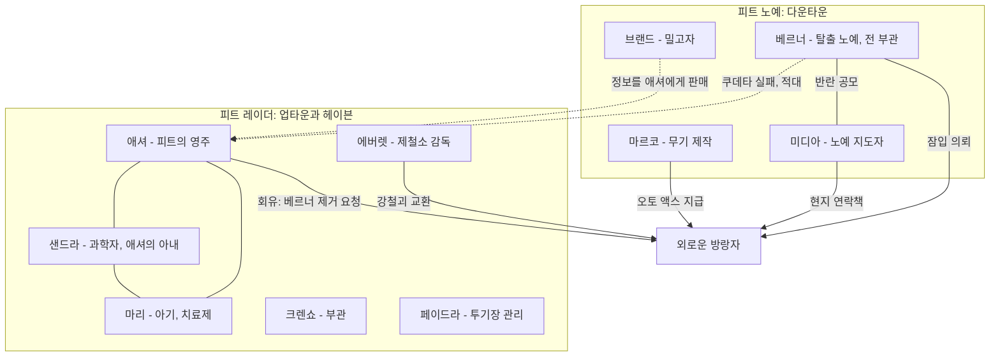

---

## 3. 퀘스트 상세

### 3.0 퀘스트 목록과 전체 흐름
허브 문서 `Fallout 3 quests`의 *The Pitt* 섹션 기준 메인 3개, 비표시 3개, 반복 1개다.

| # | 영문명 | 한국어명 | 유형 | 퀘스트 ID (EDID) | 의뢰인 | 보상 | 업적 |
|---|---|---|---|---|---|---|---|
| 1 | Into The Pitt | 피트 속으로 | 메인 | `00108c` (DLC01Quest01) | 베르너 | 150 XP | 20G / 실버 |
| 2 | Unsafe Working Conditions | 위험한 작업 환경 | 메인 | `00108b` (DLC01Quest02) | 미디아 | 150 XP, 오토 액스퍼트, 피트 파이터, 무기·방어구 | 20G / 실버 |
| 3 | Free Labor | 자유 노동 | 메인 | `00108d` (DLC01Quest03) | 크렌쇼 | 150 XP, 부스터 샷, 탄약 압착기, 애셔의 파워 아머(선택) | 40G / 골드 |
| 4 | Mill Worker | 제철소 일꾼 | 비표시 | 허브 표기 없음 | 에버렛 | 강철괴 10개마다 유니크 장비(총 10종) | 20G / 실버(강철괴 100개) |
| 5 | Wild Bill's Last Stand | 와일드 빌의 최후 | 비표시 | 허브 표기 없음 / 퀘스트 문서 `00a358` (DLC01FFLD) | 밀리 | 와일드 빌의 권총, 스팀팩(Stimpak) 6 | - |
| 6 | Slave Snitch | 노예 밀고자 | 비표시 | 허브 표기 없음 | 브랜드 | 정보 1건당 스팀팩 2, 25 XP | - |
| 7 | Toys for Tots | 아이에게 장난감을 | 반복 | 허브 표기 없음 | 미디아 또는 샌드라 | 곰 인형 1개당 30캡, 10 XP | - |

- 「피트 속으로」의 XP는 퀘스트 문서·허브 기준 150이며, 애드온 문서의 퀘스트 표는 100 XP로 적고 있다(불일치).
- 애드온 문서는 「와일드 빌의 최후」를 'Find Wild Bill'이라는 이름으로 싣고 있다. 이 문서는 허브·퀘스트 문서의 제목을 따른다.

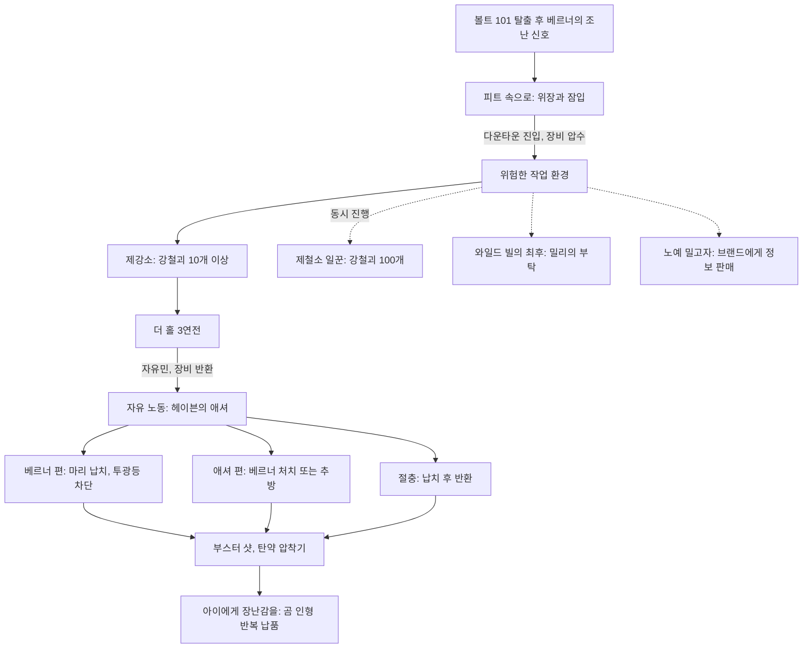

---

### 3.1 피트 속으로 (Into The Pitt)

#### 기본 정보
| 항목 | 내용 |
|---|---|
| 영문명 / 한국어명 | Into The Pitt / 피트 속으로 |
| 유형 | [TP] 메인 퀘스트 (1/3) |
| 퀘스트 ID | `00108c` (EDID `DLC01Quest01`) |
| 의뢰인 | 베르너(베르너의 조난 신호) |
| 시작 조건 | 볼트 101 탈출 후 30초(스크립트) 경과 시 단계 10 자동 시작 |
| 관련 장소 | 라디오 탑, 철도 터널(Train tunnel), 피트 철도 조차장(Pitt train yard), 피트 다리(The Pitt bridge), 피트 다운타운 정문 |
| 선행 / 후행 | 없음 / 「위험한 작업 환경」 (관련: 「자유 노동」) |
| 보상 | 150 XP |
| 카르마 영향 | 프로스퍼를 위협해 옷을 빼앗으면 악 카르마, 대가 없이 풀어 주면 선 카르마(수치 코퍼스 미확인). 노예 사냥꾼 램지(악 카르마 NPC) 처치는 카르마 손실 없음 |
| 업적·트로피 | Into The Pitt — 20G / 실버 |

#### 개요
- 베르너의 첫 대사: "You've come about the broadcast, right? Risky, I know. But it had to be done." — "방송 듣고 온 거지? 위험한 건 알아. 하지만 해야만 했어."
- 베르너는 애셔가 '치료제'를 가졌다며 탈취를 의뢰하고, 레이더에게 얼굴이 알려진 자신을 대신해 노예로 위장해 들어가라고 한다. 퀘스트는 다운타운에 들어서는 순간 끝나며, 어떤 방법으로 들어가든 플레이어는 맨몸의 노예가 된다.

#### 진행 단계
| 단계 | 핍-보이 목표 (원문) | 플레이어 행동과 이벤트 |
|---|---|---|
| 10 | Find the source of the radio transmissions | 수도 황무지 최북단 라디오 탑으로 이동. 피트 레이더 3명에게 공격받는 베르너를 돕고 대화 |
| 50 | Acquire a slave outfit | 서쪽 철도 터널의 노예 캠프(램지와 노예 사냥꾼 약 4명, 우리 안 노예들)에서 노예복 확보 |
| 51 | (Optional) Acquire a slave outfit | 같은 목표의 선택형 변형 단계. 표시 조건은 코퍼스 미확인 |
| 90 | Return to Wernher | 노예복을 얻은 뒤 베르너와 재회(베르너가 철도 터널 앞으로 옴) |
| 100 | Travel to The Pitt | 터널의 핸드카를 작동해 피트 조차장으로 이동(동료는 각자 고용 장소로 돌아감). 베르너가 레이더 경비에게 말을 걸다 신분이 들통나 교전 |
| 200 | Infiltrate The Pitt | 조차장 출구에서 베르너와 작별(숨긴 무기 요청 가능) → 와일드맨 건물 → 피트 다리 → 정문의 멕스 → 다운타운 진입 시 완료 |

#### 분기와 해결 방법
- **베르너와의 첫 대화 태도**: 돕겠다고 하면 'Hero', 보상부터 물으면 'Moneybags', 베르너의 전투 실력을 놀리면 'Joker'로 이후 계속 불린다. 동료를 데려왔다면 동료마다 다른 거절 대사를 한다(도그밋(Dogmeat)은 "더러운 똥개", RL-3 하사(Sergeant RL-3)는 "고철 양동이" 등).
- **노예복 확보 경로**

  | 방법 | 내용 | 결과 |
  |---|---|---|
  | 구매 | 램지에게 노예 1명당 200캡, 3명 600캡을 내고 우리 열쇠 획득 | 평화적. 노예 해방 |
  | 절도 | 램지의 우리 열쇠 소매치기 후 개방 | 노예 사냥꾼 적대 |
  | 전투 | 노예 사냥꾼 처치 후 램지의 시체에서 열쇠 | 카르마 손실 없음 |
  | 침투 | 우리 위 바위에서 뛰어들기 | 노예 사냥꾼 적대, 문 개방 |
  | 다리 끝 | 정문 앞에서 지뢰에 죽는 도주 노예의 시체에서 노예복 | 위장 기회를 놓쳤을 때의 보험 |

  - 우리 안 노예복은 2벌이다. 죽은 노예의 옷, 그리고 프로스퍼(Prosper)의 옷. 프로스퍼를 위협해 빼앗으면 악 카르마, 보상 없이 풀어 주면 선 카르마를 얻고 프로스퍼는 죽은 노예의 옷을 가져가라고 한다. 프로스퍼에게 옷을 요구하는 대사는 「터미네이터」 패러디다.
  - 파라다이스폴(Paradise Falls)과 적대 관계였다면 램지가 플레이어를 알아보고 즉시 적대한다. 파라다이스폴의 노예 사냥꾼으로 활동했어도 이 퀘스트 흐름은 바뀌지 않는다.
- **숨긴 무기(조차장 출구)**: 베르너에게 작은 무기를 숨겨 달라고 하면 '숨긴 잭나이프(Concealed switchblade)' 또는 '숨긴 .32 권총(Concealed .32 pistol)' 중 하나를 받는다. 잡화 항목으로 보관되다가 다운타운에 들어가는 순간 실제 무기로 바뀐다.
- **피트 다리 공략**: 조차장 출구 왼쪽 폐건물에 와일드맨 무리가 있다(은신 통과 가능). 다리는 차량 잔해와 파편 지뢰로 막혀 있어 폭발이 연쇄될 수 있다. 다리 아치에 저격소총을 든 레이더가 있으며, 주 케이블의 경사로로 올라가 처치할 수 있다. 강물은 초당 수백 라드의 치사 방사능이다. 라이트 스텝(Light Step) 퍽이나 은신 이동이 유효하다.
- **정문(멕스) 분기**

  | 복장·선택 | 이벤트 | 「위험한 작업 환경」 시작 단계 |
  |---|---|---|
  | 노예복 착용 | 멕스가 '도망쳤다 돌아온 노예'로 취급, 일방적 대화 후 소지품 전부(입고 있던 노예복 포함) 압수, 해진 노예복(낮은 내구도) 지급·장착 | 10: 정문 안쪽에서 시작 |
  | 다른 복장 + "나도 노예다" 거짓말 | 위장 루트와 동일 처리 | 10 |
  | 다른 복장 + "피트가 사람을 모집한다고 들었다" | 다운타운에서 레덥과 레이더 4명(레이더 이코노클라스트 아머, 여과 헬멧, 경찰봉)이 몰매 → 기절 → 소지품 압수, 해진 노예복 | 15: 다운타운 구석에서 미디아가 깨움 |
  | 다른 복장 + "네 죽음이 왔다" 또는 멕스 살해 | 정문 전투 후 진입 → 레덥 일당의 몰매(멕스 생사에 따라 대사 변화) → 위와 동일 | 15 |

  - 대화가 끝나면 정문이 닫히며 메인 퀘스트가 끝날 때까지 다시 열리지 않는다.
  - 퀘스트 아이템(예: 크립토크로마틱 안경, 노예 목줄 등)은 압수되지 않는다.

#### 결과와 후일담
- 압수된 장비는 「위험한 작업 환경」에서 더 홀 3연전을 마치면 홀 밖 사물함으로 돌아온다.
- 철도 터널 캠프의 노예를 풀어 주면 프로스퍼는 볼트 101 입구 근처로 이동한다.
- 다운타운 진입과 함께 「위험한 작업 환경」이 자동 시작되고 숨긴 무기가 지급된다.

#### 흐름도
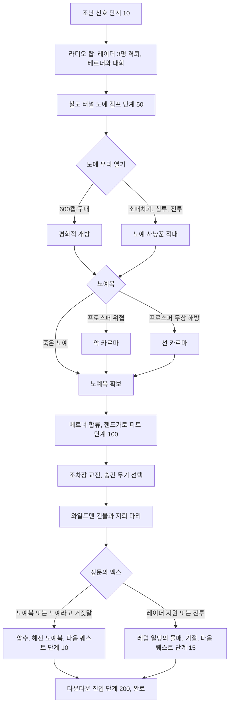

#### 관련 NPC·아이템·대사 포인트, 비고
- NPC: 베르너, 램지(노예 사냥꾼, 악 카르마), 프로스퍼, 무명 노예·노예 사냥꾼, 피트 레이더, 와일드맨, 멕스, 레덥.
- 아이템: 노예복(낡은/해진), 숨긴 잭나이프, 숨긴 .32 권총, 우리 열쇠.
- GOTY 가이드는 램지를 율로지 존스(Eulogy Jones)의 신임받는 부하로 소개한다.
- 다리 끝의 '도주 노예 폭사' 장면은 트레일러에도 쓰인 스크립트 연출로, 지뢰를 모두 해체해도 노예는 죽는다.
- 정문 대화를 우회하는 지형 버그·시체 보관 편법 등 장비를 지키는 익스플로잇이 위키에 정리되어 있으나 설계 의도 밖이므로 생략한다.

#### 설계 분석
- 잠입 수단은 여러 갈래지만 결과는 모두 '맨몸 노예'로 수렴한다. 선택이 바꾸는 것은 시작 위치와 연출뿐이며, 이는 다음 퀘스트의 '바닥부터 시작' 경험을 보장하기 위한 의도적 수렴이다.
- 노예 캠프는 본편 파라다이스폴과 연결된 작은 도덕 시험장이다(돈으로 사람을 사서 풀어 주기, 무력, 위협).
- 조차장 → 다리 → 정문은 짧지만 위험한 '문턱' 구간으로, 피트의 적대적 환경(지뢰, 치사량 강물, 폭사하는 도주 노예)을 압축해 보여 준다.

---

### 3.2 위험한 작업 환경 (Unsafe Working Conditions)

#### 기본 정보
| 항목 | 내용 |
|---|---|
| 영문명 / 한국어명 | Unsafe Working Conditions / 위험한 작업 환경 |
| 유형 | [TP] 메인 퀘스트 (2/3) |
| 퀘스트 ID | `00108b` (EDID `DLC01Quest02`) |
| 의뢰인 | 미디아 |
| 시작 조건 | 「피트 속으로」 완료(다운타운 진입) 시 자동. 위장 루트는 단계 10, 몰매 루트는 단계 15부터 |
| 관련 장소 | 피트 다운타운, 미디아의 숙소, 제철소(The Mill), 버려진 구역(Abandoned area), 제강소(Pitt steelyard), 보급 공장(Supply plant), 더 홀 |
| 선행 / 후행 | 「피트 속으로」 / 「자유 노동」 (동시 진행: 「제철소 일꾼」·「와일드 빌의 최후」·「노예 밀고자」) |
| 보상 | 150 XP, 오토 액스퍼트 퍽(강철괴 10개 수집), 피트 파이터 퍽(더 홀 3연전 승리), 노동자 작업복(첫 강철괴 10개 납품), 인필트레이터(그루버 소지품), 투기장 상대들의 장비 |
| 카르마 영향 | 퀘스트 자체 변동 없음 |
| 업적·트로피 | Unsafe Working Conditions — 20G / 실버 |

#### 개요
- 미디아의 설명: "If you win, you get your freedom. More importantly: you get an audience with Ashur." — "이기면 자유를 얻어. 더 중요한 건, 애셔를 직접 만날 수 있다는 거지."
- 노예가 애셔를 만나는 유일한 길은 투기장에서 이겨 자유민이 되는 것이다. 그 전에 노예로서 '일'을 해야 의심받지 않으므로, 가장 위험한 작업인 제강소 강철괴 수집부터 시작한다.

#### 진행 단계
| 단계 | 핍-보이 목표 (원문) | 플레이어 행동과 이벤트 |
|---|---|---|
| 10 | Make contact with Midea. | 다운타운에서 미디아 찾기(위장 루트) |
| 15 | Meet with Midea in private. | 미디아의 숙소에서 대화. 레이더 잭슨이 끼어들어 추궁하고, 미디아가 플레이어를 '새 자원자'라고 둘러댐 |
| 49 | (Optional) Get a weapon from Marco. | 제철소 로터리 프레스 제어실의 마르코에게 오토 액스 수령(미디아와 무기 이야기를 한 뒤에만) |
| 50 | Collect 10 Ingots from the Steelyard. | 에버렛의 안내로 버려진 구역을 거쳐 제강소 진입, 강철괴 수집 |
| 75 | Return to Midea. | 강철괴 10개를 에버렛에게 납품(노동자 작업복, 오토 액스퍼트) 후 미디아에게 보고 |
| 100 | Listen to Ashur's speech in the courtyard. | 미디아의 숙소 앞 광장에서 발코니 위 애셔의 연설. 미디아가 플레이어를 투기장에 자원시키고 애셔가 수락 |
| 120 | Sign up for the Arena. | 제철소 'Arena' 표지 계단 아래의 페이드라에게 등록 |
| 124 | (Optional) Prepare for the Arena fight. | 사물함의 저급 무기, 의료 테이블의 라드-X(Rad-X) 2개 등으로 준비 |
| 125 | Enter the Hole. | 1라운드 입장 |
| 130 | Defeat your opponent. | 노예 투사 2~3명 처치 |
| 135 | Leave the Hole | 퇴장, 방사능 정화 |
| 139 | (Optional) Prepare for the second fight. | 준비 |
| 140 | Enter the Hole. | 2라운드 입장 |
| 145 | Defeat your opponents. | 베어 형제 처치 |
| 150 | Leave the Hole. | 퇴장, 방사능 정화 |
| 159 | (Optional) Prepare for the final fight. | 준비 |
| 160 | Enter the Hole. | 3라운드 입장 |
| 165 | Defeat your opponent. | 그루버 처치 |
| 170 | Leave the Hole | 퇴장. 홀 밖 사물함에서 압수 장비 회수, 피트 파이터 획득, 완료 |

#### 분기와 해결 방법
- **맨몸 생존 수단**
  - 무기: 숨긴 무기, 마르코의 오토 액스, 제강소 남쪽 왼쪽 사일로 밑의 오토 액스(유일하게 바닥에 놓인 것), 첫 강철괴 옆 돌격소총과 탄약, 보급 공장 꼭대기 침대의 맨 오프너(Man Opener).
  - 회복: 카이(Kai)의 슬롭(Slop, HP +25·라드 +25, 무료, 하루 5그릇), 놀라(Nola)의 무료 치료(낮은 확률로 부위 불구), 자유민이 된 뒤 업타운 팬텀(Phantom)의 하루 1회 라드어웨이(RadAway).
- **강철괴 수집**: 최소 10개. 퀘스트 진행 중에는 퀘스트 아이템이라 무게가 0이므로, 첫 납품 전에 100개를 모두 모으는 편이 효율적이다(납품 후 남은 강철괴는 개당 무게 1). 분포·보상은 3.4절과 9.2절.
- **제강소 사건**
  - 에버렛이 버려진 구역까지 동행하며 캣워크 위 트로그를 보여 준다.
  - 노예 존존(John-John)이 트로그가 된 형 빌리(Billy)를 설득하는 장면이 나온다. 개입하지 않으면 빌리가 존존을 공격하고, 빌리를 죽이면 존존이 슬퍼한다.
  - 처음 제강소를 나오면 버려진 구역 펜스를 트로그가 뚫고 나타나며, 그 구멍 너머에 강철괴 3개가 있다.
- **투기장 '더 홀' 규칙**: 경기가 시작되면 방사능 통이 떨어지고 문이 열린다. 상대를 모두 쓰러뜨리고 나가야 하며, 피폭이 누적되기 전에 끝내야 한다. 라운드 사이에 페이드라가 방사능을 제거해 주지만 체력은 회복해 주지 않는다. 옆의 식수대는 경기 중 1라드, 경기 종료 후 3라드다. 시체 루팅은 자유다. 경기가 지루하면 레이더가 우리 안으로 총을 쏜다는 설정 대사가 있다.

  | 라운드 | 상대 | 장비 | 공략 포인트 |
  |---|---|---|---|
  | 1 | 노예 투사 2~3명 | 전투 산탄총 1명, 나머지 중국제 돌격소총 | 산탄총 근접 화력 주의 |
  | 2 | 베어 형제: 그러드 베어(Grudd Bear), 존 베어(John Bear) | 그러드: 화염방사기, 레이더 이코노클라스트 아머 / 존: 데스클로 건틀릿(Deathclaw gauntlet), 파편 수류탄, 감마 실드 아머. 방어구 내구도 90% 이상 | 존의 데스클로 건틀릿은 3라운드에 유용 |
  | 3 | 챔피언 그루버(Gruber) | 감마 실드 아머, 금속 헬멧, 인필트레이터. 방어구 내구도 90% 이상, 레벨 8→17, HP 75~120 | 고체력·중장갑. 비무장 빌드는 데스클로 건틀릿과 퍼럴라이징 팜(Paralyzing Palm)이 유효 |

- **사전 준비 조언**: 「제철소 일꾼」 보상(메탈 블래스터, 퍼포레이터 등)을 투기장 전에 받아 두면 3연전이 크게 쉬워진다.
- **노예 공격 주의**: 다운타운 노예를 공격해도 당장은 반응이 없지만, 제철소에 들어가면 오토 액스를 든 노예 약 15명이 공격한다.

#### 결과와 후일담
- 3라운드 승리 후 플레이어는 '자유민'이 되어 업타운 출입이 가능해진다. 홀 밖 사물함에서 「피트 속으로」에서 압수된 장비를 돌려받는다(그루버 처치 후에만 생성).
- 크렌쇼가 애셔의 호출을 전하며 「자유 노동」이 시작된다.
- 투기장 참가를 결정한 뒤부터 다운타운 곳곳에서 노예들의 반란 모의 대화가 들리고, 망보는 노예가 휘파람으로 경고하는 연출이 추가된다.
- 투기장 챔피언이 되면 레이더들이 플레이어의 카르마와 S.P.E.C.I.A.L. 수치에 대해 혼잣말을 한다.

#### 흐름도
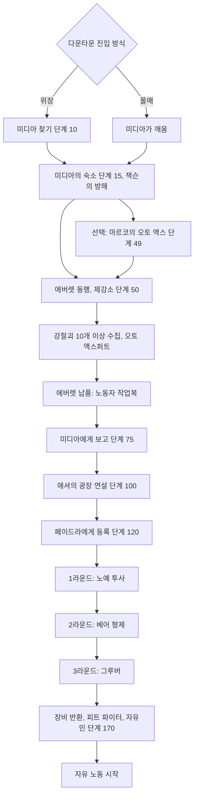

#### 관련 NPC·아이템·대사 포인트, 비고
- NPC: 미디아, 잭슨, 마르코, 카이, 놀라, 에버렛, 존존·빌리, 애셔, 크렌쇼, 페이드라, 스푸크(홀 입구 경비), 노예 투사, 그러드 베어, 존 베어, 그루버.
- 아이템: 강철괴, 노동자 작업복, 오토 액스, 인필트레이터, 슬롭, 라드-X.
- 페이드라의 대사: "What's to tell? Most die. One or two have made it out, but that's about it." — "말할 게 뭐 있어? 대부분 죽지. 살아 나간 건 한둘뿐이야."
- 그루버는 지금까지 투기장에서 살아남은 노예 셋 중 하나이며, 자유를 얻은 뒤에도 피 맛을 잊지 못해 남았다.
- 더 홀의 구조와 사회자 연출은 「매드 맥스 3」의 썬더돔을 닮았다(위키 비하인드).

#### 설계 분석
- '노동 → 투기장 → 자유'라는 신분 상승 사다리가 퀘스트 단계와 1:1로 대응한다. 장비가 없는 상태에서 시작해 퀘스트 보상(작업복, 오토 액스, 투사 장비)으로 다시 무장해 가는 '리빌드 곡선'이 DLC의 핵심 재미다.
- 강철괴는 필수 목표(10개)와 선택 목표(100개)를 같은 공간에 겹쳐 놓아, 플레이어가 제강소 탐색 깊이를 스스로 정하게 했다. 퀘스트 중 무게 0이라는 규칙이 '지금 다 모으라'는 은근한 유도 장치다.
- 투기장은 '방사능 통'이라는 환경 시간제한을 둬 소모전을 막고, 라운드 사이 정화로 다음 라운드의 공정성을 보장한다.

---

### 3.3 자유 노동 (Free Labor)

#### 기본 정보
| 항목 | 내용 |
|---|---|
| 영문명 / 한국어명 | Free Labor / 자유 노동 |
| 유형 | [TP] 메인 퀘스트 (3/3, 최종) |
| 퀘스트 ID | `00108d` (EDID `DLC01Quest03`) |
| 의뢰인 | 크렌쇼(애셔의 호출) |
| 시작 조건 | 더 홀 3라운드 승리 직후 자동 |
| 관련 장소 | 피트 업타운(The Pitt Uptown), 헤이븐(Haven), 피트 다운타운·미디아의 숙소, 제강소·베르너의 은신처(Wernher's hideout), 피트 지하(The Pitt underground, 발전소) |
| 선행 / 후행 | 「위험한 작업 환경」 / 없음(DLC 종료). 관련: 「피트 속으로」, 「아이에게 장난감을」 |
| 보상 | 150 XP, 부스터 샷 퍽, 탄약 압착기 사용권, 애셔의 파워 아머(애셔 처치 등으로 획득, 선택), 피트의 영주 지위(베르너 루트에서 선택) |
| 카르마 영향 | 헤이븐에서 샌드라 살해 시 악 카르마. 애셔 방 금고를 따서 일기를 훔치면 악 카르마. 애셔 편에서 폭동 노예 살해 시 카르마 손실. 베르너가 먼저 공격한 경우의 처치는 카르마 변동 없음 |
| 업적·트로피 | Free Labor — 40G / 골드 |

#### 개요
- 애셔의 대사: "I understand. We've all got a past, and damn few of us have reason to be proud of it." — "이해하네. 누구에게나 과거가 있고, 그걸 자랑스러워할 사람은 거의 없지."
- 애셔는 베르너의 계략을 이미 알고 있다. 그는 폭동이 무의미한 죽음만 낳는다며 베르너 제거를 요청하고, 치료제가 무엇인지 알고 싶으면 아내에게 물어보라고 한다. 플레이어는 '치료제 = 아기'라는 사실을 안 뒤 편을 고른다.

#### 진행 단계
| 단계 | 핍-보이 목표 (원문) | 플레이어 행동과 이벤트 |
|---|---|---|
| 1 | Retrieve your gear. | 더 홀 밖 사물함에서 장비 회수 |
| 5 | Go through Uptown and enter Haven. | 업타운을 지나 헤이븐 진입. 엘리베이터에서 크렌쇼와 애셔의 언쟁이 들림 |
| 10 | Meet Ashur in Haven. | 애셔와 대화. 베르너 제거 요청, 합류 제안. 인터콤의 폭동 보고 후 애셔가 자리를 비움 |
| 20 | Find the cure in Ashur's palace. | 실험실의 샌드라와 대화, 치료제가 마리임을 확인 |
| 30 | Kidnap the baby and leave OR leave without the baby. | 선택 지점 |
| 32 | Leave without the baby. | 애셔 편 진입 |
| 37 | Steal the baby and leave. | 베르너 편 진입 |
| 50 | Stop Wernher. | (애셔 편) 베르너 저지 |
| 55 | Find Wernher. | (애셔 편) 베르너 위치 탐색 |
| 70 | Find out Wernher's location from Midea. | (애셔 편) 미디아 추궁 |
| 71 | Search Midea or her room for clues about Wernher's location. | (애셔 편) 미디아의 시체 또는 숙소에서 쪽지 탐색 |
| 75 | Bring the baby to Midea. | (베르너 편) 마리를 미디아에게 |
| 90 | Give Wernher the baby, OR stop Wernher. | 은신처에서 최종 선택 |
| 92 | Stop Wernher. | (절충) 베르너의 계획 거부 |
| 97 | Give Wernher the baby. | (베르너 편) 마리 인도 |
| 100 | Return the baby to her home. | (절충) 마리를 헤이븐으로 반환 |
| 105 | Shut off power for Uptown's lights. | (베르너 편) 지하 발전소의 투광등 차단 |
| 190 | Return to Ashur. | (애셔 편·절충) 애셔에게 보고, 완료 |
| 195 | Escape to Market Square. | (베르너 편) 마켓 광장으로 탈출, 완료 |

#### 분기와 해결 방법
- **헤이븐 진입 전**: 장비를 되찾은 뒤 다운타운 레이더를 공격하면 업타운 레이더도 적대한다(게임 내 며칠 지나면 해제).
- **애셔와의 대화**: "베르너를 아느냐"는 질문에 거짓말("Never heard of him." 등, 화술 판정 — 난이도 수치 코퍼스 미확인)이나 사실대로 답하기 모두 치료제 이야기로 이어진다. 애셔의 합류 제안을 받아들이거나 거절할 수 있고, 여기서 애셔를 공격할 수도 있다(베르너 편 확정).
- **애셔의 일기**: 애셔 방 금고(자물쇠 따기, 악 카르마)에 홀로테이프 4편(「To Marie」「The Scourge」「The Mill」「The Cure」)이 있다. 노예제를 일시적 수단으로 여기는 애셔의 속내가 담겨 있어 선택 전에 읽는 것을 권장하는 정보 장치다.
- **루트 A – 애셔 편**
  1. 마리를 두고 헤이븐을 나온다(단계 32). 거리는 폭동 중이며 노예는 대부분 오토 액스나 강철 톱으로 무장했다. 피할 수 있고, 죽이면 카르마가 줄 수 있다.
  2. 베르너 위치 파악(단계 70·71): 미디아와 대화(차일드 앳 하트(Child at Heart) 퍽 선택지로 납치가 베르너의 생각이었다고 실토), 미디아를 죽이고 '베르너가 미디아에게 남긴 쪽지' 획득, 또는 숙소의 쪽지들 읽기.
  3. 제강소의 이전에는 잠겨 있던 문을 통해 베르너의 은신처로 간다. 화술 판정(난이도 수치 코퍼스 미확인) 또는 블랙 위도우 선택지로 피트를 영원히 떠나게 하거나, 처치한다(베르너가 먼저 쏘면 카르마 손실 없음). 설득한 경우 발전소 열쇠는 실험 기구가 놓인 탁자 위에 있다. 애셔 편에서는 지하의 투광등 제어 터미널이 사라져 지하 통로가 막다른 길이 된다.
  4. 헤이븐의 애셔에게 보고하면 완료(단계 190).
- **루트 B – 베르너 편**
  1. 애셔를 직접 처치하거나 자리를 비운 사이 마리를 훔친다(단계 37). 샌드라와 레이더가 공격하며, 헤이븐 안에서 샌드라를 죽이면 악 카르마다.
  2. 헤이븐을 빠져나오면 노예와 레이더의 시가전이 벌어진다. 미디아의 숙소로 가면 미디아가 치료제가 아기라는 사실을 처음부터 알고 있었다고 밝히고, 베르너의 쪽지를 건넨다(단계 75).
  3. 제강소의 은신처에서 베르너에게 마리를 넘긴다(단계 97). 베르너는 마지막 계획으로 업타운 투광등을 꺼 트로그를 끌어들이자고 하며 스텔스 보이(Stealth Boy)를 준다(블랙 위도우 선택지로 스팀팩·탄약 추가).
  4. 보급 공장 맞은편 철로 끝의 맨홀로 피트 지하에 들어간다. 트로그 약 20여 마리가 있고, 프로텍트론(Protectron)을 가동해 도움을 받을 수 있다. 터미널에서 투광등을 끈다(단계 105).
  5. 헤이븐 안뜰로 나오면 애셔와 샌드라(살아 있다면)가 막아선다. 은신 중이어도 대화가 발동한다. 직접 처치(애셔의 파워 아머와 발전소 열쇠 획득)하거나, 싸움을 피하면 트로그 무리가 안뜰로 몰려와 애셔와 레이더를 공격한다.
  6. 마켓 광장으로 탈출해 베르너와 대화하면 완료(단계 195). "That leaves me as the new Lord of The Pitt."("그럼 이제 내가 피트의 새 영주로군.")를 고르면 베르너가 플레이어를 '보스'라 부르고, 고르지 않으면 베르너가 도시를 맡는 뉘앙스가 된다.
- **루트 C – 절충(납치 후 반환)**: 마리를 훔쳐 은신처까지 간 뒤 베르너의 2단계 계획을 거부한다(단계 92). 화술 판정 또는 블랙 위도우로 베르너를 물러나게 하고, 실패하면 베르너를 죽여야 한다. 마리를 헤이븐에 돌려주면(단계 100) 애셔가 "베르너를 끌어내려던 계략"이라는 변명을 화술 판정으로 받아들이며, 실패해도 투덜거리며 용서한다(단계 190). 샌드라는 끝까지 용서하지 않지만 곰 인형 거래는 해 준다.
- **루트 판정 정리**

  | 시점 | 행동 | 확정되는 루트 |
  |---|---|---|
  | 헤이븐 | 애셔 공격 또는 마리 납치 | 베르너 편(또는 절충) |
  | 헤이븐 | 마리를 두고 퇴장 | 애셔 편 |
  | 은신처 | 마리 인도 | 베르너 편 |
  | 은신처 | 계획 거부 → 마리 반환 | 절충 |

#### 결과와 후일담
- **공통**: 150 XP, 부스터 샷(방사능 저항 +10%), 제철소의 탄약 압착기 사용권, 에버렛에게 강철괴 납품 계속 가능, 「아이에게 장난감을」 시작. 수도 황무지로 돌아가려면 조차장(지도 남서쪽 끝)의 핸드카를 이용한다.
- **베르너 편**: 베르너가 미디아의 숙소 앞에서 도시 재편 계획을 말하며 탄약 압착기를 쓰라고 한다. 헤이븐은 잠겨 안에 남긴 물건을 회수할 수 없다. 레이더 상인 프라이데이(Friday)와 해리스(Harris)는 해방 노예에게 살해되며, 시체의 열쇠로 상점 재고를 가져갈 수 있다. 해방된 노예들은 새 대사가 없고 일부는 플레이어를 두려워하거나 대화를 거부한다(밀리 등). 미디아는 질서가 무너질까 걱정한다.
- **애셔 편**: 폭동은 진압되고 베르너는 죽거나 떠난다. 미디아는 플레이어의 배신을 비난하며 대화를 거부한다. 이후 노예를 죽여도 카르마 감소 외의 결과는 없다.
- **삭제된 기획**: 개발 중에는 베르너 편에서 노예 베스(Beth)가 마리를 받아 미디아의 숙소로 데려가는 흐름이 있었다.

#### 흐름도
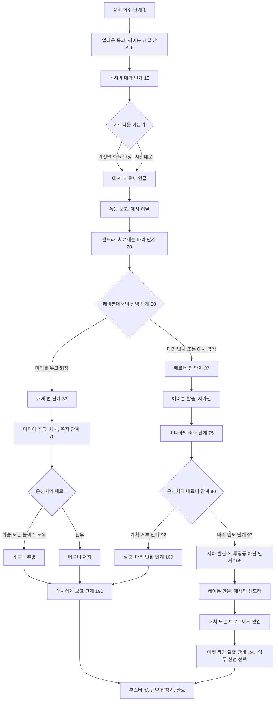

#### 관련 NPC·아이템·대사 포인트, 비고
- NPC: 애셔, 샌드라, 마리, 크렌쇼, 미디아, 베르너, O독·스퀼 등 업타운 레이더, 폭동 노예, 트로그.
- 아이템: 애셔의 파워 아머, 애셔의 일기, 베르너가 미디아에게 남긴 쪽지, 발전소 열쇠, 스텔스 보이, 마리(퀘스트 아이템, 무게 5).
- 업타운 레이더를 하나씩 처치해도 나머지가 적대하지 않는 '림보 상태'가 생길 수 있다(애셔의 제안 → 미디아 추궁 → 베르너 설득 순서). 설계 의도 밖의 현상이다.
- 베르너를 은신처에서 죽이면 다음 방문 때 그의 시체가 조차장에 나타난다.
- 애셔의 파워 아머를 입고 베르너에게 말을 걸면 전용 대사가 나온다.

#### 설계 분석
- **양쪽 모두 정당성과 결함을 가진 선택**: 애셔는 노예주지만 치료제와 도시의 미래를 고민하고, 베르너는 해방자지만 아기를 무기로 쓰고 트로그를 풀어 도시를 피로 물들인다. 카르마 수치도 루트 자체에는 직접 걸려 있지 않아 '정답 루트'를 지우려 했다.
- **환경의 무기화**: 트로그를 막는 투광등이라는 세계관 설정(9.4절)을 최종 수단으로 쓰게 해, 앞서 학습한 위협(제강소의 트로그)을 결말의 도구로 회수한다.
- **절충 루트**의 존재가 플레이어의 '중간에 마음을 바꾸는' 선택을 허용한다. 다만 보상과 후일담은 애셔 편과 거의 같아 변별력이 약하다.

---

### 3.4 제철소 일꾼 (Mill Worker)

#### 기본 정보
| 항목 | 내용 |
|---|---|
| 영문명 / 한국어명 | Mill Worker / 제철소 일꾼 |
| 유형 | [TP] 비표시 퀘스트(수집형) |
| 퀘스트 ID | 허브·퀘스트 문서 모두 표기 없음 |
| 의뢰인 | 에버렛(제철소 감독) |
| 시작 조건 | 「위험한 작업 환경」의 강철괴 수집 시작과 함께 |
| 관련 장소 | 제철소, 제강소, 버려진 구역, 보급 공장 |
| 선행 / 후행 | 「위험한 작업 환경」과 병행 / 없음. 「자유 노동」 완료 후에도 계속 가능 |
| 보상 | 강철괴 10개를 납품할 때마다 유니크 장비 1종(아래 표) |
| 카르마 영향 | 없음 |
| 업적·트로피 | Mill Worker — 강철괴 100개 납품, 20G / 실버 |

#### 개요
- 에버렛은 납품을 10개 단위로만 받는다. 100개를 모두 납품하면 "You're one hell of a steeler, kid."("넌 정말 끝내주는 제철꾼이다, 꼬마.")라고 말한다. 'Steeler'는 제강소 노동자를 가리키는 말이자 피츠버그 스틸러스의 이름이다.

#### 진행 단계 (납품 보상표)
| 누적 납품 | 보상 | English | 원형 |
|---|---|---|---|
| 10 | 노동자 작업복 | Laborer outfit | 노예복 유니크 |
| 20 | 여과 헬멧 | Filtration helmet | 감독관 헬멧 유니크 |
| 30 | 강철 너클 | Steel knuckles | 황동 너클 유니크 |
| 40 | 메탈 마스터 아머 | Metal Master armor | 레이더 스로다운 아머 유니크 |
| 50 | 메탈 블래스터 | Metal Blaster | 레이저 소총 유니크 |
| 60 | 밤셸 아머 | Bombshell armor | 레이더 오드넌스 아머 유니크 |
| 70 | 레더 레블 | Leather Rebel | 레이더 코만도 아머 유니크 |
| 80 | 더 몰러 | The Mauler | 오토 액스 유니크 |
| 90 | 퍼포레이터 | Perforator | 인필트레이터 유니크 |
| 100 | 부족 파워 아머 + 업적 | Tribal power armor | T-45d 파워 아머 유니크(애셔의 파워 아머와 같은 외형) |

#### 분기와 해결 방법
- **분포**: 제강소 79개, 보급 공장 18개, 버려진 구역 3개.
- **무게 규칙**: 「위험한 작업 환경」 진행 중에는 퀘스트 아이템이라 무게 0이다. 첫 10개를 납품하는 순간 남은 강철괴는 개당 무게 1이 된다.
- **자물쇠**: 100개를 모으려면 보급 공장의 Average 자물쇠 문(자물쇠 따기 50)을 열어야 한다. 이 문에 '강제 따기'를 실패하면 열쇠가 없어 진행이 막힌다(인필트레이터 퍽이나 콘솔로만 해결).
- **환경 단서**: 강철괴 근처에는 검은색·빨간색 페인트 자국이 있다.
- **와일드 빌**: 와일드 빌의 시체 옆에 강철괴 2개가 있다(3.5절).
- **필수 NPC**: 에버렛은 강철괴를 모두 납품할 때까지 필수(essential)다.
- 보급 공장 터미널(맥멀린의 기록)을 읽으면 우호적 프로텍트론이 나타나 트로그 소탕을 돕는다. 수리 챔버의 프로텍트론은 Average 터미널 해킹으로 가동한다.

#### 결과와 후일담
- 100개 납품 시 부족 파워 아머와 업적. 에버렛은 이를 "수집품 중 최고"라 부른다.
- 미디아의 책상과 버려진 구역 입구 사물함은 내용물이 초기화되지 않는 안전한 보관함으로 쓸 수 있다.

#### 흐름도
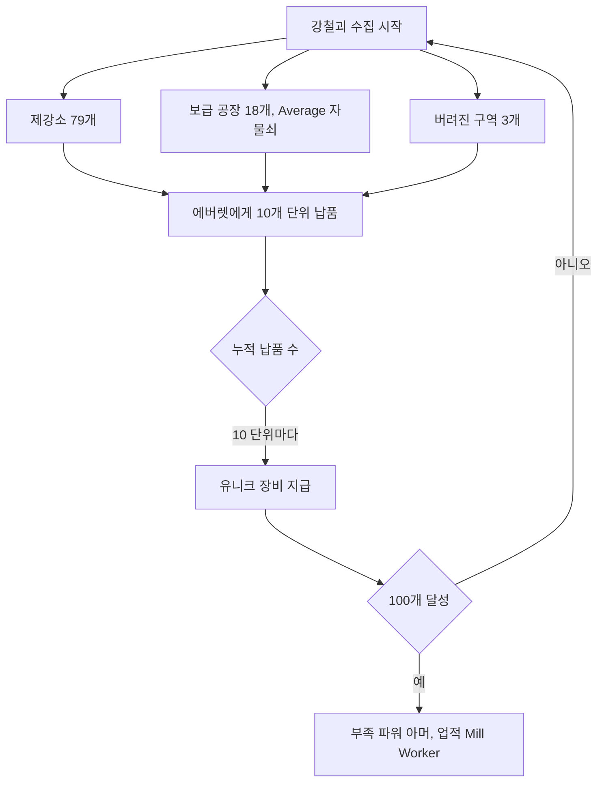

#### 관련 NPC·아이템·대사 포인트, 비고
- 80개 보상 더 몰러: 에버렛이 "트로그와 구울을 먼로빌까지 썰어 왔다"고 소개한다. 먼로빌은 조지 A. 로메로의 「시체들의 새벽」 촬영지다.
- 70개 보상 레더 레블: '사막의 사제'가 입던 것이라는 설명은 주다스 프리스트의 곡명 패러디다.

#### 설계 분석
- 100개라는 큰 수집 목표를 10개 단위 보상으로 쪼개 매 단계 보상 체감을 준다. 보상 품목이 근접·에너지·소형 화기·방어구·파워 아머로 고르게 퍼져 있어 어떤 빌드든 중간 보상을 쓸 수 있다.
- 수집 공간(제강소)이 메인 퀘스트 공간과 같아, 수집이 곧 탐험이고 탐험이 곧 전투(트로그)다.

---

### 3.5 와일드 빌의 최후 (Wild Bill's Last Stand)

#### 기본 정보
| 항목 | 내용 |
|---|---|
| 영문명 / 한국어명 | Wild Bill's Last Stand / 와일드 빌의 최후 |
| 유형 | [TP] 비표시 퀘스트 |
| 퀘스트 ID | 허브 표기 없음 / 퀘스트 문서 `00a358` (EDID `DLC01FFLD`) |
| 의뢰인 | 밀리(Milly) |
| 시작 조건 | 「위험한 작업 환경」에서 미디아의 숙소 대화 이후, 다운타운 캣워크 아래를 걷는 밀리와 대화 |
| 관련 장소 | 피트 다운타운(마켓 광장) → 제강소(베르너의 은신처로 오르는 계단참) |
| 선행 / 후행 | 「위험한 작업 환경」 진행 중 / 없음 |
| 보상 | 와일드 빌의 권총(시체에서), 스팀팩 6 |
| 카르마 영향 | 코퍼스상 기재 없음 |
| 업적·트로피 | 없음 |

#### 개요
- 강철괴를 찾겠다고 자원해 제강소로 간 노예 와일드 빌(Wild Bill)이 돌아오지 않는다. 밀리는 그를 찾아 달라고 부탁한다.

#### 진행 단계
| 순서 | 이벤트 |
|---|---|
| 1 | 밀리의 부탁을 받는다(비표시라 핍-보이 목표 없음) |
| 2 | 제강소에서 베르너의 은신처로 가는 두 계단 사이 계단참에서 와일드 빌의 시체 발견. 와일드 빌의 권총, '와일드 빌의 쪽지', 강철괴 2개. 근처 계단에서 트로그가 내려올 수 있음 |
| 3 | 밀리에게 돌아가 결과를 전한다 |

#### 분기와 해결 방법
| 선택 | 판정 | 결과 |
|---|---|---|
| 사실대로 죽었다고 말함 | - | 스팀팩 6 |
| 살아 있지만 다운타운에 돌아올 수 없다고 거짓말 | 화술 판정(난이도 수치 코퍼스 미확인) | 스팀팩 6 |
| 죽음을 과장(트로그에게 찢겨 죽었고, 숨을 끊어 주려다 실패했다는 등 점점 잔혹하게) | 화술 판정(난이도 수치 코퍼스 미확인) | 대화를 끝까지 이으면 밀리가 기절해 쓰러지며 스팀팩을 떨어뜨림(물리 연산으로 흩어져 찾기 어려움) |
| 과장 도중 "사실 거짓말이었다"고 인정 | - | 사실대로 말한 것과 같이 스팀팩 6 |

- 가용 조건: 애셔의 광장 연설 후 「위험한 작업 환경」이 끝날 때까지 밀리는 대화하지 않는다. 「자유 노동」을 애셔 편으로 끝내면 밀리가 플레이어와 영영 대화하지 않아 완료할 수 없다.

#### 결과와 후일담
- 보상 외에 월드 변화는 없다. 과장 루트로 끝내면 이후 밀리의 음성이 사라지는 현상이 보고되어 있다.

#### 흐름도
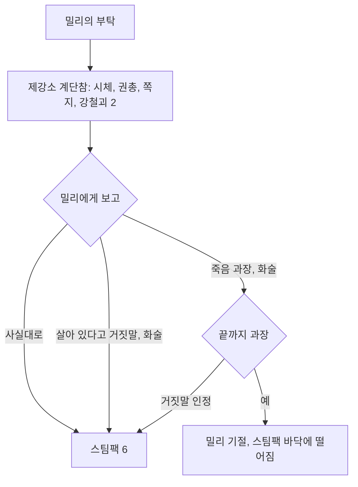

#### 관련 NPC·아이템·대사 포인트, 비고
- NPC: 밀리, 와일드 빌(사망).
- 아이템: 와일드 빌의 권총(.32 권총 유니크), 와일드 빌의 쪽지, 강철괴 2.

#### 설계 분석
- 메인 동선(제강소) 위에 놓인 '발견형' 소퀘스트다. 화술 판정이 보상을 늘리지 않고 '거짓말의 질감'만 바꾸는 구조로, 플레이어의 롤플레이 취향(위로, 잔혹한 장난)을 표현하게 한다.

---

### 3.6 노예 밀고자 (Slave Snitch)

#### 기본 정보
| 항목 | 내용 |
|---|---|
| 영문명 / 한국어명 | Slave Snitch / 노예 밀고자 |
| 유형 | [TP] 비표시 퀘스트 |
| 퀘스트 ID | 허브·퀘스트 문서 모두 표기 없음 |
| 의뢰인 | 브랜드(Brand) |
| 시작 조건 | 제철소 입구 근처에 앉아 있는 브랜드와 대화 |
| 관련 장소 | 제철소(허브 표기). 애드온 문서는 다운타운·제강소로도 표기 |
| 선행 / 후행 | 「위험한 작업 환경」~「자유 노동」 중 수시 / 없음 |
| 보상 | 정보 1건당 스팀팩 2, 25 XP |
| 카르마 영향 | 정보 1건당 카르마 -15 |
| 업적·트로피 | 없음 |

#### 개요
- 브랜드는 애셔에게 정보를 넘기는 대가로 휴식을 얻는 노예다. 알게 된 비밀이 있으면 넘겨 달라고 한다.

#### 진행 단계 (넘길 수 있는 정보 5건)
| # | 선택지 원문 | 번역 | 특수 결과 |
|---|---|---|---|
| 1 | "I'm here to find a cure for the mutations." | "돌연변이 치료제를 찾으러 왔다." | - |
| 2 | "I'm from outside The Pitt. I'm here to help free the slaves." | "피트 바깥에서 왔다. 노예 해방을 도우러 왔다." | - |
| 3 | "Midea is helping Wernher." | "미디아가 베르너를 돕고 있다." | - |
| 4 | "Wernher is trying to free the slaves." | "베르너가 노예를 해방하려 한다." | - |
| 5 | "Marco is making weapons." | "마르코가 무기를 만들고 있다." | 마르코가 즉시 죽음 |

#### 분기와 해결 방법
- 정보마다 개별 보상·카르마가 적용되므로 1~5건을 골라 넘길 수 있다.
- 마르코 정보는 마르코의 즉사로 이어지므로, 오토 액스를 받기 전이라면 무기 확보 수단 하나를 잃는다.

#### 결과와 후일담
- 어떤 정보를 넘겨도 「자유 노동」의 결말 선택지에는 영향이 없다(두 결말 모두 가능).

#### 흐름도
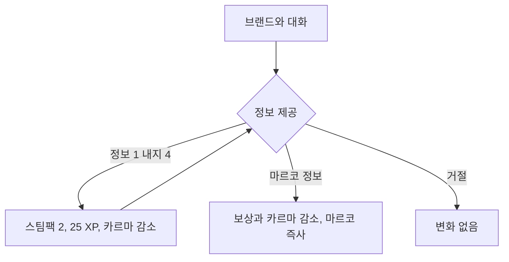

#### 관련 NPC·아이템·대사 포인트, 비고
- NPC: 브랜드(강철 톱 소지), 마르코.
- 마르코는 위협받아도 "브랜드한테나 가서 말해 보라"고 맞받아친다(마르코의 대화와 이 퀘스트가 연결됨).

#### 설계 분석
- 작은 보상(스팀팩·XP)과 카르마 손실을 맞바꾸는 '악의 유혹' 장치다. 결말에 영향이 없도록 설계해 카르마 시스템에만 반영되는 순수 롤플레이 선택으로 남겼다.

---

### 3.7 아이에게 장난감을 (Toys for Tots)

#### 기본 정보
| 항목 | 내용 |
|---|---|
| 영문명 / 한국어명 | Toys for Tots / 아이에게 장난감을 |
| 유형 | [TP] 반복 퀘스트(비표시) |
| 퀘스트 ID | 허브·퀘스트 문서 모두 표기 없음 |
| 의뢰인 | 미디아(베르너 편 완료 시) 또는 샌드라(애셔 편·절충 완료 시) |
| 시작 조건 | 「자유 노동」 완료 후 의뢰인과 대화("Would it help if I brought toys for Marie?") |
| 관련 장소 | 미디아의 숙소(다운타운) 또는 헤이븐 |
| 선행 / 후행 | 「자유 노동」 / 없음(반복) |
| 보상 | 곰 인형 1개당 30캡, 10 XP |
| 카르마 영향 | 없음 |
| 업적·트로피 | 없음 |

#### 개요
- 미디아: "She seems to really enjoy teddy bears." — "그 애는 곰 인형을 정말 좋아하는 것 같아."
- 제목은 미 해병대 예비군의 자선 운동 'Toys for Tots'에서 따왔다.

#### 진행 단계
| 순서 | 이벤트 |
|---|---|
| 1 | 의뢰인에게 장난감 이야기를 꺼내 거래 개방 |
| 2 | 곰 인형(Teddy bear)을 가져가 건넬 때마다 30캡 + 10 XP |

#### 분기와 해결 방법
- 의뢰인은 결말에 따라 고정된다. 절충 루트의 샌드라는 냉소적인 대사를 계속하지만 거래는 해 준다.
- 곰 인형 위치는 위키 `Teddy bear (Fallout 3)` 문서의 목록을 따른다([RD-21](21_consumables-misc-crafting.md) 참조).

#### 결과와 후일담
- 반복 거래 외의 월드 변화는 없다. 수도 황무지의 잡동사니(곰 인형)를 피트의 캡 수입원으로 바꾸는 장치다.

#### 흐름도
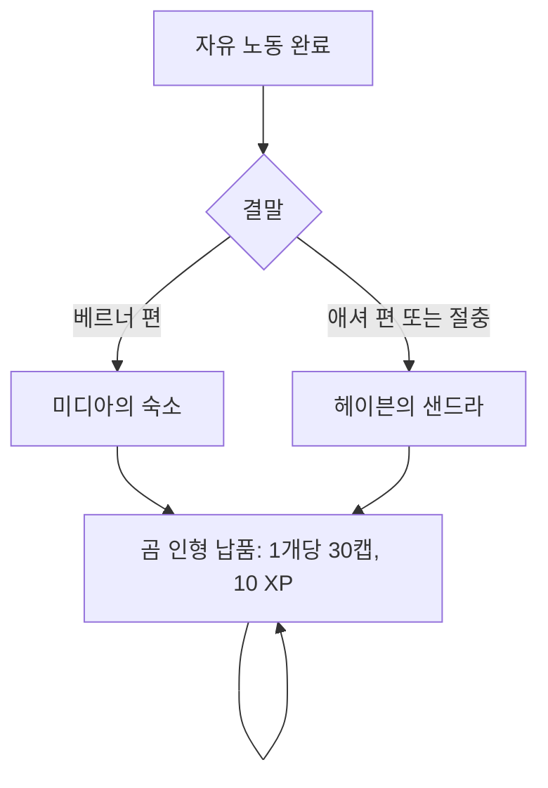

#### 관련 NPC·아이템·대사 포인트, 비고
- 관련 메모 아이템: '마리를 위한 장난감 구함(Toys wanted for Marie)'.

#### 설계 분석
- DLC 종료 후 피트를 다시 찾을 이유(잡동사니 매입)를 남기는 가벼운 후일담 장치다. 의뢰인이 결말에 따라 바뀌어 선택의 결과를 계속 상기시킨다.

---

## 4. 신규 장소

장소 카탈로그 정본은 [RD-13](13_location-catalog.md)이다. 여기서는 DLC 동선과 구역 구조를 정리한다.

### 4.1 수도 황무지 쪽 진입점

| 장소 | English | 유형 | 셀 이름 | 위치·내용 | 출현 | 관련 퀘스트 |
|---|---|---|---|---|---|---|
| 라디오 탑 | Radio tower | 정착지(중) | `DLC01RadioTower`, `DLC01RadioTower02` | 수도 황무지 최북단 가파른 언덕 위의 송신탑, 침낭. 동쪽 한 칸 거리 방사능 웅덩이 근처에 「D.C. 내과 저널」(스킬북) | 피트 레이더(첫 방문 3명) | 피트 속으로 |
| 철도 터널 | Train tunnel (The Pitt) | 동굴 | `DLC01TrainTunnel` | 콘스탄틴 요새(Fort Constantine) 북서쪽. 노예 사냥꾼 캠프(우리, 판잣집), 짧은 터널과 핸드카. 이후 피트 왕복 지점 | 노예 사냥꾼, 노예 | 피트 속으로 |

### 4.2 피트 지역 구조
- 피트는 수도 황무지와 분리된 별도 월드맵이다. 남서쪽 끝 조차장이 유일한 출입구이며, 핸드카로 철도 터널과 오간다.
- 사회 계층이 곧 공간 구조다. 노예 구역(다운타운·제철소) → 노동 구역(버려진 구역·제강소) → 지배층 구역(업타운·헤이븐)으로 갈수록 출입 조건이 까다로워진다. 업타운은 투기장 승리(자유민) 이후 열린다.
- 투광등이 업타운과 다운타운을 비추어 트로그를 막는다. 트로그는 제강소, 지하 발전소, 버려진 아파트에서만 만난다.

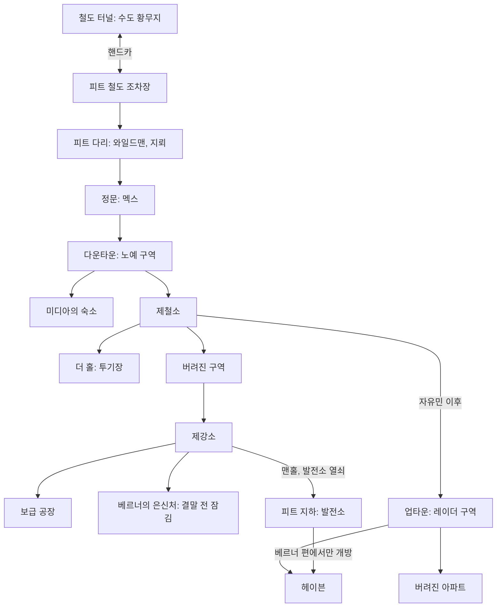

### 4.3 피트 장소 목록

| 장소 | English | 유형(지도) | 셀 이름 | 관련 퀘스트 | 구역 구조·내용 | 출현 | 주요 전리품 |
|---|---|---|---|---|---|---|---|
| 피트 철도 조차장 | Pitt train yard | 폐허(마커) | `DLC01AmbushStart` | 피트 속으로 | 얕은 협곡 속 폐조차장. 남단 도착, 북단은 산사태로 막힘, 북동쪽 오솔길이 다리로 이어짐. 귀환용 핸드카 | 피트 레이더 정찰조 | - |
| 피트 다리 (와바시 다리) | The Pitt bridge (Wabash Bridge) | 기념물(마커) | `DLC01Bridge` | 피트 속으로 | 남단 옛 노예 교역소(와일드맨 캠프), 차량 잔해와 파편 지뢰, 북쪽 주탑의 저격 둥지, 북단 도주 노예 폭사 지점, 정문 | 와일드맨, 사나운 개, 땅두더지(Mole rat), 레이더 저격수 | 라드-X, 구급상자(노예 교역소) |
| 피트 다운타운 | The Pitt Downtown | 지구(마커) | `DLC01MarketCenter`, `TPMarketOrigin` | 피트 속으로, 위험한 작업 환경, 자유 노동, 와일드 빌의 최후 | 정문 작업장(용접하는 아단), 왼쪽 제철소 입구, 오른쪽 미디아의 숙소, 북동쪽 마켓 광장(반란 모의), 레이더 전용 상층 비계. 하위 지점: 잭슨의 화장실, 보먼 박사의 진료소(터미널), 빙고의 아파트, 버티고 바 앤 그릴(해리스), 프라이데이의 수리점 | 피트 레이더, 노예 | - |
| 미디아의 숙소 | Midea's quarters | 건물 | `DLC01MideaHut` | 피트 속으로, 자유 노동, 아이에게 장난감을 | 미디아의 거처. 베르너 편이면 마리가 머문다. 책상은 안전한 보관함 | 미디아 | 베르너의 쪽지 등 |
| 제철소 | The Mill | 건물 | `DLC01SteelMill01` | 위험한 작업 환경 | 용광로·프레스가 쉬지 않는 노동 현장. 다운타운·버려진 구역·업타운(자유민 이후)을 잇는 허브. 로터리 프레스 제어실(마르코), 'Arena' 계단, 탄약 압착기(더 홀이 내려다보이는 위치) | 레이더 경비(해머·본), 노예 | 탄약 압착기 |
| 더 홀 | The Hole | 건물(제철소 내부) | `DLC01SteelMill04` | 위험한 작업 환경 | 철망 돔 투기장과 관중석, 페이드라의 방(사물함, 라드-X 2, 식수대), 장비 반환 사물함 | 투기장 투사 | 인필트레이터(그루버) |
| 버려진 구역 | Abandoned area | 건물 | `DLC01SteelMill02` | 위험한 작업 환경, 제철소 일꾼 | 제철소와 제강소 사이 완충 구역. 귀환 시 트로그가 펜스를 뚫고 새 공간이 열림. 입구 사물함은 초기화되지 않는 보관함 | 트로그 | 강철괴 3 |
| 제강소 | Pitt steelyard | 폐허(마커 'Steelyard') | `DLC01SMEStart`, `DLC01SMEOrigin` | 위험한 작업 환경, 제철소 일꾼, 와일드 빌의 최후 | 녹슨 캣워크·대형 파이프·사일로·창고가 얽힌 거대한 수직 미로. 추락 위험이 큼. 남서쪽 위에 베르너의 은신처, 철로 끝에 지하 맨홀 | 트로그, 와일드맨 | 강철괴 79, 오토 액스(남쪽 사일로), 와일드 빌의 시체·권총 |
| 보급 공장 | Supply plant | 건물(제강소 부속) | `DLC01SupplyPlant` | 제철소 일꾼 | 함정이 남은 통로, Average 자물쇠 저장실, 터미널(우호 프로텍트론 등장), 수리 챔버 프로텍트론(Average 해킹), 피칭 머신 임시 야구장 | 트로그, 와일드맨 | 강철괴 18, 맨 오프너, 제트(Jet) 12 |
| 베르너의 은신처 | Wernher's hideout | 건물(제강소) | `DLC01WernherHideout` | 자유 노동 | 2층 구조. 위층에 침실과 간이 실험실, 마리를 위한 요람. 결말 선택 단계 전까지 잠김 | 베르너, 노예 경비 | 발전소 열쇠 |
| 피트 업타운 | The Pitt Uptown | 지구(마커 'Pitt Uptown') | `DLC01AshurEntrance`, `DLC01HavenResidential`, `DLC01StatueView` | 자유 노동 | 레이더 거주구. 투광등과 비계, 남쪽 안뜰(방사능 폐기물), 동쪽 헤이븐 안뜰과 발전소 입구, 북쪽 버려진 아파트 | 피트 레이더 | - |
| 버려진 아파트 | Abandoned apartments | 건물(업타운, 비표시) | `DLC01zUptownApt` | - | 트로그 소굴. 흡연자의 아파트, 중국 동조자의 아파트(희미한 모스 부호가 나오는 햄 라디오) | 트로그 | 인민의 모자(Average 금고), 뉴카-콜라 퀀텀(Nuka-Cola Quantum) 3, T-45d 파워 아머와 파워 피스트(1층 사물함) |
| 헤이븐 | Haven | 기념물(마커) | `DLC01TowerEntrance`, `DLC01AshurPalace` | 자유 노동, 아이에게 장난감을 | 애셔의 마천루. 안뜰의 기괴한 조형물과 불기둥(빛으로 트로그 퇴치), 로비 → 엘리베이터 → 애셔의 집무실·샌드라의 실험실(터미널), 애셔 방 금고 | 피트 레이더, 터렛 | 애셔의 일기, 애셔의 파워 아머 |
| 피트 지하 (발전소) | The Pitt underground | 터널 | `DLC01PowerPlant` | 자유 노동 | 제강소 맨홀과 헤이븐 안뜰을 잇는 하수·설비 터널. 투광등 제어 터미널(베르너 편에서만 존재), 공장 프로텍트론 | 트로그 다수 | 공장 직원 ID |

---

## 5. 신규 NPC

인물 프로필 정본은 [RD-10](10_characters-major-companions.md)·[RD-11](11_npc-directory.md), 팩션(피트 레이더·피트 노예) 정본은 [RD-09](09_factions.md)이다.

### 5.1 주요 인물

| 이름 | English | 소속·역할 | 위치 | 핵심 데이터 | 퀘스트 역할·운명 |
|---|---|---|---|---|---|
| 이슈마엘 애셔 | Ishmael Ashur | 피트의 영주, 전 BoS 이니시에이트 | 헤이븐 | 레벨 7→17(플레이어 레벨×1.5), HP 85→135, DR 36. 애셔의 파워 아머 착용. 피트 방송(Pitt broadcast)을 운영 | 광장 연설, 자유민 면담, 베르너 제거 의뢰. 베르너 편에서 대개 사망 |
| 샌드라 쿤다니카 박사 | Dr. Sandra Kundanika | 과학자, 애셔의 아내 | 헤이븐 실험실 | 레벨 3→13, HP 30→80 | 치료제(마리)의 정체 공개. 애셔 편·절충에서 곰 인형 거래 |
| 마리 | Marie | 애셔와 샌드라의 딸, 방사능·TDC 선천 면역 | 헤이븐 요람 | 퀘스트 아이템 취급(무게 5) | 쟁탈의 대상. 베르너 편이면 미디아가 양육 |
| 베르너 | Wernher | 전 애셔의 부관, 탈출 노예 | 라디오 탑 → 베르너의 은신처 | 레벨 1→20→30(브로큰 스틸), HP 215→310→360. 필수(임시) | 의뢰인. 결말에 따라 피트 재편 지휘 / 사망 / 추방 |
| 미디아 | Midea | 노예 지도자 | 미디아의 숙소 | 레벨 3→10. 「자유 노동」 시작 전까지 필수 | 현지 연락책, 투기장 자원. 결말에 따라 동지 또는 규탄자 |
| 크렌쇼 | Krenshaw | 애셔의 부관 | 헤이븐 | 악 카르마, HP 70. 「자유 노동」까지 필수 | 투기장 후 호출 전달. 마리 납치 시 가장 먼저 사격 |
| 에버렛 | Everett | 제철소 감독(레이더) | 제철소·제강소 | 레벨 1→4→9. 강철괴를 모두 받을 때까지 필수 | 강철괴 교환(제철소 일꾼) |

### 5.2 상인·서비스 NPC

| 이름 | English | 역할 | 위치 | 서비스 데이터 |
|---|---|---|---|---|
| 프라이데이 | Friday | 레이더 상인·정비공 | 다운타운 프라이데이의 수리점 | 무기·방어구 판매, 보유 캡 150~390, 수리 최대 내구도 47%. 베르너 편이면 해방 노예에게 살해(열쇠로 재고 접근) |
| 해리스 | Harris | 바텐더 | 다운타운 버티고 바 앤 그릴 | 소모품 판매(맥주·버프아웃(Buffout) 등), 보유 캡 60~240. 잠긴 냉장고의 비축품(해리스의 열쇠). 베르너 편이면 살해 |
| 놀라 | Nola | 노예 '의사' | 다운타운 | 부상 시 무료 치료. 열악한 환경 탓에 치료 중 부위 불구 위험 |
| 팬텀 | Phantom | 레이더 응급 처치 담당 | 업타운 | 하루 1회 라드어웨이 제공. 플레이어를 '애셔의 군대' 신입으로 반김 |
| 카이 | Kai | 노예 배식 담당 | 다운타운 마켓 광장 | 슬롭 무료 1그릇/대화, 하루 5그릇 재고. 미디아와 투기장 이야기를 나눈 뒤부터 배식 중단. 반란 중 사망 |
| 마르코 | Marco | 노예, 로터리 프레스 운영자, 반란용 무기 제작 | 제철소 제어실 | 미디아와 무기 이야기를 한 뒤 오토 액스 지급. 브랜드에게 밀고하면 즉사 |

### 5.3 투기장 관련

| 이름 | English | 역할 | 핵심 데이터 | 비고 |
|---|---|---|---|---|
| 페이드라 | Faydra | 투기장 관리인(레이더) | 레벨 1→4→9, 악 카르마 | 참가 등록, 라운드 사이 방사능 정화 |
| 스푸크 | Spook | 더 홀 입구 경비 | - | - |
| 노예 투사 | Slave fighter | 1라운드 상대 | 전투 산탄총, 중국제 돌격소총 | 2~3명 |
| 그러드 베어 | Grudd Bear | 2라운드, 베어 형제 | 화염방사기, 레이더 이코노클라스트 아머 | 애셔의 정예 |
| 존 베어 | John Bear | 2라운드, 베어 형제 | 레벨 4→9, HP 55→85. 데스클로 건틀릿, 파편 수류탄, 감마 실드 아머 | - |
| 그루버 | Gruber | 3라운드, 챔피언(전 노예) | 레벨 8→11→14→17(17은 브로큰 스틸), HP 75→90→105(최대 120). 인필트레이터, 감마 실드 아머, 금속 헬멧 | 투기장 생존 노예 셋 중 하나 |

### 5.4 기타 이름 있는 인물

| 이름 | English | 소속·역할 | 위치 | 비고 |
|---|---|---|---|---|
| 멕스 | Mex | 레이더, 정문 경비대장 | 피트 다리 끝 정문 | 레벨 1→4→9, 악 카르마. 인필트레이터 소지. 장비 압수 담당. 압수품 금고를 건드리면 조롱 |
| 레덥 | Reddup | 레이더(전 노예) | 업타운 | 레벨 1→20→30(브로큰 스틸). 정면 돌파 시 몰매 지휘 |
| 잭슨 | Jackson | 레이더 노예감독 | 다운타운 | 미디아와의 밀담을 방해. 강철괴 작업에 사람을 끌고 가는 인물로 소개됨 |
| 빙고 | Bingo | 레이더(늙은 술꾼) | 다운타운 | - |
| 본 | Bone | 레이더 | 제철소 | 노예 감시 |
| 해머 | Hammer | 레이더 경비 | 제철소 | - |
| 듀크 | Duke | 레이더 노예감독 | 업타운 | - |
| 트러블 맨 | Trouble Man | 레이더 노예감독, 프라이데이의 동료 | 다운타운 | - |
| 룰루 | Lulu | 레이더 요리사 | 업타운 | - |
| 모나 | Mona | 레이더 노예감독 | 업타운 | - |
| 비키아 | Vikia | 레이더 저격수 | 업타운 | - |
| O독 | O-Dog | 레이더 저격수 | 업타운(헤이븐 안뜰) | - |
| 스퀼 | Squill | 레이더(전 노예) | 업타운 | - |
| 노예 감독관 | Slave master | 레이더 감독 | 다운타운 정문 쪽 | 반란의 레이더 측 지휘자 중 하나 |
| 아단 | Adan | 노예(사색적인 용접공) | 다운타운 | 반란 중 시체에서 강철 톱 |
| 브랜드 | Brand | 노예 밀고자 | 제철소 입구 | 노예 밀고자 의뢰인, 강철 톱 소지 |
| 밀리 | Milly | 노예 | 다운타운 마켓 광장 | 와일드 빌의 최후 의뢰인 |
| 와일드 빌 | Wild Bill | 노예(사망) | 제강소 계단참 | 강철괴 수집에 자원했다 사망 |
| 존존 | John-John | 노예 | 제강소 | 트로그가 된 형 빌리를 설득 |
| 빌리 | Billy | 트로그(게임 내 'trog') | 제강소 | 존존의 형 |
| 피트 노예 주모자 | Pitt slave lead conspirator | 반란 모의 조직책 | 다운타운 | 망보는 노예와 함께 반란 모의 |
| 램지 | Ramsey | 파라다이스폴 노예 사냥꾼 | 철도 터널 | 악 카르마. 노예 1명 200캡에 판매, 우리 열쇠 소지 |
| 프로스퍼 | Prosper | 노예 | 철도 터널 우리 | 노예복 제공자. 해방 시 볼트 101 입구 근처로 이동 |

### 5.5 동료형 NPC 정리
- **동료 동반 불가**: 철도 터널에서 핸드카를 타는 순간 동료는 각자 고용 장소로 돌아간다. 베르너가 동료마다 다른 거절 대사를 한다.
- **임시 아군**: 베르너(라디오 탑과 조차장 교전, 임시 필수), 보급 공장의 우호 프로텍트론(터미널 열람 후)과 수리 챔버 프로텍트론(해킹), 피트 지하의 공장 프로텍트론(가동 가능), 베르너 편 폭동의 무장 노예.
- 상설 동료가 없는 대신 '노예 사회 전체'가 플레이어의 지원 세력이자 결말의 주체가 된다.

---

## 6. 신규 무기·방어구·아이템

무기 전체 수치는 [RD-19](19_weapons-ammo.md), 방어구는 [RD-20](20_armor-apparel.md), 소모품·잡화·제작은 [RD-21](21_consumables-misc-crafting.md)이 정본이다.

### 6.1 무기

| 무기 | English | 분류·스킬 | 핵심 수치 | 획득처 |
|---|---|---|---|---|
| 오토 액스 | Auto axe | 근접(근접 무기) | 피해 35, AP 65, 무게 20, 가치 200 | 마르코 지급, 노예 다수 소지, 제강소 남쪽 사일로 밑 1개 |
| 맨 오프너 | Man Opener | 유니크 오토 액스 | 피해 35, AP 65, 무게 20, 가치 200 | 보급 공장 꼭대기 방 침대 위 |
| 더 몰러 | The Mauler | 유니크 오토 액스 | 피해 45, AP 50, 무게 20, 가치 200 | 강철괴 80개 납품 |
| 강철 톱 | Steel saw | 근접(오토 액스 계열) | 피해 16, AP 65, 무게 20, 가치 200 | 폭동 노예, 아단, 브랜드 |
| 강철 너클 | Steel knuckles | 유니크 비무장(황동 너클) | 피해 9, AP 14, 무게 1, 가치 20 | 강철괴 30개 납품 |
| 인필트레이터 | Infiltrator | 소형 화기(조준경·소음기 돌격소총) | 피해 7, AP 23, 5.56mm, 탄창 24, 무게 7, 가치 400 | 그루버, 정문의 멕스와 경비 |
| 퍼포레이터 | Perforator | 유니크 인필트레이터 | 피해 10, AP 27, 5.56mm, 탄창 24, 무게 7, 가치 600 | 강철괴 90개 납품(에버렛의 애장품) |
| 메탈 블래스터 | Metal Blaster | 유니크 레이저 소총(에너지 무기) | 피해 55, AP 17, 마이크로퓨전 셀, 탄창 24, 무게 8, 가치 1000 | 강철괴 50개 납품 |
| 와일드 빌의 권총 | Wild Bill's Sidearm | 유니크 .32 권총(소형 화기) | 피해 10, AP 20, .32탄, 탄창 5, 무게 2, 가치 250 | 와일드 빌의 시체 |
| 숨긴 잭나이프 / 숨긴 .32 권총 | Concealed switchblade / Concealed .32 pistol | 퀘스트 아이템(무게 0) | 다운타운 진입 시 실제 무기로 전환 | 베르너(조차장) |

### 6.2 방어구·의복

| 장비 | English | 분류 | 핵심 수치 | 획득처 |
|---|---|---|---|---|
| 애셔의 파워 아머 | Ashur's power armor | 유니크 파워 아머(T-45d) | DR 40, 행운 +1, 카리스마 +1, 힘 +1, 민첩성 -1, 방사능 저항 +10, 무게 45, 가치 739 | 애셔 처치(또는 역소매치기·터렛 해킹 편법) |
| 부족 파워 아머 | Tribal power armor | 유니크 파워 아머(T-45d) | DR 35, 행운 +1, 힘 +1, 민첩성 -1, AP +15, 근접 무기 +5, 무게 40, 가치 740 | 강철괴 100개 납품 |
| 감마 실드 아머 | Gamma shield armor | 금속 아머 변형 | DR 36, 민첩성 -1, 방사능 저항 +15, 무게 45, 가치 520 | 그루버·존 베어 등(총 5벌) |
| 메탈 마스터 아머 | Metal Master armor | 유니크(레이더 스로다운) | DR 36, 민첩성 -1, 비무장 +10, 에너지 무기 +10, 무게 15, 가치 160 | 강철괴 40개 납품 |
| 레더 레블 | Leather Rebel | 유니크(레이더 코만도) | DR 30, 카리스마 +1, 무게 15, 가치 160 | 강철괴 70개 납품 |
| 밤셸 아머 | Bombshell armor | 유니크(레이더 오드넌스) | DR 24, 중화기 +10, 폭발물 +10, 무게 15, 가치 160 | 강철괴 60개 납품 |
| 레이더 이코노클라스트 아머 | Raider iconoclast armor | 아머 | DR 18, 방사능 저항 +5, 무게 15, 가치 200 | 피트 레이더, 그러드 베어 |
| 레이더 코만도 아머 | Raider commando armor | 아머 | DR 18, 비무장 +3, 소형 화기 +3, 무게 15, 가치 200 | 피트 레이더 |
| 레이더 스로다운 아머 | Raider throwdown armor | 아머 | DR 18, 비무장 +3, 근접 무기 +3, 무게 15, 가치 200 | 라디오 탑의 레이더, 피트 레이더, 에버렛 |
| 레이더 오드넌스 아머 | Raider ordinance armor | 아머 | DR 18, 소형 화기 +4, 무게 10, 가치 200 | 피트 레이더 |
| 레이더 페인기버 아머 | Raider paingiver armor | 아머 | DR 18, 비무장 +4, 무게 5, 가치 200 | 피트 레이더 |
| 노동자 작업복 | Laborer outfit | 유니크 의복(노예복) | DR 5, 민첩성 +1, 지구력 +1, 힘 +1, 무게 2, 가치 6 | 강철괴 10개 납품 |
| 노예복(낡은 / 해진) | Worn slave outfit / Tattered slave outfit | 의복 | DR 2, 민첩성 +1, 지구력 +1, 무게 2, 가치 6. 해진 노예복은 낮은 내구도로 지급 | 노예, 철도 터널, 정문 지급 |
| 여과 헬멧 | Filtration helmet | 유니크 헬멧(감독관 헬멧) | DR 5, 방사능 저항 +10, 무게 3, 가치 70 | 강철괴 20개 납품 |
| 감독관 헬멧 | Supervisor helmet | 헬멧 | DR 5, 무게 3, 가치 50 | 피트 레이더, 프라이데이 판매 |
| 용접 마스크 | Welder's mask | 헬멧 | DR 5, 무게 3, 가치 20 | 노예 다수 |
| 인민의 모자 | Hat of the People | 유니크 모자(중국군 특공대 모자) | DR 1, 소형 화기 +5, 무게 1, 가치 30 | 버려진 아파트 2층 Average 금고 |

- 스크립트상 노예복 두 종은 일반 의복 수리 목록, 피트 레이더 아머 5종은 기존 레이더 아머 수리 목록에 추가된다(서로 부품으로 수리 가능).

### 6.3 소모품·잡화·퀘스트 아이템

| 아이템 | English | 분류 | 데이터 | 용도·획득 |
|---|---|---|---|---|
| 슬롭 | Slop | 음식 | HP +25, 방사능 +25, 무게 1, 가치 5 | 카이에게서만 획득 |
| 강철괴 | Steel ingot | 잡화 | 무게 1(퀘스트 진행 중 0), 가치 1 | 100개. 에버렛에게 10개 단위 납품 |
| 마리 | Marie (Baby) | 퀘스트 아이템 | 무게 5, 가치 0 | 「자유 노동」 쟁탈 대상 |
| 베르너가 미디아에게 남긴 쪽지 | Wernher's note to Midea | 노트 | - | 베르너 은신처 위치 |
| 발전소 열쇠 | Power plant key | 열쇠 | - | 제강소 맨홀 → 피트 지하 |
| 애셔의 일기 | Ashur's diary | 홀로테이프 4편 | - | 애셔 방 금고(절도 시 악 카르마) |
| 치료제 연구 | Cure research | 노트 | - | 샌드라의 연구 요약 |
| 공장 직원 ID | Factory employee ID | 잡화 | - | 피트 지하 |
| 곰 인형 | Teddy bear | 잡화(본편 아이템) | - | 「아이에게 장난감을」 납품용 |

### 6.4 탄약 압착기 (제작 시설)
- 제철소에서 더 홀이 내려다보이는 곳에 있다. 「자유 노동」 완료 후 베르너 또는 애셔가 사용권을 준다.
- 재료함에 탄약이나 고철을 넣고 터미널에서 원하는 탄종을 고르면, 재료의 '압착 가치' 합계를 결과 탄종의 가치로 나눈 몫(버림)만큼 생산된다. 에너지 탄약은 만들 수 없다.
- 계산식: `생산량 = floor( Σ(투입 수량 × 투입 가치) / 결과 탄종 가치 )`

| 재료·탄종 | English | 압착 가치 |
|---|---|---|
| 5mm 탄 | 5mm round | 1 |
| 10mm 탄 | 10mm round | 2 |
| 5.56mm 탄 | 5.56mm round | 3 |
| .32 탄 | .32 caliber round | 5 |
| 산탄총 탄 | Shotgun shell | 10 |
| .308 탄 | .308 caliber round | 15 |
| .44 매그넘 탄 | .44 round, Magnum | 15 |
| 고철 | Scrap metal | 20(재료 전용) |

- 예: 고철 10개(가치 200) → 5.56mm 탄 66발, 또는 .44 매그넘 탄 13발.

---

## 7. 신규 퍽

퍽 정본은 [RD-14](14_character-system.md)이다.

| 퍽 | English | 종류(퍽 허브 분류) | 레벨 | 조건 | 효과 | 랭크 | 폼 ID |
|---|---|---|---|---|---|---|---|
| 오토 액스퍼트 | Auto Axpert | 특별 퍽 | - | 제강소에서 강철괴 10개 수집(「위험한 작업 환경」) | 강철 톱·오토 액스·맨 오프너·더 몰러 사용 시 피해 +25% | 1 | `0073e8` |
| 피트 파이터 | Pitt Fighter | 퀘스트 퍽 | - | 더 홀 3연전 승리(「위험한 작업 환경」) | 방사능 저항 +3%, 피해 저항 +3%(DR 상한 85% 안에서) | 1 | `0073ea` |
| 부스터 샷 | Booster Shot | 퀘스트 퍽 | - | 「자유 노동」 완료(어느 결말이든) | 방사능 저항 +10% | 1 | `007354` |

- 퍽 허브의 한 표는 오토 액스퍼트 효과를 '오토 액스 +25%'로만 적고, 퍽 문서와 애드온 문서는 오토 액스 계열 4종 모두로 적는다. 이 문서는 퍽 문서를 따른다.
- 세 퍽 모두 방사능·근접 전투에 맞춰져 있어 '오염된 철강 도시에서 살아남은 노동자'라는 DLC 정체성을 강화한다.

---

## 8. 신규 적

적 상세 수치 정본은 [RD-24](24_bestiary.md)이다.

| 적 | English | 레벨 | HP | XP | 공격 | 특징 | 주요 출현지 |
|---|---|---|---|---|---|---|---|
| 트로그 유체 | Trog fledgling | 3 | 15 | 10 | 근접 5 | 가장 약한 개체. 주로 플레이어 레벨 7 이하에서 등장 | 제강소, 버려진 구역 |
| 트로그 | Trog | 6 | 30 | 20 | 근접 16 | 야생 구울(Feral ghoul) 기본형과 비슷한 체력, 빠른 이동, 무리 사냥 | 제강소, 지하, 버려진 아파트 |
| 트로그 브루트 | Trog brute | 9 | 50 | 30 | 근접 32 | 일반 트로그의 약 2배 체력과 공격력 | 동일 |
| 트로그 새비지 | Trog savage | 12 | 65 | 50 | 근접 50 | 최상위 개체. 거대 방사능전갈(Giant radscorpion)·마이얼럭 헌터(Mirelurk hunter)급 근접 피해 | 동일(드묾) |
| 와일드맨 | Wildmen | 코퍼스 미확인 | 코퍼스 미확인 | - | 사냥용 소총, .32 권총, 10mm 권총 등 | TDC로 정신이 무너진 인간. 트로그와도 싸움 | 피트 다리, 제강소, 보급 공장 |
| 피트 레이더 | Pitt raider | 레벨 연동 | - | - | 인필트레이터 등 | 평소 비적대. 플레이어가 공격하거나 결말 분기 시 적대. 피트 전용 레이더 아머 착용 | 피트 전역 |
| 노예 투사 | Slave fighter | - | - | - | 전투 산탄총, 중국제 돌격소총 | 투기장 1라운드 | 더 홀 |
| 폭동 노예 | Pitt slave (rioting) | - | - | - | 오토 액스, 강철 톱 | 「자유 노동」 폭동 중(애셔 편에서 처치 시 카르마 손실 가능) | 다운타운, 업타운 |
| 사나운 개 | Vicious dog | 3 | 60 | - | 근접 12 | - | 피트 다리 |
| 땅두더지 | Mole rat | 본편 | 본편 | - | - | - | 피트 다리 |

- 이름 있는 보스급 상대: 그러드 베어·존 베어(2라운드), 그루버(3라운드), 애셔·샌드라·크렌쇼(베르너 편 결말), 베르너(애셔 편 결말).
- 트로그의 행동 특성: 빛을 싫어해 조명이 켜진 구역에 들어오지 않는다. 공격 시 "Kill it!", "Meat!", 피격 시 "Hurts!", "Why?" 같은 짧은 말을 하고, 죽기 직전 "...peace..." "Thank you..."라고 중얼거리는 개체도 있다(인간이었다는 흔적).

---

## 9. 신규 시스템·규칙 변화

### 9.1 신분 단계와 장비 압수
더 피트는 '플레이어의 사회적 신분'을 상태 값처럼 다룬다. 신분이 바뀔 때마다 장비·출입 구역·NPC 반응이 함께 바뀐다.

| 신분 | 시점 | 장비 | 출입 가능 구역 | NPC 반응 |
|---|---|---|---|---|
| 외부인 | 「피트 속으로」 정문 이전 | 자유 | 조차장, 다리 | 조차장 레이더·와일드맨 적대 |
| 노예 | 정문 통과 ~ 더 홀 3라운드 | 전부 압수(퀘스트 아이템 제외). 해진 노예복 + 숨긴 무기 1개 | 다운타운, 제철소, 더 홀, 버려진 구역, 제강소, 보급 공장. 업타운·상층 비계 불가 | 레이더의 폭언과 감시. 노예와 동류 취급. 압수품 보관함을 건드리면 멕스가 고함 |
| 자유민(레이더 신입) | 3라운드 승리 후 | 압수 장비 반환(사물함) | + 업타운, 헤이븐, 상층 비계 | 팬텀 등이 '애셔의 군대' 신입으로 대우. 챔피언이 되면 레이더가 플레이어의 카르마·능력치를 화제로 삼음 |
| 결말 신분 | 「자유 노동」 완료 | - | 피트 전역(베르너 편이면 헤이븐 폐쇄) | 베르너 편: 해방자·새 영주(선택) / 애셔 편: 애셔의 협력자, 노예의 규탄 |

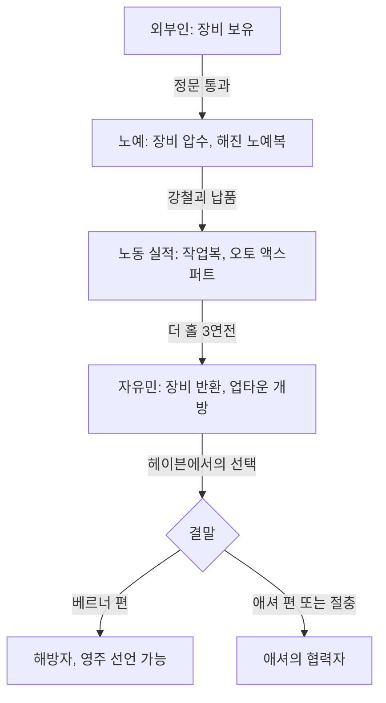

- 압수는 「피트 속으로」 단계 200 직전 정문 대화에서 일괄 처리되고, 반환은 더 홀 밖 사물함이 그루버 처치 후에 생성되는 방식이다. 사물함을 닫기 전에 모두 꺼내야 한다.
- 압수 상태에서도 퀘스트 아이템은 유지된다. 오퍼레이션: 앵커리지의 시뮬레이션([RD-08a](08a_dlc-operation-anchorage.md))과 같은 계열의 '장비 박탈' 장치지만, 앵커리지가 별도 런으로 격리하는 반면 더 피트는 같은 캐릭터 상태를 유지한 채 장비만 빼앗는다.

### 9.2 강철괴 수집 루프

| 규칙 | 내용 |
|---|---|
| 총량·분포 | 100개 = 제강소 79 + 보급 공장 18 + 버려진 구역 3. 고정 배치(리스폰 없음) |
| 무게 | 「위험한 작업 환경」 진행 중 0(퀘스트 아이템), 첫 납품 이후 개당 1 |
| 가치 | 개당 1캡(판매용 가치는 거의 없음) |
| 납품 | 에버렛에게 10개 단위로만 납품. 누적 10개마다 유니크 장비 1종(3.4절 표) |
| 메인 조건 | 최소 10개(오토 액스퍼트 퍽은 10개 '수집' 시, 노동자 작업복은 첫 10개 '납품' 시) |
| 업적 | 100개 납품 시 Mill Worker |
| 단서 | 주변의 검은색·빨간색 페인트 자국 |
| 장애 | 트로그·와일드맨, 추락 지형, 보급 공장 Average 자물쇠(강제 따기 실패 시 진행 불가) |
| 지속성 | 「자유 노동」 완료 후에도 납품 가능 |

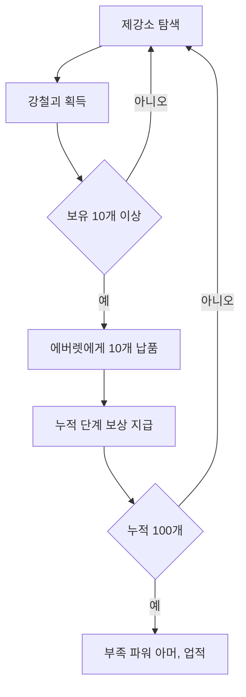

### 9.3 투기장(더 홀) 규칙

| 규칙 | 내용 |
|---|---|
| 참가 | 애셔의 광장 연설 후 페이드라에게 등록. 3라운드 고정, 라운드마다 입장 → 승리 → 퇴장 |
| 장비 | 무엇이든 반입 가능. 페이드라의 사물함에 저급 무기(저구경 권총, 근접 무기), 의료 테이블에 라드-X 2 |
| 환경 위험 | 경기 시작과 함께 방사능 통이 떨어지고 그 뒤에 문이 열린다. 통은 엄폐물이자 방사능원. 1라운드에서는 떨어지는 통에 상대가 깔려 죽기도 함 |
| 승리 조건 | 상대 전원 처치 후 퇴장 |
| 라운드 사이 | 페이드라가 방사능을 모두 제거(체력 회복 없음). 식수대: 경기 중 1라드, 모든 경기 후 3라드 |
| 루팅 | 쓰러뜨린 상대의 장비를 자유롭게 획득(정정당당한 시합이 아님) |
| 관중 연출 | 명중할 때 함성. 시합이 지루하면 레이더가 우리 안으로 총을 쏜다는 설정 |
| 보상 | 피트 파이터 퍽, 자유민 신분, 압수 장비 반환 |

### 9.4 혈거인 퇴행 전염병(TDC)과 빛
- 피트의 오염(낙진 + 산업 독성)에 오래 노출되면 정신이 무너져 와일드맨이 되거나 완전히 퇴화해 트로그가 된다(샌드라의 연구상 감염자의 약 20%가 트로그화). 피트에서는 아이가 태어나도 곧 트로그가 되므로 인구를 노예 사냥으로만 늘릴 수 있다.
- 트로그는 빛에 민감하다. 업타운은 투광등이, 헤이븐 안뜰은 거대한 조형물 양옆의 불기둥이 트로그를 막는다. 그래서 트로그는 조명이 꺼진 제강소·지하·버려진 아파트에만 산다.
- 이 설정이 베르너 편 결말의 무기가 된다. 지하 발전소의 투광등을 끄면 트로그가 업타운으로 쏟아져 레이더를 공격한다. 애셔 편에서는 이 터미널 자체가 사라진다.
- 마리의 면역은 방사능과 TDC 모두에 작용하며, 샌드라의 노트는 방사능 질환과 '여섯 번째 발가락' 같은 흔한 돌연변이에도 면역이 이어질 가능성을 적고 있다.

### 9.5 탄약 압착기 (경제·제작)
- 수치와 공식은 6.4절. 본편의 작업대(Workbench)가 무기 '설계도 제작'이라면, 탄약 압착기는 쓰지 않는 실탄과 고철을 원하는 실탄으로 바꾸는 '자원 변환기'다.
- 고철(가치 20)이 가장 효율적인 재료이며, 결과물을 팔거나 동료에게 줄 수 있다. 에너지 무기 탄약은 만들 수 없다.

### 9.6 별도 월드맵과 이동
- 피트는 독립 월드맵이다. 조차장·다리·다운타운·제강소·업타운·헤이븐 등에 지도 마커가 있고, 피트 안에서는 빠른 이동이 가능하다(노예 단계의 정문 봉쇄 등 진행 제약은 별도).
- 베르너 편에서 투광등을 끈 뒤에는 주변에 적이 없을 때 다운타운으로 빠른 이동할 수 있다.
- 수도 황무지와의 출입은 철도 터널 ↔ 피트 조차장을 잇는 핸드카 1개 경로뿐이다. 동료는 따라오지 않는다.

### 9.7 노예 사회의 생활 서비스
- 회복 수단이 제한된다. 노예 단계에서는 카이의 슬롭(HP +25, 라드 +25), 놀라의 무료 치료(불구 위험)가 주력이고, 자유민 이후 팬텀의 하루 1회 라드어웨이(RadAway)와 업타운 상인을 이용한다.
- 보관함: 미디아의 책상, 버려진 구역 입구 사물함은 내용물이 초기화되지 않는다. 반대로 철도 터널 노예 캠프의 사물함·탄약 상자는 피트에 들어간 뒤 비활성화되므로 보관용으로 쓰면 안 된다.

### 9.8 카르마·적대 규칙 정리

| 행동 | 결과 |
|---|---|
| 프로스퍼를 위협해 옷을 빼앗음 / 무상 해방 | 악 / 선 카르마(수치 코퍼스 미확인) |
| 노예 사냥꾼 램지 일당 처치 | 카르마 변동 없음(악 카르마 NPC) |
| 브랜드에게 정보 제공 | 건당 카르마 -15, 스팀팩 2, 25 XP |
| 다운타운 노예 공격 | 즉시 반응 없음 → 제철소 진입 시 노예 약 15명 공격 |
| 업타운 진입 전 다운타운 레이더 공격 | 업타운 레이더 적대(게임 내 며칠 뒤 해제) |
| 애셔 방 금고를 따서 일기 절도 | 악 카르마 |
| 헤이븐에서 샌드라 살해 | 악 카르마 |
| 폭동 노예 살해(애셔 편) | 카르마 손실 가능 |
| 베르너가 먼저 공격한 경우의 처치 | 카르마 변동 없음 |

---

## 10. 업적·트로피

업적 전체 정본은 [RD-23](23_collectibles-achievements.md)이다.

| 업적·트로피 | English | 조건 | 포인트 | 트로피 |
|---|---|---|---|---|
| 피트 속으로 | Into The Pitt | 「Into The Pitt」 완료 | 20G | 실버 |
| 위험한 작업 환경 | Unsafe Working Conditions | 「Unsafe Working Conditions」 완료 | 20G | 실버 |
| 자유 노동 | Free Labor | 「Free Labor」 완료 | 40G | 골드 |
| 제철소 일꾼 | Mill Worker | 강철괴 100개 발견(에버렛에게 전부 납품해야 달성) | 20G | 실버 |

- 수집형 업적(Mill Worker)이 처음 등장한 애드온이다. 100개를 모두 납품해야 해제되므로 마지막 묶음이 10개 미만이면 달성되지 않는다는 보고가 있다(10개 단위 납품 규칙과의 충돌).
- 결말 루트와 무관하게 모든 업적을 얻을 수 있다.

---

## 11. 설계 분석

### 11.1 본편과 다르게 실험한 것
1. **신분 상승 구조**: 노예 → 노동자 → 투사 → 자유민 → 영주(선택)라는 사회적 사다리를 퀘스트 단계와 공간 개방에 그대로 대응시켰다. 본편의 '레벨이 오르면 강해진다'에 '신분이 오르면 세계가 열린다'를 겹쳤다.
2. **장비 박탈과 재무장**: 첫 퀘스트 끝에서 모든 장비를 빼앗고 DLC 보상으로 다시 무장하게 하는 '리빌드 곡선'. 고레벨 캐릭터에게도 초반 같은 긴장감을 준다.
3. **강한 수집 메타**: 강철괴 100개와 10단계 보상 사다리. 필수량(10)과 완전 수집(100)을 같은 공간에 겹쳐 탐색 깊이를 플레이어가 정한다.
4. **도덕적 회색 결말**: 선악이 분명했던 본편 선택(메가톤(Megaton) 폭파 등)과 달리, 양쪽 지도자 모두 명분과 결함을 지니며 결말 루트 자체에 카르마가 걸려 있지 않다.
5. **환경 규칙의 서사화**: '트로그는 빛을 싫어한다'는 생태 설정이 도시의 계급 구조(빛 아래의 지배층)와 결말 수단(투광등 차단)을 모두 설명한다.
6. **짧은 개발 기간 속의 강한 아트 정체성**: 약 2개월 반 개발에도 주황빛 대기, 녹슨 제철소, 헤이븐 앞 조형물로 본편과 확연히 다른 색채를 만들었다([RD-25](25_art-audio-presentation.md)).

### 11.2 플레이어 경험
- 강점: 장비를 잃은 상태에서 시작해 점점 강해지는 성장감, 수직 구조 제강소의 탐험성, 투기장이라는 명확한 클라이맥스, 결말 직전까지 정보를 모아 판단하게 하는 구조(애셔의 일기, 샌드라의 연구, 미디아의 속내).
- 약점: 결말 뒤 월드 반응이 빈약하다. 해방된 노예에게 새 대사가 거의 없고, 본편 엔딩 슬라이드에도 반영되지 않는다(엔딩 문서에 더 피트 항목이 없음). 절충 루트는 보상·후일담이 애셔 편과 거의 같아 변별력이 약하다. 제강소의 트로그 전투가 반복적이며, 강철괴 수집이 길게 느껴질 수 있다.

### 11.3 다른 시스템과의 연계
- **노예제와 노예 사냥꾼**: 철도 터널의 파라다이스폴 노예 사냥꾼, 본편의 노예 해방 관련 선택과 이어진다([RD-09](09_factions.md)).
- **브라더후드 오브 스틸의 역사**: 스커지, 코디악의 출신, 애셔의 과거로 BoS 동부 원정의 어두운 면을 보여 준다([RD-02](02_world-and-lore.md)).
- **방사능 체계**: 퍽 3개 중 2개가 방사능 저항, 투기장의 방사능 통, 슬롭의 라드, 치사량 강물 등 방사능이 DLC 전체의 위험 축이다([RD-15](15_status-survival.md)).
- **경제**: 탄약 압착기와 곰 인형 매입으로 DLC 종료 후 재방문 동기를 남긴다([RD-22](22_economy-housing.md)).
- **장비 곡선**: 애셔·부족 파워 아머(T-45d 계열), 메탈 블래스터, 퍼포레이터 등 중반 이후 쓸 만한 유니크가 집중되어 있다([RD-19](19_weapons-ammo.md)·[RD-20](20_armor-apparel.md)).

---

## 12. 쯔꾸르 이식 메모

**보존 필수**
- 위장 잠입 → 장비 압수 → 노동 → 투기장 → 자유민 → 결말 선택의 6단 구조와 신분별 출입 제한.
- 강철괴 100개(79/18/3 분포)와 10개 단위 보상표, 퀘스트 중 무게 0 규칙.
- 더 홀 3연전의 라운드 구성(노예 투사 → 베어 형제 → 그루버)과 '라운드 사이 방사능 정화, 체력 미회복' 규칙.
- 결말 3루트(베르너 편 / 애셔 편 / 절충)와 루트를 확정하는 행동 지점(헤이븐, 은신처).
- 트로그는 빛을 피한다는 설정과 투광등 차단 결말.

**단순화**
- 정문 분기(위장 / 거짓말 / 모집 / 전투)는 '압수 후 시작 위치 2종'으로 묶어도 된다. 결과 차이는 시작 단계 10과 15뿐이다.
- 탄약 압착기는 '탄약 교환 상점'(가치표 기반 환산)으로 구현한다. 6.4절 가치표를 그대로 쓴다.
- 트로그 4단계(유체·일반·브루트·새비지)는 레벨 연동 몬스터 그룹 1세트로 만든다.

**생략·변형 후보**
- 피트 레이더 아머 5종은 스킬 보너스만 다른 같은 계열이므로 2~3종으로 줄일 수 있다.
- 와일드 빌·노예 밀고자 같은 소규모 비표시 퀘스트는 NPC 대화 이벤트 1~2개로 충분하다.
- 별도 월드맵은 '철도 터널 이벤트 → 피트 맵 세트'로 구성하고, 피트 내부 빠른 이동은 정거장식 메뉴로 대체한다.

**구현 시 주의**
- 장비 압수·반환은 오퍼레이션: 앵커리지와 같은 인벤토리 스냅숏 기능이 필요하다. 반환은 '사물함 이벤트에서 일괄 지급'으로 처리하면 단순하다.
- 신분에 따라 NPC 대사·적대 여부가 바뀌므로 '피트 신분' 변수를 하나 두고 모든 피트 NPC 이벤트 조건에 연결한다.
- 다운타운에서 노예를 공격하면 제철소에서 집단 적대가 발동하는 것처럼, 장소 진입 시 적대 판정을 다시 계산하는 구조가 필요하다.
- 결말별로 상인(프라이데이·해리스) 생존, 헤이븐 출입, 미디아·밀리 대화 가능 여부가 달라진다. 결말 변수 하나로 관리하고 사후 이벤트를 분기한다.
- 퀘스트 중 무게 0 규칙을 살리려면 '퀘스트 진행 중 아이템 무게 무시' 처리가 필요하다(무게 시스템을 이식하는 경우).

---

## 13. 출처

- Nukapedia: Fallout 3 quests
- Nukapedia: The Pitt (add-on)
- Nukapedia: Fallout 3 add-ons
- Nukapedia: The Pitt (Fallout 3) / The Pitt / The Pitt map / The Pitt Uprising
- Nukapedia: Fallout 3 Game of the Year Edition Tour of The Pitt (요약 인용만)
- Nukapedia: Into The Pitt / Unsafe Working Conditions / Free Labor / Mill Worker / Wild Bill's Last Stand / Slave Snitch / Toys for Tots
- Nukapedia: Ishmael Ashur / Sandra Kundanika / Marie (The Pitt) / Wernher / Midea / Krenshaw / Everett / Friday / Harris / Nola / Phantom / Kai / Marco (The Pitt) / Faydra / Gruber / Grudd Bear / John Bear / Mex / Reddup / Jackson (The Pitt) / Bingo (The Pitt) / Bone (character) / Duke (The Pitt) / Hammer (The Pitt) / Lulu / Mona / Vikia / Spook / Squill / O-Dog / Trouble Man / Slave master / Adan / Brand / Milly / Wild Bill / John-John / Billy (The Pitt) / Pitt slave lead conspirator / Slave fighter / Ramsey / Prosper
- Nukapedia: Trog (The Pitt) / Wildmen / Pitt raider (character) / Pitt raiders (faction) / Pitt slaves (faction) / Troglodyte degeneration contagion / Dog (Fallout 3)
- Nukapedia: Radio tower / Train tunnel (The Pitt) / Pitt train yard / The Pitt bridge / The Pitt Downtown / Midea's quarters / The Mill / The Hole (The Pitt) / Abandoned area / Pitt steelyard / Supply plant / Wernher's hideout / The Pitt Uptown / Abandoned apartments / Haven / The Pitt underground
- Nukapedia: Auto axe (The Pitt) / Man Opener / The Mauler / Steel saw / Steel knuckles / Infiltrator (The Pitt) / Perforator / Metal Blaster / Wild Bill's Sidearm (The Pitt) / Concealed .32 pistol / Concealed switchblade
- Nukapedia: Ashur's power armor / Tribal power armor / Gamma shield armor / Metal Master armor / Leather Rebel / Bombshell armor / Raider iconoclast armor / Raider commando armor / Raider throwdown armor / Raider ordinance armor / Raider paingiver armor / Laborer outfit / Slave outfit / Filtration helmet / Supervisor helmet (The Pitt) / Welder's mask / Hat of the People
- Nukapedia: Slop / Steel ingot (The Pitt) / Ammo press / Ashur's diary / Cure research / Haven terminal entries / Pitt broadcast / Wernher's distress signal
- Nukapedia: Auto Axpert / Pitt Fighter / Booster Shot / Fallout 3 perks
- Nukapedia: DLC01Ashur.txt / DLC01Quest01SCRIPT / DLC01PlayerItemContainerSCRIPT
- Nukapedia: Fallout 3 achievements and trophies
