# RD-08c. DLC: 브로큰 스틸

> **폴아웃 3 역기획서 세트** | 문서 ID: RD-08c | 버전: v1.0 | 작성일: 2026-10-11
> **범위**: 애드온 [BS] 브로큰 스틸(Broken Steel)의 개요, 스토리, 퀘스트 10개 상세(메인 3·사이드 3·비표시 2·반복 2), 신규 장소·NPC·장비·퍽·적, 레벨 상한 30과 엔딩 변경 등 규칙 변화, 업적. 무기·방어구·퍽·적·장소의 전체 수치는 각 카탈로그 정본(RD-19/20/14/24/13)이 다루며 이 문서는 DLC 맥락의 요약만 둔다. 본편 엔딩 시스템 전체는 RD-04가 다룬다.
> **관련 문서**: [RD-01 게임 개요](01_game-overview.md), [RD-04 메인 스토리 2부·엔딩](04_main-story-part2-endings.md), [RD-07 비표시·반복 퀘스트와 랜덤 인카운터](07_misc-quests-encounters.md), [RD-09 팩션](09_factions.md), [RD-10 주요 인물·동료](10_characters-major-companions.md), [RD-13 장소 카탈로그](13_location-catalog.md), [RD-14 캐릭터 시스템](14_character-system.md), [RD-19 무기·탄약](19_weapons-ammo.md), [RD-20 방어구·의복](20_armor-apparel.md), [RD-21 소모품·잡화·제작](21_consumables-misc-crafting.md), [RD-23 수집 요소·업적](23_collectibles-achievements.md), [RD-24 크리처·적 도감](24_bestiary.md)

---

## 0. 문서 개요

### 0.1 목적
- [BS] 브로큰 스틸이 본편에 더한 **이야기·퀘스트·콘텐츠·규칙 변화**를 한 문서로 정리함.
- 팬게임에서 '본편 엔딩 이후 이어하기'와 '레벨 21~30 구간'을 구현할 때 기준 자료로 씀.

### 0.2 범위
- 다룸: DLC 개요, 시놉시스, 허브 `Fallout 3 quests`의 브로큰 스틸 섹션에 있는 퀘스트 10개 전부, 신규 장소·NPC·장비·퍽·적의 요약, 레벨 상한·엔딩·정화수 배급·엔클레이브 잔당 등 규칙 변화, 업적·트로피.
- 다루지 않음: 무기·방어구·적의 전체 수치(각 카탈로그 정본), 본편 엔딩 슬라이드 전체 구조(RD-04), 본편 반복 퀘스트 '물 거지(Water Beggars)'(RD-07, 아쿠아 퓨라로도 진행 가능하다는 점만 언급).

### 0.3 요약
- 브로큰 스틸은 본편 최종 퀘스트 「되찾아라!(Take It Back!)」의 '주인공 사망 엔딩'을 **'2주 혼수 후 각성'으로 바꿔** 게임을 계속하게 만든 애드온임.
- 메인 퀘스트 3개는 브라더후드 오브 스틸(BoS)이 엔클레이브(Enclave) 잔당을 추적해 위성 중계소 → 올니 발전소 → 애덤스 공군 기지(Adams Air Force Base)로 이어지는 3단 작전이며, 마지막에 궤도 타격 목표를 고르는 **카르마 ±1000의 양자택일**로 끝남.
- 사이드 퀘스트는 정화수 브랜드 아쿠아 퓨라(Aqua Pura) **배급망을 둘러싼 사회 문제**(사이비 교단, 도적, 사기꾼)를 다룸.
- 시스템 면에서는 **레벨 상한 20 → 30**, 신규 퍽 14개, 고레벨 적 4종 계열(오버로드·리버·알비노 라드스코피온(Radscorpion)·헬파이어 트루퍼)을 더해 본편의 성장 곡선을 연장함.

### 0.4 표기 메모
- 고유명사는 [RD-26 용어집](26_glossary.md)을 따름. 용어집에 없는 이름은 음차하고 최종 보고에 신규 용어로 제출함.
- 퀘스트 ID는 위키 표기 `xx000802` 형식으로 적음. `xx`는 플러그인 로드 순서에 따라 바뀌는 자리임. 에디터 ID(edid)를 함께 적음.
- 스킬 판정은 코퍼스가 수치를 주면 수치로, 난이도 등급만 주면 등급(쉬움·어려움·매우 어려움)으로 적음. 폴아웃 3의 화술 판정은 성공 확률식이므로 수치가 없는 경우가 많음(공식은 [RD-17](17_exploration-interaction.md) 참조).
- 잠금·터미널 난이도는 본편 규칙(쉬움 25 / 보통 50 / 어려움 75 / 매우 어려움 100)을 따름(상세는 RD-17).

---

## 1. DLC 개요

| 항목 | 내용 |
|---|---|
| 정식 명칭 | 브로큰 스틸(*Broken Steel*) — 폴아웃 3의 세 번째 애드온 |
| 개발 / 유통 | 베데스다 게임 스튜디오(Bethesda Game Studios) / 베데스다 소프트웍스(Bethesda Softworks) |
| 출시일 | PC·Xbox 360: 2009-05-05 (PC는 초기 다운로드 문제로 05-07 재배포) / PS3: 2009-09-24 (PS3로 나온 첫 애드온) |
| 기타 판본 | 디스크판 *Fallout 3 Game Add-on Pack* 2탄(포인트 룩아웃과 합본, 2009-08-25, $19.99) / GOTY 에디션(2009-10-13) / Steam(2010-07-16) / GOG(2017-06-02) |
| 가격 | 800 MS 포인트 또는 $9.99 (애드온 공통) |
| 용량·필요 패치 | 746 MB / PC·360 패치 1.5, PS3 패치 1.6 |
| 진입 조건 | 본편 메인 퀘스트 「되찾아라!」에서 **정화기를 가동**해야 함(주인공, 사라 라이언(Sarah Lyons), 방사능 면역 동료 중 누구든). 정화기를 폭발시키면 브로큰 스틸이 있어도 게임 종료 |
| 시작 트리거 | 「되찾아라!」 완료 → 엔딩 영상 → **2주 뒤 시타델(The Citadel) 의무실에서 각성** → 「하늘에서 내리는 죽음」 자동 시작 |
| 권장 레벨 | 공식 권장 레벨 없음(코퍼스 미확인). 본편 최종 퀘스트 직후 시작하므로 본편 후반 레벨을 전제로 함. 신규 고레벨 적은 레벨 연동 목록으로 등장 시점이 정해짐(9.5절) |
| 레벨 상한 | 20 → 30. **설치 즉시 적용**되므로 본편 진행 중이어도 다시 XP가 쌓임 |
| 플레이 볼륨 | 메인 퀘스트 약 5시간, 사이드 퀘스트 최대 약 1시간 (코퍼스 기준). 메인 퀘스트 길이는 오퍼레이션: 앵커리지·더 피트와 같은 수준 |
| 구성 | 메인 3 / 사이드 3 / 비표시 2 / 반복 2 = 퀘스트 10개, 신규 퍽 14개, 업적·트로피 6개(150점) |
| 핵심 콘셉트 | ① 본편 엔딩 이후 **이어하기(포스트 엔딩 자유 플레이)** ② 엔클레이브 잔당을 뿌리 뽑는 BoS 3부작 ③ 레벨 상한 확장과 고레벨 콘텐츠 ④ 정화수가 흐르기 시작한 웨이스트랜드의 '그다음 문제' |

> 공식 소개문 요지: "기존 폴아웃 3 게임을 이어서, 리버티 프라임(Liberty Prime)과 함께 엔클레이브 잔당과의 싸움을 끝내라. 레벨 상한이 20에서 30으로 올라간다."

---

## 2. 스토리 시놉시스 (스포일러 포함)

### 2.1 전사: 각성
- 정화 계획(Project Purity)의 정화기를 가동하는 순간 **에너지 급증(energy spike)**이 일어나 외로운 방랑자(Lone Wanderer)와 사라 라이언(Sarah Lyons)이 함께 쓰러짐. 팔라딘 트리스탄(Paladin Tristan)의 팀이 둘을 시타델로 옮김.
- 주인공은 **2주 뒤** 의무실에서 깨어남. 엘더 오윈 라이언(Elder Owyn Lyons)이 직접 맞이하며 주인공을 **나이트(Knight)로 임명**하고, 그동안의 상황을 알려 줌.
  - 사라가 정화기를 가동했다면 사라는 사망, 그렇지 않았다면 혼수상태임. 엘더의 첫 대사도 이 조건에 따라 달라짐.
  - 정화기에 변형 FEV를 넣었다면(프로젝트 임퓨리티) 그 결과도 이때 언급됨.
- 그사이 BoS는 리버티 프라임을 앞세워 엔클레이브 캠프를 차례로 쓸어 냈고, 정화수는 '아쿠아 퓨라'라는 이름으로 병에 담겨 배급되기 시작함.

### 2.2 1막: 하늘에서 내리는 죽음
- 레이븐 락(Raven Rock)이 무너졌는데도 엔클레이브가 흩어진 병력을 계속 지휘하는 이유를 캐기 위해, 로스차일드 서기(Scribe Rothchild)가 신호 발신지인 남서쪽의 **위성 중계소(Satellite relay station)**를 지목함.
- 주인공은 록랜드 자동차 터널(Rockland car tunnel)에서 트리스탄과 합류해 리버티 프라임과 함께 진격함. 그러나 중계소 앞에서 **궤도 미사일 타격**이 떨어져 리버티 프라임이 파괴됨.
- 주인공은 중계소에 침투해 암호화된 원격 측정 데이터를 회수함. 해독 결과 엔클레이브의 새 본거지가 **애덤스 공군 기지**이며, 엔클레이브가 궤도 미사일 위성(브래들리-허큘리스, Bradley-Hercules)을 쓸 수 있음이 드러남.

### 2.3 2막: 충격의 가치
- 리버티 프라임을 잃은 BoS의 마지막 대공 수단은 **테슬라 캐논(Tesla cannon)** 개발 계획임. 남은 부품인 **테슬라 코일**을 구하러 주인공이 올드 올니(Old Olney) 지하를 거쳐 **올니 발전소(Olney Powerworks)**로 감.
- 선택적으로 밸린코트 서기(Scribe Vallincourt)의 **데스클로(Deathclaw) 제어 교란기**를 시험하며, 지하에서는 데스클로 둥지 때문에 몰살당한 구울 정착민의 생존자 윈트(Wint)와 키드(Kidd)를 만남.

### 2.4 3막: 도전하는 자가 승리한다
- 주인공은 백악관 지하의 **대통령 전용 지하철(Presidential metro)**로 애덤스 공군 기지에 잠입함. 지하철 관리 AI 마고(M.A.R.Go.T.)를 속이거나 설득하고, 끊긴 주 퓨즈 문제를 해결해 열차를 탐.
- 기지에서는 BoS 본대가 양동 공격을 벌이는 동안 주인공이 관제탑에서 램프를 내리고 **이동식 기지 크롤러(Mobile base crawler)**에 진입함. 정예 엔클레이브 시그마 분대(Enclave Squad Sigma)와 데스클로 연구 시설을 돌파해 위성 관제탑에 도달함.
- 위성 상향 링크 터미널에서 궤도 타격 목표를 고름.
  - **애덤스 기지 플랫폼**: 크롤러가 파괴되고 동부 엔클레이브 세력이 사실상 궤멸함. 카르마 +1000. 시타델에서 엘더 라이언(Elder Lyons)의 감사 연설을 듣고 반복 퀘스트 2개가 열림.
  - **시타델**: 시타델이 폐허가 되고 엘더 라이언이 죽으며, 이후 모든 BoS가 적대함. 카르마 −1000. 폐허 속 무기고에서 보상을 얻음.
- 사라 라이언이 살아 있다면 노획한 버티버드(Vertibird)를 몰고 직접 주인공을 태우러 옴.

### 2.5 곁가지: 정화수가 낳은 문제들
- 배급망 책임자 빅슬리 서기(Scribe Bigsley)는 인력·자금 부족에 시달리며, 웨이스트랜드 곳곳에서 물을 둘러싼 갈등이 터짐.
  - 원자의 자손 교회(Church of the Children of Atom)에서 갈라져 나온 **영원한 빛의 사도회**가 메가톤(Megaton)행 물을 가로채 방사능을 쏘인 '성수'로 바꿔 나눠 줌(「성수」).
  - 스플릿 잭(Split Jack)의 도적단이 물 캐러밴을 습격함(「물길을 지켜라」).
  - 구울 장사꾼 그리폰(Griffon)이 정화수를 빼돌려 팔고, 빈 병에 오염수를 담아 '아쿠아 큐라'라는 만병통치약으로 속여 팖(「놀라운 아쿠아 큐라!」).
- 주제적으로는 '깨끗한 물이라는 공공재가 생긴 뒤, 그것을 누가 어떻게 나눌 것인가'라는 본편 이후의 질문을 던짐.

---

## 3. 퀘스트 상세

### 3.0 퀘스트 목록과 전체 흐름

허브 문서 `Fallout 3 quests`의 브로큰 스틸 섹션 기준 10개임. 브로큰 스틸의 사이드 퀘스트는 업적·트로피를 주지 않음(허브 일반 정보).

| # | 영문명 | 한국어명 | 유형 | 퀘스트 ID (edid) | 의뢰인 | 보상 요약 |
|---|---|---|---|---|---|---|
| 1 | Death From Above | 하늘에서 내리는 죽음 | 메인 | xx000802 (DLC03BS1) | 엘더 라이언 | 1300 XP |
| 2 | Shock Value | 충격의 가치 | 메인 | xx000afd (DLC03BS2) | 팔라딘 트리스탄 | 1400 XP |
| 3 | Who Dares Wins | 도전하는 자가 승리한다 | 메인 (최종) | xx0011ad (DLC03BS3) | 팔라딘 트리스탄 | 1500 XP, 테슬라 캐논, 카르마 ±1000 |
| 4 | Holy Water | 성수 | 사이드 | xx004c75 (DLC03WQ03) | 빅슬리 서기 | 100 XP, 300캡 |
| 5 | Protecting the Water Way | 물길을 지켜라 | 사이드 | xx003b42 (DLC03WQ01) | 빅슬리 서기 / 르펠티에 경관 | 100 XP, 엔클레이브 장비 일습 |
| 6 | The Amazing Aqua Cura! | 놀라운 아쿠아 큐라! | 사이드 | xx003b67 (DLC03WQ02) | 그리폰 / 빅슬리 서기 | 100 XP, 캡(선택) |
| 7 | The Sorrowful Suitor | 슬픈 구혼자 | 비표시 | — | 홀로테이프 「Sorry, my darling」 | 유니크 의복·방어구 |
| 8 | Wastelander Water Request | 황무지 주민의 물 요청 | 비표시 | xx0011ab (DLC03Encounters) | 메가톤 주민·캐러밴 경비 | 선한 카르마 |
| 9 | Getting Ready for Prime Time | 프라임 타임 준비 | 반복 | — | 로스차일드 서기 | 카메라 100캡·25 XP / 센서 모듈 75캡·10 XP |
| 10 | Blood Brotherhood | 피의 형제단 | 반복 | — | 팔라딘 트리스탄 | 샘플당 50캡·10 XP |

- 메인 퀘스트는 본편 메인 퀘스트에 이어 13~15번째 메인 퀘스트로 집계됨. 「도전하는 자가 승리한다」가 폴아웃 3 전체의 마지막 메인 퀘스트임.
- 허브 표에서 「황무지 주민의 물 요청」의 ID 칸은 비어 있으나, 퀘스트 문서 정보상자는 `xx0011ab`(DLC03Encounters)를 적고 있음. edid로 보아 독립 퀘스트라기보다 브로큰 스틸 인카운터 관리 퀘스트 안의 한 장면으로 보임(추정).
- 「프라임 타임 준비」와 「피의 형제단」은 시타델을 파괴하지 않고 「도전하는 자가 승리한다」를 끝내야 열림.

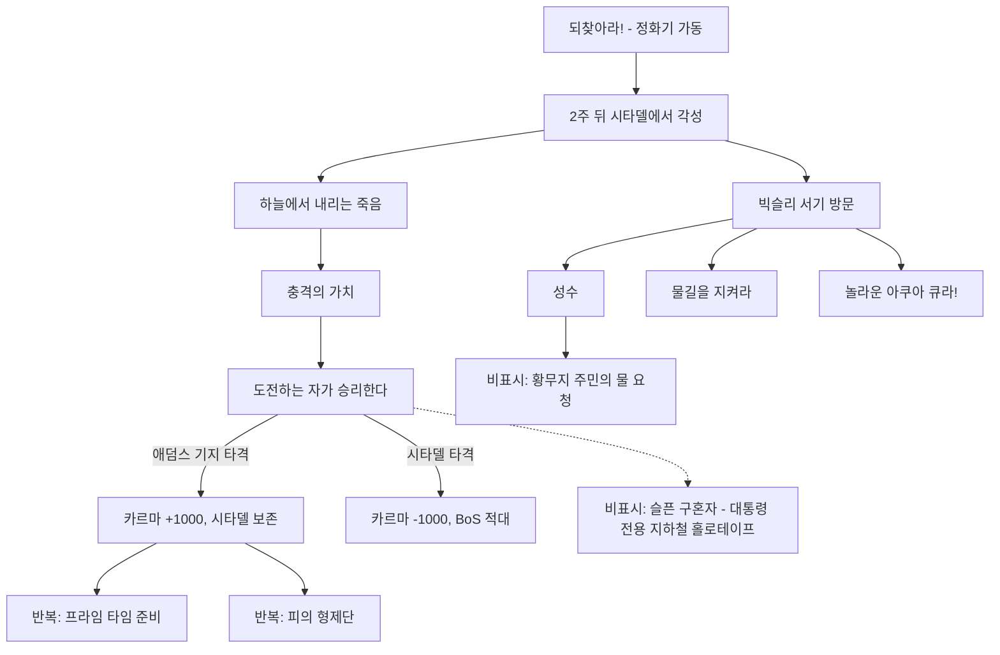

---

### 3.1 하늘에서 내리는 죽음 (Death From Above)

> "I just... I can't believe it. All those years of work. All of it, for what? One botched operation?"
> "믿을 수가 없어. 그 오랜 세월의 작업이… 다 무엇을 위해서였지? 작전 한 번 망친 걸로?" — 로스차일드 서기, 리버티 프라임을 잃은 뒤

| 항목 | 내용 |
|---|---|
| 영문명 / 한국어명 | Death From Above / 하늘에서 내리는 죽음 |
| 유형 | 메인 (브로큰 스틸 1번째, 전체 13번째 메인 퀘스트) |
| 퀘스트 ID | xx000802 (edid `DLC03BS1`) |
| 의뢰인 | 엘더 라이언 (세부 브리핑: 로스차일드 서기) |
| 시작 조건 | 「되찾아라!」에서 정화기가 가동된 뒤 2주 뒤 시타델 의무실에서 깨어나면 자동 시작 |
| 관련 장소 | 시타델, 록랜드 자동차 터널, 위성 중계소 |
| 선행 / 후행 | 「되찾아라!」 / 「충격의 가치」 |
| 보상 | 1300 XP |
| 카르마 | 변화 없음 |
| 업적·트로피 | 「Death From Above」 30점 / 은 트로피 |

**개요**
- 레이븐 락이 무너졌는데도 엔클레이브가 흩어진 병력을 계속 지휘하고 있음. BoS는 그 통신의 발신지를 남서쪽 록랜드의 옛 군사 시설로 좁혔고, 리버티 프라임을 앞세운 공격에 주인공을 보냄.
- 각성 직후 엘더 라이언이 주인공을 나이트로 임명하고 지난 2주의 상황을 설명함.

**진행 단계**

| 단계 | 핍-보이(Pip-Boy) 목표 | 플레이어 행동·이벤트 |
|---|---|---|
| 10 | 로스차일드 서기와 대화 | 시타델 의무실에서 깨어나 엘더 라이언과 대화함(나이트 임명). 로스차일드가 리버티 프라임의 전과와 이번 작전 목표(엔클레이브 통신 수단 규명)를 브리핑함 |
| 15 | 록랜드 자동차 터널에서 팔라딘 트리스탄과 합류 | 수도 황무지(Capital Wasteland) 남서쪽 끝, 던위치 빌딩(Dunwich Building) 서쪽의 터널로 이동함. 터널은 이미 BoS가 엔클레이브를 몰아내고 거점으로 쓰는 중임 |
| 20 | 공격 중 팔라딘 트리스탄을 지원 | 트리스탄과 함께 터널 밖으로 나가 리버티 프라임과 합류함. 프라임이 협곡을 걸어 내려가며 버티버드를 떨어뜨리고 적을 쓸어 냄. 플레이어는 함께 싸우거나 지켜볼 수 있음. 중계소에 도착한 프라임이 벽에 구멍을 낸 직후 **궤도 타격 경고**가 나오고, 미사일이 프라임을 파괴함 |
| 30 | 위성 중계소에서 데이터 회수 | 작전 장교 에드워즈(Operations Officer Edwards)와 팔라딘 분대와 함께 중계소 내부를 돌파함. 위성 상향 링크(메인프레임) 터미널에서 암호화된 원격 측정 데이터를 내려받음 |
| 40 | 데이터를 로스차일드 서기에게 전달 | 시타델로 돌아가 데이터를 넘김. 로스차일드가 프라임의 최후를 한탄함 |
| 50 | 엘더 라이언에게 보고 (완료) | 엘더와 대화하면 완료되고 「충격의 가치」가 시작됨 |

**분기와 해결 방법**
- 이 퀘스트에는 결과가 달라지는 분기가 없음. 플레이 방식만 갈림.
  - **진격 참여 / 관전**: 리버티 프라임 진격 구간에서 직접 싸우거나 뒤에서 지켜볼 수 있음. 어느 쪽이든 진행에 영향 없음.
  - **궤도 타격 회피**: 경고 직후 프라임에게서 떨어지지 않으면 주인공도 타격에 휘말려 죽음. 사실상 '물러서라'는 연출 지시를 따르는 생존 판정임.
- 중계소 내부는 선형 구조이며 엔클레이브 병사 총 24명과 자동 터렛이 지킴. 전투가 기본 해법임.

**결과와 후일담**
- **리버티 프라임 파괴**: 남은 한 팔로 몇 미터를 기어가다 멈춤. 떨어진 머리는 메가톤의 웰드 보안관(Deputy Weld) 머리처럼 작동시킬 수 있고, 일그러진 반공 구호를 냄. 이후 머리는 시타델 실험실로 옮겨짐(「프라임 타임 준비」).
- 주인공은 BoS 나이트 계급이 됨(엘더가 수습 과정 없이 직접 임명).
- 엔클레이브가 **궤도 미사일 위성**을 쓸 수 있다는 사실과, 새 본거지가 애덤스 공군 기지라는 사실이 다음 퀘스트들에서 밝혀짐.
- 위성 중계소는 수도 황무지와 별개인 독립 월드스페이스임. 퀘스트 뒤 일부 엔클레이브 병사가 리스폰함.

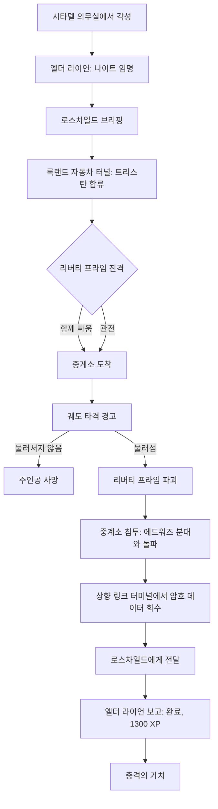

**관련 NPC·아이템·대사 포인트**
- NPC: 엘더 라이언, 로스차일드 서기, 팔라딘 트리스탄, 작전 장교 에드워즈, 리버티 프라임.
- 엘더의 각성 대사는 누가 정화기를 가동했는지에 따라 여러 갈래로 나뉨(예: 에너지 급증으로 주인공과 사라가 함께 쓰러짐 / 폭발로 주인공만 쓰러짐 / 제어실에서 쓰러진 채 발견됨). 사라가 희생한 경우 엘더는 딸이 주인공을 위험에 내몰지 않으려 했을 것이라며 딸을 자랑스러워함.
- 각성 직전 암전 화면에는 트리스탄("What the hell happened in here…"), 엘더("What do you mean, comatose?…"), 로스차일드의 짧은 전환 대사가 흘러 2주의 공백을 소리로 메움.
- 록랜드 자동차 터널에는 엔클레이브 파워 아머 7벌이 시체 더미 등에 흩어져 있음(BoS가 회수 중인 노획품이라는 설정).

**비고**
- 리버티 프라임 파괴 연출에는 BGS 아티스트 다니엘 T. 리(Daniel T. Lee)와 마크 티어(Mark Teare)가 참여함(위키 비하인드).

**설계 분석**
- **최강 아군의 즉시 제거**: 본편 최종전의 상징인 리버티 프라임을 첫 퀘스트에서 부숨으로써, 엔딩 후에도 '위협이 끝나지 않았다'는 긴장을 단숨에 복원함. 동시에 새 위협(궤도 무기)의 규모를 보여 주는 '보여 주기' 연출임.
- 본편 최종 퀘스트의 '거대 로봇 호위 진격' 문법을 재사용해 익숙함을 주고, 그 문법을 배반하는 반전으로 마무리함.

---

### 3.2 충격의 가치 (Shock Value)

> "Get there, get the coil, and get back as safely and quickly as possible. Any questions?"
> "가서, 코일을 챙기고, 최대한 안전하고 빠르게 돌아온다. 질문 있나?" — 팔라딘 트리스탄

| 항목 | 내용 |
|---|---|
| 영문명 / 한국어명 | Shock Value / 충격의 가치 |
| 유형 | 메인 (브로큰 스틸 2번째, 전체 14번째 메인 퀘스트) |
| 퀘스트 ID | xx000afd (edid `DLC03BS2`) |
| 의뢰인 | 팔라딘 트리스탄 |
| 시작 조건 | 「하늘에서 내리는 죽음」 완료 직후 트리스탄과 대화 |
| 관련 장소 | 시타델, 올드 올니(올니 하수도 → 올드 올니 지하 → 올드 올니 S. 윌슨 빌딩), 올니 발전소, 올드 올니 남동쪽 엔클레이브 캠프 |
| 선행 / 후행 | 「하늘에서 내리는 죽음」 / 「도전하는 자가 승리한다」 |
| 보상 | 1400 XP (선택 경로에서 외계인 동력 전지·회복 아이템) |
| 카르마 | 변화 없음 |
| 업적·트로피 | 「Shock Value」 30점 / 은 트로피 |

**개요**
- 리버티 프라임을 잃은 BoS가 엔클레이브 버티버드에 맞설 마지막 카드는 개발 중인 **테슬라 캐논**임. 남은 핵심 부품인 전쟁 전 실험 장치 **테슬라 코일**을 올니 발전소 폐허에서 회수해야 함.
- 가는 길인 올드 올니 지하는 데스클로 둥지임.

**진행 단계**

| 단계 | 핍-보이 목표 | 플레이어 행동·이벤트 |
|---|---|---|
| 10 | 팔라딘 트리스탄과 대화 | 테슬라 코일 회수 임무를 받음. "도움이 필요하다"고 하면 밸린코트 서기를 소개받음 |
| 60 | (선택) 시타델 실험실의 밸린코트 서기와 대화 | **데스클로 제어 교란기**를 받고, 시험 장소인 올드 올니 남동쪽 엔클레이브 캠프 위치를 들음 |
| 61 | (선택) 엔클레이브가 조종하는 데스클로를 이용 | 캠프의 데스클로 우리를 열어 데스클로가 엔클레이브 병사를 공격하게 함 |
| 20 | 올니 발전소 폐허 찾기 | 올드 올니의 하수도 입구 → 사다리로 올드 올니 지하 → 구울 윈트·키드와 대화 → 데스클로 지대를 지나 S. 윌슨 빌딩 → 2층(엔클레이브 병사 2명 뒤)의 문으로 발전소 진입 |
| 30 | 테슬라 코일 획득 | 발전소 안쪽 전기 실험실의 코일 챔버에서 코일을 떼어 냄(아래 방법 참조) |
| 40 | 테슬라 코일을 팔라딘 트리스탄에게 전달 | 근처 사다리로 올드 올니 북쪽 맨홀로 나와 시타델로 귀환 |
| 50 | 다음 임무를 위해 팔라딘 트리스탄에게 보고 (완료) | 코일을 넘기면 완료되고 「도전하는 자가 승리한다」가 시작됨 |

**분기와 해결 방법**
- **데스클로 교란기 시험(선택)**
  - 우리 자물쇠를 따거나, 엔클레이브 장교가 가진 열쇠로 염. 무너진 다리 위로 몰래 접근해 교란기 범위에 들어가기만 해도 데스클로가 엔클레이브를 공격함.
  - 해방된 데스클로는 주인공을 따라오지만 엔클레이브 송신기 범위를 벗어나면 경고음 뒤 **머리가 터져 죽음**. 동료는 대기시켜야 함(동료가 데스클로를 죽이면 선택지가 사라짐).
  - 완료 알림이 하수도에 들어갈 때까지 뜨지 않는 경우가 있음.
- **발전소 경로**
  - 지름길: 입구 왼쪽 문. 연결 터미널이 **매우 어려움(과학 100)**이며 열쇠가 필요한 문임. 전리품은 없음.
  - 긴 길: 오른쪽 발전기실(센트리 봇(Sentry bot) 경비) → 작업대 있는 창고 → **어려움** 잠금 문 → 방사능 방출기 6기가 있는 복도 → 변압기실 → **어려움** 잠금 문 → 서버실(좌측 블래스트 도어는 터렛 경비) → 주 실험실. **어려움** 터미널들로 센트리 봇을 끄고 복도의 방사능을 배출할 수 있음.
- **테슬라 코일 회수 방법**

| 방법 | 조건 | 결과 |
|---|---|---|
| 원격 실험실 터미널 해킹 → 안전장치 작동 | 과학 75 (어려움 터미널) | 전기장 해제, **피해 없이** 회수. 그 방에서 외계인 동력 전지 12개 묶음 3개 획득 |
| 챔버로 뛰어내려 비상 스위치 3개 작동 | 없음 | 전기장이 꺼지지만 감전 피해를 일부 받음 |
| 펄스 수류탄을 챔버에 던짐 | 펄스 수류탄 | 전원이 끊겨 스위치 3개에 접근 가능 |
| 전원이 켜진 채 그대로 뜯어냄 | 없음 | **큰 피해** |

**결과와 후일담**
- 테슬라 코일로 BoS의 테슬라 캐논이 완성되어 애덤스 공군 기지 공격의 대공 수단이 됨.
- 윈트와 키드는 대화 뒤 "왔던 길로 나가도 안전하겠다"며 떠남. 지하에는 그들의 죽은 동료 배저(Badger), 코넬리(Connelly), 던바(Dunbar), 칼(Carl), 샌더스(Sanders)의 시체가 남아 있음.
- 탈출용 맨홀은 퀘스트 완료 전에는 바깥에서 열 수 없고, 이후 발전소 재방문 통로가 됨.
- 데스클로는 리스폰하므로 재방문 시 주의.

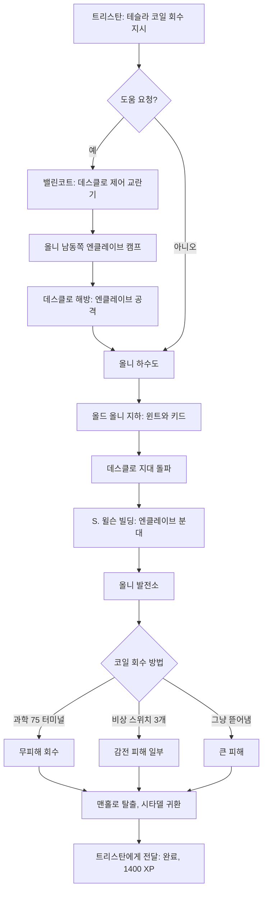

**관련 NPC·아이템·대사 포인트**
- NPC: 팔라딘 트리스탄, 밸린코트 서기, 구울 윈트·키드, 엔클레이브 병사(캠프·S. 윌슨 빌딩).
- 아이템: 테슬라 코일(퀘스트 아이템), 데스클로 제어 교란기(퀘스트 아이템, 버릴 수 없음), 던바의 노트.
- 하수도 샛길에서 BoS 대원 시체와 **유니크 프로토타입 의무병 파워 아머**, 그 너머 터널 끝 해골 옆에서 스킬북 『덕 앤 커버!(Duck and Cover!)』를 얻을 수 있음.
- 서버실 끝 터렛 위 틈의 탄약 상자에 외계인 동력 전지 약 10개씩 2묶음(물 분수대 위 '비행접시' 장식이 힌트).

**비고**
- 퀘스트를 받기 전에 테슬라 코일을 얻을 수 있지만, 발전소에 들어간 뒤에야 진행으로 인정됨.
- 교란기를 가진 채 메가톤 집에 가면 엔클레이브 데스클로가 따라와 주민을 공격하는 경우가 있음.
- 교란기는 이 퀘스트에서 캠프의 1마리, 이후 이동식 기지 크롤러에서 1~2마리에게만 쓸모가 있어 효용이 제한적임.

**설계 분석**
- '부품 회수' 심부름을 **던전 3연속(지하 병원 → 붕괴 빌딩 → 발전소)**으로 엮어 분위기를 바꿔 가며 끌고 감. 구울 정착민의 비극은 환경 스토리텔링으로 전달함.
- 코일 회수 방법이 과학 스킬·아이템·감수할 피해로 나뉘어, 빌드에 따른 '비용 지불 방식'을 고르게 함.
- 교란기는 기믹은 흥미롭지만 사용처가 적어 설계 의도에 비해 존재감이 약함.

---

### 3.3 도전하는 자가 승리한다 (Who Dares Wins)

> "At the battle for Project Purity, you proved yourself... and any doubt that I had about you dissipated on that day."
> "정화 계획 전투에서 자네는 스스로를 증명했네… 그날 자네에 대한 내 의심은 모두 사라졌지." — 엘더 라이언

| 항목 | 내용 |
|---|---|
| 영문명 / 한국어명 | Who Dares Wins / 도전하는 자가 승리한다 |
| 유형 | 메인 (브로큰 스틸 3번째, 전체 15번째이자 마지막 메인 퀘스트) |
| 퀘스트 ID | xx0011ad (edid `DLC03BS3`) |
| 의뢰인 | 팔라딘 트리스탄 |
| 시작 조건 | 「충격의 가치」 완료(테슬라 코일 전달) |
| 관련 장소 | 백악관 광장(펜실베이니아 애비뉴)의 유틸리티 터널, 대통령 지하층, 대통령 전용 지하철, 애덤스 공군 기지(항공 관제탑, 이동식 기지 크롤러, 애덤스 보관 시설), 시타델 |
| 선행 / 후행 | 「충격의 가치」 / 반복 퀘스트 「프라임 타임 준비」·「피의 형제단」(시타델 보존 시) |
| 보상 | 1500 XP, 테슬라 캐논(보급 상자), 카르마 ±1000, 기지 내 전리품(정밀 개틀링 레이저, 외계인 블래스터 등). 시타델 파괴 시 캘러핸의 매그넘 등 |
| 카르마 | 애덤스 기지 타격 +1000 / 시타델 타격 −1000 |
| 업적·트로피 | 「Who Dares Wins」 30점 / 금 트로피 |

**개요**
- 해독된 데이터로 엔클레이브 최후의 대형 기지가 애덤스 공군 기지임이 밝혀짐. 기지의 이동식 기지 크롤러가 궤도 미사일 위성의 발사 통제권을 쥐고 있음.
- 계획: BoS 본대가 기지를 정면 공격해 시선을 끄는 동안, 주인공이 백악관 지하에서 기지로 이어지는 대통령 전용 지하철로 잠입해 **엔클레이브의 궤도 타격을 엔클레이브 자신에게 돌린다**.

**진행 단계**

| 단계 | 핍-보이 목표 | 플레이어 행동·이벤트 |
|---|---|---|
| 10 | 대통령 전용 지하철 진입 | 백악관 광장의 유틸리티 터널(이제 대통령 지하층과 연결됨)로 들어감. 대통령 지하층은 이 퀘스트 전에는 잠겨 있음 |
| 20 | 애덤스 공군 기지로 가는 출구 찾기 | 센트리 봇·미스터 거츠(Mister Gutsy)·야생 구울(Feral ghoul)이 있는 터널을 지나 관리 AI **마고**를 만남. 신원 확인 방식에 따라 로봇이 우호 또는 적대가 됨 |
| 25 | (선택) 대통령 전용 지하철의 보안 침해 해결 | 마고의 의뢰. 지하철을 점거한 구울(고레벨이면 다수의 리버)을 소탕하면 경비 유닛이 주 퓨즈를 직접 교체함 |
| 30 | 보급 상자에서 명령서와 장비 회수 | 열차로 애덤스 기지 역 도착 → 지상으로 나와 계단 위 왼쪽의 보급 상자. 내용물: 내구도 100% 테슬라 캐논, 전자 충전팩 50, 마이크로퓨전 셀 50, 트리스탄의 음성 명령서 |
| 40 | 이동식 플랫폼의 램프를 내릴 접근 터미널 찾기 | 격납고·광장을 지나며 엔클레이브 병사(일반·헬파이어), 터렛, 데스클로, 버티버드와 교전. 활주로에서 BoS 양동 부대가 버티버드와 싸우는 중. 항공 관제탑 꼭대기의 터미널에서 'Lower Access Ramp' 선택 |
| 50 | 엔클레이브 이동식 플랫폼 진입 | 활주로로 내려가면 BoS 기동부대가 엄호함. 램프를 올라 크롤러 진입 |
| 60 | 궤도 타격으로 엔클레이브 이동식 플랫폼 파괴 | 반발장 해제 → 기지 1층(수리실 스티그스 / 시그마 분대) → 2층 데스클로 연구 시설과 메인프레임 → 옥상 발사 플랫폼 → 위성 관제탑 최상층의 위성 상향 링크 터미널에서 목표 선택 |
| 70 | 엔클레이브 이동식 플랫폼 탈출 | 오른쪽의 활성 터미널로 문을 열고 위쪽 문으로 나감 |
| 80 | 노획한 버티버드 탑승 (완료) | BoS 버티버드가 착륙함. 사라 라이언이 살아 있으면 직접 호위함. 탑승하면 완료 |

**분기와 해결 방법**

1) **마고(M.A.R.Go.T.) 신원 확인**

| 방법 | 조건 | 결과 |
|---|---|---|
| 상원 직원 신분증 제시 | 대통령 지하층의 부서진 열차 안 서류 가방에서 획득 | 판정 없이 '우호' 등록 |
| 미 육군 소속이라고 주장 | 화술 판정 (매우 어려움) | 성공 시 우호. 1차 실패는 경고, **2차 실패 시 적대** |
| 보안 매개변수 무시(오버라이드) | 과학 판정 (수치 코퍼스 미확인) | 성공 시 우호 |
| 로보틱스 엑스퍼트(Robotics Expert) 퍽 | 퍽 보유 | 우호 |
| "애덤스 공군 기지를 찾고 있다"고 솔직히 말함 | 없음 | 신원 확인 1차 실패로 처리(경고). 다시 실패하면 적대 |
| 마고를 무시하고 지하철 문 자물쇠를 땀 | 자물쇠 따기 | 마고가 '적대'로 분류, 지하철의 로봇이 계속 적대 |

- 우호가 되면 지하철 상태(전체 기능의 22%로 가동), 열차 정지 원인(주 퓨즈 강제 제거), 침입자 정보(보안 유닛의 22%를 소모시킴, 체온 없음, 치명적 방사능 방출 = 구울)를 들을 수 있음.

2) **열차 복구**
- 보안 침해 해결(구울 전멸) → 대통령 전용 지하철 경비 유닛이 퓨즈를 교체함. 마고에게 보고하면 수리가 시작됨.
- 또는 경비 유닛을 파괴하고 **주 퓨즈**를 꺼내 퓨즈 상자에 직접 넣음(퀘스트 문서는 수리 판정이 필요하다고 적었으나 수치는 코퍼스 미확인).

3) **애덤스 기지 입구**: 엔클레이브 보초를 사살 / 자물쇠를 따고 뒤로 돌아가 기습 / 그대로 우회하는 은신 돌파.

4) **크롤러 입구 반발장(Repulsion Field) 패널**

| 선택 | 조건 | 결과 |
|---|---|---|
| 반발장 끄기 | 과학 80 | 완전히 해제, 무해 |
| 시한 폭약 설치 | 폭발물 50 | 패널 파괴, 피할 시간 있음. 반발장이 일부 남아 통과 시 약간 피해 |
| 제어판 부수기 | 없음 | 폭발 피해를 받고 반발장이 일부 남음 |
| 그대로 둠 | — | 변화 없음 |

5) **기지 1층**
- 오른쪽 수리실: 로봇 기술자 **스티그스(Stiggs)**. 살려 두면 크롤러 구조(위층 데스클로 연구 시설, 메인프레임 위치, 관제탑까지의 동선)를 알려 줌. 로보틱스 엑스퍼트가 있으면 로봇을 엔클레이브에 돌릴 수 있다고 조언함. 죽이면 센트리 봇 스파키(Sparky)·미스터 거츠 후버(Hoover)와 교전.
- 왼쪽: 경보가 울리면 **엔클레이브 시그마 분대**가 출동함.

6) **메인프레임 접근**: 터미널 해킹(과학) / 출입문 자물쇠 따기 / 엔클레이브 장교를 죽이고 '높은 보안 등급(High Clearance)' 키카드 획득. 메인프레임은 둘로 나뉨.
- 출입 통제 터미널(잠금 없음): 층의 모든 내·외부 문과 무기고 개방. 무기고는 자물쇠 따기 75로도 열 수 있음.
- 로봇 통제 터미널(어려움, 과학 75)

| 로봇 통제 명령 | 조건 | 효과 |
|---|---|---|
| 안전 정지(Perform safety shutdown) | 해킹 | 크롤러의 모든 엔클레이브 로봇 정지 |
| 표적 매개변수 교란(Scramble) | 해킹 | 로봇이 주인공·엔클레이브 가리지 않고 공격 |
| 로봇 진단(Run diagnostic) | 해킹 | 상태 표시만 |
| 엔클레이브를 표적으로(Target Enclave) | 해킹 + 로보틱스 엑스퍼트 | 로봇이 엔클레이브를 공격 |

7) **위성 상향 링크 — 최종 선택**

| 사전 설정 목표 | 결과 |
|---|---|
| 01 시타델 | 발사됨. **카르마 −1000**. 시타델 파괴, 엘더 라이언 사망, 이후 모든 BoS 적대 |
| 02 정화 계획 | "위성이 적절한 궤도에 있지 않음" 메시지로 실패 |
| 03 메가톤 | 실패 (같은 메시지) |
| 04 리벳시티(Rivet City) 항공모함 | 실패 (같은 메시지) |
| 05 애덤스 공군 기지 플랫폼 | 발사됨. **카르마 +1000**. 크롤러 파괴 |

- 어느 쪽을 고르든 **크롤러 안에 남은 물건은 영구히 사라짐**. 발사 전에 크롤러를 충분히 뒤지라는 경고가 정석 공략임.

**결과와 후일담**
- **애덤스 기지 타격(선)**
  - 버티버드가 기지 근처에 내려 미사일 낙하를 함께 지켜본 뒤 시타델로 귀환함. 엘더 라이언의 감사 연설.
  - 로스차일드·트리스탄에게서 반복 퀘스트 2개가 열림. 로스차일드는 BoS가 크롤러 잔해에서 막대한 무기·기술을 회수 중이라고 알려 줌.
  - 시타델 실험실 리버티 프라임 정비대 앞 탁자에 테슬라 캐논 2정.
  - 쓰리독(Three Dog)이 주인공의 활약을 전하며 "집 잃은 엔클레이브를 불쌍히 여기라"는 농담 보도를 함.
- **시타델 타격(악)**
  - 귀환 버티버드의 조종사들이 시타델 무응답을 고장으로 여기다가, 착륙 후 폐허를 보고 주인공을 반역자로 규정해 공격함.
  - 이후 워싱턴 기념비(Washington Monument), GNR 방송국, 백악관 광장, 알링턴 도서관(Arlington Library), 제퍼슨 기념관(Jefferson Memorial) 등의 BoS가 모두 적대함. 제퍼슨 기념관 BoS까지 적대하므로 빅슬리 관련 사이드 퀘스트 진행이 어려워짐(「성수」는 시타델 파괴 전에 수락하지 않았다면 영구 불가). 사라 라이언은 이때부터 필수(essential) 보호가 풀림.
  - 폐허 분화구 안 비밀 무기고: 테슬라 캐논 2정, 외계인 동력 전지, 누카 수류탄 3개, 미니 누크, **캘러핸의 매그넘**(자물쇠 따기 75 또는 과학 75 금고).
- **공통**
  - 애덤스 기지는 이후 BoS 병력 7~20명이 점령함(어느 목표를 골랐든). 기지 곳곳 보급 상자 4개에 테슬라 캐논 8정(완전 4, 손상 4)과 전자 충전팩 각 73~74개.
  - 크롤러는 퀘스트 뒤 출입 불가.
  - **엔클레이브는 완전히 사라지지 않음**: 각지 캠프가 계속 리스폰함. 트리스탄은 "고립된 부대가 기지 파괴 소식을 듣기까지 몇 달이 걸릴 수 있다"고 설명함.
  - 동료는 버티버드에 타지 않고 시타델에 나타남.

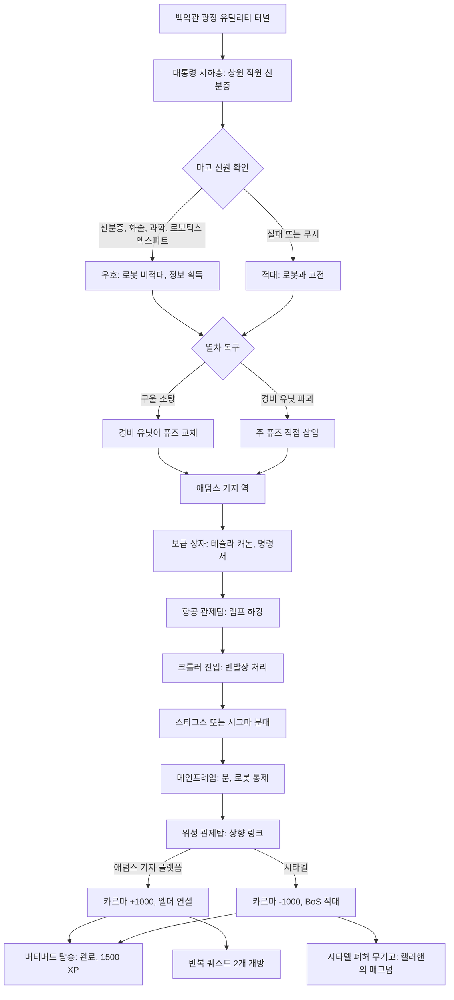

**관련 NPC·아이템·대사 포인트**
- NPC: 팔라딘 트리스탄, 마고, 대통령 전용 지하철 경비 유닛(주 퓨즈 보유 센트리 봇), 스티그스·스파키·후버, 엔클레이브 시그마 분대와 시그마 분대장, 무기고 관리관(정밀 개틀링 레이저·복합 정찰 헬멧 보유), 사라 라이언(생존 시), 엘더 라이언.
- 아이템: 상원 직원 신분증, 주 퓨즈, 테슬라 캐논, 정밀 개틀링 레이저, 외계인 블래스터(무기고의 어려움 잠금 총기 케이스), 슬로번 화염방사기(2층 정지장 안), 래피드토치 화염방사기(애덤스 보관 시설).
- 마고 대사: "You are in direct violation of U.S. Security Statute A567/B. Security is now being summoned. Have a nice day." / "귀하는 미국 보안법 A567/B를 직접 위반했습니다. 보안 요원을 호출합니다. 좋은 하루 되십시오."
- 크롤러 통신 터미널에는 주인공이 로봇을 엔클레이브에 돌렸을 경우 그 사실이 반영된 기록이 남음.

**비고**
- 관제탑 진입 시 버티버드 3대가 나타나 마지막 1대가 탑에 미사일 3발을 쏨. 계단으로 피하거나 테슬라 캐논으로 미리 격추하는 것이 정석임.
- 주기 중인 버티버드를 파괴하면 엔클레이브 증원이 줄 수 있음.
- 터렛 터미널은 "ERROR: Turret(s) Not Responding"을 띄우지만 켜고 끄기는 가능함.
- 제목은 영국 특수부대 SAS의 표어이며, SAS가 2차 대전 북아프리카에서 적 비행장을 습격한 역사와 겹침.

**설계 분석**
- **카르마 양자택일의 극단화**: 정답에 가까운 선택(엔클레이브 기지 파괴)과 극악 선택(동맹 본부 파괴)을 같은 터미널 메뉴에 나란히 둠. 본편 「원자의 힘」(메가톤 핵폭발)과 같은 −1000 규모의 '악의 대형 선택지'를 DLC 마지막에 다시 제공함.
- 실패하는 목표 3개(정화 계획·메가톤·리벳시티)는 '해 볼 수 있는 상상'을 메뉴로 보여 주되 시스템이 거부함으로써, 콘텐츠 비용 없이 선택의 무게감을 연출함.
- 마고·반발장·메인프레임 등 **한 퀘스트 안에서 스킬 체크 지점을 촘촘히** 배치해, 고레벨 캐릭터가 쌓은 과학·화술·폭발물·자물쇠 따기·로보틱스 엑스퍼트를 고루 '정산'하게 함.
- 약점: 시타델 파괴 루트의 후일담이 적대화와 무기고 보상 정도로 얕아, 선택의 무게에 비해 결과 콘텐츠가 빈약함.

---

### 3.4 성수 (Holy Water)

> "Good people of Megaton, your salvation is at hand!"
> "메가톤의 선량한 주민 여러분, 구원이 눈앞에 와 있습니다!" — 성수 전단

| 항목 | 내용 |
|---|---|
| 영문명 / 한국어명 | Holy Water / 성수 |
| 유형 | 사이드 |
| 퀘스트 ID | xx004c75 (edid `DLC03WQ03`) |
| 의뢰인 | 빅슬리 서기(제퍼슨 기념관) |
| 시작 조건 | 빅슬리에게 "무엇을 도울까"라고 물음. **메가톤이 파괴되었으면 제공되지 않음**. 수락 전에 시타델을 파괴했으면 영구 불가 |
| 관련 장소 | 제퍼슨 기념관, 메가톤, 스프링베일(Springvale)의 성스러운 빛 수도원(Holy Light Monastery) |
| 선행 / 후행 | 「되찾아라!」 완료(브로큰 스틸 진행 중) / 완료 후 비표시 「황무지 주민의 물 요청」 발생 |
| 보상 | 100 XP, 300캡 |
| 카르마 | 퀘스트 자체 변화 없음. 사도회 구성원 살해도 카르마 감소 없음 |
| 업적·트로피 | 없음 |

**개요**
- 일주일 치 아쿠아 퓨라를 받은 메가톤이 또 물이 부족하다고 함. 빅슬리가 원인 조사를 맡김.
- 원인은 원자의 자손 교회에서 갈라져 나온 **영원한 빛의 사도회(Apostles of the Eternal Light)**임. 지도자 마더 퀴리 3세(Mother Curie III)는 BoS 호송대가 "고향 사람들과 나누라"며 준 물을 신의 계시로 해석해, 방사능을 쏘인 '성수'로 바꿔 몰래 나눠 주는 중임. 목표는 사람들을 구울로 '깨우치는' 것임.

**진행 단계**

| 단계 | 핍-보이 목표 | 플레이어 행동·이벤트 |
|---|---|---|
| 10 | 메가톤 주변을 조사해 물 사정을 알아낼 것 | 아래 세 방법 중 하나로 단서를 얻음 |
| 50 | 수도원에서 성수에 대해 물어볼 것 | 스프링베일의 수도원 앞에서 문지기 브라더 제라드(Brother Gerard)를 만남 |
| 55 | 성수 마시기 | 제라드가 성수를 건네고, 마시기 전에는 더 말하지 않음 |
| 56 | 브라더 제라드와 대화 | 마신 뒤 대화하면 마더 퀴리가 물을 '축복'한다는 사실을 들음 |
| 57 | 수도원에 들어갈 것 | 아래 입장 방법 중 하나 |
| 60 | (선택) 피폭되어 수도원 입장 자격 얻기 | 수도원 입구와 지하의 방사능 트랩(스위치로 작동)으로 스스로 피폭 |
| 100 | 영원한 빛의 사도회를 멈출 것 | 지하 예배당에서 설교를 마친 퀴리와 대화 |
| 150 | 빅슬리에게 보고 (완료) | 100 XP, 300캡 |

**분기와 해결 방법**
1) **단서 획득 (단계 10)**
   - 메가톤 정문 앞 연출: 떠돌이 로자 마이트너(Rosa Meitner)가 물 거지에게 성수를 주고, 거지는 마시자마자 죽음. 이 거지는 메가톤의 물 거지 미키(Micky)와 외형이 같은 별도 NPC라 미키가 이미 죽었어도 연출이 성립함. 로자가 스프링베일 교단에서 받은 물이라고 털어놓고 전단을 줌. **이 연출을 보면 미키는 반드시 죽음**.
   - 메가톤 정문·플레이어 집·모리아티 살롱·정수 시설 문에 붙은 전단을 보거나, 메가톤 주민과 대화(주민이 불평하며 전단을 줌).
   - 곧장 스프링베일로 가 제라드와 대화.
   - 정문 앞 구역에 들어가지 않고 두 번째·세 번째 방법을 쓰면 미키를 살릴 수 있음. 미키는 퀘스트 완료 뒤 다시 나타남.
2) **수도원 입장 (단계 57)**

| 방법 | 조건 |
|---|---|
| 피폭 상태로 입장 요청 | 일정 이상 방사능 수치(코퍼스 미확인). **구울 마스크** 착용으로도 충족 |
| 화술 판정 | 수치 코퍼스 미확인 |
| 지하실 뚜껑 자물쇠 따기 | 따도 제라드는 신경 쓰지 않고, 교단이 적대하지 않음 |
| 제라드를 죽이고 열쇠 획득 | 다른 신도는 적대하지 않음 |
| 제라드에게서 열쇠 소매치기 | 소매치기 |

3) **사도회 저지 (단계 100)**

| 방법 | 조건 | 결과 |
|---|---|---|
| 화술 판정 | 수치 코퍼스 미확인 | 퀴리가 설득됨: "Thank you for choosing wisdom over violence." / "폭력 대신 지혜를 택해 주어 고맙구나." |
| 카리스마 판정 | 수치 코퍼스 미확인 | 설득 |
| '원자의 예언자'임을 자처 | 방사능 **800 라드 초과** | 퀴리가 계시를 믿고 성수 배포를 멈추며 아쿠아 퓨라를 메가톤에 돌려주기로 함 |
| 전원 살해 | 전투 | 퀴리는 저항하지 않고 도망침. 야생 구울 리버 '원자의 챔피언(Atom's Champion)'과 글로잉 원(Glowing one) '원자의 태양(Sun of Atom)'이 적대함 |

- 퀴리는 꿈에서 본 '원자의 예언자'만이 자신을 바꿀 수 있다고 믿음. 그래서 극단적 피폭이라는 대가를 치르면 판정 없이 해결되는 구조임.

**결과와 후일담**
- 완료 직후 메가톤 앞에서 「황무지 주민의 물 요청」이 발생할 수 있음.
- **진행 중 메가톤을 폭파한 경우**(「원자의 힘」): 퀴리는 메가톤 폐허 밖에서 적대 야생 구울 리버로, 제라드는 이성 있는 구울로 나타남(둘이 메가톤에서 설교하던 중 폭발에 휘말렸다는 설정). 빅슬리는 충격을 받으면서도 보상을 줌.
- 메가톤 폭파를 계획 중이라고 제라드에게 말하면 그는 성공을 기원함.
- 프로젝트 임퓨리티(FEV 투입)를 했다면 퀴리의 성수가 오히려 FEV를 무력화했다는 설정이 있음.

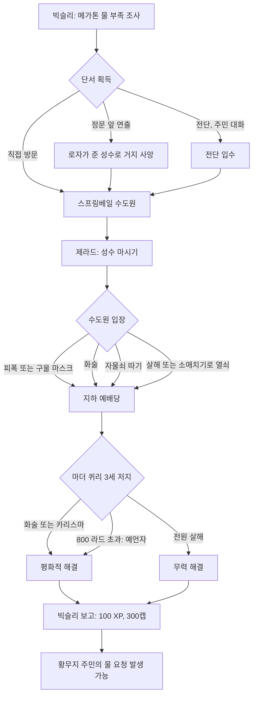

**관련 NPC·아이템·대사 포인트**
- NPC: 빅슬리 서기, 로자 마이트너, 물 거지(미키), 브라더 제라드, 마더 퀴리 3세, 노비스(Novice), 원자의 챔피언, 원자의 태양.
- 아이템: 성수(체력 +20, 방사능 +15), 성수 전단, 수도원 열쇠. 수도원에 성수 상자 2개, 아쿠아 퓨라 17병.
- 퀴리의 아들은 글로잉 원이 된 '원자의 태양'이며, 퀴리는 이를 영원한 빛에 이른 증거로 여김.

**비고**
- 방사능 트랩을 해제(disarm)하면 이후 작동 불가가 되어 피폭 경로를 스스로 막을 수 있음.
- 로자의 연출은 퀘스트가 활성인 동안만 켜지고 완료되면 꺼짐.

**설계 분석**
- 본편 메가톤의 원자의 자손 교회를 **'좋은 의도의 해악'**이라는 주제로 확장함. 퀴리는 악당이 아니라 진심으로 돕는다고 믿는 인물이라, 전투보다 설득·예언자 연기 같은 해법이 어울리도록 짜임.
- '800 라드'라는 생존 위험을 대가로 판정을 건너뛰게 한 해법은, 방사능 시스템을 퍼즐 자원으로 쓰는 드문 사례임.
- 미키의 생사가 플레이어의 접근 경로에 달린 구조는, 같은 정보도 '어디서 듣느냐'가 결과를 바꾼다는 환경 연출임.

---

### 3.5 물길을 지켜라 (Protecting the Water Way)

| 항목 | 내용 |
|---|---|
| 영문명 / 한국어명 | Protecting the Water Way / 물길을 지켜라 |
| 유형 | 사이드 |
| 퀘스트 ID | xx003b42 (edid `DLC03WQ01`) |
| 의뢰인 | 빅슬리 서기 / 르펠티에 경관(Officer Lepelletier). 빅슬리를 거치지 않고 르펠티에에게서 바로 받을 수 있음 |
| 시작 조건 | 빅슬리의 의뢰, 또는 리벳시티 진입 경사로 1층의 르펠티에와 대화 |
| 관련 장소 | 제퍼슨 기념관, 리벳시티, 시타델과 D.C. 폐허 사이 큰 다리 아래(매복 지점), 빌헬름 부두(Wilhelm's Wharf) |
| 선행 / 후행 | 「되찾아라!」 완료 / 없음 (갈취 루트는 주간 수금 반복) |
| 보상 | 100 XP, 엔클레이브 파워 아머와 헬멧, 개틀링 레이저, 플라스마 권총, 전자 충전팩 29, 에너지 셀 16 (빅슬리 지급). 르펠티에 쉬운 화술 성공 시 출발 전 플라스마 소총과 마이크로퓨전 셀 약간 |
| 카르마 | 갈취 선택지 2종 모두 −200 |
| 업적·트로피 | 없음 |

**개요**
- 리벳시티 경비대가 BoS 대신 물 캐러밴 호위를 맡았지만 조직적인 습격이 이어짐. 르펠티에는 캐러밴 경비원들과 동행해 배후를 밝혀 달라고 함.
- 배후는 레이더(Raiders)에서 갈라져 나온 **스플릿 잭(Split Jack)의 도적단**임. 이들은 물을 끊어 놓고 '보호비'를 뜯을 계획임.

**진행 단계**

| 단계 | 핍-보이 목표 | 플레이어 행동·이벤트 |
|---|---|---|
| 1 | 리벳시티의 르펠티에 경관과 상의 | 캔터베리 커먼(Canterbury Commons)행 캐러밴이 막 제퍼슨 기념관을 떠났다는 말을 들음. 쉬운 화술 성공 시 플라스마 소총 |
| 2 | 정화 계획 북쪽 강변에서 데이비스·로린 경관과 합류 | 강을 따라가면 다리 아래에서 도적 3명이 캐러밴을 습격 중. **캐러밴 상인과 브라민(Brahmin)은 스크립트상 반드시 죽음**. 경관 둘과 다리 밑 스캐빈저는 살릴 수 있음 |
| 3 | 공격을 지시하는 자 찾기 | 도적 시체에서 스플릿 잭의 홀로테이프 「New meeting place」를 얻음. 집결지(빌헬름 부두)와 암호 **"mirelurk stew(마이얼럭 스튜)"**가 담김 |
| 10 | 스플릿 잭과 그 일당 처리 | 빌헬름 부두에서 암호를 대면 대화 가능 |
| 100 / 101 | 르펠티에에게 보고(또는 '보호비' 갈취) | 아래 분기 |
| 150 | 빅슬리에게 보상 요청 | 정상 해결 시 르펠티에는 줄 보상이 없다며 빅슬리에게 보냄 |
| 160 | 매주 빌헬름 부두의 일당에게서 캡 수금 | 주간 보호비 선택 시 |

**분기와 해결 방법**
1) **스플릿 잭 처리**

| 방법 | 조건 | 결과 |
|---|---|---|
| 첫 대면에서 손을 떼라고 설득 | 화술 판정(어려움) | 잭 일당이 떠남. 이때 스파클 할머니(Grandma Sparkle)가 일당에게 살해되는 경우가 많음 |
| 일당 가입 → 설득 | 가입 시 받은 메탈 아머와 헬멧을 **착용해야** 잭이 다시 대화함. 화술 판정 | "물이 공짜면 아무도 돈을 내지 않는다"고 설득 → 계획 철회, 일당은 '기분 전환'하러 떠남 |
| 일당 가입 → 결투 | 잭이 주는 근접 무기 3종 중 택1(납 파이프, 전투용 칼, 못 박힌 판자) | 그 무기로만 싸우면 일당은 구경하며 응원함. 주먹이나 다른 무기를 쓰면 일당 전체가 적대. 잭은 HP가 높고 방어를 잘하며 지급 무기의 내구도가 낮음 |
| 정면 공격 | 전투 | 일당 전체와 교전 |

- 가입 후 "다른 멤버를 기다리며 앉아 있으라"는 지시는 실제로 아무 이벤트도 일으키지 않음.
- 결투 승리 뒤 이름 없는 도적이 "새 두목은 필요 없지만 르펠티에와 '보호' 계약을 맺어 보라"고 제안함.

2) **르펠티에 보고 방식**

| 선택 | 조건 | 결과 |
|---|---|---|
| 정상 보고 | — | 르펠티에가 감사하고 빅슬리에게 보냄 → 빅슬리가 노획한 엔클레이브 장비 지급. 퀘스트 완료 |
| 일시금 갈취 500캡 | 화술 판정 | 카르마 −200. "지금 500, 습격이 멈추면 500 더"를 요구해도 500만 줌 |
| 주간 보호비 200캡 | — | 카르마 −200. 이후 빌헬름 부두 일당에게서 몫을 계속 받음(단계 160) |

- 수금 시 일당에게 카르마·행운·힘·화술 판정으로 몫을 더 받을 수 있음: 행운 성공 +50캡, 나머지 성공 +25캡.
- 갈취 선택 시 르펠티에는 "다시 말 걸면 죽이겠다"고 함. 실제로 이후 대화하면 르펠티에와 리벳시티 **바깥** 경비원이 적대함(도시 안 경비는 무관).
- 주간 보호비 이외의 선택을 하면 남은 일당은 대화 시 "배신했다"며 공격함.

**결과와 후일담**
- 정상 해결: 물 캐러밴 습격이 멈춤. 2~5일 뒤 매복 지점에 캐러밴이 다시 나타나기도 함.
- 갈취: 르펠티에 적대, 주간 보호비 수입원 생성.

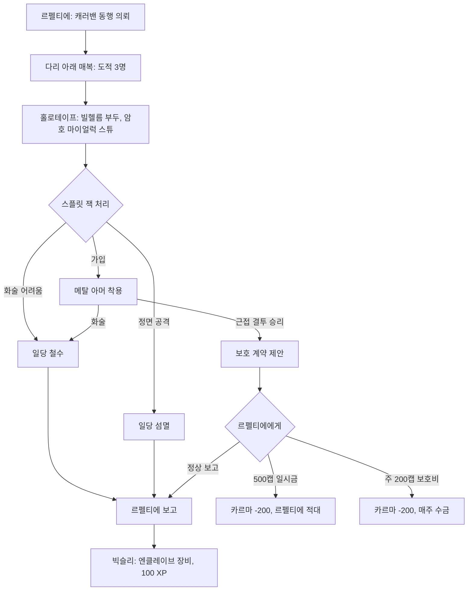

**관련 NPC·아이템·대사 포인트**
- NPC: 르펠티에 경관, 데이비스·로린 경관, 캐러밴 상인, 스플릿 잭과 도적(밴딧) 일당, 스파클 할머니, 빅슬리.
- 아이템: 홀로테이프 「New meeting place」, 메탈 아머·헬멧(가입 유니폼), 결투용 근접 무기.
- 르펠티에의 대사에는 '무료 배급을 고집하니 호위비가 안 나온다'는 배급 정책 비판이 담겨 있음.

**비고**
- 결투 중 일당이 끼어들다 오인 공격을 받아 적대하는 일이 잦음. 동료(미스터리어스 스트레인저 포함)가 끼어들어도 일당 전체가 적대함. 동료는 스파클 할머니의 오두막에 대기시키는 것이 좋음.
- 엔클레이브 병사가 부두로 들어와 일당을 먼저 공격하는 경우가 있음.

**설계 분석**
- 해결 방식이 **정의(보고) / 타협(설득) / 결투(규칙 있는 폭력) / 부패(갈취)**로 고르게 펼쳐진 전형적인 베데스다식 다중 해법 퀘스트임.
- 갈취 루트는 카르마를 대가로 '반복 수입'을 주는 경제적 유혹이며, 「놀라운 아쿠아 큐라!」의 협박 루트와 짝을 이룸.
- 결투는 VATS·회피에 익숙한 플레이어에게 '근접 무기와 내구도' 제약을 거는 미니게임으로, 본편 전투 규칙의 변주임.

---

### 3.6 놀라운 아쿠아 큐라! (The Amazing Aqua Cura!)

> "Well, hello there Smoothskin! Step right up. Have you come to savor the great taste of the Amazing Aqua Cura?"
> "어이, 매끈한 피부 손님! 이리 오시라고. 놀라운 아쿠아 큐라의 기막힌 맛을 보러 왔나?" — 그리폰

| 항목 | 내용 |
|---|---|
| 영문명 / 한국어명 | The Amazing Aqua Cura! / 놀라운 아쿠아 큐라! |
| 유형 | 사이드 |
| 퀘스트 ID | xx003b67 (edid `DLC03WQ02`) |
| 의뢰인 | 그리폰(Griffon) / 빅슬리 서기(화술 판정 후) |
| 시작 조건 | 아래 시작 방법 4가지 중 하나 |
| 관련 장소 | 역사 박물관(Museum of History) 로툰다의 노점(언더월드 입구 앞), 제퍼슨 기념관, 박물관 관리청 건물(Museum Authority Building) |
| 선행 / 후행 | 「되찾아라!」 완료 / 없음 (협박 루트는 주간 수금) |
| 보상 | 100 XP. 선택에 따라 캡(협박 주간 수금, 또는 그리폰 시체에서 400~600캡) |
| 카르마 | 기본적으로 변화 없음. 단 FEV를 넣은 정화수 상황에서 '진짜 아쿠아 퓨라 판매'를 강요하면 악한 카르마(코퍼스의 퀘스트 문서 기술) |
| 업적·트로피 | 없음 |

**개요**
- 구울이라는 이유로 BoS의 무료 배급을 거절당한 그리폰은 돈을 내고 아쿠아 퓨라를 사겠다고 제안했고, 운영비에 쪼들리던 빅슬리가 이를 받아들임.
- 그리폰은 산 정화수를 레이더·노예 사냥꾼(Slavers)·아웃캐스트(Outcasts) 등 BoS가 상대하지 않는 고객에게 비싸게 팔고, **빈 병에는 오염수를 채워** 언더월드 구울들에게 '구울 상태를 고치는 기적의 물' 아쿠아 큐라로 팖. 즉 이중으로 이익을 냄.

**진행 단계**

| 단계 | 핍-보이 목표 | 플레이어 행동·이벤트 |
|---|---|---|
| 5 | 그리폰에게 아쿠아 퓨라를 공급하는 자 알아내기 | 시작 경로에 따라 활성 |
| 10 | 그리폰(언더월드)이 아쿠아 큐라로 무엇을 하는지 알아내기 | |
| 20 | 정화 계획의 빅슬리가 그리폰의 물 공급에 대해 아는 것 알아내기 | 빅슬리는 묻기만 하면 거래처가 박물관 관리청 건물이라고 알려 줌 |
| 30 | 그리폰 병입 작업장의 위치와 증거 찾기 | 박물관 관리청 지하. 욕조·싱크대 사이 탁자 위 홀로테이프 「Griffon's bottling instructions」. 구울 경비 1명도 같은 테이프 소지 |
| 40 | 박물관 관리청 작업장에 대해 그리폰과 대면 (완료) | 아래 세 가지 처리 중 하나 |

**분기와 해결 방법**
1) **시작 방법**
   - 그리폰에게 아쿠아 큐라를 사서 확인 → 핍-보이가 방사능 물이라고 표시 → 따지면 그리폰이 "네 핍스퀵 2000인지가 고장 났다"고 둘러대고 퀘스트 추가.
   - 빅슬리에게 화술(또는 카르마) 판정 성공 → 그리폰과의 '비공식 거래'를 털어놓음.
   - 빅슬리의 터미널 해킹.
   - 박물관 관리청 작업장에서 홀로테이프를 직접 발견.
2) **그리폰 처리 (단계 40)**

| 선택 | 조건 | 결과 |
|---|---|---|
| 협박 — 일시금 | — | 300캡 |
| 협박 — 주간 | 기본 / 화술 판정 단계별 | 기본 주 40캡. 화술 1차 성공 주 100캡, 2차 80캡, 3차 60캡. 방문하지 않아도 밀린 주급을 최대 4주분까지 몰아서 줌 |
| 공개 자백 강요 | — | 손님 4명이 분노해 그리폰을 공격, 그리폰 사망. 시체에서 400~600캡 |
| 진짜 아쿠아 퓨라를 팔게 함 | 화술 판정 | 그리폰은 계속 '아쿠아 큐라'라는 이름으로 팔며 "희망을 주기 위해서"라고 둘러댐. 실제로는 이후에도 병이 방사능을 띰(코퍼스 비고) |

**결과와 후일담**
- 그리폰이 죽으면 빅슬리에게 그 사실을 알리는 선택지가 생김. 빅슬리는 거래가 깨져 짜증을 냄. 반대로 그리폰의 전매 수법을 알려 주면 빅슬리는 오히려 영리하다고 감탄함.
- 그리폰이 분노한 군중을 이겨 내면 박물관 정문으로 나가 영구히 사라짐.
- FEV를 넣은 경우 언더월드의 배로스 진료소(Chop Shop)가 FEV 증상을 앓는 구울 환자로 가득 참.

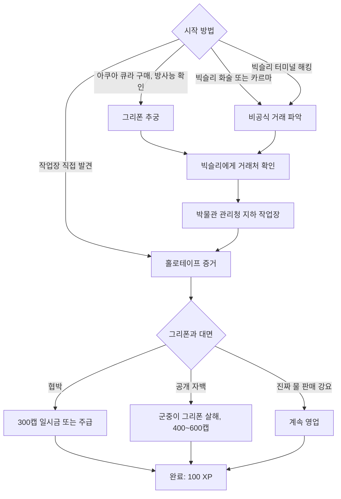

**관련 NPC·아이템·대사 포인트**
- NPC: 그리폰, 구울 경비 3명(박물관 관리청), 언더월드 손님 4명, 빅슬리.
- 아이템: 아쿠아 큐라(체력 +10, 방사능 +6, 개당 10캡에 판매), 홀로테이프 「Griffon's bottling instructions」, 가발 5개(지하 수납장), 박물관 관리청 화장실 변기 물탱크 속 뉴카-콜라(Nuka-Cola) 퀀텀.
- **가발 착용 시 특수 선택지**: 그리폰의 풍성한 머리가 사실 같은 창고의 가발이라는 점을 '머리 모양이 똑같다'며 지적할 수 있음. 그리폰은 우연이라고 얼버무림.

**비고**
- 박물관 관리청 건물은 「되찾아라!」 완료 전에는 판자로 막혀 들어갈 수 없음.
- 그리폰의 600캡은 군중을 적대시키지 않고도 진정(mezz) 계열 수단으로 얻을 수 있음.
- 폭스(Fawkes)를 언더월드 밖에 대기시켜 두면 군중이 적대할 때 폭스가 그리폰을 방어함.

**설계 분석**
- 19세기 '뱀기름 장수'를 패러디한 풍자 퀘스트로, BoS의 **무료 배급 원칙이 만든 암시장**이라는 구조적 문제를 보여 줌. 빅슬리·르펠티에·그리폰의 대사가 모두 '무료 배급의 비용을 누가 대는가'로 수렴함.
- 해결 선택지 대부분이 카르마 중립이라, 도덕보다 이해관계(돈·정의·군중의 분노)로 판단하게 만드는 회색 지대 설계임.

---

### 3.7 슬픈 구혼자 (The Sorrowful Suitor)

| 항목 | 내용 |
|---|---|
| 영문명 / 한국어명 | The Sorrowful Suitor / 슬픈 구혼자 |
| 유형 | 비표시 (핍-보이에 표시되지 않음) |
| 퀘스트 ID | 없음(허브 '-') |
| 의뢰인 | 홀로테이프 「Sorry, my darling」 |
| 시작 조건 | 대통령 전용 지하철에서 애덤스행 열차 직전 계단 위, 국회의사당(Capitol Building) 방면 출구 근처 벤치의 해골 옆 홀로테이프를 듣기. 사실상 「도전하는 자가 승리한다」 진행 중에만 접근 가능 |
| 관련 장소 | 대통령 전용 지하철, 조지타운(Georgetown)의 라 메종 보르가르 호텔(La Maison Beauregard) |
| 선행 / 후행 | 「도전하는 자가 승리한다」 진행 중 / 없음. 본편 비표시 퀘스트 「그레이디의 소포(Grady's Package)」와 연결 |
| 보상 | 올나이터 잠옷, 래그볼트의 전투 갑옷, 래그볼트의 선글라스, 헤비 인시너레이터(래그볼트 소지) |
| 카르마 | 변화 없음 (래그볼트는 악한 카르마 적대 NPC) |
| 업적·트로피 | 없음 |

**개요**
- 홀로테이프에는 이름 없는 여인이 연인에게 "약속 장소인 라 메종 보르가르에 갈 수 없게 되어 미안하다, 특별한 선물을 구하느라 고생했을 텐데"라고 사과하는 내용이 담김. 여인은 지하철에서 죽었음.
- 연인은 레이더 **래그볼트(Lag-Bolt)**이며, 선물은 그의 형 러그넛(Lug-Nut)이 버지니아의 '재단사'에게 맞춘 잠옷 한 쌍 중 하나임.

**진행 단계** (비표시이므로 내부 흐름 기준)
1. 홀로테이프 청취 → 래그볼트가 라 메종 보르가르에 생성됨(**청취 전에는 등장하지 않음**).
2. 조지타운 이스트를 거쳐 호텔에 도착하면 래그볼트가 적대 상태로 맞섬.
3. 래그볼트를 쓰러뜨리고 열쇠를 얻어, 호텔 2층 당구대 위 잡동사니 더미의 여행 가방을 열면 '특별한 선물' 올나이터 잠옷을 얻음.

**분기와 해결 방법**
- 래그볼트는 대화가 통하지 않는 적대 NPC라 전투가 유일한 해법임. 레벨은 플레이어 레벨의 1.5배(15→25), HP 210→260, DR 39이며 중화기·근접·소형 화기 태그 스킬을 가짐.

**결과와 후일담**
- 래그볼트의 노트로 그가 러그넛의 동생임이 드러남. 본편 「그레이디의 소포」에서 저속한 잠옷(naughty nightwear)을 얻으면 러그넛이 나타나는 이야기와 짝을 이룸.

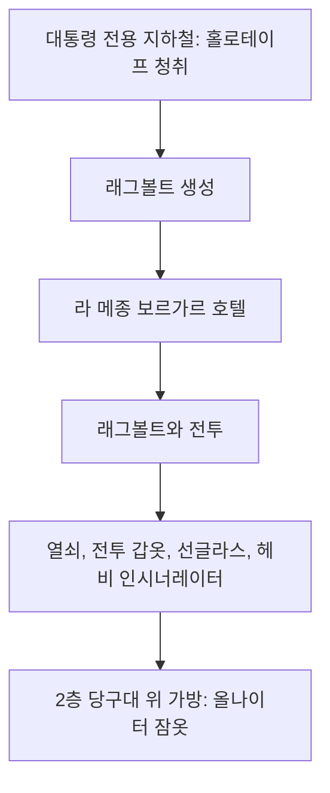

**관련 NPC·아이템·대사 포인트**
- NPC: 래그볼트, (언급) 러그넛, 죽은 여인.
- 아이템: 올나이터 잠옷(카리스마 +1, 지구력 +1), 래그볼트의 전투 갑옷(AP +10, 중화기 +10), 래그볼트의 선글라스(자물쇠 따기 +3, 은신 +3), 래그볼트의 노트.

**설계 분석**
- 메인 퀘스트 동선 위에 놓인 짧은 '환경 서사 + 보상' 퀘스트로, 본편 퀘스트와 형제 설정으로 이어 세계의 연속성을 만듦.
- 비표시 퀘스트라 플레이어가 홀로테이프를 듣고 스스로 호텔을 떠올려야 하는 탐험 보상형 구조임.

---

### 3.8 황무지 주민의 물 요청 (Wastelander Water Request)

| 항목 | 내용 |
|---|---|
| 영문명 / 한국어명 | Wastelander Water Request / 황무지 주민의 물 요청 |
| 유형 | 비표시 |
| 퀘스트 ID | xx0011ab (edid `DLC03Encounters`, 퀘스트 문서 정보상자 기준) |
| 의뢰인 | 캐러밴 경비(BoS) / 메가톤 주민 (대화 상대) |
| 시작 조건 | 「성수」 완료 후 메가톤 정문 앞 캐러밴 자리에 가면 발생. 몇 주 동안 메가톤 앞에 가지 않으면 발생하지 않을 수 있음. 메가톤이 파괴되지 않았어야 함 |
| 관련 장소 | 메가톤 정문 앞 |
| 선행 / 후행 | 「성수」 / 없음 |
| 보상 | 선한 카르마 (평화적 해결 시) |
| 카르마 | 화술로 유혈을 막으면 선한 카르마 |
| 업적·트로피 | 없음 |

**개요**
- 메가톤 주민 3명이 빅타운(Big Town)행 아쿠아 퓨라를 실은 BoS 호위 캐러밴(스캐빈저와 브라민, 중무장 BoS 2명)에게 물을 내놓으라며 다툼.

**진행 단계·분기**

| 선택 | 조건 | 결과 |
|---|---|---|
| 방관 | — | 주민이 총을 뽑았다가 BoS에게 몰살됨. 웰드 보안관(또는 스틸 보안관)과 스톡홀름(Stockholm)도 휘말려 죽기 쉬움. BoS는 "저쪽이 먼저 쐈다"고 말하고 떠남 |
| BoS 경비를 설득 | 화술 판정 | 빅타운 배급분을 주민에게 넘김. 유혈 없음 |
| 주민을 설득 | 화술 판정 | 주민이 물러나고 캐러밴은 갈 길을 감. 주민이 정문 안으로 들어갈 때까지 기다려야 함(곧바로 마을에 들어가면 다음에 나올 때 다시 싸우고 있음) |
| 주민 편을 들겠다고 함 | — | 주민이 곧바로 BoS·상인·브라민을 공격 |

- 주민이 이기는 경우(외부 개입 없이는 거의 불가능) 각자 브라민 시체에서 아쿠아 퓨라를 1병씩 챙김.
- 퀘스트 문서 비고에 따르면 BoS 쪽을 설득하는 편이 주민을 설득하는 편보다 쉬움.

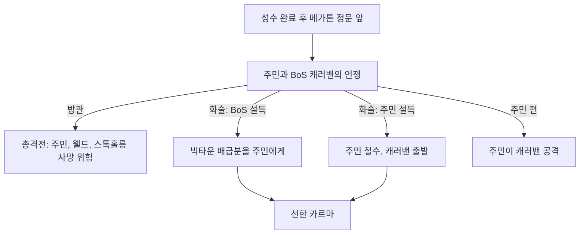

**관련 NPC·대사 포인트**
- NPC: 메가톤 주민(조 등), BoS 캐러밴 경비, 스캐빈저(상인), 웰드 보안관, 스톡홀름.
- 대사 파일: `WaterCaravanSquabble.txt`.

**설계 분석**
- 「성수」의 후일담으로, '메가톤의 물 부족'이 해결되어도 **배급량 자체가 부족하다는 근본 문제**는 남아 있음을 보여 줌. 화술로 한쪽에 물을 몰아주면 다른 정착지(빅타운)가 손해를 보는 제로섬 구조임.

---

### 3.9 프라임 타임 준비 (Getting Ready for Prime Time)

| 항목 | 내용 |
|---|---|
| 영문명 / 한국어명 | Getting Ready for Prime Time / 프라임 타임 준비 |
| 유형 | 반복 (비표시) |
| 퀘스트 ID | 없음 |
| 의뢰인 | 로스차일드 서기(시타델 실험실) |
| 시작 조건 | 「도전하는 자가 승리한다」를 **시타델을 파괴하지 않고** 완료한 뒤, 로스차일드에게 "BoS를 더 도울 방법"을 물음 |
| 관련 장소 | 시타델 |
| 선행 / 후행 | 「도전하는 자가 승리한다」 / 없음 |
| 보상 | 카메라 1개당 100캡·25 XP / 센서 모듈 1개당 75캡·10 XP (대화를 마친 뒤 지급) |
| 카르마 | 변화 없음 |
| 업적·트로피 | 없음 |

**개요·진행**
- 로스차일드가 리버티 프라임 수리용으로 카메라와 센서 모듈을 모아 달라고 함. 두 품목은 공구함과 작업대 주변에서 흔히 나옴.
- 가진 만큼 한꺼번에 반납 가능하며 횟수 제한 없음.

**결과와 후일담**
- 아무리 많이 가져다줘도 **리버티 프라임은 게임 안에서 끝내 수리되지 않음**.

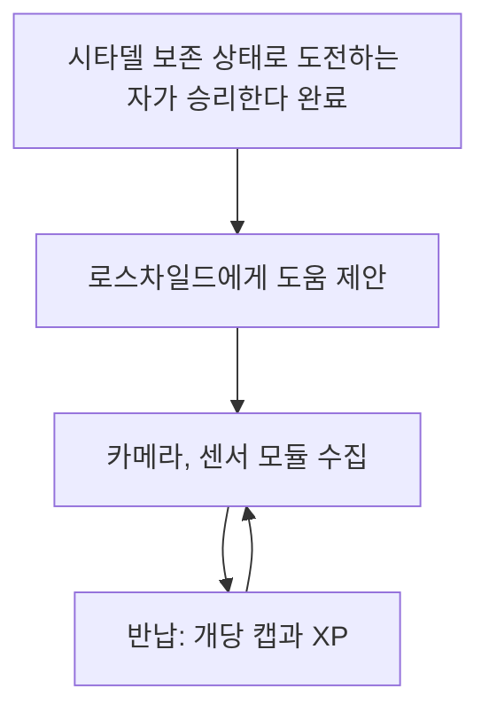

**설계 분석**
- 판매용 잡동사니를 'XP가 붙은 상점'으로 바꾸는 엔드게임 수입원임. 리버티 프라임이 끝내 되살아나지 않는다는 점은 보상 루프에 서사적 결말을 주지 않는 단순한 반복 설계임.

---

### 3.10 피의 형제단 (Blood Brotherhood)

| 항목 | 내용 |
|---|---|
| 영문명 / 한국어명 | Blood Brotherhood / 피의 형제단 |
| 유형 | 반복 (비표시) |
| 퀘스트 ID | 없음 |
| 의뢰인 | 팔라딘 트리스탄(시타델 A 링) |
| 시작 조건 | 「도전하는 자가 승리한다」를 **시타델을 파괴하지 않고** 완료 |
| 관련 장소 | 시타델, 슈퍼 뮤턴트(Super mutant) 서식지 전역 |
| 선행 / 후행 | 「도전하는 자가 승리한다」 / 없음 |
| 보상 | 슈퍼 뮤턴트 혈액 샘플 1개당 50캡·10 XP |
| 카르마 | 변화 없음 |
| 업적·트로피 | 없음 |

**개요·진행**
- 트리스탄이 슈퍼 뮤턴트를 단번에 없앨 무기를 연구하겠다며 혈액 샘플을 요구함.
- 퀘스트 시작 뒤에는 **주인공이 죽인 모든 슈퍼 뮤턴트 시체에 샘플이 생김**(퍽이 필요한 귀·손가락 수집과 달리 조건 없음). 샘플은 무게 0.
- 예외: 폭스와 슈퍼 뮤턴트 베히모스(Behemoth)는 샘플을 주지 않음.

**결과와 후일담**
- 게임 안에서 연구 결과물이 등장하지는 않음.
- 코퍼스 비고: 내셔널 몰(The Mall), 베일리스 크로스로드~아웃캐스트 전초기지 일대, 루스벨트 아카데미, 메이슨 딕슨 샐비지, 볼트 87(Vault 87) 등이 효율 좋은 수집지임. 「라일리스 레인저스」 전에 시작하면 이득이 큼.

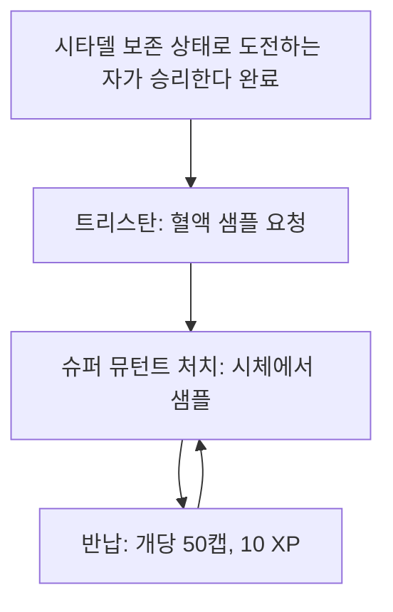

**설계 분석**
- 본편의 '귀·손가락 수집'(카르마 퍽 연동) 반복 루프를 BoS 진영판으로 만든 것임. 고레벨 슈퍼 뮤턴트(오버로드 포함) 사냥에 캡·XP 동기를 붙여 레벨 21~30 구간의 성장 루프를 지탱함.

---

### 3.11 참고: 본편 반복 퀘스트와의 연결
- 본편 반복 퀘스트 「물 거지(Water Beggars)」(메가톤 앞 미키, 리벳시티 앞 카를로스, 텐페니 타워(Tenpenny Tower) 앞 윌리)는 브로큰 스틸 설치 시 **아쿠아 퓨라로도 진행 가능**함. 정상 아쿠아 퓨라는 선한 카르마, FEV에 오염된 아쿠아 퓨라를 주면 악한 카르마. 상세는 [RD-07](07_misc-quests-encounters.md).

---

## 4. 신규 장소

브로큰 스틸은 별도 대형 맵을 추가하지 않고, **본편 수도 황무지에 장소를 끼워 넣고** 독립 월드스페이스 2개(애덤스 공군 기지, 위성 중계소)를 붙임. 장소 카탈로그 정본은 [RD-13](13_location-catalog.md).

### 4.1 신규 장소 목록

| 한국어명 | English | 지역 / 소속 | 지도 마커 | 유형 | 관련 퀘스트 | 개요 |
|---|---|---|---|---|---|---|
| 애덤스 공군 기지 | Adams Air Force Base | 메릴랜드, 독립 월드스페이스 | 있음(입구) | 군사 | 도전하는 자가 승리한다 | 엔클레이브 최후 거점. 대통령 전용 지하철로만 진입, **빠른 이동 불가** |
| 　└ 항공 관제탑 | Air control tower | 애덤스 공군 기지 북중앙 | 있음 | 군사 | 도전하는 자가 승리한다 | 크롤러 램프 하강 터미널 |
| 　└ 이동식 기지 크롤러 | Mobile base crawler | 애덤스 공군 기지 북동 | 없음 | 군사 | 도전하는 자가 승리한다 | 궤도 타격 통제 거점. 퀘스트 후 출입 불가 |
| 　└ 애덤스 보관 시설 | Adams storage facility | 애덤스 공군 기지 남동 | 있음 | 공장 | — | 크롤러 폭발 뒤에도 남는 창고. 래피드토치 화염방사기 |
| 록랜드 자동차 터널 | Rockland car tunnel | 수도 황무지 남서쪽 끝 | 있음 | 대형 거점 | 하늘에서 내리는 죽음 | 붕괴한 도로 터널, BoS 전진 기지 |
| 위성 중계소 | Satellite relay station | 록랜드 북쪽 계곡, 독립 월드스페이스 | 없음 | 군사 | 하늘에서 내리는 죽음 | 엔클레이브 궤도 타격 조준 시설 |
| 올드 올니 지하 | Old Olney underground | 올니 하수도 아래 | 없음 | 터널 | 충격의 가치 | 데스클로 둥지가 된 옛 아동 병원·지하 |
| 올드 올니 S. 윌슨 빌딩 | Old Olney S. Wilson Building | 올드 올니 지하와 발전소 사이 | 없음 | 건물 | 충격의 가치 | 무너진 5층 사무 빌딩, 엔클레이브 분대 |
| 올니 발전소 | Olney Powerworks | 올니 하수도 일부 | 없음 | 건물 | 충격의 가치 | 전쟁 전 PPE 소유 발전소, 테슬라 코일 실험실 |
| 성스러운 빛 수도원 | Holy Light Monastery | 스프링베일 | 있음 | 중형 정착지 | 성수 | 폐가 지하의 사도회 예배당 |
| 박물관 관리청 건물 | Museum Authority Building | 내셔널 몰(마이얼럭 둥지 구멍 동쪽) | 있음 | 건물 | 놀라운 아쿠아 큐라! | 그리폰의 병입 작업장 |
| 대통령 지하층 | Presidential sub level | 백악관 지하 | 없음 | 지하철 | 도전하는 자가 승리한다 | 백악관 동·서관을 잇는 지하 선로. 상원 직원 신분증 |
| 대통령 전용 지하철 | Presidential metro | 백악관–국회의사당 동관–애덤스 기지 | 없음 | 지하철 | 도전하는 자가 승리한다, 슬픈 구혼자 | 마고가 관리하는 정부 전용 지하철 |
| 백악관 광장 | White House plaza (Pennsylvania Avenue) | 펜실베이니아 애비뉴 | **브로큰 스틸에서 마커 추가** | 구역 | 도전하는 자가 승리한다 | 본편에도 있었으나 마커가 없던 곳. 유틸리티 터널이 대통령 지하층과 연결됨 |
| 행크 전기용품점 | Hank's Electrical Supply | 주리 스트리트 지하철역 옆 | 없음(비표시) | 상점 폐허 | — | 본편에서 들어갈 수 없던 건물. 레이더가 옥상에 아쿠아 퓨라 통을 지킴 |

### 4.2 애덤스 공군 기지 구조
- 전쟁 전 공군 기지(실존 앤드루스 공군 기지가 모델). 엔클레이브가 방벽·데스클로 우리를 증설하고 이동식 기지 크롤러를 들여옴.
- 동선: 대통령 전용 지하철 애덤스역 → 지상 계단(보급 상자) → 격납고 지대(2B 격납고 등, 센트리 봇 순찰 덮개 통로) → 활주로(BoS 양동 부대 교전) → 서쪽 계단으로 항공 관제탑 → 활주로 건너 크롤러 램프.
- 구역: 활주로, 격납고(2B·4A 등), 항공 관제탑(북중앙), 크롤러(북동), 애덤스 보관 시설(남동), 막사(울타리로 막혀 야구장만 접근 가능).
- 퀘스트 후: BoS 병력 7~20명이 점령(시타델·정화 계획 다음가는 최대 BoS 거점). 보급 상자 4곳에 테슬라 캐논 8정.
- 주요 전리품: 미니 누크 다수(격납고 지붕·2B 격납고·서쪽 격납고), 화염방사기 연료 400(관제탑 서쪽 열쇠 상자), 홀로테이프 「Enclave soldier log #1」.
- 설정: 후속작에서 BoS가 이곳에서 비행선 프리드웬(Prydwen)을 건조함. 폴아웃: 뉴 베가스의 ED-E가 이곳에서 만들어졌다고 언급됨.

### 4.3 이동식 기지 크롤러 구조
전쟁 전 우주왕복선 발사대 겸 위성 배열을 크롤러 운반차에 얹은 것. 엔클레이브가 동부 예비 지휘소로 개조함.

| 층 | 구역 | 주요 내용 |
|---|---|---|
| 1 | 기지층(Base floor) | 입구 반발장, 수리실(스티그스·스파키·후버), 시그마 분대 숙소(입구 위), 반발장 뒤 작업대 방, 반발장 뒤 무기고 |
| 2 | 발사 플랫폼 기지(Launch platform base) | 데스클로 연구 시설(데스클로 2마리), 메인프레임(출입 통제·로봇 통제 터미널), 정지장 안의 슬로번 화염방사기, 의무실·숙소·식당·주방, 무기고(자물쇠 따기 75: 정밀 개틀링 레이저를 든 무기고 관리관, 외계인 블래스터 총기 케이스), 미사일 5발이 숨겨진 창고 |
| 3 | 옥상(Roof) | 버티버드 착륙장 3개(엔클레이브 병력 투하), 오두막 2채, 터미널로 해킹 가능한 센트리 봇 5기 |
| 4 | 위성 관제탑(Satellite control tower) | 3개 층. 최상층에 위성 상향 링크 터미널, 문 개방 터미널, 불만 많은 과학자의 기록 |

- 반발장 패널 4지선다(무시 / 과학 80 해제 / 폭발물 50 폭약 / 부수기)는 기지 곳곳에서 반복됨.
- 크롤러는 퀘스트 종료 후 콘솔 없이는 들어갈 수 없음. 발사 전에 반드시 탐색해야 하는 '1회성 던전'임.

### 4.4 올드 올니 지하 복합 던전 (「충격의 가치」)

| 순서 | 구역 | 내용 |
|---|---|---|
| 1 | 올니 하수도 | 올드 올니 지역 맵에 입구 표시. 샛길에 BoS 시체와 프로토타입 의무병 파워 아머, 스킬북 『덕 앤 커버!』 |
| 2 | 올드 올니 지하 ① 구울 거처 | 윈트·키드와 죽은 동료들 |
| 3 | 올드 올니 지하 ② 아동 병원 | 데스클로가 구울 시체를 던지는 연출. 장난감 책장 곰 인형 밑 미니 누크 |
| 4 | 올드 올니 지하 ③ 병원 아래 설비 구역 | 작업대 2개, 무기 재료(체리 폭탄, 도시락통, 테레빈유, 앱락소 세제 등). 잠긴 지하 창고에 중국 첩보원 시체 2구, 햄 라디오, 뉴카-콜라 퀀텀, 중국제 돌격소총, 조준경 .44 매그넘 |
| 5 | 올드 올니 지하 ④ 짧은 터널·설비 구역 | 데스클로 3마리 방, 보통 잠금 감방 속 뉴카-콜라 퀀텀, 잔해로 막힌 출구(무장된 파편 지뢰가 잔해를 치움) |
| 6 | 올드 올니 S. 윌슨 빌딩 | 엔클레이브 4명(옥상 버티버드로 투입). 경찰 모자 2개, 미니 누크 2개, 누카 수류탄 |
| 7 | 올니 발전소 | 센트리 봇·터렛, 방사능 복도, 테슬라 코일 실험실, 외계인 동력 전지, 북쪽 맨홀 탈출 사다리 |

- 해골·바리케이드·굴착 흔적으로 오래전 대규모 전투가 있었음을 암시하는 환경 스토리텔링이 깔려 있음(정체는 미스터리로 남김).
- 정원 난쟁이 인형과 곰 인형이 카드놀이·체스를 하는 등 개발진의 장난 오브젝트가 곳곳에 있음.

### 4.5 대통령 전용 지하철 구조
- 대통령 지하층(백악관 지하 선로, 센트리 봇·기관총 터렛, 상원 직원 신분증과 미니 누크가 있는 부서진 열차) → 마고 단말실 → 대통령 전용 지하철(서·동 선로를 잇는 장비실의 뉴카-콜라 퀀텀, 야생 구울과 고레벨 리버) → 애덤스행 승강장(퓨즈 상자, 경비 유닛) → 계단 위 벤치(「Sorry, my darling」) / 국회의사당 동관 출구.
- 열차 이동은 실제 차량이 아니라, 플레이어에게 열차 내부 모양 '장갑'을 씌워 선로를 고속으로 달리게 하는 트릭으로 구현됨(비하인드).
- 대통령 흉상 가운데 제퍼슨 흉상만 멀쩡함(정화 계획이 있는 제퍼슨 기념관과의 연결).

### 4.6 기존 장소의 변화

| 장소 | 브로큰 스틸에서 바뀐 점 |
|---|---|
| 시타델 | 정문 경비가 「되찾아라!」 이후 사라짐. 아쿠아 퓨라 상자·병 약 151개. 남쪽에 오버로드와 슈퍼 뮤턴트가 스폰하고 BoS 저격 둥지에 팔라딘 2명. 시타델 파괴 시 폐허 셀(분화구, 비밀 무기고)로 교체 |
| 제퍼슨 기념관 | 기념품점이 정돈되어 빅슬리의 배급 사무실이 됨. 바깥에 병입·캐러밴 검문소. 엔클레이브가 3일마다 기념관을 습격(BoS가 대부분 격퇴). 동쪽 끝에서 BoS 이니시에이트 2명이 죽어 가는 마이얼럭을 소각·사살 |
| 메가톤 | 성수 전단이 정문·집 문 등에 붙음. 정문 앞 로자 연출, 「황무지 주민의 물 요청」 |
| 빌헬름 부두 | 스플릿 잭 일당의 본거지가 됨. 퀘스트를 방치하면 스파클 할머니가 살해됨 |
| 라 메종 보르가르 호텔 | 홀로테이프를 들으면 래그볼트 등장 |
| 배니스터 요새(Fort Bannister) | 아쿠아 퓨라 짐 브라민과 포로 팔라딘 젠슨 |
| 에버그린 밀(Evergreen Mills) | 입구에 '공짜 물' 간판과 빈 아쿠아 퓨라 상자, 폭발 시체 함정, 레이더 매복 |
| 몽고메리 카운티 저수지(Montgomery County Reservoir) | 북서쪽에 사일로가 추가되어 훔친 아쿠아 퓨라 보관 |
| 주리 스트리트 지하철역 | 행크 전기용품점 개방(4.1) |
| 언더월드 | 로툰다에 그리폰 노점. FEV 투입 시 배로스 진료소가 환자로 가득 참 |

---

## 5. 신규 NPC

필수(essential) 여부는 코퍼스 정보상자·상호작용 표 기준. 상세 프로필은 [RD-10](10_characters-major-companions.md)·[RD-11](11_npc-directory.md).

### 5.1 브라더후드 오브 스틸

| 한국어명 | English | 역할 | 위치 | 관련 퀘스트 | 비고 |
|---|---|---|---|---|---|
| 팔라딘 트리스탄 | Paladin Tristan | 야전 지휘관, 라이언스 프라이드(Lyons' Pride) 대리 지휘 | 록랜드 자동차 터널 → 시타델 | 메인 3개, 피의 형제단 | 펜타곤 폐허 발견 원정대 출신. 사라를 어릴 때부터 훈련시킴. 사라 부재 중 BoS 작전을 총괄함. 성우 제프 베이커 |
| 밸린코트 서기 | Scribe Vallincourt | 로스차일드의 조수, 방패 기사단 | 시타델 실험실 | 충격의 가치 | 데스클로 제어 교란기 개발, 테슬라 캐논 제작 주도, 노획 버티버드 복구. 원래 강경 전통파였으나 태도가 누그러짐. 「하늘에서 내리는 죽음」 완료 전엔 대화 불가 |
| 빅슬리 서기 | Scribe Bigsley | 정화 계획 관리자 | 제퍼슨 기념관 기념품점 | 성수, 물길을 지켜라, 놀라운 아쿠아 큐라! | 검·방패·깃펜 세 기사단을 모두 거친 '문제아' 서기. 과로로 대화 중에도 졸음. 시타델 파괴 전까지 필수 |
| 작전 장교 에드워즈 | Operations Officer Edwards | 돌격 분대장 | 위성 중계소 | 하늘에서 내리는 죽음 | 레벨 21 |
| 팔라딘 젠슨 | Paladin Jensen | 정찰병, 탈론 컴퍼니(Talon Company) 포로 | 배니스터 요새 | (인카운터) | 풀어 주면 혼자 요새로 돌격해 전사함. 이후 BoS 증원이 배니스터 요새를 공격 |
| 마커스 | Marcus | BoS 나이트 (언급만) | — | — | 트리스탄의 7분대 소속으로 애덤스 공군 기지 공격에 개틀링 레이저 사용을 승인받은 인물. 문서로만 언급됨 |
| 정화 계획 과학자 | Project Purity scientist | 정수 시설 연구원 | 제퍼슨 기념관 | — | 일반 NPC |
| (기존) 사라 라이언 | Sarah Lyons | 라이언스 프라이드 지휘관 | 시타델 의무실 → 애덤스 기지 | 도전하는 자가 승리한다 | 정화기를 직접 가동했다면 사망. 아니면 혼수에서 깨어나 노획 버티버드로 주인공을 구출 |

### 5.2 물 배급망과 리벳시티

| 한국어명 | English | 역할 | 위치 | 관련 퀘스트 | 비고 |
|---|---|---|---|---|---|
| 르펠티에 경관 | Officer Lepelletier | 물 캐러밴 호위 조정관 | 리벳시티 바깥 | 물길을 지켜라 | 리벳시티 경비대가 고른 배급망 책임자. 갈취하면 적대. 레벨 20 |
| 데이비스 경관 | Officer Davis | 캐러밴 호위 | 매복 지점 → 리벳시티 | 물길을 지켜라 | 플레이어 레벨 연동(1→5) |
| 로린 경관 | Officer Lorin | 캐러밴 호위 | 매복 지점 → 리벳시티 | 물길을 지켜라 | 같음 |
| 스플릿 잭 | Split Jack | 도적단 두목 | 빌헬름 부두 | 물길을 지켜라 | 레이더 출신. 레벨 8→17. 근접 결투 상대 |
| 그리폰 | Griffon | 아쿠아 큐라 장수(구울) | 역사 박물관 로툰다 / 박물관 관리청 | 놀라운 아쿠아 큐라! | 뱀기름 장수 패러디. 가발로 머리숱을 위장. 군중에게 살해될 수 있음 |
| 구울 경비 | Ghoul guard | 그리폰의 경비 | 박물관 관리청 | 놀라운 아쿠아 큐라! | 3명. 침입자를 공격 |
| 로자 마이트너 | Rosa Meitner | 성수를 모르고 건넨 여행자 | 메가톤 정문 앞 | 성수 | 「성수」 시작 후에만 생성. 대화 뒤 리벳시티 쪽으로 떠나 사라짐 |
| 조 | Joe | 물 흥정꾼 | 메가톤 | 황무지 주민의 물 요청 | 메가톤 주민 |
| 제드 | Jed | (언급만) | — | — | 여성 매복조에게 '미모로 캐러밴을 털라'고 부추긴 정체불명의 남자. 매복조 홀로테이프에만 등장 |

### 5.3 영원한 빛의 사도회

| 한국어명 | English | 역할 | 위치 | 관련 퀘스트 | 비고 |
|---|---|---|---|---|---|
| 마더 퀴리 3세 | Mother Curie III | 교단 창시자 | 성스러운 빛 수도원 | 성수 | 메가톤 출신. 크롬웰의 설교 중 '원자의 예언자' 꿈을 꿈. 폭력에 폭력으로 맞서지 않으며 공격받으면 도망침. 메가톤 폭파 시 적대 리버로 변함. 이름은 마리 퀴리 패러디 |
| 브라더 제라드 | Brother Gerard | 문지기, 1인자 | 수도원 앞 | 성수 | 레벨 1→30. 메가톤 폭파 시 이성 있는 구울이 되어 폐허에 머묾 |
| 노비스 | Novice | 신도(구울) | 수도원 | 성수 | 레벨 5→9 |
| 원자의 챔피언 | Atom's Champion | 신도(야생 구울 리버) | 수도원 지하 | 성수 | 평소 비적대. 무력 해결 시 적대. 레벨 12 |
| 원자의 태양 | Sun of Atom | 교단의 상징(글로잉 원) | 수도원 지하 | 성수 | 퀴리의 아들. 이름은 'Son of Atom' 말장난 |

### 5.4 올드 올니의 구울

| 한국어명 | English | 상태 | 비고 |
|---|---|---|---|
| 윈트 | Wint | 생존 | 「충격의 가치」에서 대화 후 떠남 |
| 키드 | Kidd | 생존 | 같음 |
| 칼 | Carl | 사망 | 정착지의 의사 |
| 배저 / 코넬리 / 던바 / 샌더스 | Badger / Connelly / Dunbar / Sanders | 사망 | 던바의 노트, 샌더스가 던바에게 보낸 편지로 정착 계획이 드러남 |

### 5.5 엔클레이브와 애덤스 공군 기지

| 한국어명 | English | 역할 | 비고 |
|---|---|---|---|
| 스티그스 | Stiggs | 로봇 기술자 | 황무지 출신으로 엔클레이브에 구조되어 화염방사기 기술을 개발해 온 것을 괴로워함. 살려 두면 보관 시설로 탈출 후 퀘스트 종료 시 사라짐 |
| 스파키 | Sparky | 스티그스의 센트리 봇 | 레벨 12 |
| 후버 | Hoover | 스티그스의 미스터 거츠 | 레벨 9. 정보상자상 원래 '땜장이 조(Tinker Joe)'의 소유였음 |
| 엔클레이브 시그마 분대 | Enclave Squad Sigma | 크롤러 정예 분대 | 라이언스 프라이드에 대응하는 엔클레이브 특수부대. 레벨 4→24 |
| 시그마 분대장 | Enclave Sigma Leader | 분대장 | 헬파이어 아머와 인시너레이터 |
| 무기고 관리관 | Armory master | 크롤러 무기고 경비 | 테슬라 아머, 복합 정찰 헬멧, 정밀 개틀링 레이저 |
| 애덤스 공군 기지 과학자 | Adams Air Force Base scientist | 연구원 | 화염방사기 연료 위치 홀로테이프 소지자 포함 |
| 마고 | M.A.R.Go.T. | 지하철 관리 AI | 2065-04-14 가동. 원래 남성 음성이었으나 약어 이름 때문에 여성 음성으로 바뀌었다는 설정 |
| 대통령 전용 지하철 경비 유닛 | Presidential metro sentinel unit | 주 퓨즈를 가진 센트리 봇 | 위키 표기는 'sentinal' |

### 5.6 기타

| 한국어명 | English | 역할 | 비고 |
|---|---|---|---|
| 래그볼트 | Lag-Bolt | 미친 레이더 | 「슬픈 구혼자」의 적. 러그넛(Lug-Nut)의 동생 |
| 밴딧 | Bandit | 스플릿 잭 일당 | 브로큰 스틸 전용 적 NPC 유형 |
| 경비원 | Security officer | 리벳시티 캐러밴 호위 | 물 캐러밴 2인 호위가 기본 |
| 여성 매복조 | Female wastelanders | 캐러밴 유혹 매복조 | 캘린의 B&B와 VAPL-58 발전소 사이 판잣집. 비적대 |

---

## 6. 신규 무기·방어구·아이템

요약표임. 전체 수치(치명타·연사·수리 목록 등)는 [RD-19 무기·탄약](19_weapons-ammo.md), [RD-20 방어구·의복](20_armor-apparel.md), [RD-21 소모품·잡화·제작](21_consumables-misc-crafting.md)이 정본임.

### 6.1 무기

| 한국어명 | English | 스킬 | 피해 | 탄약 (장탄) | AP | 무게 | 가격 | 특징 | 획득처 |
|---|---|---|---|---|---|---|---|---|---|
| 테슬라 캐논 | Tesla cannon | 에너지 무기 | 40 + 폭발 80 + 효과 20(2초) | 전자 충전팩 (1) | 37 | 8 | 1799 | 어깨 거치형 단발 전격포. 버티버드를 한 방에 격추하는 대공 해법 | 애덤스 기지 첫 보급 상자(100%), 기지 보급 상자 4곳(8정), 시타델 실험실 2정 또는 시타델 폐허 무기고 2정. 한 회차 최대 11정 |
| 트라이빔 레이저 소총 | Tri-beam laser rifle | 에너지 무기 | 75 | 마이크로퓨전 셀 (24, 발당 3소모 → 실질 8발) | 23 | 9 | 1000 | 한 번에 빔 3줄. NPC가 쓰면 빔당 +40 관통 피해(플레이어 DR 무시) | 슈퍼 뮤턴트 오버로드, 고레벨 탈론 컴퍼니, 국회의사당 3일 주기 오버로드 |
| 헤비 인시너레이터 | Heavy incinerator | 중화기 | 35 + 폭발 45 + 효과 8 | 화염방사기 연료 (24) | 50 | 15 | 500 | 연료를 포물선으로 쏘는 네이팜 발사기. 착화·광역 | 엔클레이브 헬파이어 트루퍼, 래그볼트, 크롤러 무기고 |
| 정밀 개틀링 레이저 | Precision Gatling laser | 중화기 | 8 | 전자 충전팩 (240) | 30 | 18 | 3000 | 유니크. 정확도는 일반형과 같고 치명타 배수가 높음. **게임에서 가장 비싼 무기** | 크롤러 무기고 관리관 |
| 래피드토치 화염방사기 | Rapid-torch flamer | 중화기 | 16 + 효과 2 | 화염방사기 연료 (60) | 50 | 15 | 500 | 유니크. 일반 화염방사기와 거의 같으나 점화 지연이 없어 연료 절약 | 애덤스 보관 시설 탁자 |
| 슬로번 화염방사기 | Slo-burn flamer | 중화기 | 18 + 효과 8(초당, 5초) | 화염방사기 연료 (60) | 50 | 15 | 500 | 유니크. 지속 화상 강화, 짧은 분사에도 연료 3 소모 | 크롤러 2층 정지장 안(100%) |
| 캘러핸의 매그넘 | Callahan's Magnum | 소형 화기 | 65 | .44 매그넘탄 (6) | 25 | 4 | 750 | 유니크 조준경 .44. 플레이어용 소형 화기 권총 최강 | **시타델을 파괴한 경우에만** 폐허 무기고 금고(자물쇠 따기 75 또는 과학 75) |
| 어텀 대령의 레이저 권총(브로큰 스틸판) | Colonel Autumn's laser pistol (Broken Steel) | 에너지 무기 | 18 | 에너지 셀 (30) | 17 | 3 | 420 | **본편 유니크를 대체**: 자동(피해 10, 초당 12발) → 반자동(피해 18, 초당 6발). 스머글러스 엔드와 사실상 동일 | 「되찾아라!」의 어텀 대령 |

- 비고: 어텀 대령의 권총은 브로큰 스틸 설치 시 데이터가 바뀌는 '기존 아이템 조정' 사례임.
- 마크 VII·VIII 터렛은 신규 무기가 아니라 신규 적(8절)임.

### 6.2 방어구·의복

| 한국어명 | English | DR | 무게 | 가격 | 효과 | 획득처 |
|---|---|---|---|---|---|---|
| 엔클레이브 헬파이어 아머 | Enclave Hellfire armor | 50 | 40 | 1000 | 힘 +1, 화염 저항 +30, 방사능 저항 +15. 파워 아머(파워 아머 훈련 필요) | 엔클레이브 헬파이어 트루퍼·헬파이어 병사 |
| 엔클레이브 헬파이어 헬멧 | Enclave Hellfire helmet | 10 | 4 | 120 | 카리스마 −1, 화염 저항 +5, 방사능 저항 +5 | 같음 |
| 래그볼트의 전투 갑옷 | Lag-Bolt's combat armor | 38 | 30 | 400 | AP +10, 중화기 +10 | 래그볼트(슬픈 구혼자) |
| 래그볼트의 선글라스 | Lag-Bolt's shades | 1 | 0 | 8 | 자물쇠 따기 +3, 은신 +3 | 같음 |
| 올나이터 잠옷 | All-nighter nightwear | 1 | 1 | 200 | 카리스마 +1, 지구력 +1 (핍-보이 효과명 'Naughty Nightfun') | 라 메종 보르가르 2층 가방 |
| 복합 정찰 헬멧 | Composite recon helmet | 4 | 3 | 40 | 인지력 +1. 본편 데이터에만 있던 미사용 헬멧과 같은 사양의 별도 판본 | 크롤러 무기고 관리관 |
| 경찰 모자 | Police hat | 1 | 1 | 8 | 없음 | S. 윌슨 빌딩 2개, 대통령 전용 지하철 2개 |
| 가발 | Wig | 1 | 1 | 20 | 없음. 착용 시 그리폰 대화 특수 선택지 | 박물관 관리청 지하 수납장 5개 |
| 실험실 가운(브로큰 스틸판) | Lab coat | 3* | 2 | 8 | 과학 +5 (*과학자 복장 계열 공통 수치) | 엔클레이브 의사 |

### 6.3 소모품

| 한국어명 | English | 효과 | 무게 | 가격 | 비고 |
|---|---|---|---|---|---|
| 아쿠아 퓨라 | Aqua Pura | 체력 +20 (정화수와 동일). **FEV 오염 시** 1병째 힘 −1, 2병째 힘 −2, 3병째 힘 −2·지능 −1, **4병째 즉사** | 1 | 6 | 시타델 곳곳(약 151병), 리벳시티·제퍼슨 기념관 캐러밴 검문소 상자(상자당 약 10병), 수도원 17병. 음용 횟수는 누적 집계되어 버프가 사라져도 4병째에 사망 |
| 아쿠아 큐라 | Aqua Cura | 체력 +10, 방사능 +6 | 1 | 10 | 그리폰 노점(10캡에 구매), 작업장 30병 |
| 성수 | Holy water | 체력 +20, 방사능 +15 (FEV 오염 시 힘 −2, 지능 −1, 방사능 +15) | 1 | 0 | 제라드·로자·물 거지에게서 입수 |

### 6.4 퀘스트·잡화 아이템

| 한국어명 | English | 용도 | 획득처 |
|---|---|---|---|
| 테슬라 코일 | Tesla coil | 테슬라 캐논의 마지막 부품 | 올니 발전소 중앙 반응로 |
| 데스클로 제어 교란기 | Deathclaw control scrambler | 엔클레이브 지배 장치가 달린 데스클로를 아군화(송신기 범위 안에서만). 버릴 수 없음(월드 모델은 사과) | 밸린코트 서기 |
| 상원 직원 신분증 | Senate employee ID | 마고 신원 확인을 판정 없이 통과 | 대통령 지하층 부서진 열차 |
| 주 퓨즈 | Main fuse | 애덤스행 열차 수리 | 대통령 전용 지하철 경비 유닛 |
| 슈퍼 뮤턴트 혈액 샘플 | Super mutant blood sample | 「피의 형제단」 납품 (무게 0) | 퀘스트 시작 후 처치한 슈퍼 뮤턴트 |
| 성수 전단 | Holy water pamphlet | 「성수」 단서 | 메가톤 문, 주민, 로자 |
| 홀로테이프 다수 | Holotapes | 「Sorry, my darling」, 「New meeting place」, 「Griffon's bottling instructions」, 「Enclave soldier log #1」 등 | 각 퀘스트 장소 |

### 6.5 삭제 콘텐츠 (참고)
- 위키가 '삭제됨(cut)'으로 표시한 브로큰 스틸 무기: 테슬라 캐논 베타판(위성 중계소 맵 경계 밖에 존재, 미사일 사용), 방전 해머(Discharge hammer, 근접), 라이트닝 건(Lightning gun, 가스 구름을 만든 뒤 점화하는 레이저 소총), 유탄 발사기(Grenade launcher, 산탄총 탄 사용. 폭발물판·소형 화기판 2종).
- 정상 플레이로는 얻을 수 없으므로 팬게임 이식 범위 밖으로 보는 것이 타당함.

---

## 7. 신규 퍽

브로큰 스틸은 레벨 21~30 구간을 위해 **일반 퍽 14개**를 추가함(퍽 허브 기준). 퀘스트·특별 퍽은 없음. 모두 1랭크. 정본 표는 [RD-14 캐릭터 시스템](14_character-system.md).

| 레벨 | 한국어명 | English | 추가 조건 | 효과 | 폼 ID |
|---|---|---|---|---|---|
| 22 | 딥 슬립 | Deep Sleep | — | 어느 침대에서 자든 숙면 효과(8시간 XP +10%). 단 소유자가 있는(빨간 이름) 침대는 여전히 못 씀 | xx003213 |
| 22 | 퍼피스! | Puppies! | — | 도그밋(Dogmeat)이 죽으면 그 강아지가 사망 지점 또는 볼트 101(Vault 101) 입구에 나타나 새 동료가 됨. 강아지가 죽어도 계속 대체됨. 강아지 HP 1,000(원조 도그밋 1레벨 500) | xx003211 |
| 22 | 퀀텀 케미스트 | Quantum Chemist | 과학 70 | 뉴카-콜라 10병을 얻을 때마다 자동으로 뉴카-콜라 퀀텀 1병으로 변환(아이스 콜드 뉴카-콜라 제외). 게임 내 설명에는 과학 조건이 표시되지 않음 | xx004c71 |
| 24 | 데블스 하이웨이 | Devil's Highway | 카르마가 '매우 악함'이 아님 | 카르마를 즉시 '매우 악함'으로 설정 | xx004c6d |
| 24 | 에스컬레이터 투 헤븐 | Escalator to Heaven | 카르마가 '매우 선함'이 아님 | 카르마를 즉시 '매우 선함'으로 설정 | xx004c6f |
| 24 | 카르믹 리밸런스 | Karmic Rebalance | 카르마가 '중립'이 아님 | 카르마를 즉시 '중립'으로 설정(고정은 아님) | xx004c6e |
| 24 | 노 위크니스 | No Weaknesses | — | 5 미만인 S.P.E.C.I.A.L. 수치를 모두 5로 올림 | xx00108e |
| 26 | 래드 톨러런스 | Rad Tolerance | 지구력 7 | 경미한 방사능 중독(지구력 −1)의 효과를 받지 않음(알림은 뜸). 상위 단계에는 효과 없음 | xx0011c1 |
| 26 | 워몽거 | Warmonger | 지능 7 | 설계도 없이 모든 제작 무기를 만들 수 있음. 미보유 설계도를 3단계(V3)로 즉시 획득 | xx0011be |
| 26 | 너브스 오브 스틸 | Nerves of Steel | 민첩성 7 | AP 재생 증가: 10초마다 AP +1 | xx0011c2 |
| 28 | 파티 보이 / 파티 걸 | Party Boy / Party Girl | — | 알코올 중독의 금단 증상을 받지 않음(성별에 따라 이름이 다름) | xx0011bf / xx0011c0 |
| 28 | 래드 앱소프션 | Rad Absorption | 지구력 7 | 실시간 20초마다 방사능 −1. 게임 내 1시간 대기 시 6라드 감소(빠른 이동·수면·대기에도 적용) | xx0011bd |
| 30 | 뉴클리어 어노멀리 | Nuclear Anomaly | — | 체력이 20 이하로 떨어지면 핵폭발을 일으킴(아군도 피해). 폭발 시 체력 일부 회복·방사능 0으로 초기화, 체력 20 초과가 될 때까지 10초마다 반복. 방어구 내구도도 깎임 | xx004c6c |
| 30 | 올모스트 퍼펙트 | Almost Perfect | — | 모든 S.P.E.C.I.A.L.을 9로 올림(이미 10인 수치는 유지) | xx004c6b |

- 위키 문서 간 표기 차이
  - 파티 보이/걸: 퍽 허브 표는 '알코올 중독 확률 0'으로, 개별 문서·게임 내 설명은 '금단 증상 없음'으로 적음. 이 문서는 게임 내 설명을 따름.
  - 뉴클리어 어노멀리: 브로큰 스틸 문서는 '체력 약 20', 개별 문서는 '20 이하'로 적음.
- 카르마 3종 퍽은 레벨 30 카르마 업적 3종(10절)을 한 회차에 노리는 도구로 쓰임.

**퍽 설계 메모**
- 레벨 22~30 퍽은 크게 세 부류임: ① 편의·경제(딥 슬립, 퀀텀 케미스트, 워몽거, 파티 보이/걸) ② 생존 보정(래드 톨러런스, 래드 앱소프션, 너브스 오브 스틸, 퍼피스!) ③ 캐릭터 재설계(노 위크니스, 올모스트 퍼펙트, 카르마 3종, 뉴클리어 어노멀리).
- 본편 퍽보다 수치 상승이 작고 '빈틈 메우기'형이 많아, 레벨 21 이후 성장이 '새 능력'보다 '완성도'에 가깝게 느껴짐. 올모스트 퍼펙트는 S.P.E.C.I.A.L. 전 항목 9라는 상징적 정점을 줌.

---

## 8. 신규 적

요약임. 상세 수치·행동은 [RD-24 크리처·적 도감](24_bestiary.md)이 정본.

| 한국어명 | English | 분류 | 레벨 | HP | 공격·특징 | 주 출현지 |
|---|---|---|---|---|---|---|
| 슈퍼 뮤턴트 오버로드 | Super mutant overlord | 슈퍼 뮤턴트 | 12 / 15 (변형별) | 1250 | 마스터보다 강한 노화 개체(베히모스로 진화 중인 듯). 트라이빔 레이저 소총 +40, 전용 슈퍼 슬레지 +25 피해 보너스. 방사능 저항 100%. 스팀팩·미니 누크·정화수 등 좋은 전리품 | 슈퍼 뮤턴트 지역 전반(고레벨), 체비 체이스(Chevy Chase) 이스트 아쿠아 퓨라 더미, 시타델 남쪽, 국회의사당(3일 주기) |
| 야생 구울 리버 | Feral ghoul reaver | 구울 | 12 | 1100 | 근접 100 피해·넉백 돌진, **자기 살점을 던지는 폭발 투척**(방사능, 부위 불구). 방사능 저항 85%, 방사능으로 회복. 은신·스텔스 보이도 간파. 물속을 걸어 다님 | 대통령 전용 지하철, 야생 구울 지역(고레벨), 수도원(원자의 챔피언) |
| 알비노 라드스코피온 | Albino radscorpion | 라드스코피온 | 13 | 1500 | 근접 100 + 독 초당 25(4초). 햇빛 아래에서 서서히 회복. 기동성 높음. 독샘 4개 확정 드롭 | 거대 라드스코피온 출현지 전반(고레벨에선 일반종보다 자주) |
| 엔클레이브 헬파이어 트루퍼 | Enclave Hellfire trooper | 인간(엔클레이브) | 24 | 250 | 헤비 인시너레이터·플라스마 권총, 헬파이어 아머(DR 37→41%). 중화기·에너지 무기 100 | 엔클레이브 캠프·버티버드 투하 지점(중고레벨), 애덤스 공군 기지 |
| 엔클레이브 병사(헬파이어 아머) | Enclave soldier | 인간(엔클레이브) | — | 헬파이어 트루퍼와 동일 | 플라스마 소총. 이름만 '엔클레이브 병사' | 같음 |
| 엔클레이브 시그마 분대 / 분대장 | Enclave Squad Sigma / Sigma Leader | 인간(엔클레이브) | 4→24 | 45→250 | 정예 분대. 경보로 출동하면 일반 병사 구성, 경보 없이 진입하면 레벨 스케일링이 정상 적용되어 랭크 4 헬파이어급이 됨 | 이동식 기지 크롤러 |
| 엔클레이브 센트리 봇(브로큰 스틸판) | Enclave sentry bot | 로봇 | 12 | 500 | 근접 20, 미사일 20, 개틀링 레이저 6. 검은 도장·붉은 센서의 엔클레이브 모델 | 애덤스 공군 기지 구역 경비 |
| 대통령 전용 지하철 경비 유닛 | Presidential metro sentinel unit | 로봇(유니크) | 12 | 500 | 근접 22, 미사일 20, 개틀링 레이저 6. 주 퓨즈 소지 | 대통령 전용 지하철 |
| 마크 VII / VIII 터렛 | Mark VII / Mark VIII turret | 로봇(터렛) | 9 | 300 | VII: 천장형, 터렛 기관총 10 / VIII: 레이저 10 | 브로큰 스틸 신규 시설(이 DLC에서만 등장) |
| 탈론 컴퍼니 용병 랭크 4 | Talon Company merc (Rank 4) | 인간 | 17 | — | 기존 용병의 4번째 랭크(체력·방어 상향). 레벨 30에서도 드묾 | 랜덤 인카운터 위주 |
| 엔클레이브 데스클로(동료형) | Deathclaw (follower) | 크리처 | 12 | 500 | 교란기로 아군화되는 판본(어시스턴스 0) | 올니 캠프, 크롤러 |
| 밴딧 | Bandit | 인간 | — | — | 스플릿 잭 일당 | 매복 지점, 빌헬름 부두 |
| 래그볼트 | Lag-Bolt | 인간(유니크) | 플레이어 ×1.5 (15→25) | 210→260 | DR 39, 헤비 인시너레이터 | 라 메종 보르가르 |

- 오버로드·리버·알비노의 '레벨' 값은 위키 표 기준이며, 실제 등장 시점은 레벨 연동 목록(9.5절)이 결정함. 오버로드 XP는 코퍼스 표에 비어 있음(코퍼스 미확인).

---

## 9. 신규 시스템·규칙 변화

### 9.1 레벨 상한 30
- 레벨 상한 **20 → 30**. 애드온을 설치하는 순간 적용되어, 레벨 20에서 멈춰 있던 캐릭터도 다시 XP를 쌓음(메인 퀘스트 완료와 무관).
  - PC GOTY 판은 데이터 파일에서 브로큰 스틸을 활성화해야 20을 넘음. 콘솔판 GOTY는 볼트를 나서는 순간부터 30까지 오를 수 있음.
- 폴아웃 3는 **레벨마다 퍽 1개**이므로 퍽 10개가 추가로 생김. 브로큰 스틸 퍽 14개(7절)와 남은 본편 퍽 중에서 고름.
- 다음 레벨까지 필요한 XP는 본편과 같은 식 **50 + 150 × 현재 레벨**을 따름.

| 레벨 | 누적 XP | 다음 레벨까지 | 카르마 칭호(선) | 카르마 칭호(중립) | 카르마 칭호(악) |
|---|---|---|---|---|---|
| 20 | 29,450 | 3,050 | 인류의 마지막 희망(Last, Best Hope of Humanity) | 인류의 모범(Paradigm of Humanity) | 인류의 재앙(Scourge of Humanity) |
| 21 | 32,500 | 3,200 | 신앙의 회복자(Restorer of Faith) | 행운의 용병(Soldier of Fortune) | 파멸의 설계자(Architect of Doom) |
| 22 | 35,700 | 3,350 | 헌신의 귀감(Model of Selflessness) | 이익 추구자(Profiteer) | 슬픔을 부르는 자(Bringer of Sorrow) |
| 23 | 39,050 | 3,500 | 목자(Shepherd) | 자기중심주의자(Egocentric) | 기만자(Deceiver) |
| 24 | 42,550 | 3,650 | 민중의 벗(Friend of the People) | 외톨이(Loner) | 불화의 동반자(Consort of Discord) |
| 25 | 46,200 | 3,800 | 정의의 투사(Champion of Justice) | 고용된 영웅(Hero for Hire) | 악몽의 재료(Stuff of Nightmares) |
| 26 | 50,000 | 3,950 | 질서의 상징(Symbol of Order) | 무관심의 표본(Model of Apathy) | 혼돈의 대리인(Agent of Chaos) |
| 27 | 53,950 | 4,100 | 평온의 전령(Herald of Tranquility) | 세련된 인물(Person of Refinement) | 파멸의 도구(Instrument of Ruin) |
| 28 | 58,050 | 4,250 | 빛을 가져오는 자(Lightbringer) | 수전노(Moneygrubber) | 영혼 사냥꾼(Soultaker) |
| 29 | 62,300 | 4,400 | 지상의 천사(Earthly Angel) | 회색의 이방인(Gray Stranger) | 악마의 자식(Demon's Spawn) |
| 30 | 66,700 | — | 메시아(Messiah) | 참된 필멸자(True Mortal) | 악마(Devil) |

- 레벨 30 칭호 3종은 그대로 업적 이름이 됨(10절).
- 레벨 연동 인물도 상한이 함께 늘어남. 예: RL-3 하사(Sergeant RL-3)는 브로큰 스틸에서 레벨 9→30으로 성장하며, 레벨당 HP 350씩 붙는 설정 탓에 고레벨에서 HP가 수천에 이름(위키 '버그' 항목). 퍼피스!의 강아지도 플레이어 레벨에 맞춰 성장함.
- 칭호 한국어는 이 문서의 가역(假譯)이며 최종 표기는 RD-14·RD-26에서 확정함.

### 9.2 엔딩 변경과 '이어하기'

| 조건 | 브로큰 스틸 미설치 | 브로큰 스틸 설치 |
|---|---|---|
| 주인공이 정화기 가동 | 주인공 사망 엔딩 → 게임 종료 | 엔딩 영상 9번의 브로큰 스틸판(장면 4 삭제. 제어실 바닥에 남은 주인공의 잔해를 비추던 장면으로 추정) → **2주 뒤 시타델에서 각성**, 카르마 +1000(위키 '확인 필요' 표시) |
| 사라 라이언이 가동 | 사라 희생 엔딩 → 게임 종료 | 사라 희생 엔딩 → 각성 후 계속. **사라는 사망**, 트리스탄이 라이언스 프라이드를 영구 지휘 |
| 방사능 면역 동료가 가동 | 폭스·RL-3·셰런(Charon) 모두 **거절** | 세 동료가 **수락**. 신규 엔딩 영상 27~29번(각 동료가 '진정한 영웅'으로 등장) → 각성 후 계속. 카르마 변화 없음 |
| 아무도 가동하지 않음(정화기 폭발) | 게임 종료 | **브로큰 스틸이 있어도 게임 종료**(정화기가 없으면 후속 사건이 성립하지 않음) |
| 동료가 주인공과 함께 제어실에 들어감(버그성 경로) | — | 게임 종료 |

- 엔딩 영상 조각 수: 본편 26개 → 브로큰 스틸 29개.
- 폭스의 수락 대사: "Ah, of course! My immunity to radiation makes me a far better candidate for surviving in there." / "아, 물론이지! 방사능 면역인 내가 저 안에서 살아남기에 훨씬 적임자일세." 셰런은 계약 관계를 상기시키면 마지못해 들어감. RL-3는 '뛰어난 설계와 프로그래밍'을 내세우며 들어감.
- 각성 후에는 「되찾아라!」에서 내린 결정의 **결과를 월드에서 직접 보게** 됨: 정화수 배급, 레이븐 락 파괴의 여파, FEV 투입 시 오염된 아쿠아 퓨라와 언더월드 환자 등.
- 엔딩 시스템 전체(슬라이드 구성 요소, 변수)는 [RD-04](04_main-story-part2-endings.md)가 정본임.

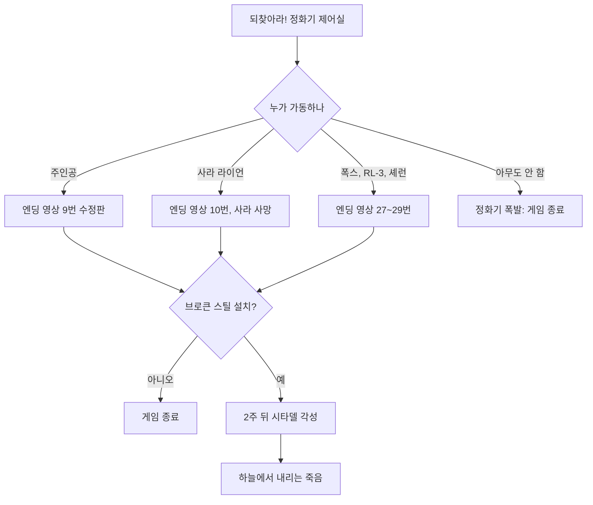

### 9.3 정화수(아쿠아 퓨라) 배급 체계
- **생산**: 정화기가 타이달 베이슨의 물을 정화하고, 제퍼슨 기념관 바깥 병입장에서 '아쿠아 퓨라'로 병에 담음. 기념품점이 빅슬리의 관리 사무실이 됨.
- **운영 주체**: BoS가 기반을 깔고 **리벳시티 경비대**가 호위를 넘겨받는 구조(빅슬리가 협상). 일주일 숙의 끝에 르펠티에가 책임자로 뽑혔고, 대가는 캡과 기술로 받음. 목표는 지역 내 큰 정착지 전부에 물을 공급하는 것이며, BoS는 **무료 배급**을 원칙으로 함.
- **물 캐러밴**: 아쿠아 퓨라 통을 실은 짐 브라민 + 스캐빈저(상인) + 호위(리벳시티 경관 2명 또는 BoS 나이트·팔라딘). 일반 교역 캐러밴과 달리 **죽어도 리스폰**함. 놓치면 제퍼슨 기념관에서 1시간 대기하면 다리에 나타남. 살아남은 상인과는 거래·수리가 가능함.
- **노선**(공식 가이드 투어·인카운터 문서 기준): 제퍼슨 기념관 ↔ 리벳시티 / 제퍼슨 기념관 → 안데일(Andale) → 데이브 공화국(Republic of Dave) / 저먼타운(Germantown) 경찰 본부 ↔ 빅타운 / 워링턴 역 ↔ 텐페니 타워 / 메가톤 → 빅타운. 인카운터 문서는 웨이스트랜드를 크게 도는 장거리 순환 노선(시타델, 안데일, 리틀 램프라잇(Little Lamplight) 인근, 파라다이스폴(Paradise Falls), 올드 올니, 데이브 공화국 등)을 따로 기록함.
- **운영난**: 호위 경험 부족으로 캐러밴 4분의 1 이상이 돌아오지 않음. 한때 정화 계획 현금이 24캡까지 떨어짐. 빅슬리는 그리폰의 유료 구매 제안을 받아들여 운영비를 메움.
- **도난과 암시장**: 훔친 통은 레이더(행크 전기용품점 옥상, 몽고메리 저수지 사일로), 탈론 컴퍼니, 엔클레이브, 슈퍼 뮤턴트(오버로드), 노예 사냥꾼의 손에 있음. 통 자체는 상호작용 불가이며, 나무 상자(약 10병)만 뒤질 수 있음.
- **플레이어에게 주는 의미**
  - 아쿠아 퓨라는 정화수와 같은 체력 +20 무방사능 음료로, 시타델 등에서 대량으로 공짜로 얻음 → **회복 자원이 사실상 넉넉해짐**.
  - FEV를 넣었다면 같은 물이 **누적 4병째 즉사**하는 함정 자원으로 바뀜.
  - 본편 반복 퀘스트 「물 거지」에 아쿠아 퓨라를 줄 수 있음.

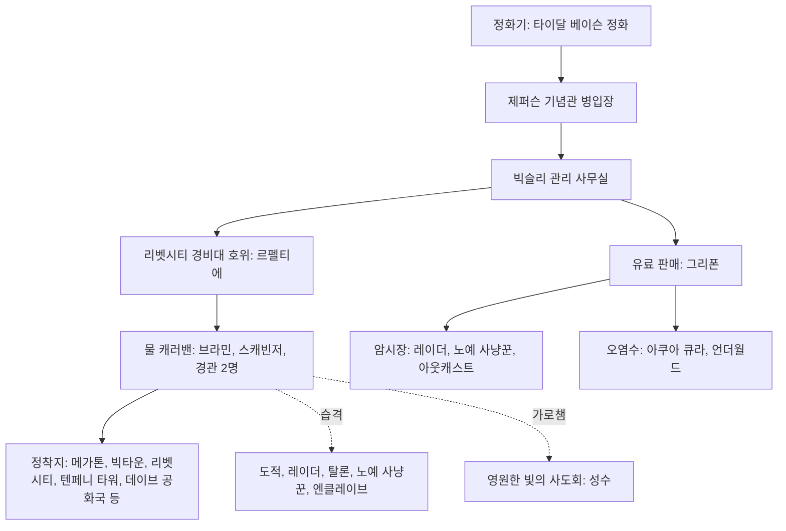

### 9.4 엔클레이브 잔당과 버티버드
- 메인 퀘스트가 끝나도 **엔클레이브는 사라지지 않음**. 캠프·전초기지가 계속 리스폰하며, 트리스탄은 "고립된 부대가 소식을 듣기까지 몇 달 걸린다"는 설정으로 설명함.
- 「되찾아라!」 이후 엔클레이브는 **3일마다 제퍼슨 기념관을 습격**하고 대부분 BoS에게 격퇴됨. 엔클레이브 파워 아머·에너지 무기의 반복 공급원이 됨.
- 브로큰 스틸 설치 시, 본편에서는 「생명의 물」 이후에야 나타나던 엔클레이브 병사가 **캠프 예정지에 미리** 나타남(그 장소를 두 번째 방문할 때). 고레벨이면 헬파이어 변종도 섞임.
- **버티버드 투하**: 헬파이어 트루퍼는 무작위 버티버드 투하 지점으로도 전장에 투입됨. 캠프 병력을 처치하면 잠시 뒤 버티버드가 와 조사 병력을 내려놓는 캠프도 있음(본편 규칙의 연장).
- 애덤스 공군 기지에서는 버티버드가 활주로를 기총 소사하고 관제탑에 미사일을 쏘는 **스크립트 공습**이 연출됨. 주기 중인 버티버드를 파괴하면 증원이 줄 수 있음. 마지막에는 BoS가 노획해 개조한 버티버드(BoS 문장, '프라이드 원(Pride One)')가 주인공을 태우러 옴.
- 패배한 엔클레이브의 '사기 붕괴'를 보여 주는 인카운터
  - 뉴카-콜라 공장(Nuka-Cola plant) 북쪽: 헬멧을 벗은 엔클레이브 병사 3명이 "중위를 죽였다, 물만 달라"며 아웃캐스트 순찰대에 항복하려다 사살당함.
  - 스프링베일 학교 북동쪽 강가: 엔클레이브 장교가 자기 부하를 처형하는 중.

### 9.5 고레벨 적 추가와 레벨 연동 목록 확장
- 레벨 상한이 30으로 오르면서, 기존 적 레벨 연동 목록에 **상위 변종이 끼워 넣어짐**.

| 기존 계열 | 추가된 상위 단계 | 비고 |
|---|---|---|
| 슈퍼 뮤턴트 (일반 → 브루트 → 마스터) | **오버로드** | 쌍으로 또는 단독으로 다니며 무리를 이끌기도 함. 트라이빔 레이저 소총 공급원 |
| 야생 구울 (로머 등) | **리버** | 대통령 전용 지하철에서도 고레벨일수록 다수 |
| 라드스코피온 (거대 라드스코피온) | **알비노 라드스코피온** | 고레벨에서는 일반종보다 자주 만남 |
| 엔클레이브 병사 (일반 → 테슬라) | **헬파이어 트루퍼 / 헬파이어 병사** | 매우 어려움 난이도에서는 테슬라 병사와 같은 빈도 |
| 탈론 컴퍼니 용병 (랭크 1~3) | **랭크 4** (레벨 17) | 고정 거점보다 랜덤 인카운터 위주 |
| 데스클로 | (빈도 상향) | 브로큰 스틸 설치 시 데스클로 랜덤 인카운터가 훨씬 잦아지고, 고레벨에선 쌍으로 다님 |
| 로봇 | 엔클레이브 센트리 봇, 마크 VII·VIII 터렛 | 신규 시설 배치 |

- 레벨 연동 NPC의 상한도 확장됨(예: 브라더 제라드 1→30, 시그마 분대 4→24, 래그볼트 플레이어 레벨 ×1.5).
- 설계상 의미: 플레이어가 강해지는 만큼 **적의 천장도 함께 올려** 레벨 21~30 구간의 긴장을 유지함. 다만 HP 1,000대 적(오버로드 1250, 리버 1100, 알비노 1500)이 일반 필드에 섞이면서 '총알 스펀지'라는 체감도 생김. 너브스 오브 스틸 문서도 오버로드가 VATS 여러 턴을 요구한다고 적고 있음.

### 9.6 월드 변화와 신규 인카운터
브로큰 스틸은 정화수와 전쟁 여파를 보여 주는 **고정 인카운터**를 웨이스트랜드 곳곳에 뿌림.

| 위치 | 인카운터 |
|---|---|
| 메가톤 정문 | 「성수」의 로자 연출, 「황무지 주민의 물 요청」 |
| 빅타운 북쪽 다리 | 노예 사냥꾼 4명 이상이 물 캐러밴을 습격(노예 사냥꾼은 플레이어에 비적대). 살아남은 캐러밴은 빅타운–저먼타운 사이를 무한 왕복 |
| 텐페니 타워 서쪽 | 목마른 척하던 레이더가 미사일 발사기를 꺼내고, 레이더 4명이 캐러밴을 매복 |
| 에버그린 밀 입구 | '공짜 물' 간판과 빈 아쿠아 퓨라 상자, 폭발 시체 함정(해제 가능), 절벽 위 레이더 매복 |
| 캘린의 B&B ~ VAPL-58 발전소 | 여성 매복조 3명(비적대). 홀로테이프에 '제드'의 조언으로 미모를 써서 캐러밴을 털 계획이 담김 |
| 배니스터 요새 | 포로 팔라딘 젠슨 → 풀어 주면 돌격해 전사 → BoS 분대가 요새 공격 |
| 체비 체이스 이스트역 | 오버로드가 BoS 이니시에이트 2명을 죽이고 아쿠아 퓨라 더미를 지킴(옆 버스를 폭파해 피해 가능) |
| 뉴카-콜라 공장 북북동 | 탈론 컴퍼니와 레이더가 아쿠아 퓨라 상자를 두고 교전 |
| 뉴카-콜라 공장 북쪽 | 항복하려는 엔클레이브 탈영병 vs 아웃캐스트 |
| 스프링베일 학교 북동쪽 | 부하를 처형하는 엔클레이브 장교 |
| 알링턴 도서관 남쪽 | 버려진 아쿠아 큐라 통 → 탈론 컴퍼니 3~4명 매복 |
| 시워드 광장 | 국회의사당 밖 탈론 컴퍼니 캠프, 홀로테이프 「Talon Company merc log #1」 |
| 제퍼슨 기념관 동쪽 | BoS 이니시에이트가 정화된 물에서 죽어 가는 마이얼럭('플로터')을 소각·사살 |
| 데이브 공화국 앞 | 편집증에 걸린 리벳시티 경관 2명이 허공에 총을 쏘며 캐러밴을 호위 |
| 몽고메리 카운티 저수지 북서 | 레이더가 차지한 사일로·헛간, 아쿠아 퓨라 상자와 감시병 |
| 주리 스트리트 지하철역 | 행크 전기용품점 옥상의 레이더 |

### 9.7 기타 변화
- 주인공이 BoS **나이트**로 임명됨(수습 과정 생략). 시타델 정문 경비가 사라짐.
- **리버티 프라임 영구 상실**: 머리만 시타델 실험실에 남고 끝내 수리되지 않음.
- 타이달 베이슨의 물이 깨끗해지면서 **마이얼럭이 죽어 감**(방사능 없는 물에서 살지 못한다는 설정).
- 쓰리독이 브로큰 스틸 사건을 보도함(엔클레이브를 '집 잃은 불쌍한 자들'로 조롱).
- 어텀 대령의 레이저 권총 성능이 바뀜(6.1절).

---

## 10. 업적·트로피

브로큰 스틸은 다른 애드온(각 4개, 100점)과 달리 **6개, 150점**을 추가함. 사이드·비표시·반복 퀘스트에는 업적이 없음. 전체 목록은 [RD-23](23_collectibles-achievements.md).

| 이름 | English | 조건 | 점수(Xbox 360·PC) | 트로피(PS3) |
|---|---|---|---|---|
| 하늘에서 내리는 죽음 | Death From Above | 「하늘에서 내리는 죽음」 완료 | 30 | 은 |
| 충격의 가치 | Shock Value | 「충격의 가치」 완료 | 30 | 은 |
| 도전하는 자가 승리한다 | Who Dares Wins | 「도전하는 자가 승리한다」 완료 | 30 | 금 |
| 악마 | Devil | 악한 카르마로 레벨 30 도달 | 20 | 동 |
| 참된 필멸자 | True Mortal | 중립 카르마로 레벨 30 도달 | 20 | 동 |
| 메시아 | Messiah | 선한 카르마로 레벨 30 도달 | 20 | 동 |

- 카르마 업적 3종은 레벨업 직전에 저장해 두고 카르마를 조정하는 방식, 또는 레벨 24 카르마 퍽(데블스 하이웨이 등)으로 한 회차에 모두 얻을 수 있음.
- PS3판에서는 「참된 필멸자」와 「메시아」의 트로피 아이콘이 서로 뒤바뀌어 있음.

---

## 11. 설계 분석

### 11.1 본편 엔딩 비판에 대한 대응
- 본편 엔딩은 출시 후 두 가지로 비판받았음: ① 엔딩 뒤 **이어서 플레이할 수 없음** ② 방사능 면역 동료(폭스·RL-3·셰런)가 있는데도 주인공이나 사라가 희생해야 하는 **강요된 희생**.
- 개발진 발언(코퍼스 `Fallout 3` 문서의 평가 항목)
  - 작가 에밀 파글리아룰로(Emil Pagliarulo): 강요된 희생은 작가진이 '희생'이라는 주제를 중시했기 때문이지만, 게임을 끝내는 방법이 더 없다는 것은 폴아웃의 정신에 어긋난다고 깨달아 브로큰 스틸에서 바꿨다고 설명함.
  - 토드 하워드(Todd Howard, 2026년 2월 게임 인포머 인터뷰): 원래는 폴아웃 1·2처럼 '이야기를 끝내면 게임이 끝나는' 구조를 의도했으나, 출시 후 큰 반발이 애드온 기획 시점의 내부 논의로 이어졌고, 그 결과 본편 결말에서 이어지며 마지막 선택의 결과를 볼 수 있는 브로큰 스틸이 만들어졌다고 밝힘.
- 브로큰 스틸의 대응
  - **사망을 혼수로 바꿈**: 희생의 연출(제어실 진입, 엔딩 영상)은 유지하되 결과만 '2주 혼수'로 바꿔, 본편의 감정선은 살리고 게임은 계속되게 함.
  - **면역 동료 수락**: 세 동료가 정화기를 가동할 수 있게 하고, 각자에게 전용 엔딩 영상(27~29번)을 줌. 서사적 모순을 데이터 추가로 메움.
  - **선택의 결과를 월드로 보여 줌**: 정화수 배급, 물을 둘러싼 갈등, FEV 투입의 장기 효과 등 본편 결정의 '그 후'를 퀘스트와 인카운터로 구현함. 폴아웃 1·2의 슬라이드식 후일담을 '플레이 가능한 후일담'으로 바꾼 셈임.
- 한계
  - 엔딩 슬라이드는 여전히 각성 전에 재생되므로, 브로큰 스틸에서 한 일(애덤스 기지 파괴, 시타델 파괴 등)은 **어떤 엔딩에도 반영되지 않음**.
  - 정화기를 폭발시킨 플레이어, 사라를 희생시킨 플레이어 모두 같은 시작점으로 합류해, 본편 분기의 무게가 '대사 몇 줄'로 줄어듦.

### 11.2 '두 번째 결말'의 설계
- 메인 퀘스트 3개는 **증거 수집(중계소) → 무기 확보(테슬라 코일) → 결전(애덤스 기지)**이라는 고전적 3막 구조임. 리버티 프라임의 파괴가 1막의 전환점이자 동기 부여 장치임.
- 최종 선택(애덤스 기지 vs 시타델)은 본편 「원자의 힘」처럼 −1000 규모의 '악의 대형 선택지'를 다시 줌으로써, 악 카르마 플레이어에게도 클라이맥스를 마련함. 다만 시타델 파괴 루트의 후속 콘텐츠는 적대화와 보상 상자 정도로 얕음.

### 11.3 엔드게임 루프
- 레벨 상한 확장 + 반복 퀘스트(카메라·센서 모듈·혈액 샘플) + 고레벨 적(오버로드 등의 좋은 드롭) + 테슬라 캐논 8정 보급이 결합해, '엔딩 뒤 무엇을 할 것인가'에 대한 **수집·사냥 루프**를 만듦.
- 레벨 21~30 퍽은 '새 플레이 스타일'보다 '빌드 완성'에 가까워, 장기 플레이의 목표를 S.P.E.C.I.A.L. 9(올모스트 퍼펙트)와 카르마 업적으로 제시함.

### 11.4 사이드 퀘스트의 주제: 공공재의 정치학
- 「성수」(종교적 선의의 해악), 「물길을 지켜라」(치안과 갈취), 「놀라운 아쿠아 큐라!」(암시장과 사기), 「황무지 주민의 물 요청」(배급량의 제로섬)은 모두 '깨끗한 물을 누가 어떻게 나누는가'라는 하나의 질문을 다른 각도에서 다룸.
- BoS의 무료 배급 원칙과 빅슬리·르펠티에의 현실론이 대립하며, 본편의 '물 = 생명'이라는 주제를 '물 = 권력·경제'로 확장함.

### 11.5 강점과 약점
- 강점: 엔딩 문제 해결, 높은 재방문 가치(레벨 30·퍽 14개), 본편 장소 재활용으로 개발 비용 대비 높은 체감 분량, 리버티 프라임 파괴 같은 강한 연출.
- 약점: HP 1,000대 적의 '총알 스펀지'화, 데스클로 교란기처럼 쓰임새가 적은 기믹, 시타델 파괴 루트의 얕은 후일담, 엔딩 슬라이드 미갱신.

### 11.6 다른 시스템과의 연계
- 캐릭터 시스템: 레벨 상한·퍽(RD-14). 카르마 업적.
- 전투: 고레벨 적과 레벨 연동 목록(RD-16, RD-24). 테슬라 캐논이라는 대공 해법.
- 경제: 아쿠아 퓨라의 대량 공급, 반복 퀘스트 수입, 그리폰·스플릿 잭의 주급(RD-22).
- 동료: 면역 동료의 정화기 가동, 퍼피스!(RD-10).

---

## 12. 쯔꾸르 이식 메모

**보존 필수**
- 「되찾아라!」 이후 **이어하기 구조**: 정화기 가동 → 엔딩 연출 → 2주 뒤 각성. 정화기 폭발만은 게임 종료. 가동자(주인공·사라·면역 동료 3)와 사라 생사 변수 유지.
- 메인 3부작과 **최종 목표 선택(애덤스 기지 +1000 / 시타델 −1000)**, 실패하는 목표 3개의 메뉴 연출.
- 레벨 상한 30, XP 식 50 + 150n, 레벨 30 카르마 칭호 3종, 퍽 14개.
- 아쿠아 퓨라와 FEV 오염 시 '누적 4병째 즉사' 규칙(본편 FEV 선택의 장기 결과).

**단순화**
- 리버티 프라임 진격·애덤스 기지 전투: 실시간 대규모 교전 대신 **스크립트 연출 + 웨이브 전투** 몇 개로 압축.
- 물 캐러밴 이동: 실제 이동 NPC 대신 **고정 지점 인카운터 테이블**(매복·언쟁·습격)로 구현.
- 크롤러 4층 구조를 맵 2~3장으로 축소하되, 반발장 4지선다·로봇 통제 4지선다 같은 **스킬 체크 지점은 유지**.
- 데스클로 교란기: '범위 안에서만 동료' 규칙을 이벤트 동료(일정 걸음 수 뒤 사망)로 단순화.

**생략·변형 후보**
- 퍼피스!, 퀀텀 케미스트 같은 시스템 결합 퍽은 해당 시스템(동료 사망 처리, 뉴카-콜라 수집)을 구현할 때만 넣음.
- 「슬픈 구혼자」, 「프라임 타임 준비」, 「피의 형제단」은 우선순위 낮음. 반복 납품은 공용 '납품 NPC' 이벤트 하나로 묶을 수 있음.
- 삭제 무기 4종(테슬라 캐논 베타 등)은 이식 대상 아님.

**구현 시 주의**
- 레벨 연동 목록 확장: 고레벨 적의 HP(1,000대)를 그대로 옮기면 턴제 전투에서 지루해짐. **등장 레벨은 유지하고 HP·공격 패턴을 턴제에 맞게 재조정**할 것.
- 테슬라 캐논의 '버티버드 한 방 격추' 같은 대공 역할을 전투 단순화 과정에서 잃지 않도록, 버티버드를 별도 적으로 둔다면 상성 규칙을 마련할 것.
- 시타델 파괴 시 BoS 전역 적대, 「성수」 영구 불가, 반복 퀘스트 2개 미개방 등 **진행 플래그 연쇄**를 표로 관리할 것.
- 메가톤 파괴 여부(「원자의 힘」)와 「성수」의 상호작용(퀴리의 리버화, 제라드의 구울화)은 본편 플래그와 결합하므로 플래그 이름을 RD-05와 맞출 것.

---

## 13. 출처

본 문서는 Nukapedia(fallout.fandom.com) DB 덤프(2026-08-30판, CC BY-SA) 로컬 코퍼스를 근거로 작성함.

- 개요·허브: `Nukapedia: Broken Steel`, `Nukapedia: Fallout 3`(평가·개발진 발언), `Nukapedia: Fallout 3 add-ons`, `Nukapedia: Fallout 3 quests`, `Nukapedia: Fallout 3 perks`, `Nukapedia: Fallout 3 achievements and trophies`, `Nukapedia: Fallout 3 endings`, `Nukapedia: Level`, `Nukapedia: Fallout 3 Game of the Year Edition Tour of Broken Steel`, `Nukapedia: Broken Steel encounters`
- 퀘스트: `Nukapedia: Death From Above`, `Nukapedia: Shock Value`, `Nukapedia: Who Dares Wins`, `Nukapedia: Holy Water (quest)`, `Nukapedia: Protecting the Water Way`, `Nukapedia: The Amazing Aqua Cura!`, `Nukapedia: The Sorrowful Suitor`, `Nukapedia: Wastelander Water Request`, `Nukapedia: Getting Ready for Prime Time`, `Nukapedia: Blood Brotherhood`, `Nukapedia: Take it Back!`, `Nukapedia: Project Impurity`, `Nukapedia: Battle of Rockland`, `Nukapedia: Battle of Adams Air Force Base`
- 장소: `Nukapedia: Adams Air Force Base`, `Nukapedia: Mobile base crawler`, `Nukapedia: Air control tower`, `Nukapedia: Adams storage facility`, `Nukapedia: Satellite relay station`, `Nukapedia: Rockland car tunnel`, `Nukapedia: Old Olney underground`, `Nukapedia: Old Olney S. Wilson Building`, `Nukapedia: Olney Powerworks`, `Nukapedia: Presidential metro`, `Nukapedia: Presidential sub level`, `Nukapedia: Pennsylvania Avenue`, `Nukapedia: Holy Light Monastery`, `Nukapedia: Museum Authority Building`, `Nukapedia: Hank's Electrical Supply`, `Nukapedia: The Citadel`, `Nukapedia: Jefferson Memorial`, `Nukapedia: Megaton`, `Nukapedia: Wilhelm's Wharf`, `Nukapedia: La Maison Beauregard`, `Nukapedia: Fort Bannister`, `Nukapedia: Evergreen Mills`, `Nukapedia: Fallout 3 Enclave outposts and camps`
- 인물: `Nukapedia: Tristan`, `Nukapedia: Vallincourt`, `Nukapedia: Bigsley`, `Nukapedia: Lepelletier`, `Nukapedia: Split Jack`, `Nukapedia: Griffon`, `Nukapedia: Curie III`, `Nukapedia: Gerard (Broken Steel)`, `Nukapedia: Rosa Meitner`, `Nukapedia: Stiggs`, `Nukapedia: MARGoT`, `Nukapedia: Lag-Bolt`, `Nukapedia: Sarah Lyons`, `Nukapedia: Owyn Lyons`, `Nukapedia: Sergeant RL-3`, `Nukapedia: Enclave Squad Sigma`, `Nukapedia: Enclave Sigma Leader`, `Nukapedia: Jed (Broken Steel)`, `Nukapedia: Joe (Broken Steel)`, `Nukapedia: Marcus (Broken Steel)` 외 정보상자(Atom's Champion, Badger, Carl, Connelly, Davis, Dunbar, Edwards, Hoover, Jensen, Kidd, Lorin, Novice, Sanders, Sparky, Sun of Atom, Wint 등)
- 대사: `Nukapedia: ElderLyons.txt`, `Nukapedia: DLC03WQ03MotherCurie.txt`, `Nukapedia: DLC03WQ03BrotherGerard.txt`, `Nukapedia: DLC03Margot.txt`, `Nukapedia: DLC03SplitJack.txt`, `Nukapedia: DLC03Griffon.txt`, `Nukapedia: DLC03WQSick.txt`
- 아이템·퍽: `Nukapedia: Tesla cannon (Broken Steel)`, `Nukapedia: Tri-beam laser rifle (Broken Steel)`, `Nukapedia: Heavy incinerator (Broken Steel)`, `Nukapedia: Precision Gatling laser`, `Nukapedia: Rapid-torch flamer`, `Nukapedia: Slo-burn flamer`, `Nukapedia: Callahan's Magnum`, `Nukapedia: Colonel Autumn's laser pistol (Broken Steel)`, `Nukapedia: Enclave Hellfire armor`, `Nukapedia: Lag-Bolt's combat armor`, `Nukapedia: Lag-Bolt's shades`, `Nukapedia: All-nighter nightwear`, `Nukapedia: Composite recon armor`, `Nukapedia: Aqua Pura`, `Nukapedia: Aqua Cura`, `Nukapedia: Holy water`, `Nukapedia: Deathclaw control scrambler`, `Nukapedia: Tesla coil`, `Nukapedia: Main fuse`, `Nukapedia: Senate employee ID`, `Nukapedia: Super mutant blood sample`, 퍽 개별 문서 14개(`Deep Sleep` ~ `Almost Perfect`)
- 적: `Nukapedia: Super mutant (Fallout 3)`, `Nukapedia: Feral ghoul (Fallout 3)`, `Nukapedia: Radscorpion (Fallout 3)`, `Nukapedia: Enclave Hellfire trooper`, `Nukapedia: Enclave soldier (Fallout 3)`, `Nukapedia: Sentry bot (Fallout 3)`, `Nukapedia: Automated turret (Fallout 3)`, `Nukapedia: Talon Company merc`, `Nukapedia: Deathclaw (Fallout 3)`, `Nukapedia: Vertibird (Fallout 3)`
