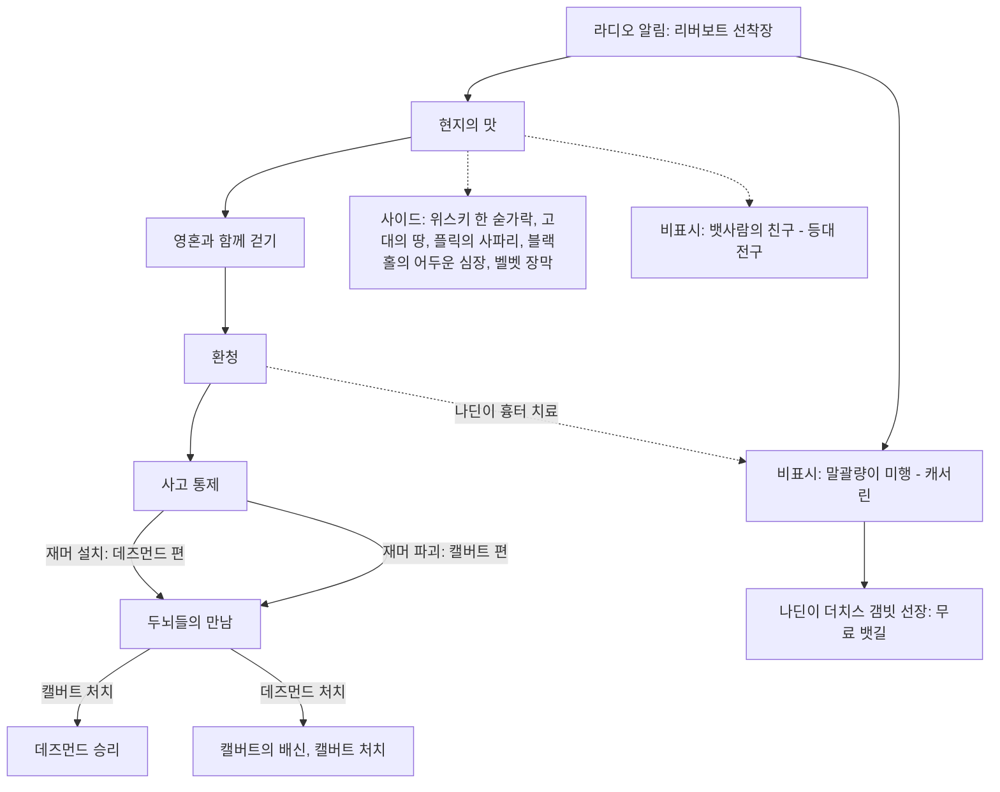
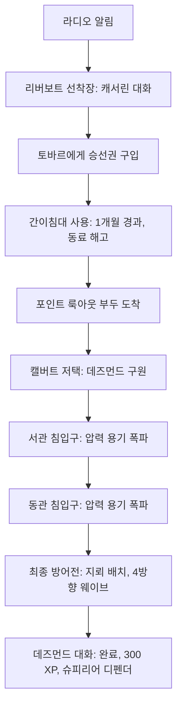
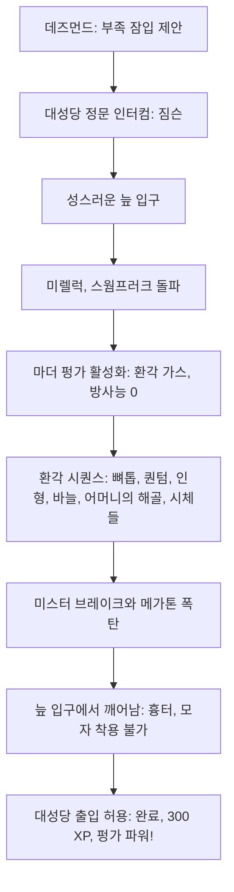
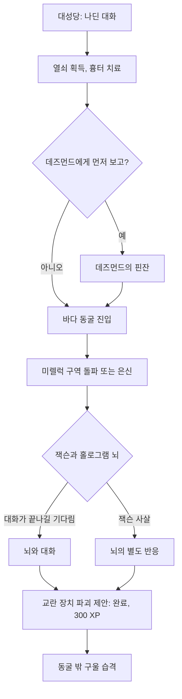
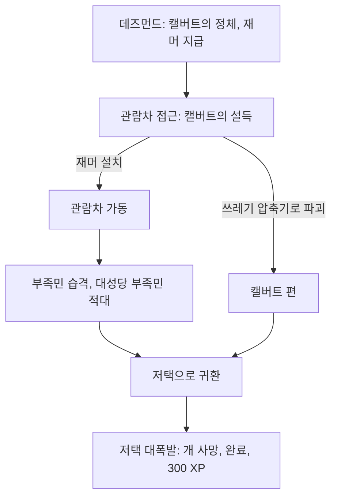
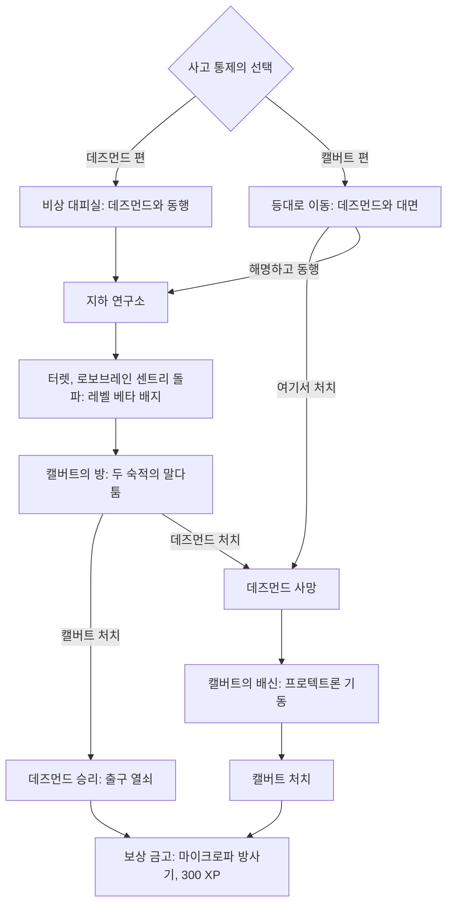

# RD-08d. DLC: 포인트 룩아웃

> **폴아웃 3 역기획서 세트** | 문서 ID: RD-08d | 버전: v1.0 | 작성일: 2026-10-11
> **범위**: 애드온 [PL] 포인트 룩아웃(Point Lookout)의 개요, 스토리, 퀘스트 12개 상세(메인 5·사이드 5·비표시 2), 맵 전체 구조와 장소, NPC, 장비·아이템, 퍽, 적, 보트 이동·늪지 환경·환각 시퀀스 등 규칙 변화, 업적. 무기·방어구·퍽·적·장소의 전체 수치는 각 카탈로그 정본(RD-19/20/14/24/13)이 다루며 이 문서는 DLC 맥락의 요약만 둔다.
> **관련 문서**: [RD-01 게임 개요](01_game-overview.md), [RD-02 세계관·설정·연표](02_world-and-lore.md), [RD-09 팩션](09_factions.md), [RD-11 NPC 디렉터리](11_npc-directory.md), [RD-13 장소 카탈로그](13_location-catalog.md), [RD-14 캐릭터 시스템](14_character-system.md), [RD-19 무기·탄약](19_weapons-ammo.md), [RD-20 방어구·의복](20_armor-apparel.md), [RD-21 소모품·잡화·제작](21_consumables-misc-crafting.md), [RD-22 경제·주거](22_economy-housing.md), [RD-23 수집 요소·업적](23_collectibles-achievements.md), [RD-24 크리처·적 도감](24_bestiary.md), [RD-25 아트·오디오·연출](25_art-audio-presentation.md), [RD-08c DLC: 브로큰 스틸](08c_dlc-broken-steel.md)

---

## 0. 문서 개요

### 0.1 목적
- [PL] 포인트 룩아웃이 더한 **새 지역(늪지 맵)·이야기·퀘스트·적·규칙**을 한 문서로 정리함.
- 팬게임에서 '배를 타고 가는 별도 지역', '환각 시퀀스', '남부 고딕 공포 톤'을 구현할 때 기준 자료로 씀.

### 0.2 범위
- 다룸: DLC 개요, 시놉시스, 허브 `Fallout 3 quests`의 포인트 룩아웃 섹션에 있는 퀘스트 12개 전부, 맵 구조와 지도 마커 31곳·주요 비표시 장소, 신규 NPC·장비·퍽·적, 보트 이동·늪지 환경·환각·고정 추가 피해 등 규칙 변화, 업적·트로피.
- 다루지 않음: 무기·방어구·적의 전체 수치(각 카탈로그 정본), 던위치 빌딩 자체의 구조(RD-12·RD-13, 이 문서는 「블랙홀의 어두운 심장」 결말 장소로만 언급).
- 허브 확인 결과: 「프라임 타임 준비(Getting Ready for Prime Time)」와 「피의 형제단(Blood Brotherhood)」은 브로큰 스틸 반복 퀘스트이므로 [RD-08c](08c_dlc-broken-steel.md)에서 다룸.

### 0.3 요약
- 포인트 룩아웃은 캐피털 웨이스트랜드 남쪽 메릴랜드 해안의 **늪지대**를 무대로 한 애드온임. 핵폭탄이 직접 떨어지지 않았지만 세상에서 버려진 땅이라는 설정임.
- 메인 퀘스트 5개는 전쟁 전부터 이어진 두 괴인, **구울 전직 스파이 데즈먼드 록하트(Desmond Lockheart)**와 **뇌만 남은 과학자 캘버트 교수(Professor Calvert)**의 200년 묵은 '거대한 게임'에 휘말리는 이야기임. 중간에 주인공은 환각제에 취한 사이 **뇌 일부를 도려내는** 사건을 겪음.
- 사이드 퀘스트는 러브크래프트풍 마도서(「블랙홀의 어두운 심장」), 냉전식 첩보 데드 드롭(「벨벳 장막」), 밀주(「위스키 한 숟가락」), 구울 사냥 오락(「플릭의 사파리」), 전쟁 전 탐사 기록(「고대의 땅」) 등 장르 실험이 많음.
- 시스템 면에서는 **배를 이용한 지역 이동**, 펑가 열매(방사능을 줄여 주는 음식), 원주민 무기의 **방어 무시 +35 고정 피해**, 환각 시퀀스, 부표 아래 수중 보물과 흙무덤 파기 같은 탐험 보상이 특징임.

### 0.4 표기 메모
- 고유명사는 [RD-26 용어집](26_glossary.md)을 따름. 용어집에 없는 이름은 음차하고 최종 보고에 신규 용어로 제출함.
- 퀘스트 ID는 위키 표기 `xx005846` 형식. `xx`는 로드 순서 자리임. 에디터 ID(edid)를 함께 적음.
- '캐서린(Catherine)'은 주인공의 어머니가 아니라 나딘의 어머니인 별개 인물임. 이 문서에서는 '캐서린(나딘의 어머니)'으로 구분함.
- 스킬 판정은 코퍼스가 수치를 주면 수치로, 없으면 '판정(수치 코퍼스 미확인)'으로 적음.

---

## 1. DLC 개요

| 항목 | 내용 |
|---|---|
| 정식 명칭 | 포인트 룩아웃(*Point Lookout*) — 폴아웃 3의 네 번째 애드온 |
| 개발 / 유통 | 베데스다 게임 스튜디오 / 베데스다 소프트웍스. 리드 디자이너 조엘 버지스(Joel Burgess), 리드 아티스트 네이선 퍼키파일(Nathan Purkeypile) |
| 출시일 | PC·Xbox 360: 2009-06-23 / PS3: 2009-10-08 |
| 기타 판본 | 디스크판 *Fallout 3 Game Add-on Pack* 2탄(브로큰 스틸과 합본, 2009-08-25) / GOTY 에디션(2009-10-13) / Steam(2010-07-16) |
| 가격 | 800 MS 포인트 또는 $9.99 (애드온 공통) |
| 용량·필요 패치 | 370.4 MB(PS3 534 MB) / PC·PS3 패치 1.6, Xbox 360 패치 1.5 |
| 진입 조건 | 본편 진행도와 무관. 설치 후 게임 안에서 몇 분이 지나면 **라디오 알림**이 뜨고 「현지의 맛」이 시작됨. 볼트 101을 나서자마자 갈 수도 있음 |
| 시작 트리거 | 알림 → 캐피털 웨이스트랜드 남부(알링턴 도서관 동쪽, 시타델 남쪽)의 **리버보트 선착장(Riverboat landing)** → 뱃사공 토바르(Tobar)에게 승선권 구입 → 선실 간이침대에서 잠들면 이동 |
| 권장 레벨 | 공식 권장 레벨 없음(코퍼스 미확인). 위키는 볼트 직후 진입은 권하지 않으며 **다른 애드온보다 훨씬 어렵고 캡이 많이 든다**고 경고함 |
| 플레이 볼륨 | 메인 퀘스트 약 3~4시간(코퍼스 기준). 맵 넓이는 캐피털 웨이스트랜드의 **1/6~1/5** |
| 구성 | 메인 5 / 사이드 5 / 비표시 2 = 퀘스트 12개, 지도 마커 31곳, 퍽 3개(특별 1·퀘스트 2), 업적·트로피 4개(100점) |
| 개발 기간 | **약 4개월**. 당시 스튜디오 주력이 『스카이림』 사전 제작에 들어가 소규모 팀으로 시작함. 콘셉트 아트는 외주로 만든 늪지 주민 1종뿐 |
| 핵심 콘셉트 | ① 핵을 피했지만 버려진 **늪지 오지**(남부 고딕) ② 전쟁 전 엘리트 두 괴인의 **복수극** ③ 마도서·사교·근친 원주민 같은 **러브크래프트풍 공포** ④ 공식 소개문의 표현대로 '가장 신비롭고 열린 결말의 DLC 모험' |

> 공식 소개문 요지: "메릴랜드 해안의 어둡고 질척한 늪지라는 거대한 새 지역. 연락선을 타고 해변 마을 포인트 룩아웃으로 가라. 지금까지 가장 신비롭고 자유로운 폴아웃 3 DLC 모험."

---

## 2. 스토리 시놉시스 (스포일러 포함)

### 2.1 도입: 연락선
- 리버보트 선착장에 증기선 **더치스 갬빗(Duchess Gambit)**이 들어옴. 선장 토바르는 "신선한 먹을거리, 신비로운 장소, 아직 아무도 털지 않은 보물"을 내세워 승선권을 팖.
- 선착장에서는 캐서린(나딘의 어머니)이 포인트 룩아웃으로 가출한 딸 나딘(Nadine)을 찾아 달라고 부탁함(비표시 「말괄량이 미행」).

### 2.2 1막: 캘버트 저택 방어
- 필그림스 랜딩(Pilgrim's Landing) 부두에 내린 주인공은 언덕 위 **캘버트 저택(Calvert Mansion)**에서 부족민의 습격을 받던 구울 신사 데즈먼드 록하트와 그의 개 프레키(Freki)·게리(Geri)를 도움.
- 데즈먼드는 전쟁 전 영국 정보기관 출신이라 자칭하며, 부족민이 왜 자신을 노리는지 알아내려고 주인공에게 **부족에 잠입**하라고 함.

### 2.3 2막: 마더 펑가와 뇌수술
- 아크 앤드 도브 대성당(Ark & Dove Cathedral)의 문지기 짐슨(Jimson)은 입단 의식으로 **성스러운 늪(Sacred bog)**의 거대 식물 **마더 펑가(Mother Punga)**의 씨앗을 가져오라고 함.
- 씨앗을 따는 순간 환각 가스에 쓰러진 주인공은 뒤틀린 늪을 걸어 나오는 **환각 시퀀스**를 겪음. 깨어나 보니 머리를 밀었고 큰 흉터가 있음. 누군가 주인공의 **뇌 일부를 도려낸** 것임.
- 부족에 받아들여진 주인공은 대성당에서 나딘을 만남. 나딘은 흉터를 치료해 주고, 지도자 잭슨(Jackson)이 바다 동굴의 성소에 숨어 있다며 열쇠를 줌.
- 바다 동굴에서 잭슨은 **홀로그램 뇌**와 교신 중임. 그 뇌는 주인공에게 데즈먼드의 신호 교란 장치를 부수라고 제안함.

### 2.4 3막: 거대한 게임의 끝
- 데즈먼드는 그 뇌가 **캘버트 교수**라고 밝힘. 둘은 전쟁 전 '거대한 게임'(핵전쟁 이후까지 살아남아 승리하려는 엘리트들의 경쟁)의 숙적이었음. 데즈먼드는 방사능 노출로 스스로 구울이 되었고, 캘버트는 사이보그 연구로 뇌만 남은 채 등대 지하 연구소에 갇혀 있었음(데즈먼드의 공작 때문).
- 주인공은 필그림스 랜딩의 관람차 '경이의 바퀴(Wheel of Wonder)'에 **코그웨이브 재머(Cogwave jammer)**를 설치하거나(데즈먼드 편), 쓰레기 압축기에 버려 파괴함(캘버트 편).
- 어느 쪽이든 캘버트 저택은 대폭발로 무너지고 데즈먼드의 개들이 죽음. 데즈먼드는 비상 대피실에서 살아남아 복수를 다짐함.
- 결전은 등대 지하의 **세인트 오빈 의료 시설(St. Aubin Medical Facility)**. 수조 속 캘버트와 데즈먼드가 서로 주인공이 자기편이라 우기고, 주인공은 둘 중 하나를 죽여야 함.
  - 캘버트를 죽이면 데즈먼드가 승리를 만끽하며 "북쪽의 다른 '플레이어'를 상대하러 가겠다"고 함.
  - 데즈먼드를 죽이면 캘버트는 '인간이 바랄 수 있는 최고의 보상'으로 죽음을 주겠다며 프로텍트론을 깨워 배신하고, 결국 캘버트도 쓰러뜨려야 함.
- 보상 금고에서 **마이크로파 방사기(Microwave emitter)**를 얻으며 메인 퀘스트가 끝남.

### 2.5 곁가지: 늪의 다른 이야기들
- **토바르의 정체**: 나딘은 뇌수술의 범인이 토바르임을 밝혀냄. 토바르는 부족에게서 펑가 열매를 받는 대가로 입단자의 뇌를 잘라 '전리품'으로 모아 왔음. 나딘은 배를 빼앗아 선장이 되고, 이후 뱃삯이 무료가 됨.
- **블랙홀 가문의 마도서**: 오바디아 블랙홀(Obadiah Blackhall)이 도둑맞은 가보 '크리브베크니흐(The Krivbeknih)'를 찾아 달라 함. 선교사 마르셀라(Marcella)는 그 책으로 늪지 주민을 다시 지배하려는 음모라며 파괴를 권함. 책은 캐피털 웨이스트랜드의 던위치 빌딩(Dunwich Building) 오벨리스크로만 없앨 수 있음.
- **냉전의 유령**: 모텔 방의 터미널에서 시작하는 첩보 데드 드롭을 따라가, 전쟁 전 중국 첩보원이 남긴 임무(나포된 중국 잠수함 폭파)를 200년 뒤에 대신 완수함. 마지막에는 첩보원을 제거하려던 함정 벙커에서 탈출해야 함.
- 그밖에 밀주 장인 마르그리트(Marguerite), 구울 사냥터 주인 플릭(Plik), 전쟁 전 에너지 회사 탐사선 USS 오지만디아스, 꺼진 등대 등이 '버려진 늪에 남은 사람들'의 이야기를 채움.

---

## 3. 퀘스트 상세

### 3.0 퀘스트 목록과 전체 흐름

허브 문서 `Fallout 3 quests`의 포인트 룩아웃 섹션 기준 12개임. 포인트 룩아웃의 사이드 퀘스트는 업적·트로피를 주지 않음(허브 일반 정보).

| # | 영문명 | 한국어명 | 유형 | 퀘스트 ID (edid) | 의뢰인 | 보상 요약 |
|---|---|---|---|---|---|---|
| 1 | The Local Flavor | 현지의 맛 | 메인 | xx005846 (DLC04MQ01) | 알림 | 300 XP, 퍽 슈피리어 디펜더 |
| 2 | Walking with Spirits | 영혼과 함께 걷기 | 메인 | xx005847 (DLC04MQ02) | 데즈먼드 | 300 XP, 퍽 펑가 파워! |
| 3 | Hearing Voices | 환청 | 메인 | xx005848 (DLC04MQ03) | 데즈먼드 | 300 XP |
| 4 | Thought Control | 사고 통제 | 메인 | xx005849 (DLC04MQ04) | 데즈먼드 | 300 XP (화술로 데즈먼드에게서 250캡·25 XP 추가 가능) |
| 5 | A Meeting of the Minds | 두뇌들의 만남 | 메인 (최종) | xx00584a / xx00584b (DLC04MQ05a / b) | 데즈먼드 | 300 XP, 마이크로파 방사기, 보상 금고 |
| 6 | A Spoonful of Whiskey | 위스키 한 숟가락 | 사이드 | xx003f70 (DLC04FF03) | 마르그리트 | 50 XP, 300캡, 밀주 6병 (증류기 수리 시 캡 추가) |
| 7 | An Antique Land | 고대의 땅 | 사이드 | xx002f18 (DLC04FF01) | 비시 에너지 파트너스 터미널 | 50 XP, 탐사 보급품(바이오가스 통 10 등) |
| 8 | Plik's Safari | 플릭의 사파리 | 사이드 | xx009b5e (DLC04FF06) | 플릭 | 100 XP, 디스멤버러 (일지로 퍽 구울 이콜로지) |
| 9 | The Dark Heart of Blackhall | 블랙홀의 어두운 심장 | 사이드 | xx002f47 (DLC04FF02) | 오바디아 블랙홀 | 100 XP + 1000캡 또는 100 XP + 카르마 +500 |
| 10 | The Velvet Curtain | 벨벳 장막 | 사이드 | xx00436e (DLC04FF05) | 홈스테드 모텔 1D호 터미널 등 | 350 XP, 백워터 소총, 크립토크로매틱 안경, 무기·탄약 |
| 11 | Tailing the Tomboy | 말괄량이 미행 | 비표시 | — | 캐서린(나딘의 어머니) | 정제 펑가 열매 10, 300캡, 무료 뱃길 |
| 12 | The Seafarer's Friend | 뱃사람의 친구 | 비표시 | — | 스스로 (홀로테이프) | 보상 없음 |

- 메인 퀘스트 업적은 「현지의 맛」·「영혼과 함께 걷기」·「두뇌들의 만남」 3개뿐임. 「환청」·「사고 통제」는 업적이 없음.
- edid 번호를 보면 `DLC04FF04`가 비어 있는데, 코퍼스에는 케니(Kenny)의 곰 인형 관련 스크립트가 이 번호를 씀. 허브에 퀘스트로 실리지 않은 소규모 상호작용이므로 5절 NPC에서 다룸.

---

### 3.1 현지의 맛 (The Local Flavor)

> "In Point Lookout, you'll find fresh-grown food, mysterious locales, and treasures as-of-yet un-looted."
> "포인트 룩아웃엔 갓 키운 먹을거리, 신비로운 장소, 아직 아무도 털지 않은 보물이 있지." — 토바르

| 항목 | 내용 |
|---|---|
| 영문명 / 한국어명 | The Local Flavor / 현지의 맛 |
| 유형 | 메인 (1번째) |
| 퀘스트 ID | xx005846 (edid `DLC04MQ01`) |
| 의뢰인 | 화면 알림(라디오 메시지) |
| 시작 조건 | 애드온 설치 후 게임 안에서 몇 분 경과 |
| 관련 장소 | 리버보트 선착장(캐피털 웨이스트랜드), 더치스 갬빗, 필그림스 랜딩, 캘버트 저택 |
| 선행 / 후행 | 없음 / 「영혼과 함께 걷기」 (연관: 「말괄량이 미행」) |
| 보상 | 300 XP, 퍽 **슈피리어 디펜더(Superior Defender)** |
| 카르마 | 변화 없음 |
| 업적·트로피 | 「The Local Flavor」 20점 / 은 트로피 |

**개요**
- 리버보트 선착장에 배가 들어왔다는 알림으로 시작하는 도입부임. 늪지에 도착한 주인공은 캘버트 저택을 지키는 구울 데즈먼드를 도와 부족민의 파상 공세를 막아 냄.

**진행 단계**

| 단계 | 핍보이 목표 | 플레이어 행동·이벤트 |
|---|---|---|
| 10 | 리버보트 조사 | 리버보트 선착장으로 이동. 캐서린(나딘의 어머니)과 대화하면 「말괄량이 미행」 시작(수락 시) |
| 30 | 포인트 룩아웃행 승선권 확보 | 토바르에게서 승선권 구입(또는 소매치기) |
| 50 | 포인트 룩아웃까지 가는 동안 휴식 | 선실 뒤쪽 방의 간이침대를 사용하면 이동(게임 시간 1개월 경과). **동료는 자동 해고됨** |
| 100 | 더치스 갬빗에서 내리기 | 포인트 룩아웃 부두 도착 |
| 120 | 저택 조사 | 퀘스트 마커를 따라 캘버트 저택에 진입. 데즈먼드와 개 두 마리가 부족민과 싸우는 중 |
| 130 | 저택 주인을 도와 침입자 격퇴 | 부족민을 처치하고 데즈먼드와 대화. 그를 따라 욕실 쪽 침입자를 정리 |
| 160 | 서관 2층 침입구 봉쇄 | 부서진 문 너머 방의 **빨간 압력 용기**를 쏘거나 수류탄을 던져 폭발시켜 통로를 막음 |
| 165 | 동관 침입구 봉쇄 | 이동 중 바닥이 꺼져 지하로 두 층 추락(피해 거의 없음) → 위층으로 다시 올라와 같은 방식으로 봉쇄. 봉쇄 순간 남아 있던 부족민은 스크립트로 즉사함 |
| 170 | 마지막 침입자 격퇴 | 데즈먼드가 총공격을 예고하며 2층 바리케이드 뒤 탄약 상자의 **지뢰** 설치를 권함. 부족민이 3~5명씩 오른쪽 위 → 오른쪽 아래 → 왼쪽 아래 → 중앙 문 순서로 몰려옴 |
| 190 | 저택 주인과 대화 (완료) | 퍽 슈피리어 디펜더 획득. 대화가 「영혼과 함께 걷기」로 이어짐 |

**분기와 해결 방법**
- 분기 없음. 전투 중심 방어 퀘스트임.
- 지뢰 배치 전술이 핵심 공략이지만, 남은 지뢰를 데즈먼드가 밟아 그가 적대하는 경우가 있음.
- 영구 동료는 따라오지 못함. 임시 동료는 도착 후 다른 마커로 갔다가 선착장으로 빠른 이동하면 합류시킬 수 있다는 우회법이 알려져 있음.

**결과와 후일담**
- 데즈먼드와 협력 관계가 생기고 포인트 룩아웃의 메인 스토리가 열림.
- 캘버트 저택은 데즈먼드가 깔아 둔 탄약·의약품 덕분에 방어전의 보급 거점이 됨(「사고 통제」 뒤 폭파됨).

**관련 NPC·아이템·대사 포인트**
- NPC: 토바르, 캐서린(나딘의 어머니), 데즈먼드 록하트, 프레키, 게리, 포인트 룩아웃 부족민.
- 아이템: 승선권(가치 300캡), 지뢰(탄약 상자).
- 부두에서 가장 가까운 부표 아래에 미니 누크 등 보물이 있음(9.2절 부표 보물).
- 항해 중 늪지 주민 트래커가 만으로 걸어가는 모습이 보이는 연출이 있음.

**설계 분석**
- 도착 직후 '방어전'으로 시작해 새 지역의 적(부족민)의 위협을 즉시 체감시키고, 그 대가로 '정지 상태 강화' 퍽을 줘 방어전 경험과 보상을 일치시킴.
- 저택 내부의 '압력 용기 폭파로 통로 봉쇄' 기믹은 탐색형 FPS 던전에 타워 디펜스식 목표를 섞은 변주임.

---

### 3.2 영혼과 함께 걷기 (Walking with Spirits)

> "Truly, the Mother Punga has bestowed her wisdom upon you, and your mind has been expanded!"
> "진정 마더 펑가께서 그대에게 지혜를 내리셨으니, 그대의 정신은 확장되었도다!" — 짐슨

| 항목 | 내용 |
|---|---|
| 영문명 / 한국어명 | Walking with Spirits / 영혼과 함께 걷기 |
| 유형 | 메인 (2번째) |
| 퀘스트 ID | xx005847 (edid `DLC04MQ02`) |
| 의뢰인 | 데즈먼드 록하트 |
| 시작 조건 | 「현지의 맛」 완료 후 데즈먼드의 제안 수락 |
| 관련 장소 | 아크 앤드 도브 대성당, 성스러운 늪(입구) |
| 선행 / 후행 | 「현지의 맛」 / 「환청」 |
| 보상 | 300 XP, 퍽 **펑가 파워!(Punga Power!)**, 대성당 출입 |
| 카르마 | 변화 없음 |
| 업적·트로피 | 「Walking with Spirits」 20점 / 은 트로피 |

**개요**
- 데즈먼드는 부족민의 공격 이유를 알아내기 위해 주인공에게 부족 잠입을 맡김. 부족의 입단 의식은 성스러운 늪의 마더 펑가 씨앗을 따 오는 것임.

**진행 단계**

| 단계 | 핍보이 목표 | 플레이어 행동·이벤트 |
|---|---|---|
| 5 | 데즈먼드와 그의 제안에 대해 대화 | 잠입 임무 수락 |
| 10 | 대성당의 부족민 조사 | 대성당 정문은 의식 전까지 닫혀 있음. 정문 인터컴으로 짐슨과 대화하면 성스러운 늪으로 가라고 함 |
| 100 | 거대 펑가 식물에서 씨앗 채집 | 맵 서쪽 끝 늪 입구 → 미렐럭(레벨에 따라 스웜프러크·스웜프러크 퀸)을 뚫고 막다른 숲의 마더 펑가를 활성화 → **환각 가스** → 환각 상태로 왔던 길을 되돌아 나옴 |
| 150 | 대성당으로 귀환 (완료) | 늪 입구에서 깨어나면 대성당 출입이 허용됨. 300 XP, 펑가 파워! |

**환각 시퀀스 구성** (등장 순서)
1. 거대한 붉은 반투명 **뼈톱**이 땅을 자름.
2. 터지면서 아기 울음소리를 내는 **누카콜라 퀀텀** 병들.
3. 길을 가리키며 손짓하는 장대 위 **인형들**, 땅을 꿰매는 **은빛 바늘**.
4. 바이올린 모양으로 자란 나무와 바이올린 연주, 피해를 주지 않는 **유령 구울**의 공격.
5. 뒤집힌 늪을 지나면 파티 풍선에 둘러싸인 수술대 위 **'엄마'라 적힌 캐서린(주인공의 어머니)의 해골**.
6. 만지면 사라지는 캐피털 웨이스트랜드 인물들의 시체(루커스 심스, 모이라 브라운, 아마타, 라이언스 장로, 이름 없는 메가톤 주민).
7. 거대한 **메가톤 폭탄** 앞의 '미스터 브레이크(Mister Break)'(미스터 버크 패러디)가 토바르의 목소리로 "곧 괜찮아질 거야"라고 말함 → 폭탄이 '터지며' 화면이 흔들리고 환각이 끝남.
- 길목마다 S.P.E.C.I.A.L. 7종을 본뜬 **'슈몰트텍 버블헤드(Schmault-Tec bubblehead)'**가 놓여 주인공을 조롱하는 문구를 보여 줌(예: 지능 "Tsk. Tsk. Walked right into another trap. Exactly how stupid are you?" / "쯧쯧, 또 함정에 걸어 들어왔군. 대체 얼마나 멍청한 거지?"). 획득 불가, 능력치 상승 없음.

**분기와 해결 방법**
- 분기 없음. 늪 구간은 전투(또는 은신)로 돌파함.
- 환각 중 특수 상호작용
  - 구울 마스크 착용 시 환각 속 구울이 공격하지 않음.
  - 카니발(Cannibal) 퍽이 있으면 아마타·라이언스 장로·모이라·메가톤 주민 시체를 먹을 수 있음.
  - 미스터 브레이크를 기절시켜 탄약을 소매치기할 수 있음(카르마 감소).
  - 카리스마 버블헤드를 집으면 '엄마'의 심전도가 평탄해짐.
- 마더 펑가 씨앗을 따면 **방사능이 전부 사라짐**. 활성화 뒤에는 펑가 효과가 끝날 때까지 아무것도 주울 수 없음.

**결과와 후일담**
- 주인공은 **머리가 밀리고 큰 흉터**가 생긴 상태가 되며, 나딘이 치료하기 전까지 **모자류를 착용할 수 없음**.
- 부족에 받아들여져 대성당에 들어갈 수 있게 되고 나딘을 만나게 됨(「환청」).
- 진실(「말괄량이 미행」): 토바르가 몰래 따라와 주인공이 쓰러진 사이 **뇌 일부를 잘라 냈음**. 환각 속 뼈톱(수술 시작), 바늘(봉합), 미스터 브레이크의 말(수술을 마친 토바르의 말)이 이를 암시함. 환각 속 폭탄·워싱턴 기념탑·수술대·버블헤드 등도 실제로는 늪의 바위·인형·나무였음.

**관련 NPC·아이템·대사 포인트**
- NPC: 데즈먼드, 짐슨(「환청」 시작 전까지 필수), 토바르(보이지 않는 집도자).
- 아이템: 펑가 씨앗(가치 25, 무게 0), 슈몰트텍 버블헤드(획득 불가).
- 환각 공간은 늪 월드스페이스를 로딩 없이 변형한 것이라, 바닥에 둔 물건과 살아 있는 적이 그대로 남고 환각 중 얻은 아이템·방사능도 유지됨.

**비고**
- 원래는 수술 중인 토바르의 목소리가 시퀀스 내내 들리게 할 의도였으나 스크립트 문제로 미스터 브레이크가 너무 멀리서 말해 거의 들리지 않음(비하인드).

**설계 분석**
- 폴아웃 3에서 가장 강렬한 **연출 시퀀스** 중 하나로, 본편 주요 사건(어머니의 죽음, 메가톤 폭탄, 누카콜라 챌린지)과 S.P.E.C.I.A.L. 수집물(보블헤드)을 비틀어 플레이어의 기억을 공포 재료로 씀.
- '환각 → 각성 → 흉터라는 물리적 흔적 → 사이드 퀘스트에서 진실 공개'로 이어지는 구조가 미스터리 서사의 떡밥 회수 방식임.
- 흉터 상태의 모자 착용 금지는 단순하지만 '몸에 일어난 일'을 시스템으로 각인시키는 장치임.

---

### 3.3 환청 (Hearing Voices)

> "Would that I was so wise! No, true leadership of the tribe belongs to the higher mind of the enlightened one!"
> "내가 그리 현명하다면 좋으련만! 아니, 부족을 진정 이끄는 분은 깨달은 이의 높은 정신이시라!" — 잭슨

| 항목 | 내용 |
|---|---|
| 영문명 / 한국어명 | Hearing Voices / 환청 |
| 유형 | 메인 (3번째) |
| 퀘스트 ID | xx005848 (edid `DLC04MQ03`) |
| 의뢰인 | 데즈먼드 록하트 |
| 시작 조건 | 「영혼과 함께 걷기」 완료 |
| 관련 장소 | 아크 앤드 도브 대성당, 캘버트 저택, 바다 동굴(입구: 난파 보트 '렉트 시텁' 또는 대성당 앞 우물) |
| 선행 / 후행 | 「영혼과 함께 걷기」 / 「사고 통제」 |
| 보상 | 300 XP |
| 카르마 | 변화 없음 (잭슨 살해도 카르마 감소 없음) |
| 업적·트로피 | 없음 |

**개요**
- 대성당에 들어간 주인공은 부족의 지도자 잭슨이 '초월한 분'의 계시를 받는다는 바다 동굴의 성소를 찾아감. 그곳에서 계시의 정체가 홀로그램 뇌임을 알게 됨.

**진행 단계**

| 단계 | 핍보이 목표 | 플레이어 행동·이벤트 |
|---|---|---|
| 10 | 부족 지도자의 위치 찾기 | 대성당에서 나딘과 대화. 잭슨이 바다 동굴 성소에 있다는 정보와 **열쇠**를 받음. 나딘이 **흉터를 치료**하고(모자 착용 가능), 범인을 짐작한다며 나중에 부두에서 만나자고 함 |
| 30 | 정보를 가지고 데즈먼드에게 귀환 | 데즈먼드는 지도자를 먼저 심문하지 않았다고 핀잔을 줌. 이 단계는 건너뛰고 바로 동굴로 가도 됨 |
| 50 | 부족 지도자에게서 더 많은 정보 얻기 | 난파 보트로 바다 동굴 진입. 횃불을 따라 미렐럭 구역을 지나 최심부에 도착하면 잭슨이 탁자 앞에 무릎 꿇고 홀로그램 뇌와 대화 중 |
| 150 | 뇌에 대해 더 알아내기 (완료) | 대화가 끝나면 뇌와 대화. 뇌는 정체를 숨긴 채 데즈먼드의 **신호 교란 장치**를 찾아 부숴 달라고 함 → 「사고 통제」 시작. 데즈먼드에게 보고 |

**분기와 해결 방법**
- 잭슨과 뇌의 대화를 끝까지 들은 뒤 뇌와 대화하는 것이 기본 경로임.
- 대화 도중 **잭슨을 등 뒤에서 사살**하면 뇌가 놀란 뒤 '군더더기 없는 방식'에 만족하는 별도 첫 대사를 함. 잭슨 살해는 카르마·부족 태도에 영향 없음.
- 동굴은 미렐럭을 처치하거나 은신으로 지나갈 수 있음.

**결과와 후일담**
- 뇌는 부족을 이용해 데즈먼드의 교란 장치를 없애려 했으나, 부족이 지시를 '저택 자체를 부수라'는 종교적 명령으로 오해해 실패를 거듭해 왔음이 드러남.
- 동굴을 나서면 글로잉 원을 포함한 구울 무리가 습격함.

**관련 NPC·아이템·대사 포인트**
- NPC: 나딘(필수), 잭슨, 캘버트(홀로그램), 데즈먼드.
- 동굴 전리품: 물에 잠긴 금고 2개, 수중 통로 너머 작은 방의 전쟁 전 지폐 20~30장과 레벨 연동 잠금 트렁크, 남부 연합 모자 11개(해골과 함께).
- 잭슨은 '그 모습(the look)'을 타고나지 않은 마시포크(marsh folk) 출신으로, 젊을 때 난파선에서 장치를 켰다가 홀로그램 머리를 '강력한 영'으로 믿게 됨.

**설계 분석**
- '신탁의 정체는 기계'라는 고전적 반전을 짧은 동굴 던전으로 전달함. 지도자를 쏘는 선택에도 반응 대사를 준비해 플레이어의 돌발 행동을 존중함.
- 바다 동굴 입구를 두 곳(난파 보트, 대성당 우물)으로 만들어 지형 연결의 재미를 줌.

---

### 3.4 사고 통제 (Thought Control)

> "So, we cut off his ability to talk to 'em, and he'll need to try harder."
> "그러니까 그놈이 저것들한테 말을 못 하게 끊어 버리면, 더 애를 써야겠지." — 데즈먼드 록하트

| 항목 | 내용 |
|---|---|
| 영문명 / 한국어명 | Thought Control / 사고 통제 |
| 유형 | 메인 (4번째) |
| 퀘스트 ID | xx005849 (edid `DLC04MQ04`) |
| 의뢰인 | 데즈먼드 록하트 |
| 시작 조건 | 「환청」 완료 후 데즈먼드에게 보고 |
| 관련 장소 | 캘버트 저택, 필그림스 랜딩 보드워크(관람차 '경이의 바퀴', 쓰레기 압축기) |
| 선행 / 후행 | 「환청」 / 「두뇌들의 만남」 |
| 보상 | 300 XP. 캘버트의 목소리를 들은 뒤 데즈먼드에게 돌아가 화술 판정 성공 시 250캡·25 XP 추가 갈취 |
| 카르마 | 변화 없음 (어느 편을 들어도) |
| 업적·트로피 | 없음 |

**개요**
- 데즈먼드는 뇌의 정체가 **캘버트 교수**이며 자신과 200년 넘게 '거대한 게임'을 벌여 온 숙적이라고 밝힘(대통령 후보를 개와 엮는 스캔들을 꾸민 적도 있다고 자랑함). 그는 캘버트의 신호를 막는 **코그웨이브 재머**를 관람차 꼭대기에 설치하라고 함.

**진행 단계**

| 단계 | 핍보이 목표 | 플레이어 행동·이벤트 |
|---|---|---|
| 10 | 데즈먼드와 대화 | 재머(무게 7) 수령 |
| 20 / 21 / 25 | 관람차에 재머 설치 / (선택) 쓰레기 압축기로 재머 파괴 / 둘 중 하나 | 관람차에 다가가면 캘버트의 목소리가 머릿속으로 말을 걸어 재머를 부수라고 설득함 |
| 50 | 관람차 가동 | 재머를 설치한 경우 관람차를 돌려 꼭대기로 올림 |
| 100 | 저택으로 귀환 (완료) | 저택에 다가가는 순간 **대폭발로 저택이 무너지고** 주인공이 넘어짐 |

**분기와 해결 방법**

| 선택 | 결과 |
|---|---|
| **데즈먼드 편**: 관람차에 재머 설치 | 캘버트의 신호가 끊기고 부족민이 지붕·거리에서 습격함. 이후 대성당의 **이름 없는 부족민이 영구 적대**(이름 있는 부족민은 공격을 목격하지 않는 한 비적대, 나딘은 우호 유지). 부족민이 마담 파나다와 그녀의 로봇도 공격하므로 서둘러 구해야 상점을 지킬 수 있음 |
| **캘버트 편**: 근처 쓰레기 압축기에 재머를 넣어 파괴 | 캘버트가 저택으로 돌아가라고 지시. 데즈먼드는 격노하지만, 나중에 '캘버트를 속이려던 것'이라고 해명하면 용서함. 부족민은 적대하지 않음 |
| 추가: 데즈먼드 갈취 | 캘버트의 목소리를 들은 뒤 데즈먼드에게 화술 판정(수치 코퍼스 미확인) → 250캡·25 XP |

**결과와 후일담**
- 어느 편이든 캘버트(또는 그의 하수인)가 꾸민 폭발로 **캘버트 저택이 파괴**되고 데즈먼드의 개 프레키·게리가 죽음. 데즈먼드는 저택 아래 **비상 대피실(panic room)**에서 살아남음.
- 저택 폐허 해치로 비상 대피실에 들어갈 수 있으며, 누카콜라 퀀텀·희귀한 검드롭 2개 등 소소한 전리품과 효모·핵분열 배터리(「위스키 한 숟가락」 재료)가 있음.

**관련 NPC·아이템·대사 포인트**
- NPC: 데즈먼드, 캘버트(정신 음성), 부족민, 마담 파나다와 그녀의 프로텍트론.
- 아이템: 코그웨이브 재머(퀘스트 아이템).

**설계 분석**
- 메인 퀘스트 최초의 **진영 선택**이지만 카르마도 결말 분기도 크게 바꾸지 않고, 차이는 '부족민 적대 여부'와 최종 퀘스트의 시작 방식에 그침. 대신 어느 쪽이든 저택 폭파라는 같은 사건으로 수렴시켜 서사 비용을 아낌.
- 머릿속 목소리로 플레이어를 설득하는 캘버트의 연출은 '정신 조종'이라는 제목을 플레이어 경험으로 옮긴 것임.

---

### 3.5 두뇌들의 만남 (A Meeting of the Minds)

> "Well, this ends today. Desmond Lockheart will finally win out."
> "좋아, 오늘로 끝이다. 마침내 데즈먼드 록하트가 이긴다." — 데즈먼드 록하트

| 항목 | 내용 |
|---|---|
| 영문명 / 한국어명 | A Meeting of the Minds / 두뇌들의 만남 |
| 유형 | 메인 (5번째, 최종) |
| 퀘스트 ID | xx00584a / xx00584b (edid `DLC04MQ05a` / `DLC04MQ05b`) — 「사고 통제」의 선택에 따라 두 판본 |
| 의뢰인 | 데즈먼드 록하트 |
| 시작 조건 | 「사고 통제」 완료(저택 폭파) |
| 관련 장소 | 캘버트 저택 폐허의 비상 대피실, 포인트 룩아웃 등대, 세인트 오빈 의료 시설(게임 내 표기 '지하 연구소') |
| 선행 / 후행 | 「사고 통제」 / 없음 (포인트 룩아웃 메인 완료) |
| 보상 | 300 XP, **마이크로파 방사기**, 보상 금고(탄약 상자 2, 금고, 구급 상자 2, 에너지 탄약 등), 데즈먼드를 죽였다면 **데즈먼드의 안경** |
| 카르마 | 변화 없음 (데즈먼드 살해도 카르마 감소 없음) |
| 업적·트로피 | 「A Meeting of the Minds」 20점 / 금 트로피 |

**개요**
- 개를 잃고 분노한 데즈먼드는 캘버트의 신호를 등대 지하까지 추적함. 등대 바닥이 열리며 드러나는 세인트 오빈 의료 시설에서 두 숙적이 마침내 '얼굴과 병(jar)'을 맞댐.

**진행 단계** (두 판본)

| 데즈먼드 편 단계 | 목표 | 캘버트 편 단계 | 목표 |
|---|---|---|---|
| 10 | 데즈먼드 찾기 | 10 | 등대로 이동 |
| 15 | 준비되면 데즈먼드에게 돌아가기 | 50 | 데즈먼드를 찾아 막기 |
| 50 | 데즈먼드와 함께 교수에게 가기 | 100 | 데즈먼드 또는 교수 처치 |
| 75 / 76 | 교수와 대화 또는 교수 처치 / 교수와 대화 | 125 | 데즈먼드 처치 |
| 100 | 데즈먼드 또는 교수 처치 | 150 | 교수와 대화 |
| 101 / 102 | 데즈먼드 처치 / 교수 처치 | 175 / 180 | 교수 처치 |
| 150 (완료) | 교수와 대화 | 185 (완료) | 데즈먼드와 대화 |
| 175 (완료) | 교수 처치 | | |

**분기와 해결 방법**
1) **시작 방식**
   - 데즈먼드 편: 비상 대피실에서 분노한 데즈먼드를 만나 함께 등대로 감. 이 경로에서 데즈먼드는 최종 선택 전까지 필수(essential).
   - 캘버트 편: 데즈먼드는 이미 지하 연구소로 가 있음. 재머를 부순 일을 따지는 데즈먼드에게 '무례해서 질렸다' / '캘버트를 속이려던 것' 등으로 답하거나 이 자리에서 그를 죽일 수 있음. 살려 두면 함께 로봇과 싸움.
2) **연구소 돌파**
   - 터렛과 로보브레인 센트리가 지킴. 로보틱스 엑스퍼트 퍽이 있으면 데즈먼드에게 정신 팔린 로보브레인을 정지시킬 수 있음.
   - 주요 지점: 첫 왼쪽 방(구급 상자 3, 개틀링 레이저) → 아래층 터미널로 터렛 해제·메즈메트론 동력 전지 → 스튜어트 박사 사무실(보통 금고의 스텔스 보이, 전쟁 전 서적 3권) → 원형 방의 **레벨 베타 보안 배지** → 수술실 층 터미널로 복도 끝 문 개방 → 쉬움 금고(스텔스 보이, 다량의 캡)와 두 번째 개틀링 레이저 → 숙소 복도 → 캘버트의 방(거대 유리 수조, 비활성 프로텍트론들).
   - 데즈먼드는 먼저 돌진하다 쓰러져도 죽지 않고 기절만 함(필수 상태). 실수로 공격해 적대해도 기절시키면 잊고 다시 아군이 됨. 기절할 때마다 귀(ear) 1개가 생김.
3) **최종 선택**

| 선택 | 진행 | 결과 |
|---|---|---|
| 캘버트 처치 | 수조 유리를 쏴서 깨거나 프로텍트론을 공격(그동안 데즈먼드 임시 필수) | 남은 로봇 정지. 데즈먼드가 기뻐하며 **출구 열쇠**를 줌. 다시 말 걸면 '북쪽의 다른 플레이어'를 상대하러 가겠다고 함('옛 세계의 축소판' 게임). 원하면 이후 데즈먼드도 죽일 수 있음 |
| 데즈먼드 처치 | 사격하거나 주머니에 수류탄을 넣음(그동안 캘버트 임시 필수) | 캘버트는 '인간이 바랄 수 있는 최고의 것', 즉 **죽음**을 보상으로 주겠다며 프로텍트론을 깨움 → 캘버트도 처치. 데즈먼드의 안경 획득 |

- 두 사람의 말다툼은 기다리면 반복됨. 적대 전이라면 밝은 머리등을 단 프로텍트론들을 미리 공격·파괴·약탈해도 대화가 끊기지 않음.

**결과와 후일담**
- 어느 결말이든 **캘버트는 죽음**. 데즈먼드의 생사만 다름.
- 보상 금고의 사다리로 바깥 섬으로 나옴. 남쪽 섬의 밀수업자 저격수가 원거리에서 정확히 사격함(감지 범위 밖).
- 메인 완료 후 밀수업자가 등대를 점거하고 계단 위·발코니에 미사일 발사기·미사일·의료품 등 새 보급품이 놓임.
- 부족민: 캘버트가 죽으면 대성당 부족민(이름 있는 인물 포함)이 적대할 수 있음(우드로즈 문서 기준). 부족 문서는 '캘버트를 죽이면 부족민이 영구 적대'라고 적음.

**관련 NPC·아이템·대사 포인트**
- NPC: 데즈먼드 록하트, 캘버트 교수(뇌), 로보브레인 센트리, 프로텍트론.
- 아이템: 연구소 출입 카드(Lab access card), 레벨 베타 보안 배지, 마이크로파 방사기, 데즈먼드의 안경, 메즈메트론 동력 전지.
- 데즈먼드는 선한 인물로 분류되어 '귀'를 가짐(카르마 퍽 수집 대상).

**설계 분석**
- **'어느 악당 편을 들 것인가'**라는 회색 선택이지만, 캘버트를 고르면 배신당하는 구조라 사실상 데즈먼드 쪽이 '안전한' 선택임. 둘 다 전쟁 전 엘리트의 이기적 경쟁을 상징하며, 데즈먼드의 '옛 세계의 축소판' 대사가 주제를 요약함.
- 결말 뒤 데즈먼드가 '북쪽의 다른 플레이어'를 언급하며 떠나는 열린 결말은 세계관 확장 여지를 남김.
- 약점: 데즈먼드를 필수 NPC로 묶어 두는 동안 전투 동료로서 긴장감이 떨어지고, 결말 분기의 차이가 보상 1개(안경) 수준으로 작음.

<!-- S4 -->

<!-- S5 -->

<!-- S6 -->

<!-- S7 -->

<!-- S8 -->

<!-- S9 -->

<!-- S10 -->

<!-- S11 -->

<!-- S12 -->

<!-- S13 -->
