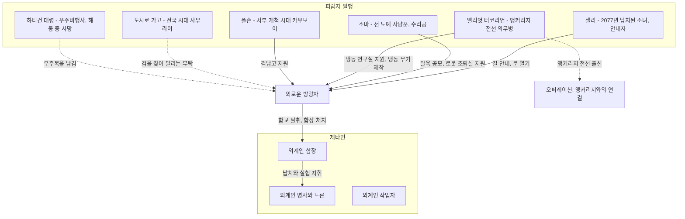
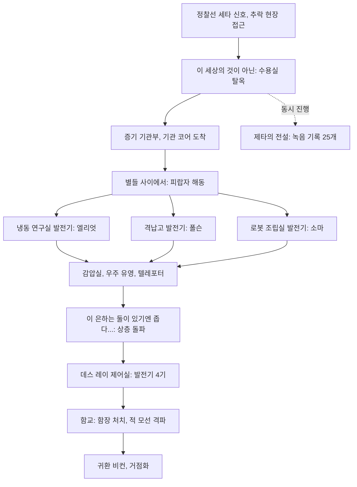
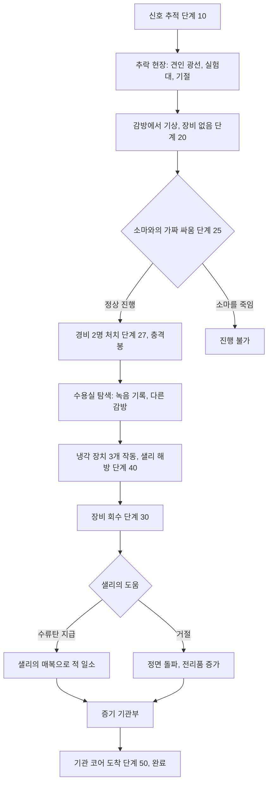
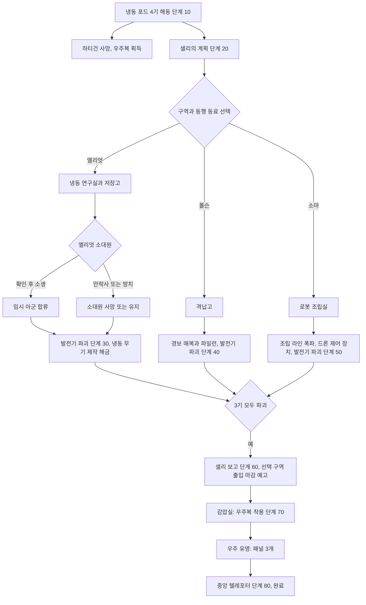
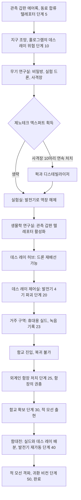
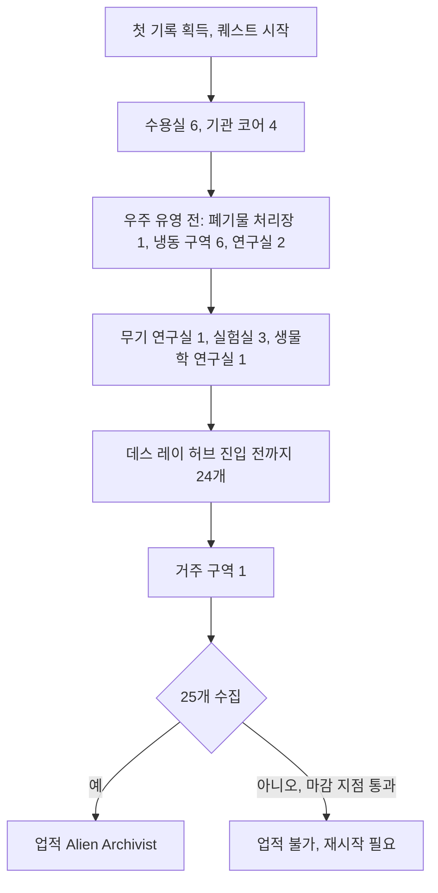
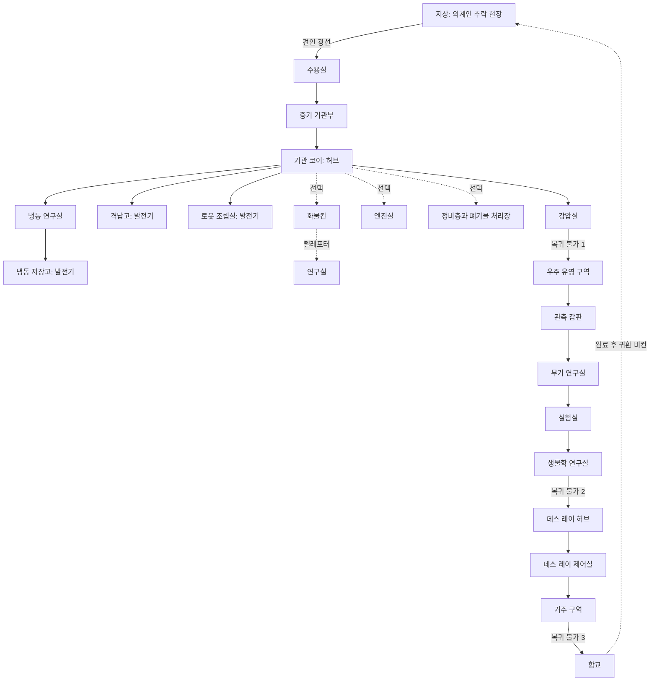
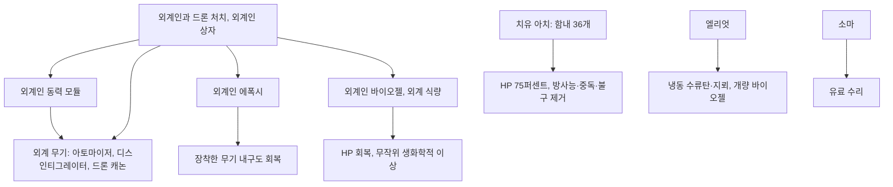

# RD-08e. DLC: 마더십 제타

> **폴아웃 3 역기획서 세트** | 문서 ID: RD-08e | 버전: v1.0 | 작성일: 2026-10-11
> **범위**: [MZ] 마더십 제타(Mothership Zeta)의 제품 정보, 스토리, 퀘스트 4개 상세(메인 3·비표시 1, 표준 양식), 신규 장소(함선 구역 구조)·NPC(동료형 피랍자)·장비·퍽·적, 외계 장비·동력 모듈·치유 아치 등 시스템 변화, 업적, 설계 분석, 쯔꾸르 이식 메모. 무기·방어구 전체 수치는 [RD-19](19_weapons-ammo.md)·[RD-20](20_armor-apparel.md), 퍽 정본은 [RD-14](14_character-system.md), 적 상세 수치는 [RD-24](24_bestiary.md), 장소 카탈로그는 [RD-13](13_location-catalog.md)이며 이 문서는 DLC 맥락의 요약과 링크만 둔다.
> **관련 문서**: [RD-01 게임 개요](01_game-overview.md), [RD-02 세계관·설정·연표](02_world-and-lore.md), [RD-08a DLC: 오퍼레이션: 앵커리지](08a_dlc-operation-anchorage.md), [RD-10 주요 인물·동료](10_characters-major-companions.md), [RD-11 NPC 디렉터리](11_npc-directory.md), [RD-13 장소 카탈로그](13_location-catalog.md), [RD-14 캐릭터 시스템](14_character-system.md), [RD-15 상태·생존 시스템](15_status-survival.md), [RD-16 전투 시스템](16_combat-system.md), [RD-19 무기·탄약](19_weapons-ammo.md), [RD-20 방어구·의복](20_armor-apparel.md), [RD-21 소모품·잡화·제작](21_consumables-misc-crafting.md), [RD-23 수집 요소·업적](23_collectibles-achievements.md), [RD-24 크리처·적 도감](24_bestiary.md), [RD-25 아트·오디오·연출](25_art-audio-presentation.md), [RD-26 용어집](26_glossary.md)

---

## 0. 문서 개요

### 0.1 목적
- 폴아웃 3의 다섯 번째이자 마지막 애드온 마더십 제타를 팬게임 기획의 근거 자료로 쓸 수 있게 구조화한다.
- 이 DLC는 무대(지구 궤도의 외계 모선), 장비 생태계(외계 무기·동력 모듈·에폭시·바이오젤), 회복 체계(치유 아치)를 모두 새로 만든 '환경 교체형 DLC'다. 퀘스트 흐름과 함께 **함선 구역 구조**와 **외계 장비 규칙**을 데이터화하는 데 중점을 둔다.

### 0.2 요약
- 수도 황무지(Capital Wasteland) 북쪽에 추락한 외계 정찰선의 신호를 따라간 외로운 방랑자(Lone Wanderer)는 외계 모선 제타(Zeta)에 납치된다. 생체 실험 뒤 감방에서 깨어나 장비를 빼앗긴 상태로 탈출을 시작한다.
- 수 세기에 걸쳐 납치된 피랍자들(전쟁 직후의 소녀, 전 노예 사냥꾼(Slavers), 전쟁 전 군의관, 서부 개척 시대의 카우보이, 전국 시대의 사무라이)을 깨워 함께 함선을 장악한다.
- 퀘스트는 4개(메인 3, 비표시 1)다. 하층 탈출 → 발전기 3기 파괴와 우주 유영 → 상층 돌파와 함교 탈취·함대전 순으로 진행되며, 완료 후 함선 일부를 거점으로 쓸 수 있다.
- 외계 무기는 전용 탄약(외계인 동력 모듈)을 쓰고, 지구 무기 수리는 외계인 에폭시로, 회복은 치유 아치와 바이오젤로 한다.

### 0.3 표기 메모
- 용어집 기준 'Zeta'는 '제타', 'Aliens (Zetans)'는 '외계인(제타인)', 'Elliott Tercorien'은 '엘리엇 터코리언'으로 쓴다.
- 이 DLC 아이템명 앞의 'Alien'은 '외계인'으로 통일해 옮긴다(예: 외계인 아토마이저, 외계인 에폭시). 장소명 'Bridge'는 함선 맥락에 맞게 '함교'로 번역한다.
- 2026-10-11 리드 지시에 따라 본편 공통 고유명사는 한글 패치 표기(수도 황무지, 핍-보이, 볼트-텍, 리벳시티, 파라다이스폴, 노예 사냥꾼, 야생 구울, 야오과이, 뉴카-콜라 등)를 따른다. DLC 고유 이름은 이 문서의 표기를 쓴다.
- 퀘스트 단계 설명은 핍-보이(Pip-Boy) 목표 문구이며, 영어 원문을 함께 적는다.

---

## 1. DLC 개요표

| 항목 | 내용 |
|---|---|
| 정식 명칭 | 마더십 제타(Mothership Zeta), 태그 `[MZ]`, 폴아웃 3의 다섯 번째이자 마지막 애드온 |
| 개발 / 배급 | 베데스다 게임 스튜디오 / 베데스다 소프트웍스. 리드 디자이너 브라이언 채핀(Brian Chapin, 본편 메인 퀘스트 집필), 리드 레벨 디자이너 필 넬슨(Philip Nelson). 외계인 음모론 애호가인 에밀 파글리아룰로(Emil Pagliarulo)와 제프 가디너(Jeff Gardiner)가 자료 조사로 아이디어를 보탬. 아트 측 개발 일기는 이스트반 펠리(Istvan Pely)가 씀 |
| 출시일 | PC·Xbox 360: 2009-08-03 / PS3: 2009-10-08 |
| 판본 | 단독 디스크 판매 없음(디스크로는 GOTY 에디션에만 수록) / GOTY 에디션(2009-10-13) / Steam 2010-07-16 |
| 용량·필요 패치 | 324.36MB / 패치 1.7(PC), 1.6(PS3), 1.5(Xbox 360) |
| 플랫폼 | PC, Xbox 360, PlayStation 3 |
| 최소 진입 조건 | 볼트 101(Vault 101) 탈출 이후 언제든(브로큰 스틸을 제외한 다른 애드온과 동일). DLC가 설치되면 '정찰선 세타 신호(Recon craft Theta beacon)'의 수신 범위가 크게 넓어짐 |
| 권장 레벨 | 공식 수치 코퍼스 미확인. 참고: 일반 외계인은 레벨 3·7·10·20·25·30의 6단계 레벨 연동(HP 25~250)이며, 레벨 20 이상 개체는 관성 억제장으로 DR 50~110을 얻음 |
| 시작 트리거 | 핍-보이 라디오의 정찰선 세타 신호 → 외계인 추락 현장(Alien crash site)에서 조종석 앞에 다가가면 견인 광선으로 납치. 그리너 패스처스 폐기물 처리장(Greener Pastures disposal site)에서 북서쪽, 또는 MDPL-13 발전소(MDPL-13 power station)에서 송전탑을 따라 북쪽(방사능 노출이 적음) |
| 플레이 볼륨 | 퀘스트 4개(메인 3, 비표시 1). 함선 구역 22곳(위키 장소 목록) + 지상 1곳. 수집 요소: 외계인 포로 녹음 기록 25개. 플레이 시간 공식 수치는 코퍼스 미확인 |
| 핵심 콘셉트 | "납치 → 탈옥 → 함선 탈취." 지구를 벗어난 완전히 새로운 무대, 시대를 초월한 피랍자들의 연대, 외계 기술 장비. 공식 소개문은 "폴아웃 3을 완전히 새로운 방향, 우주로 데려간다"고 표현 |
| 보상 요약 | 퀘스트 XP 합계 1,200(300·300·600), 함장의 권총(Captain's Sidearm), 제노테크 엑스퍼트(Xenotech Expert) 퍽, 외계 무기·탄약 대량, 거점(함교·기관 코어)과 샐리·엘리엇의 주기적 보급 |
| 업적·트로피 | 4개, 합계 100G(실버 3, 골드 1) |
| 재방문 | 가능. 지상 추락 현장이 '외계인 귀환 비컨(Alien homing beacon)'으로 바뀌어 왕복. 단 완료 후 출입 가능한 구역은 함교·기관 코어·증기 기관부·수용실뿐 |

---

## 2. 스토리 시놉시스 (스포일러 포함)

### 2.1 배경
- **제타인의 납치**: 외계인(제타인)은 수 세기 동안 지구를 관찰하며 사람을 납치해 왔다. 1560년대~1600년대 초 일본의 사무라이 도시로 가고(Toshiro Kago), 1697년 세일럼(Salem)의 앤드루 엔디콧(Andrew Endicott), 우주 경쟁 시대의 미 공군 우주비행사 하티건(Hartigan) 대령, 2077년 앵커리지 전선의 의무병 엘리엇 터코리언(Elliott Tercorien)과 그의 소대가 모두 이 함선에 잡혀 있다.
- **정부의 은폐**: 우주 캡슐 클라라벨라 7호(Clarabella 7)와 하티건 대령의 실종 뒤, 정부는 2062년 내부적으로 외계인의 존재를 인정했다(본편 시타델(The Citadel) 터미널의 UFO 보고서 'Palandine'). 전쟁 전 단체 퀘레 베룸(Quaere Verum)은 이를 '음모'로 폭로하려 했다.
- **정찰선 세타**: 본편부터 수도 황무지 북쪽 절벽에는 집을 뚫고 추락한 외계 정찰선 세타(Recon craft Theta)와 조종사 시체, 외계인 블래스터(Alien blaster)가 있었다. 정찰선은 알아들을 수 없는 조난 신호를 계속 내보낸다. 개발 일기는 "핍-보이가 이 신호를 잡는다면 '다른 존재'도 듣고 있을 것"이라는 발상에서 DLC가 출발했으며, DLC 아이디어 회의에서 가장 먼저 나온 개념이었지만 시리즈의 마무리로 아껴 두었다고 밝힌다.

### 2.2 전개
1. **납치**: 신호를 따라 추락 현장에 다가가면 견인 광선에 빨려 올라간다. 외계인들이 플레이어를 실험대에 눕히고 레이저 달린 로봇 팔을 내리자 의식을 잃는다.
2. **탈옥 – 이 세상의 것이 아닌**: 장비를 모두 빼앗긴 채 감방에서 전직 노예 사냥꾼 소마(Somah)와 깨어난다. 일부러 주먹다짐을 벌여 경비를 끌어들이고 처치한다. 냉각 코어를 과부하시켜 감방에 갇힌 소녀 샐리(Sally)를 구한다. 샐리는 환기구를 드나들며 문을 열어 주는 안내자가 된다. 압수된 장비를 되찾고 증기 기관부를 지나 기관 코어에 도착한다.
3. **반격 준비 – 별들 사이에서**: 기관 코어의 냉동 포드에서 사무라이 도시로 가, 의무병 엘리엇, 카우보이 폴슨(Paulson), 우주비행사 하티건을 해동한다. 하티건은 해동 중에 죽고 그의 우주복이 남는다. 상층으로 가는 감압실을 열기 위해 냉동 연구실·격납고·로봇 조립실의 발전기 3기를 파괴한다(구역마다 다른 동료가 돕는다). 우주복을 입고 함체 위를 걸어 패널 3개로 텔레포터를 가동한다.
4. **함교 탈취 – 이 은하는 둘이 있기엔 좁다...**: 관측 갑판에서 외계인 홀로그램이 데스 레이(Death ray)로 지구를 쏘아 보이며 위협한다. 무기 연구실·실험실·생물학 연구실을 돌파하고, 데스 레이 제어실의 발전기 4기를 파괴한 뒤 거주 구역을 지나 함교에 이른다. 외계인 함장(Alien captain)을 처치하자 다른 모선이 공격해 온다. 샐리의 지휘 아래 동료들이 각 위치를 맡고, 플레이어가 실드와 데스 레이 출력을 조절해 적 모선을 격파한다.
5. **귀환**: 혼란 중 누군가 누른 버튼으로 지상에 귀환 비컨이 떨어졌다. 비컨으로 수도 황무지와 함선을 오갈 수 있게 된다. 소마와 폴슨은 떠나고, 샐리·엘리엇·도시로는 함선에 남는다.

### 2.3 주제와 연출 포인트
- **시대를 초월한 피해자 연대**: 16세기 사무라이부터 2277년 황무지 주민까지, 시대와 언어가 다른 피랍자들이 하나의 팀이 된다. 도시로는 영어를 못 알아듣지만 플레이어 말투(공손·평범·건방짐)에 따라 반응이 달라진다.
- **외계인의 인간 연구**: 화물칸과 연구실에 전쟁 전 자동차, 우주 캡슐, 뉴카-콜라(Nuka-Cola) 자판기, 수백 개의 장난감 말 기디업 버터컵(Giddyup Buttercup)이 수집되어 있다. 인간 문명을 엉뚱하게 이해한 외계인이라는 블랙 유머다.
- **공포 연출**: 실험실의 해부 기록, 인간과 외계인의 잡종처럼 보이는 어보미네이션(Abomination), 냉동 연구실에서 실험당한 엘리엇의 소대가 납치물 공포를 담당한다.
- **1950년대 펄프 SF와 서부극**: 퀘스트 제목은 서부극의 결투 대사 "This town ain't big enough for the both of us"를 비튼다. 함교 장면에서 샐리는 전쟁 전 TV 쇼 「캡틴 코스모스(Captain Cosmos)」를 흉내 내 역할을 나눈다. 상세 레퍼런스는 [RD-02](02_world-and-lore.md)·[RD-25](25_art-audio-presentation.md).

### 2.4 인물 관계도

---

## 3. 퀘스트 상세

### 3.0 퀘스트 목록과 전체 흐름
허브 문서 `Fallout 3 quests`의 *Mothership Zeta* 섹션 기준 메인 3개, 비표시 1개다(반복 퀘스트 없음).

| # | 영문명 | 한국어명 | 유형 | 퀘스트 ID (EDID) | 의뢰인 | 보상 | 업적 |
|---|---|---|---|---|---|---|---|
| 1 | Not of This World | 이 세상의 것이 아닌 | 메인 | `000802` (DLC05MZ1) | 알림(정찰선 세타 신호) | 300 XP | 20G / 실버 |
| 2 | Among the Stars | 별들 사이에서 | 메인 | `000803` (DLC05MZ2) | 샐리 | 300 XP | 20G / 실버 |
| 3 | This Galaxy Ain't Big Enough... | 이 은하는 둘이 있기엔 좁다... | 메인 | `000804` (DLC05MZ3) | 샐리 | 600 XP, 함장의 권총 | 40G / 골드 |
| 4 | The Legend of Zeta | 제타의 전설 | 비표시 | `003419` | 본인(첫 녹음 기록 획득) | 업적 Alien Archivist | 20G / 실버 |

- 애드온 문서의 퀘스트 표는 「이 세상의 것이 아닌」 보상에 우주복을 함께 적는다. 실제 우주복은 「별들 사이에서」 첫 단계에서 해동되다 죽는 하티건 대령의 시체에서 얻는다.
- 「제타의 전설」은 업적 이름(Alien Archivist)으로도 불리며, 이 DLC의 유일한 자유형(freeform) 퀘스트다.

---

### 3.1 이 세상의 것이 아닌 (Not of This World)

#### 기본 정보
| 항목 | 내용 |
|---|---|
| 영문명 / 한국어명 | Not of This World / 이 세상의 것이 아닌 |
| 유형 | [MZ] 메인 퀘스트 (1/3) |
| 퀘스트 ID | `000802` (EDID `DLC05MZ1`) |
| 의뢰인 | 정찰선 세타 비컨(허브 표기: 알림) |
| 시작 조건 | 볼트 101 탈출 이후 신호 수신 시 단계 10. 추락 현장 조종석 앞에서 납치 이벤트 발동 |
| 관련 장소 | 외계인 추락 현장, 수용실(Holding cells), 증기 기관부(Steamworks), 기관 코어(Engineering core) |
| 선행 / 후행 | 없음 / 「별들 사이에서」 (관련: 「이 은하는 둘이 있기엔 좁다...」) |
| 보상 | 300 XP |
| 카르마 영향 | 외계인 작업자(Alien worker)를 죽이면 1마리당 카르마 -50 |
| 업적·트로피 | Not of This World — 20G / 실버 |

#### 개요
- 소마의 첫 대사: "'bout time you woke up. I was starting to think maybe they'd fried your brains or something." — "이제야 깼네. 놈들이 네 뇌라도 튀겨 버린 줄 알았잖아."
- 장비 없이 감방에서 시작하는 탈옥 퀘스트다. 소마와의 '가짜 싸움', 샐리 구출, 장비 회수를 거쳐 함선의 허브인 기관 코어로 간다.

#### 진행 단계
| 단계 | 핍-보이 목표 (원문) | 플레이어 행동과 이벤트 |
|---|---|---|
| 10 | Investigate the strange radio signal coming from the Wasteland. | 신호를 따라 추락 현장으로 이동. 조종석 앞에서 견인 광선 → 실험대 연출 → 기절 |
| 20 | Find a way out of the holding cell. | 감방에서 소마와 대화 |
| 25 | Stage a fight with Somah to draw the guards' attention. | 소마와 주먹을 주고받음 |
| 27 | Defeat the Alien guards. | 들어온 외계인 경비 2명 처치, 충격봉 획득 가능 |
| 30 | Retrieve your equipment. | 압수된 장비 회수(샐리가 문을 연 뒤 왼쪽 창고의 컨테이너) |
| 35 | Continue to look for a way out of the Holding Cells. | 수용실 탐색, 다른 감방 확인 |
| 40 | Release Sally from her holding cell. | 샐리의 감방 근처 모듈의 냉각 장치 3개를 작동시켜 과부하 → 폭발로 샐리 해방 |
| 50 | Reach the engineering core of the ship. | 샐리의 안내로 증기 기관부를 지나 기관 코어 도착. 완료 |
| 60 | (Optional) Free additional prisoners from their holding cells. | 선택 목표(다른 감방의 피랍자 해방) |

#### 분기와 해결 방법
- **추락 현장 접근로**: 그리너 패스처스 폐기물 처리장에서 북서쪽, 또는 MDPL-13 발전소에서 송전선을 따라 북쪽. 정찰선은 방사능 액체를 흘려 근처에서 초당 4라드를 받는다. 납치 전이라면 조종사 시체 옆에서 외계인 블래스터와 외계인 동력 전지 약 120개를 얻을 수 있다.
- **소마와의 싸움**: 몇 번 주먹을 주고받으면 경비가 들어온다. 치명타로 소마를 죽이면 복도 끝 문이 열리지 않아 진행이 막힌다. 퍼럴라이징 팜(Paralyzing Palm) 퍽으로 소마가 마비되면 경비가 소마를 먼저 때려 죽일 수 있다. 미스터리어스 스트레인저(Mysterious Stranger) 퍽이 있으면 소마와 그에 관한 전용 대화가 생긴다.
- **다른 감방**: 죽은 엔클레이브 장교(Enclave officer), "꿈일 거야"라고 되뇌는 혼란에 빠진 리벳시티(Rivet City) 경비대원, 거대한 집게에 붙들려 끌려가는 황무지 주민(연출)이 있다.
- **샐리의 수류탄 매복**: 경비 무리를 만나기 전에 샐리에게 수류탄(파편 또는 플라스마만 가능)을 주면, 샐리가 벽 속으로 돌아가 적 뒤에서 수류탄을 던져 외계인 3명을 한 번에 처치한다. 주지 않으면 직접 싸운다.
- **외계인 작업자**: 적으로 표시되지만 공격하지 않고 도망치거나 웅크린다. 샐리는 "건드리지 말라"고 조언하며, 죽이면 카르마 -50이다.
- **진행 방식의 자유**: 샐리의 도움(문 열기, 주의 끌기)은 거절할 수 있고, 정면 돌파하면 외계 무기·에폭시·동력 모듈을 더 많이 얻는다.
- **완료 조건의 관대함**: 다른 목표를 끝냈다면 장비를 회수하지 않아도 기관 코어 도착으로 완료된다. 퀘스트 아이템(예: 「황무지 생존 가이드」의 퇴치봉)은 압수되지 않아 탈옥에 쓸 수 있다.

#### 결과와 후일담
- 정찰선 세타는 이후 제타의 격납고에서 회수되는 모습으로 등장한다.
- 수용실 복도 끝에서 처음 만나는 치유 아치(Healing archway)가 이 DLC의 기본 회복 수단임을 알려 준다(9.2절).
- 기관 코어 도착과 함께 「별들 사이에서」가 시작된다.

#### 흐름도

#### 관련 NPC·아이템·대사 포인트, 비고
- NPC: 소마, 샐리, 외계인 경비, 외계인 작업자, 수용실의 피랍자들.
- 아이템: 충격봉, 외계인 녹음 기록(수용실 6개), 압수 장비 컨테이너.
- 수용실 복도의 치유 아치는 HP를 약 75%까지 채우며, 과학 75로 개조하면 100%를 채우지만 3회 사용 후 타 버린다.

#### 설계 분석
- 오퍼레이션: 앵커리지·더 피트에 이어 세 번째 '장비 박탈 시작'이다. 다만 이번에는 첫 퀘스트 안에서 장비를 돌려받아, 박탈은 짧은 긴장 연출로만 쓰인다.
- 샐리의 '환기구 이동'은 도우미 NPC가 레벨 디자인의 열쇠(문 열기)를 쥐는 장치로, 플레이어가 혼자 길을 잃지 않게 하면서도 전투는 맡기지 않는다.
- 공격하지 않는 적(외계인 작업자)을 카르마 페널티로 보호해 '적 = 쏘아도 되는 것'이라는 규칙을 흔든다.

---

### 3.2 별들 사이에서 (Among the Stars)

#### 기본 정보
| 항목 | 내용 |
|---|---|
| 영문명 / 한국어명 | Among the Stars / 별들 사이에서 |
| 유형 | [MZ] 메인 퀘스트 (2/3) |
| 퀘스트 ID | `000803` (EDID `DLC05MZ2`) |
| 의뢰인 | 샐리 |
| 시작 조건 | 기관 코어 도착(「이 세상의 것이 아닌」 완료) 시 자동 |
| 관련 장소 | 기관 코어, 냉동 연구실(Cryo lab)·냉동 저장고(Cryo storage), 격납고(Hangar), 로봇 조립실(Robot assembly), 감압실(Decompression chamber), 우주 유영 구역(Space walk), 관측 갑판(Observation deck). 선택 구역: 화물칸(Cargo hold)·연구실(Research lab), 엔진실(Engine room), 정비층(Maintenance level)·폐기물 처리장(Waste disposal) |
| 선행 / 후행 | 「이 세상의 것이 아닌」 / 「이 은하는 둘이 있기엔 좁다...」 |
| 보상 | 300 XP |
| 카르마 영향 | 없음(엘리엇이나 소생한 병사를 죽여도 카르마 손실 없음이 보고됨). 외계인 작업자 처치는 -50 |
| 업적·트로피 | Among the Stars — 20G / 실버 |

#### 개요
- 엘리엇의 대사: "That's it, I'm sick of running. Let's finish these aliens off and get the hell home." — "됐어, 도망치는 건 지긋지긋해. 외계인 놈들 끝장내고 집에 가자고."
- 상층으로 가는 감압실은 발전기 3기를 모두 파괴해야 열린다. 구역마다 해동한 피랍자 중 한 명이 따라가 돕고, 마지막에는 우주복을 입고 함체 바깥을 걸어 텔레포터를 켠다.

#### 진행 단계
| 단계 | 핍-보이 목표 (원문) | 플레이어 행동과 이벤트 |
|---|---|---|
| 10 | Release the humans in stasis. | 기관 코어 남쪽의 냉동 포드 4기(사무라이·우주비행사·의무병·카우보이) 해동. 하티건 대령은 해동 중 사망 → 우주복 획득 |
| 20 | Speak to Sally. | 샐리에게서 발전기 계획을 들음 |
| 30 | Destroy the generator in the Cryo Lab. | 냉동 연구실 → 냉동 저장고 끝의 발전기 파괴 |
| 35 | (Optional) Request help from the people you've revived. | 구역별 담당 동료에게 동행 요청 |
| 40 | Destroy the generator in the Hangar. | 격납고 최상층 발전기 파괴 |
| 50 | Destroy the generator in the Robot Assembly. | 로봇 조립실 발전기 파괴 |
| 60 | Speak to Sally. | 샐리 보고 |
| 70 | Gain access to the upper level of the alien ship. | 감압실에서 우주복 착용 후 스위치로 감압 → 우주 유영 구역 |
| 80 | Find a way to activate the Access Teleporter. | 함체 위 패널 3개 작동 → 중앙 텔레포터 진입. 완료 |

#### 분기와 해결 방법
- **발전기 파괴 절차(공통)**: 제어 장치로 코어를 바닥에서 끌어올리고 주변 냉각 장치 3개를 끈다. 과열 열기가 커지다 약 30초 뒤 폭발한다.
- **구역별 담당 동료**: 잘못된 동료를 데려가면 구역에 들어서는 순간 떠난다.

  | 구역 | 담당 동료 | 동료가 만드는 이벤트 | 비고 |
  |---|---|---|---|
  | 냉동 연구실·냉동 저장고 | 엘리엇 터코리언 | 소대원 실험실에서 분노해 냉동 가스로 외계인 몰살. 소대원 소생 판단. 냉동 장비 확보 → 냉동 수류탄·지뢰 제작 가능 | 동행 요청은 1회뿐. 장비 확보 전에 해산하면 냉동 무기 영구 불가 |
  | 로봇 조립실 | 소마 | 텔레포터 조작을 위해 사라졌다가, 조립 라인 외피를 폭파하자고 제안 | - |
  | 격납고 | 폴슨 | 외계인 사냥에 앞장섬 | 냉동 연구실·로봇 조립실 동행은 거부 |

- **냉동 연구실 세부**
  - 첫 방의 유리 바닥 왼쪽 'Release Mechanism' 스위치로 아래층 방(외계·지구 물품, 녹음 기록 #4)을 연다.
  - 냉동 포드 스위치로 야생 구울(Feral ghoul)과 레이더(Raider)를 풀어 외계인과 싸우게 할 수 있다. 냉동 저장고 아래층 포드의 슈퍼 뮤턴트(Super mutant)는 레벨에 따라 오버로드까지 나온다(위층 스위치로 해방).
  - 엘리엇과 함께라면 수술실의 시신이 그의 소대원(림스 상병, 스펄록 상병, 미어스 일병)으로 바뀌고, 옆방 포드에 베킷(Beckett) 일병과 대니얼스(Daniels) 하사가 나타난다.

  | 선택 | 결과 |
  |---|---|
  | 그대로 둔다 | 변화 없음 |
  | 안락사(산소 차단) | 두 병사 사망 |
  | 엘리엇이 상태를 확인한 뒤 소생 | 기억을 되찾은 두 병사가 냉동 연구실·저장고 구간에서 임시 동행. 실험 독소로 결국 사망 |
  | 엘리엇의 확인 전에 소생 | 두 병사가 즉시 적대해 서로 싸운 뒤 일행을 공격. 문이 잠기는 진행 불가 버그가 보고됨 |

  - 냉동 연구실에 녹음 기록 4개(#2·#4·#11·#17), 냉동 저장고에 2개(#16·#25)가 있다.
- **로봇 조립실 세부**: 1층 구석 선반 주변에 외계인 동력 전지 묶음(12·12·20·50·50)과 다수의 에폭시, 치유 아치, 바이오젤 4개가 있다. 조립 라인 끝의 접근 패널을 작동해 과부하시키면 큰 폭발로 벽이 뚫린다(유리는 총으로 깨지지 않음). 다음 방에서 가디언·서포트 드론과 외계인이 나오며, 그중 매우 강한 외계인이 드론 제어 장치(Drone control device)를 떨어뜨린다.
- **격납고 세부**: 파일런 역장에 정찰선 세타가 떠 있다. 맞은편 발코니 스위치로 최상층 발코니를 연다. 비활성 드론은 드론 제어 장치로 깨우거나 부숴 전리품을 얻는다. 막힌 문의 스위치를 누르면 경보와 함께 아래층 문 5개에서 외계인과 드론이 쏟아진다. 파일런 제어기 5개를 작동하면 근처 적을 날려 보내 피해를 준다. 전투가 끝나면 발전기 문이 열린다.
- **선택 구역(우주 유영 전까지만 출입 가능)**

  | 구역 | 주요 내용 |
  |---|---|
  | 화물칸 | 지구 물품 창고, 컨베이어 벨트. 리드 언더우드의 터미널(Hard)을 해킹하면 금고에서 MPLX 노바서지. 연구실로 가는 텔레포터, 미니 누크, 병뚜껑 지뢰 2 |
  | 연구실 | 자동차·우주 캡슐(하티건의 캡슐) 연구 구역, 기디업 버터컵 연구 구역. 녹음 기록 #13·#21 |
  | 엔진실 | 시계 방향 일주 구조. 일렉트로 서프레서(Electro-Suppressor), 에폭시 8 |
  | 정비층·폐기물 처리장 | 샐리가 쓰레기 운반차를 몰다 일행을 폐기장에 떨어뜨림. 압착기 방, 가디언 드론, 매복. 군용 사물함에 체이스 장군의 외투와 홀로테이프 「앵커리지 보급관 화물」. 녹음 기록 #19. 의료 물품 벽장에 사무라이의 검 |

- **도시로 가고의 검**: 폐기물 처리장에서 사무라이의 검을 찾아 도시로에게 돌려줄 수 있다. 발전기 3기를 모두 파괴하면 도시로가 자리를 떠나고 선반의 검도 사라진다(이 경우에도 도시로는 함교에 나타날 때 검을 들고 있다). 검을 돌려줬다면 거주 구역에서 그가 외계인을 베어 놓은 방을 보게 된다.
- **우주 유영 규칙**: 우주복 없이 감압된 구역에 들어가면 머리가 터져 죽는다. 우주 유영 중에는 핍-보이를 열 수 없고, 무기를 꺼낼 수 없으며, 휴식할 수 없다. 함체 위를 느린 속도로 걷고, 붉은 등이 그린 원 밖으로 나가면 우주로 떠내려가 죽는다. 패널은 출구 오른쪽, 함체 반대편, 중앙 텔레포터 근처에 하나씩 있다.

#### 결과와 후일담
- 우주 유영을 시작하면 정비층·폐기물 처리장·화물칸·연구실·엔진실로 다시 갈 수 없다(녹음 기록과 일부 유니크 장비 수집 마감).
- 발전기를 부술수록 기관 코어에 바리케이드가 쳐지고, 전리품(뉴카-콜라 퀀텀(Nuka-Cola Quantum), 미니 누크, 버터컵 장난감 등)과 고장 흔적이 점점 늘어난다.
- 텔레포터를 통과하면 「이 은하는 둘이 있기엔 좁다...」가 시작된다.

#### 흐름도

#### 관련 NPC·아이템·대사 포인트, 비고
- NPC: 샐리, 소마, 엘리엇, 폴슨, 도시로 가고, 하티건(사망), 베킷·대니얼스, 림스·스펄록·미어스(사망), 외계인·드론, 냉동 포드의 야생 구울·레이더·슈퍼 뮤턴트.
- 아이템: 우주복, 드론 제어 장치, 냉동 수류탄·지뢰(엘리엇 제작), 사무라이의 검, 체이스 장군의 외투, MPLX 노바서지, 일렉트로 서프레서, 녹음 기록 다수.
- 화물칸에 들어가지 않고 돌아오면, 피랍자들이 붙잡은 외계인 작업자를 엘리엇은 인질로 쓰자 하고 폴슨은 그냥 처형해 버리는 장면이 나온다.

#### 설계 분석
- **동료를 구역의 열쇠로 만든 구조**: 상설 동료 대신 '이 구역에는 이 사람'이라는 지정 동행을 둬, 각 동료의 개성(의무병의 트라우마, 기술자의 손재주, 카우보이의 복수심)을 해당 구역 이벤트로 보여 준다.
- **세 갈래 병렬 목표 → 일방통행 관문**: 발전기 3기는 순서가 자유롭지만, 모두 끝나면 우주 유영이라는 '돌아올 수 없는 문'을 지나야 한다. 선택 구역 마감 규칙이 수집 플레이에 긴장을 준다.
- **우주 유영**: 무기·핍-보이를 봉인하고 이동만 남긴 짧은 감상 구간으로, 전투 밀도가 높은 DLC에서 시각적 쉼표 역할을 한다.

---

### 3.3 이 은하는 둘이 있기엔 좁다... (This Galaxy Ain't Big Enough...)

#### 기본 정보
| 항목 | 내용 |
|---|---|
| 영문명 / 한국어명 | This Galaxy Ain't Big Enough... / 이 은하는 둘이 있기엔 좁다... |
| 유형 | [MZ] 메인 퀘스트 (3/3, 최종) |
| 퀘스트 ID | `000804` (EDID `DLC05MZ3`) |
| 의뢰인 | 샐리 |
| 시작 조건 | 「별들 사이에서」의 텔레포터 진입 시 자동 |
| 관련 장소 | 관측 갑판, 무기 연구실(Weapons lab), 실험실(Experimentation lab), 생물학 연구실(Biological research), 데스 레이 허브(Death ray hub), 데스 레이 제어실(Death ray control), 거주 구역(Living quarters), 함교(Bridge) |
| 선행 / 후행 | 「별들 사이에서」 / 없음(DLC 종료). 관련: 「이 세상의 것이 아닌」 |
| 보상 | 600 XP, 함장의 권총 |
| 카르마 영향 | 없음 |
| 업적·트로피 | This Galaxy Ain't Big Enough... — 40G / 골드 |

#### 개요
- 소마의 대사: "Nice work, kid. If there's more of them out there, that'll make 'em think twice about attacking us again." — "잘했어, 꼬마. 저 밖에 놈들이 더 있다면, 다시 덤비기 전에 두 번은 생각하겠지."
- 상층에서 함교로 가는 텔레포터가 꺼져 있어, 플레이어 혼자 무기 연구실부터 데스 레이 구역까지 돌아가며 길을 연다. 함교에서 함장을 쓰러뜨린 뒤 동료와 함께 적 모선과 함대전을 벌인다.

#### 진행 단계
| 단계 | 핍-보이 목표 (원문) | 플레이어 행동과 이벤트 |
|---|---|---|
| 5 | Activate the Engine Core Teleporter. | 관측 갑판 에어록에서 재가압 후 우주복을 벗음. 옆방 텔레포터를 켜 샐리와 생존 동료를 합류시킴 |
| 10 | Reach the bridge of the alien ship. | 샐리가 에너지 게이트를 끄고 유리 바닥 방에서 지구를 바라봄. 외계인 홀로그램이 데스 레이로 지구를 쏘며 위협 |
| 20 | Disable the Death Ray. | 무기 연구실 → 실험실 → 생물학 연구실 → 데스 레이 허브 → 데스 레이 제어실의 발전기 4기 파괴 |
| 25 | Defeat the Alien Captain. | 거주 구역을 지나 함교 텔레포터로 진입, 외계인 함장 처치 |
| 30 | Secure the bridge. | 함교의 외계인 정리. 거대한 홀로그램 머리의 연설 후 다른 모선이 공격 |
| 40 | Defeat the attacking alien ship. | 동료 배치, 실드·데스 레이 조작으로 적 모선 격파 |
| 50 | Return to the Capital Wasteland. | 샐리와 대화 → 귀환 비컨 확보. 완료 |
| 60 | (Optional) Set the alien ship to self-destruct. | 단계표에만 있는 선택 목표. 진행 방법은 코퍼스 미확인(미사용 단계로 추정) |

#### 분기와 해결 방법
- **무기 연구실**
  - 천장 터렛 2기와 외계인, 가디언 드론이 맞는다.
  - 과학 75가 필요한 문 터미널(폭발형)로 여는 작은 방에 아토믹 펄버라이저(Atomic pulverizer), 일반 아토마이저, 버터컵 장난감, 비활성 가디언 드론, 동력 모듈·에폭시·바이오젤이 있다.
  - 실험 무기 드론(Experimental weapons drone)이 있는 방: 버튼으로 브라민(Brahmin)을 소환해 드론의 표적으로 삼게 하는 시험장. 드론을 부수면 드론 캐논 Ex-B를 얻는다.
  - 제어실: 일반 외계 무기들과 개틀링 레이저, 외계인 동력 전지 87개, 녹음 기록 #24.
  - **사격장(제노테크 엑스퍼트)**: 문에 가까운 스위치는 브라민, 먼 스위치는 납치된 적(레이더, 야오과이(Yao guai) 또는 데스클로(Deathclaw), 센트리 봇(Sentry bot), 거대·알비노 라드스코피온)을 두 번째 사격장으로 순간이동시킨다. 외계 무기로 10마리를 연속 처치하면 퍽을 얻는다(소환된 적끼리 싸워 죽어도 획득된다는 서술도 있다). 사격장 오른쪽 선반에 디스테빌라이저(Destabilizer). 이 구역을 떠나기 전에 퍽을 얻어야 한다.
- **실험실**: 대부분 무해한 외계인 작업자와 소수의 무장 외계인, 어보미네이션이 있다. 큰 방 중앙 발전기를 파괴해 생물학 연구실로 가는 역장을 끈다. 녹음 기록 #9·#10·#20.
- **생물학 연구실**: 어보미네이션 2~3마리, 녹음 기록 #18. 텔레포터 3개(관측 갑판 연결 = 동료 합류용으로 반드시 활성화, 함교 = 꺼짐, 데스 레이 허브). 함교 입구 아래층 선반에 함선 최대 비축량인 외계인 동력 전지 109개. **데스 레이 허브로 넘어가면 돌아올 수 없으므로** 녹음 기록 24개를 이 시점까지 모아야 한다.
- **데스 레이 허브·제어실**: 양쪽 작은 방의 서포트 드론을 재배선해 아군으로 쓸 수 있고, 터렛 제어 터미널이 있다. 제어실에서는 실린더 그림 버튼을 눌러 발전기를 하나씩 끌어올리고 과부하시킨다(4기). 두 번째 발전기 파괴 후 외계인 증원이 온다. 제어실 콘솔로 데스 레이를 미리 지정된 지점 두 곳에 쏠 수 있다(지구에 쏘면 버섯구름과 거대한 구덩이가 생기는 이스터에그).
- **거주 구역**: 휴대용 실드(역장 발생기)가 처음 등장한다. 여러 번 맞히면 부서지고, 수류탄을 튕기거나 드론 캐논으로 돌아서 공략한다. 어보미네이션과 외계인, 터렛을 지나 함교 텔레포터에 도착한다. 식당에 마지막 녹음 기록 #23. **함교에 들어서면 대부분의 구역에 다시 갈 수 없다.**
- **함교 전투**
  1. 외계인 함장 자체는 약하지만 함장의 권총(여러 발을 한 번에 발사)이 강력하다. 주변 외계인은 아토마이저로 무장했다. 동료가 대신 처치할 수도 있다.
  2. 적 모선이 데스 레이로 공격해 오면 동료들이 올라온다. 샐리가 「캡틴 코스모스」의 조종실과 똑같다며 자리를 배정한다. 폴슨에게는 '달 원숭이(Moon Monkey)'를 맡기며 텔레포터 쪽 후방을 지키게 한다("I ain't no goddamned space monkey").
  3. 함장석 앞 버튼으로 출력 배분과 사격을 한다.

     | 버튼 | 효과 |
     |---|---|
     | 실드 최대(맨 왼쪽) | 에너지 대부분을 방어막에. 방어 증가, 데스 레이 약화 |
     | 중간(초기 상태) | 방어막과 데스 레이에 균등 배분 |
     | 실드 최소(오른쪽) | 에너지 대부분을 데스 레이에. 화력 증가, 방어 약화 |
     | 데스 레이 발사(네 번째) | 적 모선에 사격 |

  4. 피격으로 함선 발전기가 꺼지면 함교 양쪽 벽의 버튼 4개로 재가동해야 한다. 발전기가 꺼진 동안 엘리엇의 순간이동 방해기가 멈춰 외계인이 함교로 순간이동해 들어온다.
  5. 적 모선 체력이 절반쯤 되면 소마가 "실드와 엘리엇이 쓰러졌다"고 외친다. 이후 방해기가 완전히 멈춰 외계인 침입이 잦아지고, 엘리엇은 텔레포터로 빠졌다가 전투 후 돌아온다.
  6. 적 모선이 폭발하면 샐리와 대화해 완료한다. 혼란 중 엘리엇 또는 샐리가 누른 버튼 덕분에 지상 추락 현장에 귀환 비컨이 떨어졌다는 설명이 나온다.

#### 결과와 후일담
- 함선 대부분이 '접근 불가'가 되고 함교, 기관 코어, 수용실, 증기 기관부만 남는다. 이곳에는 가끔 외계인 순찰조와 작업자가 다시 나타난다.
- 지상의 정찰선 자리는 잔해 더미와 외계인 귀환 비컨으로 바뀐다(정찰선은 제타의 격납고에 있음). 외계인 블래스터와 동력 전지를 아직 줍지 않았다면 그대로 남아 있다.
- 소마와 폴슨은 함선을 떠난 뒤 게임에서 사라진다(폴슨은 집으로 돌아갈 길을 찾아 떠남). 도시로는 함교에 남아 있다가 증기 기관부를 다시 방문하면 사라지고 거주 구역에서 볼 수 있다는 서술이 있다. 샐리와 엘리엇은 함선에 남아 주기적으로 물자를 준다(5.1절).
- 함교의 실드·데스 레이 조작은 완료 후에도 가능하다. 격파된 적 모선 잔해는 지구로 떨어지는 연출이 있다.

#### 흐름도

#### 관련 NPC·아이템·대사 포인트, 비고
- NPC: 샐리, 소마, 엘리엇, 폴슨, 도시로 가고(살아 있다면 첫 공격 파도를 막은 뒤 함교 옆문으로 합류), 외계인 함장, 외계인·드론·어보미네이션, 지원 모선(Support mothership, 함대전 상대).
- 아이템: 함장의 권총, 아토믹 펄버라이저, 디스테빌라이저, 드론 캐논 Ex-B, 녹음 기록 #9·#10·#18·#20·#23·#24.
- 함교의 함장석에 앉은 채로 버튼을 조작할 수 있다. 적 모선의 강타로 동료가 쓰러진 순간에는 대화 대신 소지품 창이 열리는 현상이 보고되어 있다.

#### 설계 분석
- **혼자 가는 길 → 다시 모이는 결말**: 상층 돌파는 플레이어 단독, 마지막 함대전은 전원 집결로 설계해 동료 연대의 서사를 회수한다. 각 동료가 함교에서 자리(방해기, 방어, 데스 레이 조준)를 맡는 것도 같은 맥락이다.
- **스케일 전환**: 보병전에서 함대전(우주선 대 우주선)으로 마지막에 규모를 키우되, 조작은 버튼 4개와 재가동 버튼으로 단순하게 유지했다. 실드와 화력의 트레이드오프, 재가동 중 적 침입이라는 '동시 처리' 압박이 핵심이다.
- **복귀 불가 지점 3개**(우주 유영, 데스 레이 허브, 함교)를 명확히 둬 수집과 진행의 긴장을 만든다. 다만 경고가 대사·주변 단서 수준이라 수집 누락이 잦다는 약점이 있다.

---

### 3.4 제타의 전설 (The Legend of Zeta)

#### 기본 정보
| 항목 | 내용 |
|---|---|
| 영문명 / 한국어명 | The Legend of Zeta / 제타의 전설 (업적명 Alien Archivist / 외계 기록 수집가) |
| 유형 | [MZ] 비표시 퀘스트(수집형, 자유형) |
| 퀘스트 ID | `003419` |
| 의뢰인 | 본인(첫 외계인 포로 녹음 기록 획득 시) |
| 시작 조건 | 녹음 기록 1개 이상 획득 |
| 관련 장소 | 제타 함내 9개 구역(아래 표) |
| 선행 / 후행 | 메인 퀘스트 3개와 병행 / 없음 |
| 보상 | 업적·트로피 Alien Archivist |
| 카르마 영향 | 없음 |
| 업적·트로피 | Alien Archivist — 녹음 기록 25개 전부 수집, 20G / 실버 |

#### 개요
- 외계인이 피랍자를 심문·실험하며 남긴 녹음 25개를 모으는 수집 퀘스트다. 기록은 물리 아이템이 아니라 빛나는 원형 제어판에 저장되어 있고, 획득하면 핍-보이 노트 항목에 들어간다(콘솔로 생성하면 홀로테이프 모양).
- 제목은 「젤다의 전설(The Legend of Zelda)」의 패러디다.

#### 진행 단계 (녹음 기록 분포)
| 순서 | 구역 | 개수 | 기록 번호 | 마감 시점 |
|---|---|---|---|---|
| 1 | 수용실 | 6 | #14·#15·#22(첫 감방 동쪽 방), #3·#1·#12(퀘스트 마커 동쪽 방) | 퀘스트 1 진행 중(완료 후에도 재방문 가능) |
| 2 | 기관 코어 | 4 | #5·#6·#7·#8(사무라이·우주비행사·의무병·카우보이 포드 옆) | 상시 |
| 3 | 폐기물 처리장(정비층 경유) | 1 | #19('매복' 방) | **우주 유영 전** |
| 4 | 냉동 연구실 / 냉동 저장고 | 4 / 2 | #2·#4·#11·#17 / #16·#25 | **우주 유영 전** |
| 5 | 연구실(화물칸 경유) | 2 | #13(차량 연구 구역), #21(첫 버터컵 방) | **우주 유영 전** |
| 6 | 무기 연구실 | 1 | #24(제어실) | 데스 레이 허브 진입 전 |
| 7 | 실험실 | 3 | #20·#10·#9 | 데스 레이 허브 진입 전 |
| 8 | 생물학 연구실 | 1 | #18 | 데스 레이 허브 진입 전 |
| 9 | 거주 구역 | 1 | #23(식당) | 함교 진입 전 |

#### 분기와 해결 방법
- 순서만 지키면 모두 메인 동선 위나 옆에 있다. 놓치기 쉬운 것은 선택 구역(폐기물 처리장·연구실)과 냉동 연구실의 숨은 방(#4, 'Release Mechanism' 스위치 필요)이다.
- 기록 내용은 피랍자들의 증언이다. 1697년 세일럼의 앤드루 엔디콧(#1), 플랫부시의 술꾼 싸움꾼 빈(Vin, #2), 볼트 76 공사 감독관 자일스 울스턴크로프트(Giles Wolstencroft, #13), 미 상원의원(#15), 하티건 대령(#8), 엘리엇의 소대원 로런스 미어스(#11), 어보미네이션의 정체를 짐작하는 남자(#19, 트레일러 음성) 등이 있다. 폴슨 가족의 기록(#5)을 들었다면 폴슨과의 화술 판정 대화가 열린다. ICBM 발사 코드를 가졌다고 말하는 고위 장교의 기록도 있다.

#### 결과와 후일담
- 25개를 모으면 업적만 주어지며 월드 변화는 없다.

#### 흐름도

#### 관련 NPC·아이템·대사 포인트, 비고
- 음성 출연: 앤드루 엔디콧(#1)과 하티건(#8)은 폴슨 역의 제리 위던(Jerry Whiddon), 다수 기록은 오디오 디렉터 마크 램퍼트(Mark Lampert)가 연기했다.
- 기록 #18은 영화 「사랑은 비를 타고(Singin' in the Rain)」, #25는 「환상특급(The Twilight Zone)」의 두 에피소드를 인용한다.

#### 설계 분석
- 수집물이 '외계인의 시선으로 본 인간사'라는 서사 조각이라, 수집 동기가 업적뿐 아니라 세계관 탐색에도 있다. 다만 복귀 불가 지점이 많아 한 번 놓치면 처음부터 다시 해야 하는 가혹한 구조다.

---

## 4. 신규 장소

장소 카탈로그 정본은 [RD-13](13_location-catalog.md)이다. 여기서는 함선의 구역 구조와 출입 가능 시기를 정리한다.

### 4.1 함선 구조 개관
- 제타는 지구 궤도를 도는 두 척의 외계 모선 중 하나다. 구역 사이 이동은 텔레포터(순간이동 매트릭스)와 문으로 하며, 모든 구역에 치유 아치가 있다(총 36개).
- 구조는 세 층으로 읽을 수 있다.
  - **하층(탈출 구간)**: 수용실 → 증기 기관부. 퀘스트 1.
  - **중층(허브와 병렬 구간)**: 기관 코어를 중심으로 냉동 연구실·격납고·로봇 조립실(필수)과 화물칸·연구실·엔진실·정비층(선택)이 방사형으로 붙는다. 퀘스트 2.
  - **상층(돌파 구간)**: 우주 유영을 거쳐 관측 갑판 → 무기 연구실 → 실험실 → 생물학 연구실 → 데스 레이 허브·제어실 → 거주 구역 → 함교. 퀘스트 3.
- 복귀 불가 지점은 셋이다. ① 우주 유영 시작(중층 선택 구역·필수 구역 마감), ② 데스 레이 허브 진입(상층 전반부 마감), ③ 함교 진입(거의 전 구역 마감).

### 4.2 구역 목록

| 구역 | English | 셀 이름 | 퀘스트 | 구조·내용 | 적 | 주요 전리품 | 녹음 기록 | 출입 가능 시기 |
|---|---|---|---|---|---|---|---|---|
| 외계인 추락 현장 / 외계인 귀환 비컨 | Alien crash site / Alien homing beacon | `ReconCraftTheta` | 1 | 집을 뚫고 절벽에 박힌 정찰선 세타, 조종사 시체. 방사능 액체(초당 4라드). 완료 후 잔해와 귀환 비컨 | (납치 연출) | 외계인 블래스터, 외계인 동력 전지 약 120 | - | 상시(지상) |
| 수용실 | Holding cells | `DLC05HoldingCells` | 1 | 시작 감방, 감방 5개(리벳시티 경비대원, 엔클레이브 장교 시신 등), 녹음 기록 방 2곳, 치유 아치, 샐리의 감방과 냉각 장치 3개, 장비 보관실 | 외계인 | 압수 장비 컨테이너 | 6 | 완료 후에도 가능 |
| 증기 기관부 | Steamworks | `DLC05Steamworks` | 1 | 추진용 배관과 기계의 미로, 치유 아치 2, 계단·캣워크 | 외계인, 자동 터렛, 외계인 작업자 | 외계인 동력 전지 48, 에폭시, 바이오젤, 외계 크리스털 | - | 완료 후에도 가능 |
| 기관 코어 | Engineering core | `DLC05EngineCore` | 1·2 | 허브. 중앙 동력 코어, 아래층(도시로의 방), 위층(피랍자 거처), 냉동 포드 4기, 감압실 앞 방의 외계 작업대, 각 구역 출입구 | 외계인(완료 후 간헐 출현) | 녹음 기록 4, 동력 전지 26과 뉴카-콜라 퀀텀, 버터컵 장난감 2, 미니 누크, 누카 수류탄, 우주복(하티건) | 4 | 완료 후에도 가능 |
| 화물칸 | Cargo hold | `DLC05CargoHold` | 2(선택) | 정지한 컨베이어 미로, 지구 물품 창고, 연구실 텔레포터(잠긴 문), 리드 언더우드의 터미널(Hard) | 외계인, 브라민, 야오과이, 외계인 터렛, 가디언 드론 | MPLX 노바서지, 미니 누크, 병뚜껑 지뢰 2 | - | 우주 유영 전까지 |
| 연구실 | Research lab | `DLC05ResearchLab` | 2(선택) | 차량 연구 구역(전쟁 전 자동차, 하티건의 캡슐), 2층짜리 기디업 버터컵 연구 구역, 화물칸 복귀 텔레포터 | (시험 대상 시신) | 장난감 자동차 37 | 2 | 우주 유영 전까지 |
| 엔진실 | Engine room | `DLC05EngineRoom` | 2(선택) | 원형 방을 시계 방향으로 일주, 직선 복도, 터렛 무력화 기회 | 외계인, 서포트·가디언 드론 | 일렉트로 서프레서, 에폭시 8, 바이오젤 3 | - | 우주 유영 전까지 |
| 정비층·폐기물 처리장 | Maintenance level / Waste disposal | `DLC05Sewer01`, `DLC05Sewer02` | 2(선택) | 쓰레기 운반차 연출, 압착기 방, 긴 복도, 매복 방, 텔레포터 | 외계인, 가디언 드론 | 체이스 장군의 외투와 「앵커리지 보급관 화물」, 사무라이의 검 | 1 | 우주 유영 전까지 |
| 냉동 연구실 | Cryo lab | `DLC05CryoLab01` | 2 | 유리 바닥 방, 해방 스위치로 여는 아래층 방, 해동 스위치 방, 수술실, 소대원 포드 | 외계인, 야생 구울, 레이더, 외계인 터렛 | 방한 의무병 아머·헬멧(소대원), 중국군 특공대 모자, 경찰 모자 | 4 | 우주 유영 전까지 |
| 냉동 저장고 | Cryo storage | `DLC05CryoLab02` | 2 | 위층 띠 통로와 아래층, 슈퍼 뮤턴트 포드 4기(위층 스위치), 북쪽 복도 끝 발전기 | 외계인, 터렛, 야생 구울, 레이더, 슈퍼 뮤턴트(오버로드까지) | - | 2 | 우주 유영 전까지 |
| 격납고 | Hangar | `DLC05Hangar` | 2 | 정찰선 세타가 떠 있는 파일런 역장, 발코니 3단, 막힌 문 5개, 파일런 제어기 5, 치유 아치 2, 발전기실 | 외계인, 드론 | 동력 모듈 9, 외계 크리스털 36 | - | 우주 유영 전까지 |
| 로봇 조립실 | Robot assembly | `DLC05RobotAssembly` | 2 | U자형 2층, 조립 라인(폭파 가능한 외피), 2층 텔레포터(소마), 발전기 | 서포트·가디언 드론, 터렛, 외계인, 작업자 | 드론 제어 장치, 동력 전지 44, 외계 크리스털 39(함내 최다), 에폭시 10 | - | 우주 유영 전까지 |
| 감압실 | Decompression chamber | `DLC05SpaceBridge01` | 2 | 감압 스위치, 연속 에어록, 곁방 | (죽은 외계인) | 바이오젤 4 | - | 발전기 3기 파괴 후 |
| 우주 유영 구역 | Space walk | `DLC05SpaceBridge02` | 2 | 함체 상부. 붉은 등으로 표시된 인공 중력 원, 패널 3, 중앙 텔레포터. 유리창 아래로 외계인이 보임 | - | - | - | 1회 통과 |
| 관측 갑판 | Observation deck | `DLC05ExLab01` | 3 | 재가압 에어록, 동료 합류 텔레포터, 지구가 내려다보이는 유리 바닥 방, 꺼진 텔레포터 | - | - | - | 데스 레이 허브 진입 전까지 |
| 무기 연구실 | Weapons lab | `DLC05ExLab02` | 3 | 천장 터렛 방, 비밀방(과학 75 문 터미널), 실험 무기 드론실, 제어실, 사격장 2개 | 외계인, 터렛, 가디언 드론, 실험 무기 드론 | 아토믹 펄버라이저, 디스테빌라이저, 드론 캐논 Ex-B, 동력 전지 87, 개틀링 레이저, 에폭시 16, 바이오젤 2 | 1 | 데스 레이 허브 진입 전까지 |
| 실험실 | Experimentation lab | `DLC05ExLab03` | 3 | 촉수 검사 의자 방, 관찰실과 수술실, 발전기·역장 방 | 외계인 작업자, 외계인, 어보미네이션 | - | 3 | 데스 레이 허브 진입 전까지 |
| 생물학 연구실 | Biological research | `DLC05ExLab04` | 3 | 큰 방 2개, 텔레포터 3개(관측 갑판·함교·데스 레이 허브) | 어보미네이션, 외계인, 작업자 | 동력 전지 109(함내 최다), 에폭시 12 | 1 | 데스 레이 허브 진입 전까지 |
| 데스 레이 허브 | Death ray hub | `DLC05DeathRayHub01` | 3 | 양쪽 서포트 드론 방, 터렛 제어 터미널, 순환 경로 | 외계인, 작업자, 서포트 드론, 터렛 | - | - | 함교 진입 전까지 |
| 데스 레이 제어실 | Death ray control | `DLC05DeathRayHub02` | 3 | 네 모서리의 발전기 4기, 유리 바닥 아래 데스 레이, 발사·조준 콘솔, 텔레포터 2 | 외계인 | - | - | 함교 진입 전까지 |
| 거주 구역 | Living quarters | `DLC05LivingQuarters` | 3 | 스테이시스 수면 포드, 역장 발생기 2쌍, 식당, 함교 텔레포터 | 외계인, 어보미네이션, 터렛 | 에폭시 5 | 1 | 함교 진입 전까지 |
| 함교 | Bridge (Mothership Zeta) | `DLC05Bridge` | 3 | 입구 구역(작업대, 지상 텔레포터, 침상), 함장 구역(기관 코어 텔레포터, 치유 아치), 중앙(함장석, 데스 레이·실드 버튼, 발전기 재가동 버튼 4), 전방 관측부 | 외계인, 외계인 함장 | 함장의 권총 | - | 완료 후에도 가능 |

- 지구 물품 수집 연출: 화물칸·연구실에는 자동차, 장난감 자동차, 뉴카-콜라 자판기, 기디업 버터컵 수백 개가 진열되어 있다(개발 일기 기준 '수백 개가 있는 방'은 아티스트의 아이디어).
- 함교의 외계 라디오는 모스 부호 메시지를 반복 송출한다. 버려진 함선 가구는 근접 공격하면 붉은 피를 뿜는 개그 연출이 있다.

---

## 5. 신규 NPC

인물 프로필 정본은 [RD-10](10_characters-major-companions.md)·[RD-11](11_npc-directory.md)이다.

### 5.1 동료형 피랍자

| 이름 | English | 출신·배경 | 핵심 데이터 | 역할·서비스 | 이후 |
|---|---|---|---|---|---|
| 샐리 | Sally | 2077년 대전쟁 직후 자매와 함께 납치된 소녀(연대기상 200세 이상). 부모는 전쟁 직후 사망. 자매가 실험 중 죽은 사실을 모름 | 필수, 임시 동료, 레벨 1, HP 520 | 환기구로 문 열기·정보 제공, 수류탄 매복, 함교 지휘. 차일드 앳 하트(Child at Heart) 퍽으로 외계 장비가 있는 비밀 방 안내 | 함선에 남아 물자를 모음. 주기적으로 외계 물품(바이오젤 최대 3, 동력 모듈 약 40, 에폭시 등)을 줌. 주기는 문서마다 '몇 시간마다', '24시간마다'로 다름 |
| 소마 | Somah | 파라다이스폴(Paradise Falls)과 손잡은 노예 사냥꾼 출신. 정찰선 신호를 따라 고철을 노리다 납치 | 임시 동료, 레벨 10→30, HP 565→665, DR 12 | 탈옥 공모, 로봇 조립실 지원, 함교 방어. 기관 코어 도착 후 **유료 수리**(수리 스킬이 레벨에 비례해 레벨 15에 100, NPC 최고) | 함선을 떠난 뒤 게임에서 제거 |
| 엘리엇 터코리언 | Elliott Tercorien | 2077년 앵커리지 전선 제108보병대대 의무병(일병, 군번 3477809). 전쟁 전 의사 | 임시 동료, 레벨 5→30, HP 535→660, DR 32 | 냉동 연구실 지원(동행 요청 1회만 가능). 냉동 수류탄·지뢰 제작(첫 3개씩은 1시간 뒤, 이후 3시간마다 2개씩, 기관 코어에서만). 외계인 바이오젤을 개량 바이오젤로 1:1 변환. 함교의 순간이동 방해기 담당 | 함선에 남음. 완료 후 방문하면 비축한 외계 무기(아토마이저·디스인티그레이터·충격봉)를 줌 |
| 폴슨 | Paulson | 서부 개척 시대 목장주. 마을에서 돌아오다 아내·아들과 함께 납치되어 복수를 맹세 | 임시 동료, 레벨 15→30, HP 590→665, DR 6 | 격납고 지원(냉동 연구실·로봇 조립실 동행 거부), 함교 후방(텔레포터) 방어. 화술 판정 또는 블랙 위도우로 외계인 증오의 이유를 들음. 녹음 기록 #5를 들었다면 가족 이야기를 여는 화술 판정 | 집으로 돌아갈 길을 찾아 떠남(게임에서 제거). 무한 탄약 비플레이어판 리볼버 사용, 사망 시 폴슨의 리볼버 획득. 죽여도 카르마 변동 없음 |
| 도시로 가고 | Toshiro Kago | 아즈치모모야마 시대(1560~1600년대 초) 일본의 사무라이. 694년 이상 된 최고령 비돌연변이 인물 | 임시 동료, 레벨 1, HP 520, DR 35 | 잃어버린 검 찾기 부탁. 함교 최종전 두 번째 파도에 합류. 영어를 모르지만 말투(공손·평범·건방짐)에 따라 반응. 대사는 일본어 로마자 자막 | 함선에 남음. 사무라이 갑옷 착용 |

- 소마와 엘리엇만 주변의 무기를 주워 쓰며, 엘리엇은 소지 탄약을 소모하는 유일한 MZ 동료다(전투 스킬 태그가 없어 명중률이 낮음).
- 지상 동료는 함선에 따라오지 않는다. 이전 애드온과 달리 고용 장소로 돌아가지 않고 귀환 비컨 옆에서 기다린다(도그밋은 볼트 101로 돌아감).

### 5.2 기타 피랍자와 관련 인물

| 이름 | English | 정체 | 상태 | 비고 |
|---|---|---|---|---|
| 하티건 대령 | Colonel Hartigan | 미 공군 우주비행사(우주 경쟁 시대). 첫 접촉을 시도했다가 전기 충격봉에 제압됨 | 해동 중 사망 | 우주복. 연구실에 그의 캡슐. 녹음 기록 #8 |
| 베킷 일병 | Private Beckett | 엘리엇 소대의 들것병 | 소생 가능 → 실험 독소로 사망 | 방한 의무병 아머 |
| 대니얼스 하사 | Sergeant Daniels | 엘리엇 소대 분대장(천막 설치·후송 무전 담당) | 소생 가능 → 사망 | 방한 의무병 아머 |
| 림스 상병 | Corporal Rheems | 엘리엇 소대원 | 사망(실험 중) | 엘리엇 동행 시에만 이름 표시 |
| 스펄록 상병 | Corporal Spurlock | 엘리엇 소대원 | 사망(생체 해부 중) | 엘리엇 동행 시에만 이름 표시 |
| 로런스 미어스 일병 | Private Lawrence Mears | 엘리엇 소대원(군번 3476511) | 사망 | 녹음 기록 #11(이름·계급·군번만 답함) |
| 시험 대상 | Test subject | 연구실 버터컵 주변에 쓰러진 피랍자들 | 사망 | 연출 |
| 리벳시티 경비대원 | Rivet City security | 수용실 감방의 피랍자 | 생존(혼란) | "꿈일 거야"라고 되뇜 |
| 엔클레이브 장교 | Enclave officer | 수용실 감방 | 사망 | - |
| 황무지 주민 | Wastelander | 수용실 | 집게에 끌려감(연출) | 비명 음성은 오디오 디렉터 마크 램퍼트 |
| 녹음 기록 속 인물 | 앤드루 엔디콧, 빈, 모리슨 랜드, 매들린 월리스, 자일스 울스턴크로프트, 재닛과 친구들, 홀리 배리스퍼드, 미 상원의원 등 | 기록으로만 등장 | - | 3.4절 |

- 이스터에그: 본편 폴스 처치(Falls Church)에서 이니시에이트 펙(Initiate Pek)을 구했다면, 팔라딘 호스(Paladin Hoss)·무명 팔라딘·펙이 함선 어딘가에 무작위로 나타나 함교로 향한다(돕지는 않음).

### 5.3 적대 측 이름 있는 존재
- **외계인 함장(Alien captain)**: 제타의 총사령관이자 DLC의 주적. 반짝이는 회색 우주복과 함장의 권총, 함선의 실드와 데스 레이 권한을 가진다. 함장 자체의 능력치는 레벨 3, HP 25로 약하다.
- **외계인 홀로그램**: 관측 갑판과 함교에 나타나 알아들을 수 없는 말로 위협한다. 소마는 "알아듣지 못해도 협박인 건 안다"고 해석한다.
- **지원 모선(Support mothership)**: 최종 함대전 상대.

---

## 6. 신규 무기·방어구·아이템

무기 전체 수치는 [RD-19](19_weapons-ammo.md), 방어구는 [RD-20](20_armor-apparel.md), 소모품·잡화는 [RD-21](21_consumables-misc-crafting.md)이 정본이다.

### 6.1 무기
외계 에너지 무기는 모두 외계인 동력 모듈을 쓰며, 치명타로 적을 죽이면 분해(Disintegration) 효과가 난다.

| 무기 | English | 분류·스킬 | 핵심 수치 | 획득처 |
|---|---|---|---|---|
| 외계인 아토마이저 | Alien atomizer | 에너지 무기(권총형) | 피해 35, AP 20, 탄창 20, 무게 2, 가치 500 | 일반 외계인, 무기 연구실 5, 격납고 2 |
| 외계인 디스인티그레이터 | Alien disintegrator | 에너지 무기(소총형) | 피해 65, AP 30, 탄창 100, 무게 7, 가치 300 | 일반 외계인, 무기 연구실 2, 로봇 조립실 2 |
| 아토믹 펄버라이저 | Atomic pulverizer | 유니크 아토마이저 | 피해 37, AP 12, 탄창 20, 무게 2, 가치 500 | 무기 연구실 비밀방(과학 75). 선반에 2정 |
| 디스테빌라이저 | Destabilizer | 유니크 디스인티그레이터(자동) | 피해 30, 초당 4.5발, AP 25, 탄창 100, 무게 7, 가치 1199 | 무기 연구실 사격장 선반 |
| 함장의 권총 | Captain's Sidearm | 유니크(외계인 블래스터를 닮은 함장 전용 총) | 피해 35, AP 20, 탄창 30, 무게 2, 가치 500. 여러 발 동시 발사 | 외계인 함장 |
| 드론 캐논 | Drone cannon | 중화기 | 피해 40, AP 30, 탄창 1, 무게 18, 가치 1999 | 가디언 드론(쏘아 떨어뜨려 줍기 가능) |
| 드론 캐논 Ex-B | Drone cannon Ex-B | 유니크 중화기 | 피해 40, AP 30, 탄창 1, 무게 18, 가치 1999 | 실험 무기 드론(유일한 출처) |
| 충격봉 | Shock baton | 근접 | 피해 20, AP 19, 무게 2, 가치 70 | 외계인 다수. 첫 외계 무기 |
| 일렉트로 서프레서 | Electro-Suppressor | 유니크 충격봉 | 피해 25, AP 15, 무게 2, 가치 70, 치명타 시 2초 넘어뜨림 | 엔진실 |
| 사무라이의 검 | Samurai's sword | 유니크 근접 | 피해 24, AP 19, 무게 3, 가치 75 | 폐기물 처리장 의료 물품 벽장(또는 도시로 가고 처치) |
| MPLX 노바서지 | MPLX Novasurge | 유니크 플라스마 권총 | 피해 80, AP 21, 에너지 셀, 탄창 16, 무게 6, 가치 850 | 화물칸 리드 언더우드의 금고(Hard 터미널) |
| 폴슨의 리볼버 | Paulson's revolver | 유니크 .44 리볼버(소형 화기) | 피해 45, AP 32, .44 매그넘, 탄창 6, 무게 4, 가치 300 | 폴슨 사망 시 |
| 냉동 수류탄 | Cryo grenade | 투척 폭발물 | 피해 1, 대상을 3초간 얼림, AP 24, 무게 0.5, 가치 50 | 엘리엇 제작 |
| 냉동 지뢰 | Cryo mine | 지뢰 | 피해 1, 얼림, AP 35, 무게 0.5, 가치 25 | 엘리엇 제작 |

- 외계 무기는 내구도가 30% 이하로 떨어지면 경고 메시지를 띄운다(스크립트 `DLC05WeapAlienScript`).
- 삭제된 무기: 카타나(Katana), 스패너(Spanner).

### 6.2 방어구·의복

| 장비 | English | 핵심 수치 | 획득처 |
|---|---|---|---|
| 우주복 | Spacesuit | DR 1, 내구도 1000만, 무게 5, 가치 60. 방사능은 막지 못함. 방사능 방호복으로 수리 | 하티건 대령의 시체(냉동 포드) |
| 사무라이 갑옷 / 사무라이 투구 | Samurai armor / Samurai helmet | 갑옷 DR 30, 근접 피해 +10, 근접 무기 +10, 무게 20, 가치 1000 / 투구 DR 5 | 도시로 가고(역소매치기 또는 처치) |
| 폴슨의 옷 / 보안관 모자 | Paulson's outfit / Sheriff's hat | 옷 DR 5, 카리스마 +1, 소형 화기 +10, 화술 +5, 무게 3, 가치 35 / 모자 DR 1, 인지력 +1 | 폴슨(역소매치기 또는 처치) |
| 방한 의무병 아머 / 헬멧 | Winterized medic armor / helmet | 아머 DR 32, 의학 +10, 무게 25, 가치 390 / 헬멧 DR 5 | 베킷·대니얼스(소생 이벤트), 엘리엇 |
| 체이스 장군의 외투 | General Chase's overcoat | DR 20, 카리스마 +1, 소형 화기 +10, 화술 +5, 무게 4, 가치 150. 외형은 방한 전투 아머 변형 | 폐기물 처리장 군용 사물함(정비층에서 진입, 우주 유영 전까지) |

- 삭제된 장비: 우주비행사 헬멧(Astronaut helmet).
- 체이스 장군과 엘리엇 소대는 [OA]의 앵커리지 탈환전과 이어진다([RD-08a](08a_dlc-operation-anchorage.md)).

### 6.3 소모품·탄약·잡화

| 아이템 | English | 분류 | 데이터 | 획득·용도 |
|---|---|---|---|---|
| 외계인 동력 모듈 | Alien power module | 탄약 | 무게 0, 가치 5 | 아토마이저·디스인티그레이터·펄버라이저·함장의 권총·디스테빌라이저·드론 캐논 계열 공용. 외계인 상자, 거의 모든 적 |
| 외계인 동력 전지 | Alien power cell | 탄약(본편) | - | 외계인 블래스터 전용. 함내 비축(109·87·48·44·26 등) |
| 외계인 에폭시 | Alien epoxy | 수리 소모품 | 무게 0, 가치 25 | 장착 중인 무기 내구도 회복(9.3절). 함내 100개 이상 |
| 외계인 바이오젤 | Alien biogel | 회복 소모품 | HP +10~30(의학 비례), 50% 확률 생화학적 이상(9.4절), 무게 0, 가치 25 | 외계인 상자, 작업자, 어보미네이션 |
| 개량 바이오젤 | Adapted biogel | 회복 소모품 | HP +50, 생화학적 이상 동일, 패스트 메타볼리즘(Fast Metabolism) 퍽 적용 | 엘리엇이 1:1 변환 |
| 외계인 오징어 식량 | Alien squid food | 음식 | HP +5, 무게 0, 가치 1 | 함내 곳곳 |
| 외계인 벌레 식량 | Alien worm food | 음식 | HP +5, 무게 0, 가치 1 | 함내 곳곳 |
| 외계인 포로 녹음 기록 | Alien captive recorded log | 노트 | 25개 | 「제타의 전설」 |
| 드론 제어 장치 | Drone control device | 잡화(장치) | 무게 3, 가치 300 | 로봇 조립실의 강한 외계인 |
| 버터컵 장난감 | Buttercup toy | 잡화 | 무게 2, 가치 150. 록잇 런처(Rock-It Launcher) 탄환으로 사용 가능 | 기관 코어 2, 무기 연구실 |
| 외계 크리스털(소·대) | Alien crystal (small / large) | 잡화 | 무게 0, 가치 10 / 20. 록잇 런처 탄환 가능 | 로봇 조립실 39, 격납고 36 |
| 「앵커리지 보급관 화물」 | Anchorage quartermaster shipment | 홀로테이프(빈 테이프) | - | 체이스 장군의 외투와 같은 사물함 |

---

## 7. 신규 퍽

퍽 정본은 [RD-14](14_character-system.md)이다.

| 퍽 | English | 종류 | 레벨 | 조건 | 효과 | 랭크 | 폼 ID |
|---|---|---|---|---|---|---|---|
| 제노테크 엑스퍼트 | Xenotech Expert | 특별 퍽 | - | 무기 연구실 사격장에서 납치된 적을 소환해 외계 무기로 10마리 연속 처치(「이 은하는 둘이 있기엔 좁다...」 중) | 외계 무기 피해 +20% | 1 | `00abb0` |

- 적용 무기: 외계인 아토마이저, 외계인 블래스터, 외계인 디스인티그레이터, 아토믹 펄버라이저, 디스테빌라이저, 드론 캐논, 드론 캐논 Ex-B, 파이어랜스(Firelance), 충격봉. 일렉트로 서프레서와 함장의 권총은 제외된다.
- 조건 서술은 문서마다 다르다. 퍽 문서는 "10마리 연속 처치(소환된 적끼리 싸워 죽어도 획득)", 퍽 허브는 "사격장에 무작위 수의 적을 소환", 애드온 문서는 "디스테빌라이저가 있는 레이더 사격장 완료"로 적는다. 가디언 드론을 데려가면 획득을 방해할 수 있다.
- 사격장 적: 레이더, 야오과이 또는 데스클로, 센트리 봇, 거대·알비노 라드스코피온(문 가까운 스위치는 브라민).

---

## 8. 신규 적

적 상세 수치 정본은 [RD-24](24_bestiary.md)이다.

| 적 | English | 레벨 | HP | 공격·장비 | 특징 | 주요 출현지 |
|---|---|---|---|---|---|---|
| 외계인 | Alien | 3 / 7 / 10 / 20 / 25 / 30 | 25 / 75 / 125 / 250 / 250 / 250 | 근접 2~10, 충격봉·아토마이저·디스인티그레이터 | 레벨 20·25·30 개체는 관성 억제장(Inertia suppression field)으로 DR 50·80·110. 근접 무기 개체는 돌진, 원거리 개체는 거리 유지. 가디언 드론 운용 | 함내 전역 |
| 외계인 작업자 | Alien worker | 1 | 30 | 근접 10 | 적으로 표시되지만 공격하지 않고 도망치거나 웅크림. 처치 시 카르마 -50. 많은 역장 문을 열지 못함 | 증기 기관부, 로봇 조립실, 실험실 등 |
| 외계인 함장 | Alien captain | 3 | 25 | 함장의 권총 | 약하지만 강력한 무기. 처치 시 함대전 시작 | 함교 |
| 어보미네이션 | Abomination | 3 / 7 / 10 / 20 / 25 / 30 | 50 / 100 / 125 / 250 / 350 / 500 | 근접 10 / 20 / 30 / 40 / 50 / 75 | 인간과 제타인의 잡종처럼 보이는 괴물. 목표를 가리키며 울부짖은 뒤 긴 팔로 공격. 인간·외계인 모두 공격. 넘어뜨리기 면역 | 실험실, 생물학 연구실, 거주 구역 |
| 가디언 드론 | Guardian drone | 3 | 50 | 근접 10, 드론 캐논 40 | 부양 플랫폼을 쏘면 이동 정지, 캐논을 쏘아 떨어뜨릴 수 있음. 우주 유영 이후 흔해짐 | 함내 전역 |
| 서포트 드론 | Support drone | 3 | 20 | 근접 10 | 드론 제어 장치로 1기 아군화. 로보틱스 엑스퍼트로 정지 | 엔진실, 로봇 조립실, 데스 레이 허브 |
| 실험 무기 드론 | Experimental weapons drone | 1 | 50 | 근접 0(드론 캐논 2정 소지) | 드론 캐논 Ex-B의 유일한 출처. 로보틱스 엑스퍼트로 정지 | 무기 연구실 |
| 외계인 터렛 | Alien turret | - | - | 천장 설치형 | 터미널로 무력화 가능 | 증기 기관부, 무기 연구실, 거주 구역 등 |
| 냉동 포드 해동 개체 | 야생 구울, 레이더, 슈퍼 뮤턴트 | 본편 레벨 연동 | 본편 | 본편 | 스위치로 풀어 외계인과 싸우게 할 수 있음. 슈퍼 뮤턴트는 오버로드까지 | 냉동 연구실·저장고 |
| 사격장 소환 개체 | 레이더, 야오과이, 데스클로, 센트리 봇, 거대·알비노 라드스코피온 | 본편 | 본편 | 본편 | 외계인이 납치한 지구 생물. 별도 사격 구역 | 무기 연구실 |
| 지원 모선 | Support mothership | - | - | 데스 레이 | 최종 보스(함대전). 격파 후 본체가 지구로 추락 | 함교 전투 |

- 외계인과 어보미네이션은 플레이어 레벨에 따라 6단계로 바뀐다. 상세 수치와 V.A.T.S. 판정은 [RD-24](24_bestiary.md)·[RD-16](16_combat-system.md) 참조.

---

## 9. 신규 시스템·규칙 변화

### 9.1 외계 장비 생태계 개관
제타 함내에는 상인과 의사가 없다(소마의 유료 수리만 예외). 대신 무기·탄약·수리·회복이 모두 '외계 기술'로 대체된 닫힌 경제가 돌아간다.

- **탄약 분리**: 외계 무기는 외계인 동력 모듈(Alien power module), 본편의 외계인 블래스터는 외계인 동력 전지(Alien power cell)를 쓴다. 함내에는 두 종류가 모두 대량으로 있어, 본편에서 탄약이 귀했던 외계인 블래스터를 실전 무기로 쓸 수 있게 된다.
- **수리 대체**: 지구 무기는 같은 종류의 부품이 거의 없으므로 외계인 에폭시로 수리한다. 외계 무기는 내구도가 높고 30% 이하에서 경고가 뜬다.

### 9.2 치유 아치 (Healing archway)

| 규칙 | 내용 |
|---|---|
| 배치 | 함선 각 구역 구조물의 일부. 총 36개 |
| 기본 효과 | 통과 시 HP를 최대치의 약 75%까지 즉시 회복, 방사능 전부 제거(알림 없음), 약물 중독과 부위 불구 치료 |
| 재사용 | 통과 후 15초 재충전. 그 전에는 "The archway is recharging and not ready for use." |
| 개조 | 과학 75 이상이면 개조해 HP 100% 회복으로 변경. 개조한 아치는 3회 사용 후 소진("The archway has burned out and is no longer useful."). 개조 아치는 붉은 불꽃이 튐 |
| 주의 | HP가 75% 이상이면 기본 아치는 효과가 없지만 메시지는 뜬다. 개조 아치는 HP가 가득해도 사용 횟수가 줄어든다 |
| 대상 | 플레이어 전용. 샐리는 외계인이 쓰는 장치라고 말하지만 외계인·피랍자는 효과를 받지 않음 |

### 9.3 외계인 에폭시 (Alien epoxy)

| 수리 스킬 | 장착 무기 내구도 회복량 |
|---|---|
| 0~24 | +15% |
| 25~49 | +20% |
| 50~74 | +25% |
| 75~100 | +30% |

- 핍-보이의 소지품(Aid) 항목에서 소모품처럼 사용한다(수리 메뉴 아님). 장착 중인 무기만 수리하므로 완전히 부서진 무기는 고칠 수 없다. 방어구·의복은 수리하지 못한다. 여러 개를 연달아 쓰면 100%까지 올릴 수 있다.

### 9.4 바이오젤과 생화학적 이상
- 외계인 바이오젤은 의학 스킬에 따라 HP 10~30, 개량 바이오젤은 HP 50을 회복한다.
- 둘 다 50% 확률로 아래 10가지 중 하나가 30초간 걸린다. 여러 번 먹으면 효과가 겹칠 수 있지만 같은 효과는 중복되지 않는다.

| 이로운 효과 | 해로운 효과 |
|---|---|
| 초당 HP +5 | 지능 -1 |
| 최대 AP +10 | 인지력 -1 |
| 힘 +2 | 지구력 -1 |
| 민첩성 +2 | 민첩성 -1 |
| 초당 방사능 -10 | 초당 방사능 +5 |

- 외계 식량(오징어·벌레)은 HP +5의 단순 회복용이다.

### 9.5 구역 지정 동행
- 「별들 사이에서」의 필수 구역 3곳에는 담당 동료가 1명씩 정해져 있다(냉동 연구실 = 엘리엇, 로봇 조립실 = 소마, 격납고 = 폴슨). 다른 동료를 데려가면 구역 입구에서 떠난다.
- 동행은 구역 이벤트(엘리엇의 냉동 가스·소대원, 소마의 조립 라인 폭파, 폴슨의 공격성)와 보상(냉동 무기 제작)을 여는 열쇠다. 엘리엇의 동행 요청은 1회만 가능하다.
- 최종 함교전에서는 생존한 동료가 모두 모여 각자 역할(방해기, 방어, 후방 경계)을 맡는다. 동료 생존 수가 함교전의 난이도에 직접 영향을 준다.

### 9.6 우주 유영 규칙

| 규칙 | 내용 |
|---|---|
| 장비 조건 | 우주복 착용 필수. 미착용 상태로 감압 구역에 들어가거나 유영 중 벗으면 머리가 터져 사망 |
| 행동 제한 | 핍-보이 사용 불가, 무기 꺼내기 불가, 휴식 불가 |
| 이동 | 무중력이 아니라 함체 위를 느리게 걷는다. 붉은 등이 그린 원 안에서만 인공 중력이 작용하며, 밖으로 나가면 우주로 떠내려가 사망하는 연출 |
| 목표 | 패널 3개 작동 → 중앙 텔레포터 |
| 연출 | 에어록 안팎에서 소리가 공기 전달음/발밑 전달음으로 바뀜. 유리창 아래 외계인이 보이지만 상호작용 불가 |

### 9.7 함선 장치와 환경 상호작용

| 장치 | 동작 | 쓰임 |
|---|---|---|
| 텔레포터(순간이동 매트릭스) | 구역 사이 이동. 일부는 꺼져 있어 반대편에서 켜야 함 | 동료 합류(관측 갑판), 복귀 불가 지점 형성 |
| 역장 문 | 발전기·스위치·샐리의 조작으로 해제 | 진행 관문 |
| 발전기 과부하 | 코어를 끌어올리고 냉각 장치 3개를 끄면 약 30초 뒤 폭발 | 퀘스트 2의 핵심 목표, 실험실 역장 해제 |
| 데스 레이 제어실 발전기 | 버튼을 누를 때마다 발전기가 차례로 올라옴(4기) | 퀘스트 3 목표 |
| 파일런 제어기 | 근처 적을 날려 피해 | 격납고 방어전 |
| 냉동 포드 스위치 | 갇힌 야생 구울·레이더·슈퍼 뮤턴트 해방 | 적끼리 싸움 유도 |
| 드론 포드 + 드론 제어 장치 | 서포트·가디언 드론 1기를 아군으로 기동. 주변 외계인이 모두 죽으면 적 드론 비활성 | 임시 동료 |
| 터렛 제어 터미널 | 터렛 무력화 | 데스 레이 허브 등 |
| 휴대용 실드(역장 발생기) | 몇 번 맞히면 파괴. 수류탄 튕기기·드론 캐논으로 우회 | 거주 구역의 엄폐 장치 |
| 함교 패널 | 실드·데스 레이 출력 배분, 발사, 발전기 재가동 | 최종 함대전 |
| 외계 작업대 | 본편 작업대와 같은 제작 기능. 7종 설계도 재료가 기관 코어·냉동 연구실에 대부분 있음(데스클로 손 제외) | 제작 무기 |

### 9.8 거점화와 재방문
- 완료 후 지상의 귀환 비컨으로 언제든 함선에 올 수 있다. 출입 가능 구역은 함교, 기관 코어, 수용실, 증기 기관부뿐이며 나머지 문은 '접근 불가'로 표시된다.
- 개발 일기가 말한 '엄청나게 큰 전리품(그리고 그걸 보관할 무한히 큰 공간)', 즉 함선 자체가 보상이다. 외계 작업대 2곳(기관 코어, 함교 입구), 치유 아치, 샐리·엘리엇의 주기적 보급이 거점 기능을 한다.
- 거점 안에도 외계인 순찰조와 작업자가 가끔 나타난다. 함교의 실드·데스 레이 조작은 계속 가능하다.

### 9.9 카르마
- 외계인 작업자 처치: 1마리당 카르마 -50. 함내의 거의 유일한 카르마 변동 요소다. 폴슨이나 소생한 병사를 죽여도 카르마 손실은 없다.

### 9.10 삭제된 기획 (참고)
- **외계인 무기 재충전 스테이션(Alien Weapon Recharge Station)**: 테스트 셀(DLC05TestPhil)에 식수대 모델로만 남아 있다. 스크립트상 플레이어의 외계 무기를 모두 회수한 뒤 종류별로 완전 수리된 것을 돌려주고, 일정 시간 쿨다운에 들어가는 장치였다.
- 휴대용 엄폐물(Portable Cover) 3종, 정체불명의 외계 잡동사니(Gizmo, Widget, Doodad 등), 카타나, 스패너, 우주비행사 헬멧.

---

## 10. 업적·트로피

업적 전체 정본은 [RD-23](23_collectibles-achievements.md)이다.

| 업적·트로피 | English | 조건 | 포인트 | 트로피 |
|---|---|---|---|---|
| 이 세상의 것이 아닌 | Not of This World | 「Not of This World」 완료 | 20G | 실버 |
| 별들 사이에서 | Among the Stars | 「Among the Stars」 완료 | 20G | 실버 |
| 이 은하는 둘이 있기엔 좁다... | This Galaxy Ain't Big Enough... | 「This Galaxy Ain't Big Enough...」 완료 | 40G | 골드 |
| 외계 기록 수집가 | Alien Archivist | 외계인 포로 녹음 기록 25개 전부 수집 | 20G | 실버 |

- Alien Archivist는 복귀 불가 지점 3곳 때문에 놓치기 쉬운 업적이다(3.4절 마감 표).

---

## 11. 설계 분석

### 11.1 본편과 다르게 실험한 것
1. **환경 전면 교체**: 지구의 폐허 대신 외계 모선 내부만으로 DLC를 구성했다. 개발 일기는 수도 황무지와 '완전히 다른 환경'과 '미지의 발견감'을 목표로 삼았다고 밝힌다.
2. **닫힌 장비 경제**: 상인·의사 없이 동력 모듈·에폭시·바이오젤·치유 아치로 탄약·수리·회복을 대체했다. 오퍼레이션: 앵커리지의 디스펜서와 비슷한 '회복 스테이션'이지만, 이쪽은 75% 제한·재충전·개조라는 규칙으로 자원 관리의 여지를 남겼다.
3. **구역 지정 동료와 집결형 결말**: 상설 동료 대신 구역별 담당 동료를 두고, 마지막에 모두 모여 역할을 나누는 구조다. 개성 있는 캐릭터를 짧은 시간에 소개하는 장치로 효과적이다.
4. **스케일 전환형 클라이맥스**: 보병 전투에서 함대전으로 규모를 키우되 조작은 버튼 몇 개로 단순화했다.
5. **수집 서사**: 녹음 기록 25개로 외계인의 인간 연구사를 조각조각 들려준다. 수집이 곧 세계관 탐색이다.
6. **장르 패러디**: 1950년대 B급 SF, 서부극, 사무라이 영화, 환상특급을 한데 섞은 톤. 본편의 레트로 퓨처리즘을 '외계인 납치'라는 당대 대중문화로 확장했다.

### 11.2 플레이어 경험
- 강점: 압도적인 시각적 새로움(지구를 내려다보는 유리 바닥, 우주 유영, 데스 레이), 강력한 외계 무기와 풍부한 탄약이 주는 쾌감, 개성 있는 동료들, 수집과 서사의 결합.
- 약점: 비슷한 금속 복도와 방이 반복되는 실내 미로, 선형 진행과 잦은 전투로 인한 피로, 복귀 불가 지점 3곳으로 인한 수집 누락, 완료 후 함선 대부분이 닫혀 거점 활용도가 제한적이다. 외계 무기와 탄약이 본편으로 대량 유입되어 후반 밸런스를 흔든다.

### 11.3 다른 시스템과의 연계
- **본편 이스터에그의 정식화**: 본편의 추락한 정찰선과 외계인 블래스터를 DLC의 입구로 삼았다. 외계인 동력 전지 비축으로 외계인 블래스터가 실전 무기가 되고, 제노테크 엑스퍼트가 이를 강화한다([RD-19](19_weapons-ammo.md)).
- **오퍼레이션: 앵커리지와의 연결**: 엘리엇과 소대(앵커리지 전선 의무병), 체이스 장군의 외투, 「앵커리지 보급관 화물」 홀로테이프([RD-08a](08a_dlc-operation-anchorage.md)).
- **수리 체계**: 외계인 에폭시는 같은 종류 부품이 없는 유니크 무기(예: [OA]의 가우스 소총)의 대체 수리 수단이 된다.
- **생존 체계**: 치유 아치가 방사능·중독·불구를 한 번에 해결해 함내에서는 본편의 생존 관리 부담이 크게 줄어든다([RD-15](15_status-survival.md)).
- **세계관**: 2062년 정부의 외계인 인지, 퀘레 베룸, 볼트 76 공사 감독관의 납치 등 시리즈 전반의 외계인 설정과 이어진다([RD-02](02_world-and-lore.md)).

---

## 12. 쯔꾸르 이식 메모

**보존 필수**
- 정찰선 신호 → 납치 → 감방 탈옥 → 기관 코어 허브 → 발전기 3기 → 우주 유영 → 상층 돌파 → 함교 함대전의 큰 흐름.
- 피랍자 5인(샐리·소마·엘리엇·폴슨·도시로)의 구역 지정 동행과 최종 집결.
- 치유 아치(75%, 재충전, 과학 75 개조 시 100%·3회 소진), 외계인 에폭시(수리 스킬 구간별 회복량), 바이오젤의 무작위 효과.
- 녹음 기록 25개와 복귀 불가 지점 3곳.
- 외계인 작업자 처치 시 카르마 -50.

**단순화**
- 외계 무기 계열은 '권총형·소총형·자동소총형·중화기형·근접형' 5종과 각 유니크로 정리한다. 동력 모듈은 공용 탄약 1종으로 둔다.
- 함대전은 '실드/화력 배분 선택 → 턴마다 적 모선 공격 → 발전기 다운 이벤트 시 재가동 미니게임' 구조의 보스전 이벤트로 만든다.
- 우주 유영은 이동 전용 맵(메뉴·전투 금지, 범위 밖 이동 시 게임 오버 연출)으로 구현한다.

**생략·변형 후보**
- 6단계 레벨 연동 외계인·어보미네이션은 3단계 정도로 줄인다. 관성 억제장(DR 50~110)은 상위 개체의 방어 버프로 표현한다.
- 화물칸·엔진실 같은 선택 구역은 전리품 방 1~2개로 압축할 수 있다. 단 녹음 기록 배치는 유지한다.
- 쓰레기 운반차, 수용실 집게 같은 연출은 컷신 1장면으로 대체한다.

**구현 시 주의**
- 복귀 불가 지점마다 '돌아갈 수 없다'는 확인 선택지(예/아니오)를 넣어 수집 누락을 줄이는 것을 권장한다.
- 치유 아치는 구역마다 다수 배치되므로 '아치 ID별 개조 여부·남은 횟수' 변수를 관리해야 한다(36개).
- 동료 생존 여부가 최종전 구성에 반영되므로, 동료별 생존 스위치를 함교 이벤트 조건에 연결한다.
- 납치 직후 장비 압수·반환은 퀘스트 1 안에서 끝나므로 '보관 컨테이너 이벤트' 하나로 처리하면 된다.
- 완료 후 거점 기능(작업대, 아치, 샐리·엘리엇 보급, 귀환 비컨)은 일정 시간 경과 체크(게임 내 시간 변수)로 보급 주기를 구현한다.

---

## 13. 출처

- Nukapedia: Fallout 3 quests
- Nukapedia: Mothership Zeta (add-on)
- Nukapedia: Fallout 3 add-ons
- Nukapedia: Zeta
- Nukapedia: Fallout 3 Game of the Year Edition Tour of Mothership Zeta (요약 인용만)
- Nukapedia: Mothership Zeta (developer diary) (요약 인용만)
- Nukapedia: Not of This World / Among the Stars / This Galaxy Ain't Big Enough... / The Legend of Zeta
- Nukapedia: Sally (Mothership Zeta) / Somah / Elliott Tercorien / Paulson (Mothership Zeta) / Toshiro Kago / Hartigan / Beckett (Mothership Zeta) / Daniels (Mothership Zeta) / Rheems / Spurlock / Lawrence Mears / Test subject / Wastelander (Mothership Zeta) / Banks (Mothership Zeta) / Vin (Mothership Zeta) / Janet (Mothership Zeta)
- Nukapedia: Alien (Fallout 3) / Alien captain / Abomination (Mothership Zeta) / Guardian drone / Support drone / Experimental weapons drone / Support mothership / Recon craft / Inertia suppression field
- Nukapedia: Alien crash site / Recon craft Theta beacon / Holding cells / Steamworks / Engineering core / Cargo hold / Research lab / Engine room / Maintenance level / Cryo lab / Hangar / Robot assembly / Decompression chamber / Space walk / Observation deck / Weapons lab / Experimentation lab / Biological research / Death ray hub / Death ray control / Living quarters / Bridge (Mothership Zeta) / Death ray / Teleportation matrix
- Nukapedia: Alien atomizer (Mothership Zeta) / Alien disintegrator (Mothership Zeta) / Atomic pulverizer / Destabilizer (Mothership Zeta) / Captain's Sidearm / Drone cannon / Drone cannon Ex-B / Shock baton (Mothership Zeta) / Electro-Suppressor / Samurai's sword / MPLX Novasurge / Paulson's revolver / Cryo grenade (Mothership Zeta) / Cryo mine (Mothership Zeta)
- Nukapedia: Spacesuit (Mothership Zeta) / Samurai armor / Paulson's outfit / Winterized medic armor / General Chase's overcoat / Winterized combat armor
- Nukapedia: Alien power module / Alien epoxy / Alien biogel / Adapted biogel / Alien squid food / Alien worm food / Alien captive recorded log / Drone control device / Buttercup toy / Alien crystal / Healing archway
- Nukapedia: Xenotech Expert / Fallout 3 perks
- Nukapedia: DLC05WeapRechargeStationScript / DLC05WeapAlienScript / DLC05CryoLabDeathclawTrigSCRIPT / DLC05TestPhil
- Nukapedia: Fallout 3 achievements and trophies
