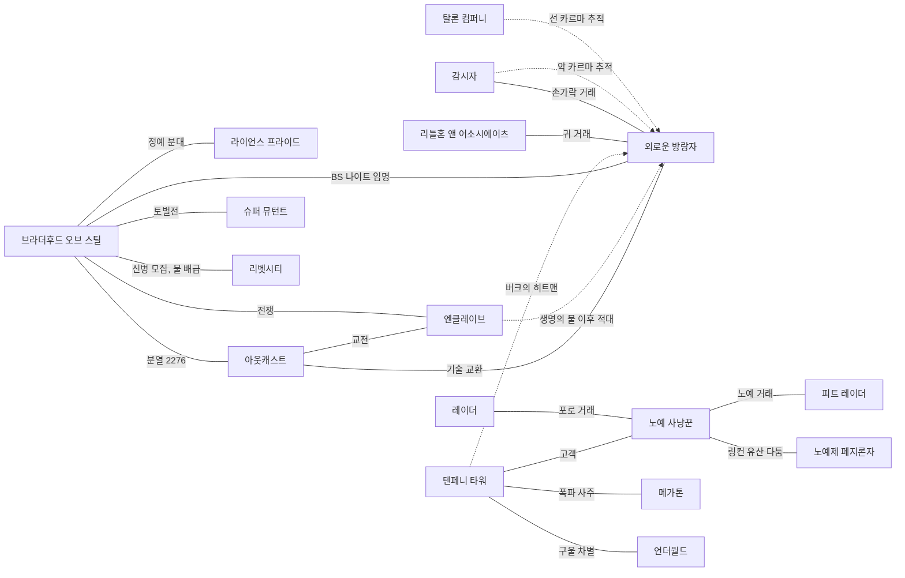
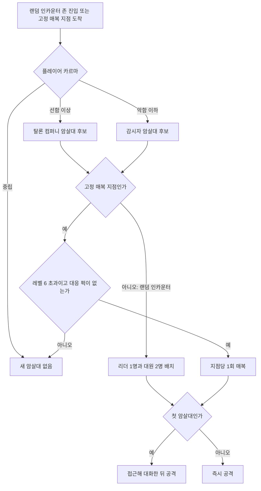
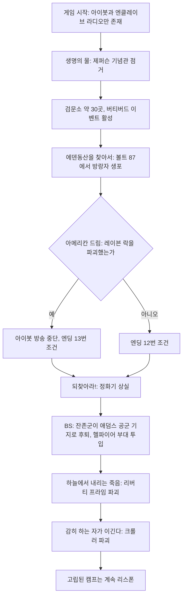

# RD-09. 팩션

> **폴아웃 3 역기획서 세트** | 문서 ID: RD-09 | 버전: v1.0 | 작성일: 2026-10-11
> **범위**: 폴아웃 3 본편과 DLC 5종에 나오는 인간 조직·공동체·적대 집단 전체. 슈퍼 뮤턴트·트로그·외계인처럼 세력으로 기능하는 비인간 집단은 세력 관점에서만 다룬다. 팩션별 역사·목표·조직·계급·주요 인물·거점·장비·플레이어 관계·관련 퀘스트, 팩션 관계 매트릭스, 엔진의 팩션 관계 처리, 카르마 반응(암살대), 엔딩 반영을 포함한다. / 다루지 않는 것: 크리처 종의 수치(RD-24), 퀘스트 진행 상세(RD-03~08), 개별 NPC 프로필(RD-10·11), 카르마 수치 체계 전체(RD-14), 범죄·소유권 규칙 본문(RD-17).
> **관련 문서**: [RD-02 세계관·설정·연표](02_world-and-lore.md), [RD-03 메인 스토리 1부](03_main-story-part1.md), [RD-04 메인 스토리 2부·엔딩](04_main-story-part2-endings.md), [RD-05 사이드 퀘스트 1부](05_side-quests-part1.md), [RD-06 사이드 퀘스트 2부](06_side-quests-part2.md), [RD-07 비표시·반복 퀘스트와 랜덤 인카운터](07_misc-quests-encounters.md), [RD-08a 오퍼레이션: 앵커리지](08a_dlc-operation-anchorage.md), [RD-08b 더 피트](08b_dlc-the-pitt.md), [RD-08c 브로큰 스틸](08c_dlc-broken-steel.md), [RD-08d 포인트 룩아웃](08d_dlc-point-lookout.md), [RD-08e 마더십 제타](08e_dlc-mothership-zeta.md), [RD-10 주요 인물·동료](10_characters-major-companions.md), [RD-11 NPC 디렉터리](11_npc-directory.md), [RD-12 월드 구조·정착지·볼트](12_world-structure-settlements.md), [RD-14 캐릭터 시스템](14_character-system.md), [RD-17 탐험·상호작용](17_exploration-interaction.md), [RD-24 크리처·적 도감](24_bestiary.md), [RD-26 용어집](26_glossary.md)

---

## 1. 문서 개요

### 1.1 목적

- 폴아웃 3(Fallout 3)의 세력 구도를 팬게임 기획의 데이터·이벤트 설계 근거로 정리한다.
- 각 팩션을 "누가, 어디에 있고, 무엇을 원하며, 플레이어와 어떻게 얽히는가"라는 같은 틀로 구조화한다. 나중에 팩션 테이블, 스위치·변수, 이벤트 조건으로 옮기기 쉽게 하는 것이 목표다.
- 엔진이 팩션 관계를 어떻게 처리했는지는 코퍼스에 전사된 스크립트 원문으로 확인할 수 있는 범위까지만 적는다.

### 1.2 범위와 경계

| 주제 | 이 문서(RD-09) | 정본 문서 |
|---|---|---|
| 팩션 개요·역사·조직·계급·인물·거점·장비·플레이어 관계 | 다룸 | 인물 상세는 RD-10·11, 장소 상세는 RD-12·13 |
| 관련 퀘스트 | 팩션 관점의 요약과 링크 | 퀘스트 상세는 RD-03~08 |
| 슈퍼 뮤턴트·트로그·외계인 | 세력(영역·행동·관계)으로서만 | 종별 수치는 RD-24 |
| 카르마 | 팩션 반응(암살대, 우호 반응) 부분 | 증감 행동·구간·칭호는 RD-14 |
| 범죄·소유권·적대화 | 팩션과의 연결 고리 | 규칙 본문은 RD-17 |
| 엔딩 | 팩션과 관련된 엔딩 세그먼트 | 엔딩 시스템 정본은 RD-04, [BS] 변경은 RD-08c |
| BoS·엔클레이브의 장기 역사 | 수도 황무지 시점(2254~2283) 요약 | 전체 역사는 RD-02 |

### 1.3 요약

- 폴아웃 3의 세력 구도는 **브라더후드 오브 스틸(Brotherhood of Steel, BoS) 대 엔클레이브(Enclave)**라는 하나의 큰 대립축과, 그 주변을 채우는 20여 개의 정착지 공동체·적대 집단으로 이루어진다.
- 플레이어는 어느 세력에 들어갈지 고르지 않는다. 메인 스토리가 플레이어를 BoS 쪽으로 끌어들이고([BS]에서 나이트로 정식 임명), 나머지 세력과의 관계는 개별 퀘스트 결과와 **카르마 한 축**으로 정해진다.
- 뉴 베가스(Fallout: New Vegas)식 팩션 평판 수치는 **없다**. 엔진 안에는 팩션 소속과 4단계 반응(적대·중립·동맹·친구) 체계가 있지만, 플레이어가 겪는 것은 "이 집단이 나를 공격하는가"라는 이진 결과뿐이다.
- 카르마가 선 쪽이면 탈론 컴퍼니(Talon Company), 악 쪽이면 감시자(Regulators) 암살대가 찾아오는 구조가 사실상 유일한 전역 평판 반응이다.
- 정착지 공동체는 "주민 한 명을 공격하면 전원이 적대"하는 집단 반응을 공유하고, 일부(아르푸·오아시스·피트 등)는 스크립트로 영구 적대나 진영 교체가 일어난다.

### 1.4 표기 메모

- 표기는 [RD-26 용어집](26_glossary.md)을 따른다. 고유명사는 처음 나올 때만 `한국어(English)`로 병기한다. 용어집에 없는 인명·지명은 외래어 표기법에 따라 음차했고, 문서 끝 보고서에 신규 용어로 제출한다.
- BoS의 계급명(팔라딘·나이트·서기 등)과 아웃캐스트·트리마인더의 계급명은 고유 직함으로 보고 음차한다. 엔클레이브 계급은 실제 군 계급이므로 번역한다(대령, 장교, 병사).
- **엔진 팩션 ID**는 GECK 에디터 ID를 그대로 적는다(예: `BrotherhoodSteelFaction`). 근거는 ① 허브 문서 `Fallout 3 factions`의 ID 칸, ② NPC 정보상자의 factions 필드, ③ 코퍼스에 전사된 스크립트 원문이다. ②·③에서만 확인된 ID에는 `*`를 붙인다.
- 관계 기호: **✕** 적대(교전), **△** 긴장·조건부 적대, **○** 우호·거래, **◎** 동맹·협력, **·** 접점 없음 또는 코퍼스 미확인.
- DLC 태그: [OA] 오퍼레이션: 앵커리지, [TP] 더 피트, [BS] 브로큰 스틸, [PL] 포인트 룩아웃, [MZ] 마더십 제타.
- 연도는 게임 내 연도(2277년이 본편 시점)다. 코퍼스로 확인하지 못한 내용은 `(코퍼스 미확인)`으로 표시한다.

### 1.5 팩션 분류 체계

이 문서는 팩션을 플레이 경험에서 차지하는 비중에 따라 다섯 등급으로 나눈다. 쯔꾸르 이식 시 구현 우선순위를 정하는 기준으로도 쓸 수 있다.

| 등급 | 정의 | 해당 팩션 |
|---|---|---|
| A. 대세력 | 메인 스토리를 움직이는 군사 세력. 퀘스트 라인 전체가 이 세력의 충돌로 짜여 있다 | 브라더후드 오브 스틸(라이언스 프라이드 포함), 엔클레이브 |
| B. 전역 세력 | 맵 전체에 출현하고, 일부는 카르마·퀘스트 결과에 따라 플레이어를 추적한다 | 아웃캐스트, 탈론 컴퍼니, 감시자, 레이더, 노예 사냥꾼, 슈퍼 뮤턴트, 중국군 잔존병 |
| C. 정착지 공동체 | 거점에 고정된 주민 집단. 주민 단위로 집단 반응한다 | 메가톤, 리벳시티, 언더월드, 텐페니 타워, 리틀 램프라잇, 빅타운, 아르푸, 캔터베리 커먼, 데이브 공화국, 오아시스(트리마인더), 템플 오브 유니온 |
| D. 특수 집단 | 단일 퀘스트나 이념을 중심으로 한 소집단 | 패밀리, 원자의 자손, 라일리 레인저, 캐러밴 상인, 리틀혼 앤 어소시에이츠, 레일로드, 서든데스 오버타임 등 |
| E. DLC 세력 | DLC 지역 전용 | 피트 레이더·노예, 포인트 룩아웃 부족민, 늪지 주민, 외계인, 시뮬레이션 군대 등 |

---

## 2. 팩션 총람 (허브 대조표)

`Fallout 3 factions` 허브의 팩션 표·종교 표, `Navbox factions FO3` 틀, 공식 가이드 팩션 프로필에 나오는 집단을 모두 모은 표다. "기본 관계"는 플레이어가 처음 만났을 때의 반응이다.

| # | 한국어명 | 영문 원명 | 등급 | 등장 | 주 거점 | 엔진 팩션 ID | 기본 관계 | 상세 |
|---|---|---|---|---|---|---|---|---|
| 1 | 브라더후드 오브 스틸 | Brotherhood of Steel (Fallout 3) | A | 본편, [BS] | 시타델 | BrotherhoodSteelFaction, BrotherhoodofSteelGenericFaction | ○ | [3.1](#31-브라더후드-오브-스틸-라이언의-bos) |
| 2 | 라이언스 프라이드 | Lyons' Pride | A | 본편, [BS] | GNR 방송국 광장, 시타델 | LyonsPrideFaction* | ○ | [3.2](#32-라이언스-프라이드) |
| 3 | 제2 기념탑 방위대 | 2nd Monument Defense Detachment | A | 본편 | 워싱턴 기념비 | — | ○ | [3.1](#31-브라더후드-오브-스틸-라이언의-bos) |
| 4 | 아웃캐스트 | Brotherhood Outcasts | B | 본편, [OA] | 인디펜던스 요새 | BrotherhoodOutcastFaction | · (조롱하지만 비적대) | [3.3](#33-아웃캐스트) |
| 5 | 엔클레이브 | Enclave | A | 본편, [BS] | 레이븐 락, 애덤스 공군 기지 | EnclaveFaction | ✕ (생명의 물 이후) | [3.4](#34-엔클레이브) |
| 6 | 엔클레이브 육군부 | Enclave Department of the Army | A | 본편, [BS] | — | (EnclaveFaction 하위) | ✕ | [3.4](#34-엔클레이브) |
| 7 | 엔클레이브 연구개발부 | Enclave Research and Development Division | A | 본편 | 애덤스 공군 기지, 야전 캠프 | — | ✕ | [3.4](#34-엔클레이브) |
| 8 | 엔클레이브 시그마 분대 | Enclave Squad Sigma | A | [BS] | 이동식 기지 크롤러 | — | ✕ | [3.4](#34-엔클레이브) |
| 9 | 탈론 컴퍼니 | Talon Company | B | 본편 | 배니스터 요새 | TalonCompany | ✕ | [3.5](#35-탈론-컴퍼니) |
| 10 | 감시자 | Regulators (Fallout 3) | B | 본편 | 감시자 본부 | RegulatorFaction, PerkLawgiverLocationFaction | · (악 카르마면 ✕) | [3.6](#36-감시자) |
| 11 | 리틀혼 앤 어소시에이츠 | Littlehorn & Associates | D | 본편 | 고철 처리장 | PerkContractKillerLocationFaction | · | [3.7](#37-리틀혼-앤-어소시에이츠) |
| 12 | 레이더 | Raiders (Fallout 3) | B | 본편, [BS] | 에버그린 밀 외 다수 | RaiderFaction | ✕ | [3.8](#38-레이더) |
| 13 | 노예 사냥꾼 | Slavers (Fallout 3) | B | 본편, [TP] | 파라다이스폴 | SlaverFaction, ParadiseFallsSlaverFaction, SlaverMemorialFaction | △ (검문 통과 전 무단 진입 시 ✕) | [3.9](#39-노예-사냥꾼-파라다이스폴) |
| 14 | 슈퍼 뮤턴트 | Super mutants (Fallout 3) | B | 본편, [BS] | 볼트 87, 내셔널 몰 일대 | SuperMutantFaction | ✕ | [3.10](#310-슈퍼-뮤턴트-세력으로서) |
| 15 | 패밀리 | The Family | D | 본편 | 메레스티 지하철역 | MS09TheFamilyFriendly | · | [3.11](#311-패밀리) |
| 16 | 원자의 자손 교회 | Church of the Children of Atom | D | 본편 | 메가톤 | MegatonChurchOfAtomFaction | ○ | [3.12](#312-원자의-자손-교회와-영원한-빛의-사도) |
| 17 | 영원한 빛의 사도 | Apostles of the Eternal Light | D | [BS] | 성광 수도원(스프링베일) | DLC03WQ03ApostlesFaction | · | [3.12](#312-원자의-자손-교회와-영원한-빛의-사도) |
| 18 | 리벳시티 의회 | Rivet City Council | C | 본편 | 리벳시티 | RCCityCouncil | ○ | [3.13](#313-리벳시티-의회경비대주민) |
| 19 | 리벳시티 경비대 | Rivet City security force | C | 본편, [BS] | 리벳시티 | RCSecurityFaction | ○ | [3.13](#313-리벳시티-의회경비대주민) |
| 20 | 리벳시티 주민 | Rivet City residents | C | 본편 | 리벳시티 | RCResidentFaction | ○ | [3.13](#313-리벳시티-의회경비대주민) |
| 21 | 성 모니카 교회 | Saint Monica's Church | D | 본편 | 리벳시티 | SaintMonicaFriends | ○ | [4](#4-기타-소규모-팩션집단-본편) |
| 22 | 메가톤 주민 | Megaton settler / residents | C | 본편 | 메가톤 | MegatonResidentFaction, MegatonSettlerFaction | ○ | [3.14](#314-메가톤) |
| 23 | 언더월드 주민 | Underworld resident | C | 본편, [BS] | 언더월드 | UnderworldGhoulFaction, UnderworldResidentFaction | ○ (경계) | [3.15](#315-언더월드-구울) |
| 24 | 텐페니 타워 주민 | Tenpenny resident | C | 본편 | 텐페니 타워 | TenpennyTowerResidentFaction | ○ | [3.16](#316-텐페니-타워) |
| 25 | 텐페니 경비대 | Tenpenny Security guards | C | 본편 | 텐페니 타워 | TenpennyGuardFaction | ○ | [3.16](#316-텐페니-타워) |
| 26 | 리틀 램프라잇 주민(램프라잇 아이들) | Lamplight residents | C | 본편 | 리틀 램프라잇 | LamplightResidentFaction | ○ (입장 조건 있음) | [3.17](#317-리틀-램프라잇) |
| 27 | 빅타운 주민 | Big Town residents | C | 본편 | 빅타운 | BigTownFaction | ○ | [3.18](#318-빅타운) |
| 28 | 아르푸 주민 | Arefu residents | C | 본편 | 아르푸 | ArefuFaction | ○ | [4](#4-기타-소규모-팩션집단-본편) |
| 29 | 캔터베리 커먼 주민 | Canterbury Commons residents | C | 본편 | 캔터베리 커먼 | CantCommonsFaction | ○ | [3.24](#324-캐러밴-상인과-캔터베리-커먼) |
| 30 | 라일리 레인저 | Reilly's Rangers | D | 본편 | 레인저 기지 | ReillysRangersFaction | ○ | [3.19](#319-라일리-레인저) |
| 31 | 트리마인더 | Treeminders | C | 본편 | 오아시스 | MS10OasisFaction | · (출입 통제) | [3.20](#320-트리마인더) |
| 32 | 노예제 폐지론자(템플 오브 유니온) | Abolitionists / Temple of the Union | C | 본편 | 템플 오브 유니온 → 링컨 기념관 | TempleUnionFaction | △ → ○ | [3.21](#321-노예제-폐지론자템플-오브-유니온) |
| 33 | 데이브 공화국 | Republic of Dave | C | 본편 | 데이브 공화국 | RepublicOfDaveFaction | · (입국 허가 필요) | [3.22](#322-데이브-공화국) |
| 34 | 중국군 잔존병 | Chinese remnants | B | 본편 | 마마 돌체스, 방송탑 KT8 | ChineseGhoulFaction | ✕ | [3.23](#323-중국군-잔존병) |
| 35 | 캐러밴 상인 | Caravan merchants | D | 본편 | 캔터베리 커먼 | TraderFaction* | ○ | [3.24](#324-캐러밴-상인과-캔터베리-커먼) |
| 36 | 레일로드 | The Railroad | D | 본편 | 리벳시티 등 | — | · | [4](#4-기타-소규모-팩션집단-본편) |
| 37 | 인스티튜트 | The Institute | D | 본편(2명 등장) | (커먼웰스) | ZimmerFriends* | · | [4](#4-기타-소규모-팩션집단-본편) |
| 38 | 서든데스 오버타임 | Sudden-Death Overtime | D | 본편 | 레드 레이서 공장, 뉴카-콜라 공장 | SDOFaction | · | [4](#4-기타-소규모-팩션집단-본편) |
| 39 | 뉴카-콜라 팬클럽 | Nuka-Cola fan club | D | 본편 | 다리그늘 마을 | — | ○ | [4](#4-기타-소규모-팩션집단-본편) |
| 40 | 볼트 101 경비대 | Vault 101 security | C | 본편 | 볼트 101 | Vault101SecurityFaction | ✕ (탈출! 중) | [4](#4-기타-소규모-팩션집단-본편) |
| 41 | 터널스네이크 | Tunnel Snakes | D | 본편 | 볼트 101, 리벳시티 | Vault101TunnelSnakesFaction* | · | [4](#4-기타-소규모-팩션집단-본편) |
| 42 | 정화 계획 | Project Purity | D | 본편 | 제퍼슨 기념관 | — | ○ | [3.1](#31-브라더후드-오브-스틸-라이언의-bos) |
| 43 | 황무지 주민 | Wastelanders | D | 본편 | 전역 | WastelanderFaction* | · | [4](#4-기타-소규모-팩션집단-본편) |
| 44 | 피트 레이더(애셔의 군대) | Pitt raiders | E | [TP] | 피트(업타운·밀) | DLC01PittRaiderFaction | ✕ → 조건부 | [5.2](#52-tp-더-피트) |
| 45 | 피트 노예 | Pitt slaves | E | [TP] | 피트(다운타운) | DLC01PittSlaveFaction | ○ | [5.2](#52-tp-더-피트) |
| 46 | 와일드맨·트로그 | Wildmen / Trogs | E | [TP] | 피트 일대 | — | ✕ | [5.2](#52-tp-더-피트) |
| 47 | 중국 인민해방군(시뮬레이션) | People's Liberation Army | E | 본편(트랜퀼리티 레인), [OA] | 시뮬레이션 내부 | DLC02CombatChineseFaction* | ✕ | [5.1](#51-oa-오퍼레이션-앵커리지) |
| 48 | 미 육군(시뮬레이션) | United States Army | E | [OA], [MZ] | 시뮬레이션 내부, 제타 | DLC02CombatAmericanFaction* | ○ | [5.1](#51-oa-오퍼레이션-앵커리지) |
| 49 | 미 육군 공병대 | United States Army Corps of Engineers | E | [OA] | 시뮬레이션 내부 | — | ○ | [5.1](#51-oa-오퍼레이션-앵커리지) |
| 50 | 미 해병대 | United States Marine Corps | E | [OA] | 시뮬레이션 내부 | — | ○ | [5.1](#51-oa-오퍼레이션-앵커리지) |
| 51 | 스플릿 잭의 도적단 | Bandits (Broken Steel) | E | [BS] | 빌헬름 부두 | DLC03WQ01BanditFaction* | △ | [5.3](#53-bs-브로큰-스틸) |
| 52 | 구울 경비병(그리폰 일당) | Ghoul guard | E | [BS] | 박물관 관리 빌딩 | DLC03WQ02GriffonFaction* | ✕ | [5.3](#53-bs-브로큰-스틸) |
| 53 | 포인트 룩아웃 부족민(아크 앤 도브 교단) | Point Lookout tribals | E | [PL] | 아크 앤 도브 대성당 | DLC04TribalFriendlyFaction, DLC04TribalGenericFaction, DLC04TribalHostileFaction | ✕ → 조건부 ○ | [5.4](#54-pl-포인트-룩아웃) |
| 54 | 늪지 주민 | Swampfolk | E | [PL] | 포인트 룩아웃 북·서부 늪지 | — | ✕ | [5.4](#54-pl-포인트-룩아웃) |
| 55 | 밀수꾼 | Smugglers | E | [PL] | 남서 해안, 헤어조크 광산 일대 | — | ✕ | [5.4](#54-pl-포인트-룩아웃) |
| 56 | 우그-콸토스 교단 | Cult of Ug-Qualtoth | E | [PL] | 블랙홀 저택, 던위치 빌딩, 의식 장소 | — | ✕ | [5.4](#54-pl-포인트-룩아웃) |
| 57 | 길의 수도원 | Abbey of the Road | E | [PL](언급) | 비공개 | — | ○ | [5.4](#54-pl-포인트-룩아웃) |
| 58 | 외계인(제타인) | Zetan aliens | E | 본편(추락선), [MZ] | 마더십 제타 | AlienFaction (스크립트상 DLC05AlienFaction*) | ✕ | [5.5](#55-mz-마더십-제타) |

- 허브 표의 엔진 ID 중 `MegatonSettlerFaction`, `PerkLawgiverLocationFaction`처럼 한 팩션에 ID가 둘 이상인 경우는 "주민/정착민", "퍽 연동 장소"처럼 용도별로 나뉜 것이다. 자세한 활용 방식은 [7.1](#71-엔진의-팩션-모델)에서 다룬다.
- 공식 가이드 팩션 프로필은 위 목록 외에 "황무지 주민(Wastelanders)", "와일드맨(Wildmen)"을 독립 항목으로 두었다. 허브에 없는 [BS] 도적단·구울 경비병도 가이드 프로필에 있다.

---

## 3. 주요 팩션 상세

### 3.1 브라더후드 오브 스틸 (라이언의 BoS)

> "Our orders were, and are, to acquire any and all advanced technology." — 오윈 라이언(Owyn Lyons)
> (우리의 명령은 예나 지금이나 모든 첨단 기술을 손에 넣는 것이오.)

| 항목 | 내용 |
|---|---|
| 영문명 | Brotherhood of Steel (Capital Wasteland detachment). 아웃캐스트는 경멸조로 "Lyons' Brotherhood of Steel"이라 부른다 |
| 유형 | BoS 지부(2254~2276) → 이탈 지부(2276~2283) → 2283년 재통합 |
| 이념 | 라이언의 개혁 노선: 기술 회수보다 주민 보호와 슈퍼 뮤턴트 토벌을 앞세움 |
| 지도자 | 엘더 오윈 라이언(2254~2278경) → 엘더 사라 라이언(Sarah Lyons, 2278) → 무명 엘더들 → 엘더 아서 맥슨(Arthur Maxson, 2283~) |
| 정부 형태 | 엘더 1인에게 전권 |
| 본거지 | 시타델(The Citadel, 펜타곤 폐허) |
| 엔진 팩션 ID | BrotherhoodSteelFaction(0001D3FE), BrotherhoodofSteelGenericFaction(00030512). 보조: CitadelResidentFaction*, LyonsPrideFaction*, BrotherhoodSteelKnightFaction*, BrotherhoodSteelScribeFaction*, BrotherhoodSteelInitiateFaction*, MQPlayerBOSAllyFaction* |
| 등장 | 본편, [BS] (언급: [OA] [TP] [MZ]) |
| 플레이어 기본 관계 | ○ 우호. 단, 시타델 출입은 '생명의 물' 완료 전까지 거부 |

#### 개요

- 서해안 BoS 엘더 평의회가 동부의 첨단 기술을 회수하려고 보낸 원정대가 뿌리를 내린 지부다. 원래 임무를 사실상 접고 수도 황무지(Capital Wasteland) 주민을 슈퍼 뮤턴트로부터 지키는 '토착화된' 기사단으로 변했다.
- 공식 가이드는 BoS를 "기술을 숭배하는 신(新)기사단"으로 소개하면서, 동부 지부는 라이언 아래에서 '토착화(gone native)'해 일종의 치안 부대가 되었다고 정리한다.
- 메인 스토리 후반의 아군이며, 엔클레이브와의 전쟁이 게임 클라이맥스(되찾아라!)와 [BS] 전체를 이룬다.
- 개발진은 플레이어가 기대할 '고결한 BoS'를 라이언 지부에, 1·2편의 강경파 성격을 아웃캐스트에 나눠 담았다고 밝혔다(에밀 파글리아룰로 인터뷰, 위키 인용).

#### 역사

| 연도 | 사건 |
|---|---|
| 2254 | 로스트 힐스(Lost Hills) 벙커의 엘더 평의회가 동부 원정대 파견을 결정. 지휘관 스타 팔라딘 오윈 라이언, 기술 고문 레지널드 로스차일드 서기, 팔라딘 헨리 캐스딘(Henry Casdin)·이슈마엘 애셔(Ishmael Ashur)·트리스탄(Tristan) 등이 동행 |
| 2255 | 수도 황무지 도착. 펜타곤 하층부를 기지로 확보하고 리버티 프라임(Liberty Prime)을 발견. 이 발견으로 동부 영구 기지 설립과 기술 탐색 지속이라는 새 지시를 받음 |
| 2255경 | 피츠버그 '스커지(The Scourge)'. 하룻밤 사이 저항하는 주민을 쓸어버리고 무언가를 회수(정체는 라이언만 앎). 변이 없는 아이 약 20명을 데려와 입문시킴(2277년 시타델에 남은 이는 코디악뿐). 애셔는 잔해에 묻혀 전사 처리됨 |
| 이후 | 라이언이 엘더로 승진. D.C. 도심의 슈퍼 뮤턴트를 주적으로 규정하고 토벌전을 시작하면서 기술 회수가 사실상 중단됨 |
| ~2258 | 제임스·캐서린의 정화 계획(Project Purity)를 지원했으나 성과가 없자 철수. 2258년 7월 캐서린이 사망하면서 계획이 중단됨. 라이언은 스타 팔라딘 크로스(Cross)에게 제임스 부자를 볼트 101까지 호위하도록 허락함 |
| 2258 이후 | 리벳시티와 협력해 정기 신병 모집. 한때 MDPL 중계소까지 세력을 넓히고 메가톤을 포함한 정착지를 보호했으나 점차 축소 |
| 2272 | 쓰리독(Three Dog)과 협약. 보호·기술 지원을 해 주는 대가로 GNR 방송국 광장을 거점으로 쓰고 우호적 방송을 얻음 |
| 2270년대 | 라이언은 서부에 기술 회수 중이라고 보고하며 증원을 받다가 엘더 평의회의 직접 명령을 거부. 서부가 통신과 증원을 끊어 2277년에는 완전히 단절됨 |
| 2276 | 분열(Schism). 인디펜던스 요새 기술 회수 요청이 거듭 무시되자 팔라딘 캐스딘을 중심으로 한 반대파가 무기·장비를 대량으로 가지고 이탈해 아웃캐스트가 됨. 23년 동안 뮤턴트와 싸우며 잃은 것보다 많은 병력을 한순간에 잃음 |
| 2277 | 약해진 상태로 엔클레이브와 맞섬. 리 박사가 정화기를 가동할 수 있다는 정보를 가져오자 라이언이 엔클레이브와의 전쟁을 결정하고, G.E.C.K. 회수 임무를 외로운 방랑자(Lone Wanderer)에게 맡김 |
| 2277 (되찾아라!) | 급히 가동한 리버티 프라임을 앞세워 정화 계획 탈환. 정화기 가동 충격으로 사라 라이언과 방랑자가 혼수상태에 빠짐 |
| 2277 [BS] | 2주 사이 레이븐 락 파괴, 정수 무상 배급 개시. 위성 중계소에서 리버티 프라임이 궤도 폭격으로 파괴됨. 테슬라 캐논 개발, 애덤스 공군 기지의 이동식 기지 크롤러 파괴 |
| 2278~2279 | 오윈 라이언 사망, 사라 라이언도 곧 전사(BoS 문서는 2278년, 라이언스 프라이드 문서는 "2279년 8월까지"로 적어 문서 간 차이가 있음) |
| 2282~2283 | 스콰이어였던 아서 맥슨이 슈퍼 뮤턴트 군벌 셰퍼드(Shepherd)를 격파해 임시 지휘권을 얻고, 2283년 아웃캐스트와 협정을 맺어 재통합. 이후 애덤스 공군 기지에서 비행선 프리드웬(Prydwen)을 건조 |

- 주: 공식 가이드 [TP] 프로필은 스커지를 2042년으로 적었지만, 위키 본문(BoS·피트 레이더·피트 노예 문서)은 원정대 도착 직후인 2255년경으로 본다. 원정대가 2254년에 출발했으므로 2042년은 가이드의 오기로 판단한다.

#### 목표·이념

- **명목상 목표**(서부 엘더 평의회의 명령): 동부 도시와 기지의 첨단 기술을 모두 회수.
- **라이언의 실제 목표**: 슈퍼 뮤턴트로부터 주민 보호, 슈퍼 뮤턴트가 어디서 만들어지는지(볼트 87) 밝혀내기. 기원을 밝혀내는 것이 라이언의 '집착'으로 묘사된다.
- **엔클레이브 등장 이후**: 정화기 확보와 엔클레이브 격멸, 이어서 정수를 모든 정착지에 무료로 나누는 것. 무료 배급 원칙은 [BS]에서 재정난(빅슬리 서기의 몰래 판매)과 호위 손실이라는 부작용을 낳는다.
- **외부인 태도**: 시타델은 외부인 출입 금지, 외부와는 보급품 위주의 제한적 교역만 한다. 구울에 대한 관용이 낮아 슈퍼 뮤턴트로 오인하거나 개의치 않고 쏘기도 한다(언더월드 구울은 BoS가 "대부분 일부러 빗맞힌다"고 말함).
- **기술관**: T-45 파워 아머를 기사의 판금 갑옷처럼 다루는 테크노 종교적 기사단. 원정대 시절의 '기술 숭배' 성향은 아웃캐스트 쪽에 더 진하게 남았다.

#### 조직·계급

- 엘더가 목표 설정부터 개인 임무 배정까지 전권을 쥔다. 라이언 지부는 원래 BoS의 나이트·팔라딘 카스트를 **전투 계급 하나로 합쳤고**, 서기가 연구와 제조를 모두 맡는다. 검(Sword)·방패(Shield)·깃펜(Quill) 세 수도회 구분은 유지한다.
- 야전은 분대 단위로 움직이며 위계가 엄격하다. 다만 **무전 장비가 부족**해 각 분대가 상시 명령 없이 독립 세포처럼 움직이고, 수 주~수 개월 시타델에 보고하지 않기도 한다. 연락은 전령에 의존한다.
- 가입은 원래 기존 단원의 후원(sponsor)이 필요했지만, 2276년 분열 이후 병력이 모자라 후원 없이 현지인을 받아들였다. 이렇게 들어온 수련병은 의욕만 앞서고 훈련이 부족해 사상률이 높다.

| 계급 | 영문 | 캐피털 지부에서의 역할 | 2277년 대표 인물 |
|---|---|---|---|
| 엘더 | Elder | 지부 최고 지도자 | 오윈 라이언 |
| 센티널 | Sentinel | 동부 지부 고유 계급. 엘더가 직접 임명하고 고수준 지시만 받으며 재량으로 작전 | 사라 라이언(유일), 라이언스 프라이드 지휘 |
| 스타 팔라딘 | Star Paladin | 명예·충성·용맹을 인정받은 팔라딘. 작전 재량이 큼 | 크로스(유일). 라이언도 엘더 승진 전 스타 팔라딘 |
| 팔라딘 | Paladin | 베테랑. 야전 지휘관이나 정예 타격대. 상당수가 원정대 원년 멤버 | 베일(Bael), 거니(Gunny), 호스(Hoss), 바가스(Vargas), 글레이드(Glade), 코디악(Kodiak) |
| 작전 장교 | Operations Officer | [BS] 록랜드 공격 분대 지휘(직함) | 팔라딘 에드워즈(Edwards) |
| 나이트 대위 | Knight-Captain | 동부 지부 계급. 참모직과 지휘직 | 콜빈(Colvin), 더스크(Dusk), 갈로우즈(Gallows), 덜가(Durga, 병참관) |
| 나이트 하사 | Knight Sergeant | 분대 1~2개나 거점(GNR 광장) 지휘 | 윌크스(Wilks, 유일) |
| 나이트 | Knight | 정규 전투원. 동부에서는 순수 군사 계급(제조는 서기 담당) | 처치(Church) 외 다수, [BS] 외로운 방랑자 |
| 수련병 | Initiate | 지상군의 최다수. 태생 단원 또는 현지 지원자. 동부는 단일 수련병 계급 | 펙(Pek), 레딘(Reddin), 제닝(Jennings) |
| 스콰이어 | Squire | 아동 단원. 전투에 나가지 않고 잡무를 하며 교육을 받음 | 아서 맥슨 |
| 수석 서기 | Head Scribe | 최고위 비전투원. 서기를 프로젝트·수도회에 배정 | 레지널드 로스차일드(리버티 프라임 담당) |
| 선임 서기 | Senior Scribe | 중요 프로젝트 담당, 견습 지도 | 이얼링(Yearling, 알링턴 도서관 서적 회수) |
| 서기 | Scribe | 연구·제조 | 보우디치(Bowditch), 제임슨(Jameson), 피바디(Peabody), [BS] 빅슬리(Bigsley), 발린코트(Vallincourt) |

**하위 부대**

| 부대 | 영문 | 임무 |
|---|---|---|
| 라이언스 프라이드 | Lyons' Pride | 정예 특수 전술 분대([3.2](#32-라이언스-프라이드)) |
| 제2 기념탑 방위대 | 2nd Monument Defense Detachment | 쓰리독과의 협약에 따라 워싱턴 기념비 꼭대기의 GNR 장거리 송신기 경비. 2277년 지휘관 팔라딘 베링스(Berrings). 내셔널 몰의 슈퍼 뮤턴트 때문에 플레이어가 도착하기 전에 전멸해 있기도 함 |
| 물 배급망 | Water Distribution Network | [BS] 정수 호위 캐러밴 운영 |
| 제1 정찰대, 정찰 분대 글라디우스·아르테미스 | First Recon Team, Recon Squad Gladius / Artemis | 정찰 부대(세부 코퍼스 미확인) |
| 알파 분대 | Alpha Squad | [BS] 배니스터 요새 공격(팔라딘 젠슨 지휘) |

#### 거점·영역

| 거점 | 시기 | 성격 |
|---|---|---|
| 시타델 | 2255~ | 본부. 출입구는 정문 하나(팔라딘 여럿과 센트리 봇 1대가 경비). 베일리(훈련장, 거니), A링(라이언 덴, 대회의실, 도서관), B링(숙소, 의무실, 라이언·맥슨 숙소), 연구실·무기고(덜가) |
| GNR 방송국 광장 | 2272~ | 도심의 핵심 방어 거점. 쓰리독과 상호 협력 |
| 워싱턴 기념비 | 2277 | 제2 기념탑 방위대 5명 주둔 |
| 펜실베이니아 애비뉴(호텔) | 2277 | 소규모 휴식·재보급 거점. 슈퍼 뮤턴트의 공세가 잦음 |
| 알링턴 도서관 | 2277 | 전쟁 전 서적 회수, 도서관에 틀어박힌 레이더와 교전 |
| 폴스 교회 | 2277 | 장거리 정찰 훈련 구역('잃어버린 수련병') |
| 제퍼슨 기념관(정화 계획) | 되찾아라! 이후 | 정화기 운영. 리벳시티 경비대와 함께 물 수송 |
| 록랜드 자동차 터널 | [BS] | 위성 중계소 공격 전진 기지 |
| 배니스터 요새 | [BS] 선택 | 탈론 컴퍼니를 몰아낸 뒤 전초기지화 |
| 애덤스 공군 기지 | [BS] 이후 | 크롤러 잔해 회수, 이후 프리드웬 건조 |
| MDPL 대량 중계소, 무명 채석장 | 2277 이전 | 버려진 옛 거점(중계소는 이후 레이더가 점거) |

#### 장비·전투 특성

- **표준 장비**: 현장 인원은 수련병까지 모두 T-45d 파워 아머를 지급받는다. 주무기는 R91·93식 돌격소총, AER9 레이저 소총, CZ53 미니건.
- **약점**: 분열 때 인원·장비·예비 부품을 크게 잃었고, 훈련이 부족한 수련병이 죽을 때마다 아머와 장비가 황무지에 버려져 손실이 빨라진다. 위키는 "슈퍼 뮤턴트 타격대 하나가 중무장한 BoS 5인 분대를 전멸시킬 수 있을" 정도의 열세로 묘사한다.
- **강점**: 정예 라이언스 프라이드, 결전 병기 리버티 프라임(되찾아라!), [BS]의 테슬라 캐논(엔클레이브 버티버드를 한 발에 격추), 노획한 엔클레이브 버티버드 '프라이드 원(Pride One)'.
- **전투 양상**: 도심 거점 방어전과 슈퍼 뮤턴트 소탕전이 중심이다. 엔클레이브전에서는 리버티 프라임을 쐐기로 쓰고 프라이드가 뒤를 쓸어내는 돌파 전술을 쓴다.

#### 주요 인물

| 인물 | 직책 | 플레이어에게 하는 역할 | 필수(essential) |
|---|---|---|---|
| 오윈 라이언 | 엘더 | 지부 수장. 메인 퀘스트 후반 의뢰인 | 필수 |
| 사라 라이언 | 센티널 | 라이언스 프라이드 지휘, 최종전 동행 | 항상 필수([BS] 시타델 파괴 시 해제) |
| 레지널드 로스차일드 | 수석 서기 | 리버티 프라임 복구, 기술 자문 | 필수 |
| 크로스 | 스타 팔라딘 | 동료 후보(선 카르마). 과거 제임스 부자 호위 | 아님 |
| 거니 | 팔라딘 | 신병 교관. 파워 아머 훈련 퍽 지급 | (코퍼스 미확인) |
| 베일 | 팔라딘 | 시타델 외곽 경비 책임. '생명의 물' 전 출입 거부 | (코퍼스 미확인) |
| 덜가 | 나이트 대위 | 병참관. 엘더 허가 후 무기고 거래 | (코퍼스 미확인) |
| 트리스탄 | 팔라딘 | [BS] 프라이드 대행 지휘, 브로큰 스틸 퀘스트 의뢰 | 항상 필수(시타델 파괴 시 해제) |
| 아서 맥슨 | 스콰이어 | 2277년에는 아이. 훗날 엘더 | (코퍼스 미확인) |
| 빅슬리 | 서기 | [BS] 물 배급 책임자. 그리폰에게 몰래 물을 판매 | (코퍼스 미확인) |
| 발린코트 | 서기 | [BS] 데스클로 제어 교란기 실험 의뢰 | (코퍼스 미확인) |

#### 플레이어와의 관계

- **기본**: 우호. 도심 곳곳의 BoS 분대는 플레이어를 공격하지 않고 슈퍼 뮤턴트와 함께 싸운다. 외부인이므로 시타델에는 들어가지 못한다.
- **관계가 깊어지는 경로**: 메인 스토리에 고정되어 있으며, 선택지로 거절할 수 없다.
  1. 아버지의 발자취: GNR 광장 전투에서 프라이드와 처음 만난다(이 단계를 건너뛸 수도 있음).
  2. 생명의 물 완료: 리 박사와 함께 시타델에 들어가는 장면이 스크립트로 처리된다.
  3. 흔적을 따라서: 라이언에게 파워 아머 훈련을 요청하면 거니가 퍽을 준다. 덜가의 무기고 거래도 엘더 허가로 열린다.
  4. 아메리칸 드림 완료: 프라이드가 방랑자를 명예 회원으로 인정해 프라이드 아머 착용을 허락한다. 파워 아머 훈련이 없으면 이때 자동으로 얻는다.
  5. 되찾아라!: 리버티 프라임과 프라이드와 함께 최종 결전.
  6. [BS]: 2주 혼수에서 깨어난 뒤 라이언이 "표준 모집 절차를 우회해" 방랑자를 **나이트**로 직접 임명한다.
- **가입 여부**: 본편에서는 공식 가입 절차가 없는 '협력자'이고, [BS]에서 나이트로 정식 편입된다. 엔진에서도 [BS] 이후 플레이어가 `BrotherhoodSteelFaction`과 `MQPlayerBOSAllyFaction`에 들어가 있다는 사실이 스크립트로 확인된다(시타델 파괴 분기에서 이 두 팩션에서 플레이어를 제거함).
- **가입 혜택**

| 혜택 | 조건 | 비고 |
|---|---|---|
| 시타델 출입 | 생명의 물 완료 | 외부인 금지 구역 |
| 파워 아머 훈련(특별 퍽) | 흔적을 따라서 중 라이언 허가 → 거니 / 아메리칸 드림 완료 시 자동 | [OA] 시뮬레이션 완료로도 획득 |
| 시타델 무기고 거래 | 엘더 허가(쉽게 얻음) | 상인: 나이트 대위 덜가 |
| 라이언스 프라이드 명예 회원 | 아메리칸 드림 완료 | 프라이드 아머 착용 허용 |
| 동료 크로스 | 선 카르마 | 악 카르마가 되면 떠남 |
| 나이트 계급 | [BS] 진입 | 브로큰 스틸 퀘스트 라인 개방 |
| 반복 보상 | [BS] '감히 하는 자가 이긴다' 이후 | 피의 형제애: 슈퍼 뮤턴트 혈액 샘플 1개당 50캡·10XP / 프라임 타임 준비: 카메라 1개당 100캡·25XP, 센서 모듈 1개당 75캡·10XP |

- **적대 조건**
  - [BS] '감히 하는 자가 이긴다(Who Dares Wins)'에서 궤도 폭격 목표로 시타델을 고르면 카르마 -1,000과 함께 BoS 전원이 영구 적대가 된다. 스크립트(`DLC03BS3QuestScript`)는 플레이어를 BoS 관련 팩션에서 빼고, 크로스를 해고하고, `SetEnemy BrotherhoodSteelFaction PlayerFaction 0`을 실행하며, 사라 라이언의 필수 상태를 푼다.
  - 아웃캐스트에게 BoS 소속이라고 밝히면 그쪽이 적대가 된다([3.3](#33-아웃캐스트)). BoS 쪽 반응이 아니므로 유의.
  - 그 밖의 일반적인 공격·절도 반응은 다른 정착지와 같은 범죄 규칙을 따른다([7.5](#75-범죄적대화-규칙과의-연결)).

#### 관련 퀘스트

| 퀘스트 | BoS가 맡는 역할 | 정본 |
|---|---|---|
| 아버지의 발자취(Following in His Footsteps) | GNR 광장에서 BoS·프라이드와 첫 조우 | [RD-03](03_main-story-part1.md) |
| 갤럭시 뉴스 라디오(Galaxy News Radio) | 워싱턴 기념비의 송신 접시(제2 기념탑 방위대 거점) | [RD-03](03_main-story-part1.md) |
| 생명의 물(The Waters of Life) | 시타델 입성 | [RD-04](04_main-story-part2-endings.md) |
| 흔적을 따라서(Picking Up the Trail) | 파워 아머 훈련 허가 | [RD-04](04_main-story-part2-endings.md) |
| 에덴동산을 찾아서(Finding the Garden of Eden) | 라이언이 G.E.C.K. 회수를 의뢰 | [RD-04](04_main-story-part2-endings.md) |
| 아메리칸 드림(The American Dream) | 레이븐 락 탈출 후 시타델 보고, 프라이드 명예 회원 | [RD-04](04_main-story-part2-endings.md) |
| 되찾아라!(Take It Back!) | 리버티 프라임 진격, 정화기 탈환 | [RD-04](04_main-story-part2-endings.md) |
| 잃어버린 수련병(The Lost Initiate) | 폴스 교회에서 수련병 펙 구출(비표시) | [RD-07](07_misc-quests-encounters.md) |
| 갈로우즈 유머(Gallows Humor) | 프라이드 대원 갈로우즈의 본명 알아내기(비표시) | [RD-07](07_misc-quests-encounters.md) |
| [BS] 하늘에서 내리는 죽음(Death From Above) | 위성 중계소 공격, 리버티 프라임 상실 | [RD-08c](08c_dlc-broken-steel.md) |
| [BS] 충격 요법(Shock Value) | 올니 발전소의 테슬라 코일 회수 | [RD-08c](08c_dlc-broken-steel.md) |
| [BS] 감히 하는 자가 이긴다(Who Dares Wins) | 애덤스 공군 기지 크롤러 파괴(또는 시타델 파괴) | [RD-08c](08c_dlc-broken-steel.md) |
| [BS] 피의 형제애(Blood Brotherhood), 프라임 타임 준비(Getting Ready for Prime Time) | 반복 납품 퀘스트 | [RD-08c](08c_dlc-broken-steel.md) |

- 비퀘스트 이벤트: 슈퍼 뮤턴트가 볼트 87에서 나온다는 사실을 라이언에게 알리면 카르마와 XP를 받는다.

#### 엔딩·후일담 반영

- 본편 엔딩에서 BoS가 따로 슬라이드를 갖지는 않는다. 다만 최종 선택에서 방랑자 대신 **사라 라이언**를 통제실에 들여보내면 그녀의 희생을 다룬 세그먼트(10번)가 나온다([8](#8-엔딩후일담-반영)).
- [BS]에서는 엔딩 이후의 세계가 이어진다. BoS는 정화기와 물 배급망을 운영하고 엔클레이브 잔당을 소탕하며, 플레이어의 선택에 따라 동맹(애덤스 파괴)이나 원수(시타델 파괴)로 끝난다.
- 공식 후일담(위키): 라이언 부녀 사망 → 맥슨의 재통합(2283) → 프리드웬 건조.

### 3.2 라이언스 프라이드

> "The Brotherhood does its best, but sometime's it takes a little something... special. That's where the Lyons' Pride comes in." — 사라 라이언
> (브라더후드도 최선을 다하지만, 가끔은 좀 특별한 게 필요하거든. 그게 라이언스 프라이드야.)

| 항목 | 내용 |
|---|---|
| 영문명 | Lyons' Pride (줄여서 the Pride) |
| 유형 | 라이언 BoS 소속 특수 전술 분대 |
| 창설 | 오윈 엘더 라이언. 지휘는 딸 사라 라이언에게 맡김 |
| 지휘관 | 센티널 사라 라이언 → [BS] 팔라딘 트리스탄(세라가 회복할 때까지 대행) |
| 거점 | GNR 방송국 광장(작전 거점), 시타델 A링의 라이언 덴(Lyons' Den, 전용 막사·휴게실) |
| 엔진 팩션 ID | LyonsPrideFaction* |
| 등장 | 본편, [BS] |
| 이름 | 사자 무리를 뜻하는 'lion's pride'와 라이언(Lyons)의 성을 엮은 말장난 |

#### 개요·역사

- 엘더가 슈퍼 뮤턴트에 맞서려고 만든 정예 분대로, 나중에는 엔클레이브전까지 맡는다. 사라 라이언이 지부 전체의 지원자 명단에서 직접 대원을 고른다.
- 일반 BoS 병력이 화력을 더 필요로 할 때마다 투입되어, 분열 이후 약해진 BoS가 전선을 유지하게 한 핵심 전력으로 묘사된다.
- 2277년 GNR 광장 증원 중 체비 체이스(Chevy Chase)를 뚫고 가다가 수련병 제닝이 죽는다(바가스의 판단 실수). 플레이어가 쓰리독을 찾아오는 경로를 밟으면 GNR 광장 전투에 슈퍼 뮤턴트 베히모스가 나타나 수련병 레딘이 죽는다. 이 경로를 건너뛰면 베히모스가 나오지 않지만, 레딘은 그 뒤 어딘가에서 결국 전사해 결원이 생긴다.
- 아메리칸 드림 이후 방랑자를 명예 회원으로 받아들이고, 되찾아라!에서 리버티 프라임 뒤를 따라 정화기를 탈환한다.
- [BS]: 트리스탄 지휘로 위성 중계소 공격, 테슬라 코일 회수, 애덤스 공군 기지 공격을 지원한다. 크롤러 파괴 후 회복한 세라가 노획 버티버드 '프라이드 원'으로 방랑자를 탈출시킨다. 엔클레이브가 물러난 뒤에는 도심 슈퍼 뮤턴트 토벌로 돌아가고, 로스차일드의 리버티 프라임 재건 부품 수집도 돕는다.
- 2278~2279년 라이언 부녀가 모두 죽은 뒤 프라이드의 행방은 알려지지 않았다.

#### 대원 구성

| 대원 | 계급 | 역할 |
|---|---|---|
| 사라 라이언 | 센티널 | 분대장 |
| 트리스탄 | 팔라딘 | 분대장 대행(되찾아라! 이후) |
| 바가스 | 팔라딘 하사 | 부분대장 |
| 글레이드 | 팔라딘 | 중보병·기술병 |
| 코디악 | 팔라딘 | 만능 병사. 스커지 때 피트에서 데려온 아이 중 유일하게 시타델에 남은 인물(그렉 베어) |
| 콜빈 | 나이트 대위 | 저격수(계급 문서에는 '보병'으로 적혀 있어 차이 있음) |
| 더스크 | 나이트 대위 | 저격수 |
| 갈로우즈 | 나이트 대위 | 특수 작전 |
| 레딘 | 수련병 | 견습 대원. 시나리오상 사망 |
| 외로운 방랑자 | 명예 회원 | 아메리칸 드림 완료 후 |

#### 장비·전투 특성

- 정규 대원은 모두 프라이드 휘장을 단 T-45 파워 아머를 입는다. 휘장은 BoS 표준 문양의 톱니바퀴 셋 대신 **뒷발로 선 사자**가 날개 사이 검날 위에 겹쳐진 모양이다.
- 무기는 저격소총·플라스마 소총·슈퍼 슬레지·개틀링 레이저까지 다양하지만 레이저 소총이 가장 흔하다.
- [BS]에서는 노획 버티버드 '프라이드 원'을 운용한다.

#### 플레이어와의 관계

- 항상 우호. 적대화 경로는 [BS] 시타델 파괴(BoS 전체 적대)뿐이다.
- 명예 회원이 되면 프라이드 아머 착용이 '허용'될 뿐, 별도 계급·급여는 없다.
- 관련 퀘스트: 아버지의 발자취, 되찾아라!, [BS] 하늘에서 내리는 죽음·충격 요법·감히 하는 자가 이긴다, 갈로우즈 유머(비표시).

### 3.3 아웃캐스트

> "When he had us helping those savages instead of recovering tech that could help us all, that's when we objected and became Outcasts." — 헨리 캐스딘
> (그가 우리 모두를 도울 기술을 회수하는 대신 그 야만인들을 돕게 했을 때, 우린 반대했고 아웃캐스트가 됐지.)

| 항목 | 내용 |
|---|---|
| 영문명 | Brotherhood Outcasts |
| 유형 | BoS 분파(2276~2283) |
| 창설 | 2276년, 팔라딘 헨리 캐스딘 |
| 이념 | BoS 근본주의. 원래 임무(기술 회수·위험 기술 격리)를 지키는 '진짜 BoS'를 자처 |
| 지도자 | 프로텍터(Protector) 캐스딘. [OA] 전초기지는 프로텍터 맥그로(McGraw) |
| 정부·구조 | 프로텍터들에게 절대 권한. 전투원(수비대원)과 비전투원(전문가)의 엄격한 카스트 분리 |
| 본거지 | 인디펜던스 요새(Fort Independence) |
| 기타 거점 | 페어팩스(Fairfax), 아웃캐스트 초소(Brotherhood Outcast shack), [OA] 아웃캐스트 전초기지(VSS 시설)와 베일리스 크로스로즈(Bailey's Crossroads) |
| 엔진 팩션 ID | BrotherhoodOutcastFaction. [OA] DLC02OutcastFaction*, DLC02OutcastFactionHOSTILE*, DLC02PlayerOutcastFactionHOSTILE*, DLC02OA4MutinyFaction* |
| 등장 | 본편, [OA] |
| 기본 관계 | · 플레이어를 무식한 현지인 취급하며 조롱하지만 먼저 공격하지 않음 |

#### 역사

- **분열 배경**: 라이언이 슈퍼 뮤턴트 토벌과 주민 보호에 매달리는 것을 "인력과 자원을 낭비해 결국 BoS를 무너뜨릴 영웅 놀음"으로 본 나이트·팔라딘들이 반발했다. 원래 이탈할 생각은 없었으나 인디펜던스 요새(전쟁 전 군 연구 시설) 기술 회수 요청이 계속 무시되자, 2276년 캐스딘을 중심으로 시타델을 떠나면서 무기·장비 상당량을 가져갔다.
- **새 BoS**: 인디펜던스 요새에서 토착 레이더를 몰아내고 본부로 삼았다. '아웃캐스트(추방자)'라는 모욕을 오히려 명예로 받아들였고, 파워 아머를 빨강·검정으로 칠해 라이언 측과 구분했다. 나이트·팔라딘 같은 권위적 계급명도 버리고 작전을 분권화했다.
- **2277년의 상태**: 정기 순찰로 기술을 수집하고 VSS 시설 등을 발굴한다. 외계 무기 같은 초고급 기술에 집착하고, 회수한 기술을 분석·역설계하는 작업 일지를 남긴다. 최종 목표는 서부 로스트 힐스와 연락을 되살려 라이언을 군법 회의에 세우는 것이다. 다만 실제로는 레이더·슈퍼 뮤턴트의 공격에서 인디펜던스 요새와 비축 기술을 지키느라 발이 묶여 있다.
- **내부 통제**: 시타델 생활을 그리워하는 말이나 재탈영 계획은 반역으로 취급되며, 처형될 수도 있다.
- **라이언 측 반응**: 라이언은 이들의 이름을 '코덱스'에서 지우고 시타델에서 언급하지 못하게 했다. 그러면서도 개인적으로는 이들의 동기를 이해하고 존중해 전쟁을 벌이지 않았다. 반면 사라 라이언은 이들을 쳐부수고 싶어 한다.
- **재통합(2283)**: 아서 맥슨이 외교로 이들을 BoS로 되돌렸다. 통합 BoS는 라이언식 현지 모집·정수 무상 배급을 유지하되 기술 회수를 다시 중심에 두는 절충 노선을 택했다. 아웃캐스트의 빨강·검정 도색은 통합 이후 BoS 아머 양식에 흡수된 것으로 보인다.

#### 조직·계급

| 계급 | 영문 | 역할 | 대표 인물 |
|---|---|---|---|
| 프로텍터 | Protector | 지도부·상급 장교 | 헨리 캐스딘, 맥그로([OA]) |
| 수비대원 | Defender | 일반 전투원(가장 흔히 만나는 계급) | 앤 마리 모건(Anne Marie Morgan), 락파울(Rockfowl), [OA] 모릴(Morrill)·시블리(Sibley) |
| 전문가 | Specialist | 과학자·기술자. BoS 서기에 해당 | 베닝(Benning), 바우저(Bowser), 브라운(Browne), 래스팅(Rasting), 로저스(Rogers), [OA] 올린(Olin) |

- 계급 표시는 레벨에 따라 달라지는 것으로 보이며, 고레벨 아웃캐스트일수록 HP와 무기가 좋다.

#### 장비·전투 특성

- 시타델에서 가져온 비축품으로 라이언 BoS와 비슷한 장비를 쓴다. 기본은 빨강·검정으로 칠한 T-45d 파워 아머다.
- 순찰대는 보통 3명(원거리·근접·중화기 각 1명)이거나, 아웃캐스트 1~2명에 아웃캐스트 도색 로봇(프로텍트론·로보브레인·센트리 봇) 1대가 붙는다. 센트리 봇은 모두 개틀링 레이저 팔을 단다.
- 사용 무기: 10mm 기관단총, 돌격소총, 레이저 권총·소총, 슈퍼 슬레지, 리퍼, 미사일 발사기, 화염방사기, 미니건, 개틀링 레이저, 파편 수류탄·지뢰, 파워 피스트.
- 레이더·탈론 컴퍼니·토착 생물보다는 강하지만, 중화기가 없으면 엔클레이브 순찰대에 자주 진다.
- 순찰대는 랜덤 인카운터가 아니라 기술이 있을 만한 곳의 **고정 스폰 지점**에 나온다: 배니스터·콘스탄틴·인디펜던스 요새, 휘턴 무기고, 주 방위군 창고, 고철 처리장, 스미스 케이시의 정비소, 위성 안테나 NN-03d, 볼트 92·87·101·108.

#### 플레이어와의 관계

- **기본**: 조롱하지만 비적대. 모욕에 화를 내며 대들거나, 영역에 무단으로 들어가거나, 그 밖에 적대 행위를 하면 적대로 돌아선다.
- **'아웃캐스트 수집 요원(The Outcast Collection Agent)'**(비표시·반복): 인디펜던스 요새에 처음 가면 수비대원 모건이 레이더 습격을 알리고 함께 싸운다. 그 뒤 "어떻게 가입하느냐"고 물으면 캐스딘이 나와 기술 교환을 제안한다. 모건보다 캐스딘에게 먼저 말을 걸면 그가 공격적으로 나온다.
  - 기술을 바치면 포인트가 쌓이고, 매번 5.56mm 탄약·파편 수류탄·라드어웨이·스팀팩 중 하나로 보상받는다.
  - 누적 **50포인트**가 되면 '아군'으로 인정되어 인디펜던스 요새 내부를 적대 없이 다닐 수 있다(잠긴 구역 제외, 열쇠는 주지 않음). 이때부터 캐스딘이 아웃캐스트 파워 아머를 압수하지 않는다.

| 납품 품목 | 포인트 | 품목 | 포인트 |
|---|---|---|---|
| 고철 2개 | 1 | 센서 모듈 | 1 |
| 레이저 권총 | 2 | 레이저 소총 | 4 |
| 플라스마 권총 | 3 | 플라스마 소총 | 5 |
| 외계인 블래스터 | 10 | 외계인 동력 전지 12발 | 7 |
| 파워 아머(T-45d) | 6 | 파워 헬멧 | 3 |
| 엔클레이브 파워 아머 | 7 | 엔클레이브 파워 헬멧 | 3 |
| 테슬라 아머 | 8 | (테슬라 헬멧은 받지 않음) | — |

  - 내구도와 상관없이 같은 포인트를 주고, 받은 물건은 100%로 수리해 캐스딘이 직접 장비한다. 외계인 블래스터에는 전용 대사가 있다.
- **적대 조건**
  - 처음 만난 캐스딘에게 BoS 소속이라고 말하면 그와 주변 아웃캐스트가 즉시 적대.
  - 허락 없이 인디펜던스 요새에서 캐스딘에게 말을 걸면 침입자로 경고하고, 세 번째에는 전원 적대.
  - 엔진: `FFOutcastsSCRIPT`는 플레이어가 인디펜던스 요새 셀에 있을 때 캐스딘과의 팩션 관계 값이 0이거나 캐스딘이 죽어 있으면 `setEnemy playerFaction BrotherhoodOutcastFaction`을 실행한다. '아군' 판정이 이 관계 값과 연결된 것으로 보인다(GetFactionRelation 반환값의 의미는 코퍼스 미확인).
  - 소매치기로 캐스딘의 열쇠를 훔쳐 들어가면 내부 아웃캐스트가 모두 적대한다.
- **카르마**: 아웃캐스트 순찰대는 모두 '악' 카르마로 설정되어 있어 죽여도 카르마가 줄지 않고, 로브링어 퍽이 있으면 손가락이 나온다. 다만 이름 있는 아웃캐스트와 아웃캐스트 로봇을 먼저 공격해 죽이면 카르마가 줄어든다. 순찰대를 죽이면 팩션 전체가 적대할 수 있다.
- **버그성 설계 흔적**: 아군 인정 시 플레이어는 `OutcastAllyFaction`에 들어가지만, '친근한' 대사는 `OutcastFaction` 소속을 검사하도록 되어 있어 우호 대사가 거의 나오지 않는다(위키 확인 버그).
- **[OA] 아웃캐스트 지원**: 수비대원 모릴의 구조 신호로 시작한다. 아웃캐스트 파워 아머 한 벌을 온전히 입고 오면 바깥의 모릴 일행은 증원병으로 착각하지만, 안쪽의 맥그로는 속지 않는다. BoS 파워 아머를 입고 오면 모릴 일행이 적대한다. 시뮬레이션을 끝내고 무기고를 열면 시블리가 "외지인에게 기술을 넘길 수 없다"며 반란을 일으키고 맥그로·올린과 싸운다. 시블리를 몰래 먼저 처치하면 반란 스크립트가 돌지 않는다. 자세한 흐름은 [RD-08a](08a_dlc-operation-anchorage.md).

#### BoS와의 관계

- 라이언의 BoS 병력과 아웃캐스트는 서로를 적으로 간주하며, 마주치면 대개 교전으로 끝난다. 특히 볼트 101 주변과 [BS]의 배니스터 요새에서 실제로 충돌할 수 있다.
- 라이언의 평가: "누구나 사람은 만들 줄 알지만, P94 플라스마 소총 만드는 비밀은 거의 잊혔다고들 하지(After all, they say, everyone knows how to make another human, but the secrets to making a P94 plasma rifle are all but lost)." — 아웃캐스트의 기술 지상주의를 꼬집는 말이다.

#### 관련 퀘스트

| 퀘스트 | 내용 | 정본 |
|---|---|---|
| 아웃캐스트 수집 요원 | 기술 교환 반복 퀘스트, 50포인트에 아군 인정 | [RD-07](07_misc-quests-encounters.md) |
| [OA] 아웃캐스트 지원(Aiding the Outcasts) 외 OA 메인 퀘스트 | 앵커리지 시뮬레이션, 무기고 반란 | [RD-08a](08a_dlc-operation-anchorage.md) |

### 3.4 엔클레이브

| 항목 | 내용 |
|---|---|
| 영문명 | Enclave (동부, Fallout 3) |
| 유형 | 전쟁 전 미국 정부의 잔존 조직. 스스로를 합법 정부로 칭함 |
| 지도자 | 존 헨리 이든(John Henry Eden) 대통령(정체는 레이븐 락의 ZAX 슈퍼컴퓨터). 군 지휘는 오거스터스 어텀(Augustus Autumn) 대령 |
| 본거지 | 레이븐 락(Raven Rock), 애덤스 공군 기지(Adams Air Force Base)의 이동식 기지 크롤러 |
| 기타 거점 | 제퍼슨 기념관(생명의 물 ~ 되찾아라!), 위성 중계소, 록랜드 자동차 터널, 캠프 RHO, 위성 안테나 NW-07c, 야전 캠프·검문소 약 30곳 |
| 엔진 팩션 ID | EnclaveFaction. 보조: MQ09EnclaveNeutralFaction*, MQ09EnclaveRobotFaction*, FFEU21EnclaveFaction*, DLC03EnclaveBaseRobotFaction*, DLC03EnclaveBaseDClawFaction*, DLC03EnclaveDeathclawFaction* |
| 등장 | 본편, [BS] |
| 기본 관계 | ✕ (생명의 물 이후 영구 적대). 그 전에는 아이봇만 돌아다니며 우호적 |

#### 개요

- 폴아웃 2에서 서해안 오일 리그가 파괴된 뒤 동쪽으로 옮겨 온 미국 정부 잔당이다. 레이븐 락에서 수십 년간 몸을 낮춘 채 힘을 기르다가, 2277년 정화 계획 정화기를 차지하려고 전면에 나선다.
- 공식 가이드는 이들을 "전쟁 전 미국의 전설, 하얀 울타리와 야구와 애플파이, 그리고 미국의 세계 패권을 되돌리겠다고 약속하는" 세력으로 소개하고, 이든의 숨은 목적이 변이 없는 '순수한' 미국이라고 정리한다.
- 메인 스토리 후반의 주적이며, [BS] 전체가 엔클레이브 잔당 소탕전이다.

#### 역사 (수도 황무지 시점)

| 시기 | 사건 |
|---|---|
| 2242년 말 | 오일 리그 파괴로 서부 지도부가 무너진 뒤, 이든이 어텀 시니어(Autumn Senior)에게 연락해 서부 잔존 병력 대부분을 동부로 옮기게 함. 레이븐 락에 집결 |
| 이후 수십 년 | 레이븐 락의 제조 시설과 비축 자원으로 로봇 부대와 군 장비를 마련. 아이봇이 엔클레이브 라디오를 방송하며 '전쟁 전 미국의 귀환'을 선전. 레이븐 락과 애덤스 공군 기지에서 듀라프레임 아이봇, 헬파이어 파워 아머, 데스클로 연구를 진행 |
| 2277 (생명의 물) | 제퍼슨 기념관을 습격·점거. 제임스가 정화기 통제실에 방사능을 흘려보내 스스로 목숨을 끊으면서 어텀이 크게 다치고 정화기도 쓸 수 없게 됨 |
| 2277 (에덴동산을 찾아서) | 방랑자를 미행해 볼트 87에서 G.E.C.K.를 빼앗고 방랑자를 생포 |
| 2277 (아메리칸 드림) | 레이븐 락에서 이든과 어텀의 노선 갈등이 터져, 이든의 센트리 봇과 어텀 충성파 병사가 서로 싸우는 짧은 내전이 벌어짐 |
| 2277 (되찾아라!) | 리버티 프라임과 라이언스 프라이드의 공세에 정화기를 잃음. 어텀의 생사는 공식적으로 불명 |
| [BS] 2주 | BoS가 리버티 프라임으로 레이븐 락을 파괴. 잔존 병력은 애덤스 공군 기지의 크롤러로 모여 반격을 계획하고, 외부의 비밀 거점에서 시그마 분대 같은 특수부대를 불러들임. 위성 중계소로 BoS를 꾀어 궤도 폭격으로 리버티 프라임을 파괴 |
| [BS] 감히 하는 자가 이긴다 | 방랑자가 크롤러를 파괴해 동부 지휘 체계가 사실상 소멸. 다만 고립된 캠프는 계속 남아 리스폰함(트리스탄: 기지 파괴 소식이 닿는 데 몇 달 걸림) |

#### 목표·이념

- **이든의 목표**: 변형 FEV를 정화기 물에 섞어 변이가 조금이라도 있는 생물(사실상 황무지의 모든 생명)을 없애고 '순수한' 인류만 남기는 것.
- **어텀의 목표**: 정화기로 깨끗한 물을 나눠 사람들을 엔클레이브 쪽으로 끌어들이고 "깨끗한 물, 보호, 그리고 미래의 계획"을 약속하는 권력 기반을 세우는 것. BoS의 물 배급과 닮은 구상이다.
- **선전과 실제의 괴리**: 엔클레이브 라디오는 황무지 사람들을 돕는다고 선전하지만, 검문소 병력은 의무적인 유전 검사를 하고 기준에 못 미치면 즉결 처형하라는 명령을 받았다. 누가 이 명령을 내렸는지는 불명확하다.
- **모병관의 변화**: 원래 오일 리그에서 자란 사람만 받아들이고 본토 사람은 '변이체'로 보았지만, 병력이 줄자 아이봇과 포스터로 황무지 사람을 모으려 했다.

#### 조직

- **지휘 계통**: 대통령(최고사령관) → 최고 사령부(High Command, 2277년 위치 불명, 포병 지원 승인권) → 대령 → 장교 → 병사. 엔클레이브 계급에는 대령·중령·대위·중위·하사·일병이 있다(장군·소령은 애팔래치아 지부).

| 부서·부대 | 영문 | 역할 |
|---|---|---|
| 육군부 | Department of the Army | 전쟁 전 육군부에서 발전. 모든 군(육군·공군·해군)을 하나로 통합한 전투 조직. 버티버드와 함께 '버티 강습팀'을 꾸려 BoS·레이더·황무지 집단을 친다 |
| 연구개발부 | Research and Development Division | 파워 아머 등 기술 개발. 야전에서는 중장비 환경복 차림. 크레이터 시료 수집, RHO ID 칩 실험 |
| 평화 유지·복구부 | Peacekeeping and Recovery | 민간 통제. '보호'를 명분으로 주민을 감시하고 비협조자를 제거. 인구 기록·무기 재고 관리 |
| 엔클레이브 라디오 | Enclave Radio | 이든의 연설과 애국가를 아이봇으로 방송 |
| 동물 조사반 찰리 | Fauna Detail Charlie | 포획 생물에 길들이기 장치(domestication unit)를 단 실험 |
| 시그마 분대 | Enclave Squad Sigma | [BS] 정예 특수부대. 6인조, 리더는 헬파이어 아머와 인시너레이터 장비. 크롤러 경비 |

#### 장비·전투 특성

| 병종 | 영문 | 레벨 | HP | 장비 |
|---|---|---|---|---|
| 훈련병 | Enclave trainee (Rank 0) | 4 | 45 | 내구도 낮은 엔클레이브 파워 아머(헬멧 없음), 레이저 권총. 일부 캠프에서 장교 감독하에 팔굽혀펴기 |
| 병사 1급 | Enclave soldier (Rank 1) | 9 | 90(총기형) / 80(근접형) | 엔클레이브 파워 아머, 레이저 소총·권총. 드물게 화염방사기·리퍼·플라스마 소총 |
| 병사 2급 | Enclave soldier (Rank 2) | 13 | 125 | 위와 같음 |
| 테슬라 병사 | Enclave Tesla soldier | 17 | 170 | 테슬라 아머. 플라스마 소총, 또는 미니건·개틀링 레이저·미사일 발사기. 고레벨에서 흔해지고 어텀 경호대도 이 병종 |
| 헬파이어 병사 [BS] | Enclave soldier (Hellfire armor) | 24 | 250 | 엔클레이브 헬파이어 아머, 플라스마 소총 |
| 헬파이어 트루퍼 [BS] | Enclave Hellfire trooper | 24 | 250 | 엔클레이브 헬파이어 아머, 헤비 인시너레이터, 엔클레이브 플라스마 권총 |
| 장교 | Enclave officer | (RD-24) | (RD-24) | 장교 제복·모자, 플라스마 권총, 플라스마 수류탄. 캠프의 데스클로 우리 열쇠 소지 |
| 시그마 분대 [BS] | Enclave Squad Sigma | 4→9→13→17→24 | 45→80→125→170→250 | 엔클레이브 파워 아머·테슬라 아머, 레이저·플라스마 소총, 미니건, 개틀링 레이저, 리퍼 |

- 수치의 정본은 [RD-24](24_bestiary.md)다. 여기서는 세력의 병종 구성을 보여 주려고 옮겼다.
- **지원 전력**: 군용 로봇(미스터 거츠, 센트리 봇, 로보브레인), 마인드 컨트롤 장치를 단 데스클로(전용 레이더 근처에서만 작동하고 장치가 망가지면 다시 야생화), 버티버드(수송·건쉽·미니 누크 융단 폭격), 궤도 무기 플랫폼 브래들리-허큘리스(Bradley-Hercules), 레이븐 락의 ZAX, 이동식 기지 크롤러, 진입 차단용 억제장(suppressor field), 최고 사령부의 포병 지원.
- **파워 아머**: 표준은 APA Mk2(엔클레이브 파워 아머)이고, 에너지 무기에 강한 테슬라 아머 변형이 있다. 전세가 기울자 화염에 강한 헬파이어 아머를 서둘러 실전에 투입했다([BS]).
- **약점**: 병력 수. 기술 우위에도 인원이 적어 거점을 잃을 때마다 세력이 급격히 줄어든다.
- **월드 배치**: 주로 도로변 검문소(constituency enforcement point) 약 30곳. 장교 1명과 병사 여럿에 센트리 봇·터렛·마인드 컨트롤 데스클로가 붙는다. 일부 캠프는 연구용(현장 연구 터미널), 일부는 구울 황무지 주민을 화염방사기로 '처리'하는 장소다. 세부 배치와 스크립트 이벤트는 [7.4](#74-엔클레이브-등장-이후의-월드-변화)에 정리했다.

#### 주요 인물

| 인물 | 직책 | 비고 |
|---|---|---|
| 존 헨리 이든 | 대통령 | 레이븐 락의 ZAX. 엔클레이브 라디오의 목소리 |
| 오거스터스 어텀 | 대령 | 군 지휘관. 필수 상태가 생명의 물 이후 풀리지만 실제로는 되찾아라!의 정화기에서만 죽일 수 있음 |
| 스티그스(Stiggs) | [BS] 크롤러 로봇 정비공 | 크롤러 내부 정보 제공 |
| 엔클레이브 시그마 리더 | [BS] 시그마 분대장 | 헬파이어 트루퍼 |
| 기타 | J. 터크먼, J.J. 블랙, 매슈 스콧, 휘틀리, 윌리엄스 | 위키 구성원 목록에 실린 그 밖의 이름 있는 인물(세부는 RD-11) |

#### 플레이어와의 관계

- **가입 불가**. 엔클레이브는 끝까지 적이다.
- **생명의 물 이전**: 엔클레이브 병사는 원칙적으로 나오지 않는다. 아이봇은 처음에는 우호적이어서 플레이어나 황무지 사람을 공격하는 적에게 대신 반격하기도 한다. 예외로, 아버지의 발자취 무렵부터 아웃캐스트와 싸우는 엔클레이브 랜덤 인카운터가 있고, [BS]를 설치하면 캠프 예정지에 두 번째로 갔을 때 병사가 나타난다.
- **생명의 물 이후**: 엔클레이브 병사와 캠프는 모두 적대한다. 아이봇도 공격받으면 적대한다(아이봇의 적대 시점은 위키 서술 사이에 차이가 있다).
- **스크립트로 처리되는 예외**
  - 아메리칸 드림: 레이븐 락에서 이든의 방송이 끝나면 그 셀의 엔클레이브 장교·병사·과학자를 `MQ09EnclaveNeutralFaction`으로 옮겨 "당분간 플레이어에게 중립"이 되게 하고 전투를 멈춘다(`MQ09CrZAXEyeScript`).
  - [BS] 크롤러: 로봇 메인프레임을 해킹하면 기지 로봇이 플레이어 편이 되어 엔클레이브를 공격한다(`setally playerFaction DLC03EnclaveBaseRobotFaction`, `setenemy enclaveFaction DLC03EnclaveBaseRobotFaction`). 데스클로 제어 교란기를 쓰면 기지의 데스클로도 같은 방식으로 아군이 된다.
- **악 엔딩 경로**: 이든이 준 변형 FEV를 정화기에 넣으면(프로젝트 임퓨리티) 엔클레이브의 계획을 플레이어가 완수하게 된다. 그래도 엔클레이브가 우호로 바뀌지는 않는다.
- **카르마**: 엔클레이브 병사는 '악' 카르마 NPC라서 죽여도 카르마가 줄지 않고 로브링어 손가락을 떨어뜨린다. 메스메트론으로 노예로 만들 수도 있다.

#### 관련 퀘스트

| 퀘스트 | 엔클레이브의 역할 | 정본 |
|---|---|---|
| 생명의 물 | 제퍼슨 기념관 습격, 제임스 사망 | [RD-04](04_main-story-part2-endings.md) |
| 에덴동산을 찾아서 | 볼트 87에서 방랑자 생포 | [RD-04](04_main-story-part2-endings.md) |
| 아메리칸 드림 | 레이븐 락 탈출, 이든과 대면 | [RD-04](04_main-story-part2-endings.md) |
| 되찾아라! / 프로젝트 임퓨리티 | 정화기 최종전 / FEV 투입 분기 | [RD-04](04_main-story-part2-endings.md) |
| [BS] 하늘에서 내리는 죽음, 충격 요법, 감히 하는 자가 이긴다 | 엔클레이브 잔당 소탕 | [RD-08c](08c_dlc-broken-steel.md) |

#### 엔딩·후일담 반영

- 레이븐 락을 파괴했는지에 따라 FEV를 넣지 않은 엔딩의 세그먼트가 12번(레이븐 락 유지)과 13번(파괴)으로 갈린다. FEV를 넣으면 14번 "황무지는 무덤이 되었다" 세그먼트가 나온다([8](#8-엔딩후일담-반영)).
- 위키 후일담: 10년 뒤 엔클레이브는 역사의 각주가 되었고, 남은 구성원은 사회에 흩어졌다(폴아웃 4 언급).

### 3.5 탈론 컴퍼니

> "No job is too nasty for the mercenaries of Talon Company." — 로딩 화면
> (탈론 컴퍼니 용병에게 너무 더러운 일이란 없다.)

| 항목 | 내용 |
|---|---|
| 영문명 | Talon Company |
| 유형 | 용병단. 수도 황무지 최대 용병 집단(가이드) |
| 지도자 | 잡스코(Jabsco) 사령관 |
| 본거지 | 배니스터 요새(Fort Bannister) 벙커 |
| 기타 거점 | 탈론 컴퍼니 야영지(그레이디치 서쪽), 탈론 컴퍼니 정찰 야영지, 위성 안테나 NW-05a. 국회의사당·내셔널 몰·타코마 파크·수어드 광장·펜실베이니아 애비뉴에서 슈퍼 뮤턴트와 교전 중, 메트로 센트럴은 뮤턴트에게 빼앗김 |
| 엔진 팩션 ID | TalonCompany. 보조: CapitalBuildingTalonFaction*(국회의사당 전투용) |
| 등장 | 본편([BS]에서 배니스터 요새 이벤트 추가) |
| 기본 관계 | ✕ (만나면 항상 적대) |

#### 개요·역사

- 언제 누가 만들었는지 알려지지 않았다. 2277년 현재 정체불명의 제3자에게 고용되어 "수도 황무지를 무법·무질서 상태로 유지하고, 상황을 바꿀 수 있는 '선인(do-gooder)'을 먼저 제거하라"는 지시를 받고 있다(가이드도 같은 설정).
- 2275~2276년 사이 한 정착지를 여자와 아이까지 학살한 전력이 있다. 돈만 되면 상대를 가리지 않는다.
- 수익을 최우선으로 두며, 약탈하려고 대부분의 집단을 보이는 대로 공격한다.

#### 조직·상징

- 단일 사령관이 거점에서 지휘하는 뚜렷한 군대식 지휘 체계다. 잡스코가 배니스터 요새 벙커에서 명령을 내리고, D.C. 도심 곳곳에 진지를 둔다.
- 포병 지원팀 알파·브라보가 수어드 광장과 타코마 파크의 분대를 지원한다.
- 대원은 거의 남성이다(여성 시신 일부, 배니스터 요새의 여성 용병 1명, 첫 암살대에 여성 1명이 끼는 경우가 예외).
- **상징**: 검은 컴뱃 아머 가슴에 흰 새 발톱 문양. 깃발은 해골 얼굴의 새가 아기를 낚아채는 그림으로, 무방비한 자도 서슴없이 공격하는 잔혹함을 나타낸다.

#### 장비·전투 특성

- 순찰 화력팀은 경찰봉, 전투 산탄총, 레이저 소총, 중국제 돌격소총을 주무기로 쓴다. 한 팀에 같은 주무기는 하나씩만 나오지만 산탄총과 경찰봉은 예외다. 고정 배치 병력은 저격소총이나 미사일 발사기를 쓰기도 한다. 보조 무기는 전투용 칼, .32 권총, 펄스 수류탄.
- 일부 거점은 개조한 미스터 거츠와 센트리 봇이 지킨다.
- 전술은 단순하다. 소총수는 그 자리에서 쏘고, 산탄총수는 거리를 좁히고, 근접 무기 소지자는 돌격한다. 레이더처럼 전세가 불리하면 도망친다.
- 레벨이 오를수록 더 좋은 무기를 들고 나오며, 커스텀 컴뱃 아머와 탄약을 얻는 좋은 공급원이 된다.

#### 플레이어와의 관계

- **항상 적대**. 가입할 수 없다.
- **추적 조건 1 — 선 카르마**: 카르마가 선(Good) 이상이면 현상금이 걸리고 탈론 암살대가 찾아온다(세부는 [7.3](#73-카르마-기반-반응)). 첫 분대는 플레이어를 "볼트에서 온 꼬마 성자(the little saint from the vault)"라고 부르며 대화한 뒤 공격한다. 선택지는 두 개지만 어느 쪽을 골라도 막을 수 없다.
- **추적 조건 2 — 메가톤**: 원자의 힘(The Power of the Atom)에서 폭탄을 해체하거나, 루카스 심즈에게 미스터 버크의 계획을 알리거나, 버크·텐페니를 죽이면 '버크의 히트맨'이 나타난다. 탈론 컴퍼니의 컴뱃 아머를 입었지만 이름이 '히트맨'이고, 대화 없이 바로 공격하며 'B'라고 서명된 '절멸 계약서(Contract for extermination)'를 지니고 있다.
- **회피**: 카르마를 중립으로 유지하면 암살대가 생기지 않는다. 다만 이미 나타난 탈론 대원은 카르마가 바뀌어도 적대 상태를 유지한다.
- **[BS] 배니스터 요새**: 탈론이 BoS의 물 캐러밴을 습격하자 BoS가 배니스터 요새를 공격한다. 붙잡힌 팔라딘 젠슨을 풀어 주면 알파 분대가 요새로 들어가 잡스코를 포함한 용병을 쓸어버리고, 이후 BoS가 이곳을 전초기지로 쓴다.
- **기타 현장 이벤트**: 국회의사당 밖에서 슈퍼 뮤턴트와 대규모 교전(먼저 공격하지 않으면 뮤턴트에 집중), 엔클레이브 버티버드의 미니 누크 폭격을 받는 이벤트, 뉴카-콜라 공장 동쪽에서 아쿠아 퓨라 상자를 두고 레이더와 싸우는 이벤트([BS]).

### 3.6 감시자

> "We're the Regulators. We've dedicated our lives to bringing the evil to justice." — 소노라 크루즈(Sonora Cruz)
> (우리는 감시자다. 악을 심판하는 데 목숨을 바쳤지.)

| 항목 | 내용 |
|---|---|
| 영문명 | Regulators (Fallout 3). 폴아웃 1의 보니야드 감시자와는 별개 집단 |
| 유형 | 자경단(militia), 이념은 자경주의 |
| 창설 | 2267년경, 정체불명의 인물들이 만들고 자금을 댐 |
| 지도자 | 소노라 크루즈(필수 NPC). 창설 멤버인지 나중에 실력으로 지도자가 됐는지는 불명 |
| 본거지 | 감시자 본부(캔터베리 커먼 근처의 작은 농가) |
| 구성원 | 소노라와 소수 대원이 본부에 있고, 대부분은 신분을 숨기고 활동. 메가톤 보안관 루카스 심즈(Lucas Simms)도 대원 |
| 엔진 팩션 ID | RegulatorFaction, PerkLawgiverLocationFaction |
| 등장 | 본편 |
| 기본 관계 | · (악 카르마면 ✕, 로브링어 퍽이 있으면 협력 관계) |

#### 개요·조직

- 전쟁 전 총잡이처럼 카우보이 모자와 더스터를 입고 다니며, 불의한 자를 죽이는 방식으로 정의를 실현한다. 공식 가이드는 "최근 10년 사이 나타난 비교적 새로운 집단"으로 소개한다.
- 처단의 증거로 악인의 **손가락**을 받는다. 소노라는 손가락이 오직 처단의 표식이며, 대원이 죄 없는 사람의 손가락을 내밀지 않으리라 믿는다고 말한다.
- 최악의 범죄자에게는 특별 현상금을 따로 건다(예: 레이더 준더스 플렁킷(Junders Plunkett)).
- 표준 장비는 더스터뿐이고, 무기는 레이저 소총·권총, 전투 산탄총, 중국제 돌격소총 등 흔한 화기다.

#### 플레이어와의 관계

- **로브링어(Lawbringer) 퍽**(레벨 14, 1랭크): 고르면 쪽지 '감시자(The Regulators)'를 받고 본부 위치가 지도에 표시된다. 퍽을 고르기 전에는 본부가 잠겨 있고 지도 마커도 얻을 수 없다.
  - 이후 '악' 카르마 NPC를 죽이면 시체에 손가락이 생긴다. 소노라에게 손가락 1개당 **5캡**과 **카르마 +10**을 받고, 넘기기 전 카르마가 **750 이상(매우 선함)**이면 1개당 **10캡**을 받는다.
  - 다른 캐릭터·동료·환경 피해가 대상 HP의 50%를 넘게 깎았으면 손가락이 생기지 않는다. 슈퍼 뮤턴트·야생 구울·중국군 잔존병은 손가락을 남기지 않는다.
  - 준더스 플렁킷은 이 퍽이 있어야 나타나며, 그의 손가락은 1,000캡이다. 대화 선택에 따라 내구도 100%의 더스터(아이템명 Regulator duster)를 받을 수 있다.
  - 위키는 감시자에 '들어가려면' 선 카르마가 필요하다고 적지만, 퍽 자체는 카르마와 상관없이 고를 수 있다. 가입 후에는 선 카르마를 유지할 필요가 없다. 매우 선함이면 소노라가 칭찬하며 보너스를 준다.
  - 손가락이 없는데 있다고 농담하면 "정의는 장난이 아니다(justice is serious business)"라며 꾸짖는다.
- **추적**: 카르마가 악(Evil) 이하이면 감시자 암살대(2~4명)가 찾아온다. 각 대원은 플레이어에게 1,000캡 현상금을 건 '현상금 공고(Bounty notice)' 홀로테이프를 지니며, 증거로 **머리**를 요구한다. 첫 분대는 대화한 뒤 공격하고, 이후 분대는 곧바로 공격한다(세부는 [7.3](#73-카르마-기반-반응)).
- 로브링어 퍽이 있으면 스크립트로 배치된 감시자 암살대는 나오지 않지만, 랜덤 인카운터 암살대는 여전히 나온다(게임 안에서도 공식 가이드에서도 설명되지 않는 효과).
- 암살대 감시자는 '냉정한 이윤(Strictly Profitable)' 퀘스트의 노예 포획 대상이 될 수 있다.

#### 다른 세력과의 관계

- 노예 사냥꾼의 적으로 명시된다(노예 사냥꾼 문서). 레이더처럼 '악'으로 설정된 집단은 모두 처단 대상이다.
- 탈론 암살대와 동시에 나타나면 서로를 먼저 발견하는 경우 교전한다.
- 리틀혼 앤 어소시에이츠와는 정반대의 퍽으로 연결되어 서로 적대적이라고 추정되지만, 게임 안에서 직접 접촉하는 장면은 없다.
- 미사용 자료: 대니얼 리틀혼에게 소노라의 모집 대사와 똑같은 녹음 대사와 감시자의 역할을 설명하는 대사가 남아 있다. 원래 리틀혼이 감시자 지도자로 기획되었다가 바뀌었을 가능성이 있다.

### 3.7 리틀혼 앤 어소시에이츠

| 항목 | 내용 |
|---|---|
| 영문명 | Littlehorn & Associates |
| 유형 | 정체불명의 회사(청부 살인 의뢰처) |
| 지도자 | 대니얼 리틀혼(Daniel Littlehorn, 필수 NPC)과 비서들 |
| 거점 | 고철 처리장(Scrapyard) 입구의 큰 헛간(고철 처리장 사무실) |
| 엔진 팩션 ID | PerkContractKillerLocationFaction |
| 기본 관계 | · (퍽 없으면 사무실이 잠겨 있어 만날 수 없음) |

- 기원과 목적이 거의 알려지지 않았다. "가끔 목적에 맞는 사람을 고용하지만, 그 목적이 무엇인지는 리틀혼도, 유리 눈을 한 동료들도 말하지 않는다"(가이드). 대원들이 '평범한 곳에서 버젓이' 일한다고 리틀혼이 암시한다.
- **컨트랙트 킬러(Contract Killer) 퍽**(레벨 14, 1랭크): 고르면 쪽지를 받고 사무실이 열린다. '선' 카르마 인간이나 야생이 아닌 구울을 죽이면 **귀**가 생기고, 1개당 **10캡**(넘기기 전 카르마 **-750 이하**면 **15캡**)과 **카르마 -10**을 받는다.
- 손가락과 마찬가지로 다른 요인이 HP 50% 넘게 깎으면 귀가 생기지 않는다. 귀를 가장 많이 얻는 곳은 악 카르마일 때 몰려오는 감시자 암살대다.
- 이 퍽이 있으면 스크립트로 배치된 탈론 암살대가 나오지 않는다(랜덤 인카운터 암살대는 나옴).
- 로브링어와 컨트랙트 킬러는 카르마와 상관없이 고를 수 있고 둘 다 동시에 가질 수 있다. 로브링어와 달리 의상 보상은 없다.
- 비서 한 명을 죽여도 나머지는 적대하지 않고 "내가 아니라 다행(better them than me)"이라고만 말한다. 이 회사의 '비인간적' 분위기를 보여 주는 연출이다.

### 3.8 레이더

> "Raiders take whatever they want, whenever they want, and their favorite pastimes are torture and murder." — 로딩 화면
> (레이더는 원하는 것을 원할 때 빼앗는다. 그들이 가장 좋아하는 소일거리는 고문과 살인이다.)

| 항목 | 내용 |
|---|---|
| 영문명 | Raiders (Fallout 3) |
| 유형 | 무법 갱단의 집합. 수도 황무지 전체를 아우르는 지도자는 없고 갱단마다 두목이 있음 |
| 주요 거점 | 에버그린 밀(최대 조직), 테피드 하수도, MDPL 대량 중계소, 저리 스트리트 터널, 스프링베일 학교, 베데스다 폐허, [BS] 빌헬름 부두 |
| 대표 두목 | 마담(Madame, 에버그린 밀), 록솔트(Rocksalt), 토처(Torcher, MDPL), 라이언 브리그(Ryan Brigg), [BS] 스플릿 잭(Split Jack) |
| 엔진 팩션 ID | RaiderFaction. 미사용: RaiderFriendFaction(설명문 "매우 악한 플레이어용") |
| 기본 관계 | ✕ |

- **성격**: 약물에 찌든 무법자들. 서부의 레이더 씨족과는 공통점이 거의 없고, 굳이 비교하면 모하비의 핀드와 닮았다. 가장 흔한 적이며, 소규모 무리로 다니면서 개를 데리고 다니기도 한다.
- **영역 표시**: 스프레이로 그린 문양(가운데 21이 적힌 청록색 원, 피로 쓴 욕설, 알록달록한 버섯구름)과 갈고리에 매단 훼손된 시신.
- **장비**: 저구경 권총, 사냥용 소총, 소드오프 산탄총, 근접 무기, 수류탄. 고레벨에서는 기관단총, 돌격소총, 전투 산탄총, 미사일 발사기, 화염방사기. 높은 곳에서는 저격소총을 쓰고, 모두 레이더 아머를 입는다.
- **관계**: 다른 세력과 동맹하지 않고 **레이더와 노예 사냥꾼을 뺀 모두를 공격**한다. 포로를 고문하고 때로는 동료까지 죽일 만큼 잔혹하며, 신입을 깔본다. 전세가 기울면 도망친다.
- **에버그린 밀**: 가장 큰 레이더 조직이 만든 조잡한 '도시'다. 상점과 사창가가 있고, 노예 우리(노예 3~4명), 전기 우리에 가둔 슈퍼 뮤턴트 베히모스, 최대 16명의 레이더가 있다. 포로를 노예 사냥꾼에게 판다는 소문이 있다(가이드).
- **플레이어 관계**: 항상 적대, 가입 불가. 레이더 NPC는 '악' 카르마라서 죽여도 카르마가 줄지 않는다(로브링어 손가락 공급원). 메스메트론으로 노예로 만든 뒤 풀어 주면 전용 대사가 있다.
- **설계 흔적**: 미사용 팩션 `RaiderFriendFaction`이 레이더와 동맹으로 설정되어 있고 설명문이 "매우 악한 플레이어용"이다. 개발 중 카르마가 매우 악하면 레이더가 우호적으로 바뀌는 구상이 있었던 것으로 보인다([9](#9-설계-분석)).
- **관련**: [BS] 스플릿 잭의 도적단([5.3](#53-bs-브로큰-스틸)), [TP] 피트 레이더([5.2](#52-tp-더-피트)), 서든데스 오버타임([4](#4-기타-소규모-팩션집단-본편)).

### 3.9 노예 사냥꾼 (파라다이스폴)

| 항목 | 내용 |
|---|---|
| 영문명 | Slavers (Fallout 3) |
| 유형 | 노예 포획·매매 조직 |
| 지도자 | 율로지 존스(Eulogy Jones). 이전 지도자: 페넬로페 체이스(Penelope Chase, '흑거미', ~2250년대) → 하먼 저리(Harmon Jurley) |
| 본거지 | 파라다이스폴(Paradise Falls) |
| 기타 거점 | 링컨 기념관(리로이 워커(Leroy Walker) 일당), 콘스탄틴 요새 근처 기차 터널 전초기지(램지(Ramsey), [TP] 피트 진입로), 각지의 포획조 |
| 엔진 팩션 ID | SlaverFaction, ParadiseFallsSlaverFaction, SlaverMemorialFaction. 보조: ParadiseFallsResidentFaction*, ParadiseFallsSlaveFaction*, ParadiseFallsSlaverHOSTILEFaction*, DLC01DCSlaverFaction*(기차 터널), FFER18SlaverFaction*(경쟁 노예 사냥꾼 인카운터), MS13CanMez*(노예화 가능 NPC 목록) |
| 등장 | 본편, [TP] |
| 기본 관계 | △ 파라다이스폴 검문을 통과하지 않고 들어가면 ✕ |

#### 역사

- **리드지필드 사건**: 군인 생존자들이 정착한 리드지필드를 노예 사냥꾼이 거의 통째로 잡아갔다. 홀로 살아남은 소년 알칸소(Arkansas)가 마을을 지뢰밭으로 만들고 저격으로 복수해 노예 사냥꾼에 큰 피해를 입혔고, 마을은 이후 '마인필드(Minefield)'로 불린다.
- **로코폴리스 몰락**: '흑거미' 페넬로페 체이스가 탈출 노예 대시우드·아가일을 속여 숨은 마을 로코폴리스(Rockopolis)의 위치를 알아냈다. 그녀는 아가일의 '독수리 발톱'에 죽었지만 마을은 함락되어 주민이 북쪽 피트로 팔려 갔다. 이후 하먼 저리가 수십 년간 지도자를 지냈다.
- **현재**: 율로지 존스가 노예를 매춘에 이용해 파라다이스폴의 비밀을 거의 다 알아낸 뒤 저리를 직접 죽이고 권력을 잡았다. 공포·설득·지략으로 다스리며 더러운 일은 남에게 시킨다. 노예 사냥꾼의 악명 때문에 아르푸는 다리의 북쪽 램프를 스스로 무너뜨렸다.

#### 조직·운영

- 율로지 존스가 독재자이고, 노예 사냥꾼은 잡아 온 노예 수에 따른 **수수료**를 받는다. 최근 조직화가 진전되었다.
- 노예 목줄이 귀해 일이 쉽지 않다. 고액 고객의 특별 의뢰도 받는다(예: 인스티튜트의 짐머 박사가 찾는 안드로이드).
- 율로지는 전직 노예 사냥꾼 씨그레이브 홈즈(Seagrave Holmes)를 리벳시티 시장 개척용 사절로 쓰려고 압박했다.
- 파라다이스폴은 빅타운을 자주 습격하고 드물게 리틀 램프라잇도 노린다. 갤럭시 뉴스 라디오의 허버트 대시우드 방송에 자주 언급된다. 전직 노예 사냥꾼으로 플랙(Flak), 닥 처치(Doc Church)가 있다.
- **고객**: 주로 단골 레이더. 앨리스터 텐페니도 고객이며, 피트 노예 사냥꾼과의 거래 관계는 2250년대에 이미 자리 잡혀 있었다. 노예 사냥꾼 수에 비해 현지 노예가 적은 것은 대부분 피트처럼 부유한 바깥 시장으로 넘기기 때문으로 보인다.

#### 대외 관계

- 노예 사냥꾼을 받아 주는 곳은 파라다이스폴뿐이다. 다른 정착지는 두려워하거나 적대한다. 예외는 노예 사냥꾼 습격을 당한 적이 없는 신생 정착지 캔터베리 커먼다.
- 적: 템플 오브 유니온(노예제 폐지론자), 감시자, 레일로드. 폐지론자를 막으려고 리로이 워커 일당을 링컨 기념관에 배치하고, 역사 박물관의 링컨 유물을 불태울 계획까지 세웠다.

#### 장비

- 잘 무장한 스캐빈저 수준의 소형 화기와 각종 아머. 노예 목줄을 가졌다는 점이 다른 집단과의 유일한 차이다.

#### 플레이어와의 관계

- **입장**: 파라다이스폴 입구 검문(그루스(Grouse))을 통과해야 한다. 검문을 통과하지 않고 안쪽 트리거에 들어서면 `ParadiseFallsAttackTriggerSCRIPT`가 주민·노예 사냥꾼 팩션을 플레이어의 적으로 바꾸고 그루스·리히터·포티가 전투를 시작한다.
- **노예 사냥꾼이 되는 길**: 냉정한 거래(Strictly Business)에서 그루스의 의뢰로 메스메트론을 써서 지정된 4명(레드, 수잔 랭카스터, 알칸소, 플랙)을 노예로 만들면 파라다이스폴 출입과 거래가 열린다. 이후 노예 클로버(Clover)를 사서 동료로 삼을 수 있다.
- **반복 의뢰**: 냉정한 이윤(Strictly Profitable, 그 밖의 NPC 노예화), 아이 유괴범(The Kid-Kidnapper, 율로지가 리틀 램프라잇의 범블을 노예로 요구), 폭력의 경제학(Economics of Violence, 프론토가 중국제 돌격소총 20정 요구).
- **노예화 대상**: NPC 정보상자 기준으로 `MS13CanMez` 팩션에 속한 NPC가 메스메트론 노예화 대상이다(코퍼스 정보상자 집계 36명, 일부만 기재된 수치).
- **대가**: 메스메트론으로 노예화할 때마다 카르마 -100. '그것들!(Those!)'에서 브라이언 윌크스를 파라다이스폴로 보내면 -400. 노예 사냥꾼이 되면 '노예 사냥꾼 처단' 인카운터에서 노예제 폐지론자 히트맨이, '경쟁 노예 사냥꾼' 인카운터에서 밥그릇을 빼앗긴 노예 사냥꾼이 플레이어를 공격한다([7.3](#73-카르마-기반-반응)).
- **반대 노선**: 낙원으로부터의 구출(Rescue from Paradise)에서 아이들(새미, 페니, 스쿼럴)을 사거나 빼내고, 국가 원수(Head of State)에서 폐지론자 편을 들어 리로이 워커 일당을 처치한다. 율로지 존스를 죽이면 '매우 악한 인물' 처치로 카르마 +100.

| 퀘스트 | 노예 사냥꾼과의 관계 | 정본 |
|---|---|---|
| 낙원으로부터의 구출 | 리틀 램프라잇 아이 3명 구출. 율로지에게 사면 새미·페니 각 500캡, 스쿼럴 1,000캡(화술로 흥정 가능). 화술로 감시를 따돌리거나 무력으로 빼낼 수도 있음 | [RD-04](04_main-story-part2-endings.md) |
| 냉정한 거래 | 노예 사냥꾼 가입 루트 | [RD-05](05_side-quests-part1.md) |
| 국가 원수 | 링컨 기념관의 노예 사냥꾼 대 폐지론자 | [RD-06](06_side-quests-part2.md) |
| 냉정한 이윤, 아이 유괴범, 폭력의 경제학 | 반복·비표시 의뢰 | [RD-07](07_misc-quests-encounters.md) |
| [TP] 피트 속으로(Into the Pitt) | 기차 터널 노예 사냥꾼 야영지에서 노예 옷 입수 | [RD-08b](08b_dlc-the-pitt.md) |

### 3.10 슈퍼 뮤턴트 (세력으로서)

| 항목 | 내용 |
|---|---|
| 영문명 | Super mutants (Fallout 3) |
| 유형 | 변이체 집단. 중앙 지도자 없이 느슨한 힘의 위계로 움직임 |
| 기원·본거지 | 볼트 87(Vault 87)의 진화 실험 프로그램(EEP). FEV 변환 시설이 있는 볼트 87과 주변 '살인 고개(Murder Pass)' |
| 영역 | D.C. 도심 대부분과 외곽의 포로 수용소·주둔지 |
| 엔진 팩션 ID | SuperMutantFaction. 보조: MS01BigTownMutantFaction*, MS02SuperFaction*, EvergreenMillsBehemothFaction*, MQ08FawkesFaction*(폭스) |
| 기본 관계 | ✕ |

- **기원**: 볼트 87 주민을 변형 FEV에 노출해 2078년 처음 만들어졌다. 지능이 낮아 황무지를 정복하지는 못하지만 너무 강해 사라지지도 않는 '고정 위협'이다. 이 계통은 생식 능력이 없고, 나이를 먹을수록 더 크고 강하고 우둔해진다.
- **목표**: 종의 보존에 대한 집착. 사람을 산 채로 잡아 볼트 87로 끌고 가 '초록색 약(FEV)'으로 변환하는 것이 사실상 유일한 번식 수단이다. 2277년에는 FEV가 바닥나 새 공급원을 찾고 있다.
- **위계**: 그런트(일반) → 브루트 → 마스터 → 오버로드([BS]) → 베히모스. 갓 변이한 약한 개체가 강한 개체에게 양보하며, 베히모스는 다른 뮤턴트도 두려워하는 유일한 존재다. 공식 가이드는 이 위계를 "BoS가 정의한 분류"로 소개한다.
- **전투 특성**: 근접 무기를 든 개체가 돌격하고 뒤쪽 개체가 원거리에서 쏘는 협동이 있다. 수류탄을 동료 피해와 상관없이 던진다. 저레벨에서는 2~3마리에 센타우로스 1~2마리가, 고레벨에서는 3~5마리에 센타우로스 여럿이 경비견처럼 붙는다. 수치는 [RD-24](24_bestiary.md).
- **영역 표시**: 가시 달린 고철 구조물, 훼손된 시신, 사지와 장기를 담은 자루.
- **영역 목록**
  - D.C. 도심: 알링턴(앵커리지 기념관 강변 수용소 등), 아나코스티아(제퍼슨 기념관, 수용소), 베일리스 크로스로즈(아웃캐스트가 포위), 체비 체이스·폴스 교회·펜실베이니아 애비뉴(BoS가 포위), 내셔널 몰(국회의사당·기술 박물관·국립 기록 보관소 등, 탈론·BoS 등이 포위), 수어드 광장·타코마 파크(탈론이 포위), 패러것, 조지타운, 랑팡, 메이슨 디스트릭트, 베논 광장.
  - 외곽: 방송탑 KT8, 캘버턴(매복지), 크라이슬러스 빌딩(주둔지), 절벽 오두막(수용소), 에버글로 캠프장(레이더와 다툼), 저먼타운 경찰 본부(수용소), 할로드 무어스 묘지(수용소), 저리 스트리트, 메이슨 딕슨 고철장(수용소), 루스벨트 아카데미(주둔지·수용소), 볼트 87 일대.
- **다른 세력과의 관계**: 인간 세력 대부분과 적대한다. 거대 개미·마이얼럭과는 적대하지 않는다. 야생이 아닌 구울은 대체로 내버려 두어 언더월드가 무사하지만, 패러것 웨스트역에서는 야생 구울과 싸운다. [BS]에서는 BoS·엔클레이브('양동이 머리들')의 토벌로 수가 크게 준다.
- **예외 개체**: 동료가 되는 폭스(Fawkes)와 랜덤 인카운터의 '슈퍼 뮤턴트 철학자' 엉클 레오(Uncle Leo)만 비적대다. 2282년 뮤턴트를 재조직하려던 군벌 셰퍼드는 언급만 된다.
- **플레이어 관계**: 항상 적대. 슈퍼 뮤턴트가 볼트 87에서 나온다는 사실을 라이언에게 알리면 카르마와 XP를 받는다. 빅 타운의 큰 문제(빅타운 주민 납치), 에덴동산을 찾아서(볼트 87 돌파), 라일리스 레인저스(호텔 포위) 등 여러 퀘스트의 장애물로 쓰인다.

### 3.11 패밀리

> "Men of science would call us cannibals, eaters of human flesh. Society labels us as monsters, demons and the unclean." — 밴스(Vance)
> (과학자들은 우리를 식인종, 사람 고기를 먹는 자라 부르겠지. 사회는 우리를 괴물, 악마, 부정한 것이라 낙인찍소.)

| 항목 | 내용 |
|---|---|
| 영문명 | The Family |
| 유형 | 식인 충동을 가진 사람들의 공동체. '흡혈귀'를 자칭 |
| 지도자 | 밴스 |
| 거점 | 메레스티 지하철역(Meresti Metro station). 아르푸 동쪽, 메레스티 조차장 아래 |
| 엔진 팩션 ID | MS09TheFamilyFriendly. 보조: MS09TheFamilyHostile* |
| 기본 관계 | · 도발하지 않으면 비적대 |

- **이념**: 밴스는 식인 충동을 가진 사람들을 모아, 살을 먹지 않고 피만 마시는 '흡혈귀식 생활'로 충동을 다스리게 가르친다. 고전 문학 속 흡혈귀를 흉내 낸 것일 뿐 초자연적 능력은 없으며, 밴스 자신도 이를 안다. 그는 이것이 패밀리를 하나로 묶는 '소속감'이라고 본다.
- **패밀리의 다섯 계율**

| 계율 | 원문 요지 | 뜻 |
|---|---|---|
| 1 | Feast not on the flesh; consume only the blood | 살을 먹지 말고 피만 마셔라 — 우리의 힘 |
| 2 | Bear not the child; welcome only the exile | 아이를 낳지 말고 추방자만 받아들여라 — 우리의 운명 |
| 3 | Feed not for pleasure; partake only to nourish | 즐기려고 먹지 말고 살기 위해서만 먹어라. 아이는 사냥하지 않는다 — 우리의 존엄 |
| 4 | Seek not the sun's light; embrace only the shadows | 햇빛을 찾지 말고 그늘만 품어라 — 우리의 피난처 |
| 5 | Kill not our kindred; slay only the enemy | 동족을 죽이지 말고 적만 베어라. 지도자 동의 없이 동족을 죽이면 영구 추방 — 우리의 정의 |

- **구성원**: 밴스(지도자, 피의 유대 완료 후 헤마토파지(Hematophage) 퍽 전수), 홀리(밴스의 아내), 앨런(신입, 결말에 따라 아르푸 보호에 파견), 브리아나, 칼(상점 주인, 실은 교리를 믿지 않음), 저스틴(이안의 후견인), 로버트(보초, 실은 패밀리답지 않은 인물).
- **이안 웨스트 사건**: 최근 아르푸를 습격하던 중, 같은 충동을 가진 이안 웨스트(Ian West)를 데려갔다. 이안이 부모를 해친 일을 밴스가 '패밀리의 습격'으로 덮어 주었다.
- **플레이어 관계**
  - 처음에는 비적대. 보초 로버트를 몰래 지나치거나, 밴스에게 무례하게 굴어 경고를 무시하거나, 협상 전에 아르푸 주민을 공격하면 적대한다.
  - 이안의 방 비밀번호는 홀리(화술·카리스마·스카운드럴 퍽), 브리아나(레이디 킬러 퍽), 칼(블랙 위도우 퍽 또는 힘 판정), 저스틴(화술 또는 임파셜 미디에이션 퍽)에게서 얻을 수 있다. 화술·퍽 판정이 많아 비전투 해결을 강조한 집단이다.
  - 피의 유대(Blood Ties) 결말: ① 패밀리가 아르푸를 지키고 피 팩을 받는 거래(앨런이 아르푸로 감), ② 패밀리가 아르푸를 건드리지 않고 아르푸가 피 팩을 기부·판매, ③ 패밀리 소탕. 휴전을 맺으면 카르마가 오른다. 거래 성사 후 패밀리를 죽이면 아르푸와 패밀리가 모두 적대한다.
  - 헤마토파지 퍽: 피 팩을 마실 때 HP +20 회복.
- **정본**: [RD-05 피의 유대](05_side-quests-part1.md).

### 3.12 원자의 자손 교회와 영원한 빛의 사도

| 항목 | 원자의 자손 교회 | 영원한 빛의 사도 [BS] |
|---|---|---|
| 영문명 | Church of the Children of Atom | Apostles of the Eternal Light (일명 Children of Light) |
| 지도자 | 크롬웰(Confessor Cromwell, 고해사), 아내 마야 수녀(Mother Maya)도 예언자를 자칭 | 마더 퀴리 3세(Mother Curie III), 문지기 제라드 형제(Brother Gerard) |
| 거점 | 메가톤 폭탄 옆 예배당 | 성광 수도원(Holy Light Monastery, 스프링베일의 집 폐허) |
| 엔진 팩션 ID | MegatonChurchOfAtomFaction | DLC03WQ03ApostlesFaction |
| 교리 | 모든 원자 안에 우주가 있고, 핵분열('분할, Division')이 새 우주를 낳는다. 대전쟁은 '대분할' | 분할 대신 '계몽(Enlightenment)'. 방사능으로 구울이 되는 것을 구원으로 봄 |
| 기본 관계 | ○ | · (입장하려면 방사능에 피폭되어야 함) |

- **메가톤과의 관계**: 교회 창시자들은 대전쟁 직후 크레이터에 들어온 첫 난민 가운데 불발탄을 숭배하던 사람들이다. 벽 건설과 잔해 정리를 도우면서 "폭탄을 건드리지 않는다"는 조건을 걸었고, 일손이 필요했던 메가톤이 받아들여 교회가 마을의 일부가 되었다. 주민들은 이들을 별나지만 무해한 컬트로 여긴다(루카스 심즈만 폭탄이 터질까 걱정함).
- **2277년 상황**: 외부인 출신으로 전임 고해사에게 후계자로 지명된 크롬웰(44세)은 마을 사람들에게 괴짜 취급을 받고, 신도는 줄어들고 있다. 폭탄에는 핵융합 펄스 충전기가 빠져 있어 그대로는 터지지 않는다. 크롬웰은 직접 폭탄을 터뜨릴지 남몰래 고민하고, 마야는 임박한 '분할'을 낙관한다.
- **분파**: 크롬웰 시대에 신도 일부가 북쪽으로 떠나 파 하버에 이르렀다(폴아웃 4로 이어지는 설정). 2278년 [BS]에서 퀴리 3세가 이탈해 영원한 빛의 사도를 세운다.
- **영원한 빛의 사도**: 크롬웰의 신도였던 퀴리 3세가 설교 중 '원자의 예언자'를 보았다며 떠났다. 물 배급 중이던 BoS 대원 넷이 "이 물을 사람들과 나누라"고 한 말을 계시로 받아들여, 메가톤행 아쿠아 퓨라를 빼돌린 뒤 방사능으로 '축복'한 '성수'를 무료로 나눠 준다. 성수를 마신 사람은 방사능에 중독되고 약한 사람은 죽는다. 교단에는 세뇌된 수련자, 퀴리의 아들인 야생 글로잉 원 '원자의 아들(Sun of Atom)', 야생 구울 리버 '원자의 투사(Atom's Champion)'가 있다.
- **플레이어 관계**
  - 교회 헌금(Church Donations): 크롬웰에게 캡을 기부하면 1캡당 카르마 +1(10·50·100캡 단위).
  - 원자의 힘에서 메가톤을 폭파하면 교회도 함께 사라진다. [BS]가 설치되어 있으면 제라드는 폐허에서 구울로, 퀴리 3세는 야생 구울로 나타난다.
  - [BS] 성수(Holy Water): 퀴리에게 속임수로 신앙을 강요하는 것은 잘못이라고 설득하거나, 플레이어가 원자의 예언자라고 믿게 해 성수 배포를 멈추고 물을 돌려주게 할 수 있다. 정화기에 변형 FEV를 넣은 경우, 퀴리는 자기 성수 제조 과정이 바이러스를 무력화한다고 말한다.
- **정본**: [RD-08c](08c_dlc-broken-steel.md)(성수, 황무지 주민의 물 요청), [RD-05](05_side-quests-part1.md)(원자의 힘).

### 3.13 리벳시티 (의회·경비대·주민)

> "Security Chief Harkness and his officers are authorized to use deadly force when dealing with any and all transgressors." — 로딩 화면
> (경비대장 하크니스와 대원들은 모든 위반자에게 치명적인 무력을 쓸 권한이 있다.)

| 항목 | 내용 |
|---|---|
| 구성 팩션 | 리벳시티 의회(Rivet City Council, `RCCityCouncil`), 리벳시티 경비대(Rivet City security force, `RCSecurityFaction`), 리벳시티 주민(`RCResidentFaction`), 성 모니카 교회(`SaintMonicaFriends`) |
| 거점 | 리벳시티(포토맥강에 좌초한 전쟁 전 항공모함) |
| 창설 | 2239년 4월 25일. 호러스 핑커톤(Horace Pinkerton), 애넷 홈즈(Annette Holmes), 브래드 덴버(Brad Danvers) |
| 2277년 의회 | 하크니스(Harkness, 경비 대표·필수), 베논(Bannon, 시민 대표), 매디슨 리 박사(과학 대표·필수) |
| 경비대 지휘 | 하크니스 경비대장 → (하크니스 사망·이탈 시) 라나 덴버(Lana Danvers) 부대장 |
| 기본 관계 | ○ |

- **역사**: 2237년경 핑커톤이 이끄는 해군 연구소 잔존 인원이 항모를 찾아 마이얼럭을 쫓아내고 '리벳 스테이션 과학 전초기지'를 세웠다. 그 주변에 민간 정착지가 생기자 2239년 과학자·시민·경비 대표 세 명으로 이루어진 의회를 만들었다. 2258년 정화 계획을 접은 리 박사 일행이 오자 과학 팀을 넘겨받았고, 이에 분노한 핑커톤은 부서진 선수(bow)로 스스로 물러났다.
- **정치**: 다리 통행세나 수출품(신선 농산물) 50% 인상안은 거듭 부결되어, 외부 상인과 이주민에게 열린 도시로 남았다. 언더월드·텐페니 타워의 과학자를 영입하자는 안도 부결되었다.
- **사회 문제**: 녹 가루로 생기는 '적폐병(red lung)', 녹슨 금속에 베여 생기는 '개구 장애(lockjaw)', 날생선 식중독. 격납고 갑판과 상층 갑판 사이의 계층 갈등. 성 모니카 교회의 클리포드 신부가 관용과 화합을 설교한다.
- **경비대**: 공짜 식량으로 보수를 받는 '좋은 평판의 시민'들이다. 다리·정문·시장을 지키고 하층 갑판의 마이얼럭을 막는다. 표준 화기는 10mm 기관단총, 복장은 검은 컴뱃 아머. 태도는 느슨해서 "누가 훔쳐 가면 되찾고, 누가 쏘면 마주 쏘라"고 말하며 직접 목격한 범죄에만 개입한다. 절도는 벌금으로 다스리지만, 주민에게 폭력을 쓴 자는 적대해 끝까지 쫓는다.
- **BoS와의 관계**: 오래전부터 BoS의 정기 신병 모집지였다. 엔클레이브전 승리 뒤에는 BoS의 첫 교역 상대가 되어, 엔클레이브 노획 기술을 나눠 받는 대신 물 캐러밴 호위를 맡았다([BS]: 캐러밴마다 경비원 2명, 10mm 기관단총). 그러나 스플릿 잭의 도적단이 조직적으로 습격하면서 캐러밴 넷 중 하나만 온전히 돌아올 만큼 손실이 커졌고, 장교들 사이에서 "물을 팔아 호위비를 마련해야 한다"며 라이언의 무상 배급 원칙을 의심하는 목소리가 나온다.
- **플레이어 관계**: 기본 우호. 의회 의석(Council Seat, 비표시)에서 베논의 자리를 지켜 주거나 씨그레이브 홈즈로 바꿀 수 있다. 하크니스는 복제된 인간(The Replicated Man)의 탈주 안드로이드 A3-21이다.
- **관련 퀘스트**: 과학적 탐구, 생명의 물, 독립을 훔쳐라, 냉정한 거래(플랙), 복제된 인간, 황무지 생존 가이드, 그것들!, 결혼하기 좋은 날(A Nice Day for a Right Wedding), 교회 헌금, 의회 의석, 자살 감시(Suicide Watch), [BS] 물길 지키기(Protecting the Water Way). 정본은 [RD-04](04_main-story-part2-endings.md)~[RD-07](07_misc-quests-encounters.md), [RD-08c](08c_dlc-broken-steel.md).
- **엔딩**: 리벳시티 주민을 죽이거나 냉정한 거래에서 플랙을 노예로 만들면 엔딩 세그먼트 7번이 나오는 경우가 있다(조건은 위키에서도 불확실).

### 3.14 메가톤

| 항목 | 내용 |
|---|---|
| 구성 팩션 | 메가톤 주민(`MegatonResidentFaction`), 메가톤 정착민(`MegatonSettlerFaction`), 원자의 자손([3.12](#312-원자의-자손-교회와-영원한-빛의-사도)). 보조: MegatonCrimeFaction*(정보상자 기준 12명), MegatonLucasSimmsFaction*, MegatonBrassLanternFaction* |
| 거점 | 메가톤(Megaton, 불발 핵폭탄이 있는 크레이터 마을) |
| 실력자 | 루카스 심즈(자칭 보안관 겸 시장, 감시자 대원), 콜린 모리아티(살롱 주인, 마을의 모든 소식을 쥔 인물). 공식 지도 기구는 없음 |
| 방위 | 전담 경비대는 없고 심즈, 스톡홀름(Stockholm), 웰드·스틸 부관이 지킴 |
| 기본 관계 | ○ |

- **역사**: 대전쟁 직후 폭탄을 숭배하던 사람들과 볼트 101에 들어가지 못한 사람들이 모래 폭풍을 피해 크레이터에 자리 잡았다. 한 세대 뒤 교역 중심지가 되었고, 2241년 근처 공항의 항공기 잔해로 성벽을 쌓았다. 그해 초 레이더 습격으로 콜린 모리아티(당시 14세)의 아버지가 죽었다. 2241년 2월 볼트 101의 앤 파머 원정대가 메가톤과 접촉해 대사 두 명(애그니스 테일러, 루이스)을 남겼다. 2277년 초에는 스프링베일 학교의 레이더가 습격했다가 두목 보포(Boppo)가 심즈에게 사살되었다.
- **사회**: 원자의 자손과 일반 주민이 종교 차이에도 잘 지낸다. 경제는 캐러밴 중간 기착지 역할에 기대고, 토양이 오염되어 식량은 거의 사 온다(성 안에 브라민 한 마리). 전력과 작동하는 정수기가 있다.
- **시민권 제도**: 새 방문자는 심즈가 하나하나 체류를 허가한다. 허가가 곧 시민권은 아니며, 비시민은 집을 소유할 수 없어 모리아티 살롱에 세 들거나 공동 숙소를 쓴다. 정착민들은 "언젠가 집을 살 수 있으면 좋겠다"고 말한다. 플레이어는 원자의 힘에서 폭탄을 해체하면 시민이 되어 집을 받는다([RD-22](22_economy-housing.md)).
- **플레이어 관계**
  - 카르마가 매우 선함이면 하루 한 번 정착민이 선물(캡(1캡일 때도 있음)·음식·스팀팩·탄약)을 들고 온다.
  - 폭탄 해체를 대가 없이 하면 카르마 +200, 폭파하면 -1,000이다. 폭파하면 살아남은 '메가톤 난민'이 모두 적대하고, 정착민은 다시 생기지 않는다.
  - 폭탄을 해체하거나 심즈에게 버크의 음모를 알리면 버크의 히트맨(탈론)이 추적한다([3.5](#35-탈론-컴퍼니)).
  - [BS]: 주민들이 물 부족에 시달리며 사도 교단을 원망하고, 지나가는 물 캐러밴에 물을 요구하다 호위와 총격전을 벌이기도 한다(황무지 주민의 물 요청).
- **정보상자의 `MegatonCrimeFaction`**: 모리아티, 크롬웰, 모이라 브라운, 루시 웨스트, 스탈 가족 등 12명이 속한다(심즈·스톡홀름은 `MegatonCrimaFaction`이라는 철자로 기재). 이름으로 보아 마을 안 범죄에 공동 대응하는 그룹으로 보이지만, 정확한 기능은 코퍼스 미확인이다.
- **관련 퀘스트**: 아버지의 발자취, 원자의 힘, 황무지 생존 가이드, 피의 유대, 복제된 인간, 은화 300냥(300 Pieces of Silver), 교회 헌금, 레오의 약물 습관(Leo's Drug Habit), 치료(Treatment), 월터의 고철(Walter's Scrap Metal), [BS] 성수, 황무지 주민의 물 요청.
- **엔딩**: 메가톤을 폭파하면 엔딩 세그먼트 5번이 나온다.

### 3.15 언더월드 구울

| 항목 | 내용 |
|---|---|
| 구성 팩션 | 언더월드 구울(`UnderworldGhoulFaction`), 언더월드 주민(`UnderworldResidentFaction`). 보조: UnderworldCarolsPlaceFaction*, UnderworldCarolAndGretaFaction* |
| 거점 | 언더월드(역사 박물관 안) |
| 창설 | 2230년경 |
| 지도자 | 배로우즈 박사(Doctor Barrows, 시장 겸 의사. 시장 일은 부업) |
| 기본 관계 | ○ (경계심 강함) |

- **배경**: 돌연변이 생물, 슈퍼 뮤턴트, 인간의 편견에 밀려난 구울들이 평화롭게 살려고 만든 정착지다. 술집(나인서클, 주인 아즈루칼(Ahzrukhal)), 여관(캐롤의 집), 진료소, 옷가게, 미용사가 있고, 퀴인(Quinn)이 바깥 물자를 들여온다. 이름은 2077년 10월 박물관에서 열리던 '사후 세계' 특별전 「Underworld Journey」에서 왔다.
- **고립 전략**: 도심 깊숙한 위치 덕에 레이더·노예 사냥꾼이 잘 오지 않고, 슈퍼 뮤턴트는 야생이 아닌 구울을 대체로 내버려 둔다. 호기심에 다가오는 자는 셰런과 세베로스가 쫓아낸다. 내셔널 몰을 전쟁터로 만든 BoS를 걱정하는데, BoS는 이들에게 총을 쏘지만 "대부분 일부러 빗맞힌다".
- **공식 가이드**: "방문자가 예의만 지키면 환영하지만, 저마다 인간에게 학대받은 과거가 있어 신뢰를 쉽게 거둔다."
- **플레이어 관계**: 기본 우호. **언더월드 안에서 주민 한 명이라도 죽이면 동료인 셰런까지 포함해 모든 주민이 적대**한다. 메가톤이 폭파되면 모이라 브라운이 이곳으로 옮겨 온다(황무지 생존 가이드를 이미 끝냈으면 메가톤 폐허에 남음). 셰런을 고용하려면 아즈루칼과의 계약을 처리해야 한다(결과적으로 아즈루칼이 죽음).
- **[BS]**: 그리폰의 '아쿠아 큐라' 판매([5.3](#53-bs-브로큰-스틸)). 정화기에 변형 FEV를 넣었다면 일부 구울이 병에 걸려 쓰러져 있다.
- **텐페니 타워와의 대비**: 텐페니에 들어가려는 로이 필립스 일당은 언더월드 주민이 아니라 와링톤 역에 숨어 사는 구울이다([3.16](#316-텐페니-타워)). 구울 차별이라는 주제를 두 장소가 서로 비춰 준다.
- **관련 퀘스트**: 애거사의 노래, 머리를 쏴야 해(미스터 크로울리), 라일리스 레인저스(라일리가 진료소에 누워 있음), 황무지 생존 가이드(메가톤 폭파 시), 복제된 인간, 고용된 도움(Hired Help, 셰런), [BS] 놀라운 아쿠아 큐라!(The Amazing Aqua Cura!).

### 3.16 텐페니 타워

> "The only good ghoul is a dead ghoul." — 구스타보(Gustavo) 경비대장
> (좋은 구울은 죽은 구울뿐이야.)

| 항목 | 내용 |
|---|---|
| 구성 팩션 | 텐페니 타워 주민(`TenpennyTowerResidentFaction`), 텐페니 경비대(`TenpennyGuardFaction`). 보조: TenpennyTowerAllResidents*, TenpennyHostileFaction*, 와링톤 구울(WarringtonGhoulsFaction*), MS12GhoulsHostileFaction* |
| 거점 | 텐페니 타워(전쟁 전 고급 리조트 호텔) |
| 소유주 | 앨리스터 텐페니(Allistair Tenpenny, 영국 출신 사업가). 오른팔 미스터 버크(Mister Burke) |
| 경비 책임 | 구스타보. 버크를 구해 준 인연으로 자기 용병대와 함께 경비를 맡음 |
| 기본 관계 | ○ (부유층·상인만 입주 허용, 구울 출입 금지) |

- **배경**: 텐페니가 사람을 고용해 건물을 수리하고 경비를 세웠다. 지하철망에서 전기를 끌어오고, 로비에 상점·바·진료소가 있다. 입주는 상인이나 캡이 넉넉한 사람만 가능하다. 텐페니는 펜트하우스에서 저격소총으로 황무지의 생물을 쏘는 '사파리'를 즐긴다. 미스터 버크는 지평선의 '눈엣가시' 메가톤을 없앨 방법을 찾고, 구스타보는 '구울 문제'를 맡는다.
- **로이 필립스 일당**: 와링톤 역에 숨어 사는 구울 로이 필립스(Roy Phillips), 베시 린(Bessie Lynn), 마이클 매스터스(Michael Masters)가 타워 입주를 요구하며 무력을 쓸 기회를 노린다.
- **플레이어 관계와 퀘스트 분기**
  - 원자의 힘: 버크가 메가톤 폭파를 제안한다. 폭파하면 텐페니 타워 스위트룸을 받는다.
  - 텐페니 타워(Tenpenny Tower): ① 구스타보의 의뢰로 로이 일당을 처치(500캡, 화술 성공 시 700캡). **인간 주민을 모두 살리는 유일한 해결**이다. ② 지하철로 야생 구울을 끌어들여 타워를 습격(카르마 -600). ③ 평화 협상: 텐페니가 지정한 입주자 다섯 명(에드가 웰링턴 2세, 밀리쓴트 웰링턴, 안쏘니 링, 리디아 몬테네그로, 수잔 랭카스터)을 설득하거나 제거하면 500캡과 300XP, 로이에게서 구울 마스크를 받는다. 그러나 ②·③ 모두 결국 인간 주민이 몰살되고 구울 주민으로 바뀐다.
  - 구울 마스크는 착용자에게 야생 구울이 적대하지 않게 하는 유니크 장비다. 스크립트는 `setAlly playerFaction FeralGhoulFaction 1 1`로 처리하고, 전투에서 벗어나면 `ClearFactionPlayerEnemyFlag feralGhoulFaction`으로 야생 구울 쪽의 '범죄 기록'을 지운다([7.2](#72-스크립트로-본-팩션-처리-패턴)).
  - 구울로 바뀐 텐페니 주민을 죽여도 카르마가 줄지 않는다.
- **노예 사냥꾼과의 관계**: 텐페니는 노예 사냥꾼의 고객이다(가이드). 입주자 수잔 랭카스터는 냉정한 거래의 노예화 대상이다.
- **관련 퀘스트**: 원자의 힘, 텐페니 타워, 냉정한 거래, 머리를 쏴야 해, 시달리는 하인(A Manhandled Manservant). 정본은 [RD-05](05_side-quests-part1.md)·[RD-06](06_side-quests-part2.md).
- **설계상 의미**: 텐페니는 장소 하나에서 '인간 주민 팩션'이 '구울 주민 팩션'으로 통째로 바뀌는, 본편에서 가장 큰 정착지 팩션 교체 사례다.

### 3.17 리틀 램프라잇

| 항목 | 내용 |
|---|---|
| 영문명 | Little Lamplight / Lamplight residents ('Little Lamplighters') |
| 엔진 팩션 ID | LamplightResidentFaction |
| 거점 | 램프라잇 동굴(Lamplight Caverns). 안쪽 그레이트 체임버가 볼트 87로 이어짐 |
| 지도자 | 맥크래디 시장(Mayor MacCready, 필수). 2274년 공주(Princess)를 5분 만에 끌어내리고 시장이 됨 |
| 기본 관계 | ○ (어른 '멍고(mungo)'의 출입을 막음) |

- **기원**: 2077년 10월 23일 얼리던 초등학교 학생 82명이 교사·학부모와 동굴 견학을 왔다가 대전쟁을 맞았다. 어른들은 죽거나 떠났고, 마지막 어른인 교사 캐리 델라니(Carrie Delaney)가 물자를 구하러 나간 뒤 돌아오지 않았다. 아이들은 제이슨 그랜트(Jason Grant)를 첫 시장으로 뽑았다.
- **어른 혐오**: 아이들이 동굴에서 찾은 볼트 87의 문을 몇 시간이나 두드렸지만, 안의 어른(볼트 기술자 피터 스티븐스로 추정)이 "너희는 이미 죽었다"며 쫓아냈다. 이후 아이들은 모든 어른('멍고')을 배척하고, 16세가 되면 공동체에서 내보내며 "빅타운에 가면 좋은 삶이 기다린다"고 말해 준다.
- **사회**: 조셉(Joseph)이 볼트에서 구해 온 홀로테이프로 수업을 한다. 동굴 버섯이 주식이다.
- **플레이어 관계**: 볼트 87 정문은 방사능이 치명적이라 흔적을 따라서에서는 램프라잇 동굴을 통한 뒷길로 가야 한다. 입구에서 맥크래디가 막아서는데, 화술 판정이나 차일드 앳 하트(Child at Heart) 퍽으로 들어갈 수 있다. 둘 다 안 되면 낙원으로부터의 구출에서 파라다이스폴에 잡힌 아이 셋을 구해 와야만 들어갈 수 있다. 카르마가 나쁘면 일부 아이가 "엄마한테 사랑을 못 받아서 그래"라고 놀린다.
- **노예 사냥꾼과의 관계**: 파라다이스폴이 드물게 습격한다. 율로지 존스는 아이 유괴범에서 범블(Bumble)을 노예로 잡아 오라고 한다.
- **관련 퀘스트**: 흔적을 따라서, 낙원으로부터의 구출, 그것들!(브라이언 윌크스를 이곳으로 보낼 수 있음), 생일 축하해(Happy Birthday to You), 버섯 거래(Fungus Deal), 아이 유괴범, 짚의 누카 사랑(Zip's Nuka Fix).

### 3.18 빅타운

| 항목 | 내용 |
|---|---|
| 영문명 | Big Town residents |
| 엔진 팩션 ID | BigTownFaction. 보조: MS01BigTownMutantFaction*, MS01RescueFaction*, MS01TemporaryFriends* |
| 거점 | 빅타운(볼트 101 북쪽, 자동차와 잔해로 벽을 친 옛 교외 주택가) |
| 기본 관계 | ○ |

- **배경**: 주민 대부분이 16세에 리틀 램프라잇에서 쫓겨난 10대·청년이다. 램프라잇의 '좋은 삶' 선전과 달리 노예 사냥꾼과 슈퍼 뮤턴트에게 계속 시달려 의욕을 잃었다. 플레이어가 처음 오면 의사 레드(Red)와 쇼티(Shorty)가 슈퍼 뮤턴트에게 잡혀 저먼타운 경찰 본부에 갇혀 있다.
- **플레이어 관계**: 빅 타운의 큰 문제(Big Trouble in Big Town)에서 두 사람을 구하고, 주민에게 방어법을 가르치거나 직접 뮤턴트를 막아 주면 뮤턴트 습격이 멈추고 캐러밴 경로의 거점이 된다. 타임밤(Timebomb)을 도우면 행운의 8볼과 레드의 무료 치료를 받는다. 타임밤을 죽이면 카르마가 줄어든다.
- **엔진 처리**: 감옥 구역을 지날 때만 레드를 뮤턴트의 '임시 친구' 팩션(MS01TemporaryFriends)에 넣었다 빼는 트리거 스크립트(`MS01TemporaryFriendsTriggerScript`)가 있다. 뮤턴트 습격은 `setEnemy MS01BigTownMutantFaction BigTownFaction`으로 연출한다([7.2](#72-스크립트로-본-팩션-처리-패턴)).
- **관련 퀘스트**: 빅 타운의 큰 문제, 냉정한 거래(레드), 복제된 인간, 비더컵의 넘치는 잔(Bittercup Runneth Over), 생일 축하해. 정본은 [RD-05](05_side-quests-part1.md).

### 3.19 라일리 레인저

> "We're guns for hire; the best merc group in the Capital Wasteland." — 라일리(Reilly)
> (우린 돈 받고 싸우는 총잡이야. 수도 황무지 최고의 용병대지.)

| 항목 | 내용 |
|---|---|
| 영문명 | Reilly's Rangers |
| 유형 | 소수 정예 용병대. 엄격한 도덕률을 지킴 |
| 창설 | 2277년 기준 4년 전(2273년경), 라일리 |
| 구성 | 라일리(대장), 부처(Butcher, 부대장·의무병), 도노반(Donovan, 기술병), 브릭(Brick, 중화기), 테오(Theo, 병참·사망), 댈러스·키라(사망) |
| 거점 | 레인저 기지(Ranger compound, 수어드 광장 근처) |
| 엔진 팩션 ID | ReillysRangersFaction |
| 기본 관계 | ○ |

- **배경**: 공식 가이드에 따르면 라일리는 D.C. 폐허에서 부모를 모른 채 자라 10세에 전직 군인에게 거두어졌고, 22세에 그가 죽자 알링턴 묘지에 묻은 뒤 용병 일을 하다 26세에 레인저스를 세웠다. 2277년에는 정체를 모르는 '미스터 스미스'의 의뢰로 D.C. 폐허를 측량(geomapping)하고, 별도 계약으로 슈퍼 뮤턴트를 소탕한다.
- **베논 광장 사건**: 측량 중 슈퍼 뮤턴트 대군에 쫓겨 희망의 성모병원을 거쳐 스테이츠맨 호텔 옥상에 고립되었다. 테오가 수류탄에 죽었고, 라일리는 스텔스 보이로 빠져나와 구원을 부르러 가다가 중상을 입고 언더월드 근처에서 발견되어 배로우즈 박사에게 치료받고 있다(혼수상태). 남은 셋은 핵분열 배터리가 있어야 움직이는 엘리베이터 앞에서 버티고 있다.
- **상징**: 밝은 녹색 컴뱃 아머와 두 자루 검이 교차한 네잎클로버 문양. '행운'이 주제여서 레인저 배틀 아머는 행운 +1을 준다.
- **다른 세력과의 관계**: 원칙 없는 경쟁 용병단 탈론 컴퍼니를 경멸하며 이전에도 충돌했다. 호텔에서 BoS에 구조 요청을 보냈지만 BoS는 오지 않았다.
- **플레이어 관계**
  - 라일리스 레인저스(Reilly's Rangers) 퀘스트에서 대원을 구하고 라일리를 격려하면 레인저스가 활동을 재개한다. 결과가 나쁘고 격려하지 않으면 라일리가 대원을 위험에 빠뜨리기를 꺼려 활동이 멈춘다.
  - 이후 기지에서 부처의 무료 치료, 도노반의 저렴한 수리를 받을 수 있다.
  - **라일리와의 지형 측량(Geomapping with Reilly)**(비표시·반복): 지형 측량 모듈을 받은 뒤 기지에 돌아오면 새로 발견한 장소 1곳당 **30캡**(최대 4,890캡). 감시자 본부는 로브링어 퍽이 있어야만 셀 수 있다.
  - 대원 소매치기에 실패하면 영구 적대가 되고(퀘스트 진행 중은 예외) 측량 의뢰도 사라진다.
  - 퀘스트 후 랜덤 인카운터에서 미니 누크를 나르던 도노반이 슈퍼 뮤턴트와 싸우는 장면을 만날 수 있다.
- **전력**: 대원들은 아머·스킬·체력이 BoS 팔라딘과 비슷한 수준이다.
- **정본**: [RD-06 라일리스 레인저스](06_side-quests-part2.md), [RD-07](07_misc-quests-encounters.md).

### 3.20 트리마인더

| 항목 | 내용 |
|---|---|
| 영문명 | Treeminders |
| 유형 | 머리에서 나무가 자란 FEV 변이 구울 헤럴드(Harold)를 섬기는 폐쇄적 종교 공동체 |
| 창설 | 2250년대 후반, 헤럴드를 처음 발견한 방랑자(뒤에 '버치'라는 이름을 씀) |
| 지도부 | 나무의 아버지 버치(Tree Father Birch)와 잎새의 어머니 로렐(Leaf Mother Laurel)이 동등한 발언권을 가짐 |
| 거점 | 오아시스(Oasis, 수도 황무지 북부의 푸른 골짜기) |
| 엔진 팩션 ID | MS10OasisFaction. 보조: MS10OasisFactionEnemy* |
| 기본 관계 | · (외부인 출입 금지. 헤럴드가 허락한 사람만 들어감) |

- **신앙**: 헤럴드를 '자라는 이, 주는 이, 이끄는 이(the One Who Grows, Gives, Guides)'로 부르며 이름을 입에 올리지 않는다. 헤럴드가 뿌리내린 뒤 골짜기에 초목과 동물이 돌아왔지만 물은 여전히 오염되어 있고, 버치는 이를 '예전의 자신을 잊지 말라는 뜻'으로 해석한다. 입회 의식에서는 정신을 정화하는 수액을 마시고, 둘러앉아 악령을 쫓는 기도를 돌아가며 왼다. 기술이 죽음과 폭력을 불렀다고 보아 멀리하지만, 황무지가 위험하므로 총기는 어쩔 수 없이 쓴다.
- **계급**: 나무의 아버지·잎새의 어머니(지도자, 율법 수호) → 나뭇가지의 파수꾼(Branchtender, 오아시스 경비) → 꽃의 현자(Bloomseer, 치유사·예지 해석) → 새싹(Sapling, 가장 어린 신도).
- **구성원**: 버치, 로렐, 꽃의 현자 포플러(Poplar), 나뭇가지의 파수꾼 사이프러스(Cypress)·린든(Linden)·메이플(Maple), 새싹 요우(Yew).
- **2277년의 분열**: 버치는 헤럴드의 심장에 성장을 억제하는 수액을 발라 영향력을 골짜기 안에 묶어 두려 하고, 로렐은 성장을 촉진하는 연고를 발라 황무지 전체를 되살리려 한다. 정작 헤럴드는 나무로 사는 것에 지쳐 죽기를 원하지만, 신도들은 그 말을 '신의 수수께끼'로 받아들인다("내 말을 듣긴 하는데 알아듣질 못해").
- **플레이어 관계**: 헤럴드가 불러들여 오아시스에 들어간다. 오아시스(Oasis) 퀘스트에서 성장 촉진(로렐), 억제(버치), 헤럴드의 죽음 중 하나를 고른다. 헤럴드를 불태우면 카르마 -200이고, 카르마가 악일 때 엔딩 세그먼트 6번에 반영된다.
- **집단 적대 스크립트**: 트리마인더 한 명이라도 플레이어와 교전하면 퀘스트 변수 `OasisHostile`이 1이 되고, 각 신도 스크립트가 `SetEnemy MS10OasisFaction PlayerFaction`을 실행하며 공격성을 높인다. 한 번의 충돌이 공동체 전체의 적대로 번지는 구조의 대표 사례다([7.2](#72-스크립트로-본-팩션-처리-패턴)).
- **정본**: [RD-05 오아시스](05_side-quests-part1.md).

### 3.21 노예제 폐지론자(템플 오브 유니온)

| 항목 | 내용 |
|---|---|
| 영문명 | Abolitionists. 거점 이름을 따 Temple of the Union으로도 불림 |
| 유형 | 탈출 노예와 반노예 운동가의 공동체 |
| 창설 | 2271년경 노예에서 탈출한 한니발 햄린(Hannibal Hamlin)이 조직 |
| 거점 | 템플 오브 유니온(링컨 기념관 동상의 머리를 모신 폐 사무용 건물) → 국가 원수 성공 시 링컨 기념관 |
| 주요 인물 | 한니발 햄린(지도자), 칼렙 스미스(Caleb Smith), 빌 수어드(Bill Seward), 알레잔드라 토레스(Alejandra Torres) |
| 엔진 팩션 ID | TempleUnionFaction |
| 기본 관계 | △ 처음에는 노예 사냥꾼 첩자인지 의심 → 협력 의사를 보이면 ○ |

- **이념**: 노예 해방자 아브라함 링컨을 거의 종교적으로 숭배한다. 링컨에 대한 지식은 수백 년 사이 많이 왜곡되었다. 링컨 기념관으로 옮겨 게티즈버그 연설문을 복원하고, 그곳을 노예들이 도망쳐 올 수 있는 희망의 상징으로 만들어 반란까지 이끌어 내려 한다.
- **활동**: 도망 노예에게 음식과 물자를 주어 떠나보내고, 노예를 사서 곧바로 풀어 주기도 한다(알레잔드라 토레스). 무장한 조원이 노예 사냥꾼에게 걸린 현상금을 노린다. 하지만 2277년 신전은 이미 수용 한계를 넘었고 전투력도 약해, 외진 위치 덕에 버티는 상황이다.
- **고립**: 리벳시티도 BoS도 노예 문제에 관여하지 않아, 노예 사냥꾼에 정면으로 맞서는 집단은 이들뿐이다. 노예 사냥꾼은 이들의 본거지를 찾으려 하고, 링컨 유물을 없애 상징을 빼앗으려 한다.
- **플레이어 관계**
  - 링컨 기념관 정찰이나 칼렙에게 줄 기념관 사진을 찾아 주겠다고 하면 신전 출입이 허락된다.
  - 국가 원수(Head of State): 햄린 편이면 링컨 기념관의 리로이 워커 일당을 처치하고 사진을 가져다주어 폐지론자가 기념관에 정착하고 동상과 명판을 복원한다(엔딩 세그먼트 2번). 워커 편이면 노예들을 팔아넘겨 노예 사냥꾼이 신전을 습격하고, 이때 `SetEnemy TempleUnionFaction PlayerFaction 0`으로 폐지론자가 적대한다. 노예들을 판 뒤 노예 사냥꾼을 배신하고 다시 폐지론자를 돕는 길도 있다.
  - 역사 박물관에서 찾은 링컨 유물을 이들에게 팔면 상징적 가치 때문에 비싸게 쳐준다.
  - 플레이어가 노예 사냥꾼이 되면 폐지론자 쪽 히트맨이 '노예 사냥꾼 처단' 인카운터로 찾아온다([7.3](#73-카르마-기반-반응)).
- **정본**: [RD-06 국가 원수](06_side-quests-part2.md).

### 3.22 데이브 공화국

> "Well, the Republic of Dave is the only true sovereign nation in the Wasteland." — 데이브(Dave)
> (데이브 공화국은 황무지에서 유일한 진짜 주권 국가지.)

| 항목 | 내용 |
|---|---|
| 영문명 | Republic of Dave |
| 유형 | 한 가족으로 이루어진 자칭 주권 국가(농업 정착지) |
| 지도자 | 데이브 대통령. 2인자는 장남 밥(Bob) |
| 위치 | 수도 황무지 최북동단(올드 올니 동쪽) |
| 엔진 팩션 ID | RepublicOfDaveFaction |
| 기본 관계 | · (입국 허가 필요, 무단 진입 시 ✕) |

- **역사**: 이 땅은 200년 동안 래리 왕국, 스티비레이 공화국, 빌실베이니아, 신스티비레이 공화국, 톰 왕국(데이브의 아버지)으로 이름을 바꿨다. 추방되어 용병으로 떠돌던 데이브가 돌아와 반란으로 아버지를 몰아내고 '데이브 공화국'을 세운 뒤 투표제와 일부다처제를 도입했다.
- **제도**: '데이브 군'(데이브 사령관, 밥 부사령관), 이민국, 관광청, '데이브 활동국', 데이브 박물관, 학교(수도 황무지에 셋뿐인 학교 중 하나), 의사당. 학교에서는 데이브 찬양 역사만 가르친다.
- **실제 통치**: 선거는 데이브 혼자 출마하는 조작 선거이고, 그를 '대통령 각하'로 부르지 않으면 처형하겠다고 한다. 허가받지 못한 외부인은 24시간 안에 떠나야 한다. 한편 선거에서 지면 결과를 받아들이고 스스로 망명해 새 공화국을 세우려 한다.
- **입국**: 망명을 요청하거나, '특별 망명'으로 난민 세금(250캡 또는 사냥용 소총)을 내거나, 화술로 '황무지 대사'라고 믿게 하면 머물 수 있다. 그 밖에 차일드 앳 하트 퍽(경비 차례인 꽃(Flower)에게), 경비 아이의 열쇠 훔치기로도 들어갈 수 있다. 허가 없이 들어가면 주민이 적대한다.
- **플레이어 관계**: 선거일(Election Day, 비표시)에서 데이브를 낙선시키면 그는 올드 올니로 가 '신데이브 공화국'을 세우려 한다(플레이어가 올드 올니의 데스클로를 정리해야 함). 그곳에서는 떠나라고 명령하고, 두 번 더 말을 걸면 적대한다. 금고의 캡을 가져가면 주민이 적대하고, "너희 공화국은 몰수되었다"는 대사를 고르면 공산주의자로 몰려 공격받거나 주민이 도망친다.
- **관련 퀘스트**: 머리를 쏴야 해(데이브가 대상 중 한 명), 선거일. 정본은 [RD-06](06_side-quests-part2.md)·[RD-07](07_misc-quests-encounters.md).

### 3.23 중국군 잔존병

| 항목 | 내용 |
|---|---|
| 영문명 | Chinese remnants (공식 가이드 표기: Chinese Remnant Army) |
| 유형 | 구울이 된 전쟁 전 중국 비밀 공작원 집단 |
| 지휘관 | 황(Huang) 대위 |
| 거점 | 마마 돌체스(Mama Dolce's, 식품 공장으로 위장한 공작 거점). 방송탑 KT8 근처 지하 하수도에는 죽은 첩보원들이 있음 |
| 엔진 팩션 ID | ChineseGhoulFaction |
| 기본 관계 | ✕ (항상 적대) |

- **배경**: 황 대위의 공작원들이 마마 돌체스 식품 가공 공장을 위장 거점으로 삼아 D.C. 일대의 침투 조직과 연계했다. 로버트 화이트먼 같은 미국식 가명을 쓰고 실제로 식품을 만들어 본국과 무관한 자금원을 확보했으며, 뒤에는 제재소 부산물을 섞어 원가를 줄였다. 대전쟁 때 대부분 구울이 되었고, 200년이 지난 지금도 낡은 중국군 군복을 입고 공산주의와 '청 주석'에게 충성하며 미국인을 증오한다.
- **전투 특성**: 발각을 피하고, 적을 몰아넣어 퇴로를 끊고, 압도적 화력으로 생존자를 남기지 않는다. 장교·하사·병사로 이루어진다.
- **특이점**: 다른 구울과 달리 목소리가 변조되지 않았다(트랜퀼리티 레인·오퍼레이션: 앵커리지의 중국군과 같은 목소리). 로브링어 퍽이 있어도 손가락을 남기지 않는다.
- **연관 세력**: 시뮬레이션 속 중국 인민해방군([5.1](#51-oa-오퍼레이션-앵커리지))과 같은 국가 세력의 잔재다. 허브 표의 인민해방군 항목이 트랜퀼리티 레인 시뮬레이션도 거점으로 꼽는 것은, 볼트 112 시뮬레이션의 '중국군 침공' 비상 종료 시나리오에 중국군이 나오기 때문이다.

### 3.24 캐러밴 상인과 캔터베리 커먼

| 항목 | 내용 |
|---|---|
| 영문명 | Caravan merchants / Canterbury Commons residents |
| 유형 | 순회 상인 네트워크와 그 본거지 정착지. 정식 '조합' 팩션은 없고, 언클 로의 비공식 연합과 엔진의 상인 태그로 존재 |
| 본거지 | 캔터베리 커먼(Canterbury Commons). "수도 황무지 캐러밴 교역로의 종점"(로딩 화면) |
| 창설 | 2258년 어니스트 '엉클' 로(Ernest "Uncle" Roe)와 누이 데이지(Daisy)가 캐러밴 교역 중심지로 세움. 2271·2274년 레이더 습격으로 데이지와 남편 루이스가 죽음 |
| 상인 4인 | 정신나간 볼프강(Crazy Wolfgang, 잡화), 크로우(Crow, 방어구), 호프 의사(Doc Hoff, 음식·의약품), 행운의 하리스(Lucky Harith, 무기) |
| 엔진 팩션 ID | CantCommonsFaction(주민). TraderFaction*(정보상자 기준 볼프강·크로우·호프 의사·하리스·땜장이 조) |
| 기본 관계 | ○ |

- **교역로**: 언클 로가 주는 '캐러밴 교역로' 지도에 표시된 기착지는 캔터베리 커먼, 템플 오브 유니온, 아가사의 집, 파라다이스폴, 아르푸, 에버그린 밀, 메가톤, 리벳시티다. 빅타운은 빅 타운의 큰 문제를 해결하면 경로에 들어간다. 상인마다 경비원과 짐 싣는 브라민이 따른다.
- **경비원 규칙**: 고용주가 죽고 경비원이 살아남으면 언클 로의 집으로 달아나 몇 시간 머물다 사라진다.
- **노예 사냥꾼과의 관계**: 캔터베리 커먼은 노예 사냥꾼의 습격을 받은 적이 없는 거의 유일한 정착지다.
- **엔클레이브와의 관계**: 생명의 물 이후 마을 남서쪽 교차로에 엔클레이브 캠프가 생겨, 브라민은 두고 마을을 떠나는 상인들을 공격한다. 고레벨에서는 데스클로 무리가 나타나 캠프와 상인을 휩쓸기도 한다.
- **상인 제국(Merchant Empire)**(비표시): 언클 로에게 상인들이 하나로 뭉칠 수 있는지 물은 뒤, 물물교환 판정·블랙 위도우 퍽·마스터 트레이더 퍽·소지 캡 250 이상 중 하나로 투자 의사를 증명하면 교역로 지도를 받고 투자할 수 있다.
  - 상인마다 1차 200캡, 2차 500캡(4명 전부 2,800캡). 마스터 트레이더 퍽이 있으면 반값(100·250캡, 총 1,400캡).
  - 효과: 재고 품질·종류, 보유 캡, 수리 능력 향상. 2차 투자를 마친 뒤 처음 만나면 감사 선물을 준다(볼프강: 스텔스 보이 2~6개, 크로우: 크로우의 아이봇 헬멧, 호프 의사: 스팀팩 3~7개, 하리스: 미니 누크 1개).
- **슈퍼히어로 소동**: 개미여인(AntAgonizer, 본명 타냐 크리스토프)가 개미를 이끌고 마을을 괴롭히자 정비공 스콧 월린스키가 기계박사(Mechanist)가 되어 맞선다. 초인의 도박(The Superhuman Gambit) 참고([RD-05](05_side-quests-part1.md)). 기계박사의 로봇을 남겨 두면 마을과 플레이어에게 우호적인 수비대가 된다.
- **[BS] 물 캐러밴과의 구분**: [BS]의 물 캐러밴은 BoS 물 배급망 소속이며 이 상인 네트워크와 별개다([5.3](#53-bs-브로큰-스틸)).
- **정본**: 상인 재고·가격은 [RD-22](22_economy-housing.md), 상인 제국은 [RD-07](07_misc-quests-encounters.md).

---

## 4. 기타 소규모 팩션·집단 (본편)

허브·네비박스·공식 가이드에 나오지만 독립 절로 다룰 만큼 비중이 크지 않은 본편 집단을 요약한다. 정착지 자체의 구조와 주민 목록은 [RD-12](12_world-structure-settlements.md)·[RD-11](11_npc-directory.md)이 정본이다.

| 한국어명 | 영문 원명 | 거점 | 엔진 팩션 ID | 개요 | 플레이어 관계 | 정본 |
|---|---|---|---|---|---|---|
| 아르푸 주민 | Arefu residents | 아르푸(포토맥강 고가도로 위 마을) | ArefuFaction, ArefuHostile* | 노예 사냥꾼 때문에 다리 북쪽 램프를 스스로 무너뜨렸다. 주민 30명이 2277년 몇 명만 남았고, 최근 패밀리의 습격에 시달린다. 에반 킹(Evan King)이 자칭 보안관 | 첫 방문 때 에반 킹이 피해 없는 수류탄을 던지며 맞는다. 피의 유대 후 이안 웨스트·앨런이 돌아와 인구가 늘고, 켄 유어스(Ken Ewers)의 수리와 에반 킹의 일일 선물이 열린다. **주민을 죽이면 전원이 영구 적대**(에반 킹 외에는 달아남)하며, 다른 정착지와 달리 풀리지 않는다. 에반 킹을 죽이면 패밀리가 대화를 거부한다 | [RD-05](05_side-quests-part1.md) |
| 안데일 주민 | Andale residents | 안데일(버지니아의 전쟁 전 마을 폐허) | AndaleResidentFaction, AndaleNoCombatFaction* | 전쟁 때 대피호에 숨었던 네 가족의 후손. 식량이 떨어지자 식인을 시작했고, 이를 '전쟁 전 미국의 이상적인 교외 생활' 연기로 감춘다. 근친혼이 거듭되었고 해리스 노인만이 이 삶에 의문을 품는다. 캐러밴도 레이더도 이 마을을 피한다 | 처음에는 지나치게 친절하다. 비밀을 알아내면 적대(`SetEnemy AndaleResidentFaction PlayerFaction`). 비표시 퀘스트 '우리만의 작은 비밀(Our Little Secret)' | [RD-07](07_misc-quests-encounters.md) |
| 볼트 101 경비대 | Vault 101 security | 볼트 101 | Vault101SecurityFaction | 오버시어(Overseer)의 말을 법으로 집행하는 부서. 오버시어가 신중함과 충성심을 보고 직접 뽑으며, 오버시어 외에 유일하게 총기를 들 수 있다. 경비대장 폴 해넌 시니어(Paul Hannon Sr.), 고메즈 경관 등. 장비는 아머·헬멧, N99 10mm 권총이나 경찰봉 | 탈출!(Escape!) 중 적대. 탈출 때 경비원을 죽이지 않았으면 고향의 위기에서 대화할 수 있다. 적대 상태로 살아남은 경관 윌킨스(Wilkins)를 주민이 보면 '팩션 충성'으로 전투에 가세한다 | [RD-03](03_main-story-part1.md), [RD-06](06_side-quests-part2.md) |
| 볼트 101 주민 파벌 | Vault 101 residents (Status Quo / Rebels) | 볼트 101 | Vault101Faction*, MS16Vault101StatusQuoFaction*, MS16Vault101RebelFaction* | 방랑자 탈출 후 볼트가 둘로 갈렸다. 오버시어를 따라 볼트를 영원히 닫자는 현상 유지파(정보상자 기준 11명)와, 진료소에 모여 바깥세상과 교류하자는 아마타 알모도바르(Amata Almodovar)의 반란파(아마타, 버치 들로리아(Butch DeLoria), 브로치 선생, 프레디 고메즈 등 6명) | 고향의 위기(Trouble on the Homefront)에서 어느 편을 들지, 볼트를 열지 닫을지 정한다. 반란파를 죽이면 악 카르마이고, 들키면 볼트 전체가 적대할 수 있다 | [RD-06](06_side-quests-part2.md) |
| 터널스네이크 | Tunnel Snakes | 볼트 101, 리벳시티 진흙탕 술집 | Vault101TunnelSnakesFaction*, CG02·CG03TunnelSnakesFaction* | 2260년대 후반 버치 들로리아, 월리 맥(Wally Mack), 폴 해넌 주니어(Paul Hannon Jr.)가 만든 불량 서클. 뱀이 S자를 그리는 가죽 재킷을 입은 1950년대 그리저 차림. 오버시어가 반대파를 괴롭히는 비공식 도구로 이용했다. 2277년 폴은 죽고 월리는 떠나 버치만 남음 | 불완전한 미래(Future Imperfect)에서 아마타를 괴롭히는 장면에 끼어들 수 있다(버치에게 아마타의 몸무게를 놀리라고 부추기면 악 카르마). 탈출!에서 버치의 어머니를 구하면 '명예 회원'. 고향의 위기에서 볼트가 열리면 리벳시티의 버치가 재결성을 꿈꾼다. 버치는 중립 카르마 동료 | [RD-03](03_main-story-part1.md), [RD-10](10_characters-major-companions.md) |
| 레일로드 | The Railroad | 리벳시티 등 | — | 탈주 신스(안드로이드)를 돕는 비밀 조직. 2266년 이전부터 활동했다. 수도 황무지 구성원은 클리포드 신부(Father Clifford), 허버트 대시우드(Herbert Dashwood), 마냐 바가스(Manya Vargas), 튤립(Tulip), 빅토리아 와츠(Victoria Watts) | 복제된 인간에서 빅토리아 와츠가 안드로이드 A3-21(하크니스)을 놓아 달라고 호소한다. 플레이어가 선택적으로 협력자가 된다. 노예 사냥꾼의 적 | [RD-06](06_side-quests-part2.md) |
| 인스티튜트 | The Institute | (커먼웰스) | ZimmerFriends* | 커먼웰스의 과학 조직. 본편에는 짐머(Zimmer) 박사와 그의 신스 경호원 아미티지(Armitage)만 나온다 | 복제된 인간에서 짐머는 A3-21을 찾아 달라고 의뢰하며, 노예 사냥꾼에게도 같은 추적을 맡겼다 | [RD-06](06_side-quests-part2.md) |
| 뉴카-콜라 팬클럽 | Nuka-Cola fan club | 다리그늘 마을 | — | 2267년경 시에라 페트로비타(Sierra Petrovita)가 만든 2인 클럽. 시에라가 회장·서기·회계를 겸한다. 로날드 라렌(Ronald Laren)은 시에라에게 잘 보이려고 가입했다 | 누카콜라 챌린지(퀘스트)의 의뢰처. 퀀텀을 로날드에게 넘기면 악 카르마. 비표시 퀘스트 그레이디의 소포(Grady's Package), 미시시피 퀀텀 파이(Mississippi Quantum pie) | [RD-06](06_side-quests-part2.md) |
| 서든데스 오버타임 | Sudden-Death Overtime | 레드 레이서 공장 앞, 뉴카-콜라 공장 | SDOFaction | 아이스하키를 되살리겠다는 4인 '아이스갱'. 캡틴 괄리 레덕스(Goalie Ledoux), 센터 뒤부아(Dubois), 윙어 제르베(Gervais)·메르시에(Mercier, 사망). 정체불명의 구매자를 위해 뉴카-콜라 클리어 제조법을 찾는다. 이름은 캐나다 하키 선수 패러디 | 누카콜라 챌린지를 끝내기 전에 제조법을 얻었을 때만 나타나며, 제조법을 팔 수 있다 | [RD-06](06_side-quests-part2.md) |
| 성 모니카 교회 | Saint Monica's Church | 리벳시티 | SaintMonicaFriends | 가톨릭 계열. 클리포드 신부(실은 레일로드 구성원)와 수도사 디아고(Diego). 구울 부모에게서 기적처럼 태어나 노예가 된 성 모니카와, 노예 주인이 된 아들 에런을 회개시킨 이야기를 각색해 계층 화합과 관용을 설교한다 | 교회 헌금: 1캡당 카르마 +1. 결혼하기 좋은 날(디아고와 앤절라 스테일리) | [RD-07](07_misc-quests-encounters.md) |
| 정화 계획(조직) | Project Purity | 제퍼슨 기념관 | — | 제임스·캐서린·매디슨 리 박사 등 과학자 집단의 대형 정수 계획. 2258년 중단, 2277년 재개. 되찾아라! 이후 BoS가 운영 | 메인 스토리의 중심 | [RD-04](04_main-story-part2-endings.md) |
| 황무지 주민 | Wastelanders (generic) | 전역 | WastelanderFaction*, WastelandScavengerFaction*, CaptiveFaction*, WaterBeggarFaction*, TraderFaction* | 어떤 집단에도 속하지 않은 사람의 총칭(가이드). 대부분 공격하지 않으며, 공격받으면 반격한다. 스캐빈저, 포로, 물 구걸꾼, 떠돌이 상인 등이 여기에 든다 | 포로를 구하면 카르마 +50(보상을 사양하면 +75). 물 구걸꾼에게 정화수를 주면 +50(프로젝트 임퓨리티 미완료 시). 식인 인카운터는 `setEnemy FFEU51CannibalFaction WastelanderFaction 1 0`으로 식인자와 황무지 주민을 서로 적대시킨다 | [RD-07](07_misc-quests-encounters.md) |

- **군소 정착지**: 그레이디치(레스코 박사의 화염개미 사고), 마인필드(알칸소(Arkansas) 홀로 지키는 옛 리드지필드), 다리그늘 마을(뉴카-콜라 팬클럽)은 허브에 별도 팩션으로 실리지 않았다. 각각 해당 퀘스트 문서와 [RD-12](12_world-structure-settlements.md)에서 다룬다.
- **와링톤 구울(로이 필립스 일당)**과 **기계박사·개미여인**은 각각 [3.16](#316-텐페니-타워), [3.24](#324-캐러밴-상인과-캔터베리-커먼)에서 다뤘다.

---

## 5. DLC 팩션

DLC 세력은 각 DLC 문서(RD-08a~e)가 정본이다. 여기서는 세력 구도와 플레이어 관계, 엔진 처리만 요약한다.

### 5.1 [OA] 오퍼레이션: 앵커리지

| 집단 | 영문 원명 | 구성·지도자 | 엔진 팩션 ID | 플레이어 관계 |
|---|---|---|---|---|
| 아웃캐스트(VSS 전초기지) | Brotherhood Outcasts | 프로텍터 맥그로, 수비대원 모릴·시블리, 전문가(Specialist) 올린 | DLC02OutcastFaction*, DLC02OutcastFactionHOSTILE*, DLC02PlayerOutcastFactionHOSTILE*, DLC02OA4MutinyFaction* | 구조 신호에 응해 협력한다. 무기고를 여는 시뮬레이션에 방랑자만 들어갈 수 있어서(모릴이 방랑자의 핍-보이를 보고 알아챔) 맥그로가 협력을 받아들인다. 무기고를 열면 시블리 일파가 반란을 일으킨다([3.3](#33-아웃캐스트)) |
| 미 육군(시뮬레이션) | United States Army | 콘스턴틴 체이스(Constantine Chase) 장군, 벤저민 몽고메리(Benjamin Montgomery) 하사 등. 병종: 소총병, 저격병, 인페르노 유닛, 런처, T-51b 유닛, 정비병(그리스 멍키), 스트라이크 팀 센트리 봇, 겨울용 미스터 거츠 | DLC02CombatAmericanFaction* | 아군. 시뮬레이션 속 2076년 앵커리지 탈환전을 함께 치른다 |
| 미 해병대, 미 육군 공병대 | United States Marine Corps, U.S. Army Corps of Engineers | 시뮬레이션의 배경 세력. 공병대는 웨스트 텍과 함께 T-51 파워 아머를 개발한 조직으로 설정됨 | — | 허브 항목으로만 존재 |
| 중국 인민해방군(시뮬레이션) | People's Liberation Army | 징웨이(Jingwei) 장군, 정예 크림슨 드라군(Crimson Dragoons, 어려서부터 전투만 훈련받은 부대) | DLC02CombatChineseFaction* | 적. 본편 트랜퀼리티 레인 시뮬레이션의 '중국군 침공' 종료 시나리오에도 나온다 |

- 시뮬레이션 안에서는 장비를 빼앗기고, 시체를 뒤질 수 없으며(시체가 사라짐), 스팀팩 대신 체력·탄약 디스펜서를 쓴다. 세력 관계가 '아군 미군 대 적 중국군'으로 고정된 순수 전투 무대다.
- 시뮬레이션을 끝내면 파워 아머 훈련 퍽을 얻고 무기고를 열 수 있다. 이 시점에 아웃캐스트가 둘로 갈라지는 것이 이 DLC의 유일한 진영 분기다.

### 5.2 [TP] 더 피트

| 집단 | 영문 원명 | 구성·지도자 | 엔진 팩션 ID | 플레이어 관계 |
|---|---|---|---|---|
| 피트 레이더(애셔의 군대) | Pitt raiders | 애셔(Ishmael Ashur, '애셔 경'), 아내 샌드라 쿤다니카(Sandra Kundanika, 과학자), 딸 마리(Marie), 2인자 크렌쇼(Krenshaw), 그 밖에 그루드 베어·존 베어, 멕스 등 | DLC01PittRaiderFaction. 보조: DLC01RaiderConvFaction*, DLC01TalkingRaiderFaction*, DLC01CombatRaiders*, DLC01RaiderAmbushFaction*, DLC01RadioTowerRaiderFaction*, DLC01ArenaCombatant01~03Faction*, DLC01AshurFamilyFaction* | 노예로 위장해 들어가므로 처음에는 감시자·적. 아레나에서 살아남으면 자유인이 되어 애셔를 만나고, 최종 선택에 따라 동맹 또는 적이 된다 |
| 피트 노예 | Pitt slaves | 베르너(Wernher, 전 2인자), 미디아(Midea)가 반란을 이끎. 아단, 브랜드, 카이, 마르코, 밀리, 놀라, 프로스퍼, 와일드 빌 등 | DLC01PittSlaveFaction. 보조: DLC01SlaveConvFaction*, DLC01CombatSlaves* | 우호. 베르너 편을 들면 반란에 가담한다 |
| 와일드맨·트로그 | Wildmen, Trogs | 트로글로다이트 퇴화 전염병(TDC) 감염자. 정신이 무너진 단계가 와일드맨, 몸까지 짐승처럼 변한 단계가 트로그 | — | 항상 적. 시민 약 20%가 트로그가 될 위험이 높고, 피트에서 태어난 아이는 몇 주 안에 거의 100% 퇴화한다 |
| 기차 터널 노예 사냥꾼 | Slavers (Train tunnel) | 램지(Ramsey) | DLC01DCSlaverFaction* | 피트 속으로(Into the Pitt)에서 노예 옷을 얻으려고 처치하거나 따돌린다 |

- **역사**: 피트는 전쟁 직후부터 레이더가 노예 노동으로 세운 도시였고, 전후 50년 만에 무정부 상태로 무너졌다. 2255년 BoS의 스커지 때 잔해에 묻혀 전사 처리된 수련병 애셔가 살아남아, 무너진 도시의 유일하게 돌아가는 제철소를 중심으로 산업 도시를 세웠다. 도전하는 레이더 두목은 죽이고 그 부하를 흡수하는 방식으로 군대를 키웠다.
- **체제**: 군대식 규율과 엄격한 위계. TDC 치료법이 나올 때까지 출산을 금지해 군에서 태어나는 사람은 없다. 군은 방어와 보급(대부분 원정 약탈)을, 노예는 무기와 탄약 생산을 맡는다. 애셔는 노예를 '노동자'라 부르게 하고 치료법이 나오면 노예제를 끝내겠다고 선전하지만, 노예들은 그를 폭군으로 본다. 아레나 '홀(the Hole)'에서 살아남은 노예는 자유를 얻고 군에 편입되며 측근까지 오를 수 있다. 쓸데없이 잔혹한 병사는 본보기로 매단다.
- **기술**: 탄약 압착기, 오토 액스, 독성 공기를 막는 전용 아머, 동부 최대급 제철 산업(BoS·엔클레이브·NCR에 견줄 만함).
- **노예 사냥꾼과의 관계**: 파라다이스폴 노예 사냥꾼과의 노예 거래는 2250년대부터 이어진 단골 관계다. 함락된 로코폴리스의 주민도 피트로 팔려 갔다([3.9](#39-노예-사냥꾼-파라다이스폴)).
- **최종 분기(자유 노동, Free Labor)**
  - 애셔 편: 베르너를 처리하거나 '치료제'를 두고 떠난다. 노예 폭동이 일어나며, 이후 노예를 죽여도 카르마만 잃는다.
  - 베르너 편: 애셔를 죽이거나 그가 자리를 비운 사이 치료제(아기 마리)를 데려간다. 애셔의 아내와 레이더가 적대하고, 빠져나오면 노예와 레이더의 전투가 벌어진다. 베르너 편을 들었다가 다시 애셔 편으로 돌아설 수도 있다.
  - 애셔는 '자유 노동' 시작 전까지 필수 NPC다. 정본: [RD-08b](08b_dlc-the-pitt.md).

### 5.3 [BS] 브로큰 스틸

| 집단 | 영문 원명 | 구성·지도자 | 엔진 팩션 ID | 플레이어 관계 |
|---|---|---|---|---|
| 엔클레이브 잔존군 | Enclave remnants | 애덤스 공군 기지 크롤러, 시그마 분대, 헬파이어 트루퍼. 안데일 동쪽의 엔클레이브 탈영병 3명(유일하게 다른 목소리) | EnclaveFaction, DLC03EnclaveBaseRobotFaction*, DLC03EnclaveBaseDClawFaction* | 적([3.4](#34-엔클레이브)) |
| 물 배급망 | Water Distribution Network | BoS(빅슬리 서기), 리벳시티 경비대 호위 | DLC03WQ01CaravanFaction* | 우호. 물 캐러밴은 무료로 정수를 나르지만 자주 습격당한다 |
| 스플릿 잭의 도적단 | Bandits (Broken Steel) | 스플릿 잭. 누구든 규칙만 지키면 받아 줌(황무지 주민, 탈론 용병, 레이더, 구울) | DLC03WQ01BanditFaction*, DLC03WQ01BodyGuardSplitJackCrimeFaction* | 물길 지키기(Protecting the Water Way)에서 대결하거나 한패가 된다 |
| 그리폰과 구울 경비병 | Griffon, Ghoul guard | 구울 사기꾼 그리폰(Griffon)과 그가 고용한 언더월드 출신 구울 경비병 3명 | DLC03WQ02GriffonFaction*, DLC03WQ02AudienceFaction* | 경비병은 적. 그리폰은 화술로 폭로·협박할 수 있다 |
| 영원한 빛의 사도 | Apostles of the Eternal Light | 마더 퀴리 3세 | DLC03WQ03ApostlesFaction | [3.12](#312-원자의-자손-교회와-영원한-빛의-사도) |

- **스플릿 잭의 도적단**: 공식 가이드에 따르면 '비공식적으로 뽑힌' 두목 스플릿 잭이 물 캐러밴을 노린다. 서로 알아볼 수 있도록 모두 메탈 아머와 메탈 헬멧을 입는 '메탈' 규칙이 있고, 죽이기만 하는 대신 '보호비'를 뜯는 갈취 사업을 시작했다. 누구든 일대일 결투로 두목을 이기면 자리를 넘겨받는 '결투 민주주의'를 표방한다.
  - 플레이어가 잭을 결투로 이기면, 도적들은 "더는 두목은 필요 없다"며 대신 리벳시티의 르펠티에(Lepelletier) 경관이 보호비 협상에 응하게 만들면 몫을 나눠 주겠다고 한다. 지정 무기 외의 것을 쓰면 적대한다. 한 달에 한 번은 찾아가야 하며, 오지 않으면 죽은 줄 알고 몫을 나눠 버린다. 배신하면 적대한다. 화술·카르마·힘·행운 판정으로 몫을 늘릴 수 있다.
- **그리폰의 아쿠아 큐라**: 그리폰은 빅슬리 서기와 거래해 아쿠아 퓨라를 사들이고, 경비병을 시켜 정수를 욕조에 따른 뒤 BoS 배급에서 빠진 레이더·노예 사냥꾼·아웃캐스트 등에게 되판다. 빈 병에는 오염된 물을 채워 '기적의 아쿠아 큐라'로 언더월드 구울에게 판다. 경비병은 진실을 알게 된 뒤 돈을 받고 입을 다문 언더월드 주민이며, 박물관 관리 빌딩에 들어오는 사람은 BoS 대원까지 모두 죽이라는 명령을 받았다. 사기를 폭로하면 청중 팩션이 그리폰의 적으로 바뀐다(`setEnemy DLC03WQ02AudienceFaction DLC03WQ02GriffonFaction`). 카르마가 선 이상이면 그리폰이 정보를 덜 준다.
- **인카운터용 대립 팩션**: 아웃캐스트 대 엔클레이브(`DLC03EncounterADOutcastFaction` 대 `DLC03EncounterADEnclaveFaction`), 레이더 대 BoS 동맹군(`DLC03EncounterTPRaiderFaction` 대 `DLC03EncounterBOSAllyFaction`)처럼, 이벤트마다 전용 팩션을 만들고 `SetEnemy`로 서로 싸우게 한다.
- 정본: [RD-08c](08c_dlc-broken-steel.md).

### 5.4 [PL] 포인트 룩아웃

| 집단 | 영문 원명 | 구성·지도자 | 엔진 팩션 ID | 플레이어 관계 |
|---|---|---|---|---|
| 포인트 룩아웃 부족민(아크 앤 도브 교단) | Point Lookout tribals | 잭슨(Jackson, 지도자), 크로토아(Croatoa, 정원사), 짐슨(Jimson, 문지기), 우드로즈(Woodrose, 부족의 어머니), 네이딘(Nadine, 신입) | DLC04TribalFriendlyFaction, DLC04TribalGenericFaction, DLC04TribalHostileFaction | 처음에는 캘버트 저택을 공격하는 적. 교단에 잠입한 뒤에는 선택에 따라 우호 또는 영구 적대 |
| 캘버트와 데즈먼드 | Professor Calvert / Desmond Lockheart | 뇌만 남은 캘버트 교수(Professor Calvert)와 구울 데즈먼드 록하트의 2세기에 걸친 대립 | DLC04BrainFaction*, DLC04BrainRobotFaction*, DLC04DesmondFaction* | 데즈먼드 편으로 시작하며, 결말에서 캘버트 처리 방식을 고른다 |
| 늪지 주민 | Swampfolk | 지도자 없음. 변종: 브롤러, 브루저, 크리퍼, 스크래퍼, 트래커 | — | 항상 적. 영역 밖 사람을 '외지인'이라 부르며 공격 |
| 밀수꾼 | Smugglers | 존·리처드 애들럼(Adlam), 립 스미디(Rip Smithy) 등 | — | 항상 적. 3~4명씩 다님 |
| 우그-콸토스 교단 | Cult of Ug-Qualtoth | 블랙홀 가문의 마지막 후손 오바디아 블랙홀(Obadiah Blackhall), 던위치 빌딩의 구울 하이메 팔라브라스(Jaime Palabras) | — | 오바디아는 의뢰인이자 잠재적 적 |
| 길의 수도원 | Abbey of the Road | 선교사 마르셀라(Marcella) | — | 언급만. 위치는 비밀 |

- **부족민**: 잭슨이 동굴에서 우연히 켠 홀로그램 투사기 속 캘버트를 '초월자(the Transcendent One)'로 섬긴다. 물질세계를 버리고 아스트랄계로 가는 것을 목표로 하며, 정제 펑가를 수경 재배해 뱃사공 토바(Tobar)와 거래한다. 입회 의식에서 '어머니 펑가'의 씨앗을 따면 환각 가스에 노출되는데, 사실은 토바가 숨어 있다가 입회자의 뇌 일부를 떼어 내다 판다. 무기는 부엌칼·도끼·레버액션 소총·더블배럴 산탄총 등 원시적이지만, 늪지 주민과 함께 스크립트로 피해 +35 보정을 받는다.
  - 캘버트의 지시대로 코그웨이브 교란기를 치운 뒤 데즈먼드에게 사과하면 대성당으로 자유롭게 순간 이동해도 부족민이 적대하지 않는다. 데즈먼드의 지시대로 관람차에 장치를 설치하면 산책로의 부족민이 공격한다. 캘버트를 죽이면 부족민은 영구 적대한다.
- **늪지 주민**: 방사능과 근친혼으로 변형된 원주민. 콘스턴스 블랙홀이 가르친 의식(크리브베크니흐(Krivbeknih) 경전)의 잔재를 의미도 모른 채 되풀이한다. 허수아비 인형과 뼈 토템으로 영역을 표시하고, 30m(100피트) 넘는 먼 거리에서 적대한다. 함정을 놓고 매복하며 식인 흔적이 있다. 기형이 없는 '습지민(marsh folk)'인 케니, 마르게리트, 헤일리는 이들과 평화롭게 거래한다.
- **밀수꾼**: 해안과 대성당 가는 길, 동쪽 절벽을 떠돌며 자원을 약탈한다. 질서는 안정되어 있지만 배신자를 헤어조크 광산 위 널빤지에서 처형하기도 한다. 협상이 통하지 않는다.
- **우그-콸토스 교단**: 블랙홀 저택 당구실 책장 뒤에 제단이 있고, 오바디아는 늪지 주민을 제물로 납치한다. '블랙홀의 어두운 심장(The Dark Heart of Blackhall)'에서 크리브베크니흐를 파괴하면 카르마 +500.
- 정본: [RD-08d](08d_dlc-point-lookout.md).

### 5.5 [MZ] 마더십 제타

| 집단 | 영문 원명 | 구성 | 엔진 팩션 ID | 플레이어 관계 |
|---|---|---|---|---|
| 외계인(제타인) | Zetan aliens | 제타 모선의 선장과 승무원, 작업원, 로봇 | AlienFaction(허브), DLC05AlienFaction*, DLC05RobotFaction*, DLC05RobotPodFaction* | 항상 적 |
| 포로 연합 | Abductees | 엘리엇 터코리언(앵커리지 시대 미 육군 의무병), 소마(Somah, 수도 황무지의 노예 사냥꾼 출신), 토시로 카고(Toshiro Kago, 사무라이), 폴슨(Paulson, 서부 개척 시대 카우보이), 샐리(Sally, 전쟁 전 소녀) | DLC05NPCFollowerFaction*, DLC05CryoSquadFaction* | 동맹. 함께 탈출해 모선을 장악한다 |

- **제타인**: 1천 년 가까이 인간과 생물, 지구 기술을 납치해 연구·냉동 보존해 왔다. 전후에는 수도 황무지의 슈퍼 뮤턴트·야생 구울·브라민부터 레이더·노예 사냥꾼까지 잡아갔다. 사회는 일과 진보에만 몰두하는 듯 개성이 없지만, 공격받으면 겁을 내고, 이상하게도 '기디업 버터컵' 장난감에 집착한다.
- **결말**: 방랑자 일행은 발전기를 부수고 선장을 처치한 뒤 모선을 장악해 다른 모선과 싸워 이긴다. 엘리엇·토시로·샐리는 모선에 남고 나머지는 지구로 돌아간다.
- 허브의 '미 육군' 항목에 [MZ] 태그가 붙은 것은 냉동 보존되어 있던 미군 포로(엘리엇 등)를 가리킨다.
- 정본: [RD-08e](08e_dlc-mothership-zeta.md).

---

## 6. 팩션 관계 매트릭스

### 6.1 세력 간 관계 매트릭스

행과 열은 같은 세력이다. 기호: **✕** 적대(교전), **△** 긴장·조건부 적대, **○** 우호·거래, **◎** 동맹·협력, **·** 접점 없음 또는 근거 없음. 위첨자 번호는 표 아래 근거.

| 세력 | BoS | 아웃 | 엔클 | 탈론 | 감시 | 레이더 | 노예 | 뮤턴트 | 리벳 | 메가톤 | 언더 | 텐페니 | 폐지 | 레인저 |
|---|---|---|---|---|---|---|---|---|---|---|---|---|---|---|
| **BoS** | — | ✕¹ | ✕ | ✕² | · | ✕ | ·³ | ✕ | ◎ | ○ | △⁴ | · | ·³ | ○⁵ |
| **아웃캐스트** | ✕¹ | — | ✕ | ✕⁶ | · | ✕ | · | ✕ | · | · | · | · | · | · |
| **엔클레이브** | ✕ | ✕ | — | ✕ | · | ✕ | · | ✕ | △⁷ | △⁷ | △⁷ | △⁷ | · | · |
| **탈론 컴퍼니** | ✕² | ✕⁶ | ✕ | — | ✕⁸ | ✕ | · | ✕ | · | △⁹ | · | ○⁹ | · | ✕¹⁰ |
| **감시자** | · | · | · | ✕⁸ | — | ✕¹¹ | ✕ | · | · | ○¹² | · | · | · | · |
| **레이더** | ✕ | ✕ | ✕ | ✕ | ✕¹¹ | — | ◎¹³ | ✕ | ✕¹⁴ | ✕¹⁴ | ✕¹⁴ | ✕¹⁴ | ✕¹⁴ | ✕¹⁴ |
| **노예 사냥꾼** | ·³ | · | · | · | ✕ | ◎¹³ | — | ✕¹⁵ | ✕¹⁶ | △ | △ | ○¹⁷ | ✕ | · |
| **슈퍼 뮤턴트** | ✕ | ✕ | ✕ | ✕ | · | ✕ | ✕¹⁵ | — | ✕¹⁵ | ✕¹⁵ | ·¹⁸ | ✕¹⁵ | ✕¹⁹ | ✕ |
| **리벳시티** | ◎ | · | △⁷ | · | · | ✕¹⁴ | ✕¹⁶ | ✕¹⁵ | — | ○²⁰ | ·²¹ | ·²¹ | · | · |
| **메가톤** | ○ | · | △⁷ | △⁹ | ○¹² | ✕¹⁴ | △ | ✕¹⁵ | ○²⁰ | — | · | ✕²² | · | · |
| **언더월드** | △⁴ | · | △⁷ | · | · | ✕¹⁴ | △ | ·¹⁸ | ·²¹ | · | — | △²³ | · | ○²⁴ |
| **텐페니 타워** | · | · | △⁷ | ○⁹ | · | ✕¹⁴ | ○¹⁷ | ✕¹⁵ | ·²¹ | ✕²² | △²³ | — | · | · |
| **노예제 폐지론자** | ·³ | · | · | · | · | ✕¹⁴ | ✕ | ✕¹⁹ | · | · | · | · | — | · |
| **라일리 레인저** | ○⁵ | · | · | ✕¹⁰ | · | ✕¹⁴ | · | ✕ | · | · | ○²⁴ | · | · | — |

1. BoS 대원과 아웃캐스트는 마주치면 교전한다. 라이언 개인은 전쟁을 원하지 않지만 병사들은 서로를 적으로 본다.
2. 탈론은 대부분의 집단을 보이는 대로 공격한다. [BS]에서 BoS가 물 캐러밴 습격에 대한 보복으로 배니스터 요새를 친다.
3. BoS와 노예 사냥꾼·노예제 폐지론자 사이의 직접 교전·협력 근거는 없다. 폐지론자 문서는 "리벳시티도 BoS도 노예 문제에 관여하지 않는다"고 적는다.
4. BoS는 구울을 슈퍼 뮤턴트로 오인하거나 개의치 않고 쏘지만, 언더월드 주민 말로는 "대부분 일부러 빗맞힌다".
5. 고립된 라일리 레인저가 BoS에 구조를 요청했다(응답은 없었음).
6. 아웃캐스트는 레이더·엔클레이브·적대 생물·로봇과 교전하며, 탈론은 대부분의 집단을 공격한다.
7. 엔클레이브는 정착지를 직접 공격하지 않지만, 검문소에서 황무지 주민·상인·구울을 공격하거나 처형한다.
8. 두 집단의 암살대가 동시에 나타나면 서로를 먼저 발견한 경우 교전한다.
9. 텐페니 쪽 미스터 버크가 탈론 대원을 히트맨으로 고용해 메가톤을 구한 플레이어를 쫓게 한다.
10. 라일리 레인저는 원칙 없는 탈론을 경멸하며 이전에도 충돌했다.
11. 감시자는 '악'으로 규정된 자(레이더 등)를 처단한다. 특별 현상금 대상 준더스 플렁킷도 레이더다.
12. 메가톤 보안관 루카스 심즈(Lucas Simms)가 감시자 대원이다.
13. 레이더는 레이더·노예 사냥꾼을 빼고 모두 공격하며, 포로를 노예 사냥꾼에게 판다는 소문이 있다.
14. 레이더 규칙(레이더·노예 사냥꾼 외 전원 적대)에 따른 일반 적대.
15. 슈퍼 뮤턴트는 인간 세력 대부분과 적대한다(거대 개미·마이얼럭과는 적대하지 않음).
16. 리벳시티의 주요 위협으로 마이얼럭·슈퍼 뮤턴트·노예 사냥꾼·레이더가 꼽힌다.
17. 앨리스터 텐페니는 노예 사냥꾼의 고객이다.
18. 슈퍼 뮤턴트는 비야생 구울을 대체로 내버려 둔다.
19. 노예제 폐지론자가 링컨 기념관으로 옮기려면 그곳의 슈퍼 뮤턴트를 먼저 없애야 한다.
20. 캐러밴 교역로로 이어져 있다. 메가톤은 식량을 사 오고, 리벳시티는 식량 공급처다.
21. 리벳시티 의회는 언더월드·텐페니 타워의 과학자를 영입하자는 안을 부결했다.
22. 텐페니(버크)가 메가톤 폭파를 사주한다.
23. 텐페니의 구울 차별. 실제 충돌은 언더월드가 아니라 와링톤 구울(로이 필립스 일당)과 벌어진다.
24. 언더월드의 배로우즈 박사가 쓰러진 라일리를 치료하고 있다.

### 6.2 세력 관계도



- 실선은 지속적인 관계, 점선 화살표는 특정 조건에서 플레이어를 노리는 관계다.
- 관계도에서 보듯 플레이어와 '거래'하는 선은 감시자·리틀혼·아웃캐스트처럼 주변 세력에만 있다. 대세력과의 관계(BoS 편입, 엔클레이브 적대)는 메인 스토리가 정한다.

### 6.3 플레이어 행동에 따른 관계 변화

| 행동·퀘스트 결과 | 관계 변화 | 지속성 | 근거·정본 |
|---|---|---|---|
| 생명의 물 완료 | 엔클레이브 전면 적대, 시타델 출입 허가 | 영구 | [3.1](#31-브라더후드-오브-스틸-라이언의-bos), [3.4](#34-엔클레이브) |
| 아메리칸 드림(레이븐 락) | 이든 대통령의 방송이 끝나면 레이븐 락 인원이 일시 중립 | 일시(해당 셀) | `MQ09CrZAXEyeScript` |
| 아메리칸 드림 완료 | 라이언스 프라이드 명예 회원 | 영구 | [3.2](#32-라이언스-프라이드) |
| [BS] 시타델에 궤도 폭격 | BoS 전원 영구 적대, 카르마 -1,000 | 영구 | `DLC03BS3QuestScript` |
| 아웃캐스트에 기술 50포인트 납품 | 아웃캐스트 '아군'(요새 내부 통행) | 영구 | [3.3](#33-아웃캐스트) |
| 캐스딘에게 BoS 소속이라고 말함 / 세 번 무단 침입 | 아웃캐스트 적대 | 영구 | [3.3](#33-아웃캐스트) |
| 카르마 선 이상 | 탈론 암살대 출현 | 카르마에 따라(이미 나온 대원은 적대 유지) | [7.3](#73-카르마-기반-반응) |
| 카르마 악 이하 | 감시자 암살대 출현 | 위와 같음 | [7.3](#73-카르마-기반-반응) |
| 로브링어 / 컨트랙트 킬러 퍽 | 감시자 / 리틀혼과 거래 개시, 스크립트 암살대 차단 | 영구 | [3.6](#36-감시자), [3.7](#37-리틀혼-앤-어소시에이츠) |
| 원자의 힘: 폭탄 해체 | 메가톤 시민권과 집, 버크의 히트맨 추적 | 영구 | [3.14](#314-메가톤) |
| 원자의 힘: 메가톤 폭파 | 메가톤 소멸, 생존 난민 적대, 텐페니 스위트룸 | 영구 | [3.14](#314-메가톤) |
| 냉정한 거래 완료 | 파라다이스폴 출입, 노예제 폐지론자 히트맨·경쟁 노예 사냥꾼 인카운터 | 영구 | [3.9](#39-노예-사냥꾼-파라다이스폴) |
| 국가 원수: 폐지론자 편 / 노예 사냥꾼 편 | 링컨 기념관 노예 사냥꾼 적대 / 템플 오브 유니온 적대 | 영구 | [3.21](#321-노예제-폐지론자템플-오브-유니온) |
| 텐페니 타워: 로이 처치 / 구울 입주 | 인간 주민 유지 / 인간 주민 소멸·구울 주민으로 교체 | 영구 | [3.16](#316-텐페니-타워) |
| 피의 유대: 협상 / 소탕 | 패밀리·아르푸 공존 / 패밀리 소멸 | 영구 | [3.11](#311-패밀리) |
| 빅 타운의 큰 문제 해결 | 빅타운 안정, 캐러밴 경로 편입 | 영구 | [3.18](#318-빅타운) |
| 트리마인더 한 명과 교전 | 오아시스 전원 적대 | 영구 | [3.20](#320-트리마인더) |
| 언더월드·아르푸 주민 살해 | 정착지 전원 적대(아르푸는 영구 명시) | 영구 | [3.15](#315-언더월드-구울), [4](#4-기타-소규모-팩션집단-본편) |
| 라일리 레인저 소매치기 실패 | 레인저 영구 적대, 지형 측량 의뢰 상실 | 영구 | [3.19](#319-라일리-레인저) |
| 데이브 공화국 무단 입국·금고 캡 절도 | 공화국 적대 | 영구 | [3.22](#322-데이브-공화국) |
| 구울 마스크 착용 | 야생 구울 비적대 | 착용 중 | [3.16](#316-텐페니-타워) |
| [OA] 무기고 개방 | 아웃캐스트 내분(시블리 반란) | 영구 | [5.1](#51-oa-오퍼레이션-앵커리지) |
| [TP] 자유 노동: 애셔 편 / 베르너 편 | 노예 폭동 / 레이더 적대 | 영구 | [5.2](#52-tp-더-피트) |
| [PL] 캘버트 처치 | 부족민 영구 적대 | 영구 | [5.4](#54-pl-포인트-룩아웃) |

---

## 7. 게임 시스템으로서의 팩션

### 7.1 엔진의 팩션 모델

폴아웃 3는 게임브라이오(Gamebryo) 엔진의 팩션 레코드로 '누가 누구를 공격하는가'를 정한다. 아래는 코퍼스에 전사된 스크립트 원문(`... SCRIPT` 문서)과 게임브라이오 콘솔 명령 문서로 확인되는 범위다. GECK 편집기의 세부 설정 화면은 코퍼스에 없으므로 다루지 않는다.

| 요소 | 동작 | 코퍼스 근거 |
|---|---|---|
| 소속과 등급 | 액터 하나가 여러 팩션에 동시에 속하고, 팩션마다 등급(rank)을 가진다. `AddToFaction 팩션 등급`, `SetFactionRank 팩션 등급`, `RemoveFromFaction 팩션`. 등급 -1은 소속 해제와 같다 | 동료 해고 스크립트 `CharonREF.SetFactionRank TeammateFaction -1`, 텐페니 스크립트 `player.setFactionRank TenpennyHostileFaction -1` |
| 팩션 간 반응 4단계 | 적대(Enemy)·중립(Neutral)·동맹(Ally)·친구(Friend). `SetEnemy A B x y`는 두 팩션을 서로 적대(0)나 중립(1)으로, `SetAlly A B x y`는 친구(0)나 동맹(1)으로 놓는다. 두 값으로 A→B와 B→A를 따로 정할 수 있다 | 게임브라이오 콘솔 명령 문서, 스크립트 다수 |
| 플레이어 팩션 | 플레이어는 `PlayerFaction`(폼 ID 0001B2A4)에 속한다. 스크립트는 대부분 `SetEnemy 집단팩션 PlayerFaction`처럼 이 팩션과 집단의 관계를 바꾼다 | 콘솔 문서(전 팩션 제거 후 복구 명령), 스크립트 |
| 적대 표식 팩션 | 집단의 반응 설정을 건드리지 않고, 플레이어를 '그 집단이 늘 싸우는 팩션'에 넣어 적대를 만든다. 빼면 원래대로 돌아온다 | `TenpennyHostileFaction`(주석: "TenpennyGuardFaction이 늘 싸우는 팩션에 플레이어를 넣는다"), `MS10OasisFactionEnemy`, `ParadiseFallsSlaverHOSTILEFaction`, `MS09TheFamilyHostile`, `ArefuHostile`, `DLC02PlayerOutcastFactionHOSTILE` |
| 일회용 이벤트 팩션 | 인카운터나 장면마다 전용 팩션을 만들어 관계를 연출한다 | `FFER18SlaverFaction`, `FFEU51CannibalFaction`, `FFEU21EnclaveFaction`, `MS01TemporaryFriends`, `DLC03EncounterADOutcastFaction` 등 |
| 태그 팩션 | 소속이 아니라 '표식'으로 쓰는 팩션. 대사 조건, 행동 연출, 자격 판정, 동료 상태에 쓴다 | `DoctorsDialogueFaction`(의사 대사), `RCGenericVoiceFaction`(리벳시티 일반 음성), `SmokerFaction`·`GeneralIdleFaction`(대기 연출), `TraderFaction`(상인), `MS13CanMez`(메스메트론 노예화 대상), `FollowerFaction`·`TeammateFaction`(동료) |
| 범죄 플래그 | 플레이어가 팩션 구성원을 공격하면 그 팩션에 '플레이어 적' 플래그가 붙는다. `ClearFactionPlayerEnemyFlag`로 지울 수 있다 | `MS12FinScript` 주석("구울 마스크가 팩션 범죄를 지워 다시 야생 구울을 자극하지 않게") |
| 팩션 충성 | 같은 팩션의 구성원이 싸우면 주변 구성원이 가세한다 | 볼트 101 경관 윌킨스 사례, 언더월드·아르푸 집단 적대 |
| 카르마 처벌 | NPC를 죽일 때의 카르마 감소는 그 NPC가 속한 팩션 설정을 따른다. 처벌하도록 설정된 팩션의 구성원일 때만 카르마가 줄고, 선한 인물이라도 기본값은 처벌 없음 | Karma (Fallout 3) 문서 주석 |
| 관계 질의 | `GetInFaction`, `GetFactionRank`, `GetFactionRelation`으로 대사·스크립트 조건을 건다 | `FFOutcastsSCRIPT`(GetFactionRelation). 반환값의 정확한 의미는 코퍼스 미확인 |

- 이와 별개로 NPC마다 **카르마 등급**(매우 선함~매우 악함)이 정해져 있다. 레이더·엔클레이브 병사·아웃캐스트 순찰대처럼 '악'으로 설정된 NPC는 죽여도 카르마가 줄지 않고, 로브링어 손가락이 나온다. '매우 악한' 인물(앨리스터 텐페니, 미스터 버크, 율로지 존스, 아즈루칼 등)을 죽이면 카르마 +100이다.
- 정리하면 폴아웃 3의 팩션은 ① 집단 간 적대 관계, ② 플레이어에 대한 집단 반응, ③ 대사·행동·자격을 거는 표식이라는 세 역할을 한 레코드 타입이 겸한다.

### 7.2 스크립트로 본 팩션 처리 패턴

| 패턴 | 사례 | 스크립트 처리 | 플레이어가 겪는 결과 |
|---|---|---|---|
| 출입 통제 트리거 | 파라다이스폴 검문 | `OnTriggerEnter Player`에서 검문 통과 변수가 0이면 `SetEnemy ParadiseFallsResidentFaction PlayerFaction`, `SetEnemy ParadiseFallsSlaverFaction PlayerFaction`을 실행하고 그루스·리히터·포티가 `StartCombat` | 검문을 건너뛰고 들어서는 순간 마을 전체가 적이 됨 |
| 거리 기반 영역 적대 | 링컨 기념관의 노예 사냥꾼(국가 원수) | 리로이 워커의 신뢰가 없을 때 플레이어가 경비 마커에서 일정 거리(2800·3000 단위) 안이면 `SetEnemy SlaverMemorialFaction PlayerFaction 0`, 밖이면 같은 명령을 `1`(중립)로 | 가까이 가면 쏘고, 물러나면 멈춤. 매수(`BoughtOff`)하면 관계가 중립으로 고정 |
| 한 명과의 교전이 집단 적대로 | 오아시스 트리마인더 | 누군가 플레이어와 교전하면 공용 변수 `MS10.OasisHostile`=1. 각 신도 스크립트가 `SetEnemy MS10OasisFaction PlayerFaction`, `setfactionrank MS10OasisFactionEnemy 0`, 공격성 1 | 실수 한 번으로 공동체 전체가 적 |
| 관계 값 검사 후 적대 | 인디펜던스 요새 | 요새 셀 안에서 캐스딘과의 관계 값이 0이거나 캐스딘이 죽어 있으면 `setEnemy playerFaction BrotherhoodOutcastFaction` | 아군 인정 전에는 요새 내부에 있는 것 자체가 적대 행위 |
| 일시 중립화 | 레이븐 락(아메리칸 드림) | 이든 대통령의 방송이 끝나면 장교·병사·과학자를 `MQ09EnclaveNeutralFaction`에 넣고 `StopCombat` | 적진 한가운데서 대통령을 만나는 장면을 전투 없이 연출 |
| 장비로 반응 바꾸기 | 구울 마스크 | `setAlly playerFaction FeralGhoulFaction 1 1`. 전투에서 벗어나면 `ClearFactionPlayerEnemyFlag feralGhoulFaction` | 야생 구울이 공격하지 않음 |
| 동맹의 원수화 | [BS] 시타델 파괴 | BoS 팩션들에서 플레이어 제거, 크로스 해고(`FollowerFaction` 제거, `TeammateFaction` -1), `SetEnemy BrotherhoodSteelFaction PlayerFaction 0`, 사라 라이언 필수 해제 | 동맹이 한순간에 원수가 됨 |
| 임시 소속 | 빅타운의 레드 구출 | 레드가 감옥 구역 트리거에 들어가면 `MS01TemporaryFriends`에 넣고, 나가면 뺌 | 탈출 동선에서 뮤턴트와 레드의 관계를 국소적으로 조정 |
| 경쟁자 인카운터 | 노예 사냥꾼이 된 플레이어 | 인카운터 18에서 `SetEnemy playerFaction FFER18SlaverFaction 1 1`로 일단 중립으로 놓고 접근 대사 후 전투 | 같은 업계 집단이 '경쟁자'로 찾아옴 |
| 집단 간 대결 연출 | 식인 인카운터, [BS] 아웃캐스트 대 엔클레이브, 그리폰 폭로 | `setEnemy FFEU51CannibalFaction WastelanderFaction 1 0` 등 이벤트 팩션끼리 적대 | 플레이어가 끼어들 수 있는 '세력 간 교전'이 지도 곳곳에서 벌어짐 |
| 기획 흔적(주석 처리) | 텐페니 경비 호출 | 경비를 부르면 플레이어를 `TenpennyHostileFaction`에 넣고, 2일이 지나면 -1로 되돌리는 코드가 주석으로 남아 있음 | 시간이 지나면 풀리는 '수배' 개념이 기획되었다가 빠진 흔적 |

### 7.3 카르마 기반 반응

카르마 수치·증감 행동·칭호의 정본은 [RD-14](14_character-system.md)다. 여기서는 세력이 카르마에 반응하는 방식만 정리한다.

| 카르마 구간 | 범위 | 세력 반응 |
|---|---|---|
| 매우 선함 | +750 ~ +1,000 | 탈론 암살대. 메가톤 정착민이 하루 한 번 선물. 감시자가 손가락 1개당 10캡 지급 |
| 선함 | +250 ~ +749 | 탈론 암살대. 동료 크로스·폭스 영입 가능. 그리폰이 정보를 덜 줌([BS]) |
| 중립 | -249 ~ +249 | 암살대 없음(새로 생기지 않음). 동료 RL-3 하사·버치 들로리아 영입 가능 |
| 악함 | -250 ~ -749 | 감시자 암살대. 동료 클로버·제리코 영입 가능. 그루스가 지정 NPC 노예화에 탄약·캡 등 보상 |
| 매우 악함 | -750 ~ -1,000 | 감시자 암살대. 리틀혼이 귀 1개당 15캡 지급 |

#### 암살대(hit squad)

| 항목 | 탈론 컴퍼니 암살대 | 감시자 암살대 |
|---|---|---|
| 출현 조건 | 카르마 선함 이상 | 카르마 악함 이하 |
| 인원 | 2~3명 | 2~4명 |
| 소지품 | 홀로테이프 '비공개 계약: (플레이어 이름) 처치!(Private contract)'. 현상금 1,000캡, 증거로 머리 요구 | 홀로테이프 '현상금 공고: (플레이어 이름)(Bounty notice)'. 1,000캡 또는 그에 준하는 보상, 증거로 머리 요구 |
| 첫 조우 | 비적대로 다가와 "볼트에서 온 꼬마 성자"라며 말을 건 뒤 공격 | 비적대로 다가와 말을 건 뒤 공격 |
| 이후 분대 | 처음부터 적대 | 처음부터 적대 |
| 출현 방식 | ① 랜덤 인카운터 A·B형 존(반복) ② 고정 스폰 지점 31곳(두 암살대 공용, 지점마다 1회) | 같음 |
| 고정 스폰 추가 조건 | 플레이어 레벨 6 초과, 컨트랙트 킬러 퍽 없음 | 플레이어 레벨 6 초과, 로브링어 퍽 없음 |
| 셀 추적 | 저수준 AI 처리가 없어 새로 불러온 셀까지 따라오지 않음 | 같음 |
| 강도 | 레벨에 따라 장비가 좋아짐(수치는 RD-24) | 3단계: 플레이어 레벨 1 이상 Lv8·HP 75, 6 이상 Lv11·HP 105, 9 이상 Lv14·HP 135 |

- 대표 매복 지점: 아르푸 근처 노스웨스트 세네카 역, 리벳시티 근처 아나코스티아 크로싱, 텐페니 타워 근처 상점 '러키스', 와링톤 역, 메가톤 주변, 저리 스트리트 지하철역, 수퍼-두퍼 마트, 라일리 레인저 기지 근처 등. 전체 목록은 [RD-07](07_misc-quests-encounters.md).
- 카르마가 중립으로 돌아오면 새 암살대는 생기지 않지만, 이미 생긴 분대는 계속 적대한다. 선과 악을 오간 플레이어는 두 암살대를 동시에 만날 수 있고, 이때 두 집단이 서로 싸우기도 한다.
- 탈론 첫 분대가 말을 걸기 전에 카르마를 중립으로 낮추면 매복 지점에 더는 나타나지 않는다.

랜덤 인카운터 스크립트(`FFERepeatASCRIPT`, 인카운터 27번)의 암살대 배치 부분 발췌:

```
elseif encounterNumber == 27
; hit squad
if player.Getav Karma <= KarmaEvil
  ; regulators
  marker1.placeLeveledActorAtMe FFER27RegulatorLeader 2
  marker2.placeLeveledActorAtMe FFER27Regulator01 1
  marker3.placeLeveledActorAtMe FFER27Regulator02 1
elseif player.GetAV Karma >= KarmaGood
  ; talon co
  marker1.placeLeveledActorAtMe FFER27TalonLeader 2
  marker2.placeLeveledActorAtMe FFER27Talon01 1
  marker3.placeLeveledActorAtMe FFER27Talon02 1
endif
```

- 카르마가 '악함' 경계값 이하면 감시자, '선함' 경계값 이상이면 탈론을 배치하고, 그 사이(중립)면 아무도 배치하지 않는다. 이 인카운터 한 칸이 두 세력의 추적을 모두 맡는다.
- 리더는 레벨 연동 목록의 상위 난이도(인수 2), 대원은 중간 난이도(인수 1)로 뽑는다. 이 랜덤 인카운터 판은 리더 1명과 대원 2명, 모두 3명을 배치한다. 위키 문서는 감시자 2~4명, 탈론 2~3명으로 적으므로 고정 매복 분대의 인원은 이와 다를 수 있다.



#### 그 밖의 추적자

| 추적자 | 발생 조건 | 특징 | 인카운터 |
|---|---|---|---|
| 버크의 히트맨 | 원자의 힘에서 폭탄을 해체하거나, 심즈에게 버크의 계획을 알리거나, 버크·텐페니를 죽임 | 탈론 컴퍼니의 컴뱃 아머, 대화 없이 공격. 'B'라고 서명한 '절멸 계약서'(텐페니의 기대에 못 미친 자를 본보기로 삼으라는 내용) 소지 | '뒤를 조심해(Watch Your Back)' |
| 노예제 폐지론자 히트맨 | 냉정한 거래 완료, 또는 메스메트론으로 일정 수 이상 노예화 | 평범한 황무지 주민 차림. 노예 사냥꾼을 비웃은 뒤 공격하며 '황무지의 정의'를 요구하는 청부 쪽지 소지 | '노예 사냥꾼 처단(Kill the Slaver)'. 스크립트상 인카운터 17번, 2~4명 |
| 경쟁 노예 사냥꾼 | 노예를 파라다이스폴에 데려가기 시작함 | 경쟁에 밀린 노예 사냥꾼이 이익을 지키려고 공격 | 스크립트상 인카운터 18번, 2~5명 |

#### 카르마가 대사와 소문에 주는 영향

- 일부 화술 선택지에는 [카르마] 표시가 붙어, 카르마에 따라 자동으로 성공하거나 실패한다(예: 그리폰은 선 카르마 플레이어에게 정보를 덜 줌).
- 쓰리독의 갤럭시 뉴스 라디오 뉴스가 플레이어의 행적을 카르마 관점에서 논평한다. 악한 플레이어가 선행을 하면 칭찬과 비난이 엇갈리는 등 어색한 경우도 있다. 세력별 평판이 없는 대신 라디오가 '세상의 평가'를 들려주는 장치다.

### 7.4 엔클레이브 등장 이후의 월드 변화

| 단계 | 월드 상태 | 비고 |
|---|---|---|
| 게임 시작 ~ 생명의 물 이전 | 아이봇이 엔클레이브 라디오를 틀며 떠돈다(우호적). 엔클레이브 병사는 원칙적으로 없음 | 예외: 아웃캐스트와 싸우는 엔클레이브 인카운터(아버지의 발자취 무렵부터), [BS] 설치 시 캠프 예정지 재방문 |
| 생명의 물 이후 | 제퍼슨 기념관 점거(억제장으로 진입 차단). 도로변 위주로 검문소·캠프 약 30곳이 활성화되고, 버티버드 강하·폭격 이벤트가 열림. 아이봇도 공격받으면 적대 | 검문소는 72시간마다 다시 채워짐(스크립트 강하 이벤트는 제외). 근처에서 기다리면 병력 1~3명이 추가로 나타남 |
| 생명의 물 이후(세력 충돌) | 국회의사당·내셔널 몰 일대에서 탈론·슈퍼 뮤턴트·엔클레이브·BoS가 뒤엉킴. 버티버드가 탈론과 뮤턴트에게 미니 누크를 퍼붓는 이벤트 | 알렉산드리아 암스, 알링턴 도서관, 수어드 광장 등 |
| 생명의 물 이후(아이봇) | 117대 중 56대는 플레이어가 파괴하면 버티버드가 정찰대를 내려보낼 수 있음(행운이 낮을수록 확률이 높음) | 아이봇 문서 |
| 아메리칸 드림 | 레이븐 락 내전. 탈출하면서 레이븐 락을 파괴할 수 있음 | 파괴하면 아이봇이 잡음만 방송하고, 엔딩이 13번 세그먼트로 바뀜 |
| 되찾아라! | 정화기 상실, 어텀 생사 불명 | 메인 스토리 종결 |
| [BS] 진입 | 헬파이어 아머 병사·트루퍼 투입, 일부 병종의 장비가 헬파이어로 바뀜. 안데일 동쪽에 탈영병 3명 | 레벨에 따라 테슬라·헬파이어 병사가 주력 |
| [BS] 감히 하는 자가 이긴다 이후 | 동부 지휘 체계 소멸. 그래도 고립된 캠프는 계속 리스폰 | 트리스탄의 설명: 소식이 닿는 데 몇 달 걸림 |



### 7.5 범죄·적대화 규칙과의 연결

범죄·소유권 규칙의 정본은 [RD-17](17_exploration-interaction.md)이다. 팩션 관점에서 보면 적대화는 다음 네 층으로 나뉜다.

| 층위 | 내용 | 사례 |
|---|---|---|
| 소유권 | 주인 있는(빨간 글씨) 물건·컨테이너를 훔치면 카르마 -5(악한 인물·팩션의 소유물이면 없음). 소유 터미널 해킹도 같은 처리 | 컨테이너를 열 때마다 1회 적용 |
| 목격·집단 반응 | 구성원 공격 시 팩션 범죄 플래그와 팩션 충성으로 주변이 가세 | 리벳시티 경비대: 목격한 범죄에만 개입, 절도는 벌금, 폭력은 끝까지 추격. 언더월드: 주민 1명 살해 시 셰런까지 전원 적대 |
| 정착지 스크립트 | 정착지별 스크립트가 영구 적대나 진영 교체를 건다 | 아르푸(영구), 오아시스(한 번의 교전), 파라다이스폴(검문 무시), 데이브 공화국(무단 입국·금고 캡), 템플 오브 유니온·링컨 기념관(국가 원수 분기) |
| 퀘스트 결과 | 퀘스트 분기가 세력 전체의 운명을 바꿈 | 메가톤 폭파, 텐페니 주민 교체, [BS] 시타델 파괴, [TP] 피트 폭동 |

- 메가톤 NPC의 정보상자에는 `MegatonCrimeFaction`(12명)이 공통으로 적혀 있다. 이름으로 보아 마을 안 범죄에 공동 대응하는 그룹으로 보이나, 정확한 동작은 코퍼스 미확인이다.
- 리벳시티 경비대가 은밀한 살해 뒤에도 적대하다가 24시간 뒤 풀리는 현상이 버그로 보고되어 있다. 텐페니의 주석 처리된 '2일 뒤 해제' 코드와 함께 보면, 시간이 지나면 풀리는 수배 개념이 엔진에 있었으나 폴아웃 3에서는 체계적으로 쓰이지 않았다고 볼 수 있다.

### 7.6 평판 시스템 부재

| 게임 | 카르마 | 세력·지역 평판 | 근거 |
|---|---|---|---|
| 폴아웃 2 | 있음('일반 평판'을 카르마로 개칭, 칭호 유지) | 있음(특정 지역·집단별 평판) | Nukapedia: Karma |
| **폴아웃 3** | 있음(수치는 숨기고 구간과 칭호만 표시) | **없음** | Nukapedia: Karma |
| 폴아웃: 뉴 베가스 | 있음 | 있음(팩션 평판) | Nukapedia: Karma |

- 폴아웃 3에는 세력별 평판 수치가 **없다**. 어떤 세력이 플레이어를 어떻게 대하는지는 ① 메인 스토리 진행 단계, ② 개별 퀘스트 분기(스크립트 플래그), ③ 카르마 구간, ④ 범죄 반응으로만 정해진다.
- 그래서 같은 세력 안에서도 '조금 친함'이나 '조금 싫어함' 같은 중간 상태가 없다. 아웃캐스트의 50포인트 기술 교환이 사실상 유일한 '누적형 호감도' 장치이고, 그마저 한 번 넘으면 끝나는 문턱값이다.
- 레이더를 매우 악한 플레이어에게 우호적으로 만드는 미사용 팩션 `RaiderFriendFaction`은, 카르마를 세력 반응에 더 넓게 연결하려던 구상이 있었음을 보여 준다([3.8](#38-레이더)).

---

## 8. 엔딩·후일담 반영

엔딩 시스템 전체는 [RD-04](04_main-story-part2-endings.md)가 정본이다. 폴아웃 3의 엔딩은 내레이션이 붙은 영상 세그먼트 26개([BS] 설치 시 29개)를 조건에 따라 이어 붙이는 방식이다. 폴아웃 1·2와 뉴 베가스가 마을·세력마다 후일담 슬라이드를 차례로 보여 주는 것(폴아웃 2는 엔딩 요소 47개, 뉴 베가스는 주제 30개)과 달리, 세력별 결말을 따로 정리하지 않는다. 세력과 관련된 세그먼트는 다음과 같다.

| 세그먼트 | 조건 | 관련 세력 | 장면·내레이션 |
|---|---|---|---|
| 2 | 국가 원수를 탈출 노예 편으로 완료 | 노예제 폐지론자 | 한니발 햄린, 링컨 기념관, 복원된 링컨상(내레이션 없음) |
| 5 | 원자의 힘에서 메가톤 폭파 | 메가톤, 원자의 자손, 텐페니 타워 | 핵폭발 장면(내레이션 없음) |
| 6 | 카르마 (매우) 악함, 메가톤 미폭파, 오아시스에서 헤럴드를 불태움 | 트리마인더 | 헤럴드 장면(내레이션 없음) |
| 7 | 리벳시티 주민을 죽였거나 냉정한 거래에서 플랙을 노예로 만듦(위키도 조건이 불확실하다고 적음) | 리벳시티, 노예 사냥꾼 | 플랙 노예화 장면 |
| 10 | 최종 선택에서 사라 라이언을 통제실로 보냄 | BoS, 라이언스 프라이드 | "진정한 영웅"의 희생 |
| 12 | FEV를 넣지 않았고 레이븐 락을 파괴하지 않음 | 엔클레이브 | "사악한 대통령의 도구가 되기를 거부했다" |
| 13 | FEV를 넣지 않았고 레이븐 락을 파괴함 | 엔클레이브 | 12번과 같은 내레이션, 다른 장면 |
| 14 | FEV를 넣음(프로젝트 임퓨리티) | 엔클레이브(이든의 계획) | "The Capital Wasteland, despite its progress, became a graveyard."(수도 황무지는 발전에도 불구하고 무덤이 되었다.) |

- 그 밖의 세그먼트는 카르마(4·8·17·18번), 최종 선택(9·11번), [BS]의 동료 희생(27~29번: RL-3 하사·셰런·폭스), 성별·인종별 마무리(15·16·19~26번)를 다룬다.
- **[BS]의 변화**: 엔딩 뒤에도 게임이 이어진다. 방랑자가 정화기에 들어간 경우 9번 세그먼트에서 죽음 장면이 빠지고, 2주 혼수 뒤 시타델에서 깨어난다. 최종전에서 FEV를 넣었다면 메가톤과 언더월드에 병자가 생기고, 영원한 빛의 사도의 성수가 바이러스를 무력화한다는 설정이 붙는 등, 엔딩 선택이 세력의 형편에 이어진다. 세부는 [RD-08c](08c_dlc-broken-steel.md).
- **위키가 전하는 후일담(게임 밖·후속작 기준)**
  - BoS: 2278~2279년 라이언 부녀 사망 → 2283년 맥슨의 재통합 → 프리드웬 건조(폴아웃 4로 이어짐).
  - 엔클레이브: 10년 뒤 '역사의 각주'가 되고 구성원은 사회에 흩어짐.
  - 메가톤: 정화 계획 가동 뒤 크게 번영하고, 루카스 심즈의 아들 하든이 보안관을 물려받았다는 서술이 있으나 위키도 홍보물 출처로 따로 표시한다.
  - 리틀 램프라잇: 2287년 상황은 불명.

---

## 9. 설계 분석

### 9.1 세력 구도가 메인 스토리에서 하는 일

- **대립축 하나, 쟁점 하나**: 메인 스토리의 세력 갈등은 정화 계획이라는 단일 쟁점으로 모인다. BoS(라이언)와 엔클레이브의 어텀 대령은 둘 다 '물을 나눠 사람을 얻으려' 하고, 이든 대통령만이 '물을 이용한 정화'를 원한다. 같은 자원을 두고 동기만 다른 구도라서, 플레이어가 마지막에 고르는 것은 세력이 아니라 **물에 무엇을 넣느냐**다.
- **거울 세력 배치**: 주요 세력마다 성격을 비춰 주는 짝이 있다.

| 기준 세력 | 거울 세력 | 드러나는 주제 |
|---|---|---|
| 라이언의 BoS(주민 보호) | 아웃캐스트(기술 회수 원리주의) | 조직의 사명과 현실 사이의 선택. 개발진도 '고결한 BoS'와 '강경파 BoS'를 의도적으로 나눴다고 밝힘 |
| 탈론 컴퍼니(선인 사냥) | 감시자(악인 사냥) | 카르마의 대칭 처벌. 어느 쪽으로 치우쳐도 누군가에게 쫓김 |
| 감시자(손가락) | 리틀혼 앤 어소시에이츠(귀) | 같은 '현상금 사냥'을 선악으로 나눈 퍽 한 쌍 |
| 노예 사냥꾼(파라다이스폴) | 노예제 폐지론자(템플 오브 유니온) | 링컨의 유산을 두고 다투는 상징 싸움 |
| 텐페니 타워(인간 특권층) | 언더월드·와링톤 구울 | 차별과 공존 |
| 원자의 자손(분할) | 영원한 빛의 사도(계몽) | 같은 신앙의 갈라진 해석 |

- **슈퍼 뮤턴트의 기능**: 협상할 수 없는 영구 위협이다. BoS가 원래 임무를 버린 이유이고(라이언의 변절), 도심 탐험의 기본 압력이며, 볼트 87이라는 메인 스토리 목적지로 이어지는 실마리다.
- **엔클레이브의 늦은 등장**: 생명의 물까지 엔클레이브는 라디오의 목소리일 뿐이다. 이 이야기 중간의 '세계 상태 전환'(검문소 30곳, 버티버드)이 후반부의 긴장을 맵 전체로 넓힌다.

### 9.2 플레이어 정체성과 세력

- **편입되는 주인공**: 플레이어는 볼트 출신 외부인에서 시작해 BoS의 동반자, [BS]의 나이트로 '자리 잡는다'. 이 과정은 선택이 아니라 이야기의 흐름이다. 엔클레이브 편에 설 길은 FEV 투입이라는 한 번의 선택뿐이고, 그것도 세력 가입은 아니다.
- **카르마가 곧 소속**: 세력 평판이 없으므로 플레이어의 사회적 정체성은 카르마 한 축에 실린다. 세상은 암살대(탈론/감시자), 동료의 합류·이탈, 메가톤의 선물, 쓰리독의 논평으로 그 정체성에 반응한다.
- **'부업형' 소속**: 감시자(정의 집행자), 리틀혼(청부 살인자), 노예 사냥꾼, 아웃캐스트 기술 수집 요원, 라일리 레인저 측량원, 캐러밴 투자자처럼 작은 세력은 충성 대상이 아니라 '역할 놀이용 부업'을 준다. 대부분 퍽이나 반복 퀘스트와 연결되어 경제적 보상이 따른다.
- **정착지는 도덕 시험장**: 메가톤(폭탄), 텐페니(구울), 아르푸·패밀리(식인), 오아시스(신의 죽음), 템플 오브 유니온(노예), 피트(노예제와 치료제)는 각각 정착지 세력의 운명을 영구히 바꾸는 선택을 하나씩 들고 있다. 세력 시스템의 깊이가 아니라 **선택의 무게**로 정체성을 만든다.

### 9.3 단순성의 장단점

| 측면 | 장점 | 단점 |
|---|---|---|
| 세력 구도 | 대립축이 하나라 이야기 전달이 분명하다 | 진영 선택의 자유가 없다. 엔클레이브·아웃캐스트 루트가 없다 |
| 관계 처리 | 평판 수치 없이 스크립트 분기로 처리해 결과가 극적이고 이해하기 쉽다 | 중간 상태와 누적 관계가 없어 '관계를 가꾸는' 재미가 약하다 |
| 카르마 반응 | 대칭 암살대가 선·악 어느 쪽 플레이에도 긴장을 준다 | 카르마가 한 축뿐이라 '선하지만 BoS를 싫어하는' 같은 복합 정체성을 표현할 수 없다. 중립을 유지하면 추적을 모두 피하는 것이 최적해가 된다 |
| 정착지 반응 | 한 명을 건드리면 전원이 적대하는 규칙이 직관적이다 | 오인 사격 한 번에 공동체 전체가 적이 되고, 되돌릴 수단이 거의 없다(아르푸는 영구) |
| 엔딩 회수 | 메인 결말에 집중된 짧은 엔딩 | 사이드 퀘스트로 바꾼 세력의 운명이 엔딩에서 거의 회수되지 않는다. 폴아웃 2·뉴 베가스와 가장 크게 다른 점 |
| 기술 구현 | 한 팩션 레코드가 적대·반응·태그를 모두 맡아 콘텐츠를 빨리 만들 수 있다 | 일회용 팩션과 적대 표식 팩션이 퀘스트마다 늘어나, 같은 집단의 상태가 여러 팩션에 흩어진다(아웃캐스트의 '아군' 대사 버그가 그 예) |

### 9.4 다른 시스템과의 연계

- **캐릭터 시스템**([RD-14](14_character-system.md)): 카르마 구간이 암살대·동료·엔딩을 정한다. 퍽 로브링어·컨트랙트 킬러가 세력 거래를, 파워 아머 훈련이 BoS·[OA] 아웃캐스트 진행을, 헤마토파지가 패밀리를 보상한다.
- **동료**([RD-10](10_characters-major-companions.md)): 크로스(BoS·선), 폭스(선), 클로버(노예 사냥꾼에게서 구매·악), 제리코(악), 버치(터널스네이크·중립), 셰런(언더월드 계약).
- **경제**([RD-22](22_economy-housing.md)): 손가락·귀 판매, 아웃캐스트 기술 교환, 상인 제국 투자, 지형 측량, 링컨 유물 판매, 노예 포획 보상.
- **랜덤 인카운터**([RD-07](07_misc-quests-encounters.md)): 암살대, 히트맨, 경쟁 노예 사냥꾼, 엔클레이브 대 아웃캐스트 등 세력 간 교전 인카운터.
- **월드 상태**([RD-12](12_world-structure-settlements.md)·[RD-13](13_location-catalog.md)): 생명의 물 이후 엔클레이브 캠프, 메가톤 폐허, 텐페니 주민 교체, 빅타운의 캐러밴 경로 편입.

---

## 10. 쯔꾸르 이식 메모

- **보존 필수**
  - BoS 대 엔클레이브의 이항 대립과, 생명의 물 전후로 월드가 바뀌는 구조(검문소·적 구성 교체).
  - 카르마 대칭 암살대(탈론/감시자)와 퍽 연동 현상금 거래(손가락/귀). 경계값 ±250·±750을 유지한다.
  - 정착지 단위 집단 적대와 주요 진영 교체 분기(메가톤, 텐페니, 오아시스, 템플 오브 유니온, 피트).
  - BoS 편입 단계(시타델 출입 → 파워 아머 훈련 → 프라이드 명예 회원 → [BS] 나이트).
  - 주변 세력 '부업': 아웃캐스트 기술 교환(50포인트), 상인 제국 투자, 지형 측량.
- **단순화**
  - 엔진 팩션 → `팩션 테이블(ID, 기본 태도)` + `플레이어 관계 변수(0 적대 / 1 중립 / 2 우호)`. 4단계 반응을 3단계로 줄인다.
  - 적대 표식·임시 팩션 → 이벤트 스위치. 거리 기반 적대 → 리전 진입 이벤트.
  - 암살대 → 맵 이동 시 공통 이벤트에서 카르마 변수를 판정하고, 매복 지점마다 1회 스위치. 31곳은 10곳 안팎으로 줄여도 구조는 유지된다.
  - 병종 레벨 단계(엔클레이브 5단계, 감시자 3단계)는 2~3단계 테이블로.
- **생략·변형 후보**
  - 대기 연출·음성용 태그 팩션, 일회용 인카운터 팩션 상당수.
  - 텐페니의 주석 처리된 '수배 해제' 코드와 미사용 `RaiderFriendFaction`은 원작에 없는 기능이므로 채택 여부를 기획 단계에서 따로 판단한다.
- **구현 시 주의**
  - RPG Maker에는 팩션 개념이 없다. 정착지 전체 적대를 공용 스위치 하나로 묶지 않으면 '한 명 공격 → 전원 적대'가 맵마다 어긋난다.
  - 심볼 인카운터 방식에서는 '적대 = 접촉 시 전투'로 단순 치환되므로, 세력끼리 싸우는 장면(국회의사당 3파전, 엔클레이브 대 레이더)은 이벤트 페이지 조건과 연출 이벤트로 따로 만든다.
  - 세력명은 한글 패치 기준 표기(감시자, 탈론 컴퍼니, 노예 사냥꾼, 아웃캐스트 등)를 쓴다. 퀘스트 이름은 용어집 표기를 유지한다.

---

## 부록 A. 출처

**허브·개요**
- Nukapedia: Fallout 3 factions / Template:Navbox factions FO3 / Faction / Fallout 3 Official Game Guide faction profiles (요약만 사용) / Faction Profile – the Brotherhood of Steel (Fallout 3) / Karma (Fallout 3) / Karma / Fallout 3 endings / Broken Steel / Operation: Anchorage (add-on)

**대세력**
- Nukapedia: Brotherhood of Steel (Fallout 3) / Brotherhood of Steel ranks / Lyons' Pride / 2nd Monument Defense Detachment / The Citadel / Power Armor Training (Fallout 3) / The Lost Initiate / Gallows Humor / Blood Brotherhood / Getting Ready for Prime Time / Who Dares Wins
- Nukapedia: Enclave / Enclave (Fallout 3) / Enclave Department of the Army / Enclave Squad Sigma / Enclave soldier (Fallout 3) / Fallout 3 Enclave outposts and camps / Eyebot (Fallout 3)

**전역 세력**
- Nukapedia: Brotherhood Outcasts / Henry Casdin / The Outcast Collection Agent / Aiding the Outcasts / Sibley
- Nukapedia: Talon Company / Talon Company merc / Private contract / Contract for extermination / Hitman
- Nukapedia: Regulators (Fallout 3) / Regulator (Fallout 3) / Bounty notice / Lawbringer / Contract Killer / Littlehorn & Associates
- Nukapedia: Raiders (Fallout 3) / Raiders / Evergreen Mills / Slavers (Fallout 3) / Rescue from Paradise / Super mutant (Fallout 3) / Chinese remnants

**정착지·특수 집단**
- Nukapedia: The Family / Church of the Children of Atom / Apostles of the Eternal Light / Rivet City / Rivet City Council / Rivet City security force / Saint Monica's Church / Megaton / Megaton settler / Underworld / Underworld resident / Tenpenny Tower / Tenpenny Tower (quest) / Tenpenny resident / Gustavo (Fallout 3) / Little Lamplight / Picking Up the Trail / Big Town / Reilly's Rangers / Geomapping with Reilly / Treeminders / Abolitionists / Republic of Dave / Canterbury Commons / Caravan trade route / Caravan guard (Fallout 3) / Merchant Empire / Arefu / Andale / Girdershade / Grayditch / Vault 101 security / Trouble on the Homefront / Tunnel Snakes / The Railroad / List of Railroad characters / The Institute / Nuka-Cola fan club / Sudden-Death Overtime

**DLC 세력**
- Nukapedia: Pitt raiders (faction) / Pitt slaves (faction) / Trog / Free Labor / People's Liberation Army / Crimson Dragoons / United States Army / United States Army Corps of Engineers / United States Marine Corps / Bandit (Broken Steel) / Ghoul guard / Tribals (Point Lookout) / Swampfolk / Smuggler / Ug-Qualtoth / Abbey of the Road / Zetan

**엔진·스크립트(코퍼스 전사본)**
- Nukapedia: Gamebryo console commands / Gamebryo console commands (all)
- 스크립트 문서: FFERepeatASCRIPT / FFERepeatBSCRIPT / FFOutcastsSCRIPT / DLC03BS3QuestScript / MQ09CrZAXEyeScript / ParadiseFallsAttackTriggerSCRIPT / MS06Script / OasisBranchtenderCypressScript 외 오아시스 신도 스크립트 / MS01TemporaryFriendsTriggerScript / MS12GhoulMaskScript / MS12FinScript / DialogueTenpennyScript / FFEU21EnclaveSCRIPT
- NPC 정보상자 `factions` 필드 집계(코퍼스 전체, 일부 문서만 기재되어 있어 인원수는 하한값)

**표기 참고**
- 폴아웃 3 한글 패치 병렬 대사(리드 제공, `FANPATCH_TERMS.md` 및 `parallel.tsv`): 세력명·인명·지명 표기 확인에 사용. 인용 대사의 한국어 번역은 이 문서 작성자의 번역이다.
