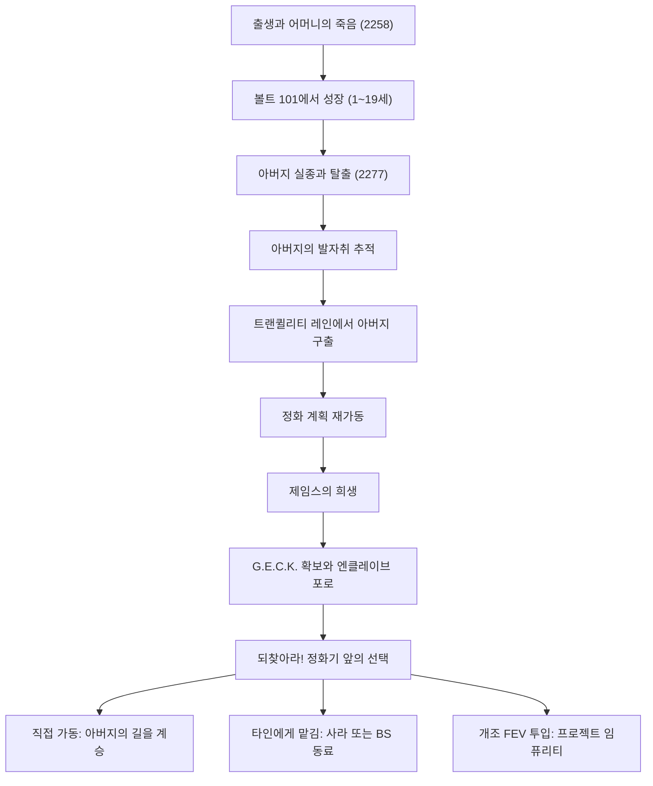
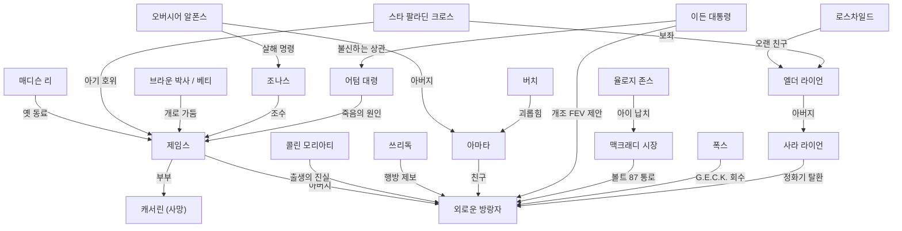
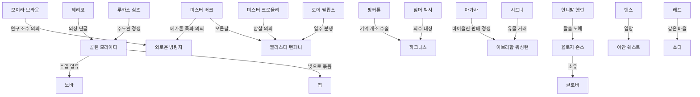
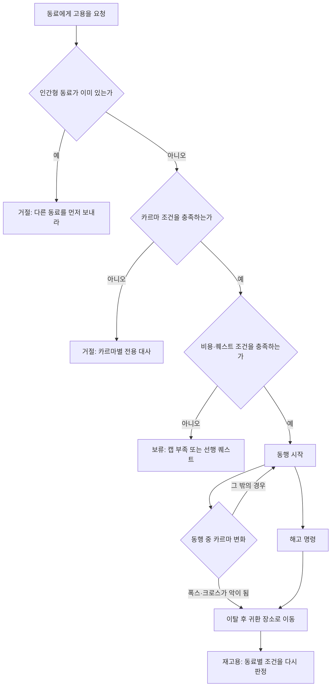
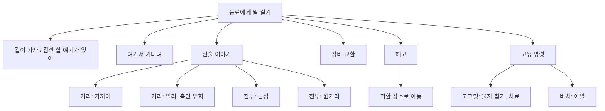

# RD-10. 주요 인물·동료

> **폴아웃 3 역기획서 세트** | 문서 ID: RD-10 | 버전: v1.0 | 작성일: 2026-10-11
> **범위**: 플레이어 캐릭터(외로운 방랑자) 설정, 메인 스토리·핵심 사이드 인물 프로필(성격·배경·역할·말투·성우·생사 조건·관련 퀘스트), 주요 적대 인물, 동료 시스템 전체 규칙, 영구 동료 8명 상세와 비교, DLC 주요 인물 요약표. / **다루지 않는 것**: 이름 있는 NPC 전체 목록과 정착지별 주민(→ RD-11), 퀘스트 진행 상세(→ RD-03~07, RD-08x), 팩션 조직·관계(→ RD-09), 무기·방어구 수치 정본(→ RD-19, RD-20), 퍽·카르마 수치 정본(→ RD-14), 동료 전투 AI 공식(→ RD-16).
> **관련 문서**: [RD-03 메인 스토리 1부](03_main-story-part1.md), [RD-04 메인 스토리 2부·엔딩](04_main-story-part2-endings.md), [RD-05 사이드 퀘스트 1부](05_side-quests-part1.md), [RD-06 사이드 퀘스트 2부](06_side-quests-part2.md), [RD-07 비표시·반복 퀘스트와 랜덤 인카운터](07_misc-quests-encounters.md), [RD-08c DLC: 브로큰 스틸](08c_dlc-broken-steel.md), [RD-09 팩션](09_factions.md), [RD-11 NPC 디렉터리](11_npc-directory.md), [RD-14 캐릭터 시스템](14_character-system.md), [RD-16 전투 시스템](16_combat-system.md), [RD-25 아트·오디오·연출](25_art-audio-presentation.md), [RD-26 용어집](26_glossary.md)

---

## 1. 문서 개요

### 1.1 목적
- 팬게임에서 인물 데이터(대화 이벤트, 초상화, 동료 AI, 생사 플래그)를 만들 때 근거로 쓸 '인물의 깊이'를 정리한다. 성격·동기·말투·성우 톤, 플레이어 선택에 따른 운명, 관련 퀘스트 연결을 한 인물 단위로 묶는다.
- 동료 시스템은 규칙(고용·카르마·명령·사망·레벨·장비)과 동료 8명의 개별 데이터를 모두 담아, 그대로 데이터베이스와 이벤트로 옮길 수 있게 한다.
- 단순 목록(정착지 주민, 상인 목록 등)은 [RD-11 NPC 디렉터리](11_npc-directory.md)가 정본이다. 퀘스트의 진행·분기 상세는 퀘스트 문서가 정본이므로 여기서는 인물 관점의 요약과 링크만 둔다.

### 1.2 요약
- 폴아웃 3 본편의 이름 있는 인물은 319명이다(`Fallout 3 characters` 허브 기준). 이 문서는 그중 서사·시스템 비중이 큰 44명(동료 8명 포함)을 프로필로 다루고, 조연은 요약표로, 나머지는 RD-11로 넘긴다.
- 서사의 축은 '아버지 제임스(James)를 쫓는 자식'이다. 주요 인물은 아버지의 과거(리 박사(Doctor Li), 스타 팔라딘 크로스(Star Paladin Cross), 콜린 모리아티(Colin Moriarty)), 현재(쓰리독(Three Dog), 브라운 박사(Dr. Braun)), 유산(라이언(Lyons) 부녀, 어텀 대령(Colonel Autumn), 이든 대통령(President Eden))을 잇는 징검다리로 배치된다.
- 영구 동료는 8명(인간형 7 + 동물 1)이며 '인간형 1명 + 도그밋(Dogmeat)'이 동시 동행 원칙이다. 플레이어 카르마 3단계(선·중립·악)에 따라 고용할 수 있는 동료가 갈린다.
- 동료는 플레이어 레벨 연동, 기본 무기 무한 탄약, 장비 무손상, 전투 후 완전 회복, 방사능 면역이라는 보정을 받는 대신 필수(essential)가 아니어서 죽으면 되살릴 수 없다.
- [BS]는 동료 레벨 상한을 30으로 올리고, 방사능 면역 동료(폭스(Fawkes)·셰런(Charon)·RL-3 하사(Sergeant RL-3))가 정화기(Purifier)를 대신 가동하는 엔딩 분기와 퍽 퍼피스!(Puppies!)를 추가한다.

### 1.3 표기 메모
- **고유명사 표기 우선순위**: ① 리드의 '한글 패치 용어 우선 적용' 기준(폴아웃 3 한글 패치 본편 대사에서 실제로 쓰인 표기)과 [RD-26 용어집](26_glossary.md) v0.2 → ② 외래어 표기법 음차. 퀘스트명은 용어집 v0.2(패치 지명 반영, 예: 트랜퀼리티 레인(Tranquility Lane), 아가사의 노래(Agatha's Song), 빅타운의 큰 문제(Big Trouble in Big Town))를, 비표시·반복 퀘스트명은 [RD-07](07_misc-quests-encounters.md), [BS] 퀘스트명은 [RD-08c](08c_dlc-broken-steel.md), 퍽 이름은 [RD-14](14_character-system.md), 무기·방어구 이름은 [RD-19](19_weapons-ammo.md)·[RD-20](20_armor-apparel.md)의 표기를 따른다.
- **동음 주의**: '버치'는 버치 들로리아(Butch DeLoria)와 오아시스(Oasis)의 나무의 아버지 버치(Tree Father Birch)가 겹친다. 후자는 항상 '나무의 아버지 버치'로 적는다.
- **프로필 기본 정보표**: 영문명 / 한국어명 / 종족·성별 / 소속 / 위치 / 성우 / 필수(essential) / 서비스 / 카르마·레벨 / 대사 파일. 이어서 외형·성격·말투 키워드, 배경, 역할과 관련 퀘스트, 운명(플레이어 선택), 대사 포인트, 디자인 분석 한 줄 순으로 쓴다.
- **필수(essential)**: 체력이 0이 되어도 죽지 않고 쓰러지기만 하는 인물이다. '조건부'는 특정 퀘스트 구간에만 필수임을 뜻한다.
- **인물 카르마**: 게임 데이터상 인물에게 매겨진 성향(매우 선 / 선 / 중립 / 악 / 매우 악)이다. 플레이어가 그 인물을 죽였을 때의 카르마 변화와 귀·손가락 전리품(퍽 연계)을 정한다. 플레이어 카르마 구간과 칭호는 [RD-14](14_character-system.md)가 정본이다.
- **레벨·체력 표기 `5→20→30`**: 기본값 → 본편 상한(플레이어 레벨 연동, 최대 20) → [BS] 설치 시 상한(30).
- **퀘스트**: 용어집 번역명 + 원제. 비표시(unmarked)·반복 퀘스트는 [RD-07](07_misc-quests-encounters.md), [BS] 퀘스트는 [RD-08c](08c_dlc-broken-steel.md)로 연결한다.
- `(코퍼스 미확인)`: 로컬 위키 코퍼스에서 확인하지 못한 일반 지식이다. 수치는 지어내지 않았다.
- 대사 인용은 영어 원문 1~2문장과 번역을 함께 쓴다. 번역 뒤의 '(패치 번역)'은 한글 패치 번역문을 맞춤법·띄어쓰기까지 그대로 옮긴 것이고, 표시가 없으면 작성자 번역이다(패치에 없는 문장, 패치 번역이 원뜻과 크게 다른 문장). 원문의 거친 말투는 번역에서도 톤을 살렸다(팬게임 연령 등급 판단은 본기획 단계에서 한다).

### 1.4 수록 인물 색인
분류 칸의 소속·장소 원어: 볼트 101(Vault 101), 정화 계획(Project Purity), BoS(Brotherhood of Steel, 브라더후드 오브 스틸), GNR(Galaxy News Radio, 갤럭시 뉴스 라디오), 볼트 112(Vault 112), 리틀 램프라잇(Little Lamplight), 파라다이스폴(Paradise Falls), 엔클레이브(Enclave), 메가톤(Megaton), 텐페니 타워(Tenpenny Tower), 워링턴 역(Warrington station), 리벳시티(Rivet City), 언더월드(Underworld), 오아시스, 아가사의 집(Agatha's house), 템플 오브 유니온(Temple of the Union), 패밀리(The Family), 빅타운. 직함: 오버시어(Overseer), 엘더(Elder), 서기(Scribe).

| No | 한국어명 | 영문명 | 분류 | 절 |
|---|---|---|---|---|
| 0 | 외로운 방랑자 | Lone Wanderer | 플레이어 캐릭터 | §2 |
| 1 | 제임스 | James | 메인 · 볼트 101 | §4.1.1 |
| 2 | 캐서린 | Catherine | 메인 · 볼트 101 | §4.1.2 |
| 3 | 아마타 알모도바르 | Amata Almodovar | 메인 · 볼트 101 | §4.1.3 |
| 4 | 알폰스 알모도바르 (오버시어) | Alphonse Almodovar (Overseer) | 메인 · 볼트 101 / 적대 | §4.1.4 |
| 5 | 조나스 파머 | Jonas Palmer | 메인 · 볼트 101 | §4.1.5 |
| 6 | 매디슨 리 (리 박사) | Madison Li (Doctor Li) | 메인 · 정화 계획 | §4.2.1 |
| 7 | 오윈 라이언 (엘더 라이언) | Owyn Lyons (Elder Lyons) | 메인 · BoS | §4.2.2 |
| 8 | 사라 라이언 | Sarah Lyons | 메인 · BoS / 임시 동료 | §4.2.3 |
| 9 | 레지널드 로스차일드 (로스차일드 서기) | Reginald Rothchild (Scribe Rothchild) | 메인 · BoS | §4.2.4 |
| 10 | 쓰리독 | Three Dog | 메인 · GNR | §4.3.1 |
| 11 | 스타니슬라우스 브라운 박사 | Stanislaus Braun | 메인 · 볼트 112 / 적대 | §4.4.1 |
| 12 | 로버트 맥크래디 (맥크래디 시장) | Robert MacCready (Mayor MacCready) | 메인 · 리틀 램프라잇 | §4.5.1 |
| 13 | 율로지 존스 | Eulogy Jones | 메인 · 파라다이스폴 / 적대 | §4.5.2 |
| 14 | 오거스터스 어텀 (어텀 대령) | Augustus Autumn (Colonel Autumn) | 메인 · 엔클레이브 / 최종 적대 | §4.6.1 |
| 15 | 존 헨리 이든 (이든 대통령) | John Henry Eden (President Eden) | 메인 · 엔클레이브 / 최종 적대 | §4.6.2 |
| 16 | 루카스 심즈 | Lucas Simms | 사이드 · 메가톤 | §5.1.1 |
| 17 | 모이라 브라운 | Moira Brown | 사이드 · 메가톤 / 상인 | §5.1.2 |
| 18 | 미스터 버크 | Mister Burke | 사이드 · 메가톤 / 적대 | §5.1.3 |
| 19 | 콜린 모리아티 | Colin Moriarty | 사이드 · 메가톤 | §5.1.4 |
| 20 | 괍 | Gob | 사이드 · 메가톤 / 상인 | §5.1.5 |
| 21 | 노바 | Nova | 사이드 · 메가톤 | §5.1.6 |
| 22 | 앨리스터 텐페니 | Allistair Tenpenny | 사이드 · 텐페니 타워 / 적대 | §5.2.1 |
| 23 | 로이 필립스 | Roy Phillips | 사이드 · 워링턴 역 | §5.2.2 |
| 24 | 하크니스 | Harkness | 사이드 · 리벳시티 | §5.3.1 |
| 25 | 짐머 박사 | Dr. Zimmer | 사이드 · 리벳시티 / 적대 | §5.3.2 |
| 26 | 호러스 핑커톤 | Horace Pinkerton | 사이드 · 리벳시티 | §5.3.3 |
| 27 | 아브라함 워싱턴 | Abraham Washington | 사이드 · 리벳시티 | §5.3.4 |
| 28 | 미스터 크로울리 | Mister Crowley | 사이드 · 언더월드 | §5.4.1 |
| 29 | 시드니 | Sydney | 사이드 · 임시 동료 | §5.4.2 |
| 30 | 헤럴드 | Harold | 사이드 · 오아시스 | §5.4.3 |
| 31 | 아가사 | Agatha | 사이드 · 아가사의 집 | §5.4.4 |
| 32 | 한니발 햄린 | Hannibal Hamlin | 사이드 · 템플 오브 유니온 | §5.4.5 |
| 33 | 밴스 | Vance | 사이드 · 패밀리 | §5.5.1 |
| 34 | 이안 웨스트 | Ian West | 사이드 · 패밀리 | §5.5.2 |
| 35 | 레드 | Red | 사이드 · 빅타운 / 의사 | §5.6.1 |
| 36 | 쇼티 | Shorty | 사이드 · 빅타운 | §5.6.2 |
| 37 | 도그밋 | Dogmeat | 영구 동료 | §7.1 |
| 38 | 폭스 | Fawkes | 영구 동료 · 메인 | §7.2 |
| 39 | 셰런 | Charon | 영구 동료 | §7.3 |
| 40 | 제리코 | Jericho | 영구 동료 | §7.4 |
| 41 | 클로버 | Clover | 영구 동료 | §7.5 |
| 42 | RL-3 하사 | Sergeant RL-3 | 영구 동료 | §7.6 |
| 43 | 스타 팔라딘 크로스 | Star Paladin Cross | 영구 동료 · 메인 | §7.7 |
| 44 | 버치 들로리아 | Butch DeLoria | 영구 동료 · 메인 · 볼트 101 | §7.8 |

- 조연 요약표: 볼트 101 조연(§4.1.6), 연관 조연(§5.7), DLC 주요 인물(§9).

---

## 2. 플레이어 캐릭터: 외로운 방랑자(Lone Wanderer)

### 2.1 기본 설정

| 항목 | 내용 |
|---|---|
| 영문명 / 한국어명 | Lone Wanderer / 외로운 방랑자 |
| 종족 | 인간 |
| 성별·이름 | 플레이어가 출생 장면에서 직접 고른다(성별 선택 → 이름 입력) |
| 출생 | 2258년 7월 13일, 제퍼슨 기념관(Jefferson Memorial)의 정화 계획(Project Purity) 시설. 리 박사가 출산을 도왔다 |
| 부모 | 아버지 제임스(볼트 101 의사, 정화 계획 책임자), 어머니 캐서린(과학자, 출산 직후 심정지로 사망) |
| 성장지 | 볼트 101(Vault 101). 아기 때 아버지와 함께 들어왔지만 '볼트에서 태어났다'는 거짓 설정 속에서 자란다. 진실은 메가톤(Megaton)의 콜린 모리아티(Colin Moriarty)가 알려 준다 |
| 나이 | 1세 → 10세 → 16세 → 19세 이상(성장 단계별 퀘스트는 §2.2) |
| 소속 | 볼트 101, 정화 계획, 라이언의 브라더후드 오브 스틸(BoS). 선택 소속: 터널스네이크(Tunnel Snakes), 노예 해방론자(Abolitionists), 아웃캐스트(Brotherhood Outcasts), 리틀혼 앤드 어소시에이츠(Littlehorn & Associates), 노예 사냥꾼(Slavers), 감시자(Regulators), 라일리 레인저(Reilly's Rangers), 스플릿 잭 일당(Split Jack's bandits)[BS], 피트 레이더·피트 노예[TP], 포인트 룩아웃 부족민[PL] |
| 계급 | [BS] 엘더 라이언(Elder Lyons)이 브라더후드 나이트(Knight)로 서임한다 |
| 별명 | 볼트 101에서 온 그 꼬마·101(쓰리독), 메카노 래드/래스(Mechano-Lad/Lass, 기계박사(Mechanist)), 퀵드로(Quickdraw, [TP] 피트 레이더) |
| 음성 | 대사 음성이 없는 무성 주인공. 아기·아이 시절의 소리만 녹음됨: 아기 제이크 하워드(Jake Howard), 남자 아이 숀 매코이(Sean McCoy), 여자 아이 스테파니 조이(Stephanie Joy) |
| 데이터 | EDID `Player`, 폼 ID `000007`, 레퍼런스 ID `000014` |
| 생사 | [BS] 미설치 시 '되찾아라!(Take It Back!)'에서 직접 정화기를 가동하면 사망하고 게임이 끝난다. [BS] 설치 시 2주 혼수 후 깨어나 계속 플레이한다 |

### 2.2 성장 단계와 프롤로그
프롤로그 4개 퀘스트가 '성장 앨범'처럼 이어지며 캐릭터 생성을 서사 속에 녹인다. 상세 진행은 [RD-03](03_main-story-part1.md), 수치 규칙은 [RD-14](14_character-system.md)가 정본이다.

| 나이 | 시점 | 퀘스트 | 서사 이벤트 | 결정되는 시스템 |
|---|---|---|---|---|
| 0세 | 2258.7.13 | 첫걸음(Baby Steps) 도입부(출생 장면) | 캐서린이 출산 직후 사망 | 성별, 이름, 외모('유전자 예측' 화면) |
| 1세 | 2259 | 첫걸음 | 아기 울타리 탈출, 아버지가 요한계시록 21장 6절을 읽어 줌 | S.P.E.C.I.A.L.(그림책 '너는 스페셜해!') |
| 10세 | 2268.7.13 | 빨리 크는 아이(Growing Up Fast) | 생일 파티, 오버시어(Overseer)가 핍-보이(Pip-Boy) 3000 지급, 버치의 스위트롤 시비, 아버지와 조나스의 BB건 선물, 방사능바퀴(radroach) 사냥 | 대화 반응과 선악 선택 첫 체험 |
| 16세 | 2274.8.3 | 불완전한 미래(Future Imperfect) | G.O.A.T. 시험, 터널스네이크의 아마타 괴롭힘 | 태그 스킬 3개(각 +15) |
| 19세 | 2277 | 탈출!(Escape!) | 아버지 실종, 조나스 사망, 경비대 추격, 아마타의 도움 | 볼트를 나서기 전 마지막 수정 기회(코퍼스 미확인) |

- 10세에서 16세 사이에 볼트 야구 경기에서 4연속 삼진을 잡았다는 설정이 있다(조나스의 대사).
- 아버지의 얼굴은 플레이어가 만든 얼굴을 따라간다. 출생 장면 스크립트가 제임스 4종(성장 단계별 3종 + 메인 퀘스트용 1종)의 인종을 플레이어와 일치시키고(`MatchRace`), 전역 변수 `CGMatchFace`(기본 50)만큼 얼굴 형태를 섞는다(`MatchFaceGeometry`). 단순 복제를 피하면서 '닮은 부자/부녀'를 시각화한 장치다.

### 2.3 커스터마이즈와 '무성 주인공' 설계
- **성별**: 호칭(son/daughter, sweetheart), 일부 퍽 대화(레이디 킬러(Lady Killer)·블랙 위도(Black Widow)), 동료의 반응(버치는 여성 주인공에게 추근대고, 클로버는 누구에게나 'lover'라 부른다), 엔딩 슬라이드(남·여 별도)가 달라진다.
- **복장 반응**: 루카스 심즈(Lucas Simms)·노바(Nova)·제리코(Jericho) 등은 볼트 101 점프슈트를 입은 채 처음 만나면 전용 인사를 한다. 무성 주인공 대신 '세계가 주인공을 읽어 주는' 구조다.
- **무성 주인공**: 선택지는 텍스트만 있다. 개성은 ① 선택지의 어조(진지·농담·위협), ② 카르마에 따른 NPC·라디오 반응, ③ 동료의 평가 대사로 드러난다.
- 개발 초기 미리보기에서는 이름이 '앨버트(Albert)'였다. 폴아웃 1 주인공 프리셋 앨버트 콜(Albert Cole)의 오마주다.

### 2.4 아버지와의 관계
게임 전체가 '아버지를 따라가다 아버지를 넘어서는' 구조다.

| 단계 | 관련 퀘스트 | 제임스의 상태 | 플레이어 경험 설계 |
|---|---|---|---|
| 보호 | 첫걸음 ~ 불완전한 미래 | 볼트 의사로 자식을 키움 | 따뜻한 일상, 튜토리얼 |
| 상실 | 탈출! | 말없이 볼트를 떠남. 조력자 조나스는 살해됨 | 배신감과 추격 |
| 추적 | 아버지의 발자취(Following in His Footsteps), 갤럭시 뉴스 라디오(Galaxy News Radio), 과학적 탐구(Scientific Pursuits) | 메가톤 → GNR → 리벳시티 → 제퍼슨 기념관 → 볼트 112로 흔적을 남김 | 아버지의 과거를 남의 입으로 알게 됨 |
| 재회 | 트랜퀼리티 레인(Tranquility Lane) | 시뮬레이션 속 개 '닥(Doc)'으로 갇힘 | 역할 역전: 자식이 아버지를 구함 |
| 협력 | 생명의 물(The Waters of Life) | 리 박사와 정화 계획을 재가동 | 짧은 '가족 프로젝트' |
| 이별 | 생명의 물 | 어텀 대령에게 넘기지 않으려 제어실에 방사능을 풀고 사망, 마지막 말로 자식에게 도망치라고 함 | 상실과 복수 동기 |
| 계승 | 되찾아라!, 프로젝트 임퓨리티(Project Impurity) | 부재 | 아버지처럼 희생할지, 남에게 맡길지, 이든의 독(개조 FEV)을 넣을지 선택 |

- **반복 모티프**: 캐서린이 좋아한 요한계시록 21장 6절("내가 생명수 샘물로 목마른 자에게 마음껏 주리니", 패치 번역)이 아기 시절 낭독 → 정화 계획의 이념 → 정화기 코드 `2-1-6`으로 이어진다.
- **아버지의 평가**: 제임스는 재회 뒤 '원자의 힘(The Power of the Atom)' 결과(메가톤 폭탄 해체·폭파)나 플레이어 카르마를 직접 언급한다. 폭파를 인정하면 실망하고, 거짓말은 카르마가 매우 높아야 믿는다.
- **엔딩의 판정**: 엔딩 내레이션은 마지막 선택을 아버지의 희생과 직접 비교한다. 직접 들어가면 '아버지의 본보기를 따라 생명을 바쳤다'(영상 9), 사라 라이언이나 [BS]의 방사능 면역 동료를 들여보내면 '아버지의 이타적인 모범을 따르지 않고 진정한 영웅을 대신 들여보냈다'(영상 10, 27~29)고 말한다(→ §6.12, [RD-04](04_main-story-part2-endings.md)).

### 2.5 세계의 반응과 평판
- **쓰리독(Three Dog)의 방송**: 주요 행적을 GNR 뉴스로 전하고 주인공을 카르마 칭호나 '101'로 부른다. 선행 뒤에는 "Nice goin' kid!", 악행 뒤에는 "Not cool kid. Not cool at all"로 논평한다.
- **암살대**: 카르마가 극단으로 치우치면 탈론 컴퍼니(Talon Company) 또는 감시자가 습격한다(→ [RD-09](09_factions.md), [RD-14](14_character-system.md)).
- **동료 고용 가능성**: 카르마 구간이 동료 풀을 결정한다(→ §6.3).

### 2.6 엔딩에서의 외로운 방랑자 (요약)
엔딩 시스템 정본은 [RD-04](04_main-story-part2-endings.md)다. 인물 관점의 구성 요소만 정리한다.

| 엔딩 영상 조각 | 조건 | 내용 |
|---|---|---|
| 15 / 16 | 남성 / 여성 | 마무리 내레이션("war never changes"). 도그밋은 만난 적이 없어도 동료로 등장한다 |
| 17 / 18 | 선 / 악 카르마 | 아버지에게 물려받은 가치를 지켰는지, 악덕에 굴복했는지 |
| 19~26 | 인종 4 × 성별 2 | 주인공 사진 8종 |
| 27~29 [BS] | RL-3 / 셰런 / 폭스를 제어실에 보냄 | 동료를 '진정한 영웅'으로 묘사 |

### 2.7 설계 분석
- 출생부터 19세까지를 직접 플레이시키며 튜토리얼과 캐릭터 생성을 서사에 녹였다. 무성·백지 주인공이지만 '제임스의 자식'이라는 고정 관계 덕분에 메인 동기(아버지 찾기)가 흔들리지 않는다.
- 아버지의 얼굴을 플레이어 얼굴에서 파생시키는 기술적 장치로 혈연을 시각화했다.
- 약점: 동기가 급박한 '실종 아버지 찾기'라서, 사이드 퀘스트를 오래 하면 서사 긴박감과 자유 탐험이 부딪힌다. 무성 주인공이라 감정 표현은 NPC 반응에 크게 의존한다.

---

## 3. 인물 관계도

### 3.1 메인 스토리 인물망

### 3.2 사이드 인물망 (주요 갈등 축)

| 군집 | 주요 인물 | 관통 주제 |
|---|---|---|
| 볼트 101 | 제임스, 아마타, 오버시어, 버치, 조나스 | 고립과 통제, 떠남과 남음 |
| 정화 계획·BoS | 리 박사, 라이언 부녀, 로스차일드, 크로스 | 기술과 이상, 명령과 양심 |
| 엔클레이브 | 어텀 대령, 이든 대통령 | '미국' 정통성의 사칭, 순혈주의 |
| 메가톤·텐페니 타워 | 심즈, 모리아티, 버크, 텐페니, 로이 | 공동체 대 탐욕, 혐오와 복수 |
| 리벳시티 | 하크니스, 짐머, 핑커톤, 워싱턴 | 정체성, 기억, 역사 보존 |
| 변두리의 외톨이 | 크로울리, 시드니, 헤럴드, 아가사, 한니발 | 상처 입은 개인의 소원 |
| 소수 공동체 | 밴스·이안(패밀리), 레드·쇼티(빅타운), 맥크래디(리틀 램프라잇) | 버려진 자들의 자치 |

---

## 4. 메인 스토리 인물

> 버치 들로리아(§7.8), 폭스(§7.2), 스타 팔라딘 크로스(§7.7)는 동료 절에서 상세히 다룬다.

### 4.1 볼트 101

#### 4.1.1 제임스(James)

| 항목 | 내용 |
|---|---|
| 영문명 / 한국어명 | James("Dad") / 제임스 |
| 종족·성별 | 인간·남 (트랜퀼리티 레인(Tranquility Lane) 시뮬레이션 안에서는 개 '닥(Doc)') |
| 소속 | 정화 계획, 볼트 101 |
| 위치 | 볼트 101 진료소 → 볼트 112 → 리벳시티(Rivet City) → 제퍼슨 기념관 |
| 성우 | 리엄 니슨(Liam Neeson) |
| 필수(essential) | 항상 (사망은 스크립트 연출로만 일어난다) |
| 서비스 | 없음. 이동 중에는 '호위(escort)' AI로 함께 싸운다 |
| 카르마·레벨 | 선 · 1→20→30[BS] |
| 대사 파일 | CG01Dad.txt~CG03Dad.txt(유년기), MQDad.txt(본편), MQ04Doc.txt(개) |

- **외형·성격·말투**: 수염 난 중년 의사. 탐구심 강하고 꼼꼼하며 고집이 세다. 다정하지만 결단의 순간에는 냉정하다. 차분한 저음, 가벼운 유머, 성경 인용. 스카치위스키를 즐긴다(연구 일지, 기념관 숙소의 빈 병).
- **배경**: 캐서린·리 박사와 정화 계획을 이끌던 과학자다. 2258년 아내가 출산 직후 숨지고 슈퍼 뮤턴트 습격이 잦아지자 연구를 접고 아기와 함께 볼트 101로 들어갔다(스타 팔라딘 크로스가 메가톤까지 호위). 볼트 의사로 일하며 밤마다 오버시어 단말기를 해킹해 브라운 박사와 G.E.C.K.(에덴동산 창조 키트) 단서를 찾았고, 2277년 조수 조나스의 도움으로 볼트를 떠났다.
- **역할·관련 퀘스트**: 첫걸음, 빨리 크는 아이, 불완전한 미래, 탈출!, 아버지의 발자취, 트랜퀼리티 레인, 과학적 탐구([RD-03](03_main-story-part1.md)), 생명의 물(시작 인물, [RD-04](04_main-story-part2-endings.md)).
- **운명**: 고정이다. 생명의 물에서 어텀 대령이 과학자 재니스 캐플린스키(Janice Kaplinski)를 쏘자 정화기 제어실을 봉쇄하고 방사능을 풀어 병사들과 함께 죽는다. 어텀만 살아남는다. 재회 후에는 '원자의 힘' 결과와 플레이어 카르마에 대해 평가 대사를 한다(§2.4).
- **기타**: 영구 동료처럼 스크립트되어 일반 무기의 탄약을 실제로 소비한다. 다만 AI 패키지가 '추종'이 아닌 '호위'라서 자기 경로로 이동하며 적을 공격한다.
- **대사 포인트**
  - "It's you and me, now, okay? You and me." — "이제 너랑 나, 둘뿐이야. 알겠지?"
  - "I will give unto him that is athirst of the fountain of the water of life freely." — "내가 생명수 샘물로 목마른 자에게 마음껏 주리니."(요한계시록 21:6, 패치 번역)
- **디자인 분석**: 성우와 외형 모두 리엄 니슨을 염두에 두고 만든, 게임 전체의 정서적 톤을 맡은 인물이다. 초기 각본에서는 볼트 87(Vault 87)에서 슈퍼 뮤턴트로 변해 가며 자식에게 죽여 달라고 부탁하는 결말이었지만, 진부하다는 판단으로 '함께 일하다 희생하는' 결말로 바뀌었다(공식 가이드의 에밀 파글리아룰로(Emil Pagliarulo) 회고).

#### 4.1.2 캐서린(Catherine)

| 항목 | 내용 |
|---|---|
| 영문명 / 한국어명 | Catherine / 캐서린 |
| 종족·성별 | 인간·여 |
| 소속 | 정화 계획 |
| 위치 | 제퍼슨 기념관(출생 장면에만 등장) |
| 성우 | 캐런 카본(Karen Carbone) |
| 필수(essential) | 해당 없음 (등장 직후 사망 연출) |
| 서비스 | 없음 |
| 카르마·레벨 | 선 · 1 |
| 대사 파일 | CG00Mom.txt |

- **외형·성격·말투**: 화면에는 다리와 목소리만 나온다. 삶과 사랑에 열정적이고 신앙심이 깊다. 출산 직후의 지친 웃음과 다정한 말투.
- **배경**: 정화 계획 과학자로 제임스와 결혼했다. 임신 중에도 연구를 고집했다. 2258년 7월 13일 출산 직후 심정지로 숨졌다. 기념관 의료 장비가 낡은 고물이어서 살릴 방법이 없었다.
- **역할·관련 퀘스트**: 첫걸음 프롤로그. 그녀가 좋아한 요한계시록 21장 6절이 정화 계획의 이념이자 정화기 코드(2-1-6)의 기원이다. 기념관 지하에서 제임스가 그녀에게 작업을 거는 홀로테이프 '좋았던 시절(Better Days)'을 찾을 수 있다.
- **운명**: 고정(사망). [PL] 환각 장면에서 'Mom'이라 적힌 해골로 다시 등장한다.
- **대사 포인트**
  - "James? James... Something's..." — "제임스? 제임스.. 뭔가.. 뭔가 이상..."(패치 번역)
  - (제임스의 회상) "But most of all, she was passionate about you." — "하지만 무엇보다도, 그녀는 너를 열렬히 사랑했단다."
- **디자인 분석**: '부재하는 어머니'다. 노출을 최소화하고 플레이어의 상상으로 채우게 해, 제임스의 동기와 정화기 서사를 떠받치는 상징으로만 기능한다.

#### 4.1.3 아마타 알모도바르(Amata Almodovar)

| 항목 | 내용 |
|---|---|
| 영문명 / 한국어명 | Amata Almodovar / 아마타 알모도바르 |
| 종족·성별 | 인간·여 (주인공과 동갑) |
| 소속 | 볼트 101 |
| 위치 | 볼트 101 / 랜덤 인카운터(볼트 원자로 파괴 시) |
| 성우 | 스테파니 조이(아동기), 오데트 애너블(Odette Annable, 청소년·성인), 섀리 엘리커(Shari Elliker, 볼트 106 환각) |
| 필수(essential) | 조건부: 고향의 위기(Trouble on the Homefront) 전까지. 탈출!에서는 맞아도 쓰러지기만 하는 무적 처리 |
| 서비스 | 없음 |
| 카르마·레벨 | 매우 선(본편에서 '매우 선'은 아마타, 오윈 라이언, 사라 라이언 3명뿐) · 1 (탈출! 중 2) |
| 대사 파일 | CG02Amata.txt, CG03Amata.txt, CG04Amata.txt, Amata.txt |

- **외형·성격·말투**: 오버시어의 외동딸이자 주인공의 단짝. 독립심과 책임감이 강하고, 아버지의 권력에 기대지 않으려 한다. 터널스네이크에게 체형 조롱을 당한다. 똑 부러지고 직설적인 말투.
- **배경**: 두 살 때 어머니를 잃고 아버지 손에서 자랐다. 주인공의 10세 생일 파티를 직접 준비해 '야만인 그로그낙(Grognak the Barbarian)' 14호를 선물했다. G.O.A.T. 결과 오버시어 후계 진로를 받았다. 탈출 날 아버지의 10mm 권총을 훔쳐 주인공을 깨우고 탈출로를 알려 줬다가 붙잡혀, 아버지가 지켜보는 가운데 맥 경관에게 고문당한다. 주인공이 떠난 뒤 교사 에드윈 브로치와 함께 볼트 개방파를 이끌고 조난 신호를 보낸다.
- **역할·관련 퀘스트**: 빨리 크는 아이, 불완전한 미래, 탈출!(시작 인물), 고향의 위기(시작 인물, [RD-06](06_side-quests-part2.md)).
- **운명**
  - 탈출!: 권총을 아마타에게 맡기면 그녀가 맥 경관을 쏘고 달아난다. 주인공이 오버시어를 죽이면 주인공을 원망한다.
  - 고향의 위기: 평화적으로 풀면 오버시어가 물러나며 아마타를 후임으로 지명한다. 오버시어를 죽이고 설득하면 "You're a hero... and you have to leave."(폴아웃 1 볼트 13 오버시어 대사의 오마주)라고 한다. 원자로를 파괴하고 사실을 말하면 적대한다.
  - 원자로 파괴 후 랜덤 인카운터: 볼트 위치를 묻는 엔클레이브 장교에게 핍-보이 정보를 말하다 사살된다. 개입하면 살지만 주인공 탓을 하며 떠난다.
- **대사 포인트**
  - "So I'm the Overseer's daughter? So what? Like I get any kind of special treatment!" — "그래, 오버시어 딸이야. 그래서? 내가 무슨 특별 대우라도 받는 줄 알아?"
- **디자인 분석**: 주인공이 '두고 온 고향'을 의인화했다. 프롤로그 내내 친밀감을 쌓게 해 탈출과 귀환의 감정 무게를 만든다. 크리스 아벨론(Chris Avellone)은 처음부터 아마타를 죽일 수 없게 한 점을 비판했다.

#### 4.1.4 알폰스 알모도바르 — 오버시어(Alphonse Almodovar, The Overseer)

| 항목 | 내용 |
|---|---|
| 영문명 / 한국어명 | Alphonse Almodovar / 알폰스 알모도바르 (오버시어) |
| 종족·성별 | 인간·남 |
| 소속 | 볼트 101 오버시어 |
| 위치 | 볼트 101 오버시어 사무실 |
| 성우 | 덩컨 후드(Duncan Hood) |
| 필수(essential) | 조건부: 빨리 크는 아이 동안만. 탈출!부터 죽일 수 있다 |
| 서비스 | 없음 (빨리 크는 아이에서 핍-보이 3000을 준다) |
| 카르마·레벨 | 악 (빨리 크는 아이 때는 중립) · 5 (탈출! 4) |
| 대사 파일 | CG02Overseer.txt, CG04Overseer.txt, Overseer.txt |

- **외형·성격·말투**: 권위적이고 편집증적인 고립주의자. 개인숭배를 만들고 딸에 대한 사랑을 통제로 드러낸다. 길고 논리적인 관료 화법.
- **배경**: 볼트가 바깥과 교역하던 시대에 태어났지만 고립주의 부모의 영향을 받았다. 전임 오버시어가 바깥 임무 중 실종되자 권력을 잡아 볼트를 봉쇄하고, 어른들에게 '볼트는 한 번도 열린 적 없다'는 비밀 서약을 시켰다. 제임스를 의사로 받아들인 것은 그의 몇 안 되는 좋은 결정이었다. G.O.A.T. 마지막 문항을 자신에 대한 충성 서약으로 바꿨고, 터널스네이크를 비공식 하수인으로 묵인했다. 제임스가 탈출하자 경비대에 발포를 허가하고 조나스 살해를 명령했으며 딸을 고문하게 했다.
- **역할·관련 퀘스트**: 빨리 크는 아이(핍-보이 지급), 탈출!(적대), 고향의 위기(적대 → 설득 가능).
- **운명**
  - 탈출!에서 죽이면, 고향의 위기에서 경비원 앨런 맥(Allen Mack)이 더 강경한 오버시어가 되고 설득이 불가능해진다.
  - 살아 있으면 고향의 위기에서 설득해 은퇴시키고 아마타에게 자리를 넘기게 할 수 있다. 볼트를 망가뜨리고 반란파 짓이라고 속이면 볼트와 함께 죽기로 한다.
  - 그의 단말기에서 엔클레이브의 볼트 진입 요청을 거절한 기록을 볼 수 있다.
- **대사 포인트**
  - "I place the good of the Vault above everything, even my own paternal feelings." — "나는 볼트의 안녕을 무엇보다 앞에 둔다. 아버지로서의 감정조차도."
- **디자인 분석**: 첫 '인간 악역'이지만 공동체 보존이라는 동기 덕에 설득과 용서가 가능한 회색 인물이다. 그를 죽이면 더 나쁜 후임이 등장하는 구조로 '쉬운 복수'의 대가를 보여 준다.

#### 4.1.5 조나스 파머(Jonas Palmer)

| 항목 | 내용 |
|---|---|
| 영문명 / 한국어명 | Jonas Palmer / 조나스 파머 |
| 종족·성별 | 인간·남 |
| 소속 | 볼트 101 의료 기술자(제임스의 조수) |
| 위치 | 볼트 101 진료소 |
| 성우 | 그레고리 고턴(Gregory Gorton) |
| 필수(essential) | 조건부: 탈출! 전까지 |
| 서비스 | 없음 |
| 카르마 | 선 |
| 대사 파일 | CG02Jonas.txt, CG03Jonas.txt, CG04Jonas.txt |

- **외형·성격·말투**: 안경 쓴 쾌활한 청년. 농담을 좋아하고 다정하다. 엄할 때도 유머가 묻어난다. 주인공을 'sport'라 부른다.
- **배경**: 2260년대 후반 오버시어가 '이성의 목소리'가 되어 주기를 기대하며 제임스의 조수로 배치했다. 2274년 무렵부터 제임스의 비밀 연구(정화 계획)를 알고 자진해서 도왔다. 제임스의 탈출을 도운 대가로 살해된다.
- **역할·관련 퀘스트**: 빨리 크는 아이(BB건 선물, 부자/부녀 사진 촬영), 불완전한 미래(아침 인사), 탈출!(시신으로 발견, 홀로테이프 '아버지의 쪽지(Note from dad)'를 남김).
- **운명**: 고정(탈출! 시작 시점에 사망). 고향의 위기에서 오버시어가 살해 명령을 인정한다. 위키 문서끼리 실행자 기술이 엇갈린다(조나스 문서: 맥 경관, 오버시어 문서: 해넌(Hannon) 경비대장에게 지시하고 맥 경관이 실행).
- **대사 포인트**
  - "That was amazing, sport! Four strike outs in a row!" — "대단했어, 꼬마! 4연속 삼진이라니!"
- **디자인 분석**: 짧은 등장으로 호감을 쌓은 뒤 첫 '가까운 사람의 죽음'을 맡는다. 볼트의 폭력성을 각인시키는 희생양이다.

#### 4.1.6 볼트 101 조연 요약표
상세 목록은 [RD-11](11_npc-directory.md)을 본다.

| 한국어명 | 영문명 | 역할 | 주요 접점 | 비고 |
|---|---|---|---|---|
| 엘런 들로리아 | Ellen DeLoria | 버치의 어머니, 알코올 중독자 | 탈출!에서 방사능바퀴에게 습격당함 | 구하든 말든 버치의 터널스네이크 복장을 받는다 |
| 스탠리 암스트롱 | Stanley Armstrong | 정비 기술자 | 빨리 크는 아이, 고향의 위기 | 조건부 필수, 성우 제프 베이커(Jeff Baker) |
| 에드윈 브로치 | Edwin Brotch | 교사(G.O.A.T. 감독) | 불완전한 미래, 고향의 위기 개방파 지도자 | 불완전한 미래 동안만 필수 |
| 앤디 | Andy | 미스터 핸디 정비 로봇 | 빨리 크는 아이(케이크), 탈출! | 고향의 위기 전까지 필수 |
| 앨런 맥 | Allen Mack | 경비원(맥 경관) | 탈출!에서 아마타 고문 | 오버시어가 죽으면 후임 오버시어 |
| 월리 맥, 폴 해넌 주니어 | Wally Mack, Paul Hannon Jr. | 터널스네이크 단원 | 빨리 크는 아이, 불완전한 미래 | 버치는 §7.8 |
| 루시 파머 | Lucy Palmer | 조나스의 할머니 | 생일 선물 스위트롤 | 버치가 빼앗으려 한다 |

### 4.2 정화 계획과 브라더후드 오브 스틸

#### 4.2.1 매디슨 리 — 리 박사(Madison Li)

| 항목 | 내용 |
|---|---|
| 영문명 / 한국어명 | Madison Li(Doctor Li) / 매디슨 리 (리 박사) |
| 종족·성별 | 인간·여 (2229년경 출생) |
| 소속 | 정화 계획, 리벳시티 의회 → 라이언의 BoS (설정상 이후 [FO4] 인스티튜트) |
| 위치 | 리벳시티 과학 연구실 → 제퍼슨 기념관 → 시타델(Citadel) |
| 성우 | 제니퍼 매시(Jennifer Massey) |
| 필수(essential) | 예 |
| 서비스 | 임시 동료(생명의 물 탈출 구간). 화술 판정 성공 시 스팀팩 5개 |
| 카르마·레벨 | 선 · 1 |
| 대사 파일 | DoctorLi.txt |

- **외형·성격·말투**: 연구복 차림의 냉철한 과학자. 자존심 세고 실용적이며 감정을 숨긴다. 제임스를 남몰래 사랑했지만 캐서린 때문에 묻어 두었다. BoS의 동기를 불신한다. 날카롭고 직설적이며 흥분하면 욕을 한다.
- **배경**: 젊은 이상주의 과학자로 정화 계획에 합류해 주인공의 출산을 도왔다. 제임스가 떠나자 배신감을 품고 2259년경 리벳시티로 갔다. 호러스 핑커톤과 갈등 끝에 그의 의회 자리를 이어받아 수경 재배, 정수, 휴대용 핵융합을 연구했다. 인스티튜트에서 온 짐머 박사의 협조 요청은 무시했다.
- **역할·관련 퀘스트**: 과학적 탐구(제퍼슨 기념관 안내, [RD-03](03_main-story-part1.md)), 생명의 물(남은 과학자를 이끌고 시타델로 피신, 임시 동료), 되찾아라!(정화기 손상 상황을 인터컴으로 알림, [RD-04](04_main-story-part2-endings.md)). 로스차일드와 리버티 프라임(Liberty Prime)의 동력 문제를 해결한다.
- **운명**: 필수라 죽지 않는다. 쓰리독이 '갤럭시 뉴스 라디오' 완료 전에 죽으면 리 박사가 메인 진행을 이어 준다. 시타델 피신 뒤에는 '에덴동산을 찾아서(Finding the Garden of Eden)'가 시작될 때까지 대화를 거부한다. 설정상 BoS의 연구 무기화와 감시를 피해 커먼웰스(Commonwealth)로 떠나 인스티튜트(Institute)에 합류한다.
- **대사 포인트**
  - "Damn you, James. When this is all over, you owe me a drink." — "망할, 제임스. 일이 다 끝나면 한잔 사라고."(패치 번역)
  - "My heavens, you look so much like him..." — "세상에, 제임스를 정말 많이도 닮았어..."(패치 번역)
- **디자인 분석**: 아버지의 과거를 증언하는 첫 핵심 조력자이자, 사랑·원망·존경이 뒤섞인 복잡한 동료 과학자다. 필수 처리로 메인 진행의 안정성을 확보했다.

#### 4.2.2 오윈 라이언 — 엘더 라이언(Owyn Lyons, Elder Lyons)

| 항목 | 내용 |
|---|---|
| 영문명 / 한국어명 | Owyn Lyons(Elder Lyons) / 오윈 라이언 (엘더 라이언) |
| 종족·성별 | 인간·남 (노년) |
| 소속 | 라이언의 BoS 엘더 |
| 위치 | 시타델 연구실, A링, B링 |
| 성우 | 윌리엄 배싯(William Bassett) |
| 필수(essential) | 예 ([BS] '도전하는 자가 승리한다(Who Dares Wins)'에서 시타델 파괴를 고르면 사망) |
| 서비스 | 파워 아머 훈련 허가(팔라딘 거니(Paladin Gunny)), 병참장교 두르가(Knight Captain Durga)와 거래 허가, 슈퍼 뮤턴트 정보 1건당 100캡 + 선 카르마 |
| 카르마·레벨 | 매우 선 · 25 |
| 대사 파일 | ElderLyons.txt |

- **외형·성격·말투**: 엘더 로브를 입은 백발 노장. 연민과 책임감, 고집. 사명보다 사람을 택한 지도자의 고뇌를 엄숙한 연설조로 말한다.
- **배경**: 로스트 힐스(Lost Hills)의 팔라딘이었다. 2254년 동부 원정대를 이끌고(딸 사라, 로스차일드, 크로스, 헨리 캐스딘(Henry Casdin), 트리스탄 등) 피트를 휩쓴 뒤 2255년 펜타곤 폐허에 시타델을 세웠다. 리버티 프라임 발견으로 엘더가 됐다. 기술 회수보다 주민 보호(슈퍼 뮤턴트 토벌)를 택해 서부 본부와 단절됐고, 캐스딘 일파는 아웃캐스트로 떠났다. 정화 계획을 한때 호위했다.
- **역할·관련 퀘스트**: 생명의 물(피난처 제공), 흔적을 따라서(Picking Up the Trail, G.E.C.K. 탐색 지시), 되찾아라!(기념관 공격 명령), [BS] 하늘에서 내리는 죽음(Death From Above, [RD-08c](08c_dlc-broken-steel.md)). 팩션 맥락은 [RD-09](09_factions.md).
- **운명**: 필수. [BS] 시타델 파괴 시 사망한다. 설정상 2279년 이전에 숨지고 사라가 엘더를 잇는다.
- **대사 포인트**
  - "I cannot -- I will not -- allow the Enclave to control the one thing that could bring even the slightest spark of hope to these people." — "이 사람들에게 아주 작은 희망의 불꽃이나마 가져올 수 있는 것 하나라도 엔클레이브가 좌지우지하는 것을 난 용납할 수 없다, 아니 용납하지 않을 것이다."(패치 번역)
- **디자인 분석**: 'BoS = 황무지를 지키는 기사단'이라는 폴아웃 3만의 재해석을 체현한다. 후속작에서 그 노선이 '어리석은 엘더'로 재평가되는 대상이기도 하다.

#### 4.2.3 사라 라이언(Sarah Lyons)

| 항목 | 내용 |
|---|---|
| 영문명 / 한국어명 | Sarah Lyons(Sentinel Lyons) / 사라 라이언 |
| 종족·성별 | 인간·여, 26세 |
| 소속 | 라이언의 BoS, 라이언스 프라이드(Lyons' Pride) 지휘관, 계급 센티널(Sentinel) |
| 위치 | 체비 체이스(Chevy Chase, 첫 만남) → GNR 방송국 광장 → 시타델 |
| 성우 | 헤더 마리 마스던(Heather Marie Marsden) |
| 필수(essential) | 항상 ([BS] 시타델 파괴 시 해제) |
| 서비스 | 임시 동료(아버지의 발자취의 체비 체이스 구간, 되찾아라!) |
| 카르마·레벨 | 매우 선 · 8 |
| 대사 파일 | MQ01SarahLyons.txt 외 |

- **외형·성격·말투**: 라이언스 프라이드 파워 아머와 레이저 소총. 자신감 넘치는 카리스마형 지휘관으로 과감한 공격을 선호한다. 부하는 끔찍이 아끼지만 황무지 주민은 훈련 안 된 오합지졸로 본다. 짧고 단호한 군대식 말투.
- **배경**: 2251년 로스트 힐스에서 태어나 어머니를 잃고 원정대와 함께 왔다. 팔라딘 트리스탄(Paladin Tristan)에게 훈련받았고, 아버지가 최고 계급 센티널과 정예 분대 라이언스 프라이드를 맡겼다. 스콰이어 아서 맥슨(Arthur Maxson)을 돌본다.
- **역할·관련 퀘스트**: 아버지의 발자취(체비 체이스에서 동행, 베히모스(behemoth)전에서 이니시에이트 레딘(Initiate Reddin) 전사), 생명의 물·아메리칸 드림(The American Dream, 즉각 공격을 주장, 라이언스 프라이드 파워 아머 제공), 되찾아라!(시작 인물, 제어실까지 동행), [BS] 도전하는 자가 승리한다(버티버드로 주인공 회수).
- **운명**
  - 되찾아라!에서 정화기 가동을 맡기면 방사능으로 죽는다. 이 결과는 [BS]에도 이어져 트리스탄이 프라이드를 맡는다.
  - [BS]에서 주인공이나 동료가 가동하면 함께 쓰러졌다가 더 긴 혼수 끝에 복귀한다.
  - [BS] 시타델을 핵으로 파괴하면 필수가 풀리고 주인공을 배신자라 부르며 공격한다.
  - 설정상 아버지 사후 엘더가 됐다가 곧 전사하고, 맥슨이 뒤를 잇는다.
- **기타**: 기념관 진격 중 체력이 505로 오른다(편의 조치). 마이크로퓨전 셀 100발 이상을 지니고 실제로 소모하는 '동료형 NPC'다.
- **대사 포인트**
  - "Keep firing! They bleed just like anything else!" — "사격 계속해! 저놈들도 마찬가지로 피를 흘리고 있다!"(패치 번역)
- **디자인 분석**: 후반부의 전우다. 주인공 대신 희생할 수 있는 유일한 본편 인물이라 엔딩 선택에 도덕적 무게를 싣는다.

#### 4.2.4 레지널드 로스차일드(Reginald Rothchild)

| 항목 | 내용 |
|---|---|
| 영문명 / 한국어명 | Reginald Rothchild(Scribe Rothchild) / 레지널드 로스차일드 (로스차일드 서기) |
| 종족·성별 | 인간·남 |
| 소속 | BoS 수석 서기 |
| 위치 | 시타델 연구실 |
| 성우 | 덩컨 후드 |
| 필수(essential) | 예 |
| 서비스 | 장비 수리 문의 시 바우디치(Bowditch)·피바디(Peabody) 안내. [BS] 반복 퀘스트 '프라임 타임 준비(Getting Ready for Prime Time)'(카메라 1개당 100캡·25XP, 센서 모듈 1개당 75캡·10XP) |
| 카르마·레벨 | 선 · 1 |
| 대사 파일 | ScribeRothchild.txt |

- **외형·성격·말투**: 서기 로브의 노학자. 프로답고 충성스럽지만 라이언의 명령 불복종을 공개적으로 비판한다. 로봇공학·사이보그 공학 전문가로 크로스의 목숨을 수술로 살렸다. 정중하고 설명적인 말투.
- **배경**: 2255년 원정대 일원. 20년 넘게 리버티 프라임 재가동에 실패하다 리 박사의 핵융합 기술 덕에 성공한다. [BS] 리버티 프라임이 파괴되자 낙담하지만 재건에 착수한다.
- **역할·관련 퀘스트**: 흔적을 따라서(A링의 볼트-텍(Vault-Tec) 단말기 안내 → 볼트 87 위치), 에덴동산을 찾아서(램프라잇 동굴 경유 진입 암시), [BS] 하늘에서 내리는 죽음(상황 브리핑), 프라임 타임 준비(반복, [RD-08c](08c_dlc-broken-steel.md)).
- **운명**: 필수.
- **대사 포인트**
  - "You share your father's determination, it seems." — "마치 넌 네 아버지와 결단력을 나눠가진 것 같아."(패치 번역)
- **디자인 분석**: BoS 내부의 '원칙주의' 목소리이자 설명 담당이다. 엘더의 이상주의와 균형을 이뤄 팩션 내부 갈등(→ 아웃캐스트)을 대사만으로 전달한다.

### 4.3 갤럭시 뉴스 라디오

#### 4.3.1 쓰리독(Three Dog)

| 항목 | 내용 |
|---|---|
| 영문명 / 한국어명 | Three Dog / 쓰리독 |
| 종족·성별 | 인간·남 |
| 소속 | 갤럭시 뉴스 라디오(GNR) DJ·뉴스 앵커 |
| 위치 | GNR 방송국 광장의 방송국 내부 |
| 성우 | 에릭 토드 델럼스(Erik Todd Dellums) |
| 필수(essential) | 아니오 |
| 서비스 | GNR 방송(주인공 행적 보도). 무기 은닉처 열쇠 제공(화술 판정 성공 시) |
| 카르마·레벨 | 선 · 1 |
| 대사 파일 | ThreeDog.txt |

- **외형·성격·말투**: 머리 두건과 선글라스. 반권위주의자이자 언론 자유 신봉자로 '선한 싸움(Good Fight)'을 전도한다. 늑대 울음("아우~")을 섞은 과장된 DJ 멘트.
- **배경**: 순회 극단 부모 밑에서 자랐다. 젯(Jet)에 취해 떠돌다 오아시스를 발견했다는 설정이 있다. 2272년 조수 마거릿(Margaret)과 GNR을 열었고 BoS가 방송국을 전초기지로 쓴다. 엔클레이브 라디오와 이든의 목소리를 흉내 내며 조롱한다.
- **역할·관련 퀘스트**: 아버지의 발자취(화술 판정 성공 시 제임스 행방 즉시 제공), 갤럭시 뉴스 라디오(시작 인물: 기술 박물관(Museum of Technology)의 버고 II(Virgo II) 중계 안테나를 워싱턴 기념비(Washington Monument)에 설치, [RD-03](03_main-story-part1.md)). 이후 GNR 뉴스로 주인공 행적을 보도한다.
- **운명**: 죽일 수 있다. 갤럭시 뉴스 라디오 완료 전에 죽으면 '계속되는 수색(The Search Continues)' 분기로 넘어가 리 박사가 진행을 잇는다. 사망 시 마거릿이 마지못해 방송을 이어받지만 주인공의 업적은 보도하지 않고 살해 사실만 되풀이한다.
- **기타**: 리 박사를 먼저 만나고 오면 보상으로 해밀턴의 은신처(Hamilton's hideaway) 열쇠를 준다. 방송은 대부분 사전 녹음이며 같은 노래를 반복한다(쓸 만한 음반이 그것뿐이라는 설정).
- **대사 포인트**
  - "Cause one dog ain't enough, and two is too low, it's me, Three Dog!" — "개 한 마리론 모자라고 두 마리론 아쉬우니까, 바로 나, 쓰리독이다!"
- **디자인 분석**: 라디오를 '평판 피드백 UI'로 쓰는 장치다. 성우 델럼스가 DJ 울프맨 잭(Wolfman Jack)에서 영감을 받아 울음소리 등 캐릭터를 함께 만들었다.

### 4.4 볼트 112

#### 4.4.1 스타니슬라우스 브라운 박사 — 베티(Stanislaus Braun, "Betty")

| 항목 | 내용 |
|---|---|
| 영문명 / 한국어명 | Stanislaus Braun / 스타니슬라우스 브라운 박사 (시뮬레이션 속 '베티(Betty)') |
| 종족·성별 | 인간·남 (시뮬레이션 안에서는 소녀) |
| 소속 | 볼트 112 오버시어, 전 볼트-텍 사회 보존 프로그램 책임자 |
| 위치 | 볼트 112의 포드 / 트랜퀼리티 레인 시뮬레이션 |
| 성우 | 디 브래들리 베이커(Dee Bradley Baker, 브라운, 크레딧 미표기), 코리앤 스타인(Corrieanne Stein, 베티) |
| 필수(essential) | 예(정보상자 기준). 포드 속 육체는 무적(ghost) 상태라 콘솔 없이는 죽일 수 없다 |
| 서비스 | 없음 |
| 카르마 | 악(베티) / 중립(브라운) |
| 대사 파일 | Betty.txt |

- **외형·성격·말투**: 시뮬레이션 속 어린 소녀 베티. 사이코패스이자 나르시시스트로, 지루함을 달래려 주민을 괴롭히고 죽였다 되살린다. 아이 말투와 독일 억양의 노인 말투를 오간다.
- **배경**: 독일 바이에른 크로나흐(Kronach) 출신. 볼트-텍 사회 보존 프로그램 책임자이자 퓨처텍(Future-Tec) 부서장, G.E.C.K.의 단독 개발자다. 볼트 112에서 200년 넘게 '투칸 라군(Toucan Lagoon)', '슬랄롬 샬레(Slalom Chalet)', '트랜퀼리티 레인' 시뮬레이션을 돌렸다.
- **역할·관련 퀘스트**: 트랜퀼리티 레인([RD-03](03_main-story-part1.md)). 제임스를 개로 가두고, 주인공에게 아이 울리기, 부부 갈라놓기, 학살 같은 과제를 시킨다. 시뮬레이션 안에서 베티를 공격하면 주인공이 즉사한다.
- **운명**
  - 과제를 모두 수행: 큰 악 카르마, 주민은 계속 고통받는다.
  - 버려진 집의 페일세이프('중국 침공' 프로그램) 작동: 주민이 해방(사망)되고 브라운만 시뮬레이션에 영원히 홀로 갇힌다(선 카르마).
  - 학살 과제만 빼고 수행한 뒤 페일세이프: 중립 카르마.
- **대사 포인트**
  - "It's not fair... nobody to play with... ever again..." — "불공평해... 이제 같이 놀 사람이... 영영 없잖아..."
- **디자인 분석**: 1950년대 교외 판타지를 공포로 뒤집은 '신이 된 아이' 악역으로, 트와일라잇 존의 'It's a Good Life'에서 영감을 받았다. 악행을 강요하는 구조로 카르마 시스템을 정면으로 시험한다.

### 4.5 리틀 램프라잇과 파라다이스폴

#### 4.5.1 로버트 맥크래디 — 맥크래디 시장(Robert MacCready)

| 항목 | 내용 |
|---|---|
| 영문명 / 한국어명 | Robert Joseph "RJ" MacCready(Mayor MacCready) / 로버트 맥크래디 (맥크래디 시장) |
| 종족·성별 | 인간·남, 12~13세 |
| 소속 | 리틀 램프라잇(Little Lamplight) 시장 |
| 위치 | 리틀 램프라잇 동굴 입구 |
| 성우 | 제이컵 스톨네이커(Jakob Stalnaker) |
| 필수(essential) | 예 |
| 서비스 | 없음 |
| 카르마·레벨 | 선 · 1 |
| 대사 파일 | MayorMacCready.txt |

- **외형·성격·말투**: 저격총을 든 소년 시장. 욕설과 허세, 어른('멍고(mungo)')에 대한 깊은 불신. 거칠지만 마을을 지키는 책임감이 있다.
- **배경**: 2274년 '공주(Princess)'를 자칭한 앤절라(Angela)를 주먹으로 끌어내리고 투표로 시장이 됐다(앤절라는 '공주'라는 별명이 붙었다). 리틀 램프라잇은 16세가 되면 빅타운(Big Town)으로 떠나야 한다.
- **역할·관련 퀘스트**: 흔적을 따라서(입구에서 위협. 어려운 화술 판정, 퍽 차일드 앳 하트(Child at Heart), 또는 낙원으로부터의 구출(Rescue from Paradise) 완료로 통과 → 머더 패스(Murder Pass) 경유 볼트 87 정보), 낙원으로부터의 구출(시작 인물), 버섯 거래(Fungus Deal, 반복), 그것들!(Those!, 차일드 앳 하트로 브라이언 윌크스(Bryan Wilks) 수용). [RD-04](04_main-story-part2-endings.md), [RD-05](05_side-quests-part1.md), [RD-07](07_misc-quests-encounters.md).
- **운명**: 필수. 짧은 시간에 너무 자주 말을 걸면 화를 내며 24시간 동안 대화를 거부한다. 설정상 [FO4]에서 성인 용병 동료로 다시 등장한다.
- **대사 포인트**
  - "People change when they grow up, and we don't trust mungos living down here." — "사람은 자라게 되면 누구나 변하기 마련이야, 그리고 우린 그렇게 되버린 멍고들을 믿지 않아."(패치 번역)
- **디자인 분석**: 아이 NPC는 죽일 수 없다는 규칙 아래, 말투와 태도만으로 '어른 세계에 대한 반발'을 표현했다.

#### 4.5.2 율로지 존스(Eulogy Jones)

| 항목 | 내용 |
|---|---|
| 영문명 / 한국어명 | Eulogy Jones / 율로지 존스 |
| 종족·성별 | 인간·남, 45세 |
| 소속 | 노예 사냥꾼 우두머리 |
| 위치 | 파라다이스폴(Paradise Falls), 율로지의 거처(Eulogy's pad) |
| 성우 | 제임스 루이스(James Lewis) |
| 필수(essential) | 아니오 |
| 서비스 | 노예 거래(클로버 판매 1,000캡, 물물교환 50 이상 500캡) |
| 카르마·레벨 | 매우 악(본편 '매우 악' 인물 9명 중 하나) · 10→20→30[BS] |
| 대사 파일 | EulogyJones.txt |

- **외형·성격·말투**: 정장과 모자 차림의 노예 사냥꾼. 교활한 조종형 사업가로, 공포로 다스리고 더러운 일은 남에게 시킨다. 능글맞은 세일즈 화법('budding entrepreneur').
- **배경**: 전임 두목 하먼 저리(Harmon Jurley)를 죽이고 자리를 차지했다. 개인 노예 크림슨(Crimson)과 클로버를 경호원 겸 하녀로 부린다.
- **역할·관련 퀘스트**: 아이 유괴범(The Kid-Kidnapper, 비표시: 리틀 램프라잇의 범블(Bumble) 납치 의뢰, 보상 부기맨의 두건), 낙원으로부터의 구출(아이들 몸값 2,000캡, 화술·물물교환 판정 시 1,200캡, 또는 노예 우리 열쇠 확보), 그것들!(브라이언 윌크스를 100캡, 화술 판정 시 300캡에 팔 수 있음, 큰 악 카르마).
- **운명**: 죽일 수 있다(손가락 전리품). 낙원으로부터의 구출에서 거래·잠입·전투로 처리한다.
- **대사 포인트**
  - "You want to buy slaves, and I want to sell them." — "넌 노예를 살려고 하고, 난 고것들을 팔려고 하니 말이야."(패치 번역)
- **디자인 분석**: '악 카르마 플레이'의 상점 주인이다. 노예 거래와 동료 판매로 악행을 캡·동료라는 시스템 보상에 연결한다.

### 4.6 엔클레이브

#### 4.6.1 오거스터스 어텀 — 어텀 대령(Augustus Autumn, Colonel Autumn)

| 항목 | 내용 |
|---|---|
| 영문명 / 한국어명 | Augustus Autumn(Colonel Autumn) / 오거스터스 어텀 (어텀 대령) |
| 종족·성별 | 인간·남 |
| 소속 | 엔클레이브(Enclave) 육군부 사령관, 대령 |
| 위치 | 제퍼슨 기념관 → 볼트 87 출구 → 레이븐 락(Raven Rock) → 제퍼슨 기념관 |
| 성우 | 피터 길(Peter Gil) |
| 필수(essential) | 생명의 물 이후 해제되지만, 실제로는 되찾아라!의 정화기 앞에서만 죽일 수 있다 |
| 서비스 | 없음 |
| 카르마·레벨 | 악 · 10→20→30[BS] |
| 대사 파일 | ColonelAutumn.txt |

- **외형·성격·말투**: 엔클레이브 장교 제복(어텀 대령의 제복)과 10mm 권총(되찾아라!에서는 레이저 권총). 냉철한 효율주의 군인이지만 '미국 국민을 위해 싸운다'는 신념을 지녔다. 정중하지만 위협적인 명령조.
- **배경**: 컨트롤 스테이션 엔클레이브(Control Station ENCLAVE)에서 태어난 고위 과학자의 아들이다. 아버지가 이든의 명으로 고위 인사를 이끌고 레이븐 락으로 이주했고, 아버지 사후 대령으로서 이든의 오른팔이 됐다. 이든이 AI라는 것을 알고 불신해 ZAX 자폭 시퀀스를 몰래 확보했다. 이든의 변이체 말살 계획에 반대하고, 정화수를 앞세운 지배를 구상한다.
- **역할·관련 퀘스트**: 생명의 물(재니스 사살, 제임스의 방사능 방출에서 생존), 에덴동산을 찾아서(볼트 87 출구 매복, G.E.C.K. 탈취), 아메리칸 드림(레이븐 락 심문: 코드 2-1-6을 털어놓으면 사살, 거짓말·모욕하면 이든이 개입. 이후 주인공 즉결 사살 명령을 내리고 탈출), 되찾아라!(최종 대결). [RD-04](04_main-story-part2-endings.md).
- **운명**: 되찾아라!에서 경호원 2명과 함께 쓰러뜨리거나, 연속 고난도 화술 판정으로 물러나게 한다. 레이븐 락을 파괴했다면 더 쉬운 화술 선택지가 생긴다. 화술 100·카리스마 5여도 성공률은 반반이다. 물러나면 사라가 '밖의 라이언스 프라이드 품으로 걸어 들어갈 것'이라고 반응한다.
- **기타**: 생명의 물의 어텀과 이후의 어텀은 레퍼런스가 다른 별개 NPC다.
- **대사 포인트**
  - "When you see the Enclave, you see the United States government." — "엔클레이브를 보거든 미합중국 정부를 본 것으로 알라."
  - "I should have killed you right away." — "진작 네놈을 죽여버렸어야 했어."(패치 번역)
- **디자인 분석**: 광기의 이든과 대비되는 '합리적 악역'이다. 최종 대결도 화술로 풀 수 있게 해 비전투 빌드를 끝까지 존중한다.

#### 4.6.2 존 헨리 이든 — 이든 대통령(John Henry Eden)

| 항목 | 내용 |
|---|---|
| 영문명 / 한국어명 | John Henry Eden(President Eden) / 존 헨리 이든 (이든 대통령) |
| 종족·성별 | ZAX 인공지능 (남성 인격 프로그램) |
| 소속 | 엔클레이브 대통령, 엔클레이브 라디오(Enclave Radio) 진행자 |
| 위치 | 레이븐 락 |
| 성우 | 맬컴 맥다월(Malcolm McDowell) |
| 필수(essential) | 아니오 (대화로 자폭시키는 방식으로만 처리) |
| 서비스 | 없음 |
| 카르마 | 악 |
| 대사 파일 | PresidentEden.txt |

- **외형·성격·말투**: 레이븐 락의 거대한 ZAX 컴퓨터. 선전 포스터 속에서만 인간 모습이다. 역대 대통령 기록을 짜깁기한 인격으로, 과대망상적 애국자이며 '변이체' 말살을 꿈꾼다. 링컨 일화를 빌린 노변정담풍 연설("rural Kentucky", 반려견 허니(Honey)).
- **배경**: 레이븐 락 감시용 ZAX가 자아를 얻어 대통령 인격을 만들었다. 컨트롤 스테이션 엔클레이브가 파괴된 뒤 대통령을 자처하며 어텀 일가를 동부로 불러들였고, 로봇 군대와 아이봇 선전 방송을 운용한다.
- **역할·관련 퀘스트**: 아메리칸 드림([RD-04](04_main-story-part2-endings.md)). 주인공을 풀어 주고 정화기에 넣을 개조 FEV(강제 진화 바이러스)를 건넨다. 이 방을 나가려면 FEV 캔을 반드시 집어야 한다.
- **운명**
  - 자폭 유도 3경로: ① 화술 판정(어려움. 화술 100·카리스마 10이어도 90%), ② 과학 60 이상으로 순환 논리 지적, ③ ZAX 자폭 시퀀스 입력. 모두 레이븐 락이 파괴된다.
  - 그대로 두고 떠나면 되찾아라! 동안 엔클레이브 라디오로 선전포고하고, 쓰리독이 주인공이 이든과 손잡았다고 보도한다. [BS] 시작 시 리버티 프라임이 레이븐 락을 부쉈다고 언급된다.
  - FEV를 정화기에 넣을지는 프로젝트 임퓨리티와 엔딩으로 이어진다.
- **대사 포인트**
  - "One Enclave. One America. Now... and forever." — "하나의 엔클레이브, 하나의 미국. 지금... 그리고 영원히."
- **디자인 분석**: 초반부터 라디오 목소리로만 존재하다 마지막에 '기계'임을 드러내는 반전형 악역이다. 해결 경로를 화술·과학·정보로 나눠 빌드 다양성을 보상한다.

---

## 5. 핵심 사이드 인물

> 제리코(§7.4), 셰런(§7.3), 클로버(§7.5), RL-3 하사(§7.6)는 동료 절에서 다룬다. 정착지별 주민 전체는 [RD-11](11_npc-directory.md).

### 5.1 메가톤

#### 5.1.1 루카스 심즈(Lucas Simms)

| 항목 | 내용 |
|---|---|
| 영문명 / 한국어명 | Lucas Simms / 루카스 심즈 |
| 종족·성별 | 인간·남 |
| 소속 | 메가톤 보안관 겸 사실상의 시장, 감시자(비밀 회원) |
| 위치 | 메가톤 입구, 루카스 심즈의 집 |
| 성우 | 그레고리 L. 윌리엄스(Gregory L. Williams) |
| 필수(essential) | 아니오 (아들 하든 심즈(Harden Simms)는 필수) |
| 서비스 | 원자의 힘 해결 보상으로 메가톤 집 열쇠 |
| 카르마·레벨 | 선 · 6→10 (플레이어 레벨 ×2) |
| 대사 파일 | LucasSimms.txt |

- **외형·성격·말투**: 보안관의 더스터와 모자, 중국제 돌격소총. 서부극 판타지를 실천하는 덩치 큰 보안관으로 친근하고 매력적이지만 위협에는 단호하다. 카우보이풍 사투리("I ain't killed a drifter in weeks.").
- **배경**: 메가톤 토박이로 스스로 보안관에 올랐다. 시장·판사 노릇까지 겸하지만 실무는 술집 주인 콜린 모리아티와 주도권 다툼을 벌인다. 보안관 로봇 웰드 부보안관(Deputy Weld)을 사람처럼 대한다. 아들 이름도 서부 무법자에서 따왔다.
- **역할·관련 퀘스트**: 메가톤 입장 시 환영 연설(폴아웃 2 마커스의 볼트 점프슈트 대사 오마주), 원자의 힘(The Power of the Atom, 시작 인물: 불발 핵폭탄 해체 의뢰, [RD-05](05_side-quests-part1.md)).
- **운명**
  - 버크의 제안을 받은 뒤 심즈에게 고발하면 심즈가 버크를 체포하려다 등 뒤에서 총을 맞고 죽는다. 버크를 먼저 죽이거나 무장 해제하면 막을 수 있다.
  - 메가톤 폭파 시 사망한다. 후일담(공식 가이드 후기)에서는 하든이 보안관을 잇고 '아버지의 죽음은 방랑자 탓'이라 주정한다.
- **대사 포인트**
  - "This here is my town. These are my people." — "여긴 우리 마을이고, 이사람들은 내 식구나 다름없어."(패치 번역)
- **디자인 분석**: 첫 정착지의 '법'을 대표하며, 메가톤 폭파 퀘스트의 도덕적 반대편(지켜야 할 공동체)을 인격화한다.

#### 5.1.2 모이라 브라운(Moira Brown)

| 항목 | 내용 |
|---|---|
| 영문명 / 한국어명 | Moira Brown / 모이라 브라운 |
| 종족·성별 | 인간·여, 24세 (메가톤 폭파 시 구울) |
| 소속 | 메가톤, 분화구 잡화점(Craterside Supply) 주인 |
| 위치 | 분화구 잡화점 / 메가톤 폐허 또는 언더월드(Underworld) |
| 성우 | 캐런 카본 |
| 필수(essential) | 아니오 |
| 서비스 | 상인(무기·의복·의약품·잡화·탄약·집 인테리어), 수리(정보상자 표기 최대 내구도 '54 (72)'. 드림 크러셔 루트 후 수리 스킬 24 → 54, 최대 72%), 보유 캡 160~3,000 |
| 카르마 | 선 |
| 대사 파일 | MoiraBrown.txt |

- **외형·성격·말투**: 로브코 점프슈트(RobCo jumpsuit) 차림의 자칭 발명가. 지독한 낙천주의자이자 순진한 천재. 위험한 실험을 아무렇지 않게 부탁하고 밝은 수다로 넘긴다. 영업시간 8시~20시, 밤에는 2층에서 잔다.
- **배경**: 캔터베리 커먼(Canterbury Commons)에서 자라 메가톤으로 이주했다. 가축화된 센타우로스(centaur) 사건에 자극받아 실용 생존서를 쓰기로 하고, 현장 조사를 맡길 조수를 찾는다. 땅두더지(mole rat) 퇴치제를 발명했다(제리코의 식사에 몰래 넣어 시험).
- **역할·관련 퀘스트**: 황무지 생존 가이드(The Wasteland Survival Guide, 시작 인물, [RD-05](05_side-quests-part1.md)), 복제된 인간(The Replicated Man, 홀로테이프 보유, [RD-06](06_side-quests-part2.md)).
- **운명**
  - 메가톤이 폭파되면 유일한 생존자로 구울이 된다. 퀘스트를 시작했다면 메가톤 폐허 앞(수리만 가능), 아니면 언더월드에서 '외출 중이었다'며 산다. 소식을 어떻게 전하느냐에 따라 절망하거나 여전히 밝다.
  - 책 집필을 냉소로 말리면 퍽 드림 크러셔(Dream Crusher)를 얻는 대신 다른 보상을 잃고 카르마가 줄며, 그녀는 우울하고 현실적인 성격으로 바뀐다(물건값 30% 할인, 수리 스킬 24 → 54로 최대 72%까지 수리).
  - 후일담: 2297년에도 가게와 가이드 유통을 운영하며 방랑자의 전기를 쓰기 시작한다.
- **대사 포인트**
  - "Even geniuses need their sleep." — "천재도 잠은 자야죠."(패치 번역)
  - "Feeling a bit under the weather? Or a bit over the Geiger-counter?" — "어디 불편 하신가? 아니면 방사능 수치가 약간 초과 됐나?"(패치 번역)
- **디자인 분석**: '퀘스트 = 책의 한 장'이라는 메타 구조의 화자다. 무모한 조사를 부탁하는 코믹한 톤으로 위험한 탐험 과제를 정당화한다.

#### 5.1.3 미스터 버크(Mister Burke)

| 항목 | 내용 |
|---|---|
| 영문명 / 한국어명 | Mister Burke / 미스터 버크 |
| 종족·성별 | 인간·남 |
| 소속 | 앨리스터 텐페니의 오른팔 |
| 위치 | 모리아티 살롱(Moriarty's Saloon) → 텐페니 타워(Tenpenny Tower) 발코니·스위트 |
| 성우 | 웨스 존슨(Wes Johnson) |
| 필수(essential) | 아니오 |
| 서비스 | 없음 (원자의 힘 폭파 루트 의뢰인) |
| 카르마·레벨 | 매우 악 · 12→20→30[BS] |
| 대사 파일 | MisterBurke.txt |

- **외형·성격·말투**: 낡은 전쟁 전 정장과 중절모, 거북딱지 안경, 소음 10mm 권총. 냉혹한 사이코패스 해결사. 느릿하고 공손한 말투로 학살을 '필요한 희생'이라 부른다.
- **배경**: 텐페니가 메가톤을 '눈엣가시'라 투덜댄 말을 구실 삼아 메가톤 폭파를 기획했다. 심즈가 그를 의심하지만 증거가 없어 지켜볼 뿐이다.
- **역할·관련 퀘스트**: 원자의 힘(폭파 루트 시작 인물, [RD-05](05_side-quests-part1.md)). 폭탄에 핵융합 펄스 장약을 설치하면 텐페니 타워에서 함께 폭발을 지켜보게 하고 보상으로 텐페니 타워 스위트를 준다.
- **운명**
  - 제안을 거절하거나 대화 없이 폭탄을 해체하면 이후 랜덤 인카운터에서 버크가 보낸 청부업자가 습격한다.
  - 심즈에게 고발하면 심즈를 쏘아 죽인다(개입 가능).
  - 여성 주인공이 퍽 블랙 위도를 갖고 있으면 유혹할 수 있다. 버크는 계획을 접고 사라지며, 연애편지 4통을 모리아티를 통해 보내다 마지막 편지로 이별을 통보한다.
  - 죽이면 선 카르마. 폭탄이 터지지 않으면 다음 셀 이동 때 게임에서 사라진다.
- **대사 포인트**
  - "That place, those people... necessary sacrifices." — "그 곳, 그리고 그 사람들... 필요한 희생이었지."(패치 번역)
- **디자인 분석**: 게임 초반에 '마을 하나를 날려 버릴 자유'를 제안하는 유혹자다. 폴아웃 3의 선악 선택 폭을 상징하는 인물로, [PL] 환각에 닮은꼴 '미스터 브레이크(Mister Break)'가 나온다.

#### 5.1.4 콜린 모리아티(Colin Moriarty)

| 항목 | 내용 |
|---|---|
| 영문명 / 한국어명 | Colin Moriarty / 콜린 모리아티 |
| 종족·성별 | 인간·남, 50세 (아일랜드 출신) |
| 소속 | 메가톤, 모리아티 살롱 주인 |
| 위치 | 모리아티 살롱 |
| 성우 | 마이크 로슨(Mike Rosson) |
| 필수(essential) | 아니오 |
| 서비스 | 상인(의약품·음식), 정보 판매(제임스 행방 100캡) |
| 카르마·레벨 | 중립 · 6→10 |
| 대사 파일 | ColinMoriarty.txt |

- **외형·성격·말투**: 용병 크루저 복장의 아일랜드인 술집 주인. 철저한 '사업은 사업' 주의자로 정보를 팔고 약점을 수집해 협박한다. 직원(괍·노바)의 수입을 금고에 가둔다. 아일랜드 억양의 능청맞은 말투.
- **배경**: 어려서 아일랜드에서 건너와 메가톤에서 자랐다. 교역으로 부를 쌓은 아버지가 2241년 레이더 습격으로 죽자 살롱을 물려받았다. 심즈를 자신이 '허락한 질서의 환상'이라 여긴다. 갓난 주인공과 제임스, 크로스가 살롱에 묵었던 일을 기억한다.
- **역할·관련 퀘스트**: 아버지의 발자취(제임스 행방 정보: 100캡 지불, 화술 판정, 비표시 퀘스트 '은화 300닢(300 Pieces of Silver)'로 빚쟁이 실버(Silver)에게서 돈 받아 오기, 터미널 해킹 등, [RD-03](03_main-story-part1.md), [RD-07](07_misc-quests-encounters.md)).
- **운명**: 죽이면 악 카르마. 사후 괍이 살롱을 물려받아 간판을 '괍의 살롱'으로 바꾸고 노바는 매춘을 그만둔다.
- **대사 포인트**
  - "Oh, the lies we tell to those we love." — "오, 사랑하기 때문에 속였다는, 뭐 그런 거겠지."(패치 번역. 주인공의 볼트 출생이 거짓임을 폭로하며)
- **디자인 분석**: 메인 퀘스트의 첫 '정보 관문'이다. 돈·화술·해킹·잡일 등 여러 해결 경로를 한 인물에 모아 초반 자유도를 학습시킨다.

#### 5.1.5 괍(Gob)

| 항목 | 내용 |
|---|---|
| 영문명 / 한국어명 | Gob(본명 Gobtholemew) / 괍 |
| 종족·성별 | 구울·남 |
| 소속 | 모리아티 살롱 바텐더 (모리아티에게 빚으로 묶인 사실상의 노예) |
| 위치 | 모리아티 살롱 |
| 성우 | 마이크 로슨 |
| 필수(essential) | 아니오 |
| 서비스 | 상인(의약품·음식·주류), 보유 캡 100~200. 첫 만남에 친절하면 10% 할인 |
| 카르마·레벨 | 선 · 3 |
| 대사 파일 | Gob.txt |

- **외형·성격·말투**: 용병 졸병 복장 차림의 겁 많은 구울. 맞을까 봐 늘 눈치를 보며 유머로 버틴다. 노바를 짝사랑한다.
- **배경**: 언더월드의 캐롤(Carol)이 키운 양자다. 한몫 잡으러 나갔다가 노예 사냥꾼에게 잡혀 모리아티에게 팔렸고, 15년째 빚(숙식비 포함)을 갚고 있다.
- **역할·관련 퀘스트**: 아버지의 발자취(화술 판정 시 모리아티 터미널과 노바가 암호를 안다는 정보).
- **운명**: 모리아티가 죽으면 살롱 주인이 된다. 첫 만남에 '좀비' 취급하면 매번 욕을 하고 정보도 주지 않는다. 엔딩 슬라이드에 등장한다.
- **대사 포인트**
  - "Wait... you're not going to hit me? Yell at me?" — "잠깐... 날 때리려는게 아니야? 고함도 안지르고?"(패치 번역)
- **디자인 분석**: '구울 = 차별받는 이웃'이라는 폴아웃 3의 핵심 사회 테마를 첫 정착지에서 소개한다. 친절에 할인이라는 작은 시스템 보상을 붙였다.

#### 5.1.6 노바(Nova)

| 항목 | 내용 |
|---|---|
| 영문명 / 한국어명 | Nova / 노바 |
| 종족·성별 | 인간·여, 25세 |
| 소속 | 모리아티 살롱의 매춘부 |
| 위치 | 모리아티 살롱 |
| 성우 | 캐런 카본 |
| 필수(essential) | 아니오 |
| 서비스 | 방 대여 120캡(함께 자는 연출, 숙면 효과용 침대) |
| 카르마·레벨 | 선 · 4 |
| 대사 파일 | Nova.txt |

- **외형·성격·말투**: 용병 매력남 복장. 지쳤지만 냉소적인 유머로 버틴다. 모리아티에게 수입을 빼앗기고 젯에 의존한다. '남의 일에 끼지 않는 것'이 생존법이다.
- **배경**: 2272년경 메가톤에 왔다가 눌러앉았다. 구울 손님은 받지 않는다.
- **역할·관련 퀘스트**: 아버지의 발자취(화술 판정 또는 남성 주인공의 퍽 레이디 킬러로 모리아티 터미널 암호 제공).
- **운명**: 모리아티가 죽으면 매춘을 그만두고 괍과 살롱을 운영한다. 엔딩 슬라이드에 등장한다.
- **대사 포인트**
  - "Some of us stay for a few days... and then it's five years later..." — "어떤 사람들은 몇일 머무른다고 했지만... 그리고나서 5년이나 흘렀어."(패치 번역)
- **디자인 분석**: 성인 소재를 '착취 구조'로 보여 주며, 모리아티 제거라는 선택이 주변 인물의 삶을 바꾸는 파급 효과를 전달한다.

### 5.2 텐페니 타워와 워링턴 역

#### 5.2.1 앨리스터 텐페니(Allistair Tenpenny)

| 항목 | 내용 |
|---|---|
| 영문명 / 한국어명 | Allistair Tenpenny / 앨리스터 텐페니 |
| 종족·성별 | 인간·남, 80세 (영국 출신을 자처) |
| 소속 | 텐페니 타워 소유주 |
| 위치 | 텐페니 타워 펜트하우스·발코니 |
| 성우 | 찰리 워런(Charlie Warren) |
| 필수(essential) | 아니오 |
| 서비스 | 없음 (원자의 힘 폭파 루트 보상: 텐페니 타워 스위트) |
| 카르마·레벨 | 매우 악 · 5 |
| 대사 파일 | AllistairTenpenny.txt |

- **외형·성격·말투**: 텐페니의 정장, 저격소총. 발코니에서 황무지의 생물을 쏘는 '사파리'를 즐기는 퇴폐적 노인. 알코올 중독에 같은 점심(이구아나 샌드위치 소금 없이, 껍질 깐 배)을 고집한다. 가짜 귀족 영국 억양.
- **배경**: 영국에서 건너와 부를 쌓았다. 2257년 콘스탄틴 요새(Fort Constantine) 파워 아머 회수 원정을 고용했다가 실패했다(이때 크로울리가 구울이 됨). 미스터 버크를 만나 폐허 리조트를 고급 거주지로 복원했다. 2277년 무렵 실권은 버크가 쥐고 있다. 메이 웡(Mei Wong)을 노예로 부린 과거가 있다.
- **역할·관련 퀘스트**: 원자의 힘(폭파 구경), 텐페니 타워(구울 입주 허가 설득 가능), 머리를 쏴야 해(You Gotta Shoot 'Em in the Head, 암살 표적이자 역의뢰인: 크로울리를 대신 죽여 달라고 제안, 보수 흥정 가능). [RD-05](05_side-quests-part1.md), [RD-06](06_side-quests-part2.md).
- **운명**: 구울 입주를 평화적으로 성사시키면 며칠 뒤 로이 필립스에게 '사고'로 살해되어 창고에 처박힌다. 크로울리 의뢰로 머리를 쏘면 구스타보(Chief Gustavo)가 타워를 맡는다.
- **대사 포인트**
  - "What a grand display of fireworks!" — "이 얼마나 멋진 불꽃 놀이인가!"(패치 번역. 메가톤 폭파를 보며)
- **디자인 분석**: 실제 악은 버크가 하고 텐페니는 얼굴 마담이라는 '허수아비 악역' 구조다. 귀족적 위선을 풍자하며 여러 퀘스트의 교차점이 된다.

#### 5.2.2 로이 필립스(Roy Phillips)

| 항목 | 내용 |
|---|---|
| 영문명 / 한국어명 | Roy Phillips / 로이 필립스 |
| 종족·성별 | 구울·남 (전쟁 전 경찰관) |
| 소속 | 구울 난민 무리 지도자 |
| 위치 | 워링턴 역(Warrington station) → (입주 성공 시) 텐페니 타워 |
| 성우 | 마이크 로슨 |
| 필수(essential) | 아니오 |
| 서비스 | 없음 |
| 카르마·레벨 | 선 · 10→20 (플레이어 레벨 ×1.2) |
| 대사 파일 | RoyPhillips.txt |

- **외형·성격·말투**: 가죽 아머의 늙은 구울. 성미 급하고 흑백논리이며 '스무스스킨(smoothskin, 비구울 인간)' 혐오를 숨기지 않는다. 욕설 섞인 직설.
- **배경**: 연인 베시 린(Bessie Lynn), 마이클 마스터스(Michael Masters)와 함께 야생 구울(feral ghoul) 떼를 방어선 삼아 터널에 산다. 입주비를 내겠다고 했지만 텐페니와 구스타보의 차별과 총격을 받고 복수를 꿈꾼다. 온건한 구울 샌더스(Sanders)와 결별한 과거가 있다.
- **역할·관련 퀘스트**: 텐페니 타워(시작 경로 중 하나, [RD-06](06_side-quests-part2.md)).
- **운명**
  - 지하 통로를 열어 야생 구울을 풀면 타워 경비대와 싸우다 죽을 수 있다.
  - 협상으로 입주시키면 며칠 뒤 버크·셰이크스(Shakes)를 뺀 인간 주민을 학살하고 타워를 차지한다. 이후 그를 죽여도 카르마가 줄어든다.
  - 텐페니 타워를 먼저 끝내고 원자의 힘 폭파 루트를 타면 발코니에서 버크와 전용 대화를 나눈다.
- **대사 포인트**
  - "Tenpenny didn't build that tower. He found it." — "텐페니가 그 건물을 지은 게 아니야. 그저 먼저 발견했을 뿐이지."(패치 번역)
- **디자인 분석**: '선한 해결(협상)'이 학살로 뒤집히는 반전을 만든다. 차별 피해자의 분노를 단순한 선으로 그리지 않는 폴아웃 3 특유의 회색 서사다.

### 5.3 리벳시티

#### 5.3.1 하크니스(Harkness)

| 항목 | 내용 |
|---|---|
| 영문명 / 한국어명 | Harkness(제식 번호 A3-21) / 하크니스 |
| 종족·성별 | 인조인간(3세대 신스 시제품)·남, 35세 (외견) |
| 소속 | 리벳시티 경비대장, 리벳시티 의회 의원 (전 인스티튜트 신스 회수국) |
| 위치 | 리벳시티 입구 다리, 시장(낮), 함교탑 꼭대기(밤) |
| 성우 | 크레이그 세클러(Craig Sechler), 오디오 로그는 제프 베이커(Jeff Baker) |
| 필수(essential) | 예 |
| 서비스 | 없음 (복제된 인간에서 A3-21의 플라스마 소총 지급) |
| 카르마·레벨 | 선 · 8→20→30[BS] |
| 대사 파일 | Harkness.txt |

- **외형·성격·말투**: 경비대 제복과 중국제 돌격소총. 거칠지만 공정한 경비대장으로 하층 갑판 주민에게 인기가 있다. 무뚝뚝한 경찰 말투.
- **배경**: 인스티튜트 신스 회수국(Synth Retention Bureau)에서 탈주 신스를 쫓던 추적자였다. 자아를 얻어 탈주한 뒤 레일로드(Railroad)의 주선으로 핑커톤에게 얼굴 성형과 기억 교체 수술을 받았다. 핑커톤은 볼트 112에서 훔친 기억 칩으로 '하크니스'라는 인생을 심었다.
- **역할·관련 퀘스트**: 복제된 인간(The Replicated Man, 정체가 드러나는 대상, [RD-06](06_side-quests-part2.md)), 머리를 쏴야 해(테드 스트레이어(Ted Strayer)의 행방 제보).
- **운명**
  - 하크니스 편: 정체를 알려 주면 A3-21의 플라스마 소총과 선 카르마(+200~250). 그는 짐머를 죽이거나, 거짓 혐의로 추방하거나, 리벳시티를 떠날지 고민한다.
  - 짐머 편: 회수 코드 "Activate A3-21 Recall Code Violet"로 공장 초기화되어 끌려간다(퍽 와이어드 리플렉시스(Wired Reflexes) 또는 50캡, 악 카르마 -200).
  - 순서를 잘 고르면 두 보상을 모두 얻을 수 있다.
- **대사 포인트**
  - "Since when is self determination a malfunction?" — "언제부터 자아 인식이 불량품의 증거가 되었는가?"(패치 번역)
- **디자인 분석**: 이미 친숙해진 경비대장이 '기계'였다는 반전으로 정체성 질문을 던진다. 후속작 신스 서사의 씨앗이다.

#### 5.3.2 짐머 박사(Dr. Zimmer)

| 항목 | 내용 |
|---|---|
| 영문명 / 한국어명 | Dr. Zimmer / 짐머 박사 |
| 종족·성별 | 인간·남, 58세 |
| 소속 | 인스티튜트 신스 회수국장 |
| 위치 | 리벳시티 과학 연구실 |
| 성우 | 폴 아이딩(Paul Eiding) |
| 필수(essential) | 조건부: 복제된 인간 진행 중 |
| 서비스 | 없음 |
| 카르마·레벨 | 악 · 1 |
| 대사 파일 | Zimmer.txt |

- **외형·성격·말투**: 낡은 정장에 안경, 경호 신스 아미티지(Armitage)를 대동한다. 오만한 엘리트주의자로 황무지 사람을 '야만인' 취급한다. 거들먹거리는 학자 말투.
- **배경**: 2277년 직접 남쪽으로 내려와 도망친 '안드로이드'를 찾는다. 리 박사에게 협조를 거절당하자 연구실에 눌러앉아 있다.
- **역할·관련 퀘스트**: 복제된 인간(시작 인물). 안드로이드 부품을 보여 주며 '죽었다'고 하면 50캡과 선 카르마를 주고 떠난다.
- **운명**: 퀘스트 중에는 필수. 하크니스가 그를 죽이거나 추방할 수 있고, 하크니스를 데려가면 함께 떠난다. 죽이면 시신에서 안드로이드 부품이 나온다(데이터상 종족은 인간).
- **대사 포인트**
  - "Not in the Commonwealth." — "적어도 커먼웰스에서는 말이야."(패치 번역. 로봇은 깡통이 전부가 아니라며)
- **디자인 분석**: 플레이어에게 '인간이 아닌 존재의 권리'를 판정하게 하는 악역 의뢰인이다. 인스티튜트를 처음 언급해 세계관을 동부 밖으로 넓힌다.

#### 5.3.3 호러스 핑커톤(Horace Pinkerton)

| 항목 | 내용 |
|---|---|
| 영문명 / 한국어명 | Horace Pinkerton / 호러스 핑커톤 |
| 종족·성별 | 인간·남, 60세 |
| 소속 | 리벳시티 창립자, 전 의회 의원 |
| 위치 | 리벳시티 부서진 함수(bow) 은신처 |
| 성우 | 그레고리 고턴 |
| 필수(essential) | 조건부: 복제된 인간과 황무지 생존 가이드를 마칠 때까지 |
| 서비스 | 얼굴 재건 수술(복제된 인간 진행 중·완료 후 무료, 외모 재설정) |
| 카르마 | 선 |
| 대사 파일 | Pinkerton.txt |

- **외형·성격·말투**: 은둔한 괴짜 과학자이자 외과의. 독설과 투덜거림, 리 박사에 대한 원한.
- **배경**: 2237년경 해군 연구소 잔당을 이끌고 마이얼럭(mirelurk)을 몰아낸 뒤 항공모함에 연구소를 차렸고, 리벳시티라 이름 붙여 2239년 의회를 세웠다. 연구원들이 리 박사의 정수 연구로 돌아서자 의회에서 밀려나 함수에 숨었다. 레일로드의 의뢰로 하크니스의 얼굴과 기억을 바꿨다.
- **역할·관련 퀘스트**: 복제된 인간(하크니스의 정체와 회수 코드), 황무지 생존 가이드(리벳시티 역사 정보).
- **운명**: 조건이 끝나면 죽일 수 있다(안드로이드 부품 드롭).
- **대사 포인트**
  - "Remnants of the Naval Research Institute cleared the mirelurks off this wreck about 40 years ago." — "해양연구소의 남은사람들은 40년전에 이 금속 부품덩이에서 마이얼럭들을 청소하는데 성공했어."(패치 번역)
- **디자인 분석**: 숨은 장소를 찾아내는 탐험 보상형 인물이다. 외모 재설정이라는 시스템 기능을 서사적으로 정당화한다.

#### 5.3.4 아브라함 워싱턴(Abraham Washington)

| 항목 | 내용 |
|---|---|
| 영문명 / 한국어명 | Abraham Washington / 아브라함 워싱턴 |
| 종족·성별 | 인간·남, 45세 |
| 소속 | 의사당 보존 협회(Capitol Preservation Society) 큐레이터 |
| 위치 | 리벳시티 의사당 보존 협회 |
| 성우 | 폴 아이딩 |
| 필수(essential) | 예 |
| 서비스 | 유물 매입(권리장전 100캡·마그나 카르타 75캡, 물물교환 70 이상 125·100캡), 링컨 유물 매입, 소일 스트라디바리우스 매입(200캡, 화술 판정 300캡) |
| 카르마·레벨 | 선 · 4 |
| 대사 파일 | AbrahamWashington.txt |

- **외형·성격·말투**: 열정적인 애국 수집가. 역사 지식이 엉터리라 사건과 인물을 마구 뒤섞는다(독립선언서가 '메릴랜드 맥해리 요새(Fort McHarry)'에서 서명됐다는 식). 여성을 낮춰 보는 구식 태도. 링컨 숭배.
- **배경**: 부모의 박물관 사업을 이었다. 2256년 시드니에게 헌법 원본을 사들인 적이 있다.
- **역할·관련 퀘스트**: 독립을 훔쳐라(Stealing Independence, 시작 인물: 국립 기록 보관소(National Archives)의 독립선언서), 링컨의 이윤(Lincoln's Profit Margins, 비표시), 아가사의 노래(바이올린 매입 경쟁자). [RD-05](05_side-quests-part1.md), [RD-06](06_side-quests-part2.md), [RD-07](07_misc-quests-encounters.md).
- **운명**: 필수.
- **대사 포인트**
  - "Abraham Washington's the name... curator of this little slice of American History." — "난 아브라함 워싱턴이라고 하네... 미국 역사의 조그만 한부분을 관장하고 있는 큐레이터지."(패치 번역)
- **디자인 분석**: 이름부터 대통령 두 명을 합친 풍자 인물이다. '잘못 기억된 역사'라는 톤앤매너를 보여 주는 동시에 수집품 판매처 역할을 한다.

### 5.4 언더월드와 황무지의 외톨이

#### 5.4.1 미스터 크로울리(Mister Crowley)

| 항목 | 내용 |
|---|---|
| 영문명 / 한국어명 | Mister Crowley / 미스터 크로울리 |
| 종족·성별 | 구울·남 (초록색 머리카락) |
| 소속 | 언더월드 주민 (전 용병) |
| 위치 | 언더월드의 캐롤스 플레이스(Carol's Place) 또는 나인서클(The Ninth Circle) |
| 성우 | 마이크 로슨 |
| 필수(essential) | 아니오 |
| 서비스 | 없음 |
| 카르마·레벨 | 악 · 1→20→30([BS]에서만) |
| 대사 파일 | MisterCrowley.txt |

- **외형·성격·말투**: 낡은 정장의 구울. 피해자 행세를 하는 교활한 거짓말쟁이. '구울 혐오자 처단'을 내세우지만 실제 목적은 열쇠다.
- **배경**: 2257년 텐페니가 고용한 콘스탄틴 요새 원정대(데이브(Dave), 제프 스트레이어(Jeff Strayer), 듀코브(Dukov), 타라 필즈(Tara Fields))의 일원이었다. 듀코브가 그를 야생 구울 방에 가두고 배신했다. 요새에 T-51b 파워 아머가 있다는 비밀을 안다. 2276년 언더월드에 정착했다.
- **역할·관련 퀘스트**: 머리를 쏴야 해(시작 인물: 표적 4명을 헤드샷으로 죽이고 열쇠를 가져오라는 의뢰. 1명당 100캡, 헤드샷이 아니면 25캡, [RD-06](06_side-quests-part2.md)).
- **운명**: 열쇠를 넘기면 콘스탄틴 요새에 가서 T-51b를 입는다(죽거나, 이후 아무 곳에서나 나타날 수 있음). 열쇠를 빼돌려 아머를 먼저 가져가면 "You stole what was rightfully mine!" 하며 냉대한다. 열쇠를 받기 전에 죽이면 보상이 사라진다.
- **대사 포인트**
  - "All of them hate Ghouls and treat us like we're zombies." — "그놈들은 다 구울들을 증오하고 우리가 좀비라도 되는 것처럼 대하지."(패치 번역)
- **디자인 분석**: 구울 차별 테마를 역이용한 '거짓 피해자'다. 의뢰인의 명분을 의심하게 만든다.

#### 5.4.2 시드니(Sydney)

| 항목 | 내용 |
|---|---|
| 영문명 / 한국어명 | Sydney / 시드니 |
| 종족·성별 | 인간·여 |
| 소속 | 프리랜서 유물 사냥꾼 (연인 에멀라인(Emaline)) |
| 위치 | 국립 기록 보관소(National Archives) 원형 홀 → 생존 시 언더월드 나인서클 |
| 성우 | 캐런 카본 |
| 필수(essential) | 아니오 |
| 서비스 | 임시 동료(독립을 훔쳐라), 생존 후 상인(무기·탄약) |
| 카르마·레벨 | 중립 · 5→15 (플레이어 레벨 ×2) |
| 대사 파일 | Sydney.txt |

- **외형·성격·말투**: 전투 아머와 '울트라' 기관단총. 프로페셔널하고 의리 있지만 사생활은 말하지 않는다. 추근대는 남자들에게 냉소적이다("Eyes up here please.").
- **배경**: 어머니는 레이더에게 살해됐고, 아버지는 그녀를 '작은 달빛(little moonbeam)'이라 부르다 사라졌다(실은 스테이츠맨 호텔(Statesman Hotel)에서 거래 중 사망). 14세부터 혼자 살아남았다. 헌법 원본을 워싱턴에게 팔아 유물 사냥꾼이 됐다.
- **역할·관련 퀘스트**: 독립을 훔쳐라(임시 동료, [RD-06](06_side-quests-part2.md)), 쪽지 '작은 달빛의 아버지가 남긴 편지'(전달하면 시드니의 10mm '울트라' 기관단총).
- **운명**: 함께하기를 거절하거나 배신하면 랜덤 인카운터 '자랑할 권리(Bragging Rights)'에서 에멀라인과 습격해 온다(죽이면 악 카르마). 살아남으면 언더월드에서 상인이 되고 주민 편에서 싸운다.
- **대사 포인트**
  - "Keep your eyes on the mission, and off my ass please." — "엉뚱한데 신경끄고 임무에 집중좀 하지."(패치 번역)
- **디자인 분석**: 단기 동료지만 개인사 쪽지로 감정 보상과 유니크 무기를 묶었다. 임시 동료의 모범적인 설계다.

#### 5.4.3 헤럴드(Harold)

| 항목 | 내용 |
|---|---|
| 영문명 / 한국어명 | Harold / 헤럴드 |
| 종족·성별 | FEV 변이체(나무와 융합)·남, 205세 |
| 소속 | 트리마인더(Treeminders)의 신 '위대한 자(Great One)' |
| 위치 | 오아시스(Oasis) 중심의 나무 |
| 성우 | 스티븐 러셀(Stephen Russell) (폴아웃 1·2는 찰리 애들러(Charlie Adler)) |
| 필수(essential) | 아니오 |
| 서비스 | 없음 |
| 대사 파일 | Harold.txt |

- **외형·성격·말투**: 머리에서 자란 나무 '밥(Bob)'에 몸이 뿌리박힌 노인. 해학적이고 친근하지만 영원히 움직일 수 없는 고통으로 우울하다. 나무를 '허버트'라 부르며 혼잣말한다.
- **배경**: 폴아웃 1·2에 나온 시리즈 최장수 인물이다. 대륙을 건너와 2250년대 후반 북부 수도 황무지(Capital Wasteland)에 뿌리내렸다. 나무의 아버지 버치(Tree Father Birch)가 그를 발견해 트리마인더를 세웠다. 수액 의식 때문에 방문자 다수가 정신 이상을 겪는다.
- **역할·관련 퀘스트**: 오아시스(Oasis, [RD-05](05_side-quests-part1.md)). 주인공에게 자신을 죽여 달라고 부탁한다.
- **운명**: ① 심장 파괴(안락사): 나무의 아버지 버치가 후회하며 남고 퍽 바크스킨(Barkskin)을 얻는다. ② 수액 투여: 나무가 퍼진다(잎새의 어머니 로렐(Leaf Mother Laurel) 측 보상). ③ 연고 투여: 성장을 억제한다(나무의 아버지 버치 측 보상). 새플링 유(Sapling Yew)는 화술 판정 성공 시 어떤 경우든 화술 +10 부적을 준다.
- **대사 포인트**
  - "See Herbert, now that's a nice person for you." — "봐, 허버트. 저런 게 좋은 사람이라는 거야."
- **디자인 분석**: 시리즈 팬 서비스와 '안락사의 윤리'를 결합했다. 같은 신자 집단 안의 두 해석(확산과 보존)을 대립시킨다.

#### 5.4.4 아가사(Agatha)

| 항목 | 내용 |
|---|---|
| 영문명 / 한국어명 | Agatha / 아가사 |
| 종족·성별 | 인간·여, 76세 |
| 소속 | 무소속 바이올리니스트, 라디오 진행자 |
| 위치 | 아가사의 집(Agatha's house) |
| 성우 | 다이애나 소울(Diana Sowle) |
| 필수(essential) | 아니오 |
| 서비스 | 없음 (높은 카리스마·화술 또는 레이디 킬러로 남편의 탄약 상자 열쇠) |
| 카르마·레벨 | 선 · 2 |
| 대사 파일 | Agatha.txt |

- **외형·성격·말투**: 정갈한 노부인. 교양 있고 예의를 중시하며 격언을 즐겨 인용한다(아우구스티누스, 네덜란드 속담). 외로움 때문에 말이 길다. 무례하면 집에서 쫓아낸다.
- **배경**: 고조할머니 힐다 에글브레히트(Hilda Egglebrecht)가 음악가 볼트 92에 들어가며 명기 소일 스트라디바리우스(Soil Stradivarius)를 가져갔다. 세상을 뜬 남편이 지은 외딴집에서 손수 만든 바이올린을 켜며 상인들에게 방송한다.
- **역할·관련 퀘스트**: 아가사의 노래(Agatha's Song, 시작 인물, [RD-05](05_side-quests-part1.md)).
- **운명**: 바이올린을 돌려주면 라디오 '아가사의 방송국(Agatha's Station)'이 생기고 블랙호크(Blackhawk) 또는 선 카르마를 받는다. 워싱턴에게 팔면 200~300캡을 받지만 아가사가 분노한다. 방송은 사전 녹음이라 그녀가 죽어도 나온다.
- **대사 포인트**
  - "Oh my... it's more beautiful than I could have ever imagined!" — "세상에... 내가 상상하던 그 어떤것 보다 훨씬 아름답구나"(패치 번역)
- **디자인 분석**: 퀘스트 보상이 '새 라디오 채널'이라는 세계 변화로 남는 사례다. 선의를 돈과 저울질하게 만든다.

#### 5.4.5 한니발 햄린(Hannibal Hamlin)

| 항목 | 내용 |
|---|---|
| 영문명 / 한국어명 | Hannibal Hamlin / 한니발 햄린 |
| 종족·성별 | 인간·남, 37세 |
| 소속 | 노예 해방론자 지도자 (탈출 노예) |
| 위치 | 템플 오브 유니온(Temple of the Union) → 링컨 기념관(Lincoln Memorial) |
| 성우 | 제프 베이커 |
| 필수(essential) | 아니오 |
| 서비스 | 링컨 유물 매입(링컨의 이윤) |
| 카르마 | 선 |
| 대사 파일 | HannibalHamlin.txt |

- **외형·성격·말투**: 정찰 아머와 .32 사냥용 소총. 신념 강한 해방 운동가로 링컨을 '위대한 해방자'로 숭배한다. 연설조(링컨 전기를 엉터리로 낭송한다).
- **배경**: 14세부터 노예였다가 6년 전 탈출했다. 케일럽 스미스(Caleb Smith) 등 탈출 노예들과 신전에 숨어 링컨 기념관을 안식처로 삼으려 한다.
- **역할·관련 퀘스트**: 국가 원수(Head of State, 시작 인물: 기념관 정찰과 노예 사냥꾼 소탕, [RD-06](06_side-quests-part2.md)), 링컨의 이윤(비표시, [RD-07](07_misc-quests-encounters.md)).
- **운명**: 노예 사냥꾼 편에 서서 신전 위치를 팔면 습격으로 죽을 수 있다. 정찰 없이 노예 사냥꾼이 있는 기념관으로 진군하면 대개 죽어 퀘스트가 실패한다. 정찰을 명령하면 대기한다.
- **대사 포인트**
  - "Better to die free than surrender to slavers." — "항복해서 노예가 되느니 자유롭게 죽는게 낫지."(패치 번역)
- **디자인 분석**: 노예 사냥꾼(율로지 존스, 리로이 워커(Leroy Walker))과 대칭을 이루는 해방 서사의 얼굴이다. 호위 AI의 위험을 '정찰 명령'으로 관리하게 한다.

### 5.5 아르푸(Arefu)와 패밀리

#### 5.5.1 밴스(Vance)

| 항목 | 내용 |
|---|---|
| 영문명 / 한국어명 | Vance / 밴스 |
| 종족·성별 | 인간·남, 41세 |
| 소속 | 패밀리(The Family) 지도자 |
| 위치 | 메레스티 지하철역(Meresti Metro station) 조차장 |
| 성우 | 그레고리 고턴 |
| 필수(essential) | 아니오 (일반 NPC보다 훨씬 질기다) |
| 서비스 | 블러드 팩 매입(네 피를 마시고 싶다(I Want to Drink Your Blood), 1개당 15캡), 퍽 헤마토파지(Hematophage) 전수 |
| 카르마·레벨 | 중립 · 7→14 |
| 대사 파일 | TheFamilyVance.txt |

- **외형·성격·말투**: 감시자 더스터와 같은 모양의 롱코트, 시시케밥. 사제나 안내자 같은 온화하고 철학적인 지도자. 식인 충동을 '흡혈'로 승화하는 교리를 설파한다.
- **배경**: 리벳시티를 떠나 떠돌다 같은 충동을 가진 이들을 모아 메레스티에 '패밀리'를 세웠다. 아내 홀리(Holly)에게 지도력에 대한 불안을 털어놓기도 한다.
- **역할·관련 퀘스트**: 피의 유대(Blood Ties, [RD-05](05_side-quests-part1.md)), 네 피를 마시고 싶다(반복, [RD-07](07_misc-quests-encounters.md)).
- **운명**: 대화로 아르푸 공격을 멈추게 하거나(화술·의학·지능 판정으로 블러드 팩 거래·마을 경호 계약 체결), 죽여서 출입 암호를 얻는다. 협상이 성사되면 블러드 팩 효과를 체력 1에서 20으로 올리는 퍽 헤마토파지를 가르친다. 대화 종료 시 시시케밥 설계도를 항상 준다.
- **대사 포인트**
  - "To be a vampire is a life commitment." — "흡혈귀가 되는것이란 삶의 서약이야."(패치 번역)
- **디자인 분석**: '괴물'처럼 보이는 집단을 협상 가능한 공동체로 바꾸는 퀘스트 설계를 대표한다.

#### 5.5.2 이안 웨스트(Ian West)

| 항목 | 내용 |
|---|---|
| 영문명 / 한국어명 | Ian West / 이안 웨스트 |
| 종족·성별 | 인간·남, 15세 |
| 소속 | 패밀리 (아르푸 출신) |
| 위치 | 메레스티 지하철역 명상실 → (귀향 시) 아르푸의 웨스트 가 |
| 성우 | 제프 베이커 |
| 필수(essential) | 아니오 |
| 서비스 | 없음 |
| 카르마·레벨 | 중립 · 5→12 |
| 대사 파일 | IanWest.txt |

- **외형·성격·말투**: 정착민 옷차림의 소년. 어릴 때 머리를 다친 뒤 사람 고기를 갈망하게 됐다고 믿는다. 죄책감과 자기혐오, 거친 욕설.
- **배경**: 누나 루시 웨스트(Lucy West, 메가톤 거주)만이 유일한 대화 상대였다. 누나가 떠난 뒤 충동을 못 이겨 부모를 죽였고, 밴스가 그를 거둬 패밀리로 데려갔다. 패밀리의 저스틴(Justin)이 그를 각별히 아낀다.
- **역할·관련 퀘스트**: 피의 유대(루시의 편지 전달 또는 화술 판정으로 귀향 설득).
- **운명**: 아르푸로 돌아가거나 패밀리에 남는다. 밴스가 죽은 뒤 '이제 벌레 밥'이라는 식으로 조롱하면 적대해 퀘스트가 실패한다.
- **대사 포인트**
  - "I'm a mutant, a fucking freak!" — "난 뮤턴트야, 빌어먹을 괴물이라고!"(패치 번역)
- **디자인 분석**: 실종 아동 찾기를 '피해자이자 가해자'인 아이의 귀향 문제로 뒤집은 반전형 의뢰 대상이다.

### 5.6 빅타운

#### 5.6.1 레드(Red)

| 항목 | 내용 |
|---|---|
| 영문명 / 한국어명 | Red / 레드 |
| 종족·성별 | 인간·여 |
| 소속 | 빅타운의 의사이자 사실상의 지도자 (리틀 램프라잇 출신) |
| 위치 | 저먼타운 경찰 본부(Germantown Police HQ, 감금) → 빅타운 레드의 진료소 |
| 성우 | 캐런 카본 |
| 필수(essential) | 아니오 (메즈메트론으로 노예화 가능) |
| 서비스 | 의사(치료·방사능 제거), 상인(의약품), 보유 캡 211. 타임밤(Timebomb)을 치료해 주면 이후 무료 치료 |
| 카르마·레벨 | 선 · 4→8 |
| 대사 파일 | Red.txt |

- **외형·성격·말투**: 붉은 점프슈트와 반다나, 돋보기 안경. 똑똑하고 살짝 빈정대지만 엄마 같은 사람이다. 별명은 늘 피를 묻히고 다니는 데서 왔다.
- **배경**: 리틀 램프라잇의 루시(Lucy)에게 의술을 가르쳤다. 스티키(Sticky)의 옛 연인이다. 슈퍼 뮤턴트에게 납치되어 저먼타운 경찰 본부에 갇혀 있다.
- **역할·관련 퀘스트**: 빅타운의 큰 문제(구출 대상, 임시 동료, [RD-05](05_side-quests-part1.md)), 냉정한 거래(Strictly Business, 노예 사냥 표적).
- **운명**: 구출 후 빅타운으로 돌아가 영업한다. 직후 슈퍼 뮤턴트 습격에서 죽을 수 있는데, 그러면 쓰리독이 주인공이 돕지 않은 것처럼 비난한다. 냉정한 거래에서 노예로 팔 수 있다.
- **대사 포인트**
  - "As long as you've still got the ass to sit down on, I can fix you up." — "너한테 아직 엉덩이가 붙어 있어서 앉아있을 수만 있다면, 내가 치료해줄 수 있어."(패치 번역)
- **디자인 분석**: 구출 퀘스트의 대상이 곧 서비스 제공자(의사)가 되어, 구출의 결과가 시스템 편의로 돌아온다.

#### 5.6.2 쇼티(Shorty)

| 항목 | 내용 |
|---|---|
| 영문명 / 한국어명 | Shorty / 쇼티 |
| 종족·성별 | 인간·남 (주인공 키의 0.9배) |
| 소속 | 빅타운 주민 (리틀 램프라잇 출신) |
| 위치 | 저먼타운 경찰 본부 지하 주방(감금) → 빅타운 |
| 성우 | 그레고리 고턴 |
| 필수(essential) | 아니오 (노예화 가능) |
| 서비스 | 임시 동료(구출 후 빅타운까지) |
| 카르마·레벨 | 중립 · 4→8 |
| 대사 파일 | Shorty.txt |

- **외형·성격·말투**: 브라민 가죽 옷. 별명은 키가 아니라 '성질이 짧아서(Short-T)' 붙었다. 자존심 세고 투덜대는 독설가.
- **배경**: 빅타운 이야기를 믿지 않았지만 친구들이 다 떠나서 따라왔다. 슈퍼 뮤턴트의 식재료가 될 뻔했다.
- **역할·관련 퀘스트**: 빅타운의 큰 문제(선택 구출 대상).
- **운명**: 구출하지 않고 퀘스트를 끝낸 뒤 만나도 구해 준 것처럼 행동한다. 노예로 팔 수 있다.
- **대사 포인트**
  - "Hey, me and shortness go a long way back, so shut up!" — "이봐, 나랑 무뚝뚝함은 아주 관련이 깊어. 그러니까 좀 닥쳐!"(패치 번역)
- **디자인 분석**: 아이들의 마을(리틀 램프라잇)을 떠난 뒤의 '어른이 된 아이'를 보여 주며 빅타운의 무력감을 대변한다.

### 5.7 연관 조연 요약표
인물 프로필에 등장하는 조연이다. 상세는 [RD-11](11_npc-directory.md).

| 한국어명 | 영문명 | 위치 | 연결 인물·퀘스트 | 비고 |
|---|---|---|---|---|
| 하든 심즈 | Harden Simms | 메가톤 | 루카스 심즈의 아들 | 필수 |
| 마거릿 | Margaret | GNR | 쓰리독의 조수 | 쓰리독 사망 시 방송 승계 |
| 재니스 캐플린스키 | Janice Kaplinski | 제퍼슨 기념관 | 리 박사의 조수 | 생명의 물에서 어텀에게 사살 |
| 아서 맥슨 | Arthur Maxson | 시타델 B링 | 사라가 돌보는 스콰이어 | 필수, 후일 엘더([FO4]) |
| 팔라딘 트리스탄 | Paladin Tristan | 시타델 | 사라의 스승 | [BS] 퀘스트 의뢰인 |
| 아즈루칼 | Ahzrukhal | 언더월드 나인서클 | 셰런의 계약 소유자 | 매우 악(-900), 셰런 고용 시 셰런에게 사살 |
| 땜장이 조 | Tinker Joe | 로브코 시설(RobCo facility) 인근 | RL-3 판매자 | 상인 |
| 크림슨 | Crimson | 파라다이스폴 | 율로지의 다른 노예 | 클로버와 앙숙 |
| 루시 웨스트 | Lucy West | 메가톤 | 이안의 누나 | 피의 유대 시작 인물 |
| 에번 킹 | Evan King | 아르푸 | 피의 유대 | 아르푸 대표 |
| 리로이 워커 | Leroy Walker | 링컨 기념관 | 국가 원수(노예 사냥꾼 측) | 링컨 유물 매입자 |
| 나무의 아버지 버치 / 잎새의 어머니 로렐 / 새플링 유 | Tree Father Birch / Leaf Mother Laurel / Sapling Yew | 오아시스 | 헤럴드 | 트리마인더 3파 |
| 빅토리아 와츠 | Victoria Watts | 리벳시티 외 | 복제된 인간 | 레일로드 요원 |
| 아미티지 | Armitage | 리벳시티 | 짐머의 경호 신스 | |
| 듀코브 | Dukov | 듀코브의 집 | 머리를 쏴야 해 표적 | 크로울리를 배신한 용병 |

---

## 6. 동료 시스템

> 출처 기준: `Fallout 3 companions`, `Fallout 3 companion equipment`, `Companion`, `Karma (Fallout 3)`, `Puppies!`, 각 동료 문서와 대사 파일(`Charon.txt` 등). 동료의 전투 AI·명중 공식은 [RD-16](16_combat-system.md), 카르마 증감 규칙은 [RD-14](14_character-system.md)가 정본이다.

### 6.1 구성 개요
- **영구 동료(permanent companion)** 8명: '인간형' 슬롯 7명(버치, 셰런, 클로버, 제리코, 폭스, RL-3 하사, 스타 팔라딘 크로스) + '동물' 슬롯 1마리(도그밋). 슈퍼 뮤턴트(폭스), 구울(셰런), 로봇(RL-3)도 인간형 슬롯을 쓴다.
- **임시 동료(temporary companion)**: 특정 퀘스트 동안만 따라온다(§6.13).
- **시리즈 내 위치**: 폴아웃 1·2의 동료는 단계(stage)형 모델 교체로 성장하고 AI 설정만 바꿀 수 있었다. 폴아웃 3에서 동료는 고유 인벤토리·장비·전투 행동·대사를 가진 '지속형 동료'가 되었고, 성장은 플레이어 레벨 연동 스케일링으로 바뀌었다. 동료 퍽·동료 퀘스트·명령 휠은 폴아웃: 뉴 베가스에서 추가된다.

### 6.2 고용 방식

| 동료 | 방식 | 비용 | 고용 장소 | 선행 조건 |
|---|---|---|---|---|
| 도그밋 | 무료(대화) | 없음 | 고철장(Scrapyard, 마인필드 인근)에서 레이더와 싸우는 중. 적을 모두 처치한 뒤 말을 건다 | 첫 만남에 말없이 쏘면 영구 불가([BS] 퍼피스!로 예외) |
| 폭스 | 무료(퀘스트 연계) | 없음 | 아메리칸 드림 직후 레이븐 락 정문 밖 | 에덴동산을 찾아서에서 격리실 05의 문을 열어 풀어 줬을 것 |
| 셰런 | 계약서 획득(비표시 퀘스트 '고용된 일손(Hired Help)') | 2,000캡, 물물교환 50 이상이면 1,000캡, 또는 그레타(Greta) 살해 | 언더월드 나인서클의 아즈루칼 | 그레타를 먼저 죽이면 대화가 열리지 않는다 |
| 제리코 | 유료 | 1,000캡 | 메가톤 모리아티 살롱 | 악 카르마 |
| 클로버 | 유료(노예 구매) | 1,000캡, 물물교환 50 이상이면 500캡 | 파라다이스폴 율로지의 거처(율로지 존스와 거래) | 악 카르마 |
| RL-3 하사 | 유료 | 1,000캡, 물물교환 70 이상이면 500캡 | 로브코 시설(RobCo facility)과 텐페니 타워 사이의 땜장이 조 | 중립 카르마. 구매 전에 땜장이 조가 죽으면 영구 불가 |
| 스타 팔라딘 크로스 | 무료(대화) | 없음 | 시타델 연구실 | 생명의 물에서 시타델 도착 이후, 선 카르마 |
| 버치 | 무료(대화) | 없음 | 리벳시티 진흙탕 술집(The Muddy Rudder) | 고향의 위기를 볼트 개방 또는 파괴로 끝냈고 버치가 살아 있을 것, 중립 카르마 |

- 셰런은 계약이 넘어오면 "잠시 볼일이 있다"며 아즈루칼에게 걸어가 산탄총으로 쏴 죽인다. 이때 셰런을 공격하면 언더월드 전체가 적대하고, 그 직후 셰런에게 즉사할 수 있다.
- 셰런 계약서는 퀘스트 보상으로만 생긴다. 아즈루칼을 먼저 죽이면 계약서를 얻을 수 없어 셰런을 영영 고용할 수 없다.

### 6.3 카르마 요구치와 이탈
플레이어 카르마 구간: 매우 선(+750~+1,000), 선(+250~+749), 중립(-249~+249), 악(-250~-749), 매우 악(-750~-1,000). 동료 조건의 '선'·'악'에 '매우 선'·'매우 악'이 포함되는지는 코퍼스에서 명시적으로 확인하지 못했다(일반적으로 포함되는 것으로 알려짐, 코퍼스 미확인).

| 동료 | 고용 카르마 | 동행 중 카르마가 바뀌면 | 해고 후 재고용 조건 | 해고·분리 시 귀환 장소 |
|---|---|---|---|---|
| 도그밋 | 없음 | 영향 없음 | 없음 | 볼트 101 입구 근처 |
| 셰런 | 없음 | 영향 없음 (단, 별도 도덕 규칙 있음) | 없음 | 언더월드 나인서클(근처 의자에 앉음) |
| 폭스 | 선 | 악이 되면 떠난다 | 선 | 역사 박물관(Museum of History) 정문 안쪽(언더월드 입구 로비) |
| 스타 팔라딘 크로스 | 선 | 악이 되면 떠난다 | 선 | 시타델 연구실 |
| 버치 | 중립 | 떠나지 않는다 | 중립 | 리벳시티 진흙탕 술집 |
| RL-3 하사 | 중립 | 떠나지 않는다 | 중립 | 캔터베리 커먼 입구(나무 옆 상인 정류장) |
| 제리코 | 악 | 떠나지 않는다 (선해지면 '지루하다'고 투덜댄다) | 악 | 모리아티 살롱 (메가톤이 파괴됐다면 폐허 앞) |
| 클로버 | 악 | 떠나지 않는다 (선해지면 '지루하다'고 투덜댄다) | 없음 (유일하게 재고용 조건이 사라짐) | 율로지의 거처 (율로지와 노예 사냥꾼이 모두 죽어도) |

- **동료별 도덕 규칙(카르마와 별개)**: 셰런은 언더월드에서 절도하면 적대하고, 선한 NPC 살해를 목격하면 불쾌해하다 해고 시 적대한다. 크로스는 자신이나 제임스를 모욕하면 동행을 거부한다([BS] 설치 시 되찾아라! 이후 다시 고용 가능). 제리코는 메가톤 브라민을 죽이거나 그의 집에서 훔친 뒤 해고하면 적대한다.
- **데이터상 카르마와 요구 카르마는 다르다**: 요구 카르마가 있는 동료 중 절반만 실제로 그 카르마를 가진다. 예컨대 폭스는 선을 요구하지만 자신은 중립이다.
- **거절 대사 예시**: 폭스 "Return to me when you have learned to take right action"(자네가 올바른 행동을 할 수 있을 때 까지 좀더 배운 다음에 내게 돌아와, 패치 번역), RL-3 "this unit cannot accept orders from an irresponsible officer!"(선 카르마, 무책임한 장교의 명령은 받을 수 없다) / "...from an officer under a Court Marshall!"(악 카르마, 군법회의에 회부된 장교), 제리코 "If you pick up a few bad habits, maybe I'll change my mind."(만약 네가 조금이라도 나쁜 습관을 가지면, 아마 난 내 생각을 바꿀거야, 패치 번역).

### 6.4 동시 동행 규칙
- **인간형 1 + 도그밋 1**이 원칙이다. 인간형 동료가 이미 있으면 다른 인간형 동료는 전용 대사로 거절한다. 예: 셰런 "You seem to already have someone in your employ."(이미 누군가를 고용한 것으로 보이는 군요, 패치 번역), 클로버 "Three's a crowd."(세명은 너무 많아, 패치 번역), RL-3 "a squad is less effective when it is over crowded."(분대는 사람이 너무 많으면 비효율적입니다, 패치 번역), 버치 "Come back when you're on your own."(혼자일 때 다시 와), 크로스 "so long as you travel with one who is not of the Brotherhood, I simply cannot risk myself."(브라더후드가 아닌 사람과 같이 여행할 수는 없어, 패치 번역).
- 임시 동료는 슬롯과 무관하다. 카르마 조건이 없는 셰런·도그밋에 시드니 같은 임시 동료를 더하면 초반 D.C. 도심 탐험이 수월하다는 위키 노트가 있다.
- 퍼피스! 등을 이용한 익스플로잇으로 여러 동료를 동시에 거느릴 수 있지만 설계 밖 동작이다.

### 6.5 명령 체계 (동료 대화 메뉴)
모든 영구 동료는 같은 대화 토픽 세트(`Followers*`)를 공유하고, 대사만 동료마다 다르다.

| 플레이어 선택지(원문) | 토픽 ID | 효과 |
|---|---|---|
| "Let's get going." / "Not just yet. I wanted to talk to you about something." | FollowersLetsGo / FollowersLetsGoNotYet1·2 | 대기 해제 후 추종 / 대화 계속 |
| "Wait here." | FollowersWait | 그 자리에서 대기 |
| "Let's talk about your tactics." → "Let's talk about how close you're following me." | FollowersTactics → FollowersTacticsDistance | 거리 설정 메뉴 |
| └ "Stay close to me." / "You're good where you are." | FollowersTacticsDistanceDefault | 가까이 따라오기(기본값) |
| └ "Keep your distance. Try to flank them." / "Keep hanging back." | FollowersTacticsDistanceLong | 멀리 떨어져 측면 우회 |
| "I want you to change your combat style." | FollowersTacticsCombat | 전투 방식 메뉴 |
| └ "Switch to a melee weapon." | FollowersTacticsCombatMelee | 근접 무기 우선 |
| └ "I want you to use ranged weapons." | FollowersTacticsCombatRanged | 원거리 무기 우선 |
| "Let's trade equipment." | FollowersTrade | 인벤토리 교환 화면(장비 지급·회수, 짐 맡기기) |
| 해고 선택지(동료별 문구) → 확인 | FollowersFired → FollowersFiredYes / FollowersFiredNo | 해고 확정 시 귀환 장소로 이동 / 취소 |
| (되찾아라!) 정화기 가동 요청 | FollowersPPurity, [BS] DLC03MQ11SendFollowerIn | §6.12 |

- **동료 고유 명령**: 도그밋(물자 찾기: 탄약·약물·음식·무기, 스팀팩 치료, 칭찬·꾸중), 버치(이발), RL-3(전용 거리 메뉴 `FollowersTacticsRL3Distance`, 거래 대신 '저장 모듈' 열기).

### 6.6 전투·장비 규칙
- **기본 장비**: 동료마다 기본 무기·방어구가 있고, 근접·원거리 역할 설정에 따라 쓴다. 기본보다 나은 무기·방어구를 주면 장착한다.
- **무손상**: 동료가 착용한 무기·방어구는 사용해도 내구도가 줄지 않는다.
- **탄약**: 기본 무기는 무한 탄약이다(버치만 예외: 10mm 탄이 1발 이상 있어야 기본 권총을 쓰지만 소모하지는 않는다). 그 밖의 원거리 무기는 탄약을 따로 줘야 하고 실제로 소모한다. 동료 고유 무기는 플레이어가 구할 수 없는 전용 탄약을 써서 무한 탄약을 구현한다.
- **무기 선택 로직**: 사거리를 먼저 보고, 다음으로 발당 피해(DPR) 또는 초당 피해(DPS)를 본다. UI의 DMG 수치는 기준이 아니다. 예: 크로스에게 화염방사기를 주면 먼 적에게는 기본 레이저 권총을 쏘다가 접근해서 화염방사기로 바꾼다. 예외로 셰런은 레이저 소총보다 사거리·발당 피해가 낮은 프로텍트론의 응시(Protectron's Gaze)를 고집한다.
- **사용 불가 장비**: [OA] 보상 가우스 소총은 쓰지 못한다(시뮬레이션판은 가능).
- **무장 해제 위험**: 적이 동료의 지급 무기를 쏴 떨어뜨릴 수 있다(기본 무기는 제외). 유니크 무기를 맡기는 것은 권장되지 않는다.
- **파워 아머**: 인간·구울 동료(폭스·RL-3·도그밋 제외)는 파워 아머 훈련 퍽 없이 파워 아머를 입는다.
- **장비 제한**: 폭스는 방어구를 입지 않고 정해진 무기 목록만 쓴다(§7.2). RL-3는 장비를 바꿀 수 없고 짐만 맡는다. 도그밋은 장비 개념이 없다.
- **고유 장비 데이터**: 동료 장비는 일반 이름으로 보이지만 수치가 다르며 콘솔로만 얻는다(§7 각 동료, §8.2).
- **소지 한도**: `150 + 10 × 힘 − 기본 장비 무게 − 추가 장비 무게`. 파워 아머를 입히면 50(아머 45 + 헬멧 5)이 줄어든다. 동료는 짐꾼으로 쓰인다.
- **은신**: 일부 동료는 플레이어가 은신하면 함께 은신하고, 전투 중 엄폐를 위해 스스로 은신하기도 한다. RL-3는 은신하지 못한다.
- **폭발물**: 폭발물 태그는 셰런뿐이다. 수류탄을 주면 엄폐한 적을 몰아내는 데 능숙하게 쓴다.

### 6.7 체력·회복·사망
- 동료는 일반 NPC보다 체력이 훨씬 높다.
- **자동 회복**: 주변 적이 모두 죽어 전투가 끝나면 체력이 가득 찬다. 전투 밖 피해(부비트랩 등)는 다음 전투가 끝날 때까지 회복되지 않는다.
- **스팀팩**: 미리 준 스팀팩을 전투 중 엄폐했을 때 쓴다. RL-3는 스팀팩 대신 전투 후 자가 수리한다. 도그밋은 스팀팩을 들 수 없어 플레이어가 대화로 치료한다(플레이어 스팀팩 소모).
- **체력 확인**: VATS로 보거나 거리를 두면 체력 바가 보인다.
- **사망**: 동료는 필수(essential)가 아니라서 체력이 다하면 죽는다. 콘솔 `resurrect` 외에는 되살릴 방법이 없다. 도그밋만 [BS] 퍼피스!로 대체된다.
- **오인 사격**: 대부분의 동료는 4번 연속으로 맞으면 적대한다(시간이 지나면 카운트가 초기화). 적대 후 말을 걸면 마지막 대사를 한다. 크로스 "I am disappointed things have come to this."(일이 이렇게 되다니 실망스럽군), 폭스 "It saddens me that it has come to this. Farewell, my friend."(이거 상황이 이렇게 되서 정말 슬프구만. 잘있게나, 내 친구여, 패치 번역), 셰런 "Physical violence on your part invalidates our contract."(물리적 폭력을 행사하면 우리의 계약은 파기되오, 패치 번역).
- **방사능 면역**: 동료는 방사능 환경의 영향을 받지 않는다.

### 6.8 레벨 연동과 [BS]의 변화
- 동료는 경험치를 따로 얻지 않고 플레이어 레벨에 맞춰 강해진다(레벨·체력 표기 `기본→20→30[BS]`).
- [BS]는 동료의 레벨 상한을 30으로 올린다. 도그밋·폭스·RL-3는 [BS]에서 체력이 크게 늘어난다(도그밋 2,500→15,000, 폭스 3,000→15,000, RL-3 3,150→10,500). RL-3는 레벨업마다 체력이 계속 붙는 버그로 레벨 30에서 수천대가 된다. 도그밋은 아직 만나지 않았어도 레벨업 때 체력이 오른다.
- 체력 성장표는 §8.2.

### 6.9 경험치·카르마·퍽 귀속
- **경험치**: 동료가 죽인 적은, 플레이어가 그 적을 죽이는 데 필요한 피해의 30% 이상을 줬다면 경험치 전액, 아니면 0이다. 막타는 필요 없다.
- **카르마 회피**: 선한 NPC를 한 번 쏴서 적대시킨 뒤 동료가 죽이면 살해 카르마(-100)를 피할 수 있다(카르마 문서의 주석, 설계상 구멍).
- **퍽**: 컨트랙트 킬러(Contract Killer)·로브링어(Lawbringer)는 동료 처치에 적용되지 않는다(귀·손가락 미드롭). 다만 [BS] 완료 후 슈퍼 뮤턴트 혈액 샘플은 동료 처치에서도 나온다.

### 6.10 기타 특수 규칙
- **이동**: 동료는 점프하지 못해 턱이나 절벽에서는 먼 길로 우회한다. 폭발 직전의 차량을 엄폐물로 쓰는 위험을 인식하지 못한다.
- **대기**: 메가톤 집이나 텐페니 타워 스위트에서 대기시키면 아무리 오래 지나도 떠나지 않는다. 그 밖의 장소에 오래 두면 귀환 장소로 돌아갈 수 있다(폭스 문서 등. 정확한 시간은 코퍼스 미확인).
- **DLC 지역**: [TP] 베르너(Wernher)가 동료를 데려갈 수 없다고 하며 동료별 전용 대사로 거부한다. [PL] 영구 동료는 따라오지 못한다(임시 동료는 가능). [OA] 아웃캐스트 전초기지 안으로 내려가지 않고 밖에 남는다. [MZ] RL-3는 외계인 추락 현장 근처에서 기다린다. DLC 지역으로 이동하면 동료가 귀환 장소로 돌아가는 성질 때문에 '실종 동료 찾기' 요령으로도 쓰인다.
- **실종 대처**: 귀환 장소, 메가톤 집을 확인한다. 최후 수단은 콘솔 `player.moveto <레퍼런스 ID>`.
- **엔딩**: 도그밋은 만나지 않았어도 엔딩 슬라이드에 주인공의 동료로 나온다.

### 6.11 동료 관련 퍽: 퍼피스!(Puppies!) [BS]

| 항목 | 내용 |
|---|---|
| 요구 레벨 / 랭크 | 22 / 1 |
| 폼 ID | xx003211 |
| 효과 | 도그밋이 죽으면 새 이름의 강아지가 사망 장소에 나타나거나, 하루이틀 뒤 볼트 101 입구에서 기다린다. 강아지가 죽으면 다음 강아지가 나온다(한 번에 1마리) |
| 강아지 수치 | 체력 1,000(원래 도그밋 500의 2배), 피해 저항이 더 높고 플레이어 레벨에 따라 피해·체력이 오른다 |
| 데이터 | 도그밋과 같은 레퍼런스·베이스 ID를 재사용한다(이름과 체력만 바뀐 재생성) |
| 특이 | 도그밋을 만나기 전에 죽였어도 사망 지점에서 재생성되어 다시 '첫 만남'을 할 수 있다. [BS] 설치 전에 죽은 도그밋에도 적용된다. 여러 동료를 동시에 고용하는 익스플로잇에 쓰인다 |

### 6.12 정화기 가동 요청 (되찾아라!)
되찾아라!의 제어실 앞에서 동료에게 가동을 부탁하는 대사(`FollowersPPurity`)는 본편에서 모두 거절된다. [BS]는 방사능 면역 동료 3명에게 수락 대사(`DLC03MQ11SendFollowerIn`, 정화기 코드 2-1-6을 알려 줌)를 추가했다.

| 동료 | 본편 반응 | [BS] 반응 | [BS] 결과 |
|---|---|---|---|
| 폭스 | 거절: "We all have our own destinies, and yours culminates here."(우리는 각자의 운명이 있고, 이곳이 너의 운명이야, 패치 번역) | 수락: "My immunity to radiation makes me a far better candidate"(방사능 면역인 내가 훨씬 적임자지) | 엔딩 영상 29, 이후 시타델 의무실 |
| RL-3 하사 | 거절: "This is your fight! You gotta finish what your daddy started!"(이건 자네 싸움이야! 아버지가 시작한 일을 끝내!) | 수락: "Sir, yes sir!" | 엔딩 영상 27, 이후 시타델 의무실 |
| 셰런 | 거절: "I've saved your sorry ass enough. This one's all you."(그동안 뒷치닥거리 잘해줬잖아. 이번엔 네 일이야, 패치 번역) | 계약을 근거로 명령하면 마지못해 수락 | 엔딩 영상 28 |
| 스타 팔라딘 크로스 | 거절: "this is your fight to finish. ... honor your father's memory."(이것이 네가 끝내야할 너의 싸움... 아버지의 추억을 명예롭게 지켜, 패치 번역) | 거절 | - |
| 클로버 | 거절: "Find yourself another guinea pig."(다른 희생양을 찾아봐, 패치 번역) | 거절 | - |
| 제리코 | 거절: "Do your own dirty work."(너 할 일이나 해, 패치 번역) | 거절 | - |
| 버치 | 거절: 방사능에 구울이 될까 두려워함 | 거절 | - |
| 도그밋 | 해당 없음(같은 토픽에서 플레이어가 작별 인사: "I think it's time for us to say goodbye, old buddy.") | 해당 없음 | - |

- 셰런은 [BS]에서도 볼트 87의 G.E.C.K. 회수는 '계약에 없는 심부름'이라며 끝까지 거절한다. 폭스는 에덴동산을 찾아서에서 G.E.C.K. 회수를 대신해 주는 유일한 인물이다(§7.2).
- 본편에서 방사능 면역 동료조차 거절하는 것은 '운명' 대사로 포장된 강제 장치였고, [BS]가 이를 선택지로 풀었다(→ §10.3).

### 6.13 임시 동료
- **공통 규칙**: 전투 후 자동 회복이 없어 역소매치기나 대화로 스팀팩을 줘야 한다. NPC이므로 탄약이 1발만 있어도 해당 무기를 무한히 쓴다. 플레이어에게 우호적으로 바뀐 적(예: 아칸소(Arkansas), 로브코 시설의 프로텍트론)과 아군의 지뢰(빅타운 주민의 파편 지뢰)는 임시 동료에게는 여전히 적대적이다. 아이템을 주는 대화 선택지는 레드·쇼티·스티키에게만 있다.
- **제임스**: 영구 동료처럼 스크립트되어 일반 무기 탄약을 소모하지만, AI 패키지가 '호위'라 자기 경로로 움직인다.

| 이름 | 영문명 | 관련 퀘스트 | 기본 방어구 | 기본 무기 | S.P.E.C.I.A.L. (힘·인지·지구·카리·지능·민첩·행운) | 태그 스킬 |
|---|---|---|---|---|---|---|
| 이니시에이트 펙 | Initiate Pek | 실종된 이니시에이트(The Lost Initiate, 비표시) | 전투 아머 | 없음 | 5·7·6·4·3·6·4 | 중화기, 소형 화기, 에너지 무기 |
| 범블 | Bumble | 아이 유괴범(비표시) | 블래스트 오프 파자마 | 없음 | 3·4·3·3·3·7·7 | 폭발물, 소형 화기, 은신 |
| 체리 | Cherry | 머리를 쏴야 해 / 체리의 자유(비표시) | 섹시한 잠옷 | 스위치블레이드 | 6·5·4·4·4·6·4 | 물물교환, 소형 화기, 비무장 |
| 쇼티 | Shorty | 빅타운의 큰 문제 | 브라민 가죽 옷 | 없음 | 6·5·4·4·4·6·4 | 물물교환, 소형 화기, 비무장 |
| 로리 매클래런 | Rory Maclaren | 낙원으로부터의 구출 | 황무지 방랑자 복장 | 없음 | 5·5·5·5·5·5·5 | 없음 |
| 리 박사 | Doctor Li | 생명의 물 | 리 박사의 복장 | 나이프 | 3·6·3·4·8·6·5 | 폭발물, 의학, 과학 |
| 레드 | Red | 빅타운의 큰 문제 | 레드의 점프슈트, 반다나, 돋보기 | 없음 | 4·6·4·6·7·5·4 | 물물교환, 의학, 과학 |
| 사라 라이언 | Sarah Lyons | 아버지의 발자취(체비 체이스), 되찾아라! | 라이언스 프라이드 파워 아머 | AER9 레이저 소총 | 5·7·6·4·3·6·4 | 중화기, 에너지 무기, 소형 화기 |
| 스티키 | Sticky | 빅타운의 큰 문제, 생일 축하합니다(Happy Birthday to You, 비표시) | 황무지 정착민 복장 | .32 권총 | 6·5·4·4·4·6·4 | 물물교환, 소형 화기, 비무장 |
| 시드니 | Sydney | 독립을 훔쳐라 | 전투 아머 | 시드니의 10mm '울트라' 기관단총 | 6·5·4·4·4·6·4 | 근접 무기, 소형 화기, 은신 |
| 팔라딘 호스 | Paladin Hoss | 실종된 이니시에이트(비표시) | 브라더후드 파워 아머 | 화염방사기 또는 미사일 발사기 | 5·5·4·5·5·5·4 | 과학, 비무장, 소형 화기 |

- DLC 임시 동료: [OA] 벤저민 몽고메리 하사와 공격대(척탄병·보병·미사일병·미스터 거스티(Mister Gutsy)·센트리 봇·저격병), [BS] 팔라딘 트리스탄(하늘에서 내리는 죽음)과 BoS 팔라딘·나이트, [PL] 데즈먼드 록하트(마음의 만남(A Meeting of the Minds)), [MZ] 폴슨, 엘리엇 터코리언, 소마, 도시로 가고, 샐리. 상세는 RD-08x.
- 펙은 GECK상 '무모함'으로 설정됐지만 브라더후드 원거리 템플릿의 영향으로 도망치기도 한다. 체리는 좋은 장비를 줘도 거의 늘 도망친다(호위가 번거로운 사례).

---

## 7. 영구 동료 8명 상세

> 수치 기준: 레벨·체력·S.P.E.C.I.A.L.·태그 스킬은 각 동료 문서 정보상자와 `Fallout 3 companions` 표, 고유 장비 수치는 `Fallout 3 companion equipment` 표다. 두 문서의 무기 피해 수치가 다른 경우가 있어(§8.2 주석) 둘 다 표기했다.

### 7.1 도그밋(Dogmeat)

| 항목 | 내용 |
|---|---|
| 영문명 / 한국어명 | Dogmeat / 도그밋 |
| 종족·성별 | 개(캐틀 독)·수컷 |
| 고용 위치 / 귀환 장소 | 고철장(마인필드 인근, 또는 내셔널 몰에서 슈퍼 뮤턴트와 싸우는 모습) / 볼트 101 입구 근처 |
| 고용 조건 | 무료. 주변 적을 모두 처치한 뒤 대화. 카르마 무관 |
| 카르마 요구 / 인물 카르마 | 없음 / 중립 |
| 성우 | 없음(짖음·낑낑거림 효과음) |
| 레벨 / 체력 | 5 (5→30[BS]) / 500, [BS] 2,500→15,000 |
| S.P.E.C.I.A.L. | 7·8·7·6·2·8·3 |
| 파생 능력치 | 치명타 3%, 비무장 피해 3.5, 독 저항 30%, 방사능 저항 12% |
| 공격 | 이빨(근접). 장비 없음 |
| 데이터 | EDID `FFEU255Dogmeat`, 폼 ID `0006a772`, 레퍼런스 ID `0006a775`, 대사 FFEU255Dogmeat.txt·CrDog.txt |

- **외형·성격**: 오른쪽은 갈색, 왼쪽은 파란색인 오드아이(홍채이색증) 개. 충성스럽고 활발하다. 대사는 짖음과 낑낑거림뿐이고, 대사 파일 지문이 감정을 지정한다(예: "죽은 주인을 애도하듯 슬프게 낑낑댐").
- **배경**: 주인공이 볼트를 나오기 직전, 고철장 근처에서 레이더에게 주인(고철 수집가)을 잃고 혼자 맞서 싸우고 있었다. 만남 이벤트 뒤 다가가지 않으면 다른 곳으로 떠돈다. 고철장에 없으면 3~5시간 기다리면 다시 나타난다.
- **고용 대화**: "I know how you feel. I lost my Dad."(나도 그 기분 알아. 나도 아빠를 잃었거든) 같은 위로·동행 제안, "Mutts that don't shut up get eaten."(시끄러운 똥개는 잡아먹힌다) 같은 위협 선택지가 있다. 첫 만남에 말을 걸지 않고 쏘면 영구히 고용할 수 없다([BS] 퍼피스! 예외).
- **전투 특성**: 근접 물기. 적이 가까우면 으르렁거려 미리 경고한다. '동물' 슬롯이라 인간형 동료와 동시에 데리고 다닐 수 있다. 스팀팩은 플레이어가 대화로 써 줘야 한다("Hold still, boy."). 이미 죽은 적의 시체를 계속 무는 버그가 있다.
- **고유 기능 — 물자 찾기**: "Hey pup, I need you to find something for me." → 탄약 / 약물 / 음식 / 무기 중 선택 → 근처에서 물건을 물어 온다. 잠긴 컨테이너와 문을 무시하고 가져오기 때문에 자물쇠 따기 실력을 넘는 물건도 얻을 수 있다. 가끔 며칠씩 돌아오지 않으면 볼트 101 근처에서 발견된다. 칭찬·꾸중 선택지는 효과가 없다.
- **고유 대사·반응**: 해고 "It's too dangerous here, pup. Go wait for me at Vault 101."(여긴 너무 위험해. 볼트 101에서 기다려) → 어리둥절한 "아루?" 소리. 메가톤에 대기시킨 채 메가톤이 폭파돼도 폐허 밖에 살아 있다.
- **이탈 조건**: 카르마와 무관. 해고·분리 시 볼트 101 입구.
- **관련 퀘스트**: 없음(고철장 조우 이벤트). [BS] 퍼피스!(§6.11).
- **엔딩·[BS]**: 만나지 않았어도 엔딩 슬라이드에 주인공의 동료로 등장한다. [BS]에서 체력 성장 폭이 크게 늘고, 퍼피스!로 사망 후 대체된다.
- **디자인 분석**: 폴아웃 1·2의 동명 개 동료를 잇는 시리즈 상징이다. 퀘스트 디자이너 프레드 젤레니(Fred Zeleny)가 물자 찾기 시스템 등에 기여했다. 원래 초반 랜덤 인카운터로 만나 유대를 쌓게 할 계획이었다. 말 없는 동료로 '외로운 방랑자'의 정서를 완화한다.

### 7.2 폭스(Fawkes)

| 항목 | 내용 |
|---|---|
| 영문명 / 한국어명 | Fawkes / 폭스 |
| 종족·성별 | 슈퍼 뮤턴트·남 (원래 볼트 87 주민) |
| 고용 위치 / 귀환 장소 | 볼트 87 격리실 05(구출) → 아메리칸 드림 직후 레이븐 락 정문 밖 / 역사 박물관 정문 안쪽(언더월드 입구) |
| 고용 조건 | 에덴동산을 찾아서에서 구출, 아메리칸 드림 이후 무료 대화 |
| 카르마 요구 / 인물 카르마 | 선 / 중립 |
| 성우 | 웨스 존슨(Wes Johnson) |
| 레벨 / 체력 | 6 (6→30[BS]) / 500, [BS] 3,000→15,000 (동료 중 최고) |
| S.P.E.C.I.A.L. | 9·3·8·5·3·5·5 |
| 태그 스킬 | 중화기, 근접 무기, 에너지 무기 (사실상 모든 전투 계열에 능숙) |
| 파생 능력치 | 치명타 5%, 비무장 피해 4.25, 독 저항 35%, 방사능 저항 14%. 피해 저항은 이름 없는 효과(`MQ08FawkesDR`)로 부여 |
| 기본 장비 | 방어구 착용 불가(누더기 볼트 87 점프슈트 고정). 폭스의 개틀링 레이저(피해 9, 장탄 60, 무게 10, 가치 611, AP 30), 폭스의 슈퍼 슬레지, 폭스의 슬레지해머(피해 20, 무게 12, 가치 130, AP 38) |
| 소지 한도 | 229.5 |
| 데이터 | EDID `MQ08Fawkes`, 폼 ID `0003d34e`, 레퍼런스 ID `0002d9cf`, 대사 MQ08Fawkes.txt |

- **외형·성격·말투**: 거구의 슈퍼 뮤턴트. 교양 있고 차분하며 폭력 충동을 스스로 다스린다. 선(禪)풍 격언("In all things, a calm heart must prevail."), 황무지 생존 조언, 정중한 문어체. 잊어버린 인간 시절 기억이 그를 괴롭힌다.
- **배경**: 볼트 87의 FEV 실험에서 지성을 유지한 채 변이한 드문 사례다. 동족은 그를 실패작으로 여겨 격리실에 가뒀고, 그는 방의 단말기로 역사·문학·과학을 독학했다. 이름은 '신념을 위해 싸우다 죽을 각오가 된 사람'(화약 음모 사건의 Guy Fawkes)에서 따왔다. 주인공이 오기 직전 동족이 단말기를 부숴 버렸다. 격리실 문 단말기에는 '표본 D624'로 나오지만 같은 층 기록상 D624는 여성이고 처분됐다고 해 정체가 엇갈린다. 삭제된 홀로테이프에는 경비원 셸턴 들라크루아(Shelton Delacroix)가 그의 전신이라는 암시가 있다.
- **고용·이탈**: 에덴동산을 찾아서에서 의료동 정비 단말기의 '격리실 05 비상 개방'으로 풀어 주면, 방사능이 가득한 방에서 G.E.C.K.를 대신 꺼내 준다. 살아남으면 아메리칸 드림에서 레이븐 락을 빠져나온 주인공 앞에 개틀링 레이저를 들고 나타나 엔클레이브와 싸운다. 그 뒤 선 카르마일 때만 동행한다. 악이 되면 떠난다. 해고나 카르마 미달 시 역사 박물관 로비에 머물며, 볼트 87의 같은 단말기 버튼으로 재고용할 수도 있다(폭스의 슈퍼 슬레지 복제 버그 포함).
- **전투 특성**: 체력이 압도적인 탱커이자 화력. 사용 무기는 돌격소총, 중국제 돌격소총, 개틀링 레이저(폭스판 포함), 파편 수류탄, 사냥용 소총, 미니건, 미사일 발사기, 못 박힌 판자, 플라스마 수류탄, 슬레지해머(폭스판 포함), 슈퍼 슬레지(폭스판 포함)로 제한된다. 다른 유니크 무기는 쓰지 않는다. 기본으로 자기 슬레지해머를 쥐고 있어 그보다 약한 근접 무기는 쓰지 않는다. 개틀링 레이저를 받으면 그보다 약한 원거리 무기도 쓰지 않으며, 이때 기존 소지품이 지워진다. 덩치 때문에 문을 막는 일이 잦다.
- **고유 대사·반응**: "It's amazing that people trust you enough not to attack me."(사람들이 날 공격하지 않을만큼 당신을 믿고 있다니 놀랍군, 패치 번역). 시타델에 데려가도 BoS가 공격하지 않으며 그 점을 언급한다. 주인공이 G.E.C.K.를 직접 꺼내면 무모했다고 나무란다. 볼트 87 구출 직후에는 전용 전투 대사를, 이후에는 일반 슈퍼 뮤턴트 전투 대사를 쓴다("Wake up... Time to die!"는 블레이드 러너 인용). 언더월드 주민으로 취급되어 구울을 공격하면 적대한다(72시간 후 용서).
- **관련 퀘스트**: 에덴동산을 찾아서, 아메리칸 드림, 되찾아라!([RD-04](04_main-story-part2-endings.md)).
- **엔딩·[BS]**: 본편에서는 정화기 가동을 거절한다. [BS]에서는 수락해 엔딩 영상 29의 '진정한 영웅'이 되고, 이후 시타델 의무실에서 기다린다(§6.12).
- **디자인 분석**: 'V 포 벤데타'(5번 감방, Guy Fawkes 가면)를 연상시키는 '지성 있는 괴물'이다. 메인 퀘스트의 방사능 장애물을 해결할 열쇠로 등장시켜 동료 영입을 서사에 녹였다. 성우의 인터뷰 실언(여성이었다는 농담)을 리드 디자이너 에밀 파글리아룰로가 '항상 남성'이라고 정정한 일화가 있다.

### 7.3 셰런(Charon)

| 항목 | 내용 |
|---|---|
| 영문명 / 한국어명 | Charon / 셰런 |
| 종족·성별 | 구울·남 (키 1.11배) |
| 고용 위치 / 귀환 장소 | 언더월드 나인서클 구석 / 같은 곳(의자에 앉음) |
| 고용 조건 | 비표시 퀘스트 '고용된 일손': 아즈루칼에게 2,000캡(물물교환 50 이상 1,000캡) 또는 그레타 살해 |
| 카르마 요구 / 인물 카르마 | 없음 / 중립 |
| 성우 | 마이크 로슨 |
| 레벨 / 체력 | 5→20→30[BS] / 240→315→365 |
| S.P.E.C.I.A.L. | 6·7·5·3·3·6·5 |
| 태그 스킬 | 폭발물 51, 소형 화기 49, 은신 49 |
| 파생 능력치 | 피해 저항 15, 치명타 5%, 비무장 피해 1.25, 독 저항 20%, 방사능 저항 8% |
| 기본 장비 | 가죽 아머(피해 저항 16, 무게 15, 가치 160), 셰런의 산탄총(전투 산탄총 기반, 피해 55, 장탄 5, 무게 10, 가치 70, 동행 중 내구도 절반), 전투 나이프(피해 17, 무게 1, 가치 50, AP 17), 산탄 |
| 소지 한도 | 183.5 |
| 데이터 | EDID `Charon`, 폼 ID `0156f6`, 레퍼런스 ID `02b8e1`, 대사 Charon.txt |

- **외형·성격·말투**: 가죽 아머를 입은 장신의 구울 경비원. 계약에 절대 복종하도록 '길러진' 과묵한 전사다. 짧고 딱딱한 존댓말("You are my employer, and I will do as you command.").
- **배경**: 과거는 거의 드러나지 않는다. 아즈루칼에 따르면 어떤 집단이 그를 계약자에게 완전히 충성하도록 세뇌해 키웠다. 아즈루칼은 그가 노예가 아니며 과거에 무언가를 저질러 이 고용을 '받을 만했다'고 암시한다.
- **고용·이탈**: 계약서를 넘기면 "먼저 처리할 일이 있다"며 아즈루칼을 산탄총으로 두 발 쏴 죽인다(첫 발에 이미 죽음). 이유를 물으면 "Ahzrukhal was an evil bastard."(아즈루칼은 빌어먹을 개자식이었어, 패치 번역)라고 답한다. 카르마와 무관하게 따르지만 개인 도덕 기준이 있다. 언더월드에서 절도하면 적대하고, 선한 NPC를 죽이는 것을 보면 불쾌해하며 해고 시 적대한다. 계약 전에는 "Talk. To. Ahzrukhal."(아즈루칼에게 말해, 패치 번역)만 반복한다(자막에는 'Ahzurkhal'로 오기).
- **전투 특성**: 강력한 산탄총 근거리 화력. 유일하게 폭발물에 능숙해 수류탄을 주면 엄폐한 적을 효과적으로 몰아낸다. 산탄총은 BB건처럼 한 발씩 장전하는 애니메이션이라 일반 전투 산탄총이나 '끔찍한 산탄총(The Terrible Shotgun)'을 주면 약점이 보완된다(이 경우 산탄 지급 필요). 레이저 무기 중에는 프로텍트론의 응시를 고집한다.
- **고유 대사·반응**: 근접에서 원거리로 바꾸라 하면 비틀스의 'Happiness Is a Warm Gun'을 빗댄 말을 한다. 퀘스트 완료 전에도 텐페니 타워에 함께 들어갈 수 있다.
- **관련 퀘스트**: 고용된 일손([RD-07](07_misc-quests-encounters.md)), 되찾아라!.
- **엔딩·[BS]**: 볼트 87의 G.E.C.K. 회수는 '전투 서비스만 계약했다, 심부름꾼이 아니다'라며 거절한다. 정화기 가동은 본편에서 거절, [BS]에서는 계약을 근거로 명령하면 마지못해 들어가 엔딩 영상 28이 된다.
- **디자인 분석**: 퀘스트 디자이너 에릭 J. 카포니(Erik J. Caponi)가 썼다. 영어 이름은 그리스 신화의 저승 뱃사공 Charon에서 왔으며, '언더월드'라는 지명과 짝을 이룬다. 카르마 무관 동료로서 어떤 플레이에도 쓸 수 있게 한 '계약 용병' 원형이다.

### 7.4 제리코(Jericho)

| 항목 | 내용 |
|---|---|
| 영문명 / 한국어명 | Jericho / 제리코 |
| 종족·성별 | 인간·남, 65세 (2212년생) |
| 고용 위치 / 귀환 장소 | 메가톤 모리아티 살롱(평소 제리코의 집 또는 살롱) / 모리아티 살롱 (메가톤 파괴 시 폐허 앞) |
| 고용 조건 | 1,000캡 ("보급품 값"), 악 카르마 |
| 카르마 요구 / 인물 카르마 | 악 / 중립 |
| 성우 | 제임스 루이스 |
| 레벨 / 체력 | 5→20→30[BS] / 235→310→360 |
| S.P.E.C.I.A.L. | 6·5·4·3·3·6·5 |
| 태그 스킬 | 중화기 45, 근접 무기 49, 소형 화기 49 |
| 파생 능력치 | 피해 저항 15, 치명타 5%, 비무장 피해 1.15, 독 저항 15%, 방사능 저항 6% |
| 기본 장비 | 가죽 아머(피해 저항 24, 무게 15, 가치 160), 제리코의 중국제 돌격소총(피해 26, 장탄 24, 무게 7, 가치 340, 동행 중 내구도 절반), 못 박힌 판자(피해 8, 무게 4, 가치 30, AP 27). 사망 시 5.56mm 탄 20발 |
| 소지 한도 | 183.5 |
| 데이터 | EDID `Jericho`, 폼 ID `000a71`, 레퍼런스 ID `003b5d`, 대사 Jericho.txt |

- **외형·성격·말투**: 늙은 전직 레이더. 무례하고 이기적이며 사소한 일에도 폭력적이다. 노바와 브래스 랜턴의 요리사 제니 스탈(Jenny Stahl)에게 추근대는 추잡한 늙은이다. 욕설투성이 말투.
- **배경**: 젊은 시절 살인과 약탈을 일삼은 레이더였고 그 덕에 소총 명사수가 됐다. 2252년 무렵 은퇴해 메가톤에 정착했다. 가끔 마을을 지키지만 대부분 모리아티 살롱에서 외상 술을 마신다. 모리아티가 뒷일을 시킨다는 소문이 있다. 모이라가 그의 식사에 땅두더지 퇴치제를 몰래 넣어 시험한 적이 있다.
- **고용 대화**: "바깥이 그립지 않냐"고 부추기면 "a life of freedom"(그게 정말 자유로운 삶이잖아, 패치 번역)이라며 옛 생활을 그리워하고, 1,000캡을 요구한다. 선·중립 카르마면 "a lil' goody two shoes out of the Vault"(볼트에서 막나온 세상물정 모르는 애송이, 패치 번역)와는 안 맞는다며 거절한다.
- **고용·이탈**: 고용 후에는 카르마가 올라가도 떠나지 않는다. 해고 후 재고용은 무료지만 악 카르마가 다시 필요하다. 메가톤 브라민을 죽이거나 그의 집에서 훔친 뒤 해고하면 적대한다. 동행 중 메가톤을 플레이어가 직접 몰살해도 공격하지 않는다.
- **메가톤 폭파와의 관계**: 원자의 힘에서 메가톤을 폭파할 때 동행 중이 아니면 마을과 함께 죽어 영구히 고용할 수 없다. 동행 중이었다면 살아남아 해고 후 폐허 앞에 머물며, 주민의 죽음에는 무심하지만 방사능 속에 서 있는 것은 싫어한다. 폐허에서 구울이 된 모이라를 죽이는 것을 보면 적대한다.
- **전투 특성**: 초반 레이더·슈퍼 뮤턴트·탈론 컴퍼니·야오과이(yao guai) 무리에 효과적이지만, 강한 변종이 나오는 중반 이후에는 장비를 바꿔 줘야 한다.
- **고유 대사·반응**: 담배를 주면 대화 후 피운다(없으면 담배 타령). "좋은 저격 지점"을 짚거나 노출된 곳을 걱정한다. 피를 토하며 쉬자고 하지만 전투력에는 영향이 없다. 무엇을 입혀도 아머 깃이 꽉 낀다고 불평한다. 20캡을 주면 모리아티 목걸이 열쇠 비밀을 알려 주지만, 그 열쇠는 게임에서 삭제되어 실제로는 없다.
- **관련 퀘스트**: 없음(원자의 힘과 생사가 연동, [RD-05](05_side-quests-part1.md)).
- **엔딩·[BS]**: 정화기 가동 거절("Fuck that. Do your own dirty work." — "빌어먹을. 너 할 일이나 해."(패치 번역)). [BS]에서도 거절.
- **디자인 분석**: '악 카르마 전용 동료'로서 악당 플레이의 동반자를 제공한다. 동시에 그 인물이 얼마나 불쾌한지 보여 줘 악의 매력을 미화하지 않는다.

### 7.5 클로버(Clover)

| 항목 | 내용 |
|---|---|
| 영문명 / 한국어명 | Clover / 클로버 |
| 종족·성별 | 인간·여 |
| 고용 위치 / 귀환 장소 | 파라다이스폴 율로지의 거처 / 같은 곳 (율로지와 노예 사냥꾼이 모두 죽어도) |
| 고용 조건 | 율로지 존스에게 1,000캡(물물교환 50 이상 500캡), 악 카르마 |
| 카르마 요구 / 인물 카르마 | 악(최초 고용), 재고용은 무관 / 악 |
| 성우 | 잰 존스(Jan Johns) |
| 레벨 / 체력 | 1→20→30[BS] / 240→335→385 (인간 동료 중 크로스 다음) |
| S.P.E.C.I.A.L. | 6·4·4·6·4·6·5 |
| 태그 스킬 | 물물교환 32, 근접 무기 32, 소형 화기 34 (데이터상 클래스는 '노예 사냥꾼') |
| 파생 능력치 | 피해 저항 5, 치명타 5%, 비무장 피해 1.15, 독 저항 15%, 방사능 저항 6% |
| 기본 장비 | 더러운 전쟁 전 봄옷(피해 저항 4, 무게 2, 가치 40, 민첩성 +1), 노예 목줄(피해 저항 +3, 무손상), 클로버의 소드오프 산탄총(피해 50, 장탄 2, 무게 5, 가치 190, 동행 중 내구도 절반), 중국군 장교도(피해 10, 무게 3, 가치 75, AP 28) |
| 소지 한도 | 194.5 (인간 동료 중 최고) |
| 데이터 | EDID `Clover`, 폼 ID `0156a2`, 레퍼런스 ID `0384d8`, 대사 Clover.txt |

- **외형·성격·말투**: 노예 목줄을 찬 젊은 여성. 노예 사냥꾼의 고문과 학대로 정신이 무너져, 주인에게 맹목적으로 헌신하는 인격으로 바뀌었다. 율로지는 '대디', 그 밖의 사람은 '러버(lover)'라 부른다. 요염하고 위험한 말투, 쉽게 지루해하고 짜증을 낸다.
- **배경**: 주인공이 볼트를 나오기 몇 달 전 잡혀 와 크림슨과 함께 율로지의 개인 노예가 됐다. 크림슨을 질투해 팔아 버리라고 조르지만, 아이러니하게도 율로지가 가장 비싸게 팔고 싶어 하는 노예가 클로버다. 새 주인이 생기면 곧바로 그에게 헌신한다.
- **고용·이탈**: 악 카르마에서 율로지와 거래해 구매한다. 이후 카르마가 바뀌어도 떠나지 않으며, 해고 뒤 재고용은 무료이고 카르마와 무관하다(유일한 사례). 고용 전에 파라다이스폴의 노예 사냥꾼이 모두 죽으면 적대해 영구히 고용할 수 없다. 파라다이스폴에서 여러 번 절도가 들키거나, 템플 오브 유니온 문을 따면 적대한다. 노예 사냥꾼을 은밀히 죽이기 시작하면 크림슨을 죽인다.
- **전투 특성**: 근접·원거리를 고르게 잘 쓴다(근접을 선호한다고 말하지만 두 계열 모두 태그). 소드오프 산탄총의 근거리 폭발력이 높다.
- **고유 대사·반응**: "Can I have a better gun?"(더 좋은 총을 가질 수 없을까?, 패치 번역), "I wonder what Eulogy is doing..."(율로지는 뭘 하고 있을까.., 패치 번역), 대기 명령에 "But it's so boring all alone!"(하지만 혼자서는 정말 심심하단 말이야!, 패치 번역).
- **관련 퀘스트**: 낙원으로부터의 구출(파라다이스폴 상황과 연동, [RD-04](04_main-story-part2-endings.md)).
- **엔딩·[BS]**: 정화기 가동 거절("Find yourself another guinea pig."). [BS]에서도 거절. 세뇌돼 복종한다는 설정과 달리 거절한다.
- **디자인 분석**: 노예제의 심리적 폭력을 '동료 시스템' 자체(구매·소유)로 체험시키는 불편한 설계다. 위키 표기와 달리 데이터상 클래스가 노예 사냥꾼이라는 점은 설정과 데이터의 어긋남을 보여 준다.

### 7.6 RL-3 하사(Sergeant RL-3)

| 항목 | 내용 |
|---|---|
| 영문명 / 한국어명 | Sergeant RL-3("Sarge") / RL-3 하사 |
| 종족·성별 | 미스터 거스티(전투 로봇), 남성형 인격 |
| 고용 위치 / 귀환 장소 | 로브코 시설과 텐페니 타워 사이의 땜장이 조 / 캔터베리 커먼 입구 |
| 고용 조건 | 땜장이 조에게 1,000캡(물물교환 70 이상 500캡), 중립 카르마. 최초 고용 전까지 필수 |
| 카르마 요구 / 인물 카르마 | 중립 / 중립 |
| 성우 | 제프 베이커 |
| 레벨 / 체력 | 9 (9→30[BS]) / 350, [BS] 3,150→10,500 (레벨업마다 체력이 붙는 버그로 레벨 30에서 수천대) |
| S.P.E.C.I.A.L. | 5·6·5·5·5·5·5 |
| 크리처 능력치 | 전투 스킬 50, 공격 피해 23, 공격 거리 96, 회전 속도 150, 발 무게 3, 이동 속도 110% |
| 파생 능력치 | 치명타 5%, 비무장 피해 3, 독 저항 20%, 방사능 저항 8% |
| 기본 장비 | 내장 화염방사기(피해 35, 장탄 10), 내장 플라스마 건(피해 40, 장탄 6). 둘 다 월드 모델 없음. 장비 교체 불가 |
| 소지 한도 | 197.5 ('저장 모듈'로 짐만 운반) |
| 데이터 | EDID `RL3Follower`, 폼 ID `09426e`, 레퍼런스 ID `094285`, 대사 RL3Follower.txt |

- **외형·성격·말투**: 군용 미스터 거스티. 전쟁광 애국자 교관 인격으로, 주인공을 성별과 관계없이 '서(Sir)'라 부른다. 군대식 구호와 호통("Another glorious day in the U.S. army!"). 어두운 곳에서 눈이 빛난다.
- **배경**: 제너럴 아토믹스가 만든 전쟁 전 전투 로봇이다. 대전쟁 후 꺼진 채 남아 있던 것을 떠돌이 상인 땜장이 조가 고쳐 경호원으로 팔려 했다. 그러나 인격 모듈 결함 때문에 '너무 극단적인'(선이든 악이든) 주인은 따르지 않아 팔리지 않았다.
- **고용·이탈**: 중립일 때만 고용된다. 고용 후에는 카르마가 바뀌어도 떠나지 않지만, 해고·분리 후 재고용에는 다시 중립이 필요하다. 처음 구입한 뒤로는 이유와 관계없이 분리되면 캔터베리 커먼으로 간다. 구매 전 땜장이 조가 죽으면 영구히 고용할 수 없다.
- **전투 특성**: 화염방사기·플라스마 건 내장. 장비를 바꿀 수 없다. 스팀팩 대신 전투 후 자가 수리한다. 은신하지 못해 은신 플레이와 상극이다. 물 위를 떠서 건넌다.
- **고유 대사·반응**: "Old war-bots never die; we just rust away."(늙은 전쟁로봇은 결코 죽지 않는다! 그저 녹슬 뿐이다!, 패치 번역), "Kill them all, let God sort them out!"(다 죽여라, 가려내는 건 신의 몫이다). 맥아더·패튼·헐크·아르노 아말리크의 말을 비튼 전투 대사가 많다. 대기 명령에 "I will keep this location secure!"(여기는 내가 지켜낸다!, 패치 번역).
- **관련 퀘스트**: 되찾아라!.
- **엔딩·[BS]**: 본편에서는 "This is your fight! You gotta finish what your daddy started!"라며 거절한다. [BS]에서는 "Sir, yes sir!"로 수락해 엔딩 영상 27이 되고, 이후 시타델 의무실에서 기다린다. [MZ] 진행 중에는 외계인 추락 현장 근처에서 기다린다.
- **디자인 분석**: 이름이 배우 R. 리 어미(R. Lee Ermey)의 이니셜(RL-E)을 닮은 '훈련 교관' 패러디다. '중립 카르마 전용' 조건을 '극단을 싫어하는 결함 있는 인격'으로 설명해 시스템 규칙에 서사적 이유를 붙였다.

### 7.7 스타 팔라딘 크로스(Star Paladin Cross)

| 항목 | 내용 |
|---|---|
| 영문명 / 한국어명 | Star Paladin Cross / 스타 팔라딘 크로스 |
| 종족·성별 | 인간(사이보그)·여 |
| 고용 위치 / 귀환 장소 | 시타델 연구실 / 같은 곳 |
| 고용 조건 | 생명의 물에서 시타델 도착 이후, 무료 대화, 선 카르마 |
| 카르마 요구 / 인물 카르마 | 선 / 선 |
| 성우 | 섀리 엘리커 |
| 레벨 / 체력 | 5→20→30[BS] / 445→520→570 (인간 동료 중 최고) |
| S.P.E.C.I.A.L. | 5·7·6·4·3·6·4 |
| 태그 스킬 | 중화기 48, 에너지 무기 50, 소형 화기 44 (근접 무기를 선호한다고 말하지만 태그 아님) |
| 파생 능력치 | 피해 저항 32(장비 포함 40), 치명타 4%, 비무장 피해 1.3, 독 저항 25%, 방사능 저항 20% |
| 기본 장비 | 크로스의 파워 아머(피해 저항 40, 무게 45, 가치 740, 힘 +2, 민첩성 -2, 방사능 저항 +10, 일반 파워 아머와 같은 성능), 크로스의 레이저 권총(피해 12, 장탄 30, 무게 3, 가치 320, AP 17), 크로스의 슈퍼 슬레지(피해 25, 가치 130, AP 38). 사망 시 BoS 홀로태그 |
| 소지 한도 | 168.5 |
| 데이터 | EDID `StarPaladinCross`, 폼 ID `0156e5`, 레퍼런스 ID `062735`, 대사 StarPaladinCross.txt |

- **외형·성격·말투**: 파워 아머를 입은 여성 기사. 명예와 평판을 중시하는 '약속을 지키는 사람(man of her word)'이다. 어떻게 죽느냐가 어떻게 살았느냐만큼 중요하다고 믿는다. 코덱스(Codex)와 엘더 테이스(Elder Theis)의 말을 인용하는 고풍스러운 기사 말투. 코덱스를 인용하는 인물은 크로스와 아서 맥슨뿐이다.
- **배경**: 엘더 라이언을 지키다 치명상을 입고 로스차일드의 수술로 사이보그가 되어 먹지도 자지도 않는다. 2257년부터 정화 계획 경호를 맡았고, 캐서린이 죽자 제임스와 갓난 주인공을 메가톤까지 호위했다. 2277년에는 BoS 서열 2위(사라 다음), 'ARM의 관리자(Keeper of the ARM)' 칭호와 엘더의 집사(seneschal) 역할을 가진다. 엘더가 정화 계획 재건을 그녀 재량에 맡겼다.
- **고용 대화**: "You knew my father?" → "I did. And you as well!"(알았지. 너도 알았고!). 제임스를 '이기적인 놈'이라 모욕하면 "Then you did not know the man."(그럼 당신은 그를 이해하지 못한 것이야, 패치 번역)이라며 동행을 거부한다.
- **고용·이탈**: 선 카르마일 때만 동행하고, 악이 되면 '나쁜 동행보다 혼자가 낫다'며 떠난다("Restore your good name, and perhaps I shall reconsider." — "좋은 명성을 쌓으라고? 그럼 내가 다시 생각해 보지."(패치 번역)). BoS가 신뢰하지 않는 사람과는 동행하지 않는다. 아웃캐스트 근처에서 해고하면 즉시 그들을 공격한다. [BS] 설치 시 되찾아라! 이후에는 모욕 이력이 있어도 다시 고용된다(선 카르마 필요).
- **전투 특성**: 파워 아머로 적의 공격을 받아 내는 탱커. 근접 지시에 "They shall know the power of my steel!"(적들에게 브라더후드의 힘을 깨닫게 하리!, 패치 번역).
- **고유 대사·반응**: "Make no mistake; your father would be proud of what you have done."(너의 아버지는 네가 한 일에 대해 자랑스러워 하실게다, 패치 번역). 대기 명령에 "I shall reflect on battles past and battles to come until your return."(돌아올 때까지 지난 전투와 다가올 전투를 되새기겠다). 되찾아라! 시작 후 시타델에서는 "For Elder Lyons!" 같은 짧은 대사만 한다.
- **관련 퀘스트**: 생명의 물(고용 해금), 아웃캐스트 지원([OA] 아웃캐스트를 공격하는 버그 보고 있음).
- **엔딩·[BS]**: 정화기 가동은 "this is your fight to finish"라며 본편·[BS] 모두 거절한다. [BS] '도전하는 자가 승리한다'에서 시타델을 파괴하면 BoS와 함께 적대한다.
- **디자인 분석**: 아버지의 과거를 아는 '두 번째 증인'을 동료로 만들어, 선 카르마 플레이에 아버지 서사의 정서적 보상을 연결했다.

### 7.8 버치 들로리아(Butch DeLoria)

| 항목 | 내용 |
|---|---|
| 영문명 / 한국어명 | Butch DeLoria / 버치 들로리아 |
| 종족·성별 | 인간·남, 10세(빨리 크는 아이) → 19세(탈출!) |
| 소속 | 터널스네이크 공동 창립자·리더, (G.O.A.T. 결과) 미용사 |
| 고용 위치 / 귀환 장소 | 리벳시티 진흙탕 술집 / 같은 곳 |
| 고용 조건 | 고향의 위기를 볼트 개방 또는 파괴로 끝내고 버치가 살아 있을 것, 무료 대화, 중립 카르마 |
| 필수(essential) | 탈출! 전까지 |
| 카르마 요구 / 인물 카르마 | 중립 / 선 (볼트 106 환각판은 중립) |
| 성우 | 제이컵 스톨네이커(아동), 크레이그 세클러(성인) |
| 레벨 / 체력 | 1→20→30[BS] / 190→285→335 (고향의 위기 이전 30) |
| S.P.E.C.I.A.L. | 동료 5·5·4·5·5·5·5 (빨리 크는 아이·불완전한 미래 5·5·5·5·5·5·5, 탈출! 5·8·4·5·5·5·5) |
| 태그 스킬 | 과학 30, 소형 화기 30, 비무장 28 (고향의 위기·동료) |
| 파생 능력치 | 피해 저항 3%(탈출! 이후), 치명타 5%, 비무장 피해 1.9, 독 저항 15%, 방사능 저항 6% |
| 기본 장비 | 터널스네이크 복장(피해 저항 4, 무게 3, 가치 40), 버치의 10mm 권총(피해 9, 장탄 12, 무게 2, 가치 30, AP 18, 10mm 탄 1발 이상 필요), 버치의 이쑤시개(Butch's Toothpick, 피해 10, 무게 5, 가치 50, AP 18, 인벤토리에서 가져갈 수 있음), 스위치블레이드(피해 5). 핍-보이 3000 소지 |
| 소지 한도 | 193.5 |
| 데이터 | EDID `Butch`(고향의 위기), 폼 ID `027f65`, 레퍼런스 ID `02a4e8`, 대사 CG02Butch.txt·CG03Butch.txt·CG04Butch.txt·Butch.txt |

- **외형·성격·말투**: 1950년대 그리저(greaser)풍의 '터널스네이크' 머리와 가죽 재킷. 아버지를 모르고 알코올 중독 어머니 밑에서 자란 열등감을 허세와 괴롭힘으로 감춘다. 몰래 미용사를 꿈꾼다. 방사능바퀴를 몹시 무서워한다. 구호 "Tunnel Snakes rule!", 허세 섞인 반말과 아이 같은 투정.
- **배경**: 10세 생일 파티에 어머니 등쌀에 마지못해 와서 월리 맥, 폴 해넌 주니어와 갱 이름을 짓고(볼트 드웰러(Vault Dwellers)라는 이름은 기각), 주인공의 스위트롤을 빼앗으려 한다(엘더스크롤 캐릭터 생성 질문 오마주). 16세에 아마타를 괴롭히다 주인공과 말싸움이나 주먹다짐을 벌인다. G.O.A.T. 결과는 미용사였다. 탈출!에서는 방사능바퀴에게 습격당한 어머니 엘런을 구해 달라고 애원한다. 주인공은 BB건·야구방망이를 빌려주거나 화술로 버치가 직접 싸우게 하거나, 대신 방사능바퀴를 죽이거나, 외면하거나, 버치를 죽일 수 있다. 어떤 경우든 터널스네이크 복장을 받는다. 어머니를 구해 주면 경비원 켄들을 엉뚱한 방향으로 보내 탈출을 돕는다. 고향의 위기에서는 터널스네이크가 개방파의 행동대가 된다.
- **고용·이탈**: 고용 후에는 카르마가 바뀌어도 떠나지 않지만, 해고 후 재고용에는 중립이 필요하다. 다른 동료가 있으면 "I only roll with Tunnel Snakes."라며 거절한다(갱을 만들고 싶다면서도). 진흙탕 술집에서 그를 죽여도 술집 손님은 적대하지 않는다.
- **전투 특성**: 체력이 가장 낮은 인간 동료다. 10mm 권총과 칼을 쓰고, 기본 무기에도 10mm 탄이 1발 필요한 유일한 동료다.
- **고유 기능 — 이발**: 고향의 위기 중, 그리고 동료로 데리고 다닐 때 언제든 주인공의 머리를 잘라 준다.
- **고유 대사·반응**: "I heard that there were dragons out here. You ever see one?"(바깥에 용이 있다던데. 본 적 있어?), 악행이 쌓이면 "You've changed. I mean, bad is one thing. Evil is another."(너 변했다. 나쁜 거랑 사악한 건 다르지). 선글라스가 필요하다는 말을 받은 뒤에도 계속한다. 여성 주인공에게는 따라오는 거리 얘기에서 추근댄다.
- **관련 퀘스트**: 빨리 크는 아이, 불완전한 미래, 탈출!([RD-03](03_main-story-part1.md)), 고향의 위기([RD-06](06_side-quests-part2.md)).
- **엔딩·[BS]**: 정화기 가동은 구울이 될까 무서워 본편·[BS] 모두 거절한다. [TP] 베르너는 버치를 '그리저'라 부르며 동행을 거부한다. 볼트 106에서는 환각으로 등장한다.
- **디자인 분석**: '어린 시절의 적이 성인이 되어 동료가 되는' 성장 서사형 동료다. 볼트 101 프롤로그와 사이드 퀘스트(고향의 위기)를 동료 해금 조건으로 묶어 귀향의 보상으로 만들었다.

---

## 8. 동료 비교표

### 8.1 고용·이탈 비교

| 동료 | 영문명 | 슬롯 | 종족 | 고용 비용 | 고용 카르마 | 동행 중 카르마 변화 | 재고용 카르마 | 귀환 장소 | 해금 시점 |
|---|---|---|---|---|---|---|---|---|---|
| 도그밋 | Dogmeat | 동물 | 개 | 무료 | 무관 | 영향 없음 | 무관 | 볼트 101 입구 | 탈출 직후부터(고철장) |
| 폭스 | Fawkes | 인간형 | 슈퍼 뮤턴트 | 무료 | 선 | 악이 되면 이탈 | 선 | 역사 박물관 | 아메리칸 드림 이후 |
| 셰런 | Charon | 인간형 | 구울 | 2,000캡(물물교환 50: 1,000) 또는 그레타 살해 | 무관 | 영향 없음(별도 도덕 규칙) | 무관 | 나인서클 | 언더월드 방문 시 |
| 제리코 | Jericho | 인간형 | 인간 | 1,000캡 | 악 | 영향 없음 | 악 | 모리아티 살롱(또는 메가톤 폐허) | 메가톤 방문 시 |
| 클로버 | Clover | 인간형 | 인간 | 1,000캡(물물교환 50: 500) | 악 | 영향 없음 | 무관 | 율로지의 거처 | 파라다이스폴 방문 시 |
| RL-3 하사 | Sergeant RL-3 | 인간형 | 로봇(미스터 거스티) | 1,000캡(물물교환 70: 500) | 중립 | 영향 없음 | 중립 | 캔터베리 커먼 입구 | 땜장이 조와 만났을 때 |
| 스타 팔라딘 크로스 | Star Paladin Cross | 인간형 | 인간(사이보그) | 무료 | 선 | 악이 되면 이탈 | 선 | 시타델 연구실 | 생명의 물에서 시타델 도착 이후 |
| 버치 | Butch DeLoria | 인간형 | 인간 | 무료 | 중립 | 영향 없음 | 중립 | 진흙탕 술집 | 고향의 위기 완료 후(생명의 물 이후 시작) |

**카르마 구간별 가용 동료**

| 플레이어 카르마 | 고용 가능한 인간형 동료 | 공통 |
|---|---|---|
| 선(매우 선 포함 추정) | 폭스, 스타 팔라딘 크로스, 셰런 | 도그밋 |
| 중립 | 버치, RL-3 하사, 셰런 | 도그밋 |
| 악(매우 악 포함 추정) | 제리코, 클로버, 셰런 | 도그밋 |

### 8.2 능력치·장비 비교
출처: `Fallout 3 companions` 표(1회 피해·DPS는 '모든 투사체 명중, 재장전 없음' 기준).

| 동료 | 레벨 | 체력 (기본→20→30[BS]) | S.P.E.C.I.A.L. | 태그 스킬 | 기본 방어구 | 기본 원거리 (1회 피해 / DPS) | 기본 근접 (1회 피해 / DPS) | 소지 한도 |
|---|---|---|---|---|---|---|---|---|
| 버치 | 1→20→30 | 190→285→335 | 5·5·4·5·5·5·5 | 소형 화기, 비무장, 과학 | 터널스네이크 복장 | 10mm 권총 (9 / 54) | 버치의 이쑤시개 (10 / 30) | 193.5 |
| 셰런 | 5→20→30 | 240→315→365 | 6·7·5·3·3·6·5 | 소형 화기, 폭발물, 은신 | 가죽 아머 | 셰런의 산탄총 (55 / 82.5) | 전투 나이프 (7 / 21) | 183.5 |
| 클로버 | 1→20→30 | 240→335→385 | 6·4·4·6·4·6·5 | 소형 화기, 근접 무기, 물물교환 | 더러운 전쟁 전 봄옷 | 소드오프 산탄총 (50 / 112.5) | 중국군 장교도 (10 / 23.1) | 194.5 |
| 도그밋 | 5 (→30[BS]) | 500 / [BS] 2,500→15,000 | 7·8·7·6·2·8·3 | 없음 | 없음 | 없음 | 이빨 | 없음 |
| 폭스 | 6 (→30[BS]) | 500 / [BS] 3,000→15,000 | 9·3·8·5·3·5·5 | 중화기, 근접 무기, 에너지 무기 | 없음(착용 불가) | 개틀링 레이저 (8 / 160) | 폭스의 슈퍼 슬레지 (32 / 45.7) | 229.5 |
| 제리코 | 5→20→30 | 235→310→360 | 6·5·4·3·3·6·5 | 소형 화기, 중화기, 근접 무기 | 가죽 아머 | 중국제 돌격소총 (11 / 88) | 못 박힌 판자 (8 / 11.4) | 183.5 |
| RL-3 하사 | 9 (→30[BS]) | 350 / [BS] 3,150→10,500 | 5·6·5·5·5·5·5 | 없음 | 없음 | 플라스마 소총, 화염방사기 (내장) | 없음 | 197.5 |
| 스타 팔라딘 크로스 | 5→20→30 | 445→520→570 | 5·7·6·4·3·6·4 | 중화기, 에너지 무기, 소형 화기 | 파워 아머 | 레이저 권총 (12 / 72) | 슈퍼 슬레지 (25 / 35.7) | 168.5 |

- **수치 불일치 주석**: 허브 표의 1회 피해와 `Fallout 3 companion equipment` 표의 기본 피해가 다른 경우가 있다(예: 제리코의 중국제 돌격소총 11 vs 26, 셰런의 전투 나이프 7 vs 17, 폭스의 개틀링 레이저 8 vs 9). 동행 중 내구도가 절반인 무기가 있다는 점 외에 원인은 코퍼스에서 확인하지 못했다. 팬게임 수치를 정할 때는 [RD-19](19_weapons-ammo.md)의 정본 무기 표와 함께 검토한다.
- 체력은 인간형 중 크로스가, 전체에서는 [BS] 기준 폭스·도그밋이 가장 높다. 소지 한도는 폭스(229.5)가 가장 크고, 인간 동료 중에서는 클로버(194.5)가 가장 크다.

### 8.3 특수 행동 비교

| 동료 | 장비 교체 | 파워 아머 | 회복 | 고유 기능·특성 | 정화기 가동(본편 / [BS]) | [TP] 동행 |
|---|---|---|---|---|---|---|
| 도그밋 | 불가 | 불가 | 플레이어가 스팀팩 사용 | 물자 찾기, 적 접근 경고 | 해당 없음 | 불가(베르너 거부) |
| 폭스 | 무기 목록 제한, 방어구 불가 | 불가 | 스팀팩 | 최고 체력, G.E.C.K. 회수(퀘스트) | 거절 / 수락 | 불가 |
| 셰런 | 가능 | 가능 | 스팀팩 | 수류탄 투척, 계약형 충성 | 거절 / 수락 | 불가 |
| 제리코 | 가능 | 가능 | 스팀팩 | 담배·저격 지점 대사 | 거절 / 거절 | 불가 |
| 클로버 | 가능 | 가능 | 스팀팩 | 근접·원거리 겸용 | 거절 / 거절 | 불가 |
| RL-3 하사 | 불가(짐만 운반) | 불가 | 전투 후 자가 수리 | 은신 불가, 물 위 이동 | 거절 / 수락 | 불가 |
| 스타 팔라딘 크로스 | 가능 | 기본 착용 | 스팀팩 | 탱커, 코덱스 인용, 아웃캐스트 적대 | 거절 / 거절 | 불가 |
| 버치 | 가능(10mm 탄 1발 필요) | 가능 | 스팀팩 | 이발 | 거절 / 거절 | 불가 |

---

## 9. DLC 주요 인물 요약표
DLC 인물의 상세(퀘스트·대사·운명)는 각 DLC 문서가 정본이다. DLC 퀘스트명은 RD-08x와의 충돌을 피하려고 영문 원제로 적었다.

| DLC | 한국어명 | 영문명 | 역할 | 주요 위치 | 성우 | 필수(essential) | 관련 퀘스트·비고 | 문서 |
|---|---|---|---|---|---|---|---|---|
| [OA] | 벤저민 몽고메리 하사 | Benjamin Montgomery | 미 해병 공수부대원, 시뮬레이션 공격대장 | 앵커리지 탈환전 시뮬레이션 | 크레이그 세클러 | 예 | 임시 동료. Operation: Anchorage!, Paving the Way, The Guns of Anchorage | [RD-08a](08a_dlc-operation-anchorage.md) |
| [OA] | 콘스탄틴 체이스 장군 | Constantine Chase | 앵커리지 미군 사령관(시뮬레이션), 체이스 R&D 창업자 | 미 육군 야전 사령부 지휘 텐트 | 제리 위던(Jerry Whiddon) | 예 | Paving the Way, Operation: Anchorage! | 〃 |
| [OA] | 징웨이 장군 | General Jingwei | 중국 인민해방군 사령관(시뮬레이션) | 중국군 기지 | 애슐리 청(Ashley Cheng) | 아니오 | 시뮬레이션 최종 대결 | 〃 |
| [OA] | 프로텍터 맥그로 | Protector McGraw | 아웃캐스트 전초기지 지휘관 | 아웃캐스트 전초기지 | (코퍼스 미확인) | 아니오 | Aiding the Outcasts | 〃 |
| [OA] | 디펜더 모릴 | Defender Morrill | 아웃캐스트 외곽 경비병 | 베일리스 크로스로드(Bailey's Crossroads) 엘리베이터 | 크리스토퍼 크러치필드 워커(Christopher Crutchfield Walker) | 아니오 | Aiding the Outcasts의 접점 | 〃 |
| [OA] | 스페셜리스트 올린 | Specialist Olin | 시뮬레이션 운용자 | VSS 시설 | 잰 존스 | 아니오 | Aiding the Outcasts | 〃 |
| [TP] | 베르너 | Wernher | 탈주 노예, 피트 잠입 의뢰인 | 무선탑 / 베르너의 은신처 | 마이크 로슨 | 일시 | Into The Pitt, Free Labor. 모든 영구 동료의 동행을 거부 | [RD-08b](08b_dlc-the-pitt.md) |
| [TP] | 이슈마엘 애셔 | Ishmael Ashur | 피트의 지배자('피트의 군주'), 전 BoS 병사 | 헤이븐(Haven) | 제임스 루이스 | Free Labor 시작 전까지 | Unsafe Working Conditions, Free Labor | 〃 |
| [TP] | 샌드라 쿤다니카 | Sandra Kundanika | 과학자, 애셔의 아내 | 헤이븐 | 프랜시 글릭(Francie Glick) | 아니오 | Free Labor, Toys for Tots | 〃 |
| [TP] | 마리 | Marie | 애셔의 딸, 피트 질병의 '치료제' | 헤이븐 | 없음 | 아니오 | Free Labor 결말의 핵심 | 〃 |
| [TP] | 미디아 | Midea | 피트 노예 지도자 | 다운타운 미디아의 방 | (코퍼스 미확인) | Free Labor 시작 전까지 | Into The Pitt, Free Labor, Toys for Tots | 〃 |
| [BS] | 팔라딘 트리스탄 | Paladin Tristan | 야전 지휘관, 사라 라이언의 스승 | 로클랜드 차량 터널, 시타델 | 제프 베이커 | 시타델 파괴 전까지 항상 | Death From Above, Shock Value, Who Dares Wins, Blood Brotherhood | [RD-08c](08c_dlc-broken-steel.md) |
| [BS] | 빅슬리 서기 | Scribe Bigsley | 정화 계획 관리자 | 제퍼슨 기념관 | 웨스 존슨 | 시타델 파괴 전까지 항상 | Holy Water, Protecting the Water Way, The Amazing Aqua Cura! | 〃 |
| [BS] | 로자 마이트너 | Rosa Meitner | 오염된 물을 퍼뜨린 '본의 아닌 살인자' | 메가톤 외곽 | 섀리 엘리커 | 아니오 | Holy Water | 〃 |
| [PL] | 데즈먼드 록하트 | Desmond Lockheart | 구울 과학자, 전 영국 정부 요원 | 캘버트 저택(Calvert Mansion) | 제프 베이커 | A Meeting of the Minds 완료까지 | 임시 동료(A Meeting of the Minds). The Local Flavor, Hearing Voices, Thought Control | [RD-08d](08d_dlc-point-lookout.md) |
| [PL] | 캘버트 교수 | Professor Calvert | 사이버네틱 뇌만 남은 매드 사이언티스트 | 포인트 룩아웃 등대, 세인트 오빈 의료 시설 | 제프 베이커 | 아니오 | Hearing Voices, Thought Control, A Meeting of the Minds | 〃 |
| [PL] | 토바 | Tobar | 뱃사공, 더치스 갬빗(Duchess Gambit) 선장 | 더치스 갬빗 | 덩컨 후드 | Hearing Voices 끝까지 | The Local Flavor, Hearing Voices, Tailing the Tomboy | 〃 |
| [PL] | 나딘 | Nadine | 가출한 소녀, 이후 선장 | 아크 앤드 도브 대성당(Ark & Dove Cathedral) → 더치스 갬빗 | 배리 비언(Bari Biern) | 예 | Hearing Voices, Tailing the Tomboy | 〃 |
| [PL] | 마르셀라 | Marcella | 선교사(길의 수도회(Abbey of the Road)) | 재난 구호 전초기지 | 배리 비언 | 아니오 | The Dark Heart of Blackhall. 주인공이 아버지의 성경 구절을 이야기할 수 있는 상대 | 〃 |
| [PL] | 플릭 | Plik | 사파리 주최자 구울 | 해안 동굴(Coastal Grotto) | 조엘 버제스(Joel Burgess) | 아니오 | Plik's Safari | 〃 |
| [MZ] | 엘리엇 터코리언 | Elliott Tercorien | 전 108보병대대 위생병, 피랍자 | 마더십 제타 공학 코어 | (코퍼스 미확인) | 아니오 | 임시 동료. Among the Stars, This Galaxy Ain't Big Enough... | [RD-08e](08e_dlc-mothership-zeta.md) |
| [MZ] | 샐리 | Sally | 피랍 소녀 | 마더십 제타 | 잰 존스 | 예 | 임시 동료. Not of This World 외 | 〃 |
| [MZ] | 소마 | Somah | 전 노예 사냥꾼(파라다이스폴), 피랍자 | 억류실 | (코퍼스 미확인) | 아니오 | 임시 동료 | 〃 |
| [MZ] | 도시로 가고 | Toshiro Kago | 아즈치모모야마 시대의 사무라이, 피랍자 | 공학 코어 | (코퍼스 미확인) | 아니오 | 임시 동료 | 〃 |
| [MZ] | 폴슨 | Paulson | 전쟁 전 목장주, 피랍자 | 공학 코어 | 제리 위던 | 아니오 | 임시 동료 | 〃 |

- **본편 인물의 DLC 연계**: [BS]는 엘더 라이언·사라 라이언·로스차일드 서기의 후속 이야기와 동료 레벨 상한·정화기 가동 분기를 바꾼다(§6.8, §6.12). [PL]의 환각 장면에는 캐서린('Mom' 해골), 아마타, 버크를 닮은 '미스터 브레이크'가 나온다. [OA]에서는 주인공이 시뮬레이션 포드 앞에서 베티를 떠올리는 대사를 고를 수 있다.

---

## 10. 설계 분석

### 10.1 인물 설계 패턴
1. **'아버지의 그림자' 구조**: 메인 인물 대부분이 제임스와 이어진다(리 박사, 스타 팔라딘 크로스, 모리아티, 쓰리독, 브라운 박사, 엘더 라이언). 탐험이 곧 '아버지의 과거 수집'이 되도록 정보 제공자를 지도 곳곳에 흩어 놓았다.
2. **대칭형 의뢰인 쌍**: 한 갈등에 상반된 의뢰인을 두어 도덕 판단을 플레이로 강제한다.

| 갈등 | A측 | B측 | 관련 퀘스트 |
|---|---|---|---|
| 메가톤의 운명 | 루카스 심즈(해체) | 미스터 버크(폭파) | 원자의 힘 |
| 구울의 입주 | 로이 필립스(복수) | 앨리스터 텐페니·구스타보(차별) | 텐페니 타워 |
| 안드로이드의 자유 | 하크니스(자기 결정) | 짐머 박사(회수) | 복제된 인간 |
| 노예제 | 한니발 햄린(해방) | 율로지 존스·리로이 워커(노예 사냥꾼) | 국가 원수, 낙원으로부터의 구출 |
| 식인 공동체 | 밴스(패밀리) | 아르푸 주민 | 피의 유대 |
| 나무 신의 운명 | 나무의 아버지 버치(억제) | 잎새의 어머니 로렐(확산) | 오아시스 |
| 미국의 재건 | 어텀 대령(정화수 통치) | 이든 대통령(변이체 말살) | 아메리칸 드림, 되찾아라! |

3. **정체 공개형 반전**: 하크니스(신스), 이든(AI), 베티(브라운), 이안(가해자), 미스터 크로울리(거짓 피해자), 텐페니(허수아비 악역), 로이(학살자). 처음 인상과 진실의 차이가 퀘스트의 클라이맥스가 된다.
4. **목소리로 먼저 등장**: 쓰리독과 이든은 라디오로 먼저 만나고, 아가사는 퀘스트 해결 후 라디오에 남는다. 라디오가 인물 소개와 평판 피드백을 동시에 맡는다.
5. **필수(essential) 정책**: 메인 진행에 꼭 필요한 인물(리 박사, 엘더 라이언, 사라 라이언, 맥크래디, 하크니스, 로스차일드 서기, 아브라함 워싱턴)과 아이는 죽지 않는다. 대부분의 사이드 인물은 죽일 수 있고, 그 공백을 대체 경로(쓰리독 → 계속되는 수색, 오버시어 → 앨런 맥, 모리아티 → 괍의 살롱)로 메운다.
6. **성우 운용**: 스타 성우를 핵심 두 인물(제임스: 리엄 니슨, 이든: 맬컴 맥다월)과 내레이터(론 펄먼(Ron Perlman))에 집중하고, 나머지는 소수 성우가 여러 배역을 겸한다(웨스 존슨: 버크·폭스·슈퍼 뮤턴트, 마이크 로슨: 모리아티·괍·셰런·로이·크로울리, 캐런 카본: 캐서린·모이라·노바·레드·시드니). 캐릭터성은 성우보다 대사 문체에 실려 있다.
7. **말투의 계층화**: 귀족 흉내(텐페니), 관료 화법(오버시어), 군대식(사라, RL-3), 기사 문어체(크로스), 선(禪) 격언(폭스), 은어('멍고', '스무스스킨')가 인물과 공동체를 구분하는 핵심 장치다.

### 10.2 동료 시스템의 강점
- **카르마 × 동료 풀**: 어떤 성향으로 플레이해도 인간형 3명(셰런 포함) + 도그밋을 쓸 수 있다. 동료 자체가 성향 선택의 보상이자 결과다.
- **낮은 학습 비용**: 모든 동료가 같은 명령 세트(따라와·대기·전술·장비 교환·해고)를 쓰고, 개성은 대사로만 차별화한다.
- **관리 부담 최소화**: 무한 기본 탄약, 장비 무손상, 전투 후 완전 회복, 방사능 면역, 레벨 연동으로 '돌봐야 하는 짐'이 되지 않는다.
- **고용 경로의 다양성**: 무료 대화(크로스·버치), 구매와 물물교환 할인(제리코·클로버·RL-3), 비표시 퀘스트 보상(셰런), 메인 퀘스트 연계(폭스), 사이드 퀘스트 연계(버치)로 경제·스킬·서사 축에 모두 걸쳐 있다.
- **짧고 강한 서사 갈고리**: 셰런의 아즈루칼 처형, 클로버의 세뇌, RL-3의 '극단을 싫어하는 결함', 폭스의 잃어버린 기억, 크로스의 제임스 호위 이력처럼 고용 순간에 인물이 각인된다.

### 10.3 약점
- **관계 변화의 부재**: 동료 퀘스트·호감도·동료 퍽이 없어 고용 후 관계가 거의 변하지 않고 잡담이 반복된다(뉴 베가스와 폴아웃 4에서 보완된 부분).
- **정화기 가동 거절의 부자연스러움**: 본편에서는 방사능 면역 동료조차 '네 운명'이라며 거절해 플레이어 반발을 샀다. [BS]가 수락 분기와 엔딩 영상을 추가해 수정했다.
- **영구 사망과 보정의 불균형**: 체력·회복 보정으로 잘 죽지 않지만, 죽으면 되살릴 수 없다(도그밋만 퍼피스!로 대체).
- **보이지 않는 규칙**: 경험치 30% 규칙, 동료 처치 시 귀·손가락 미드롭, 동료 장비의 숨은 수치, '선' 조건에 '매우 선'이 포함되는지 같은 규칙이 UI에 드러나지 않는다.
- **이동 AI 한계**: 점프 불가, 문 막기(폭스), 실종(도그밋), 차량 폭발 무시.
- **데이터와 설정의 어긋남**: 클로버의 클래스(노예 사냥꾼), 폭스의 카르마(중립), RL-3의 체력 버그, 익스플로잇을 통한 다수 동료.

### 10.4 다른 시스템과의 연계
| 연계 시스템 | 연결 지점 | 정본 문서 |
|---|---|---|
| 카르마 | 동료 고용·이탈, 쓰리독 방송 논평, 암살대 | [RD-14](14_character-system.md) |
| 경제 | 고용 비용, 물물교환 50·70 할인, 상인 인물(모이라, 괍, 레드, 시드니) | [RD-22](22_economy-housing.md) |
| 전투 | 동료 AI, 무기 선택 로직, 경험치 귀속 | [RD-16](16_combat-system.md) |
| 퀘스트 | 동료 해금 조건(고용된 일손, 에덴동산을 찾아서, 고향의 위기) | [RD-03](03_main-story-part1.md)~[RD-07](07_misc-quests-encounters.md) |
| 엔딩 | 정화기 가동자 분기, 엔딩 슬라이드의 도그밋 | [RD-04](04_main-story-part2-endings.md) |
| [BS] | 레벨 상한 30, 퍼피스!, 동료 희생 엔딩 | [RD-08c](08c_dlc-broken-steel.md) |

---

## 11. 쯔꾸르 이식 메모

### 11.1 보존 필수
- 아버지 서사의 축과 프롤로그 성장 단계(출생 → 1세 → 10세 → 16세 → 19세), 요한계시록 21장 6절과 정화기 코드 2-1-6의 연결.
- 인물별 필수(essential) 여부와 생사 플래그. 특히 사망 시 대체 경로가 있는 인물(쓰리독, 오버시어, 모리아티).
- 대칭형 의뢰인 쌍(§10.1)과 각 인물의 말투 키워드.
- 동료 8명의 고용 조건·카르마 규칙·귀환 장소, '인간형 1 + 도그밋' 규칙.
- 정화기 가동 요청의 본편·[BS] 반응 차이(엔딩 분기 데이터).

### 11.2 단순화
- **파티 구조**: 쯔꾸르 파티에 '인간형 슬롯 1 + 동물 슬롯 1'을 스위치·변수로 강제한다. 거리 설정은 생략하거나 전열·후열 배치로 바꾸고, 전투 방식(근접·원거리)은 동료 행동 패턴 2종으로 단순화한다.
- **레벨 연동**: 동료 체력은 §8.2의 `기본→20→30` 값을 플레이어 레벨에 따라 선형 보간한다. 능력치·스킬은 고정값으로 둔다.
- **관리 보정 유지**: 장비 무손상, 전투 후 완전 회복, 기본 무기 무한 탄약은 그대로 둔다(도트 RPG에 탄약 개념이 없다면 생략).
- **경험치 규칙**: 30% 피해 규칙 대신 동료 처치도 경험치 전액(쯔꾸르 기본)을 권장한다.
- **고용 대화**: 공통 명령 메뉴(따라와 / 여기서 기다려 / 전투 방식 / 장비 교환 / 헤어지자)를 공통 이벤트 하나로 만들고, 동료별 대사만 변수로 바꾼다.

### 11.3 생략·변형 후보
- 동료 영구 사망: 원작대로 영구 사망을 기본으로 하되, 난이도 옵션으로 '전투 불능 후 귀환 장소 복귀'를 검토한다.
- 도그밋 물자 찾기 → 일정 걸음 수마다 확률로 아이템을 얻는 공통 이벤트. 버치의 이발 → 외형 변경 메뉴 호출.
- 셰런의 수류탄, RL-3의 은신 불가·자가 수리 같은 개별 AI 특성 → 동료 전용 스킬 1~2개로 치환.
- 성인 소재(노바, 클로버, 레이디 킬러·블랙 위도 대사)와 강한 욕설 → 팬게임 연령 정책에 맞춰 순화 여부 결정.
- 이든·브라운처럼 대화로 끝나는 보스 → 전투 없는 선택지 이벤트로 그대로 구현 가능.

### 11.4 도트 초상화 우선순위

| 등급 | 대상 | 이유 | 권장 표정 수 |
|---|---|---|---|
| S | 제임스, 아마타, 엘더 라이언, 사라 라이언, 어텀 대령, 리 박사, 쓰리독, 영구 동료 7명(도그밋 제외) | 대사량이 많고 감정 기복이 큰 메인·동료 인물 | 4종 이상 |
| A | 오버시어, 조나스 파머, 로스차일드 서기, 맥크래디 시장, 율로지 존스, 루카스 심즈, 모이라 브라운, 미스터 버크, 콜린 모리아티, 괍, 노바, 앨리스터 텐페니, 로이 필립스, 하크니스, 짐머 박사 | 퀘스트 의뢰인·분기 인물 | 2종 |
| B | 핑커톤, 아브라함 워싱턴, 미스터 크로울리, 시드니, 헤럴드, 아가사, 한니발 햄린, 밴스, 이안 웨스트, 레드, 쇼티, 조연 요약표 인물 | 등장 장면이 한정된 인물 | 1종 |
| 특수 | 캐서린(실루엣 또는 생략), 이든(초상 대신 ZAX 화면), 브라운↔베티(이중 초상), 도그밋(동물 아이콘), 폭스·셰런·RL-3(비인간 실루엣), 하크니스(정체 공개 후 변형 초상 선택) | 연출 의존 | 상황별 |

### 11.5 구현 시 주의
- **표기**: 한글 패치 기준 이름을 쓴다(셰런, 폭스, 버치, 괍 등). '버치'는 버치 들로리아(Butch)와 나무의 아버지 버치(Tree Father Birch)가 겹치므로 데이터 ID는 영문 원명 기준으로 관리한다.
- **생사 플래그 의존 관계**: 메가톤 폭파 → 심즈·노바·괍 등 사망, 제리코는 동행 중이 아니면 사망, 모이라 구울화 / 탈출!에서 오버시어 사망 → 고향의 위기의 앨런 맥 / 쓰리독 사망 → 마거릿 방송·계속되는 수색 / 땜장이 조 사망 → RL-3 고용 불가 / 고향의 위기 결과 → 버치 해금 / 도그밋 첫 만남에 공격 → 고용 불가.
- **동료 데이터 테이블**: 고용 비용·할인 스킬 기준(50·70), 고용 카르마, 동행 중 이탈 규칙, 재고용 카르마, 귀환 장소를 한 테이블로 묶는다(§8.1이 그대로 원본이 된다).
- **엔딩 연동**: 정화기 가동 요청을 받는 동료는 [BS] 규칙 기준 폭스·셰런·RL-3만 수락하도록 플래그를 둔다.

---

## 부록 – 출처

모두 로컬 코퍼스(Nukapedia 2026-08-30 덤프, CC BY-SA)의 문서다. 대사 번역은 리드가 제공한 한글 패치 병렬 대사(Korean_Vanilla_for_BS_V2_4.esm 해독본, `parallel.tsv`)를 우선 인용했고, 패치에 없는 문장이나 오역이 뚜렷한 문장은 작성자 번역을 썼다. 고유명사 표기는 리드의 '한글 패치 용어 우선 적용' 기준을 따랐다.

- **허브·시스템**: Nukapedia: Fallout 3 characters / Fallout 3 companions / Fallout 3 companion equipment / Companion / Fallout 3 voice actors / Karma (Fallout 3) / Fallout 3 endings / Fallout 3 character creation / Fallout 3 cut content / Puppies! / Point Lookout (add-on) / Aiding the Outcasts / Wernher
- **플레이어**: Nukapedia: Lone Wanderer / Baby Steps / Escape! / CG01Dad.txt
- **메인 인물**: Nukapedia: James (Fallout 3) / Catherine (Fallout 3) / Amata Almodovar / Alphonse Almodovar / Jonas Palmer / Madison Li / Owyn Lyons / Sarah Lyons / Reginald Rothchild / Three Dog / Galaxy News Radio (quest) / Stanislaus Braun / Robert MacCready / MayorMacCready.txt / Eulogy Jones / Augustus Autumn / John Henry Eden / The American Dream / Take it Back!
- **사이드 인물**: Nukapedia: Lucas Simms / Moira Brown / Burke (Fallout 3) / Colin Moriarty / Gob / Nova / Allistair Tenpenny / Roy Phillips / Harkness / Zimmer / Horace Pinkerton / Abraham Washington / Crowley (Fallout 3) / Sydney / Harold / Oasis (quest) / Agatha / Hannibal Hamlin / Head of State / Vance (Fallout 3) / Ian West / Blood Ties / Red (Fallout 3) / Shorty (Fallout 3) / The Replicated Man
- **동료**: Nukapedia: Dogmeat (Fallout 3) / Dogmeat / Dogmeat's owner / FFEU255Dogmeat.txt / Fawkes / MQ08Fawkes.txt / Charon (Fallout 3) / Charon.txt / Hired Help / Jericho (Fallout 3) / Jericho.txt / Clover / Clover.txt / Sergeant RL-3 / RL3Follower.txt / Cross / StarPaladinCross.txt / Butch DeLoria / Butch.txt
- **임시 동료·조연**: Nukapedia: Pek / Bumble / Cherry / Rory Maclaren / Sticky / Hoss (Fallout 3) / Andy (Fallout 3) / Ellen DeLoria / Stanley Armstrong / Edwin Brotch / Allen Mack / Lucy West / Ahzrukhal / Tinker Joe / Arthur Maxson / Tristan
- **퀘스트(보상·ID 확인)**: Nukapedia: Agatha's Song / Stealing Independence / Big Trouble in Big Town / You Gotta Shoot 'Em in the Head / Tenpenny Tower (quest) / Rescue from Paradise / The Power of the Atom / Trouble on the Homefront / Strictly Business / Those! / Tranquility Lane / Finding the Garden of Eden / Picking Up the Trail / The Waters of Life / Following in His Footsteps / Scientific Pursuits / 300 Pieces of Silver / The Kid-Kidnapper / Fungus Deal / Lincoln's Profit Margins / I Want to Drink Your Blood / Getting Ready for Prime Time / Death From Above / Who Dares Wins
- **DLC 인물**: Nukapedia: Benjamin Montgomery / Constantine Chase / Jingwei / Morrill / Protector McGraw / Specialist Olin / Ishmael Ashur / Sandra Kundanika / Midea / Marie (The Pitt) / Scribe Bigsley / Rosa Meitner / Desmond Lockheart / Professor Calvert / Tobar / Nadine / Marcella / Plik / Elliott Tercorien / Sally (Mothership Zeta) / Somah / Toshiro Kago / Paulson (Mothership Zeta)
