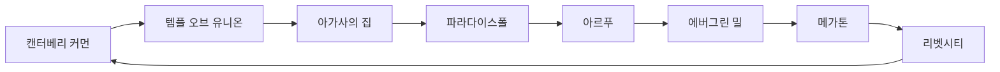

# RD-11. NPC 디렉터리

> **폴아웃 3 역기획서 세트** | 문서 ID: RD-11 | 버전: v1.0 | 작성일: 2026-10-11
> **범위**: 본편과 DLC 5종의 이름 있는 NPC 전원(허브 `Fallout 3 characters` 531행, 고유 496명)을 지역·정착지별로 정리한 디렉터리. 종족·카르마·역할 태그(상인·의사·수리·퀘스트·동료·트레이너·필수)·생사와 이동 조건, 서비스별 색인(상인·의사·수리·퍽 제공·설계도·캐러밴·동료·필수), 이름 없는 일반 NPC 유형을 다룬다. 다루지 않는 것: 주요 인물 심층 프로필([RD-10](10_characters-major-companions.md)), 가격·재고 공식([RD-22](22_economy-housing.md)), 전투 수치([RD-24](24_bestiary.md)), 퀘스트 진행 상세(RD-03~08), 정착지 구조와 장소 상세([RD-12](12_world-structure-settlements.md)·[RD-13](13_location-catalog.md)).
> **관련 문서**: [RD-10 주요 인물·동료](10_characters-major-companions.md), [RD-12 월드 구조·정착지·볼트](12_world-structure-settlements.md), [RD-13 장소 카탈로그](13_location-catalog.md), [RD-22 경제·주거](22_economy-housing.md), [RD-24 크리처·적 도감](24_bestiary.md), [RD-09 팩션](09_factions.md), [RD-07 비표시·반복 퀘스트와 랜덤 인카운터](07_misc-quests-encounters.md), [RD-14 캐릭터 시스템](14_character-system.md), [RD-15 상태·생존 시스템](15_status-survival.md), [RD-21 소모품·잡화·제작](21_consumables-misc-crafting.md), [RD-08a~e DLC 문서](08a_dlc-operation-anchorage.md), [RD-26 용어집](26_glossary.md)

## 1. 문서 개요

### 1.1 목적
- 팬게임에 배치할 **이름 있는 NPC 전수 명단**을 만든다. 각 NPC가 어디에 있고, 무엇을 해 주며(거래·치료·수리·의뢰·동행), 언제 죽거나 옮겨 가는지를 한 줄로 확인할 수 있게 한다.
- 이후 NPC 마스터 데이터와 이벤트로 옮길 때 원본 표로 쓴다. 칼럼이 그대로 데이터 필드가 되도록 짰다.

### 1.2 범위와 집계 기준
- 기준 허브는 `Fallout 3 characters`다. 허브는 NPC를 **처음 만나는 위치** 기준으로 묶는다. 이 문서도 같은 기준을 따르되, 한 퀘스트로 묶이는 이웃 장소는 한 섹션으로 합쳤다(텐페니 타워(Tenpenny Tower)·워링턴역(Warrington station), 템플 오브 유니온(Temple of the Union)·링컨 기념관(Lincoln Memorial), 갤럭시 뉴스 라디오(Galaxy News Radio, GNR) 방송국·체비 체이스(Chevy Chase)).
- 허브 531행(플레이어 제외)을 정리하면 고유 인물은 **496명**이다. 본편 375명, [TP] 43명, [OA] 12명, [BS] 31명, [PL] 23명, [MZ] 12명.
  - 볼트 101(Vault 101)은 성장 단계마다 같은 인물이 다시 등재되므로(65행) 한 표로 합치고 `등장 단계` 칸을 두었다(33명).
  - 볼트 108(Vault 108)의 게리(Gary) 클론 13명은 한 행으로 합쳤다(집계에서는 13명으로 센다).
  - 같은 인물이 다른 장소에 다시 등재된 경우(볼트 112(Vault 112)의 제임스(James), 언더월드(Underworld)의 구울 모이라 브라운(Moira Brown))는 해당 섹션마다 남겼다.
- 시작부터 시신인 인물(시작 시 사망), 퀘스트 조건에서만 나타나는 인물(조건부 등장), 게임 파일에만 남은 삭제 인물 3명(베스(Beth), 빌리 맥셰이디(Billy McShady), 레이더 투사(Raider fighter))도 허브에 있으므로 넣었다.
- 허브에 없는 이름 없는 NPC(정착민·경비·레이더 등)는 5장에서 **유형**만 다룬다.
- 주요 인물의 성격·배경·말투·성우는 [RD-10](10_characters-major-companions.md), 가격·재고 공식은 [RD-22](22_economy-housing.md), 전투 수치는 [RD-24](24_bestiary.md), 퀘스트 진행은 각 퀘스트 문서가 정본이다. 이 문서는 목록, 한 줄 설명, 링크만 둔다.

### 1.3 요약
- 수도 황무지(Capital Wasteland)와 DLC 지역의 이름 있는 NPC는 고유 496명이다. 본편 375명 가운데 인간이 대다수이고, 구울·로봇·슈퍼 뮤턴트·동물이 소수 섞인다.
- 인구는 리벳시티(Rivet City, 38)·볼트 101(33)·메가톤(Megaton, 24)·파라다이스폴(Paradise Falls, 21)·텐페니 타워권(20)·언더월드(18)에 몰려 있다. 소도시는 2~9명 규모로, '마을 하나 = 퀘스트 하나' 구조다.
- 상인·의사·수리는 대형 정착지에 겹겹이 놓이고, 소도시는 대개 상인 1명과 의사 0~1명이다. 수리 상한은 고정 NPC가 41~54%대, 투자한 캐러밴이 79~85%여서 단계적으로 좋아진다.
- 필수 NPC는 87명이다. 아이 전원, 메인 스토리 핵심 인물, 퀘스트 단계 동안만 보호되는 인물로 나뉜다. 나머지는 거의 다 죽일 수 있고, 그 결과가 가게 인수·퀘스트 경로 변경·엔딩 슬라이드로 이어진다.

### 1.4 표기 메모와 칼럼 정의
- 표기: 고유명사는 **한글 패치 표기**를 우선한다(리드 지시, 2026-10-11). 패치 대사에서 확인되지 않은 이름은 외래어 표기법에 따라 음차했다. 아이템·퍽·스킬·퀘스트 이름은 용어집을 따른다. 그래서 장소 '트랜퀼리티 레인'과 퀘스트 '트랭퀼리티 레인', 세력 '라일리 레인저'와 퀘스트 '라일리스 레인저스'처럼 표기가 갈리는 곳이 있다.
- 브라더후드 오브 스틸(Brotherhood of Steel, BoS) 계급은 패치 표기(엘더, 서기, 팔라딘, 스타 팔라딘, 나이트, 센티널, 프로텍터)를 쓴다. 패치 대사에서 Initiate는 '신병', 아웃캐스트(Brotherhood Outcasts)의 Defender는 '수비대원'으로 옮겨져 이를 따랐다.
- 한글 패치는 본편 대사만 다룬다. DLC 인명은 음차했고, 계급·세력명만 본편 패치 표기를 맞췄다.

| 칼럼 | 내용 |
|---|---|
| 영문명 | 허브에 적힌 게임 내 표시명 |
| 한국어 표기 | 패치 표기 우선. 괄호 안은 본명·별칭 |
| 종족 | 인간·구울·글로잉 원·슈퍼 뮤턴트·로봇(기종)·개 등. `인간(구울화 가능)`은 메가톤 폭파 등으로 구울이 되어 다시 나타나는 인물 |
| 카르마 | NPC 자신의 카르마 성향(정보상자 값): 선·중립·악·매우 선·매우 악. `악/중립`은 퀘스트 단계나 상황에 따라 바뀐다는 뜻(예: 볼트 101 경비대는 ①② 악, ③ 중립). 선한 NPC를 죽이면 플레이어 카르마가 깎이고, 악한 NPC를 죽이면 오른다(규칙은 [RD-14](14_character-system.md)). 컨트랙트 킬러(귀)·로브링어(손가락) 퍽의 전리품도 이 값으로 갈린다 |
| 역할 태그 | 상인 / 의사 / 수리 / 퀘스트(의뢰인) / 동료(영구) / 임시 동료 / 트레이너(퍽·능력치·외형 변경을 주는 인물, 4.4) / 설계도(설계도 판매·보상, 4.4) / 필수 |
| 등장 단계(볼트 101) | ① 첫걸음·빨리 크는 아이(유년기), ② 불완전한 미래·탈출!(16~19세), ③ 고향의 위기(귀향). `†`는 그 단계에서 시신으로 등장 |
| 장소(기타·DLC 표) | 처음 만나는 세부 위치 |
| 관련 퀘스트 | `★`는 그 NPC가 의뢰(시작)하는 퀘스트. DLC 퀘스트는 [OA] 등 태그. 퀘스트명 대응표는 4.8 |
| 비고 | 자동 표기(시작 시 사망 / 조건부 등장 / 노예화 가능) 다음에 생사·이동·서비스 수치를 적었다. '노예화 가능'은 메스메트론으로 기절시켜 파라다이스폴(Paradise Falls)에 팔 수 있는 인물이다(냉정한 거래·냉정한 이윤) |

- 보유 캡·수리 상한·객실 요금은 각 NPC 문서의 상호작용 틀 값이다. 수리 상한 %는 그 NPC가 고쳐 줄 수 있는 최대 내구도다.

### 1.5 전체 집계

| 구분 | 고유 인원 | 시작 시 사망 | 조건부 등장 | 필수 | 노예화 가능 | 상인 | 의사 | 수리 | 퀘스트 의뢰인 |
|---|---|---|---|---|---|---|---|---|---|
| 본편 | 375 | 21 | 14 | 67 | 51 | 43 | 9 | 17 | 73 |
| [TP] 더 피트 | 43 | 1 | 0 | 6 | 8 | 2 | 1 | 1 | 8 |
| [OA] 오퍼레이션: 앵커리지 | 12 | 1 | 1 | 5 | 0 | 0 | 1 | 1 | 2 |
| [BS] 브로큰 스틸 | 31 | 5 | 8 | 1 | 3 | 0 | 0 | 0 | 3 |
| [PL] 포인트 룩아웃 | 23 | 1 | 0 | 7 | 3 | 3 | 0 | 2 | 7 |
| [MZ] 마더십 제타 | 12 | 4 | 5 | 1 | 0 | 0 | 0 | 1 | 1 |

- 종족 분포(본편): 인간 320, 구울 24, 로봇 13, 글로잉 원 4, 개 3, 슈퍼 뮤턴트 2, 방사능바퀴 2, 땅두더지 1, FEV 나무 1, FEV 변이체 1, AI(ZAX) 1, 신스(3세대) 1, 안드로이드(신스) 1, 외계인 1
- 카르마 분포(본편): 선 184, 중립 95, 악 65, - 9, 매우 악 9, 악/중립 9, 매우 선 3, 선/중립 1 ('-'는 정보상자에 값이 없는 시신·동물 등)
- 집계 메모: 필수는 허브 표시와 NPC 문서 상호작용 틀의 '필수' 값을 합쳐 셌다(단계 한정 필수 포함). 노예화 가능도 같은 방식이다. 상인·의사·수리는 허브 표시 기준이며, 4장 색인은 상인·의사 문서에만 나오는 서비스 인물까지 넣어 수가 더 많다. 퀘스트 의뢰인은 퀘스트 허브의 '의뢰인'과 NPC 문서의 '시작하는 퀘스트'를 합쳐 판정했다.

## 2. 본편 지역·정착지별 디렉터리

- 섹션 순서: 메인 스토리 동선과 정착지 규모를 함께 고려했다. 볼트 101 → 메가톤 → 대형 정착지(리벳시티·텐페니 타워·언더월드) → 소도시 → 거점(시타델·GNR 방송국·레이븐 락) → 볼트 112·108 → 떠돌이·캐러밴 → 기타 장소.
- 섹션마다 앞머리의 **인구 구성 요약**은 표에서 자동 집계했다(필수에는 단계 한정 필수 포함). '핵심 인물'은 그 장소를 대표하는 의뢰·서비스 인물 3명이다.
- 정착지 구조·시설·플레이어 하우스는 [RD-12](12_world-structure-settlements.md), 장소 개요와 전리품은 [RD-13](13_location-catalog.md)을 본다. 팩션별 소속과 관계는 [RD-09](09_factions.md)를 본다.

### 2.1 볼트 101(Vault 101)

> **인구 구성 요약** — 인원 33명 (시작 시 사망 2명 포함)
>
> - 종족: 인간 32, 로봇 1
> - 서비스: 상인 0 / 의사 0 / 수리 0 / 영구 동료 버치 들로리아
> - 퀘스트 의뢰인: 아마타 알모도바르, 제임스, 알폰스 알모도바르 / 필수 NPC 16명
> - 핵심 인물: 제임스, 아마타 알모도바르, 알폰스 알모도바르(오버시어)

| 영문명 | 한국어 표기 | 종족 | 카르마 | 역할 태그 | 등장 단계 | 한 줄 설명 | 관련 퀘스트 | 비고 |
|---|---|---|---|---|---|---|---|---|
| Amata | 아마타 알모도바르 | 인간 | 매우 선 | 퀘스트·필수 | ①②③ | 오버시어의 외동딸이자 주인공의 소꿉친구 | ★탈출!, ★고향의 위기, 빨리 크는 아이, 불완전한 미래 | 탈출! 의뢰. 고향의 위기까지 필수. 결말에 따라 오버시어 취임 또는 볼트 퇴거 |
| Andy | 앤디 | 로봇(미스터 핸디) | 중립 | 필수 | ①③ | 볼트 101의 정비·의료 보조 미스터 핸디 | 빨리 크는 아이, 탈출! | 고향의 위기까지 필수. 볼트 파괴 공작 시 진료소에 남음 |
| Beatrice Armstrong | 비어트리스 암스트롱 | 인간 | 선 | 필수 | ①③† | 10세 생일에 시를 선물하는 노부인 | 빨리 크는 아이 | 고향의 위기 시점에는 시신 (필수: ① 단계만) |
| Butch | 버치 들로리아 | 인간 | 선 | 동료·트레이너·필수 | ①②③ | 터널스네이크 리더. 이후 영구 동료(영입 조건: 중립 카르마) | 빨리 크는 아이, 불완전한 미래, 탈출!, 고향의 위기 | 탈출!부터 필수 해제(죽이면 이후 미등장). 고향의 위기에서 이발 가능. 해고 시 리벳시티 진흙탕 술집으로 이동 |
| James | 제임스 | 인간 | 선 | 퀘스트·필수 | ①② | 주인공의 아버지이자 볼트 101 의사. 메인 스토리의 중심 인물 | ★첫걸음, ★불완전한 미래, ★생명의 물, 빨리 크는 아이, 과학적 탐구, 트랭퀼리티 레인 | 탈출! 시작 시 볼트를 떠남. 생명의 물에서 사망 |
| Jonas Palmer | 조나스 파머 | 인간 | 선 | 필수 | ①②† | 제임스의 조수인 의료 기사. 생일 사진을 찍어 줌 | 빨리 크는 아이, 불완전한 미래, 탈출! | 탈출! 시작 시점에 오버시어 측에 살해되어 시신으로 발견 |
| Officer Gomez | 허먼 고메즈(고메즈 경관) | 인간 | 악/중립 | 필수 | ①②③ | 비교적 주인공에게 우호적인 볼트 경비원 | 빨리 크는 아이, 탈출!, 고향의 위기 | 고향의 위기를 주민 추방으로 끝내면 밖에서 시신으로 발견 (필수: ① 단계만) |
| Officer Kendall | 존 켄들(켄들 경관) | 인간 | 악/중립 | 필수 | ①②③ | 볼트 경비원 | 탈출! | 탈출!에서 방 앞에서 방사능바퀴에게 습격당함 (필수: ① 단계만) |
| Old Lady Palmer | 루시 파머(파머 할머니) | 인간 | 선 | 필수 | ①③ | 생일에 스위트롤을 선물하는 노부인 | 빨리 크는 아이, 고향의 위기 | (필수: ① 단계만) |
| Paul Hannon Jr. | 폴 해넌 주니어 | 인간 | 선 | 필수 | ①② | 터널스네이크 단원인 동급생 | 빨리 크는 아이, 불완전한 미래 | 생일 파티·G.O.A.T. 동안만 필수 |
| Stanley Armstrong | 스탠리 암스트롱 | 인간 | 선 | 필수 | ①②③ | 핍-보이를 손봐 준 정비 기술자 | 빨리 크는 아이, 불완전한 미래, 고향의 위기 | 고향의 위기에서 파괴 공작 터미널 암호 보유 (필수: ①② 단계만) |
| The Overseer | 알폰스 알모도바르(오버시어) | 인간 | 악/중립 | 퀘스트·필수 | ①②③ | 볼트 101 오버시어. 볼트 봉쇄를 고집함 | ★빨리 크는 아이, 탈출!, 고향의 위기 | 생일 파티 동안 필수. 탈출!부터 처치 가능 |
| Wally Mack | 월리 맥 | 인간 | 선/중립 | 필수 | ①②③ | 터널스네이크 단원 | 빨리 크는 아이, 불완전한 미래, 고향의 위기 | 생일 파티·G.O.A.T. 동안만 필수 |
| Allen Mack | 앨런 맥 | 인간 | 중립 | - | ②③ | 열렬한 고립주의자. 오버시어 후보 | 탈출!, 고향의 위기 | 고향의 위기에서 오버시어가 되면 볼트를 영구 봉쇄하려 함 |
| Christine Kendall | 크리스틴 켄들 | 인간 | 선 | 필수 | ②③ | 정비 기술자. 고향의 위기에서 아마타의 반란군 편 | 고향의 위기 | 탈출 소동 때 어머니와 여동생을 잃음 (필수: ② 단계만) |
| Ellen DeLoria | 엘런 들로리아 | 인간 | 선 | - | ②③ | 버치의 어머니. 알코올 중독 | 탈출!, 고향의 위기 | 탈출!에서 방사능바퀴에게 공격받아 구출 여부 선택 |
| Floyd Lewis | 플로이드 루이스 | 인간 | 선 | - | ②† | 볼트 기술자 | 탈출! | 시작 시 사망. 탈출! 때 제어실에서 시신으로 발견 |
| Freddie Gomez | 프레디 고메즈 | 인간 | 선 | - | ② | 터널스네이크 동급생. 제임스에게 진정제를 처방받음 | 불완전한 미래, 고향의 위기 | 고향의 위기 주민 추방 결말 시 밖에서 시신 |
| Grandma Taylor | 애그니스 테일러(테일러 할머니) | 인간 | 선 | - | ②† | 볼트 주민 노부인 | - | 시작 시 사망. 탈출! 때 식당에서 방사능바퀴에 둘러싸인 시신 |
| Mary Holden | 메리 홀든 | 인간 | 중립 | - | ② | 남편과 함께 탈출하려다 실패하는 주민 | 탈출! | - |
| Mr. Brotch | 에드윈 브로치(브로치 선생) | 인간 | 선 | 필수 | ②③ | 볼트 교사. G.O.A.T. 시험을 진행 | 불완전한 미래, 고향의 위기 | 불완전한 미래 동안만 필수. 고향의 위기에서 감방에 수감 |
| Officer Mack | 스티비 맥(맥 경관) | 인간 | 악/중립 | - | ② | 아마타를 심문하는 경비원 | 탈출!, 고향의 위기 | 아마타에게 총을 남겼으면 즉시 교전 |
| Officer O'Brian | 오브라이언 경관 | 인간 | 악 | - | ② | 아트리움 문을 지키는 경비원 | 탈출! | - |
| Officer Park | 파크 경관 | 인간 | 악 | - | ② | 볼트 출구 앞 마지막 경비원 | 탈출! | - |
| Officer Richards | 리처즈 경관 | 인간 | 악/중립 | - | ②③ | 아트리움 문을 지키는 경비원 | 탈출!, 고향의 위기 | - |
| Officer Wolfe | 울프 경관 | 인간 | 악 | - | ② | 볼트 출구 앞 마지막 경비원 | 탈출! | 문 밖까지는 추격하지 않음 |
| Security Chief Hannon | 폴 해넌 시니어 | 인간 | 악/중립 | - | ②③ | 볼트 101 경비대장 | 탈출!, 고향의 위기 | 탈출!에서 적대. 생존 시 고향의 위기에 재등장 |
| Susie Mack | 수지 맥 | 인간 | 선 | 필수 | ②③ | G.O.A.T.를 함께 치른 동급생 | 불완전한 미래, 고향의 위기 | 아마타 편 결말이면 랜덤 인카운터 '볼트 밖으로'에서 정화수를 줌 (필수: ② 단계만) |
| Tom Holden | 톰 홀든 | 인간 | 중립 | - | ② | 메리 홀든의 남편 | 탈출! | - |
| Officer Armstrong | 암스트롱 경관 | 인간 | 중립 | - | ③ | 고향의 위기 귀환 시 맞이하는 경비원 | 고향의 위기 | 고메즈가 죽었으면 처음 만나는 경비원 |
| Officer Taylor | 테일러 경관 | 인간 | 중립 | - | ③ | 고향의 위기의 경비원. 주인공 부자를 원망하나 비적대 | 고향의 위기 | - |
| Officer Wilkins | 윌킨스 경관 | 인간 | 악 | - | ③ | 고향의 위기의 적대적 경비원 | 고향의 위기 | 감방 구역 터미널 암호 보유 |
| Pepper Gomez | 페퍼 고메즈 | 인간 | 선 | - | ③ | 허먼 고메즈의 아내 | 고향의 위기 | 주민 추방 결말 시 밖에서 시신 |

### 2.2 메가톤(Megaton)

> **인구 구성 요약** — 인원 24명
>
> - 종족: 인간 20, 로봇 3, 구울 1
> - 서비스: 상인 4(처치 박사, 괍, 제니 스탈, 모이라 브라운) / 의사 1(처치 박사) / 수리 1(모이라 브라운) / 영구 동료 제리코
> - 퀘스트 의뢰인: 콜린 모리아티, 크롬웰, 처치 박사, 레오 스탈, 루카스 심즈, 루시 웨스트, 미키, 모이라 브라운, 월터 / 필수 NPC 2명
> - 핵심 인물: 루카스 심즈, 모이라 브라운, 콜린 모리아티

| 영문명 | 한국어 표기 | 종족 | 카르마 | 역할 태그 | 한 줄 설명 | 관련 퀘스트 | 비고 |
|---|---|---|---|---|---|---|---|
| Andy Stahl | 앤디 스탈 | 인간 | 선 | - | 메가톤 식당 '브래스 랜턴'의 경영자. 제니·레오의 형 | 레오의 약물 습관 | - |
| Billy Creel | 빌리 크릴 | 인간 | 선 | - | 매기를 입양한 전직 캐러밴 경비 | - | 사망 시 매기는 매냐 발가스 집으로 이사 |
| Colin Moriarty | 콜린 모리아티 | 인간 | 중립 | 퀘스트 | 메가톤 '모리아티 살롱' 주인. 아버지 행방 정보를 쥔 인물 | ★은화 300닢, 아버지의 발자취 | 사망 시 괍이 살롱을 인수하고 간판을 바꿈 |
| Confessor Cromwell | 크롬웰 | 인간 | 선 | 퀘스트 | 원자의 자손 교회 지도자. 폭탄 곁에서 설교 | ★교회 헌금 | 원자의 힘에서 해체를 만류 |
| Deputy Weld | 웰드 부관 | 로봇(프로텍트론) | 중립 | - | 메가톤 정문을 지키는 프로텍트론 | - | 파괴 시 부보안관 스틸이 대신함 |
| Deputy Steel | 스틸 부관 | 로봇(미스터 거츠) | 중립 | - | 메가톤 무기고를 지키는 미스터 거츠 | - | 무기고에 들어가면 적대 |
| Doc Church | 처치 박사 | 인간 | 선 | 상인·의사·퀘스트 | 메가톤 진료소 의사 | ★레오의 약물 습관, 복제된 인간 | 의약품 판매, 보유 캡 200~300 |
| Gob | 괍 | 구울 | 선 | 상인 | 모리아티에게 학대받는 구울 바텐더 | 아버지의 발자취 | 모리아티 사망 시 살롱 주인이 됨 |
| Harden Simms | 하든 심즈 | 인간 | 선 | 필수 | 보안관 루카스 심즈의 아들 | 원자의 힘 | 루카스 사망 시 스스로 보안관을 자처. 폭탄 해체 보상을 대신 지급 |
| Jenny Stahl | 제니 스탈 | 인간 | 선 | 상인 | 브래스 랜턴의 요리사 | - | 음식 판매, 보유 캡 100~200 |
| Jericho | 제리코 | 인간 | 중립 | 동료 | 메가톤에 은거한 전직 레이더. 영구 동료(영입 조건: 악 카르마) | - | 해고 시 모리아티 살롱(메가톤 파괴 시 폐허)으로 복귀 |
| Leo Stahl | 레오 스탈 | 인간 | 선 | 퀘스트 | 브래스 랜턴 바텐더이자 약물 중독자 | ★레오의 약물 습관 | 레오의 약물 습관: 중독 치료를 돕거나 약물 공급책으로 삼을 수 있음 |
| Lucas Simms | 루카스 심즈 | 인간 | 선 | 퀘스트 | 메가톤 보안관 겸 사실상의 시장. 원자의 힘 의뢰인 | ★원자의 힘, 아버지의 발자취 | - |
| Lucy West | 루시 웨스트 | 인간 | 중립 | 퀘스트 | 아르푸 출신 메가톤 주민. 가족에게 편지 전달을 부탁 | ★피의 유대 | 피의 유대 의뢰인. 에반 킹을 죽이면 대화 거부 |
| Maggie | 매기 | 인간 | 선 | 필수 | 빌리 크릴이 입양한 고아 소녀 | - | - |
| Manya Vargas | 매냐 발가스 | 인간 | 선 | - | 전직 캐러밴 대원인 노부인. 네이든의 아내 | 복제된 인간 | 남편 사망 시 대화 불가 |
| Micky | 미키 | 인간 | 중립 | 퀘스트 | 메가톤 앞의 물 구걸꾼 | ★물 구걸꾼, [BS] 성수 | 정화수를 주면 카르마 +50, 거절하면 다음 지역 이동 때 사망. [BS] 아쿠아 퓨라를 주면 오염 여부와 무관하게 사망(스크립트 미완성) |
| Moira Brown | 모이라 브라운 | 인간(구울화 가능) | 선 | 상인·수리·퀘스트·트레이너·설계도 | 분화구 잡화점 주인이자 황무지 생존 가이드 저자 | ★황무지 생존 가이드, 복제된 인간 | 보유 캡 160~3,000, 수리 54%(드림 크러셔 72%). 메가톤 폭파 시 구울로 변해 언더월드로 이주 |
| Mother Maya | 마더 마야 | 인간 | 선 | - | 원자의 자손 교회 신자 | - | - |
| Nathan Vargas | 네이든 발가스(너새니얼 발가스) | 인간 | 선 | - | 엔클레이브를 열렬히 지지하는 노인 | 아메리칸 드림 | 아메리칸 드림 중 레이븐 락 감방에 수감되어 등장 |
| Nova | 노바 | 인간 | 선 | - | 모리아티 살롱의 성매매 종사자 | 아버지의 발자취 | 화술 판정 성공 시 모리아티 터미널 암호 제공 |
| Stockholm | 스톡홀름 | 인간 | 선 | - | 메가톤 정문 위의 감시병 | - | [BS] 황무지인의 물 요청 중 BoS에게 사살될 수 있음 |
| Wadsworth | 워즈워스 | 로봇(미스터 핸디) | 중립 | - | 메가톤 플레이어 하우스의 집사 로봇(미스터 핸디) | 원자의 힘 | 원자의 힘에서 폭탄을 해체하고 받은 집에 딸려 옴 |
| Walter | 월터 | 인간 | 선 | 퀘스트 | 메가톤 정수 시설 관리인 | ★치료, ★월터의 고철 | 치료(파이프 수리, 200캡·100 XP)와 월터의 고철 반복 의뢰 |

### 2.3 리벳시티(Rivet City)

> **인구 구성 요약** — 인원 38명
>
> - 종족: 인간 34, 로봇 2, 신스(3세대) 1, 안드로이드(신스) 1
> - 서비스: 상인 10(안젤라 스텔리, 베논, 벨리 보니, 신디 칸티엘리, 프레스턴 박사, 플랙, 게리 스텔리, 미스터 버킹검, 씨그레이브 홈즈, 샤프넬) / 의사 1(프레스턴 박사) / 수리 2(베논, 샤프넬) / 객실 대여 1(미스터 버킹검) / 임시 동료 매디슨 리 박사
> - 퀘스트 의뢰인: 아브라함 워싱턴, 안젤라 스텔리, 베논, 카를로스, 매디슨 리 박사, 짐머 박사, 클리포드 신부, 제임스 하그레이브, 메이 웡, 폴리 칸티엘리 / 필수 NPC 11명
> - 핵심 인물: 매디슨 리 박사, 하크니스, 아브라함 워싱턴

| 영문명 | 한국어 표기 | 종족 | 카르마 | 역할 태그 | 한 줄 설명 | 관련 퀘스트 | 비고 |
|---|---|---|---|---|---|---|---|
| Abraham Washington | 아브라함 워싱턴 | 인간 | 선 | 퀘스트·설계도 | 리벳시티 국회의사당 보존 협회 관장 | ★독립을 훔쳐라, ★링컨의 이윤, 애거사의 노래 | 독립을 훔쳐라 의뢰(보상 레일웨이 라이플 설계도). 링컨의 이윤 의뢰 |
| Angela Staley | 안젤라 스텔리 | 인간 | 선 | 상인·퀘스트 | 아버지의 식당 '게리의 주방'에서 일하는 딸 | ★결혼하기 좋은 날 | 노예화 가능. 결혼하기 좋은 날 의뢰. 음식 판매, 보유 캡 250 |
| Anna Holt | 애나 홀트 | 인간 | 중립 | - | 리 박사 연구팀의 식물학자 | 생명의 물, 아메리칸 드림 | 생명의 물 이후 제퍼슨 기념관으로 이동 |
| Armitage | 아미티지 | 신스(3세대) | 악 | 필수 | 짐머 박사를 호위하는 3세대 신스 | 복제된 인간 | 복제된 인간 후반부까지 필수. 짐머와 같은 일정으로 이동 |
| Bannon | 베논 | 인간 | 선 | 상인·수리·퀘스트·설계도 | 의류점 '포토맥 의류' 주인이자 리벳시티 위원회의 민간 대표 위원 | ★위원회 의석, 황무지 생존 가이드, 머리를 쏴야 해 | 의류 판매, 보유 캡 160~390, 수리 최대 49%. 위원회 의석 의뢰(보상 데스클로 건틀릿 설계도) |
| Belle Bonny | 벨리 보니 | 인간 | 선 | 상인 | 술집 '진흙탕 술집' 주인 겸 바텐더 | 복제된 인간, 황무지 생존 가이드, 머리를 쏴야 해 | 음료 판매, 보유 캡 60~240. 다른 가게보다 늦게까지 영업 |
| Brock | 브록 | 인간 | 선 | - | 진흙탕 술집의 경비원 | - | 노예화 가능 |
| C.J. Young | C.J. 영 | 인간 | 선 | 필수 | 제임스 하그레이브의 단짝인 리벳시티 소녀 | 가출한 아이들 | 가출한 아이들에서 제임스와 함께 애너코스티아 크로싱역으로 가출 가능 |
| Carlos | 카를로스 | 인간 | 중립 | 퀘스트 | 리벳시티 다리 건너편의 물 구걸꾼 | ★물 구걸꾼 | 정화수를 주면 카르마 +50, 거절하면 다음 지역 이동 때 사망. [BS] 아쿠아 퓨라를 주면 사망 |
| Christie Young | 크리스티 영 | 인간 | 선 | - | 리벳시티 유일의 청소부. C.J.의 어머니 | 머리를 쏴야 해, 가출한 아이들 | 노예화 가능 |
| Cindy Cantelli | 신디 칸티엘리 | 인간 | 악 | 상인 | 약물 상점 '퀵 픽스' 주인 | 황무지 생존 가이드, 머리를 쏴야 해 | 노예화 가능. 약물 판매, 보유 캡 335 |
| Diego | 디에고 | 인간 | 선 | - | 성 모니카 교회의 복사(사제 지망생) | 결혼하기 좋은 날 | 노예화 가능. 결혼하기 좋은 날에서 안젤라와의 관계가 결정됨 |
| Doctor Li | 매디슨 리 박사 | 인간 | 선 | 퀘스트·임시 동료·필수 | 리벳시티 과학 연구실 책임자. 아버지의 옛 동료 | ★과학적 탐구, 생명의 물, 되찾아라! | 과학적 탐구 의뢰. 생명의 물에서 임시 동료 |
| Doctor Preston | 프레스턴 박사 | 인간 | 선 | 상인·의사·필수 | 리벳시티 진료소 의사 | 프로젝트 임퓨리티, 복제된 인간, 황무지 생존 가이드, 머리를 쏴야 해 | 의약품 판매. 일과에 따라 웨덜리 호텔에서 식사 |
| Dr. Zimmer | 짐머 박사 | 인간 | 악 | 퀘스트·트레이너·필수 | 인스티튜트 신스 회수국장. 도망친 안드로이드 추적 의뢰 | ★복제된 인간 | 복제된 인간 진행 중 필수. 편을 들면 와이어드 리플렉스 퍽. 안드로이드가 죽었다고 믿으면 게임에서 퇴장 |
| Father Clifford | 클리포드 신부 | 인간 | 선 | 퀘스트 | 성 모니카 교회 신부 | ★교회 헌금, 결혼하기 좋은 날 | 교회 헌금 반복 의뢰 |
| Flak | 플랙 | 인간 | 선 | 상인 | 노예 사냥꾼 출신 무기 상인. '플랙과 샤프넬' 공동 운영 | 냉정한 거래 | 노예화 가능. 냉정한 거래의 노예화 대상 |
| Gary Staley | 게리 스텔리 | 인간 | 선 | 상인 | 식당 '게리의 주방' 주인 | - | 음식 판매 |
| Garza | 가자 | 인간 | 선 | - | 리 박사 연구팀의 잡역부 | 생명의 물 | 생명의 물 이후 연구팀과 함께 이동 |
| Harkness | 하크니스 | 안드로이드(신스) | 선 | 필수 | 리벳시티 경비대장. 정체는 도망친 안드로이드 A3-21 | 복제된 인간, 머리를 쏴야 해 | 복제된 인간에서 짐머에게 넘길지 숨겨 줄지 선택 |
| Henry Young | 헨리 영 | 인간 | 선 | - | 리벳시티 수리공. C.J.의 아버지 | 머리를 쏴야 해, 가출한 아이들 | 노예화 가능. 딸이 가출하면 수색을 부탁 |
| James Hargrave | 제임스 하그레이브 | 인간 | 선 | 퀘스트·필수 | 술꾼 어머니를 둔 말썽꾸러기 소년 | ★가출한 아이들, ★손버릇 나쁜 하그레이브 | 가출한 아이들·손버릇 나쁜 하그레이브 의뢰 |
| Janice Kaplinski | 재니스 카플린스키 | 인간 | 선 | 필수 | 리 박사 연구팀의 수석 식물학자 | 생명의 물, 황무지 생존 가이드 | 생명의 물 도입부에서 제임스·어텀과 함께 정화실에 갇힘 |
| Lana Danvers | 덴버 사령관(라나 덴버) | 인간 | 선 | - | 리벳시티 경비대 부대장 | 머리를 쏴야 해, 위원회 의석 | 노예화 가능. 매일 19시~3시 시장 순찰. 위원회 의석에서 공갈 사건을 보고받음 |
| Mei Wong | 메이 웡 | 인간 | 선 | 퀘스트 | 리벳시티에 숨어 지내는 탈출 노예 | ★노예 사냥, 머리를 쏴야 해 | 노예화 가능. 노예 사냥 의뢰. 총 살 돈 25캡을 주면 선 카르마 |
| Mister Buckingham | 미스터 버킹검 | 로봇(미스터 핸디) | 중립 | 상인 | 웨덜리 호텔의 웨이터 로봇(미스터 핸디) | - | 음식·술 판매, 객실 대여 120캡. 사망해도 리스폰(이름 있는 NPC로는 드문 예) |
| Mister Lopez | 로페즈 씨 | 인간 | 선 | - | 아무도 자신을 기억하지 않는다며 자살을 고민하는 주민 | 머리를 쏴야 해, 자살 감시 | 노예화 가능. 자살 감시: 화술로 만류하거나 밀어 버릴 수 있음 |
| Paulie Cantelli | 폴리 칸티엘리 | 인간 | 중립 | 퀘스트 | 약물 중독자. 퀵 픽스 공동 운영자 | ★약물 과다 복용, 황무지 생존 가이드, 머리를 쏴야 해, 냉정한 이윤 | 노예화 가능. 약물 과다 복용: 사이코를 건네면 악 카르마 |
| Pinkerton | 호러스 핑커톤 박사 | 인간 | 선 | 트레이너·필수 | 리벳시티 부서진 함수에 은둔한 과학자 겸 외과의 | 복제된 인간, 황무지 생존 가이드 | 얼굴 재건 서비스. 복제된 인간·황무지 생존 가이드 완료 때까지 필수 |
| Private Jones | 존스 일병 | 로봇(미스터 거츠) | 중립 | - | 브리지 타워 무기고를 지키는 미스터 거츠 | - | - |
| Seagrave Holmes | 씨그레이브 홈즈 | 인간 | 선 | 상인 | '리벳시티 서플라이' 주인(전직 노예 사냥꾼) | 복제된 인간, 황무지 생존 가이드, 머리를 쏴야 해, 결혼하기 좋은 날, 위원회 의석, 약물 과다 복용 | 탄약·방어구·무기·잡화 판매, 보유 캡 약 300. 베논의 공갈을 고발하면 영구 할인 |
| Shrapnel | 샤프넬 | 인간 | 선 | 상인·수리·필수 | 플랙의 동업자. 무기 상인 | 냉정한 거래 | 무기 판매, 수리 최대 49%. 플랙이 노예로 잡히면 적대하거나 파라다이스폴로 감 |
| Sister | 시스터 | 인간 | 악 | - | 리벳시티에 머무는 남성 노예 사냥꾼 | 복제된 인간, 노예 사냥 | 노예 사냥에서 메이 웡을 노림 |
| Tammy Hargrave | 태미 하그레이브 | 인간 | 중립 | - | 진흙탕 술집에 눌어붙은 알코올 중독 어머니 | 머리를 쏴야 해, 냉정한 이윤 | 노예화 가능 |
| Ted Strayer | 테드 스트레이어 | 인간 | 선 | - | 리벳시티에 정착한 떠돌이(약물 중독) | 머리를 쏴야 해 | 로페즈가 자살을 단념하면 그에게 글을 배우기 시작 |
| Trinnie | 트리니 | 인간 | 선 | - | 리벳시티의 약물 중독자 겸 매춘부 | - | 노예화 가능 |
| Vera Weatherly | 베라 웨덜리 | 인간 | 선 | - | 웨덜리 호텔 설립자 겸 주인 | 그것들! | 객실 대여. 그것들!에서 브라이언 윌크스를 맡아 줌 |
| Victoria Watts | 빅토리아 와츠 | 인간 | 중립 | 필수 | 레일로드 현장 요원. 하크니스 관련 메시지를 전달 | 복제된 인간 | 메시지를 전할 때까지 필수 |

### 2.4 텐페니 타워(Tenpenny Tower)·워링턴역(Warrington station)

> **인구 구성 요약** — 인원 20명
>
> - 종족: 인간 15, 구울 3, 로봇 2
> - 서비스: 상인 8(앤서니 링, 구스타보 경비대장, 줄리어스 벤필드 박사, 리디아 몬테네그로, 마거릿 프림로즈, 쉐익스, 베시 린, 마이클 매스터스) / 의사 1(줄리어스 벤필드 박사) / 수리 0
> - 퀘스트 의뢰인: 구스타보 경비대장, 할버트 대시우드, 미스터 버크, 윌리, 로이 필립스 / 필수 NPC 0명
> - 핵심 인물: 앨리스터 텐페니, 로이 필립스, 미스터 버크

| 영문명 | 한국어 표기 | 종족 | 카르마 | 역할 태그 | 한 줄 설명 | 관련 퀘스트 | 비고 |
|---|---|---|---|---|---|---|---|
| Allistair Tenpenny | 앨리스터 텐페니 | 인간 | 매우 악 | - | 텐페니 타워의 설립자이자 주인 | 텐페니 타워, 원자의 힘, 머리를 쏴야 해 | 원자의 힘 폭파 루트의 의뢰 측. 텐페니 타워 결말에 따라 생사 결정 |
| Anthony Ling | 앤서니 링 | 인간 | 선 | 상인 | 타워 유일의 의류점 '신도시 옷집' 주인 | 텐페니 타워 | 금고를 털면 타워를 떠남 |
| Chief Gustavo | 구스타보 경비대장 | 인간 | 악 | 상인·퀘스트 | 텐페니 타워 경비대장. 구울 처리를 의뢰 | ★텐페니 타워 | 텐페니 타워 의뢰인. 탄약·무기 판매 |
| Doctor Banfield | 줄리어스 벤필드 박사 | 인간 | 선 | 상인·의사 | '텐페니 보건소'의 의사 | 텐페니 타워 | 구울 연구를 원해 구울 입주에 찬성. 의약품 판매, 보유 캡 60~240 |
| Edgar Wellington II | 에드가 웰링턴 2세 | 인간 | 선 | - | 수잔 랭커스터와 불륜 중인 주민 | 텐페니 타워 | 연애편지를 아내에게 보여 주면 아내에게 살해됨 |
| Godfrey | 갓프레이 | 로봇(미스터 핸디) | 중립 | - | 텐페니 타워 스위트의 집사 로봇(미스터 핸디) | 원자의 힘 | 원자의 힘 폭파 보상인 스위트에 딸려 옴 |
| Herbert "Daring" Dashwood | 할버트 대시우드 | 인간 | 중립 | 퀘스트·설계도 | 은퇴한 자칭 모험가. 레일로드 협력자 | ★학대받은 하인, 텐페니 타워, 복제된 인간 | 학대받은 하인 의뢰(금고 열쇠, 병뚜껑 지뢰 설계도). 발전실 열쇠를 '훔쳐 보라'고 제안 |
| Irving Cheng | 어빙 청 | 인간 | 중립 | - | 공산주의 성향을 숨긴 주민. 티파니의 남편 | - | - |
| Lydia Montenegro | 리디아 몬테네그로 | 인간 | 선 | 상인·설계도 | 부티크 '르 시크' 상인 | 텐페니 타워 | 잡화·다트 건 설계도 판매, 보유 캡 260~540. 구울 입주 설득 대상 |
| Margaret Primrose | 마거릿 프림로즈 | 인간 | 중립 | 상인 | '보 몽드 카페' 주인 | 텐페니 타워 | 음식 판매, 보유 캡 60~240 |
| Michael Hawthorne | 마이클 호손 | 인간 | 선 | - | 연방주의자 라운지의 술꾼 | 텐페니 타워 | 수요일 밤 수잔 랭커스터와 동침 |
| Millicent Wellington | 밀리센트 웰링턴 | 인간 | 선 | - | 남편 에드가와 늘 다투는 주민 | 텐페니 타워 | 구울 입주 설득 대상. 연애편지를 보면 남편과 수잔을 살해 |
| Mister Burke | 미스터 버크 | 인간 | 매우 악 | 퀘스트 | 텐페니의 심복. 메가톤 폭파를 제안 | ★원자의 힘, ★레오의 약물 습관 | 원자의 힘 폭파 루트 의뢰인. 해체 시 이후 암살자 파견 |
| Shakes | 쉐익스 | 로봇(프로텍트론) | 중립 | 상인 | 연방주의자 라운지의 바텐더 로봇(프로텍트론) | 텐페니 타워 | 음료·스팀팩 판매, 보유 캡 120. 구울의 '숙청' 후에도 살아남음 |
| Susan Lancaster | 수잔 랭카스터 | 인간 | 선 | - | 노예 사냥꾼 출신 타워의 '고급 매춘부' | 냉정한 거래, 텐페니 타워 | 노예화 가능. 냉정한 거래의 VIP 노예화 대상 |
| Tiffany Cheng | 티파니 청 | 인간 | 선 | - | 어빙 청의 아내 | - | - |
| Willy | 윌리 | 인간 | 중립 | 퀘스트 | 텐페니 타워 밖의 물 구걸꾼 | ★물 구걸꾼 | 정화수를 주면 카르마 +50, 거절하면 다음 지역 이동 때 사망. 오염된 물은 거부 |
| Bessie Lynn | 베시 린 | 구울 | 선 | 상인 | 로이 필립스를 따르는 구울 피난민 | 텐페니 타워 | 텐페니 타워에 구울이 입주하면 의류점 '신도시 옷집'을 인수 |
| Michael Masters | 마이클 매스터스 | 구울 | 선 | 상인·설계도 | 전쟁 전 인체 변이 연구자 출신 구울. 로이를 따름 | 텐페니 타워 | 구울 입주 후 '르 시크'를 인수: 무기·방어구·잡화·다트 건 설계도 판매, 보유 캡 260~540 |
| Roy Phillips | 로이 필립스 | 구울 | 선 | 퀘스트 | 전쟁 전 경찰 출신 구울 피난민 지도자 | ★텐페니 타워 | 텐페니 타워 의뢰인(구울 입주 요구). 협상 결말 뒤 인간 주민을 몰살함 |

### 2.5 언더월드(Underworld)

> **인구 구성 요약** — 인원 18명
>
> - 종족: 구울 13, 글로잉 원 2, 인간 2, 로봇 1
> - 서비스: 상인 5(아즈루칼, 배로우즈 박사, 그레타, 모이라 브라운, 튤립) / 의사 1(배로우즈 박사) / 수리 2(모이라 브라운, 윈드롭) / 객실 대여 1(캐롤) / 영구 동료 셰런
> - 퀘스트 의뢰인: 아즈루칼, 미스터 크로울리, 모이라 브라운, 라일리, 윈드롭 / 필수 NPC 0명
> - 핵심 인물: 배로우즈 박사, 셰런, 미스터 크로울리

| 영문명 | 한국어 표기 | 종족 | 카르마 | 역할 태그 | 한 줄 설명 | 관련 퀘스트 | 비고 |
|---|---|---|---|---|---|---|---|
| Ahzrukhal | 아즈루칼 | 구울 | 매우 악 | 상인·퀘스트 | 언더월드 술집 '나인서클' 주인 | ★고용된 일손, 애거사의 노래 | 술과 일부 약물(버프아웃·사이코·제트) 판매. 고용된 일손 의뢰(셰런 계약서) |
| Carol | 캐롤 | 구울 | 선 | - | 언더월드 여관 '캐롤의 집' 주인 | 머리를 쏴야 해 | 객실 대여 120캡. 메가톤을 폭파했다고 털어놓으면 배로우즈 등 일부를 뺀 언더월드 전체가 적대 |
| Cerberus | 세베로스 | 로봇(미스터 거츠) | 중립 | - | 언더월드를 지키는 미스터 거츠 | - | - |
| Charon | 셰런 | 구울 | 중립 | 동료 | 나인서클의 구울 경호원. 계약서를 가진 자에게 복종하는 영구 동료(영입 조건: 카르마 무관) | 되찾아라!, 고용된 일손 | 계약서를 얻으면 아즈루칼을 사살. 해고 시 나인서클로 복귀 |
| Doctor Barrows | 배로우즈 박사 | 구울 | 선 | 상인·의사 | 언더월드 '춉숖' 의사 겸 사실상의 시장 | 라일리스 레인저스, 머리를 쏴야 해 | 의료품 판매, 보유 캡 60~240. 라일리스 레인저스 시작점(라일리를 깨움) |
| Ethyl | 에설 | 글로잉 원 | 악/중립 | - | 춉숖 격리 구역에 갇힌 글로잉 원 관찰 대상 | - | - |
| Greta | 그레타 | 구울 | 선 | 상인 | 캐롤의 동반자인 구울 요리사 겸 웨이트리스 | 머리를 쏴야 해, 고용된 일손 | 음식 판매, 보유 캡 60~240. 고용된 일손에서 살해 대상 |
| Meat | 미트 | 글로잉 원 | 악/중립 | - | 춉숖의 온순한 글로잉 원 관찰 대상 | - | - |
| Mister Crowley | 미스터 크로울리 | 구울 | 악 | 퀘스트 | 콘스탄틴 요새의 열쇠를 노리는 전직 용병 구울. 구울을 멸시하는 텐페니를 증오 | ★머리를 쏴야 해 | 머리를 쏴야 해 의뢰인: 열쇠를 가진 4명(텐페니·듀코브·테드 스트레이어·데이브) 처치 요구 |
| Moira Brown | 모이라 브라운(구울) | 인간(구울화 가능) | 선 | 상인·수리·퀘스트·트레이너·설계도 | 메가톤 폭파 시 구울이 되어 언더월드로 옮겨 온 모이라 | ★황무지 생존 가이드, 복제된 인간 | 원자의 힘 폭파 루트에서만 등장. 상점 기능 유지 |
| Nurse Graves | 그레이브스 간호사 | 구울 | 선 | - | 배로우즈 박사를 돕는 구울 간호사 | 라일리스 레인저스 | - |
| Patchwork | 패치워크 | 구울 | 중립 | - | 언더월드의 주정뱅이 | - | 퀴인과 친구 사이 |
| Quinn | 퀴인 | 구울 | 선 | - | 언더월드의 구울 고물 조달꾼 | 머리를 쏴야 해 | 50캡 또는 화술로 크로울리 정보 제공 |
| Reilly | 라일리 | 인간 | 선 | 퀘스트 | 용병단 라일리 레인저의 창설자 겸 대장 | ★라일리스 레인저스, ★라일리와 지형 측량 | 춉숖에서 깨어나 라일리스 레인저스 의뢰. 이후 라일리와 지형 측량 반복 의뢰 |
| Snowflake | 스노플레이크 | 구울 | 선 | 트레이너 | 언더월드의 구울 미용사 | - | 노예화 가능 |
| Tulip | 튤립 | 구울 | 선 | 상인·설계도 | '언더월드 의류점' 주인. 레일로드 협력자 | 복제된 인간, 머리를 쏴야 해 | 레일웨이 라이플 설계도·탄약·무기·의복 판매, 보유 캡 400~500 |
| Willow | 윌로우 | 구울 | 선 | - | 언더월드 입구 내셔널 몰을 지키는 구울 보초 | - | 플레이어를 '관광객'이라 부름 |
| Winthrop | 윈드롭 | 구울 | 중립 | 수리·퀘스트 | 언더월드 기술자 | ★이 낡은 집, 복제된 인간 | 수리 최대 54%. 이 낡은 집: 고철 5개당 스팀팩·라드어웨이·라드-X 1개 |

### 2.6 빅타운(Big Town)

> **인구 구성 요약** — 인원 8명
>
> - 종족: 인간 8
> - 서비스: 상인 1(레드) / 의사 1(레드) / 수리 1(파피) / 임시 동료 레드
> - 퀘스트 의뢰인: 비더컵, 더스티 / 필수 NPC 0명
> - 핵심 인물: 레드, 쇼티, 비더컵

| 영문명 | 한국어 표기 | 종족 | 카르마 | 역할 태그 | 한 줄 설명 | 관련 퀘스트 | 비고 |
|---|---|---|---|---|---|---|---|
| Bittercup | 비더컵 | 인간 | 중립 | 퀘스트 | 고스풍 차림의 빅타운 소녀. 레드·쇼티 납치 소식을 알려 줌 | ★넘쳐흐르는 비더컵, 빅 타운의 큰 문제 | 넘쳐흐르는 비더컵: 연인이 되면 24시간마다 선물 |
| Dusty | 더스티 | 인간 | 중립 | 퀘스트 | 빅타운 입구 다리를 지키는 감시병 | ★빅 타운의 큰 문제 | - |
| Flash | 플래쉬 | 인간 | 중립 | - | 빅타운 경비. 저먼타운 경찰서 인질 구출을 부탁함 | 빅 타운의 큰 문제 | 노예화 가능. 살해 의사를 밝히면 마을 전체가 적대 |
| Kimba | 킴바 | 인간 | 중립 | - | 빅타운의 몇 안 되는 생존 주민 | 빅 타운의 큰 문제 | 노예화 가능 |
| Pappy | 파피 | 인간 | 선 | 수리 | 비관적인 빅타운 노인 | 빅 타운의 큰 문제 | 노예화 가능. 수리 최대 48% |
| Red | 레드 | 인간 | 선 | 상인·의사·임시 동료 | 빅타운의 의사이자 사실상의 시장 | 빅 타운의 큰 문제, 냉정한 거래 | 노예화 가능. 저먼타운 경찰서에서 포로로 시작. 타임밤을 치료하면 무료 진료. 냉정한 거래의 노예화 대상 |
| Shorty | 쇼티 | 인간 | 중립 | - | 슈퍼 뮤턴트에게 붙잡힌 빅타운 주민 | 빅 타운의 큰 문제 | 노예화 가능. 구출 시 임시 동행(선택 목표) |
| Timebomb | 타임밤 | 인간 | 선 | - | 레드의 진료소에 누운 중상 환자 | 빅 타운의 큰 문제 | 노예화 가능. 의학 40 미만이면 방치나 안락사만 선택 가능 |

### 2.7 아르푸(Arefu)

> **인구 구성 요약** — 인원 6명 (시작 시 사망 2명 포함)
>
> - 종족: 인간 6
> - 서비스: 상인 0 / 의사 0 / 수리 1(켄 유어스)
> - 퀘스트 의뢰인: 에반 킹 / 필수 NPC 0명
> - 핵심 인물: 에반 킹, 켄 유어스, 브라일리 유어스

| 영문명 | 한국어 표기 | 종족 | 카르마 | 역할 태그 | 한 줄 설명 | 관련 퀘스트 | 비고 |
|---|---|---|---|---|---|---|---|
| Brailee Ewers | 브라일리 유어스 | 인간 | 선 | - | 심한 망상 장애를 앓는 아르푸 주민(켄의 아내) | 피의 유대 | - |
| Davis West | 데이비스 웨스트 | 인간 | - | - | 패밀리에게 살해된 웨스트가의 가장(이안 웨스트의 아버지) | 피의 유대 | 시작 시 사망 |
| Evan King | 에반 킹 | 인간 | 선 | 퀘스트 | 아르푸의 시장 겸 보안관이자 유일한 방위자 | ★피의 유대 | 메가톤이 파괴되었으면 루시 대신 피의 유대를 직접 의뢰 |
| Karen Schenzy | 카렌 쉔지 | 인간 | 선 | - | 아르푸 주민 | 피의 유대 | 피의 유대 완료 후 주변 장소 5곳을 지도에 표시해 줌 |
| Ken Ewers | 켄 유어스 | 인간 | 중립 | 수리 | 공격적인 성격의 아르푸 주민 | 피의 유대 | 피의 유대 완료 후 수리 제공(최대 49%) |
| Matilda West | 머틸다 웨스트 | 인간 | - | - | 패밀리에게 살해된 웨스트가의 아내 | 피의 유대 | 시작 시 사망. 의학 30 이상이면 시신에서 사인 확인 가능 |

### 2.8 메레스티 지하철역(Meresti Metro station) – 패밀리(The Family)

> **인구 구성 요약** — 인원 8명
>
> - 종족: 인간 8
> - 서비스: 상인 1(칼) / 의사 0 / 수리 0
> - 퀘스트 의뢰인: 밴스 / 필수 NPC 0명
> - 핵심 인물: 밴스, 이안 웨스트, 칼

| 영문명 | 한국어 표기 | 종족 | 카르마 | 역할 태그 | 한 줄 설명 | 관련 퀘스트 | 비고 |
|---|---|---|---|---|---|---|---|
| Alan | 앨런 | 인간 | 중립 | - | 패밀리의 신입 단원 | 피의 유대 | 밴스가 아르푸 경호를 맡기면 아르푸 입구 빈집으로 이주 |
| Brianna | 브리아나 | 인간 | 중립 | - | 패밀리 단원. 식인을 끊은 전직 매춘부 | - | - |
| Holly | 홀리 | 인간 | 중립 | - | 밴스의 아내. 남편의 신념에 의문을 품으면서도 지지함 | 피의 유대 | - |
| Ian West | 이안 웨스트 | 인간 | 중립 | - | 부모를 살해하고 패밀리에 합류한 아르푸 청년('흡혈귀') | 피의 유대 | 피의 유대에서 아르푸로 돌아가도록 설득 가능 |
| Justin | 저스틴 | 인간 | 중립 | - | 이안 웨스트를 돌보는 패밀리 단원 | 피의 유대 | - |
| Karl | 칼 | 인간 | 중립 | 상인 | 패밀리의 상인. 무기·잡화 취급 | 피의 유대 | - |
| Robert | 로버트(패밀리) | 인간 | 중립 | - | 메레스티 정비 터널 입구의 패밀리 보초 | 피의 유대 | 도발하면 패밀리 전체와 교전, 피의 유대 실패 가능 |
| Vance | 밴스 | 인간 | 중립 | 퀘스트·트레이너·설계도 | '흡혈귀' 집단 패밀리의 지도자 | ★네 피를 마시고 싶어, 피의 유대 | 헤마토페이지 퍽의 유일한 공급원. 피의 유대 완료 시 시시케밥 설계도. 네 피를 마시고 싶어 반복 의뢰 |

### 2.9 캔터베리 커먼(Canterbury Commons)

> **인구 구성 요약** — 인원 7명
>
> - 종족: 인간 7
> - 서비스: 상인 1(조 포터) / 의사 0 / 수리 1(언클 로)
> - 퀘스트 의뢰인: 언클 로 / 필수 NPC 1명
> - 핵심 인물: 언클 로(어네스트 로), 기계박사, 개미여인

| 영문명 | 한국어 표기 | 종족 | 카르마 | 역할 태그 | 한 줄 설명 | 관련 퀘스트 | 비고 |
|---|---|---|---|---|---|---|---|
| Derek Pacion | 데릭 파시온 | 인간 | 선 | 필수 | 캔터베리 커먼의 소년. 플레이어에게 히어로 이름을 붙여 줌 | 초인의 도박 | 언클 로를 죽이면 대화 거부 |
| Dominic D'Ellsadro | 도미니크 델 사드로 | 인간 | 선 | - | 캔터베리 커먼의 마을 경비 | 초인의 도박 | 순찰 중 적에게 사망 가능. 엔딩 슬라이드 등장 |
| Joe Porter | 조 포터 | 인간 | 선 | 상인 | 캔터베리 커먼 식당 겸 잡화점 주인 | 초인의 도박 | - |
| Machete | 마체테 | 인간 | 선 | - | 캔터베리 커먼의 신참 치안 요원 | - | 순찰 중 적에게 사망 가능 |
| The AntAgonizer | 개미여인(타냐 크리스토프) | 인간 | 악 | - | 거대 개미 무리로 마을을 괴롭히는 '슈퍼 악당' | 초인의 도박 | 편을 들면 이후 랜덤 인카운터 '개미여인의 분노' 발생 |
| The Mechanist | 기계박사(스콧 월린스키) | 인간 | 중립 | - | 로봇 군단으로 마을을 지킨다는 '슈퍼히어로' | 초인의 도박 | 개미여인 편임이 드러나면 적대 |
| Uncle Roe | 언클 로(어네스트 로) | 인간 | 선 | 수리·퀘스트 | 캔터베리 커먼 시장 겸 캐러밴 관리인. 캐러밴 투자 창구 | ★초인의 도박, ★상업 제국 | 수리 최대 50%. 엔딩 슬라이드 등장 |

### 2.10 다리그늘 마을(Girdershade)

> **인구 구성 요약** — 인원 2명
>
> - 종족: 인간 2
> - 서비스: 상인 0 / 의사 0 / 수리 0
> - 퀘스트 의뢰인: 시에라 페트로비타 / 필수 NPC 0명
> - 핵심 인물: 시에라 페트로비타, 로날드 라렌

| 영문명 | 한국어 표기 | 종족 | 카르마 | 역할 태그 | 한 줄 설명 | 관련 퀘스트 | 비고 |
|---|---|---|---|---|---|---|---|
| Ronald Laren | 로날드 라렌 | 인간 | 중립 | - | 다리그늘 마을의 주민 둘 중 한 명. 시에라와 앙숙 | 누카콜라 챌린지, 그라디의 소포 | 퀀텀을 자기에게 달라고 회유. 그라디의 소포 수령인 |
| Sierra Petrovita | 시에라 페트로비타 | 인간 | 선 | 퀘스트·설계도 | 뉴카-콜라 수집광. 자택 박물관을 운영 | ★누카콜라 챌린지, ★미시시피 퀀텀 파이 | 누카콜라 챌린지(퀀텀 30병) 의뢰. 완료 후 미시시피 퀀텀 파이 반복 의뢰 |

### 2.11 그레이디치(Grayditch)

> **인구 구성 요약** — 인원 5명 (시작 시 사망 2명, 조건부 등장 1명 포함)
>
> - 종족: 인간 5
> - 서비스: 상인 0 / 의사 0 / 수리 0
> - 퀘스트 의뢰인: 브라이언 윌크스, 웨스턴 레스코 박사 / 필수 NPC 1명
> - 핵심 인물: 브라이언 윌크스, 웨스턴 레스코 박사, 러그-넛

| 영문명 | 한국어 표기 | 종족 | 카르마 | 역할 태그 | 한 줄 설명 | 관련 퀘스트 | 비고 |
|---|---|---|---|---|---|---|---|
| Bryan Wilks | 브라이언 윌크스 | 인간 | 선 | 퀘스트·필수 | 그레이디치 개미 습격의 생존자인 8세 소년 | ★그것들!, 냉정한 이윤 | 노예화 가능. 대화하면 그것들! 시작. 리벳시티·리틀 램프라잇으로 보내거나 노예로 100캡에 팔 수 있음 |
| Doctor Lesko | 웨스턴 레스코 박사 | 인간 | 선 | 퀘스트·트레이너 | 마리골드역에 숨은 곤충학자. 화염개미 실험의 장본인 | ★재미와 이익을 위한 넥타 채집, 그것들! | 그것들! 결과에 따라 앤트 마이트/앤트 사이트 퍽 보상. 생존 시 자택으로 이동 |
| Fred Wilks | 프레드 윌크스 | 인간 | 선 | - | 브라이언의 아버지. 집 안에서 시신으로 발견 | 그것들! | 시작 시 사망 |
| Lug-Nut | 러그-넛 | 인간 | 악 | - | 그라디의 소포를 노리는 레이더 | 그라디의 소포 | 조건부 등장; 노예화 가능. 소포를 주워야 등장. 화술 판정·전투·인도로 해결 |
| William Brandice | 윌리엄 브랜디스 | 인간 | 중립 | - | 엔클레이브 탈영병 출신 그레이디치 의사. 마리골드역에서 시신으로 발견 | 그것들! | 시작 시 사망 |

### 2.12 리틀 램프라잇(Little Lamplight)

> **인구 구성 요약** — 인원 12명
>
> - 종족: 인간 12
> - 서비스: 상인 2(에클레어, 닉낵) / 의사 1(루시) / 수리 0 / 임시 동료 범블, 스티키
> - 퀘스트 의뢰인: 비위, 에클레어, 루시, 맥크래디 시장, 공주, 스티키, 짚 / 필수 NPC 10명
> - 핵심 인물: 맥크래디 시장, 루시, 스티키

| 영문명 | 한국어 표기 | 종족 | 카르마 | 역할 태그 | 한 줄 설명 | 관련 퀘스트 | 비고 |
|---|---|---|---|---|---|---|---|
| Biwwy | 비위(빌리) | 인간 | 선 | 퀘스트·필수 | 혀 짧은 발음을 하는 9세 소년. 레이저 소총을 자랑함 | ★비위의 웨이저 와이플 | - |
| Bumble | 범블(베티) | 인간 | 선 | 임시 동료·필수 | 리틀 램프라잇의 최연소(6세) 주민 | 아이 납치범 | 노예화 가능. 아이 납치범에서 노예로 납치될 수 있음(임시 동행) |
| Child slaver | 아이 노예 사냥꾼 | 인간 | 악 | - | 리틀 램프라잇 밖에서 범블 납치를 노리는 노예 사냥꾼 | 아이 납치범 | 아이 납치범 진행 중에만 등장 |
| Eclair | 에클레어 | 인간 | 선 | 상인·퀘스트·필수 | 리틀 램프라잇 식당 '스펠렁커스'를 운영하는 소년 | ★버섯 거래 | 식품 판매, 보유 캡 40~100 |
| Joseph | 조셉 | 인간 | 중립 | 필수 | 리틀 램프라잇 최연장자이자 교사 | 흔적을 따라서 | 성인이 되기 직전의 나이 |
| Knick Knack | 닉낵(니컬러스) | 인간 | 선 | 상인·설계도·필수 | 리틀 램프라잇 소비니어 상점 주인 | - | 잡화와 병뚜껑 지뢰 설계도 판매 |
| Knock Knock | 노크노크(수) | 인간 | 선 | 필수 | 리틀 램프라잇의 '사기 진작 담당' 소녀 | - | 하루 종일 동굴을 돌아다님 |
| Lucy | 루시(루시아) | 인간 | 중립 | 의사·퀘스트·필수 | 리틀 램프라잇의 의사 | ★버섯 거래, 복제된 인간 | 복제된 인간 단서(핑커톤) 제공 |
| Mayor MacCready | 맥크래디 시장(로버트 맥크래디) | 인간 | 선 | 퀘스트·필수 | 리틀 램프라잇의 소년 시장 | ★낙원으로부터의 구출, 흔적을 따라서, 그것들!, 버섯 거래 | 입구 통과에 화술 판정·차일드 앳 하트 필요 |
| Princess | 공주(안젤라) | 인간 | 선 | 퀘스트·필수 | 리틀 램프라잇 뒷문 경비 | ★깡패 혼내주기 | - |
| Sticky | 스티키(잭) | 인간 | 선 | 퀘스트·임시 동료 | 리틀 램프라잇의 소년. 빅타운행을 원함 | ★생일 축하합니다, 빅 타운의 큰 문제 | 임시 동료. 생일 축하합니다 완료 시 빅타운으로 이주 |
| Zip | 짚(리키) | 인간 | 선 | 퀘스트·필수 | 뉴카-콜라에 집착하는 9세 정찰병 | ★짚의 누카 처방 | - |

### 2.13 파라다이스폴(Paradise Falls)

> **인구 구성 요약** — 인원 21명
>
> - 종족: 인간 20, 구울 1
> - 서비스: 상인 2(커터, 프론토) / 의사 1(커터) / 수리 1(프론토) / 영구 동료 클로버 / 임시 동료 로리 맥클라렌
> - 퀘스트 의뢰인: 율로지 존스, 그루스, 프론토, 새미 / 필수 NPC 3명
> - 핵심 인물: 율로지 존스, 그루스, 클로버

| 영문명 | 한국어 표기 | 종족 | 카르마 | 역할 태그 | 한 줄 설명 | 관련 퀘스트 | 비고 |
|---|---|---|---|---|---|---|---|
| Bleak | 블리크 | 인간 | 선 | - | 파라다이스폴 노예 막사의 노예 | 낙원으로부터의 구출 | - |
| Breadbox | 브레드박스 | 인간 | 선 | - | 파라다이스폴 노예. 우리 문이 열려도 혼자 도망가지 않음 | 낙원으로부터의 구출 | - |
| Bronson | 브론슨 | 인간 | 선 | - | 파라다이스폴 노예 우리의 노예 | 낙원으로부터의 구출 | - |
| Carolina Red | 캐롤라이나 레드 | 인간 | 매우 악 | - | 파라다이스폴 노예 사냥꾼 | - | - |
| Carter | 카터 | 인간 | 선 | - | 파라다이스폴 노예 | - | 사격하면 노예 사냥꾼 전원 적대 |
| Clover | 클로버 | 인간 | 악 | 동료 | 율로지 존스의 개인 노예. 영구 동료(영입 조건: 악 카르마) | 낙원으로부터의 구출 | 노예 목걸이 DR +3. 해고 시 율로지의 거처로 복귀. 노예 사냥꾼이 전멸하면 동료 영입 불가 |
| Crimson | 크림슨 | 인간 | 악 | - | 율로지 존스의 노예. 율로지를 따라다님 | 낙원으로부터의 구출 | 낙원으로부터의 구출에서 포티를 유혹해 주의를 돌릴 수 있음 |
| Doc Cutter | 커터 | 인간 | 매우 악 | 상인·의사 | 파라다이스폴 진료소 의사(전직 노예) | 복제된 인간 | 노예 사냥꾼을 공격해도 적대하지 않음. 의약품 판매, 보유 캡 120~480 |
| Eulogy Jones | 율로지 존스 | 인간 | 매우 악 | 퀘스트 | 파라다이스폴 노예 사냥꾼 두목 | ★아이 납치범, 낙원으로부터의 구출, 그것들! | 아이 납치범 의뢰인. 낙원으로부터의 구출의 거래 상대 |
| Forty | 포티 | 인간 | 악 | - | 노예 우리를 지키는 율로지의 둔한 부관 | 낙원으로부터의 구출 | 낙원으로부터의 구출에서 따돌리거나 처치해야 함 |
| Frank | 프랭크 | 인간 | 악 | - | 파라다이스폴 노예 바텐더 | - | 입장 직후 이미르에게 살해되는 연출. 끼어들면 생존하나 거래 불가 |
| Grouse | 그루스 | 인간 | 악 | 퀘스트 | 파라다이스폴 입구 검문소의 노예 사냥꾼 | ★냉정한 거래, ★냉정한 이윤 | 냉정한 거래 의뢰(VIP 노예 4명). 이후 냉정한 이윤 반복 의뢰 |
| Jotun | 요툰 | 인간 | 매우 악 | - | 아버지 이미르를 지키는 노예 사냥꾼 | - | 이미르가 죽으면 광란 상태로 아군까지 공격 |
| Miss Jeanette | 자네트 양 | 구울 | 선 | - | 구울 노예 | - | 우리 문을 열고 도망치라고 하면 노예 사냥꾼에게 사격당함 |
| Penny | 페니(퍼넬러피) | 인간 | 선 | 필수 | 파라다이스폴에 붙잡힌 리틀 램프라잇 소녀 | 낙원으로부터의 구출 | 로리 없이는 떠나지 않음(화술 판정으로 설득 가능) |
| Pronto | 프론토 | 인간 | 악 | 상인·수리·퀘스트 | 노예 사냥꾼 전속 무기점 '록 앤드 로드' 주인 | ★폭력의 경제학 | 무기 판매, 보유 캡 150~400, 수리 최대 51%. 폭력의 경제학 의뢰 |
| Richter | 리히터 | 인간 | 악 | - | 파라다이스폴 입구 경비 노예 사냥꾼 | 복제된 인간 | - |
| Rory Maclaren | 로리 맥클라렌 | 인간 | 선 | 임시 동료 | 탈출을 시도하다 '박스'에 갇힌 노예 | 낙원으로부터의 구출 | 구출 후 임시 동행. 생존 시 모리아티 살롱으로 이동 |
| Sammy | 새미 | 인간 | 선 | 퀘스트·필수 | 파라다이스폴에 붙잡힌 리틀 램프라잇 소년 | ★낙원으로부터의 구출, 깡패 혼내주기 | 낙원으로부터의 구출 의뢰. 귀환 후 깡패 혼내주기 단서 제공 |
| Squirrel | 스쿼럴(피터) | 인간 | 선 | 필수 | 파라다이스폴에 붙잡힌 13세 리틀 램프라잇 소년 | 낙원으로부터의 구출 | - |
| Ymir | 이미르 | 인간 | 매우 악 | - | 파라다이스폴 노예 사냥꾼. 요툰의 아버지 | - | 살해 즉시 노예 사냥꾼 전원 적대 |

### 2.14 데이브 공화국(Republic of Dave)

> **인구 구성 요약** — 인원 9명
>
> - 종족: 인간 9
> - 서비스: 상인 1(샤나) / 의사 0 / 수리 0
> - 퀘스트 의뢰인: 데이브 / 필수 NPC 4명
> - 핵심 인물: 데이브, 로지, 밥

| 영문명 | 한국어 표기 | 종족 | 카르마 | 역할 태그 | 한 줄 설명 | 관련 퀘스트 | 비고 |
|---|---|---|---|---|---|---|---|
| Bob | 밥(데이브 공화국) | 인간 | 중립 | - | 데이브의 장남이자 공화국 2인자 | 선거일 | 선거일에 출마를 권할 수 있음 |
| Dave | 데이브 | 인간 | 중립 | 퀘스트 | 데이브 공화국의 자칭 대통령(전직 용병) | ★선거일, 머리를 쏴야 해 | 선거일 의뢰인. 낙선하면 공화국을 영원히 떠남 |
| Flower | 플라워 | 인간 | 선 | 필수 | 데이브의 딸 | - | - |
| Jessica | 제시카 | 인간 | 선 | - | 데이브의 아내 | 선거일 | - |
| Mary | 메리 | 인간 | 선 | 필수 | 데이브의 딸. 방문자를 데이브에게 안내 | - | 구성원을 죽이면 적대적 대사 |
| Rachael | 레이첼 | 인간 | 선 | 필수 | 데이브의 딸이자 정문 경비 | - | - |
| Ralph | 랄프 | 인간 | 선 | 필수 | 데이브의 아들 | - | - |
| Rosie | 로지 | 인간 | 선 | - | 데이브의 첫째 아내이자 영부인 | 선거일 | 선거일에서 로지가 당선되도록 조작 가능 |
| Shawna | 샤나 | 인간 | 선 | 상인 | 데이브의 딸. 데이브의 박물관 큐레이터 겸 교사 | 선거일 | - |

### 2.15 오아시스(Oasis)

> **인구 구성 요약** — 인원 9명
>
> - 종족: 인간 7, FEV 나무 1, FEV 변이체 1
> - 서비스: 상인 0 / 의사 0 / 수리 0
> - 퀘스트 의뢰인: 헤럴드 / 필수 NPC 1명
> - 핵심 인물: 헤럴드, 나무의 아버지 버치, 잎새의 어머니 로렐

| 영문명 | 한국어 표기 | 종족 | 카르마 | 역할 태그 | 한 줄 설명 | 관련 퀘스트 | 비고 |
|---|---|---|---|---|---|---|---|
| Bloomseer Poplar | 꽃의 현자 포플러 | 인간(초능력) | 선 | - | 트리마인더의 예언자 | 오아시스 | - |
| Bob | 밥(나무) | FEV 나무 | - | - | 헤럴드 몸에 뿌리내린 기생 나무 | 오아시스 | 헤럴드와 운명을 같이함 |
| Branchtender Cypress | 나뭇가지의 파수꾼 사이프러스 | 인간 | 선 | - | 오아시스 무장 수호자. 지하 동굴 열쇠를 줌 | 오아시스 | 버치의 수액을 쓰는 결말이면 미사일 발사기와 미사일 2발 지급 |
| Branchtender Linden | 나뭇가지의 파수꾼 린든 | 인간 | - | - | 오아시스 무장 수호자 | 오아시스 | - |
| Branchtender Maple | 나뭇가지의 파수꾼 메이플 | 인간 | 선 | - | 오아시스 무장 수호자 | 오아시스 | - |
| Harold | 헤럴드 | FEV 변이체 | - | 퀘스트·트레이너 | 나무에 뒤덮인 채 오아시스의 신앙 대상이 된 시리즈 단골 변이체 | ★오아시스 | 오아시스 결말에 따라 바크스킨 퍽(심장 파괴) 등 보상 |
| Leaf Mother Laurel | 잎새의 어머니 로렐 | 인간 | 선 | - | 트리마인더의 원로. 헤럴드의 성장 촉진을 주장 | 오아시스 | - |
| Sapling Yew | 묘목 요우 | 인간 | 선 | 필수 | 오아시스의 영리한 소녀 | 오아시스 | 화술 판정 성공 시 퀘스트 뒤 '유의 곰 부적' 지급 |
| Tree Father Birch | 나무의 아버지 버치 | 인간 | 선 | - | 트리마인더의 지도자. 헤럴드 성장 억제를 주장 | 오아시스 | 입구에서 맞이한 뒤 오아시스 퀘스트를 시작 |

### 2.16 시타델(The Citadel)

> **인구 구성 요약** — 인원 16명
>
> - 종족: 인간 15, 로봇 1
> - 서비스: 상인 1(나이트 캡틴 드루가) / 의사 1(소본스) / 수리 3(나이트 캡틴 드루가, 보우디치 서기, 피바디 서기) / 영구 동료 스타 팔라딘 크로스
> - 퀘스트 의뢰인: 엘더 라이언, 팔라딘 코디악, 제임슨 서기, 로스차일드 서기 / 필수 NPC 6명
> - 핵심 인물: 엘더 라이언, 로스차일드 서기, 스타 팔라딘 크로스

| 영문명 | 한국어 표기 | 종족 | 카르마 | 역할 태그 | 한 줄 설명 | 관련 퀘스트 | 비고 |
|---|---|---|---|---|---|---|---|
| Elder Lyons | 엘더 라이언(오윈 라이언) | 인간 | 매우 선 | 퀘스트·트레이너·필수 | 수도 황무지 BoS 지도자. 시타델의 핵심 의뢰인 | ★흔적을 따라서, ★되찾아라!, [BS] ★하늘에서 내리는 죽음, 생명의 물, 아메리칸 드림 | 슈퍼 뮤턴트 정보 제공 시 100캡+선 카르마 |
| Knight Artemis | 나이트 아르테미스 | 인간 | 선 | - | 시타델 주둔 BoS 병사 | - | - |
| Knight Captain Durga | 나이트 캡틴 드루가 | 인간 | 선 | 상인·수리 | 시타델 병참관. 무기·방어구 판매 | - | 보유 캡 100~400, 수리 최대 50%. 무기고가 외진 곳이라 살해해도 BoS가 모름 |
| Knight Captain Dusk | 나이트 캡틴 더스크 | 인간 | 선 | - | 라이언스 프라이드의 저격수 | 되찾아라!, 갈로우스 웃기기 | - |
| Knight Captain Gallows | 나이트 캡틴 갈로우스 | 인간 | 선 | 필수 | 라이언스 프라이드 정찰·특수작전 요원(본명 어빙) | 되찾아라!, 갈로우스 웃기기 | 선 카르마 엔딩 슬라이드 등장 |
| Paladin Bael | 팔라딘 베일 | 인간 | 선 | 필수 | 시타델 정문 경비. 생명의 물 이후 출입을 통제 | 생명의 물 | [BS] 되찾아라! 완료 후 사라짐 |
| Paladin Glade | 팔라딘 글레이드 | 인간 | 선 | - | 라이언스 프라이드 중화기 담당 | 되찾아라!, 갈로우스 웃기기 | 되찾아라!에서 개틀링 레이저로 동행 |
| Paladin Gunny | 팔라딘 거니 | 인간 | 선 | 트레이너·필수 | 시타델 신병 교관. 파워 아머 훈련 퍽을 가르침 | - | 파워 아머 훈련을 가르칠 때까지 필수 |
| Paladin Kodiak | 팔라딘 코디악 | 인간 | 선 | 퀘스트 | 라이언스 프라이드 범용 전투원(본명 그레그 베어) | ★갈로우스 웃기기, 되찾아라! | - |
| Sawbones | 소본스 | 로봇(미스터 거츠) | 중립 | 의사·트레이너 | 시타델 B 링의 의료 로봇(미스터 거츠). 오작동으로 환자를 다치게 함 | - | 수리하면 무료 치료와 '소본스의 정밀함'(지구력·인지력 +2, 일시) |
| Scribe Bowditch | 보우디치 서기 | 인간 | 선 | 수리 | 방패 수도회 프록터. 시타델 연구실 대장간 책임자 | 복제된 인간 | 수리 최대 51% |
| Scribe Jameson | 제임슨 서기(엘리자베스 제임슨) | 인간 | 선 | 퀘스트 | 깃펜 수도회 프록터이자 수석 사서 | ★홀로태그 수집 | - |
| Scribe Peabody | 피바디 서기 | 인간 | 선 | 수리 | 검 수도회 프록터. 무기고 관리 담당 | - | 수리 최대 51% |
| Scribe Rothchild | 로스차일드 서기(레지널드 로스차일드) | 인간 | 선 | 퀘스트·필수 | BoS 수석 서기. G.E.C.K. 추적과 [BS] 상황 설명 담당 | ★에덴동산을 찾아서, [BS] ★프라임 타임 준비, 흔적을 따라서, [BS] 하늘에서 내리는 죽음 | - |
| Squire Maxson | 스콰이어 맥슨(아서 맥슨) | 인간 | 선 | 필수 | BoS 창시자 혈통의 소년 견습생 | - | - |
| Star Paladin Cross | 스타 팔라딘 크로스 | 인간(사이보그) | 선 | 동료 | 엘더 라이언의 측근 사이보그 기사. 영구 동료(영입 조건: 선 카르마) | - | 해고 시 시타델 연구실로 복귀 |

### 2.17 갤럭시 뉴스 라디오(Galaxy News Radio) 방송국·체비 체이스(Chevy Chase)

> **인구 구성 요약** — 인원 10명 (시작 시 사망 1명, 조건부 등장 4명 포함)
>
> - 종족: 인간 10
> - 서비스: 상인 0 / 의사 0 / 수리 0 / 임시 동료 센티널 사라 라이언
> - 퀘스트 의뢰인: 센티널 사라 라이언, 쓰리독 / 필수 NPC 5명
> - 핵심 인물: 쓰리독, 센티널 사라 라이언, 팔라딘 발가스

| 영문명 | 한국어 표기 | 종족 | 카르마 | 역할 태그 | 한 줄 설명 | 관련 퀘스트 | 비고 |
|---|---|---|---|---|---|---|---|
| Initiate Jennings | 신병 제닝스 | 인간 | 선 | - | GNR 광장 인근에서 시신으로 발견되는 BoS 신병 | 아버지의 발자취 | 시작 시 사망. 아버지의 발자취 완료 시 시신 비활성화 |
| Initiate Reddin | 신병 레딘 | 인간 | 선 | 필수 | 라이언스 프라이드와 함께 GNR 진입전에 참여하는 신병 | 아버지의 발자취 | 조건부 등장. GNR을 건너뛰고 리벳시티로 직행하면 등장하지 않음 |
| Knight Captain Colvin | 나이트 캡틴 콜빈 | 인간 | 선 | 필수 | 라이언스 프라이드의 저격수 | 아버지의 발자취 | 조건부 등장. 아버지의 발자취 완료 후 시타델로 복귀 |
| Paladin Vargas | 팔라딘 발가스 | 인간 | 선 | 필수 | 라이언스 프라이드 부사관. GNR 로비를 순찰 | 아버지의 발자취, 되찾아라! | 조건부 등장. GNR 단계를 건너뛰면 필수로 지정됨 |
| Sentinel Lyons | 센티널 사라 라이언 | 인간 | 매우 선 | 퀘스트·임시 동료·필수 | 엘더 라이언의 딸이자 라이언스 프라이드 지휘관 | ★되찾아라!, 아버지의 발자취, 생명의 물, 아메리칸 드림, [BS] 대담한 자가 승리한다 | 조건부 등장. 되찾아라! 임시 동료(HP 505로 상승). [BS] 시타델 파괴 시 필수 해제·적대 |
| Brotherhood of Steel GNR commander | BoS GNR 지휘관 | 인간 | 선 | 필수 | GNR 방송국을 지키는 BoS 부대 지휘관 | 아버지의 발자취 | - |
| Knight Dillon | 나이트 딜런 | 인간 | 선 | - | GNR 방송국 내부 BoS 경비 | - | - |
| Knight Finley | 나이트 핀리 | 인간 | 중립 | - | GNR 방송국 내부 BoS 경비 | - | - |
| Knight Sergeant Wilks | 나이트 서전트 윌크스 | 인간 | 선 | - | GNR 방송국 광장 BoS 경비 | - | - |
| Three Dog | 쓰리독 | 인간 | 선 | 퀘스트 | GNR의 DJ 겸 뉴스 진행자. 아버지 정보를 대가로 송신 접시 회수를 의뢰 | ★갤럭시 뉴스 라디오, ★과학적 탐구, ★쓰리독의 은닉처 정보, 아버지의 발자취 | 화술 판정 성공 시 갤럭시 뉴스 라디오를 건너뛰고 정보 획득 |

### 2.18 템플 오브 유니온(Temple of the Union)·링컨 기념관(Lincoln Memorial)

> **인구 구성 요약** — 인원 8명
>
> - 종족: 인간 7, 개 1
> - 서비스: 상인 0 / 의사 0 / 수리 0
> - 퀘스트 의뢰인: 리로이 워커, 한니발 햄린 / 필수 NPC 0명
> - 핵심 인물: 한니발 햄린, 사이먼 카메론, 리로이 워커

| 영문명 | 한국어 표기 | 종족 | 카르마 | 역할 태그 | 한 줄 설명 | 관련 퀘스트 | 비고 |
|---|---|---|---|---|---|---|---|
| Leroy Walker | 리로이 워커 | 인간 | 악 | 퀘스트 | 링컨 기념관을 점거한 노예 사냥꾼 우두머리 | ★링컨의 이윤, 국가 원수 | 링컨 유물 거래(링컨의 이윤). 국가 원수에서 처치 대상 |
| Silas | 실라스 | 인간 | 악 | - | 링컨 기념관 계단을 지키는 노예 사냥꾼 | 국가 원수 | - |
| Alejandra Torres | 알레한드라 토레스 | 인간 | 선 | - | 템플 오브 유니온에서 아이들을 가르치는 해방 노예 | 국가 원수 | 노예화 가능. 국가 원수 결과에 따라 링컨 기념관으로 이주하거나 다시 노예가 됨 |
| Bill Seward | 빌 수어드 | 인간 | 선 | - | 브라민을 돌보는 탈출 노예 | 국가 원수 | 노예화 가능. 국가 원수 결과에 따라 이주 또는 재노예화 |
| Caleb Smith | 칼렙 스미스 | 인간 | 선 | - | 레이더·노예 출신 석공. 노예 해방론자 | 국가 원수 | 국가 원수 완료 시 링컨 기념관 천막으로 이주 |
| Four Score | 4점 | 개 | 중립 | - | 신전 사람들과 함께 다니는 개 | - | - |
| Hannibal Hamlin | 한니발 햄린 | 인간 | 선 | 퀘스트·설계도 | 파라다이스폴을 탈출한 노예 해방 운동 지도자 | ★국가 원수, ★링컨의 이윤 | 국가 원수 의뢰(보상 다트 건 설계도). 링컨의 이윤 의뢰 |
| Simone Cameron | 사이먼 카메론 | 인간 | 선 | - | 템플 오브 유니온 정문 경비(용병·노예 출신) | 국가 원수 | 노예화 가능. 노예들을 죽이면 적대 |

### 2.19 안데일(Andale)

> **인구 구성 요약** — 인원 7명
>
> - 종족: 인간 7
> - 서비스: 상인 0 / 의사 0 / 수리 0
> - 퀘스트 의뢰인: 해리스 노인 / 필수 NPC 2명
> - 핵심 인물: 해리스 노인, 잭 스미스, 빌 윌슨

| 영문명 | 한국어 표기 | 종족 | 카르마 | 역할 태그 | 한 줄 설명 | 관련 퀘스트 | 비고 |
|---|---|---|---|---|---|---|---|
| Bill Wilson | 빌 윌슨 | 인간 | 악 | - | 윌슨가의 가장. 형 잭과 함께 헛간·지하실에서 식인 '가업'을 이어 감 | 우리만의 비밀 | 식인 비밀 폭로 후 처치하거나 묵인 가능 |
| Jack Smith | 잭 스미스 | 인간 | 악 | - | 스미스가 가장이자 안데일 식인 가문의 대변자 | 우리만의 비밀 | 식인 비밀 폭로 후 처치하거나 묵인 가능 |
| Jenny Wilson | 제니 윌슨 | 인간 | 악 | 필수 | 윌슨 부부의 딸. 주니어 스미스와 가깝게 지냄 | 우리만의 비밀 | 어른들을 처치하면 해리스 노인 집으로 옮겨 감 |
| Junior Smith | 주니어 스미스 | 인간 | 중립 | 필수 | 스미스 부부의 아들. 부모가 '떠났다'는 말만 들음 | 우리만의 비밀 | 어른들을 처치하면 해리스 노인 집으로 옮겨 감 |
| Linda Smith | 린다 스미스 | 인간 | 악 | - | 잭의 아내. 안데일 식인 가문의 일원 | 우리만의 비밀 | - |
| Martha Wilson | 마사 윌슨 | 인간 | 악 | - | 빌의 아내. 안데일 식인 가문의 일원 | 우리만의 비밀 | - |
| Old Man Harris | 해리스 노인 | 인간 | 중립 | 퀘스트 | 마을의 실체를 경고하는 노인. 안데일 비밀 폭로의 출발점 | ★우리만의 비밀 | 주민 처치 시 아이 둘의 보호자가 됨 |

### 2.20 에버그린 밀(Evergreen Mills)

> **인구 구성 요약** — 인원 5명
>
> - 종족: 인간 5
> - 서비스: 상인 1(스마일링 잭) / 의사 0 / 수리 1(스마일링 잭)
> - 퀘스트 의뢰인: 없음 / 필수 NPC 0명
> - 핵심 인물: 스마일링 잭, 마담, 북쪽 판잣집 레이더

| 영문명 | 한국어 표기 | 종족 | 카르마 | 역할 태그 | 한 줄 설명 | 관련 퀘스트 | 비고 |
|---|---|---|---|---|---|---|---|
| Madame | 마담 | 인간 | 악 | - | 에버그린 밀 레이더 매음굴 운영자(게임 내 표시명은 '레이더') | - | 노예화 가능 |
| Northern shack raider | 북쪽 판잣집 레이더 | 인간 | 악 | - | 에버그린 밀 북쪽 판잣집의 레이더 두목 | - | 노예화 가능. 동거인과 판잣집에서만 생활 |
| Northern shack raider's partner | 북쪽 판잣집 레이더의 동거인 | 인간 | 악 | - | 위 레이더 두목의 동거인 | - | 노예화 가능. 판잣집에서만 생활 |
| Smiling Jack | 스마일링 잭 | 인간 | 악 | 상인·수리 | 에버그린 밀 바자에서 장사하는 비적대 레이더 상인 | - | 탄약·무기 취급, 수리 최대 49% |
| Southern shack raider | 남쪽 판잣집 레이더 | 인간 | 중립 | - | 에버그린 밀 남쪽 판잣집의 적대 레이더 두목 | - | 노예화 가능. 판잣집에서만 생활 |

### 2.21 레이븐 락(Raven Rock)

> **인구 구성 요약** — 인원 3명
>
> - 종족: 인간 2, AI(ZAX) 1
> - 서비스: 상인 0 / 의사 0 / 수리 0
> - 퀘스트 의뢰인: 이든 대통령 / 필수 NPC 1명
> - 핵심 인물: 이든 대통령, 어텀 대령, 윌리엄스 중위

| 영문명 | 한국어 표기 | 종족 | 카르마 | 역할 태그 | 한 줄 설명 | 관련 퀘스트 | 비고 |
|---|---|---|---|---|---|---|---|
| Colonel Autumn | 어텀 대령(오거스터스 어텀) | 인간 | 악 | 필수 | 수도 황무지 엔클레이브 군 지휘관 | 생명의 물, 에덴동산을 찾아서, 아메리칸 드림, 되찾아라! | 생명의 물 이후 필수 해제. 최종적으로는 정화기 구역에서만 처치 가능 |
| John Henry Eden | 이든 대통령(존 헨리 이든) | AI(ZAX) | 악 | 퀘스트 | 레이븐 락의 ZAX AI. 엔클레이브 라디오의 '대통령' | ★아메리칸 드림, ★프로젝트 임퓨리티 | 화술·과학으로 자폭 유도 가능. 수정 FEV 투입을 의뢰 |
| Lieutenant Williams | 윌리엄스 중위 | 인간 | 악 | - | 레이븐 락의 엔클레이브 장교(게임 내 표시명 '엔클레이브 장교') | 아메리칸 드림 | 뇌물 대기 화술 후 다시 말을 걸면 적대 |

### 2.22 볼트 112(Vault 112)·트랜퀼리티 레인(Tranquility Lane)

> **인구 구성 요약** — 인원 11명
>
> - 종족: 인간 11
> - 서비스: 상인 0 / 의사 0 / 수리 0 / 임시 동료 쟈넷 록웰
> - 퀘스트 의뢰인: 제임스 / 필수 NPC 3명
> - 핵심 인물: 스타니슬라우스 브라운 박사, 제임스, 티미 뉴스밤

| 영문명 | 한국어 표기 | 종족 | 카르마 | 역할 태그 | 한 줄 설명 | 관련 퀘스트 | 비고 |
|---|---|---|---|---|---|---|---|
| Bill Foster | 빌 포스터 | 인간 | 중립 | - | 트랜퀼리티 레인에 갇힌 볼트 112 주민(기술자) | 트랭퀼리티 레인 | 베티의 과제로 살해 대상 |
| James (dog) | 제임스 | 인간 | 선 | 퀘스트·필수 | 주인공의 아버지. 시뮬레이션 속에서는 개로 변해 있음 | ★첫걸음, ★불완전한 미래, ★생명의 물, 빨리 크는 아이, 과학적 탐구, 트랭퀼리티 레인 | 필수. 트랭퀼리티 레인 해결 후 볼트 112에서 깨어남 |
| George Neusbaum | 조지 뉴스밤 | 인간 | 선 | - | 브라운의 가학 놀이에 시달리는 시뮬레이션 주민 | 트랭퀼리티 레인 | - |
| Janet Rockwell | 쟈넷 록웰 | 인간 | 선 | 임시 동료 | 로저 록웰의 아내 | 트랭퀼리티 레인 | 베티의 과제로 부부 사이를 파탄 내야 함 |
| Mabel Henderson | 메이블 핸더슨 | 인간 | 선 | - | 트랜퀼리티 레인 시뮬레이션 주민 | 트랭퀼리티 레인 | - |
| Martha Simpson | 마르타 심프슨 | 인간 | 선 | - | 브라운에게 붙잡힌 시뮬레이션 주민 | 트랭퀼리티 레인 | - |
| Old Lady Dithers | 디터스 노부인 | 인간 | 선 | - | 트랜퀼리티 레인 시뮬레이션 주민 | 트랭퀼리티 레인 | - |
| Pat Neusbaum | 팻 뉴스밤 | 인간 | 선 | - | 브라운의 희생자인 시뮬레이션 주민 | 트랭퀼리티 레인 | 베티의 과제로 살해 대상 |
| Roger Rockwell | 로저 록웰 | 인간 | 선 | - | 쟈넷의 남편 | 트랭퀼리티 레인 | 베티의 과제로 살해 대상 |
| Stanislaus Braun | 스타니슬라우스 브라운 박사 | 인간 | 악/중립 | 필수 | 볼트 112 오버시어. 시뮬레이션에서는 소녀 '베티'로 등장 | 트랭퀼리티 레인 | 필수. 페일세이프를 작동하면 영원히 혼자 남음 |
| Timmy Neusbaum | 티미 뉴스밤 | 인간 | 선 | 필수 | 시뮬레이션에 갇힌 아이 | 트랭퀼리티 레인 | 아이라 죽일 수 없음. 페일세이프 작동 시 사라짐 |

### 2.23 볼트 108(Vault 108)

> **인구 구성 요약** — 인원 1명(게리 클론 13명을 1행으로 병합)
>
> - 종족: 인간 1
> - 서비스: 상인 0 / 의사 0 / 수리 0
> - 퀘스트 의뢰인: 없음 / 필수 NPC 0명
> - 핵심 인물: 게리 클론

| 영문명 | 한국어 표기 | 종족 | 카르마 | 역할 태그 | 한 줄 설명 | 관련 퀘스트 | 비고 |
|---|---|---|---|---|---|---|---|
| Gary 1 | 게리 클론 13명(1·12·17·25·27·29·32·33·36·41·42·43·47호) | 인간 | 중립 | - | 볼트 108 복제 실험의 산물. '게리'라는 이름만 반복하며 클론이 아닌 자에게 적대 | - | 원래 54체 이상 복제. 42호는 입구에서 시신. 로브링어 퍽 시 손가락 드롭 |

### 2.24 떠돌이·캐러밴(변동 위치)

> **인구 구성 요약** — 인원 12명 (시작 시 사망 1명 포함)
>
> - 종족: 인간 10, 구울 1, 슈퍼 뮤턴트 1
> - 서비스: 상인 4(정신나간 볼프강, 크로우, 호프 박사, 행운의 하리스) / 의사 0 / 수리 4(정신나간 볼프강, 크로우, 호프 박사, 행운의 하리스)
> - 퀘스트 의뢰인: 없음 / 필수 NPC 0명
> - 핵심 인물: 캐러밴 상인 4인, 레오 삼촌, 벤 캐닝

| 영문명 | 한국어 표기 | 종족 | 카르마 | 역할 태그 | 한 줄 설명 | 관련 퀘스트 | 비고 |
|---|---|---|---|---|---|---|---|
| Ben Canning | 벤 캐닝 | 인간 | 중립 | - | 목이 말라 죽어 가는 떠돌이 물 구걸꾼(랜덤 인카운터) | - | 노예화 가능. 물(정화수·오염수)을 주면 선 카르마와 함께 캐러밴 경로를 따라 순회. 주지 않으면 사망 |
| Crazy Wolfgang | 정신나간 볼프강 | 인간 | 선 | 상인·수리·설계도 | 고물·잡동사니 전문 캐러밴 상인 | 상업 제국 | 록잇 런처 설계도 판매. 수리 15→투자 후 75(최대 85%) |
| Crow | 크로우 | 인간 | 선 | 상인·수리 | 방어구·의복 전문 캐러밴 상인. 전직 부족 주술사 | 상업 제국 | 수리 15→투자 후 65(최대 79%). 사망 시 브라민이 떠돌거나 남음 |
| Dead Chinese commando | 사망한 중국군 특수부대원 | 구울 | - | - | 랜덤 인카운터 '추락한 중국 조종사'에서 발견되는 시신 | - | 시작 시 사망. 중국 무선 비컨 신호로 유도 |
| Doc Hoff | 호프 박사 | 인간 | 중립 | 상인·수리·설계도 | 약물 전문 캐러밴 상인 | 상업 제국 | 누카 수류탄 설계도 판매. 수리 15→투자 후 65(최대 79%) |
| Emaline | 에멀린 | 인간 | 악 | - | 시드니의 연인인 황무지 전사 | 독립을 훔쳐라 | 노예화 가능. 독립을 훔쳐라에서 시드니를 배신하면 랜덤 인카운터 '허세의 대가'에서 함께 습격 |
| John | 존 | 인간 | 중립 | - | 고철장 근처에서 시신으로 발견되는 도둑(게임 내 표시명 '황무지인') | - | 노예화 가능. 시신의 열쇠로 고철장 탄약 상자(스킬북 3권) 개방 |
| Laszlo Radford | 레슬로 라드포드 | 인간 | 중립 | - | 레일웨이 라이플을 든 적대적 떠돌이 | - | 노예화 가능. 레일웨이 라이플 설계도를 1장 이상 얻은 뒤에만 등장 |
| Lucky Harith | 행운의 하리스 | 인간 | 선 | 상인·수리·설계도 | 무기·탄약 전문 캐러밴 상인 | 상업 제국 | 시시케밥 설계도 판매. 수리 20→투자 후 70(최대 82%) |
| Mel | 멜 | 인간 | 악 | - | 캡과 물건을 내놓으라는 어설픈 노상강도 | - | 노예화 가능. 화술·스킬 선택지로 싸우지 않고 쫓아낼 수 있음 |
| Sam Warrick | 샘 워릭 | 인간 | 악 | - | 황무지인을 쏘는 떠도는 레이더 | - | 노예화 가능. 황무지인을 죽이면 플레이어를 공격 |
| Uncle Leo | 레오 삼촌 | 슈퍼 뮤턴트 | 악 | - | 평화주의 슈퍼 뮤턴트 방랑자 | - | 강도질을 하겠다 하면 오히려 정장을 선물. 공격하면 도망 |

### 2.25 기타 장소(소규모·단독 장소)

> **인구 구성 요약** — 인원 72명 (시작 시 사망 12명, 조건부 등장 9명 포함)
>
> - 종족: 인간 55, 구울 5, 로봇 3, 글로잉 원 2, 개 2, 방사능바퀴 2, 땅두더지 1, 슈퍼 뮤턴트 1, 외계인 1
> - 서비스: 상인 3(머피, 땜장이 조, 스파클 할머니) / 의사 1(부처) / 수리 1(도노반) / 영구 동료 RL-3 하사, 도그밋, 폭스 / 임시 동료 체리, 신병 펙, 팔라딘 호스, 브릭, 부처, 도노반
> - 퀘스트 의뢰인: 체리, 팔라딘 호스, 프로텍터 헨리 캐스딘, 프라임, 라이언 브리그, 머피, 실버, 아가사, 이얼링 선임 서기, 시드니, 윙어 마시어 / 필수 NPC 2명
> - 핵심 인물: 아가사, 소노라 크루즈, 폭스

| 영문명 | 한국어 표기 | 장소 | 종족 | 카르마 | 역할 태그 | 한 줄 설명 | 관련 퀘스트 | 비고 |
|---|---|---|---|---|---|---|---|---|
| Mercenary (Anchorage Memorial) | 용병(앵커리지 기념관) | 앵커리지 기념관 내부 | 인간 | 악 | - | 앵커리지 기념관 시설 구역 4층에 쓰러져 있는 용병의 시신 | - | 시작 시 사망 |
| Ted | 테드 | 앵커리지 기념관 내부 | 인간 | 중립 | - | 앵커리지 기념관 시설에서 시신으로 발견되는 마이얼럭 사냥꾼·도축업자 | - | 시작 시 사망 |
| Cherry | 체리 | 듀코브의 집 | 인간 | 선 | 퀘스트·임시 동료 | 듀코브의 집에 머무는 여성. 리벳시티로 데려가 달라고 부탁함 | ★체리의 자유, 머리를 쏴야 해 | 노예화 가능. 임시 동료. 리벳시티 도착 시 선 카르마 |
| Dukov | 듀코브 | 듀코브의 집 | 인간 | 중립 | - | 술과 여자를 즐기는 은퇴 용병 | 머리를 쏴야 해, 체리의 자유 | 술을 2병 넘게 훔치면 적대 |
| Fantasia | 판타지아 | 듀코브의 집 | 인간 | 선 | - | 듀코브의 파티 걸 | - | 노예화 가능. 듀코브 사망·체리 이주 후에도 집에 남음 |
| Initiate Pek | 신병 펙 | 폴스 처치 남쪽 사무실 건물 | 인간 | 선 | 임시 동료 | 폴스 처치 사무실 건물에 갇힌 BoS 신병 | 실종된 신병 | 노예화 가능. 구출 후 임시 동행. 호스가 죽으면 잠긴 벽장(매우 어려움)에서 시신으로 등장 |
| Paladin Hoss | 팔라딘 호스 | 폴스 처치 | 인간 | 선 | 퀘스트·임시 동료 | 폴스 처치에서 실종된 신병 펙을 찾는 BoS 팔라딘 | ★실종된 신병 | 구출 보상(캡)을 거절하면 펙과 함께 임시 동행 |
| Defender Morgan | 수비대원 앤 마리 모건 | 인디펜던스 요새 외곽 | 인간 | 선 | - | 인디펜던스 요새 외곽을 지키는 아웃캐스트 병사 | 아웃캐스트 수집 대행 | 첫 조우 시 레이더 2명과 교전 이벤트 |
| Defender Rockfowl | 수비대원 로코코 락파울 | 인디펜던스 요새 외곽 | 인간 | 선 | - | 인디펜던스 요새의 아웃캐스트 중화기 담당 | - | 아웃캐스트와 싸움을 걸면 공격 |
| Protector Casdin | 프로텍터 헨리 캐스딘 | 인디펜던스 요새 외곽 | 인간 | 선 | 퀘스트 | 수도 황무지 아웃캐스트 지도자. 기술 수집 반복 의뢰 | ★아웃캐스트 수집 대행 | BoS 소속이라 말하면 주변 아웃캐스트 전원 적대. 우호 관계가 되면 아웃캐스트 파워 아머를 압수하지 않음 |
| Alex Dargon | 앨릭스 다곤 | 제퍼슨 기념관→시타델 | 인간 | 선 | - | 리 박사 연구팀의 식물학자 | 생명의 물 | 조건부 등장. 생명의 물 이후 시타델로 이동 |
| Catherine | 캐서린 | 제퍼슨 기념관(프롤로그) | 인간 | 선 | - | 제임스의 아내이자 주인공의 어머니. 정화 계획 과학자 | 첫걸음 | 프롤로그 출산 직후 사망(다리와 목소리만 등장). [PL] 환각 장면에 등장 |
| Daniel Agincourt | 대니얼 애진코트 | 제퍼슨 기념관→시타델 | 인간 | 선 | - | 정화 계획 기술자 | 생명의 물 | 조건부 등장. 살해 시 가자가 적대하는 경우가 많음 |
| Prime | 프라임 | 쥬리 스트리트역 인근 식당 | 인간 | 중립 | 퀘스트 | 쥬리 스트리트역 인근 식당에서 시신으로 발견되는 해커 | ★지그스의 전리품 | 시작 시 사망; 조건부 등장. 시신에서 유니크 돌격소총 쉬안룽 획득 |
| Pumpkin | 펌킨 | 쥬리 스트리트 터널 | 땅두더지 | 악 | - | 라이언 브리그의 연구실 우리에 갇힌 애완 땅두더지 | - | - |
| Ryan Brigg | 라이언 브리그 | 쥬리 스트리트 터널 | 인간 | 악 | 퀘스트 | 레이더로 위장한 황무지 과학자. 땅두더지 고기 개량 연구 | ★라이언 브리그의 원더 미트 | 조우 즉시 적대. 사망 후 리스폰 |
| Barrett | 배럿 | 노스웨스트 세네카역 | 구울 | 중립 | - | 머피의 구울 경호원 겸 조수 | - | - |
| Murphy | 머피 | 노스웨스트 세네카역 | 구울 | 중립 | 상인·퀘스트 | 노스웨스트 세네카역의 구울 과학자. 울트라제트 제조 | ★머피의 폭격 | 슈거 밤 수집 반복 의뢰(머피의 폭격). 모욕 후 재대화 시 배럿과 함께 적대 |
| Centre Dubois | 센터 듀보이스 | 레드 레이서 공장 앞 | 인간 | 악 | - | 아이스하키 갱 '서든데스 오버타임' 단원 | 오직 맛을 위하여 | 조건부 등장. 뉴카-콜라 클리어 제조법 회수 후 등장 |
| Goalie Ledoux | 괄리 레덕스 | 레드 레이서 공장 앞 | 인간 | 악 | - | 아이스하키에 집착하는 서든데스 오버타임 두목 | 오직 맛을 위하여 | 조건부 등장. 뉴카-콜라 클리어 제조법을 사들임 |
| Stefan | 스테판 | 레드 레이서 공장 CEO 사무실 | 글로잉 원 | 악 | - | 서전의 '재프로그래밍'으로 온순해진 글로잉 원 조수 | - | 주인을 죽이면 적대 |
| The Surgeon | 서전 | 레드 레이서 공장 CEO 사무실 | 인간 | 악 | - | 레드 레이서 공장 CEO 사무실에 사는 적대적 미친 과학자 | - | - |
| Winger Gervais | 윙어 제르베 | 레드 레이서 공장 앞 | 인간 | 악 | - | 서든데스 오버타임 단원 | 오직 맛을 위하여 | 조건부 등장. 뉴카-콜라 클리어 제조법 회수 후 등장 |
| Sergeant RL-3 | RL-3 하사 | 로브코 시설 주변 | 로봇(미스터 거츠) | 중립 | 동료 | 땜장이 조가 파는 전투 로봇(미스터 거츠). 영구 동료(영입 조건: 중립 카르마) | 되찾아라! | 해고 시 캔터베리 커먼 입구에서 대기 |
| Tinker Joe | 땜장이 조 | 로브코 시설 주변 | 인간 | 중립 | 상인 | 로브코 시설 주변을 떠도는 고물 상인 | - | 잡화 판매, 보유 캡 10~90. 중립 카르마일 때만 RL-3 판매 |
| Wastelander | 황무지인(새트컴 어레이 NW-05a) | 새트컴 어레이 NW-05a 내부 | 구울 | 중립 | - | 새트컴 어레이에서 일하는 구울 과학자(여) | - | 메스메트론을 쓰면 노예화 대신 광란 |
| Talon Company boss | 탈론 컴퍼니 보스 | 새트컴 어레이 NW-05a 외부 | 인간 | 악 | - | 새트컴 어레이 등에 배치된 탈론 컴퍼니 보스 4인(게임 내 표시명 '탈론 컴퍼니 용병') | - | - |
| Daniel Littlehorn | 대니얼 리틀혼 | 고철장 사무실 | 인간 | 선 | 트레이너·필수 | '리틀혼 앤드 어소시에이츠' 대표. 선한 자의 귀를 사들임 | - | 조건부 등장. 컨트랙트 킬러 퍽을 찍어야 사무실 개방 |
| Dogmeat | 도그밋 | 고철장 | 개 | 중립 | 동료 | 고철장에서 만나는 개. 영구 동료(영입 조건: 카르마 무관) | - | 해고 시 볼트 101 입구에서 대기 |
| Silver | 실버 | 스프링베일 작은 목장 | 인간 | 선 | 퀘스트 | 메가톤을 떠나 스프링베일 목장에 숨은 전직 매춘부 | ★은화 300닢, 아버지의 발자취 | 모리아티가 살해를 의뢰(은화 300닢). 살해하거나 캡을 받고 거짓 보고 가능 |
| Raider miniboss (Springvale school) | 레이더 중간 보스(스프링베일 학교) | 스프링베일 학교 도서관 | 인간 | 악 | - | 스프링베일 학교 도서관의 레이더 중간 보스 | - | 노예화 가능 |
| Raider leader (Springvale school) | 레이더 두목(스프링베일 학교) | 스프링베일 학교 | 인간 | 악 | - | 스프링베일 학교 레이더 무리의 우두머리 | - | 노예화 가능 |
| Brick | 브릭 | 스테이츠맨 호텔 옥상→레인저 기지 | 인간 | 선 | 임시 동료 | 라일리 레인저의 중화기 담당. 유니크 미니건 '유진' 소지 | 라일리스 레인저스 | 구출 시 임시 동행 |
| Butcher | 부처(칼) | 스테이츠맨 호텔 옥상→레인저 기지 | 인간 | 선 | 의사·임시 동료 | 라일리 레인저의 의무병 | 라일리스 레인저스 | 구출하면 레인저 기지에서 무료 의사 |
| Donovan | 도노반 | 스테이츠맨 호텔 옥상→레인저 기지 | 인간 | 선 | 수리·임시 동료 | 라일리 레인저 기술병. 호텔 엘리베이터를 수리 | 라일리스 레인저스 | 수리 최대 47%. 생존 시 랜덤 인카운터 '외로운 레인저' 발생 |
| Theo | 테오 | 스테이츠맨 호텔 중층 | 인간 | 선 | - | 최근 숨진 라일리 레인저 수습 대원 | 라일리스 레인저스 | 시작 시 사망 |
| Isabella Proud | 이저벨라 프라우드 | 타코마 파크 숨겨진 방사능 웅덩이 | 인간 | - | - | 타코마 파크 숨겨진 방사능 웅덩이에서 발견되는 과학자 시신 | - | 시작 시 사망 |
| Jason | 제이슨 | 타코마 파크 숨겨진 방사능 웅덩이 | 인간 | 중립 | - | 이저벨라의 동료. 야생 구울을 연구하던 과학자의 시신 | - | 시작 시 사망 |
| Samuel | 새뮤얼 | 타코마 파크 숨겨진 방사능 웅덩이 | 글로잉 원 | 악 | - | 타코마 인더스트리얼 뒤편 웅덩이에 나타나는 야생 글로잉 원 | - | 조건부 등장 |
| A wanderer | 떠돌이 레이더 | 루스벨트 아카데미 동쪽 | 인간 | 악 | - | 루스벨트 아카데미 동쪽 야영지의 외톨이 레이더(게임 내 표시명 '떠돌이') | - | 노예화 가능. 성별·외형 무작위 |
| Agatha | 아가사 | 아가사의 집 | 인간 | 선 | 퀘스트 | 홀로 사는 바이올리니스트 겸 라디오 진행자 | ★애거사의 노래 | 애거사의 노래 의뢰. 방송은 녹음분이라 사망 후에도 계속 송출 |
| Ant researcher | 개미 연구원 | 셰일브리지 | 인간 | 악 | - | 셰일브리지에서 시신으로 발견되는 과학자 | - | 시작 시 사망 |
| Arkansas | 알칸소 | 마인필드 | 인간 | 중립 | - | 마인필드에 숨어 지나는 이를 저격하는 저격수 | 냉정한 거래, 황무지 생존 가이드 | 노예화 가능. 냉정한 거래의 노예화 대상. 황무지 생존 가이드 지뢰 장의 무대 |
| Raider leader (Bethesda ruins) | 레이더 두목(베세즈다 폐허) | 베세즈다 폐허 동쪽 사무실 | 인간 | 악 | - | 베세즈다 폐허 동쪽 사무실의 레이더 두목 | - | 노예화 가능 |
| Commander Jabsco | 재브스코 사령관 | 배니스터 요새 | 인간 | 악 | - | 탈론 컴퍼니 지휘관. 배니스터 요새 주둔 | - | 조직에서 유일하게 제복을 입지 않음 |
| Drifter | 부랑자 | 디커슨 태버내클 예배당 | 인간 | 악 | - | 디커슨 태버내클 예배당의 적대적 떠돌이 | - | - |
| Fawkes | 폭스 | 볼트 87 | 슈퍼 뮤턴트 | 중립 | 동료 | 볼트 87 감방에 갇힌 지성 있는 슈퍼 뮤턴트. 영구 동료(영입 조건: 선 카르마) | 에덴동산을 찾아서, 아메리칸 드림, 되찾아라! | 에덴동산을 찾아서에서 석방, 아메리칸 드림(레이븐 락 탈출) 이후 영입 가능. 해고 시 역사 박물관 입구로 이동 |
| Fluffy | 플러피 | 저격수 판잣집 | 방사능바퀴 | 악 | - | 저격수 판잣집 우리 속 애완 방사능바퀴 | - | - |
| Gallo | 갈로 | 카운티 하수도 본관 | 구울 | 악 | - | 카운티 하수도 본관의 식인 구울 | - | - |
| Gibson | 깁슨 | 국회의사당 우체국 | 인간 | 악 | - | 랑팡의 국회의사당 우체국에서 시신으로 발견 | - | 시작 시 사망 |
| Grandma Sparkle | 스파클 할머니 | 윌헬름 부두 | 인간 | 선 | 상인 | 윌헬름 부두의 상인 겸 요리사 | - | 노예화 가능. 음식·잡화 판매, 보유 캡 60~240 |
| Jaime Palabras | 하이메 팔라브라스 | 던위치 빌딩 | 구울 | 매우 악 | - | 던위치 빌딩에서 오벨리스크를 숭배하는 미친 구울 | [PL] 블랙홀의 어두운 심장 | 항상 적대. [PL] 블랙홀의 어두운 심장과 연결 |
| Jitters | 지터스 | 저격수 판잣집 | 방사능바퀴 | 악 | - | 저격수 판잣집 우리 속 애완 방사능바퀴 | - | - |
| Junders Plunkett | 전더스 플렁킷 | 알링턴 하우스 | 인간 | 악 | - | 알링턴 하우스의 무법자 | - | 노예화 가능. 로브링어 퍽 보유 시 처치 현상금 1,000캡(소노라 크루즈) |
| Mad Johnny Wes | 매드 조니 웨스 | 휴브리스 코믹스 | 인간 | 중립 | - | 휴브리스 코믹스에 진을 친 중무장 광인 | - | 보스급 HP, 인지력 10 |
| Masterbrain | 마스터브레인 | 볼트-텍 본사 | 로봇(로보브레인) | 중립 | - | 볼트-텍 본사를 지키는 로보브레인 보안 로봇 | 애거사의 노래 | 애거사의 노래 진행 중 조우. 볼트-텍 ID가 없으면 공격 |
| Milo | 마일로(선적 주임) | 뉴카-콜라 공장 | 로봇(미스터 핸디) | 중립 | - | 뉴카-콜라 공장의 선적 주임 미스터 핸디 | 누카콜라 챌린지, 오직 맛을 위하여 | 화술·로보틱스 엑스퍼트·쪽지로 연구실 금고 열쇠와 터미널 암호 획득 |
| Muffy | 머피(개) | 조지타운 북부 | 개 | - | - | 매클렐런 가족의 죽은 애완견 | - | 시작 시 사망 |
| Potomac fisherman | 포토맥 낚시꾼 | 앵커리지 기념관 앞 | 인간 | 중립 | - | 앵커리지 기념관 앞의 고유 고물상 | - | 노예화 가능. 무기·탄약·의약품·의복·잡동사니 판매, 보유 캡 100~300. 선 카르마 엔딩 영상에 등장 |
| Recon craft Theta pilot | 정찰선 세타 조종사 | 외계인 추락 현장 | 외계인 | - | - | 외계인 추락 현장에서 발견되는 외계인 시신 | [MZ] 이 세상의 것이 아닌 | 시작 시 사망. [MZ] 이 세상의 것이 아닌의 시작점 |
| Roach King | 로치 킹 | 로치 킹의 거처 | 인간 | 악 | - | 방사능바퀴 왕좌에 앉은 적대적 괴인 | - | 주변 크리처·레이더에게 죽어 있을 수 있음 |
| Rocksalt | 록솔트 | 테피드 하수도 | 인간 | 악 | - | 테피드 하수도의 레이더 우두머리 | - | 노예화 가능 |
| Scribe Yearling | 이얼링 선임 서기 | 알링턴 도서관 | 인간 | 선 | 퀘스트 | 알링턴 도서관의 깃펜 수도회 서기 | ★배움에 대한 갈망, 황무지 생존 가이드 | 배움에 대한 갈망: 전쟁 전 서적 1권당 100캡·10 XP. BoS를 모욕하면 무시 |
| Sid | 시드 | 볼트 87 | 인간 | 중립 | - | 볼트 87 격리실 3호에 갇힌 미친 인간 | 에덴동산을 찾아서 | 폭스를 화재 진압 장치로 풀어 주면 함께 풀려나 공격 |
| Sonora Cruz | 소노라 크루즈 | 감시자 본부 | 인간 | 선 | 트레이너·필수 | 감시자 지도자. 악인의 손가락을 사들임 | - | 조건부 등장. 로브링어 퍽을 찍어야 감시자 본부 개방. 손가락 1개 5캡(카르마 750 이상 10캡) |
| Survivor | 생존자(볼트 106) | 볼트 106 | 인간 | 악 | - | 볼트 106의 적대적 생존 거주자(전직 과학자) | - | - |
| Sydney | 시드니 | 국립 기록 보관소 | 인간 | 중립 | 퀘스트 | 유물 사냥 용병. 독립 선언서를 노림 | ★독립을 훔쳐라 | 독립을 훔쳐라 임시 동료. 배신하면 에멀린과 습격 |
| Tara | 타라 필즈 | 콘스탄틴 요새 | 인간 | 중립 | - | 콘스탄틴 요새에서 숨진 텐페니의 옛 용병 | 머리를 쏴야 해 | 시작 시 사망 |
| The Preacher | 설교자 | 시워드 광장 | 인간 | 선 | - | 시워드 광장의 미친 예언자(게임 내 표시명 '황무지인') | - | 인질을 잡고 있음 |
| Preacher's hostage | 설교자의 인질 | 시워드 광장 | 인간 | 중립 | - | 설교자에게 붙잡힌 황무지인 | - | 노예화 가능 |
| Torcher | 토처 | MDPL 대형 중계소 | 인간 | 악 | - | MDPL 대형 중계소의 레이더 두목 | - | 노예화 가능 |
| Winger Mercier | 윙어 마시어 | 뉴카-콜라 공장 | 인간 | 악 | 퀘스트 | 뉴카-콜라 공장에서 시신으로 발견되는 서든데스 오버타임 단원 | ★오직 맛을 위하여 | 시작 시 사망. 시신의 쪽지로 오직 맛을 위하여 시작 |

## 3. DLC 구역별 디렉터리

- DLC NPC는 DLC마다 한 표로 묶고 `장소` 칸에 구역을 적었다. 스토리·퀘스트·장비 상세는 [RD-08a 오퍼레이션: 앵커리지](08a_dlc-operation-anchorage.md), [RD-08b 더 피트](08b_dlc-the-pitt.md), [RD-08c 브로큰 스틸](08c_dlc-broken-steel.md), [RD-08d 포인트 룩아웃](08d_dlc-point-lookout.md), [RD-08e 마더십 제타](08e_dlc-mothership-zeta.md)를 본다.
- 한글 패치는 본편 대사만 다루므로 DLC 인명은 음차했다. 아웃캐스트·BoS 계급과 세력명은 본편 패치 표기를 그대로 적용했다.
- DLC마다 인구 구성이 뚜렷하게 다르다. [OA]는 시뮬레이션 속 인물이 많아 필수 비중이 높고, [TP]는 노예와 피트 레이더(Pitt raiders) 두 집단의 대립 구도이며, [BS]는 퀘스트 연출용 단역과 시신이 많고, [PL]은 상인 3명이 몰린 독립 지역이며, [MZ]는 피랍자 임시 동료가 중심이다.

### 3.1 [OA] 오퍼레이션: 앵커리지(Operation: Anchorage)

> **인구 구성 요약** — 인원 12명 (시작 시 사망 1명, 조건부 등장 1명 포함)
>
> - 종족: 인간 12
> - 서비스: 상인 0 / 의사 1(에이드리언 아다미 박사) / 수리 1(스페셜리스트 올린)
> - 퀘스트 의뢰인: 콘스탄틴 체이스 장군, 벤저민 몽고메리 상사 / 필수 NPC 5명
> - 핵심 인물: 콘스탄틴 체이스 장군, 벤저민 몽고메리 상사, 프로텍터 맥그로

| 영문명 | 한국어 표기 | 장소 | 종족 | 카르마 | 역할 태그 | 한 줄 설명 | 관련 퀘스트 | 비고 |
|---|---|---|---|---|---|---|---|---|
| American war correspondent | 미국 종군 기자 | 미군 야전 사령부 | 인간 | 중립 | 필수 | 시뮬레이션 야전 사령부의 종군 기자 | - | 조건부 등장 |
| Doctor Adami | 에이드리언 아다미 박사 | 미군 야전 사령부 | 인간 | 중립 | 의사·필수 | 시뮬레이션 야전 사령부의 군의관 | - | 치료·방사능·중독 처치 |
| General Chase | 콘스탄틴 체이스 장군 | 미군 야전 사령부 | 인간 | 중립 | 퀘스트·트레이너·필수 | 앵커리지 탈환전 미군 사령관(시뮬레이션 속 재현) | [OA] ★길을 열어라, [OA] ★오퍼레이션: 앵커리지! | 길을 열어라·오퍼레이션: 앵커리지! 의뢰. 정보 가방 10개 수집 시 커버트 옵스 퍽 인정 |
| General Jingwei | 징웨이 장군 | 중국군 기지 | 인간 | 중립 | - | 중국 인민해방군 야전 사령관 | [OA] 오퍼레이션: 앵커리지! | 최종 결투 상대(쇼크소드) |
| Lieutenant Morgan | 토머스 모건 중위 | 미군 야전 사령부 | 인간 | - | 필수 | 야전 사령부 정보·병참 장교 | [OA] 길을 열어라, [OA] 오퍼레이션: 앵커리지! | - |
| Quartermaster | 병참 장교(오퍼레이션: 앵커리지) | 미군 야전 사령부 | 인간 | - | - | 징발 홀로를 받고 장비 키트를 내주는 시뮬레이션 '상인' | [OA] 길을 열어라, [OA] 오퍼레이션: 앵커리지! | 시뮬레이션 안에서 유일하게 죽일 수 있는 인물 |
| Sergeant Montgomery | 벤저민 몽고메리 상사 | 앵커리지 절벽 | 인간 | 중립 | 퀘스트·필수 | 해병 공수부대 하사관. 스트라이크 팀 지휘 | [OA] ★앵커리지의 포대, [OA] 길을 열어라, [OA] 오퍼레이션: 앵커리지! | 앵커리지의 포대 의뢰. 스트라이크 팀을 동료로 지휘 |
| Defender Sibley | 수비대원 시블리 | 아웃캐스트 전초기지 | 인간 | 중립 | - | 지하 전초기지에서 처음 만나는 아웃캐스트 | [OA] 아웃캐스트 지원 | 시뮬레이션 완료 후 반란을 일으킴(은밀히 처치하면 반란 스크립트 미발동) |
| Protector McGraw | 프로텍터 맥그로 | 아웃캐스트 전초기지 | 인간 | 중립 | - | 아웃캐스트 전초기지 지휘관. 시뮬레이션 수행을 의뢰 | [OA] 아웃캐스트 지원 | - |
| Defender Morrill | 수비대원 모릴 | 아웃캐스트 전초기지 | 인간 | 중립 | - | 구조 신호를 보내 주인공을 부른 외곽 경비 | [OA] 아웃캐스트 지원 | - |
| Specialist Olin | 스페셜리스트 올린 | 아웃캐스트 전초기지 | 인간 | 중립 | 수리 | 시뮬레이션 운영 담당. 신경 인터페이스 슈트를 지급 | [OA] 아웃캐스트 지원, [OA] 오퍼레이션: 앵커리지! | 수리 최대 54%. 시블리 반란에서 생존 가능 |
| Gary 23 | 게리 23호 | 아웃캐스트 전초기지 | 인간 | 중립 | - | 핍-보이를 노린 아웃캐스트에게 납치되어 숨진 볼트 108 클론 | - | 시작 시 사망. 전초기지에서 시신으로 발견 |

### 3.2 [TP] 더 피트(The Pitt)

> **인구 구성 요약** — 인원 43명 (시작 시 사망 1명 포함)
>
> - 종족: 인간 42, 트로그 1
> - 서비스: 상인 2(프라이데이, 해리스) / 의사 1(놀라) / 수리 1(프라이데이)
> - 퀘스트 의뢰인: 베르너, 미디아, 밀리, 이슈마엘 애셔, 샌드라 쿤다니카 박사, 브랜드, 에버렛, 크렌쇼 / 필수 NPC 6명
> - 핵심 인물: 이슈마엘 애셔, 베르너, 미디아

| 영문명 | 한국어 표기 | 장소 | 종족 | 카르마 | 역할 태그 | 한 줄 설명 | 관련 퀘스트 | 비고 |
|---|---|---|---|---|---|---|---|---|
| Prosper | 프로스퍼 | 열차 터널 | 인간 | 중립 | - | 피트행 열차 터널 노예 우리에 갇힌 노예 | [TP] 피트 속으로 | 노예 구매(1인 200캡, 3인 600캡)나 노예 사냥꾼 처치로 해방 후 정보 획득 |
| Ramsey | 램지 | 열차 터널 | 인간 | 악 | - | 열차 터널의 파라다이스폴 노예 사냥꾼 | [TP] 피트 속으로 | 노예 우리 열쇠 소지 |
| Wernher | 베르너 | 무선탑 | 인간 | 중립 | 퀘스트·필수 | 피트를 탈출한 노예. 애셔의 옛 오른팔 | [TP] ★피트 속으로, [TP] 무상 노동 | 피트 속으로 의뢰. 무상 노동까지 필수. 노예 편 결말 후 다운타운을 배회 |
| Adan | 아단 | 다운타운 | 인간 | 중립 | - | 철학적인 피트 노예 | - | - |
| Beth {{cut}} | 베스(더 피트) | 불명(게임 파일) | 인간 | 선 | - | 삭제된 피트 노예 주민 | [TP] 무상 노동 | 게임 파일에만 존재 |
| Bingo | 빙고 | 다운타운 | 인간 | 악 | - | 애셔 휘하의 피트 레이더 | - | 노예화 가능 |
| Friday | 프라이데이 | 다운타운 | 인간 | 악 | 상인·수리 | 다운타운 '프라이데이 수리점'의 상인 겸 정비공 | - | 노예화 가능. 무기·방어구 판매, 보유 캡 150~390, 수리 최대 47% |
| Harris | 해리스(더 피트) | 버티고 바 앤드 그릴 | 인간 | 악 | 상인 | '버티고 바 앤드 그릴' 바텐더 | - | 소모품 판매, 보유 캡 60~240 |
| Jackson | 잭슨(더 피트) | 다운타운 | 인간 | 악 | - | 미디아와의 대화에 끼어드는 피트 레이더 | [TP] 위험한 작업 환경 | 노예화 가능 |
| Kai | 카이 | 다운타운 | 인간 | 중립 | - | 피트 노예 | - | 무상 노동 완료 시 반란에서 살아남아도 자동 사망 |
| Mex | 멕스 | 피트 다리 | 인간 | 악 | - | 피트 다리 관문을 지키는 레이더 | [TP] 피트 속으로 | 노예라고 말하면 소지품을 압수하고 노예복을 입힘 |
| Midea | 미디아 | 미디아의 거처 | 인간 | 중립 | 퀘스트·필수 | 피트 노예들의 사실상 지도자. 베르너의 연락책 | [TP] ★위험한 작업 환경, [TP] ★아이들에게 장난감을, [TP] 피트 속으로, [TP] 무상 노동 | 위험한 작업 환경 의뢰. 무상 노동 시작까지 필수. 아이들에게 장난감을 반복 의뢰 |
| Milly | 밀리 | 다운타운 | 인간 | 중립 | 퀘스트 | 실종된 와일드 빌을 걱정하는 노예 | [TP] ★와일드 빌의 최후 항전 | 와일드 빌의 최후 항전 의뢰. 구역 곳곳에 은닉품 |
| Nola | 놀라 | 다운타운 | 인간 | 중립 | 의사 | 다운타운 분쇄 구덩이에서 일하는 노예 '의사' | - | 치료 제공 |
| Pitt slave lead conspirator | 피트 노예 반란 주모자 | 다운타운 | 인간 | 선 | - | 노예 봉기를 준비하는 모임의 우두머리 | - | - |
| Trouble Man | 트러블 맨 | 다운타운 | 인간 | 악 | - | 피트 레이더 | - | 노예화 가능 |
| Ashur | 이슈마엘 애셔 | 헤이븐 | 인간 | 중립 | 퀘스트·필수 | 피트의 지배자('피트의 군주'). 전직 BoS 병사로 도시를 재건 | [TP] ★무상 노동, [TP] 위험한 작업 환경 | 무상 노동 시작까지 필수. 마리를 둘러싼 최종 선택의 한 축 |
| Marie | 마리 | 헤이븐 | 인간 | - | - | 애셔와 샌드라의 딸. 피트 변이병 치료제의 열쇠 | [TP] 무상 노동, [TP] 아이들에게 장난감을 | 무상 노동의 핵심 대상(아기) |
| Sandra | 샌드라 쿤다니카 박사 | 헤이븐 | 인간 | 중립 | 퀘스트 | 애셔의 아내이자 피트의 과학자 | [TP] ★아이들에게 장난감을, [TP] 무상 노동 | 아이들에게 장난감을 반복 의뢰. 마리를 데려가면 위협 |
| Billy | 빌리(트로그) | 제철소 야적장 | 트로그 | 중립 | - | 제철소에 사는 트로그(게임 내 표시명 '트로그') | [TP] 위험한 작업 환경 | - |
| John-John | 존존 | 제철소 야적장 | 인간 | 선 | - | 제철소의 피트 노예(게임 내 표시명 '피트 노예') | [TP] 위험한 작업 환경 | - |
| Wild Bill | 와일드 빌 | 제철소 야적장 | 인간 | 중립 | - | 제철소에서 시신으로 발견되는 주괴 수집 노예 | [TP] 와일드 빌의 최후 항전 | 시작 시 사망; 노예화 가능 |
| Bone | 본 | 밀(제철소) | 인간 | 악 | - | 제철소에서 노예를 감시하는 레이더 | - | 노예화 가능. 아레나에서 싸운 주인공을 존중. 봉기 시작 시 도주 |
| Brand | 브랜드 | 밀(제철소) | 인간 | 중립 | 퀘스트 | 제철소의 밀고자 노예 | [TP] ★노예 밀고자 | 노예 밀고자: 정보 1건당 스팀팩 2개·25 XP. 마르코 일을 말하면 마르코 처형 |
| Everett | 에버렛 | 밀(제철소) | 인간 | 중립 | 퀘스트·트레이너·필수 | 제철소 감독 레이더. 강철 주괴를 수거 | [TP] ★제철소 일꾼, [TP] 위험한 작업 환경 | 제철소 일꾼: 주괴 10개마다 유니크 보상(100개에 부족 파워 아머). 주괴 수집 완료까지 필수 |
| Faydra | 페이드라 | 밀(제철소) | 인간 | 악 | 트레이너·필수 | 아레나 '더 홀' 관리자 | [TP] 위험한 작업 환경 | 아레나 전투 종료까지 필수. 노예 편을 들어도 주인공에게는 우호 |
| Grudd Bear | 그러드 베어 | 더 홀(아레나) | 인간 | 중립 | - | 형제와 함께 싸우는 아레나 전사(화염방사기) | [TP] 위험한 작업 환경 | 더 홀 2라운드 상대 |
| Gruber | 그루버 | 더 홀(아레나) | 인간 | 중립 | - | 해방 노예 출신 더 홀 챔피언 | [TP] 위험한 작업 환경 | 더 홀 최종 상대 |
| Hammer | 해머 | 밀(제철소) | 인간 | 악 | - | 제철소의 피트 레이더 경비 | - | 노예화 가능 |
| John Bear | 존 베어 | 더 홀(아레나) | 인간 | 중립 | - | 그러드의 형제 아레나 전사(데스클로 건틀릿) | [TP] 위험한 작업 환경 | 더 홀 2라운드 상대 |
| Marco | 마르코 | 밀(제철소) | 인간 | 중립 | - | 제철소에서 몰래 무기를 만드는 노예 | [TP] 위험한 작업 환경 | 브랜드에게 밀고당하면 처형. 봉기 중 사망 가능 |
| Spook | 스푹 | 밀(제철소) | 인간 | 악 | - | 더 홀 입구를 지키는 레이더 | [TP] 위험한 작업 환경 | 노예화 가능 |
| Duke | 듀크 | 업타운 | 인간 | 악 | - | 업타운의 피트 레이더 | - | 더 홀을 통과한 주인공을 축하 |
| Krenshaw | 크렌쇼 | 업타운 | 인간 | 악 | 퀘스트·필수 | 애셔의 부관 | [TP] ★무상 노동, [TP] 위험한 작업 환경 | 무상 노동 의뢰. 무상 노동까지 필수 |
| Lulu | 룰루 | 업타운 | 인간 | 악 | - | 업타운의 레이더 요리사 | - | - |
| Mona | 모나 | 업타운 | 인간 | 악 | - | 업타운의 피트 레이더 | - | '강 괴물' 소문을 이야기함 |
| O-Dog | 오독 | 업타운 | 인간 | 악 | - | 헤이븐 안뜰을 순찰하는 저격수 레이더 | - | - |
| Phantom | 팬텀 | 업타운 | 인간 | 악 | - | 업타운의 레이더 의무병 | - | - |
| Reddup | 레덥 | 업타운 | 인간 | 악 | - | 위장하지 않고 들어온 주인공을 두들겨 패는 '환영 위원회' 레이더 | [TP] 피트 속으로 | - |
| Squill | 스퀼 | 업타운 | 인간 | 악 | - | 업타운의 피트 레이더 | - | - |
| Vikia | 비키아 | 업타운 | 인간 | 악 | - | 업타운의 저격수 레이더 | - | - |
| Billy McShady {{cut}} | 빌리 맥셰이디 | 불명(게임 파일) | 인간 | 악 | - | 게임 파일에만 남은 삭제 인물 | - | 게임 파일에만 존재 |
| Raider fighter {{cut}} | 레이더 투사 | 불명(게임 파일) | 인간 | 악 | - | 더 홀에서 그루버와 함께 싸울 예정이던 삭제 레이더 2명 | [TP] 위험한 작업 환경 | 게임 파일에만 존재 |

### 3.3 [BS] 브로큰 스틸(Broken Steel)

> **인구 구성 요약** — 인원 31명 (시작 시 사망 5명, 조건부 등장 8명 포함)
>
> - 종족: 인간 18, 구울 9, 로봇 2, 야생 구울(리버) 1, 글로잉 원 1
> - 서비스: 상인 0 / 의사 0 / 수리 0
> - 퀘스트 의뢰인: 그리폰, 빅슬리 서기, 팔라딘 트리스탄 / 필수 NPC 1명
> - 핵심 인물: 팔라딘 트리스탄, 빅슬리 서기, 마더 퀴리 3세

| 영문명 | 한국어 표기 | 장소 | 종족 | 카르마 | 역할 태그 | 한 줄 설명 | 관련 퀘스트 | 비고 |
|---|---|---|---|---|---|---|---|---|
| Armory master | 무기고 관리자 | 발사대 기지 | 인간 | 악 | - | 이동 기지 크롤러의 엔클레이브 무기고 담당 | [BS] 대담한 자가 승리한다 | 노예화 가능 |
| Enclave doctor | 엔클레이브 군의관 | 발사대 기지 | 인간 | - | - | 이동 기지 크롤러 소속 의사 | - | 노예화 가능 |
| Enclave Sigma Leader | 엔클레이브 시그마 리더 | 발사대 기지 | 인간 | 악 | - | 크롤러의 특수작전 지휘관(헬파이어 트루퍼) | [BS] 대담한 자가 승리한다 | 노예화 가능 |
| Hoover | 후버 | 크롤러 하층 | 로봇(미스터 거츠) | 중립 | - | 스틱스의 개인 보조 로봇(미스터 거츠) | - | 스틱스를 죽이면 적대 |
| Sparky | 스파키 | 크롤러 하층 | 로봇(센트리 봇) | 중립 | - | 스틱스의 개인 보조 로봇(센트리 봇) | [BS] 대담한 자가 승리한다 | 스틱스를 죽이면 적대 |
| Stiggs | 스틱스 | 크롤러 하층 | 인간 | 악 | - | 로봇 전문 엔클레이브 정비공 | [BS] 대담한 자가 승리한다 | 살려 주면 크롤러 정보 제공 |
| Atom's Champion | 원자의 챔피언 | 홀리 라이트 수도원 지하 | 야생 구울(리버) | 중립 | - | 홀리 라이트 수도원 지하의 온순한 야생 구울 리버 | - | 인간에게 적대하지 않는 유일한 리버 |
| Brother Gerard | 제라드 수사 | 홀리 라이트 수도원 앞 | 인간(구울화 가능) | 중립 | - | 홀리 라이트 수도원 문지기 | [BS] 성수 | 메가톤 폭파 시 퀴리 3세와 함께 구울이 되어 메가톤 폐허 앞에 등장 |
| Mother Curie III | 마더 퀴리 3세 | 홀리 라이트 수도원 | 인간(구울화 가능) | 중립 | - | 원자의 자손 분파 '홀리 라이트' 창시자. 방사능 '성수'를 배포 | [BS] 성수 | 성수: 설득하거나 처치. 메가톤 폭파 시 야생 구울 리버로 등장 |
| Novice | 노비스 | 홀리 라이트 수도원 | 구울 | 중립 | - | 퀴리 3세의 설교를 듣는 구울 신도 | [BS] 성수 | 신도를 공격하면 적대 |
| Sun of Atom | 원자의 태양 | 홀리 라이트 수도원 지하 | 글로잉 원 | 악 | - | 수도원 지하의 온순한 글로잉 원 '성상' | [BS] 성수 | 공격하거나 특정 대화를 고르면 적대 |
| Badger | 배저 | 올드 올니 지하 | 구울 | 중립 | - | 올드 올니 지하에서 시신으로 발견되는 구울 여행자 | - | 시작 시 사망 |
| Carl | 칼(브로큰 스틸) | 올드 올니 지하 | 구울 | 중립 | - | 올드 올니 지하에서 시신으로 발견되는 구울 의사 | - | 시작 시 사망 |
| Connelly | 코널리 | 올드 올니 지하 | 구울 | 중립 | - | 올드 올니 지하에서 시신으로 발견되는 구울 여행자 | - | 시작 시 사망 |
| Dunbar | 던바 | 올드 올니 지하 | 구울 | 중립 | - | 올드 올니 지하에서 시신으로 발견되는 구울 여행자 | - | 시작 시 사망 |
| Kidd | 키드 | 올드 올니 지하 | 구울 | 중립 | - | 올드 올니 지하의 구울 생존자 | [BS] 충격 요법 | 충격 요법 진행 중 조우 |
| Sanders | 샌더스 | 올드 올니 지하 | 구울 | 중립 | - | 올드 올니 지하에서 시신으로 발견되는 구울 여행자 | - | 시작 시 사망 |
| Wint | 윈트 | 올드 올니 지하 | 구울 | 중립 | - | 올드 올니 지하의 구울 생존자 | [BS] 충격 요법 | 충격 요법 진행 중 조우 |
| Officer Davis | 데이비스 경관 | 리벳시티~캔터베리 커먼 사이 | 인간 | 선 | - | 물 캐러밴 호위에 나선 신참 리벳시티 경비 | [BS] 수로 보호 | 조건부 등장. 강도 매복에서 살아남으면 레펠레티에에게 보고 후 사라짐 |
| Officer Lepelletier | 레펠레티에 경관 | 리벳시티 | 인간 | 선 | - | 리벳시티 물 캐러밴 호위 조정관 | [BS] 수로 보호 | 조건부 등장. 수로 보호의 연결 고리. 화술로 정보 획득 |
| Officer Lorin | 로린 경관 | 리벳시티~캔터베리 커먼 사이 | 인간 | 선 | - | 물 캐러밴 호위에 나선 신참 리벳시티 경비 | [BS] 수로 보호 | 조건부 등장. 강도 매복에서 살아남으면 보고 후 사라짐 |
| Water caravan drivers | 물 캐러밴 운전수 | 프랜시스 스콧 키 다리(시신)·리벳시티 | 인간 | 중립 | - | 리벳시티 물 배급망의 캐러밴 대원 | [BS] 수로 보호 | 조건부 등장 |
| Operations Officer Edwards | 작전 장교 에드워즈 | 위성 중계소 | 인간 | 중립 | - | 위성 중계소의 BoS 팔라딘(게임 내 표시명 'BoS 팔라딘') | [BS] 하늘에서 내리는 죽음 | - |
| Griffon | 그리폰 | 언더월드 | 구울 | 중립 | 퀘스트 | 가짜 기적의 물 '아쿠아 큐라'를 파는 구울 사기꾼 | [BS] ★놀라운 아쿠아 큐라! | 선택에 따라 언더월드 주민들에게 몰매 맞아 죽을 수 있음 |
| Paladin Jensen | 팔라딘 젠슨 | 배니스터 요새 | 인간 | - | - | 배니스터 요새에 붙잡힌 BoS 팔라딘 | - | 조건부 등장. 대화 후 혼자 돌격하다 터렛에 사망하기 쉬움 |
| Lag-Bolt | 래그볼트 | 라 메종 보러가드 | 인간 | 악 | - | 죽은 여자친구를 기다리는 미친 레이더. 러그-넛의 형제 | [BS] 슬픈 구혼자 | 조건부 등장. 라 메종 보러가드 로비에서 즉시 공격. 슬픈 구혼자 관련 인물 |
| Rosa | 로자 마이트너 | 메가톤 밖 | 인간 | 중립 | - | 스프링베일에서 받은 '성수'를 나눠 줬다가 무고한 이를 숨지게 한 떠돌이 | [BS] 성수 | 조건부 등장. 성수의 시작점. 이후 리벳시티 부서진 함수로 이동 |
| Scribe Bigsley | 빅슬리 서기 | 제퍼슨 기념관 | 인간 | 선 | 퀘스트 | 제퍼슨 기념관 정화 계획 관리자 | [BS] ★성수, [BS] ★수로 보호, [BS] ★놀라운 아쿠아 큐라! | 성수·수로 보호·놀라운 아쿠아 큐라! 의뢰 |
| Scribe Vallincourt | 발린코트 서기 | 시타델 | 인간 | 중립 | - | 로스차일드의 조수 서기 | [BS] 충격 요법 | - |
| Split Jack | 스플릿 잭 | 윌헬름 부두 | 인간 | 악 | - | 물 캐러밴을 노리는 용병 갱 두목. 윌헬름 부두 거점 | [BS] 수로 보호 | 조건부 등장. 수로 보호: 패거리 섬멸 또는 결투로 두목 자리를 차지 |
| Paladin Tristan | 팔라딘 트리스탄 | 록랜드 자동차 터널 | 인간 | 중립 | 퀘스트·필수 | BoS 야전 지휘관. [BS] 주요 퀘스트 의뢰 | [BS] ★충격 요법, [BS] ★대담한 자가 승리한다, [BS] ★피의 형제단, [BS] 하늘에서 내리는 죽음 | 시타델을 파괴하지 않는 한 항상 필수. 피의 형제단 반복 의뢰 |

### 3.4 [PL] 포인트 룩아웃(Point Lookout)

> **인구 구성 요약** — 인원 23명 (시작 시 사망 1명 포함)
>
> - 종족: 인간 18, 구울 2, 개 2, 야오과이 1
> - 서비스: 상인 3(토바, 헤일리, 파나다 부인) / 의사 0 / 수리 2(헤일리, 파나다 부인)
> - 퀘스트 의뢰인: 캐서린, 토바, 너딘, 데즈먼드 록하트, 플릭, 마그리트, 오버다이아 블랙홀 / 필수 NPC 7명
> - 핵심 인물: 데즈먼드 록하트, 캘버트 교수(뇌), 토바

| 영문명 | 한국어 표기 | 장소 | 종족 | 카르마 | 역할 태그 | 한 줄 설명 | 관련 퀘스트 | 비고 |
|---|---|---|---|---|---|---|---|---|
| Catherine | 캐서린(포인트 룩아웃) | 리버보트 선착장 | 인간 | 중립 | 퀘스트·필수 | 리버보트 선착장에서 가출한 딸을 걱정하는 어머니 | [PL] ★말괄량이 미행 | 말괄량이 미행 의뢰: 보상 300캡과 정제 펑가 열매 10개 |
| Tobar the Ferryman | 토바 | 리버보트 선착장 | 인간 | 중립 | 상인·퀘스트·필수 | 포인트 룩아웃행 페리 '더치스 갬빗'의 선장 겸 상인 | [PL] ★현지의 맛, [PL] 들려오는 목소리, [PL] 말괄량이 미행 | 현지의 맛 의뢰(왕복 운항). 들려오는 목소리 종료까지 필수. 음식 판매, 보유 캡 800~900 |
| Croatoa | 크로아토아 | 아크 앤드 도브 성당 | 인간 | 중립 | - | 아크 앤드 도브 성당 외벽에서 펑가를 돌보는 부족민 | - | 다른 부족민과 달리 적대화되지 않음 |
| Jackson | 잭슨(포인트 룩아웃) | 아크 앤드 도브 성당 | 인간(늪지 주민) | 중립 | - | 아크 앤드 도브 성당 부족민의 지도자 | [PL] 들려오는 목소리 | 들려오는 목소리의 표적. 죽여도 부족민 태도 불변 |
| Jimson | 짐슨 | 아크 앤드 도브 성당 | 인간 | 중립 | 필수 | 성당 문지기 부족민 | [PL] 영혼과 함께 걷기 | 영혼과 함께 걷기에서 신성한 늪으로 안내. 들려오는 목소리 시작까지 필수 |
| Nadine | 너딘 | 아크 앤드 도브 성당 | 인간 | 중립 | 퀘스트·필수 | 따분한 D.C. 생활을 버리고 포인트 룩아웃을 모험하는 소녀 | [PL] ★들려오는 목소리, [PL] 영혼과 함께 걷기, [PL] 말괄량이 미행 | 말괄량이 미행의 대상. 의식 후 생긴 흉터를 없애 줌 |
| Woodrose | 우드로즈 | 아크 앤드 도브 성당 | 인간 | 중립 | - | 뇌 일부를 잃은 부족민을 돌보는 부족의 어머니 | - | - |
| Desmond Lockheart | 데즈먼드 록하트 | 캘버트 저택 | 구울 | 선 | 퀘스트 | 전쟁 전 영국 정보요원 출신 구울. 캘버트 저택의 주인 | [PL] ★영혼과 함께 걷기, [PL] ★들려오는 목소리, [PL] ★사고 통제, [PL] ★정신의 만남, [PL] 현지의 맛 | [PL] 메인 퀘스트 대부분 의뢰. 정신의 만남에서 임시 동료 |
| Freki | 프레키 | 캘버트 저택 | 개 | 악 | 필수 | 데즈먼드의 경비견 | [PL] 현지의 맛, [PL] 사고 통제 | 사고 통제 중 저택 폭발로 사망 |
| Geri | 게리(개) | 캘버트 저택 | 개 | 중립 | 필수 | 데즈먼드의 경비견 | [PL] 현지의 맛, [PL] 사고 통제 | 사고 통제 중 저택 폭발로 사망 |
| Jacob Humboldt | 제이컵 훔볼트 | 해안 동굴 | 인간 | 악 | - | 플릭의 사파리 참가자 | [PL] 플릭의 사파리 | 노예화 가능. 사파리 도중 사망할 수 있음 |
| Plik | 플릭 | 해안 동굴 | 구울 | 악 | 퀘스트·트레이너 | 해안 동굴에서 야생 구울 '사파리'를 운영하는 구울 | [PL] ★플릭의 사파리 | 노예화 가능. 참가비 1,000캡. 일지를 읽으면 구울 이콜로지 퍽. 죽어도 1주일 뒤 리스폰 |
| Rip Smithy | 립 스미시 | 해안 동굴 | 인간 | 악 | - | 사파리 참가자 겸 밀수꾼 | [PL] 플릭의 사파리 | 노예화 가능. 사파리 도중 사망하기 쉬움 |
| Haley | 헤일리 | 헤일리 하드웨어 | 인간(늪지 주민) | 중립 | 상인·수리 | '헤일리 하드웨어'를 운영하는 늪지 주민 상인 | - | 탄약·소모품·잡화·무기 판매. 수리 서비스(최대치 버그 있음) |
| Kenny | 케니('래치키 케니') | 케니의 동굴 | 인간(늪지 주민) | 중립 | 필수 | 광산 동굴에 숨어 사는 외톨이 늪지 주민 | - | 화술·차일드 앳 하트·곰 인형 회수로 동굴 사용 허락 |
| Marcella | 마르셀라 수녀 | 재난 구호 전초기지 | 인간 | 중립 | - | 재난 구호 전초기지의 선교사 | [PL] 블랙홀의 어두운 심장 | 블랙홀 저택을 나서면 크리베크니흐를 던위치 빌딩에서 파괴해 달라고 부탁 |
| Marguerite | 마그리트 | 마그리트의 판잣집 | 인간(늪지 주민) | 중립 | 퀘스트 | 늪지의 밀주 제조자 | [PL] ★위스키 한 숟갈 | 위스키 한 숟갈 의뢰(꾀병으로 재료 수집을 부탁) |
| Obadiah Blackhall | 오버다이아 블랙홀 | 블랙홀 저택 | 인간(늪지 주민) | 중립 | 퀘스트 | 블랙홀 저택에 홀로 사는 오컬트 신봉자 | [PL] ★블랙홀의 어두운 심장 | 블랙홀의 어두운 심장 의뢰(가보 크리베크니흐 회수) |
| Madame Panada | 파나다 부인 | 필그림스 랜딩 | 인간 | 중립 | 상인·수리 | 필그림스 랜딩 '하우스 오브 웨어스' 주인 | - | 무기·의복·의약품·잡화·탄약 판매, 보유 캡 370, 수리 최대 41%. 사고 통제 중 부족민 습격에 휘말려 사망 가능 |
| Professor Calvert | 캘버트 교수(뇌) | 지하 실험실 | 인간 뇌(사이보그) | - | - | 부족민이 '초월적 주인'으로 섬기는 초능력 뇌 사이보그 | [PL] 들려오는 목소리, [PL] 사고 통제, [PL] 정신의 만남 | 데즈먼드와 대립하는 최종 적대 세력 |
| Ruzka | 루즈카 | 루즈카의 굴 | 야오과이 | 악 | - | 서커스 곰 출신의 고유 야오과이 | - | - |
| Dead pilot {{Icon/cut}} | 사망한 조종사 | 제트기 추락 현장 | 인간 | 중립 | - | 제트기 추락 현장의 조종사 해골 | - | 시작 시 사망 |
| Twigbag {{Icon/cut}} | 트위그백 | 불명(게임 파일) | 인간 | 악 | - | 포인트 룩아웃의 밀수꾼 | - | - |

### 3.5 [MZ] 마더십 제타(Mothership Zeta)

> **인구 구성 요약** — 인원 12명 (시작 시 사망 4명, 조건부 등장 5명 포함)
>
> - 종족: 인간 11, 외계인 1
> - 서비스: 상인 0 / 의사 0 / 수리 1(소마) / 임시 동료 엘리엇 터코리언 일병, 폴슨, 베킷 일병, 샐리, 대니얼스 하사, 소마, 도시로 가고
> - 퀘스트 의뢰인: 샐리 / 필수 NPC 1명
> - 핵심 인물: 샐리, 엘리엇 터코리언 일병, 소마

| 영문명 | 한국어 표기 | 장소 | 종족 | 카르마 | 역할 태그 | 한 줄 설명 | 관련 퀘스트 | 비고 |
|---|---|---|---|---|---|---|---|---|
| Alien captain | 외계인 함장 | 함교 | 외계인 | 악 | - | 마더십 제타 최고 지휘관 | [MZ] 이 은하는 너무 좁아... | 이 은하는 너무 좁아...의 최종 보스 |
| Colonel Hartigan | 하티건 대령 | 엔지니어링 코어 | 인간 | 중립 | - | 피랍된 미 공군 우주비행사의 시신 | [MZ] 별들 사이에서 | 시작 시 사망. 우주복을 회수해야 우주 유영 구역 진입 |
| Corporal Rheems | 림스 상병 | 냉동 실험실 | 인간 | 중립 | - | 냉동 실험실 수술대 위의 사망 병사 | [MZ] 별들 사이에서 | 시작 시 사망; 조건부 등장 |
| Corporal Spurlock | 스펄록 상병 | 냉동 실험실 | 인간 | 중립 | - | 냉동 실험실의 사망한 의무병 | [MZ] 별들 사이에서 | 시작 시 사망; 조건부 등장 |
| Elliott Tercorien | 엘리엇 터코리언 일병 | 엔지니어링 코어 | 인간 | 중립 | 임시 동료 | 피랍된 전쟁 전 미 육군 의무병 | [MZ] 별들 사이에서, [MZ] 이 은하는 너무 좁아... | 임시 동료. 치료 제공 |
| Paulson | 폴슨 | 엔지니어링 코어 | 인간 | 중립 | 임시 동료 | 냉동 상태에서 깨어난 전쟁 전 카우보이(목장주) | [MZ] 별들 사이에서, [MZ] 이 은하는 너무 좁아... | 임시 동료 |
| Private Beckett | 베킷 일병 | 냉동 실험실 | 인간 | 중립 | 임시 동료 | 냉동 실험실에서 구출할 수 있는 의무병 | [MZ] 별들 사이에서 | 조건부 등장. 임시 동행. 체력이 계속 줄어 결국 사망 |
| Private Mears | 로런스 미어스 일병 | 냉동 실험실 | 인간 | 중립 | - | 냉동 실험실의 사망한 실험체 | [MZ] 별들 사이에서 | 시작 시 사망; 조건부 등장 |
| Sally | 샐리 | 수감 구역 | 인간 | 중립 | 퀘스트·임시 동료·필수 | 외계인에게 납치된 소녀. 환기구로 문을 열어 줌 | [MZ] ★별들 사이에서, [MZ] ★이 은하는 너무 좁아..., [MZ] 이 세상의 것이 아닌 | 필수. 별들 사이에서·이 은하는 너무 좁아... 의뢰 |
| Sergeant Daniels | 대니얼스 하사 | 냉동 실험실 | 인간 | - | 임시 동료 | 냉동 실험실에서 구출할 수 있는 병사 | [MZ] 별들 사이에서 | 조건부 등장. 임시 동행. 체력이 계속 줄어 결국 사망 |
| Somah | 소마 | 수감 구역 | 인간 | 중립 | 수리·임시 동료 | 피랍된 전직 노예 사냥꾼 | [MZ] 이 세상의 것이 아닌, [MZ] 별들 사이에서, [MZ] 이 은하는 너무 좁아... | 캡을 받고 수리(최대 100%). 임시 동료. 죽이면 지불한 캡 회수 가능 |
| Toshiro Kago | 도시로 가고 | 엔지니어링 코어 | 인간 | 중립 | 임시 동료 | 피랍된 봉건 시대 일본 사무라이 | [MZ] 별들 사이에서, [MZ] 이 은하는 너무 좁아... | 임시 동료. 잃어버린 칼을 찾아 줄 수 있음. 이후 제타에 잔류 |

## 4. 서비스·기능별 색인

- 이 장은 2~3장의 표를 기능별로 다시 모은 색인이다. 가격 공식, 재고 갱신, 상인별 보유 캡의 활용, 플레이어 하우스 같은 경제 상세는 [RD-22 경제·주거](22_economy-housing.md)가 정본이다.

### 4.1 상인 전체

- 공통 규칙(상인 문서 기준): 대부분 08~20시에 영업하고 일부는 상시 영업한다. 재고는 매주 일요일·수요일 0시에 다시 채워지며, 재고 품질은 플레이어 레벨에 따라 오른다(파워 아머·플라스마 무기 등은 원칙적으로 팔지 않는다). 가격은 가게마다 같고 물물교환 스킬이 좌우한다. 서비스만 하는 인물(수리·치료 전용)에게는 물건을 팔 수 없다.
- 이름 있는 상인 대부분은 전용 보관함에 재고를 두고, 열쇠는 상인이 죽어야 나온다. 상인에게 낸 캡은 상인이 죽으면 소지품에 그대로 남는다.
- 아래 표는 허브의 상인 표시 인물과, 상인 문서에만 나오는 서비스 인물(객실 대여, 메스메트론 전지 판매 등)을 합친 것이다. 랜덤 인카운터 상인(황무지 의사·약물 판매상·고물상·사냥꾼)은 5장 일반 NPC 유형에서 다룬다.

| 영문명 | 한국어 표기 | 위치 | 취급 품목 | 영업시간 | 보유 캡 | 수리 상한 | 비고 |
|---|---|---|---|---|---|---|---|
| Red | 레드 | 빅타운 | 의약품 | 상시 | 211 | - | - |
| Joe Porter | 조 포터 | 캔터베리 커먼 | 의약품·음식 | 상시 | - | - | - |
| Knight Captain Durga | 나이트 캡틴 드루가 | 시타델 | 무기·방어구 | 상시 | 100-400 | 50% | - |
| Smiling Jack | 스마일링 잭 | 에버그린 밀 | 무기·탄약 | 상시 | - | 49% | - |
| Eclair | 에클레어 | 리틀 램프라잇 | 음식 | 08~20시 | 40-100 | - | - |
| Knick Knack | 닉낵(니컬러스) | 리틀 램프라잇 | 잡화·병뚜껑 지뢰 설계도 | 08~20시 | - | - | - |
| Lucy | 루시(루시아) | 리틀 램프라잇 | - | 08~20시 | - | - | 허브 표 상인 표시 없음(상인 문서 기준 포함) |
| Doc Church | 처치 박사 | 메가톤 | 약물 | 상시 | 200-300 | - | - |
| Gob | 괍 | 메가톤 | 의약품 | 08~20시 | 100-200 | - | - |
| Jenny Stahl | 제니 스탈 | 메가톤 | 의약품 | 08~20시 | 100-200 | - | - |
| Leo Stahl | 레오 스탈 | 메가톤 | 약물 | 08~20시 | 100-200 | - | 허브 표 상인 표시 없음(상인 문서 기준 포함) |
| Moira Brown | 모이라 브라운 | 메가톤 | 의약품·무기·의복·탄약·잡화·하우스 테마 | 08~20시 | 160-3000 | 54 (72)% | - |
| Karl | 칼 | 메레스티 지하철역 | 무기·잡화 | 08~20시 | - | - | - |
| Murphy | 머피 | 노스웨스트 세네카역 | 약물·울트라제트 | - | - | - | - |
| Doc Cutter | 커터 | 파라다이스폴 | 약물·의약품 | 상시 | 120-480 | - | - |
| Grouse | 그루스 | 파라다이스폴 | 메스메트론 전지만 | 08~20시 | - | - | 허브 표 상인 표시 없음(상인 문서 기준 포함) |
| Pronto | 프론토 | 파라다이스폴 | 무기 | 상시 | 150 - 400 | 51% | - |
| Shawna | 샤나 | 데이브 공화국 | - | - | - | - | - |
| Angela Staley | 안젤라 스텔리 | 리벳시티 | 음식·음료 | 08~20시 | 250 | - | - |
| Bannon | 베논 | 리벳시티 | 의복 | 08~20시 | 160-390 | 49% | - |
| Belle Bonny | 벨리 보니 | 리벳시티 | 음료 | 08~20시 | 60-240 | - | - |
| Cindy Cantelli | 신디 칸티엘리 | 리벳시티 | 약물 | 08~20시 | 335 | - | - |
| Doctor Preston | 프레스턴 박사 | 리벳시티 | 소모품 | 08~20시 | 보유(수치 미기재) | - | - |
| Flak | 플랙 | 리벳시티 | 탄약·의복·방어구·무기 | 08~20시 | - | - | - |
| Gary Staley | 게리 스텔리 | 리벳시티 | 음식 | 08~20시 | - | - | - |
| Mister Buckingham | 미스터 버킹검 | 리벳시티 | 음식·술 | 상시 | - | - | 객실 120캡 |
| Seagrave Holmes | 씨그레이브 홈즈 | 리벳시티 | 무기·방어구·탄약·잡화 | 08~20시 | around 300 | - | - |
| Shrapnel | 샤프넬 | 리벳시티 | 무기 | 08~20시 | - | 49% | - |
| Vera Weatherly | 베라 웨덜리 | 리벳시티 | 의약품·음식 | 08~20시 | - | - | 객실 대여; 허브 표 상인 표시 없음(상인 문서 기준 포함) |
| Tinker Joe | 땜장이 조 | 로브코 시설 | 잡화 | - | 10-90 | - | - |
| Butcher | 부처(칼) | 스테이츠맨 호텔 | - | 상시 | - | - | 허브 표 상인 표시 없음(상인 문서 기준 포함) |
| Donovan | 도노반 | 스테이츠맨 호텔 | - | 상시 | - | 47% | 허브 표 상인 표시 없음(상인 문서 기준 포함) |
| Anthony Ling | 앤서니 링 | 텐페니 타워 | 의복·방어구 | 08~20시 | - | - | - |
| Chief Gustavo | 구스타보 경비대장 | 텐페니 타워 | 탄약·무기 | 상시 | - | - | - |
| Doctor Banfield | 줄리어스 벤필드 박사 | 텐페니 타워 | 소모품 | 상시 | 60-240 | - | - |
| Lydia Montenegro | 리디아 몬테네그로 | 텐페니 타워 | 잡화·다트 건 설계도 | 08~20시 | 260-540 | - | - |
| Margaret Primrose | 마거릿 프림로즈 | 텐페니 타워 | 음식 | 08~20시 | 60-240 | - | - |
| Shakes | 쉐익스 | 텐페니 타워 | 음료·스팀팩 | 상시 | 120 | - | - |
| Ahzrukhal | 아즈루칼 | 언더월드 | 약물·술·버프아웃·사이코·제트 | 08~20시 | 보유(수치 미기재) | - | - |
| Carol | 캐롤 | 언더월드 | - | 08~20시 | - | - | 객실 120캡; 허브 표 상인 표시 없음(상인 문서 기준 포함) |
| Doctor Barrows | 배로우즈 박사 | 언더월드 | 의료품 | 08~20시 | 60-240 | - | - |
| Greta | 그레타 | 언더월드 | 음식 | 08~20시 | 60-240 | - | 객실 대여 |
| Tulip | 튤립 | 언더월드 | 무기·의복·탄약·레일웨이 라이플 설계도 | 08~20시 | 400-500 | - | - |
| Bessie Lynn | 베시 린 | 텐페니 타워 | 의복·방어구 | 08~20시 | - | - | - |
| Michael Masters | 마이클 매스터스 | 텐페니 타워 | 무기·방어구·잡화·하우스 테마·다트 건 설계도 | 08~20시 | 260-540 | - | - |
| Crazy Wolfgang | 정신나간 볼프강 | 캐러밴 경로·떠돌이 | 잡화 | - | 483-1197 | 85% | - |
| Crow | 크로우 | 캐러밴 경로·떠돌이 | 방어구·의복 | - | 483-1197 | 79% | - |
| Doc Hoff | 호프 박사 | 캐러밴 경로·떠돌이 | 약물·누카 수류탄 설계도 | - | 483-1197 | 79% | - |
| Lucky Harith | 행운의 하리스 | 캐러밴 경로·떠돌이 | 무기 | - | 483-1197 | 82% | - |
| Grandma Sparkle | 스파클 할머니 | 윌헬름 부두 | 음식·잡화 | 08~20시 | 60-240 | - | - |
| Sydney | 시드니 | 국립 기록 보관소 | 탄약·무기 | 상시 | - | - | 허브 표 상인 표시 없음(상인 문서 기준 포함) |
| Friday | 프라이데이 | [TP] 다운타운 | 무기·방어구 | 상시 | 150-390 | 47% | - |
| Harris | 해리스(더 피트) | [TP] 버티고 바 앤드 그릴 | 소모품 | 상시 | 60-240 | - | - |
| Tobar the Ferryman | 토바 | [PL] 리버보트 선착장 | 음식 | 상시 | 800-900 | - | - |
| Haley | 헤일리 | [PL] 헤일리 하드웨어 | 소모품·무기·탄약·잡화 | 상시 | - | 50% | - |
| Madame Panada | 파나다 부인 | [PL] 필그림스 랜딩 | 의약품·무기·의복·탄약·잡화 | 상시 | 370 | 41% | - |

### 4.2 의사 전체

- 의사는 체력·부위 손상 치료, 방사능 제거, 중독 치료를 하고 일부는 의약품을 판다. 의사 문서 기준 요금은 방사능 제거 100캡, 중독 치료 50캡이다. 플레이어의 부상 정도에 따라 의사가 먼저 건네는 인사가 달라진다.
- 방사능 단계·중독·부위 손상의 규칙은 [RD-15](15_status-survival.md)를 본다. '의사' 태그는 허브 표시 기준이며, 아래 표는 의사 문서에만 있는 인물(엘리엇 터코리언)과 허브에만 있는 인물(놀라)을 함께 넣었다.

| 영문명 | 한국어 표기 | 위치 | 방사능 치료 | 중독 치료 | 약물 판매 | 이용 조건·비고 |
|---|---|---|---|---|---|---|
| Doc Church | 처치 박사 | 메가톤 | 100캡 | 50캡 | 판매 | 없음 |
| Doctor Preston | 프레스턴 박사 | 리벳시티 | 100캡 | 50캡 | 판매 | 없음 |
| Doctor Barrows | 배로우즈 박사 | 언더월드 | 100캡 | 50캡 | 판매 | 없음 |
| Doc Cutter | 커터 | 파라다이스폴 | 100캡 | 50캡 | 판매 | 파라다이스폴 입장 필요 |
| Doctor Banfield | 줄리어스 벤필드 박사 | 텐페니 타워 | 100캡 | 50캡 | 판매 | 없음 |
| Butcher | 부처(칼) | 스테이츠맨 호텔 | 불가 | 불가 | 없음 | 라일리스 레인저스에서 생존 시 레인저 기지에서 무료 치료 |
| Red | 레드 | 빅타운 | 100캡 | 50캡 | 없음 | 저먼타운 경찰서에서 구출 필요. 마을 방어·타임밤 치료 시 무료 |
| Lucy | 루시(루시아) | 리틀 램프라잇 | 100캡 | 50캡 | 없음 | 리틀 램프라잇 입장 필요 |
| Sawbones | 소본스 | 시타델 | 불가 | 50캡 | 없음 | 생명의 물 이후 시타델 출입. 수리해야 정상 치료 |
| Doctor Adami | 에이드리언 아다미 박사 | [OA] 미군 야전 사령부 | 가능 | 가능 | 없음 | [OA] 시뮬레이션 내부 한정 |
| Elliott Tercorien | 엘리엇 터코리언 일병 | [MZ] 엔지니어링 코어 | 미확인 | 미확인 | 미확인 | [MZ] 별들 사이에서 이후 |
| Nola | 놀라 | [TP] 다운타운 | 미확인 | 미확인 | 없음 | [TP] 다운타운 분쇄 구덩이. 허브 표 의사 표시 |
| Wasteland doctor | 황무지 의사(일반 NPC) | 랜덤 인카운터 '황무지 소본스' | 100캡 | 50캡 | 판매 | 나타난 뒤 황무지를 배회 |

### 4.3 수리 서비스

- 수리 NPC는 자기 수리 스킬로 정해지는 최대 내구도까지 장비를 고친다(표의 %). 비용은 캡으로 낸다.
- 고정 NPC의 상한은 41~54%대가 대부분이다. 예외는 메가톤의 모이라 브라운(드림 크러셔 퍽을 얻으면 72%), 투자를 마친 캐러밴(79~85%), [MZ]의 소마(100%)다. 플레이어 자신의 수리 스킬과 비교한 활용은 [RD-22](22_economy-housing.md)를 본다.

| 영문명 | 한국어 표기 | 위치 | 수리 상한(내구도 %) | 비고 |
|---|---|---|---|---|
| Ken Ewers | 켄 유어스 | 아르푸 | 49% | 피의 유대 완료 후 |
| Pappy | 파피 | 빅타운 | 48% | - |
| Uncle Roe | 언클 로(어네스트 로) | 캔터베리 커먼 | 50% | - |
| Knight Captain Durga | 나이트 캡틴 드루가 | 시타델 | 50% | - |
| Scribe Bowditch | 보우디치 서기 | 시타델 | 51% | - |
| Scribe Peabody | 피바디 서기 | 시타델 | 51% | - |
| Smiling Jack | 스마일링 잭 | 에버그린 밀 | 49% | - |
| Moira Brown | 모이라 브라운 | 메가톤 | 54 (72)% | 드림 크러셔 퍽 시 72% |
| Pronto | 프론토 | 파라다이스폴 | 51% | - |
| Bannon | 베논 | 리벳시티 | 49% | - |
| Flak | 플랙 | 리벳시티 | 49% | - |
| Shrapnel | 샤프넬 | 리벳시티 | 49% | - |
| Donovan | 도노반 | 스테이츠맨 호텔 | 47% | 라일리스 레인저스 구출 후 |
| Winthrop | 윈드롭 | 언더월드 | 54% | - |
| Crazy Wolfgang | 정신나간 볼프강 | 캐러밴 경로·떠돌이 | 스킬 15→75 / 85% | - |
| Crow | 크로우 | 캐러밴 경로·떠돌이 | 스킬 15→65 / 79% | - |
| Doc Hoff | 호프 박사 | 캐러밴 경로·떠돌이 | 스킬 15→65 / 79% | - |
| Lucky Harith | 행운의 하리스 | 캐러밴 경로·떠돌이 | 스킬 20→70 / 82% | - |
| Friday | 프라이데이 | [TP] 다운타운 | 47% | - |
| Specialist Olin | 스페셜리스트 올린 | [OA] 아웃캐스트 전초기지 | 54% | [OA] 아웃캐스트 전초기지 |
| Haley | 헤일리 | [PL] 헤일리 하드웨어 | 50% | 최대치 관련 버그 |
| Madame Panada | 파나다 부인 | [PL] 필그림스 랜딩 | 41% | - |
| Somah | 소마 | [MZ] 수감 구역 | 100% | 캡 지불 방식 |
| Scavenger | 고물상(일반 NPC) | 각지 랜덤 인카운터·고정 위치 | 개체별 상이 | 상인 문서 기준 수리 가능 |

### 4.4 퍽·능력·설계도를 주는 인물(트레이너 성격)

- 폴아웃 3에는 캡을 받고 스킬을 올려 주는 '트레이너'가 없다. 그 역할을 ① 퀘스트 보상이나 대화 선택으로 **퍽**을 주는 인물, ② 퍽과 연동된 **수집품을 사 주는** 인물, ③ **일시 버프·외형 변경**을 주는 인물, ④ **설계도**를 팔거나 주는 인물이 나눠 맡는다. 이 문서는 ①~③을 '트레이너', ④를 '설계도' 태그로 표시했다.
- 퍽 효과의 정본은 [RD-14](14_character-system.md), 설계도와 제작은 [RD-21](21_consumables-misc-crafting.md)이다. 퍽 이름은 음차했다.

#### 퍽·능력치 부여

| 인물 | 위치 | 주는 것 | 조건 | 구분 |
|---|---|---|---|---|
| 팔라딘 거니(Paladin Gunny) | 시타델 베일리 | 파워 아머 훈련 | 흔적을 따라서 진행 중 엘더 라이언에게 허가를 받은 뒤 거니와 대화. 아메리칸 드림 완료 시, [OA] 시뮬레이션 완료 시에는 자동 획득 | 특별 퍽 |
| 모이라 브라운(Moira Brown) | 메가톤 분화구 잡화점 | 서바이벌 엑스퍼트(단계형 변형), 라드 리제너레이션, 드림 크러셔 | 황무지 생존 가이드: 최종 장 완료 / 방사능 장에서 600라드 이상 피폭 / 집필을 포기하게 설득(다른 보상 대신, 분화구 잡화점 30% 할인과 모이라 수리 스킬 상승 동반) | 퀘스트·특별 퍽 |
| 웨스턴 레스코 박사(Doctor Lesko) | 그레이디치 마리골드역 | 앤트 마이트 또는 앤트 사이트 | 그것들!: 여왕개미를 살려 두고 끝내거나, 죽인 뒤 화술로 박사를 설득 | 퀘스트 퍽 |
| 헤럴드(Harold) | 오아시스 | 바크스킨(DR +5) | 오아시스: 헤럴드의 심장을 파괴 | 퀘스트 퍽 |
| 짐머 박사(Dr. Zimmer) | 리벳시티 | 와이어드 리플렉스(VATS 명중률 +10%) | 복제된 인간: 짐머 편을 든다 | 퀘스트 퍽 |
| 밴스(Vance) | 메레스티 지하철역 | 헤마토페이지(혈액 팩 회복량 20) | 피의 유대 중 '흡혈귀의 방식'을 배우겠다고 대화 | 특별 퍽 |
| 소본스(Sawbones) | 시타델 B 링 | 소본스의 정밀함(지구력·인지력 +2, 일시) | 오작동을 수리한 뒤 치료를 받는다 | 일시 버프 |
| 소노라 크루즈(Sonora Cruz) | 감시자 본부 | 악인의 손가락 매입: 1개 5캡(카르마 750 이상이면 10캡), 카르마 +10 | 로브링어 퍽을 찍어야 본부가 열린다 | 퍽 연동 |
| 대니얼 리틀혼(Daniel Littlehorn) | 고철장 사무실 | 선인의 귀 매입: 1개 10캡(카르마 -750 이하면 15캡), 카르마 -10 | 컨트랙트 킬러 퍽을 찍어야 사무실이 열린다 | 퍽 연동 |
| 콘스탄틴 체이스 장군(General Chase) [OA] | 미군 야전 사령부 | 커버트 옵스(과학·소형 화기·자물쇠 따기 +3), 파워 아머 훈련 | 시뮬레이션 안에서 정보 가방 10개 수집 / 시뮬레이션 완료 | DLC 퍽 |
| 페이드라(Faydra) [TP] | 밀(더 홀) | 피트 파이터(방사능 저항·피해 저항 +3%) | 위험한 작업 환경: 더 홀 전투 전승 | DLC 퍽 |
| 에버렛(Everett) [TP] | 밀 | 강철 주괴 10개마다 유니크 의복·무기, 100개에 부족 파워 아머 | 제철소 일꾼(주괴 반납) | 보상 사다리 |
| 플릭(Plik) [PL] | 해안 동굴 | 구울 이콜로지(구울 상대 피해 +5) | 플릭의 일지를 읽는다 | DLC 퍽 |

- NPC가 직접 건네지 않는 DLC 퀘스트 퍽: 오토 액스퍼트(강철 주괴 10개째 수집), 부스터 샷(무상 노동 완료), 펑가 파워!(영혼과 함께 걷기 완료), 슈피리어 디펜더(현지의 맛 완료), 제노테크 엑스퍼트(이 은하는 너무 좁아...의 사격장).

#### 외형 변경

| 인물 | 위치 | 서비스 | 조건 |
|---|---|---|---|
| 호러스 핑커톤 박사(Pinkerton) | 리벳시티 부서진 함수 | 얼굴 재건(외형 재설정), 무료 | 복제된 인간 진행 중·이후 |
| 스노플레이크(Snowflake) | 언더월드 | 머리 손질, 무료 | 대화 |
| 버치 들로리아(Butch DeLoria) | 볼트 101 / 동료 | 머리 손질 | 고향의 위기 중, 또는 동료일 때 언제든 |

#### 설계도 공급 인물

| 설계도(제작 무기) | 판매 | 보상 |
|---|---|---|
| 병뚜껑 지뢰 | 닉낵(리틀 램프라잇) | 모이라 브라운(황무지 생존 가이드의 파편 지뢰 장), 할버트 대시우드의 금고(학대받은 하인의 보상 열쇠) |
| 다트 건 | 리디아 몬테네그로, 마이클 매스터스(구울 입주 후 상점 인수) | 한니발 햄린(국가 원수, 노예 측) |
| 데스클로 건틀릿 | - | 베논(위원회 의석, 베논 측) |
| 누카 수류탄 | 호프 박사(캐러밴) | 시에라 페트로비타(누카콜라 챌린지) |
| 록잇 런처 | 모이라 브라운(799~1,200캡), 정신나간 볼프강(캐러밴) | - |
| 시시케밥 | 행운의 하리스(캐러밴) | 밴스(피의 유대 완료) |
| 레일웨이 라이플 | 튤립(언더월드) | 아브라함 워싱턴(독립을 훔쳐라) |

- 같은 설계도를 더 얻으면 설계가 v.2·v.3으로 올라간다(3장까지 유효). 무기는 처음 내구도가 높아지고, 병뚜껑 지뢰·누카 수류탄은 재료 한 벌로 만드는 수량이 1개씩 늘어난다. 고정 위치에 놓인 설계도는 [RD-23](23_collectibles-achievements.md)을 본다.

### 4.5 떠돌이 캐러밴과 이동 경로

- 캐러밴 상인 4명은 무장 경호원 1명(돌격소총·가죽 갑옷)과 짐 브라민 1마리를 데리고 정해진 경로를 돈다. 넷 중 하나라도 공격하면 4명 모두 거래를 거부한다.
- 캔터베리 커먼의 언클 로(Uncle Roe)에게 캐러밴마다 두 번 투자할 수 있다(상업 제국). 1차 200캡, 2차 500캡이며 마스터 트레이더 퍽이 있으면 100캡, 250캡이다. 투자하면 품목 수·품질·보유 캡·수리 스킬이 오른다.

| 상인 | 전문 품목 | 판매 설계도 | 수리 스킬(기본→투자 완료) | 수리 상한 | 비고 |
|---|---|---|---|---|---|
| 호프 박사(Doc Hoff) | 약물 | 누카 수류탄 | 15→65 | 79% | 순회 순서 1 |
| 정신나간 볼프강(Crazy Wolfgang) | 잡동사니 | 록잇 런처 | 15→75 | 85% | 순회 순서 2 |
| 크로우(Crow) | 방어구·의복 | - | 15→65 | 79% | 전직 부족 주술사. 순회 순서 3 |
| 행운의 하리스(Lucky Harith) | 무기·탄약 | 시시케밥 | 20→70(작업복 보정 +5 포함) | 82% | 순회 순서 4 |

#### 이동 경로와 규칙
- 정차 순서: 캔터베리 커먼 → 템플 오브 유니온 → 아가사의 집 → 파라다이스폴 → 아르푸 → 에버그린 밀 → 메가톤 → 리벳시티 → 다시 캔터베리 커먼. 각 정차지의 바로 바깥에 멈춘다.
- 네 상인은 같은 경로를 '호프 박사 → 정신나간 볼프강 → 크로우 → 행운의 하리스' 순으로 이어 돈다. 대기 기능으로 두세 시간을 넘기면 한 정차지에서 다음 상인으로 바뀌어 나타나지만, 실시간으로 서 있으면 다섯 시간 넘게 아무도 오지 않을 수 있다.
- 메가톤 → 리벳시티 구간이 가장 위험하다. 알링턴 도서관과 시타델 앞, D.C. 도심, 제퍼슨 기념관으로 이어지는 송수관 다리(슈퍼 뮤턴트 다수)를 지난다. 엔클레이브 야영지가 생기는 후반에는 경호원이나 브라민을 잃은 상인이 흔하다.
- 상인이 죽어도 짐 브라민은 경로를 계속 돈다(상호작용 불가, 재고 갱신 없음). 살아남은 경호원은 언클 로의 집 근처에 머문다. 상인의 생사는 언클 로에게 투자를 물어보면 확인된다(죽은 상인에게는 투자 불가).

#### 그 밖의 떠돌이 NPC

| 인물·유형 | 이동 방식 | 비고 |
|---|---|---|
| 벤 캐닝(Ben Canning) | 물을 주면 캐러밴 경로를 따라 순회 | 거래 없음. 물을 주지 않으면 사망 |
| 땜장이 조(Tinker Joe) | 로브코 시설 북서쪽 ↔ 시설 남쪽 주차장(08시 무렵) ↔ 텐페니 타워 동쪽 교차로 | RL-3 하사 판매(중립 카르마, 1,000캡, 물물교환 70이면 500캡) |
| 레오 삼촌(Uncle Leo) | 랜덤 인카운터 '슈퍼 뮤턴트 철학자' 뒤 배회 | 비적대 슈퍼 뮤턴트 |
| 황무지 의사·고물상·사냥꾼·약물 판매상 | 랜덤 인카운터로 등장한 뒤 배회 | 5장. 출현 조건은 [RD-07](07_misc-quests-encounters.md) |
| 감시자·탈론 컴퍼니 암살대 | 카르마에 따라 랜덤 인카운터로 습격 | 악 카르마면 감시자, 선 카르마면 탈론 컴퍼니. [RD-09](09_factions.md) |

### 4.6 동료

- 영구 동료는 8명이다. 사람형 동료 1명과 도그밋(Dogmeat)을 함께 데리고 다닐 수 있다. 성격·대사·장비·전투 상세는 [RD-10](10_characters-major-companions.md)이 정본이다.

| 동료 | 영입 장소 | 카르마 조건 | 영입 방법 | 해고 시 이동 |
|---|---|---|---|---|
| 버치 들로리아 | 리벳시티 진흙탕 술집 | 중립 | 고향의 위기를 볼트 개방·파괴로 끝내고 버치가 살아 있으면 리벳시티로 이주 | 진흙탕 술집 |
| 셰런(Charon) | 언더월드 나인서클 | 무관 | 아즈루칼에게서 계약서 구입(2,000캡, 물물교환 50이면 1,000캡) 또는 그레타 살해(고용된 일손) | 나인서클 |
| 클로버(Clover) | 파라다이스폴 | 악(재고용은 무관) | 율로지 존스에게서 1,000캡에 구입 | 율로지의 거처 |
| 도그밋 | 고철장 | 무관 | 고철장에서 만나 말을 건다 | 볼트 101 입구 |
| 폭스(Fawkes) | 볼트 87 → 이후 각지 | 선 | 에덴동산을 찾아서에서 석방, 아메리칸 드림(레이븐 락 탈출) 이후 영입 | 역사 박물관 입구 |
| 제리코(Jericho) | 메가톤 모리아티 살롱 | 악 | 1,000캡 지불(재고용은 무료) | 모리아티 살롱(메가톤 파괴 시 폐허) |
| RL-3 하사(Sergeant RL-3) | 로브코 시설 주변 | 중립 | 땜장이 조에게서 1,000캡(물물교환 70이면 500캡)에 구입 | 캔터베리 커먼 입구 |
| 스타 팔라딘 크로스(Star Paladin Cross) | 시타델 | 선 | 생명의 물에서 시타델에 도착한 뒤 영입([BS]에서는 되찾아라! 이후에도 가능) | 시타델 연구실 |

- 임시 동료(퀘스트 동안만 동행): 신병 펙·팔라딘 호스(실종된 신병), 범블(아이 납치범), 체리(체리의 자유), 쇼티·레드(빅 타운의 큰 문제), 로리 맥클라렌(낙원으로부터의 구출), 리 박사(생명의 물), 사라 라이언(아버지의 발자취·되찾아라!), 스티키(생일 축하합니다), 시드니(독립을 훔쳐라), 라일리 레인저 대원(라일리스 레인저스), 쟈넷 록웰(트랭퀼리티 레인). DLC: [OA] 몽고메리 상사와 스트라이크 팀, [BS] 팔라딘 트리스탄(하늘에서 내리는 죽음), [PL] 데즈먼드 록하트(정신의 만남), [MZ] 엘리엇 터코리언·폴슨·소마·도시로 가고·샐리와 냉동 실험실 생존자 베킷·대니얼스.
- 임시 동료 가운데 물건을 건넬 대화 선택지가 있는 인물은 레드·쇼티·스티키뿐이다. 임시 동료는 전투가 끝나도 자동으로 회복하지 않는다.
- 동료 시스템 규칙(경험치 배분, 무기 사용, 해고·재고용)은 [RD-10](10_characters-major-companions.md)과 [RD-16](16_combat-system.md)을 본다.

### 4.7 필수(essential) NPC 전체

- 필수 NPC는 체력이 바닥나도 죽지 않고 쓰러졌다가 일어난다. 아래 표는 허브의 필수 표시와 NPC 문서 상호작용 틀의 필수 값을 합친 것이다(총 87명). '상시'는 해제 조건이 따로 적혀 있지 않은 경우다.
- 구성: 아이(리틀 램프라잇·볼트 101 유년기·데이브 공화국·안데일 등) / 메인 스토리 핵심 인물(엘더 라이언·리 박사·사라 라이언·브라운 박사 등) / 퀘스트 단계 동안만 보호되는 인물(볼트 101 주민, [TP] 애셔·미디아 등) / 서비스·연출 보호 인물(소노라 크루즈·대니얼 리틀혼·샤프넬 등).

| 구분 | 영문명 | 한국어 표기 | 위치 | 필수 해제 조건(코퍼스 원문 요약) |
|---|---|---|---|---|
| 본편 | Jenny Wilson | 제니 윌슨 | 안데일 | 상시(허브·상호작용 틀 기준) |
| 본편 | Junior Smith | 주니어 스미스 | 안데일 | 상시(허브·상호작용 틀 기준) |
| 본편 | Derek Pacion | 데릭 파시온 | 캔터베리 커먼 | 상시(허브·상호작용 틀 기준) |
| 본편 | Initiate Reddin | 신병 레딘 | 갤럭시 뉴스 라디오 방송국 | 상시(허브·상호작용 틀 기준) |
| 본편 | Knight Captain Colvin | 나이트 캡틴 콜빈 | 갤럭시 뉴스 라디오 방송국 | 상시(허브·상호작용 틀 기준) |
| 본편 | Paladin Vargas | 팔라딘 발가스 | 갤럭시 뉴스 라디오 방송국 | GNR 단계를 건너뛰고 리벳시티로 직행한 경우에만 필수 |
| 본편 | Sentinel Lyons | 센티널 사라 라이언 | 갤럭시 뉴스 라디오 방송국 | [BS] 대담한 자가 승리한다 결말에서 시타델 파괴 시 해제 |
| 본편 | Elder Lyons | 엘더 라이언(오윈 라이언) | 시타델 | 상시(허브·상호작용 틀 기준) |
| 본편 | Knight Captain Gallows | 나이트 캡틴 갈로우스 | 시타델 | 상시(허브·상호작용 틀 기준) |
| 본편 | Paladin Bael | 팔라딘 베일 | 시타델 | 상시(허브·상호작용 틀 기준) |
| 본편 | Paladin Gunny | 팔라딘 거니 | 시타델 | 파워 아머 훈련을 가르칠 때까지 |
| 본편 | Scribe Rothchild | 로스차일드 서기(레지널드 로스차일드) | 시타델 | 상시(허브·상호작용 틀 기준) |
| 본편 | Squire Maxson | 스콰이어 맥슨(아서 맥슨) | 시타델 | 상시(허브·상호작용 틀 기준) |
| 본편 | Brotherhood of Steel GNR commander | BoS GNR 지휘관 | 갤럭시 뉴스 라디오 방송국 | 상시(허브·상호작용 틀 기준) |
| 본편 | Bryan Wilks | 브라이언 윌크스 | 그레이디치 | 상시(허브·상호작용 틀 기준) |
| 본편 | Biwwy | 비위(빌리) | 리틀 램프라잇 | 상시(허브·상호작용 틀 기준) |
| 본편 | Bumble | 범블(베티) | 리틀 램프라잇 | 상시(허브·상호작용 틀 기준) |
| 본편 | Eclair | 에클레어 | 리틀 램프라잇 | 상시(허브·상호작용 틀 기준) |
| 본편 | Joseph | 조셉 | 리틀 램프라잇 | 상시(허브·상호작용 틀 기준) |
| 본편 | Knick Knack | 닉낵(니컬러스) | 리틀 램프라잇 | 상시(허브·상호작용 틀 기준) |
| 본편 | Knock Knock | 노크노크(수) | 리틀 램프라잇 | 상시(허브·상호작용 틀 기준) |
| 본편 | Lucy | 루시(루시아) | 리틀 램프라잇 | 상시(허브·상호작용 틀 기준) |
| 본편 | Mayor MacCready | 맥크래디 시장(로버트 맥크래디) | 리틀 램프라잇 | 상시(허브·상호작용 틀 기준) |
| 본편 | Princess | 공주(안젤라) | 리틀 램프라잇 | 상시(허브·상호작용 틀 기준) |
| 본편 | Zip | 짚(리키) | 리틀 램프라잇 | 상시(허브·상호작용 틀 기준) |
| 본편 | Harden Simms | 하든 심즈 | 메가톤 | 상시(허브·상호작용 틀 기준) |
| 본편 | Maggie | 매기 | 메가톤 | 상시(허브·상호작용 틀 기준) |
| 본편 | Sapling Yew | 묘목 요우 | 오아시스 | 상시(허브·상호작용 틀 기준) |
| 본편 | Penny | 페니(퍼넬러피) | 파라다이스폴 | 상시(허브·상호작용 틀 기준) |
| 본편 | Sammy | 새미 | 파라다이스폴 | 상시(허브·상호작용 틀 기준) |
| 본편 | Squirrel | 스쿼럴(피터) | 파라다이스폴 | 상시(허브·상호작용 틀 기준) |
| 본편 | Colonel Autumn | 어텀 대령(오거스터스 어텀) | 레이븐 락 | 생명의 물 이후 해제되나 실제 처치는 되찾아라!의 정화기 구역에서만 가능 |
| 본편 | Flower | 플라워 | 데이브 공화국 | 상시(허브·상호작용 틀 기준) |
| 본편 | Mary | 메리 | 데이브 공화국 | 상시(허브·상호작용 틀 기준) |
| 본편 | Rachael | 레이첼 | 데이브 공화국 | 상시(허브·상호작용 틀 기준) |
| 본편 | Ralph | 랄프 | 데이브 공화국 | 상시(허브·상호작용 틀 기준) |
| 본편 | Armitage | 아미티지 | 리벳시티 | 복제된 인간 후반부까지 |
| 본편 | C.J. Young | C.J. 영 | 리벳시티 | 상시(허브·상호작용 틀 기준) |
| 본편 | Doctor Li | 매디슨 리 박사 | 리벳시티 | 상시(허브·상호작용 틀 기준) |
| 본편 | Doctor Preston | 프레스턴 박사 | 리벳시티 | 상시(허브·상호작용 틀 기준) |
| 본편 | Dr. Zimmer | 짐머 박사 | 리벳시티 | 복제된 인간 진행 중 |
| 본편 | Harkness | 하크니스 | 리벳시티 | 상시(허브·상호작용 틀 기준) |
| 본편 | James Hargrave | 제임스 하그레이브 | 리벳시티 | 상시(허브·상호작용 틀 기준) |
| 본편 | Janice Kaplinski | 재니스 카플린스키 | 리벳시티 | 상시(허브·상호작용 틀 기준) |
| 본편 | Pinkerton | 호러스 핑커톤 박사 | 리벳시티 | 복제된 인간·황무지 생존 가이드 완료까지 |
| 본편 | Shrapnel | 샤프넬 | 리벳시티 | 상시(허브·상호작용 틀 기준) |
| 본편 | Victoria Watts | 빅토리아 와츠 | 리벳시티 | 주인공에게 메시지를 전할 때까지 |
| 본편 | Daniel Littlehorn | 대니얼 리틀혼 | 고철장 | 상시(허브·상호작용 틀 기준) |
| 본편 | James (dog) | 제임스 | 볼트 112 | 상시(허브·상호작용 틀 기준) |
| 본편 | Stanislaus Braun | 스타니슬라우스 브라운 박사 | 볼트 112 | 상시(허브·상호작용 틀 기준) |
| 본편 | Timmy Neusbaum | 티미 뉴스밤 | 볼트 112 | 상시(허브·상호작용 틀 기준) |
| 본편 | Amata | 아마타 알모도바르 | 볼트 101 | 고향의 위기까지 |
| 본편 | Andy | 앤디 | 볼트 101 | 고향의 위기까지 |
| 본편 | Beatrice Armstrong | 비어트리스 암스트롱 | 볼트 101 | 볼트 101 ① 단계에서만 |
| 본편 | Butch | 버치 들로리아 | 볼트 101 | 볼트 101 ① 단계에서만 |
| 본편 | Jonas Palmer | 조나스 파머 | 볼트 101 | 탈출!까지 |
| 본편 | Officer Gomez | 허먼 고메즈(고메즈 경관) | 볼트 101 | 볼트 101 ① 단계에서만 |
| 본편 | Officer Kendall | 존 켄들(켄들 경관) | 볼트 101 | 볼트 101 ① 단계에서만 |
| 본편 | Old Lady Palmer | 루시 파머(파머 할머니) | 볼트 101 | 볼트 101 ① 단계에서만 |
| 본편 | Paul Hannon Jr. | 폴 해넌 주니어 | 볼트 101 | 빨리 크는 아이·불완전한 미래 동안만 |
| 본편 | Stanley Armstrong | 스탠리 암스트롱 | 볼트 101 | 빨리 크는 아이·불완전한 미래·탈출! 동안 |
| 본편 | The Overseer | 알폰스 알모도바르(오버시어) | 볼트 101 | 생일 파티 동안 필수, 탈출!부터 처치 가능 |
| 본편 | Wally Mack | 월리 맥 | 볼트 101 | 빨리 크는 아이·불완전한 미래 동안만 |
| 본편 | Christine Kendall | 크리스틴 켄들 | 볼트 101 | 볼트 101 ② 단계에서만 |
| 본편 | Mr. Brotch | 에드윈 브로치(브로치 선생) | 볼트 101 | 불완전한 미래 동안만 |
| 본편 | Susie Mack | 수지 맥 | 볼트 101 | 볼트 101 ② 단계에서만 |
| 본편 | Sonora Cruz | 소노라 크루즈 | 감시자 본부 | 상시(허브·상호작용 틀 기준) |
| [TP] | Wernher | 베르너 | [TP] 무선탑 | 무상 노동까지(일시 필수) |
| [TP] | Midea | 미디아 | [TP] 미디아의 거처 | 무상 노동 시작 전까지 |
| [TP] | Ashur | 이슈마엘 애셔 | [TP] 헤이븐 | 무상 노동까지(일시 필수) |
| [TP] | Everett | 에버렛 | [TP] 밀(제철소) | 강철 주괴를 모두 모을 때까지 |
| [TP] | Faydra | 페이드라 | [TP] 밀(제철소) | 아레나(더 홀) 전투 종료까지 |
| [TP] | Krenshaw | 크렌쇼 | [TP] 업타운 | 무상 노동까지 |
| [OA] | American war correspondent | 미국 종군 기자 | [OA] 미군 야전 사령부 | 상시(허브·상호작용 틀 기준) |
| [OA] | Doctor Adami | 에이드리언 아다미 박사 | [OA] 미군 야전 사령부 | 상시(허브·상호작용 틀 기준) |
| [OA] | General Chase | 콘스탄틴 체이스 장군 | [OA] 미군 야전 사령부 | 상시(허브·상호작용 틀 기준) |
| [OA] | Lieutenant Morgan | 토머스 모건 중위 | [OA] 미군 야전 사령부 | 상시(허브·상호작용 틀 기준) |
| [OA] | Sergeant Montgomery | 벤저민 몽고메리 상사 | [OA] 앵커리지 절벽 | 상시(허브·상호작용 틀 기준) |
| [BS] | Paladin Tristan | 팔라딘 트리스탄 | [BS] 록랜드 자동차 터널 | [BS] 대담한 자가 승리한다 결말에서 시타델을 파괴하지 않는 한 상시 |
| [PL] | Catherine | 캐서린(포인트 룩아웃) | [PL] 리버보트 선착장 | 상시(허브·상호작용 틀 기준) |
| [PL] | Tobar the Ferryman | 토바 | [PL] 리버보트 선착장 | 들려오는 목소리 종료까지 |
| [PL] | Jimson | 짐슨 | [PL] 아크 앤드 도브 성당 | 들려오는 목소리 시작 전까지 |
| [PL] | Nadine | 너딘 | [PL] 아크 앤드 도브 성당 | 상시(허브·상호작용 틀 기준) |
| [PL] | Freki | 프레키 | [PL] 캘버트 저택 | 상시(허브·상호작용 틀 기준) |
| [PL] | Geri | 게리(개) | [PL] 캘버트 저택 | 상시(허브·상호작용 틀 기준) |
| [PL] | Kenny | 케니('래치키 케니') | [PL] 케니의 동굴 | 상시(허브·상호작용 틀 기준) |
| [MZ] | Sally | 샐리 | [MZ] 수감 구역 | 상시(허브·상호작용 틀 기준) |

### 4.8 퀘스트명 표기 대응(이 문서에서 쓰인 퀘스트)

- 이 문서의 표에 나온 퀘스트 109개의 표기 대응이다. 본편 튜토리얼·메인·사이드 퀘스트는 용어집 표기를 따르고, 그 밖의 비표시·반복·DLC 퀘스트는 이 문서에서 정한 번역이다(신규 용어). 진행 상세는 [RD-03](03_main-story-part1.md)~[RD-06](06_side-quests-part2.md), [RD-07](07_misc-quests-encounters.md), RD-08a~e가 정본이다.

| 영문 퀘스트명 | 한국어 표기 | 유형 | DLC |
|---|---|---|---|
| Baby Steps | 첫걸음 | 튜토리얼 | 본편 |
| Growing Up Fast | 빨리 크는 아이 | 튜토리얼 | 본편 |
| Future Imperfect | 불완전한 미래 | 튜토리얼 | 본편 |
| Escape! | 탈출! | 메인 | 본편 |
| Following in His Footsteps | 아버지의 발자취 | 메인 | 본편 |
| Galaxy News Radio | 갤럭시 뉴스 라디오 | 메인 | 본편 |
| Scientific Pursuits | 과학적 탐구 | 메인 | 본편 |
| Tranquility Lane | 트랭퀼리티 레인 | 메인 | 본편 |
| The Waters of Life | 생명의 물 | 메인 | 본편 |
| Picking Up the Trail | 흔적을 따라서 | 메인 | 본편 |
| Rescue from Paradise | 낙원으로부터의 구출 | 메인 | 본편 |
| Finding the Garden of Eden | 에덴동산을 찾아서 | 메인 | 본편 |
| The American Dream | 아메리칸 드림 | 메인 | 본편 |
| Take it Back! | 되찾아라! | 메인 | 본편 |
| Project Impurity | 프로젝트 임퓨리티 | 메인 | 본편 |
| Agatha's Song | 애거사의 노래 | 사이드 | 본편 |
| Big Trouble in Big Town | 빅 타운의 큰 문제 | 사이드 | 본편 |
| Blood Ties | 피의 유대 | 사이드 | 본편 |
| Head of State | 국가 원수 | 사이드 | 본편 |
| Oasis | 오아시스 | 사이드 | 본편 |
| Reilly's Rangers | 라일리스 레인저스 | 사이드 | 본편 |
| Stealing Independence | 독립을 훔쳐라 | 사이드 | 본편 |
| Strictly Business | 냉정한 거래 | 사이드 | 본편 |
| Tenpenny Tower | 텐페니 타워 | 사이드 | 본편 |
| The Nuka-Cola Challenge | 누카콜라 챌린지 | 사이드 | 본편 |
| The Power of the Atom | 원자의 힘 | 사이드 | 본편 |
| The Replicated Man | 복제된 인간 | 사이드 | 본편 |
| The Superhuman Gambit | 초인의 도박 | 사이드 | 본편 |
| Those! | 그것들! | 사이드 | 본편 |
| Trouble on the Homefront | 고향의 위기 | 사이드 | 본편 |
| Wasteland Survival Guide | 황무지 생존 가이드 | 사이드 | 본편 |
| You Gotta Shoot 'Em in the Head | 머리를 쏴야 해 | 사이드 | 본편 |
| 300 Pieces of Silver | 은화 300닢 | 비표시 | 본편 |
| A Manhandled Manservant | 학대받은 하인 | 비표시 | 본편 |
| A Nice Day for a Right Wedding | 결혼하기 좋은 날 | 비표시 | 본편 |
| Bittercup Runneth Over | 넘쳐흐르는 비더컵 | 비표시 | 본편 |
| Biwwy's Wazer Wifle | 비위의 웨이저 와이플 | 비표시 | 본편 |
| Bully the Bully | 깡패 혼내주기 | 비표시 | 본편 |
| Caching in with Three Dog | 쓰리독의 은닉처 정보 | 비표시 | 본편 |
| Cherry's Freedom | 체리의 자유 | 비표시 | 본편 |
| Council Seat | 위원회 의석 | 비표시 | 본편 |
| Economics of Violence | 폭력의 경제학 | 비표시 | 본편 |
| Election Day | 선거일 | 비표시 | 본편 |
| Gallows Humor | 갈로우스 웃기기 | 비표시 | 본편 |
| Grady's Package | 그라디의 소포 | 비표시 | 본편 |
| Happy Birthday to You | 생일 축하합니다 | 비표시 | 본편 |
| Hired Help | 고용된 일손 | 비표시 | 본편 |
| Jiggs' Loot | 지그스의 전리품 | 비표시 | 본편 |
| Just for the Taste of It | 오직 맛을 위하여 | 비표시 | 본편 |
| Leo's Drug Habit | 레오의 약물 습관 | 비표시 | 본편 |
| Lincoln's Profit Margins | 링컨의 이윤 | 비표시 | 본편 |
| Merchant Empire | 상업 제국 | 비표시 | 본편 |
| Our Little Secret | 우리만의 비밀 | 비표시 | 본편 |
| Overdose | 약물 과다 복용 | 비표시 | 본편 |
| Slave Hunt | 노예 사냥 | 비표시 | 본편 |
| Suicide Watch | 자살 감시 | 비표시 | 본편 |
| The Kid-Kidnapper | 아이 납치범 | 비표시 | 본편 |
| The Lost Initiate | 실종된 신병 | 비표시 | 본편 |
| The Runaways | 가출한 아이들 | 비표시 | 본편 |
| Treatment | 치료 | 비표시 | 본편 |
| Church Donations | 교회 헌금 | 반복 | 본편 |
| Collecting Holotags | 홀로태그 수집 | 반복 | 본편 |
| Fungus Deal | 버섯 거래 | 반복 | 본편 |
| Geomapping with Reilly | 라일리와 지형 측량 | 반복 | 본편 |
| I Want to Drink Your Blood | 네 피를 마시고 싶어 | 반복 | 본편 |
| Light-Fingers Hargrave | 손버릇 나쁜 하그레이브 | 반복 | 본편 |
| Mississippi Quantum Pie | 미시시피 퀀텀 파이 | 반복 | 본편 |
| Murphy's Bombing Run | 머피의 폭격 | 반복 | 본편 |
| Nectar Collecting for Fun and Profit | 재미와 이익을 위한 넥타 채집 | 반복 | 본편 |
| Ryan Brigg's Wonder Meat | 라이언 브리그의 원더 미트 | 반복 | 본편 |
| Strictly Profitable | 냉정한 이윤 | 반복 | 본편 |
| The Outcast Collection Agent | 아웃캐스트 수집 대행 | 반복 | 본편 |
| This Old House | 이 낡은 집 | 반복 | 본편 |
| Walter's Scrap Metal | 월터의 고철 | 반복 | 본편 |
| Water Beggars | 물 구걸꾼 | 반복 | 본편 |
| Yearning for Learning | 배움에 대한 갈망 | 반복 | 본편 |
| Zip's Nuka Fix | 짚의 누카 처방 | 반복 | 본편 |
| Aiding the Outcasts | 아웃캐스트 지원 | 메인 | OA |
| The Guns of Anchorage | 앵커리지의 포대 | 메인 | OA |
| Paving the Way | 길을 열어라 | 메인 | OA |
| Operation: Anchorage! | 오퍼레이션: 앵커리지! | 메인 | OA |
| Into The Pitt | 피트 속으로 | 메인 | TP |
| Unsafe Working Conditions | 위험한 작업 환경 | 메인 | TP |
| Free Labor | 무상 노동 | 메인 | TP |
| Mill Worker | 제철소 일꾼 | 비표시 | TP |
| Wild Bill's Last Stand | 와일드 빌의 최후 항전 | 비표시 | TP |
| Slave Snitch | 노예 밀고자 | 비표시 | TP |
| Toys for Tots | 아이들에게 장난감을 | 반복 | TP |
| Death From Above | 하늘에서 내리는 죽음 | 메인 | BS |
| Shock Value | 충격 요법 | 메인 | BS |
| Who Dares Wins | 대담한 자가 승리한다 | 메인 | BS |
| Holy Water | 성수 | 사이드 | BS |
| Protecting the Water Way | 수로 보호 | 사이드 | BS |
| The Amazing Aqua Cura! | 놀라운 아쿠아 큐라! | 사이드 | BS |
| The Sorrowful Suitor | 슬픈 구혼자 | 비표시 | BS |
| Getting Ready for Prime Time | 프라임 타임 준비 | 반복 | BS |
| Blood Brotherhood | 피의 형제단 | 반복 | BS |
| The Local Flavor | 현지의 맛 | 메인 | PL |
| Walking with Spirits | 영혼과 함께 걷기 | 메인 | PL |
| Hearing Voices | 들려오는 목소리 | 메인 | PL |
| Thought Control | 사고 통제 | 메인 | PL |
| A Meeting of the Minds | 정신의 만남 | 메인 | PL |
| A Spoonful of Whiskey | 위스키 한 숟갈 | 사이드 | PL |
| Plik's Safari | 플릭의 사파리 | 사이드 | PL |
| The Dark Heart of Blackhall | 블랙홀의 어두운 심장 | 사이드 | PL |
| Tailing the Tomboy | 말괄량이 미행 | 비표시 | PL |
| Not of This World | 이 세상의 것이 아닌 | 메인 | MZ |
| Among the Stars | 별들 사이에서 | 메인 | MZ |
| This Galaxy Ain't Big Enough... | 이 은하는 너무 좁아... | 메인 | MZ |

## 5. 일반(이름 없는) NPC 유형

- 허브에 없는 '이름 없는' NPC는 개별 인물이 아니라 **템플릿 유형**으로 배치된다. 같은 유형은 외형·장비가 레벨 연동 목록으로 바뀌어 나온다. 아래 표는 유형과 역할만 정리한다. 레벨·체력·피해 저항·장비 같은 전투 수치는 [RD-24 크리처·적 도감](24_bestiary.md), 소속 세력의 목표와 관계는 [RD-09 팩션](09_factions.md), 랜덤 인카운터 출현 조건은 [RD-07](07_misc-quests-encounters.md)이 정본이다.

### 5.1 유형 목록

| 유형 | 영문(게임 내) | 분포 | 기본 태도 | 서비스·상호작용 | 비고 |
|---|---|---|---|---|---|
| 메가톤 정착민 | Megaton settler | 메가톤 | 우호 | 소문·일상 대화, 폭탄 주변 예배 | 정식 주민이 아닌 체류자. 메가톤을 폭파하면 '메가톤 난민'이 생김 |
| 황무지인 | Wastelander | 수도 황무지 전역, 랜덤 인카운터 | 중립·우호 | 정보, 일부는 물을 구걸 | 인카운터의 피해자·목격자 역할이 많음 |
| 리벳시티 경비대 | Rivet City security | 리벳시티 | 우호 | 순찰·출입 통제 | 무단 침입·절도를 단속. 야간 시장 출입 제한 |
| 언더월드 주민 | Underworld resident | 언더월드 | 우호(구울) | 일상 대화 | 메가톤을 폭파했다고 털어놓으면 적대 |
| 고물상 | Scavenger | 랜덤 인카운터, 고정 거처 | 중립 | 거래(전 품목)·수리 | 애완 야오과이·개나 중화기를 가진 개체는 초반에 위험 |
| 황무지 의사 | Wasteland doctor | 랜덤 인카운터 '황무지 소본스' | 중립 | 치료, 방사능 제거 100캡, 중독 치료 50캡, 의약품 판매 | 나타난 뒤 황무지를 배회 |
| 약물 판매상 | Wasteland junkie | 랜덤 인카운터 '황무지 약물 판매상' | 중립 | 약물 판매 | |
| 사냥꾼 | Hunter | 랜덤 인카운터 | 중립 | 고기 판매 | '이상한 고기'를 지닌 식인 사냥꾼 변종이 있음 |
| 캐러밴 경호원 | Caravan guard | 캐러밴 상인과 동행 | 우호 | - | 돌격소총·가죽 갑옷. 내구도가 동료급 |
| 레이더 | Raider | 각지 거점(스프링베일 학교, 에버그린 밀 등) | 적대 | - | 거점마다 두목급 개체는 이름 있는 NPC로 등재(2.25) |
| 노예 사냥꾼 | Slaver | 파라다이스폴, 링컨 기념관, 랜덤 인카운터 | 상황별(파라다이스폴 출입이 허락되면 중립) | 노예 거래(냉정한 거래·냉정한 이윤) | 호송 인카운터에서 노예를 풀어 주면 적대 |
| 노예 | Slave | 파라다이스폴, 랜덤 인카운터 | 비전투 | - | 해방하면 선 카르마 |
| 탈론 컴퍼니 용병 | Talon Company merc | 배니스터 요새, 순찰, 암살대 | 적대 | - | 선 카르마 플레이어를 노리는 암살대로도 등장 |
| 감시자 | Regulator | 감시자 본부, 암살대 | 선 카르마에 우호 / 악 카르마에 적대 | - | 악 카르마 플레이어를 노리는 암살대로 등장 |
| 엔클레이브 병사·장교 | Enclave soldier / officer | 생명의 물 이후 각지, 레이븐 락 | 적대 | - | [BS] 헬파이어 트루퍼 추가 |
| BoS 신병·나이트·팔라딘·서기 | Initiate / Knight / Paladin / Scribe | 시타델, GNR 방송국, 각지 | 우호 | - | 계급 체계는 [RD-09](09_factions.md) |
| 아웃캐스트 | Brotherhood Outcast | 인디펜던스 요새, 순찰 | 중립 | 기술 수집(아웃캐스트 수집 대행) | BoS 소속이라 밝히면 적대 |
| 중국군 잔존병 | Chinese remnants | 각지 유적 | 적대 | - | 전쟁 전부터 남은 구울 병사 |
| 원자의 자손 신도 | Children of Atom | 메가톤 폭탄 주변 | 우호 | - | [BS] 홀리 라이트 수도원 분파 |
| 메가톤 난민 | Megaton refugee | 랜덤 인카운터 '메가톤의 복수' | 적대 | - | 메가톤 폭파 후 등장 |
| 암살자 | Hitman | 랜덤 인카운터 '뒤를 조심해' | 적대 | - | 폭탄을 해체하면 미스터 버크가 보냄 |
| [TP] 피트 레이더 / 피트 노예 / 트로그 | Pitt raider / Pitt slave / Trog | 피트 | 레이더는 노예 위장 시 중립, 노예는 우호, 트로그는 적대 | - | |
| [OA] 미군·중국군, 스트라이크 팀 | U.S. Army / Chinese army / Strike team | 앵커리지 탈환 시뮬레이션 | 미군 우호, 중국군 적대 | 스트라이크 팀 편성·지휘 | 시뮬레이션 안의 존재 |
| [PL] 부족민 / 늪지 주민 / 밀수꾼 | Point Lookout tribal / Swampfolk / smuggler | 포인트 룩아웃 | 대부분 적대 | - | 부족민은 아크 앤드 도브 성당 소속 |
| [MZ] 외계인(제타인) | Alien | 마더십 제타 | 적대 | - | |
| 로봇(프로텍트론·미스터 핸디·미스터 거츠·로보브레인·센트리 봇) | Robot | 각지 | 소유 세력에 따름 | 일부는 경비·상점 역할 | 이름 있는 로봇 15기는 2~3장 표 참조 |

### 5.2 이름 없는 NPC의 배치 패턴
- **정착지 배경 인구**: 메가톤 정착민·리벳시티 경비대·언더월드 주민처럼, 이름 있는 NPC만으로는 비어 보이는 정착지를 채운다. 이야기 기능은 없고 소문·분위기 대사만 맡는다.
- **움직이는 서비스**: 고물상·황무지 의사·사냥꾼·약물 판매상은 랜덤 인카운터로 나타나 정착지 밖에서도 거래·치료를 제공한다. 초반 보급을 돕는 임시 장치다.
- **카르마 반응 장치**: 감시자·탈론 컴퍼니 암살대, 메가톤 난민, 버크의 암살자는 플레이어의 카르마와 큰 선택에 반응해 찾아오는 '결과 배달자'다.
- **세력 병력**: 레이더·노예 사냥꾼·엔클레이브·BoS·아웃캐스트는 거점과 순찰로 세력권을 보여 준다. 각 거점의 우두머리만 이름 있는 NPC로 만들어 목표 지점을 표시한다.

## 6. 설계 분석

### 6.1 NPC 밀도와 분포

| 규모 | 장소(본편 고유 인원) | 성격 |
|---|---|---|
| 대형(18명 이상) | 리벳시티 38, 볼트 101 33(3단계 합산), 메가톤 24, 파라다이스폴 21, 텐페니 타워·워링턴역 20, 언더월드 18 | 상점가·의사·여관·의뢰인이 겹치는 '허브'. 사이드 퀘스트 여러 개가 한곳에서 갈라진다 |
| 중형(9~16명) | 시타델 16, 볼트 108 13(클론), 리틀 램프라잇 12, 볼트 112 11, GNR·체비 체이스 10, 오아시스 9, 데이브 공화국 9 | 한 세력·한 공동체가 통째로 하나의 퀘스트 무대가 된다 |
| 소형(2~8명) | 빅타운 8, 메레스티 8, 템플 오브 유니온·링컨 기념관 8, 캔터베리 커먼 7, 안데일 7, 아르푸 6, 그레이디치 5, 에버그린 밀 5, 레이븐 락 3, 다리그늘 마을 2 | '마을 하나 = 퀘스트 하나'. 대표 의뢰인 1명과 조연 몇 명으로 끝난다 |
| 분산 | 떠돌이·캐러밴 12, 기타 장소 72 | 던전 보스·은둔자·시신·특수 서비스 인물이 지도 전역에 흩어진다 |

- 본편 고유 375명 가운데 대형 6곳에 154명(약 41%)이 몰려 있다. 프롤로그 무대인 볼트 101을 빼도 5곳에 121명(약 32%)이다. 나머지는 2~16명 규모의 작은 무대와 단독 장소에 흩어져 탐험 보상 역할을 한다.
- 메가톤은 첫 허브답게 24명 안에 상인·의사·수리·동료·여러 의뢰인이 모두 들어 있다. 첫 정착지에서 게임의 거의 모든 서비스를 한 번씩 체험하게 한 배치다.
- 시작부터 시신인 인물이 본편 21명이다(볼트 101의 플로이드 루이스, 아르푸의 웨스트 부부, 그레이디치의 프레드 윌크스 등). 대사 없이 시신과 노트로 사연을 전하는 환경 스토리텔링 장치다.
- 조건부 등장 인물(본편 14명)은 퀘스트 진행에 맞춰 나타난다. 예를 들어 GNR 방송국 앞 라이언스 프라이드(Lyons' Pride)는 리벳시티로 먼저 가면 아예 나오지 않는다. 같은 장소도 진행 순서에 따라 인구가 달라진다.

### 6.2 서비스 배치 설계
- **의사**는 큰 정착지마다 1명씩 둔다(메가톤·리벳시티·언더월드·텐페니 타워·파라다이스폴·빅타운·리틀 램프라잇·시타델). 요금(방사능 제거 100캡, 중독 치료 50캡)은 어디서나 같아서, 의사는 가격 경쟁이 아니라 '어디서 가까운가'로 고르게 된다. 다만 빅타운의 레드는 타임밤을 치료해 주면 무료가 되고, 시타델의 소본스는 수리해야 제대로 치료한다. 서비스의 질을 퀘스트 결과에 묶은 사례다.
- **상인**은 정착지의 성격에 맞춰 전문화했다. 메가톤은 만물상 1곳(분화구 잡화점)과 식당, 리벳시티는 상점가(무기·의복·약물·식당·여관)로 가장 다양하다. 텐페니 타워는 사치품(의복·잡화·카페·바), 언더월드는 술·약물·의복, 파라다이스폴은 노예 사냥꾼 전용 무기점, 시타델은 BoS 병참이다. 무엇을 사려면 어디로 가야 하는지가 마을의 정체성과 겹친다.
- **수리 상한**은 단계적으로 올라간다. 고정 NPC 41~54%대 → 모이라의 드림 크러셔 72% → 캐러밴 투자 79~85% → [MZ] 소마 100%. 플레이어가 수리 스킬에 투자할지, 캡으로 해결할지 고르게 하는 경제 장치다.
- **설계도**는 제작 무기 7종을 정착지 상인·캐러밴·퀘스트 보상에 1~3장씩 흩어 놓았다. 상점 순회와 사이드 퀘스트가 곧 제작 해금 경로가 된다.
- **캐러밴**은 '움직이는 상점가'다. 고정 경로를 돌며 정착지 사이의 빈 곳을 메우고, 언클 로 투자로 캡을 쓸 곳을 만든다. 대신 경로가 위험 지대를 지나 상인이 죽을 수 있어서, 서비스가 영구히 사라지는 위험이 있다.
- **객실 대여**는 웨덜리 호텔(베라 웨덜리·미스터 버킹검, 120캡)과 캐롤의 집(캐롤, 120캡)뿐이다. 수면 거점의 주력은 플레이어 하우스다([RD-22](22_economy-housing.md)).

### 6.3 필수(essential) NPC 정책
- 필수 NPC는 87명이다(본편 67, [TP] 6, [OA] 5, [BS] 1, [PL] 7, [MZ] 1). 크게 네 부류다.
  1. **아이**: 리틀 램프라잇의 아이들, 볼트 101 유년기 인물, 데이브 공화국과 안데일의 아이 등. 아이는 죽일 수 없다는 제작 원칙이 반영되어 있다(트랜퀼리티 레인의 티미 뉴스밤조차 죽일 수 없게 바뀌었다).
  2. **메인 스토리 핵심 인물**: 엘더 라이언, 사라 라이언, 리 박사, 로스차일드 서기, 브라운 박사 등. 이야기 진행이 끊기지 않게 막는다.
  3. **단계 한정 필수**: 볼트 101 주민(생일 파티·G.O.A.T. 단계), 어텀 대령(생명의 물까지), [TP] 애셔·미디아·크렌쇼(무상 노동 시작까지), 팔라딘 거니(파워 아머 훈련을 가르칠 때까지) 등. 역할이 끝나면 보호를 풀어 플레이어의 선택지를 넓힌다.
  4. **서비스·연출 보호**: 소노라 크루즈·대니얼 리틀혼(퍽 연동 매입), 샤프넬(플랙 노예화 연출), 빅토리아 와츠(메시지 전달) 등.
- 그 밖의 거의 모든 NPC는 죽일 수 있다. 죽음은 게임 상태로 이어진다. 모리아티가 죽으면 괍이 살롱을 맡고, 셰런을 영입하면 아즈루칼이 살해되며, 루시 웨스트가 없거나 메가톤이 사라지면 에반 킹이 피의 유대를 대신 의뢰한다. 캐러밴 상인이 죽은 뒤 열쇠로 짐 브라민을 털면 엔딩에서 플레이어가 그 상인을 죽인 것으로 처리되기도 한다.
- 약점: 허브 표시와 NPC 문서 값이 어긋나는 사례가 있다(예: 팔라딘 베일·신병 레딘). 팬게임에서는 '필수 해제 조건'을 이벤트 스위치로 명시하는 편이 안전하다(4.7 표 참조).

### 6.4 사망·이동·인수 설계
- 퀘스트 결과에 따라 거처를 옮기는 인물이 많다. 스티키는 빅타운으로, 템플 오브 유니온 사람들은 링컨 기념관으로, 로이 필립스의 구울들은 텐페니 타워로(베시 린·마이클 매스터스가 가게 인수), 로리 맥클라렌은 모리아티 살롱으로, 체리는 리벳시티로, 버치는 리벳시티 진흙탕 술집으로 간다. 브라이언 윌크스는 리벳시티·리틀 램프라잇으로 가거나 노예로 팔린다.
- 메가톤을 폭파하면 모이라 브라운은 구울이 되어 언더월드에 다시 나타나고, [BS]에서는 제라드 수사와 마더 퀴리 3세도 메가톤 폐허 앞에 구울로 나타난다. 같은 인물을 다른 장소·종족으로 재등장시키는 구조다.
- 가게 인수(괍, 베시 린, 마이클 매스터스)와 보안관 승계(하든 심즈)처럼, 죽은 인물의 역할을 다른 NPC가 이어받아 서비스가 끊기지 않게 한 장치가 있다. 반대로 캐러밴·아즈루칼처럼 승계자가 없는 서비스는 사라진다.

### 6.5 종족·카르마 구성
- 본편 종족: 인간 320, 구울 24, 로봇 13, 글로잉 원 4, 개 3, 슈퍼 뮤턴트 2, 방사능바퀴 2, 땅두더지 1, FEV 나무 1, FEV 변이체 1, AI(ZAX) 1, 신스(3세대) 1, 안드로이드(신스) 1, 외계인 1. 구울은 언더월드·워링턴역·노스웨스트 세네카역에 몰려 있어 '구울 차별' 주제(텐페니 타워, 머리를 쏴야 해)를 장소 단위로 보여 준다.
- 본편 카르마: 선 184, 중립 95, 악 65, - 9, 매우 악 9, 악/중립 9, 매우 선 3, 선/중립 1. 선·중립이 다수이고 악은 레이더·노예 사냥꾼·식인 집단·엔클레이브 쪽에 몰린다. 어떤 NPC를 죽이느냐가 곧 카르마 선택이 되도록 분포를 짰다.
- DLC 카르마: [TP] 악 22, 중립 17, 선 3, - 1 — 레이더(악)와 노예(중립·선)의 대립이 그대로 드러난다. [OA] 중립 10, - 2 — 시뮬레이션 인물은 카르마 판정에서 대부분 중립이다.

### 6.6 강점과 약점
- 강점: 서비스·퀘스트·이동이 선택 결과를 눈에 보이게 만든다(가게 인수, 구울화, 이주). 작은 마을을 '한 퀘스트 무대'로 만들어 탐험 동선을 자연스럽게 끈다.
- 약점: 이름 있는 NPC 가운데 시신·삭제 인물·대사 몇 줄뿐인 단역 비중이 크다. 캐러밴과 비필수 상인이 죽으면 서비스가 영구히 사라질 수 있다. 필수 지정 기준이 문서마다 조금씩 어긋난다.
- 다른 시스템과의 연계: 카르마(처치 판정), 랜덤 인카운터(떠돌이 서비스·암살대), 퀘스트(의뢰·이주), 경제(상인·수리 상한·투자), 동료(영입 조건·해고 복귀)와 모두 맞물린다.

## 7. 쯔꾸르 이식 메모

### 7.1 NPC 수 기반 리소스 추정
- 고유 496명을 그래픽 관점으로 나누면 다음과 같다(같은 인물의 중복 등재는 1명으로 셈).

| 구분 | 인원 | 리소스 처리 제안 |
|---|---|---|
| 살아 있는 인간형(인간·구울·슈퍼 뮤턴트 등) | 416 (본편 319, [TP] 38, [BS] 22, [PL] 19, [OA] 11, [MZ] 7) | 아래 초상화 우선순위에 따라 고유 도트와 조합 도트로 나눈다 |
| 비인간형(로봇 15·개 5·글로잉 원 등) | 33 | 로봇은 기종 5종(프로텍트론·미스터 핸디·미스터 거츠·로보브레인·센트리 봇) 공용 도트에 색·소품만 바꾼다. 동물·괴물은 크리처 리소스를 공유한다([RD-24](24_bestiary.md)) |
| 시작 시 사망(시신) | 31 | 쓰러진 포즈 공용 4~6종 + 노트·홀로테이프 오브젝트로 대체 |
| 볼트 108 게리 클론 | 13 | 도트 1종 반복 사용 |
| 삭제 인물 | 3 | 이식하지 않음 |

- **캐릭터 도트(걷기 시트) 추정**: 고유 도트가 필요한 인물은 1~3순위 약 160명(비인간형 제외)이다. 나머지 약 250명은 베이스 체형 6~8종(남·여·노인·아이·구울·슈퍼 뮤턴트 등)에 의상 20~30벌을 조합한 '조합 도트'로 충당한다.
- **추가 체형·단계 도트**: 볼트 101에는 여러 단계에 걸쳐 나오는 인물이 20명이다(유년기 ① ↔ 청년기 ②③). 이 가운데 생일 파티 장면에 필요한 아이 6~8명은 유년기 도트를 따로 만든다. 아이 NPC는 리틀 램프라잇·데이브 공화국·안데일 등 약 30명이라 아이 체형 베이스가 따로 필요하다.
- **초상화(얼굴 그래픽) 우선순위**

| 순위 | 대상 | 인원(약) | 예 |
|---|---|---|---|
| 1순위 | 메인 스토리 핵심 인물, 영구 동료, DLC 주역 | 33 | 제임스, 아마타 알모도바르, 쓰리독, 리 박사, 엘더 라이언, 사라 라이언, 어텀 대령, 이든 대통령, 동료 8명, 이슈마엘 애셔, 데즈먼드 록하트, 샐리 |
| 2순위 | 퀘스트 의뢰인(1순위 제외) | 72 | 루카스 심즈, 미스터 버크, 언클 로, 헤럴드, 밴스, 율로지 존스 |
| 3순위 | 상인·의사·수리·임시 동료·트레이너(1·2순위 제외) | 65 | 처치 박사, 괍, 씨그레이브 홈즈, 튤립, 크로우 |
| 4순위 | 그 밖의 인물 | 나머지 | 공용 초상화 또는 초상화 없이 대화 |

### 7.2 보존 필수
- 정착지별 서비스 구성(상인·의사·수리·여관)과 전문화(4.1~4.3). 마을의 정체성이 곧 서비스 배치다.
- NPC 카르마 성향과 처치 결과(카르마 증감, 귀·손가락 전리품), 그리고 아이 보호 원칙.
- 퀘스트 결과에 따른 이주·가게 인수·구울화 재등장(6.4). 선택의 결과를 눈으로 보여 주는 핵심 장치다.
- 동료 8명의 영입 조건(카르마·비용)과 해고 시 복귀 지점(4.6).

### 7.3 단순화 후보
- 일과(schedule): 시간대별 세부 동선을 낮·밤 2단계 위치로 줄인다.
- 캐러밴: 실시간 이동 대신 '날짜별 정차지 테이블'로 순환시키고, 위험 구간 사망 판정은 확률 이벤트로 바꾼다.
- 재고 갱신(주 2회): 마을 재방문이나 날짜 경과 기준으로 단순화한다.
- 수리 상한: NPC별 고정 %를 데이터 칼럼 하나로 둔다.

### 7.4 생략·변형 후보
- 삭제 인물 3명, 대사 없는 시신 NPC 일부(노트로 대체), 볼트 108 게리 13체(1~3체로 축소).
- 트랜퀼리티 레인의 개 변신 같은 연출은 대사 위주로 줄인다.

### 7.5 구현 시 주의
- 이름은 한글 패치 표기를 기준으로 데이터에 넣고, 퀘스트명은 용어집 표기를 쓴다(장소와 퀘스트 표기가 다를 수 있음).
- 필수 해제 조건(4.7)은 이벤트 스위치로 관리한다. 허브 표시와 문서 값이 어긋나는 인물은 기획에서 하나로 정한다.
- 같은 인물의 다중 등재(제임스, 모이라 브라운 등)는 액터 하나로 두고, 위치·외형만 스위치로 바꾼다.
- '노예화 가능' 플래그와 냉정한 거래 대상은 데이터 칼럼으로 남긴다. 노예화하면 원래 서비스가 사라진다.

## 8. 부록 – 출처

### 8.1 허브·개요 문서
- Nukapedia: Fallout 3 characters (NPC 531행, 섹션·플래그·폼 ID의 기준)
- Nukapedia: Fallout 3 merchants (상인 표, 캐러밴 투자·경로·순서·사망 규칙)
- Nukapedia: Fallout 3 doctors
- Nukapedia: Fallout 3 companions
- Nukapedia: Fallout 3 random encounters
- Nukapedia: Fallout 3 quests (퀘스트별 의뢰인)
- Nukapedia: Fallout 3 perks, Fallout 3 crafting

### 8.2 개별 NPC 문서
- 허브에 등재된 NPC 문서 496건: 정보상자(종족·성별·소속·역할·위치·관련 퀘스트·카르마), 상호작용 틀(필수·필수 해제 조건·노예화·귀/손가락·임시/영구 동료·취급품·보유 캡·수리 상한·치료·객실·시작하는 퀘스트), '플레이어 행동의 영향'·'노트' 섹션.
- 사실 확인에 특히 쓴 문서: Moira Brown, Sarah Lyons, Owyn Lyons, Gunny, Sawbones (Fallout 3), Ken Ewers, Carol (Fallout 3), Crowley (Fallout 3), Ahzrukhal, Charon (Fallout 3), Clover, Jericho (Fallout 3), Cross, Butch DeLoria, Fawkes, Sergeant RL-3, Tinker Joe, Snowflake, Horace Pinkerton, Ted Strayer, Lag-Bolt, Rosa Meitner, Sibley, Ishmael Ashur, Everett, Gary (clone), Simone Cameron, Masterbrain, Jotun

### 8.3 퍽·퀘스트·설계도 문서
- Nukapedia: Lawbringer, Contract Killer, Power Armor Training (Fallout 3), Survival Expert, Booster Shot, Pitt Fighter, Auto Axpert, Punga Power!, Superior Defender, Xenotech Expert, Covert Ops, Ghoul Ecology
- Nukapedia: Our Little Secret, Oasis (quest), You Gotta Shoot 'Em in the Head, Water Beggars, Yearning for Learning, Mill Worker, Unsafe Working Conditions, The Local Flavor, Just for the Taste of It, Gallows Humor, Strictly Profitable, Hired Help, A Manhandled Manservant, Toys for Tots, Holy Water (quest), Fungus Deal, The Runaways, Treatment, Suicide Watch, Galaxy News Radio (quest)
- Nukapedia: Schematics - Shishkebab, Schematics - deathclaw gauntlet, Schematics - dart gun, Schematics - bottlecap mine, Schematics - Nuka grenade, Schematics - Rock-It Launcher, Schematics - railway rifle

### 8.4 일반 NPC 유형 문서
- Nukapedia: Megaton settler, Wastelander (Fallout 3), Scavenger (Fallout 3), Raider (Fallout 3), Slaver (Fallout 3), Slave (Fallout 3), Talon Company merc, Regulator (Fallout 3), Enclave soldier (Fallout 3), Enclave officer, Enclave Hellfire trooper, Initiates, Knight (Fallout 3), Paladin (Fallout 3), Scribe (Fallout 3), Brotherhood Outcast, Chinese remnants, Megaton refugee, Hitman, Caravan guard (Fallout 3), Hunter (Fallout 3), Wasteland doctor, Wasteland junkie, Pitt raider (character), Pitt slave (character), Trog, Point Lookout tribal, Swampfolk, Rivet City security, Underworld resident, Strike team, Zetan

### 8.5 표기 근거
- 리드 제공 한글 패치 표기 정리(FANPATCH_TERMS), 패치 고유명사 후보표(terms_ko), 영-한 병렬 대사(parallel). 이 문서의 인명·지명·세력명은 이 자료로 확인한 패치 표기를 우선했다.

