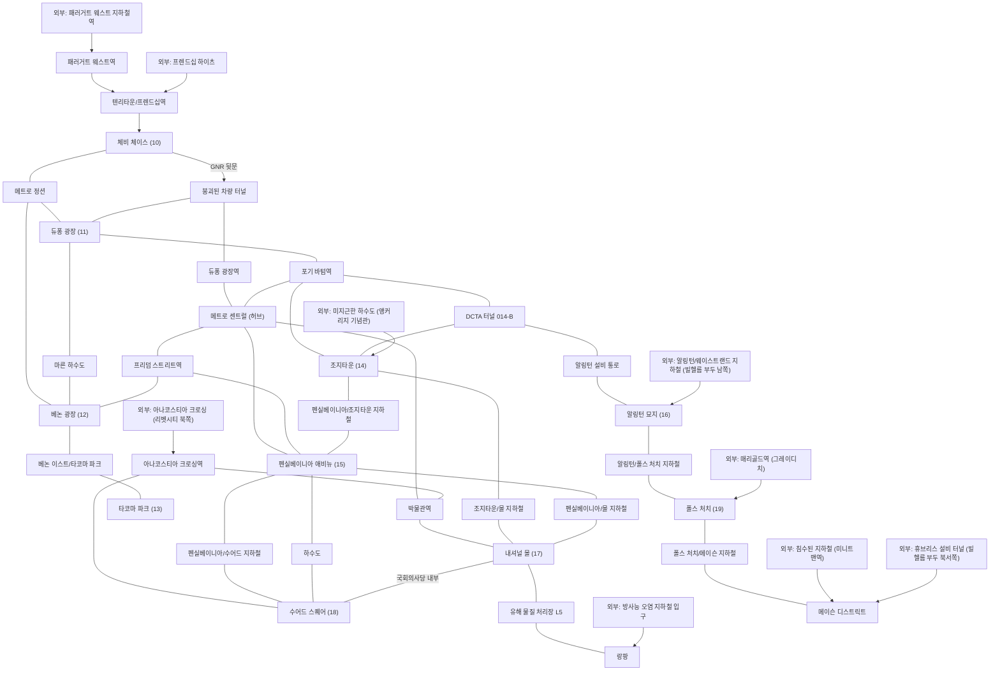
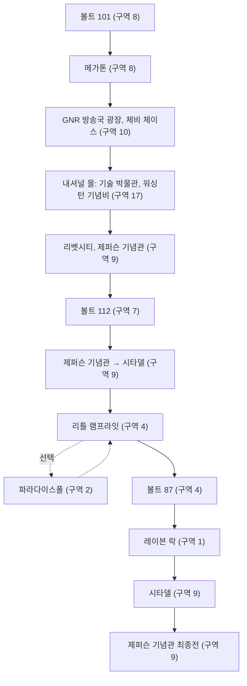

# RD-12. 월드 구조·정착지·볼트

> **폴아웃 3 역기획서 세트** | 문서 ID: RD-12 | 버전: v1.0 | 작성일: 2026-10-11
> **범위**: 수도 황무지의 맵 구조(규모·경계·좌표·지역 구분), D.C. 도심 폐허와 지하철·하수도 접근 구조, 이동·발견 동선, 군사 검문소와 엔클레이브 전초기지, 정착지 상세, 캐피털 지역 볼트 상세, 레벨 디자인 패턴 분석, 쯔꾸르 이식 메모 / **다루지 않는 것**: 모든 장소의 한 줄 목록(RD-13), NPC 전체 목록(RD-11), 상인 재고·가격과 플레이어 하우스 세부(RD-22), 퀘스트 진행 상세(RD-03~RD-07), 볼트 실험의 세계관적 의미(RD-02), DLC 전용 월드(RD-08a~e)
> **관련 문서**: [RD-02 세계관·설정·연표](02_world-and-lore.md), [RD-03 메인 스토리 1부](03_main-story-part1.md), [RD-04 메인 스토리 2부·엔딩](04_main-story-part2-endings.md), [RD-05 사이드 퀘스트 1부](05_side-quests-part1.md), [RD-06 사이드 퀘스트 2부](06_side-quests-part2.md), [RD-07 비표시·반복 퀘스트와 랜덤 인카운터](07_misc-quests-encounters.md), [RD-09 팩션](09_factions.md), [RD-11 NPC 디렉터리](11_npc-directory.md), [RD-13 장소 카탈로그](13_location-catalog.md), [RD-17 탐험·상호작용](17_exploration-interaction.md), [RD-22 경제·주거](22_economy-housing.md), [RD-24 크리처·적 도감](24_bestiary.md)

---

## 1. 문서 개요

### 1.1 목적

- 원작 폴아웃 3의 무대인 수도 황무지(Capital Wasteland)가 **어떤 공간 구조로 짜여 있는지**, 그 위에 정착지와 볼트(Vault)가 **어떻게 배치·설계됐는지** 정리한다.
- 팬게임에서 월드맵·마을·던전 맵을 설계할 때 근거로 쓸 수 있도록, 장소마다 위치·구조·시설·서비스·관련 퀘스트·상태 변화를 데이터 형태로 남긴다.

### 1.2 범위

| 구분 | 이 문서에서 다룸 | 다른 문서로 넘김 |
|---|---|---|
| 맵 구조 | 규모·경계·셀 격자·좌표, 지역 구분, D.C. 도심 구조, 강·섬·다리, 지하철·하수도 연결, 이동 동선 | 빠른 이동·발견 규칙, 셀 초기화 규칙 → [RD-17](17_exploration-interaction.md) |
| 정착지 | 위치, 개요, 역사, 공간 구조·시설, 주민 요약, 서비스, 관련 퀘스트, 위협, 퀘스트 결과에 따른 변화 | 주민 전체 목록 → [RD-11](11_npc-directory.md), 상인 재고·가격·플레이어 하우스 → [RD-22](22_economy-housing.md), 퀘스트 진행 → RD-03~RD-07 |
| 볼트 | 6개 볼트의 실험 내용(장소 설계 관점), 내부 구조, 출현 적, 주요 전리품, 관련 퀘스트, 터미널·홀로테이프 서사 | 볼트 실험의 세계관적 의미 → [RD-02](02_world-and-lore.md) |
| 특수 거점 | 군사 검문소 4곳, 엔클레이브(Enclave) 전초기지·캠프 약 30곳 | 엔클레이브 조직·병력 성격 → [RD-09](09_factions.md), 적 수치 → [RD-24](24_bestiary.md) |
| 장소 목록 | 대표 장소의 구조와 깊이 | 지도 마커가 있는 모든 장소의 한 줄 목록 → [RD-13](13_location-catalog.md) |

### 1.3 요약

- 수도 황무지는 **정사각형 외부 월드스페이스 1개(약 51×51 셀)** 와, 지하로만 들어갈 수 있는 **D.C. 도심 12개 구역(각각 별도의 소형 월드스페이스)** 이 겹친 2층 구조다.
- 외곽 황무지는 공식 가이드 기준 9개 구역(Zone 1~9)으로 나뉜다. 개발 중 밀도가 너무 높다는 판단으로 북·서쪽 영역을 늘려, **"가끔은 외롭게 느끼도록"** 장소 간격을 넓혔다.
- D.C. 도심은 잔해로 막힌 폐쇄 구역들을 지하철(Metro)·하수도 터널이 잇는 구조다. 지하 통로 자체가 전투·탐색 공간인 **'던전형 이동 경로'** 로 설계됐다.
- 정착지는 규모·기능·성향이 모두 달라, 각자 고유 퀘스트의 허브가 된다. 상당수는 퀘스트 결과에 따라 **파괴·점령·이주·주민 교체**가 일어난다.
- 볼트 6곳은 실험 주제를 내부 구조와 적 배치로 직접 보여 주는 **'테마 던전'** 이며, 터미널과 홀로테이프로 사연을 풀어놓는다.

### 1.4 표기 메모

- **좌표**: 공식 가이드는 장소 좌표를 `LAT x/LONG y`로 적는다. 이 값은 실제 위도·경도가 아니라 **외부 셀 격자 좌표 (X, Y)와 같다**(2.2절 근거). 이 문서는 `(X, Y)`로 쓰며, X는 동쪽, Y는 북쪽이 양수다.
- **구역 번호**: 공식 가이드의 'Zone n'을 '구역 n'으로 쓴다. 구역 이름은 가이드 원제를 병기한다.
- **셀 이름·폼 ID**: 코퍼스 정보상자 값을 그대로 옮긴다. 폼 ID는 8자리 중 앞자리 0을 생략한 위키 표기를 따른다.
- **퀘스트 이름**: 용어집 번역명을 쓰고 처음 나올 때 원제를 병기한다. 용어집에 없는 비표시 퀘스트는 번역명과 원제를 함께 적는다.
- **DLC 태그**: `[OA]` `[TP]` `[BS]` `[PL]` `[MZ]`. 태그가 없으면 본편 내용이다.

---

## 2. 월드 구조

### 2.1 맵 규모와 경계

#### 2.1.1 월드스페이스 구성

폴아웃 3의 게임 공간은 엔진 단위인 **월드스페이스(worldspace)** 와 **셀(cell)** 로 나뉜다. 수도 황무지는 하나의 큰 외부 월드스페이스와 여러 소형 월드스페이스, 그리고 수많은 내부 셀로 이루어진다.

| 층위 | 단위 | 예시 (셀 이름) | 설명 |
|---|---|---|---|
| 외부 황무지 | 주 월드스페이스 1개 | `MegatonTown`, `Vault101Exterior`, `Wilderness (2, -13)` | 정사각형 개방 지형. 이름 없는 외부 셀은 편집기에서 `Wilderness (X, Y)`로 불린다 |
| D.C. 도심 | 소형 월드스페이스 12개 | `ChevyChaseSchool`, `PennsylvaniaAveWhiteHouse`, `DupontCirclePlaza` | 구역마다 따로 만든 폐쇄 지형. 핍-보이(Pip-Boy) 월드 맵에서는 수도 황무지의 일부로 표시된다 |
| 내부 | 내부 셀 수백 개 | `Vault101a`, `MetroCenter01`, `RCHangarDeckMid` | 건물·지하철·볼트 내부. 장소 하나가 여러 셀로 쪼개진다 (예: 볼트 101은 외부 포함 9개 셀) |
| 특수 공간 | 별도 월드스페이스 | 트랜퀼리티 레인(Tranquility Lane), 위성 중계소 [BS] | 시뮬레이션·이벤트 전용 공간. 위성 중계소는 자체 월드 맵을 쓰며 수도 황무지로 치지 않는다 |
| DLC 월드 | 별도 월드 맵 | 피트(The Pitt) [TP], 포인트 룩아웃(Point Lookout) [PL], 앵커리지 시뮬레이션 [OA], 제타(Zeta) [MZ] | 수도 황무지의 진입점(라디오 신호·열차 터널·나루터 등)에서 이동 → [RD-08a~e](08a_dlc-operation-anchorage.md) |

#### 2.1.2 규모와 경계

- **정사각형 맵**: 폴아웃: 뉴 베가스 디렉터 조슈아 소여(Joshua Sawyer)는 "수도 황무지는 완전한 정사각형으로 만들어졌고, 그래서 맵 테두리와 플레이 가능 영역이 거의 정확히 일치한다"고 설명했다. 뉴 베가스의 모하비가 실제 지형도를 바탕으로 해 지도 가장자리가 비어 있는 것과 대비된다.
- **좌표 범위**: 위키의 폴아웃 3 위치 지도 틀은 공식 가이드와 같은 좌표계를 쓰며, 범위를 **위 31 / 아래 -20 / 왼쪽 -31 / 오른쪽 20**으로 잡는다. 따라서 외부 맵은 가로·세로 약 51셀의 정사각형이다(계산값). 가이드가 적은 실제 장소 좌표도 X -30(록랜드 차량 터널) ~ 20, Y -20(러키스 식료품점·탈론 정찰 캠프) ~ 30(독성 연못) 안에 들어간다.
- **셀 한 칸의 실제 크기**: 코퍼스에는 수치가 없다. 이 문서는 셀 수로만 규모를 적는다.
- **경계 처리**
  - 외곽: 북서쪽 산지, 서쪽 산맥, 남서쪽 절벽 지대가 자연 장벽이 된다. 그래도 넘어가려 하면 **보이지 않는 벽**에 막힌다. 위키의 버그 서술에 "맵 경계를 나타내는 보이지 않는 벽"(제퍼슨 기념관(Jefferson Memorial) 남서쪽 바위 지대)이 기록돼 있다.
  - 내부: 폴아웃 3은 맵 안쪽에 보이지 않는 벽을 거의 쓰지 않는다. 소여의 문답에서 질문자가 "폴아웃 3에는 수도 황무지를 벗어나려 할 때 말고는 보이지 않는 벽이 거의 없었다"고 말한 대목이 이를 보여 준다.
  - D.C. 도심: 구역 경계를 **잔해 더미·붕괴 건물·철조망**이라는 '눈에 보이는 벽'으로 막는다. 수어드 스퀘어(Seward Square)에서는 통을 철조망 옆에 옮겨 놓고 뛰어넘으면 맵 밖으로 나갈 수 있다는 기록이 있어, 경계가 지형 소품으로 처리됐음을 알 수 있다.
  - 국소 차단: 레이븐 락(Raven Rock)은 자유 탐색 중에는 입구만 갈 수 있고, 문을 부숴도 첫 방의 보이지 않는 벽에 막힌다. 피트 진입 열차 터널 [TP]도 같은 방식이다.
- **맵 밖으로 이어지는 인공물**: 모노레일(monorail) 선로는 지도의 북·동·서 세 경계를 넘어 이어지고, 고가도로도 맵 북쪽 끝 너머로 사라진다. 플레이어는 갈 수 없지만, 세계가 지도 밖에도 있다는 인상을 준다.

#### 2.1.3 지도 마커 수

| 구분 | 수 | 비고 |
|---|---|---|
| 본편 지도 마커 | 163 | 퍽 로브링어(Lawbringer)를 고르지 않으면 감시자 본부(Regulator HQ)가 없어 162 |
| 핍-보이 '발견한 장소' 최대 표시값 | 162 | 볼트 101 마커는 활성화되지만 통계에 들어가지 않는다 |
| DLC 추가 (수도 황무지 지도) | 10 | 5종 합계 |
| DLC 추가 (별도 월드 맵) | 51 | 피트·포인트 룩아웃·앵커리지·제타 등 |
| 전체 | 224 | 이 가운데 221곳만 '발견한 장소'에 집계 (케니의 동굴, 외계인 유도 신호기 제외) |

- 마커가 없는 '비표시 장소'도 많다. 위키 기준 Settlements 항목의 상당수(정착지 안 건물), 군사 검문소, 엔클레이브 캠프가 여기에 속한다. 마커 전체 목록은 [RD-13](13_location-catalog.md)이 다룬다.

#### 2.1.4 개발 이력이 남긴 구조

| 시점 | 변경 | 결과로 남은 구조 |
|---|---|---|
| 2005~2006 구상 | 이전 폴아웃과 매드맥스식 '서부 황무지'와 다른 무대로 베데스다 스튜디오가 있는 워싱턴 D.C.를 선택 | 실존 랜드마크·지하철을 압축·과장한 '캐리커처 D.C.' |
| 알파 단계 | 오블리비언의 장소(POI) 밀도를 그대로 썼더니 "세상이 서로 너무 붙어 있다"는 판단. 시야가 넓고, 가끔 외로워야 하는 게임이라 톤이 맞지 않음 | 맵 **북쪽과 서쪽에 넓은 영역을 새로 추가**. 환경 아트·레벨 디자인 팀 전체가 약 2개월 동안 이 작업에 매달림 |
| 확장 후 | 일부 장소를 새 위치로 옮김 | 편집기에 `xOLD…` 셀이 남음: 침수된 지하철(원래 매리골드역과 시타델(The Citadel) 사이), 방사능 오염 지하철(원래 바로 동쪽), 캘버턴(원래 주리 스트리트 지하철역 동쪽), 캔터베리 커먼(Canterbury Commons, 원래 남서쪽 사거리) |
| 도심 설계 | 도심이 한때 **26개 폐쇄 구역**으로 지금의 두 배 이상 컸으나 "너무 크고 헷갈린다"는 이유로 **12개**로 축소 | 지금의 D.C. 12개 구역 |
| 지하철 설계 | 처음에는 지하철이 지하로 완전히 이어지는 구상이었으나 "너무 넓게 퍼짐". 리드 작가 에밀 파글리아룰로(Emil Pagliarulo)는 "사실적인 것이 늘 재미있지는 않다"고 회고 | 끊긴 노선을 부분적으로 잇는 지금의 지하철망 |

### 2.2 좌표 체계

#### 2.2.1 공식 가이드 좌표 = 외부 셀 격자 좌표

공식 가이드(GOTY판)의 'LAT/LONG'은 위키에 기록된 외부 셀 이름 `Wilderness (X, Y)`와 값이 그대로 같다. 즉 가이드 좌표는 셀 격자 번호다.

| 장소 | 공식 가이드 표기 | 편집기 셀 이름 |
|---|---|---|
| 스캐빈저의 다리(Scavenger's bridge) | 8.S (LAT 02/LONG -13) | `Wilderness (2, -13)` |
| 빨간 쾌속정(Red speedboat) | 9.BB (LAT 12/LONG -20) | `Wilderness (12, -20)` |
| 전복된 중국군 수용소 트럭(Internment truck) | 1.C (LAT -27/LONG 20) | `Wilderness (-27,20)` |
| 강변 레이더 판잣집(Riverside raider shacks) | 5.K (LAT -03/LONG 07) | `Wilderness (-3,7)` |

- 축 방향: X는 서(-)→동(+), Y는 남(-)→북(+). 원점 (0, 0)은 스프링베일 학교(Springvale school, -1, -1)와 호숫가 폐허(1, 0) 부근으로, 맵의 기하학적 중심(약 -5.5, 5.5)보다 남동쪽에 있다.
- D.C. 도심 12개 구역은 별도 월드스페이스라 이 좌표계 밖에 있다. 가이드도 도심 장소에는 좌표 대신 구역 번호(예: 10.01, 17.05)만 붙인다.

#### 2.2.2 주요 장소 좌표

정착지·볼트·주요 거점의 좌표다. 코퍼스(가이드 전사본·문서 각주)에서 확인된 값만 적고, 확인되지 않은 장소는 상대 위치로 적는다.

| 장소 | 영문 | 좌표 (X, Y) | 가이드 구역 | 비고 |
|---|---|---|---|---|
| 레이븐 락 | Raven Rock | (-28, 28) | 1 | 맵 북서쪽 끝 |
| 오아시스 | Oasis | (-3, 28) | 2 | 입구 (-5, 29) |
| 볼트 92 | Vault 92 | (8, 27)* | 3 | *전사본은 'LAT -08'. 아래 주석 참고 |
| 올드 올니 | Old Olney | (10, 26)* | 3 | *전사본은 'LAT -10'. 외곽 폐가 (10, 23) |
| 데이브 공화국 | Republic of Dave | (19, 27) | 3 | 맵 북동쪽 끝 |
| 파라다이스폴 | Paradise Falls | (-9, 16) | 2 | |
| 마인필드 | Minefield | (4, 14) | 3 | |
| 템플 오브 유니온 | Temple of the Union | (13, 15) | 3 | |
| 볼트 87 | Vault 87 | (-28, 6) | 4 | 맵 서쪽 끝 |
| 리틀 램프라잇 | Little Lamplight | (-26, 2) | 4 | |
| 섀크타운 | Shacktown | (-18, 6) | 4 | 가이드의 '황무지 집시 마을' |
| 아르푸 | Arefu | (-11, 6) | 5 | |
| 빅타운 | Big Town | (-4, 3) | 5 | |
| 볼트 106 | Vault 106 | (-9, 1) | 5 | |
| 스프링베일 학교 | Springvale school | (-1, -1) | 5 | |
| 스프링베일 | Springvale | (-2, -4) | 8 | |
| 홀리 라이트 수도원 [BS] | Holy Light Monastery | (-1, -4) | 8 | 스프링베일 안 |
| 에버그린 밀 | Evergreen Mills | (-18, -7) | 7 | |
| 스미스 케이시의 정비소 (볼트 112 입구) | Smith Casey's garage | (-22, -8) | 7 | |
| 다리그늘 마을 | Girdershade | (-26, -11) | 7 | |
| 인디펜던스 요새 | Fort Independence | (-6, -13) | 8 | |
| 텐페니 타워 | Tenpenny Tower | (-16, -17) | 7 | |
| 안데일 | Andale | (-5, -17) | 8 | |
| 그레이디치 | Grayditch | (5, -9) | 9 | |
| 빌헬름 부두 | Wilhelm's Wharf | (7, -7) | 9 | |
| 시타델 | The Citadel | (8, -14) | 9 | |
| 알링턴 도서관 | Arlington Library | (8, -19) | 9 | |
| 리벳시티 | Rivet City | (18, -17) | 9 | 맵 남동쪽 |
| 메가톤 | Megaton | (코퍼스 미확인) | 8 | 볼트 101 남동쪽, 스프링베일 남동쪽 |
| 볼트 101 | Vault 101 | (코퍼스 미확인) | 8 | 메가톤 근처, 스프링베일 서쪽 언덕 |
| 캔터베리 커먼 | Canterbury Commons | (코퍼스 미확인) | 6 | 맵 동쪽, 로봇 수리 센터 북동쪽 |
| 볼트 108 | Vault 108 | (코퍼스 미확인) | 6 | 가이드 구역 6 개관에 '게리(Gary)' 언급 |

> \* **좌표 오기 주석**: 가이드 전사본은 볼트 92를 (LAT -08/LONG 27), 올드 올니를 (LAT -10/LONG 26)으로 적었다. 그런데 두 곳 모두 '구역 3: 북동부'에 속하고, 위키 본문은 "올드 올니는 볼트 92 바로 동쪽, 그리너 패스처스 처리장(7, 21)의 북동쪽"이라고 설명한다. 올드 올니 외곽(10, 23)도 양수다. 따라서 X값의 부호 오기로 보고 양수로 고쳐 적었다(추정).

### 2.3 지역 구분

#### 2.3.1 공식 가이드의 구역 체계

공식 가이드는 외곽 황무지를 **구역 1~9**, D.C. 도심 내부를 **구역 10~21**, 둘을 잇는 지하 통로를 **구역 U**로 나눈다. 과업에서 말하는 북서·북·북동·서·중앙·동·남은 아래와 같이 대응한다.

| 구역 | 가이드 원제 | 방위 | 지형·분위기 (가이드 개관 요약) | 대표 장소 | 주요 위협 |
|---|---|---|---|---|---|
| 1 | Northwest Territories | 북서 | 거칠고 위험하며 치료·거래·수리할 곳이 멀다. 북쪽 끝은 산악. 포토맥강이 북→남으로 흐르고 방사능 물에 마이얼럭(Mirelurk)이 산다. 엔클레이브의 근거지가 대부분 지하에 있다 | 레이븐 락, MDPL-05 발전소, 새트컴 어레이 NW-05a·NW-07c, 디커슨 태버너클 예배당, 메이슨 딕슨 고철장, 마운트 메이블 캠핑장 | 데스클로(Deathclaw), 로봇, 레이더(Raider), 마이얼럭 |
| 2 | Northern Mountains | 북 | 북쪽은 험한 산악, 남쪽은 다니기 쉬운 땅. 남북 도로 두 개가 구역 5의 동서 도로와 만나고, 무너진 고가도로와 모노레일이 대각선으로 가로질러 길잡이가 된다. 큰 정착지는 노예 사냥꾼 기지 하나뿐 | 오아시스, 파라다이스폴, 새트컴 어레이 NN-03d, MDPL-21 발전소, 절벽 위 판잣집, 몽고메리 카운티 저수지, 리클라이닝 그로브스 리조트 | 노예 사냥꾼(Slaver), 레이더 |
| 3 | Northeast Territories | 북동 | 인구가 적다. 올드 올니 일대와 그리너 패스처스 처리장(거대한 방사능 지대)이 중심. 농장, 지뢰로 가득한 유령 마을, 템플 오브 유니온이 흩어져 있다 | 볼트 92, 올드 올니, 데이브 공화국, 체이스트 에이커스 낙농장, 그리너 패스처스 처리장, 그리즐리 식당, 마인필드, 템플 오브 유니온 | 데스클로(올드 올니), 스캐빈저, 방사능 |
| 4 | Irradiated Western Plains | 서 | 200년 전 폭격을 가장 세게 맞은 곳. 서쪽 끝은 슈퍼 뮤턴트(Super mutant)의 '탄생지'(볼트 87), 동쪽은 사람이 야생 구울(Feral ghoul)로 변해 가는 방사능 평원. 슈퍼 뮤턴트와 탈론 컴퍼니(Talon Company)가 패권을 다툰다 | 볼트 87, 리틀 램프라잇, 배니스터 요새(Fort Bannister), 셰일브리지, 파이브 액슬스 휴게소, MDPL 대형 중계소, 방송탑 KT8, 록브레이커의 마지막 주유소 | 슈퍼 뮤턴트, 탈론 컴퍼니, 방사능 |
| 5 | Central Plains and Potomac | 중앙 | 볼트 101 바로 북쪽. 작은 랜드마크와 판잣집이 많다. 노스웨스트 세네카역과 메레스티역을 잇는 지하 통로가 있다 | 아르푸, 빅타운, 볼트 106, 저먼타운 경찰 본부(Germantown Police HQ), 스프링베일 학교, 해밀턴의 은신처, 주리 스트리트 지하철역 | 슈퍼 뮤턴트(저먼타운), 패밀리(The Family), 레이더 |
| 6 | Eastern Hills and D.C. Outskirts | 동 | 비교적 생기 있고 건물이 많지만 넓은 황량지도 있다. 상인 교역지와 자동차 공장 두 곳, 남서쪽의 베세즈다 폐허, 도심 외곽의 주 방위군 창고와 도심행 지하철역 | 스크랩야드, 휘턴 무기고, 캔터베리 커먼, 코르베가 공장, 크라이슬러스 빌딩, 베세즈다 폐허, 주 방위군 창고, 록 크리크 동굴, 볼트 108 | 레이더, 로봇, 슈퍼 뮤턴트 |
| 7 | Southwest Territories | 남서 | 거대한 고가도로 뼈대가 구역을 가른다. 서쪽은 바위투성이, 동쪽으로 갈수록 평탄. 북쪽은 레이더 요새 에버그린 밀이 지배. 도심 밖 최대 건축물 텐페니 타워가 있다 | 에버그린 밀, 스미스 케이시의 정비소(볼트 112), 야오과이 터널, 던위치 빌딩, 텐페니 타워, 다리그늘 마을, 차넬 하우스, 로브코 시설 | 레이더, 야오과이(Yao guai), 구울 |
| 8 | Southern Plains and D.C. Outskirts | 남 | 게임 시작 지역. 볼트 101 주변과 그 남쪽. 메가톤, 아웃캐스트의 근거지, 시골 마을 안데일, 뉴카-콜라 공장(Nuka-Cola plant) | 볼트 101, 스프링베일, 메가톤, 인디펜던스 요새, 클리프사이드 동굴, 안데일, 레드 레이서 공장, 뉴카-콜라 공장 | 레이더, 개미, 아웃캐스트(Brotherhood Outcasts) |
| 9 | Exterior D.C. Metropolitan Ruins | 남동 (도심 외곽) | 수도 황무지와 지하 터널·도심 내부 구역을 잇는 연결망의 '바깥쪽' | 수퍼-두퍼 마트(Super-Duper Mart), 앵커리지 기념관(Anchorage Memorial), 그레이디치, 시타델, 리벳시티, 제퍼슨 기념관, 듀코브의 집, 빌헬름 부두, 알링턴 도서관 | 슈퍼 뮤턴트, 레이더, 마이얼럭, 탈론 컴퍼니 |
| 10~21 | Interior D.C. Metropolitan Ruins | 도심 내부 | 지하철로만 들어가는 12개 폐쇄 구역 (2.4절) | 체비 체이스, 내셔널 몰 등 | 슈퍼 뮤턴트, 탈론 컴퍼니, 엔클레이브 |
| U | Linking Underground Locations | 지하 | 도심 구역과 외곽을 잇는 지하철·하수도 (2.6절) | 카운티 하수도 본관(U13) 등 | 야생 구울, 방사능바퀴(Radroach), 레이더 |

**9구역 = 3×3 격자**: 가이드가 적은 장소 좌표를 구역별로 모으면, 외곽 9구역이 정사각형 맵을 가로·세로 약 17셀씩 3등분한 격자와 거의 맞아떨어진다(경계값은 좌표 분포로 본 추정).

| | 서 (X 약 -31~-14) | 중 (X 약 -14~3) | 동 (X 약 3~20) |
|---|---|---|---|
| **북** (Y 약 13~31) | 구역 1 북서부 | 구역 2 북부 산악 | 구역 3 북동부 |
| **중** (Y 약 -4~13) | 구역 4 서부 방사능 평원 | 구역 5 중앙 평원·포토맥 | 구역 6 동부 구릉·D.C. 외곽 |
| **남** (Y 약 -20~-4) | 구역 7 남서부 | 구역 8 남부 평원·D.C. 외곽 | 구역 9 D.C. 외곽 폐허 |

- 경계 근처 사례: 마인필드(4, 14)는 구역 3, 배니스터 크레이터(-14, -1)는 구역 4, 스프링베일(-2, -4)은 구역 8, 스프링베일 학교(-1, -1)는 구역 5다.

#### 2.3.2 구역 배치의 설계 특징

- **시작 지점이 중앙 남쪽**: 볼트 101은 구역 8, 원점 가까이에 있다. 플레이어는 맵 가운데에서 출발해 사방으로 퍼져 나간다. 가장 위험한 북서(구역 1)·서(구역 4)는 출발점에서 멀다.
- **동심원형 난이도**: 메가톤·스프링베일 일대(구역 8)는 레이더·개미 위주로 비교적 안전하고, 도심(구역 9~21)으로 갈수록 슈퍼 뮤턴트가 늘며, 맵 가장자리(레이븐 락, 올드 올니, 데스클로 보호구역)에는 최상위 위협이 있다. 다만 적은 인카운터 존 단위로 레벨이 조정되므로 고정 난이도 지도는 아니다(→ [RD-16](16_combat-system.md), [RD-17](17_exploration-interaction.md)).
- **포토맥강이 맵을 둘로 가른다**: 강은 북서쪽에서 남동쪽으로 흐르며 맵을 대략 두 쪽으로 나눈다. 서쪽 강변에 아르푸·볼트 87·시타델이, 동쪽 강변에 도심과 리벳시티가 있다.
- **세 방향의 '길잡이 선'**: 남북 도로, 동서 도로, 대각선 고가도로·모노레일이 지형지물 역할을 해 나침반 없이도 위치를 잡게 해 준다(구역 2 개관).

### 2.4 D.C. 도심 폐허 구조

#### 2.4.1 도심의 기본 규칙

- **지상으로는 구역 사이를 오갈 수 없다.** 각 구역은 잔해 더미와 무너진 건물로 둘러싸인 폐쇄 공간이며, 별도 월드스페이스로 만들어졌다.
- **진입 수단은 지하뿐이다.** 지하철역·지하철 터널, 하수도, 설비 통로, 그리고 몇몇 건물 내부(국회의사당(Capitol Building), GNR 방송국 뒷문)가 구역을 잇는다. 로딩 화면도 이 규칙을 직접 알려 준다.

  > "The only way to reach the Super Mutant-occupied D.C. ruins is by traveling underground, usually through the abandoned Metro tunnels." (로딩 화면)
  > "슈퍼 뮤턴트가 점령한 D.C. 폐허에 닿는 유일한 길은 지하, 대개 버려진 지하철 터널을 지나는 것이다."

- **한 구역에 지도 마커가 여러 개다.** 마커는 곧 그 구역의 출입구다(예: 체비 체이스 북쪽·체비 체이스 동쪽·GNR 방송국 광장). 빠른 이동 시 마커 위치와 실제 도착 지점이 다를 수 있다(조지타운 서쪽, 듀퐁 역).
- **적 배치는 '1회성 + 조건부 스폰'이다.** 내셔널 몰의 슈퍼 뮤턴트 상당수는 다시 생기지 않아 정리할 수 있다. 반면 베논 광장(Vernon Square)·수어드 스퀘어에서는 특정 지점을 지나거나 구역을 정리한 뒤 다시 지나갈 때 슈퍼 뮤턴트·센타우로스(Centaur)가 추가로 스폰된다.
- **세력 전쟁터다.** 브라더후드 오브 스틸(Brotherhood of Steel, BoS), 슈퍼 뮤턴트, 탈론 컴퍼니가 구역마다 교전 중이며, 생명의 물(The Waters of Life) 이후에는 엔클레이브 버티버드(Vertibird)가 병력을 떨어뜨린다(2.10절).

#### 2.4.2 구역별 구조

가이드 구역 10~19는 전사본에서 확인했다. 구역 20·21은 전사본에 없어 남은 두 구역(메이슨 디스트릭트, 랑팡)에 해당한다고 추정하며 순서는 확인하지 못했다.

| 가이드 구역 | 구역 | 영문 | 도심 내 위치 | 지도 마커 (출입구) | 연결 통로 | 주요 시설 | 주 세력·적 | 관련 퀘스트 |
|---|---|---|---|---|---|---|---|---|
| 10 | 체비 체이스 | Chevy Chase | 북쪽 | 체비 체이스 북쪽, 체비 체이스 동쪽, GNR 방송국 광장 | 텐리타운/프렌드십역, 메트로 정션, GNR 방송국 뒷문→듀퐁 광장 | GNR 방송국 광장, 갤럭시 뉴스 라디오 방송국, 얼리 던 초등학교(Early Dawn Elementary) | BoS(라이언스 프라이드) 대 슈퍼 뮤턴트, 베히모스(Behemoth) | 아버지의 발자취(Following in His Footsteps), 갤럭시 뉴스 라디오(Galaxy News Radio) |
| 11 | 듀퐁 광장 | Dupont Circle | 북쪽 중앙 | 듀퐁 동쪽, 듀퐁 북동쪽, 듀퐁 서쪽, 듀퐁 광장역 | 붕괴된 차량 터널, 듀퐁 광장역, 포기 바텀역, 메트로 정션, 마른 하수도, 가라앉은 하수도 | 로터리 분수 광장, 레이디 프럼퍼턴 패션(Lady Frumperton's Fashions), 번사이드 은행 | **도심 최대 레이더 거점**(위키 표현 "거의 두 다스", 일부 리스폰), 파편 지뢰 두 다스 이상, 야생 구울, 사나운 개 | - |
| 12 | 베논 광장 | Vernon Square | 북동쪽 중앙 | 베논 광장역, 베논 광장 북쪽, 베논 광장 동쪽, 아워 레이디 오브 호프 병원, 스테이츠맨 호텔, 볼트-텍 본사 | 프리덤 스트리트역, 메트로 정션, 베논 이스트/타코마 파크, 하수도 2곳 | 아워 레이디 오브 호프 병원(Our Lady of Hope Hospital)과 스테이츠맨 호텔(Statesman Hotel, 쓰러진 무선탑으로 연결), 볼트-텍 본사(Vault-Tec headquarters), 델타 IX 로켓 낙하 구덩이 | 슈퍼 뮤턴트(몰 다음으로 밀집), 센타우로스 | 라일리스 레인저스(Reilly's Rangers), 독립을 훔쳐라(Stealing Independence), 애거사의 노래(Agatha's Song) |
| 13 | 타코마 파크 | Takoma Park | 북동쪽 | 타코마 파크 | 베논 이스트/타코마 파크 | 타코마 인더스트리얼(Takoma Industrial, 에이브락소 세제 공장), 니프티 스리프티 전당포, 정비소, 숨겨진 방사능 웅덩이 | 슈퍼 뮤턴트, 베히모스, 탈론 컴퍼니(포격 지원) | - |
| 14 | 조지타운 | Georgetown | 북서쪽 | 조지타운 서쪽·동쪽·북쪽·남쪽 | DCTA 터널 014-B, 미지근한 하수도, 포기 바텀역, 조지타운/내셔널 몰 지하철, 펜실베이니아 애비뉴/조지타운 지하철 | 코누코피아 식료품점, 레디에이션 킹 상점, 매클렐런 가 타운하우스, 라 메종 보르가르 | 슈퍼 뮤턴트, 센타우로스, 탈론 컴퍼니 | 황무지 생존 가이드(The Wasteland Survival Guide) |
| 15 | 펜실베이니아 애비뉴 | Pennsylvania Avenue | 중앙 | 펜실베이니아 애비뉴 북쪽·북서쪽·남쪽·동쪽, 메트로 센트럴, 백악관 광장 [BS] | 지하철 출입구 7곳(가장 많음) | 백악관(White House) 폭심지(팻맨·미니 누크 3발), BoS 거점 호텔, 발키리 동상 | BoS 대 슈퍼 뮤턴트, 엔클레이브 병력 투하 | [BS] 대통령 전용 지하철 경유 애덤스 공군 기지 진입 |
| 16 | 알링턴 묘지 | Arlington Cemetery | 강 서쪽 | 알링턴 묘지 북쪽·남쪽, 마마 돌체 | 알링턴/웨이스트랜드 지하철, 알링턴 설비 통로, 알링턴/폴스 처치 지하철 | 알링턴 하우스(Arlington House), 마마 돌체 식품 공장(Mama Dolce's) | 리스폰하지 않는 레이더 3명, 중국군 잔존병 | 로브링어 퍽 현상금 표적 |
| 17 | 내셔널 몰 | The Mall | 중앙 남쪽 | 몰 북서·남서·북동쪽 + 역사 박물관(Museum of History), 기술 박물관(Museum of Technology), 링컨 기념관(Lincoln Memorial), 워싱턴 기념비(Washington Monument), 국립 기록 보관소(National Archives), 국회의사당, 박물관 관리청 건물 [BS] | 조지타운/몰 지하철, 박물관역, 유해 물질 처리장 L5, 펜실베이니아/몰 지하철, 국회의사당 내부→수어드 스퀘어 | 언더월드(Underworld, 역사 박물관 안), 서쪽 절반은 비교적 온전, 동쪽 절반은 참호·벙커망 | 동쪽: 슈퍼 뮤턴트 / 중앙: BoS(워싱턴 기념비) / 동쪽 끝: 탈론 컴퍼니(국회의사당) / 서쪽 끝: 노예 사냥꾼(링컨 기념관) | 갤럭시 뉴스 라디오, 국가 원수(Head of State), 독립을 훔쳐라, 라일리스 레인저스, [BS] 놀라운 아쿠아 큐라!(The Amazing Aqua Cura!) |
| 18 | 수어드 스퀘어 | Seward Square | 동쪽 | 수어드 스퀘어 북쪽 지하철, 남동쪽, 북서쪽, 레인저 기지 | 아나코스티아 크로싱역, 펜실베이니아/수어드 지하철, 하수도, 국회의사당 | 레인저 기지(Ranger compound), 브로드웨이 극장 | 슈퍼 뮤턴트, 센타우로스, 탈론 컴퍼니 | 라일리스 레인저스 |
| 19 | 폴스 처치 | Falls Church | 강 남서쪽 | 폴스 처치 북쪽, 폴스 처치 지하철, 폴스 처치 동쪽 | 매리골드역, 알링턴/폴스 처치 지하철, 폴스 처치/메이슨 지하철 | L.O.B. 엔터프라이즈, 사무용 건물 2곳 | 슈퍼 뮤턴트, BoS | - |
| 20·21 (추정) | 메이슨 디스트릭트 | Mason District | 강 서쪽 | 메이슨 디스트릭트 남쪽, 휴브리스 코믹스 | 폴스 처치/메이슨 지하철, 침수된 지하철(미니트맨역), 휴브리스 코믹스 설비 터널 | 휴브리스 코믹스(Hubris Comics), 침수된 공원, 저격수 둥지 | 슈퍼 뮤턴트(포로 1명 데리고 있음) | 초인의 도박(The Superhuman Gambit) |
| 20·21 (추정) | 랑팡 | L'Enfant | 몰 남쪽 | 랑팡 플라자, 랑팡 남쪽 | 유해 물질 처리장 L5, 방사능 오염 지하철 | 캐피톨 포스트 신문사, 랑팡 카페, 마담 젤 상점, 베스닉 이발소 | 슈퍼 뮤턴트, 엔클레이브 버티버드 착륙 | 비표시 퀘스트 단서(깁슨의 열쇠→마인필드, 수색대 일지 #1) |

- **도심 외곽 마커**: 프렌드십 하이츠(Friendship Heights)와 주 방위군 창고는 도심 북쪽 외곽, 아나코스티아 지역(리벳시티·제퍼슨 기념관)과 포토맥강 연안(알링턴 도서관, 시타델, 빌헬름 부두, 앵커리지 기념관 등)은 외부 월드스페이스에 있다. 위키는 이들을 'D.C. 지역'으로 묶지만 구조상으로는 구역 9(외곽)다.
- **도심 구역의 공통 설계**: 한 구역은 대체로 ① 지하철 출구 광장 ② 잔해로 꺾인 거리 ③ 랜드마크 건물 ④ 다른 지하철 출구 순서로 짜인다. 거리는 짧고, 버스·차량 잔해가 엄폐물이자 연쇄 폭발 위험물이다(조지타운, 랑팡).

### 2.5 강·섬·다리

| 지형 | 영문 | 구조 | 게임플레이 역할 | 퀘스트에 따른 변화 |
|---|---|---|---|---|
| 포토맥강 | Potomac River | 맵 북서쪽에서 남동쪽 타이들 베이슨까지 흐르며 맵을 대략 둘로 나눈다. 2277년에는 물이 거의 끊겨, 포기 바텀 위쪽은 대부분 발을 적시지 않고 건널 수 있다. 웅덩이마다 방사능 물과 잔해가 있다 | 동서 이동의 자연 경계. 물속은 방사능 피폭과 마이얼럭 서식지. 다리·얕은 여울이 길목이 된다 | 정화 계획(Project Purity) 가동 후 타이들 베이슨에 깨끗한 물이 흐른다 |
| 아나코스티아강 | Anacostia River | 포토맥의 지류. 북동쪽에서 흘러와 제퍼슨 기념관 남동쪽 반도에서 포토맥과 만난다 | 리벳시티가 이 강 하구에 좌초해 있다. 강 중간을 아나코스티아 크로싱이 건넌다 | - |
| 타이들 베이슨 | Tidal Basin | 제퍼슨 기념관 옆 저수지. 노 젓는 보트와 예인선이 버려져 있다 | 정화기(Purifier)와 연결된 수원. BoS·엔클레이브·슈퍼 뮤턴트가 주변을 다툰다 | 되찾아라!(Take It Back!) 후 물의 방사능이 사라지고, BoS 신병들이 마이얼럭 사체를 화염방사기로 태운다 |
| FDR 섬 | FDR Island | 포토맥강 가운데 섬. 전쟁 전 앵커리지 기념관이 세워졌다. DCTA 지도에는 여전히 'FDR 섬'역으로 남아 있다 | 기념관 지하에 마이얼럭 사육 시설 던전. 마지막 마이얼럭을 처치하면 침대·작업대·금고가 있는 임시 거처로 쓸 수 있다 | - |
| 프랜시스 스콧 키 다리 | Francis Scott Key Bridge | '포토맥 다리'라고도 한다. 시타델 쪽에서 워싱턴 기념비 방향으로 강을 건너지만 일부가 무너져 있다 | 다리 아래 서쪽에 레이더 캠프, 동쪽에 거래 가능한 스캐빈저(Scavenger), 동쪽 끝에 방사능 오염 지하철 옆 슈퍼 뮤턴트 기지. 카운티 하수도 본관 출구가 다리 바로 북쪽에 있다 | 되찾아라! 동안 스캐빈저가 사라졌다가 [BS] 설치 시 돌아온다 |
| 아르푸 고가교 | Arefu (bridge) | 포토맥을 건너는 옛 고속도로 다리 위의 정착지. 노예 사냥꾼을 막으려고 북쪽 램프를 스스로 끊었다 | 접근로가 남쪽 램프 하나뿐인 '병목 마을' | 3.6절 |
| 스캐빈저의 다리 | Scavenger's bridge | 레드 레이서 공장 북쪽, 남북 고속도로 위를 동서로 지나는 다리 | 스캐빈저와 개들의 교역소. 소유물 표시가 붙어 있다 | - |
| 시타델 금속 다리 | (metal bridge) | 시타델 서쪽 강변과 이어지는 다리(셀 `MQ11Westbank02`) | 메인 퀘스트 후반 진입로 | - |
| 리벳시티 도개교 | (drawbridge) | 북쪽 녹슨 승강장과 항공모함 사이를 잇는 접이식 다리. 인터컴으로 요청해야 내려온다 | 정착지 출입 통제 장치 | 3.2절 |

- **수영과 물**: 물에 들어가면 방사능을 받는다. 깊은 웅덩이는 마이얼럭이 지킨다. 그래서 강은 '건널 수는 있지만 오래 머물면 손해인' 지형으로 작동한다.
- **도로망**: 위키가 확인한 도로 이름은 대부분 도심 구역 안의 거리(콘스티튜션 애비뉴, 인디펜던스 애비뉴, 펜실베이니아 애비뉴 등)다. 외곽은 이름 없는 무너진 고속도로·고가도로가 길잡이 역할을 한다.

### 2.6 도심 접근 구조: 잔해·지하철·하수도

#### 2.6.1 전쟁 전 노선과 실제 연결의 차이

설정상 DCTA(컬럼비아 특별구 교통국) 지하철은 레드·블루·화이트 3개 노선이다. 하지만 게임 속 실제 통로는 노선도와 다르게, 무너지고 남은 구간을 이어 붙인 형태다.

| 노선 | 설정상 역 순서 (노선도) | 실제 게임 구조 |
|---|---|---|
| 레드 라인 | 레드 라인 조차장 - 메레스티 - 프렌드십 - 텐리타운 - 듀퐁 - 메트로 센트럴 - 박물관 - 아나코스티아 크로싱 | 북쪽 끝(메레스티)은 외곽의 독립 던전, 나머지는 도심 남북 축(텐리타운~메트로 센트럴~박물관~아나코스티아)으로 실제 이어진다 |
| 블루 라인 | 블루 라인 조차장 - 워링턴 - 매리골드 - 폴스 처치 - 프랭클린 - 미니트맨 - 랑팡 - 알링턴/웨이스트랜드 - 노스 포토맥 - 주리 스트리트 | 워링턴·주리 스트리트는 외곽의 막다른 던전. 매리골드~폴스 처치~메이슨, 미니트맨(침수된 지하철) 구간만 도심과 이어진다. 랑팡·워링턴 조차장 부근은 방사능이 강하다 |
| 화이트 라인 | 플라츠 - 알링턴 - 포기 바텀 - 메트로 센트럴 - 베논 광장 - 벡턴 - 애버내시 - 타코마 | 포기 바텀~메트로 센트럴~(프리덤 스트리트)~베논 광장~타코마의 동서 축으로 이어진다. 블루 라인과는 입체 교차라 환승할 수 없다 |

- 역 로비에는 3개 노선 역의 전력 상태를 보여 주는 표시판이 있고, 대부분의 역은 아직 전기가 들어온다. 일부 역에는 프로텍트론(Protectron) 경비가 남아 있어 **지하철 승차권(Metro ticket)** 이 없으면 공격한다.
- 역 입구는 지상에서 지하철 표지판과 오벨리스크로 알아본다. 큰 역은 에스컬레이터 4개, 작은 역은 깨진 유리 지붕 아래 계단 하나다. 2277년에는 모든 역 입구가 '출입 금지' 철조망으로 막혀 있다.

#### 2.6.2 도심 지하 연결망 (실제 통로)

정보상자의 `connects to`(내부 연결)와 `world map exits`(지상 출구)를 정리했다. '외부'는 수도 황무지 외부 월드스페이스를 뜻한다.

| 통로 | 영문 | 유형 | 지상 출구 | 내부 연결 | 특징 |
|---|---|---|---|---|---|
| 패러거트 웨스트역 | Farragut West station | 지하철 | 외부: 패러거트 웨스트 지하철역(수퍼-두퍼 마트 동쪽, 강 건너) | 텐리타운/프렌드십역 | 땅두더지(Mole rat) 3, 야생 구울 4. 프로텍트론 활성 터미널, 가스 누출, 열쇠, 안전 가옥으로 쓸 방 |
| 프렌드십 하이츠 | Friendship Heights | 지하철 | 외부: 도심 북쪽 외곽 아파트 단지(지붕에 레이더 캠프) | 텐리타운/프렌드십역 | 야생 구울 다수, 죽은 안내인 |
| 텐리타운/프렌드십역 | Tenleytown/Friendship station | 지하철 | 체비 체이스 북쪽, 프렌드십 하이츠 | 패러거트 웨스트역 | 메인 퀘스트의 첫 도심 진입로 |
| 메트로 정션 | Metro Junction | 지하철 | 체비 체이스 동쪽, 듀퐁 북동쪽, 베논 광장 북쪽·베논 광장역 | - | 북부 3개 구역의 교차점. 레이더 사체와 야생 구울 |
| 붕괴된 차량 터널 | Collapsed car tunnel | 터널 | 듀퐁 광장(GNR 뒤 함몰 도로) | 듀퐁 광장역 | GNR 방송국 뒷문에서 듀퐁 광장 본 구역으로 가는 우회로 |
| 듀퐁 광장역 | Dupont Circle station | 지하철 | 듀퐁 역 | 붕괴된 차량 터널, 메트로 센트럴 | |
| 포기 바텀역 | Foggy Bottom station | 지하철 | 듀퐁 서쪽, 조지타운 북쪽 | DCTA 터널 014-B, 메트로 센트럴 | |
| DCTA 터널 014-B 포토맥 | DCTA tunnel 014-B Potomac | 터널 | 조지타운 서쪽 | 알링턴 설비 통로, 포기 바텀역 | 강 밑을 지나는 연결 터널 |
| 알링턴 설비 통로 | Arlington utility | 설비 | 알링턴 묘지 북쪽 | DCTA 터널 014-B | |
| 메트로 센트럴 | Metro Central | 지하철(허브) | 펜실베이니아 애비뉴(메트로 센트럴 마커) | 듀퐁 광장역, 포기 바텀역, 프리덤 스트리트역, 박물관역 | **도심 지하망의 중심 허브**(내부 연결 4개) |
| 프리덤 스트리트역 | Freedom Street station | 지하철 | 베논 광장역, 펜실베이니아 애비뉴 북쪽 | 메트로 센트럴 | |
| 박물관역 | Museum station | 지하철 | 내셔널 몰(역사 박물관·기술 박물관 앞) | 아나코스티아 크로싱역, 메트로 센트럴 | |
| 아나코스티아 크로싱역 | Anacostia Crossing Station | 지하철 | 외부: 리벳시티 바로 북쪽 / 수어드 스퀘어 남동쪽 | 박물관역 | 레드 라인 남쪽 종점. 가벼운 무장의 레이더. 역 밖에 카르마에 따라 탈론 컴퍼니나 감시자(Regulators) 출현 |
| 베논 이스트/타코마 파크 | Vernon East/Takoma Park | 지하철 | 베논 광장 동쪽, 타코마 파크 | - | 타코마 파크로 가는 유일한 통로 |
| 조지타운/몰 지하철 | Georgetown/The Mall Metro | 지하철 | 조지타운 남쪽, 몰 북서쪽 | - | |
| 펜실베이니아/조지타운 지하철 | Penn Ave/Georgetown Metro | 지하철 | 조지타운 동쪽, 펜실베이니아 애비뉴 북서쪽 | - | |
| 펜실베이니아/수어드 지하철 | Penn Ave/Seward Square Metro | 지하철 | 펜실베이니아 애비뉴 동쪽, 수어드 스퀘어 북쪽 | - | |
| 펜실베이니아/몰 지하철 | Penn Ave/The Mall Metro | 지하철 | 펜실베이니아 애비뉴 남쪽, 몰 북동쪽 | - | |
| 하수도(펜실베이니아) | Sewer (metro) | 하수도 | 펜실베이니아 애비뉴, 수어드 스퀘어 | - | 스킬북 '텀블러스 투데이' |
| 유해 물질 처리장 L5 | Hazmat disposal site L5 | 동굴 | 랑팡, 몰 남서쪽(링컨 기념관 부근) | - | 지하철 선로의 구멍 아래 방사성 폐기물 동굴. 야생 구울·글로잉 원 |
| 방사능 오염 지하철 | Irradiated metro | 지하철 | 외부: 시타델 근처 다리 동쪽 / 랑팡 남쪽 | - | 입구 위 통로에서 슈퍼 뮤턴트 매복. 글로잉 원 |
| 미지근한 하수도 | Tepid sewers | 하수도 | 외부: 앵커리지 기념관 부근 / 조지타운 서쪽 | - | 터렛, 가스 누출, 지뢰 터널, 레이더 두목 록솔트 |
| 알링턴/웨이스트랜드 지하철 | Arlington/Wasteland Metro | 지하철 | 외부: 빌헬름 부두 남쪽(핍-보이 표기 '침수된 지하철') / 알링턴 묘지 북쪽 | - | 'FDR 섬역'이라고도 한다 |
| 알링턴/폴스 처치 지하철 | Arlington/Falls Church Metro | 지하철 | 알링턴 묘지 남쪽, 폴스 처치 북쪽 | - | |
| 매리골드역 | Marigold station | 지하철 | 외부: 그레이디치 / 폴스 처치 | - | 폴스 처치로 가는 가장 흔한 길 |
| 폴스 처치/메이슨 지하철 | Falls Church/Mason Dst Metro | 지하철 | 폴스 처치 지하철, 메이슨 디스트릭트(휴브리스 코믹스) | 프랭클린 지하철 설비 통로 | |
| 침수된 지하철(미니트맨역) | Flooded metro (Minuteman Metro station) | 지하철 | 외부: 알링턴 도서관과 레드 레이서 공장 사이 / 메이슨 디스트릭트 남쪽 | - | 길고 구불구불한 수몰 미로. 마이얼럭 킹까지 출현, 고방사능 물 |
| 휴브리스 코믹스 설비 터널 | Hubris Comics utility tunnels | 설비 | 외부: 빌헬름 부두 북서쪽 하수 격자 / 휴브리스 코믹스 | - | 방사능과 야생 구울 다수 |
| 마른 하수도 | Dry sewer | 하수도 | 듀퐁 광장 | 아워 레이디 오브 호프 병원(베논 광장) | 탈론 컴퍼니, 수류탄 함정, 가연성 가스 |
| 가라앉은 하수도 | Sunken sewer | 하수도 | 듀퐁 광장 북쪽 | - | 막다른 곳. 초당 최대 20라드의 강한 방사능 |
| 설비 통로(백악관) | Utility | 설비 | 펜실베이니아 애비뉴, 백악관 광장 | [BS] 대통령 전용 지하 → 대통령 전용 지하철 → 애덤스 공군 기지 | |

> 라일리(Reilly)의 길 안내: "Your best bet is to stay with the metro tunnels." — "지하철 터널을 따라가는 게 제일 낫다." 라일리는 메트로 센트럴 → 듀퐁 광장역 → 마른 하수도 → 병원 순으로 경로를 대사로 알려 준다. NPC가 지하망을 '말로 된 지도'로 안내하는 사례다.

#### 2.6.3 연결도

- **외부에서 바로 들어갈 수 있는 구역은 8곳**이다: 체비 체이스, 조지타운, 알링턴 묘지, 폴스 처치, 메이슨 디스트릭트, 랑팡, 수어드 스퀘어, 내셔널 몰(아나코스티아 크로싱 → 박물관역 경유).
- **도심 깊숙한 구역 4곳**(듀퐁 광장, 베논 광장, 타코마 파크, 펜실베이니아 애비뉴)은 다른 도심 구역이나 지하망을 거쳐야만 들어간다. 타코마 파크는 막다른 끝(입구 1곳)이다.
- **허브 구조**: 메트로 센트럴이 남북(듀퐁~박물관)과 동서(포기 바텀~프리덤 스트리트) 축을 묶는다. 펜실베이니아 애비뉴는 출입구가 7곳이라 지상 허브 역할을 한다.

#### 2.6.4 외곽의 지하철·하수도 던전

도심과 이어지지 않는 지하 공간은 외곽 장소에 붙은 '독립 던전'이다.

| 통로 | 영문 | 연결 | 성격 |
|---|---|---|---|
| 노스웨스트 세네카역 → 메레스티 정비 터널 → 메레스티 지하철역 | Northwest Seneca Station / Meresti service tunnel / Meresti Metro station | 아르푸 맞은편 외부 출입구 ↔ 메레스티 조차장(패밀리 거점) | 피의 유대(Blood Ties)의 목적지로 가는 지하 통로 |
| 주리 스트리트 지하철역 → 주리 스트리트역 → 주리 스트리트 터널 | Jury Street Metro station / Jury St. station / Jury St. tunnels | 외부 ↔ 막다른 실험실 | 땅두더지 고기를 연구하는 라이언 브릭과 레이더들의 거처 |
| 워링턴역 → 워링턴 터널 → 워링턴 조차장 | Warrington station / tunnels / trainyard | 외부 ↔ 조차장, 그리고 '지하철 출입구와 발전기실'을 거쳐 텐페니 타워 밖 | 로이 필립스(Roy Phillips)의 구울 무리. 텐페니 타워(Tenpenny Tower) 퀘스트의 무대 |
| 페어팩스 지하철역 | Fairfax Metro station | 페어팩스 폐허 전용 | 독립 던전 |
| 베세즈다 지하 시설 | Bethesda underworks | 베세즈다 폐허 전용 | 독립 던전 |
| 록 크리크 동굴 | Rock Creek caverns | 단일 내부 공간 | 가스 폭발로 드러난 끊긴 지하철 터널·동굴. 마이얼럭 서식 |
| 하수도 중간역 → 카운티 하수도 본관 | Sewer waystation / County sewer mainline | 수퍼-두퍼 마트 남쪽 건물 ↔ 프랜시스 스콧 키 다리 북쪽 강변 하수 격자 | 그레이디치·알링턴 아래를 지나지만 출구는 없다. 가이드의 '도시를 오가는 황무지 주민의 통로'. 구울 갈로(Gallo) 거주, 작업대 재료가 많다 |
| 태프트 터널 | Taft Tunnel | 제퍼슨 기념관 ↔ 시타델 입구 밖 하수 격자 | 생명의 물에서 리 박사와 함께 쓰는 탈출로 |
| 베일리스 크로스로드 지하철 [OA] | Bailey's Crossroads Metro | 외부 ↔ 베일리스 크로스로드(아웃캐스트 전초기지) | DLC 진입로 |
| 배수실 9곳 | Drainage chamber | 라디오 신호 탑 옆 | 무선 신호를 따라가 찾는 보급품 은닉처 |

### 2.7 지하철망 설계 분석: '던전형 이동 경로'

#### 2.7.1 설계 의도

레벨 디자이너 노트("Notes on Pulling the Sky Down: The Level Design of Fallout 3")에 따르면 지하철은 **도심 구역을 잇는 '연결 공간(connective areas)'의 대표**다. 핵심 의도는 세 가지로 요약된다.

1. **현실을 본뜬 길찾기**: 실제 D.C. 지하철을 흉내 낸 전쟁 전 노선망을 상정하고, 많은 터널이 무너졌어도 플레이어가 **지도·역 표지판 같은 세계 안의 단서**로 길을 찾게 했다.
2. **지상과 지하의 대비**: 지상 도심은 슈퍼 뮤턴트와 용병 순찰대가 장악한 개방 전장이고, 지하는 야생 구울·방사능바퀴처럼 **약한 적**이 사는 피난처다. 대신 좁은 통로라 **전투를 피하기 어렵다**.
3. **혼합 공간**: 가장 긴 연속 터널을 따라가면 지상에 나가지 않고도 거의 모든 구역에 닿을 수 있다. 그 사이에 무너진 지하실, 드러난 자연 동굴이 섞여 단조로움을 줄인다.

#### 2.7.2 구조 패턴

| 패턴 | 설명 | 사례 |
|---|---|---|
| 역 표준 동선 | 지상 입구 → 로비(매표소·화장실·사무실) → 경사 통로 → 개찰 층(개찰구·프로텍트론) → 에스컬레이터 → 승강장 → 선로 터널 | 대부분의 역 |
| 잠긴 문 + 열쇠 + 터미널 | 철망 문 너머에 적과 보상이 있고, 같은 층의 구급 상자에 열쇠, 근처 터미널에 잠금 해제 기능이 있다. 스킬이 없어도 탐색으로 풀린다 | 패러거트 웨스트역(지하철 설비 문 열쇠, 금고) |
| 환경 무기 | 가스 누출을 에너지 무기로 점화해 철망 너머 구울을 한꺼번에 처치. 터미널의 '가스 흐름 시험'으로 직접 가스를 채울 수도 있다(이렇게 처치하면 XP 없음) | 패러거트 웨스트역, 미지근한 하수도, 마른 하수도 |
| 프로텍트론과 승차권 | 터미널로 프로텍트론 역무원을 깨울 수 있다. 승차권을 갖고 있으면 공격하지 않는다 | 패러거트 웨스트역 |
| 위험 구간 차등 | 방사능 구간(랑팡 부근, 가라앉은 하수도), 수몰 구간(침수된 지하철) | 블루 라인 일부 |
| 안전 가옥 | 침대·금고가 있는 방을 임시 거처로 쓸 수 있다 | 패러거트 웨스트역, 앵커리지 기념관 |
| 세력 거점 | 레이더 캠프, 레이더 시체로 가득한 폐역(구울에게 밀려난 흔적) | 메트로 정션, 미지근한 하수도 |

#### 2.7.3 플레이어 경험

- 도심 이동이 곧 **연속 던전 탐험**이 된다. 지상의 개방 전투(슈퍼 뮤턴트·베히모스)와 지하의 근접 전투(구울 떼)가 번갈아 나와 리듬이 생긴다.
- 노선도와 실제 연결이 달라 **길을 잃기 쉽다**. 개발진도 도심을 26개에서 12개 구역으로 줄였지만, 지금도 '도심 지하철이 헷갈린다'는 인상이 남는 지점이다. 프리덤 스트리트역·메트로 센트럴처럼 이름이 비슷한 역, 같은 모양의 터널 타일셋이 혼란을 키운다.
- 빠른 이동으로 도심 마커를 한 번 열면 다음부터는 지하를 건너뛸 수 있다. 결국 지하철은 **'처음 한 번은 반드시 걸어서 뚫는 길'** 로 기능한다.

#### 2.7.4 강점과 약점

| 강점 | 약점 |
|---|---|
| 도심 진입에 '관문'을 만들어 메인 퀘스트의 긴장(GNR 도달)을 높인다 | 비슷한 터널이 반복돼 방향 감각을 잃기 쉽다 |
| 적은 에셋(터널 타일 세트)으로 넓은 공간을 만든다 | 노선도(레드·블루·화이트)와 실제 통로가 달라, 세계 안 지도가 길찾기에 큰 도움이 되지 않는다 |
| 지상 전장과 지하 피난처의 대비가 분위기를 살린다 | 지하에서는 전투를 피할 수 없어 은신 위주 캐릭터에게 부담 |
| 빠른 이동과 결합해 '처음 1회'만 부담을 준다 | 마커 위치와 실제 도착 지점이 어긋나는 사례가 있다 |

### 2.8 이동·발견 동선

#### 2.8.1 초반 동선: 볼트 101에서 메가톤까지

| 단계 | 장소 | 구조·연출 | 설계 포인트 |
|---|---|---|---|
| ① 볼트 문 개방 | 볼트 101 입구 동굴 | 볼트 문 앞에 시위대 해골과 피켓 3개 | 바깥세상의 첫인상을 '들어가려다 죽은 사람들'로 보여 준다 |
| ② 첫 전경 | 입구 밖 바위 전망대 | 볼트 101 동쪽 전망대에서 스프링베일 마을과 메가톤이 한눈에 내려다보인다. 문을 나설 때의 눈부신 햇빛 연출은 (코퍼스 미확인) | 첫 목적지(메가톤)를 시야 안에 두고 출발시킨다. 이 전망대는 나중에 도그밋(Dogmeat)의 대기 장소, 피트 열차 터널 [TP]에서 풀어 준 노예들의 도착점으로 재사용된다 |
| ③ 첫 목표 제시 | 퀘스트 목표 | 아버지의 발자취 첫 목표가 "근처 마을 메가톤에서 아버지에 대한 정보를 찾아라"다 | 퀘스트 마커가 곧바로 메가톤을 가리켜 길을 잃지 않게 한다 |
| ④ 스프링베일 통과 | 스프링베일 폐허, 스프링베일 학교(북쪽) | 무너진 주택가, 레드 로켓 주유소. 실버(Silver)가 숨어 사는 집 | 첫 전투(개미·땅두더지·레이더)와 첫 루팅 연습. 학교의 레이더는 볼트까지 굴을 파려 한다 |
| ⑤ 메가톤 도착 | 메가톤 정문 | 고철 성벽, 로봇 보안관보 웰드의 인사 | 첫 정착지에서 상점·의사·숙소·퀘스트(원자의 힘(The Power of the Atom), 황무지 생존 가이드)를 한꺼번에 소개 |
| ⑥ 길 안내 받기 | 모리아티 살롱 | 모리아티에게서 GNR 단서를 얻는다(100캡, 화술, 터미널 해킹 등) | 첫 목적지가 도심이라는 정보를 '돈·말·기술' 중 하나로 사게 한다 |
| ⑦ 도심으로 | 수퍼-두퍼 마트 → 포토맥 도하 → 패러거트 웨스트 지하철역 → 패러거트 웨스트역 → 텐리타운/프렌드십역 → 체비 체이스 | 첫 '지하철 던전'과 첫 슈퍼 뮤턴트 대규모 전투(베히모스) | 프렌드십 하이츠 경유도 가능. BoS 라이언스 프라이드가 동행해 첫 도심 전투를 돕는다 |

- 볼트 101 바깥 도로 남쪽(고가도로를 조금 지난 지점)은 'B형' 랜덤 인카운터 위치다. 출발 직후의 짧은 이동에도 사건이 생기도록 했다(→ [RD-07](07_misc-quests-encounters.md)).
- 프롤로그 공간(첫걸음(Baby Steps)·빨리 크는 아이(Growing Up Fast)·불완전한 미래(Future Imperfect)용 볼트, 제퍼슨 기념관 출산 장면)은 탈출!(Escape!) 때의 볼트 맵 밖, 플레이 영역 바깥에 따로 놓여 있다. 시간대별로 같은 볼트를 4가지 버전으로 만들어 썼다.

#### 2.8.2 메인 퀘스트가 맵을 훑는 방식

| 순서 | 퀘스트 | 주요 장소 | 가이드 구역 | 이동 방향 | 이 퀘스트로 처음 열리는 공간 |
|---|---|---|---|---|---|
| 1~3 | 첫걸음, 빨리 크는 아이, 불완전한 미래 | 볼트 101 (제퍼슨 기념관 출산 장면 포함) | 8 | - | 볼트 101 내부 |
| 4 | 탈출!(Escape!) | 볼트 101 | 8 | 지상으로 | 수도 황무지 |
| 5 | 아버지의 발자취 | 메가톤 → (스프링베일) → 체비 체이스·GNR 방송국 광장 | 8 → 9 → 10 | 남 → 북동(도심 북쪽) | 첫 정착지, 첫 지하철, 도심 북부 |
| 6 | 갤럭시 뉴스 라디오 | GNR → 기술 박물관(내셔널 몰) → 워싱턴 기념비 | 10 → 17 | 도심 북 → 도심 남 | 도심 중심부, 지하철 허브 |
| 7 | 과학적 탐구(Scientific Pursuits) | 리벳시티 → 제퍼슨 기념관 → (볼트 112 단서) | 9 | 도심 → 남동 | 최대 정착지, 정화 계획 |
| 8 | 트랭퀼리티 레인(Tranquility Lane) | 스미스 케이시의 정비소 → 볼트 112 → 트랜퀼리티 레인 시뮬레이션 | 7 | 남동 → 남서 끝 | 남서부, 가상 공간 |
| 9 | 생명의 물 | 볼트 112 → 리벳시티 → 제퍼슨 기념관 → 태프트 터널 → 시타델 | 7 → 9 | 남서 → 남동 → 강 서안 | 시타델, 엔클레이브 전초기지 전면 등장 |
| 10 | 흔적을 따라서(Picking Up the Trail) | 시타델 → 리틀 램프라잇 | 9 → 4 | 남동 → 서쪽 끝 | 서부 방사능 평원 |
| 11 | 낙원으로부터의 구출(Rescue from Paradise) | 리틀 램프라잇 → 파라다이스폴 | 4 → 2 | 서 → 북 | 노예 사냥꾼 거점 (선택 경로) |
| 12 | 에덴동산을 찾아서(Finding the Garden of Eden) | 리틀 램프라잇 → 머더 패스(Murder Pass) → 볼트 87 | 4 | 서쪽 끝 | 볼트 87, 슈퍼 뮤턴트 발원지 |
| 13 | 아메리칸 드림(The American Dream) | 레이븐 락 → 시타델 | 1 → 9 | 북서 끝 → 남동 | 레이븐 락(이후 봉쇄) |
| 14 | 되찾아라! | 시타델 → (리버티 프라임(Liberty Prime)과 진군) → 제퍼슨 기념관 | 9 | 강 서안 → 기념관 | 최종 전장 |
| (분기) | 프로젝트 임퓨리티(Project Impurity) | 제퍼슨 기념관 | 9 | - | 악 엔딩 분기 |

- **지그재그 순회**: 메인 퀘스트는 남쪽 중앙에서 출발해 도심 북부 → 도심 남부 → 남동 → 남서 끝 → 남동 → 서쪽 끝 → (북쪽) → 북서쪽 끝 → 남동으로 지그재그를 그린다. 그 결과 9개 외곽 구역 가운데 1·2·4·7·8·9 구역과 도심 2개 구역을 반드시 지나간다.
- **새 지역으로 '끌려가는' 구간**: 볼트 87에서 엔클레이브에게 잡혀 레이븐 락에서 깨어나는 장면은, 걸어서 가기 가장 어려운 북서쪽 끝으로 플레이어를 강제로 옮겨 놓는다. 탈출 후에는 반대편 시타델까지 맵을 가로질러 돌아와야 한다.
- **스킵 루트가 동선을 줄인다**: 아버지의 발자취에서 바로 스미스 케이시의 정비소(볼트 112)로 가면 GNR·리벳시티를 건너뛸 수 있다(→ [RD-03](03_main-story-part1.md)). 이 경우 도심 북부를 거치지 않는다.
- **메인 퀘스트가 지나가지 않는 지역**: 구역 3(북동)과 구역 6(동)은 메인 퀘스트와 무관하다. 대신 템플 오브 유니온, 데이브 공화국, 캔터베리 커먼, 올드 올니 [BS] 같은 사이드 콘텐츠가 이 지역으로 끌어들인다.

#### 2.8.3 발견을 유도하는 장치

| 장치 | 내용 | 관련 문서 |
|---|---|---|
| 대화로 마커 표시 | NPC가 장소를 말해 주면 지도에 마커가 생긴다. 직접 가기 전에는 빠른 이동이 안 된다 | [RD-17](17_exploration-interaction.md) |
| 익스플로러 퍽 | 20레벨 퍽. 모든 장소를 지도에 드러내지만 빠른 이동은 직접 방문 후에만 된다 | [RD-14](14_character-system.md) |
| 라디오 | 갤럭시 뉴스 라디오는 갤럭시 뉴스 라디오 퀘스트 완료 후 수신 범위가 넓어진다. 무선 신호(구조 신호, 숫자 방송 등)를 따라가면 배수실 은닉처나 사건 장소가 나온다 | [RD-17](17_exploration-interaction.md) |
| 시각 랜드마크 | 워싱턴 기념비, 국회의사당, 텐페니 타워, 새트컴 어레이, 발전소 굴뚝, 모노레일 | 2.3.2절 |
| 사이드 퀘스트 순회 | 황무지 생존 가이드는 메가톤에서 수퍼-두퍼 마트, 마인필드, 앵커리지 기념관, 알링턴 도서관, 조지타운(미지근한 하수도) 등으로 플레이어를 돌려보낸다 | [RD-05](05_side-quests-part1.md) |
| 캐러밴 | 네 명의 상인 캐러밴이 정착지를 순회하며 동선을 시각화한다 | 3.21절, [RD-22](22_economy-housing.md) |

### 2.9 군사 검문소

전쟁 직후 방사능 정화 작업을 위해 도로를 막았던 미군 검문소가 지도 마커 없이 남아 있다. 공통 요소는 **군용 트럭, 모래주머니 바리케이드, 고방사능 경고 표지판, 돌격소총과 탄약**이다. 주 방위군 로봇 1대가 지키며, 플레이어 레벨에 따라 미스터 거츠(Mister Gutsy)나 센트리 봇(Sentry bot)이 나온다.

| 검문소 | 영문 | 셀 | 폼 ID | 가장 가까운 마커 | 구성 | 비고 |
|---|---|---|---|---|---|---|
| 리클라이닝 그로브스 검문소 | Reclining Groves military checkpoint | `MilitaryCP01` | 0013a4 | 몽고메리 카운티 저수지 | 트럭(뒤에 해골 3구), 텐트(침대·햄 무전기·금속 상자 2), 모래주머니 | 가이드 2.I (-5, 20). 탄약 상자 다수 |
| 볼트 광고판 검문소 | Vault billboard military checkpoint | `MilitaryCP02` | 001229 | 루스벨트 아카데미 | 트럭(금속 상자), 탄약 상자, 모래주머니 | 루스벨트 아카데미 남동쪽, 아르푸 북서쪽 다리 위 |
| '입대하라!' 광고판 검문소 | Enlist! billboard military checkpoint | `MilitaryCP03` | 0010db | 주리 스트리트 지하철역 | 트럭(금속 상자), 모래주머니 | 트럭 앞바퀴와 권총이 공중에 뜬 배치 오류 |
| 스미스 케이시 검문소 | Smith Casey's military checkpoint | `MilitaryCP04` | 000be4 | 스미스 케이시의 정비소 | 트럭 2대(금속 상자·구급 상자), 텐트(침대·사물함·무기·보급품), 모래주머니 | 가이드 7.D (-22, -6). 바로 남쪽에서 고정 아웃캐스트 순찰대가 스폰돼 북상하며 로봇과 싸운다 |

- **설계 의미**: 검문소는 '전쟁 직후 질서 유지 노력이 실패했다'는 세계관(→ [RD-02](02_world-and-lore.md))을 소품으로 보여 준다. 동시에 초중반 플레이어에게 **로봇 1대를 이기면 돌격소총·탄약을 얻는 작은 보상 거점**이 된다.

### 2.10 엔클레이브 전초기지와 캠프

#### 2.10.1 생성 규칙

- **출현 시점**: 생명의 물 진행 중 엔클레이브가 처음 등장한 뒤. 더미 셀 `FFEnclave000Encampment`의 마커 `FFEnclaveEncampmentMasterREF`를 생명의 물 **85단계**에서 스크립트로 켜면 전초기지 전체가 한꺼번에 생긴다.
- **규모**: 약 30곳. 랜덤 인카운터를 빼고도 엔클레이브 병사·장교 100명 이상이 자동 터렛·로봇과 함께 배치된다.
- **배치 원칙**: 대부분 **전쟁 전 도로망 위**에 있어 '검문 순찰망'처럼 보인다. 일부 표시된 곳은 생명의 물 이전에도 병사 1명 정도가 미리 나타난다.
- **기본 편성**: 엔클레이브 장교(Enclave officer, 플라스마 권총·플라스마 수류탄, 데스클로 우리 열쇠 소지) + 병사 여러 명(엔클레이브 파워 아머, 레이저 소총 주력, 가끔 화염방사기·리퍼) + 센트리 봇·자동 터렛·마인드 컨트롤 데스클로. 테슬라 아머 병사는 플라스마 소총·미니건·개틀링 레이저·미사일 발사기를 들 수 있다. [BS] 헬파이어 아머 병사와 헬파이어 트루퍼가 추가된다.
- **기능**: 일부는 **현장 연구 기지**로, '엔클레이브 현장 연구 터미널'에서 그 지역 생물(마이얼럭, 데스클로 등) 조사 내용을 읽을 수 있다. 일부는 구울 황무지 주민을 화염방사기로 '처리'하는 학살 현장이다.

#### 2.10.2 거점 목록

병력은 '최소~최대'다. 장=장교, 병=병사, 봇=로봇, 데=조종 데스클로, 터=자동 터렛, 상=엔클레이브 상자.

| 거점 (가장 가까운 마커) | 셀 | 위치 | 병력 | 특이사항 |
|---|---|---|---|---|
| 크레이터 캠프 | `FFEnclaveCamp12` | 배니스터 크레이터 위, 배니스터 요새 동쪽 | 장1, 병1~2, 봇0~1(아이봇), 터1(마크 VI), 상3 | 터미널상 '섹터 762'. 엔클레이브 과학자. 크레이터 속 트럭 아래 외계인 동력 전지 96개 |
| 캠프 RHO | `FFEnclaveCamp09` | 로봇 수리 센터·캔터베리 커먼 남서쪽 | 장1~2, 병1~2, 봇0~1, 터4, 상1 | 실험용 RHO 신분증. 터미널 '캠프 RHO 안내' |
| 스프링베일 발전소 전초기지 | `FFEnclaveCamp29` | 스프링베일 학교 동북동, 해안의 폭격된 발전소 | 장1~2, 병2~4, 상4 | 연구 터미널: 마이얼럭, 거대 바퀴벌레 |
| 언덕 전초기지 | `FFEnclaveCamp02` | 템플 오브 유니온 서북서, 마인필드 북동쪽 언덕 | 장1, 병0~1, 봇1~2, 상7 | 연구 터미널: 들개, 대형 전갈, 땅두더지 |
| 사일로 전초기지 | `FFEnclaveCamp17` | 수퍼-두퍼 마트 북서쪽, 스프링베일 학교 가는 길의 사일로 집 | 장0~1, 병1~2, 터2, 상3 | 연구 터미널: 블로트플라이, 브라민, 개미. BoS·아웃캐스트가 지나가며 교전 |
| [BS] 올드 올니 캠프 | - | 올드 올니 남동쪽 | 장1, 병2, 데1, 상7 | 충격 가치(Shock Value)에서 데스클로 제어 교란기를 시험하는 곳 |
| 버려진 차 요새 | `FFEnclaveCamp25` | 차 요새 북서쪽 고가 고속도로 | 장1, 병1(미사일 발사기), 상3 | |
| 아가사의 집 | `FFEnclaveCamp16` | 아가사의 집 남동쪽 흰 트레일러 | 장1, 병1~2(화염방사기), 상2 | 트레일러에서 황무지 주민 '처리' |
| 크라이슬러스 빌딩 | `FFEnclaveCamp33` | 빌딩 동쪽 건물 사이 | 데2, 엔클레이브 병사 시체 2 | 노획한 파워 아머·에너지 무기를 든 레이더가 습격 중 |
| 코르베가 공장 | `FFEnclaveCamp26` | 코르베가 공장과 크라이슬러스 빌딩 사이 고가 아래 | 장1, 병1~2, 봇0~1, 데1, 상3 | |
| 데스클로 보호구역 | `FFEnclaveCamp11` | 보호구역 입구 오른쪽 언덕 | 병1~2, 데1~2, 상3 | 장교 없음(장교 시체는 보호구역 안, 전리품 많음). 야생 데스클로 다수 |
| 듀코브의 집 | `FFEnclaveCamp36` | 집 바로 북동쪽 | 장1, 병2, 데1, 상4 | 방사능바퀴 퇴치 중. 전멸하면 약 1분 뒤 버티버드가 증원 투하 |
| 페어팩스 폐허 | `FFEnclaveCamp18` | 폐허 동쪽 급수탑 아래 | 장1, 병2~3, 봇1~2, 데1, 상3 | |
| 콘스탄틴 요새(Fort Constantine) | `FFEnclavecamp04` | 포트 북동쪽 언덕 급수탑 | 장1~2, 병2~5, 상3 | |
| 인디펜던스 요새 북쪽 | `FFEnclaveCamp07` | 포트 북북동 구불길 | 장1, 병2~3, 상4 | 헤비 인시너레이터로 황무지 주민 '처리' |
| 인디펜던스 요새 남서쪽 | `FFEnclaveCamp01` | 포트 남남서 고속도로, 클리프사이드 동굴 사이 | 장1, 병2, 데1, 상4 (보통 난이도 기준) | |
| 다리그늘 마을 | - | 로널드 라렌의 집 앞에서 북서쪽으로 보임 | 장1, 병3, 데3, 상2 | |
| 주리 스트리트 지하철역 | `FFEnclaveCamp28` | 역에서 도로 따라 정동 | 장1, 병1~2, 봇0~1, 데1~2, 상3 | |
| 주 방위군 창고 | `FFEnclaveCamp23` | 창고 북동쪽, 동쪽 맵 경계 | 장1, 병1, 과학자1 | |
| 노스웨스트 세네카역 | `FFEnclaveCamp06` | 아르푸 맞은편 무너진 고속도로 끝 | 장1, 병2, 상4 | |
| 뉴카-콜라 공장 | `FFEnclaveCamp24` | 공장 바로 북쪽 | 장0~1, 병3, 상2 | 병사들이 장교 감독 아래 팔굽혀펴기 중. 헬멧을 쓰지 않은 유일한 부대. [BS] 되찾아라! 후 장교를 죽이고 아웃캐스트에 투항하려다 사살된다 |
| 오아시스 | `FFEnclaveCamp14` | 오아시스를 나가는 나무다리 아래 협곡 | 병2~3, 봇1~2, 데0~1, 상2 | |
| 리클라이닝 그로브스 | `FFEnclaveCamp05` | 헛간·사일로 남쪽 | 장1, 병1(리퍼), 상5 | |
| 록브레이커의 마지막 주유소 | `FFEnclaveCamp21` | 동향 바리케이드 2, 남향 2 | 장1~2, 병2~3, 봇0~1, 상4 | 순찰 때문에 인원 변동 |
| 새트컴 어레이 NW-05a | `FFEnclaveCamp22` | 탑 바로 남서쪽 | 병2~3, 봇1(센트리 봇), 상3 | 황무지 주민 '처리', 상공에 까마귀 떼 |
| 새트컴 어레이 NW-07c | `FFEnclaveCamp19` | 시설 안팎 | 장1, 병2, 과학자3, 센트리 봇, 상2 | 빠른 이동하면 병력 한가운데 도착 |
| 스프링베일 | - | 스프링베일 북북서, 볼트 101 입구 북동쪽 | 장1, 병2~3, 상2 | 버티버드가 계속 머무를 수 있다 |
| 스프링베일 학교 (볼트 106 방향) | `FFEnclaveCamp27` | 스프링베일 학교와 볼트 106 사이, 빅타운 남쪽 | 장1, 병2, 사물함1, 상1 | 화염방사기로 황무지 주민 '처리' |
| 볼트 92 | `FFEnclaveCamp08` | 볼트 92 남남서, 그리너 패스처스 방향 | 장1, 병3, 상3 | 트레일러 학살 현장. [BS] 충격 가치 선택 목표 |
| 휘턴 무기고 동북동 | `FFEnclaveCamp10` | 무기고 동북동, 로봇 수리 센터 정서 사거리 | 장1~2, 병3~5, 데0~2, 상3 | 연구 터미널과 무기 책상. 레이더·엔클레이브·라드스코피온 3파전 |
| 휘턴 무기고 북문 | `FFEnclaveCamp10` 일대 | 무기고 북문 | 병2(플라스마 소총) | 레이더를 공격하러 무기고에 진입 |
| 야오과이 동굴 | `FFEnclaveCamp13` | 야오과이 터널 정동 | 병3(사망), 상3(플라스마 지뢰·펄스 지뢰) | 레이더 습격으로 전멸한 거점. 레이더가 주변 순찰 |

#### 2.10.3 버티버드 스크립트 이벤트

고정 거점 외에 특정 지점에 다가가면 **버티버드가 날아와 병력을 내리거나 폭격하는 연출**이 있다.

| 장소 | 이벤트 |
|---|---|
| 알렉산드리아 암스 | 알링턴 도서관 쪽에서 다가가면 버티버드가 테슬라 아머 병사 3~6명을 내려 레이더를 공격. 몇 시간 뒤 회수 |
| 알링턴 도서관 | 골목 안 탈론 캠프에 버티버드가 미니 누크 2발 투하, 나갔다 다시 들어오면 반대 방향에서 재폭격 |
| 방송탑 KT8 | 협곡 위로 버티버드 2대가 미사일에 쫓기고, 1대가 격추돼 눈앞 협곡에 추락 |
| 캔터베리 커먼 북쪽 언덕 | 급수탑 옆 집에 다가가면 병사 2명 투하, 탈론 용병과 교전 |
| 국회의사당 | 계단 북쪽 턱에 착륙해 장교 1, 데스클로 1, 병사 2~3 투하. 버티버드가 그대로 머물러 원거리 파괴 가능 |
| 크라이슬러스 빌딩 (`FFEnclaveCamp34`) | 다리 밑을 지나면 센트리 봇 1과 병사 2 투하 |
| 랑팡 (마담 젤 북쪽) | 테슬라 아머 병사 3명 투하, 슈퍼 뮤턴트와 교전 |
| 록브레이커의 마지막 주유소 서쪽 언덕 | 오두막(빅토리 소총, 키스 가족 녹취록 4/5)에서 나오면 센트리 봇과 테슬라 아머 병사 투하 |
| 로코폴리스 | 버티버드 2대가 차례로 동쪽으로 비행 |
| 새트컴 어레이 NW-07c | 탑 꼭대기에서 버티버드가 머리 위로 지나감 |
| 수어드 스퀘어 북서쪽 | 탈론 용병과 슈퍼 뮤턴트의 전투 위로 버티버드가 미니 누크 융단 폭격 |
| 수어드 스퀘어 남동쪽 | 지하철역 접근 시 센트리 봇과 헬파이어 아머 병사 투하 |
| 템플 오브 유니온 남서쪽 고속도로 (`FFEnclaveCamp38`) | 고가 위에 착륙해 병사 2와 센트리 봇 2 투하, 레이더와 교전 |
| 타코마 파크 | 니프티 스리프티 근처에서 1대, 숨겨진 방사능 웅덩이 접근 시 2대 통과 |
| 볼트 87 | 방사능 지대 외곽에 병사 3 투하 |
| VAPL-84 발전소 (`FFEnclaveCamp32`) | 무너진 고속도로 너머에 병사 2 투하, 기둥 뒤 매복 |

- **설계 의미**: 생명의 물을 기점으로 **월드 전체의 위협 구도가 바뀐다**. 레이더·슈퍼 뮤턴트 위주의 황무지에 첨단 장비를 갖춘 제3세력이 도로망을 장악해, 플레이어가 이미 지나온 길에서도 새 전투와 고급 전리품(에너지 무기, 파워 아머)을 만나게 한다. 버티버드 연출은 '하늘에서 내려오는 적'을 보여 줘 엔클레이브의 기술 우위를 체감시킨다.

---

## 3. 정착지 상세

### 3.0 정착지 일람

장소 허브의 Settlements 항목과 과업에서 지정한 정착지 25곳이다. ○는 서비스 있음, '-'는 없음. 좌표 '미확인'은 코퍼스에 값이 없는 곳이다.

| 절 | 정착지 | 영문 | 성격 | 구역 | 좌표 | 지도자 | 거래 | 치료 | 수리 | 숙박·거처 | 대표 퀘스트 | 퀘스트에 따른 상태 변화 |
|---|---|---|---|---|---|---|---|---|---|---|---|---|
| 3.1 | 메가톤 | Megaton | 대형 정착지 | 8 | 미확인 | 루카스 심즈 | ○ | ○ | ○ 72% | 살롱 방 120캡, 메가톤 집 | 원자의 힘 | 폭파 시 지도에서 소멸 |
| 3.2 | 리벳시티 | Rivet City | 최대 도시 | 9 | (18, -17) | 의회 3인 | ○ | ○ | ○ 49% | 웨덜리 호텔 120캡, 공동실 | 과학적 탐구 | 보안 책임자·의회 구성 변화 |
| 3.3 | 텐페니 타워 | Tenpenny Tower | 고급 거주지 | 7 | (-16, -17) | 앨리스터 텐페니 | ○ | ○ | - | 스위트(메가톤 폭파 보상) | 텐페니 타워 | 구울 전용 거주지로 바뀔 수 있음 |
| 3.4 | 언더월드 | Underworld | 구울 거주지 | 도심 17 | - | 배로우즈 박사 | ○ | ○ | - | 캐롤스 플레이스 | 머리를 쏴야 해 | 모이라 이주, [BS] 환자 |
| 3.5 | 빅타운 | Big Town | 소형 요새 | 5 | (-4, 3) | 레드 | △ | ○ | ○ | - | 빅 타운의 큰 문제 | 습격 중단, 캐러밴 경로 편입 |
| 3.6 | 아르푸 | Arefu | 다리 위 마을 | 5 | (-11, 6) | 에반 킹 | △ | - | ○ (퀘스트 후) | 웨스트 저택 | 피의 유대 | 주민 복귀, 살인 시 영구 적대 |
| 3.7 | 캔터베리 커먼 | Canterbury Commons | 교역 거점 | 6 | 미확인 | 언클 로 | ○ | - | ○ | - | 초인의 도박 | 습격 종료 |
| 3.8 | 다리그늘 마을 | Girdershade | 2인 마을 | 7 | (-26, -11) | 시에라 페트로비타 | - | - | - | - | 누카콜라 챌린지 | - |
| 3.9 | 그레이디치 | Grayditch | 소형 마을 | 9 | (5, -9) | - | - | - | - | - | 그것들! | 인구 1명으로 감소 |
| 3.10 | 리틀 램프라잇 | Little Lamplight | 아이들의 동굴 마을 | 4 | (-26, 2) | 맥크래디 시장 | ○ | ○ | - | 작업대 | 흔적을 따라서 | 진입·머더 패스 개방 |
| 3.11 | 파라다이스폴 | Paradise Falls | 노예 사냥꾼 본거지 | 2 | (-9, 16) | 율로지 존스 | ○ | ○ | ○ 51% | - | 낙원으로부터의 구출 | 영구 적대, 전멸 시 공터 |
| 3.12 | 데이브 공화국 | Republic of Dave | 가족 소국가 | 3 | (19, 27) | 데이브 | ○ (화술) | - | - | - | 선거일(비표시) | 대통령 교체, 데이브의 올드 올니 이주 |
| 3.13 | 오아시스 | Oasis | 트리마인더 성지 | 2 | (-3, 28) | 버치, 로렐 | - | - | - | - | 오아시스 | 숲의 운명(소각·확산·억제) |
| 3.14 | 시타델 | The Citadel | BoS 본부 | 9 | (8, -14) | 엘더 라이언 | ○ | ○ | ○ 50% | - | 생명의 물 이후 메인 | [BS] 궤도 타격으로 파괴 가능 |
| 3.15 | 템플 오브 유니온 | Temple of the Union | 탈출 노예 거점 | 3 | (13, 15) | 한니발 햄린 | △ | - | - | - | 국가 원수 | 링컨 기념관으로 이주 |
| 3.16 | 안데일 | Andale | 식인 가족 마을 | 8 | (-5, -17) | - | - | - | - | - | 우리만의 비밀(비표시) | 가족 처치 시 빈 마을 |
| 3.17 | 에버그린 밀 | Evergreen Mills | 레이더 요새 | 7 | (-18, -7) | 마담 | ○ | - | ○ 49% | - | - | 노예 해방(떠나지 않음) |
| 3.18 | 마인필드 | Minefield | 폐촌 | 3 | (4, 14) | 알칸소 | - | - | - | - | 황무지 생존 가이드 | 저격 스크립트 중지 |
| 3.19 | 스프링베일 | Springvale | 폐허 마을 | 8 | (-2, -4) | - | - | - | - | - | 아버지의 발자취(선택 목표) | [BS] 수도원 등장 |
| 3.20 | 페어팩스 폐허 | Fairfax ruins | 레이더 점거 폐허 | 8 | 미확인 | - | - | - | - | - | - | - |
| 3.20 | 레이븐 락 | Raven Rock | 엔클레이브 본부 | 1 | (-28, 28) | 이든 대통령 | - | - | - | - | 아메리칸 드림 | 자폭·파괴, 봉쇄 |
| 3.20 | 레인저 기지 | Ranger compound | 용병 본부 | 도심 18 | - | 라일리 | - | ○ | ○ 47% | 매트리스 | 라일리스 레인저스 | 대원 생존 여부 반영 |
| 3.20 | 워링턴역 | Warrington station | 구울 은신처 | 7 | 미확인 | 로이 필립스 | - | - | - | - | 텐페니 타워 | 텐페니 타워로 이주 |
| 3.20 | 섀크타운 | Shacktown | 버려진 판자촌 | 4 | (-18, 6) | - | - | - | - | 침대 | - | - |
| 3.20 | 빌헬름 부두 | Wilhelm's Wharf | 1인 교역소 | 9 | (7, -7) | 그랜마 스파클 | ○ | - | - | - | [BS] 수로 보호 | 그랜마 스파클 피살 가능 |

- △는 상주 상점 없이 캐러밴·떠돌이 상인만 들르는 곳이다.
- **규모 분포**: 대형 허브(메가톤·리벳시티·시타델) 3곳, 중형 특화 거점(텐페니 타워·언더월드·파라다이스폴·리틀 램프라잇·캔터베리 커먼) 5곳, 나머지는 퀘스트 하나를 중심으로 한 소규모 마을·거처다.
- **서비스 밀도**: 치료·수리·숙박이 모두 있는 곳은 메가톤과 리벳시티뿐이다. 두 도시가 맵 남쪽 중앙과 남동쪽 끝에 있어 초중반 활동 반경의 양 끝을 맡는다.

**항목 읽는 법**

- 각 정착지는 `기본 정보 표 → 개요 → 역사 → 공간 구조·시설 → 주민 구성 요약 → 서비스 → 관련 퀘스트 → 위협 요소 → 퀘스트 결과에 따른 변화 → 설계 포인트` 순서로 정리한다.
- 주민 이름 전체 목록은 [RD-11 NPC 디렉터리](11_npc-directory.md), 상인 재고·보유 캡·가격 공식은 [RD-22 경제·주거](22_economy-housing.md), 퀘스트 진행은 퀘스트 문서가 정본이다.
- 서비스의 '수리 n%'는 해당 상인이 장비를 수리해 줄 수 있는 최대 내구도다(상인 일람표 값).

### 3.1 메가톤 (Megaton)

| 항목 | 내용 |
|---|---|
| 유형 / 구역 | 대형 정착지 / 구역 8 (남부 평원) |
| 위치 | 볼트 101 남동쪽, 스프링베일 남동쪽. 수퍼-두퍼 마트의 남서쪽 |
| 셀 / 폼 ID | `MegatonTown`(정문) 0010ec, `MegatonMainGate`(웰드 위치) 001245 |
| 지도자 | 보안관 루카스 심즈(Lucas Simms, 자칭). 실권의 다른 축은 콜린 모리아티(Colin Moriarty) |
| 규모 | 이름 있는 주민 28명 + 일반 정착민 10명 + 원자의 자손(Church of the Children of Atom) 신도 4명. 인구는 리벳시티 다음 |
| 수호 | 로봇 보안관보 웰드(Deputy Weld, 정문)·스틸(Deputy Steel, 무기고), 루카스 심즈, 스톡홀름(Stockholm, 성벽 위 저격수). 전담 경비대는 없다 |
| 서비스 | 거래·치료·수리·숙박 모두 있음 (아래) |

**개요**

- 터지지 않은 원자 폭탄이 박힌 분화구 안에 세운 요새 마을이다. 전쟁 전 비행기 잔해를 녹여 이어 붙인 금속 성벽이 둘러싸고 있다.
- 볼트 101에서 가장 가까운 마을이자 메인 퀘스트의 첫 목적지라, 플레이어가 만나는 **첫 정착지**로 설계됐다. 상점·병원·바·집·퀘스트를 한자리에서 소개하는 '튜토리얼 마을'이다.

**역사**

- 볼트 101에 들어가려다 거절당한 사람들, 폭탄 숭배자, 피난민이 모래폭풍을 피해 분화구에 숨어 산 것이 시작이다. 한 세대 뒤 교역 중심지가 됐다.
- 마냐 바르가스의 아버지가 캐러밴 교역으로 부를 쌓고 주민을 설득해, **2241년**에 몇 마일 떨어진 비행장의 비행기를 해체해 성벽을 쌓았다. 원자의 자손이 공사를 도운 대가로 폭탄은 그대로 두기로 했다.
- 2241년 2월 볼트 101 정찰대(앤 파머 대장)가 처음 접촉했다. 대원 두 명이 연락 담당으로 남았다.

**공간 구조·시설**

분화구를 따라 **위·아래 2단의 원형 고리**가 폭탄을 둘러싼다. 출입구는 비행기 날개 두 장을 제트 엔진으로 여닫는 정문 하나뿐이다(처음 다가가면 열리고 이후 닫히지 않는다).

| 위치 | 시설 | 영문 | 기능 |
|---|---|---|---|
| 성 밖 | 캐러밴 정류장, 웰드, 물 거지 미키 | caravan stop | 캐러밴 교역, 첫 인사 연출 |
| 분화구 바닥 | 원자 폭탄과 방사능 물웅덩이 | Atomic bomb | 원자의 힘의 핵심 오브젝트. 크롬웰이 물웅덩이에서 설교 |
| 바닥 | 메가톤 진료소 | Megaton clinic | 처치 박사(Doc Church). 24시간 치료 |
| 바닥 | 브래스 랜턴 | The Brass Lantern | 제니 스탈의 식당. 바닥 금고에 300~700캡 |
| 바닥 | 원자의 자손 교회 | Children of Atom | 크롬웰의 교회. 기부 퀘스트 |
| 바닥 | 미스터 버크의 집 | Mister Burke's house | 원자의 힘 의뢰인 거처 |
| 위쪽 고리 (오른쪽으로 돌면) | 루카스 심즈의 집 | Lucas Simms' house | **힘 보블헤드**(2층 침실 책상) |
| 위쪽 고리 | 정수 처리장 | Water processing plant | 마을 전체에 깨끗한 물을 공급하는 파이프의 중심 |
| 위쪽 고리 | 분화구 잡화점 | Craterside Supply | 모이라 브라운(Moira Brown)의 잡화점. 황무지 생존 가이드 의뢰처 |
| 위쪽 고리 | 남자 화장실, 여자 화장실 | Men's / Women's restroom | 공동 화장실 (물 공급 연출) |
| 위쪽 고리 | 모리아티 살롱 | Moriarty's Saloon | 바, 2층 대여실, 모리아티의 터미널(아버지 단서) |
| 위쪽 고리 | 빌리 크릴의 집 | Billy Creel's house | 전쟁 전 서적 4권 |
| 위쪽 고리 (왼쪽으로 돌면) | 메가톤 집 | My Megaton house | 폭탄 해체 보상으로 받는 플레이어 하우스 → [RD-22](22_economy-housing.md) |
| 위쪽 고리 | 제리코의 집, 루시 웨스트의 집 | Jericho's house, Lucy West's house | 동료 제리코(Jericho)의 거처, 피의 유대 의뢰처 |
| 아래쪽 경사로 | 네이선과 마냐의 집 | Nathan and Manya's house | 파란 버스를 개조한 집 |
| 교회 뒤 언덕 | 메가톤 무기고 | Megaton armory | 매우 어려움 자물쇠 또는 심즈의 열쇠. 강적 디퓨티 스틸(고유 미스터 거츠) |
| 살롱 뒤 | 공동 주택 | Common house | 시민권 없는 정착민의 숙소 겸 회의장. 플레이어가 쓸 수 있는 소유주 없는 침대는 없다 |
| 성 밖 남서쪽 | 속 빈 바위 | Hollowed-out rock | 스텔스 보이, 저격소총, 쪽지 '요청대로' |

**주민 구성 요약**: 원자의 자손과 일반 정착민이 공존한다. 상인 5명(모이라·괍(Gob)·모리아티·제니·레오), 의사 1명, 동료 후보 1명(제리코), 퀘스트 의뢰인 다수. 목록은 [RD-11](11_npc-directory.md).

**서비스**

| 종류 | 제공자 | 내용 |
|---|---|---|
| 거래 | 모이라 브라운(분화구 잡화점) | 잡화 전 품목. 록잇 런처 설계도 판매 |
| 거래 | 괍·콜린 모리아티(모리아티 살롱), 제니 스탈(브래스 랜턴), 레오 스탈 | 술·음료 / 음식 / 약물 |
| 거래 | 캐러밴 상인 4명 | 순환 경로의 정류장 (3.21절) |
| 치료 | 처치 박사(메가톤 진료소) | 24시간 |
| 수리 | 모이라 브라운 | 최대 72% |
| 숙박 | 모리아티 살롱 2층 방 | 120캡 (노바와 함께) |
| 주거 | 메가톤 집 | 원자의 힘에서 폭탄을 해체하면 보안관에게 받는다 |

**관련 퀘스트**: 아버지의 발자취([RD-03](03_main-story-part1.md)), 원자의 힘·황무지 생존 가이드·피의 유대([RD-05](05_side-quests-part1.md)), 복제된 인간(The Replicated Man, [RD-06](06_side-quests-part2.md)), [BS] 성수(Holy Water), 비표시 퀘스트 '은화 300닢(300 Pieces of Silver)'·'교회 기부(Church Donations)'·'레오의 약물 습관(Leo's Drug Habit)'·'치료(Treatment)'·'월터의 고철(Walter's Scrap Metal)'·[BS] '황무지 주민의 물 요청(Wastelander Water Request)'([RD-07](07_misc-quests-encounters.md)).

**위협 요소**

- 플레이어가 드나들 때 레이더·거대 개미, 드물게 거대 라드스코피온이 정문을 습격한다. 웰드·스톡홀름·정류장의 캐러밴 경호원이 함께 막는다.
- 생명의 물 이후 엔클레이브 버티버드가 메가톤 남쪽에 병력을 내릴 수 있다.
- 마을 한가운데 '살아 있는' 원자 폭탄 자체가 최대의 잠재 위협이다.

**퀘스트 결과에 따른 변화**

| 조건 | 변화 |
|---|---|
| 원자의 힘 – 폭탄 해체 | 메가톤 집 열쇠 획득. 마을은 그대로 유지된다. 정착민의 무례한 말투는 카르마와 무관하게 바뀌지 않는다 |
| 원자의 힘 – 폭탄 폭파 (텐페니 타워에서 기폭) | 마을 소멸. 빠른 이동 이름이 '메가톤 폐허'로 바뀌고, 높은 벽에 막혀 들어갈 수 없다. 하늘이 녹색으로 물들고, 폐허 주변 방사능은 최대 초당 11라드다. 웰드의 머리만 잔해에서 인사말을 반복한다. 모이라는 구울이 되어 언더월드로 옮긴다. 힘 보블헤드를 미리 챙기지 않았으면 영영 잃는다. 이후 '메가톤 난민'이 적으로 나타난다 |
| 콜린 모리아티 사망 | 살롱 간판이 '괍의 집'으로 바뀌고 노바는 매춘을 그만둔다 |
| 카르마 매우 높음 | 매일 아침 정착민 한 명이 달려와 탄약·의약품·식량을 선물한다. 매우 낮으면 욕설을 한다 |
| [BS] 되찾아라!에서 변형 FEV 사용 후 성수 완료 | 진료소 환자가 3~4명으로 늘어난다 |

**설계 포인트**

- **원형 2단 구조**는 중앙의 폭탄을 어느 위치에서나 보이게 해, 마을의 정체성과 최대 선택(해체 vs 폭파)을 시각적으로 각인시킨다.
- 상점·병원·바·집·퀘스트가 한 바퀴 동선 안에 모여 있어 첫 정착지로서 게임의 경제·생존 시스템을 한 번에 가르친다.
- 폭파 선택은 **월드 맵에서 장소 하나를 통째로 지우는** 드문 사례다. 상점·집·퀘스트 허브를 잃는 대가를 플레이어에게 직접 지운다.

### 3.2 리벳시티 (Rivet City)

| 항목 | 내용 |
|---|---|
| 유형 / 구역 | 중형 정착지(정보상자 분류) / 구역 9 (D.C. 외곽) |
| 위치 | (18, -17). 맵 남동쪽 끝, 아나코스티아강 하구. 아나코스티아 크로싱역 바로 남쪽, 제퍼슨 기념관에서 걸어서 가깝다 |
| 셀 | `RivetCityExterior01~08`(외부), `RCHangarDeckMid`(중간 갑판), `RCStairwell`(계단), `RCUpperDeckMid`(상부 갑판) |
| 지도자 | 리벳시티 의회(Rivet City Council): 과학자·민간인·보안대 대표 3인. 2277년에는 매디슨 리(Madison Li), 베논 또는 씨그레이브 홈즈, 하크니스(Harkness) 또는 라나 댄버스 |
| 규모 | 수도 황무지 최대 정착지 |
| 수호 | 리벳시티 경비대(Rivet City security force). 군용 전투 아머와 자동화기를 갖춘, 엔클레이브·BoS·탈론 컴퍼니 다음가는 무력 |
| 레벨 디자이너 | 브루스 네즈미스(Bruce Nesmith) |

**개요**

- 강가에 좌초한 전쟁 전 항공모함을 개조한 도시다. 상설 경비대, 수경 재배 농장, 과학 연구소를 갖춘 **수도 황무지의 경제·과학 중심지**다.
- 방사능 없는 식량을 생산해 다른 공동체의 원자재와 바꾸는 유일한 대규모 농업 정착지다.

**역사**

- 전쟁 직후 붕괴 혼란 속에서, 워싱턴 해군 공창 건선거에 있던 항공모함이 공창을 빠져나가려다 좌초했다(위키 설명). 뒤에 뱃머리가 부서져 마이얼럭이 하층을 점거했다.
- **2237년**경 호러스 핑커톤(Horace Pinkerton)이 이끄는 해군 연구소 잔존 인원이 마이얼럭을 몰아내고 과학 전초기지를 세웠다.
- **2239년 4월 25일** 핑커톤, 애넷 홈스, 브래드 댄버스가 정식으로 도시를 세우고 3인 의회 체제를 만들었다.
- **2258년** 정화 계획을 포기한 매디슨 리의 팀이 합류해 과학 부문을 넘겨받자, 핑커톤은 부서진 뱃머리로 스스로 망명했다.
- 2277년 현재 녹 가루를 마셔 생기는 호흡기 질환 '레드 렁'이 늘고, 격납고 갑판 주민과 상부 갑판 주민 사이 계층 갈등이 있다. 다리 통행세나 수출품 가격 인상 안건은 거듭 부결돼 외부 상인에게 열린 도시로 남았다.

**공간 구조·시설**

진입 → 갑판 순으로 수직 적층된 구조다.

| 구역 | 시설 | 영문 | 기능 |
|---|---|---|---|
| 외부 북쪽 | 녹슨 철골 승강장, 인터컴 | intercom | 인터컴으로 요청하면 하크니스와 대화 후 도개교가 펼쳐진다. 거지 카를로스가 있다 |
| 비행갑판 | 야구장, 전쟁 전 전투기 | flight deck | 주민 생활 연출. 이 전투기들은 오퍼레이션: 앵커리지 [OA]의 전투기와 같은 모델 |
| 상부 갑판 | 웨덜리 호텔 | Weatherly Hotel | 방 대여 120캡(한 번 빌리면 이후 무료), 숙면 효과 |
| 함교탑 | 보안대 숙소·무기고 | Bridge tower | 미스터 거츠 '존스 일병'(화술로 따돌릴 수 있음)과 자동 터렛이 지키는 무기고 |
| 중간 갑판 | 공동실 | Common room | 간이침대가 모인 방. 소유주 없는 침대가 있다 |
| 중간 갑판 | 캐피톨 보존 협회 | Capitol Preservation Society | 아브라함 워싱턴(Abraham Washington)의 역사 박물관(P-51 머스탱 전시). 독립을 훔쳐라의 의뢰처 |
| 함내 | 리벳시티 과학 연구소 | Rivet City science lab | 리 박사 팀의 수경 재배·휴대용 전원 연구. 과학적 탐구·생명의 물 거점 |
| 함내 | 리벳시티 진료소 | Rivet City clinic | 프레스턴 박사 |
| 함내 | 성 모니카 교회 | Saint Monica's Church | 교회. 결혼식 비표시 퀘스트 |
| 함내 | 진흙탕 술집 | The Muddy Rudder | 벨 보니의 바 |
| 격납고 갑판 | 리벳시티 시장 | Rivet City market | 상점 5곳(아래). 영업시간 후 남아 있으면 경비가 적대한다 |
| 분리된 뱃머리 | 리벳시티 뱃머리 | Rivet City bow | 시장의 비행갑판 문으로 나가 물에 뛰어들어 수중 문으로 진입. 하층은 마이얼럭, 상층은 핑커톤의 연구실. 엽총 함정·지뢰·가스 누출·함정 터미널 |

**주민 구성 요약**: 과학자(리 박사 팀), 상인 8명 이상, 경비대, 민간인(격납고/상부 갑판 계층), 망명자 핑커톤. 동적 대화(주민끼리의 대화)가 많은 장소다. 목록은 [RD-11](11_npc-directory.md).

**서비스**

| 종류 | 제공자 | 내용 |
|---|---|---|
| 거래 | 플랙과 샤프넬(Flak 'N Shrapnel's) | 무기·탄약·의복. 수리 49% |
| 거래 | 씨그레이브 홈즈(리벳시티 서플라이) | 탄약·의복·잡화·무기 |
| 거래 | 개리·앤젤라 스테일리(개리스 갤리), 신디 칸티엘리(어 퀵 픽스), 베논(포토맥 어타이어), 벨 보니(진흙탕 술집) | 음식 / 의약품 / 의복(수리 49%) / 음료 |
| 거래·숙박 | 베라 웨덜리, 미스터 버킹검(웨덜리 호텔) | 음식·음료, 방 120캡 |
| 치료 | 프레스턴 박사(진료소) | 08:00~20:00 |
| 수리 | 플랙, 샤프넬, 베논 | 최대 49% |
| 무료 수면 | 공동실 | 소유주 없는 침대 |

**관련 퀘스트**: 과학적 탐구([RD-03](03_main-story-part1.md)), 생명의 물([RD-04](04_main-story-part2-endings.md)), 독립을 훔쳐라·복제된 인간·머리를 쏴야 해(You Gotta Shoot 'Em in the Head)([RD-06](06_side-quests-part2.md)), 냉정한 거래(Strictly Business)·황무지 생존 가이드·그것들!(Those!)([RD-05](05_side-quests-part1.md)), 비표시 '좋은 날의 결혼식(A Nice Day for a Right Wedding)'·'교회 기부'·'의회 자리(Council Seat)'·'과다 복용(Overdose)'·'노예 사냥(Slave Hunt)'·'자살 감시(Suicide Watch)'·'가출 소년들(The Runaways)', [BS] 수로 보호(Protecting the Water Way).

**위협 요소**

- 북서쪽 언덕의 슈퍼 뮤턴트 캠프(포로가 잡혀 있을 때도 있다), 남쪽 방사능 폐기물에 둘러싸인 난파선.
- 아나코스티아 크로싱역 앞에 카르마에 따라 감시자나 탈론 컴퍼니가 자주 나타난다.
- 도시 안: 구금 시설이 없어 범죄에 무관용. 주민을 죽이거나 노예로 팔면 다시 들어올 때 경비가 고유 대사로 반응한다.

**퀘스트 결과에 따른 변화**

| 조건 | 변화 |
|---|---|
| 복제된 인간 | 보안 책임자 하크니스(정체가 안드로이드)를 그대로 두는지, 넘기거나 죽이는지에 따라 보안대와 의회 구성이 바뀐다. 의회의 보안 대표는 '하크니스 또는 라나 댄버스'다 |
| 생명의 물 | 리 박사 팀이 정화 계획으로 떠났다가 엔클레이브 습격 후 시타델로 피난한다 |
| 아메리칸 드림 – 레이븐 락 파괴 | 주민들이 엔클레이브 라디오가 사라진 일을 '지평선의 폭발'로 이야기한다 |
| 프로젝트 임퓨리티 | 엔딩 슬라이드에 사망자가 나오지만, [BS]로 게임을 이어 가면 실제로는 사망자가 없다 |
| [BS] 정화 계획 가동 후 | BoS의 첫 교역 상대가 되어 물 캐러밴을 호위한다(설정). 수로 보호 퀘스트가 열린다 |

**설계 포인트**

- **'수직 도시'**: 외부 다리 → 비행갑판 → 함교탑 → 상·중·격납고 갑판 → 분리된 뱃머리로 이어지는 층 구조가 계층 갈등(위층 부자, 아래층 노동자)이라는 이야기와 맞물린다.
- **진입 의식**: 인터컴으로 허락을 받아야 다리가 펼쳐지는 연출은 '보호받는 도시'라는 정체성을 첫 방문에서 보여 준다.
- 메인 퀘스트(리 박사)와 사이드 퀘스트(독립 선언문, 하크니스의 정체)가 모두 이 도시의 사회 구조(의회, 과학자, 보안대)를 건드리도록 짜였다.

### 3.3 텐페니 타워 (Tenpenny Tower)

| 항목 | 내용 |
|---|---|
| 유형 / 구역 | 요새화된 고급 거주지(정보상자 분류는 '기념물') / 구역 7 (남서부) |
| 위치 | (-16, -17). D.C. 폐허 서쪽 황무지, 로브코 시설 바로 남서쪽. 지하로 워링턴역과 이어진다 |
| 셀 | `TenpennyExterior01`(구스타보), `TenpennyExterior02`(인터컴), `Tenpenny01`(로비), `Tenpenny02`(스위트층), `Tenpenny03Player`(빈 스위트), 습격용 별도 셀 `Tenpenny01Attack`·`Tenpenny02Attack` |
| 지도자 | 앨리스터 텐페니(Allistair Tenpenny, 영국 출신 사업가). 경비대장 구스타보(Gustavo), 오른팔 미스터 버크(Mister Burke) |
| 규모 | 부유층 주민 + 상인 + 경비대. 로봇 셰이크스(바텐더)·고드프리 |

**개요·역사**

- 전쟁 전 부유층 리조트였던 고층 호텔이다(구울 마이클 마스터스의 증언: 옛 농장 터에 지었다). 텐페니가 사람을 고용해 수리하고 경비를 세워, **돈 있는 사람과 상인만 받는 사설 거주지**로 만들었다. 구울은 받지 않는다.
- 텐페니는 펜트하우스 발코니에서 저격소총으로 황무지 생물을 쏘는 '황무지 사파리'를 즐기며, 지평선의 '눈엣가시' 메가톤을 없애라고 버크를 보냈다(원자의 힘).

**공간 구조·시설**

- 외부: 높은 콘크리트 벽으로 둘러싼 단지. 정문 인터컴으로 출입을 요청하며 돈(뇌물)을 내야 한다. 정문 오른쪽에 경비 초소가 있다. 서쪽 벽의 무너진 틈으로 넘어 들어갈 수 있고, 안에서 정문을 열 수도 있다.
- 건물 뒤: **발전기실 입구('지하철 출입구와 발전기실')** → 워링턴역(로이 필립스의 구울 무리). 텐페니 타워 퀘스트의 핵심 통로다.
- 내부: 로비(상점 6곳, 고유 배경 음악) → 계단으로 3층 아파트 → 엘리베이터로 펜트하우스. 플레이어 스위트는 텐페니의 방과 발코니를 공유하며, 발코니에서 빠른 이동을 할 수 있다. 수도 황무지에서 가장 높은 건물 가운데 하나다.

| 서비스 | 제공자 | 내용 |
|---|---|---|
| 거래 | 부티크 르 시크(리디아 몬테네그로), 카페 보 몽드(마거릿 프림로즈), 페더럴리스트 라운지(셰이크스), 구스타보의 무기고(구스타보), 뉴 어반 어패럴(앤서니 링·베시 린) | 의약품·잡화 / 음식 / 음료 / 탄약·무기 / 의복 |
| 치료 | 웰니스 센터(줄리어스 밴필드 박사) | 24시간 |
| 주거 | 텐페니 타워 스위트 | 원자의 힘에서 버크를 도와 메가톤을 폭파하면 받는다 → [RD-22](22_economy-housing.md) |
| 수리 | 없음 | |

**주민 구성 요약**: 텐페니와 측근, 구울을 혐오하는 부유층 주민, 상인, 경비대. 목록은 [RD-11](11_npc-directory.md).

**관련 퀘스트**: 원자의 힘·냉정한 거래([RD-05](05_side-quests-part1.md)), 텐페니 타워·머리를 쏴야 해([RD-06](06_side-quests-part2.md)), 비표시 '학대당한 하인(A Manhandled Manservant)'.

**위협 요소**: 성 밖의 구울 무리(워링턴역), [BS] 성 밖에서 BoS 물 운반조를 노리는 레이더 매복(3일마다 리스폰).

**퀘스트 결과에 따른 변화**

| 조건 | 변화 |
|---|---|
| 텐페니 타워 – 구울 편 (발전기실 문을 열어 습격 유도) | 구울이 인간 주민을 공격한다. 습격용 셀(`…Attack`)이 쓰인다 |
| 텐페니 타워 – 평화 해결 (주민 5명을 화술 60 판정, 협박, 연애 편지 등으로 설득) | 구울이 이주해 공존하는 듯하지만, 다시 방문하면 인간 주민이 '오해'로 모두 살해돼 지하실에 버려져 있다. 언더월드에 이은 **두 번째 구울 전용 정착지**가 된다. 미스터 버크는 살아 있으면 계속 산다 |
| 텐페니 타워 – 텐페니 편 (로이 일당 처치) | 인간 정착지로 유지된다 |
| 원자의 힘 – 메가톤 폭파 | 스위트를 받는다. 메가톤이 지도에서 사라진다(3.1절) |
| 머리를 쏴야 해 | 텐페니가 표적. 구울 공존 협상을 마치면 '텐페니 사망' 보고 단계로 바로 넘어간다 |

**설계 포인트**

- 메가톤과 **대칭을 이루는 '반(反) 메가톤'** 이다. 메가톤이 폭탄을 품은 서민 마을이라면, 텐페니 타워는 그 폭탄을 터뜨려 달라는 부자들의 탑이다. 두 정착지가 하나의 퀘스트로 묶여 한쪽을 고르면 다른 쪽의 주거 보상을 받는다.
- 같은 건물을 정상·습격 두 버전 셀로 만들어, 퀘스트 결과를 공간 자체의 상태 변화로 보여 준다.

### 3.4 언더월드 (Underworld)

| 항목 | 내용 |
|---|---|
| 유형 / 구역 | 비표시 정착지(구울 거주지) / 도심 구역 17 (내셔널 몰) |
| 위치 | 내셔널 몰의 역사 박물관 안. 박물관역 출구 바로 앞 |
| 셀 | `UnderworldConcourse` |
| 지도자 | 배로우즈 박사(Doctor Barrows, 시장 겸 의사) |
| 규모 | 비(非)야생 구울 공동체. 경비 윌로(Willow), 경비 로봇 세베로스(Cerberus) |

**개요·역사**

- 차별을 피해 모인 구울들의 피난처다. 전쟁 중 박물관에 숨었던 피난민이 구울이 되었고, **2230년경** 정착지로 자리 잡았다.
- 이름은 2077년 10월 박물관에서 열리던 특별전 '언더월드: 죽음과 사후 세계'에서 따왔다. 그때의 배너와 '언더월드 여정' 입구 표지가 그대로 남아 있다.
- 슈퍼 뮤턴트는 구울을 대체로 무시하고, 도심 깊숙한 위치가 레이더·노예 사냥꾼을 막아 준다. 오히려 BoS가 구울을 보면 쏘기 때문에(대개 빗나간다) BoS에 대한 반감이 있다.

**공간 구조·시설**

| 위치 | 시설 | 영문 | 기능 |
|---|---|---|---|
| 박물관 외부 | 경비 윌로의 순찰로 | - | 근처에 BoS 초소, 길 건너 몰에 슈퍼 뮤턴트 |
| 로비 | 거대한 해골 아래 이중문 | Underworld Journey | 박물관 전시 공간 → 마을 진입. [BS] 되찾아라! 후 그리폰의 '아쿠아 큐라' 사기 판매대 |
| 1층 왼쪽 | 언더월드 아웃피터스 | Underworld Outfitters | 튤립의 잡화점 |
| 1층 오른쪽 뒤 | 윈드롭의 사무실 | - | |
| 1층 정면 | 촙 숍 | The Chop Shop | 배로우즈 박사의 진료소. 라일리가 치료받고 있다 |
| 2층 발코니 왼쪽 | 나인서클 | The Ninth Circle | 아즈루칼의 바. 경호원 셰런(Charon)이 있다 |
| 2층 발코니 오른쪽 | 캐롤스 플레이스 | Carol's Place | 숙소 겸 식당 |
| 2층 가운데 | 이발사 스노플레이크 | - | 머리 손질 |

- 박물관의 나머지 구역(링컨 전시 등)은 야생 구울과 글로잉 원이 들끓는 던전이며, 링컨의 소총(Lincoln's repeater) 같은 전리품이 있다.

| 서비스 | 제공자 | 내용 |
|---|---|---|
| 거래 | 튤립(언더월드 아웃피터스), 아즈루칼·시드니(나인서클), 그레타(캐롤스 플레이스) | 의약품·탄약·의복·무기 / 음료·약물, 탄약·무기 / 음식 |
| 치료 | 배로우즈 박사(촙 숍) | 의약품도 판매 |
| 숙박 | 캐롤·그레타(캐롤스 플레이스) | 침대 대여 |
| 동료 | 셰런 | 계약서를 얻어 영입. 영입 과정에서 아즈루칼이 죽게 된다 → [RD-10](10_characters-major-companions.md) |
| 수리 | 없음 | |

**관련 퀘스트**: 라일리스 레인저스·머리를 쏴야 해·복제된 인간([RD-06](06_side-quests-part2.md)), 애거사의 노래·황무지 생존 가이드(메가톤 파괴 시)([RD-05](05_side-quests-part1.md)), 비표시 '고용된 도움(Hired Help)'·'이 오래된 집(This Old House)', [BS] 놀라운 아쿠아 큐라!.

**위협 요소**: 바깥 몰의 슈퍼 뮤턴트, 박물관 미개방 구역의 야생 구울. 마을 안은 안전하다.

**퀘스트 결과에 따른 변화**

| 조건 | 변화 |
|---|---|
| 원자의 힘 – 메가톤 폭파 | 모이라 브라운이 구울이 되어 언더월드로 옮긴다(황무지 생존 가이드를 끝내지 않았으면). 2층 끝 큰 방에서 잡화를 판다 |
| 아메리칸 드림 – 폭스(Fawkes)를 동료로 받지 않음 | 폭스가 박물관 입구 안쪽에 와 있다 |
| [BS] 되찾아라! 완료 | 그리폰이 로비 밖에서 가짜 정화수를 판다 |
| [BS] 변형 FEV를 정화기에 넣음 | 촙 숍에 병든 구울들이 누워 있다 |

**설계 포인트**

- **환경 스토리텔링의 대표 사례**: 박물관의 '사후 세계' 전시가 그대로 '죽은 자(구울)의 마을' 이름이 됐다. 해골 조형물 아래 문을 지나면 마을이 나오는 연출이 장소 콘셉트를 한 장면으로 전달한다.
- 메인 퀘스트 동선(박물관역, 기술 박물관) 바로 옆에 있어 자연스럽게 발견된다. 도심 한가운데의 유일한 '안전지대'로, 도심 탐험 중 보급·치료 거점 역할을 한다.

### 3.5 빅타운 (Big Town)

| 항목 | 내용 |
|---|---|
| 유형 / 구역 | 소형 정착지 / 구역 5 (중앙 평원) |
| 위치 | (-4, 3). 볼트 101 북쪽, 문빔 야외 극장 남동쪽 |
| 셀 | `BigTownNW`·`NE`·`SW`·`SE`, 습격 스폰용 `BigTownMutants` |
| 지도자 | 레드(Red, 의사 겸) |
| 규모 | 리틀 램프라잇에서 16세가 되어 쫓겨난 청년 몇 명 |

**개요·역사**: 리틀 램프라잇에서 '어른(멍고)'이 되어 쫓겨난 청년들이 사는 마을이다. 램프라잇에서는 '좋은 삶이 기다리는 곳'이라 선전하지만, 실제로는 노예 사냥꾼과 슈퍼 뮤턴트에게 시달려 주민들이 무기력하다. 처음 방문하면 주민 일부가 저먼타운 경찰 본부로 납치돼 있다.

**공간 구조·시설**: 전쟁 전 교외 주택가를 **차량·잔해 벽**으로 둘러싼 임시 요새다. 집들은 철조망·모래주머니로 보강했고, 사방이 바리케이드라 **북쪽 끝 임시 해자 위의 다리**가 유일한 입구다. 건물은 레드의 진료소, 공동 주택, 클럽하우스, 타운홀이다.

| 서비스 | 제공자 | 내용 |
|---|---|---|
| 치료 | 레드(레드의 진료소) | 24시간. 의복도 판매 |
| 수리 | 파피(Pappy) | |
| 거래 | 스캐빈저(선택 등장), 캐러밴(해방 후) | |

**관련 퀘스트**: 빅 타운의 큰 문제(Big Trouble in Big Town)·냉정한 거래([RD-05](05_side-quests-part1.md)), 복제된 인간([RD-06](06_side-quests-part2.md)), 비표시 '쓴 잔이 넘치다(Bittercup Runneth Over)'·'생일 축하해(Happy Birthday to You)'.

**위협 요소**: 주기적인 슈퍼 뮤턴트 습격(전용 스폰 셀), 노예 사냥꾼.

**퀘스트 결과에 따른 변화**: 빅 타운의 큰 문제를 주민에게 방어법을 가르쳐 끝내든 직접 싸워 끝내든 이후 뮤턴트 습격이 멈추고, 마을은 비교적 안전해지며 캐러밴 경로에 들어간다. 어떤 방식으로 해결했는지에 따라 랜덤 인카운터 '빅타운의 큰돈(Big Caps in Big Town)'의 내용이 달라진다.

**설계 포인트**: 리틀 램프라잇의 '어른이 되면 쫓겨난다'는 규칙이 만든 **결과물로서의 마을**이다. 두 정착지를 오가며 한 사회의 앞뒤를 보게 한다. 출입구 하나짜리 방어 구조는 '방어를 가르치는' 퀘스트 주제와 맞물린다.

### 3.6 아르푸 (Arefu)

| 항목 | 내용 |
|---|---|
| 유형 / 구역 | 소형 정착지(정보상자 분류는 '건물') / 구역 5 |
| 위치 | (-11, 6). 볼트 106 북서쪽, 포토맥강을 건너는 옛 고속도로 다리 위 |
| 셀 | `ArefuExterior` |
| 지도자 | 에반 킹(Evan King, 자칭 보안관) |
| 규모 | 한때 30명 → 2277년 7명 → 도착 직전 4명 → 피의 유대 완료 시 최대 6명 |

**개요·역사**

- 이름은 도로 표지판 'CAREFUL'에서 C와 L이 떨어져 나가 남은 글자다.
- 크리처·레이더·노예 사냥꾼 습격으로 주민이 죽거나 메가톤 같은 안전한 곳으로 떠나 인구가 줄었다. 노예 사냥꾼을 막으려고 **북쪽 다리 구간을 스스로 끊어**, 남쪽 램프 하나만 지키면 되게 했다.
- 최근에는 '패밀리'가 브라민과 주민을 습격해, 데이비스·마틸다 웨스트 부부가 살해되고 아들 이안이 사라졌다.

**공간 구조·시설**: 무너진 고가교 위에 집 4채(에반 킹의 집, 이워스 저택, 셴지 저택, 웨스트 저택)와 버려진 집 1채가 일렬로 있다. 남쪽 램프 입구에 경비 초소와 모래주머니가 있다. 다리 아래 호수에는 부두·반쯤 잠긴 보트, 발에 블록을 묶고 가라앉은 해골(소음기 10mm 권총)이 있다. 북쪽 끝 웨스트 저택은 플레이어 거처로 쓸 수 있다.

| 서비스 | 제공자 | 내용 |
|---|---|---|
| 수리 | 켄 이워스(Ken Ewers) | 피의 유대 완료 후 |
| 선물 | 에반 킹 | 피의 유대 완료 후 매일 값싼 물품 |
| 거래 | 캐러밴 | 순환 경로의 정류장 |

**관련 퀘스트**: 피의 유대(Blood Ties, [RD-05](05_side-quests-part1.md)), 비표시 '네 피를 마시고 싶어(I Want to Drink Your Blood)'.

**위협 요소**: 패밀리(메레스티 조차장), 입구에 스폰되는 로봇·크리처(브라민·캐러밴 공격), 생명의 물 이후 끊긴 다리 건너편 엔클레이브 전초기지(서로 총격 가능, 주민은 공격하지 않는다).

**퀘스트 결과에 따른 변화**: 피의 유대 후 에반 킹이 초소를 떠나 돌아다니고 주민들이 집 밖으로 나온다. 패밀리와 혈액팩 거래를 성사시키면 이안 웨스트가 돌아오고 앨런이 남는다. 이 거래 뒤 패밀리를 죽이면 아르푸와 패밀리가 모두 적대한다. 주민을 한 명이라도 죽이면 아르푸 전체가 **영구 적대**한다.

**설계 포인트**: 첫 도착 시 에반 킹이 던진 '수류탄'(피해 0)으로 경계심 많은 마을을 소개한다. 끊긴 다리라는 지형이 마을의 역사(노예 사냥꾼 방어)를 설명하고, 맞은편 끊긴 다리 끝은 후반 엔클레이브 거점으로 재활용된다.

### 3.7 캔터베리 커먼 (Canterbury Commons)

| 항목 | 내용 |
|---|---|
| 유형 / 구역 | 소형 정착지(교역 거점) / 구역 6 (동부) |
| 위치 | 맵 동쪽 가장자리. D.C. 북쪽, 볼트 108 북쪽, 템플 오브 유니온 남동쪽. 좌표 (코퍼스 미확인) |
| 셀 | `CanterburyNE` |
| 지도자 | '언클' 어니스트 로(Ernest "Uncle" Roe) |
| 규모 | 소수 주민 + 캐러밴 상인 4명의 본거지 |

**개요·역사**

- **2258년** 캐러밴에서 자란 어니스트 로와 누이 데이지가 캐러밴 교역 거점으로 세웠다. 2271·2274년 레이더 습격으로 데이지와 그 남편이 죽었다.
- 캐러밴 상인 정신나간 볼프강, 크로우, 호프 박사, 행운의 하리스의 본거지이자 **캐러밴 순환 경로의 끝**이다.
- 2277년 몇 달 전부터 개미를 부리는 '개미여인(AntAgonizer)'이 마을을 괴롭히고, 로봇을 잃은 정비공이 '기계박사(Mechanist)'가 되어 맞서는 '슈퍼히어로 전쟁'이 벌어지고 있다.

**공간 구조·시설**: 전쟁 전 작은 상가 건물(포터스 카페), 그 옆 옛 차고(도미닉과 머셰티의 집), 길 건너 옛 소방서(언클 로의 집), 차고 뒤 브라민 축사, 마을 서쪽 **원형 막다른 길(캐러밴 정류장)**. 마을 밖에 기계박사의 은신처(로봇 수리 센터)와 개미여인의 굴(지하 터널 연결)이 있다.

| 서비스 | 제공자 | 내용 |
|---|---|---|
| 거래 | 조 포터(포터스 카페) | 음식, 24시간 |
| 수리 | 언클 로 | |
| 투자 | 언클 로 | 비표시 '상인 제국(Merchant Empire)': 상인마다 200캡, 이어서 500캡을 투자(마스터 트레이더 퍽이면 100·250캡)해 상품·보유 캡·수리 능력을 올린다 |
| 거래 | 캐러밴 상인 4명 | 본거지. 언클 로에게서 경로 지도를 받는다 |

**관련 퀘스트**: 초인의 도박(The Superhuman Gambit, [RD-05](05_side-quests-part1.md)), 비표시 '상인 제국'([RD-07](07_misc-quests-encounters.md)).

**위협 요소**: 개미여인의 개미, 기계박사의 로봇, 생명의 물 이후 남서쪽 사거리의 엔클레이브 캠프(마을을 나서는 캐러밴을 공격), 고레벨에서 브라민 목장에 스폰되는 데스클로 3~5마리 무리(브라민·캠프·상인을 학살).

**퀘스트 결과에 따른 변화**: 초인의 도박의 결말(두 '영웅'을 화해·은퇴시키거나 한쪽 또는 둘 다 처치)에 따라 마을의 습격이 끝난다. 기계박사의 로봇을 미리 파괴하면 72시간 뒤 레벨에 맞는 로봇으로 그 자리에 다시 생겨 영구히 남는다. RL-3 하사를 동료에서 해고하면 이곳에 머문다.

**설계 포인트**: 경제 시스템(캐러밴 순환·투자)의 **운영 본부**를 정착지로 형상화했다. 정착지 자체는 작지만, 이곳에서 내린 투자 결정이 맵 전역의 캐러밴 품질에 영향을 준다.

### 3.8 다리그늘 마을 (Girdershade)

| 항목 | 내용 |
|---|---|
| 유형 / 구역 | 소형 정착지 / 구역 7 |
| 위치 | (-26, -11). 맵 남서쪽 끝, 에버그린 밀 남서쪽 |
| 셀 | `GirderShadeExterior` |
| 지도자 | 시에라 페트로비타(Sierra Petrovita, 설립자) |
| 규모 | 주민 2명(시에라, 로널드 라렌)과 브라민 1마리 |

- **개요·역사**: 부러진 다리의 드러난 철골(girder) 그늘(shade)에 앉아 산다고 붙은 이름이다. 원래 살던 사람들이 죽은 뒤 로널드 라렌이 두 번째 집을 차지했다.
- **구조**: 다리 잔해 밑의 집 2채(로널드 라렌의 집, 시에라 페트로비타의 집). 시에라의 집은 뉴카-콜라 수집품으로 가득하다(그녀의 뉴카-콜라를 가져가면 카르마 감소).
- **서비스**: 상점·치료·수리 없음. 퀘스트 보상과 정보 제공이 전부다. 두 주민과 대화하면 에버그린 밀, 던위치 빌딩, 뉴카-콜라 공장 마커가 지도에 표시된다.
- **관련 퀘스트**: 누카콜라 챌린지(The Nuka-Cola Challenge, [RD-06](06_side-quests-part2.md)), 비표시 '그레이디의 소포(Grady's Package)'·'미시시피 퀀텀 파이(Mississippi Quantum Pie)'.
- **위협 요소**: 마을로 흘러드는 크리처(고레벨에서 야오과이·거대 라드스코피온). 생명의 물 이후 북쪽 엔클레이브 캠프(조종 데스클로 포함)에서 병사가 흘러들거나, 센트리 봇이 플레이어를 따라 집에 들어와 주민을 죽일 수 있다.
- **발견 장치**: 뉴카-콜라 퀀텀(Nuka-Cola Quantum)을 파는 스캐빈저 랜덤 인카운터가 다리그늘 마을을 지도에 표시해 준다.
- **설계 포인트**: 최소 규모의 '퀘스트 의뢰처형 정착지'. 맵 구석의 외딴 거처를 수집 퀘스트(뉴카-콜라 퀀텀)의 목적지로 만들어 맵 전역 탐색의 동기로 쓴다.

### 3.9 그레이디치 (Grayditch)

| 항목 | 내용 |
|---|---|
| 유형 / 구역 | 소형 정착지 / 구역 9 (D.C. 외곽) |
| 위치 | (5, -9). 수퍼-두퍼 마트 남쪽, D.C. 폐허 외곽 |
| 셀 | `GrayditchNW`, `GrayditchExterior`, `GrayditchEntry`, `WastelandEncounter08`, `FloodedSewerExterior`(남쪽 하수도) |
| 규모 | 2277년 7명(주민 1, 윌크스 가 2, 브랜디스 가 3, 레스코 박사) |

- **개요·역사**: 전쟁 전에는 브라운스톤 주택과 벽돌길이 있던 부유한 동네였다. 위험한 위치와 거대 개미 때문에 정착민이 오래 머물지 않았다. 2276년 윌크스 가·브랜디스 가가 이주했고, 2276년 11월 15일 레스코 박사(Dr. Lesko)가 왔다. 레스코가 개미를 전쟁 전 크기로 되돌리려고 매리골드역 개미 둥지의 알에 FEV 기반 변이원을 주입했다가, 오히려 공격성이 커지고 불을 뿜는 **화염개미(Fire ant)**를 만들었다. 2277년 6월 화염개미가 마을을 덮쳤다.
- **구조**: 폐허 주택가, 도트의 식당, 풀로스키 보호 대피소(브라이언 윌크스의 피신처), 최근 지은 판잣집, 윌크스·브랜디스의 집, **매리골드역**(개미 둥지이자 폴스 처치로 가는 지하철, 2.6절). 남쪽 언덕의 건물에 슈퍼 뮤턴트와 지능 있는 구울이 있는 '전초기지'(조준경 달린 .44 매그넘)가 있다.
- **서비스**: 없음.
- **관련 퀘스트**: 그것들!([RD-05](05_side-quests-part1.md)), 비표시 '재미와 이익을 위한 넥타 채집(Nectar Collecting for Fun and Profit)'.
- **위협 요소**: 화염개미가 상시 약 15마리 있고 정리한 곳 뒤에서도 다시 생긴다(약 30마리를 죽이면 지상 리스폰이 멈춘다). 라드스코피온, 레이더, 탈론 용병도 나온다.
- **퀘스트 결과에 따른 변화**: 그것들!을 끝내면 고아가 된 브라이언 윌크스가 새 거처(다른 정착지)로 떠나고, 인구는 레스코 박사 1명이 된다.
- **설계 포인트**: '실험이 망가뜨린 마을'이라는 사연을 지상의 화염개미 → 지하철역 둥지 → 여왕개미로 이어지는 **수직 탐색 동선**으로 풀었다. 퀘스트 의뢰인(브라이언)이 마을 밖 수퍼-두퍼 마트 앞에서 먼저 말을 걸어 오도록 배치했다.

### 3.10 리틀 램프라잇 (Little Lamplight)

| 항목 | 내용 |
|---|---|
| 유형 / 구역 | 대형 정착지(동굴) / 구역 4 (서부 방사능 평원) |
| 위치 | (-26, 2). 맵 서쪽, 볼트 87 근처 산악의 동굴 |
| 셀 | `LittleLamplightExt`(외부), `LL`(동굴·스펠렁커스), `LLGrandChamber`(대광장), `LLMensRestroom`·`LL WomensRestroom`, `LLMurderPass`(머더 패스), `LLOfficeBuilding`, `LLSouvenirShop` |
| 지도자 | 2274년부터 시장 맥크래디(Mayor MacCready). 이전 시장: 제이슨 그랜트(전쟁 직후), 프린세스(2274년 5분) |
| 규모 | 16세 미만 아이들만 사는 마을 |

**개요·역사**

- 19세기 말 발견돼 1920년대에 관광지가 된 '램프라잇 동굴'이다. 볼트-텍이 볼트 87 건설을 위해 동굴 일부를 소유했다.
- **2077년 10월 23일** 얼리 던 초등학교 학생 82명이 현장 학습을 왔다가 핵전쟁을 맞았다. 어른들은 죽거나 떠났고, 마지막 교사 캐리 딜레이니가 물자를 찾으러 나가 돌아오지 않았다.
- 아이들이 볼트 87 문을 두드리며 도움을 청했지만 안에서 "이미 죽었다"며 거절당했다. 그 뒤 아이들은 모든 '멍고(mungo, 어른)'를 거부하고, **16세가 되면 내보내는 규칙**을 만들었다. 쫓겨난 청년들은 빅타운으로 간다.

**공간 구조·시설**

| 구역 | 시설 | 기능 |
|---|---|---|
| 입구 동굴 | 큰 정문과 울타리 | 맥크래디가 지키는 관문. 어른의 출입을 막는다 |
| 정문 안 | 리틀 램프라잇 사무실 건물(Little Lamplight office building) | 의무실 겸 학교. 루시(의사) |
| 첫째 통로 | 스펠렁커스(Spelunkers) | 물웅덩이가 있는 동굴 식당. 에클레어(음식) |
| 둘째 통로 | 램프라잇 화장실, 기념품점(Souvenir shop) | 닉낵(잡화) |
| 기념품점 너머 | 머더 패스 | 중화기를 든 슈퍼 뮤턴트가 지키는 동굴 통로 → 볼트 87. 시장이 문을 열어 줘야 들어간다 |
| 대광장 | 그레이트 체임버(Great Chamber) | 거대한 동굴에 나무 통로로 이은 매달린 방들. 아이들의 침실, 작업대, 볼트 87 원자로실로 이어지는 구멍 |

- 동굴 버섯(cave fungus)이 한 장소에 있는 소모품으로는 가장 많다. 스트레인지 미트와 교환할 수도 있다.

| 서비스 | 제공자 | 내용 |
|---|---|---|
| 치료 | 루시(사무실 건물) | |
| 거래 | 닉낵(기념품점), 에클레어(스펠렁커스) | 잡화 / 음식 |
| 제작 | 그레이트 체임버의 작업대 | |
| 숙박 | 없음 (대광장 침대는 아이들 소유) | |

**관련 퀘스트**: 흔적을 따라서·낙원으로부터의 구출·에덴동산을 찾아서([RD-04](04_main-story-part2-endings.md)), 그것들!([RD-05](05_side-quests-part1.md)), 비표시 '생일 축하해'·'버섯 거래(Fungus Deal)'·'아이 납치범(The Kid-Kidnapper)'·'지프의 누카 갈증(Zip's Nuka Fix)'·'빌리의 레이저 총(Biwwy's Wazer Wifle)'.

**진입 조건**: 맥크래디를 화술 판정으로 설득하거나, 퍽 차일드 앳 하트(Child at Heart)가 있거나, 파라다이스폴에 잡혀간 아이들을 구출(낙원으로부터의 구출)해야 정문과 머더 패스가 열린다.

**위협 요소**: 동굴 입구 밖에 레벨에 따라 슈퍼 뮤턴트·데스클로·적대 군용 로봇이 스폰된다. 머더 패스의 슈퍼 뮤턴트. 대광장 나무 통로에서 동료가 떨어져 죽기 쉽다.

**설계 포인트**

- 볼트 87로 가는 **유일한 실질 경로**를 아이들의 마을 안에 넣어, 메인 퀘스트 진행을 '어른을 거부하는 사회를 설득하는 일'로 바꿨다.
- 볼트 87이 문을 열어 주지 않은 사건이 마을의 규칙(멍고 추방)과 이웃 마을(빅타운)의 존재까지 설명하는, 장소들 사이의 연쇄 서사다.

### 3.11 파라다이스폴 (Paradise Falls)

| 항목 | 내용 |
|---|---|
| 유형 / 구역 | 중형 정착지(노예 사냥꾼 본거지) / 구역 2 (북부 산악) |
| 위치 | (-9, 16). 볼트 106 바로 북쪽, 아르푸 북북동, 저먼타운 경찰 본부 서쪽 |
| 셀 | `ParadiseFallsCC`(율로지의 집), `ParadiseFallsFront`(입구), `ParadiseFallsExterior02~10`, `ParadiseFallsPathBottom` |
| 지도자 | 율로지 존스(Eulogy Jones). 이전: 퍼넬로피 체이스(~2250), 하먼 저리(2250~) |
| 규모 | 노예 사냥꾼, 노예(성인·아이), 상인 |

**개요·역사**: 전쟁 전 스트립형 쇼핑몰 '파라다이스폴 쇼핑센터'를 노예 사냥꾼이 차지했다. 수도 황무지와 동부 해안 노예 무역의 중심이며, 피트의 레이더가 주요 고객이다. 율로지 존스는 노예를 잡아 오는 수에 따라 수수료를 주는 체계를 만들었고, 메가톤·빅타운·아르푸, 드물게 리틀 램프라잇을 습격한다. 로코폴리스는 노예 사냥꾼에게 주민 전체가 잡혀가 텅 비었다.

**공간 구조·시설**

- 랜드마크: 아이스크림콘을 든 거대한 **톨 보이(Tall Boy) 마스코트 상**이 멀리서도 보인다.
- 외곽: 폐차를 쌓은 벽으로 둘러싼 직사각형 단지. 북서쪽에서 철조망 흙길이 정문으로 이어지고, 길목을 그루스(Grouse)가 지킨다. 정문은 버스 차체를 벽에 끼운 것이다. 그 위에 못을 박은 마스코트의 잘린 팔이 걸려 있다.
- 정문 안: "총 집어넣어(Stow Your Piece)" 문구와 해골 장식의 방어벽 → 동쪽 무기점 록 앤 로드(Lock and Load, 옛 식당 건물) → 커터의 진료소 → 발전기와 감시탑 → 남동쪽 **율로지의 집(옛 영화관)** 과 그 서쪽 노천 바 → 남쪽 끝 **노예·브라민 우리(옛 옷가게)**, 우리 앞의 '박스'(풀로스키 대피소를 개조한 독방), 아이 노예 집, 노예 사냥꾼 막사, 화장실(옛 커피숍).

**진입 방법**: ① 화술 판정 + 뇌물 500캡 ② 냉정한 거래를 시작하고 VIP 4명 중 1명 이상을 잡아 오기 ③ 국가 원수에서 노예 사냥꾼 편 들기 ④ 무력·은신 침입(노예 사냥꾼 전체가 적대) ⑤ 카르마 악(Evil)·매우 악일 때 "내가 누군지 알아?" 선택지.

| 서비스 | 제공자 | 내용 |
|---|---|---|
| 거래 | 프론토(록 앤 로드) | 탄약·무기, 수리 51% |
| 거래 | 그루스 | 탄약 |
| 치료 | 커터(커터의 진료소) | 24시간, 의약품 판매 |
| 거래 | 캐러밴 | 순환 경로의 정류장 |
| 노예 판매 | 율로지 존스 | 냉정한 거래의 보상 창구 |

**관련 퀘스트**: 낙원으로부터의 구출([RD-04](04_main-story-part2-endings.md)), 냉정한 거래([RD-05](05_side-quests-part1.md)), 복제된 인간([RD-06](06_side-quests-part2.md)), 비표시 '폭력의 경제학(Economics of Violence)'·'철저히 이익(Strictly Profitable)'·'아이 납치범'·'자유!(Freedom!)'·'클로버 탐내기(Coveting Clover)'.

**위협 요소**: 단지 전체가 무장 노예 사냥꾼이다. 한 명이라도 쏘면 마을 전체가 적대하며 **영원히 풀리지 않는다**. 노예 사냥꾼은 죽으면 다시 생기지 않는다.

**퀘스트 결과에 따른 변화**: 낙원으로부터의 구출에서 아이들을 구하면 리틀 램프라잇 출입이 열린다(구출 아동 중 로리 매클래런은 메가톤으로 간다). 노예 사냥꾼을 전멸시키면 단지가 빈다. 동료 클로버(Clover)는 율로지에게서 산다 → [RD-10](10_characters-major-companions.md).

**설계 포인트**

- 진입 방법 5가지가 **카르마·스킬·퀘스트 진행·전투**를 모두 아우르는 '열쇠 다발' 구조의 대표 사례다.
- 한 번 들어가면 안에서 빠른 이동이 안 되고 정문으로 나와야 한다. 적진 한가운데 있다는 긴장을 유지시킨다.

### 3.12 데이브 공화국 (Republic of Dave)

| 항목 | 내용 |
|---|---|
| 유형 / 구역 | 대형 정착지(정보상자 분류) / 구역 3 (북동부) |
| 위치 | (19, 27). 맵 북동쪽 끝, 올드 올니 동쪽 |
| 셀 | `RepublicofDave`, `RepDaveMuseum`(박물관), `RepDaveCapitol`(의사당), `RepDaveMens`·`RepDaveWomens`(남녀 숙소) |
| 지도자 | 대통령 데이브(Dave). 선거 결과에 따라 밥(Bob) |
| 규모 | 데이브의 대가족(아내들과 자녀) |

**개요·역사**

- 스스로를 주권 국가라 여기는 가족 농장이다. 전쟁 전 정부를 불신해 시골에 숨었던 분리주의 민병대의 후손이 버텨 냈다.
- 두 세기 동안 래리 왕국 → 스티비레이 공화국 → 빌실베이니아 → 새 스티비레이 공화국 → 톰 왕국(데이브의 아버지)으로 이름이 바뀌었다. 추방됐던 데이브가 용병이 되어 돌아와 아버지를 몰아내고 '데이브 공화국'을 선포했다.

**공간 구조·시설**: 큰 철망 울타리(일부 나무·철판)로 둘러싼 단지에 건물 4채(데이브 박물관, 의사당, 남자 숙소, 여자 숙소), 옥외 화장실, 입구 왼쪽의 농경지와 브라민 우리가 있다. 정문은 하나다. 학교는 볼트 101, 리틀 램프라잇과 함께 수도 황무지에 셋뿐인 학교 중 하나다(교과는 데이브 우상화). 박물관의 '데스클로 두개골'은 사실 브라민 두개골이다.

**진입(이민국)**: 망명 신청, '원치 않는 이민자 세금' 250캡 또는 사냥용 소총 1정을 내고 '난민' 신분 얻기, 화술 판정으로 '황무지 대사'를 자처해 무료로 머물기. 퍽 차일드 앳 하트로 꼬마 경비 플라워에게 말해 들어갈 수도 있다.

| 서비스 | 제공자 | 내용 |
|---|---|---|
| 거래 | 샤나(Shawna) | 화술 판정을 통과해야 거래한다 |
| 숙박 | 없음 | 숙소 침대는 쓸 수 없다 |

**관련 퀘스트**: 머리를 쏴야 해(정보상자 표기, [RD-06](06_side-quests-part2.md)), 비표시 '선거일(Election Day)'([RD-07](07_misc-quests-encounters.md)).

**위협 요소**: 외딴 위치(올드 올니의 데스클로 지대 너머). 공화국을 모욕하면("너희 공화국은 몰수됐다") 주민들이 플레이어를 공산주의자로 여겨 공격하거나 도망간다. 금고 비밀번호를 얻어도 캡을 가져가면 적대한다.

**퀘스트 결과에 따른 변화**: 선거일에서 데이브가 낙선하면 밥이 대통령이 되고, 데이브는 올드 올니로 가 '새 데이브 공화국'을 세우겠다고 한다. 플레이어가 올드 올니의 데스클로를 모두 없애야 데이브가 실제로 그곳에 자리 잡는다.

**설계 포인트**: 맵 구석 끝에 숨겨 둔 **풍자형 소국가**다. 의사당·박물관·이민국·관광청 같은 국가 기관을 작은 가족 농장에 우겨 넣은 대비가 유머의 핵심이다. 선거 결과가 다른 장소(올드 올니)의 상태 변화로 이어진다.

### 3.13 오아시스 (Oasis)

| 항목 | 내용 |
|---|---|
| 유형 / 구역 | 중형 정착지 / 구역 2 (북부 산악) |
| 위치 | (-3, 28), 입구 (-5, 29). 맵 북쪽, 절벽 위 판잣집 북서쪽, 올드 올니 서쪽. 큰 바위산 안쪽, 서쪽 면의 좁은 통로로 들어간다 |
| 셀 | `Oasis01`(정문), `OasisCell01`(오아시스), `OasisHarold01`(그로브), `OasisCave01~03`(가라앉은 방·습한 동굴·동굴) |
| 지도자 | 나무의 아버지 버치(Tree Father Birch), 잎새의 어머니 로렐(Leaf Mother Laurel) |
| 규모 | 트리마인더(Treeminders) 신도들. 이름이 모두 원예 용어다 |

**개요·역사**

- 전쟁 전 광산 마을 외곽이었고, 주민들이 동굴을 대피소로 썼다.
- 2250년대 초 FEV에 변이된 헤럴드(Harold)가 서부에서 와 이곳에 멈췄다. 머리에서 자란 나무 '밥'이 뿌리를 내려 헤럴드는 움직일 수 없게 됐고, 그 주변에 숲이 되살아났다.
- **2257년경** 버치가 헤럴드를 '위대한 존재'로 숭배하는 트리마인더를 세웠다. 기술을 멀리하고 자연을 숭배한다. 방문객은 수액을 마시는 의식을 치러야 헤럴드를 만날 수 있다.

**공간 구조·시설**: 협곡 입구의 정문 → 나무가 우거진 오아시스 본 구역(정자) → 의식 후 열리는 나무 문 → **그로브(The Grove)**: 사방이 나무·절벽으로 막힌 공간 한가운데 말하는 나무(헤럴드). 그로브 남동쪽 방사능 연못 바닥의 쉬움 자물쇠 수중 문 → 습한 동굴(초당 5라드 호수, 마이얼럭) → 가라앉은 방 등 지하 동굴 구역. 수도 황무지에서 생명이 가장 풍부한 곳이다(새·다람쥐까지 있다).

**서비스**: 상점·치료·수리·숙박 없음.

**관련 퀘스트**: 오아시스(Oasis, [RD-05](05_side-quests-part1.md)).

**발견 장치**: 마커는 디커슨 태버너클 예배당의 떠돌이, 'A형' 랜덤 인카운터의 오아시스 상인 또는 오아시스 레이더에게서 얻는다. 쓰리독(Three Dog)도 라디오에서 "진짜 나무"가 있다고 소문을 낸다.

**위협 요소**: 오아시스로 나가는 나무다리 아래 협곡의 엔클레이브 캠프(생명의 물 이후). 주민을 한 번 공격하면 **영구 적대**한다.

**퀘스트 결과에 따른 변화**: 오아시스 퀘스트의 선택(헤럴드를 불태우기 / 성장 촉진(로렐의 바람) / 성장 억제(버치의 바람))에 따라 숲의 운명이 달라진다. 헤럴드를 태우면 쓰리독이 산불 소식을 전한다. 엔딩 슬라이드에도 반영된다 → [RD-04](04_main-story-part2-endings.md).

**설계 포인트**: 황량한 회갈색 맵에서 **유일한 녹색 공간**이라는 시각적 보상 자체가 탐험의 동기다. 바위산 안에 숨겨 진입로를 좁게 만들어 '발견의 순간'을 연출했다.

### 3.14 시타델 (The Citadel)

| 항목 | 내용 |
|---|---|
| 유형 / 구역 | BoS 수도 황무지 지부 본부(정보상자 분류 '기념물') / 구역 9 |
| 위치 | (8, -14). 프랜시스 스콧 키 다리 서쪽 끝, 알링턴 도서관 북동쪽의 펜타곤 폐허 |
| 셀 | `PentagonStart`(키 다리), `PentagonExterior01~04`, `MQ11Westbank02`(금속 다리), `CitadelBaileyNE·NW·SE·SW`, `CitadelARing`, `CitadelBRing`, `CitadelLab`, [BS] `DLC03CitadelPit`·`DLC03zCitadelPit` |
| 지도자 | 엘더 라이언(Elder Lyons) |
| 규모 | 팔라딘·나이트·서기·신병, 라이언스 프라이드, 리버티 프라임 |

**개요·역사**

- 전쟁 전 국방부 본부였다. 2070년대에는 육군 전략 무기 부서, 제너럴 아토믹스, 로브코, 매스 퓨전의 합작으로 거대 로봇 리버티 프라임을 개발하던 곳이다.
- **2255년** 라이언이 이끄는 BoS 원정대가 도착했다. 건물은 크게 부서졌지만 지하층이 온전해 기술·무기가 남아 있었고, 리버티 프라임도 발견했다. 그 공로로 라이언은 엘더가 되어 영구 기지를 세우라는 명령을 받았다.
- 재건은 보우디치 서기가 설계했다. 두 외벽 사이의 무너진 모서리에 **크레인으로 여닫는 금속 정문**을 만들어 안뜰로 바로 들어가게 했다. 안쪽 A·B 링과 안뜰 밑 연구소만 쓰고, C~E 링은 이동로와 E 링 위 초소로만 쓴다.

**공간 구조·시설**: 펜타곤 모양 그대로 **5겹 동심 링(A~E, 지하 F·G)** 과 5개 외벽을 가진 요새다.

| 구역 | 시설 | 기능 |
|---|---|---|
| 정문 | 팔라딘 여럿과 센트리 봇이 지키는 유일한 입구 | 생명의 물 완료 전에는 팔라딘 배엘이 출입을 거절한다. 완료 시 스크립트로 입장 |
| 베일리(안뜰) | 훈련장, 사격장, 연구소로 통하는 큰 해치 | 거니 팔라딘의 신병 훈련 |
| A 링 | 라이언스 소굴(라이언스 프라이드 숙소), 대강당(작전 회의실), 도서관 | 도서관의 볼트-텍 터미널(흔적을 따라서), BoS 역사·맥슨 가문 터미널, 제임슨 서기 |
| B 링 | 숙소, 의무실, 라이언·맥슨의 개인 방 | 의사 로봇 소본스(Sawbones). 라이언의 금고에 고유 레이저 권총 '스머글러스 엔드' |
| 연구소 (2개 층) | 작업 구역, 무기고, 서기 숙소, 리버티 프라임 도크 | 로스차일드 서기, **볼트 위치 벽 지도**(볼트 마커를 핍-보이에 추가), 동료 스타 팔라딘 크로스의 방 |
| [BS] 크레이터 | 시타델 무기고 | 누가 감히 이기는가(Who Dares Wins)에서 시타델을 파괴하면 생긴다. 캘러핸의 매그넘 |

| 서비스 | 제공자 | 내용 |
|---|---|---|
| 치료 | 소본스(고유 미스터 거츠) | 24시간 |
| 거래·수리 | 나이트 캡틴 더가(Knight Captain Durga) | 탄약·의복·무기, 수리 50%. 엘더 라이언의 허락 필요 |
| 동료 | 스타 팔라딘 크로스 | 생명의 물 이후 → [RD-10](10_characters-major-companions.md) |

**관련 퀘스트**: 생명의 물·흔적을 따라서·에덴동산을 찾아서·아메리칸 드림·되찾아라!([RD-04](04_main-story-part2-endings.md)), [BS] 하늘에서 내리는 죽음(Death From Above)·충격 가치·누가 감히 이기는가([RD-08c](08c_dlc-broken-steel.md)), 비표시 '인식표 수집(Collecting Holotags)'.

**위협 요소**: 내부는 안전하다. 바깥 강변에 슈퍼 뮤턴트·레이더가 있다.

**퀘스트 결과에 따른 변화**: [BS] 되찾아라! 이후 정문 경비가 사라진다. 누가 감히 이기는가에서 궤도 타격 목표로 시타델을 고르면 거대한 크레이터와 숨은 무기고가 생긴다.

**설계 포인트**: 메인 퀘스트 후반의 허브다. 벽 지도가 **볼트 마커를 한꺼번에 공개**하는 장치라, 남은 볼트 탐험(4절)으로 이어지는 길잡이가 된다. 실제 펜타곤의 링 구조를 '접근 가능한 링 = 세력의 축소된 현재'로 재해석했다.

### 3.15 템플 오브 유니온 (Temple of the Union)

| 항목 | 내용 |
|---|---|
| 유형 / 구역 | 소형 정착지(정보상자 분류 '건물') / 구역 3 |
| 위치 | (13, 15). 캔터베리 커먼 북서쪽, 그리즐리 식당 남쪽 |
| 셀 | `TempleOfTheUnionExterior`, `TUHannibalHouse`, `TUSimoneHouse`, `TUCalebHouse`, `TUStoreRoom` |
| 지도자 | 한니발 햄린(Hannibal Hamlin) |
| 규모 | 탈출 노예 공동체 '아볼리셔니스트(Abolitionists)' |

- **개요**: 탈출 노예들이 모든 도망 노예를 위한 안식처를 꿈꾸며 모인 곳이다. 노예 해방자 링컨을 거의 숭배해, 방어하기 쉽고 상징적인 **링컨 기념관**으로 옮겨 가길 원한다. 한니발은 링컨 관련 유물을 사들인다.
- **마커 획득**: 리벳시티의 메이 웡을 돕거나, 랜덤 인카운터에서 노예 목걸이를 벗겨 주거나, 탈출에 실패한 노예 시체의 지도를 주우면 지도에 표시된다.
- **구조**: 무너진 3층 건물. 처음에는 링컨 동상의 머리가 이곳에 있다. 정문은 시몬이 닫는데, 밖에 갇히면 'Ring Me' 초인종을 누르거나 매우 어려움 자물쇠를 따야 한다. 한니발에게 충성을 맹세하기 전까지 안에 '갇히지만' 창문으로 빠져나갈 수 있다. 저장고는 보통 자물쇠이며 따다 들키면 모두 적대한다. 신전과 주변은 **빠른 이동 금지 구역**으로, 핍-보이 지도에 표시된다.
- **서비스**: 상점 없음. 캐러밴 정류장.
- **관련 퀘스트**: 국가 원수([RD-06](06_side-quests-part2.md)), 비표시 '링컨의 이윤(Lincoln's Profit Margins)'.
- **위협 요소**: 근처 고가도로의 버티버드 착륙 지점(엔클레이브와 고가 위 레이더의 교전), 탈론 컴퍼니의 습격. 노예들이 떠나거나 죽은 뒤에는 2층에 'A형' 랜덤 인카운터가 생기고, 빠른 이동으로 도착할 때마다 적대 크리처나 로봇이 나타난다.
- **퀘스트 결과에 따른 변화**: 국가 원수에서 노예 편을 들면 링컨 동상 머리가 기념관으로 돌아가고 아볼리셔니스트가 **링컨 기념관으로 이주**한다(신전은 빈다). 노예 사냥꾼 편을 들면 노예들이 죽거나 잡혀간다.
- **설계 포인트**: '빠른 이동 금지'라는 시스템 규칙으로 숨겨진 피난처의 성격을 표현했다. 퀘스트 하나가 신전과 링컨 기념관 두 장소의 상태를 함께 바꾼다.

### 3.16 안데일 (Andale)

| 항목 | 내용 |
|---|---|
| 유형 / 구역 | 소형 마을(정보상자 분류는 '대형 정착지') / 구역 8 |
| 위치 | (-5, -17). 페어팩스 폐허 바로 남쪽, 뉴카-콜라 공장 서쪽 |
| 셀 | `AndaleNE`·`NW`·`SE`·`SW` |
| 규모 | 스미스 가, 윌슨 가, 올드맨 해리스 |

- **개요·역사**: 전쟁 전 버지니아 마을의 폐허에 사는 주민들이 전쟁 전 옷을 입고 깍듯이 예의를 차리며 "버지니아는 건재하다"고 말한다. 실은 전쟁 때 지하 대피소에 숨었던 네 가족(스미스, 윌슨, 해리스 등)이 식량이 떨어지자 **식인**을 시작했고, 두 세기 동안 외부인을 받아들이지 않은 채 근친혼을 거듭해 왔다. 진실을 아는 사람은 올드맨 해리스뿐이다. 캐러밴도 레이더도 이 마을을 피한다.
- **구조**: 거리 하나를 따라 2층 집 두 채(스미스의 집, 윌슨의 집), 단층집(올드맨 해리스의 집), 판잣집(정원 창고), 레드 로켓 주유소가 있다. 스미스의 지하실과 윌슨의 창고 열쇠는 집 안 침대 옆 탁자 등에 있다. 내부 평면은 트랜퀼리티 레인·마인필드의 집과 같은 주택 템플릿이다.
- **서비스**: 없음.
- **관련 퀘스트**: 비표시 '우리만의 비밀(Our Little Secret)'·'버섯 거래'([RD-07](07_misc-quests-encounters.md)).
- **위협 요소**: 주민은 공격받지 않는 한 적대하지 않는다. 다만 시체를 먹다 들키면 적대한다(자기들도 식인종이면서). 식인 사실을 알기 전에 주민을 죽이면 카르마가 깎인다. 퍽 카니발(Cannibal)이 있으면 화술 판정이 자동 성공한다.
- **퀘스트 결과에 따른 변화**: 우리만의 비밀의 결말(두 가족 처치 또는 비밀 유지)에 따라 마을이 비거나 그대로 남는다. [BS] 설치 시 아웃캐스트 분대가 마을 입구에 나타나 뉴카-콜라 공장 근처 엔클레이브 전초기지로 이동한다.
- **설계 포인트**: '완벽한 1950년대 교외'라는 겉모습과 냉장고의 스트레인지 미트·지하실이 드러내는 속을 대비시킨 **환경 스토리텔링형 공포 마을**이다.

### 3.17 에버그린 밀 (Evergreen Mills)

| 항목 | 내용 |
|---|---|
| 유형 / 구역 | 레이더 요새(정보상자 분류는 '소형 정착지') / 구역 7 |
| 위치 | (-18, -7). 스미스 케이시의 정비소 바로 동쪽 |
| 셀 | `EvergreenMillsEntrance`(입구), `…North`·`…South`·`…East`, `…City`(베히모스 위치), `EverGreenMillsBazaar`(바자), `EvergreenMillsFoundry`(주조 공장), 두목 집 2곳, 노예 경비 초소 |
| 지도자 | 마담(Madame) |
| 레벨 디자이너 | 제프 브라운, 필립 넬슨(Philip Nelson), 라샤드 레딕 |

- **개요**: 수도 황무지 **최대의 레이더 거점**이자 레이더들의 교역·매춘 중심지다. 파라다이스폴 노예 사업의 협력자이기도 하다. 쓰리독이 방송으로 접근하지 말라고 경고한다.
- **구조**: 작은 골짜기 안의 공장 단지다. 정규 진입로는 **동쪽에서 들어오는 철로**뿐이고, 아니면 골짜기 절벽에서 뛰어내려야 한다.

| 구역 | 내용 |
|---|---|
| 외부 | 노예 우리(노예 3~4명), **전기 울타리 우리 속 슈퍼 뮤턴트 베히모스**, 금속 판잣집과 열차 객차. 레이더 최대 16명이 순찰 |
| 경비 초소 | 노예 우리 위 통로로 연결. 노예 우리 열쇠, 탄약, 라드어웨이 |
| 북쪽 판잣집 | 레이더 남녀 2명, 작업대(아래에 병뚜껑 지뢰) |
| 남쪽 판잣집 | 화염방사기 레이더, 스킬북 'U.S. 아미: 간편 화염방사기 레시피 30선', 미사일 발사기 |
| 주조 공장 | 레이더 6명, 금고 여러 개, 스킬북 '덕 앤 커버!' |
| 바자 (동굴) | 바닥 구멍으로 내려가는 동굴. 바, 상점, 사창가(마담과 알몸 레이더 3명). 레이더 10명(미사일 발사기 포함). 스마일링 잭의 상점에 작업대와 **물물교환 보블헤드** |

- **서비스**: 스마일링 잭(Smiling Jack) — 탄약·무기 거래, 수리 49%. 다른 레이더를 다 죽여도 거래해 준다. 고유 무기 '테러블 샷건'을 지녔다. 캐러밴 정류장이기도 하다.
- **위협 요소**: 레이더 30명 이상(외부 최대 16, 주조 공장 6, 바자 10 등), 베히모스. 베히모스는 발전기를 부수거나 뒤의 스위치를 내리면 풀려나 **주변 모두에게 적대**한다. 동료나 풀려난 노예가 문을 열어 버리기도 한다.
- **퀘스트 결과에 따른 변화**: 노예를 풀어 주면 사냥용 소총이나 10mm 권총을 주워 들지만 "황무지에 나가 봐야 죽을 뿐"이라며 단지를 떠나지 않는다.
- **설계 포인트**: 베히모스를 **봉인된 환경 무기**로 배치했다. 플레이어가 풀어 레이더를 쓸어버리게 할 수도, 스스로 위험을 키울 수도 있다. 지상 요새 → 공장 → 지하 동굴 바자로 내려가는 3층 구조로 보상(보블헤드)을 가장 깊은 곳에 뒀다.

### 3.18 마인필드 (Minefield) — 폐촌

| 항목 | 내용 |
|---|---|
| 유형 / 구역 | 폐촌(정보상자 분류 '구역') / 구역 3 |
| 위치 | (4, 14). 템플 오브 유니온 서남서쪽, 빅타운 북동쪽 |
| 셀 | `MinefieldNC`(알칸소 위치), `MinefieldNE`(제인 집), `MinefieldSC`(벤슨 집), `MinefieldSW`(깁슨·길리언 집) |
| 거주자 | 저격수 알칸소(Arkansas) 1명 |

- **역사**: 전쟁 전 이름은 리지필드(Ridgefield)다. 큰길에서 떨어진 언덕 마을로, 한 세기 뒤 북쪽에서 내려온 군 생존자 부족이 정착했다. 파라다이스폴 노예 사냥꾼이 마을을 습격해 소년 알칸소만 남기고 모두 잡아갔다. 알칸소는 저격술을 익히고 지뢰를 깔아 다시 온 노예 사냥꾼 대부분을 죽였고, 마을은 '유령이 나오는 지뢰밭'으로 소문나 상인들이 '마인필드'라 부르게 됐다. 율로지 존스는 알칸소를 VIP 포획 대상으로 지정했다.
- **구조**: 굽은 도로를 따라 집 6채(4채 진입: 벤슨·깁슨·길리언·제인), 가운데 놀이터. 도로와 주변에 **파편 지뢰**가 깔려 있다. 북쪽 반쯤 무너진 건물 꼭대기가 알칸소의 저격 위치다(탄약 상자 4개). 집마다 쉬움 금고, 전쟁 전 서적, 스킬북이 있다. 집 내부 평면은 트랜퀼리티 레인·안데일과 같다. 북쪽 능선 급수탑은 'A형' 랜덤 인카운터 위치다.
- **관련 퀘스트**: 황무지 생존 가이드(지뢰 연구), 냉정한 거래(알칸소 포획)([RD-05](05_side-quests-part1.md)). 랑팡의 캐피톨 포스트 지하에서 얻는 깁슨의 열쇠로 깁슨 집의 모형 주택을 연다.
- **위협 요소**: 지뢰와 저격. 차에 다가가면 **알칸소가 차를 쏴 폭발시키는 스크립트**가 발동한다(은신 100이어도 발생). 캐러밴이 마을 길로 들어서 지뢰에 죽을 수 있다.
- **퀘스트 결과에 따른 변화**: 멀리서 알칸소를 죽이면 차량 저격 스크립트가 멈춘다. 냉정한 거래로 알칸소를 노예로 보낼 수도 있다.
- **설계 포인트**: **마을 전체가 함정**인 퍼즐형 장소다. 지뢰 위치를 읽고, 저격수의 시야를 피하고, 폭발할 차를 이용하는 과정이 곧 레벨 공략이다.

### 3.19 스프링베일 (Springvale)

| 항목 | 내용 |
|---|---|
| 유형 / 구역 | 폐허 마을 / 구역 8 |
| 위치 | (-2, -4). 볼트 101 동쪽, 메가톤 북서쪽, 스프링베일 학교(-1, -1) 남쪽 |
| 셀 | `Springvale` |
| 레벨 디자이너 | 토드 브로드워터, 이슈트반 펠리 |

- **역사**: 2060년대 볼트-텍이 마을 서쪽 언덕에 볼트 101을 지었다. 전쟁 직전 주민들이 볼트 자리를 청원했고, 고메즈 가족은 받아들여졌지만 한 가족은 거절당했다. 2241년 볼트 101 정찰대는 "개미 말고는 아무도 없고 도로는 망가졌다"고 보고했다. 그 뒤 레이더가 스프링베일 학교를 차지하고 볼트 쪽으로 땅굴을 판다. [BS] 정화기 전투 이후 영원한 빛의 사도들(Apostles of the Eternal Light)이 4번 집 지하실에 홀리 라이트 수도원을 세운다.
- **구조**: 볼트 101에서 동쪽으로 난 길에 2층 집 4채(1~4번), 놀이터, 레드 로켓 주유소(뉴카-콜라 자판기)가 있고, 길 남쪽에 마을에서 가장 높은 급수탑이 있다. T자 교차로에서 북쪽 길로 꺾으면 작은 목장 주택(실버의 집), 버스 정류장, 5번 집, 6번 집(고메즈 가)이 이어지고, 북동쪽 길 끝이 스프링베일 학교다. 폐허는 포토맥 강변 건물까지 이어진다. 볼트 101 동쪽 전망대에서 마을 전체와 메가톤이 내려다보인다.
- **서비스**: 없음.
- **관련 퀘스트**: 아버지의 발자취(선택 목표 '스프링베일의 실버 처리'), 비표시 '은화 300닢'([RD-07](07_misc-quests-encounters.md)), [BS] 성수.
- **위협 요소**: 개미, 땅두더지, 레이더(학교). 생명의 물 이후 마을 북북서쪽 엔클레이브 캠프(버티버드가 머무를 수 있다).
- **퀘스트 결과에 따른 변화**: [BS] 홀리 라이트 수도원이 생긴다.
- **설계 포인트**: **첫 정착지 앞에 놓인 빈 마을**이다. 집마다 우편함·금고·냉장고에 작은 전리품을 두어 루팅과 자물쇠 따기를 연습시키고, 사람이 없는 마을을 먼저 보여 줘 메가톤의 활기를 돋보이게 한다.

### 3.20 기타 Settlements 항목

장소 허브의 Settlements 목록에 있지만 규모가 작거나 다른 성격(거점·은신처)인 곳이다. 볼트 101과 볼트 112(트랜퀼리티 레인)는 4절에서 다룬다.

| 장소 | 영문 | 위치 | 성격 | 주요 내용 | 관련 퀘스트 |
|---|---|---|---|---|---|
| 페어팩스 폐허 | Fairfax ruins | 구역 8. 볼트 101 남쪽, 인디펜던스 요새 동쪽, 안데일 북쪽 | 레이더가 점거한 폐허 마을 | 레이더 12명 이상이 거리와 지하에 있다. 큰길 북쪽에 페어팩스 지하철역, 맨홀 2개와 **함정 구덩이**(떨어지면 빠른 이동이 막힌다)로 설비 터널에 들어간다. 따로 떨어진 지하철 터널에는 지뢰와 엽총 함정. 아웃캐스트 기지가 가깝다 | - |
| 레이븐 락 | Raven Rock | 구역 1 (-28, 28). 월드스페이스의 가장 북서쪽 | 엔클레이브 본부(전쟁 전 '사이트 R') | 3개 층(3층이 최하층)과 제어실. 비슷한 복도가 반복돼 길을 잃기 쉽다. 레이저 트립와이어가 있는 유일한 장소. 자유 탐색으로는 들어갈 수 없고, 퀘스트로 끌려왔다가 탈출하면 입구가 봉쇄된다. 이든 대통령(President Eden)을 화술·과학 75·어텀 대령(Colonel Autumn)의 터미널 자폭 코드로 자폭시킬 수 있으며, 안 하면 [BS]에서 리버티 프라임이 파괴한다. 파괴되면 엔클레이브 라디오가 끊긴다. 탈출 후 입구 밖에 3일마다 엔클레이브 병사가 생긴다 | 에덴동산을 찾아서, 아메리칸 드림 |
| 레인저 기지 | Ranger compound | 도심 구역 18 (수어드 스퀘어) | 라일리 레인저(Reilly's Rangers) 본부 | 아나코스티아 크로싱역 → 수어드 스퀘어 출구 → 골목. 카메라와 터미널로 잠겨 있다가 퀘스트 진행 후 열린다. 매트리스와 보관용 사물함을 쓸 수 있고, 안의 물건은 카르마 감소 없이 가져갈 수 있다. 치료(부처), 수리(도노반, 47%) | 라일리스 레인저스, 비표시 '라일리와 지도 제작(Geomapping with Reilly)'·'셰릴을 찾아서(Searching for Cheryl)' |
| 워링턴역 | Warrington station | 구역 7. 텐페니 타워 남서쪽 | 구울 은신처(지하철역) | 로이 필립스, 마이클 마스터스, 베시 린 등. 정문은 잠겨 있어 로이를 죽여 열쇠를 얻거나 워링턴 조차장 → 워링턴 터널로 돌아 들어간다. '지하철 출입구와 발전기실'로 텐페니 타워와 이어진다 | 텐페니 타워 |
| 섀크타운 | Shacktown | 구역 4 (-18, 6). 잘버트 브라더스 폐기물 처리장 북쪽 | 버려진 판자촌 | 판잣집 4채(3채 진입). 처리장 방사능 때문에 주민이 구울이 되었고, 지금은 적대 구울 6명이 산다. 해골로 가득한 판잣집이 사연을 보여 준다. 침대를 쓸 수 있다. 남쪽 언덕 전복 트럭 옆에 뉴카-콜라 퀀텀 | - |
| 빌헬름 부두 | Wilhelm's Wharf | 구역 9 (7, -7). 수퍼-두퍼 마트 남동쪽 포토맥 강변 | 1인 교역소(옛 '캡틴 팔리아 부두 바 & 그릴') | 그랜마 스파클(음식·잡화·무기 거래)이 혼자 산다. 마당에 탁자 4개, 옥외 화장실 뒤 배수로의 부서진 격자가 **휴브리스 코믹스 설비 터널**로 이어진다. 근처에 가라앉은 보트 | [BS] 수로 보호(스플릿 잭 일당의 회합 장소. 돕지도 처치하지도 않으면 그랜마 스파클이 살해된다) |

### 3.21 캐러밴 순환망

정착지들은 **캐러밴 상인 4명**의 고정 순환 경로로 이어진다. 경로 자체가 '정착지 네트워크'를 보여 주는 지도다.

| 순서 | 정류장 | 비고 |
|---|---|---|
| 1 | 캔터베리 커먼 | 본거지. 언클 로가 경로 지도와 투자를 제공 |
| 2 | 템플 오브 유니온 | 남쪽 사거리의 엔클레이브 대형 캠프가 위협 |
| 3 | 아가사의 집 | |
| 4 | 파라다이스폴 | |
| 5 | 아르푸 | 아르푸는 '메가톤에서 오는 캐러밴 대부분의 마지막 정류장'으로도 소개된다(공식 가이드) |
| 6 | 에버그린 밀 | |
| 7 | 메가톤 | |
| 8 | 리벳시티 | 메가톤~리벳시티 구간이 특히 위험하다 |

| 상인 | 영문 | 취급 품목 | 판매 설계도 | 기본 수리 | 완전 투자 후 수리 | 수리 한계 |
|---|---|---|---|---|---|---|
| 정신나간 볼프강 | Crazy Wolfgang | 잡동사니 | 록잇 런처 | 15 | 75 | 85% |
| 크로우 | Crow | 방어구 | - | 15 | 65 | 79% |
| 호프 박사 | Doc Hoff | 약물 | 누카 수류탄 | 15 | 65 | 79% |
| 행운의 하리스 | Lucky Harith | 무기·탄약 | 시시케밥 | 20 (복장 +5 포함) | 70 (복장 +5 포함) | 82% |

- 상인마다 무장 경호원 1명(돌격소총·가죽 아머)과 짐 싣는 브라민이 따른다. 정류장마다 호프 박사 → 정신나간 볼프강 → 크로우 → 행운의 하리스 순으로 도착한다.
- 캐러밴 상인 한 명을 공격하면 네 명 모두 거래를 거부한다. 상인이 죽어도 브라민은 경로를 계속 돈다(재고는 다시 채워지지 않는다).
- 후반으로 갈수록 데스클로·야오과이·엔클레이브·슈퍼 뮤턴트가 경로를 위협해 상인이 죽기 쉽다. 플레이어가 같은 셀에 있을 때만 실제 교전이 일어난다.
- 상세 경제 규칙과 투자 효과는 [RD-22](22_economy-housing.md), 비표시 퀘스트 '상인 제국'은 [RD-07](07_misc-quests-encounters.md)이 다룬다.

---

## 4. 볼트 상세

볼트 실험이 세계관에서 무엇을 뜻하는지는 [RD-02](02_world-and-lore.md)가 다룬다. 이 절은 **실험이 장소의 구조·적·전리품·서사 장치로 어떻게 구현됐는지**에 집중한다.

### 4.0 볼트 일람

시타델 도서관의 볼트-텍(Vault-Tec) 터미널 'DC 지역 볼트 목록'과 각 볼트 문서의 제원이다.

| 볼트 | 위치 (구역) | 공사 기간 | 정원 | 운용 기간 | 컴퓨터 | 전원 (주 / 보조) | 비표준 장비 | 실험 요약 | 2277년 상태 |
|---|---|---|---|---|---|---|---|---|---|
| 볼트 76 | 방문 불가 (언급만) | 2065.2~2069.10 | 500 | 240개월 | 브레인파워 4 | 라이트라이프 지열 / 제너럴 아토믹스 원자력 | 없음 | (기록 없음) | 폴아웃 3에서는 목록에만 존재 |
| 볼트 87 | (-28, 6) 구역 4 | 2066.5~2071.12 | (삭제됨) | (삭제됨) | 사이버브레인 v2.3 | 제너럴 아토믹스 원자력 / 버시코프스 핵융합 | 정체 장치 4, 플라스마 격리장 3, G.E.C.K. 1, 식품 가공소 6 | FEV 인체 실험 | 슈퍼 뮤턴트 본거지 |
| 볼트 92 | 구역 3, 올드 올니 북서쪽 | 2062.5~2068.5 | 245 | 100년 | 브레인파워 7 | 제너럴 아토믹스 원자력 / 없음 | 음향 장비, 악기, 녹음 장비 | 백색 소음 정신 암시 | 침수, 크리처 소굴 |
| 볼트 101 | 구역 8, 스프링베일 서쪽 | (데이터 손상) 2060년대 | (데이터 손상) | 무기한 봉쇄 | (데이터 손상) | (데이터 손상) | G.E.C.K. 없음 | 열리지 않는 볼트의 오버시어(Overseer) 연구 | 주민 거주, 온전 |
| 볼트 106 | (-9, 1) 구역 5 | 2064.3~2069.12 | 피험자 95 + 연구원 12 | 147개월 | 싱크 머신 2800x | 록솔리드 지열 / 제너럴 아토믹스 원자력 | - | 향정신성 약물 살포 | 폐허, 약물 잔류 |
| 볼트 108 | 구역 6, 캔터베리 커먼 남쪽 | 2061.3~2069.12 (공사 중단) | 475 | 38년 | 없음 | 제너럴 아토믹스 원자력(240개월 뒤 고장 설계) / 스팀 휘슬 소형 지열(부분 전력) | 방어 무기 3배, 오락 비품 금지 | 지도자 공백 + 복제 | 폐허, 클론 점거 |
| 볼트 112 | (-22, -8) 구역 7 | 2068.11~2074.6 | 85 | 무기한 | 싱크 머신 3600r | 슈어 파워 지열 / 엑스트라 슈어 파워 지열 | 관리용 147c 로봇 12, 정체 포드 85, 액체 영양식 | 가상 현실 감금 | 주민 거주(가상), 온전 |

- **볼트 위치 공개 장치**: 시타델 연구소의 벽 지도는 볼트 위치를 핍-보이 지도에 일괄 추가한다(볼트 112는 표시하지 않는다). 베논 광장의 볼트-텍 본사 메인프레임은 시스템 터미널 3대의 승인을 받으면 볼트 87·92·106·108의 위치를 알려 준다.
- **볼트 76**: 시타델 목록에 제원만 있다. 볼트 76의 오버시어가 원래 볼트 101의 초대 오버시어로 지명됐지만 애팔래치아에 남으려고 거절했다는 설정이 있다. 폴아웃 76의 무대라 폴아웃 3에서는 갈 수 없다.
- **전시물**: 기술 박물관에는 '볼트 106'이라고 적힌 볼트-텍 볼트 전시가 있다. 볼트-텍 본사 로비에는 볼트 101 방폭문 모형이 조명을 받으며 걸려 있다.

### 4.1 볼트 101 (Vault 101)

| 항목 | 내용 |
|---|---|
| 위치 | 구역 8. 수도 황무지 버지니아 쪽, 메가톤 근처 스프링베일 서쪽 언덕. 좌표 (코퍼스 미확인) |
| 셀 / 폼 ID | `Vault101Exterior` 0010c1(외부), `Vault101a` 024512(바깥문), `Vault101b` 024511(아트리움), `Vault101d` 028138(들로리아 집), `Vault101Reactor` 02a186(원자로 하층). 귀향용 별도 셀 `Vault101aMS16` 099e9e(볼트 문), `Vault101bMS16` 099e9d(상층), `Vault101dMS16` 099e9b(하층), `Vault101ReactorMS16` 099e9a(하층) |
| 오버시어 | 초대(2077~2127) → 2대(2127~2241) → 무명의 오버시어(2241~2258) → 알폰스 알모도바르(Alphonse Almodovar, 2258~). 고향의 위기 결과에 따라 앨런 맥 또는 아마타 알모도바르(Amata Almodovar) |
| 실험 (장소 관점) | 볼트를 **무기한 닫아 둔 채** 오버시어의 역할을 관찰한다. 초대 오버시어가 전쟁 전에 녹음한 가짜 라디오 방송으로 '바깥은 살 수 없다'는 믿음을 만들었다. 정작 문은 여러 번 열렸고, 그때마다 방사능바퀴가 들어와 상시 해충 문제가 됐다 |
| 출현 적 | 방사능바퀴, 볼트 101 경비대(탈출!), 귀향 시 경비대 |
| 관련 퀘스트 | 첫걸음·빨리 크는 아이·불완전한 미래·탈출!([RD-03](03_main-story-part1.md)), 고향의 위기(Trouble on the Homefront, [RD-06](06_side-quests-part2.md)), 비표시 '바깥에 갇히다(Trapped Outside)' |

**내부 구역 구조**

볼트 101은 문으로 구분된 **4개 구역**으로 이뤄진다. 구역들은 위아래로 겹쳐 쌓이지 않고, **땅속 깊이 내려갈수록 서쪽으로 비켜 가며** 배치된다. 바깥으로 나가는 길은 아트리움 직통로와 숨겨진 오버시어 터널 두 가지다.

| 구역 | 하위 공간 | 기능·사건 |
|---|---|---|
| 주 출입구 | 동굴, 방폭문, 제어실 | 수도 황무지와 볼트를 잇는 동굴. 문 앞에 시위대 해골과 피켓 3개 |
| 오버시어 터널 | 비밀 통로 | 오버시어 사무실과 주 출입구를 잇는다. 탈출!에서 오버시어 터미널로 해치를 연다 |
| 아트리움·상층 | 아트리움(2개 층, 위층 식당·맥 가 거실은 진입 불가) | 볼트의 중심 광장. 생일 파티, '돌연변이 사냥' 놀이, 야구 경기 같은 집단 행사 장소 |
| | 관리 구역: 오버시어 사무실, 접수실, 운영실, 보안실, 시스템실 | 탈출! 때 접수실에서 조나스 파머(Jonas Palmer), 시스템실에서 플로이드 루이스가 죽어 있다 |
| 하층 | 진료소, 교실, 식당, 들로리아 집, 화장실, 주인공의 집 | 프롤로그 퀘스트의 주 무대. 진료소의 제임스 사무실 |
| | 원자로층: 발전기실·창고(BB건 사격장), 여과실(정수기), 원자로실 | 빨리 크는 아이의 BB건 연습, 정수기 고장 사연 |

- **시간대별 4가지 버전**: 첫걸음(복도·거실·침실뿐), 빨리 크는 아이(10세 생일), 탈출!, 고향의 위기(약간 바뀐 버전). 프롤로그용 버전과 제퍼슨 기념관 출산 장면은 탈출!의 볼트 맵 안, **플레이 영역 바깥**에 따로 놓여 있다.
- **표어 화면 '해피 메이커(Happy Makers)'**: "바깥세상은 당신을 해칠 수 없습니다", "안전이 최우선" 같은 표어가 곳곳의 화면에 흐른다. 볼트 번호 101과 오버시어 숭배는 소설 '1984'(101호실, 빅 브라더)를 참조했다.

**주요 전리품**: 의학 보블헤드(진료소 제임스 사무실), 록잇 런처 설계도와 300캡(제임스 사무실 액자 뒤 보통 금고), 스킬북 '그로그낙 더 바바리안'(아마타가 줌), 전쟁 전 토스터(식당 카운터 뒤), 스텔스 보이(귀향 시 스티브 암스트롱의 시체), 버치의 이쑤시개·개조 유틸리티 점프슈트(고향의 위기).

**터미널·홀로테이프로 드러나는 이야기**

- 오버시어 터미널: 보안 서류, **정찰 보고서**(2241년 앤 파머 팀이 메가톤과 접촉하고 대원 2명을 연락 담당으로 남긴 기록), **볼트-텍 지시서**(브라운 박사가 "사회 보존 프로그램(Societal Preservation Program)"의 일원이 된 것을 축하하며 봉인 명령서를 확인하라고 지시하는 서한), 외부 접촉 보고, 오버시어 터널 개방.
- 의료 데이터 시스템(환자 파일·실험), 유지보수 터미널(수경 재배·공기 여과 시험, 물 칩 정비).
- 연표로 본 '닫힌 볼트'의 균열: 2241년 첫 외부 접촉 → 2258년경 제임스와 아기 입장 → 2265~2267년 한 소녀가 탈출해 메가톤의 모이라에게 점프슈트 강화를 맡김(장갑 볼트 101 점프슈트) → 2272년 또 다른 탈출자가 모리아티 살롱에 나타남 → 2277년 8월 17일 방사능바퀴 침입 중 제임스 탈출(탈출!) → 이후 개방파(아마타)와 폐쇄파(오버시어)로 분열, 엔클레이브의 무전이 오고 아마타가 비상 주파수로 구조 요청(고향의 위기).

**설계 포인트**

- 캐릭터 생성(→ [RD-14](14_character-system.md))을 **인생의 시간대**(출생·1세·10세·16세·19세)로 나눠, 같은 볼트를 4가지 버전으로 보여 준다.
- 탈출!의 경비대 추격은 '처음 배우는 전투·은신·화술'을 한 번에 시험하는 졸업 시험이다. 오버시어 터널은 '비밀 통로가 있는 던전'의 첫 사례다.
- 고향의 위기에서 **이미 아는 공간을 바뀐 상태로 재방문**하게 해, 플레이어의 선택이 고향을 바꿨음을 체감시킨다.

### 4.2 볼트 87 (Vault 87)

| 항목 | 내용 |
|---|---|
| 위치 | (-28, 6) 구역 4. 리틀 램프라잇(Little Lamplight) 북서쪽, 방송탑 KT8 남서쪽 |
| 셀 / 폼 ID | `Vault87Ext` 000fd2(외부), `Vault87a` 018527(시험 연구실), `Vault87b` 01852a(거주 구역), `Vault87c` 018537(원자로실) |
| 책임자 | 오버시어, 수석 과학자 웨인 메릭(Wayne Merrick) |
| 레벨 디자이너 | 필립 넬슨 |
| 출현 적 | 슈퍼 뮤턴트(수도 황무지 최대 밀집), 센타우로스, 방사능바퀴 |
| 관련 퀘스트 | 흔적을 따라서, 에덴동산을 찾아서([RD-04](04_main-story-part2-endings.md)) |

**실험 (장소 관점)**: 2076년경 원래의 사회 실험을 폐기하고 **FEV(강제 진화 바이러스) 인체 실험을 하는 2차 연구 시설**로 바꿨다. 오버시어와 경비대는 실험의 정체를 몰랐다. 봉인 1년 뒤 변이된 피험자들이 탈출해 경비대를 제압했고, 남은 주민은 쫓겨나거나 FEV에 노출돼, 동부 해안의 새 슈퍼 뮤턴트 세대가 탄생했다. 이후 200년 가까이 슈퍼 뮤턴트는 사람을 납치해 이 볼트에서 '담그며' 수를 늘렸고, FEV가 바닥나자 새 공급원을 찾고 있다. 2277년의 볼트는 일부가 무너졌고, 회복실은 실패작을 가두는 감옥으로 쓰인다.

**구조**

| 구역 | 내용 |
|---|---|
| 정면 입구 (지상) | 직격탄으로 문이 망가졌고, **게임 최고의 방사능**(중심부 초당 약 4,000라드, 문 앞 초당 약 3,600라드: 0.29초 만에 사망)이 있다. 슈퍼 뮤턴트가 철골·폐차 바리케이드를 쳤다. 방사능 차단 수단을 총동원해 문 앞까지 가도 문은 열리지 않는다(내부에서 보면 문 너머가 허공이다). 지도 마커로 빠른 이동하면 남남서쪽 정문 밖 안전한 곳에 내려 준다 |
| 진입 경로 | 리틀 램프라잇을 거쳐야만 들어간다. ① 머더 패스: 미사일 발사기·미니건을 든 슈퍼 뮤턴트와 함정 ② 고장 난 터미널: 조셉(Joseph)이 고쳐 줘야 쓸 수 있다(페니 구출, 과학·화술 판정, 퍽 차일드 앳 하트 중 하나). 이후 **과학 50**으로 해킹해 원자로실로 직행 |
| 원자로실 | 리틀 램프라잇 쪽 진입부. 남서쪽 막다른 터널에 스킬북 '니콜라 테슬라와 당신' |
| 거주 구역 | 좁은 복도와 방이 로비로 이어지는 표준 볼트 구조. 캣워크 층 창고(보통 잠금)에 스킬북 '퍼질리즘 일러스트레이티드'와 뉴카-콜라 퀀텀. 자물쇠 따기 100 지름길 문 2개 |
| 시험 연구실 | **격리실 5개**: 폭스가 5번에 갇혀 있다. 방 끝의 화재 경보를 울리면 5개가 모두 열린다(센타우로스 2마리와 적대 NPC도 풀린다). 옆 터미널(보통)로 한 칸씩 열거나, 격리실 터미널(과학 50~75)로 피험자를 **화염 분사로 처리**할 수 있다(처리 후 가연성 가스가 찬다) |
| G.E.C.K. 보관실 | 들어서는 첫 몇 걸음에 초당 145라드. 문 바로 뒤 한 지점만 방사능이 0이다. 폭스가 대신 가져다줄 수 있다. 혼자 가면 '가져가기'나 '작동'을 고르며, 작동하면 죽는다 |
| 열쇠 문 뒤 | 닫힌 볼트 87 정문. 열면 그 너머는 빈 허공이고, 떨어지면 문 앞으로 되돌아온다 |

**주요 전리품**: G.E.C.K.(에덴동산 창조 키트), 폭스의 슈퍼 슬레지(폭스 기본 무기), 스킬북 2권, 뉴카-콜라 퀀텀. 머더 패스: 스텔스 보이, 뉴카-콜라 퀀텀, 스킬북 'U.S. 아미: 간편 화염방사기 레시피 30선'. 잠긴 방들에 라드어웨이·라드-X·방사능 보호복.

**터미널·홀로테이프로 드러나는 이야기**

- **피터 스티븐스 개인 일지**: 아들 제이슨을 잃은 기술자가 "바깥 터널에서 아이들 웃음소리가 들린다"고 적다가 점점 무너진다. 리틀 램프라잇 아이들이 볼트 문을 두드렸을 때 "이미 죽었다"며 돌려보낸 사람이 그였다는 사연(리틀 램프라잇 3.10절)과 맞물린다.

  > "Every time I'm in the outer tunnels I swear I can hear children's laughter."
  > "바깥 터널에 갈 때마다 아이들 웃음소리가 들린다니까."

- **의료 기록**: '원인 불명' 사망자가 **87명**이다(볼트 번호와 같다). 사망 코드 정의, 의료 금고 잠금 해제.
- **엔지니어링 서비스 로그**, **격리실 비상 해제** 터미널.

**설계 포인트**

- **'정문은 죽음, 뒷문은 아이들의 마을'**: 보이지 않는 벽 대신 초고방사능이라는 시스템 장벽으로 정문을 막고, 진입을 리틀 램프라잇이라는 사회적 퍼즐로 바꿨다.
- 시험 연구실의 격리실은 '열어 줄 것인가(폭스), 태울 것인가(피험자)'라는 선택을 공간 장치로 준다.
- G.E.C.K.를 손에 넣는 순간 엔클레이브에게 붙잡혀 레이븐 락으로 끌려가, 던전의 끝이 다음 장소로의 강제 이동이 된다.

### 4.3 볼트 92 (Vault 92)

| 항목 | 내용 |
|---|---|
| 위치 | 구역 3. 데스클로가 들끓는 올드 올니 북서쪽(좌표는 2.2.2절 주석 참고). 서쪽 가까이에 레이더 농가 |
| 셀 / 폼 ID | `Vault92Ext` 00150b(외부), `Vault92a` 01852b(볼트 문), `Vault92aOverseer` 0a3977(오버시어 사무실), `Vault92b` 018532(거주 구역), `Vault92c` 018538(음향 시험), `Vault92d` 03abF8(원자로실) |
| 책임자 | 마지막 오버시어 리처드 루빈(Richard Rubin) |
| 출현 적 | 상층 블로트플라이, 하층 마이얼럭(레벨에 따라 헌터·킹) |
| 관련 퀘스트 | 애거사의 노래([RD-05](05_side-quests-part1.md)) — 아가사(Agatha)의 바이올린을 찾으러 온다 |

**실험 (장소 관점)**: 명목은 '전쟁 중 음악적 재능 보존'이었고, 세계 최고의 음악가들을 초대했다. 실제로는 '백색 소음 정신 암시 전투 실험(WNMSCE)'으로, 초저주파로 변조한 백색 소음으로 사람에게 전투 암시를 심는 실험이었다. 오버시어 루빈은 첫 시험이 성공하자 백색 소음을 녹음실뿐 아니라 숙소 스피커에도 몰래 깔았고, 개인 재생기·헤드폰을 금지했다. 피험자 V920717이 갑자기 광란해 3명을 죽이고 총을 23발 가까이 맞은 끝에 사살됐고, 한 달 새 12건이 더 일어나 7명이 죽었다. 결국 주민의 30%(약 70명)가 정신 이상, 35명이 사망했다. 실험을 맡은 맬리어스 교수가 중단을 요구하자 루빈은 그를 죽이라고 명령했다. 볼트가 무너진 뒤 정비 인력이 사라져 지하 호수의 물이 스며들었다.

**구조**

| 구역 | 내용 |
|---|---|
| 입구·아트리움 | 엽총 함정. 전쟁 전 서적과 맬리어스 교수 음성 기록 V92-01, 쪽지 '피드백 루프' |
| 공급 상점 | 보통 잠금. 스킬북 '정키타운 육포 장수 이야기' |
| 오버시어 사무실 구역 | 바리케이드 너머. 맬리어스 음성 기록 V92-02 |
| 거주 구역 | 터미널의 **'소음 방출(Noise Flush)'** 을 실행하면 이 구역의 마이얼럭이 즉사한다(XP 없음). 터미널은 보통 잠금이지만, 오버시어 사무실 터미널 기록을 다 읽으면 비밀번호를 알 수 있다 |
| 음향 시험 구역 | 녹음실들. 금속 선반으로 막힌 방(오버시어 사무실의 터널로 들어가도록 의도된, 일반 플레이로는 못 들어가는 방) |
| 원자로실 | 다른 볼트와 달리 **침수**돼 있다. 엔지니어 로그가 D층의 균열과 지하수 유입을 경고한 결과다 |

**터미널·홀로테이프로 드러나는 이야기**: 엔지니어링 로그(지하수 누수 경고), 공급 상점 내부 메일, 리처드 루빈의 개인 기록, 녹음실 컴퓨터(녹음실 봉인·개방), 연주자 조이 해머스타인의 생각, 그리고 볼트 곳곳에 흩어진 **맬리어스 교수 음성 기록** 시리즈가 실험의 진행과 붕괴를 시간순으로 들려준다.

**설계 포인트**

- '소리'를 주제로 한 볼트를 **음성 기록 수집**이라는 서사 방식으로 풀었다.
- 실험 장치(백색 소음)를 '소음 방출' 버튼으로 다시 써서, 실험의 흔적이 플레이어의 환경 무기가 된다.
- 침대와 안전한 보관함이 있어 플레이어 거처로 쓸 수 있다.

### 4.4 볼트 106 (Vault 106)

| 항목 | 내용 |
|---|---|
| 위치 | (-9, 1) 구역 5. 아르푸(Arefu) 남동쪽의 큰 동굴 안, 케일린의 B&B 바로 남쪽, 주리 스트리트 지하철역 조금 북쪽 |
| 셀 | `Vault106Exterior`(외부), `Vault106a`(입구), `Vault106b`(거주 구역), `Vault106c`(과학 연구실). 삭제된 셀 `Vault106bDorms`·`Vault106bHall` |
| 책임자 | 오버시어 앨버트 레리스 박사(Albert Leris, 볼트-텍 심리 연구 부서) |
| 레벨 디자이너 | 필립 넬슨 |
| 출현 적 | 미친 생존자(Survivor)들, 최종 보스 격 '생존자' |
| 관련 퀘스트 | 없음 (자유 탐험 던전) |

**실험 (장소 관점)**: 봉인 10일 뒤 '제어 시퀀스 46-2A'에 따라 15시 30분부터 16시까지 **향정신성 약물을 공기 순환계에 흘려보냈다**. 주민에게는 알리지 않았다. 일부는 환각 속에 늘어졌고, 일부는 멀쩡했으며, 일부는 이상·공격 행동을 보여 볼트가 무너졌다. 200년 동안 이곳에 들어온 떠돌이와 스캐빈저들은 여전히 남은 약물에 취해 자기가 원래 주민이라고 믿으며 복도를 헤맨다. 볼트 맨 끝 동굴에는 해골들과 미니 누크가 있어, 영향을 받지 않은 사람들이 숨어들었던 흔적을 보여 준다.

**구조**

| 구역 | 내용 |
|---|---|
| 입구 | 동굴 → 방폭문 → 현관 → 검문소·보안실 → 계단. 왼쪽 계단은 원자로 하층(정비 사무실이 작은 자연 동굴을 내려다본다), 오른쪽은 1층 과학 구역. **첫 환각**이 여기서 시작된다 |
| 거주 구역 | 아트리움 중심 2개 층. 위층 캣워크 정면에 오버시어 사무실(어려움 잠금, 터미널은 매우 어려움). 교실, 거대한 자연 동굴 안에 지은 의무실, 아래층 창고, 북쪽 숙소(보안 검문소 경유) |
| 과학 연구실 | 컴퓨터실, 어린이 숙소, 공기 여과 시설(약물이 아직 새어 나온다), 계단 아래 연구실 2곳, 기술 구역의 '생존자', 그 뒤로 무너진 자연 동굴 뒷문 |

**환각 연출**: 약물에 취한 동안 아버지 제임스·아마타·오버시어의 분신이 두 번 나타나고, '생존자'와 싸울 때 버치 들로리아(Butch DeLoria)와 터널스네이크(Tunnel Snakes)의 환영이 나온다. 환영을 죽이면 카르마가 깎인다. 아버지에게 말을 걸면 사라진다.

**주요 전리품**: **과학 보블헤드**(거주 구역 교실 옆 복도 끝 방 책장), 스킬북 '니콜라 테슬라와 당신'(교실)·'텀블러스 투데이'(과학 연구실), 미니 누크(최종 방), 볼트 106 마스터 키 2개(오버시어 사무실 열쇠), 쪽지 '끄적임'·'사랑을 느껴 봐'·'이걸 받는 누구에게'·찢긴 일지.

**터미널·홀로테이프로 드러나는 이야기**: 보안 터미널의 긴급 보안 공지 2건, 오버시어 터미널의 '준비 보고'(약물 살포 준비), 그리고 환각이 쓴 듯한 '나에게(To: Me)' 터미널들.

**설계 포인트**: **공포형 볼트**다. 환각이 플레이어 자신의 과거(볼트 101의 인물들)를 끌어와 개인적인 공포를 만든다. 핵심 보상(과학 보블헤드)을 가장 깊은 곳이 아닌 중간 거주 구역에 둬, 끝까지 가지 않고 돌아설 선택지도 열어 뒀다.

### 4.5 볼트 108 (Vault 108)

| 항목 | 내용 |
|---|---|
| 위치 | 구역 6. 캔터베리 커먼 남쪽, 코르베가 공장 북동쪽. 시타델 벽 지도는 캔터베리 커먼 북쪽으로 잘못 표시한다 |
| 셀 | `Vault108Exterior`(외부), `Vault108a`(입구), `Vault108b`(거주 구역), `Vault108c`(복제 연구실) |
| 지정 인원 | 오버시어 브로디 존스, 참모장 재커리 K. 제임슨, 보안 책임자 제렉 매딕스, 사기 담당 네이선 오러젠 |
| 출현 적 | 클론 '게리' 십여 명(모두 적대), 땅두더지, 방사능바퀴 |
| 관련 퀘스트 | 없음 |

**실험 (장소 관점)**

- **지도자 공백 실험**: 지정된 3인 외의 모든 표준 직책을 비워 오버시어가 임명하게 했다. 오버시어 브로디 존스는 희귀 말기암의 유전 소인이 있어 **40개월 안에 죽을 것**으로 예측됐다. 주 전원은 **240개월(20년) 뒤 고장 나도록** 설계됐고, 보조 전원은 볼트 일부만 돌릴 수 있었다. 방어 무기는 보통의 3배를 넣고 오락 비품은 넣지 않았다. 연구진은 이 조건들이 "프로젝트를 계획대로 진행시킬 적절한 촉매"가 될 것이라고 적었다.
- **복제 실험**: 같은 남자 '게리'를 거듭 복제했다. 클론은 매번 비클론에게 적대했고 갈수록 폭력적이었다. 53번째도 마찬가지였고, 54번째 게리는 피터슨 박사를 다치게 했다. 관찰실이 클론으로 차자 연구진은 일부를 폐기하기로 했다.

**구조**: 문이 반쯤 열린 채 방치됐고 누수·녹·붕괴가 심하다. 입구(땅두더지 무리) → 거주 구역(식당. 원자로 입구는 잔해로 막혔고, 직사각형 창이 달린 오버시어 사무실은 들어갈 수 없다) → 복제 연구실(중앙 관찰실이 수술실을 내려다본다). 게리 클론들은 대부분 맨손이지만 1·25·32번은 칼이나 납 파이프를 들었고, 바닥의 무기를 주워 쓴다.

**주요 전리품**: **카리스마 보블헤드**(복제 연구실 관찰실, 현미경 옆), 스킬북 '리잉, 콩그레셔널 스타일'·'텀블러스 투데이'·'퍼질리즘 일러스트레이티드', 뉴카-콜라 퀀텀, 스텔스 보이 2개, 홀로테이프 '복제 기록'.

**터미널·홀로테이프로 드러나는 이야기**: 수도 황무지의 볼트 가운데 **작동하는 터미널이 하나도 없는 유일한 볼트**다. 이야기는 '복제 기록' 홀로테이프 한 개와, "게리?"만 되풀이하는 클론들의 존재 자체로 전달된다. 시타델 터미널에 적힌 '3배 무기고'의 흔적은 찾을 수 없다.

**설계 포인트**: 같은 이름·같은 얼굴·같은 대사의 적을 반복 배치해 '복제'라는 실험을 **적 디자인 자체로 체감**시킨다. 문자 기록 없이 공간·적·홀로테이프만으로 서사를 전달하는 최소 서사형 던전이다. 입구 밖에는 고레벨에서 라드스코피온·데스클로·센트리 봇, [BS] 슈퍼 뮤턴트 오버로드가 나오고, 생명의 물 이후 근처에 엔클레이브 캠프가 선다.

### 4.6 볼트 112 (Vault 112)

| 항목 | 내용 |
|---|---|
| 위치 | (-22, -8) 구역 7. 스미스 케이시의 정비소 지하. 에버그린 밀(Evergreen Mills) 서쪽, 차넬 하우스 남쪽 |
| 셀 | `Vault112a`(입구), `Vault112ExteriorNEW`(정비소 쪽 입구). 연결: 트랜퀼리티 레인 시뮬레이션 월드스페이스 |
| 오버시어 | 브라운 박사(Stanislaus Braun, G.E.C.K. 개발자) |
| 레벨 디자이너 | 제시 터커(Jesse Tucker) |
| 출현 적 | 볼트 안에는 없다. 정비소에 땅두더지·방사능바퀴 |
| 관련 퀘스트 | 과학적 탐구, 트랭퀼리티 레인([RD-03](03_main-story-part1.md)) |

**실험 (장소 관점)**: 정원 85명을 가상 현실에 **무기한** 머물게 하는 볼트다. 주민은 가상 현실 의자(트랜퀼리티 라운저)에 들어가면 스스로 나올 수 없고, 브라운 박사만 시뮬레이션을 완전히 통제한다. 브라운은 여러 시뮬레이션에 싫증이 날 때마다 주민을 가상으로 '죽이고' 기억을 지워 되살리기를 반복했다. 트랜퀼리티 레인은 그의 고향 크로나흐를 떠올리게 하지만 분명히 미국적인 교외 마을이다.

**구조**

| 구역 | 내용 |
|---|---|
| 진입 | 스미스 케이시의 정비소 카운터 뒤 작업장 → 벽 스위치로 바닥의 큰 해치를 연다 → 짧은 통로 → 볼트 문 |
| 입구 | 에어록·제염 구역. 로보브레인이 "202.3년 늦었다"며 맞는다. 이 대화로 **과학적 탐구가 자동 시작**되고 이전 단계는 건너뛴다 |
| 주 홀 | 트랜퀼리티 라운저 12개가 메인프레임을 둘러싸고, 라운저마다 피험자 상태를 보여 주는 모니터 터미널이 있다. 위키 비고는 라운저 13개 가운데 10개가 쓰이고 1개는 고장, 2개는 제임스와 플레이어가 쓴다고 적는다(오버시어 사무실 1개 포함 여부는 문서 간 서술이 엇갈림). 볼트 112 점프슈트를 입어야 앉게 해 준다 |
| 오버시어 사무실 (남쪽) | 브라운 박사의 라운저 |
| 의무실 (동쪽), 캣워크 위 방, 장비실 | 볼트 112 점프슈트, 오버시어 방 비밀번호 |

- **관리 로봇**: 비적대 로보브레인 3기가 유지보수한다. 공격해도 적대하지 않지만, 파괴하면 카르마가 깎이고 나머지 2기는 정지한다.
- **유일하게 깨끗한 볼트**: 지열 전원만 쓰고 잘 숨겨져 있어, 방사능도 변이 생물도 없다. 볼트 101과 함께 수도 황무지에서 온전한 볼트는 둘뿐이다. 볼트 안 보관함은 안전하다.
- **보이지 않는 볼트**: 시타델 벽 지도와 볼트-텍 본사 메인프레임 모두 볼트 112를 표시하지 않는다. 위치는 메인 퀘스트 단서로만 알게 된다.

**트랜퀼리티 레인 시뮬레이션**: 1950년대 미국 교외의 막다른 골목에 디더스·헨더슨·노이스바움·록웰·심슨 저택과 버려진 집이 있고, 놀이터에 브라운의 분신인 소녀 베티(Betty)가 있다. 버려진 집에는 시뮬레이션을 끝내는 '페일세이프(중국군 침공 프로그램)'가 숨어 있다. 개발자 회고에서 '흑백으로 된 그곳'으로 기억될 만큼 화면 연출이 독특하다. 퀘스트 진행과 결말은 [RD-03](03_main-story-part1.md)이 다룬다.

**터미널·홀로테이프로 드러나는 이야기**: 라운저 모니터 12개(피험자 T. 디더스, M. 헨더슨, M. 심슨, W. 포스터, G·P·T. 노이스바움, J·R. 록웰 등). 디더스 할머니의 모니터는 '일관성 없는 수치, 이상 징후'를 보여, 시뮬레이션 속 그녀의 이상 행동과 맞물린다.

**설계 포인트**: 가장 평화로워 보이는 공간이 가장 잔혹한 실험장이라는 **반전 구조**다. 실내 로딩 한 번으로 다른 월드스페이스(가상 교외 마을)로 넘어가, 장르·화면 톤·규칙(무기 없음)까지 바꾸는 '게임 속 게임'을 만들었다.

### 4.7 볼트 설계 비교

| 볼트 | 실험 테마 | 핵심 공간 장치 | 적 구성 | 서사 전달 수단 | 진입 장벽 | 보상 배치 |
|---|---|---|---|---|---|---|
| 101 | 고립과 통제 | 시간대별 4버전, 비밀 터널 | 방사능바퀴, 경비대(인간) | 오버시어 터미널, 생일 파티 연출 | 없음(시작 지점) | 의학 보블헤드(진료소) |
| 87 | 강제 진화 | 초고방사능 정문, 격리실 5개 | 슈퍼 뮤턴트, 센타우로스 | 개인 일지, 의료 기록 | 리틀 램프라잇 경유 | G.E.C.K.(가장 깊은 곳) |
| 92 | 소리로 하는 세뇌 | 소음 방출 버튼, 침수된 하층 | 블로트플라이, 마이얼럭 | 음성 기록 시리즈 | 없음 | 아가사의 바이올린, 스킬북 |
| 106 | 약물로 하는 세뇌 | 환각 연출, 동굴 속 시설 | 미친 생존자 | 환각 터미널, 쪽지 | 없음 | 과학 보블헤드(중간 지점) |
| 108 | 지도자 공백·복제 | 같은 적의 반복 | 클론 게리 | 홀로테이프 1개, 적의 존재 | 없음 | 카리스마 보블헤드(복제 연구실) |
| 112 | 가상 감금 | 다른 월드스페이스로의 전환 | 없음(가상 세계 속 주민) | 라운저 모니터, 시뮬레이션 자체 | 메인 퀘스트 단서 | 메인 퀘스트 진행 |

- **공통 문법**: 방폭문 → 입구 검문소 → 아트리움 중심의 거주 구역 → 연구실·원자로 같은 '비밀의 핵심' 순서로 깊어진다. 실험의 진실은 깊은 곳의 오버시어 터미널이나 연구 기록에 있다.
- **변주**: 진입 장벽(방사능·사회 퍼즐), 환경(침수·자연 동굴), 적(인간·변이체·클론·환영), 서사 매체(터미널·음성 기록·홀로테이프·연출)를 볼트마다 하나씩 바꿔, 같은 볼트 타일셋으로도 반복감을 줄였다.

---

## 5. 레벨 디자인 패턴 분석

### 5.1 개발진이 밝힌 설계 원칙

베데스다 레벨 디자이너들의 개발 일지 'Notes on Pulling the Sky Down'(2008)은 폴아웃 3의 공간 설계 원칙을 직접 설명한다. 요지는 다음과 같다.

| 원칙 | 내용 | 이 문서에서 확인한 구현 |
|---|---|---|
| 마을·황무지·던전의 경계 허물기 | 처음부터 전담 레벨 디자인 팀을 둔 첫 베데스다 프로젝트로, 전통 RPG의 '마을/필드/던전' 구분을 흐리게 하려 했다 | 텐페니 타워·파라다이스폴처럼 마을이 던전이 되고, 던전(리틀 램프라잇·언더월드) 안에 마을이 있다 |
| 도시는 열린 맵이 아니라 구역의 집합 | 도시 전체를 열린 월드에 지으면 성능 문제와 게임플레이 제약이 컸다. 차나 초인적 점프가 없는 게임이라 'GTA식' 이동 대신 둠 3·콜 오브 듀티 2의 시각적 집중과 젤다·비욘드 굿 앤 이블의 탐험성을 결합했다 | D.C. 12개 구역 + 지하 연결(2.4~2.6절) |
| 거리 단위 재현이 아닌 '정신'의 재현 | 랜드마크는 남기되 주변 도시는 더 빽빽하고 숨 막히게. 무너진 열차 터널 → 사무실 건물 지하 → 공원이나 폭심지로 이어지는 '엉뚱한 공간을 지나는 길'을 의도했다 | 유해 물질 처리장 L5(선로 구멍 아래 동굴), 메트로 정션(폐역 → 구역 3곳) |
| 연결성(connectivity) | 한 레벨을 다 정리한 뒤 텅 빈 복도로 되돌아가는 일을 피하려고 출입구를 여러 개 두고, 출구로 돌아오는 순환로나 전혀 새 위치로 '튀어나오는' 길을 만들었다 | 듀퐁 광장(Dupont Circle)의 연결 통로 6곳(지하철 4, GNR 뒷문, 마른 하수도), 펜실베이니아 애비뉴 출입구 7곳, 볼트 106 뒷문 |
| 공간마다 손으로 다듬기 | 오블리비언 던전의 반복성을 반성해, 작은 오두막·열차 터널까지 모두 고유하게 만들고, 탁자 위 쓰레기 배치조차 똑같이 복제하지 않으려 했다 | 볼트 6곳의 테마 차별화(4.7절) |
| '다 깨는 레벨'이 아닌 도심 | D.C. 폐허에는 정해진 시작과 끝이 없고 전체 규모도 처음에는 보이지 않는다. 어느 방향에서 어떤 장비로 들어와도 경험의 흐름이 생기게 해야 했다 | 외부 진입 구역 8곳, 내부 구역 4곳의 다층 구조 |
| '나중에 다시 오라'는 신호 | 대화로 도시의 넓이와 위험을 강조하고, 짧은 연결 공간에는 공통 명명 규칙('펜실베이니아 애비뉴/조지타운 지하철' 같은 형식)을, 본격 레벨에는 '기술 박물관', '국회의사당' 같은 고유 이름을 붙였다. 볼트 101 주변보다 도심이 훨씬 어렵고, 폐허 곳곳의 지도 마커가 빠른 이동 지점과 소량의 XP를 줘 **선택형 체크포인트** 역할을 한다 | 도심 구역마다 마커 1~9개, 내셔널 몰은 [BS] 포함 10개(2.4.2절) |
| 작은 이야기의 분포 | 모든 공간에 "이건 왜 여기 있지?", "여기서 무슨 일이 있었지?"를 묻고, 외로운 무덤·시체 더미·오래 버려진 초소처럼 글 없이 분위기와 의미를 전하는 장치를 경험의 '구두점'처럼 흩뿌렸다 | 5.5절 사례 |

### 5.2 던전 구조 유형

| 유형 | 대표 장소 | 공간 문법 | 주 거주자 | 대표 장치 |
|---|---|---|---|---|
| 지하철·하수도 | 패러거트 웨스트역, 미지근한 하수도, 메트로 센트럴, 침수된 지하철 | 지상 입구 → 로비 → 개찰 층 → 승강장 → 선로 터널. 대부분 **양쪽 끝에 출구가 있는 연결형** | 야생 구울, 방사능바퀴, 레이더, 프로텍트론 | 승차권, 가스 누출 점화, 터렛 + 제어 터미널, 지뢰 터널, 잠긴 문 + 열쇠 + 터미널 |
| 도심 건물 (사무실·호텔·병원) | 스테이츠맨 호텔과 아워 레이디 오브 호프 병원, 볼트-텍 본사, 휴브리스 코믹스, 캐피톨 포스트 | 층을 오르내리는 수직 동선. 건물과 건물을 쓰러진 무선탑 같은 **임시 다리**로 잇는다 | 슈퍼 뮤턴트, 센타우로스, 보안 로봇·터렛 | 볼트-텍 본사의 보안 로봇과 마스터브레인, 시스템 터미널 3대로 보안 해제 |
| 공장·산업 시설 | 에버그린 밀 주조 공장, 타코마 인더스트리얼, 코르베가 공장, 마마 돌체 | 넓은 작업장 + 사무실 + 지하·옥상 | 레이더, 야생 구울, 중국군 잔존병 | 우리에 갇힌 베히모스, 포격 스위치(타코마 파크: 5번 쓰면 고장, 과학 33으로 수리) |
| 군사 시설 | 레이븐 락, 콘스탄틴 요새·인디펜던스 요새·배니스터 요새, 휘턴 무기고, 새트컴 어레이, 군사 검문소 | 출입구 하나, 경비 구역, 무기고, 터렛 | 엔클레이브, 아웃캐스트, 탈론 컴퍼니, 로봇 | 레이저 트립와이어(레이븐 락에만 있음), 아이캠, 터렛 제어 터미널 |
| 동굴·자연 지형 | 머더 패스, 오아시스 동굴, 유해 물질 처리장 L5, 매리골드역 개미 둥지, 록 크리크 동굴, 야오과이 터널 | 불규칙한 통로와 큰 광장. 수중 문, 방사능 웅덩이 | 개미, 마이얼럭, 야오과이, 슈퍼 뮤턴트 | 수중 통로(오아시스 그로브 → 습한 동굴), 리틀 램프라잇 대광장의 나무 통로 |
| 볼트 | 볼트 87·92·101·106·108·112 | 방폭문 → 검문소 → 아트리움 → 연구실·원자로 (4.7절) | 실험의 산물(변이체·클론·미친 생존자) | 실험 장치를 환경 무기로 재사용 |
| 기념물·박물관 | 기술 박물관, 역사 박물관, 국회의사당, 국립 기록 보관소, 링컨 기념관, 워싱턴 기념비, 제퍼슨 기념관, 앵커리지 기념관 | 랜드마크 외관 + 내부 던전. 메인·사이드 퀘스트 목표물이 들어 있다 | 슈퍼 뮤턴트, 탈론 컴퍼니, 노예 사냥꾼 | 메인 퀘스트 오브젝트(버고 II 안테나, 정화기), 역사 유물(독립 선언문, 링컨 유물) |
| 정착지형 던전 | 파라다이스폴, 에버그린 밀, 텐페니 타워(습격 버전) | 마을 구조 그대로 전투 공간이 된다 | 노예 사냥꾼, 레이더, 구울 | 진입 방식 선택, 영구 적대 |

### 5.3 동선 루프

| 패턴 | 설명 | 사례 |
|---|---|---|
| 순환 루프 | 깊이 들어간 뒤 다른 출구로 나오게 해 되돌아가기를 없앤다 | 듀퐁 광장: GNR 뒷문 → 함몰 도로 → 붕괴된 차량 터널 → 본 구역 → 듀퐁 광장역 → 메트로 센트럴. 볼트 106의 동굴 뒷문 |
| 수직 루프 | 층을 오르내리며 같은 중심을 다른 높이에서 본다 | 메가톤의 2단 고리, 리벳시티의 갑판 층, 텐페니 타워(로비 → 3층 → 펜트하우스, 발코니 빠른 이동), 리틀 램프라잇 대광장 |
| 허브와 바퀴살 | 중심 허브에서 목적지로 뻗어 나갔다 돌아온다 | 지상: 메가톤·리벳시티의 퀘스트. 지하: 메트로 센트럴(내부 연결 4개) |
| 지름길 | 스킬로 여는 짧은 길 | 볼트 87의 자물쇠 따기 100 문 2개, 텐페니 타워 서쪽 벽 틈, 리틀 램프라잇의 과학 50 터미널 |
| 일방통행·강제 이동 | 돌아갈 수 없는 길로 긴장을 만든다 | GNR 뒷문(일방), 페어팩스 폐허의 함정 구덩이(빠른 이동 봉쇄), 볼트 87 → 레이븐 락 압송, 파라다이스폴(안에서는 빠른 이동 불가) |
| 진입 의식 | 들어가기 전에 허락·대가·시험을 요구한다 | 리벳시티·텐페니 타워의 인터컴, 파라다이스폴의 5가지 진입법, 리틀 램프라잇 시장의 허락, 데이브 공화국 이민국, 템플 오브 유니온의 충성 맹세와 초인종 |
| 위험 지대 우회 | 위험 구간을 피해 가는 대안을 둔다 | 볼트 87(정면 방사능 대신 리틀 램프라잇), 메이슨 디스트릭트(침수된 지하철 대신 폴스 처치 경유) |

### 5.4 보상 배치

| 방식 | 내용 | 사례 |
|---|---|---|
| 생활 공간 속 수집품 | 보블헤드를 마을·볼트의 **생활 공간 소품**처럼 둔다(전체 위치는 [RD-23](23_collectibles-achievements.md)) | 힘(메가톤 루카스 심즈의 집), 의학(볼트 101 진료소), 물물교환(에버그린 밀 바자의 가장 깊은 곳), 과학(볼트 106 중간 거주 구역), 카리스마(볼트 108 복제 연구실) |
| 경로 중간의 작은 보상 | 스킬북·탄약 상자를 통로 중간 방·우편함·금고에 둔다 | 패러거트 웨스트역 금고(스킬북), 마인필드 집마다 스킬북, 스프링베일 우편함, 머더 패스 |
| 위험에 비례한 보상 | 가장 위험한 곳에 가장 강한 보상 | 백악관 폭심지(팻맨과 미니 누크 3발), GNR 광장 BoS 시체(게임에서 미니 누크가 가장 많은 한 장소), 볼트 87(G.E.C.K.), 듀퐁 광장(지뢰·레이더 최대 거점) |
| 잠긴 문 + 탐색 해법 | 자물쇠·해킹 스킬이 없어도 근처 구급 상자의 열쇠나 터미널로 열 수 있게 한다 | 패러거트 웨스트역(지하철 설비 문 열쇠), 볼트 106 마스터 키, 볼트 92(기록을 읽으면 비밀번호) |
| 환경 무기 | 실험 장치·가스·차량을 무기로 쓰게 한다. 상당수는 XP를 주지 않아 '편법 대가'를 둔다 | 소음 방출(볼트 92, XP 없음), 격리실 화염(볼트 87), 가스 누출(패러거트 웨스트역은 XP 없음, 미지근한 하수도, 마른 하수도), 차량 연쇄 폭발(조지타운·랑팡), 포격 스위치(타코마 파크), 베히모스 해방(에버그린 밀) |
| 안전 가옥 | 침대와 안전한 보관함이 있는 방을 숨겨 둔다 | 패러거트 웨스트역의 방, 앵커리지 기념관 지하, 볼트 92, 섀크타운, 아르푸 웨스트 저택, 레인저 기지 |
| 정보 보상 | 대화·터미널이 다른 장소를 지도에 표시해 준다 | 다리그늘 마을(Girdershade) 주민 → 에버그린 밀·던위치 빌딩·뉴카-콜라 공장 마커, 볼트-텍 본사 → 볼트 4곳, 시타델 벽 지도 → 볼트 마커 |

### 5.5 환경 스토리텔링 사례

| 장소 | 장치 | 전달하는 이야기 |
|---|---|---|
| 볼트 101 입구 | 방폭문 앞 시위대 해골과 피켓 3개 | 볼트에 들어가려다 죽은 사람들. 볼트의 폐쇄성이 바깥에 남긴 대가 |
| 메가톤 | 비행기 날개·동체로 만든 성벽과 정문 | 사라진 비행장을 해체해 마을을 지은 역사 (마냐 바르가스의 대사와 맞물림) |
| 언더월드 | 역사 박물관의 '사후 세계' 특별전 배너와 해골 조형물 | 죽은 자(구울)의 마을이라는 이름의 유래 |
| 아르푸 | 'CAREFUL'에서 C·L이 떨어진 표지판, 스스로 끊은 북쪽 다리 | 마을 이름, 노예 사냥꾼과의 싸움 |
| 다리그늘 마을 | 부러진 다리 철골의 그늘 | 이름 그대로의 생활 |
| 섀크타운 | 해골로 가득한 판잣집, 근처 폐기물 처리장 | 방사능이 정착민을 구울로 만든 과정 |
| 군사 검문소 | 트럭 뒤의 해골 3구, 고방사능 경고판 | 전쟁 직후 실패한 정화 작업 |
| 리틀 램프라잇 | 전쟁 전 관광 동굴 시설, 볼트 87과 맞닿은 벽 | 현장 학습 중 전쟁을 맞은 아이들, 볼트에 거절당한 기억 |
| 볼트 87 | 의료 기록의 '원인 불명' 사망 87명, 피터 스티븐스 일지 | 실험의 규모, 리틀 램프라잇과의 연결 |
| 볼트 108 | 같은 얼굴·같은 이름의 적 | 반복 복제 실험 |
| 안데일 | 완벽한 교외 주택과 냉장고 속 고기, 잠긴 지하실 | 겉과 속이 다른 공동체 |
| 마인필드 | 놀이터를 둘러싼 지뢰, 언덕 위 저격 위치 | 홀로 남은 아이가 마을을 덫으로 바꾼 복수 |
| 페어팩스 폐허 | 함정 구덩이로 떨어지면 탁자 위 시가에 막 불이 붙어 있다(맨홀로 들어오면 볼 수 없다) | 누군가 방금 떠났다는 긴장 |
| 템플 오브 유니온 | 링컨 동상의 머리 | 탈출 노예들이 링컨을 숭배하는 이유와 다음 목적지(링컨 기념관) |

### 5.6 설계 분석 종합

**설계 의도**

- 개방 황무지(구역 1~9)는 넓은 시야와 낮은 장소 밀도로 **고독과 발견**을, D.C. 도심(구역 10~21)은 폐쇄 구역과 지하망으로 **압박과 미로**를 경험시키는 대비 구조다.
- 정착지는 크기와 기능이 겹치지 않게 나눠, 각자 하나의 '사회 실험'(폭탄 숭배 마을, 계급 도시, 부자들의 탑, 구울 마을, 아이들의 마을, 노예 시장, 가족 국가, 식인 마을)을 보여 준다. 볼트가 실험 공간이라면 정착지는 '전쟁 이후 사람들이 스스로 한 실험'이다.

**플레이어 경험**

- 초반에는 볼트 101 → 메가톤 → 도심 북부로 좁고 안내된 동선을 걷고, 메인 퀘스트가 진행될수록 맵의 사방 끝(남서 볼트 112, 서쪽 리틀 램프라잇, 북서 레이븐 락)으로 끌려 나간다.
- 같은 장소가 퀘스트 결과로 사라지거나(메가톤), 주민이 바뀌거나(텐페니 타워), 이주하거나(템플 오브 유니온), 위협이 바뀌어(엔클레이브 전초기지) 월드가 '살아 있다'는 느낌을 준다.

**강점과 약점**

| 강점 | 약점 |
|---|---|
| 지역마다 위협·분위기·랜드마크가 뚜렷해 기억에 남는다 | 도심 지하망은 노선도와 실제 연결이 달라 길을 잃기 쉽다 |
| 정착지·볼트마다 테마가 달라 반복감이 적다 | 북동(구역 3)·동(구역 6) 지역은 메인 퀘스트와 무관해 놓치기 쉽다 |
| 퀘스트 결과가 장소 상태를 바꿔 선택의 무게가 크다 | 영구 적대(아르푸, 파라다이스폴, 오아시스) 같은 되돌릴 수 없는 변화가 실수 하나로 생긴다 |
| 진입 의식과 다중 해법으로 스킬·카르마의 쓰임새가 넓다 | 볼트·지하철 타일셋 반복은 피할 수 없어, 손으로 다듬은 차이가 드러나지 않는 구간도 있다 |

**다른 시스템과의 연계**

- 탐험·빠른 이동·발견 → [RD-17](17_exploration-interaction.md): 마커 = 체크포인트, 대화로 마커 표시.
- 경제 → [RD-22](22_economy-housing.md): 캐러밴 순환망, 정착지별 상인·수리 한계.
- 전투 → [RD-16](16_combat-system.md): 지상 개방전 대 지하 근접전, 환경 무기.
- 카르마·팩션 → [RD-14](14_character-system.md), [RD-09](09_factions.md): 진입 의식(파라다이스폴의 악 카르마 선택지), 정착지의 영구 적대, 암살대 출현 위치(아나코스티아 크로싱역).
- 수집 → [RD-23](23_collectibles-achievements.md): 보블헤드·스킬북을 생활 공간과 경로 중간에 배치.

---

## 6. 쯔꾸르 이식 메모

### 6.1 보존 필수

- **2층 구조**: 걸어서 탐험하는 개방 황무지와, 지하로만 들어가는 폐쇄형 도심. 도심의 '지상 차단 + 지하 연결' 규칙, 메트로 센트럴 허브, 외부에서 바로 들어가는 8개 구역 구성.
- **지리 골격**: 정사각형 맵과 3×3 구역, 대각선으로 흐르는 포토맥강, 남쪽 중앙의 출발점, 맵 구석의 고위험 장소(레이븐 락, 올드 올니, 볼트 87).
- **메인 퀘스트의 지그재그 동선**(2.8.2절)과 볼트 87 → 레이븐 락 강제 이동.
- **정착지의 정체성**: 테마, 진입 의식, 서비스 분포(치료·수리·숙박이 다 있는 곳은 메가톤·리벳시티뿐), 퀘스트에 따른 상태 변화(메가톤 소멸, 텐페니 타워 구울화, 템플 오브 유니온 이주, 영구 적대).
- **볼트 테마와 진입 장벽**: 볼트 87의 '정면 고방사능 + 리틀 램프라잇 경유', 실험 장치의 환경 무기화(소음 방출, 격리실 화염), 볼트 101의 시간대별 버전.
- **월드 상태 전환**: 생명의 물 85단계에서 엔클레이브 전초기지가 한꺼번에 켜지는 구조.

### 6.2 월드맵 표현 방식

| 방식 | 설명 | 장점 | 단점 | 권장 적용 영역 |
|---|---|---|---|---|
| 시드 맵(단일 월드맵) | 수도 황무지 전체를 한 장의 축소 지도로 만들고, 장소 아이콘에 들어가면 지역 맵을 불러온다(폴아웃 1·2식 이동 지도와 비슷) | 맵 수가 가장 적다. 발견·빠른 이동 표현이 쉽다 | 걸어서 우연히 발견하는 경험, 랜드마크 시야, '외로움'이 약해진다 | 빠른 이동 화면, 핍-보이 지도 |
| 연결 맵(구역 분할) | 외곽 9구역을 필드 맵으로 만들어 가장자리 이동 이벤트로 잇는다 | 원작의 걸어서 하는 탐험과 우연한 발견을 지킨다 | 제작량이 크다 | 외곽 황무지 |
| 폐쇄 구역 + 던전 연결 | 도심 구역 맵을 지하 던전 맵으로 잇는다 | 원작 구조와 1:1이다 | 연결 관계 관리가 필요하다 | D.C. 도심 |

- **권장: 혼합형.** 외곽은 3×3 연결 맵, 도심은 원작 그대로 폐쇄 구역 + 지하 던전, 빠른 이동 화면은 시드 맵(전체 지도 한 장)으로 만든다.
- **축척 제안**: 원작 외부 셀 1칸을 타일 5×5칸으로 잡으면 구역 하나(약 17×17셀)가 약 85×85타일, 맵 전체(약 51×51셀)가 약 255×255타일이다. 쯔꾸르 MZ의 맵 최대 크기 256×256(쯔꾸르 사양, 코퍼스 범위 밖) 안에 맵 전체가 들어가긴 하지만, 이벤트 수와 성능을 고려하면 구역 단위 분할이 안전하다.
- **좌표 변환**: 공식 가이드 좌표가 곧 셀 좌표이므로(2.2절), `타일 X = (셀 X - 구역 서쪽 경계) × 5`처럼 정해 두면 원작 장소를 같은 비율로 옮길 수 있다.

### 6.3 필요 맵 수 추정

원작 구조를 1:1로 옮긴다고 가정한 추정이다. 정착지·던전 내부는 '실내 셀 하나 = 맵 하나'를 기준으로 세었다.

| 구분 | 원작 단위 | 이식 단위 | 추정 맵 수 |
|---|---|---|---|
| 외곽 필드 | 외부 셀 약 51×51 | 구역당 1장(지형이 복잡하면 2장) | 9~18 |
| D.C. 도심 구역 | 소형 월드스페이스 12개 | 구역당 1장 | 12 |
| 도심 지하 연결망 | 통로 31곳(2.6.2절) | 짧은 통로는 이웃과 병합 | 15~31 |
| 외곽 지하철·하수도 던전 | 10곳(2.6.4절) | 1~3장씩 | 10~20 |
| 정착지 | 25곳 | 대형 허브는 외부 1장 + 실내 10~18장, 중형 3~8장, 소형 1~3장 | 90~140 |
| 볼트 | 6곳 + 트랜퀼리티 레인 | 볼트당 3~6장, 볼트 101은 시간대 버전 추가 | 25~40 |
| 기타 지도 마커 장소 | 본편 마커 163곳 가운데 위 항목을 뺀 나머지 | 평균 1~2장 | 100~200 |
| **합계** | | | **약 260~460장** |

- **줄이는 방법**: 정착지의 상점·집을 '한 건물 여러 방' 맵으로 묶는다. 비표시 장소(군사 검문소, 엔클레이브 캠프 등)는 필드 맵의 이벤트로 처리한다. 짧은 연결 통로를 합치면서 노선도를 실제 연결과 일치시켜 길찾기를 개선한다.

### 6.4 타일셋 분류 제안

| 번호 | 타일셋 | 적용 대상 | 핵심 요소 |
|---|---|---|---|
| 1 | 황무지 필드 | 외곽 구역 1~9 | 갈라진 흙, 바위, 말라 죽은 나무, 무너진 고속도로·고가도로, 모노레일, 송전탑, 폐차, 레드 로켓 주유소 |
| 2 | 강·물가 | 포토맥강, 아나코스티아강, 타이들 베이슨 | 마른 강바닥, 방사능 웅덩이, 부두, 다리, 난파선 |
| 3 | 도심 폐허 외부 | D.C. 12구역 | 잔해 더미(구역 경계용), 브라운스톤·사무실 외벽, 지하철 입구·오벨리스크, 버스·차량, 랜드마크 대형 오브젝트 |
| 4 | 지하철·하수도 | 2.6절 통로 전체 | 역 로비, 개찰구, 승강장, 선로 터널, 하수관, 발전기실, 철망 문 |
| 5 | 볼트 | 4절 | 방폭문, 아트리움 캣워크, 철제 복도, 연구실, 원자로, 볼트-텍 표어 화면 |
| 6 | 판자촌 정착지 | 메가톤, 빅타운, 아르푸, 다리그늘 마을, 섀크타운 | 고철판 벽, 비행기 날개·동체, 폐버스, 모래주머니, 철조망 |
| 7 | 대형 구조물 정착지 | 리벳시티(항공모함 갑판·함내), 텐페니 타워(호텔 로비·스위트), 시타델(펜타곤 링) | 정착지별 고유 세트가 필요 |
| 8 | 전쟁 전 실내 | 주택, 상점, 사무실, 병원, 호텔 | 교외 주택 템플릿(트랜퀼리티 레인·마인필드·안데일이 같은 평면을 공유) |
| 9 | 공장·산업 | 에버그린 밀, 타코마 인더스트리얼, 코르베가 공장 | 컨베이어, 기계, 철골 통로 |
| 10 | 군사·엔클레이브 | 요새, 레이븐 락, 새트컴 어레이, 엔클레이브 캠프 | 모래주머니, 터렛, 첨단 금속 벽, 레이저 트립와이어 |
| 11 | 동굴·자연 | 리틀 램프라잇, 머더 패스, 오아시스(녹지 변형), 개미굴 | 바위벽, 버섯, 나무 통로, 수중 문 |
| 12 | 특수 | 트랜퀼리티 레인(흑백 교외), DLC 월드([RD-08a~e](08a_dlc-operation-anchorage.md)) | 화면 색조 변경으로 흑백 표현 가능 |

### 6.5 단순화·생략·변형 후보

- **단순화**: 엔클레이브 전초기지 약 30곳은 도로 위 대표 10곳 정도와 버티버드 연출 몇 개로 줄여도 '도로망 장악'이 전달된다. 군사 검문소 4곳은 그대로 둘 만하다(작고 상징적이다).
- **변형**: 도심 지하망의 '노선도와 실제 통로 불일치'는 원작의 약점이므로, 쯔꾸르판에서는 노선도와 실제 연결을 맞추고 역 안내판을 길잡이로 쓰는 쪽이 낫다.
- **변형**: 볼트 106의 환각은 이벤트 그래픽 교체와 화면 효과로, 트랜퀼리티 레인의 흑백 연출은 화면 색조 변경으로 간단히 구현할 수 있다.
- **생략 후보**: 마커 위치와 도착 지점이 어긋나는 원작 오류, 일부 '맵 밖으로 나가는' 경계 허점.

### 6.6 구현 시 주의

- **월드 상태 스위치 목록화**: 생명의 물 85단계(엔클레이브 전초기지), 메가톤 폭파, 텐페니 타워 결말, 템플 오브 유니온 이주, 빅타운 습격 중단, 볼트 101 귀향 버전, [BS] 시타델 파괴 등을 스위치·변수로 먼저 정의한다.
- **영구 적대 플래그**: 아르푸·파라다이스폴·오아시스의 영구 적대는 서비스 손실이 크다. 원작대로 둘지, 경고 메시지를 줄지 기획 단계에서 정한다.
- **빠른 이동 제한 구역**: 템플 오브 유니온 주변, 파라다이스폴 내부, 페어팩스 폐허 함정 구덩이, 레이븐 락(퀘스트 진행 전)처럼 빠른 이동을 막는 곳을 맵 속성으로 관리한다.
- **방사능 지대**: 볼트 87 정면(초당 약 4,000라드), 메가톤 폐허(초당 최대 11라드), 가라앉은 하수도(초당 최대 20라드) 같은 구역은 데미지 바닥·상태 이상 지역으로 만들고, 수치 구간은 [RD-15](15_status-survival.md) 기준으로 맞춘다.
- **지도 마커 = 체크포인트**: 원작은 도심 마커가 빠른 이동 지점과 소량 XP를 주는 '선택형 체크포인트'다. 쯔꾸르판에서도 발견 이벤트와 빠른 이동 등록을 한 묶음으로 만든다.

---

## 부록 – 출처

모두 로컬 코퍼스(Nukapedia DB 덤프 2026-08-30판, CC BY-SA)의 문서다. 공식 가이드 전사본은 요약해서만 썼다.

**월드 구조·허브**
- Nukapedia: Capital Wasteland / Fallout 3 world map / Fallout 3 locations / Fallout 3 roadways / Fallout 3 high resolution maps / World map / Washington, D.C. / Metro
- Nukapedia: Fallout 3 military checkpoints / Fallout 3 Enclave outposts and camps / Fallout 3 merchants
- Nukapedia: Fallout 3 Game of the Year Edition Tour of the Capital Wasteland / Fallout 3 Game of the Year Edition Tour of Broken Steel
- Nukapedia: Template:Location map Fallout 3 / Template:Navbox metro FO3
- Nukapedia: Notes on Pulling the Sky Down / Joshua Sawyer Formspring posts 2011 / Monorail (Fallout 3) / Tesla cannon (Beta) / Satellite relay station
- Nukapedia(셀 좌표 근거): Abandoned car fort / Red speedboat / Scavenger's bridge / Internment truck / Riverside raider shacks
- Nukapedia(장소 이전 흔적): Flooded metro / Irradiated metro / Calverton / Canterbury Commons

**강·다리·도심 구역**
- Nukapedia: Potomac River / Anacostia River / Tidal Basin / Francis Scott Key Bridge / Anchorage Memorial
- Nukapedia: Chevy Chase / Dupont Circle / Vernon Square / Takoma Park / Georgetown / Pennsylvania Avenue / Arlington Cemetery / The Mall / Seward Square / Falls Church / Mason District / L'Enfant / Friendship Heights / Bailey's Crossroads
- Nukapedia(건물 정보상자): GNR building plaza (Fallout 3) / Early Dawn Elementary / Museum of Technology / Museum of History / Washington Monument / Lincoln Memorial / National Archives / The Capitol Building / Statesman Hotel / Our Lady of Hope Hospital / Vault-Tec headquarters (Fallout 3) / Jefferson Memorial / Arlington Library / Super-Duper Mart (Fallout 3)

**지하철·하수도**
- Nukapedia: Farragut West station / Farragut West Metro station / Tenleytown/Friendship station / Metro Junction / Collapsed car tunnel / Dupont Circle station / Foggy Bottom station / DCTA tunnel 014-B Potomac / Arlington utility / Metro Central / Freedom Street station / Museum station / Anacostia Crossing Station / Vernon East/Takoma Park / Georgetown The Mall Metro / Penn Ave Georgetown Metro / Penn Ave Seward Square Metro / Penn Ave The Mall Metro / Sewer (metro) / Hazmat disposal site L5 / Tepid sewers / Arlington Wasteland Metro / Arlington Falls Church Metro / Marigold station / Falls Church Mason Dst Metro / Hubris Comics (Fallout 3) / Dry sewer / Sunken sewer / Utility / Sewer (Vernon Square) / Sewer entrance
- Nukapedia: Northwest Seneca Station / Meresti service tunnel / Meresti Metro station / Jury St. tunnels / Warrington station / County sewer mainline / Sewer waystation / Rock Creek caverns / Taft Tunnel / Murder Pass

**정착지**
- Nukapedia: Megaton / Moriarty's Saloon / Common house (Megaton) / Rivet City / Bridge tower / Rivet City market / Common room / Rivet City science lab / Rivet City bow / Capitol Preservation Society / Weatherly Hotel / Carol's Place
- Nukapedia: Tenpenny Tower / Tenpenny Tower (quest) / Underworld / Big Town / Arefu / Canterbury Commons / Girdershade / Grayditch / Little Lamplight / Paradise Falls / Republic of Dave / Oasis / The Citadel / Temple of the Union / Andale / Evergreen Mills / Minefield / Springvale / Fairfax ruins / Raven Rock / Ranger compound / Shacktown / Wilhelm's Wharf

**볼트**
- Nukapedia: Vault 101 / Vault 87 / Vault 92 / Vault 106 / Vault 108 / Vault 112 / Tranquility Lane simulation / Lone Wanderer
- Nukapedia: Vault 101 terminal entries / Vault 87 terminal entries / Vault 92 terminal entries / Vault 106 terminal entries / Vault 112 terminal entries / Citadel terminal entries

**퀘스트(장소·동선 확인용)**
- Nukapedia: Baby Steps / Growing Up Fast / Future Imperfect / Escape! / Following in His Footsteps / Galaxy News Radio (quest) / Scientific Pursuits / Tranquility Lane / The Waters of Life / Picking Up the Trail / Rescue from Paradise / Finding the Garden of Eden / The American Dream / Take it Back! / Project Impurity / Agatha's Song

**표기 참고**
- 리드 제공 한글 패치 표기표(FANPATCH_TERMS)와 자동 추출 후보(hits 3 이상, cov 0.8 이상만 참고)
