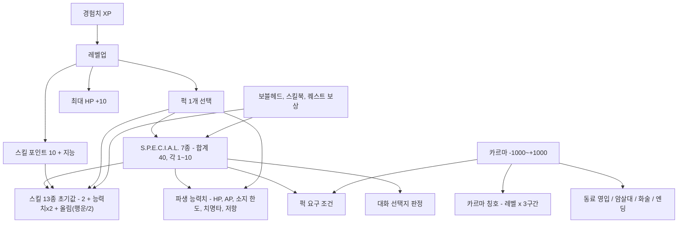
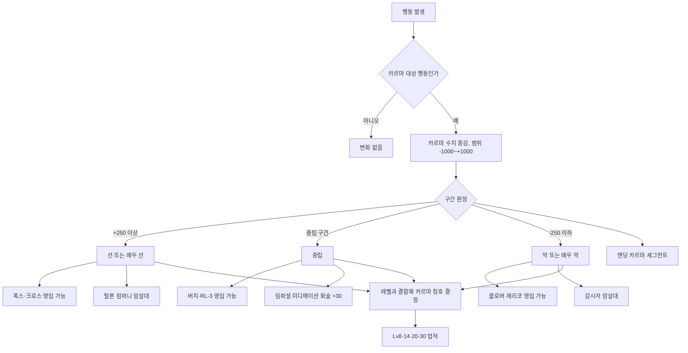
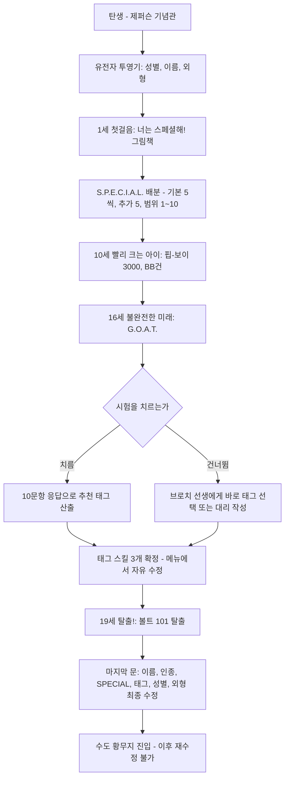

# RD-14. 캐릭터 시스템

> **폴아웃 3 역기획서 세트** | 문서 ID: RD-14 | 버전: v1.0 | 작성일: 2026-10-11
> **범위**: S.P.E.C.I.A.L.(효과·파생 능력치 공식·배분 규칙·상승 수단), 스킬 13종(초기값 공식·태그·레벨업 포인트·효과·상한), 레벨·경험치(XP 표, 획득원, 상한 이후), 퍽 전체 정본 카탈로그(일반·퀘스트·특별·DLC·삭제 퍽), 카르마(구간·칭호·증감 행동·영향), 캐릭터 생성 흐름(볼트 101 프롤로그의 시스템 측면), 능력치 상승 아이템 규칙 요약 / **다루지 않음**: HP·방사능·중독·불구·수면 등 상태 시스템(RD-15), 전투·VATS·피해 공식 상세(RD-16), 자물쇠·해킹·화술·은신·소유권 상호작용 상세(RD-17), 아이템별 수치 카탈로그(RD-19~RD-21), 보블헤드·스킬북 위치와 업적(RD-23), 프롤로그 퀘스트 연출(RD-03)
> **관련 문서**: [RD-03 메인 스토리 1부](03_main-story-part1.md), [RD-04 메인 스토리 2부·엔딩](04_main-story-part2-endings.md), [RD-08c DLC: 브로큰 스틸](08c_dlc-broken-steel.md), [RD-09 팩션](09_factions.md), [RD-10 주요 인물·동료](10_characters-major-companions.md), [RD-15 상태·생존 시스템](15_status-survival.md), [RD-16 전투 시스템](16_combat-system.md), [RD-17 탐험·상호작용](17_exploration-interaction.md), [RD-18 UI/UX](18_ui-ux.md), [RD-20 방어구·의복](20_armor-apparel.md), [RD-21 소모품·잡화·제작](21_consumables-misc-crafting.md), [RD-22 경제·주거](22_economy-housing.md), [RD-23 수집 요소·업적](23_collectibles-achievements.md), [RD-26 용어집](26_glossary.md)

---

## 1. 문서 개요

### 1.1 목적
- 폴아웃 3(Fallout 3)의 플레이어 캐릭터인 외로운 방랑자(Lone Wanderer)의 성장 체계 전체를 데이터 단위로 정리한다. 팬게임에서 능력치·스킬·퍽·레벨·카르마를 데이터베이스와 공용 이벤트로 옮길 때 **그대로 쓸 수 있는 정본 수치표**를 제공하는 것이 목표다.
- 퍽 카탈로그는 세트 전체의 정본이다. DLC 문서(RD-08a~e)는 DLC 퍽을 요약만 하고 이 문서로 링크한다.

### 1.2 3~5줄 요약
- 캐릭터는 **S.P.E.C.I.A.L.(스페셜) 7대 능력치**(합계 40, 각 1~10)를 바탕으로 **스킬 13종**의 초기값과 **파생 능력치**(HP·AP·소지 한도(Carry Weight)·치명타 확률(Critical Chance)·저항 등)가 정해진다.
- 레벨업마다 **스킬 포인트 10+지능**과 **퍽 1개**를 얻는다. 레벨 상한(Level cap)은 20이며 [BS] 브로큰 스틸(Broken Steel)이 30으로 올린다. 다음 레벨까지 필요한 XP는 `50 + 150×현재 레벨`로 선형 증가한다.
- 퍽은 본편 일반 58종 + [BS] 14종 + 퀘스트·특별 퍽으로 구성되며, 대부분 "조건부 수치 보정" 또는 "규칙 예외"를 부여한다. 1·2편의 트레잇(Trait)은 삭제되고 일부가 퍽으로 흡수됐다.
- 카르마(Karma)는 -1,000~+1,000의 수치로 5구간을 나누고, 레벨과 결합해 **카르마 칭호** 90종을 만든다. 동료 영입, 암살대(Hit squad) 출현, 화술 판정(Speech challenge), 엔딩 슬라이드에 영향을 준다.
- 캐릭터 생성은 볼트 101(Vault 101) 프롤로그 4개 퀘스트(탄생→1세→10세→16세→19세)에 나뉘어 녹아 있고, 볼트 출구에서 모든 선택을 한 번 더 수정한 뒤 수도 황무지(Capital Wasteland)로 나선다.

### 1.3 표기 메모
- 수치 출처는 Nukapedia 덤프(2026-08-30판). 문서 간 수치가 다르면 본문에 둘 다 적고 `※`로 표시한다.
- 능력치 약어: 힘(Strength, ST), 인지력(Perception, PE), 지구력(Endurance, EN), 카리스마(Charisma, CH), 지능(Intelligence, IN), 민첩성(Agility, AG), 행운(Luck, LK). 표에서는 약어를 쓴다.
- `⌈x⌉`는 올림, `⌊x⌋`는 내림이다. `Lv`는 캐릭터 레벨이다.
- 폼 ID(Form ID): 본편은 6자리 16진수(예: `044CB1`), DLC는 앞 두 자리가 로드 순서에 따라 바뀌므로 `xx`로 적는다(예: `xx004C6B`).
- 퍽 이름은 용어집 원칙대로 **음차 + 원어**로 쓴다. 용어집에 없는 표기는 부록 B에 신규 표기로 모았다.
- 카르마 칭호는 번역안을 제시한다(부록 B). 최종 표기는 본기획 단계에서 재검토한다.

### 1.4 시스템 구조도



---

## 2. S.P.E.C.I.A.L.

### 2.1 기본 규칙
- S.P.E.C.I.A.L.(스페셜)은 7대 기본 능력치다. 모든 능력치는 **기본값 5**에서 시작하고, 추가 **5포인트**를 배분해 **합계 40**을 만든다. 각 능력치의 최저값이 1이므로 실제로 자유 배분하는 양은 `40 - 7 = 33`포인트다.
- 범위는 **1~10**이며 장비·약물·질병 보정으로도 이 범위를 넘지 않는다. 다만 게임은 범위를 넘는 증가분을 **내부적으로 계속 기록**한다. 예: 민첩성 10에서 민첩성 보블헤드(Vault-Tec bobblehead)를 먹으면 표시값은 10이지만 내부값은 11이므로, 이후 금속 갑옷(Metal armor, 민첩성 -1)을 입어도 10이 유지된다.
- 각 스킬은 하나의 능력치에 묶여 있다. 해당 능력치 1점당 연관 스킬 **+2**, 행운은 2점당 **모든 스킬 +1**(올림)이다(§4.2).
- 퍽의 능력치 요구는 **장비·약물 같은 일시 보정으로 충족할 수 없다**. 유일한 예외는 소지만 해도 행운 +1을 주는 럭키 8볼(Lucky 8 ball)이다(§9.3).
- 능력치는 **레벨업으로 직접 올릴 수 없다.** 영구 상승 수단은 보블헤드, 인텐스 트레이닝(Intense Training) 퍽, 퀘스트 퍽, [BS] 퍽 2종뿐이다(§2.5).

### 2.2 능력치별 효과 요약

| 능력치 | 영문 | 인게임 설명(요약) | 연관 스킬(1점당 +2) | 파생 능력치·기타 효과 | 능력치 요구 퍽 |
|---|---|---|---|---|---|
| 힘 | Strength (ST) | 순수한 육체적 힘 | 근접 무기 | 소지 한도(+10/점), 근접 피해 보너스(+0.5/점), 투척 거리, 대화 위협 선택지 | 리틀 리거(4), 아이언 피스트(4), 스트롱 백(5) |
| 인지력 | Perception (PE) | 오감과 '육감' | 에너지 무기, 폭발물, 자물쇠 따기 | 나침반 적 탐지 거리(공식 미공개), 일부 대화 | 시프(4), 스나이퍼(6), 라이트 스텝(6), 베터 크리티컬스(6), 인필트레이터(7) |
| 지구력 | Endurance (EN) | 건강과 체력 | 중화기, 비무장 | HP(+20/점), 독 저항(+5%/점), 방사능 저항(+2%/점), 수중 산소 소모 속도 | 레드 벨리(5), 터프니스(5), 라드 레지스턴스(5), 사이즈 매터스(5), 스트롱 백(5), 라이프 기버(6), 솔라 파워드(7), [BS] 라드 톨러런스(7), [BS] 라드 앱소프션(7) |
| 카리스마 | Charisma (CH) | 매력과 호감 | 물물교환, 화술 | NPC 호감도(Disposition) → 화술 판정 성공률, 일부 대화 | 차일드 앳 하트(4), 스카운드럴(4), 임파셜 미디에이션(5), 애니멀 프렌드(6), 마스터 트레이더(6) |
| 지능 | Intelligence (IN) | 지성, 호기심, 비판적 사고 | 의학, 수리, 과학 | 레벨업 스킬 포인트(10+지능), 저지능 전용 대화 | 대디스 보이/걸(4), 건 넛(4), 스위프트 러너(4), 컴프리헨션(4), 에듀케이티드(4), 엔토몰로지스트(4), 너드 레이지!(5), 컴퓨터 위즈(7), [BS] 워멍거(7) |
| 민첩성 | Agility (AG) | 민첩함과 손재주 | 소형 화기, 은신 | 행동력(Action Points, AP) +2/점 | 건 넛(4), 시프(4), 사일런트 러닝(6), 스나이퍼(6), 라이트 스텝(6), 액션 보이/걸(6), [BS] 너브스 오브 스틸(7) |
| 행운 | Luck (LK) | 우연히 좋은 일이 일어날 확률 | 전 스킬(2점당 +1, 올림) | 치명타 확률(+1%/점), 일부 랜덤 인카운터(Random encounter) | 포천 파인더(5), 스크라운저(5), 미스터리어스 스트레인저(6), 베터 크리티컬스(6) |

- 괄호 안 숫자는 해당 능력치 요구치다. 복수 요구 퍽(예: 스트롱 백 = 힘 5 + 지구력 5)은 양쪽에 모두 적었다. 퍽 전체 조건은 §6을 본다.
- 1·2편과 달리 무기에 **최소 힘 요구치가 없다.** 힘 1로도 미니건(Minigun)을 페널티 없이 쓴다.
- 힘은 **비무장 피해에 영향을 주지 않는다**(아이언 피스트가 힘 4를 요구하는 것과 별개). 비무장 피해는 비무장 스킬에서 파생된다(§3).

### 2.3 능력치 1~10 종합 수치표
능력치 값별 파생 수치를 한 표에 모았다. 팬게임 데이터 테이블에 그대로 옮길 수 있게 공식값을 계산해 두었다.

| 값 | 소지 한도(ST) | 근접 피해 보너스(ST) | 시작 HP Lv1(EN) | 독 저항(EN) | 방사능 저항(EN) | 레벨업 스킬 포인트(IN) | AP(AG) | 기본 치명타 확률(LK) | 연관 스킬 보정(전 능력치) | 행운의 전 스킬 보정(LK) | 호감도 환산(CH×5) |
|---|---|---|---|---|---|---|---|---|---|---|---|
| 1 | 160 | +0.5 | 120 | 0% | 0% | 11 | 67 | 1% | +2 | +1 | 5 |
| 2 | 170 | +1 | 140 | 5% | 2% | 12 | 69 | 2% | +4 | +1 | 10 |
| 3 | 180 | +1.5 | 160 | 10% | 4% | 13 | 71 | 3% | +6 | +2 | 15 |
| 4 | 190 | +2 | 180 | 15% | 6% | 14 | 73 | 4% | +8 | +2 | 20 |
| 5 | 200 | +2.5 | 200 | 20% | 8% | 15 | 75 | 5% | +10 | +3 | 25 |
| 6 | 210 | +3 | 220 | 25% | 10% | 16 | 77 | 6% | +12 | +3 | 30 |
| 7 | 220 | +3.5 | 240 | 30% | 12% | 17 | 79 | 7% | +14 | +4 | 35 |
| 8 | 230 | +4 | 260 | 35% | 14% | 18 | 81 | 8% | +16 | +4 | 40 |
| 9 | 240 | +4.5 | 280 | 40% | 16% | 19 | 83 | 9% | +18 | +5 | 45 |
| 10 | 250 | +5 | 300 | 45% | 18% | 20 | 85 | 10% | +20 | +5 | 50 |

- 시작 HP는 `90 + 지구력×20 + 레벨×10`에 Lv1을 넣은 값이다. 레벨이 오를 때마다 +10이 붙는다(§3).
- 근접 피해 보너스는 파생치 문서 기준 `힘/2`(0.5 단위)다. ※ 전투 피해 공식 문서는 `⌈힘/2⌉`(정수 올림)로 적는다(RD-16 참조). 두 문서 모두 "힘 10에서 +5"는 같다.
- 호감도 환산값은 위키가 "스킬과 같은 척도로 보면 카리스마×5"라고 설명한 참고치다. 실제 화술 판정식은 §4.6.13의 공식을 쓴다.
- 나침반 탐지 거리와 폐활량(Lung Capacity)은 위키도 공식을 "미상(Unknown)"으로 둔다.

### 2.4 능력치별 상세

#### 2.4.1 힘(Strength)
- **효과**: 소지 한도 `150 + 힘×10`, 근접 피해 보너스 `힘×0.5`, 근접 무기 스킬 +2/점, 투척 무기(수류탄 등) 비거리 증가, 일부 대화에서 위협 선택지.
- **설계 포인트**: 근접 피해 보너스는 근접 무기 스킬·내구도로 보정된 무기 피해에 **나중에 더해지고**, 엔토몰로지스트 같은 피해 배수 퍽의 영향도 받는다. 그래서 초중반에는 무료 퍽에 가까운 효율을 낸다(무기 피해의 10% 이상).
- **관련 퍽**: 리틀 리거(Little Leaguer, 힘 4), 아이언 피스트(Iron Fist, 힘 4), 스트롱 백(Strong Back, 힘 5·지구력 5).
- **영구 상승**: 힘 보블헤드(+1), 개미의 힘(Ant Might, +1), 인텐스 트레이닝(+1/랭크), [BS] 노 위크니스(No Weaknesses, 5 미만이면 5로), [BS] 올모스트 퍼펙트(Almost Perfect, 9 미만이면 9로).
- **일시 상승**: 파워 아머류 +2(브라더후드 오브 스틸(Brotherhood of Steel)·라이언스 프라이드(Lyons' Pride)·아웃캐스트(Outcasts)·일반 파워 아머), 린든의 아웃캐스트 파워 아머(Linden's Outcast power armor)·엔클레이브 파워 아머(Enclave power armor)·[TP] 애셔의 파워 아머(Ashur's power armor)·[TP] 트라이벌 파워 아머(Tribal power armor)·[TP] 노동자 복장(Laborer outfit)·[BS] 헬파이어 아머(Enclave Hellfire armor) +1, 주류(맥주·스카치·보드카·위스키·와인) +1(중첩 불가), [PL] 밀주(Moonshine) +2, 미시시피 퀀텀 파이(Mississippi Quantum pie) +1, 버프아웃(Buffout) +2, 앤트 넥타(Ant nectar) +4, 너드 레이지!(HP 20% 이하일 때 10으로), 솔라 파워드(주간 야외 +2).

#### 2.4.2 인지력(Perception)
- **효과**: 에너지 무기·폭발물·자물쇠 따기 +2/점, HUD 나침반에 적(빨간 막대)이 표시되는 거리. 높은 인지력은 모이라 브라운(Moira Brown), 멜(Mel), 마체테(Machete) 등과의 대화에서 전용 선택지를 연다. 황무지 생존 가이드(The Wasteland Survival Guide) 퀘스트에서는 인지력 7 이상일 때 '스마트' 답변이 열린다.
- **관련 퍽**: 시프(Thief, 인지력 4·민첩성 4), 스나이퍼(Sniper, 6·6), 라이트 스텝(Light Step, 6·6), 베터 크리티컬스(Better Criticals, 인지력 6·행운 6), 인필트레이터(Infiltrator, 인지력 7·자물쇠 따기 70).
- **영구 상승**: 인지력 보블헤드(+1), 개미의 예지력(Ant Sight, +1), 인텐스 트레이닝, [BS] 노 위크니스·올모스트 퍼펙트.
- **일시 상승**: 모자류 다수 +1(반다나(Bandana), 중국군 코만도 모자(Chinese commando hat), 전쟁 전 모자류(Pre-War hats), 보안관 모자(Sheriff's hat), 스톰체이서 모자(Stormchaser hat), 크로우의 아이봇 헬멧(Crow's Eyebot helmet) 등), 밴스의 롱코트(Vance's longcoat outfit) +1, 멘타츠·오렌지 멘타츠(Orange Mentats) +5, 나이트 퍼슨(야간 +2). 개미 여왕 페로몬(Ant queen pheromones)은 -3, 버튼의 가발(Button's wig)은 -1이다.

#### 2.4.3 지구력(Endurance)
- **효과**: HP `+20/점`, 독 저항 `(지구력-1)×5%`, 방사능 저항 `(지구력-1)×2%`, 중화기·비무장 +2/점, 수중 산소 게이지 소모 속도. **피해 저항(DR)에는 영향 없음.**
- **관련 퍽**: 레드 벨리(Lead Belly, 5), 터프니스(Toughness, 5), 라드 레지스턴스(Rad Resistance, 5), 사이즈 매터스(Size Matters, 5), 스트롱 백(5), 라이프 기버(Life Giver, 6), 솔라 파워드(Solar Powered, 7), [BS] 라드 톨러런스(Rad Tolerance, 7), [BS] 라드 앱소프션(Rad Absorption, 7).
- **영구 상승**: 지구력 보블헤드(+1), 인텐스 트레이닝, [BS] 노 위크니스·올모스트 퍼펙트.
- **일시 상승**: 브라민 가죽 옷(Brahmin-skin outfit)·황무지 정착민 옷(Wasteland settler outfit)·황무지 방랑자 옷(Wasteland wanderer outfit)·기계박사 의상(The Mechanist's costume) +1, [TP] 노동자·노예 복장(Slave outfit) +1, [BS] 올나이터 잠옷(All-nighter nightwear) +1, 버프아웃 +3. 소본즈(Sawbones) 치료 후 '소본즈의 정밀함' 효과로 지구력·인지력 +2(약 3게임 시간, RD-15 참조).
- **하락 요인**: 방사능 중독 단계(-1~-3), 버프아웃·사이코(Psycho) 금단(-1). 상세는 RD-15.

#### 2.4.4 카리스마(Charisma)
- **효과**: 물물교환·화술 +2/점, 모든 NPC의 호감도 상승 → 화술 판정이 쉬워진다. 일부 대화는 화술과 별개로 카리스마 자체를 판정한다.
- **설계 포인트**: 위키는 "화술을 쓰는 캐릭터도 능력치보다 스킬에 투자하는 편이 거의 항상 낫다"고 평가한다. 화술을 쓰지 않으면 쓸모가 가장 적은 능력치다. 무기를 꺼내 들고 대화하면 카리스마 1점을 잃은 것과 같은 판정 페널티가 붙는다(§4.6.13).
- **관련 퍽**: 차일드 앳 하트(Child at Heart, 4), 스카운드럴(Scoundrel, 4), 임파셜 미디에이션(Impartial Mediation, 5), 애니멀 프렌드(Animal Friend, 6), 마스터 트레이더(Master Trader, 카리스마 6·물물교환 60).
- **영구 상승**: 카리스마 보블헤드(+1), 인텐스 트레이닝, [BS] 노 위크니스·올모스트 퍼펙트.
- **일시 상승**: 주류 +1, [PL] 밀주 +2, 개미 여왕 페로몬 +3, 그레이프 멘타츠(Grape Mentats) +5, 정장류·코트류 +1(텐페니의 정장(Tenpenny's suit), 율로지 존스의 정장(Eulogy Jones' suit)·모자, 감시자 더스터(Regulator duster), 보안관 더스터(Sheriff's duster), 섹시 잠옷(Sexy sleepwear), 밴스의 롱코트, 쓰리독의 두건(Three Dog's headwear), T-51b 파워 헬멧(T-51b power helmet) 등). 엔클레이브 파워 헬멧(Enclave power helmet)·테슬라 헬멧(Tesla helmet)·쇼크트루퍼 헬멧(Enclave Shocktrooper helmet)·개미여인 의상(The AntAgonizer's costume)은 -1, 앤트 넥타는 -2.

#### 2.4.5 지능(Intelligence)
- **효과**: 레벨업 스킬 포인트 `10 + 지능`, 의학·수리·과학 +2/점.
- **핵심 규칙**: 지능 상승분은 **소급되지 않는다.** 그래서 지능 상승은 이를수록 이득이다. 인텐스 트레이닝으로 Lv2에 지능 +1을 하면 Lv20까지 스킬 포인트 18점(Lv30까지 28점)을 더 얻는다. **일시 보정(나이트 퍼슨, 버튼의 가발 등)은 레벨업 포인트에 반영되지 않는다.** 일시 보정의 효과는 연관 스킬 +2/점뿐이다.
- **저지능 대화**: 1·2편처럼 게임 전체가 바뀌지는 않는다. 저지능 전용 선택지는 드물다. 예: 루스벨트 아카데미(Roosevelt Academy)의 딘 듀이(Dean Dewey)는 지능 4 미만인 주인공을 '특수 교육 대상'으로 보고 별도 교실로 안내한다. 인게임 대사 예: "Ooh Shiney Robot"(우와 반짝이는 로봇).
- **관련 퍽**: 대디스 보이/대디스 걸(Daddy's Boy/Daddy's Girl, 4), 건 넛(Gun Nut, 지능 4·민첩성 4), 스위프트 러너(Swift Learner, 4), 컴프리헨션(Comprehension, 4), 에듀케이티드(Educated, 4), 엔토몰로지스트(Entomologist, 지능 4·과학 40), 너드 레이지!(Nerd Rage!, 지능 5·과학 50), 컴퓨터 위즈(Computer Whiz, 지능 7·과학 70), [BS] 워멍거(Warmonger, 7).
- **영구 상승**: 지능 보블헤드(+1), 인텐스 트레이닝(+1/랭크), [BS] 노 위크니스·올모스트 퍼펙트.
- **일시 상승**: 버튼의 가발·링컨의 모자(Lincoln's hat) +1, 베리 멘타츠(Berry Mentats)·멘타츠 +5, 나이트 퍼슨(야간 +2). 주류·미시시피 퀀텀 파이 -1, 앤트 넥타 -2, 화염개미 넥타(Fire ant nectar)·개미 여왕 페로몬 -3.

#### 2.4.6 민첩성(Agility)
- **효과**: AP `65 + 민첩성×2`(기본 AP 최대 85), 소형 화기·은신 +2/점.
- **관련 퍽**: 건 넛(4), 시프(4), 사일런트 러닝(Silent Running, 민첩성 6·은신 50), 스나이퍼(6), 라이트 스텝(6), 액션 보이/액션 걸(Action Boy/Action Girl, 6), [BS] 너브스 오브 스틸(Nerves of Steel, 7).
- **영구 상승**: 민첩성 보블헤드(+1), 인텐스 트레이닝, [BS] 노 위크니스·올모스트 퍼펙트.
- **일시 상승**: 개미여인 의상·브라민 가죽 옷·황무지 정착민/방랑자 옷·메이플의 옷(Maple's garb)·전쟁 전 의상(Pre-War outfit) 다수 +1, 포플러의 두건(Poplar's hood) +1, [TP] 노동자·노예 복장 +1, 화염개미 넥타 +4.
- **하락 요인**: 파워 아머류 -2(브라더후드·라이언스 프라이드·아웃캐스트·일반·T-45d), 린든의 아웃캐스트·엔클레이브·프로토타입 의무병 파워 아머·금속 갑옷 -1, [TP] 트라이벌 파워 아머 -1, 방사능 중독·금단 증상.

#### 2.4.7 행운(Luck)
- **효과**: 모든 스킬 `+⌈행운/2⌉`(행운 1~2 → +1 … 9~10 → +5), 기본 치명타 확률 `행운×1%`, 일부 랜덤 인카운터.
- **관련 퍽**: 포천 파인더(Fortune Finder, 5), 스크라운저(Scrounger, 5), 미스터리어스 스트레인저(Mysterious Stranger, 6), 베터 크리티컬스(인지력 6·행운 6).
- **영구 상승**: 행운 보블헤드(+1), 인텐스 트레이닝, [BS] 노 위크니스·올모스트 퍼펙트. 럭키 8볼은 소지 중 +1이며 퍽 요구에도 반영되는 '준영구' 보정이다(§9.3).
- **일시 상승**: 개조 작업용 점프슈트(Modified utility jumpsuit)·레인저 전투 갑옷(Ranger battle armor)·노티 잠옷(Naughty nightwear) +1, 럭키 선글라스(Lucky shades)·쓰리독의 두건 +1, [TP] 애셔의 파워 아머·트라이벌 파워 아머 +1.

### 2.5 시작 배분 규칙
| 항목 | 규칙 |
|---|---|
| 배분 시점 | 프롤로그 1세 퀘스트 [첫걸음(Baby Steps)](03_main-story-part1.md)에서 그림책 너는 스페셜해!(You're SPECIAL!)를 살펴볼 때 (§8) |
| 기본값 | 7개 능력치 모두 5 (합계 35) |
| 추가 포인트 | 5 (합계 40) |
| 최소·최대 | 각 1~10. 다른 능력치를 깎아 확보한 포인트를 재배분하는 방식 |
| 자유 배분량 | 33 (각 능력치의 하한 1을 뺀 값) |
| 재수정 | 볼트 101 탈출 마지막 문에서 한 번 더 전부 다시 정할 수 있음 |
| 극단 배분 예 | 위키 예시: ST1·PE10·EN1·CH1·IN10·AG1·LK9 + 나머지 7을 AG·EN에 나눔 → 볼트를 나설 때 스킬 합계 최대 308점(의학 보블헤드 포함). 다만 AP와 HP 중 하나를 포기해야 하고 소지 한도가 작아 실용성은 낮다 |
| 보블헤드 고려 | 보블헤드로 +1을 받을 능력치는 9 이하로 남겨 두는 것이 낭비가 없다 |

- 배분 결과는 NPC 반응에도 소소하게 반영된다. 예: 지능이 높으면 버치 들로리아(Butch DeLoria)가 주인공을 'nosebleed'(범생이)라고 부른다.

### 2.6 능력치 상승 수단 종합

| 구분 | 수단 | 영문 | 효과 | 횟수·조건 |
|---|---|---|---|---|
| 영구 | 볼트-텍 보블헤드(능력치 7종) | Vault-Tec bobblehead | 해당 능력치 +1 | 각 1회. 10 초과분은 내부 기록만 됨 |
| 영구 | 인텐스 트레이닝 퍽 | Intense Training | 원하는 능력치 +1 | Lv2부터, 최대 10랭크 |
| 영구 | 개미의 힘 / 개미의 예지력 퀘스트 퍽 | Ant Might / Ant Sight | 힘 +1 또는 인지력 +1 (택1) + 화염 저항 25% | [그것들!(Those!)](05_side-quests-part1.md) 보상 |
| 영구 | [BS] 노 위크니스 | No Weaknesses | 5 미만 능력치를 모두 5로 | Lv24 |
| 영구 | [BS] 올모스트 퍼펙트 | Almost Perfect | 9 미만 능력치를 모두 9로(10은 유지) | Lv30 |
| 준영구 | 럭키 8볼 | Lucky 8 ball | 소지 중 행운 +1, 퍽 요구에도 반영 | [빅타운의 큰 문제(Big Trouble in Big Town)](05_side-quests-part1.md) 중 타임밤(Timebomb) 치료 |
| 일시 | 의류·방어구 | Apparel | ±1~2 | 착용 중. 상세는 RD-20 |
| 일시 | 약물·주류·음식 | Chems / Alcohol | ±1~5 | 약효 4분(케미스트 퍽 시 2배). 상세는 RD-21 |
| 일시 | 퍽 | Perks | 너드 레이지!(힘→10), 솔라 파워드(힘+2), 나이트 퍼슨(지능·인지력 +2) | 조건부 |
| 일시 | 의료 서비스 | Sawbones' Precision | 지구력·인지력 +2 | 시타델(The Citadel) 소본즈 치료 후 약 3게임 시간 |

**최대치 시나리오**
- 본편만: 인텐스 트레이닝 10랭크 + 나이트 퍼슨 + 능력치 보블헤드 7개 + 럭키 선글라스 + 쓰리독의 두건 + 밴스의 롱코트 + 럭키 8볼 + 개미의 예지력/개미의 힘으로 **합계 68**(최대 70)까지 도달한다(위키 계산).
- [BS] 포함: Lv30에 올모스트 퍼펙트로 전부 9를 만든 **뒤** 능력치 보블헤드 7개를 먹으면 전 능력치 10이 된다. 보블헤드를 먼저 먹으면 9에서 멈춘다(올모스트 퍼펙트는 10만 유지하고 9 이하는 9로 '설정'하기 때문). 힘·인지력 보블헤드를 놓친 경우(예: 텐페니 타워(Tenpenny Tower) 노선으로 메가톤(Megaton) 소멸) 개미의 힘/개미의 예지력으로 대체할 수 있다.

### 2.7 능력치 하락 요인(요약)
- **방사능 중독**: 200 라드부터 단계별로 지구력·민첩성·힘 감소(RD-15 §3).
- **금단 증상**: 약물별 능력치 -1~-2(RD-15 §4).
- **장비 페널티**: 파워 아머 민첩성 -2 등(RD-20).
- **약물 부작용**: 주류 지능 -1, 앤트 넥타 지능·카리스마 -2, 화염개미 넥타 지능 -3 등(RD-21).
- **부위 불구**: 머리 불구 시 인지력 -4(RD-15 §5).
- 하락으로 1 미만이 되지는 않는다. 연관 스킬도 1점당 -2씩 같이 떨어진다.

---

## 3. 파생 능력치

### 3.1 공식 표
파생 능력치(Derived statistics)는 기본 능력치·스킬·장비에서 계산되며, 플레이어가 직접 올릴 수 없다.

| 파생 능력치 | 영문 | 근거 | 공식 | 능력치 5 기준값 | 상한·비고 |
|---|---|---|---|---|---|
| 체력(HP) | Hit Points | 지구력, 레벨 | `90 + 지구력×20 + 레벨×10` | 200 (Lv1) | 상세는 RD-15 §2 |
| 행동력(AP) | Action Points | 민첩성 | `65 + 민첩성×2` | 75 | 기본 최대 85. 퍽·장비·약물로 추가(§3.3) |
| 소지 한도 | Carry Weight | 힘 | `150 + 힘×10` (lbs) | 200 | 기본 최대 250, 스트롱 백 +50. 과적(Encumbered) 규칙은 RD-15 §8 |
| 근접 피해 | Melee Damage | 힘 | `힘×0.5` | +2.5 | 근접 무기에만 적용. VATS·강공격의 2배 계산 **뒤**에 더함 |
| 비무장 피해 | Unarmed Damage | 비무장 스킬 | `⌈(10 + 비무장 스킬)/20⌉` | 2 (스킬 15) | 맨손은 이 값만큼, 격투 무기는 무기 피해에 가산. 표 §4.6.14 |
| 치명타 확률 | Critical Chance | 행운 | `행운×1%` × 무기 치명타 배수 × 무기 내구도 | 5% | 기본 최대 10%. VATS +15%p, 기습은 100% |
| 독 저항 | Poison Resistance | 지구력 | `(지구력-1)×5%` | 20% | 사이보그 +10%, 서바이벌 엑스퍼트 +2~6% |
| 방사능 저항 | Radiation Resistance | 지구력 | `(지구력-1)×2%` | 8% | **상한 85%**. 상세 RD-15 §3.4 |
| 피해 저항(DR) | Damage Resistance | 방어구 | 초기값 0% | 0% | **상한 85%** |
| 화염 저항 | Fire Resistance | 퍽·방어구 | 초기값 0% | 0% | 개미의 힘·개미의 예지력 +25%, 헬파이어 아머 +30%(헬멧 +5%), 화염개미 넥타 +25% |
| 호감도 | Disposition | 카리스마 | 스킬 척도 환산 `카리스마×5` | 25 | 화술 판정식에 반영(§4.6.13) |
| 스킬 습득률 | Skill Rate | 지능 | `10 + 지능` (레벨업당) | 15 | 에듀케이티드 +3 |
| 나침반 탐지 거리 | Compass Distance | 인지력 | 미공개 | – | 적이 나침반에 빨간 막대로 보이는 거리 |
| 폐활량 | Lung Capacity | 지구력 | 미공개 | – | 수중 산소 게이지 지속 시간 |

### 3.2 상한 정리
| 항목 | 상한 | 비고 |
|---|---|---|
| S.P.E.C.I.A.L. | 1~10 | 초과분 내부 기록 |
| 스킬 | 100 | 초과분 내부 기록(§4.5) |
| 피해 저항 | 85% | 장비+퍽만으로 94%까지 '계산상' 쌓을 수 있으나 85%에서 멈춤 |
| 방사능 저항 | 85% | 라드-X(Rad-X) + 방호복으로도 완전 면역 불가 |
| 기본 AP | 85 | 민첩성 10. 장비·퍽 포함 최대 148(약물 제외), 약물 포함 이론상 280 |
| 기본 치명타 확률 | 10% | 피네스 +5%, 서바이벌 구루 +3%, 닌자 +15%(근접·비무장), VATS +15% |
| 소지 한도 | 250 | 스트롱 백 포함 300. 일시적 힘 상승도 반영 |
| 레벨 | 20 | [BS] 30 |

### 3.3 저항·AP·HP 보너스 출처

**피해 저항(DR) 보너스**

| 출처 | 영문 | 수치 | 조건 |
|---|---|---|---|
| 터프니스 | Toughness | +10% | 영구 |
| 사이보그 | Cyborg | +10% | 영구 |
| 바크스킨 | Barkskin | +5% | 영구(퀘스트 퍽) |
| 서바이벌 엑스퍼트 | Survival Expert | +2/+4/+6% | '터프' 답변 계열 선택 시 |
| [TP] 피트 파이터 | Pitt Fighter | +3% | 영구 |
| [PL] 슈피리어 디펜더 | Superior Defender | +10 | 제자리에 서 있거나 웅크렸을 때 |
| 너드 레이지! | Nerd Rage! | +50% | HP 20% 이하 |
| 메드-X | Med-X | +25% | 약효 중 |

**방사능 저항 보너스**: 라드 레지스턴스 +25%, 사이보그 +10%, 서바이벌 엑스퍼트 +2/+4/+6%, [TP] 부스터 샷(Booster Shot) +10%, [TP] 피트 파이터 +3%, 라드-X(의학 보정 최대 +75%), 방호복·파워 아머류. 상세 RD-15 §3.4.

**AP 보너스**

| 출처 | 영문 | 수치 | 지속 |
|---|---|---|---|
| 민첩성 | Agility | +2/점 | 영구 |
| 액션 보이/액션 걸 | Action Boy/Action Girl | +25 | 영구(로딩 화면 팁은 +20으로 오기) |
| [BS] 너브스 오브 스틸 | Nerves of Steel | AP 재생 10초당 +1 | 영구 |
| 레덕스의 하키 마스크 | Ledoux's hockey mask | +25 | 착용 중 |
| 레인저 전투 갑옷 | Ranger battle armor | +5 | 착용 중 |
| [BS] 래그볼트의 전투 갑옷 | Lag-Bolt's combat armor | +10 | 착용 중 |
| [TP] 트라이벌 파워 아머 | Tribal power armor | +15(민첩성 -1로 실질 +13) | 착용 중 |
| 뉴카-콜라 퀀텀 | Nuka-Cola Quantum | +20 | 4분 |
| 미시시피 퀀텀 파이 | Mississippi Quantum pie | +20 | 4분 |
| 뉴카러크 고기 | Nukalurk meat | +10 | 4분 |
| 제트 | Jet | +30 | 4분 |
| 울트라제트 | Ultrajet | +40 | 4분 |

- 약물 지속시간은 케미스트(Chemist) 퍽으로 2배가 된다.
- AP는 VATS에서 소모되고 시간이 지나면 재생된다(턴 종료 누적이 아니다). 그림 리퍼스 스프린트(Grim Reaper's Sprint)는 VATS 처치 시 AP를 전부 회복시킨다. VATS 비용·재생은 RD-16.

**HP 보너스**: 레벨당 +10, 라이프 기버 +30, 서바이벌 엑스퍼트 '노멀' 답변 계열 +5/+10/+15, 버프아웃(지구력 +3 → 최대 HP +60, 약효 종료 시 감소), 지구력 일시 상승(장비). 회복 수단은 RD-15 §2.

---

## 4. 스킬

### 4.1 스킬 목록

| 스킬 | 영문 | 연관 능력치 | 인게임 설명(요약) | 스킬북(Skill book) | 보블헤드 |
|---|---|---|---|---|---|
| 물물교환 | Barter | 카리스마 | 거래와 흥정. 더 싸게 사고 비싸게 판다 | 정크타운 육포 상인 이야기(Tales of a Junktown Jerky Vendor) | 물물교환 보블헤드 |
| 중화기 | Big Guns | 지구력 | '비정통 무기' 숙련도: 화염방사기(Flamer)·미니건·미사일 발사기(Missile launcher)·팻맨(Fat Man) 등 | 미 육군: 간편 화염방사기 레시피 30선(U.S. Army: 30 Handy Flamethrower Recipes) | 중화기 보블헤드 |
| 에너지 무기 | Energy Weapons | 인지력 | 레이저·플라스마 등 에너지 무기 숙련도 | 니콜라 테슬라와 당신(Nikola Tesla and You) | 에너지 무기 보블헤드 |
| 폭발물 | Explosives | 인지력 | 수류탄·지뢰 숙련도, 폭발 함정 다루기 | 엎드려 숨어라!(Duck and Cover!) | 폭발물 보블헤드 |
| 자물쇠 따기 | Lockpick | 인지력 | 열쇠 없이 자물쇠 열기 | 오늘의 텀블러(Tumblers Today) | 자물쇠 따기 보블헤드 |
| 의학 | Medicine | 지능 | 의료 도구·약품 사용 효율 | D.C. 내과학 저널(D.C. Journal of Internal Medicine) | 의학 보블헤드 |
| 근접 무기 | Melee Weapons | 힘 | 납 파이프부터 슈퍼 슬레지(Super sledge)까지 근접 무기 숙련도 | 야만인 그로그낙(Grognak the Barbarian) | 근접 무기 보블헤드 |
| 수리 | Repair | 지능 | 장비 수리·유지 | 딘의 전자공학(Dean's Electronics) | 수리 보블헤드 |
| 과학 | Science | 지능 | 컴퓨터·생물·물리·지질 등 첨단 지식. 주로 터미널(Terminal) 해킹 | 과학 대백과(Big Book of Science) | 과학 보블헤드 |
| 소형 화기 | Small Guns | 민첩성 | 권총·기관단총·소총 등 재래식 화기 사용·관리 | 총과 총알(Guns and Bullets) | 소형 화기 보블헤드 |
| 은신 | Sneak | 민첩성 | 조용히 움직이고 들키지 않는 능력, 소매치기(Pickpocketing) | 중국군 특수작전 교범(Chinese Army: Special Ops Training Manual) | 은신 보블헤드 |
| 화술 | Speech | 카리스마 | 설득, 거짓말을 들키지 않는 능력 | 의회식 거짓말(Lying, Congressional Style), 실낙원(Paradise Lost) | 화술 보블헤드 |
| 비무장 | Unarmed | 지구력 | 맨손·발 및 격투 무기 전투 | 그림으로 보는 권투(Pugilism Illustrated) | 비무장 보블헤드 |

- 1·2편 대비 5개 스킬이 삭제·통합됐다(예: 응급처치·의사 → 의학, 함정·투척 → 폭발물). 18개 → 13개.
- 무기 스킬 6종(중화기·에너지 무기·폭발물·근접 무기·소형 화기·비무장)과 비무기 스킬 7종으로 나뉜다.

### 4.2 초기값 공식
- `초기값 = 2 + (연관 능력치 × 2) + ⌈행운 / 2⌉`
- 예: 지구력 5·행운 5 → 비무장 `2 + 10 + 3 = 15`.
- 초기값은 이후에도 **'기저값'으로 계속 작동**한다. 능력치가 바뀌면(보블헤드·인텐스 트레이닝·장비·약물) 연관 스킬도 즉시 같은 폭으로 바뀐다.
- 모든 스킬의 최솟값은 능력치 1·행운 1일 때 `2 + 2 + 1 = 5`다.

**초기값 조견표** (행: 연관 능력치, 열: 행운. 행운 1·2, 3·4 … 9·10은 같은 값)

| 연관 능력치 \ 행운 | 1~2 | 3~4 | 5~6 | 7~8 | 9~10 |
|---|---|---|---|---|---|
| 1 | 5 | 6 | 7 | 8 | 9 |
| 2 | 7 | 8 | 9 | 10 | 11 |
| 3 | 9 | 10 | 11 | 12 | 13 |
| 4 | 11 | 12 | 13 | 14 | 15 |
| 5 | 13 | 14 | 15 | 16 | 17 |
| 6 | 15 | 16 | 17 | 18 | 19 |
| 7 | 17 | 18 | 19 | 20 | 21 |
| 8 | 19 | 20 | 21 | 22 | 23 |
| 9 | 21 | 22 | 23 | 24 | 25 |
| 10 | 23 | 24 | 25 | 26 | 27 |

- 여기에 태그 보너스 +15를 더하면 태그 스킬(Tag skill) 초기값이 된다(최대 42).
- 볼트 탈출 직전 의학 보블헤드(+10)를 먹을 수 있어, 의학은 볼트를 나설 때 최대 52까지 가능하다.

### 4.3 태그 스킬
- 태그 스킬(Tag skill)은 캐릭터의 전문 분야다. 13종 중 **3개**를 골라 **각 +15**를 받는다.
- 1·2편에서는 태그 스킬이 2배 속도로 성장했지만, 폴아웃 3에서는 **일회성 +15 보너스뿐**이다. 레벨업 포인트 효율은 태그 여부와 무관하다.
- 선택 시점: 16세 퀘스트 [불완전한 미래(Future Imperfect)](03_main-story-part1.md)의 G.O.A.T.(일반 직업 적성 검사) 결과 화면. G.O.A.T. 결과는 '추천'일 뿐이며 태그 메뉴에서 자유롭게 바꿀 수 있다. 볼트 탈출 시 한 번 더 바꿀 수 있다(§8).
- 볼트를 나온 뒤에는 태그를 **재선택할 수 없다.** Lv16 퍽 태그!(Tag!)로 **4번째** 태그(+15)만 추가할 수 있다.

### 4.4 레벨업 스킬 포인트
- `레벨업당 스킬 포인트 = 10 + 지능` (에듀케이티드 퍽 +3). 지능 10 + 에듀케이티드면 23점.
- 레벨업 화면에서 스킬 포인트를 먼저 배분하고 그다음 퍽을 고른다. 그래서 에듀케이티드는 **선택한 다음 레벨업부터** 적용된다.
- 레벨업 포인트를 다음 레벨로 이월할 수 있는지는 코퍼스에서 확인되지 않는다(코퍼스 미확인 — 원작 UI는 배분 완료를 요구하는 것으로 알려짐).

**지능별 누적 스킬 포인트** (Lv1→20은 레벨업 19회, Lv1→30은 29회. 지능은 고정이라 가정)

| 지능 | 레벨업당 | Lv20까지 | Lv30까지 [BS] | 에듀케이티드 추가(Lv4 선택 시) |
|---|---|---|---|---|
| 1 | 11 | 209 | 319 | +48 (Lv20) / +78 (Lv30) |
| 3 | 13 | 247 | 377 | 〃 |
| 5 | 15 | 285 | 435 | 〃 |
| 7 | 17 | 323 | 493 | 〃 |
| 9 | 19 | 361 | 551 | 〃 |
| 10 | 20 | 380 | 580 | 〃 |

- 지능 10 + 에듀케이티드(Lv4 선택) + [BS]로 레벨업 포인트만 658점이다(위키 계산과 일치). 13개 스킬을 모두 100으로 만드는 데 필요한 총량은 1,300점이다.
- 인텐스 트레이닝으로 Lv2에 지능을 올리면 Lv20까지 +18점, Lv30까지 +28점이다.

### 4.5 스킬 상한과 보정 규칙
- **상한 100.** 100을 넘는 증가분도 게임이 내부적으로 기록한다. 그래서 방사능 중독·주류 같은 감소 효과를 받아도 100 이상을 유지할 수 있다(예: 과학 104면 술을 마셔도 아주 어려움 터미널 해킹 가능).
- **스킬북**: 1권당 해당 스킬 +1, 컴프리헨션 퍽이 있으면 +2. 퍽을 찍기 전에 읽은 책은 소급되지 않는다. 스킬당 25권 내외가 배치돼 있다(§9.2).
- **스킬 보블헤드**: 해당 스킬 +10(13종, 각 1회).
- **퍽 보정**: 랭크당 +5 계열(대디스 보이/걸, 건 넛, 리틀 리거, 시프, 스카운드럴), +15 계열(사이즈 매터스, 태그!), +10(사일런트 러닝, 사이보그), +30(임파셜 미디에이션, 중립 카르마일 때만), 서바이벌 엑스퍼트(+2/+4/+6), [OA] 코버트 옵스(+3 ×3스킬).
- **퀘스트 보상**: 유의 곰 부적(Yew's bear charm, 화술 +10, 영구) — [오아시스(Oasis)](05_side-quests-part1.md) 보상.
- **스킬 최대화 경제학**: 스킬북 25권 × 2(컴프리헨션) = 50 + 보블헤드 10 = 60이므로, 레벨업 포인트로 각 스킬을 **40까지만** 올려도 100에 도달한다. 화술은 유의 곰 부적이 보블헤드를 하나 더 먹는 효과라 30이면 충분하다.
- **리스폰 스킬북 익스플로잇**: 베데스다 사무실 동쪽(Bethesda Offices East)의 화염방사기 레이더와 셰일브리지(Shalebridge)의 개미 연구원은 73시간 후 리스폰되면서 각각 중화기·과학 스킬북을 다시 가진다. 이 두 스킬은 포인트 투자 없이 100에 도달할 수 있다(설계상 누수).

### 4.6 스킬별 효과

#### 4.6.1 무기 스킬 공통 규칙
무기 스킬 6종은 **피해**와 **명중**에 모두 작용한다. 위키의 전투 문서가 정리한 1회 공격 기본 피해 공식은 다음과 같다(피해 배수 퍽·치명타·기습·부위 배수·DR은 이후 단계에서 적용, RD-16 참조).

```
피해 = 무기 기본 피해 × (100 + 스킬) / 200
       × (최소내구 + 내구도 × (1 - 최소내구))
       × 위력 + 보너스 + 페널티

최소내구 = 0.5 (근접·비무장) / 0.66 (그 외)
위력     = 2 (근접·비무장의 강공격, 또는 VATS의 비기습 근접·비무장 공격) / 1 (그 외)
보너스   = ⌈(10 + 비무장 스킬)/20⌉ (비무장) / ⌈힘/2⌉ (근접) / 0 (그 외)
페널티   = 무기 기본 피해 × 4 × (팔 상태 - 1) / 10
팔 상태  = 0 (양팔 불구로 양손 근접 무기 사용, 오른팔 불구로 한손 근접·비무장 사용)
           0.5 (한 팔 불구로 양손 근접 무기 사용) / 1 (그 외)
```

| 스킬 | 0 | 25 | 50 | 75 | 100 |
|---|---|---|---|---|---|
| 스킬 피해 배수 `(100+스킬)/200` | ×0.50 | ×0.625 | ×0.75 | ×0.875 | ×1.00 |

- 스킬 0이어도 무기는 쓸 수 있고 최소 50% 피해가 나온다. 스킬 100은 무기 표기 피해(DAM)를 100% 끌어낸다.
- 명중 측면: 스킬이 오를수록 탄 퍼짐이 줄고 스코프 흔들림이 감소한다(소형 화기 100이면 스코프 흔들림 0, 단 팔 불구 시 큰 흔들림 발생). VATS 명중률에도 반영된다(RD-16).
- 치명타 피해(CRITDMG)는 스킬과 내구도의 영향을 받지 않는다. 내구도는 치명타 **확률**에 곱해진다(§3.1).

#### 4.6.2 물물교환(Barter)
- **효과**: 거래 가격 결정의 주요인. 1·2편과 달리 **상인 NPC의 물물교환 스킬은 가격에 영향을 주지 않는다.**
- **공식**(GECK 위키 근거, 최종값 반올림):
  - `판매가 = 아이템 가치 × (0.45 + 물물교환/100 × 0.45) × 보정`
  - `구매가 = 아이템 가치 × (1.55 - 물물교환/100 × 0.45) × 보정`
  - 보정 기본값 1. 상점별 할인(아래)이 곱해진다.

| 물물교환 | 0 | 20 | 40 | 80 | 100 |
|---|---|---|---|---|---|
| 판매 비율 | 45% | 54% | 63% | 81% | 90% |
| 구매 비율 | 155% | 146% | 137% | 119% | 110% |

- 5점마다 판매가가 2.25%p 오른다. 물물교환 11이면 사실상 가치의 50%에 판다.
- **할인 출처**: 마스터 트레이더 퍽(모든 상인 구매가 25% 할인), 드림 크러셔 퍽(분화구 잡화점(Craterside Supply) 30%), 괍(Gob)에게 친절하게 대함(모리아티 살롱(Moriarty's Saloon) 10%), 황무지 생존 가이드 리벳시티(Rivet City) 역사 조사(리벳시티 전 상인 10%), 의회 의석(Council Seat) 선택(리벳시티 서플라이 또는 포토맥 의류(Potomac Attire) 10%), 폭력의 경제학(Economics of Violence) 완료(록 앤드 로드(Lock and Load) 20%), 연방주의자 라운지(Federalist Lounge) 터미널 해킹(10% 또는 50%). 상세 가격 체계는 RD-22.
- **대화 판정 예**: 셰런(Charon) 계약 1,000캡 할인(50), 클로버(Clover) 500캡 환불(50), RL-3 하사를 1,000캡 대신 500캡에 구입(70), 집의 뉴카 픽스(Zip's Nuka Fix) 보상 단계(30/50/70), 버섯 거래(Fungus Deal) 유리한 교환(75).
- **관련 퍽**: 마스터 트레이더(60), 스카운드럴(+5/랭크).
- **설계 메모**: 후반에는 캡이 남아돈다(위키). 물물교환 가치는 초반 장비 조달기에 집중된다.

#### 4.6.3 중화기(Big Guns)
- **효과**: 중화기 계열(화염방사기, 미니건, 미사일 발사기, 팻맨, 록잇 런처(Rock-It Launcher), 개틀링 레이저(Gatling laser) 등)의 피해와 명중.
- 미사일·미니 누크처럼 **폭발 투사체를 쏘는 발사 무기는 폭발물이 아니라 중화기**로 분류된다(데몰리션 엑스퍼트 미적용).
- **관련 퍽**: 사이즈 매터스(+15/랭크, 최대 +45).
- **영구 상승**: 레벨업, 중화기 보블헤드(+10), 지구력 보블헤드(+2), 스킬북, 사이즈 매터스, 태그!.
- **일시 상승**: 버프아웃(지구력 증가분만큼), 린든의 아웃캐스트 파워 아머·토처의 마스크(Torcher's mask)·레이더 블래스트마스터 헬멧(Raider blastmaster helmet) +5, [TP] 밤셸 갑옷(Bombshell armor) +10, [BS] 래그볼트의 전투 갑옷 +10.

#### 4.6.4 에너지 무기(Energy Weapons)
- **효과**: 레이저·플라스마 권총/소총, 외계인 블래스터(Alien blaster), 메스메트론(Mesmetron) 등 에너지 무기의 피해와 명중. [OA] 가우스 소총(Gauss rifle)도 에너지 무기 스킬을 쓴다(1·2편과 다름).
- **관련 퍽**: 사이보그(+10), 컨센트레이티드 파이어(요구 60).
- **일시 상승**: 멘타츠(인지력 증가분), 무장 볼트 101 점프슈트(Armored Vault 101 jumpsuit)·어텀 대령의 제복(Colonel Autumn's uniform)·엔클레이브 장교 제복(Enclave officer uniform)/모자 +5, 테슬라 아머(Tesla armor) +10, [TP] 메탈 마스터 갑옷(Metal Master armor) +10.
- **NPC 예**: 스타 팔라딘 크로스(Star Paladin Cross, 50→100), 라일리(Reilly, 72→100), [BS] 르펠레티에(Lepelletier, 100).

#### 4.6.5 폭발물(Explosives)
- **효과**: 수류탄·지뢰의 피해, 투척 비거리·정확도. 적 지뢰가 주인공을 감지하는 거리와 폭발까지의 **신관 시간**도 폭발물 스킬로 정해진다(스킬이 높을수록 늦게 터져 해체가 쉽다). 1·2편의 함정(Traps)·투척(Throwing) 스킬을 대체한다.
- **해체 요구치**: 파편 지뢰는 1(누구나 가능, 빠르게 접근해 활성화만 하면 됨), 수류탄 다발(Grenade bouquet) 30, 함정 터미널 45, 함정 우편함 45, 함정 유모차 60(스킬 문서) ※ 함정 문서는 65로 기재. 철사·압력판 자체는 수리 스킬로 해체한다(§4.6.9).
- **대화·퀘스트 판정**: 메가톤 핵폭탄 해체·기폭 25([원자의 힘(The Power of the Atom)](05_side-quests-part1.md)), 라일리의 지뢰 정보 30([라일리 레인저(Reilly's Rangers)](06_side-quests-part2.md)), 빅타운(Big Town) 주민 지뢰 매설 교육 50.
- **관련 퍽**: 데몰리션 엑스퍼트(요구 50, +20%/랭크), 파이로매니악(요구 60), 리틀 리거(+5/랭크).
- **일시 상승**: 레이더 블래스트마스터 헬멧·타코마 파크 리틀 리거 모자(Takoma Park Little Leaguer cap)·토처의 마스크 +5, [TP] 밤셸 갑옷 +10, [PL] 데즈먼드의 안경(Desmond's eyeglasses) +5.

#### 4.6.6 자물쇠 따기(Lockpick)
- **효과**: 시도할 수 있는 자물쇠 난이도를 결정하고, '강제 개방(Force Lock)' 성공률을 높인다. 머리핀(Bobby pin)이 1개 이상 있어야 미니게임을 시작한다.

| 자물쇠 난이도 | 영문 | 요구 스킬 | 성공 XP |
|---|---|---|---|
| 아주 쉬움 | Very Easy | 0 ※ | 20 |
| 쉬움 | Easy | 25 | 30 |
| 보통 | Average | 50 | 40 |
| 어려움 | Hard | 75 | 50 |
| 아주 어려움 | Very Hard | 100 | 60 |

- ※ 자물쇠 문서는 아주 쉬움 요구치를 0으로, 스킬 문서는 15로 적는다.
- **강제 개방 성공률** = `스킬 - 자물쇠 요구치 + 10%`. 예: 스킬 67로 보통(50) 자물쇠 → 27%. 실패하면 자물쇠가 망가져 열쇠 없이는 다시 열 수 없다(인필트레이터 퍽이 있으면 1회 재시도).
- 같은 문·상자에서 XP는 1회만 얻는다. 열린 자물쇠를 잠가도 같은 XP를 1회 준다(일반 자물쇠 문서).
- 미니게임 규칙, 머리핀 파손 규칙은 RD-17.
- **관련 퍽**: 시프(+5/랭크), 인필트레이터(요구 70), [OA] 코버트 옵스(+3).
- **일시 상승**: 멘타츠, 아빠의 황무지 복장(Dad's wasteland outfit)·볼트 101 작업용 점프슈트(Vault 101 utility jumpsuit) +5, [BS] 래그볼트의 선글라스(Lag-Bolt's shades) +3.

#### 4.6.7 의학(Medicine)
- **효과**: 스팀팩(Stimpak)·라드-X·라드어웨이(RadAway)·[MZ] 외계 바이오젤(Alien biogel)의 효과량. 1·2편의 응급처치(First Aid)·의사(Doctor) 스킬을 통합했다.
- **공식**: `효과 = 기본값 × (1 + 의학/50)` — 의학 50에서 2배, 100에서 3배, 선형.

| 의료품 | 영문 | 기본값 | 의학 5(최소) | 의학 50 | 의학 100 |
|---|---|---|---|---|---|
| 스팀팩 | Stimpak | HP +30 | +33 | +60 | +90 |
| 라드어웨이 | RadAway | 라드 -50 | -55 | -100 | -150 |
| 라드-X | Rad-X | 방사능 저항 +25% | +27.5% | +50% | +75% |
| [MZ] 외계 바이오젤 | Alien biogel | HP +10 | +11 | +20 | +30 |
| [MZ] 개조 바이오젤 | Adapted biogel | HP +50 | +55 | +100 | +150 |

- 스팀팩은 패스트 메타볼리즘 퍽으로 다시 ×1.2(예: 의학 100에서 108)가 된다. 스팀팩 회복량 식을 풀어 쓰면 `30 + 0.6×의학`.
- 스팀팩을 특정 부위에 쓰면 그 부위를 크게, 전신을 조금 회복한다. 전신에 쓰면 반대다(RD-15 §5).
- **대화·퀘스트 판정**: 처치 박사(Doc Church)에게 리오의 마약 습관(Leo's Drug Habit) 정보(30), [피의 유대(Blood Ties)](05_side-quests-part1.md) 웨스트 가족(West family) 시신 검안(30, 50·70·90에서 정보 추가), 타임밤 소생(40, 럭키 8볼의 유일한 획득 경로), [TP] 밀(The Mill)의 노예 치료(50), 밴스에게 아르푸(Arefu)와의 혈액 거래 제안(50), 언더월드(Underworld) 찹 숍(Chop Shop)에서 라일리 소생(60), 황무지 생존 가이드 2장 부상 처치 설명(70).
- **관련 퍽**: 대디스 보이/걸(+5/랭크), 케미스트(60), 사이보그(60), 켐 레지스턴트(60).
- **일시 상승**: 환경 방호복(Environment suit)·황무지 의사복(Wasteland doctor fatigues)·황무지 외과의 옷(Wasteland surgeon outfit) +5, 외과의의 실험복(The Surgeon's lab coat) +10, [MZ] 방한 의무병 갑옷(Winterized medic armor) +10, 멘타츠.

#### 4.6.8 근접 무기(Melee Weapons)
- **효과**: 근접 무기의 피해. 근접 무기를 든 상태에서 **막기(Block)**가 가능하며 스킬이 높을수록 막을 때 흡수하는 피해가 커진다. 힘에 따른 근접 피해 보너스가 별도로 붙는다.
- VATS에서 근접·비무장은 **부위 지정이 불가**하다(대상 전체를 노림). 실시간에서는 조준한 부위를 노릴 수 있다.
- 빠른 무기(전투용 나이프, 리퍼(Ripper))는 단위 시간당 공격 횟수가 많고, 무거운 적에게는 1타 피해가 큰 무기가 낫다. 위키는 시시케밥(Shishkebab)을 최고 근접 무기로 꼽는다(빠른 속도 + 슈퍼 슬레지에 근접한 피해 + 파이로매니악 보정).
- **관련 퍽**: 리틀 리거(+5/랭크), 닌자(요구 80).
- **일시 상승**: 버프아웃·주류(힘 증가분), 볼트 77 점프슈트(Vault 77 jumpsuit)·터널스네이크 복장(Tunnel Snake outfit)·타코마 파크 리틀 리거 모자·아이용 야구모자(Kid's baseball cap) +5, [TP] 트라이벌 파워 아머 +5, [PL] 핀트사이즈 슬래셔 가면(Pint-Sized Slasher mask) +5, [MZ] 사무라이 갑옷(Samurai armor) +10.

#### 4.6.9 수리(Repair)
- **효과**: 같거나 유사한 아이템 하나를 소모해 장비 내구도를 올린다. 수리 스킬은 ① **수리 가능 최대 내구도** ② **수리 효율** ③ **제작 무기의 시작 내구도**를 정한다.
- **최대 내구도** = `40 + 3 × 수리/5` (%) = `40 + 0.6 × 수리`. 수리 10 → 46%, 50 → 70%, 100 → 100%.
- **수리 효율**: 위키는 정식 공식을 '필요'로 표시하고 예시만 든다. 예시에서 역산한 식은 `결과 내구도 = 5 + 높은 쪽 내구도 + 0.05 × 낮은 쪽 내구도 + 0.15 × 수리`(최대 내구도까지)다(역산값, 확정 아님). 예: 20%와 10% 미니건을 수리 10으로 합치면 27%, 수리 50이면 33%.
  - 결과적으로 **재료 아이템의 상태는 거의 중요하지 않다**(최대 5%p 기여). 0% 고물도 재료로 쓸 수 있다.
  - 수리 목록(Repair list) 호환 때문에 일반 무기를 고유 무기로 수리할 수 있다(고유품 손실 주의).
- 내구도가 낮으면 무기는 명중·피해·치명타 확률이 떨어지고 걸림(잼)이 잦아지며, 방어구는 DR이 떨어진다. 0%면 파손돼 쓸 수 없다(방어구는 입은 채로 남지만 벗으면 다시 못 입음). 상세 RD-16·RD-19·RD-20.
- **함정·퀘스트 판정**: 함정 변기 해체 20, 곰덫 해체 23, 메가톤 수도관 수리 30(비표시 퀘스트 치료(Treatment)), 타코마 산업단지(Takoma Industrial) 포격 스위치 33, 앵커리지 기념관(Anchorage Memorial) 문 35(부품 있을 때, 없으면 95), [낙원으로부터의 구출(Rescue from Paradise)](04_main-story-part2-endings.md) 아이들 해방 선택지 40, 랜덤 인카운터 고장 로봇 수리 40, 함정 전투 산탄총 해체 45, [독립을 훔쳐라(Stealing Independence)](06_side-quests-part2.md) 터렛 발전기 정지 60, 스테이츠맨 호텔(Statesman Hotel) 엘리베이터 수리 75, [아메리칸 드림(The American Dream)](04_main-story-part2-endings.md) 레이븐 락(Raven Rock) 레이저 트립와이어 해체 85, [PL] 중국 정보 벙커(Chinese intelligence bunker) 방사능 차단 44.
- **NPC 수리**: 상인 수리 서비스의 상한은 해당 NPC의 수리 스킬로 정해진다(예: 모이라 브라운 24~54, [MZ] 소마(Somah) 100). 목록·가격은 RD-22.
- **관련 퍽**: 건 넛(+5/랭크).
- **일시 상승**: 멘타츠, 볼트 101 작업용 점프슈트·아빠의 황무지 복장·수리공 점프슈트(Repairman jumpsuit)류 +5, [PL] 작업복(Workman's coveralls) +10.

#### 4.6.10 과학(Science)
- **효과**: 터미널 해킹 가능 난이도, 터미널 추가 정보, 다수의 대화 선택지.

| 터미널 난이도 | 영문 | 요구 스킬 | 비밀번호 길이 | 성공 XP |
|---|---|---|---|---|
| 아주 쉬움 | Very Easy | 15 | 4~5 | 20 |
| 쉬움 | Easy | 25 | 6~8 | 30 |
| 보통 | Average | 50 | 9~10 | 40 |
| 어려움 | Hard | 75 | 11~12 | 50 |
| 아주 어려움 | Very Hard | 100 | 13~15 | 60 |

- 해킹은 단어 맞히기 미니게임이다. 기회는 4번, 실패하면 영구 잠김(컴퓨터 위즈 퍽으로 1회 추가). 괄호 쌍 기호는 오답 제거·기회 회복. 스킬이 난이도보다 높을수록 후보 단어가 적어진다(과학 100이면 보통 터미널 후보 약 5개). 시도 도중 나가면 잠김 없이 초기화된다. 상세 RD-17.
- **대화·퀘스트 판정**: 황무지 생존 가이드 로브코 생산 시설(RobCo production facility) 메인프레임 해킹(50), [빅타운의 큰 문제] 로봇 재가동(50), [그것들!] 레스코 박사(Doctor Lesko)의 FEV 사용 추궁(60), 노예 목걸이 해제(75), [MZ] 치유 아치(Healing archway)를 완전 회복형으로 개조(75), [BS] 이동 기지 크롤러(mobile base crawler) 메인프레임 해킹(75)·반발장 해제(80), [아메리칸 드림] 이든 대통령(President Eden) 자폭 설득을 과학으로 대체(60).
- 시타델 소본즈의 진단 선택지는 과학 판정처럼 표시되지만 실제 요구치가 없다.
- **관련 퍽**: 엔토몰로지스트(40), 너드 레이지!(50), 로보틱스 엑스퍼트(50), 사이보그(60), 컴퓨터 위즈(70), [BS] 퀀텀 케미스트(70), 대디스 보이/걸(+5/랭크), [OA] 코버트 옵스(+3).
- **일시 상승**: 멘타츠, 엔클레이브 과학자복(Enclave scientist outfit)·과학자복·외과의의 실험복·볼트 연구복(Vault lab uniform)·[BS] 실험복 +5, 레스코의 실험복(Lesko's lab coat) +10.

#### 4.6.11 소형 화기(Small Guns)
- **효과**: 권총·기관단총·소총·산탄총 등 재래식 화기의 피해와 명중(퍼짐 감소, 스코프 흔들림 감소).
- 위키는 "5점 상승당 평균 약 3.5% 피해 증가, 낮은 구간일수록 체감 이득이 크다"고 설명한다. 공식상으로는 스킬 1점당 무기 기본 피해의 0.5%p다(§4.6.1).
- 레이더·슈퍼 뮤턴트(Super mutant)가 흔히 쓰는 사냥용 소총·돌격소총·중국제 돌격소총은 수리 재료가 흔해 게임 내내 유지하기 쉽다.
- **대화·퀘스트 판정**: 빅타운 주민 사격 교육(50), 비표시 퀘스트 길 잃은 견습생(The Lost Initiate)의 무기 수리(수치 미공개, 수리 스킬·건 넛으로도 가능).
- **관련 퍽**: 건 넛(+5/랭크), 컨센트레이티드 파이어(60), [OA] 코버트 옵스(+3). 명중 보정 퍽(건슬링어·코만도·스나이퍼·와이어드 리플렉시스)과 피해 보정 퍽은 §6.
- **일시 상승**: 화염개미 넥타(민첩성 증가분), 무장 볼트 101 점프슈트·보안 제복(Security uniform)·어텀 대령의 제복·더러운 중국군 점프슈트(Dirty Chinese jumpsuit)·레드의 점프슈트(Red's jumpsuit)·감시자 더스터·보안관 더스터 +5, 레인저 전투 갑옷·방랑자의 가죽 갑옷(Wanderer's leather armor)·밴스의 롱코트 +10, [TP] 민중의 모자(Hat of the People) +5, [MZ] 체이스 장군의 외투(General Chase's overcoat)·폴슨의 복장(Paulson's outfit) +10, [PL] 데즈먼드의 안경·그리프터스 핏(Grifter's Fit) +5.

#### 4.6.12 은신(Sneak)
- **효과**: 웅크린 상태에서 탐지될 확률, 소매치기·절도 성공률. 1·2편과 달리 웅크린 채 **달릴 수 있으나** 사일런트 러닝 없이는 탐지 페널티가 붙는다.
- **은신 상태 표시**

| 표시 | 영문 | 의미 | 공격·행동 |
|---|---|---|---|
| 은신 | [HIDDEN] | 미탐지 | 공격 시 **기습 치명타 보장**, 소매치기·소유물 절도 안전 |
| 발각 | [DETECTED] | 시야에 들어옴 | 소매치기는 가능하나 거의 실패, 절도 시 적대·압수 위험 |
| 경계 | [CAUTION] | 적대 대상이 의심하며 수색 중 | 해당 대상 소매치기 불가, 기습 치명타 불발 |
| 위험 | [DANGER] | 적대 대상이 존재를 인지(깜빡이면 교전 중) | 이탈 후 시야 밖에 오래 머물면 은신으로 복귀 |

- 여러 대상이 있으면 **가장 나쁜 상태**가 표시된다.
- **기습 치명타(Sneak Attack Critical)**: [HIDDEN] 상태 공격이 명중하면 치명타가 확정되고(치명타 불가 무기 제외) 총 피해가 원거리 **×2**, 근접·비무장 **×5**가 된다. 닌자 퍽이 근접·비무장 기습 치명타 피해를 +25% 올린다.
- **소매치기 성공률** = `⌊40 + 0.6×플레이어 은신 - ⌈아이템 가치/2⌉ - 0.6×대상 은신⌋`, 최소 5%·최대 85%. 아이템 가치는 내구도 반영 가치다. 가치 190캡 이상이면 은신 100이어도 5%다. 실패하면 대상이 물건을 되찾고 한동안(약 24시간) 다시 시도할 수 없다. 장착 중인 아이템은 훔칠 수 없다. 역소매치기(Reverse pickpocketing)로 폭발물을 넣으면 즉사시킬 수 있다.
- 탐지 요인(대상 인지력, 시야, 조명, 거리, 이동 속도, 접촉, **장착 중량**, 무기 소음, 시체 발견)과 소유권·카르마 처리는 RD-17.
- **관련 퍽**: 시프(+5/랭크), 사일런트 러닝(요구 50, +10), 미스터 샌드맨(요구 60), 닌자(요구 80), 서바이벌 엑스퍼트('슬라이' 답변 계열 +2~6).
- **일시 상승**: 화염개미 넥타, 정찰 갑옷(Recon armor)·셰이디 모자(Shady hat) +5, 포플러의 두건 +10, [BS] 래그볼트의 선글라스 +3, [OA] 중국군 스텔스 갑옷(Chinese stealth armor) +15(웅크릴 때 은폐장 5), 스텔스 보이(Stealth Boy) +100(은폐장 75, 2분).

#### 4.6.13 화술(Speech)
- **효과**: 대화의 화술 판정(Speech challenge) 성공률. 선택지 앞에 `[Speech 25%]`처럼 확률이 표시된다. **실패한 판정은 다시 시도할 수 없다.** 성공하면 같은 NPC의 이후 판정이 쉬워진다.
- **판정식**(위키 정리):

```
카리스마 항   = (카리스마 - 무기 꺼냄(1/0) + 2) / 10
카르마 항     = (대상 기본 호감도 + (대상 책임감 - 50) × 플레이어 카르마 / 500) / 100
성공 확률     = (카리스마 항 + 카르마 항) × 화술 스킬 × 난이도 배수
최종          = 성공 확률이 0.9 이상이면 100%, 아니면 그 값
```

| 난이도 | 영문 | 난이도 값 | 난이도 배수 | 성공 XP |
|---|---|---|---|---|
| 아주 쉬움 | Very Easy | 10 | 0.018 | 5 |
| 쉬움 | Easy | 40 | 0.012 | 10 |
| 보통 | Average | 55 | 0.009 | 20 |
| 어려움 | Hard | 70 | 0.006 | 30 |
| 아주 어려움 | Very Hard | 80 | 0.004 | 50 |

- 난이도 배수 = `(100 - 난이도 값) / 100 / 50`이다.
- 무기를 꺼낸 채 대화하면 카리스마 1점을 잃은 것과 같다. 무기를 넣은 상태라면 카리스마 1의 카리스마 항은 카리스마 10의 1/4이다.
- 카르마 항은 카르마가 0에 가까울수록 크고 ±1,000에 가까울수록 작아진다(대상 책임감 값과 곱해지므로 대상 성향에 따라 부호가 달라짐).
- 화술을 따로 올리지 않으면 카리스마가 판정 항과 스킬 양쪽에 들어가 성공률이 **카리스마의 제곱에 비례**한다.
- **예시**(카리스마 5, 무기 넣음, 화술 50, 카르마 0): 루카스 심즈(Lucas Simms) 보상 인상 32%(보통), 괍의 정보 47%(쉬움, 기본 호감도 9), 제리코(Jericho)의 대화 63%(아주 쉬움). 화술 100이면 각각 63%, 95%→100%, 100%.
- 위키는 "아주 어려움 판정의 최대 성공률은 카리스마 10에서 62%"라고 적는다. ※ 공식에 화술 100을 넣으면 48%이고, 62%는 화술 130 상당(임파셜 미디에이션 +30 포함)일 때의 값이다. 100 초과분이 공식에 반영된다고 보면 두 서술이 일치한다.
- **비화술 판정**: `[Strength]`, `[Karma]`, 퍽 이름(`[Child at Heart]` 등) 같은 태그 선택지는 화술 대신 그 조건을 본다. 조건을 충족하면 **자동 성공**한다(카르마 태그는 선악에 따라 반응이 갈림). 일부는 일반 화술 판정을 대체한다. 대화 시스템 전반은 RD-17.
- 성공 시 항상 XP를 준다(숙면 효과·스위프트 러너 적용). 성공 횟수는 업적(Achievement) 은빛 혀를 가진 악마(Silver-Tongued Devil)에 집계된다.
- **관련 퍽**: 스카운드럴(+5/랭크), 임파셜 미디에이션(중립 카르마 시 +30), 블랙 위도/레이디 킬러(전용 선택지), 서바이벌 엑스퍼트('슬라이' +2~6).
- **영구 상승**: 레벨업, 화술 보블헤드(+10), 스킬북 2종(의회식 거짓말, 실낙원), 유의 곰 부적(+10).
- **일시 상승**(+5 이상): 개미 여왕 페로몬·그레이프 멘타츠(카리스마 증가분), 전쟁 전 정장(+5), 링컨의 모자(+5), 노티 잠옷·버튼의 가발(+10), [MZ] 체이스 장군의 외투·폴슨의 복장(+5).

#### 4.6.14 비무장(Unarmed)
- **효과**: 맨손과 격투 무기(너클·파워 피스트(Power fist)·데스클로 건틀릿(Deathclaw gauntlet) 등)의 피해. 비무장 피해는 **비무장 스킬에서만 파생**되고 힘의 영향을 받지 않는다.
- **비무장 피해** = `⌈(10 + 비무장 스킬) / 20⌉`. 맨손은 이 값만큼 피해를 주고, 격투 무기는 무기 피해에 이 값을 더한다.

| 비무장 피해 | 1 | 2 | 3 | 4 | 5 | 6 |
|---|---|---|---|---|---|---|
| 최소 비무장 스킬 | 0 | 11 | 31 | 51 | 71 | 91 |

- 완전 맨손의 VATS AP 비용은 22다. VATS에서 부위 지정 불가(근접과 같음). 실시간 머리 공격은 치명타가 아니어도 기절(넉아웃)을 일으킬 수 있고 맨손일 때 확률이 높다.
- **관련 퍽**: 아이언 피스트(비무장 피해 +5/랭크, 최대 +15. 스킬 수치는 오르지 않음), 패럴라이징 팜(요구 70).
- **일시 상승**: 버프아웃(지구력 증가분), 볼트 77 점프슈트·하키 마스크(Hockey mask) +5, [TP] 메탈 마스터 갑옷 +10.

### 4.7 스킬 상승 수단 종합표
퍽·보블헤드·스킬북 등 **영구** 수단만 모았다(의류 일시 보정은 각 스킬 항목과 RD-20 참조).

| 스킬 | 보블헤드 | 스킬북(권당) | 랭크형 퍽 | 기타 영구 |
|---|---|---|---|---|
| 물물교환 | +10 | +1(+2) | 스카운드럴 +5×3 | 태그! +15 |
| 중화기 | +10 | +1(+2) | 사이즈 매터스 +15×3 | 태그! |
| 에너지 무기 | +10 | +1(+2) | – | 사이보그 +10, 태그! |
| 폭발물 | +10 | +1(+2) | 리틀 리거 +5×3 | 태그! |
| 자물쇠 따기 | +10 | +1(+2) | 시프 +5×3 | [OA] 코버트 옵스 +3, 태그! |
| 의학 | +10 | +1(+2) | 대디스 보이/걸 +5×3 | 서바이벌 엑스퍼트(스마트) +2/4/6, 태그! |
| 근접 무기 | +10 | +1(+2) | 리틀 리거 +5×3 | 태그! |
| 수리 | +10 | +1(+2) | 건 넛 +5×3 | 태그! |
| 과학 | +10 | +1(+2) | 대디스 보이/걸 +5×3 | 서바이벌 엑스퍼트(스마트), [OA] 코버트 옵스 +3, 태그! |
| 소형 화기 | +10 | +1(+2) | 건 넛 +5×3 | [OA] 코버트 옵스 +3, 태그! |
| 은신 | +10 | +1(+2) | 시프 +5×3 | 사일런트 러닝 +10, 서바이벌 엑스퍼트(슬라이), 태그! |
| 화술 | +10 | +1(+2) | 스카운드럴 +5×3 | 유의 곰 부적 +10, 서바이벌 엑스퍼트(슬라이), 태그! |
| 비무장 | +10 | +1(+2) | (아이언 피스트는 피해 +5×3) | 태그! |

- 모든 스킬은 연관 능력치 상승(보블헤드·인텐스 트레이닝·개미의 힘/개미의 예지력·[BS] 퍽)으로 1점당 +2, 행운 상승으로 +1(짝수→홀수 경계 시)씩 오른다.
- 임파셜 미디에이션(화술 +30)은 중립 카르마일 때만 유효한 조건부 보정이라 표에서 뺐다.

---

## 5. 레벨과 경험치

### 5.1 레벨업 규칙
- 경험치(XP)가 기준에 도달하면 레벨이 오른다. 필요 XP는 캐릭터 레벨에만 의존하며, 행동별 XP 보상은 캐릭터 레벨과 무관한 고정값이다.
- **다음 레벨까지 필요 XP** = `50 + 150 × 현재 레벨`. 누적식은 `레벨 L 도달 누적 XP = (L-1) × (50 + 75×L)`.
- 레벨업 1회마다:
  1. 최대 HP +10(HP 공식의 `레벨×10` 항)
  2. 스킬 포인트 `10 + 지능`(에듀케이티드 +3) 배분
  3. 퍽 1개 선택(요구 조건을 충족한 퍽만 목록에 표시)
- 능력치는 레벨업으로 오르지 않는다(인텐스 트레이닝 퍽을 고르는 방식으로만 가능).
- 레벨업 화면 UI는 RD-18.

### 5.2 레벨별 필요 XP 표

| 레벨 | 누적 XP | 다음 레벨까지 | 최대 HP(지구력 5 기준) | 비고 |
|---|---|---|---|---|
| 1 | 0 | 200 | 200 | 시작 |
| 2 | 200 | 350 | 210 | 첫 퍽 |
| 3 | 550 | 500 | 220 | |
| 4 | 1,050 | 650 | 230 | |
| 5 | 1,700 | 800 | 240 | |
| 6 | 2,500 | 950 | 250 | 고정 위치 암살대 출현 하한(§7.4) |
| 7 | 3,450 | 1,100 | 260 | |
| 8 | 4,550 | 1,250 | 270 | 카르마 업적 1단계 |
| 9 | 5,800 | 1,400 | 280 | |
| 10 | 7,200 | 1,550 | 290 | |
| 11 | 8,750 | 1,700 | 300 | |
| 12 | 10,450 | 1,850 | 310 | |
| 13 | 12,300 | 2,000 | 320 | |
| 14 | 14,300 | 2,150 | 330 | 카르마 업적 2단계 |
| 15 | 16,450 | 2,300 | 340 | |
| 16 | 18,750 | 2,450 | 350 | |
| 17 | 21,200 | 2,600 | 360 | |
| 18 | 23,800 | 2,750 | 370 | |
| 19 | 26,550 | 2,900 | 380 | |
| 20 | 29,450 | (3,050) | 390 | 본편 상한. 카르마 업적 3단계 |
| 21 [BS] | 32,500 | 3,200 | 400 | |
| 22 [BS] | 35,700 | 3,350 | 410 | |
| 23 [BS] | 39,050 | 3,500 | 420 | |
| 24 [BS] | 42,550 | 3,650 | 430 | |
| 25 [BS] | 46,200 | 3,800 | 440 | |
| 26 [BS] | 50,000 | 3,950 | 450 | |
| 27 [BS] | 53,950 | 4,100 | 460 | |
| 28 [BS] | 58,050 | 4,250 | 470 | |
| 29 [BS] | 62,300 | 4,400 | 480 | |
| 30 [BS] | 66,700 | – | 490 | [BS] 상한. 카르마 업적 4단계 |

- 최대 HP 열은 지구력 5, 퍽·장비 보정 없음 기준(`90 + 100 + 레벨×10`)이다.
- Lv20의 '다음 레벨까지 3,050'은 [BS] 설치 시에만 의미가 있다.

### 5.3 XP 획득원

| 획득원 | 영문 | XP | 비고 |
|---|---|---|---|
| 메인 퀘스트 완료 | Main quests | 탈출!(Escape!) 200 → 되찾아라!(Take It Back!) 1,200 (메인 11개, 순서대로 100씩 증가) | 합계 7,700 XP. 상세 RD-03·RD-04 |
| 사이드·비표시 퀘스트 | Side / unmarked quests | 퀘스트별 고정(예: 원자의 힘 핵폭탄 해체 300) | 단계별 지급도 있음. RD-05~07 |
| 반복 납품 | Repeatable deliveries | 일부 NPC에 특정 아이템을 반복 납품하면 XP·캡·카르마 | RD-07 |
| 적 처치 | Kills | 크리처·NPC별 고정(방사능바퀴(Radroach) 1, 데스클로 50 등) | **난이도 배수 적용**. 폭발하는 차량의 여파로 죽으면 XP 없음. 수치는 RD-24 |
| 자물쇠 따기 | Lockpicking | 20/30/40/50/60 (난이도별) | 대상별 1회 |
| 터미널 해킹 | Hacking | 20/30/40/50/60 (난이도별) | |
| 화술 판정 성공 | Speech challenge | 5/10/20/30/50 (난이도별) | |
| 미스터 샌드맨 처치 | Mister Sandman kill | 고정 50 | 숙면 효과 적용 |
| 지뢰 해체 | Disarming mines | 지급됨(수치 코퍼스 미확인) | 파편 지뢰 문서의 언급 |
| 장소 발견 | Discovery | 코퍼스에서 확인되지 않음 | 본작은 발견 XP가 없는 것으로 알려짐(코퍼스 미확인) |
| 히어 앤드 나우 퍽 | Here and Now | 즉시 1레벨 | 상한 레벨에서는 선택 불가 |

**XP 배수**

| 배수 | 수치 | 적용 대상 |
|---|---|---|
| 난이도 | 아주 쉬움 ×0.5 / 보통 ×1 / 아주 어려움 ×1.5 | 적 처치 XP(로딩 화면 팁: "적 처치 XP가 늘거나 준다"). 쉬움·어려움 배수는 코퍼스 미확인 |
| 스위프트 러너 | +10% / 랭크(최대 +30%) | 모든 XP, 곱연산 |
| 숙면 효과(Well Rested) | +10% | 모든 XP, 곱연산, 12게임 시간([BS] 딥 슬립은 8시간). RD-15 §6 |

- 곱연산 예: 아주 어려움에서 스위프트 러너 1랭크는 기본 XP 대비 +15% 효과를 낸다(1.5×0.1). 스위프트 러너 3랭크 + 숙면이면 숙면 단독 기여가 +13%다.

**대략적 비중(설계 관찰)**
- 메인 퀘스트 합계 7,700 XP는 Lv20 누적 29,450 XP의 약 26%, Lv30 누적 66,700 XP의 약 12%다.
- 위키는 "게임 안의 XP 총량은 레벨 20 또는 30에 필요한 양보다 훨씬 많다"고 적는다. 즉 상한 도달 자체는 어렵지 않고, XP 보정 퍽(스위프트 러너)은 상한에 **빨리** 도달하게 할 뿐 상한 도달 후에는 쓸모가 없다.
- 처치 XP는 강적일수록 크지만 고정값이라, 레벨이 오를수록 같은 적의 상대적 가치는 떨어진다(필요 XP가 선형 증가).

### 5.4 레벨 상한과 그 이후
- 본편 상한은 **20**이다. 모든 난이도에서 레벨 20에 도달하면 XP가 더 쌓이지 않는다.
- [BS] 브로큰 스틸을 설치하면 상한이 **30**으로 오르고, Lv22~30용 퍽 14종이 추가된다. [BS]는 또한 메인 퀘스트 종료 후에도 게임을 계속할 수 있게 한다. 본편만 있으면 되찾아라! 완료가 엔딩 슬라이드와 함께 **게임 종료**다(RD-04, RD-08c).
- GOTY 에디션(PC)은 데이터 파일에서 브로큰 스틸을 활성화하기 전까지 Lv20에서 멈춘다. 콘솔판은 볼트를 나온 직후부터 Lv30까지 오를 수 있다(메인 진행과 무관).
- 상한 도달 이후 남는 성장 수단: 스킬북(1/2점), 보블헤드, 퀘스트 퍽·특별 퍽(레벨업 슬롯을 쓰지 않음), 장비. 즉 **수평 성장**만 남는다.
- 카르마 칭호 업적(Lv8·14·20·30)은 해당 레벨에 도달하는 순간의 카르마로 판정된다. 같은 캐릭터로 3종을 모두 얻으려면 [BS]의 카르마 조정 퍽(§6.3)이나 히어 앤드 나우를 활용한다.

---

## 6. 퍽

### 6.1 퍽 시스템 규칙
- 퍽(Perk)은 레벨업 때 **매 레벨 1개**씩 고른다(1·2편은 3레벨마다, 뉴 베이거스는 2레벨마다). Lv2가 첫 퍽이다. 본편 Lv20까지 19개, [BS] Lv30까지 29개를 고를 수 있다.
- **일반 퍽**은 레벨 요구 + (선택) S.P.E.C.I.A.L. 요구 + (선택) 스킬 요구를 모두 충족해야 목록에 나온다. 능력치 요구는 **기저값**으로만 판정한다(장비·약물 보정 불가, 럭키 8볼만 예외). 스킬 요구에 대한 일시 보정 반영 여부는 코퍼스에 명시가 없다(코퍼스 미확인).
- **랭크**: 일부 퍽은 여러 번 고를 수 있다(최대 10랭크: 인텐스 트레이닝, 3랭크 다수, 2랭크: 애니멀 프렌드).
- **성별 분기 퍽**: 블랙 위도(여성)/레이디 킬러(남성), 대디스 걸/대디스 보이, 액션 걸/액션 보이, [BS] 파티 걸/파티 보이. 효과는 같고 이름·폼 ID만 다르다.
- **퀘스트 퍽·특별 퍽**은 레벨업 슬롯을 쓰지 않고 퀘스트 결과나 특정 행동으로 자동 부여된다. 미리 콘솔로 넣으면 게임이 깨질 수 있다는 경고가 있을 만큼 퀘스트 스크립트와 결합돼 있다.
- **트레잇 삭제**: 장단점이 함께 있는 1·2편의 트레잇은 사라지고, 일부는 단점 없는 퍽으로 바뀌었다(블러디 메스, 피네스, 나이트 퍼슨, 패스트 메타볼리즘, 켐 레지스턴트 / 원핸더→건슬링어 / 섹스 어필→블랙 위도·레이디 킬러). 가미카제(Kamikaze)는 효과 데이터만 남고 삭제됐다(§6.6).
- **수량**(위키 허브 기준): 본편 일반 58종, [BS] 일반 14종, 본편 퀘스트·특별 퍽(아래 표 9종), DLC 퀘스트·특별 퍽 9종(파워 아머 훈련 중복 제외), 삭제 퍽 4종. ※ 허브 서문은 본편을 "특별 5종·퀘스트 7종"으로 세지만 허브 표에는 특별 3종·퀘스트 6종만 있다. 이 문서는 표 분류를 따른다.

### 6.2 일반 퍽 카탈로그(본편 58종)
요구 조건의 약어: ST 힘, PE 인지력, EN 지구력, CH 카리스마, IN 지능, AG 민첩성, LK 행운. 스킬 요구는 스킬명으로 적는다.

| Lv | 퍽 | 영문 | 요구 조건 | 랭크 | 효과 | 비고 | 폼 ID |
|---|---|---|---|---|---|---|---|
| 2 | 블랙 위도 / 레이디 킬러 | Black Widow / Lady Killer | 여성 / 남성 캐릭터 | 1 | 이성 상대 피해 +10%, 이성 NPC 전용 대화 선택지 | '크리처'로 분류된 슈퍼 뮤턴트·야생 구울(Feral ghoul)·[PL] 늪지 주민·[TP] 트로그에는 무효, 일반 구울에는 유효. 1·2편 트레잇 섹스 어필(Sex Appeal) 계열 | 094EB8 / 094EB9 |
| 2 | 대디스 보이 / 대디스 걸 | Daddy's Boy / Daddy's Girl | IN 4 | 3 | 랭크당 과학 +5, 의학 +5 | 아버지 제임스(James)의 진로를 잇는 성장 서사 | 044948 / 069310 |
| 2 | 건 넛 | Gun Nut | IN 4, AG 4 | 3 | 랭크당 소형 화기 +5, 수리 +5 | 라일리 첫 대화 전용 선택지 | 04494E |
| 2 | 인텐스 트레이닝 | Intense Training | – | 10 | 원하는 능력치 +1 | 시작 배분과 같은 영구 포인트 → 퍽 요구에 반영. 랭크 수 최다 | 044CB1 |
| 2 | 리틀 리거 | Little Leaguer | ST 4 | 3 | 랭크당 근접 무기 +5, 폭발물 +5 | 볼트 리틀 리그 MVP 설정 | 014B97 |
| 2 | 스위프트 러너 | Swift Learner | IN 4 | 3 | 랭크당 획득 XP +10% | 난이도·숙면 효과와 곱연산. Lv2 선택 시 가치 2,090 XP(Lv30 기준 6,570). ※ 퍽 문서 정보상자는 IN 요구 누락, 허브·지능 문서는 IN 4 | 031DD3 |
| 2 | 시프 | Thief | PE 4, AG 4 | 3 | 랭크당 은신 +5, 자물쇠 따기 +5 | | 031DD6 |
| 4 | 차일드 앳 하트 | Child at Heart | CH 4 | 1 | 아이들(리틀 램프라잇(Little Lamplight) 등)과의 전용 대화 선택지 | 일부 어른과 로봇 1기에도 반응. 퀘스트 우회 경로 다수 | 003142 |
| 4 | 컴프리헨션 | Comprehension | IN 4 | 1 | 스킬북 1권당 +1 추가(총 +2) | 선택 전 읽은 책은 소급 없음 | 031DE1 |
| 4 | 에듀케이티드 | Educated | IN 4 | 1 | 레벨업당 스킬 포인트 +3 | 일찍 찍을수록 유리(Lv4 선택 시 Lv20까지 +48) | 031DD8 |
| 4 | 엔토몰로지스트 | Entomologist | IN 4, 과학 40 | 1 | 변이 곤충(방사능바퀴·거대 개미(Giant ant)·블로트플라이(Bloatfly)·방사능전갈(Radscorpion)) 대상 피해 +50% | 그것들! 등에서 대화 선택지. [BS] 알비노 방사능전갈에도 유효 | 031DD9 |
| 4 | 아이언 피스트 | Iron Fist | ST 4 | 3 | 랭크당 비무장 피해 +5(최대 +15) | 스킬 수치는 그대로. 맨손·너클·데스클로 건틀릿·파워 피스트 계열 | 031DDB |
| 4 | 스카운드럴 | Scoundrel | CH 4 | 3 | 랭크당 화술 +5, 물물교환 +5 | 전용 대화 일부 | 044CA6 |
| 6 | 블러디 메스 | Bloody Mess | – | 1 | 모든 무기 피해 +5%, 처치 시 적이 터지는 연출 | 사지 절단 확률 상승(머리를 쏴야 해 퀘스트 수집에 방해). 1·2편 트레잇 출신 | 094EBA |
| 6 | 데몰리션 엑스퍼트 | Demolition Expert | 폭발물 50 | 3 | 랭크당 폭발물(수류탄·지뢰) 피해 +20%(최대 +60%) | 미사일·미니 누크 등 중화기는 미적용. 뉴카 수류탄(Nuka-grenade)·앵커리지 시뮬레이션 내 폭발물 미적용(버그) | 031DAB |
| 6 | 포천 파인더 | Fortune Finder | LK 5 | 1 | 용기에서 병뚜껑을 훨씬 더 많이 발견 | 레벨 연동 목록 2종이 각 10% 확률로 추가: 일반 용기 20~80캡, 금고 110캡(Lv1)~190캡(Lv9) | 031DE3 |
| 6 | 건슬링어 | Gunslinger | – | 1 | 한손 원거리 무기 VATS 명중률 +25% | 곱연산. 1·2편 트레잇 원핸더(One Hander) 대체 | 094EBB |
| 6 | 레드 벨리 | Lead Belly | EN 5 | 1 | 물을 마실 때 받는 방사능 -50% | 수원·물 아이템 | 044CA9 |
| 6 | 터프니스 | Toughness | EN 5 | 1 | DR +10%(상한 85%) | 테드 스트레이어(Ted Strayer) 전용 대화 | 031DE0 |
| 8 | 코만도 | Commando | – | 1 | 양손 소총형 무기 VATS 명중률 +25% | 곱연산. 양손 소형 화기·에너지 무기만(중화기 제외) | 099828 |
| 8 | 임파셜 미디에이션 | Impartial Mediation | CH 5 | 1 | 중립 카르마일 때 화술 +30 | 게임 최대 단일 스킬 보정. 피의 유대에서 저스틴 화술 판정 우회 | 044CAD |
| 8 | 라드 레지스턴스 | Rad Resistance | EN 5 | 1 | 방사능 저항 +25% | 라드-X·방호복으로 대체 가능해 가치 논쟁 | 031DA9 |
| 8 | 스크라운저 | Scrounger | LK 5 | 1 | 용기에서 탄약을 훨씬 더 많이 발견 | 원래 탄약 목록과 별도로 75% 확률 목록 추가(최대 약 2배). 이미 생성된 용기·시체엔 미적용 | 031DAA |
| 8 | 사이즈 매터스 | Size Matters | EN 5 | 3 | 랭크당 중화기 +15(최대 +45) | | 09982E |
| 8 | 스트롱 백 | Strong Back | ST 5, EN 5 | 1 | 소지 한도 +50 | 힘 10이면 300 | 031DDE |
| 10 | 애니멀 프렌드 | Animal Friend | CH 6 | 2 | 1랭크: 개·야오과이(Yao guai)·땅두더지(Mole rat)·성난 브라민이 먼저 공격하지 않음 / 2랭크: 전투에서 플레이어를 도움(동물 상대 제외) | 오아시스 나무의 아버지 버치(Tree Father Birch) 전용 대화 | 031DB5 |
| 10 | 피네스 | Finesse | – | 1 | 치명타 확률 +5%(행운 +5 상당) | 무기 치명타 배수가 곱해짐. 1·2편 트레잇 출신. 공식 가이드의 '행운 6 요구'는 오기 | 094EC1 |
| 10 | 히어 앤드 나우 | Here and Now | – | 1 | 즉시 1레벨 상승(레벨업 보상 전부 포함) | 최대 레벨에서는 선택 불가 | 031DAC |
| 10 | 미스터 샌드맨 | Mister Sandman | 은신 60 | 1 | 은신 중 잠든 인간·구울을 소리 없이 살해, 처치당 고정 50 XP | 카르마 변화 없음. 어린이·필수 NPC 대상 무한 XP 버그 | 031DAD |
| 10 | 미스터리어스 스트레인저 | Mysterious Stranger | LK 6 | 1 | VATS 종료 시 마지막 대상 HP가 150 이하면 10% 확률로 낯선 이가 나타나 .44 매그넘으로 마무리 | 낯선 이가 처치하면 로브링어·컨트랙트 킬러·그림 리퍼스 스프린트 미발동. 방문 횟수 통계 기록 | 031DBC |
| 10 | 너드 레이지! | Nerd Rage! | IN 5, 과학 50 | 1 | HP 20% 이하일 때 힘 10, DR +50% | 저체력 심장 박동 연출 시점과 같음 | 044CA7 |
| 10 | 나이트 퍼슨 | Night Person | – | 1 | 18:00~05:59 지능·인지력 +2(최대 10) | 실내외 무관. 레벨업 포인트·퍽 요구엔 미반영. 1·2편 트레잇 출신 | 094EBD |
| 12 | 캐니벌 | Cannibal | – | 1 | 은신 중 인간·일반 구울 시체를 먹어 HP +25(라드 +3, 카르마 -1) | 목격되면 '자연에 대한 범죄'로 적대(동료 제외). 피의 유대·안데일(Andale) 전용 대화 | 094EBC |
| 12 | 패스트 메타볼리즘 | Fast Metabolism | – | 1 | 스팀팩 회복량 +20%([MZ] 바이오젤 포함) | 최대 HP는 불변. 1·2편 트레잇 출신 | 094EBF |
| 12 | 라이프 기버 | Life Giver | EN 6 | 1 | 최대 HP +30 | 데이터에 2·3랭크 흔적(삭제). 오아시스 전용 대화 | 031DB1 |
| 12 | 파이로매니악 | Pyromaniac | 폭발물 60 | 1 | 화염 무기(화염방사기·시시케밥 등) 피해 +50% | 지속 화상 피해엔 미적용. 번마스터(Burnmaster)·뉴카 수류탄·주룽 v418 중국제 권총(Zhu-Rong v418 Chinese pistol) 미적용(버그) | 031DB2 |
| 12 | 로보틱스 엑스퍼트 | Robotics Expert | 과학 50 | 1 | 로봇 대상 피해 +25%, 뒤에서 웅크려 활성화하면 영구 정지 | 정지에 [HIDDEN]은 불필요(웅크리고 뒤면 됨). 터렛도 정지 가능, [OA] 타격대 로봇 제외. 정지 로봇 공격은 기습 치명타 판정 | 031DC2 |
| 12 | 사일런트 러닝 | Silent Running | AG 6, 은신 50 | 1 | 은신 +10, 달리기·장비 무게가 은신 판정에 영향 없음 | | 031DB3 |
| 12 | 스나이퍼 | Sniper | PE 6, AG 6 | 1 | VATS 머리 명중률 +25% | 곱연산(50% → 62.5%) | 031DB4 |
| 14 | 아다만티움 스켈레톤 | Adamantium Skeleton | – | 1 | 부위가 받는 피해 -50% | 낙하에 따른 부위 피해에는 미적용 | 094EC4 |
| 14 | 케미스트 | Chemist | 의학 60 | 1 | 약물 등 중독성 소모품의 지속시간 2배 | 주류·뉴카-콜라 퀀텀 포함 16종(맥주, 베리/그레이프/오렌지 멘타츠, 멘타츠, 버프아웃, 제트, 울트라제트, 메드-X, 사이코, [PL] 밀주, 뉴카-콜라 퀀텀, 스카치, 보드카, 위스키, 와인) | 09982D |
| 14 | 컨트랙트 킬러 | Contract Killer | – | 1 | 선한 인간·일반 구울을 죽이면 시체에서 귀를 얻음 → 리틀혼과 어소시에이트(Littlehorn & Associates)의 대니얼 리틀혼(Daniel Littlehorn)에게 개당 10캡(판매 전 카르마 -750 이하면 15캡), 개당 카르마 -10 | 선 카르마일 때 고정 위치 탈론 컴퍼니(Talon Company) 암살대 미출현(랜덤 인카운터는 유지). 퍽 전에는 고철 처리장 사무실(scrapyard office) 출입 불가 | 044CA8 |
| 14 | 사이보그 | Cyborg | 의학 60, 과학 60 | 1 | DR·독 저항·방사능 저항 각 +10%, 에너지 무기 +10 | 저항 퍽 중 총합 최대 | 044CAB |
| 14 | 로브링어 | Lawbringer | – | 1 | 악한 인간을 죽이면 손가락을 얻음 → 감시자 본부(Regulator HQ) 소노라 크루스(Sonora Cruz)에게 개당 5캡(판매 전 카르마 750 이상이면 10캡), 개당 카르마 +10 | 악 카르마일 때 고정 위치 감시자 암살대 미출현. 감시자 본부 지도 표시·출입 해금(총과 총알 1권, 뉴카-콜라 퀀텀 1병, 정더스 플렁킷(Junders Plunkett) 등장의 유일 경로) | 044CAC |
| 14 | 라이트 스텝 | Light Step | PE 6, AG 6 | 1 | 적 지뢰·바닥형 함정(파편 지뢰·철사·압력판·곰덫)을 밟아도 발동 안 함 | 동료는 발동시킴. 함정 유모차·우편함·수류탄 다발 본체는 예외 | 031DB7 |
| 14 | 마스터 트레이더 | Master Trader | CH 6, 물물교환 60 | 1 | 상인에게서 사는 모든 물건 25% 할인 | 판매가 미적용. 기본가 아래로는 내려가지 않음. 언클 로(Uncle Roe) '상인 제국' 대화 확장 | 031DB8 |
| 16 | 액션 보이 / 액션 걸 | Action Boy / Action Girl | AG 6 | 1 | AP +25 | 로딩 팁의 +20은 오기 | 031DBA / 07B202 |
| 16 | 베터 크리티컬스 | Better Criticals | PE 6, LK 6 | 1 | 치명타 피해 +50% | 기습 치명타에도 적용. 다중 투사체 무기는 투사체마다 판정 | 031DBB |
| 16 | 켐 레지스턴트 | Chem Resistant | 의학 60 | 1 | 중독 확률 -50% | UMON 누적이 크면 여전히 중독 가능(RD-15 §4). 1·2편 트레잇 출신 | 099827 |
| 16 | 태그! | Tag! | – | 1 | 4번째 태그 스킬 지정(+15) | 단일 스킬 보정 중 최대급(사이즈 매터스와 동급) | 031DBD |
| 18 | 컴퓨터 위즈 | Computer Whiz | IN 7, 과학 70 | 1 | 잠긴 터미널을 1회 더 해킹 | 해킹 중 이탈로 잠김을 피할 수 있어 실효 논쟁 | 031DC4 |
| 18 | 컨센트레이티드 파이어 | Concentrated Fire | 소형 화기 60, 에너지 무기 60 | 1 | VATS에서 같은 부위를 연속 예약할 때마다 명중률 +5% | **합연산**(다른 명중 퍽은 곱연산). VATS 표시 상한 95% | 044CAF |
| 18 | 인필트레이터 | Infiltrator | PE 7, 자물쇠 따기 70 | 1 | 강제 개방 실패로 망가진 자물쇠를 1회 더 시도 | | 044CB0 |
| 18 | 패럴라이징 팜 | Paralyzing Palm | 비무장 70 | 1 | **완전 맨손** VATS 공격 시 30% 확률로 대상 30초 마비 | 추가 AP·피해 변화 없음. 마비 중인 적은 탐지 여부와 무관하게 소매치기 가능 | 044CAA |
| 20 | 익스플로러 | Explorer | – | 1 | 모든 장소를 지도에 표시 | 빠른 이동은 직접 방문해야 가능. 감시자 본부 제외. DLC 장소는 DLC 설치 후 선택한 경우만 | 031DE5 |
| 20 | 그림 리퍼스 스프린트 | Grim Reaper's Sprint | – | 1 | VATS 중 처치하면 VATS 종료 시 AP 전부 회복 | 동료·낯선 이·환경·지속 피해에 의한 처치 제외. 스크립트상 AP 1,000 지급 | 099834 |
| 20 | 닌자 | Ninja | 근접 무기 80, 은신 80 | 1 | 근접·비무장 치명타 확률 +15%, 기습 치명타 피해 +25% | 기습 보너스도 근접·비무장에만 적용. 비무장 요구 없음. PC판은 +15% 미작동 버그 | 031DCC |
| 20 | 솔라 파워드 | Solar Powered | EN 7 | 1 | 06:00~18:00 야외에서 힘 +2, HP 1/실시간 10초(=게임 5분) 재생 | 대기 1시간 = HP 12. 실내 진입·해 질 녘 힘 감소로 과적 위험 | 031DC5 |

### 6.3 [BS] 일반 퍽 카탈로그(14종)

| Lv | 퍽 | 영문 | 요구 조건 | 랭크 | 효과 | 비고 | 폼 ID |
|---|---|---|---|---|---|---|---|
| 22 | 딥 슬립 | Deep Sleep | – | 1 | 아무 침대에서나 자도 숙면 효과(XP +10%) 8시간 | 남이 소유한 침대(빨간 이름)는 여전히 사용 불가. 스위프트 러너가 상위 호환이라는 평 | xx003213 |
| 22 | 퍼피스! | Puppies! | – | 1 | 도그밋(Dogmeat)이 죽으면 강아지가 대신 등장(사망 지점 또는 하루 이틀 뒤 볼트 101 입구) | 강아지 HP 1,000(원래 도그밋 Lv1 500). 같은 레퍼런스 ID를 재사용. 동료 슬롯 규칙은 RD-10 | xx003211 |
| 22 | 퀀텀 케미스트 | Quantum Chemist | 과학 70 | 1 | 뉴카-콜라 10병을 얻을 때마다 뉴카-콜라 퀀텀 1병으로 자동 변환 | 게임 내에는 과학 요구가 표시되지 않음. 얼음처럼 차가운 뉴카-콜라(Ice cold Nuka-Cola) 제외. 퀀텀 수량 한계를 해제 | xx004C71 |
| 24 | 데빌스 하이웨이 | Devil's Highway | 카르마가 '매우 악함'보다 높음 | 1 | 카르마를 즉시 '매우 악함'(-1,000)으로 | 카르마 -2,000 처리 | xx004C6D |
| 24 | 에스컬레이터 투 헤븐 | Escalator to Heaven | 카르마가 '매우 선함'보다 낮음 | 1 | 카르마를 즉시 '매우 선함'(+1,000)으로 | 카르마 +2,000 처리 | xx004C6F |
| 24 | 카르믹 리밸런스 | Karmic Rebalance | 카르마가 중립이 아님 | 1 | 카르마를 즉시 0으로 | 이후 고정은 아님 | xx004C6E |
| 24 | 노 위크니스 | No Weaknesses | – | 1 | 5 미만인 능력치를 모두 5로 | 올모스트 퍼펙트 계획이면 불필요 | xx00108E |
| 26 | 라드 톨러런스 | Rad Tolerance | EN 7 | 1 | '경미한 방사능 중독'(200~399) 효과 무효(경고는 표시) | 상위 단계엔 무효. 위키는 실효가 낮다고 평가 | xx0011C1 |
| 26 | 워멍거 | Warmonger | IN 7 | 1 | 모든 제작 무기를 설계도 없이 제작 가능(3단계 설계도 지급) | PC·360: 뉴카 수류탄·병뚜껑 지뢰 외에는 품질 변수가 갱신되지 않는 버그 | xx0011BE |
| 26 | 너브스 오브 스틸 | Nerves of Steel | AG 7 | 1 | AP 재생 가속(10초당 AP +1) | 체감 효과 작음 | xx0011C2 |
| 28 | 파티 보이 / 파티 걸 | Party Boy / Party Girl | – | 1 | 알코올 중독의 금단 효과 없음 | ※ 허브는 "알코올 중독 확률 0"으로, 퍽 문서는 "중독은 되지만 금단 효과 없음"으로 기술 | xx0011BF / xx0011C0 |
| 28 | 라드 앱소프션 | Rad Absorption | EN 7 | 1 | 방사능이 실시간 20초당 1라드씩 자동 감소 | 대기 1게임 시간 = -6라드. 빠른 이동·수면·대기에도 적용 | xx0011BD |
| 30 | 뉴클리어 어노멀리 | Nuclear Anomaly | – | 1 | HP가 20 이하로 떨어지면 핵폭발(주변 아군 포함 피해) | 발동 시 HP를 20 이상으로 회복하고 라드를 0으로. HP 20 이상이 될 때까지 10초마다 반복. 보통 이상 난이도에서는 폭발에 플레이어가 죽는 버그 | xx004C6C |
| 30 | 올모스트 퍼펙트 | Almost Perfect | – | 1 | 모든 능력치를 9로(10은 유지) | 보블헤드·럭키 8볼은 이 퍽 **이후**에 얻어야 10 달성 | xx004C6B |

### 6.4 본편 퀘스트 퍽·특별 퍽

**퀘스트 퍽(6종)**

| 퍽 | 영문 | 관련 퀘스트 | 획득 조건 | 효과 | 폼 ID |
|---|---|---|---|---|---|
| 개미의 힘(음차: 앤트 마이트) | Ant Might | [그것들!](05_side-quests-part1.md) | 화염개미 둥지 수호자 처치 후 레스코 박사가 주는 보상 2종 중 택1 | 힘 +1, 화염 저항 +25% | 0C1A6B |
| 개미의 예지력(음차: 앤트 사이트) | Ant Sight | 그것들! | 위와 같음(택1) | 인지력 +1, 화염 저항 +25% | 0C1A6C |
| 바크스킨 | Barkskin | [오아시스](05_side-quests-part1.md) | 헤럴드(Harold)의 심장 파괴 | DR +5% | 035E04 |
| 라드 리제너레이션 | Rad Regeneration | [황무지 생존 가이드](05_side-quests-part1.md) | 1장 '방사능 중독 걸리기'에서 600라드 이상(선택 목표) 달성 | 방사능 중독 '심화'(400라드 이상) 상태에서 불구 부위 자동 재생 | 03066B |
| 서바이벌 엑스퍼트 | Survival Expert | 황무지 생존 가이드 | 최종 장 완료(등급·보너스는 아래 표) | 독·방사능 저항 +2/+4/+6% + 답변 유형 보너스 | 등급별 상이 |
| 와이어드 리플렉시스 | Wired Reflexes | [복제된 인간(The Replicated Man)](06_side-quests-part2.md) | 짐머(Zimmer) 박사 편: 안드로이드 A3-21의 정체(하크니스)를 보고 | VATS 명중률 +10%(곱연산) | 024D5C |

- ※ 허브 표는 개미의 힘/개미의 예지력 조건을 "여왕을 죽이지 않고 완료하거나, 여왕을 죽인 뒤 화술로 레스코를 설득"으로, 퍽 문서는 "둥지 수호자 처치"로 적는다. 상세 분기는 RD-05.
- ※ 공식 가이드는 바크스킨을 "지구력 +1, DR +10%"로 적지만 초기 빌드 정보다.

**서바이벌 엑스퍼트 등급표**
등급은 완료한 선택 목표 수로, 보너스 계열은 모이라에게 가장 많이 고른 답변 유형으로 정해진다. 능력치 7 이상이면 해당 계열 답변이 열린다(장비·약물로 맞출 수 있음).

| 등급 | 영문 | 조건 | 기본 효과 | 노멀(무답·첫 답) | 스마트(IN/PE) | 터프(ST/EN) | 슬라이(AG/CH) | 스나이드(마지막 답) |
|---|---|---|---|---|---|---|---|---|
| 주니어 서바이버 | Junior Survivor | 선택 목표 5개 미만 | 독·방사능 저항 +2% | HP +5 | 의학·과학 +2 | DR +2% | 은신·화술 +2 | 치명타 +1% |
| 서바이벌 엑스퍼트 | Survival Expert | 5~8개 | +4% | HP +10 | +4 | +4% | +4 | +2% |
| 서바이벌 구루 | Survival Guru | 전부 | +6% | HP +15 | +6 | +6% | +6 | +3% |

| 폼 ID | 노멀 | 스마트 | 터프 | 슬라이 | 스나이드 |
|---|---|---|---|---|---|
| 주니어 서바이버 | 02D3A2 | 0331D4 | 0331D5 | 0331D6 | 0331D7 |
| 서바이벌 엑스퍼트 | 02D3A1 | 0331D8 | 0331D9 | 0331DA | 0331DB |
| 서바이벌 구루 | 02D3A0 | 0331DC | 0331DD | 0331DE | 0331DF |

- 드림 크러셔와 배타적이다. 과제 완료를 거짓말로 보고하다 들키면 구루 등급은 받을 수 없다(마이얼럭(Mirelurk) 둥지 관찰 장치의 스나이드 답변은 예외).

**특별 퍽(3종)**

| 퍽 | 영문 | 관련 퀘스트 | 획득 조건 | 효과 | 폼 ID |
|---|---|---|---|---|---|
| 드림 크러셔 | Dream Crusher | 황무지 생존 가이드 | 모이라 브라운에게 집필을 포기하게 함(화술 판정, 또는 3장의 무판정 선택지) | 적이 플레이어에게 치명타를 낼 확률 -50%, 분화구 잡화점 30% 할인, 모이라 수리 스킬 +30(최대 수리 내구도 54% → 72%) | 030FEB |
| 헤마토파지 | Hematophage | [피의 유대](05_side-quests-part1.md) | 화술·의학·지능 판정으로 밴스와 아르푸의 혈액 거래를 성사시킨 뒤 '흡혈귀의 방식'을 배우겠다고 요청 | 혈액 팩 회복량 1 → 20 | 003131 |
| 파워 아머 훈련 | Power Armor Training | 흔적을 따라서 / 아메리칸 드림 / [OA] | ① [흔적을 따라서(Picking Up the Trail)](04_main-story-part2-endings.md) 중 엘더 라이언(Elder Lyons)에게 요청 → 시타델 베일리(Bailey)의 팔라딘 거니(Paladin Gunny)에게 훈련 ② 아메리칸 드림 완료 시 자동 ③ [OA] 앵커리지 탈환전 시뮬레이션(Anchorage Reclamation simulation) 완료 시 자동 | 모든 파워 아머 착용 가능 | 058FDF |

- 드림 크러셔 선택 시 카르마가 떨어지고 서바이벌 엑스퍼트를 받을 수 없다.
- 헤마토파지: 패밀리를 소탕하거나, 거래 없이 떠나게 하거나, 이후 아르푸·패밀리와 적대하면 받을 수 없다.

### 6.5 DLC 퀘스트·특별 퍽

| DLC | 퍽 | 영문 | 구분 | 관련 퀘스트 | 획득 조건 | 효과 | 폼 ID |
|---|---|---|---|---|---|---|---|
| [OA] | 코버트 옵스 | Covert Ops | 특별 | 앵커리지 탈환전 시뮬레이션 | 정보 서류 가방(Intel suitcase) 10개 수집 | 과학·소형 화기·자물쇠 따기 +3 | xx00BF70 |
| [OA] | 파워 아머 훈련 | Power Armor Training | 특별 | 오퍼레이션: 앵커리지! | 시뮬레이션 완료 | 본편 특별 퍽과 동일 | 058FDF |
| [TP] | 오토 액스퍼트 | Auto Axpert | 특별 | 위험한 작업 환경(Unsafe Working Conditions) | 제강소에서 강철 주괴(Steel ingot) 10개 수집 | 오토 액스(Auto axe)와 변형(강철 톱(Steel saw), 맨 오프너(Man Opener), 몰러(The Mauler)) 피해 +25% | xx0073E8 |
| [TP] | 부스터 샷 | Booster Shot | 퀘스트 | 무상 노동(Free Labor) | 퀘스트 완료 | 방사능 저항 +10% | xx007354 |
| [TP] | 피트 파이터 | Pitt Fighter | 퀘스트 | 위험한 작업 환경 | 홀(The Hole) 전투 전승 | DR +3%, 방사능 저항 +3% | xx0073EA |
| [PL] | 구울 이콜로지 | Ghoul Ecology | 특별 | 플릭의 사파리(Plik's Safari) | 해안 동굴의 플릭의 일지(Plik's journal) 읽기 | 구울 대상 피해 +5 | xx00D1FE |
| [PL] | 펑가 파워! | Punga Power! | 퀘스트 | 영혼과 함께 걷기(Walking with Spirits) | 퀘스트 완료 | 펑가 열매(punga fruit) 방사능 감소 강화: 야생 -1 → -5, 정제 -2 → -15 | xx011096 |
| [PL] | 슈피리어 디펜더 | Superior Defender | 퀘스트 | 현지의 맛(The Local Flavor) | 퀘스트 완료 | 제자리에 서 있거나 웅크렸을 때 피해 +5, DR +10 | xx00D1FA |
| [MZ] | 제노테크 엑스퍼트 | Xenotech Expert | 특별 | 이 은하는 우리 둘이 살기엔 좁아…(This Galaxy Ain't Big Enough...) | 무기 연구실 사격장에서 외계 무기로 적 10마리 연속 처치(소환된 적끼리 싸워 죽어도 인정) | 외계 무기 피해 +20% | xx00ABB0 |

- 구울 이콜로지: 조건 배치 오류로 **모든 대상**에게 +5가 붙는다(버그). 보너스는 발사체·타격 틱마다 붙어 자동화기·산탄총·리퍼류에서 위력이 크게 뛴다. 슈피리어 디펜더의 +5도 같은 방식이다.
- 펑가 파워!: ※ 허브는 "야생 -10, 정제 -15"로 적지만 아이템·퍽 문서는 야생 -5다. 허브가 폼 ID로 적은 `xx011097`은 퍽 문서상 삭제판이다. HP 회복량은 변하지 않는다.
- DLC 퀘스트명 번역은 각 DLC 문서(RD-08a~e)의 표기를 우선한다.

### 6.6 삭제 퍽과 미사용 데이터

| 퍽 | 영문 | 출처 | 의도 효과 | 실제 상태 | 폼 ID |
|---|---|---|---|---|---|
| 마이얼럭 이콜로지 | Mirelurk Ecology | [PL] | 마이얼럭 대상 피해 +5 | 조건이 플레이어 자신을 검사해 무효. 습득용 책 'Marsh Hunting Tips Vol IV: Mirelurks' 존재 | xx00FC2E |
| 그레이 매터스 | Gray Matters | [PL] | 머리 피해 25% 감소 | 실제 효과는 머리 피해를 25%로 줄임(75% 감소) | xx00D1FD |
| 스윙 포 더 펜시스 | Swing for the Fences | [PL] | 근접 무기 피해 +10 | 미구현. 데즈먼드의 '추가 훈련' 대사와 연관 추정 | xx00D1FB |
| 가미카제 | Kamikaze | 본편 | AP +10, DR -20(1·2편 트레잇) | 삭제된 액터 효과로만 남음 | 094EC3 |
| 라이프 기버 2·3랭크 | Life Giver Rank 2/3 | 본편 | 랭크 추가 | 효과 데이터만 존재 | 031D8A / 031D8B |
| 펑가 파워! 변형 | Punga Power! (cut) | [PL] | 수확량 증가 / 펑가 섭취 시 일시 AP | 미구현 | xx011097 |

- 구울 이콜로지도 원래 책 '10 Indisputable Rules on Ghouls'로 얻게 설계됐었다.

### 6.7 기능별 퍽 분류(설계 관점)

| 유형 | 설명 | 해당 퍽 |
|---|---|---|
| 스킬 보정형 | 고정 스킬 수치 가산 | 대디스 보이/걸, 건 넛, 리틀 리거, 시프, 스카운드럴, 사이즈 매터스, 태그!, 사일런트 러닝, 사이보그(일부), 임파셜 미디에이션, [OA] 코버트 옵스 |
| 성장 가속형 | 성장 자원 자체를 늘림 | 인텐스 트레이닝, 스위프트 러너, 컴프리헨션, 에듀케이티드, 히어 앤드 나우, [BS] 노 위크니스, [BS] 올모스트 퍼펙트, [BS] 딥 슬립 |
| 피해 배수형 | 대상·무기 조건부 피해 증가 | 블랙 위도/레이디 킬러, 엔토몰로지스트, 블러디 메스, 데몰리션 엑스퍼트, 파이로매니악, 로보틱스 엑스퍼트, 아이언 피스트, 베터 크리티컬스, 닌자, [TP] 오토 액스퍼트, [PL] 구울 이콜로지, [MZ] 제노테크 엑스퍼트 |
| VATS·명중형 | VATS 명중·AP | 건슬링어, 코만도, 스나이퍼, 컨센트레이티드 파이어, 와이어드 리플렉시스, 액션 보이/걸, 그림 리퍼스 스프린트, 미스터리어스 스트레인저, 패럴라이징 팜, [BS] 너브스 오브 스틸 |
| 치명타형 | 치명타 확률·피해 | 피네스, 베터 크리티컬스, 닌자, 서바이벌 엑스퍼트(스나이드), 드림 크러셔(피격 측) |
| 생존·저항형 | HP·DR·저항·회복 | 터프니스, 라이프 기버, 라드 레지스턴스, 레드 벨리, 너드 레이지!, 아다만티움 스켈레톤, 패스트 메타볼리즘, 솔라 파워드, 캐니벌, 켐 레지스턴트, 케미스트, 바크스킨, 개미의 힘/개미의 예지력, 라드 리제너레이션, 헤마토파지, [BS] 라드 톨러런스, [BS] 라드 앱소프션, [BS] 파티 보이/걸, [BS] 뉴클리어 어노멀리, [TP] 부스터 샷, [TP] 피트 파이터, [PL] 슈피리어 디펜더 |
| 경제·전리품형 | 캡·탄약·가격·제작 | 포천 파인더, 스크라운저, 마스터 트레이더, 로브링어, 컨트랙트 킬러, 드림 크러셔, [BS] 퀀텀 케미스트, [BS] 워멍거 |
| 탐험·은신 유틸리티형 | 규칙 예외 부여 | 라이트 스텝, 인필트레이터, 컴퓨터 위즈, 미스터 샌드맨, 익스플로러, 애니멀 프렌드, 스트롱 백, 나이트 퍼슨, 파워 아머 훈련 |
| 대화형 | 전용 선택지 | 차일드 앳 하트, 블랙 위도/레이디 킬러, 임파셜 미디에이션 및 다수 퍽의 부가 대화 |
| 카르마형 | 카르마 조작·카르마 경제 | [BS] 데빌스 하이웨이, 에스컬레이터 투 헤븐, 카르믹 리밸런스, 로브링어, 컨트랙트 킬러, 캐니벌 |
| 동료형 | 동료 유지 | [BS] 퍼피스! |

---

## 7. 카르마

### 7.1 수치와 구간
- 카르마(Karma)는 플레이어의 선악 선택이 황무지 주민에게 어떻게 비치는지를 나타내는 숨은 수치다. 게임은 **0(중립)**에서 시작하고 행동에 따라 오르내린다. 화면에는 수치가 아니라 **구간과 칭호**만 표시된다(핍-보이 3000(Pip-Boy 3000) 상태 화면).

| 구간 | 영문 | 수치 범위 | 칭호 열 |
|---|---|---|---|
| 매우 선함 | Very Good | +750 ~ +1,000 | 선 |
| 선함 | Good | +250 ~ +749 | 선 |
| 중립 | Neutral | -249 ~ +249 | 중립 |
| 악함 | Evil | -250 ~ -749 | 악 |
| 매우 악함 | Very Evil | -750 ~ -1,000 | 악 |

- 수치는 ±1,000에서 멈춘다([BS] 데빌스 하이웨이·에스컬레이터 투 헤븐이 ±2,000을 가해도 끝값으로 '설정'되는 것과 같음).
- 카르마 증감 시 효과음과 볼트 보이 아이콘이 화면에 뜬다.

### 7.2 카르마 칭호 표
칭호는 **레벨 × 카르마 3열(선·중립·악)**로 결정된다. Lv21~30 칭호는 [BS]에서만 볼 수 있다. 한국어는 번역안이다.

| Lv | 선 (영문) | 선 (번역안) | 중립 (영문) | 중립 (번역안) | 악 (영문) | 악 (번역안) | 업적·트로피 |
|---|---|---|---|---|---|---|---|
| 1 | Vault Guardian | 볼트 수호자 | Vault Dweller | 볼트 거주자 | Vault Delinquent | 볼트 비행소년 | – |
| 2 | Vault Martyr | 볼트 순교자 | Vault Renegade | 볼트 이탈자 | Vault Outlaw | 볼트 무법자 | – |
| 3 | Sentinel | 파수꾼 | Seeker | 구도자 | Opportunist | 기회주의자 | – |
| 4 | Defender | 방어자 | Wanderer | 방랑자 | Plunderer | 약탈자 | – |
| 5 | Dignitary | 귀빈 | Citizen | 시민 | Fat Cat | 살찐 고양이 | – |
| 6 | Peacekeeper | 평화 유지자 | Adventurer | 모험가 | Marauder | 습격자 | – |
| 7 | Ranger of the Wastes | 황무지의 순찰자 | Vagabond of the Wastes | 황무지의 부랑자 | Pirate of the Wastes | 황무지의 해적 | – |
| 8 | Protector | 보호자 | Mercenary | 용병 | Reaver | 약탈귀 | 각 10G / 브론즈 |
| 9 | Urban Avenger | 도시의 복수자 | Urban Ranger | 도시의 순찰자 | Urban Invader | 도시의 침략자 | – |
| 10 | Exemplar | 모범 | Observer | 관찰자 | Ne'er-do-well | 망나니 | – |
| 11 | Capitol Crusader | 캐피톨의 성전사 | Capitol Councilor | 캐피톨의 의원 | Capitol Crimelord | 캐피톨의 범죄 군주 | – |
| 12 | Paladin | 성기사 | Keeper | 관리자 | Defiler | 모독자 | – |
| 13 | Vault Legend | 볼트의 전설 | Vault Descendant | 볼트의 후예 | Vault Boogeyman | 볼트의 망태기 할아범 | – |
| 14 | Ambassador of Peace | 평화의 대사 | Pinnacle of Survival | 생존의 정점 | Harbinger of War | 전쟁의 전령 | 각 20G / 브론즈 |
| 15 | Urban Legend | 도시의 전설 | Urban Myth | 도시의 신화 | Urban Superstition | 도시의 미신 | – |
| 16 | Hero of the Wastes | 황무지의 영웅 | Strider of the Wastes | 황무지의 활보자 | Villain of the Wastes | 황무지의 악당 | – |
| 17 | Paragon | 귀감 | Beholder | 목격자 | Fiend | 악귀 | – |
| 18 | Wasteland Savior | 황무지의 구원자 | Wasteland Watcher | 황무지의 감시자 | Wasteland Destroyer | 황무지의 파괴자 | – |
| 19 | Saint | 성자 | Super-Human | 초인 | Evil Incarnate | 악의 화신 | – |
| 20 | Last, Best Hope of Humanity | 인류 최후의 희망 | Paradigm of Humanity | 인류의 전형 | Scourge of Humanity | 인류의 재앙 | 각 30G / 실버 |
| 21 [BS] | Restorer of Faith | 신앙의 회복자 | Soldier of Fortune | 직업 군인 | Architect of Doom | 파멸의 설계자 | – |
| 22 [BS] | Model of Selflessness | 무사(無私)의 본보기 | Profiteer | 모리배 | Bringer of Sorrow | 슬픔을 부르는 자 | – |
| 23 [BS] | Shepherd | 목자 | Egocentric | 자기중심주의자 | Deceiver | 기만자 | – |
| 24 [BS] | Friend of the People | 민중의 벗 | Loner | 외톨이 | Consort of Discord | 불화의 동반자 | – |
| 25 [BS] | Champion of Justice | 정의의 투사 | Hero for Hire | 고용된 영웅 | Stuff of Nightmares | 악몽 그 자체 | – |
| 26 [BS] | Symbol of Order | 질서의 상징 | Model of Apathy | 무관심의 본보기 | Agent of Chaos | 혼돈의 대리인 | – |
| 27 [BS] | Herald of Tranquility | 평온의 전령 | Person of Refinement | 교양인 | Instrument of Ruin | 파멸의 도구 | – |
| 28 [BS] | Lightbringer | 빛을 가져오는 자 | Moneygrubber | 수전노 | Soultaker | 영혼을 거두는 자 | – |
| 29 [BS] | Earthly Angel | 지상의 천사 | Gray Stranger | 회색 이방인 | Demon's Spawn | 악마의 자식 | – |
| 30 [BS] | Messiah | 메시아 | True Mortal | 진정한 필멸자 | Devil | 악마 | 각 20G / 브론즈 |

- Lv8·14·20·30의 칭호는 그대로 **업적·트로피** 이름이다(선·중립·악 3종씩, 총 12개). 업적 상세는 RD-23.
- '선' 열은 선함·매우 선함, '악' 열은 악함·매우 악함 공통이다.
- Lv1 중립 칭호 'Vault Dweller'는 용어집의 볼트 거주자(폴아웃 1 주인공)와 표기가 같다.

### 7.3 카르마 증감 행동

**증가**

| 행동 | 영문(요약) | 카르마 | 비고 |
|---|---|---|---|
| 교회에 캡 기부(10·50·100 단위) | Church donations | 캡당 +1 | 메가톤 원자의 자손 교회(Church of the Children of Atom), 리벳시티 성 모니카 교회(Saint Monica's Church) 등 |
| 악인의 손가락을 소노라 크루스에게 판매 | Selling fingers | 개당 +10 | 로브링어 퍽 필요 |
| 메가톤 정수 처리장(water processing plant)의 월터(Walter)에게 고철 무상 제공 | Scrap metal to Walter | 개당 +10 | 반복 가능 |
| 물 구걸꾼(리벳시티 밖 카를로스(Carlos) 등)에게 정화수(Purified water)·[BS] 아쿠아 퓨라(Aqua Pura) 제공 | Water to beggars | 개당 +50 | 프로젝트 임퓨리티 미완료일 때만 |
| 퀘스트의 선한 행동 | Good quest action | 최소 +50 | 예: 체리(Cherry)를 리벳시티로 데려가기 |
| 메이 웡(Mei Wong)에게 총 살 돈 25캡 주기 | Mei Wong | +100 | |
| 붙잡힌 황무지 주민 구출 | Wasteland captive | +50 (보상 거절 시 +75) | 랜덤 인카운터 |
| 매우 악한 인물·크리처 처치 | Killing Very Evil | +100 | 앨리스터 텐페니(Allistair Tenpenny), 미스터 버크(Mister Burke), 율로지 존스(Eulogy Jones), 캐롤라이나 레드(Carolina Red), 아즈루칼(Ahzrukhal), 하이메 팔라브라스(Jaime Palabras), 요툰(Jotun), 이미르(Ymir), 커터(Cutter), 식인종 사냥꾼(cannibal hunter) |
| 메가톤 핵폭탄을 보상 없이 해체 | The Power of the Atom | +200 | |
| 트랜퀼리티 레인 안전장치 작동 | Tranquility Lane failsafe | +300 | |
| 되찾아라!에서 정화 계획(Project Purity)을 직접 가동 | Take It Back! | +600 | |
| [BS] 엔클레이브 이동 기지 크롤러 폭파 | Who Dares Wins | +500 | |
| [BS] 에스컬레이터 투 헤븐 퍽 | Escalator to Heaven | +2,000(최댓값으로) | |
| [PL] 크리브베크니흐(Krivbeknih) 파괴 | The Dark Heart of Blackhall | +500 | |
| 국가 원수에서 노예 해방론자 편 | Head of State | 증가(수치 미기재) | |
| 피의 유대에서 패밀리와 아르푸 휴전 | Blood Ties | 증가(수치 미기재) | |

**감소**

| 행동 | 영문(요약) | 카르마 | 비고 |
|---|---|---|---|
| 시체 먹기 | Cannibal | 개당 -1 | 캐니벌 퍽 |
| 악하지 않은 인물·팩션의 물건 훔치기 | Stealing | 회당 -5 | 소유 용기는 **열 때마다** 1회 판정. 넣었다 다시 훔치기 반복 가능 |
| 소유 터미널(빨간 이름) 반복 해킹·접속 | Owned terminal | 회당 -5 | 접속만 해도 감소. 가장 빠른 카르마 하락 수단 |
| 선한 이의 귀를 대니얼 리틀혼에게 판매 | Selling ears | 개당 -10 | 컨트랙트 킬러 퍽 |
| 선한 크리처 살해 | Killing good creature | -25 | |
| [BS] 변형 FEV에 오염된 아쿠아 퓨라를 물 구걸꾼에게 제공 | Tainted Aqua Pura | 개당 -50 | |
| 퀘스트의 악한 행동 | Evil quest action | 최소 -50 | |
| 악하지 않은 인물 살해 | Killing non-evil | -100 | 아래 주석 참조 |
| 리벳시티의 폴리 칸텔리(Paulie Cantelli)에게 사이코 제공 | Paulie Cantelli | 회당 -100 | 생존 중 반복 |
| 메스메트론으로 노예화 | Mesmetron enslaving | -100 | |
| 오아시스에서 헤럴드 불태우기 | Burning Harold | -200 | |
| 그것들!에서 브라이언 윌크스(Bryan Wilks)를 파라다이스폴(Paradise Falls)로 보냄 | Bryan Wilks | -400 | |
| 미스터 로페즈(Mister Lopez) 자살 유도(밀거나 모욕) | Mister Lopez | -500 | |
| 텐페니 타워에 야생 구울을 들임 | Tenpenny Tower | -600 | |
| 원자의 힘에서 메가톤 폭파 | Blowing up Megaton | -1,000 | |
| 되찾아라!에서 정수기에 변형 FEV 투입 | Infecting Project Purity | -1,000 | |
| [BS] 시타델 폭파 | Who Dares Wins | -1,000 | |
| [BS] 데빌스 하이웨이 퍽 | Devil's Highway | -2,000(최솟값으로) | |
| 그것들!에서 레스코에게 수호자를 죽였다고 거짓말 | Lying to Lesko | 감소(수치 미기재) | |
| 국가 원수에서 노예 사냥꾼(Slavers) 편 | Head of State | 감소(수치 미기재) | |
| 빅타운의 타임밤 살해 | Killing Timebomb | 감소(수치 미기재) | |
| 불완전한 미래에서 버치에게 아마타(Amata)의 몸무게를 놀리라고 말함 | Future Imperfect | 감소(수치 미기재) | |
| 메가톤의 레오 스탈(Leo Stahl)을 협박해 약을 팔게 함 | Leo Stahl | 감소(수치 미기재) | |
| 모이라의 집필을 포기시킴 | Dream Crusher | 감소(수치 미기재) | |
| 뉴카-콜라 챌린지를 로날드 라렌(Ronald Laren)과의 거래로 완료 | The Nuka-Cola Challenge | 감소(수치 미기재) | |

**기타**: [BS] 카르믹 리밸런스 퍽 → 카르마 0.

- **살해 카르마 주석**: 위키는 "악하지 않은 인물 살해 -100"을 적으면서도, "카르마 페널티는 대상이 '살해 시 카르마 감소'가 설정된 팩션 소속일 때만 적용되며 기본값으로는 선한 인물 살해에 카르마가 줄지 않는다"는 단서를 단다. 또한 한 발 쏴서 적대시킨 뒤 동료가 죽이게 하면 페널티를 피할 수 있다. 미스터 샌드맨 살해는 카르마 변화가 없다(목격되지 않은 살해).
- 악한 인물의 물건은 훔쳐도 카르마가 줄지 않는 경우가 있다(예: 스마일링 잭(Smiling Jack), 율로지 존스). 반면 안데일 식인종, [OA] 시뮬레이션의 중국군은 줄어든다. 소유권·범죄 판정은 RD-17.
- 퀘스트별 정확한 카르마 수치는 각 퀘스트 문서(RD-03~08)를 정본으로 한다.

### 7.4 카르마의 영향

**동료(RD-10)**

| 카르마 조건 | 동료 | 규칙 |
|---|---|---|
| 선 | 폭스(Fawkes), 스타 팔라딘 크로스 | 무보수 자원 동행. 영입 후 악으로 떨어지면 떠나고, 카르마가 회복될 때까지 거부 |
| 중립 | 버치 들로리아, RL-3 하사 | 영입 후 카르마가 바뀌어도 남음. 해고하면 다른 카르마로는 재영입 불가 |
| 악 | 클로버, 제리코 | 영입 후 카르마가 바뀌어도 남음(선해지면 지루하다고 불평). 해고 후 제리코는 악일 때만, 클로버는 카르마와 무관하게 재영입 |
| 무관 | 도그밋, 셰런 | 카르마와 무관 |

**암살대(Hit squad)** — 상세는 RD-07(랜덤 인카운터)·RD-09(팩션)

| 카르마 | 파견 세력 | 구성 | 규칙 |
|---|---|---|---|
| 선·매우 선 | 탈론 컴퍼니(Talon Company) | 용병 3명, 각자 '개인 계약서' 노트 소지 | 랜덤 인카운터(반복) + 고정 스폰 지점(1회) |
| 중립 | 없음 | – | 이미 스폰된 부대는 적대 유지 |
| 악·매우 악 | 감시자(Regulators) | 3명, 각자 '현상금 공고' 노트 소지 | 랜덤 인카운터(반복) + 고정 스폰 지점(1회) |

- 고정 스폰 지점은 두 세력 합쳐 31곳이며, 로딩 화면을 거쳐 실외로 나올 때 매복한다. 고정 지점 부대는 **Lv6 이상**에서만 나오고, 로브링어 퍽은 감시자 고정 부대를, 컨트랙트 킬러 퍽은 탈론 컴퍼니 고정 부대를 막는다(랜덤 인카운터 부대는 계속 나옴).
- 선악을 오간 플레이어는 드물게 두 세력에게 동시에 습격받고, 두 세력이 서로 싸우기도 한다.

**대화·판정**
- 화술 판정식의 카르마 항(§4.6.13): 대상의 '책임감' 값과 플레이어 카르마의 곱이 성공률에 가감된다.
- `[Karma]` 태그 선택지는 카르마 구간에 따라 자동으로 결과가 갈린다(예: 그리펀(Griffon)은 선한 플레이어에게 '놀라운 아쿠아 쿠라!(The Amazing Aqua Cura!)' 관련 정보를 덜 준다).
- 임파셜 미디에이션은 중립에서만 화술 +30.
- 쓰리독의 GNR 뉴스가 플레이어의 선행·악행을 언급한다(카르마 구간과 개별 행동이 섞여 모순된 칭찬·비난이 나올 수 있음).

**NPC 반응·보상**
- 선: 메가톤 주민 한 명이 가끔 탄약 등 선물을 준다.
- 악: 파라다이스폴의 그루스(Grouse)가 메스메트론(Mesmetron)으로 특정 NPC(레드(Red), 수잔 랭카스터(Susan Lancaster), 알칸소(Arkansas), 플랙(Flak))를 노예로 잡아 오면 탄약·캡·약물 등을 보상한다.
- 범죄 피해를 입은 팩션만 그 범죄를 안다. 마을은 대개 독립 팩션이라 한 마을의 범죄 소문이 다른 마을로 퍼지지 않는다(RD-17).

**퍽**
- 요구 조건: [BS] 데빌스 하이웨이(매우 악함 초과), 에스컬레이터 투 헤븐(매우 선함 미만), 카르믹 리밸런스(중립 아님).
- 보상 단가: 로브링어 손가락 5캡 → 카르마 750 이상 10캡, 컨트랙트 킬러 귀 10캡 → 카르마 -750 이하 15캡(판매 **전** 카르마 기준).

**엔딩(RD-04)**
- 엔딩 내레이션 5부 중 2부에서 **비디오 세그먼트 8·17·18 중 하나가 카르마에 따라 반드시 재생**된다(선·중립·악). 일부 악 엔딩 슬라이드는 악 카르마가 조건에 포함된다.

**기타**
- 물 구걸꾼 카르마 보너스는 프로젝트 임퓨리티를 완료하면 사라진다.

### 7.5 카르마 흐름도



---

## 8. 캐릭터 생성 흐름

### 8.1 단계별 결정 요소
폴아웃 3의 캐릭터 생성은 독립된 생성 화면이 아니라 **볼트 101 프롤로그 퀘스트에 분산**돼 있다. 퀘스트 연출과 대사는 [RD-03](03_main-story-part1.md)을 정본으로 하고, 여기서는 "언제 무엇이 확정되는가"만 정리한다.

| 단계 | 나이(연도) | 퀘스트 | 결정되는 요소 | 함께 배우는 시스템 |
|---|---|---|---|---|
| 탄생 | 0세(2258, 제퍼슨 기념관(Jefferson Memorial)) | 인트로(퀘스트 없음) | **성별, 이름, 외형** — 유전자 투영기(Gene projector) UI | 1인칭 시점, 아버지 제임스의 대사 "자라면 어떤 모습일지 보자" |
| 유아기 | 1세(2259) | [첫걸음(Baby Steps)](03_main-story-part1.md) | **S.P.E.C.I.A.L. 배분** — 그림책 너는 스페셜해!의 마지막 장에서 7개 능력치를 한꺼번에 조정 | 이동·시점·활성화·잡기·점프 튜토리얼 |
| 아동기 | 10세(2268) | [빨리 크는 아이(Growing Up Fast)](03_main-story-part1.md) | 핍-보이 3000 지급(이후 STATS·ITEMS·DATA 사용), BB건 지급 | 대화, 사격(표적 3개와 방사능바퀴), 장비 사용 |
| 청소년기 | 16세(2274) | [불완전한 미래(Future Imperfect)](03_main-story-part1.md) | **태그 스킬 3개** — 브로치 선생(Mr. Brotch)의 교실에서 치르는 G.O.A.T. 결과 화면 | 대화 분기·화술 판정(버치 일당), 적성 검사 |
| 탈출 | 19세(2277) | [탈출!(Escape!)](03_main-story-part1.md) | 마지막 문 앞에서 **이름·인종·초기 S.P.E.C.I.A.L.·태그 스킬·성별·외형을 전부 다시 정할 기회** | 실전 전투, 은신, 자물쇠·터미널, 카르마 선택 |
| 이후 | – | – | 레벨업 성장, 외형은 핑커톤(Pinkerton)의 안면 재건 수술로만 변경 | – |

**유전자 투영기 선택지**: 성별(남/여), 이름, 인종 프리셋 4종(아프리카계·아시아계·백인·히스패닉), 나이 18~60, 눈 색 4종(초록·파랑·헤이즐·짙은 갈색), 얼굴·이마·눈·코·입·턱 등 세부 슬라이더, 머리 모양·머리 색. 탄생 시와 볼트 출구에서만 쓸 수 있다.

### 8.2 생성 흐름도



### 8.3 G.O.A.T. 판정 규칙
- G.O.A.T.(일반 직업 적성 검사)는 볼트 주민이 16세에 치르는 볼트-텍(Vault-Tec) 적성 검사다. 10문항에 답하면 직업 결과와 **추천 태그 3개**가 나온다.
- **채점**: 1~9번 문항의 각 답은 지정 스킬에 1점을 준다(한 답이 두 스킬에 1점씩 주거나 0점인 경우도 있음). 10번 문항은 모든 답이 "오버시어(Overseer)"이며 점수 없음. 최다 득점 스킬이 직업을 정하고, 동점이면 **알파벳순 첫 스킬**의 직업이 나온다.
- 결과는 **추천일 뿐**이다. 태그 메뉴에서 3개를 자유롭게 바꿀 수 있고, 탈출 시 다시 바꿀 수 있다.

**문항별 답 → 스킬 매핑**(문항 원문·연출은 RD-03)

| 문항 | 1번 답 | 2번 답 | 3번 답 | 4번 답 |
|---|---|---|---|---|
| Q1 | 과학 | 화술 | 근접 무기 | 은신 |
| Q2 | 근접 무기 | 화술 | 의학 | 과학 |
| Q3 | 화술 | 비무장 | 은신 | 없음 |
| Q4 | 폭발물 | 중화기 | 근접 무기 | 비무장 |
| Q5 | 소형 화기 | 물물교환 | 중화기 | 폭발물 |
| Q6 | 자물쇠 따기 | 폭발물 + 물물교환 | 에너지 무기 | 수리 |
| Q7 | 소형 화기 | 의학 | 물물교환 | 에너지 무기 |
| Q8 | 물물교환 | 소형 화기 | 은신 | 의학 |
| Q9 | 수리 | 폭발물 | 의학 | 자물쇠 따기 |
| Q10 | 없음 | 없음 | 없음 | 없음 |

**결과 직업**

| 최다 스킬 | 직업 | 영문 |
|---|---|---|
| 물물교환 | 볼트 목사 | Vault chaplain |
| 중화기 | 세탁물 대포 조작원 | Laundry cannon operator |
| 에너지 무기 | 발 관리사 | Pedicurist |
| 폭발물 | 폐기물 관리 전문가 | Waste management specialist |
| 자물쇠 따기 | 볼트 충성도 감사관 | Vault loyalty inspector |
| 의학 | 임상 시험 대상자 | Clinical test subject |
| 근접 무기 | 튀김 요리사 | Fry cook |
| 수리 | 주크박스 기술자 | Jukebox technician |
| 과학 | 핍-보이 프로그래머 | Pip-Boy programmer |
| 소형 화기 | 문신 예술가 | Tattoo artist |
| 은신 | 교대 근무 감독자 | Shift supervisor |
| 화술 | 결혼 상담사 | Marriage counselor |
| 비무장 | 리틀 리그 코치 | Little league coach |
| (조건 미구현) | 안마사 | Masseuse |

**브로치 선생(Mr. Brotch, 에드윈 브로치)을 통한 우회**
- 시험 전 브로치 선생에게 "꼭 봐야 하느냐"고 물으면 시험을 건너뛰고 바로 태그를 고른다. 이 경우 업적 G.O.A.T. 위스퍼러(G.O.A.T. Whisperer)를 받지 못한다. 시험을 마친 뒤 브로치 선생과 대화하면 태그를 다시 고르면서 업적도 받는다.
- 브로치 선생에게 대리 작성을 부탁하면 관심사 4종 중 하나를 고르고, 해당 태그 3개가 미리 선택된 태그 메뉴로 넘어간다.

| 대리 작성 답변(요약) | 미리 선택되는 태그 |
|---|---|
| 컴퓨터를 좋아하고 아버지의 환자들과 이야기한다 | 의학, 과학, 화술 |
| BB건을 늘 쏘고 눈 감고도 고친다 | 에너지 무기, 수리, 소형 화기 |
| 터뜨리는 걸 좋아한다 | 중화기, 폭발물, 비무장 |
| 말하면 가둬 버릴 관심사다 | 자물쇠 따기, 근접 무기, 은신 |

### 8.4 생성 이후 변경 가능성

| 요소 | 볼트 출구 이후 변경 | 수단 |
|---|---|---|
| 이름·성별 | 불가 | – |
| 외형(얼굴·피부색·머리) | 가능 | 리벳시티 핑커톤의 안면 재건 수술([복제된 인간](06_side-quests-part2.md) 진행 중·이후 무료). 외형을 바꿔도 NPC는 주인공을 그대로 알아봄 |
| S.P.E.C.I.A.L. 재배분 | 불가 | 상승만 가능(§2.6) |
| 태그 스킬 재선택 | **불가** | 태그! 퍽으로 4번째 태그 추가만 가능 |
| 스킬 포인트 재분배 | 불가 | – |

- **설계상의 틈**: 태그를 탈출!에 유리한 스킬(예: 소형 화기·자물쇠 따기)로 정해 볼트를 빠져나온 뒤 출구에서 장기 운용 스킬로 바꾸는 요령이 위키에 소개돼 있다. 출구 재수정은 플레이 중 얻은 경험을 반영할 기회이자 프롤로그 동안의 선택을 무력화하는 장치다.

---

## 9. 능력치 상승 아이템 요약
위치·수집 동선은 [RD-23](23_collectibles-achievements.md), 의류·소모품 개별 수치는 [RD-20](20_armor-apparel.md)·[RD-21](21_consumables-misc-crafting.md)이 정본이다. 여기서는 **효과 규칙**만 정리한다.

### 9.1 볼트-텍 보블헤드
- 볼트-텍 보블헤드(Vault-Tec bobblehead)는 **20개**다(S.P.E.C.I.A.L. 7 + 스킬 13). 집으면 즉시 능력치 **+1** 또는 스킬 **+10**이 영구 적용된다.
- 표시상 상한(능력치 10, 스킬 100)을 넘지 않는다. ※ 보블헤드 문서는 "상한이면 더해지지 않는다", 기본 능력치 문서는 "내부적으로는 초과분이 기록돼 감소 효과를 상쇄한다"고 적는다.
- 메가톤 집(My Megaton house)·텐페니 타워 스위트(Tenpenny Tower suite)의 보블헤드 진열대(Bobblehead collector's stand)에 전시할 수 있다(효과와 무관).
- 업적: 10개 '그래, 나 인형 갖고 논다(Yes, I Play with Dolls)', 20개 '볼트-텍 CEO(Vault-Tec C.E.O.)'.

| 보블헤드 | 영문 | 효과 | 폼 ID | 놓칠 수 있음 |
|---|---|---|---|---|
| 힘 | Bobblehead - Strength | 힘 +1 | 038832 | 예(메가톤) |
| 인지력 | Bobblehead - Perception | 인지력 +1 | 038833 | |
| 지구력 | Bobblehead - Endurance | 지구력 +1 | 038834 | |
| 카리스마 | Bobblehead - Charisma | 카리스마 +1 | 038850 | |
| 지능 | Bobblehead - Intelligence | 지능 +1 | 03885C | |
| 민첩성 | Bobblehead - Agility | 민첩성 +1 | 0388E5 | |
| 행운 | Bobblehead - Luck | 행운 +1 | 0388E6 | |
| 물물교환 | Bobblehead - Barter | 물물교환 +10 | 0388F3 | |
| 중화기 | Bobblehead - Big Guns | 중화기 +10 | 038906 | |
| 에너지 무기 | Bobblehead - Energy Weapons | 에너지 무기 +10 | 03892F | 예(레이븐 락) |
| 폭발물 | Bobblehead - Explosives | 폭발물 +10 | 038930 | |
| 자물쇠 따기 | Bobblehead - Lockpick | 자물쇠 따기 +10 | 038931 | |
| 의학 | Bobblehead - Medicine | 의학 +10 | 038950 | 예(볼트 101) |
| 근접 무기 | Bobblehead - Melee Weapons | 근접 무기 +10 | 038951 | |
| 수리 | Bobblehead - Repair | 수리 +10 | 038952 | 예(아르푸) |
| 과학 | Bobblehead - Science | 과학 +10 | 038953 | |
| 소형 화기 | Bobblehead - Small Guns | 소형 화기 +10 | 038954 | |
| 은신 | Bobblehead - Sneak | 은신 +10 | 038955 | |
| 화술 | Bobblehead - Speech | 화술 +10 | 038956 | |
| 비무장 | Bobblehead - Unarmed | 비무장 +10 | 038958 | |

- '놓칠 수 있음'은 위키가 위첨자 1로 표시한 4개다. 사유·위치는 RD-23.
- 의학 보블헤드는 게임에서 가장 먼저 얻을 수 있는 보블헤드다(G.O.A.T. 전 또는 탈출! 중 아버지 책상).
- [PL]의 '슈몰트텍 버블 헤드(Schmault-Tec bubblehead)' 7개는 환각 연출용 가짜로 효과가 없다.

### 9.2 스킬북
- 스킬북을 읽으면 해당 스킬 **+1**(컴프리헨션 퍽 시 **+2**). 대부분 소유자가 없어 가져가도 카르마가 줄지 않는다. 100을 넘는 증가분은 표시되지 않지만 내부에 기록된다.
- 스킬북은 월드에서 무게·가치가 표시되지 않고, 인벤토리나 용기에 넣으면 보인다.

| 스킬북 | 영문 | 스킬 | 배치 수 | 폼 ID |
|---|---|---|---|---|
| 과학 대백과 | Big Book of Science | 과학 | 25~∞(리스폰) | 03403C |
| 중국군 특수작전 교범 | Chinese Army: Special Ops Training Manual | 은신 | 25 | 034045 |
| D.C. 내과학 저널 | D.C. Journal of Internal Medicine | 의학 | 25 | 034043 |
| 딘의 전자공학 | Dean's Electronics | 수리 | 25 | 03403D |
| 엎드려 숨어라! | Duck and Cover! | 폭발물 | 25 | 06A80C |
| 야만인 그로그낙 | Grognak the Barbarian | 근접 무기 | 25 | 034040 |
| 총과 총알 | Guns and Bullets | 소형 화기 | 25 | 03403E |
| 의회식 거짓말 | Lying, Congressional Style | 화술 | 23~25 | 034044 |
| 니콜라 테슬라와 당신 | Nikola Tesla and You | 에너지 무기 | 25 | 034041 |
| 실낙원 | Paradise Lost | 화술 | 1 | 0BACFE |
| 그림으로 보는 권투 | Pugilism Illustrated | 비무장 | 25 | 03403F |
| 정크타운 육포 상인 이야기 | Tales of a Junktown Jerky Vendor | 물물교환 | 23~24 | 034042 |
| 오늘의 텀블러 | Tumblers Today | 자물쇠 따기 | 25 | 034046 |
| 미 육군: 간편 화염방사기 레시피 30선 | U.S. Army: 30 Handy Flamethrower Recipes | 중화기 | 25~∞(리스폰) | 034048 |
| (삭제) 스타들의 동기부여 비결 | Motivational Secrets of the Stars | 화술 | 0 | 02D3A3 |

- **선택에 따라 1권씩 잃는 책**: 과학 대백과·의회식 거짓말(메가톤 핵폭탄 해체 시), 니콜라 테슬라와 당신·의회식 거짓말(폭파 시), 총과 총알(로브링어 미선택 시), 의회식 거짓말(컨트랙트 킬러 미선택 시).
- **총량**: 책만으로 약 321점(익스플로잇 없이, 위키 계산), 컴프리헨션 시 약 2배. 위키는 "Lv20에서 약 250권만 읽어도 전 스킬을 채울 수 있다"고 평가한다(지능·컴프리헨션·에듀케이티드 조합 기준).
- 리스폰 익스플로잇은 §4.5 참조.

### 9.3 기타 영구·준영구 보정 아이템

| 아이템 | 영문 | 효과 | 획득 | 규칙 |
|---|---|---|---|---|
| 유의 곰 부적 | Yew's bear charm | 화술 +10(영구, 즉시) | [오아시스](05_side-quests-part1.md) — 새플링 유(Sapling Yew)의 보상 | 화술 판정 성공 또는 차일드 앳 하트로 헤럴드가 무서워하는 것을 알아냈을 때만. 헤럴드를 불태우면 못 받음. 소지와 무관하게 유지 |
| 럭키 8볼 | Lucky 8 ball | 행운 +1(소지 중) | [빅타운의 큰 문제](05_side-quests-part1.md) — 타임밤 치료(의학 40) 후 슈퍼 뮤턴트 격퇴 | 버리면 효과 사라짐. 일시 보정인데도 **퍽 요구에 반영**되고 Pip-Boy 상태 효과 목록에 안 뜸. 소지 중 올모스트 퍼펙트를 받은 뒤 버리면 행운이 8로 떨어짐 |

### 9.4 일시 보정 아이템의 규칙
- **장착 슬롯**: 몸통 의류, 모자·헬멧, 안경류, 잡화(럭키 8볼) 슬롯별로 1개씩만 효과를 받는다. 일부 헬멧은 안경과 함께 쓸 수 없다. 서로 다른 슬롯의 보정은 합산된다.
- **약물·음식 보정**: 지속 4분(실시간 240초), 케미스트 퍽 시 2배. 같은 종류의 주류 효과는 **중첩되지 않는다**(맥주+와인도 중첩 불가). 라드-X는 수치가 중첩되지 않고 지속시간만 늘어난다. 약효 종료 시 일부 약물은 반동이 있다(예: 버프아웃 종료 시 증가했던 HP만큼 감소, RD-15).
- **일시 능력치의 파생 효과**: 연관 스킬(+2/점)과 소지 한도·AP 등 파생치에는 즉시 반영된다. 반면 **레벨업 스킬 포인트와 퍽 요구에는 반영되지 않는다**(럭키 8볼 예외).
- 감소 보정(예: 파워 아머 민첩성 -2)도 같은 규칙으로 스킬·AP를 깎는다.
- 능력치별 일시 보정 아이템 목록은 §2.4, 스킬별은 §4.6, AP는 §3.3에 정리했다.

---

## 10. 설계 분석

### 10.1 설계 의도
- **진입 장벽을 낮춘 S.P.E.C.I.A.L.**: 1·2편의 수치 체계를 계승하되 낮은 능력치의 처벌을 줄였다. 지능 1이어도 대화 대부분이 정상 진행되고 선택지 몇 개와 스킬 포인트만 잃는다. 무기에 최소 힘 요구가 없어 힘 1로도 미니건을 쓴다. 3D 실시간 FPS 문법으로 넘어오면서 "숫자가 플레이를 막는" 순간을 줄이려는 의도로 읽힌다.
- **잦은 보상**: 퍽을 매 레벨 주고(1·2편은 3레벨마다), 필요 XP를 선형으로 묶어 초중반 레벨업 간격을 짧게 유지했다. 레벨업마다 HP +10, 스킬 10+지능, 퍽 1개라는 **고정 패키지**가 매번 같은 크기로 지급된다.
- **탐험 = 성장**: 보블헤드 20개와 스킬북 약 320권을 월드에 흩어 놓아, 레벨업과 별개로 "탐험이 곧 캐릭터 성장"이 되게 했다. 레벨 상한 이후에도 남는 성장 경로다.
- **선택의 결과를 성장으로 환원**: 퀘스트 퍽(개미의 힘/개미의 예지력 택1, 바크스킨, 드림 크러셔 vs 서바이벌 엑스퍼트, 헤마토파지, 와이어드 리플렉시스)과 카르마 칭호가 "어떤 결말을 골랐는가"를 캐릭터 시트에 남긴다.

### 10.2 성장 곡선
- 누적 XP는 레벨의 2차식(`(L-1)(50+75L)`)이고, 행동별 XP는 고정값이다. 그래서 같은 행동의 상대 가치가 레벨이 오를수록 줄고 레벨업 간격이 점점 길어진다. 반면 레벨업 보상은 일정하므로 **캐릭터 파워는 거의 선형**으로 오른다.
- 위키 관찰대로 게임 내 XP 총량이 상한 요구량을 크게 넘는다. 메인+사이드 대부분을 소화하면 Lv20에 도달하고, 이후 XP는 버려진다. [BS]는 상한을 30으로 올리고 엔딩 이후 플레이를 열어 이 공백을 메운다.
- 스킬 100 상한 + 스킬북·보블헤드 때문에 후반 캐릭터는 **모든 스킬 100에 수렴**한다(위키: 각 스킬을 40까지만 투자해도 100 도달). 빌드 차별화는 사실상 Lv1~12 구간에 집중된다.
- HP는 레벨당 +10, 지구력 1점당 +20이다. 지구력 1과 10의 차이(180)는 레벨 18개 분량에 해당해, 지구력 투자의 가치가 HP 쪽에서 크다.

### 10.3 빌드 다양성
- **지능 편중**: 지능은 레벨업 포인트를 소급 없이 늘리는 유일한 능력치라, 초반 지능 투자가 거의 항상 최적해가 된다(인텐스 트레이닝 Lv2 지능 +1 = Lv20까지 18점). 1·2편보다 빌드 수렴이 강하다.
- **카리스마 약세**: 화술·물물교환 2개 스킬만 연관되고, 판정식에서 화술 스킬 투자가 더 효율적이다. 위키도 "화술을 쓰지 않으면 쓸모가 가장 적다"고 평가한다.
- **행운의 이중 가치**: 전 스킬 +5와 치명타 10%를 동시에 주어, 2점 단위 투자 효율이 좋다.
- **태그의 약화**: 태그가 일회성 +15로 바뀌어 '전문 분야'의 의미가 옅고, 볼트 출구에서 재수정까지 가능해 생성 선택의 무게가 가볍다.
- **퍽 선택의 실제 다양성**: 58종 중 상당수가 +5 스킬형(다랭크)이나 저효율·조건부 퍽이어서, 숙련 플레이어의 핵심 퍽 세트(인텐스 트레이닝, 에듀케이티드, 컴프리헨션, 베터 크리티컬스, 그림 리퍼스 스프린트 등)는 수렴하는 편이다.

### 10.4 퍽 설계 패턴
| 패턴 | 예 | 역할 |
|---|---|---|
| 스킬 묶음 +5 ×3랭크 | 건 넛, 시프, 스카운드럴 | 저레벨 기본값. 두 스킬을 엮어 '직업 정체성'을 줌 |
| 조건부 배수 | 엔토몰로지스트, 로보틱스 엑스퍼트, 블랙 위도, 파이로매니악 | 적 유형·무기 유형에 따른 전문화 |
| 상태 조건 | 너드 레이지!(HP 20%↓), 나이트 퍼슨·솔라 파워드(시간), 임파셜 미디에이션(카르마), 슈피리어 디펜더(정지) | 상황 연출과 플레이 습관 유도 |
| 규칙 예외 | 라이트 스텝, 인필트레이터, 컴퓨터 위즈, 미스터 샌드맨, 로보틱스 엑스퍼트의 정지 | 새 행동을 열어 주는 '열쇠형' |
| 콘텐츠 해금 | 로브링어·컨트랙트 킬러(장소·NPC·거래), 차일드 앳 하트(대화), 익스플로러(지도) | 퍽이 곧 퀘스트 라인 |
| 연출 중심 | 블러디 메스, 미스터리어스 스트레인저, 뉴클리어 어노멀리 | 기억에 남는 순간 제공 |
| 메타 성장 | 인텐스 트레이닝, 에듀케이티드, 스위프트 러너, 히어 앤드 나우 | 장기 투자형 |
| 고레벨 정리형([BS]) | 카르마 3종, 노 위크니스, 올모스트 퍼펙트 | 엔드게임에서 업적·완성도 정리 |
| 선택의 결과 | 퀘스트·특별 퍽 | 결말을 캐릭터 시트에 기록 |

- **트레잇의 퍽화**: 1·2편 트레잇은 "장점과 단점의 교환"이었지만, 3편은 단점을 제거해 퍽으로 옮겼다(블러디 메스, 피네스, 나이트 퍼슨 등). 결과적으로 **포기의 설계**가 사라지고 순수 강화만 남았다.
- **데이터 조건의 취약성**: 구울 이콜로지(전 대상 적용), 마이얼럭 이콜로지(무효), 워멍거(품질 미반영), 닌자(PC 미작동), 뉴클리어 어노멀리(자살) 등 조건·스크립트 오류가 많다. 퍽을 데이터로 옮길 때 **조건 검증 테스트**가 필요하다는 교훈이다.

### 10.5 1·2편 대비 주요 변화

| 항목 | 폴아웃 1·2 | 폴아웃 3 |
|---|---|---|
| 스킬 수 | 18 | 13(응급처치·의사→의학, 함정·투척→폭발물 등) |
| 태그 스킬 | 3개, +20%에 성장 속도 2배 | 3개, 일회성 +15 |
| 레벨업 스킬 포인트 | `5 + 지능×2` | `10 + 지능` |
| 퍽 주기 | 3레벨마다 | 매 레벨 |
| 트레잇 | 있음(장단점) | 삭제(일부 퍽화) |
| 레벨 상한 | 21(1편) / 99(2편) | 20 / [BS] 30 |
| HP 공식 | 힘·지구력·레벨 복합 | `90 + 지구력×20 + 레벨×10` |
| 낮은 능력치 페널티 | 큼(저지능 대화 전면 변화) | 작음(선택지 일부만) |
| 무기 최소 힘 | 있음 | 없음 |
| 카르마 | 2편: 카르마 + 지역 평판 | 카르마만(수치 숨김, 칭호 표시) |
| 전투 | 턴제 AP | 실시간 + VATS(AP 재생형) |

### 10.6 강점과 약점
- **강점**: 공식이 짧고 투명하다(스킬 = 2 + 2×능력치 + ⌈행운/2⌉). 매 레벨 퍽으로 보상 주기가 짧다. 보블헤드·스킬북이 탐험 동기를 만든다. 카르마 칭호가 레벨과 결합해 매 레벨 새 정체성 피드백을 준다. 퀘스트 퍽이 결말 선택을 보상으로 기록한다.
- **약점**: 후반 만능화로 빌드 차이가 사라진다. XP 과잉으로 상한에 일찍 도달한다. 지능 편중과 카리스마 약세 등 능력치 가치 불균형이 있다. 화술 판정은 1회성 확률이라 세이브·로드를 유도한다. 기부·소유 터미널 해킹처럼 카르마를 쉽게 조작하는 루프가 있어 카르마의 무게가 가볍다. 퍽 버그가 다수다.

### 10.7 다른 시스템과의 연계
- **전투(RD-16)**: 무기 스킬 → 피해 배수·명중, 행운 → 치명타, VATS 퍽, 근접·비무장 보너스.
- **상태·생존(RD-15)**: 지구력 → HP·독·방사능 저항, 방사능·금단 → 능력치 감소, 의학 → 회복량.
- **탐험·상호작용(RD-17)**: 자물쇠 따기·과학·화술·은신 판정과 XP, 카르마와 소유권.
- **경제(RD-22)**: 물물교환 공식, 마스터 트레이더, 로브링어·컨트랙트 킬러 현상금 경제.
- **퀘스트(RD-03~RD-08)**: 스킬·능력치·퍽 판정 루트, 퀘스트 퍽 보상, 카르마 증감.
- **동료(RD-10)**: 카르마 조건, 퍼피스!.
- **수집(RD-23)**: 보블헤드·스킬북, 카르마 칭호 업적.

---

## 11. 쯔꾸르 이식 메모

**보존 필수**
- S.P.E.C.I.A.L. 7종(1~10, 기본 5 + 추가 5, 합계 40)과 스킬 13종, 초기값 공식 `2 + 능력치×2 + ⌈행운/2⌉`.
- 태그 3개(+15), 레벨업당 `10 + 지능` 스킬 포인트, 매 레벨 퍽 1개, 필요 XP `50 + 150×레벨`, 상한 20([BS] 30).
- 파생치 핵심 4종: HP·AP·소지 한도·치명타 확률 공식.
- 카르마 수치(-1,000~1,000)·5구간·레벨별 칭호, 동료·암살대 조건.
- 보블헤드 20개·스킬북 규칙, 퀘스트 퍽 보상 구조, 볼트 출구 재수정 이벤트.

**단순화**
- 무기 스킬 피해식은 `무기 위력 × (100+스킬)/200` 한 줄로 축약하고, 내구도 항은 장비 시스템을 유지할 때만 넣는다.
- VATS 계열 퍽(건슬링어·코만도·스나이퍼·컨센트레이티드 파이어·그림 리퍼스 스프린트)은 도트 전투에 맞춰 "명중률·치명타·추가 행동" 보정으로 재해석한다.
- 화술 판정식은 `(카리스마 항 + 카르마 항) × 화술 × 난이도 배수`를 유지하되, 대상 호감도·책임감은 NPC 그룹 단위 기본값으로 묶는다.
- 나침반 탐지 거리·폐활량·호감도 같은 미공개·저영향 파생치는 생략하거나 고정값으로 둔다.

**생략·변형 후보**
- 물리·FPS 의존 퍽: 라이트 스텝(함정 이벤트 무시 플래그로 변환), 사일런트 러닝(은신 판정 보정), 블러디 메스(처치 연출 애니메이션).
- 미스터리어스 스트레인저는 전투 종료 직전 확률 추가 공격 이벤트로 연출할 수 있다.
- 버그 기반 동작(구울 이콜로지 전 대상 적용 등)은 원작 재현 범위에서 제외 여부를 결정해야 한다(기획자 판단 항목).

**구현 시 주의(RPG Maker MZ/MV 기준)**
- 기본 파라미터 8종(최대 HP·최대 MP·공격·방어·마법 공격·마법 방어·민첩·운)과 S.P.E.C.I.A.L.·스킬은 1:1로 맞지 않는다. S.P.E.C.I.A.L. 7 + 스킬 13 + 카르마·XP 보정을 **게임 변수**로 두고, 파라미터는 레벨업 공용 이벤트나 플러그인 수식으로 매번 재계산하는 구조가 안전하다.
- 최대 HP는 `90 + 지구력×20 + 레벨×10`으로 직접 계산해 넣고, 최대 MP 슬롯을 AP로 전용할 수 있다.
- 스킬·능력치의 **100(10) 초과 내부 기록**을 재현하려면 변수를 상한 없이 저장하고, 표시·판정 시에만 상한을 적용한다.
- 일시 보정은 스테이트(지속 시간 = 걸음 수·초 단위 플러그인)로, 영구 보정은 변수 직접 가산으로 분리한다. 퍽 요구 판정은 반드시 영구값만 본다(럭키 8볼만 예외 처리).
- 레벨업 스킬 포인트 배분과 퍽 선택은 기본 UI에 없으므로 전용 화면(플러그인 또는 선택지 이벤트)이 필요하다. 퀘스트 퍽은 레벨업 슬롯과 별도로 지급한다.
- 엔진 기본 경험치 곡선으로 `50 + 150n`을 정확히 맞출 수 있는지는 구현 단계에서 검증한다(코퍼스 범위 밖). 맞지 않으면 레벨 테이블을 플러그인으로 직접 지정한다.

---

## 12. 부록 A – 출처
모두 Nukapedia(fallout.fandom.com) 2026-08-30 덤프 기준이다(CC BY-SA).

- Nukapedia: Fallout 3 SPECIAL / Fallout 3 primary statistics / Fallout 3 derived statistics
- Nukapedia: Strength (Fallout 3) / Perception (Fallout 3) / Endurance (Fallout 3) / Charisma (Fallout 3) / Intelligence (Fallout 3) / Agility (Fallout 3) / Luck (Fallout 3)
- Nukapedia: Fallout 3 skills / Barter (Fallout 3) / Big Guns (Fallout 3) / Energy Weapons (Fallout 3) / Explosives (Fallout 3) / Lockpick (Fallout 3) / Medicine (Fallout 3) / Melee Weapons (Fallout 3) / Repair (Fallout 3) / Science (Fallout 3) / Small Guns (Fallout 3) / Sneak (Fallout 3) / Speech (Fallout 3) / Unarmed (Fallout 3)
- Nukapedia: Tag skill / Skill point / Skill Rate / Hit Points / Action Points / Carry Weight / Critical Chance / Melee Damage / Unarmed Damage / Poison Resistance / Radiation Resistance / Damage Resistance / Fire Resistance
- Nukapedia: Fallout 3 perks / Template:Navbox perks FO3 / 개별 퍽 문서 전부(Black Widow (Fallout 3) ~ Almost Perfect, 퀘스트·특별·DLC·삭제 퍽 포함) / Survival Expert / Lawbringer / Contract Killer / Wired Reflexes / Punga Power! / Wild punga fruit / Refined punga fruit
- Nukapedia: Karma (Fallout 3) / Karma / Fallout 3 endings / Fallout 3 random encounters / Fallout 3 gameplay
- Nukapedia: Experience Points / Level / Lock (Fallout 3) / Lock / Hacking (Fallout 3) / Frag mine (Fallout 3) / Fallout 3 quests / Fallout 3 combat
- Nukapedia: Fallout 3 character creation / Baby Steps / Growing Up Fast / Future Imperfect / Escape! / GOAT / Gene projector / Horace Pinkerton / Lone Wanderer / You're SPECIAL!
- Nukapedia: Fallout 3 stat-raising items / Vault-Tec bobblehead (Fallout 3) / Fallout 3 skill books / Yew's bear charm / Lucky 8 ball / Fallout 3 cut content / Trait / Fallout 3 loading screens
- Nukapedia: Well Rested / Sawbones (Fallout 3) / Stimpak (Fallout 3) / RadAway (Fallout 3) / Rad-X (Fallout 3) / Buffout (Fallout 3)

## 부록 B. 신규 표기 목록(용어집 통합용)
용어집 v0.1과 리드의 한글 패치 표기 기준(FANPATCH_TERMS)에 **없는** 표기만 모았다. 고유명사는 한글 패치 대사 병렬 자료에 용례가 있으면 그 표기를 따랐고(비고 '패치'), 없으면 외래어 표기법으로 음차했다. 카르마 칭호 90종은 §7.2 표, G.O.A.T. 직업 14종은 §8.3 표, 스킬북 15종은 §9.2 표의 번역안을 그대로 통합 후보로 제출한다.

**B-1. 퍽(음차, 용어집 원칙)**

| English | 한국어 | 분류 |
|---|---|---|
| Black Widow / Lady Killer | 블랙 위도 / 레이디 킬러 | 퍽 |
| Daddy's Boy / Daddy's Girl | 대디스 보이 / 대디스 걸 | 퍽 |
| Gun Nut | 건 넛 | 퍽 |
| Little Leaguer | 리틀 리거 | 퍽 |
| Swift Learner | 스위프트 러너 | 퍽 |
| Thief | 시프 | 퍽 |
| Child at Heart | 차일드 앳 하트 | 퍽 |
| Comprehension | 컴프리헨션 | 퍽 |
| Educated | 에듀케이티드 | 퍽 |
| Entomologist | 엔토몰로지스트 | 퍽 |
| Iron Fist | 아이언 피스트 | 퍽 |
| Scoundrel | 스카운드럴 | 퍽 |
| Demolition Expert | 데몰리션 엑스퍼트 | 퍽 |
| Fortune Finder | 포천 파인더 | 퍽 |
| Gunslinger | 건슬링어 | 퍽 |
| Lead Belly | 레드 벨리 | 퍽 |
| Toughness | 터프니스 | 퍽 |
| Commando | 코만도 | 퍽 |
| Impartial Mediation | 임파셜 미디에이션 | 퍽 |
| Rad Resistance (perk) | 라드 레지스턴스 | 퍽(파생치 '방사능 저항'과 구분) |
| Scrounger | 스크라운저 | 퍽 |
| Size Matters | 사이즈 매터스 | 퍽 |
| Strong Back | 스트롱 백 | 퍽 |
| Animal Friend | 애니멀 프렌드 | 퍽 |
| Finesse | 피네스 | 퍽 |
| Here and Now | 히어 앤드 나우 | 퍽 |
| Mister Sandman | 미스터 샌드맨 | 퍽 |
| Mysterious Stranger | 미스터리어스 스트레인저 | 퍽·인물 |
| Nerd Rage! | 너드 레이지! | 퍽 |
| Night Person | 나이트 퍼슨 | 퍽 |
| Cannibal | 캐니벌 | 퍽 |
| Fast Metabolism | 패스트 메타볼리즘 | 퍽 |
| Life Giver | 라이프 기버 | 퍽 |
| Pyromaniac | 파이로매니악 | 퍽 |
| Robotics Expert | 로보틱스 엑스퍼트 | 퍽 |
| Silent Running | 사일런트 러닝 | 퍽 |
| Sniper | 스나이퍼 | 퍽 |
| Adamantium Skeleton | 아다만티움 스켈레톤 | 퍽 |
| Chemist | 케미스트 | 퍽 |
| Contract Killer | 컨트랙트 킬러 | 퍽 |
| Cyborg | 사이보그 | 퍽 |
| Lawbringer | 로브링어 | 퍽 |
| Light Step | 라이트 스텝 | 퍽 |
| Master Trader | 마스터 트레이더 | 퍽 |
| Action Boy / Action Girl | 액션 보이 / 액션 걸 | 퍽 |
| Better Criticals | 베터 크리티컬스 | 퍽 |
| Chem Resistant | 켐 레지스턴트 | 퍽 |
| Tag! | 태그! | 퍽 |
| Computer Whiz | 컴퓨터 위즈 | 퍽 |
| Concentrated Fire | 컨센트레이티드 파이어 | 퍽 |
| Infiltrator | 인필트레이터 | 퍽 |
| Paralyzing Palm | 패럴라이징 팜 | 퍽 |
| Explorer | 익스플로러 | 퍽 |
| Grim Reaper's Sprint | 그림 리퍼스 스프린트 | 퍽 |
| Ninja | 닌자 | 퍽 |
| Solar Powered | 솔라 파워드 | 퍽 |
| Deep Sleep | 딥 슬립 | [BS] 퍽 |
| Puppies! | 퍼피스! | [BS] 퍽 |
| Quantum Chemist | 퀀텀 케미스트 | [BS] 퍽 |
| Devil's Highway | 데빌스 하이웨이 | [BS] 퍽 |
| Escalator to Heaven | 에스컬레이터 투 헤븐 | [BS] 퍽 |
| Karmic Rebalance | 카르믹 리밸런스 | [BS] 퍽 |
| No Weaknesses | 노 위크니스 | [BS] 퍽 |
| Rad Tolerance | 라드 톨러런스 | [BS] 퍽 |
| Warmonger | 워멍거 | [BS] 퍽 |
| Nerves of Steel | 너브스 오브 스틸 | [BS] 퍽 |
| Party Boy / Party Girl | 파티 보이 / 파티 걸 | [BS] 퍽 |
| Rad Absorption | 라드 앱소프션 | [BS] 퍽 |
| Nuclear Anomaly | 뉴클리어 어노멀리 | [BS] 퍽 |
| Barkskin | 바크스킨 | 퀘스트 퍽 |
| Rad Regeneration | 라드 리제너레이션 | 퀘스트 퍽 |
| Survival Expert / Junior Survivor / Survival Guru | 서바이벌 엑스퍼트 / 주니어 서바이버 / 서바이벌 구루 | 퀘스트 퍽 |
| Wired Reflexes | 와이어드 리플렉시스 | 퀘스트 퍽 |
| Dream Crusher | 드림 크러셔 | 특별 퍽 |
| Hematophage | 헤마토파지 | 특별 퍽 |
| Covert Ops | 코버트 옵스 | [OA] 퍽 |
| Auto Axpert | 오토 액스퍼트 | [TP] 퍽 |
| Booster Shot | 부스터 샷 | [TP] 퍽 |
| Pitt Fighter | 피트 파이터 | [TP] 퍽 |
| Ghoul Ecology | 구울 이콜로지 | [PL] 퍽 |
| Punga Power! | 펑가 파워! | [PL] 퍽 |
| Superior Defender | 슈피리어 디펜더 | [PL] 퍽 |
| Xenotech Expert | 제노테크 엑스퍼트 | [MZ] 퍽 |
| Mirelurk Ecology | 마이얼럭 이콜로지 | 삭제 퍽(패치 표기 '마이얼럭'에 맞춤) |
| Gray Matters | 그레이 매터스 | 삭제 퍽 |
| Swing for the Fences | 스윙 포 더 펜시스 | 삭제 퍽 |
| Kamikaze | 가미카제 | 삭제 퍽(1·2편 트레잇) |

**B-2. 시스템 용어(번역)**

| English | 한국어 | 비고 |
|---|---|---|
| Disposition | 호감도 | 파생치 |
| Skill Rate | 스킬 습득률 | 파생치 |
| Melee Damage / Unarmed Damage | 근접 피해 / 비무장 피해 | 파생치 |
| Fire Resistance | 화염 저항 | 파생치 |
| Lung Capacity / Compass Distance | 폐활량 / 나침반 탐지 거리 | 파생치 |
| Critical Multiplier | 치명타 배수 | 전투 |
| Power attack / Block | 강공격 / 막기 | 근접 전투 |
| Force Lock | 강제 개방 | 자물쇠 |
| [HIDDEN] / [DETECTED] / [CAUTION] / [DANGER] | 은신 / 발각 / 경계 / 위험 | 은신 상태 표시 |
| Gene projector | 유전자 투영기 | 캐릭터 생성 UI |
| Usage Monitor (UMON) | 사용량 모니터(UMON) | 중독 누적치(RD-15) |

**B-3. 고유명사(인물·장소·아이템)**

| English | 한국어 | 비고 |
|---|---|---|
| Timebomb | 타임밤 | 패치 |
| Doc Church | 처치 박사 | 패치 |
| Doctor (Weston) Lesko | 레스코 박사 (웨스턴 레스코) | 패치('웨스톤' 1회) |
| Daniel Littlehorn / Littlehorn & Associates | 대니얼 리틀혼 / 리틀혼과 어소시에이트 | 패치(회사명) |
| Sonora Cruz | 소노라 크루스 | 패치 용례 없음 |
| Sawbones | 소본즈 | 패치 용례 없음 |
| Sapling Yew | 새플링 유 | 패치는 '유'·'요우' 혼용 |
| Ted Strayer | 테드 스트레이어 | 패치 |
| Paladin Gunny | 팔라딘 거니 | 패치 |
| Reilly | 라일리 | 패치 |
| Lepelletier | 르펠레티에 | [BS] |
| Mel / Machete | 멜 / 마체테 | 마체테는 패치 |
| Dean Dewey / Roosevelt Academy | 딘 듀이 / 루스벨트 아카데미 | 패치 용례 없음 |
| Junders Plunkett | 정더스 플렁킷 | 패치 용례 없음 |
| Griffon | 그리펀 | 패치 용례 없음 |
| Walter / Carlos / Cherry / Mei Wong | 월터 / 카를로스 / 체리 / 메이 웡 | 월터·체리는 패치 |
| Paulie Cantelli | 폴리 칸텔리 | 패치('폴리') |
| Bryan Wilks / Mister Lopez / Ronald Laren | 브라이언 윌크스 / 미스터 로페즈 / 로날드 라렌 | 패치 |
| Smiling Jack | 스마일링 잭 | 패치 용례 없음 |
| Susan Lancaster / Arkansas / Flak | 수잔 랭카스터 / 알칸소 / 플랙 | 패치 |
| Carolina Red / Jaime Palabras / Jotun / Ymir / Cutter | 캐롤라이나 레드 / 하이메 팔라브라스 / 요툰 / 이미르 / 커터 | 팔라브라스 외 패치 |
| Ledoux | 레덕스 | 패치(르두 아님) |
| Lucky 8 ball | 럭키 8볼 | 아이템 |
| Yew's bear charm | 유의 곰 부적 | 아이템 |
| Krivbeknih | 크리브베크니흐 | [PL] |
| Schmault-Tec bubblehead | 슈몰트텍 버블 헤드 | [PL] |
| Intel suitcase / Steel ingot / Plik's journal | 정보 서류 가방 / 강철 주괴 / 플릭의 일지 | DLC 수집품 |
| Takoma Industrial / RobCo production facility / Chinese intelligence bunker | 타코마 산업단지 / 로브코 생산 시설 / 중국 정보 벙커 | 장소 |
| Bethesda Offices East / Shalebridge | 베데스다 사무실 동쪽 / 셰일브리지 | 장소(RD-13 표기 우선) |
| Chop Shop / The Mill / The Hole | 찹 숍 / 밀 / 홀 | 장소. 패치는 Chop Shop을 '춉숖'으로 적음 |
| My Megaton house / Tenpenny Tower suite | 메가톤 집 / 텐페니 타워 스위트 | 플레이어 하우스(RD-22 표기 우선) |
| 의류·방어구 이름(§2.4·§4.6 첫 병기분) | 예: 감시자 더스터, 쓰리독의 두건, 크로우의 아이봇 헬멧, 레덕스의 하키 마스크 | 정본은 RD-20. 인물·세력명이 들어간 이름은 패치 표기에 맞춤 |
| Silver-Tongued Devil / G.O.A.T. Whisperer / Yes, I Play with Dolls / Vault-Tec C.E.O. | 은빛 혀를 가진 악마 / G.O.A.T. 위스퍼러 / 그래, 나 인형 갖고 논다 / 볼트-텍 CEO | 업적(정본 RD-23) |
