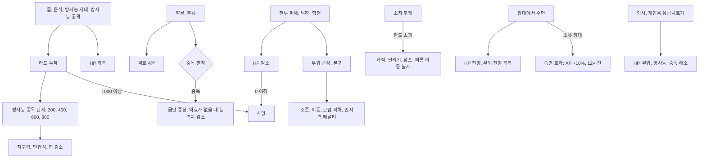
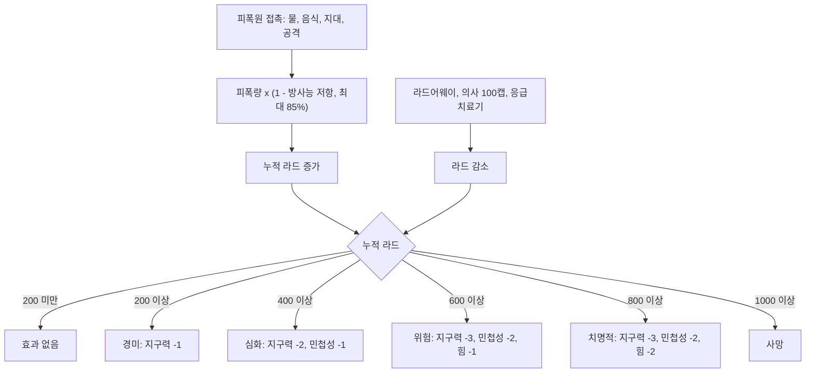
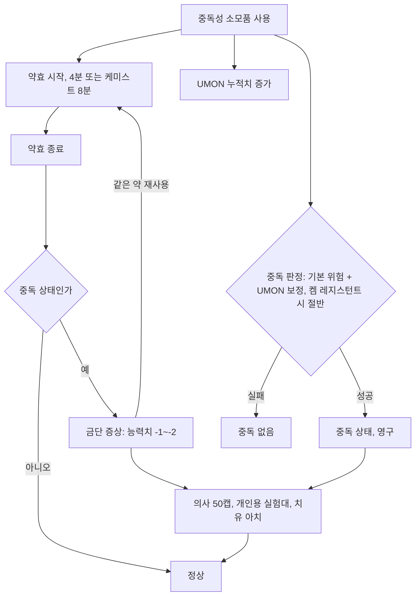

# RD-15. 상태·생존 시스템

> **폴아웃 3 역기획서 세트** | 문서 ID: RD-15 | 버전: v1.0 | 작성일: 2026-10-11
> **범위**: 체력(HP) 공식과 회복 수단 전체, 방사능(피폭원·중독 단계·저항·치료), 중독과 금단(확률·금단 효과·치료), 부위 손상과 불구(효과·치료), 대기·수면·숙면 효과, 사망·게임 오버, 소지 무게·과적, 기타 상태 효과(독·화상·뇌진탕·약물 버프 지속 등), 난이도가 상태에 주는 영향 / **다루지 않음**: S.P.E.C.I.A.L.·스킬·퍽 정본(RD-14), 피해 공식·VATS(RD-16), 소모품 개별 수치 카탈로그(RD-21), 의사·상점·플레이어 하우스의 경제 측면(RD-22), 크리처별 공격 수치(RD-24)
> **관련 문서**: [RD-14 캐릭터 시스템](14_character-system.md), [RD-16 전투 시스템](16_combat-system.md), [RD-17 탐험·상호작용](17_exploration-interaction.md), [RD-18 UI/UX](18_ui-ux.md), [RD-20 방어구·의복](20_armor-apparel.md), [RD-21 소모품·잡화·제작](21_consumables-misc-crafting.md), [RD-22 경제·주거](22_economy-housing.md), [RD-24 크리처·적 도감](24_bestiary.md), [RD-04 메인 스토리 2부·엔딩](04_main-story-part2-endings.md), [RD-26 용어집](26_glossary.md)

---

## 1. 문서 개요

### 1.1 목적
- 폴아웃 3(Fallout 3)의 플레이어 캐릭터 외로운 방랑자(Lone Wanderer)가 수도 황무지(Capital Wasteland)에서 받는 **지속 상태**(HP 손실, 방사능, 중독, 불구, 과적, 버프)와 그 **해소 수단**을 정리한다.
- 팬게임에서 RPG Maker의 스테이트·변수·공용 이벤트로 옮길 수 있게, 각 상태를 "발생 조건 → 효과 → 지속 → 해제 수단" 단위로 쪼개 적는다.

### 1.2 3~5줄 요약
- 폴아웃 3의 생존 압박은 **HP와 방사능 두 축**이다. 배고픔·갈증·수면 부족 같은 필요 수치는 없다. 이런 수치는 후속작 뉴 베이거스(Fallout: New Vegas)의 하드코어 모드에서 도입됐다.
- HP는 `90 + 지구력×20 + 레벨×10`이고 **자연 회복이 없다**. 스팀팩(Stimpak)·음식·물·수면·의사로 회복하며, 음식과 물은 대개 방사능을 함께 준다. "회복하려면 오염된다"는 딜레마가 생존 루프의 중심이다.
- 방사능은 1,000에서 즉사이며 200 단위 5단계로 지구력·민첩성·힘을 깎는다. 라드-X(Rad-X)로 막고 라드어웨이(RadAway)·의사(100캡)로 씻는다.
- 약물·주류는 확률로 **영구 중독**을 일으키고, 약효가 끝나면 금단 증상(능력치 -1~-2)이 남는다. 의사(50캡)나 집의 실험대로만 치료된다.
- 부위 6곳은 따로 불구가 되며 머리(인지력 -4·시야 흐림), 팔(조준·근접 피해), 다리(이동 속도) 등의 페널티를 준다. 스팀팩 부위 지정·수면·의사로 고친다.

### 1.3 표기 메모
- 수치 출처는 Nukapedia 덤프(2026-08-30판). 문서 간 수치가 다르면 둘 다 적고 `※`로 표시한다.
- 고유명사는 용어집 v0.2(한글 패치 표기 우선)를 따른다.
- 시간 표기: 약효 '4분'은 실시간 240초다(밀주 정보상자의 '240s' 표기 기준). 게임 시간은 '게임 시간', 실시간은 '실시간'으로 구분한다. 솔라 파워드 문서에 따르면 실시간 10초가 게임 시간 5분이다(시간 배율 30).
- `라드`는 방사능 피폭량 단위다. 의학 스킬 보정식 `효과 = 기본값 × (1 + 의학/50)`은 RD-14 §4.6.7 참조.

### 1.4 상태 시스템 구조도

---

## 2. 체력(HP)

### 2.1 공식과 수치표
- `최대 HP = 90 + 지구력 × 20 + 레벨 × 10` (지구력 5·Lv1 = 200)
- HP가 0 이하가 되면 사망한다(인게임 설명: "HP가 0 이하가 되면 죽는다").
- 뉴 베이거스와 비교: 기본값 100, 레벨당 +5로 바뀌어 두 게임의 시작 HP는 같지만 폴아웃 3이 레벨당 2배 빠르게 성장한다.

| 지구력 \ 레벨 | Lv1 | Lv5 | Lv10 | Lv15 | Lv20 | Lv25 [BS] | Lv30 [BS] |
|---|---|---|---|---|---|---|---|
| 1 | 120 | 160 | 210 | 260 | 310 | 360 | 410 |
| 3 | 160 | 200 | 250 | 300 | 350 | 400 | 450 |
| 5 | 200 | 240 | 290 | 340 | 390 | 440 | 490 |
| 7 | 240 | 280 | 330 | 380 | 430 | 480 | 530 |
| 9 | 280 | 320 | 370 | 420 | 470 | 520 | 570 |
| 10 | 300 | 340 | 390 | 440 | 490 | 540 | 590 |

- 영구 보정을 모두 더한 이론상 최대(지구력 10, Lv30, 라이프 기버 +30, 서바이벌 구루 '노멀' +15)는 635다.

### 2.2 최대 HP 보정 출처

| 출처 | 영문 | 수치 | 지속 | 비고 |
|---|---|---|---|---|
| 레벨업 | Level up | +10/레벨 | 영구 | |
| 지구력 | Endurance | +20/점 | 영구·일시 | 보블헤드·인텐스 트레이닝(영구), 의류·버프아웃(일시) |
| 라이프 기버 | Life Giver | +30 | 영구 | Lv12 퍽 |
| 서바이벌 엑스퍼트 | Survival Expert | +5 / +10 / +15 | 영구 | '노멀' 답변 계열. RD-14 §6.4 |
| 버프아웃 | Buffout | 최대 HP +60(지구력 +3 효과) | 4분 | 약효가 끝나면 HP가 60 줄고, 남은 HP가 60 미만이면 1이 된다 |
| 방사능 중독·금단 | Radiation / Withdrawal | 지구력 -1~-3 | 해소 시까지 | ※ 방사능 문서는 "지구력 감소로 최대 HP가 줄 수 있다", 라드 톨러런스 문서는 "일시적 지구력 감소는 HP를 줄이지 않는다"고 서로 다르게 적는다 |

- ※ 버프아웃 문서 본문은 약효를 "약 10분"이라고 적어, 정보상자(4분)와 다르다.

### 2.3 저체력 상태
| 조건 | 효과 | 출처 |
|---|---|---|
| HP 20% 이하 | 심장 박동 효과음(체력이 낮을수록 크고 빨라짐, 극히 낮으면 멈추기도 함) | 연출 |
| HP 20% 이하 + 너드 레이지! | 힘 10, DR +50% | 퍽 |
| HP 20 이하 + [BS] 뉴클리어 어노멀리 | 핵폭발(주변 아군 포함), HP를 20 이상으로 회복하고 라드 0. HP가 20 이상이 될 때까지 10초마다 반복 | 퍽. 보통 이상 난이도에서는 폭발에 플레이어가 죽는 버그 |
| HP 0 이하 | 사망 | §7 |

### 2.4 회복 수단 전체

| 수단 | 영문 | HP 회복량 | 부위 회복 | 방사능 | 조건·비용 | 비고 |
|---|---|---|---|---|---|---|
| 스팀팩 | Stimpak | `30 × (1 + 의학/50)` = 30~90 | 부위 지정 가능 | – | 무게 0, 가치 25 | 즉시 회복. 패스트 메타볼리즘 ×1.2(최대 108). 부위에 쓰면 부위를 많이·전신을 조금, 전신에 쓰면 그 반대 |
| [MZ] 외계 바이오젤 | Alien biogel | `10 × (1 + 의학/50)` = 10~30 | – | – | | 무작위 부가 효과 |
| [MZ] 개조 바이오젤 | Adapted biogel | `50 × (1 + 의학/50)` = 50~150 | – | – | | 무작위 부가 효과 |
| 음식(일반) | Food | 대부분 +5 | 불가 | 대부분 +3 | | 예: 브라민 스테이크(Brahmin steak), 블램코 맥앤치즈(Blamco Mac and Cheese), 인스타매시(InstaMash), 땅두더지 고기(Mole rat meat) |
| 음식(신선 작물) | Fresh produce | +10 | 불가 | 0 | | 신선한 사과·당근·배·감자 |
| 음식(고급) | Mirelurk meat 등 | +20 | 불가 | +2~+3 | | 마이얼럭 고기, 땅두더지 원더 미트(Mole rat wonder meat) |
| 동굴 버섯 | Cave fungus | +5 | 불가 | **-10** | 가치 50 | 회복과 정화를 겸함 |
| 인육 | Human flesh | +25 | 불가 | +10 | | 카르마 영향은 캐니벌 퍽 섭취 시(-1) |
| [TP] 슬롭 | Slop | +25 | 불가 | +25 | | 게임에서 가장 오염된 음식. 연속 40번 먹으면 치사 |
| 정화수 | Purified water | +20 | 불가 | 0 | 가치 20 | |
| 오염된 물 | Dirty water | +10 | 불가 | +5 ※ | | ※ 아이템 문서 +5, 허브 +6 |
| 뉴카-콜라 | Nuka-Cola | +10 | 불가 | +2~+3 ※ | | 마시면 병뚜껑 1개. ※ 허브 +2, 아이템 문서 +3 |
| 얼음처럼 차가운 뉴카-콜라 | Ice cold Nuka-Cola | +20 | 불가 | +3 | | |
| [BS] 아쿠아 퓨라 | Aqua Pura | +20 | 불가 | 0 | | 정화 계획 가동 후 보급 |
| [BS] 아쿠아 쿠라 / 성수 | Aqua Cura / Holy water | +10 / +20 | 불가 | +6 / +15 | | |
| 수원 마시기 | Water source | 분수 +24, 소화전 +24, 기타 장소별 상이 | 불가 | 분수 0 또는 +5, 소화전 +4 | 무료, 반복 가능 | 세면대·변기·웅덩이 등. 예: 파라다이스폴(Paradise Falls) 화장실 +30·+2라드. 활성화 버튼을 누르고 있으면 연속으로 마심 |
| 혈액 팩 | Blood pack | +1(헤마토파지 +20) | 불가 | – | | |
| 음식물 소독기 | Food sanitizer | 음식 HP 회복 +20% | – | 변화 없음 | 무게 7, 소지 시 | [황무지 생존 가이드(The Wasteland Survival Guide)](05_side-quests-part1.md) 보상 |
| 수면 | Sleeping | **전량** | **전량** | 불가 | 침대, 제약 조건(§6) | 잠깐만 자도 적용 |
| 의사 치료 | Doctor | 전량 | 전량 | 별도 100캡 | 50 / 75 / 100캡(부상 정도별) | §2.5 |
| 개인용 응급치료기 | My First Infirmary | 전량 | 전량 | 전량 제거 | 집 개조품, 가치 1,199캡 | 메가톤(Megaton) 집·텐페니 타워(Tenpenny Tower) 스위트 |
| [MZ] 치유 아치 | Healing archway | 최대 HP의 약 75%까지 | 회복 | 전량 제거 | 15초 재충전 | 과학 75로 개조하면 100%까지 회복하지만 3회 사용 후 소진. 중독도 치료 |
| [OA] 시뮬레이션 포드 | VR simulator | – | – | 전량 제거 | 아웃캐스트(Outcasts) 전초기지 | 앵커리지 탈환전 시뮬레이션 출입 시 |
| 솔라 파워드 | Solar Powered | 실시간 10초당 1(게임 1시간당 12) | – | – | 06:00~18:00 야외 | Lv20 퍽 |
| 캐니벌 | Cannibal | +25 | – | +3 | 은신 중 시체 섭취 | 카르마 -1, 목격 시 적대 |
| 라드 리제너레이션 | Rad Regeneration | – | 방사능 400 이상일 때 불구 자동 재생 | – | | 퀘스트 퍽 |
| 뉴클리어 어노멀리 | Nuclear Anomaly | 폭발 후 20 이상으로 | – | 0으로 | HP 20 이하 | [BS] 퍽, 버그 주의 |

- 음식·음료 개별 수치 정본은 RD-21이다. 위 표는 상태 시스템 관점의 대표값이다.
- 레벨업 시 최대 HP가 10 오르지만 현재 HP도 함께 오르는지는 코퍼스에서 확인되지 않는다(코퍼스 미확인).

### 2.5 의사 치료
의사(Doctor)는 대화로 HP·부위 치료, 방사능 제거, 중독 치료를 판다. 경제적 측면(재고·영업시간)은 RD-22.

| 서비스 | 비용 | 규칙 |
|---|---|---|
| 부상 치료 | 50 / 75 / 100캡 | 처치 박사(Doc Church) 대사 기준. 대화 주제가 `DoctorMedical99`(50캡)·`66`(75캡)·`33`(100캡)으로 나뉘어 있어, 남은 HP 비율 구간(99%·66%·33% 이하)별 가격으로 추정된다(추정). 다치지 않았으면 거절 |
| 방사능 제거 | 100캡 | 라드 전량 제거 |
| 중독 치료 | 50캡 | 모든 중독 제거 |

| 의사 | 영문 | 위치 | 방사능 | 중독 | 약물 판매 | 비고 |
|---|---|---|---|---|---|---|
| 처치 박사 | Doc Church | 메가톤 | 100캡 | 50캡 | O | |
| 프레스턴 박사 | Doctor Preston | 리벳시티(Rivet City) | 100캡 | 50캡 | O | |
| 배로우즈 박사 | Doctor Barrows | 언더월드(Underworld) | 100캡 | 50캡 | O | |
| 커터 | Cutter | 파라다이스폴 | 100캡 | 50캡 | O | 파라다이스폴 출입 조건 필요 |
| 밴필드 박사 | Doctor Banfield | 텐페니 타워 | 100캡 | 50캡 | O | |
| 부처 | Butcher | 레인저 본부(Ranger Compound) | X | X | X | 라일리 레인저(Reilly's Rangers) 퀘스트에서 생존 시 |
| 레드 | Red | 빅타운(Big Town) | 100캡 | 50캡 | X | 저먼타운 경찰서에서 구출 필요. 빅타운 방어와 타임밤 치료를 도왔으면 무료 치료 |
| 루시 | Lucy | 리틀 램프라잇(Little Lamplight) | 100캡 | 50캡 | X | 리틀 램프라잇 출입 필요 |
| 소본즈 | Sawbones | 시타델(The Citadel) | X | 50캡 | X | 고장 수리 전에는 치료가 오히려 피해를 주기도 함. 수리 후 치료하면 '소본즈의 정밀함'(지구력·인지력 +2, 약 3게임 시간) |
| [OA] 아다미 박사 | Doctor Adami | 미 육군 야전 사령부 | O | O | X | |
| [MZ] 엘리엇 터코리언 | Elliott Tercorien | 제타(Zeta) | ? | ? | ? | 위키 미기재 |
| 떠돌이 의사 | Wasteland doctor | 랜덤 인카운터 | 100캡 | 50캡 | O | |

### 2.6 회복 속도와 자연 회복
- **자연 회복 없음**: 위키는 "폴아웃 3에는 회복률(Healing Rate)이 없다"고 적는다. 시간이 지나도 HP는 저절로 차지 않는다(솔라 파워드 예외).
- 대기(Wait)와 HP: HP 문서 노트에 "대기하면 시간당 0.66 회복"이라는 서술이 있지만 폴아웃 3·뉴 베이거스 공통 노트라 폴아웃 3 적용 여부는 불명확하다(※, 코퍼스 미확인). 대기 문서는 "휴식(수면)은 대기와 같지만 HP를 회복시킨다"고 대비해 설명한다.
- 스팀팩은 '즉시' 회복이다(아이템 문서 표현). 음식·물의 회복이 즉시인지 시간 분할인지는 코퍼스에서 확인되지 않는다(코퍼스 미확인).
- 수면은 시간 길이와 무관하게 HP·부위를 전량 회복한다.

---

## 3. 방사능

### 3.1 수치 구조
- 방사능(Radiation)은 **라드(rad)** 단위로 누적된다. 0에서 시작하며 자연 감소하지 않는다([BS] 라드 앱소프션 예외).
- 피폭 중에는 화면 오른쪽 위에 핍-보이 3000(Pip-Boy 3000)의 선량계가 뜬다. 주 눈금은 200·400·600·800·1,000, 보조 눈금은 66.67 단위다. 핍-보이 STATS > Status > RAD 화면에서 정확한 수치와 방사능 저항을 볼 수 있고, 여기서 라드-X·라드어웨이를 바로 쓸 수 있다.
- **방사능은 HP를 직접 깎지 않는다.** 대신 단계별로 능력치를 깎고, 1,000에서 즉사시킨다.
- **NPC는 방사능에 면역**이다. 원자의 자손(Children of Atom) 교회의 크롬웰(Confessor Cromwell)이 오염된 물에 서 있어도 죽지 않는 이유다. 구울은 방사능으로 회복한다(글로잉 원(Glowing one)의 방사능 폭발이 주변 야생 구울(Feral ghoul)을 치유).

### 3.2 방사능 중독 단계

| 라드 | 단계 | 영문 | 능력치 효과 | 계산상 파생 영향(지구력·민첩성·힘 감소분) |
|---|---|---|---|---|
| 0~199 | 없음 | – | – | – |
| 200~399 | 경미한 방사능 중독 | Minor Radiation Poisoning | 지구력 -1 | 중화기·비무장 -2, 독 저항 -5%p |
| 400~599 | 심화된 방사능 중독 | Advanced Radiation Poisoning | 지구력 -2, 민첩성 -1 | 중화기·비무장 -4, 소형 화기·은신 -2, AP -2 |
| 600~799 | 위험한 방사능 중독 | Critical Radiation Poisoning | 지구력 -3, 민첩성 -2, 힘 -1 | 중화기·비무장 -6, 소형 화기·은신 -4, 근접 무기 -2, AP -4, 소지 한도 -10 |
| 800~999 | 치명적 방사능 중독 | Deadly Radiation Poisoning | 지구력 -3, 민첩성 -2, 힘 -2 | 중화기·비무장 -6, 소형 화기·은신 -4, 근접 무기 -4, AP -4, 소지 한도 -20 |
| 1,000 이상 | 치사 방사능 중독 | Fatal Radiation Poisoning | **사망**(HP -10,000 처리) | – |

- 파생 영향 열은 RD-14의 능력치 공식에 단계 효과를 대입한 계산값이다. 위키 예시(라드 리제너레이션 문서)도 심화 단계를 "중화기·비무장 -4, 소형 화기·은신·AP -2"로 적는다.
- ※ 지구력 감소가 최대 HP·방사능 저항까지 깎는지는 문서 간 서술이 엇갈린다(§2.2).
- [BS] 라드 톨러런스(Rad Tolerance) 퍽은 '경미한' 단계의 효과만 없앤다(경고는 표시).
- 퀘스트 퍽 라드 리제너레이션(Rad Regeneration)은 '심화' 이상(400+)일 때 불구 부위를 자동 재생시킨다. 황무지 생존 가이드 1장에서 600라드 이상을 기록해야 얻는다.
- 스킬 감소는 100 초과 내부 기록으로 상쇄할 수 있다(RD-14 §4.5).

### 3.3 피폭원

| 구분 | 피폭원 | 영문 | 수치 예 | 비고 |
|---|---|---|---|---|
| 물 | 오염된 물(병) | Dirty water | +5 ※ | 정화수·[BS] 아쿠아 퓨라는 0 |
| 물 | 수원 마시기(세면대·변기·분수·소화전·웅덩이) | Water sources | 0~+5 / 회 | 레드 벨리 퍽이 물로 인한 피폭 -50% |
| 물 | 오염된 물에 들어가기·수영 | Irradiated water | 대개 초당 +1 수준 | 위키: "+1라드 물에 한참 서 있어야 하며, 200에 이르기까지 수십 번 지나갈 수 있다." 거의 모든 오물 웅덩이가 약간의 라드를 가진다 |
| 음식 | 대부분의 가공·고기 음식 | Food | +1~+3 | 신선 작물 0, 동굴 버섯 -10 |
| 음식 | 인육 / [TP] 슬롭 | Human flesh / Slop | +10 / +25 | |
| 음료 | 뉴카-콜라 / 뉴카-콜라 퀀텀 | Nuka-Cola / Nuka-Cola Quantum | +2~+3 / +6~+10 ※ | ※ 퀀텀은 허브 +6, 아이템 문서 +10 |
| 환경 | 볼트 87(Vault 87) 지상 입구 | Vault 87 entrance | 최대 초당 3,933 | 게임 최강 피폭 지대. 메인 진행상 필수 구간은 RD-04 |
| 환경 | 볼트 87 G.E.C.K. 격실 | G.E.C.K. containment | 초당 1~400 | |
| 환경 | [TP] 모농가헬라 강 | Monongahela River | 다리 근처 초당 200~800, 최대 2,665 | |
| 환경 | [TP] 홀 | The Hole | 약 초당 17 | 투기장 |
| 환경 | 방사능 표지·웅덩이·폭심지 | Irradiated areas | 대개 초당 +1 이상 | 방사능 저항 85%여도 최소 +1이 남는다(§3.4) |
| 무기 | 팻맨 미니 누크 폭심 | Fat Man / mini nuke | 폭발 지대 최대 초당 8, 정보상자 +10/12초(실험용 MIRV 유형 +80/12초) | 폭발 후 잠시 오염 지대가 남음 |
| 적 | 센타우로스(Centaur) 방사능 침 | Radioactive spit | 30 피해 + 초당 5라드 × 15초 | |
| 적 | 글로잉 원 오라 폭발 | Aura Explosion | 5 피해 + 초당 5라드 × 2초 | 주변 야생 구울은 회복 |
| 퍽 | 캐니벌 섭취 | Cannibal | +3 / 회 | |

- 위 수치 중 크리처 공격 수치의 정본은 RD-24, 무기는 RD-19다.
- 방사능 지대에서는 대기·수면을 할 수 없다(§6.1).

### 3.4 방사능 저항
- `기본 방사능 저항 = (지구력 - 1) × 2%` (지구력 5 → 8%, 10 → 18%)
- **상한 85%.** 어떤 조합으로도 완전 면역은 없다. 위키 계산: 방사능 지대에는 최소 +1라드가 남으므로, 정화 수단 없이 최대 저항으로 버틸 수 있는 시간은 실시간 16분 40초(라드 앱소프션 보유 시 17분 32초)다.
- 저항은 환경·음식·무기 등 **모든 피폭원**에 적용된다.

| 출처 | 영문 | 수치 | 지속 |
|---|---|---|---|
| 지구력 | Endurance | +2%/점(지구력 1이면 0%) | 영구 |
| 라드-X | Rad-X | `25 × (1 + 의학/50)`% = 25~75% | 4분. 여러 개 먹어도 수치는 중첩되지 않고 지속시간만 늘어남 |
| 방호복·실험복류 | Radiation suit 등 | 장비별 | 착용 중. 방사능 방호복, 고급 방사능 방호복, 환경 방호복, 레스코의 실험복, 여과 헬멧, 개조 작업용 점프슈트 등(수치는 RD-20) |
| 파워 아머류 | Power armor | 10~25% | 착용 중. 트라이벌 파워 아머·애셔의 파워 아머는 제외 |
| 라드 레지스턴스 | Rad Resistance | +25% | 영구(퍽) |
| 사이보그 | Cyborg | +10% | 영구(퍽) |
| 서바이벌 엑스퍼트 | Survival Expert | +2 / +4 / +6% | 영구(퀘스트 퍽) |
| [TP] 부스터 샷 | Booster Shot | +10% | 영구(퀘스트 퍽) |
| [TP] 피트 파이터 | Pitt Fighter | +3% | 영구(퀘스트 퍽) |
| 뉴카-콜라 퀀텀 중독 금단 | Nuka-Cola Quantum addiction | -15 | 중독 중 금단 시 |

### 3.5 방사능 치료

| 수단 | 영문 | 제거량 | 비용·조건 |
|---|---|---|---|
| 라드어웨이 | RadAway | `50 × (1 + 의학/50)` = 50~150 | 가치 20, 무게 0, 비중독 |
| 의사 | Doctor | 전량 | 100캡(§2.5) |
| 개인용 응급치료기 | My First Infirmary | 전량 | 집 개조품(무료 반복) |
| 동굴 버섯 | Cave fungus | -10 | 음식(HP +5) |
| [PL] 야생 펑가 열매 / 정제 펑가 열매 | Wild / Refined punga fruit | -1 / -2 (펑가 파워! 시 -5 / -15) | HP +10 / +15 |
| [BS] 라드 앱소프션 | Rad Absorption | 실시간 20초당 -1(게임 1시간 대기 시 -6) | Lv28 퍽. 빠른 이동·수면·대기에도 적용 |
| [BS] 뉴클리어 어노멀리 | Nuclear Anomaly | 폭발 시 0으로 | HP 20 이하 발동 |
| [OA] 시뮬레이션 포드 | VR simulator | 전량 | 앵커리지 탈환전 시뮬레이션 이용 |
| [MZ] 치유 아치 | Healing archway | 전량 | 통과 시(알림 없음) |

- 수면은 방사능을 **줄이지 않는다.**
- 핍-보이로 아이템을 먹어 라드가 1,001을 넘게 되면 '치사 방사능 중독' 알림이 뜨고, 그 상태로 핍-보이를 닫으면 즉사한다. 닫기 전에 라드어웨이 등으로 낮추면 산다.

### 3.6 방사능 흐름도

---

## 4. 중독과 금단

### 4.1 규칙
- **발생**: 중독성 소모품을 쓸 때마다 중독 판정을 한다. 판정 확률은 ① 아이템별 **기본 위험(Risk)**과 ② 반복 사용으로 쌓이는 **사용량 모니터(Usage Monitor, UMON)** 값으로 정해진다.
  - UMON: 사용할 때마다 아이템별 UMON 값이 누적치에 더해지고, 정해진 시간(UMON 지속)이 지나면 그 몫이 빠진다. 위키는 "누적 75가 중독 확률 +1%p, 175가 +100%p에 해당하는 것으로 보인다"고 적는다(관찰값).
  - 주류는 UMON이 없고 기본 위험만 있다.
- **지속**: 폴아웃 3의 중독은 **영구**다. 시간이 지나도 낫지 않는다(1·2편과 다름).
- **금단 증상(Withdrawal)**: 중독된 약물의 약효가 몸에 남아 있지 않을 때 능력치 페널티가 걸린다. 같은 약을 다시 쓰면 약효 동안은 금단이 가려진다(임시방편). 대개 그 약이 올려 주던 능력치와 관련된 능력치가 깎인다.
- **보정 퍽**: 켐 레지스턴트(Chem Resistant, 중독 확률 -50%), 케미스트(Chemist, 약효 2배 → 금단 공백이 줄어듦), [BS] 파티 보이/파티 걸(Party Boy/Party Girl, 알코올 금단 효과 없음 ※ 허브는 '알코올 중독 확률 0'으로 기술).
- 중독·금단 상태는 핍-보이 STATS > Status > EFF에 표시된다.

### 4.2 중독성 소모품 표

| 아이템 | 영문 | 분류 | 기본 위험 | UMON | UMON 지속 | 금단 증상 | 약효(4분) |
|---|---|---|---|---|---|---|---|
| 버프아웃 | Buffout | 약물 | 10% | 30 | 30시간 | 지구력 -1, 힘 -1 | 최대 HP +60, 지구력 +3, 힘 +2 |
| 제트 | Jet | 약물 | 20% | 30 | 30시간 | 민첩성 -1, 카리스마 -1 | AP +30 |
| 울트라제트 | Ultrajet | 약물 | 20% | 12 | 48분 | 민첩성 -2, 인지력 -1, 힘 -1 | AP +40 |
| 멘타츠 | Mentats | 약물 | 5% | 30 | 30시간 | 지능 -1, 인지력 -1 | 지능 +5, 인지력 +5 |
| 사이코 | Psycho | 약물 | 10% | 30 | 30시간 | 지구력 -1, 인지력 -1 | 피해 +25% |
| 메드-X | Med-X | 약물 | 10% | 30 | 30시간 | 민첩성 -1, 지능 -1 | DR +25% |
| 앤트 넥타 | Ant nectar | 약물 | 5% | 20 | 1시간 | 힘 -2 | 힘 +4, 지능 -2, 카리스마 -2 |
| 뉴카-콜라 퀀텀 | Nuka-Cola Quantum | 음료 | 10% | 12 | 48분 | 카리스마 -1, 방사능 저항 -15 | AP +20, 라드 +6~+10 ※ |
| 맥주 | Beer | 주류 | 5% | – | – | 민첩성 -1, 카리스마 -1 | 힘 +1, 카리스마 +1, 지능 -1 |
| 와인 | Wine | 주류 | 5% | – | – | 〃 | 〃 |
| 보드카 | Vodka | 주류 | 10% | – | – | 〃 | 〃 |
| 스카치 | Scotch | 주류 | 10% | – | – | 〃 | 〃 |
| 위스키 | Whiskey | 주류 | 10% | – | – | 〃 | 〃 |
| [PL] 밀주 | Moonshine | 주류 | 10% | – | – | 〃(알코올 중독) | 힘 +2, 카리스마 +2, 지능 -2 |

- 주류 6종은 모두 같은 '알코올 중독(Alcohol addiction)'을 공유한다. 주류의 일시 효과는 서로 중첩되지 않는다.
- 약효는 케미스트 퍽으로 2배(8분)다. 제트·울트라제트·뉴카-콜라 퀀텀 등 16종이 케미스트 적용 대상이다(RD-14 §6.2).

**비중독 소모품**: 스팀팩, 라드-X, 라드어웨이, 베리·그레이프·오렌지 멘타츠(파생 멘타츠는 비중독), 화염개미 넥타(Fire ant nectar, 앤트 넥타와 달리 비중독), 개미 여왕 페로몬, 혈액 팩, 음식·물 전반.

### 4.3 치료

| 수단 | 영문 | 비용 | 범위 | 비고 |
|---|---|---|---|---|
| 의사 | Doctor | 50캡 | 모든 중독 | 의사 목록은 §2.5. 처치 박사: "That'll be 50 caps."(한글 패치: "50 캡이 되겠어.") |
| 개인용 실험대 | My First Laboratory | 무료 | 모든 중독(앤트 넥타 중독 제외 ※) | 메가톤 집·텐페니 타워 스위트 개조품. 24시간마다 무작위 약품 1개를 '양조'하는 기능이 있고, 양조 중에는 해독 기능을 쓸 수 없다. 한글 패치 대사는 '실험대'로 옮김 |
| [MZ] 치유 아치 | Healing archway | 무료 | 약물 중독 | §2.4 |
| [OA] 아다미 박사 | Doctor Adami | 위키 미기재 | 중독 | §2.5 |

- ※ 앤트 넥타 중독 문서는 "개인용 실험대로는 치료되지 않아 의사를 찾아야 한다"고 적는다.
- 1·2편처럼 시간이 지나 자연 치유되지 않으므로, 중독은 **캡을 쓰게 만드는 장치**로 작동한다.

### 4.4 중독 흐름도

---

## 5. 부위 손상과 불구

### 5.1 부위 구성과 규칙
- 폴아웃 3에서는 **머리, 몸통, 왼팔, 오른팔, 왼다리, 오른다리**의 6부위가 각각 부위 체력을 가진다(1·2편과 달리 머리·몸통도 불구가 됨). 핍-보이 STATS > Status > CND 화면에 부위 상태와 보유 스팀팩 수가 표시되고, 여기서 스팀팩을 부위별로 쓸 수 있다.
- 부위 체력이 바닥나면 **불구(Crippled)**가 된다. 부위 체력이 1이라도 회복되면 불구가 풀린다(라드 리제너레이션 문서의 설명).
- 같은 규칙이 적에게도 적용된다. VATS로 부위를 노려 불구를 만드는 전술은 RD-16.

### 5.2 부위별 불구 효과

| 부위 | 영문 | 플레이어에게 걸리는 효과 | 근거·비고 |
|---|---|---|---|
| 머리 | Head | **뇌진탕(Concussion)**: 인지력 -4, 시야가 주기적으로 흐려지고 이명(耳鳴)이 들림, 명중률 저하 | 뇌진탕 문서. 인지력 감소로 에너지 무기·폭발물·자물쇠 따기 각 -8, 나침반 적 탐지 범위 감소(계산상) |
| 몸통 | Torso | 피격 시 움찔거림이 커져 조준·행동이 끊김 | ※ 불구 문서 본문은 "지구력에 영향"이라 적지만 정량 수치가 없다 |
| 팔(어느 쪽이든) | Arms | 조준 흔들림 증가(스코프 사용 시 심한 흔들림), 명중률 저하 | 소형 화기 문서: 스킬 100이어도 팔 불구 시 스코프가 크게 흔들림 |
| 팔(근접 피해) | Arms | 근접·비무장 피해 페널티 | 전투 공식의 `팔 상태` 항: 오른팔 불구 + 한손 근접·비무장 → 기본 피해의 -40%, 한 팔 불구 + 양손 근접 → -20%, 양팔 불구 + 양손 근접 → -40%(RD-14 §4.6.1) |
| 다리 | Legs | 이동 속도 저하 | 적의 다리를 불구로 만들면 도주를 막을 수 있다(로딩 화면 팁) |

- 뉴 베이거스에서 정리된 세부 효과(한쪽 팔 불구 시 근접 피해 -10% 등)를 폴아웃 3에 그대로 적용할 근거는 없다. 위 표는 폴아웃 3 문서와 전투 공식만 근거로 한다.

### 5.3 원인
- 적의 공격(특히 부위 조준, 폭발), 낙하 피해, 함정(곰덫 등), 폭발.
- [다트 건(Dart gun)](21_consumables-misc-crafting.md) 같은 무기는 다리를 직접 노리는 효과를 가진다(삭제된 '부위 피해' 효과 중 다리 피해만 실제 사용).
- 아다만티움 스켈레톤(Adamantium Skeleton) 퍽은 적·폭발에 의한 부위 피해를 50% 줄인다(낙하 부위 피해에는 미적용).

### 5.4 치료

| 수단 | 영문 | 범위 | 비고 |
|---|---|---|---|
| 스팀팩(부위 지정) | Stimpak | 지정 부위 대량 + 전신 소량 | 핍-보이 CND 화면에서 부위를 골라 사용. 로딩 화면 팁: "핍-보이로 손상 부위에 스팀팩을 직접 쓸 수 있다" |
| 스팀팩(전신) | Stimpak | 전신 대량 + 부위 소량 | |
| 수면 | Sleeping | 전 부위 | 위키 서술은 "어느 정도든 자면" 또는 "약 1시간 자면"으로 문서마다 다름 |
| 의사 | Doctor | 전 부위 | 부상 치료 50~100캡에 포함 |
| 개인용 응급치료기 | My First Infirmary | 전 부위 | 'heal limbs' 기능 별도 |
| [MZ] 치유 아치 | Healing archway | 전 부위 | |
| 라드 리제너레이션 | Rad Regeneration | 자동 재생 | 방사능 400 이상일 때만 |
| 음식·물 | Food / Water | **불가** | 부위는 회복되지 않음 |

### 5.5 설계 메모
- 개발 중에는 플레이어가 직접 상처를 지지는 **수술 미니게임**이 있었으나 게임 속도를 늦춘다는 이유로 삭제됐다(위키 '삭제 콘텐츠' 인용). 결과적으로 불구는 "스팀팩 1개 또는 잠 한 번"으로 끝나는 가벼운 상태가 됐다.
- 몸통·머리 불구가 추가되면서 VATS 부위 선택에 전술적 의미가 생겼다(머리 → 인지력·명중, 다리 → 도주 봉쇄 등. RD-16).

---

## 6. 대기·수면·숙면 효과

### 6.1 대기(Wait)
- 게임 시간을 원하는 만큼 빨리 보낸다(PC 기본 T 키, Xbox 360 Back, PS3 Select). 상점 영업시간 맞추기, NPC 일정 진행, 낮·밤 조절에 쓴다. 대기 중에도 캐러밴 상인은 경로를 따라 이동한다.
- **대기·수면 불가 조건**: 근처에 적이 있을 때, 무단 침입 중, 점프·낙하 중, 수영 중, **피폭 중**, 대화 중.

### 6.2 수면(Sleeping)
- 남이 소유하지 않은 침대를 활성화하면 수면(휴식) 메뉴가 열린다. 수면은 대기와 같지만 다음 효과가 붙는다.

| 효과 | 내용 |
|---|---|
| HP | 전량 회복 |
| 부위 | 모든 불구 회복 |
| 방사능 | **변화 없음** |
| 중독 | 변화 없음 |
| 숙면 효과 | 소유 침대에서 1시간 이상(위키 서술) 자면 부여(§6.3). ※ 숙면 문서는 "잠들자마자 취소해 0시간을 자도 보너스를 받는다"고 적음 |

- 수면 조건은 대기와 같고, 추가로 **소유주가 있는 침대(빨간 이름)는 쓸 수 없다**.
- 침대 종류(간이 침구·매트리스·프레임 침대·볼트 침대·퀸 사이즈 등)는 연출 차이만 있다. ※ 침대 문서는 "깨끗한 퀸 사이즈 침대는 항상 숙면 효과를 준다"고 적지만 숙면 문서의 조건(소유 침대)과 어긋난다.

### 6.3 숙면 효과(Well Rested)
- **효과**: 획득 XP +10%(다른 XP 보너스와 곱연산), 기상 시점부터 **12게임 시간**. 핍-보이 STATS > EFF에 표시된다.
- **조건**: 플레이어가 소유하거나 빌린 침대에서 잔다. 소유 침대가 아닌 침대에서 자면 효과가 사라진다(소유 침대에서 다시 자면 즉시 회복).
- [BS] 딥 슬립(Deep Sleep) 퍽: 아무 침대에서나 숙면 효과를 받되 지속 **8시간**.
- 위키는 숙면을 G.E.C.K. 상의 '숨은 퍽'으로 설명한다(스위프트 러너와 같은 그림 사용).

| 숙면 침대 | 영문 | 조건·가격 |
|---|---|---|
| 메가톤 집 | My Megaton house | [원자의 힘(The Power of the Atom)](05_side-quests-part1.md)에서 핵폭탄 해체 시 열쇠 획득 |
| 텐페니 타워 스위트 | Tenpenny Tower suite | 메가톤 폭파 노선 보상 등(RD-22) |
| 모리아티 살롱 대여 침대 | Moriarty's Saloon | 노바(Nova)에게 120캡 |
| 리벳시티 웨덜리 호텔 | Weatherly Hotel | 120캡 |
| 언더월드 캐롤의 집 | Carol's Place | 120캡 |
| [PL] 케니의 동굴 간이 침대 | Kenny's cave | 화술 판정, 차일드 앳 하트, 또는 케니의 테디 베어 반환 |
| 기타 임시 거처 | Incidental housing | 위키 '플레이어 거처' 목록(RD-22) |

### 6.4 본작에 없는 생존 수치
- 폴아웃 3에는 **배고픔·갈증·수면 부족** 수치가 없다. 핍-보이의 H2O·FOD·SLP 항목은 뉴 베이거스 하드코어 모드 전용이다. 음식과 물은 오직 HP 회복(과 방사능 부담) 수단이다.
- ※ 위키 '휴식' 문서의 폴아웃 3 항목은 "깨어 있는 시간에 따라 수면 수치가 오르고 카페인이 이를 낮춘다"고 적지만 '확인 필요' 표시가 붙어 있고 다른 문서와 맞지 않는다. 이 문서는 수면 수치가 없다고 본다.

---

## 7. 사망과 게임 오버

### 7.1 사망 조건

| 조건 | 영문 | 규칙 | 비고 |
|---|---|---|---|
| HP 0 이하 | Hit Points depleted | 즉시 사망 | 모든 피해원(전투·낙하·함정·폭발·독·화상) |
| 방사능 1,000 이상 | Fatal Radiation Poisoning | 즉시 사망(HP -10,000 처리) | 핍-보이 안에서 소비해 1,001을 넘기면 핍-보이를 닫는 순간 사망(§3.5) |
| 차량 폭발 근접 | Exploding vehicle | 차량 위나 옆에 있으면 대개 즉사 | 주차장처럼 차가 몰린 곳은 연쇄 폭발. 상세 RD-17 함정 |
| [BS] 뉴클리어 어노멀리 버그 | Nuclear Anomaly | 보통 이상 난이도에서 자기 폭발로 사망할 수 있음 | §2.3 |
| 익사 | Drowning | 수중 산소 게이지(지구력 의존 폐활량) 소진 후 피해 | 폐활량 공식·익사 피해 수치는 코퍼스 미확인 |

### 7.2 게임 오버 처리
- 사망하면 저장된 지점에서 다시 시작한다(부활·벌칙 체계 없음). 저장·자동 저장 규칙은 RD-18(코퍼스 미확인 사항 포함).
- 본편만 설치한 경우 메인 퀘스트 [되찾아라!(Take It Back!)](04_main-story-part2-endings.md) 완료가 곧 **엔딩 슬라이드와 게임 종료**다(정화기 가동 방식 선택 포함). [BS] 브로큰 스틸을 설치하면 이후에도 플레이가 이어진다(RD-04, RD-08c).

### 7.3 동료·NPC의 사망과 기절
- 동료는 죽으면 영구히 잃는다. 예외: [BS] 퍼피스! 퍽이 있으면 도그밋(Dogmeat)이 죽어도 강아지가 대신 합류한다(RD-14 §6.3, RD-10).
- 필수(essential) NPC는 HP가 0이 되어도 죽지 않고 일시적으로 기절한다(목록은 RD-11).
- NPC는 방사능으로 죽지 않는다(§3.1).

---

## 8. 소지 무게·과적

### 8.1 소지 한도
- `소지 한도 = 150 + 힘 × 10` (lbs). 기본 최대 250, 스트롱 백(Strong Back) 퍽 +50 → 최대 300.
- 장비·약물·주류·퍽에 의한 **일시적 힘 상승도 즉시 반영**된다(파워 아머 힘 +2 → +20, 앤트 넥타 +4 → +40 등). 반대로 솔라 파워드(주간 야외 힘 +2)는 실내에 들어가거나 해가 지면 한도가 20 줄어 갑자기 과적될 수 있다.

| 힘 | 1 | 2 | 3 | 4 | 5 | 6 | 7 | 8 | 9 | 10 |
|---|---|---|---|---|---|---|---|---|---|---|
| 소지 한도 | 160 | 170 | 180 | 190 | 200 | 210 | 220 | 230 | 240 | 250 |
| 스트롱 백 포함 | 210 | 220 | 230 | 240 | 250 | 260 | 270 | 280 | 290 | 300 |

### 8.2 무게 규칙
- 무게가 `--`로 표시되는 아이템은 무게가 없다. 폴아웃 3에서는 **탄약, 약물(스팀팩 등), 퀘스트 아이템**이 무게 0이다. 스킬북·보블헤드는 1 이상의 무게를 가진다(RD-21·RD-23).
- **장착 중량**은 은신에 영향을 준다. 장착한 모든 아이템의 무게(무기는 손에 들었을 때만)가 발소리를 키운다. 사일런트 러닝 퍽이 이 페널티를 없앤다(RD-14 §4.6.12, RD-17).
- 무거운 무기·의복을 장착하면 이동 속도가 느려지고, 무기를 집어넣으면 더 빨리 달린다(로딩 화면 팁).

### 8.3 과적(Encumbered)

| 항목 | 내용 |
|---|---|
| 발생 | 소지 무게 > 소지 한도. **한도와 정확히 같으면 페널티 없음** |
| 이동 | 달리기 불가(느린 걸음). 위키 정보상자 표기: 이동 능력 60%(무기 꺼냄)·70%(무기 넣음) 감소 |
| 점프 | 불가 |
| 빠른 이동 | 불가 |
| 소음 | ※ 정보상자는 '과도한 소음'을, 무게 문서는 "과적은 은신·전투 등 다른 기능에 영향을 주지 않는다"를 적는다(장착 중량에 의한 소음과 혼동 가능) |
| 전투·VATS | 정상 사용 가능 |
| 해제 | 소지 무게를 한도 이하로 줄이거나 한도를 올림(힘 상승) |

- 1·2편은 한도를 넘는 아이템을 아예 집을 수 없었지만, 폴아웃 3은 집을 수는 있게 하고 이동 페널티를 준다.

### 8.4 무게 관리 수단
| 수단 | 내용 | 관련 문서 |
|---|---|---|
| 판매 | 상인에게 팔아 정리. 상인 보유 캡이 한정 | RD-22 |
| 동료에게 맡기기 | 동료가 정해진 한도까지 대신 운반 | RD-10 |
| 플레이어 하우스·용기 보관 | 메가톤 집·텐페니 타워 스위트 용기는 안전. 일반 용기는 셀 초기화로 비워질 수 있음 | RD-17, RD-22 |
| 수리로 합치기 | 같은 장비 여러 개를 수리 재료로 합쳐 가치는 올리고 무게는 줄임(예: 레이더 갑옷 3벌 → 1벌) | RD-14 §4.6.9 |
| 잡기 운반 | 아이템을 인벤토리에 넣지 않고 손으로 들어 옮김(PC Z 키). 한 번에 하나, 빠른 이동·건물 출입 불가 | RD-17 |
| 일시적 힘 상승 | 주류·버프아웃·앤트 넥타로 한도를 올린 상태에서 빠른 이동하면, 도중에 약효가 끝날 시간이어도 이동이 성립하고 도착 후 효과가 사라진다 | 위키 서술 |

---

## 9. 기타 상태 효과

### 9.1 상태 효과 목록

| 상태 | 영문 | 원인 | 효과 | 지속 | 해제·대응 |
|---|---|---|---|---|---|
| 독 | Poison | 방사능전갈(Radscorpion) 독침(방사능전갈 초당 3×5초, 거대 방사능전갈 초당 8×5초, [BS] 알비노 방사능전갈 초당 25×4초), 다트 건(8초, 중첩, 로봇 무효) | 지속 피해 | 수 초 | 독 저항(`(지구력-1)×5%`, 사이보그·서바이벌 엑스퍼트)으로 감소. 해독 아이템은 없음 |
| 화상 | Fire | 화염방사기(정보상자 추가 효과 2, 5초), 화염개미의 화염, 시시케밥, 가스 누출 점화 | 지속 피해. 가스 누출 폭발은 소량 피해 + 불붙음 + 몇 초간 넘어짐 | 수 초 | 화염 저항(개미의 힘·개미의 예지력 25%, 헬파이어 아머 30%+5%, 화염개미 넥타 25%). 파이로매니악 퍽은 화상 지속 피해를 올리지 않음 |
| 뇌진탕 | Concussion | 머리 불구 | 인지력 -4, 시야 흐림, 이명, 명중 저하 | 불구 해소까지 | §5.4 |
| 팔·다리·몸통 불구 | Crippled limbs | 부위 체력 0 | 조준·근접 피해·이동 페널티 | 해소까지 | §5.4 |
| 방사능 중독 | Radiation Poisoning | 라드 200 이상 | 지구력·민첩성·힘 감소 | 라드 감소까지 | §3.5 |
| 중독·금단 | Addiction / Withdrawal | 중독성 소모품 | 약효가 없을 때 능력치 -1~-2 | 치료까지 영구 | §4.3 |
| 과적 | Encumbered | 무게 초과 | 이동·점프·빠른 이동 제한 | 해소까지 | §8.3 |
| 약물 버프 | Chem effects | 약물·주류·일부 음식 | 능력치·AP·DR·피해 보정 | 4분(케미스트 8분) | §9.2 |
| 버프아웃 반동 | Buffout crash | 버프아웃 약효 종료 | 증가분 HP 60 상실(남은 HP 60 미만이면 1) | 즉시 | 약효 종료 전 회복 |
| 숙면 효과 | Well Rested | 소유 침대 수면 | XP +10% | 12시간([BS] 딥 슬립 8시간) | 다른 침대에서 자면 소멸 |
| 소본즈의 정밀함 | Sawbones' Precision | 수리된 소본즈의 치료 | 지구력 +2, 인지력 +2 | 약 3게임 시간 | 재치료로 갱신 |
| 은폐장 | Stealth field | 스텔스 보이(+100 은신, 은폐장 75, 2분), [OA] 중국군 스텔스 갑옷(웅크릴 때 은폐장 5) | 시각 탐지 거의 무력화 | 2분 / 착용 중 | 시끄러운 무기 발사 등 은신이 깨지면 무효(소리 탐지는 막지 못함) |
| 저체력 | Low health | HP 20% 이하 | 심장 박동 효과음, 너드 레이지! 발동 조건 | 회복까지 | §2.3 |
| 장비 효과 | Apparel effects | 의류·방어구 착용 | 능력치·스킬·저항 보정 | 착용 중 | RD-20 |
| [MZ] 바이오젤 부가 효과 | Biogel random effects | 외계·개조 바이오젤 | 무작위 | – | RD-21 |

- 크리처별 독·화상·방사능 공격 수치의 정본은 RD-24, 무기 부가 효과의 정본은 RD-19다.
- 플레이어가 적에게 거는 상태(패럴라이징 팜 30초 마비, [MZ] 냉동 수류탄·지뢰의 기절·넘어뜨림, 펄스 무기의 로봇 무력화, 다리 불구로 도주 봉쇄 등)는 RD-16에서 다룬다.

### 9.2 약물·소모품 버프의 지속 규칙
- **표준 지속**: 약물·주류·뉴카-콜라류 버프는 4분(실시간 240초). 라드-X도 4분, 스텔스 보이는 2분.
- **케미스트 퍽**: 중독성 소모품 16종의 지속시간 2배.
- **중첩**: 라드-X는 수치가 중첩되지 않고 지속시간만 늘어난다. 주류끼리는 효과가 중첩되지 않는다. 서로 다른 약물(제트 + 울트라제트 + 뉴카-콜라 퀀텀 + 뉴카러크 고기 + 미시시피 퀀텀 파이 등)은 함께 효과를 낸다(위키의 AP 최대치 계산 근거). 같은 약물을 겹쳐 썼을 때의 규칙은 코퍼스에서 확인되지 않는다(코퍼스 미확인).
- **의학 스킬**: 스팀팩·라드-X·라드어웨이·바이오젤의 효과량만 키운다. 다른 약물의 효과량에는 영향이 없다(RD-14 §4.6.7).
- **시간 경과**: 대기·수면·빠른 이동으로 시간이 흘러도 버프가 끝난다. 빠른 이동 도중 끝날 버프는 도착 후 끝난다(§8.4).
- **일시 능력치와 판정**: 버프로 오른 능력치는 연관 스킬·파생치에 즉시 반영되지만, 퍽 요구 조건과 레벨업 스킬 포인트에는 반영되지 않는다(RD-14 §2.1·§9.4).

### 9.3 상태 표시(핍-보이 EFF)
핍-보이 STATS > Status > EFF 화면은 다음을 한곳에 보여 준다: 착용 장비의 효과, 방사능 수준, 섭취한 약물의 효과, 숙면 효과, 중독, 불구 부위. 화면 구성은 RD-18.

---

## 10. 난이도가 상태 시스템에 주는 영향

| 난이도 | 영문 | 플레이어가 주는 피해 | 플레이어가 받는 피해 | 처치 XP |
|---|---|---|---|---|
| 아주 쉬움 | Very Easy | 200% | 50% | ×0.5 |
| 쉬움 | Easy | 150% | 75% | 코퍼스 미확인 |
| 보통 | Normal | 100% | 100% | ×1 |
| 어려움 | Hard | 75% | 150% | 코퍼스 미확인 |
| 아주 어려움 | Very Hard | 50% | 200% | ×1.5 |

- 난이도는 일시정지 메뉴에서 **언제든** 바꿀 수 있다(로딩 화면 팁).
- 받는 피해 배율이 HP 소모 속도를 바꾸므로, 실질적으로 **회복품 소비량**이 난이도에 따라 2배~1/2배로 변한다. 방사능 피폭량·독·화상 같은 상태 피해에도 같은 배율이 붙는지는 코퍼스에서 확인되지 않는다(코퍼스 미확인).
- 상태 규칙(방사능 단계, 중독 확률, 불구, 과적)은 난이도와 무관하게 같다.
- [BS] 뉴클리어 어노멀리는 보통 이상에서 자살 버그가 있다(§2.3).
- 폴아웃 3에는 뉴 베이거스의 하드코어 모드 같은 별도 생존 모드가 없다.

---

## 11. 설계 분석

### 11.1 설계 의도
- **가벼운 생존**: 배고픔·갈증·수면 수치를 넣지 않고 HP와 방사능 두 축만 남겼다. 음식과 물은 '먹어야 하는 것'이 아니라 '먹으면 이득이지만 오염되는 것'이다. 생존 장르의 부담 없이 황무지의 분위기를 전하려는 선택으로 읽힌다.
- **회복과 오염의 교환**: 로딩 화면 팁이 직접 말하듯 "수원에서 물을 마시는 것은 언제나 전술적 선택"이다. 공짜 회복(수원·음식)을 쓰면 라드가 쌓이고, 라드를 지우려면 라드어웨이나 캡(의사)이 든다. 회복 자원과 경제가 연결된다.
- **방사능 = 공간 디자인 도구**: 볼트 87 입구, 강물, 폭심지, 웅덩이처럼 방사능 지대가 '들어가면 시간 제한이 생기는 공간'을 만든다. 라드-X·방호복·레드 벨리는 그 공간에 들어가기 위한 준비물이다.
- **중독 = 약물의 대가**: 강력한 일시 버프(AP +30, DR +25%, 피해 +25%)에 영구 중독 위험을 붙여 남용을 억제하고, 치료를 캡 소모처로 만들었다.
- **불구 = 부위 전투의 결과**: 부위별 체력과 VATS 부위 조준이 맞물려, 플레이어도 적도 '다리를 맞으면 느려진다'는 직관적 결과를 얻는다.

### 11.2 플레이어 경험
- 초반: 스팀팩이 귀해 수원·음식으로 회복하고 라드가 서서히 쌓인다. 메가톤의 처치 박사나 집을 찾아가 라드를 비우는 '귀환 루프'가 생긴다.
- 중반 이후: 스팀팩·라드어웨이가 넘치고 의학 스킬이 오르면서 회복량이 3배가 되어 상태 관리의 긴장이 크게 줄어든다. 아무 침대에서나 무료로 완전 회복할 수 있어 HP·불구 관리도 쉬워진다.
- 방사능이 실제 위협이 되는 곳은 고선량 지대(볼트 87, [TP] 피트 강변 등)와 연속 섭취 상황 정도다.

### 11.3 강점과 약점
- **강점**: 상태의 효과가 거의 모두 '능력치 감소'로 수렴해 이해와 구현이 쉽다. 선량계·심장 박동 같은 즉각적 피드백이 있다. 회복 수단이 다양해(아이템·장소·NPC·퍽·집 개조) 플레이 스타일마다 다른 해법이 있다.
- **약점**: 후반 회복품 과잉. 수면이 공짜 완전 회복이라 휴식 지점의 의미가 약하다. 중독 페널티가 -1 수준이라 체감이 작다. 문서 간 수치 불일치(오염된 물 +5/+6, 버프아웃 지속, 과적 소음, 숙면 조건 등)가 많아 구현 정의를 새로 내려야 한다.

### 11.4 다른 시스템과의 연계
- **RD-14 캐릭터**: 지구력(HP·저항), 의학(회복량), 생존 퍽(라이프 기버·라드 레지스턴스·레드 벨리·켐 레지스턴트·케미스트·아다만티움 스켈레톤·솔라 파워드·[BS] 라드 앱소프션 등).
- **RD-16 전투**: 피해 배율·난이도·부위 조준·불구.
- **RD-17 탐험**: 대기·수면 조건, 소유권(침대), 방사능 지대·함정.
- **RD-21 소모품**: 회복·라드·중독 수치 정본.
- **RD-22 경제·주거**: 의사 요금, 집 개조품(개인용 응급치료기·실험대), 대여 침대.

---

## 12. 쯔꾸르 이식 메모

**보존 필수**
- HP 공식, 자연 회복 없음, "회복하면 오염된다"(음식·물의 라드), 방사능 5단계(200 단위)와 1,000 즉사, 영구 중독과 금단, 부위 불구와 부위 지정 스팀팩, 수면 완전 회복, 숙면 XP +10%, 과적의 이동 제한.

**RPG Maker 스테이트·변수 매핑안**

| 원작 요소 | 구현안 | 주의 |
|---|---|---|
| HP | 최대 HP를 수식으로 계산(변수) | 레벨업·지구력 변동 시 재계산 공용 이벤트 |
| 라드 | 변수 `RAD` + 단계 스테이트 5종(능력치 감소 특성) | 1,000 도달 시 게임 오버 이벤트. 피폭은 맵 영역(리전) 진입·걸음마다 가산 |
| 방사능 저항 | 변수로 계산(지구력·장비·퍽 합산, 상한 85) | 엔진의 속성 유효도로는 라드 누적을 표현하기 어려움 |
| 라드-X | 스테이트(지속 = 걸음 수 또는 시간) | 비중첩·지속 연장 규칙 |
| 중독 | 아이템 사용 시 확률 판정 → '중독' 스테이트(자동 해제 없음) | UMON은 '최근 사용 횟수' 카운터로 단순화 |
| 금단 | 약효 스테이트가 없을 때만 붙는 별도 스테이트 | 병렬 공용 이벤트로 감시 |
| 불구 | 부위 6종 스테이트(머리: 명중·인지력↓, 팔: 공격·명중↓, 다리: 회피↓·대시 금지) | 부위 체력 대신 '부위 공격 시 확률 부여'로 단순화 가능 |
| 숙면 효과 | 스테이트 '숙면'(경험치 획득률 110%) | 게임 내 시계(12시간) 플러그인 필요 |
| 과적 | 무게 합계 변수 > 한도 → 대시 금지·이동 속도 저하·빠른 이동 스위치 OFF | 엔진 기본에 무게가 없어 플러그인 필요 |
| 수면 | 침대 이벤트: HP·불구 회복, 라드 유지, 소유 침대면 숙면 부여 | '적 근처·피폭 중 불가' 조건 |
| 의사 | 상점 대신 선택지 이벤트(치료 50~100, 방사능 100, 중독 50) | 요금 구간은 원작 추정치(§2.5) |

**단순화 / 생략 후보**
- 단순화: 부위 체력 → 확률 불구, 실시간 4분 → 걸음 수, UMON → 사용 횟수.
- 생략 후보: 폐활량·익사, 수원별 라드 차이(일괄값), 소본즈 고장 연출, 바이오젤 무작위 효과.

**구현 시 주의**
- 엔진의 스테이트 기본 설정(전투 종료 시 해제 등)을 꺼야 방사능·중독·불구가 필드에서 유지된다.
- 필드 걸음당 피해(슬립 데미지)를 방사능 지대 표현에 쓸 수 있지만, 원작은 HP가 아니라 라드가 오르므로 변수 가산 방식이 원작에 가깝다.
- 문서 간 불일치 항목(※ 표시)은 팬게임에서 하나로 정해야 한다.

---

## 13. 부록 A – 출처
모두 Nukapedia(fallout.fandom.com) 2026-08-30 덤프 기준이다(CC BY-SA).

- Nukapedia: Hit Points / Fallout 3 derived statistics / Endurance (Fallout 3) / Life Giver (Fallout 3) / Survival Expert / Buffout (Fallout 3) / Nerd Rage! (Fallout 3) / Nuclear Anomaly / Solar Powered (Fallout 3) / Cannibal (Fallout 3) / Hematophage / Fast Metabolism (Fallout 3)
- Nukapedia: Stimpak (Fallout 3) / Medicine (Fallout 3) / Fallout 3 consumables / Purified water (Fallout 3) / Dirty water (Fallout 3) / Nuka-Cola (Fallout 3) / Nuka-Cola Quantum (Fallout 3) / Cave fungus (Fallout 3) / Slop / Blood pack (Fallout 3) / Food sanitizer (Fallout 3) / Wild punga fruit / Refined punga fruit / Water fountain (Fallout 3) / Fallout 3 and New Vegas miscellaneous world objects / Toilets
- Nukapedia: Fallout 3 doctors / DocChurch.txt / Sawbones (Fallout 3) / My First Infirmary / My First Laboratory / Healing archway
- Nukapedia: Radiation / Radiation Resistance / RadAway (Fallout 3) / Rad-X (Fallout 3) / Rad Tolerance / Rad Absorption (Broken Steel) / Rad Regeneration / Lead Belly (Fallout 3) / Fat Man (Fallout 3) / Centaur (Fallout 3) / Feral ghoul (Fallout 3)
- Nukapedia: Addiction / Withdrawal / Jet addiction / Alcohol addiction / Ant nectar addiction / Psycho addiction / Nuka-Cola Quantum addiction / Buffout·Jet·Ultrajet·Mentats·Psycho·Med-X·Ant nectar·Beer·Wine·Vodka·Scotch·Whiskey (Fallout 3) / Moonshine (Point Lookout) / Chem Resistant (Fallout 3) / Chemist (Fallout 3) / Party Boy Party Girl (Fallout 3)
- Nukapedia: Crippled Limbs / Concussed / Adamantium Skeleton (Fallout 3) / Fallout 3 combat / Small Guns (Fallout 3) / Dart gun / Fallout 3 cut content
- Nukapedia: Waiting / Resting / Bed (Fallout 3) / Well Rested / Deep Sleep / Pip-Boy 3000
- Nukapedia: Carry Weight / Encumbered / Weight / Strong Back (Fallout 3) / Sneak (Fallout 3) / Silent Running (Fallout 3)
- Nukapedia: Poison Resistance / Fire Resistance / Radscorpion (Fallout 3) / Flamer (Fallout 3) / Fallout 3 traps / Stealth Boy 관련 서술(Sneak (Fallout 3))
- Nukapedia: Fallout 3 gameplay / Experience Points / Fallout 3 loading screens / Fallout 3 endings
- 한글 패치 대사 병렬 자료(리드 해독본): 처치 박사 대사 인용, 인물·장소 표기 확인

## 부록 B. 신규 표기 목록(용어집 통합용)
용어집 v0.2와 RD-14 부록 B에 없는 표기만 모았다.

| English | 한국어 | 비고 |
|---|---|---|
| Minor / Advanced / Critical / Deadly / Fatal Radiation Poisoning | 경미한 / 심화된 / 위험한 / 치명적 / 치사 방사능 중독 | 방사능 단계명 |
| Concussion | 뇌진탕 | 머리 불구 상태 |
| Usage Monitor (UMON) | 사용량 모니터(UMON) | 중독 누적치 |
| Alcohol addiction | 알코올 중독 | |
| My First Infirmary | 개인용 응급치료기 | 한글 패치 대사 표기(1회 용례) |
| My First Laboratory | 개인용 실험대 | 한글 패치 대사는 '실험대'(1회 용례) |
| Food sanitizer | 음식물 소독기 | 한글 패치 표기 |
| Healing archway | 치유 아치 | [MZ] |
| Sawbones' Precision | 소본즈의 정밀함 | 상태 효과 |
| Stealth field | 은폐장 | 스텔스 보이 |
| Cave fungus / Human flesh / Slop / Blood pack | 동굴 버섯 / 인육 / 슬롭 / 혈액 팩 | 소모품(정본 RD-21) |
| Alien biogel / Adapted biogel | 외계 바이오젤 / 개조 바이오젤 | [MZ] |
| Aqua Cura / Holy water | 아쿠아 쿠라 / 성수 | [BS] |
| Ice cold Nuka-Cola | 얼음처럼 차가운 뉴카-콜라 | 상표 표기 v0.2 기준 |
| Wild / Refined punga fruit | 야생 / 정제 펑가 열매 | [PL] |
| Experimental MIRV | 실험용 MIRV | 팻맨 변형 |
| Doc Church / Doctor Barrows / Doctor Banfield / Doctor Adami | 처치 박사 / 배로우즈 박사 / 밴필드 박사 / 아다미 박사 | 처치·배로우즈는 패치, 밴필드는 패치 '밴필드·벤필드' 혼용 |
| Cutter / Butcher / Lucy / Sawbones | 커터 / 부처 / 루시 / 소본즈 | 커터·부처·루시는 패치 |
| Wasteland doctor | 떠돌이 의사 | 랜덤 인카운터 |
| Ranger Compound | 레인저 본부 | 패치 |
| Carol's Place | 캐롤의 집 | 패치 |
| Kenny's cave | 케니의 동굴 | [PL] |
| U.S. Army field headquarters | 미 육군 야전 사령부 | [OA] |
| Monongahela River / The Hole | 모농가헬라 강 / 홀 | [TP] |
| Germantown Police HQ | 저먼타운 경찰서 | 저먼타운은 용어집 v0.2 |

