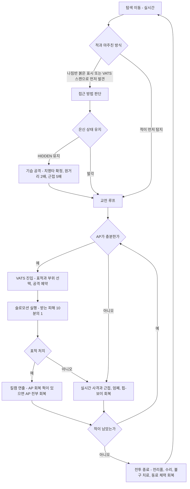
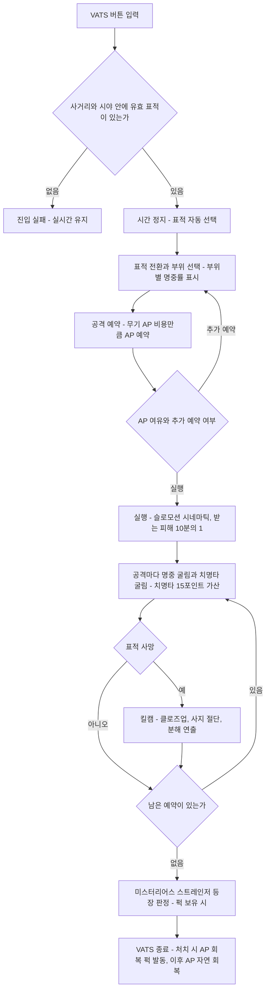
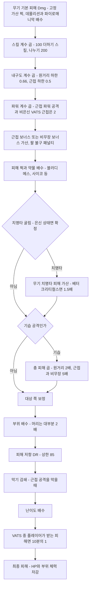
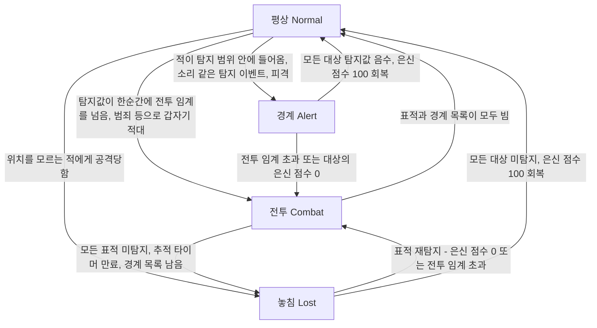
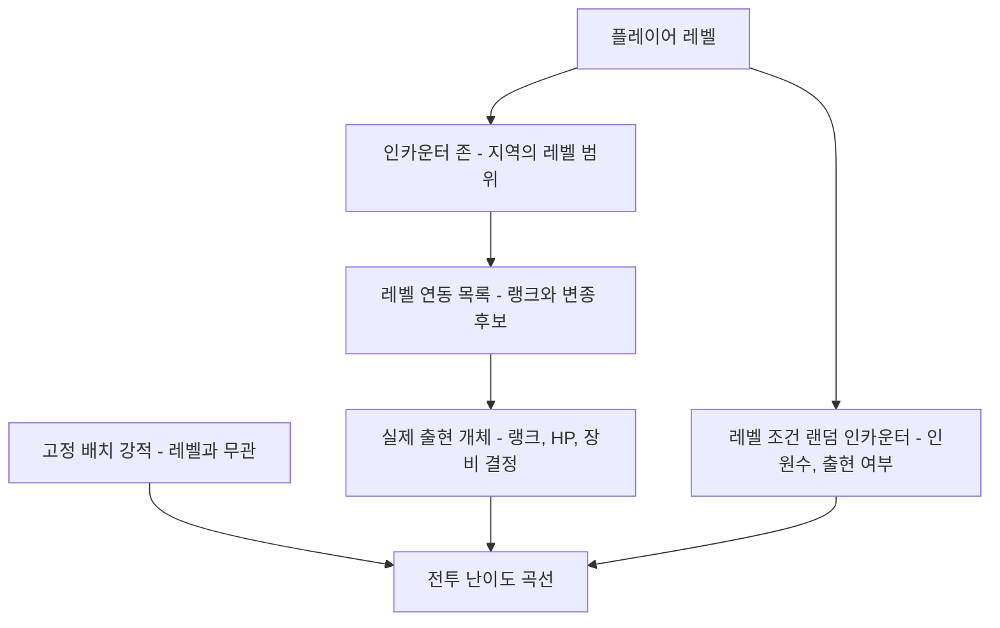

# RD-16. 전투 시스템

> **폴아웃 3 역기획서 세트** | 문서 ID: RD-16 | 버전: v1.0 | 작성일: 2026-10-11
> **범위**: 실시간 전투와 V.A.T.S., AP, 명중·피해·치명타·기습 공식, 부위 피해와 사지 절단(전투 측면), 폭발물·투척·지뢰·함정의 전투 규칙, 특수 피해 효과, 적 AI와 탐지, 동료의 전투 행동, 적 레벨 스케일링과 인카운터 존(전투 밸런스 관점), 난이도, 무기 계열별 특성, 전투 밸런스 분석, 도트 RPG 단순화를 위한 '전투 감성 요소' 분석 / **다루지 않는 것**: 무기·방어구·적의 개별 수치 카탈로그(RD-19·RD-20·RD-24), HP 공식과 불구 치료·상태 이상(RD-15), 은신의 탐험 측면·함정 위치·인카운터 존의 탐험 측면(RD-17), VATS 화면 구성(RD-18), 퍽 전체 목록(RD-14), 동료 영입·대사(RD-10)
> **관련 문서**: [RD-14 캐릭터 시스템](14_character-system.md), [RD-15 상태·생존 시스템](15_status-survival.md), [RD-17 탐험·상호작용](17_exploration-interaction.md), [RD-18 UI/UX](18_ui-ux.md), [RD-19 무기·탄약](19_weapons-ammo.md), [RD-20 방어구·의복](20_armor-apparel.md), [RD-24 크리처·적 도감](24_bestiary.md), [RD-10 주요 인물·동료](10_characters-major-companions.md), [RD-09 팩션](09_factions.md), [RD-07 비표시·반복 퀘스트와 랜덤 인카운터](07_misc-quests-encounters.md), [RD-08c DLC: 브로큰 스틸](08c_dlc-broken-steel.md), [RD-22 경제·주거](22_economy-housing.md), [RD-27 쯔꾸르 이식 시사점 종합](27_adaptation-notes.md)

---

## 목차

1. [문서 개요](#1-문서-개요)
2. [전투 구조 개관](#2-전투-구조-개관)
3. [실시간 전투](#3-실시간-전투)
4. [V.A.T.S.](#4-vats)
5. [피해 공식](#5-피해-공식)
6. [부위 피해·불구·사지 절단](#6-부위-피해불구사지-절단)
7. [폭발물·투척·지뢰·함정](#7-폭발물투척지뢰함정)
8. [특수 피해 효과](#8-특수-피해-효과)
9. [적 AI와 탐지, 동료의 전투 행동](#9-적-ai와-탐지-동료의-전투-행동)
10. [적 레벨 스케일링과 인카운터 존](#10-적-레벨-스케일링과-인카운터-존)
11. [난이도](#11-난이도)
12. [무기 계열별 전투 특성 비교](#12-무기-계열별-전투-특성-비교)
13. [전투 밸런스 분석](#13-전투-밸런스-분석)
14. [도트 RPG 단순화를 위한 '전투 감성 요소' 분석](#14-도트-rpg-단순화를-위한-전투-감성-요소-분석)
15. [설계 분석(종합)](#15-설계-분석종합)
16. [쯔꾸르 이식 메모](#16-쯔꾸르-이식-메모)
- [부록 A. 출처](#부록-a-출처)
- [부록 B. 이 문서에서 새로 정한 표기](#부록-b-이-문서에서-새로-정한-표기)

---

## 1. 문서 개요

### 1.1 목적

- 폴아웃 3(Fallout 3) 전투 시스템의 **규칙·공식·수치**를 원작 그대로 정리해, 팬게임 전투 설계의 근거 자료로 삼는다.
- 원작은 1·3인칭 실시간 사격과 V.A.T.S.(볼트-텍 보조 조준 시스템, Vault-Tec Assisted Targeting System, 이하 VATS)를 함께 쓰는 '이원 구조' 전투다. 팬게임은 전투를 도트 RPG답게 단순화할 예정이므로, 이 문서는 **어떤 요소가 폴아웃 3 전투의 정체성인지**를 따로 분석한다(14장).
- 수치와 공식은 로컬 Nukapedia 코퍼스(2026-08-30 덤프)와 맞춘다. 코퍼스에서 확인하지 못한 내용은 `(코퍼스 미확인)`으로 표시한다.

### 1.2 범위와 경계

| 항목 | 이 문서(RD-16)에서 다루는 것 | 정본 문서 |
|---|---|---|
| 무기 | 계열별 특성, 대표 무기 수치, 특수 효과 | 전체 카탈로그는 [RD-19](19_weapons-ammo.md) |
| 방어구 | 피해 저항(DR) 적용 규칙, 내구도 보정 | DR 수치 카탈로그는 [RD-20](20_armor-apparel.md) |
| 적 | 전투 규칙에 필요한 예시(레벨·HP·부위·AI 속성) | 전 유형 도감은 [RD-24](24_bestiary.md) |
| 퍽 | 전투·VATS·피해에 관여하는 퍽의 효과와 계산 | 퍽 전체 목록·요구 조건은 [RD-14](14_character-system.md) |
| 불구·상태 | 불구의 **전투 효과**(명중·이동·광란 등) | 치료, HP 공식, 방사능은 [RD-15](15_status-survival.md) |
| 은신·함정 | 기습 치명타, 탐지 상태의 전투 측면, 함정의 피해와 해체 요구치 | 은신 탐지의 탐험 측면, 함정 위치는 [RD-17](17_exploration-interaction.md) |
| VATS | 규칙, AP, 명중률, 부위, 킬캠, 관련 퍽 | 화면 구성과 조작은 [RD-18](18_ui-ux.md) |
| 동료 | 전투 행동(무기 선택, 회복, 탄약) | 영입 조건, 대사, 성우는 [RD-10](10_characters-major-companions.md) |
| 인카운터 존 | 적 레벨 결정과 전투 난이도 곡선 | 탐험 측면은 [RD-17](17_exploration-interaction.md), 랜덤 인카운터 목록은 [RD-07](07_misc-quests-encounters.md) |

### 1.3 요약

- 폴아웃 3 전투는 **실시간 FPS/TPS 조작**에 **일시 정지형 부위 조준(VATS)** 을 얹은 구조다. VATS는 행동력(AP, Action Points)을 써서 부위별 명중률을 보며 공격을 예약하고, 슬로모션으로 실행한다.
- 피해는 `무기 기본 피해 × 스킬 계수 × 내구도 계수 (+ 근접·비무장 보너스)`로 계산하고, 퍽 배수 → 치명타 가산 → 기습 배수 → 대상의 부위 배수와 DR → 난이도 배수를 거친다.
- VATS는 **받는 피해 90% 감소, 치명타 확률 +15%p, 무기 내구도 소모 4배**라는 강한 보정을 가진다. 그래서 VATS는 공격 수단이자 사실상 방어 수단이다.
- 전투의 감성 핵심은 ① 부위 조준과 확률 표시 ② AP 자원 운영 ③ 슬로모션 킬캠과 사지 절단 연출 ④ 행운·치명타 ⑤ 은신 기습 ⑥ 탄약·내구도 관리다(14장).
- 적은 레벨 연동 목록(랭크)과 인카운터 존으로 플레이어 레벨에 맞춰 강해지고, 난이도는 가하는·받는 피해 배수와 처치 XP 배수로만 작동한다.

### 1.4 표기 메모

- 수식은 이식 작업을 위해 평문 코드 블록으로 적는다. `⌈x⌉`는 올림, `⌊x⌋`는 내림, `×`는 곱, `%p`는 퍼센트포인트다.
- 확률·배수는 코퍼스 표기를 따른다. 위키 문서끼리 수치나 설명이 다르면 `문서 간 상충`으로 표시하고 양쪽을 모두 적는다.
- 수식 안의 `스킬`은 해당 무기의 지배 스킬(소형 화기, 중화기, 에너지 무기, 폭발물, 근접 무기, 비무장) 값(0~100)이다. `내구도`는 0~1 비율이다.
- DLC 태그: `[OA]` 오퍼레이션: 앵커리지, `[TP]` 더 피트, `[BS]` 브로큰 스틸, `[PL]` 포인트 룩아웃, `[MZ]` 마더십 제타.
- 고유명사는 장(章)이 아니라 **문서 전체에서** 처음 나올 때 `한국어(English)`로 병기한다. 데이터 표에는 영문 칼럼을 둔다. 용어집에 없는 표기는 부록 B에 모았다.

### 1.5 핵심 수치 한눈에 보기

| 구분 | 규칙 | 값 |
|---|---|---|
| AP 최대치 | 65 + 2 × 민첩성 | 민첩성 1 → 67, 5 → 75, 10 → 85 (기본 상한 85) |
| VATS 중 받는 피해 | 플레이어가 받는 피해 | 정상치의 10% (90% 감소) |
| VATS 명중률 상한 | 표시 최대치 | 95% |
| VATS 치명타 보너스 | 최종 치명타 확률에 가산 | +15%p |
| VATS 내구도 소모 | 무기 열화 속도 | 실시간의 4배 |
| 스킬 계수 | (100 + 스킬) / 200 | 스킬 0 → 0.5, 50 → 0.75, 100 → 1.0 |
| 내구도 계수 하한 | 내구도 0%에 가까울 때 | 원거리 0.66, 근접·비무장 0.5 |
| 기본 치명타 확률 | 행운 × 1% | 행운 10 → 10% |
| 기습 치명타 | 치명타 확정 + 총 피해 배수 | 원거리 ×2, 근접·비무장 ×5 |
| 헤드샷 | 머리 명중 피해 | 대부분 ×2 |
| 피해 저항 상한 | DR | 85% |
| 난이도(가하는/받는 피해) | 매우 쉬움 ~ 매우 어려움 | 200%/50% ~ 50%/200% |
| 난이도(처치 XP) | 매우 쉬움 / 보통 / 매우 어려움 | ×0.5 / ×1 / ×1.5 |

---

## 2. 전투 구조 개관

### 2.1 이원 구조: 실시간 전투와 VATS

- 기본 전투는 1인칭·3인칭(어깨 너머 시점)을 자유롭게 바꾸는 **실시간 전투**다. 이동, 조준, 사격, 근접 공격, 투척을 모두 실시간으로 한다.
- 여기에 **VATS**를 얹었다. 버튼 하나로 시간을 멈추고, 사거리 안 적의 **부위별 명중률**을 보며 AP 한도 안에서 공격을 예약한 뒤, 실행을 슬로모션 시네마틱으로 본다.
- 두 모드는 수시로 오간다. AP가 차면 VATS로 결정타를 넣고, AP가 회복되는 동안 실시간으로 버티거나 위치를 잡는 리듬이 기본이다.
- 핍-보이 3000(Pip-Boy 3000)을 여는 동안에는 게임 시간이 흐르지 않는다. 그래서 전투 중 스팀팩(Stimpak) 사용, 부위 치료, 무기·방어구 교체를 사실상 '시간 정지' 상태에서 할 수 있다.

| 항목 | 실시간 전투 | VATS |
|---|---|---|
| 시간 | 정상 흐름 | 표적·부위 선택 중 정지, 실행 중 슬로모션 |
| 조준 | 플레이어가 조준점을 직접 맞춘다. 탄 퍼짐 적용 | 시스템이 부위별 명중률을 계산해 표시 |
| 명중 결정 | 탄도와 탄 퍼짐에 따른 물리 판정 | 명중률 굴림(표시 상한 95%) |
| 부위 지정 | 맞은 곳이 그 부위 | 원거리 무기는 부위 선택, 근접·비무장·투척은 몸 전체가 표적 |
| 소비 자원 | 탄약, 무기 내구도 | 탄약, 무기 내구도, **AP** |
| 치명타 확률 | 기본식 | 기본식 + 15%p |
| 치명타 판정 단위 | 발사체(산탄 펠릿)마다 | 공격 1회(점사·산탄 1회)마다 |
| 플레이어가 받는 피해 | 100% | 10% |
| 무기 내구도 소모 | 1배 | 4배 |
| 근접 공격 | 사거리 안에서 휘두른다. 파워 공격 가능 | 표적 앞으로 순간이동, 비은신 공격이면 기본 피해 2배 |
| 플레이어 이동 | 자유 | 불가 |
| 강점 | AP가 필요 없음, 산탄총 치명타 효율, 원거리 수동 저격 | 낮은 스킬로도 정밀 부위 공격, 사실상의 무적 시간, 연출 쾌감 |
| 약점 | 낮은 스킬에서 큰 탄 퍼짐 | AP 회복 대기, 내구도 급감, 예약 취소 불가 |

### 2.2 전투 흐름도



### 2.3 전투에 관여하는 능력치와 스킬

**S.P.E.C.I.A.L.(스페셜)의 전투 영향**

| 능력치 | English | 전투 관련 영향 |
|---|---|---|
| 힘 | Strength | 근접 무기 보너스 피해 `⌈힘/2⌉`, 근접 무기 스킬 초기값, 소지 한도 |
| 인지력 | Perception | 에너지 무기·폭발물 스킬 초기값, 나침반에 적이 붉은 표시로 뜨는 거리. 적 쪽의 인지력은 내 은신을 탐지하는 능력 |
| 지구력 | Endurance | HP(`90 + 지구력×20 + 레벨×10`), 중화기·비무장 스킬 초기값, 독·방사능 저항 |
| 카리스마 | Charisma | 직접 영향 없음. 화술·동료를 통한 전투 회피·보강은 간접 경로 |
| 지능 | Intelligence | 수리·의학·과학 스킬 초기값(내구도 관리와 회복량), 레벨업 스킬 포인트 |
| 민첩성 | Agility | AP `65 + 2×민첩성`, 소형 화기·은신 스킬 초기값 |
| 행운 | Luck | 기본 치명타 확률 `행운 × 1%`, 모든 스킬 초기값 `+⌈행운/2⌉` |

**전투 스킬** (초기값은 모두 `2 + 2×지배 능력치 + ⌈행운/2⌉`, 태그 스킬은 +15. 능력치 5·행운 5면 15)

| 스킬 | English | 지배 능력치 | 전투 역할 |
|---|---|---|---|
| 소형 화기 | Small Guns | 민첩성 | 권총·소총·산탄총·SMG의 피해, 탄 퍼짐, 스코프 흔들림 |
| 중화기 | Big Guns | 지구력 | 화염방사기·미니건·개틀링 레이저·미사일 발사기·팻맨·록잇 런처 |
| 에너지 무기 | Energy Weapons | 인지력 | 레이저·플라스마·외계 무기, 가우스 소총(Gauss rifle) [OA] |
| 폭발물 | Explosives | 인지력 | 수류탄·지뢰 피해, 투척 거리·정확도, 지뢰 신관 시간, 폭발물 함정 해체 |
| 근접 무기 | Melee Weapons | 힘 | 근접 무기 피해, 막기 감쇄량 |
| 비무장 | Unarmed | 지구력 | 맨손·격투 무기 피해, 비무장 보너스 피해 |
| 은신 | Sneak | 민첩성 | 탐지 회피 → 기습 치명타 |
| 수리 | Repair | 지능 | 무기·방어구를 고칠 수 있는 최대 내구도 |
| 의학 | Medicine | 지능 | 스팀팩 회복량 |
| 과학 | Science | 지능 | 로보틱스 엑스퍼트(Robotics Expert) 등 전투 퍽의 요구치, 터렛 제어 터미널 해킹 |

### 2.4 설계 연혁과 의도 (코퍼스 근거)

- **기원**: VATS는 폴아웃 1·2편과 폴아웃 택틱스(Fallout Tactics)의 턴제 부위 조준에서 착안했다. 3D 실시간 게임에서 '부위를 노려 쏘는 RPG 전투'를 되살리려는 장치다.
- **토드 하워드(Todd Howard)의 회고** (공식 가이드 컬렉터즈 에디션 수록 인터뷰 요약)
  - 출발점은 레이싱 게임 「번아웃(Burnout)」의 충돌 리플레이였다. "let's do that, but with body parts."(그걸 신체 부위로 해 보자.) 결과 화면을 먼저 정하고 거꾸로 인터페이스를 설계했다.
  - 초기에는 실시간 행동(달리기·사격)도 AP를 썼다. 그러자 VATS를 늦출 뿐이라 아무도 실시간으로 쏘지 않아 이 규칙을 뺐다.
  - 지뢰·차량 같은 폭발 오브젝트도 VATS 표적이었으나, 가짜 표적을 넘기며 고르는 인터페이스가 번잡해져 뺐다.
  - VATS 중 이동(AP로 몸 숙이기 등)은 넣지 않았다. 빠르게 들어갔다 나오는 시스템을 원했기 때문이다.
  - 불구 효과를 정하고 VATS 치명타 확률을 올려 'VATS가 더 강하다'는 느낌을 맞췄다.
  - 근접 VATS는 부위 조준, 빗나감, 파워 공격 확률 등을 시험한 끝에 "always-hit full body attacks"(항상 맞는 전신 공격)로 정착했다.
  - 개발 원칙: "challenge the player, but always give him a way out."(도전을 주되, 늘 빠져나갈 길을 준다.) VATS의 피해 감소와 핍-보이 일시 정지는 이 원칙과 맞닿는다(작성자 해석).
- **이슈트반 펠리(Istvan Pely, 리드 아티스트) 인터뷰 요약**: VATS는 "이게 재미있기는 한가"를 오래 의심받았다. 카메라가 물체 뒤에 끼지 않도록 별도 알고리즘을 짜야 했고, 출시 빌드 직전에야 겨우 완성됐다.
- 근접 VATS의 실제 명중률 표시값은 코퍼스에서 확인하지 못했다(근접 명중률 배수 설정값 `fVATSMeleeChanceMult = 1`이 존재). `(코퍼스 미확인)`

---

## 3. 실시간 전투

### 3.1 기본 조작과 시점

- **시점**: 1인칭과 어깨 너머 3인칭을 언제든 바꾼다. 3인칭으로 모퉁이 너머를 엿보는 요령이 있다(은신 문서 노트).
- **줌(조준)**: 원거리 무기를 확대해서 본다. 줌 중에는 이동이 느려지는 대신 정확도가 오른다(로딩 화면 팁). 폴아웃 3의 줌은 가늠쇠를 눈앞에 정렬하는 '정조준'이 아니라 무기 옆으로 확대하는 기능에 가깝다. 후속작 폴아웃: 뉴 베가스(Fallout: New Vegas, 이하 뉴 베가스)에서 진짜 정조준이 들어왔다는 비교 서술이 있다.
- **웅크리기**: 은신 모드에 들어가고 정확도가 오른다(로딩 화면 팁: "Crouching will both improve your accuracy, and activate sneak mode." / 웅크리면 정확도가 오르고 은신 모드가 켜진다).
- **이동 속도**: 무기를 집어넣으면 더 빨리 달린다. 무거운 무기와 의복을 장비하면 느려진다(로딩 화면 팁).
- **단축키**: PC는 숫자키 1~8, 콘솔은 D-패드 8방향에 무기·의복·소모품을 등록해 핍-보이를 열지 않고 바로 장비·사용한다.
- **핍-보이 일시 정지**: 핍-보이를 보는 동안 게임 시간이 흐르지 않는다. 전투 중 스팀팩 투여, 부위 지정 치료, 장비 교체가 시간 비용 없이 가능하다.
- **항복 유도**: "If you start a fight you can't finish, try putting away your weapon. Your opponent just might forgive you..."(감당 못할 싸움을 시작했다면 무기를 넣어 보라. 상대가 용서할지도 모른다.) 로딩 화면 팁이다. 무기를 집어넣으면 적대가 풀리는 경우가 있다.

### 3.2 조준과 탄 퍼짐

원거리 무기의 명중은 조준점 주변으로 흩어지는 **탄 퍼짐(spread, 단위: 도)** 으로 결정된다. 코퍼스의 탄 퍼짐 공식(G.E.C.K. 위키 기반)은 다음과 같다.

```text
총 탄 퍼짐 = max(조준 퍼짐, 무기 최소 퍼짐)

조준 퍼짐 = 퍽 효과( 자세 배수 × 이동 배수 × 스킬·내구도 배수 + 팔 불구 가산 )
  자세 배수    : 웅크리기 0.6 / 줌 0.35 / 웅크리기+줌 0.21 (곱연산)
  이동 배수    : 걷기·달리기·정지의 가산 항이 기본 설정에서 합 1 → 실질 영향 없음
  스킬 배수    : 0.5 − 0.005 × 스킬   (스킬 0 → 0.5, 50 → 0.25, 100 → 0)
  팔 불구 가산 : 한손 무기 + 오른팔 불구 0.5 / 양손 무기 + 한쪽 팔 0.25 / 양손 무기 + 양팔 0.5

무기 최소 퍼짐 = 무기 고유값(도). 숙련도·내구도와 무관
```

- 스킬 100이면 조준 퍼짐이 0이 되어 총 퍼짐은 무기 최소 퍼짐과 같아진다. 최소 퍼짐 0인 무기는 스킬 100에서 이론상 완벽히 정확하다.
- 내구도와 탄 퍼짐: 장비 내구도 문서는 '내구도가 떨어지면 탄 퍼짐이 커진다'고 적고, 탄 퍼짐 문서는 '기본 설정에서 내구도 상수는 0이라 스킬만 작용한다'고 적는다. `문서 간 상충`
- 스코프 흔들림: 소형 화기 100이면 스코프 무기(저격소총(Sniper rifle), 스코프 .44 매그넘(Scoped .44 Magnum))의 흔들림이 사라진다. 어느 팔이든 불구면 스킬과 관계없이 크게 흔들린다.

**자세별 조준 퍼짐 배수 예시** (자세 배수 × 스킬 배수. 팔 불구·퍽은 제외. 값이 작을수록 정확하다)

| 스킬 | 서서 쏘기 | 웅크리기 | 줌 | 웅크리기 + 줌 |
|---|---|---|---|---|
| 0 | 0.50 | 0.30 | 0.175 | 0.105 |
| 25 | 0.375 | 0.225 | 0.131 | 0.079 |
| 50 | 0.25 | 0.15 | 0.0875 | 0.0525 |
| 75 | 0.125 | 0.075 | 0.044 | 0.026 |
| 100 | 0 | 0 | 0 | 0 |

**무기 최소 퍼짐 예시** (무기 허브 표 기준, 단위: 도)

| 최소 퍼짐 | 무기 (English) |
|---|---|
| 0 | 레이저 권총·레이저 소총(Laser pistol / Laser rifle), 저격소총(Sniper rifle), 다트 건(Dart gun), 링컨의 연발총(Lincoln's repeater), 외계인 블래스터(Alien blaster), 가우스 소총(Gauss rifle) [OA] |
| 0.2~0.3 | 플라스마 소총(Plasma rifle) 0.2, 사냥용 소총(Hunting rifle) 0.3, 스코프 .44 매그넘 0.3 |
| 0.5 | 10mm 권총(10mm pistol), .32 권총(.32 pistol), 플라스마 권총(Plasma pistol), 미사일 발사기(Missile launcher), 화염방사기(Flamer), 개틀링 레이저(Gatling laser) |
| 1.0~1.5 | 중국제 권총(Chinese pistol) 1.0, 록잇 런처(Rock-It Launcher) 1.0, 돌격소총(Assault rifle) 1.5, 중국제 돌격소총(Chinese assault rifle) 1.5, 10mm SMG(10mm submachine gun) 1.5 |
| 2.0 이상 | 미니건(Minigun) 2.0, 팻맨(Fat Man) 2.0, 전투 산탄총(Combat shotgun) 3, 소드오프 산탄총(Sawed-off shotgun) 7, 실험용 MIRV(Experimental MIRV) 13 |

### 3.3 이동과 자세의 영향

| 상태 | 탄 퍼짐 | 은신 탐지 | 기타 |
|---|---|---|---|
| 정지 | 기준 | 움직일 때보다 탐지되기 어려움. 시선 돌리기도 '움직임'으로 침 | 슈피리어 디펜더(Superior Defender) [PL]: 정지 시 피해 +5, DR +10 |
| 걷기 | 기준(이동 배수 상쇄) | 발소리 발생 | 장비 무게가 클수록 발소리가 커진다 |
| 달리기 | 기준(이동 배수 상쇄) | 가장 시끄럽다 | 무기를 집어넣으면 더 빠르다 |
| 웅크리기 | ×0.6 | 은신 모드 진입, 은신 스킬 적용 | 웅크린 채 달릴 수 있으나 탐지 페널티. 사일런트 러닝(Silent Running) 퍽이 이동 속도·장비 무게 페널티를 없앰 |
| 줌 | ×0.35 | 영향 없음 | 이동 감속 |
| 웅크리기 + 줌 | ×0.21 | 은신 모드 | 은신 저격의 기본 자세 |
| 점프 중 VATS | - | - | 점프 중 근접 VATS 공격을 걸면 높은 곳까지 순간이동할 수 있음 |

- 정리하면 폴아웃 3의 실시간 사격은 **이동하면서 쏴도 퍼짐 페널티가 없고**, 대신 **스킬과 웅크리기·줌**이 정확도를 좌우한다. 이동의 대가는 탐지(소음)와 줌 불가 정도다.

### 3.4 원거리 사격 세부

**발사 방식 분류**

| 방식 | 대표 무기 (English) | 규칙 |
|---|---|---|
| 반자동 단발 | 10mm 권총, 사냥용 소총, 레이저 소총, 저격소총 | 1회 클릭 = 1발. 연사력은 무기별 최대 클릭 속도 |
| 자동 | 돌격소총(연사력 8/초), 10mm SMG(10/초), 미니건·개틀링 레이저(20/초) | 표기 치명타 배수 = 원래 배수 ÷ 연사력. VATS에서는 점사로 나간다 |
| 산탄 | 전투 산탄총(9펠릿, 55 = 6.1×9), 소드오프 산탄총(9펠릿), 이연발 산탄총(Double-barrel shotgun) [PL] | 실시간 사격은 펠릿마다 치명타 판정 |
| 다발 에너지 | 트라이빔 레이저 소총(Tri-beam laser rifle) [BS] 25×3, 메탈 블래스터(Metal Blaster) [TP] 9발 | 산탄과 같은 다발 판정 |
| 연속 분사 | 화염방사기, 헤비 인시너레이터(Heavy incinerator) [BS] | 연료 소모, 화상 지속 피해 |
| 탄도·폭발 | 미사일 발사기, 팻맨, 록잇 런처 | 탄도 낙차, 광역 피해. 미사일은 금속 표적에 록온 |

**자동화기 연사력과 내구도**

```text
자동화기 연사력 = 기본 연사력 × (0.8 + 0.02 × ⌈10 × 내구도⌉)
```

| 내구도 | 100% | 90% | 75% | 50% | 25% | 10% 이하 |
|---|---|---|---|---|---|---|
| 연사력 배수 | 1.00 | 0.98 | 0.96 | 0.90 | 0.86 | 0.82 |

- 내구도가 떨어지면 연사력이 줄고, 그 대신 '표기 치명타 배수 = 원래 배수 ÷ 연사력'에 따라 발당 치명타 배수가 올라 초당 치명타 기대 수를 유지하려 한다. 다만 치명타 확률 자체도 내구도에 비례해 줄어든다(5.6절).

**재장전과 탄 걸림**

- 탄창이 비면 재장전한다. 무기별 탄창 용량과 재장전 시간이 다르다.

| 무기 (English) | 탄창 | 재장전 시간(초) |
|---|---|---|
| 10mm 권총 (10mm pistol) | 12 | 1.3 |
| 사냥용 소총 (Hunting rifle) | 5 | 1.97 |
| 돌격소총 (Assault rifle) | 24 | 2 |
| 레이저 소총 (Laser rifle) | 24 | 2.5 |
| 저격소총 (Sniper rifle) | 5 | 3 |
| 전투 산탄총 (Combat shotgun) | 12 | 3.33 |
| 미니건 (Minigun) | 240 | 4 |
| 팻맨 (Fat Man) | 1 | 3 |

- **탄 걸림(jam)**: 내구도 50% 이하의 총기는 재장전할 때 일정 확률로 걸려 재장전 동작이 길어진다. 내구도 100%면 걸리지 않는다. 게임은 공식이 아니라 내구도 구간별 상수를 쓰며, 아래는 위키가 정리한 근사식이다.

```text
걸림 확률(%) = 10                                  (0.4 < 내구도 ≤ 0.5)
            = 25 × max(0, 5 − ⌈10 × 내구도⌉)       (그 외)
```

| 내구도 | 51~100% | 41~50% | 31~40% | 21~30% | 11~20% | 10% 이하 |
|---|---|---|---|---|---|---|
| 걸림 확률 | 0% | 10% | 25% | 50% | 75% | 100% |

- VATS 중에도 재장전이 일어난다. 자동화기 점사는 표적이 재장전 도중 죽어도 끝까지 발사한다. VATS 안의 재장전 AP 비용은 코퍼스에서 확인하지 못했다(뉴 베가스의 '재장전 10 AP' 규칙은 폴아웃 3 문서에 없다). `(코퍼스 미확인)`

**무기 교체와 휴대**

- 교체는 단축키나 핍-보이(정지 상태)로 한다. 교체 동작 시간 수치는 `(코퍼스 미확인)`.
- **탄약 무게는 0**이다. 개발진이 인벤토리 관리를 번거롭게 하지 않으려 했다는 설명이 있다. 무기 자체에는 무게가 있으므로 '탄은 무제한 휴대, 총은 무게 부담' 구조다.
- 무장 해제: 적은 동료가 든 무기(기본 무기 제외)를 쏘아 떨어뜨릴 수 있고, 플레이어도 무기 부위를 맞혀 적을 무장 해제할 수 있다. 레일웨이 라이플(Railway rifle)은 VATS 명중 시 적 무기를 멀리 날려 보내는 경우가 많다.

**소음**

- 완전 무음: 소음기 10mm 권총(Silenced 10mm pistol), BB건(BB gun), 다트 건, 인필트레이터(Infiltrator) [TP], 퍼포레이터(Perforator) [TP], 모든 근접·비무장 무기.
- 그 밖의 총기는 거리에 따라 들린다. 미사일 발사기와 팻맨은 발사 지점과 착탄 지점 양쪽에서 소리가 난다. 수류탄은 폭발 지점에서만 소리가 나므로 투척해도 은신이 깨지지 않는다.
- 무음 무기라도 적이 맞고 살아남으면 [CAUTION](경계) 상태가 되고, 착탄 지점을 조사하러 온다(9장).

### 3.5 근접·비무장 전투

**공격 종류**

| 공격 | 입력 | 효과 |
|---|---|---|
| 일반 공격 | 공격 버튼 | 무기 속도대로 연속 타격 |
| 파워 공격 (Power attack) | 공격 버튼을 누르고 있다가 휘두른다 | 기본 피해 ×2 (힘·비무장 보너스는 2배 대상 아님) |
| 막기 (Blocking) | 근접 무기나 맨손을 든 채 막기 | 근접 공격 피해 감쇄, 막힌 상대 경직 |
| VATS 근접 | VATS에서 표적 선택 | 표적 앞으로 순간이동, 비은신이면 기본 피해 ×2 (4장) |

- 파워 공격 입력은 투척 무기 설명("근접 전투처럼 공격 버튼을 누르고 있으면 공격의 성격이 바뀐다")과 전투 공식의 `Power = 2` 조건에서 확인된다. 파워 공격의 추가 효과(넉다운 등)와 AP·기력 비용은 `(코퍼스 미확인)`.

**근접·비무장 보너스 피해**

- 근접 무기 보너스: `⌈힘 / 2⌉`(전투 공식 문서). 근접 피해 문서는 `힘 × 0.5`(힘 5 → 2.5)로 적어 올림 여부가 다르다. `문서 간 상충`
- 비무장 보너스(Unarmed Damage): `⌈(10 + 비무장 스킬) / 20⌉`. 맨주먹은 무기 피해 0에 이 보너스만 들어간다. 아이언 피스트(Iron Fist) 퍽이 랭크당 +5(최대 +15)를 더한다.

| 비무장 스킬 | 0~10 | 11~30 | 31~50 | 51~70 | 71~90 | 91~100 |
|---|---|---|---|---|---|---|
| 비무장 보너스 | 1 | 2 | 3 | 4 | 5 | 6 |

- 팔 불구 패널티: 전투 공식 문서는 `Penalty = 무기 피해 × 4 × (팔 상태 − 1) / 10`(팔 상태: 양손 근접+양팔 불구·비무장·한손 근접+오른팔 불구는 0, 양손 근접+한쪽 팔 불구는 0.5)로 적는다. 이 식대로면 −40%·−20%다. 반면 VATS 문서는 '한손 무기+오른팔 불구 −10%, 양손·비무장 한쪽 팔 −5%, 양팔 −10%'로 적는다. `문서 간 상충`
- 공격 속도: 전투용 나이프(Combat knife) 초당 3회, 납 파이프(Lead pipe) 2.3회, 슈퍼 슬레지(Super sledge) 1.43회. 빠른 무기는 손타수가 많아 몸통 불구 상대를 더 자주 움찔하게 만든다. 방어력 높은 적에게는 한 방 피해가 큰 무기가 유리하다(근접 무기 스킬 문서).
- 연속 날 무기: 리퍼(Ripper), 잭(Jack), 오토 액스(Auto axe) [TP], 스틸 소(Steel saw) [TP]는 초당 약 30회의 '틱'으로 피해를 나눠 준다. 잭 문서에 따르면 표기 피해는 틱으로 나뉘지만 치명타 보너스는 나뉘지 않아, 치명타가 잦으면 실효 피해가 폭증한다. 정지 시 +5 같은 고정 가산 퍽도 틱마다 붙는다.

**막기**

- 서로 근접 무기를 든 상태에서 막을 수 있다. 막으면 피해 일부가 깎이고, 막힌 공격자는 비틀거리며 빈틈이 생긴다. 데스클로(Deathclaw) 같은 크리처의 공격도 막아 피해를 줄일 수 있지만 크리처는 경직되지 않는다. 투사체는 막을 수 없다.
- NPC는 막고 있는 상대를 잘 공격하지 않으므로 근접전이 길어진다.

```text
막기 감쇄율 = min(스킬 × 2 / 100, 0.7)      ← fBlockSkillMult 2, fBlockSkillBase 0, fBlockMax 0.7
맨손·비무장 무기로 막으면 감쇄율 × 0.25      ← fBlockAmountHandToHandMult 0.25
받는 피해 = (DR 적용 후 피해) × (1 − 감쇄율)
```

- 위키 수식은 `max(Skill/50, 0.7)`로 적혀 있으나, 0.7을 상한(fBlockMax)이라 설명하므로 `min`으로 읽는 것이 맞다(작성자 해석, 확인 필요). 이 해석대로면 근접 무기 스킬 35부터 감쇄율이 상한 70%에 닿고, 비무장 막기는 최대 17.5%다.

**비무장 특수 규칙**

- 머리를 때리면 치명타가 아니어도 상대를 기절(녹아웃)시킬 수 있고, 맨주먹일 때 확률이 크게 오른다.
- 비무장 VATS 공격 비용은 맨주먹 22 AP다.
- VATS에서 맨손으로 공격하면 패럴라이징 팜(Paralyzing Palm) 퍽의 마비가 발동할 수 있다(4.9절).

**근접 은신 운용**

- 근접·비무장 무기는 무음이라 기습 치명타(×5)를 노리기 좋다. 다만 근접 거리에서는 맞은 적이 곧바로 돌아서므로 [CAUTION]이 순식간에 [DANGER]로 바뀐다. 느리게 도는 대형 크리처 뒤에서는 2~3타까지 넣을 수 있다(기습 치명타 문서).

### 3.6 피격 반응과 경직

- 플레이어는 피해로 인한 경직을 받지 않는다. 막기에 의한 경직은 받는다.
- 폴아웃 3에는 별도의 경직 애니메이션이 없고 피격 반응만 있다. 원거리에서 적을 확실히 멈추는 방법은 **부위 불구**다. 불구가 되는 순간 적은 행동을 멈추고 다친 부위를 붙잡는다.
- 몸통이 불구가 되면 피격 시 움찔하는 빈도가 크게 늘어 조준과 공격이 방해받는다. 플레이어에게도 같은 효과가 있다.
- 넘어뜨리기(넉다운)는 일부 무기의 치명타 효과, 가스 폭발, 근처 폭발(미스터 거츠(Mister Gutsy)를 공중에서 떨어뜨림) 등으로 발생한다(8장).

### 3.7 실시간과 VATS를 섞는 요령 (코퍼스 노트)

- **VATS 스캔**: VATS 버튼을 빠르게 누르거나 길게 누르면, 사거리 안에 표적이 있을 때 그 적을 잡은 채 VATS가 켜진다. 모퉁이의 매복이나 크림슨 드래군(Crimson Dragoon) 같은 은폐 적을 찾는 데 쓴다.
- **조준 고정**: AP가 없어도 VATS에서 표적을 고른 뒤 줌 버튼을 누른 채 VATS를 빠져나오면 조준이 표적에 맞춰진 상태로 남는다. 돌진형 적이나 장거리 저격에 유용하다.
- 스킬이 낮은 상태에서 스코프 무기를 쓸 때 VATS로 부위를 정하고 곧바로 줌을 풀어 쏘는 식으로 흔들림을 보완할 수 있다.

---

## 4. V.A.T.S.

### 4.1 개요

- VATS는 실시간 전투를 멈추고 AP를 써서 공격을 예약하는 **큐잉(queuing) 시스템**이다. 표적과 부위를 고르면 부위별 명중률과 부위 상태가 보이고, 예약한 공격은 슬로모션 시네마틱으로 실행된다.
- 플레이어는 볼트 101(Vault 101)에서 열 살 생일에 BB건을 받으며 VATS를 처음 배운다.
- 화면에는 표적의 전체 HP 막대, 부위별 상태 막대(불구가 되면 빈 막대), 현재 무기로 한 라운드에 줄 피해가 표시된다. 이 피해 표시는 **관련 스킬이 100일 때의 비치명타 최대 피해**다. 스킬이 낮으면 실제 피해가 더 작고, 치명타(기습 치명타 포함)가 나면 더 크다. 화면 구성 상세는 [RD-18](18_ui-ux.md)에서 다룬다.

### 4.2 VATS 처리 흐름



### 4.3 진입 조건과 제약

| 규칙 | 내용 |
|---|---|
| 진입 조건 | 사거리·시야 안에 유효 표적이 있어야 한다. 넓은 개활지에서는 눈에 보이지만 너무 멀어 VATS로 잡지 못하는 적이 있다 |
| 표적 불가 | 어린이. 지뢰(항상 0%) |
| 투명 적 | 표적으로 잡히지만 모든 부위 명중률이 0%라 공격할 수 없다 |
| 부위 선택 불가 | 근접·비무장 무기와 투척 폭발물은 몸 전체를 표적으로 한다 |
| 이동 | VATS 중 플레이어는 이동·회피할 수 없다 |
| 취소 | 예약을 실행하면 표적이 죽기 전까지 취소할 수 없다 |
| 시간 | 실행 중에는 시간이 '멈추는' 것이 아니라 '느려진다'. 표적이 엄폐물 뒤로 숨어 남은 사격이 빗나갈 수 있다 |
| 아군 | 동료는 VATS 실행 중에도 움직이므로, 좁은 곳에서는 오사가 생길 수 있다 |
| 근접 접근 | 근접·비무장 VATS는 표적 앞으로 순간이동한다. 점프 중 VATS를 걸면 난간 위로 올라갈 수도 있다(명중률 0%면 불가) |
| 카메라 | PC에서 VATS 버튼을 누르고 있으면 표적 강조를 유지한 채 일반 1인칭 시야로 물러나 전장을 볼 수 있다 |
| 동료 확인 | VATS에서 동료의 HP를 볼 수 있다 |

### 4.4 AP(행동력)

**최대치**

```text
최대 AP = 65 + 2 × 민첩성        (민첩성 1 → 67, 5 → 75, 10 → 85, 기본 상한 85)
```

**AP 보너스**

| 출처 | English | AP | 지속 | 비고 |
|---|---|---|---|---|
| 액션 보이 / 액션 걸 | Action Boy / Action Girl | +25 | 영구 | 퍽. 레벨 16, 민첩성 6. 로딩 화면 팁은 +20으로 잘못 적었다 |
| 르두의 하키 마스크 | Ledoux's hockey mask | +25 | 장비 중 | 누카콜라 챌린지(The Nuka-Cola Challenge)의 선택 목표 보상 |
| 레인저 전투 아머 | Ranger battle armor | +5 | 장비 중 | 라일리스 레인저스(Reilly's Rangers) 퀘스트 보상 |
| 래그볼트의 전투 아머 | Lag-Bolt's combat armor | +10 | 장비 중 | [BS] |
| 트라이벌 파워 아머 | Tribal power armor | +15 (민첩성 −1 때문에 실질 +13) | 장비 중 | [TP] 강철 주괴 100개 보상 |
| 뉴카럭 고기 | Nukalurk meat | +10 | 4분 | 케미스트(Chemist) 퍽이면 지속 2배 |
| 뉴카-콜라 퀀텀 | Nuka-Cola Quantum | +20 | 4분 | 케미스트면 2배 |
| 미시시피 퀀텀 파이 | Mississippi Quantum pie | +20 | 4분 | 케미스트면 2배 |
| 제트 | Jet | +30 | 4분 | 케미스트면 2배 |
| 울트라제트 | Ultrajet | +40 | 4분 | 케미스트면 2배 |
| 너브스 오브 스틸 | Nerves of Steel | 회복 +1 AP / 10초 | 영구 | [BS] 퍽. 레벨 26, 민첩성 7 |

- 약물 없이 얻을 수 있는 최대치는 148(85 + 액션 보이 25 + 하키 마스크 25 + 트라이벌 파워 아머 13), 장비·약물을 모두 겹치면 280이라고 위키가 계산한다.

**회복**

- AP는 턴 단위가 아니라 **시간에 따라 자동 회복**한다. 회복 속도는 퍽으로만 바뀐다.
- 회복 속도 설정값 `fActionPointsRestoreRate`에 대해 코퍼스 게임 설정 문서는 기본값을 표에서는 5, 설명에서는 4로 적고, "최대치까지 20초 남짓"이라고 설명한다. `문서 간 상충` 초당 회복량의 정확한 값은 `(코퍼스 미확인)`. 뉴 베가스 문서의 '보유량과 관계없이 16.66초에 완충' 규칙은 뉴 베가스 기준이라 폴아웃 3에 그대로 쓸 수 없다.
- 그림 리퍼스 스프린트(Grim Reaper's Sprint): VATS에서 적을 죽이면 **VATS가 끝날 때 AP를 전부 회복**한다(스크립트는 실제로 1000 AP를 준다). 동료·미스터리어스 스트레인저(Mysterious Stranger)·환경(차량 폭발)이 낸 처치와 화상·감전 같은 지속 피해 처치는 인정되지 않는다. 필수(essential) NPC를 기절시키는 것은 처치로 인정된다.

**소비**

- 공격 1회에 무기별 AP 비용을 쓴다. 자동화기는 **점사 1회** 비용이다.
- 계열별 비용 범위(무기 허브 표 기준): 소형 화기 17~38, 에너지 무기 12~65(대부분 17~38), 중화기 30~65, 투척 폭발물 24, 근접 무기 10~65(대부분 17~38), 비무장 14~28. 상세 비교는 12장.

**AP 예산표** (한 번의 VATS에서 예약할 수 있는 공격 수 = ⌊AP ÷ 비용⌋)

| 무기 | AP 비용 | 민첩성 1 (67) | 민첩성 5 (75) | 민첩성 10 (85) | 민첩성 10 + 액션 보이 (110) | 위 + 제트 (140) |
|---|---|---|---|---|---|---|
| 10mm 권총 (10mm pistol) | 17 | 3 | 4 | 5 | 6 | 8 |
| .32 권총 (.32 pistol) | 20 | 3 | 3 | 4 | 5 | 7 |
| 스코프 .44 매그넘 (Scoped .44 Magnum) | 32 | 2 | 2 | 2 | 3 | 4 |
| 사냥용 소총 (Hunting rifle) | 25 | 2 | 3 | 3 | 4 | 5 |
| 돌격소총 (Assault rifle), 점사 | 23 | 2 | 3 | 3 | 4 | 6 |
| 전투 산탄총 (Combat shotgun) | 27 | 2 | 2 | 3 | 4 | 5 |
| 저격소총 (Sniper rifle) | 38 | 1 | 1 | 2 | 2 | 3 |
| 레일웨이 라이플 (Railway rifle) | 24 | 2 | 3 | 3 | 4 | 5 |
| 레이저 소총 (Laser rifle) | 17 | 3 | 4 | 5 | 6 | 8 |
| 플라스마 소총 (Plasma rifle) | 25 | 2 | 3 | 3 | 4 | 5 |
| 외계인 블래스터 (Alien blaster) | 20 | 3 | 3 | 4 | 5 | 7 |
| 미니건 (Minigun), 점사 | 30 | 2 | 2 | 2 | 3 | 4 |
| 화염방사기 (Flamer) | 50 | 1 | 1 | 1 | 2 | 2 |
| 미사일 발사기 (Missile launcher) | 55 | 1 | 1 | 1 | 2 | 2 |
| 팻맨 (Fat Man) | 65 | 1 | 1 | 1 | 1 | 2 |
| 수류탄류 (Grenades) | 24 | 2 | 3 | 3 | 4 | 5 |
| 전투용 나이프 (Combat knife) | 17 | 3 | 4 | 5 | 6 | 8 |
| 슈퍼 슬레지 (Super sledge) | 38 | 1 | 1 | 2 | 2 | 3 |
| 리퍼 (Ripper) | 65 | 1 | 1 | 1 | 1 | 2 |
| 맨주먹 (Bare fist) | 22 | 3 | 3 | 3 | 5 | 6 |
| 파워 피스트 (Power fist) | 28 | 2 | 2 | 3 | 3 | 5 |

- 초반(민첩성 5) 기준으로 권총류는 한 번에 3~4발, 저격소총·중화기는 1발이다. **AP 비용이 무기 정체성(손이 빠른 무기/한 방 무기)을 만드는 핵심 변수**다.

### 4.5 명중률

**표시와 상한**

- 부위마다 명중 확률(%)을 표시한다. 상한은 95%다(`fVATSMaxChance = 95`). 위키 주석은 "95%에서 남는 5%는 실제로 계산되지 않아 사실상 100%"라고 적는다.
- 명중률은 피해와 무관하다. 95% 헤드샷이 80% 헤드샷보다 더 아프지 않다.

**결정 요소** (코퍼스 서술 기준)

| 요소 | 내용 | 근거 |
|---|---|---|
| 전투 스킬 | 무기 지배 스킬이 높을수록 오른다 | VATS 문서 |
| 거리 | 멀수록 떨어진다. 거리 영향 배수 `fVATSDistanceFactor`(기본 1) | VATS 문서, 게임 설정 문서 |
| 부위 가시성 | 가려진 부위일수록 떨어진다(엄폐물, 방패, 팔로 얼굴을 가린 자세 등) | VATS 문서 |
| 부위 크기 | 별도 항목으로 적혀 있지 않다. 보이는 면적(가시성)에 포함된다고 정리한다 | 작성자 해석 |
| 무기 사거리 | 근접·투척은 한두 걸음 차이로 0%가 될 수 있다 | 투척 폭발물 문서 |
| 플레이어 팔 불구 | VATS 명중률이 떨어진다 | VATS 문서 |
| 대상 투명화 | 모든 부위 0% | VATS 문서 |
| 전체 배수 | `fVATSHitChanceMult`(기본 1), 근접 `fVATSMeleeChanceMult`(기본 1) | 게임 설정 문서 |
| 퍽 | 아래 표 | 퍽 문서 |

**명중률 퍽**

| 퍽 | English | 요구 조건 | 효과 | 적용 방식 |
|---|---|---|---|---|
| 건슬링어 | Gunslinger | 레벨 6 | 한손 원거리 무기 VATS 명중률 +25% | 곱(×1.25) |
| 코만도 | Commando | 레벨 8 | 양손 소총류(소형 화기·에너지 무기) +25% | 곱(×1.25) |
| 스나이퍼 | Sniper | 레벨 12, 인지력 6, 민첩성 6 | 머리 명중률 +25% | 곱(×1.25). 예: 50% → 62.5% |
| 와이어드 리플렉시스 | Wired Reflexes | 퀘스트 「복제된 인간(The Replicated Man)」에서 짐머(Zimmer) 편을 듦 | 모든 VATS 명중률 +10% | 곱(×1.1) |
| 콘센트레이티드 파이어 | Concentrated Fire | 레벨 18, 소형 화기 60, 에너지 무기 60 | 같은 부위에 예약할 때마다 +5% | 더하기. 예약하는 즉시 표시에 반영 |

- 건슬링어 적용 무기: 권총류, SMG, 소드오프 산탄총, 에너지 권총류, 다트 건, 메스메트론(Mesmetron), 마이크로웨이브 이미터(Microwave emitter) [PL] 등. 코만도 적용 무기: 양손 소형 화기와 에너지 소총(애니메이션 유형이 '소총' 계열인 것). 중화기와 테슬라 캐논(Tesla cannon) [BS]은 적용되지 않는다.

**구조식 정리**

```text
표시 명중률 = min(95, 기본 명중률 × 퍽 배수 + 콘센트레이티드 파이어 가산)
  퍽 배수 = (건슬링어 또는 코만도 1.25) × (머리 표적이면 스나이퍼 1.25) × (와이어드 리플렉시스 1.10)
  콘센트레이티드 파이어 가산 = 5 × (같은 부위에 먼저 예약한 공격 수)
  기본 명중률 = f(스킬, 거리 × fVATSDistanceFactor, 부위 가시성) × fVATSHitChanceMult
                ↑ 함수 f의 형태는 (코퍼스 미확인)
```

- 퍽끼리의 곱 중첩은 '각 퍽이 곱연산'이라는 서술에서 끌어낸 정리이며, 가산과 곱의 적용 순서는 `(코퍼스 미확인)`이다.
- 계산 예: 기본 50%인 머리를 저격소총(양손 소총)으로 노릴 때, 코만도와 스나이퍼가 있으면 50 × 1.25 × 1.25 = 78.1%, 와이어드 리플렉시스까지 있으면 85.9%다. 같은 머리에 두 번째로 예약하면 콘센트레이티드 파이어로 +5 → 90.9%, 세 번째는 +10 → 95%(상한)가 된다.

**인지력과 명중률**

- 플레이어 인지력이 VATS 명중률 공식에 직접 들어간다는 기술은 코퍼스에 없다. `(코퍼스 미확인)` 인지력은 에너지 무기·폭발물 스킬 초기값과 나침반 탐지 거리로 간접 작용한다.
- 반대로 **대상의 머리를 불구로 만들면 그 대상의 인지력이 4 떨어지고 명중률도 떨어진다.**

### 4.6 부위 목록

**인간형(7부위)**: VATS 문서는 인간형 표적에서 머리, 몸통, 왼팔, 오른팔, 손에 든 무기, 왼다리, 오른다리의 일곱 곳을 고를 수 있다고 적는다. 1·2편과 달리 눈과 사타구니는 고를 수 없다.

| 부위 | English | 맞혔을 때 | 불구가 되면(적) | 비고 |
|---|---|---|---|---|
| 머리 | Head | 대부분의 적에게 피해 ×2 | 명중률 하락, 인지력 −4 | 서서 근접 VATS로 처치하면 거의 항상 머리가 날아간다 |
| 몸통 | Torso | 기준 피해 | 피격 시 움찔 빈도 증가 | 가장 큰 표적 |
| 왼팔·오른팔 | Left / Right arm | 기준 피해 | VATS 명중률 하락, 근접 피해 감소, 무기 흔들림 | 웅크린 채 근접 VATS를 하면 팔을 친다 |
| 무기 | Weapon | 무기를 떨어뜨리거나 망가뜨린다 | 무장 해제 | 들고 있는 것이 수류탄이면 그 자리에서 폭발 |
| 왼다리·오른다리 | Left / Right leg | 기준 피해 | 이동 속도 저하 | 도주 방지, 돌진·덮치기 차단 |

**크리처·로봇의 특수 부위**

| 대상 | English | 특수 부위 | 효과 |
|---|---|---|---|
| 로봇 전반: 프로텍트론, 미스터 핸디, 미스터 거츠, 센트리 봇, 로보브레인 | Protectron, Mister Handy, Mister Gutsy, Sentry bot, Robobrain | 전투 억제기(Combat inhibitor), 등 쪽 | 불구 시 **광란**: 피아 구분 없이 가장 가까운 대상을 공격하고 죽을 때까지 싸운다. 억제기는 회복되지 않는다 |
| 미스터 거츠 | Mister Gutsy | 추진기(thruster) | 불구 시 잠시 공중에서 떨어져 공격 기회가 생긴다 |
| 자동 터렛 | Automated turret | 조준 칩(천장형) / 렌즈(바닥형) | 광란. 셀을 나갔다 오면 복구된다 |
| 거대 개미, 화염개미, 블로트플라이 | Giant ant, Fire ant, Bloatfly | 더듬이(뇌) | 광란. 같은 종도 공격한다. 광란 개체가 죽인 적의 XP는 플레이어가 받는다 |
| 방사능바퀴 | Radroach | 없음 | 광란 부위가 없는 곤충 |
| 엔클레이브 데스클로 | Enclave deathclaw | 금속 송신기 | 광란 |
| 마이얼럭 | Mirelurk | 얼굴(유일한 비장갑 부위) | 몸통은 껍질 때문에 피해 ½. 돌진할 때 머리를 숙여 얼굴을 가리고, 근접전에 들어가면 얼굴이 드러난다 |
| 라드스코피온 | Radscorpion | 약점 없음 | 머리 같은 추가 피해 부위가 없고, 다리 명중 피해는 크게 줄어든다 |
| 센트리 봇 | Sentry bot | 약점 없음 | 노릴 가치가 있는 곳은 억제기뿐이다 |
| 브라민 | Brahmin | 두 머리가 한 부위 | 한 머리가 터지면 다른 머리도 터진다 |
| 늪지 주민의 일부 변종 [PL] | Swampfolk | 얼굴 | 돌진할 때 팔로 얼굴을 가려 헤드샷이 어렵지만 VATS가 95%를 표시하기도 한다 |
| 수류탄 | Grenade | 적이 든 수류탄, 공중의 수류탄 | 맞히면 폭발한다(7.3절) |

### 4.7 VATS 중 특수 규칙

| # | 규칙 | 내용 |
|---|---|---|
| 1 | 피해 감소 | 플레이어는 정상 피해의 10%만 받는다. 팻맨, 특히 실험용 MIRV는 그래도 즉사시킬 수 있다 |
| 2 | 시간 | 선택 중 정지, 실행 중 슬로모션. 적은 크게 감속된다(뉴 베가스 문서는 '폴아웃 3는 적을 더 강하게 감속시켰다'고 비교한다) |
| 3 | 치명타 | 최종 치명타 확률에 +15%p |
| 4 | 내구도 | 무기 열화가 4배 빠르다 |
| 5 | 자동화기 점사 | 한 번 예약에 `max(1, ⌊연사력 ÷ 2.33⌋)`발. 돌격소총 3발, 10mm SMG 4발, 미니건·개틀링 레이저 8발. 치명타는 점사당 한 번 판정 |
| 6 | 산탄 | 펠릿 묶음 전체를 한 번만 치명타 판정한다. 위키 노트는 VATS 산탄이 산개를 무시하고 기본 피해만 넣는 경우가 있어 '도박'이라고 평한다 |
| 7 | 근접·비무장 | 표적 앞으로 순간이동. 비은신 공격이면 기본 피해 ×2(힘·비무장 보너스는 제외). 서 있으면 머리, 웅크리면 팔에 맞는다 |
| 8 | 기습 | 큐의 첫 공격만 기습으로 판정하는 것이 원칙이다. 이후 공격은 위치를 드러낸다. 소음 무기는 경보 가능성이 낮아 다트 건으로 3연발을 넣고 숨어 있는 운용이 가능하다 |
| 9 | 투척 | 포물선을 그리므로 확률이 높아도 문틀 등에 걸릴 수 있다. 명중하면 표적 발밑에서 터지고 실시간보다 멀리 던져진다. 피해 감소 덕에 근거리 투척도 비교적 안전하다 |
| 10 | 탄도 무기 | 팻맨은 스킬이 높으면 VATS가 낙차를 보정하지만, 상황에 따라 직선으로 겨눠 자폭할 수 있다. 미사일은 금속 표적에 록온하고 VATS에서 표적 부위를 추적한다. 미스 런처(Miss Launcher)는 VATS도 포물선을 계산하지 못해 짧게 떨어진다 |
| 11 | 수류탄 요격 | 날아오는 수류탄을 VATS로 쏘아 터뜨릴 수 있다 |
| 12 | 기습 순간이동 | 근접·비무장 기습 치명타를 노릴 때 VATS 순간이동이 접근 수단이 된다 |

### 4.8 킬캠과 연출

- VATS 실행은 시네마틱 카메라의 슬로모션으로 재생되고, 처치 장면을 클로즈업한다(폴아웃 3 게임플레이 문서: 잔혹한 죽음을 슬로모션·클로즈업으로 보여 준다).
- 카메라가 물체 뒤에 끼지 않도록 별도 알고리즘이 있다(2.4절).
- 연출 요소
  - 사지 절단과 머리 날아감(6장). 서서 근접 VATS로 처치하면 거의 항상 머리가 잘린다.
  - 블러디 메스(Bloody Mess) 퍽의 신체 폭발.
  - 에너지 무기 치명타 처치의 분해(재)·용해(점액)(8장).
  - 레일웨이 라이플의 철도 못이 잘린 부위를 벽에 박아 고정한다.
  - 미스터리어스 스트레인저의 등장과 퇴장(등장·빗나감 전용 음악 2종).
- 킬캠 건너뛰기나 켜고 끄기 옵션은 `(코퍼스 미확인)`. 위키의 '킬 카메라 스킵' 버그 서술은 뉴 베가스 항목이다.
- 기원: 번아웃의 충돌 리플레이를 '신체 부위'로 옮긴 것이다(2.4절). 즉 킬캠은 부가 연출이 아니라 **VATS 설계의 출발점**이다.

### 4.9 VATS 관련 퍽

| 퍽 | English | 요구 조건 | 효과 | 전투상 의미 |
|---|---|---|---|---|
| 액션 보이 / 액션 걸 | Action Boy / Action Girl | 레벨 16, 민첩성 6 | AP +25 | 예약 1~2회 추가 |
| 그림 리퍼스 스프린트 | Grim Reaper's Sprint | 레벨 20 | VATS에서 처치하면 종료 시 AP 전부 회복 | 처치가 이어지는 한 VATS를 연달아 쓸 수 있다 |
| 미스터리어스 스트레인저 | Mysterious Stranger | 레벨 10, 행운 6 | VATS가 끝날 때 마지막 표적의 HP가 150 이하면 10% 확률로 인물이 나타나 .44 매그넘으로 처치 | 무작위 '구원' 이벤트 |
| 콘센트레이티드 파이어 | Concentrated Fire | 레벨 18, 소형 화기 60, 에너지 무기 60 | 같은 부위 연속 예약마다 명중률 +5% | 한 부위 집중 사격 장려 |
| 건슬링어 | Gunslinger | 레벨 6 | 한손 원거리 무기 명중률 ×1.25 | 권총 빌드 |
| 코만도 | Commando | 레벨 8 | 양손 소총류 명중률 ×1.25 | 소총 빌드 |
| 스나이퍼 | Sniper | 레벨 12, 인지력 6, 민첩성 6 | 머리 명중률 ×1.25 | 헤드샷 빌드 |
| 와이어드 리플렉시스 | Wired Reflexes | 퀘스트 보상 | 명중률 ×1.1 | 범용 |
| 패럴라이징 팜 | Paralyzing Palm | 레벨 18, 비무장 70 | 완전한 맨손 VATS 공격 시 30% 확률로 30초 마비. AP 추가 소모 없음, 피해 변화 없음 | 마비 중 소매치기 가능 |
| 너브스 오브 스틸 | Nerves of Steel | [BS] 레벨 26, 민첩성 7 | AP 회복 +1 / 10초 | 체감은 매우 작다 |
| 베터 크리티컬스 | Better Criticals | 레벨 16, 인지력 6, 행운 6 | 치명타 피해 +50% | VATS의 +15%p와 맞물린다 |
| 피네스 | Finesse | 레벨 10 | 치명타 확률 +5%p(행운 5 상당) | 무기 치명타 배수가 곱해진다 |

**미스터리어스 스트레인저 세부**

- 인물의 .44 매그넘은 비플레이어 무기로, 1발 피해 9000, 치명타 배수 100, 6연발이다. 그래서 등장하면 거의 확실히 처치하지만, 6발을 모두 빗맞히는 경우도 있다.
- 그가 처치한 적은 로브링어(Lawbringer)·컨트랙트 킬러(Contract Killer)·그림 리퍼스 스프린트의 효과를 주지 않는다.
- 근처 폭발에 휘말려 쓰러질 수 있고, 처치 후 다른 적을 찾아가 쏘기도 한다. 메스메트론으로 최면을 건 대상에게 나타나 죽이는 경우도 있다.
- 등장 횟수는 핍-보이 통계('Mysterious Stranger Visits')와 로딩 화면에 기록된다.

---

## 5. 피해 공식

### 5.1 처리 순서

전투 공식 문서는 ① 기본 피해(Dam) 계산 → ② 피해 퍽 보정 → ③ 치명타 판정과 치명타 피해 가산 → ④ 기습 배수 → ⑤ 대상 쪽 보정(DR, 부위 배수)의 순서로 설명한다. 막기는 DR 적용 뒤에 곱한다(막기 문서). 난이도 배수와 VATS 피해 감소의 정확한 위치는 문서에 없으나 모두 곱셈이라 결과는 같다.



### 5.2 기본 피해(Dam)

```text
Dam = Dmg × (100 + 스킬) / 200 × (최저계수 + 내구도 × (1 − 최저계수)) × Power + Bonus + Penalty

  Dmg      : 무기 기본 피해(무기 문서의 피해 원값). 맨주먹은 0
  스킬     : 무기 지배 스킬 0~100
  내구도   : 0.01~1 (0이면 무기를 쓸 수 없음)
  최저계수 : 근접·비무장 0.5 / 그 외(모든 총기·에너지·중화기) 0.66
  Power    : 근접·비무장의 파워 공격, 또는 은신이 아닌 VATS 근접·비무장 공격이면 2 / 그 외 1
  Bonus    : 비무장 ⌈(10 + 비무장 스킬) / 20⌉ / 근접 ⌈힘 / 2⌉ / 그 외 0
  Penalty  : Dmg × 4 × (팔 상태 − 1) / 10
             팔 상태 0   : 양손 근접 무기 + 양팔 불구, 또는 비무장·한손 근접 무기 + 오른팔 불구
             팔 상태 0.5 : 양손 근접 무기 + 한쪽 팔 불구
             팔 상태 1   : 그 외
```

- `Power`는 기본 피해와 그 계수에만 곱하고, `Bonus`(힘·비무장 보너스)에는 곱하지 않는다. 근접 피해 문서도 "VATS 근접은 2배지만 힘 보너스를 더하기 전에 곱한다"고 적는다.
- 핍-보이에 보이는 무기 DAM은 스킬과 내구도를 반영한 근사값이다(로딩 화면 팁). VATS 화면의 피해 표시는 스킬 100 기준의 비치명타 최대 피해다.
- 전투 문서는 구울 이콜로지(Ghoul Ecology), 슈피리어 디펜더, 데몰리션 엑스퍼트(Demolition Expert), 파이로매니악(Pyromaniac)이 **기본 피해(Dmg) 단계**를 바꾼다고 적는다. 그 밖의 피해 퍽(야오과이 고기(Yao guai meat)의 임시 퍽 등)은 Dam에 곱하는 방식이며, 야오과이 고기는 '비치명타 피해 +10%'로 설명된다.

### 5.3 스킬 계수

| 스킬 | 0 | 15 | 25 | 40 | 50 | 60 | 75 | 80 | 100 |
|---|---|---|---|---|---|---|---|---|---|
| 계수 `(100+스킬)/200` | 0.50 | 0.575 | 0.625 | 0.70 | 0.75 | 0.80 | 0.875 | 0.90 | 1.00 |

- 스킬 0이라도 무기 피해의 절반은 나온다. 계수는 선형이라 같은 5점을 올려도 낮은 구간의 상대 증가율이 크다(5→10은 +4.8%, 95→100은 +2.6%). 소형 화기 문서의 '5점당 평균 약 3.5%, 낮을수록 효과 큼'과 맞는다.
- 스킬은 피해와 함께 탄 퍼짐(3.2절)과 VATS 명중률(4.5절)에도 들어간다. 즉 **스킬 1점이 피해·정확도·VATS 확률을 동시에 올린다.**

### 5.4 내구도

**피해 계수**

| 내구도 | 100% | 75% | 50% | 25% | 10% | 0%에 근접 |
|---|---|---|---|---|---|---|
| 원거리 `0.66 + 0.34 × 내구도` | 1.00 | 0.915 | 0.83 | 0.745 | 0.694 | 0.66 |
| 근접·비무장 `0.5 + 0.5 × 내구도` | 1.00 | 0.875 | 0.75 | 0.625 | 0.55 | 0.50 |

**내구도가 바꾸는 것**

| 항목 | 규칙 |
|---|---|
| 피해 | 위 표 |
| 치명타 확률 | `× 내구도` (내구도 50%면 치명타 확률 절반) |
| 자동화기 연사력 | `× (0.8 + 0.02 × ⌈10 × 내구도⌉)` (3.4절) |
| 탄 걸림 | 내구도 50% 이하에서 발생(3.4절) |
| 무기 가치 | `기본 가치 × 내구도^1.5` (경제는 [RD-22](22_economy-housing.md)) |
| 방어구 DR | `기본 DR × (0.62 + 0.38 × 내구도)` → 100% 1.0, 75% 0.905, 50% 0.81, 25% 0.715 |
| 0% | 무기는 사용 불가. 장착 중인 방어구는 보너스를 유지하지만 벗으면 수리 전까지 다시 입을 수 없다 |

**열화 속도** (사용 1회마다 아이템 체력이 '기본 피해 × 비율'만큼 줄어든다)

| 계열 | 1회당 감소 | VATS 중 |
|---|---|---|
| 소형 화기 | 기본 피해의 3% | ×4 |
| 에너지 무기 | 4% | ×4 |
| 근접 무기·비무장 | 5% | ×4 |
| 중화기 | 6% | ×4 |

- 예: 플라스마 소총(기본 피해 45, 아이템 체력 900)은 발당 1.8씩 줄어 실시간 기준 500발에 부서진다. VATS로만 쏘면 125발이다.

**완전 내구 → 파손까지의 사용 횟수 예** (무기 허브 표, 실시간 기준)

| 무기 (English) | 횟수 | 무기 (English) | 횟수 |
|---|---|---|---|
| 10mm 권총 (10mm pistol) | 556 | 레이저 소총 (Laser rifle) | 1,087 |
| 사냥용 소총 (Hunting rifle) | 667 | 플라스마 소총 (Plasma rifle) | 500 |
| 돌격소총 (Assault rifle) | 1,250 | 미니건 (Minigun) | 3,333 |
| 저격소총 (Sniper rifle) | 83 | 팻맨 (Fat Man) | 167 |
| 전투 산탄총 (Combat shotgun) | 145 | 전투용 나이프 (Combat knife) | 1,286 |
| 외계인 블래스터 (Alien blaster) | 125 | 슈퍼 슬레지 (Super sledge) | 600 |

**수리** (상세는 [RD-19](19_weapons-ammo.md))

```text
수리로 올릴 수 있는 최대 내구도(%) = 40 + 3 × 수리 스킬 / 5      (수리 50 → 70%, 100 → 100%)
```

- 같은(또는 호환되는) 무기를 하나 소모해 내구도를 올린다. 위키 예시는 '내구도 20%와 10%의 미니건을 합칠 때 수리 10이면 27%, 수리 50이면 33%'다. 부품 무기의 상태는 최대 5%p만 보탠다.
- 방어구가 피격으로 얼마나 닳는지(방어구 열화 규칙)는 `(코퍼스 미확인)`. 코퍼스에는 뉴 베가스 규칙만 있다.

### 5.5 퍽·약물 피해 보정

| 이름 | English | 획득 | 효과 | 적용 대상 | 비고 |
|---|---|---|---|---|---|
| 블러디 메스 | Bloody Mess | 퍽, 레벨 6 | 피해 +5% | 모든 무기 | 처치 시 신체 폭발·절단 증가 |
| 블랙 위도 / 레이디 킬러 | Black Widow / Lady Killer | 퍽, 레벨 2 | 피해 +10% | 이성의 인간·구울 | 대화 선택지도 추가 |
| 엔토몰로지스트 | Entomologist | 퍽, 레벨 4, 지능 4, 과학 40 | 피해 +50% | 곤충(방사능바퀴, 거대 개미, 블로트플라이, 라드스코피온) | |
| 로보틱스 엑스퍼트 | Robotics Expert | 퍽, 레벨 12, 과학 50 | 피해 +25% | 로봇 | 웅크려 등 뒤에서 상호작용하면 로봇 영구 정지 |
| 데몰리션 엑스퍼트 | Demolition Expert | 퍽, 레벨 6, 폭발물 50, 3랭크 | 랭크당 +20% (최대 +60%) | 수류탄·지뢰 | 미사일·미니 누크(중화기)에는 미적용 |
| 파이로매니악 | Pyromaniac | 퍽, 레벨 12, 폭발물 60 | 피해 +50% | 화염 무기(화염방사기류, 시시케밥, 파이어랜스) | 직접 피해만. 단 시시케밥의 화상은 초당 2 → 3 |
| 제노테크 엑스퍼트 | Xenotech Expert | [MZ] 특별 퍽 | 피해 +20% | 외계 무기 | 일렉트로 서프레서(Electro-Suppressor)와 캡틴스 사이드암(Captain's Sidearm)은 제외 |
| 오토 액스퍼트 | Auto Axpert | [TP] 특별 퍽 | 피해 +25% | 오토 액스 | |
| 구울 이콜로지 | Ghoul Ecology | [PL] 특별 퍽 | 피해 +5 | 원래 구울 대상이나 버그로 **모든 대상** | 발사체마다·틱마다 붙는다 |
| 슈피리어 디펜더 | Superior Defender | [PL] 퀘스트 퍽 | 정지 중 피해 +5, DR +10 | 모든 무기 | 발사체마다·틱마다 붙는다 |
| 아이언 피스트 | Iron Fist | 퍽, 레벨 4, 힘 4, 3랭크 | 비무장 피해 +5/랭크 | 비무장 | 비무장 스킬은 오르지 않는다 |
| 너드 레이지! | Nerd Rage! | 퍽, 레벨 10, 지능 5, 과학 50 | HP 20% 이하에서 힘 10, DR +50 | 근접 보너스 간접 증가 | |
| 사이코 | Psycho | 약물 | 피해 +25% | 전체 | 중독은 [RD-15](15_status-survival.md) |
| 야오과이 고기 | Yao guai meat | 음식 | 비치명타 피해 +10% | 전체 | 임시 퍽 방식 |

- 고정 가산(+5)은 발사체마다 붙으므로 자동화기와 산탄총에서 크게 불어난다. VATS 점사 8발인 미니건은 +40, 3발 점사 중국제 돌격소총은 +15가 된다(구울 이콜로지 문서).

### 5.6 치명타

**확률**

```text
치명타 확률(%) = (행운 + 피네스 5 + 서바이벌 퍽(스나이드형) 1~3 + [근접·비무장만] 닌자 15)
               × 무기 치명타 배수 × 내구도
               + (VATS 공격이면 15)
은신 상태에서 탐지되지 않은 대상 공격 = 100 (확정)
자동화기의 표기 치명타 배수 = 원래 배수 ÷ 연사력      (예: 돌격소총 1 ÷ 8 = 0.125)
```

- 무기 배수를 곱하기 전의 기본 확률 상한은 원거리 18%(행운 10 + 피네스 5 + 서바이벌 구루 3), 근접·비무장 33%(닌자 +15 추가)다.
- 서바이벌 퍽은 황무지 생존 가이드(The Wasteland Survival Guide)의 보상인 주니어 서바이버(Junior Survivor)·서바이벌 엑스퍼트(Survival Expert)·서바이벌 구루(Survival Guru) 중 '스나이드' 답변형으로, 각각 +1·+2·+3%다.
- 닌자(Ninja)의 +15%는 PC판에서 비공식 패치 없이는 작동하지 않는다는 버그 보고가 있다.

**무기 치명타 배수 예** (무기 허브 표)

| 배수 | 무기 (English) |
|---|---|
| ×100 | 외계인 블래스터(Alien blaster), 파이어랜스(Firelance) → 사실상 확정 치명타 |
| ×5 | 저격소총(Sniper rifle), 레버액션 소총(Lever-action rifle) [PL], 가우스 소총 [OA], 데스클로 건틀릿(Deathclaw gauntlet) |
| ×3~4 | 레일웨이 라이플 ×3, 전투용 나이프 ×3, 스탭해피(Stabhappy) ×4 |
| ×2 | 스코프 .44 매그넘, 플라스마 소총·권총, 다트 건 ×2.5, 소음기 10mm 권총 |
| ×1.5 | 레이저 권총·레이저 소총 |
| ×1 | 10mm 권총, 사냥용 소총, 전투 산탄총, 슈퍼 슬레지, 파워 피스트(Power fist) |
| ×0.05~0.33 | 자동화기: 개틀링 레이저 ×0.05, 10mm SMG ×0.1, 돌격소총 ×0.125, 퍼포레이터 ×0.33 |
| ×0 | 미니건, 소드오프 산탄총, 리퍼, 오토 액스, 광역 무기(팻맨·미사일 발사기 등. 헤비 인시너레이터만 ×1) |

**피해**

```text
치명타 피해 = Dam(퍽 반영) + 무기 치명타 피해 × (베터 크리티컬스면 1.5)
```

- 무기 치명타 피해는 **스킬과 내구도의 영향을 받지 않는다.** 내구도는 확률만 줄인다.
- **판정 단위**: 실시간은 발사체(펠릿)마다 굴리고 성공한 발사체마다 치명타 피해를 더한다. VATS는 공격 1회(점사·산탄 1회)마다 한 번만 굴리고 한 번만 더한다.
- 예: 테러블 샷건(The Terrible Shotgun, 기본 80, 치명 40, 9펠릿)은 실시간에서 모든 펠릿이 치명타면 80 + 9 × 40 = 440이지만, VATS 치명타는 80 + 40 = 120이다.

**계산 예**

| 상황 | 계산 | 확률 |
|---|---|---|
| 저격소총, 행운 5, 내구도 100%, 실시간 | 5 × 5 × 1.0 | 25% |
| 위 + 피네스 | (5 + 5) × 5 | 50% |
| 위 + VATS | 50 + 15 | 65% |
| 10mm 권총, 행운 5, 내구도 60%, VATS | 5 × 1 × 0.6 + 15 | 18% |
| 돌격소총, 행운 5, 내구도 100%, 실시간 | 5 × 0.125 | 발당 0.625% |
| 돌격소총, 같은 조건, VATS | 0.625 + 15 | 점사당 15.6% |
| 외계인 블래스터, 행운 1 | 1 × 100 | 100% |

**적의 치명타**

- NPC의 치명타 확률도 행운 기반이다(예: 레이더(Raider)의 파생 치명타 확률 5%).
- 드림 크러셔(Dream Crusher): 적이 플레이어에게 치명타를 낼 확률을 50% 줄인다. 황무지 생존 가이드에서 모이라 브라운(Moira Brown)의 집필을 단념시키면 받으며, 서바이벌 퍽과 함께 가질 수 없다.

### 5.7 기습 치명타

| 항목 | 규칙 |
|---|---|
| 조건 | 공격 순간 대상이 공격자를 탐지하지 못한 상태. HUD가 [HIDDEN]이면 확실하다. HUD가 다른 상태라도 그 대상이 나를 탐지하지 못했다면 인정된다(동료와 싸우는 적 포함) |
| 효과 | 치명타 확정 + **총 피해 원거리 ×2, 근접·비무장 ×5** |
| 닌자 | 근접·비무장 기습 피해 +25%. 원거리에는 적용되지 않는다(위키 확인). 곱인지 더하기인지는 `(코퍼스 미확인)` |
| 광역 피해 | 기습 배수가 적용되지 않는다. 수류탄은 치명타 피해도 0이라 기습 이득이 없다 |
| 설정값 | `fDamageSneakAttackMult = 4`('기습 보너스 피해 배수'). 근접 ×5(= 1 + 4)와 맞아떨어지지만 원거리 ×2와의 관계는 `(코퍼스 미확인)` |
| 일격 처치 | 기습 일격으로 죽이면 돌격소총 같은 시끄러운 무기라도 주변이 경보되지 않을 수 있다(뉴 베가스 제외) |
| 느린 투사체 | 마이크로웨이브 이미터처럼 탄이 느리면, 도달 전에 발각되어 기습 판정을 잃을 수 있다 |
| VATS | 큐의 첫 공격만 기습. 이후 공격은 위치를 드러낸다 |

**기습 관련 수단**

| 수단 | English | 효과 |
|---|---|---|
| 미스터 샌드맨 | Mister Sandman | 퍽(레벨 10, 은신 60). 은신 중 잠든 인간·구울을 즉사시키고 고정 50 XP. 카르마 변동 없음 |
| 로보틱스 엑스퍼트 | Robotics Expert | 정지시킨 로봇은 공격할 때마다 기습 판정 |
| 스텔스 보이 | Stealth Boy | 은신 +100, 스텔스 필드 75. 실시간 2분(게임 시간 1시간). 시끄러운 공격을 하면 효과가 깨진다 |
| 중국군 스텔스 아머 | Chinese stealth armor | [OA] 은신 +15, 웅크리면 스텔스 필드 5. 시간 제한 없음 |
| 사일런트 러닝 | Silent Running | 퍽(레벨 12, 민첩성 6, 은신 50). 은신 +10, 이동 속도·장비 무게 페널티 제거 |

**기습 최대 피해 비교** (전투 문서의 이론값. 스킬 100, 내구도 100%, DR 0, 보통 난이도, 베터 크리티컬스 + 기습 + 헤드샷)

| 무기 | English | 실시간 | VATS | 차이 원인 |
|---|---|---|---|---|
| 테러블 샷건 | The Terrible Shotgun | 2,480 | 560 | 실시간은 펠릿 9개 각각 치명타 |
| 전투 산탄총 | Combat shotgun | 1,678 | 382 | 같음 |
| 외계인 블래스터 | Alien blaster | 1,000 | 1,000 | 단발 |
| 가우스 소총 [OA] | Gauss rifle | 700 | 700 | 단발 |
| 플라스마 소총 | Plasma rifle | 444 | 444 | 단발 |
| 저격소총 | Sniper rifle | 400 | 400 | 단발 |
| 사냥용 소총 | Hunting rifle | 250 | 250 | 단발 |
| 레이저 소총 | Laser rifle | 224 | 224 | 단발 |
| 10mm 권총 | 10mm pistol | 90 | 90 | 단발 |
| 돌격소총(1발) | Assault rifle | 80 | 80 | VATS에서는 점사 1회에 치명 1회 |

- 다발 무기는 **실시간 기습이 압도적**이고, 단발 무기는 VATS와 실시간의 기습 피해가 같다. VATS는 확률(명중)을, 실시간은 다발 치명타를 얻는 구조다.

### 5.8 대상 쪽 보정

**부위 배수**

| 대상·부위 | 배수 | 근거 |
|---|---|---|
| 대부분의 적의 머리 | ×2 | 전투 문서(헤드샷 +100%) |
| 마이얼럭 몸통 | ×0.5 | 마이얼럭 문서(껍질) |
| 라드스코피온 다리 | 크게 감소. 수치는 `(코퍼스 미확인)` | 라드스코피온 문서 |
| 약점 없는 적 | 라드스코피온, 센트리 봇은 추가 피해 부위가 없다 | 각 문서 |
| 그 밖의 부위별 배수 | `(코퍼스 미확인)`. 개체별 상세는 [RD-24](24_bestiary.md) | - |

- 부위 체력(불구 판정)에 들어가는 피해와 HP 피해는 따로 보정될 수 있다. 레일웨이 라이플의 '부위 피해 ×3', 잭의 '부위 피해 ×1.5', 아다만티움 스켈레톤(Adamantium Skeleton)의 '받는 부위 피해 −50%'가 그 예다(6장).

**피해 저항(DR)**

```text
받는 피해 = 피해 × (1 − DR / 100)                    DR 상한 85
방어구 DR(내구도 반영) = 기본 DR × (0.62 + 0.38 × 내구도)
총 DR = 착용 방어구(몸통 + 머리) + 퍽 + 약물          (합계 상한 85)
```

| DR 요소 | English | DR | 조건 |
|---|---|---|---|
| 터프니스 | Toughness | +10 | 퍽, 레벨 6, 지구력 5 |
| 사이보그 | Cyborg | +10 | 퍽, 레벨 14, 의학 60, 과학 60 |
| 바크스킨 | Barkskin | +5 | 퀘스트 퍽(오아시스(Oasis)) |
| 서바이벌 퍽(터프형) | Survival Expert | +2 / +4 / +6 | 퀘스트 퍽 |
| 슈피리어 디펜더 | Superior Defender | +10 | [PL] 정지 중 |
| 피트 파이터 | Pitt Fighter | +3 | [TP] 퀘스트 퍽 |
| 너드 레이지! | Nerd Rage! | +50 | HP 20% 이하 |
| 메드-X | Med-X | +25 | 약물 지속 중 |

- 방어구 DR 예: 레이더 아머(Raider armor) 16(헬멧 +3), 가죽 아머(Leather armor) 24, 전투 아머(Combat armor) 32(헬멧 +5), 메탈 아머(Metal armor) 36(헬멧 +5), 파워 아머(Power armor) 40(헬멧 +8). 정본은 [RD-20](20_armor-apparel.md).
- 상한 85%는 쉽게 닿는다. 위키 계산으로 T-51b 파워 아머(T-51b power armor)급 장비(헬멧 포함 60)에 영구 DR 퍽(최대 34)을 더하면 94로 상한을 넘는다. 이 때문에 너드 레이지!·메드-X의 가치가 후반에 떨어진다.
- **DR 무시 무기**: 데스클로 건틀릿, 맨 오프너(Man Opener) [TP], 마이크로웨이브 이미터 [PL].
- 어느 부위에 맞든 착용 방어구 전체의 DR을 쓰는지는 `(코퍼스 미확인)`(코퍼스의 해당 서술은 폴아웃 4 항목이다).

**기타 방어 요소**

- 막기: 3.5절.
- 아다만티움 스켈레톤: 받는 부위 피해 50% 감소(낙하 피해에는 미적용).
- 뉴클리어 어노멀리(Nuclear Anomaly) [BS]: HP가 20 이하가 되면 핵폭발을 일으키고 HP를 일부 회복한다. 보통 이상 난이도에서는 회복이 들어가기 전에 폭발로 죽을 수 있다는 버그 보고가 있다.

### 5.9 난이도 배수

| 난이도 | English | 플레이어가 가하는 피해 | 플레이어가 받는 피해 |
|---|---|---|---|
| 매우 쉬움 | Very Easy | 200% | 50% |
| 쉬움 | Easy | 150% | 75% |
| 보통 | Normal | 100% | 100% |
| 어려움 | Hard | 75% | 150% |
| 매우 어려움 | Very Hard | 50% | 200% |

- 경험치 배수와 운용 분석은 11장.

### 5.10 탄약 종류

- 폴아웃 3에는 **같은 구경의 탄종 변형(철갑탄, 할로포인트 등)이 없다.** 탄약은 무기마다 한 종류로 정해져 있고, 피해 공식에 '탄약 배수' 항이 없다. 뉴 베가스는 탄종별 피해 배수와 DT 보정을 갖는다는 점과 대조된다.
- **탄약 무게는 0**이다.
- 록잇 런처는 잡동사니를 탄으로 쏘며, 연필처럼 무게가 0인 물건은 쓸 수 없다.

| 탄약 | English | 가치(캡) | 주요 사용 무기 |
|---|---|---|---|
| .308 구경 | .308 caliber round | 3 | 저격소총 계열 |
| .32 구경 | .32 caliber round | 1 | .32 권총, 사냥용 소총 |
| .44 매그넘 | .44 round, Magnum | 2 | 스코프 .44 매그넘, 링컨의 연발총 |
| 10mm | 10mm round | 1 | 10mm 권총·SMG, 중국제 권총, 레버액션 소총 [PL] |
| 12게이지 산탄 | 12 gauge shotgun shell | 2 | 산탄총 계열 |
| 5.56mm | 5.56mm round | 1 | 돌격소총 계열 |
| 5mm | 5mm round | 1 | 미니건 |
| 외계인 전지 | Alien power cell | 10 | 외계인 블래스터, 파이어랜스 |
| 외계인 파워 모듈 | Alien power module | 5 | [MZ] 외계 무기 |
| BB탄 | BB | 1 | BB건 |
| 다트 | Dart | 1 | 다트 건 |
| 전자 충전팩 | Electron charge pack | 1 | 개틀링 레이저, 테슬라 캐논 [BS] |
| 에너지 셀 | Energy cell | 2 | 레이저·플라스마 권총 |
| 화염방사기 연료 | Flamer fuel | 1 | 화염방사기 계열 |
| 메스메트론 전지 | Mesmetron power cell | 10 | 메스메트론 |
| 마이크로퓨전 셀 | Microfusion cell | 3 | 레이저·플라스마 소총, 가우스 소총 [OA] |
| 미니 누크 | Mini nuke | 250 | 팻맨, 실험용 MIRV |
| 미사일 | Missile | 50 | 미사일 발사기 |
| 철도 못 | Railway spikes | 2 | 레일웨이 라이플 |

### 5.11 예시 계산

> 아래 예시의 방어구 DR, 적 HP는 코퍼스 수치다. 무기 스킬·능력치 같은 플레이어 조건은 계산을 위해 정한 가정이다.

**예시 A. 초반 실시간 사격**: 10mm 권총(Dmg 9), 소형 화기 40, 내구도 60%, 보통 난이도. 대상은 랭크 1 레이더(HP 25, 레이더 아머 DR 16, 내구도 100%).

| 단계 | 계산 | 값 |
|---|---|---|
| Dam | 9 × 0.70 × (0.66 + 0.6 × 0.34 = 0.864) | 5.44 |
| DR 16 | 5.44 × 0.84 | 4.57 |
| 몸통 처치 | ⌈25 ÷ 4.57⌉ | 6발 |
| 헤드샷 | 4.57 × 2 = 9.14 → ⌈25 ÷ 9.14⌉ | 3발 |
| 매우 어려움 | 4.57 × 0.5 = 2.29 → 몸통 ⌈25 ÷ 2.29⌉ | 11발 |

**예시 B. 같은 조건의 VATS 헤드샷 치명타**

| 단계 | 계산 | 값 |
|---|---|---|
| 치명타 확률 | 행운 5 × 1 × 0.6 + 15 | 18% |
| 치명타 피해 | 5.44 + 9 | 14.44 |
| DR 16 | 14.44 × 0.84 | 12.13 |
| 헤드샷 | × 2 | 24.26 → 랭크 1 레이더(HP 25)를 거의 일격 |

**예시 C. 후반 은신 저격**: 저격소총(Dmg 40, 치명 40), 소형 화기 100, 내구도 100%, 베터 크리티컬스, 기습, 헤드샷.

| 대상 | 계산 | 피해 |
|---|---|---|
| DR 0 | (40 + 40 × 1.5) × 2(기습) × 2(머리) | 400 |
| T-45d 파워 아머(T-45d power armor) + 헬멧(DR 48) | 400 × 0.52 | 208 |
| 위, 매우 어려움 | 208 × 0.5 | 104 |
| 엔클레이브 헬파이어 트루퍼(Enclave Hellfire trooper) [BS] (HP 250, DR 37~41) | 400 × 0.63 ~ 400 × 0.59 | 252 ~ 236 → 거의 일격 |

**예시 D. VATS 근접(비은신)**: 슈퍼 슬레지(Dmg 25, 치명 25, 배수 ×1), 근접 무기 80, 힘 8, 행운 6, 내구도 80%. 대상은 전투 아머(DR 32).

| 단계 | 계산 | 값 |
|---|---|---|
| Dam | 25 × 0.90 × (0.5 + 0.8 × 0.5 = 0.90) × 2(VATS) + ⌈8 ÷ 2⌉ | 44.5 |
| 치명타 확률 | 6 × 1 × 0.8 + 15 | 19.8% |
| 비치명 / 치명 | 44.5 / 44.5 + 25 = 69.5 | |
| DR 32 적용 | × 0.68 | 30.3 / 47.3 |

**예시 E. 근접 기습**: 전투용 나이프(Dmg 7, 치명 13), 근접 무기 60, 힘 5, 내구도 100%, 실시간 기습, DR 0.

| 단계 | 계산 | 값 |
|---|---|---|
| Dam | 7 × 0.80 × 1.0 + ⌈5 ÷ 2⌉ | 8.6 |
| 치명타(확정) | 8.6 + 13 | 21.6 |
| 기습 ×5 | 21.6 × 5 | 108 |
| 닌자 +25%를 곱으로 가정 | 108 × 1.25 | 135 (적용 방식 미확인) |

**예시 F. 산탄총의 실시간과 VATS 차이**: 전투 산탄총(Dmg 55 = 6.1 × 9, 치명 27/펠릿), 소형 화기 70, 내구도 100%.

| 상황 | 계산 | 값 |
|---|---|---|
| Dam | 55 × 0.85 | 46.75 |
| 실시간, 9펠릿 모두 명중·치명 | 46.75 + 27 × 9 | 289.75 |
| VATS 치명 | 46.75 + 27 | 73.75 |

**예시 G. 자동화기 VATS 점사**: 돌격소총(Dmg 8, 연사력 8), 소형 화기 60, 행운 5, 내구도 50%.

| 단계 | 계산 | 값 |
|---|---|---|
| 발당 Dam | 8 × 0.80 × 0.83 | 5.31 |
| 점사 발수 | max(1, ⌊8 × 0.9 ÷ 2.33⌋) | 3발 |
| 점사 피해 | 5.31 × 3 | 15.9 |
| 점사 치명 확률 | 5 × 0.125 × 0.5 + 15 | 15.3% |
| 치명 시 | 15.9 + 8 | 23.9 |
| VATS 열화 | 발당 8 × 3% × 4 = 아이템 체력 0.96 | 실시간보다 4배 빠르다 |

**예시 H. 폭발물 스킬과 지뢰**: 파편 지뢰(Frag mine, 폭발 100). 폭발 피해에도 스킬 계수가 붙는다(파편 지뢰 문서의 '폭발물 25에서 약 65, 100에서 100'과 맞다).

| 폭발물 스킬 | 기본 | 데몰리션 엑스퍼트 3랭크(×1.6) |
|---|---|---|
| 25 | 62.5 | 100 |
| 50 | 75 | 120 |
| 100 | 100 | 160 |

---

## 6. 부위 피해·불구·사지 절단

> 이 장은 불구의 **전투 효과**를 다룬다. 불구 치료(스팀팩, 의사, 수면 등)와 상태 이상 전반은 [RD-15 상태·생존 시스템](15_status-survival.md)이 정본이다.

### 6.1 부위 체력과 불구

- 각 부위는 전체 HP와 별개의 **부위 체력**을 가진다. VATS 화면에 부위별 상태 막대가 보이고, 막대가 비면 그 부위가 불구(Crippled)가 된다. 플레이어의 부위 상태는 핍-보이 STATS의 CND 화면에 나온다.
- 불구가 되는 순간 대상은 잠시 행동을 멈추고 다친 부위를 붙잡거나 휘청인다. 원거리에서 적을 확실히 멈출 수 있는 사실상 유일한 수단이다(3.6절). 로봇·곤충의 특수 부위는 불구 대신 '광란'·'추락' 같은 고유 반응을 일으킨다(4.6절).
- 부위 체력의 절대값(전체 HP 대비 비율)은 `(코퍼스 미확인)`.
- 불구는 실시간 조준으로도 낼 수 있다. VATS는 그것을 확률로 보장해 줄 뿐이다. 근접·비무장도 실시간에서는 맞힌 부위가 그대로 적용된다.

### 6.2 불구 효과 (전투 측면)

| 부위 | 적이 불구가 되면 | 플레이어가 불구가 되면 |
|---|---|---|
| 머리 | 명중률 하락, 인지력 −4(은신 탐지가 약해진다) | 뇌진탕(Concussion): 시야가 주기적으로 흐려지고 귀가 울린다, 인지력 −4, 명중률 하락 |
| 몸통 | 피격 시 움찔하는 빈도가 크게 늘어난다 | 지구력 쪽 영향(위키 표현), 피격 시 조준이 흔들리고 공격이 끊긴다 |
| 팔 | VATS 명중률 하락, 근접 피해 감소 | 무기가 흔들린다(스코프 사용 시 심하다), VATS 명중률 하락, 근접 피해 감소, 탄 퍼짐 가산(3.2절) |
| 다리 | 이동 속도 저하 → 도주 불가. 덮치기(pounce) 공격 불가 | 이동 속도 저하 |
| 무기 | 무기를 떨어뜨리거나 망가뜨린다(무장 해제). 들고 있던 수류탄이면 폭발 | 동료의 비기본 무기도 떨어질 수 있다 |
| 전투 억제기 등 특수 부위 | 광란, 추락 등(4.6절) | 해당 없음 |

- 로딩 화면 팁: "Want to prevent an enemy from fleeing? Cripple the legs."(적이 도망치지 못하게 하려면? 다리를 불구로 만들어라.)
- 덮치기를 쓰는 크리처는 뒷다리가 불구가 되면 덮치지 못한다(야오과이(Yao guai) 문서). 다만 잠깐 멈췄다가 다시 돌진한다.

### 6.3 부위 피해를 키우거나 줄이는 요소

| 요소 | English | 효과 |
|---|---|---|
| 레일웨이 라이플 | Railway rifle | 부위 피해 ×3. 한 발에 불구를 내기 쉽다. 처치 사격이면 부위나 머리를 뜯어 벽·바닥에 박아 고정하기도 한다. VATS 명중 시 무장 해제가 잘 된다 |
| 잭 | Jack | 부위 피해 ×1.5 (리퍼의 고유 변종) |
| 다트 건 | Dart gun | 어디를 맞히든 양다리에 부위 피해 1000 → 즉시 다리 불구, 이어서 8초간 독 피해(로봇 제외, 중첩된다). 라드스코피온은 감속이 덜하다 |
| 폭발물 | Explosives | 불구 확률이 높고 여러 부위를 한꺼번에 깎는다 |
| 마이크로웨이브 이미터 | Microwave emitter | [PL] 사지를 맞히면 블러디 메스 없이도 신체가 터질 수 있다 |
| 로보브레인의 메스메트론 공격 | Robobrain | 플레이어 머리에 부위 피해 1000 → 즉시 머리 불구(뇌진탕). 근접전을 막으려는 설계 |
| 곰덫 | Bear trap | 저레벨에서 다리 불구 |
| 아다만티움 스켈레톤 | Adamantium Skeleton | 퍽, 레벨 14. 받는 부위 피해 50% 감소(낙하 제외) |
| 래드 리제너레이션 | Rad Regeneration | 퀘스트 퍽. 방사능 중독 고단계에서 불구 부위가 스스로 재생 |

### 6.4 전술적 활용

| 목표 | 노릴 부위 | 결과 |
|---|---|---|
| 돌진형 근접 적(데스클로, 야오과이, 야생 구울(Feral ghoul)) 저지 | 다리 | 접근 지연, 덮치기 차단 |
| 도주 방지 | 다리 | 도망치는 적 마무리 |
| 원거리 적 약화 | 팔 / 무기 | 명중 하락 / 무장 해제 |
| 은신 유지 | 머리 | 인지력 −4로 탐지 약화 |
| 로봇·터렛 무리 | 전투 억제기 / 조준 칩 | 광란으로 서로 공격 |
| 개미 무리 | 더듬이 | 광란. 광란 개체가 죽인 적의 XP도 획득 |
| 마이얼럭 | 얼굴 | 유일한 약점 |
| 미스터 거츠 | 추진기 | 추락시켜 마무리 |
| 수류탄을 든 적 | 무기(수류탄) | 그 자리에서 자폭 |

### 6.5 사지 절단과 신체 폭발 연출

- **절단**: 처치 일격이 맞은 부위가 몸에서 떨어져 나간다. 정확한 발생 조건(확률, 피해 임계치)은 `(코퍼스 미확인)`. 코퍼스에서 확인되는 사례는 다음과 같다.
  - 서서 하는 근접 VATS 처치는 거의 항상 참수가 된다.
  - 레일웨이 라이플의 처치 사격은 부위·머리를 뜯어 고정한다.
  - 기습 치명타로 팔다리를 날리면 그 자체로 즉사가 된다(저격소총 한 발로도 가능).
- **블러디 메스(Bloody Mess)**: 레벨 6 퍽. 모든 피해 +5%와 함께 처치 시 신체가 붉은 살점과 눈알로 터지는 연출이 '자주' 나오고, 맞은 부위와 무관하게 절단 확률이 오른다. 그래서 퀘스트 「머리를 쏴야 해(You Gotta Shoot 'Em in the Head)」의 헤드샷 판정이 다른 부위 절단으로 무산되기 쉽다.
- **루팅**: 떨어진 조각마다 루팅할 수 있지만, 여러 시체가 겹쳐 터지면 원하는 시체의 조각을 찾기 어렵다. 무기를 든 채 죽은 몸 조각은 물리 엔진 문제로 비정상적으로 무겁게 집히기도 한다.
- **지역판**: 독일판은 피와 신체 절단이 모두 빠져 블러디 메스의 연출 변화도 없다. 출시판·검열은 [RD-01](01_game-overview.md) 참조.
- **환경 연출**: 장면 배치용 시체에는 부위별로 50% 확률로 절단 상태를 만드는 스크립트군(GenericBiped…Dismemberment)이 쓰인다. 전투 결과물처럼 보이게 하는 환경 스토리텔링 장치다.
- 에너지 무기 치명 처치의 분해·용해는 8장.

---

## 7. 폭발물·투척·지뢰·함정

### 7.1 폭발 공통 규칙

- 폭발은 반경(Area of Effect, AoE) 안에서 **중심에 가까울수록 강하다.**
- 폭발 피해에도 스킬 계수가 붙는다(5.11절 예시 H). 수류탄·지뢰는 폭발물 스킬, 미사일·미니 누크는 중화기 스킬이다. 데몰리션 엑스퍼트는 수류탄·지뢰에만 적용된다.
- 광역 무기는 치명타 배수가 0이라 치명타가 없다(헤비 인시너레이터만 ×1). 기습 배수도 광역 피해에는 적용되지 않는다.
- 폭발은 피아를 가리지 않는다. 자기 폭발에 휘말릴 수 있으며, VATS 중에는 받는 피해가 10%라 근거리 투척이 비교적 안전하다.
- 소음은 폭발 지점에서만 난다. 투척만으로는 은신이 깨지지 않는다.
- 폭발은 불구를 잘 일으킨다. 근처 폭발은 공중의 미스터 거츠를 떨어뜨리고 미스터리어스 스트레인저도 쓰러뜨린다.
- 폭발물 함정의 폭약 해체는 폭발물 스킬, 기계식 발동 장치(인계철선·압력판·곰덫)는 수리 스킬이 요구된다.

### 7.2 투척 폭발물

| 이름 | English | 폭발 피해 | 반경(G.E.C.K. 단위) | AP | 특수 |
|---|---|---|---|---|---|
| 파편 수류탄 | Frag grenade | 100 | 450 | 24 | 불구 확률이 높다. 근접형 레이더·슈퍼 뮤턴트(Super mutant)가 근접 거리 밖에서 자주 던진다 |
| 플라스마 수류탄 | Plasma grenade | 150(플라스마) | 450 | 24 | 치명타 처치 시 점액화(수류탄 치명타는 추가 피해가 없음) |
| 펄스 수류탄 | Pulse grenade | 10(EMP), 로봇에게 +200 | 450 | 24 | 로봇·터렛을 몇 초간 무력화 |
| 누카 수류탄 | Nuka-grenade | 500 + 화염 2/초(5초) + 방사능 100 | 328 | 24 | 제작 무기. 폭발 뒤 불길과 방사능이 몇 초 남는다 |
| 크라이오 수류탄 | Cryo grenade | 1 | 250 | 24 | [MZ] 3초 동결 |
| 바이오가스 캐니스터 | Bio-gas canister | 독 5/초(5초) | 450 | 24 | [PL] 가연성 가스를 만든다 |

- 모든 투척 폭발물은 직격 피해가 1이고, 실제 피해는 폭발에서 나온다.

### 7.3 투척 규칙

| 규칙 | 내용 |
|---|---|
| 신관 | 접촉·근접 신관이 아니라 **시간 신관**이다. 움직이는 적은 앞질러 던져야 하지만, 반경이 넓어 정밀 조준 부담은 작다 |
| 거리 | 공격 버튼을 오래 누를수록 멀리 던진다(최대치까지). 던지기 전에는 신관이 시작되지 않아 무한정 대기할 수 있다. 미리 신관을 당기는 '쿠킹'은 불가 |
| 스킬 | 폭발물 스킬이 투척 거리와 정확도에 영향 |
| 물리 | 튕기거나 굴러간다. 문 너머나 모퉁이 뒤로 굴려 보내는 공격이 가능하다 |
| VATS 투척 | 부위 선택 불가. 명중하면 표적 발밑에서 터지고 실시간보다 멀리 던져진다. 포물선 때문에 문틀·천장에 걸리거나, 좁은 난간 위 적에게는 '가상의 착지면'을 가정해 지나쳐 버리기 쉽다 |
| 적 수류탄 | HUD에 붉은 화살표로 방향이 표시된다. 반대로 피하면 된다 |
| 요격 | 날아가는 수류탄이나 적이 든 수류탄을 쏘면 터진다. 수류탄 문서는 '들고 있던 적과 주변이 피해를 입는다'고, 투척 폭발물 문서는 '조기 폭발은 피해가 없다'고 적는다. `문서 간 상충` |

### 7.4 지뢰

| 이름 | English | 폭발 피해 | 반경 | 특수 |
|---|---|---|---|---|
| 파편 지뢰 | Frag mine | 100 | 192 | 가장 흔한 적 배치 지뢰 |
| 플라스마 지뢰 | Plasma mine | 150(플라스마) | 192 | 주로 엔클레이브(Enclave)가 사용 |
| 펄스 지뢰 | Pulse mine | 10(EMP), 로봇에게 +200 | 450 | 로봇·터렛 무력화 |
| 병뚜껑 지뢰 | Bottlecap mine | 500 | 256 | 제작 무기 |
| 크라이오 지뢰 | Cryo mine | 1 | 210 | [MZ] 3초 동결 |

| 규칙 | 내용 |
|---|---|
| 설치 | 지뢰를 장비하고 공격하면 바로 앞 바닥에 설치된다. 설치자와 그 동료는 발동시키지 않는다 |
| 발동 | 비추종자 NPC가 근처에 오면 경보음을 내다가 폭발한다 |
| 신관 시간 | 폭발물 스킬에 좌우된다. 플레이어가 설치한 지뢰는 스킬이 높을수록 빨리 터지고, 적 지뢰는 플레이어의 스킬이 높을수록 늦게 터진다. 지뢰가 플레이어를 감지하는 거리도 폭발물 스킬의 영향을 받는다 |
| 해체 | 다가가 '활성화'한다. 파편 지뢰는 폭발물 1이면 되므로 사실상 누구나 해체할 수 있다. 해체한 지뢰는 회수해 팔 수 있다 |
| 고저차 | 지뢰는 높이 차이를 무시하고 수평 거리로 감지하지만 해체 판정은 높이를 따진다. 그래서 계단·내리막에서는 해체 전에 터지기 쉽다. 웅크린 채 낮은 쪽에서 접근하는 것이 요령이다 |
| 라이트 스텝 | 라이트 스텝(Light Step) 퍽(레벨 14)이면 적 지뢰와 바닥 함정이 발동하지 않는다. 동료는 여전히 발동시킨다 |
| 부유 적 | 미스터 핸디·미스터 거츠처럼 떠 있는 적은 밟지 않아 발동시키지 않지만 폭발 피해는 받는다 |
| 연쇄 폭발 | 가까운 지뢰끼리 유폭한다. 해체된 지뢰도 폭발에 휘말리면 터진다 |
| VATS | 지뢰는 VATS로 쓸 수 없다(항상 0%). 던져서 맞힐 수는 있지만 충격으로 터지지는 않는다 |
| 대량 배치 | 마인필드(Minefield)에 67개, 국립 기록 보관소(National Archives) 원형 홀에 31개 등. 위치는 [RD-13](13_location-catalog.md)·[RD-17](17_exploration-interaction.md) |

### 7.5 함정의 전투 규칙

> 함정의 위치와 탐험 측면은 [RD-17](17_exploration-interaction.md)이 정본이다. 여기서는 발동·피해·해체 요구치만 정리한다.

| 함정 | English | 발동 | 효과 | 해체 요구 | 비고 |
|---|---|---|---|---|---|
| 차량 폭발 | Vehicles | 충분한 피해 | 작은 폭발 → 불붙음 → 몇 초 뒤 핵폭발 | 해체 불가 | 7.6절 |
| 파편 지뢰 | Frag mine | 근접 | 폭발 100 | 폭발물 1 | 7.4절 |
| 곰덫 | Bear trap | 밟으면 발동(압력판 내장) | 저레벨에서 다리 불구 | 수리 25 (수리 문서는 23. `문서 간 상충`) | 쏘거나 물건을 떨어뜨려 발동시킬 수 있다. 재설치는 수리 55 |
| 흔들리는 물체 | Swinging object | 인계철선 | 경미한 타격. 연속으로 맞을 수 있다 | 인계철선 수리 25 | 물체를 집어 내려놓거나 쏴서 떨어뜨린다 |
| 수류탄 다발 | Grenade bouquet | 인계철선·압력판·접촉·사격 | 파편 수류탄 3개 폭발 | 수류탄 폭발물 30 | 해체하면 수류탄 3개 획득. 떨어질 때 덜그럭 소리가 나지만 HUD 화살표는 없다 |
| 함정 파이프 | Trapped pipe | 압력판·인계철선 | 환기구에서 수류탄 다발 | 파이프는 해체 불가 | 발동 장치만 해체 가능 |
| 투구 기계 | Pitching machine | 압력판·인계철선·버튼 | 야구공 연사 | - | 작동 소음이 주변 적을 깨운다 |
| 가스 누출 | Gas leak | 불씨(누출 구름 안 총기 발사, 구름을 지나는 에너지 빔, 폭발, 화염 무기·시시케밥의 점화 불꽃) | 경미한 피해, 점화, 몇 초간 넉다운 | - | 멀리서 점화해 제거. 핑커톤(Pinkerton)은 수류탄 다발과 엮어 둔다 |
| 방사능 함정 | Radiation trap | 수동·보안 장치 | 강한 방사능 | 수리 60 | [BS] |
| 함정 산탄총 | Rigged shotgun | 압력판·인계철선 | 발동 위치로 전투 산탄총 1발 | 수리 45 | 해체 시 낮은 내구도의 전투 산탄총, 산탄 4발, 마이크로퓨전 셀 10개. 발동 후에도 해체 가능 |
| 폭탄 유모차 | Rigged baby carriage | 접근(아기 인형이 운다) | 폭탄 + 파편 지뢰 폭발 | 폭발물 65 (폭발물 문서는 60. `문서 간 상충`) | 해체 후 시한·근접 폭탄으로 재설치 가능. 쏘면 터진다. 라이트 스텝이 통하지 않는다 |
| 폭탄 우편함 | Rigged mailbox | 접근 | 폭발 | 폭발물 45 | 재설치 가능. 라이트 스텝이 통하지 않는다 |
| 폭탄 터미널 | Rigged terminal | 사용 시도 | 감전 후 파편 수류탄 폭발 | 폭발물 45 | NPC는 발동시키지 못한다 |
| 변기 함정 | Toilet trap | 사용 | 감전 | 수리 20 (수리 문서) | 해체 시 마이크로퓨전 셀 35개 |
| 인계철선 | Tripwire | 통과 | 연결된 함정 발동 | 수리 25 | 문을 여는 것으로는 발동하지 않는다 |
| 레이저 인계철선 | Laser tripwire | 빔 차단 | 1초 뒤 가연성 가스와 점화 | 수리 85 또는 과학 67 | 레이븐 락(Raven Rock) 전용 |
| 압력판 | Pressure plate | 밟으면 발동 | 연결된 함정 발동 | 수리 25 | 라이트 스텝이면 밟아도 발동하지 않는다 |

### 7.6 환경 폭발

- **차량**: 핵동력 차량은 피해를 받으면 작은 폭발과 함께 불이 붙고, 몇 초 뒤 핵폭발한다. 불붙은 차를 쏘면 폭발을 앞당긴다.
  - 차 위나 바로 옆은 거의 즉사다. 주차장에서는 최대 열두 대 가까이 연쇄 폭발한다.
  - 폭발 뒤 잠시 방사능 지대가 남는다.
  - 폭발 피해는 플레이어가 준 피해로 처리된다. 중립 NPC를 적대로 돌릴 수 있고, 폭발로 죽은 적의 XP는 받지 못한다.
  - NPC는 불붙은 차에서 멀어지려 하지만 대개 늦다. 동료는 경고 폭발을 무시하고 차 주변에서 싸운다.
  - 아다만티움 스켈레톤과 높은 DR을 갖추면 차량 폭발을 버틸 수 있다는 노트가 있다.
- **가스 누출**: 7.5절. 레이저 권총 매뉴얼(메트로 센트럴 역 소재)이 '레이저가 가스를 점화한다'고 경고하는 식으로 게임 안에서도 규칙을 알려 준다.

### 7.7 역소매치기 폭발

- 은신 상태로 대상에게 다가가 소매치기 창에서 수류탄이나 지뢰를 넣으면 '점화된' 상태가 되어 잠시 뒤 터진다. **대상의 HP·DR과 관계없이 확정 사망**이다. 펄스 수류탄도 단일 생체 표적에게는 즉사다.
- 크라이오 수류탄·지뢰를 넣으면 대상은 얼기만 하고 적대하지 않아, 소매치기 보조 수단이 된다 [MZ].
- 필수 NPC에게는 작동하지 않는다. 들키면 도둑질로 처리되어 폭발물을 돌려받고 터지지도 않는다.
- 핍-보이 통계 'Pants Exploded'에 기록되며 관련 업적이 있다([RD-23](23_collectibles-achievements.md)).

---

## 8. 특수 피해 효과

| 효과 | 대표 무기 (English) | 발동 조건 | 결과 | 비고 |
|---|---|---|---|---|
| 분해(재) | 레이저 권총·소총, 개틀링 레이저, 외계인 블래스터, 대부분의 에너지·외계 무기 | 치명타로 처치 | 붉은(외계 무기는 푸른) 빛 속에 잿더미가 됨 | 장비는 손상 없이 잿더미에 남아 루팅 가능. 잿더미는 리스폰 시 다시 채워져 파밍에 쓰인다 |
| 용해(점액) | 플라스마 소총·권총, A3-21의 플라스마 소총(A3-21's plasma rifle), 플라스마 수류탄 | 치명타로 처치 | 녹색 점액 더미 | 루팅 가능 |
| 원자화 | 팻맨, 실험용 MIRV용 | 치명 처치 | 초록빛 입자로 사라진다 | **삭제된 콘텐츠**(게임에 쓰이지 않는다) |
| 화염 | 화염방사기 계열, 헤비 인시너레이터 [BS], 시시케밥(Shishkebab), 파이어랜스, 주룽 v418 중국제 권총(Zhu-Rong v418 Chinese pistol) | 명중(정보상자는 '치명타 효과' 칸에 기재) | 대부분 초당 2, 5초 화상. 헤비 인시너레이터는 초당 8, 5초 | 가스 누출 점화. 파이로매니악 문서는 '화상 지속 피해는 늘지 않는다'고, 시시케밥 문서는 '화상이 2 → 3'이라고 적는다. `문서 간 상충` |
| 전기 | 징웨이의 충격검(Jingwei's shocksword) [OA], 쇼크 배턴(Shock baton) [MZ], 테슬라 캐논 [BS] | 명중 | 지속 전기 피해(예: +2/5초) | 그림 리퍼스 스프린트 처치로 인정되지 않는다 |
| EMP | 펄스 수류탄·지뢰, 파워 피스트·피스토!(Fisto!)·쇼커(The Shocker) | 명중 | 로봇에게 추가 피해(수류탄·지뢰 +200, 너클류 +25), 로봇 몇 초 무력화 | 생체에는 미미 |
| 냉동 | 크라이오 수류탄·지뢰 [MZ] | 폭발 | 3초 동결 | 소매치기 보조 |
| 독 | 다트 건, 앤츠 스팅(Ant's Sting) | 명중 | 다트 건: 양다리 불구 + 8초 독(중첩). 앤츠 스팅: +4/10초 | 로봇은 독 피해 무효 |
| 넘어뜨리기 | 가우스 소총 [OA] 4초, 빅토리 라이플(Victory rifle) 2초, 일렉트로 서프레서·쇼크 배턴 [MZ] 2초 | 치명타 | 대상이 넘어진다 | 가우스 소총은 무기 부위 치명타로도 넘어뜨린다. 넘어진 적을 근접으로 마무리하는 운용 |
| 핀 고정 | 레일웨이 라이플 | 처치 사격 | 뜯긴 부위를 벽·바닥에 고정 | 연출 |
| 최면·광란·머리 폭발 | 메스메트론, 마이크로웨이브 이미터 [PL] | 명중 | 최면 50%, 광란 30%, 머리 폭발 20% | 최면 대상에게 노예 목걸이를 채우는 퀘스트 「냉정한 거래(Strictly Business)」. 이미 목걸이를 찬 대상은 목걸이가 폭발. 이미터는 DR도 무시 |
| 방사능 | 팻맨(폭심이 잠시 초당 최대 8라드), 누카 수류탄(+100), 차량 폭발 잔류 | 폭발 | 라드 누적 | 방사능 효과는 [RD-15](15_status-survival.md) |
| 마비 | 패럴라이징 팜 | 맨손 VATS 30% | 30초 마비 | 마비 중 소매치기 가능 |
| DR 무시 | 데스클로 건틀릿, 맨 오프너 [TP], 마이크로웨이브 이미터 [PL] | 상시 | 대상 DR 무시 | 파워 아머 상대에 강하다 |

- 크리처의 특수 공격(라드스코피온 독, 센타우로스(Centaur)의 방사능 침 초당 5라드 15초, 글로잉 원(Glowing one)의 방사능 방출과 주변 야생 구울 치유 등)은 [RD-24](24_bestiary.md)에서 다룬다.
- 에너지 무기의 분해·용해는 '치명타 + 처치'가 동시에 일어나야 나온다. 그래서 치명타 배수가 높은 에너지 무기일수록 이 연출을 자주 본다. 시각적으로 무기 계열의 정체성을 보여 주는 장치다.

---

## 9. 적 AI와 탐지, 동료의 전투 행동

> 은신의 탐험 측면(소매치기, 절도, 무단 침입)은 [RD-17](17_exploration-interaction.md), 동료 영입과 대사는 [RD-10](10_characters-major-companions.md)이 정본이다. 여기서는 전투 진입·이탈과 전투 행동만 다룬다.

### 9.1 탐지 상태 머신

엔진의 탐지(Detection) 시스템은 소리·시야·스킬로 계산한 **탐지값**에 따라 액터를 네 상태 사이에서 옮긴다. 경계·전투·놓침은 모두 '전투 중'으로 취급된다.

| 상태 | English | 의미 | 행동 |
|---|---|---|---|
| 평상 | Normal | 기본 상태 | 일상 행동 |
| 경계 | Alert | 탐지 이벤트(소리 등)를 알아챘거나 적을 '거의' 탐지한 상태 | 무기를 꺼내고 이벤트 위치로 수색. 이 상태에서는 인지력이 올라간다 |
| 전투 | Combat | 표적 목록의 적을 탐지한 상태 | 교전 |
| 놓침 | Lost | 전투 중이던 모든 표적을 놓침 | 마지막으로 본 위치 주변을 수색 |



- **은신 점수(Stealth Points)**: 대상마다 0~100인 '은신 체력'이다. 수색당하면 깎이고, 0이 되면 완전히 발각된다. 미탐지 상태로 시간이 지나면 100으로 돌아온다.
- **표적 목록 타이머**: 표적이 탐지에서 벗어나면 타이머가 돈다. 다른 표적과 싸우는 중이 아니고 타이머가 끝나면 목록에서 빠진다.
- **탐지 이벤트**: 투사체가 어딘가에 맞는 소리 같은 사건이다. 소리의 크기(행동 등급)는 투사체·폭발에서 온다. 탐지 반경 안의 액터가 이것을 알아채면 즉시 경계로 바뀐다. 이미 전투 중인 액터나 소리를 낸 쪽에 적대적이지 않은 액터는 무시한다.
- **상태 대사**: 경계·놓침 중에는 수색 대사를 한다. 예: "Could've sworn I heard something."(맹세코, 무슨 소리가 난 게 분명해.) 상태가 바뀔 때의 전용 대사 주제(평상→경계, 경계→전투 등)도 따로 있다.

### 9.2 HUD 은신 표시

웅크리면 HUD에 다음 네 표시 중 하나가 뜬다. 주변의 모든 대상 가운데 **가장 나쁜 상태**를 보여 준다.

| 표시 | 뜻 | 전투상 의미 | 엔진 상태와의 대응(작성자 정리) |
|---|---|---|---|
| [HIDDEN] | 숨어 있는 상태 | 공격하면 기습 치명타 확정. 소매치기 가능 | 모든 대상이 평상 |
| [DETECTED] | 누군가의 시야에 들어온 상태 | 적대로 인식되기 전 상태일 수 있다 | 시야 안이지만 적대 판정 전 |
| [CAUTION] | 적이 수상히 여겨 수색 중 | 기습 치명타 불가 | 경계 |
| [DANGER] | 적이 존재를 알고 수색 중. 깜빡이면 교전 중 | 교전 | 전투·놓침 |

- [DANGER]를 일으킨 적을 모두 죽이면 남은 대상 중 가장 높은 상태로 내려온다.
- HUD가 [HIDDEN]이 아니더라도 **공격 대상이 나를 탐지하지 못했다면** 기습 치명타가 인정된다(5.7절).

### 9.3 탐지 요인

| 요인 | 영향 |
|---|---|
| 은신 스킬 | 웅크렸을 때 적용. 높을수록 탐지되기 어렵다 |
| 스텔스 필드 | 스텔스 보이(75), 중국군 스텔스 아머(5). 시각 탐지를 거의 무력화하며 수치 크기의 차이는 작다. 둘을 겹쳐 쓸 수 있다. 소리는 감추지 못하고, 은신 모드를 벗어나면 풀린다 |
| 적의 인지력 | 낮을수록 숨기 쉽다. 머리가 불구가 된 적은 인지력 −4 |
| 시야 | 시야 밖이면 소리로만 탐지된다 |
| 조명 | 어두운 곳·밤 야외가 유리. 핍-보이 조명을 켜면 위치가 드러난다 |
| 거리 | 멀수록 탐지되기 어렵다 |
| 움직임 | 정지 < 걷기 < 달리기. 시선을 돌리는 것도 움직임으로 친다. 사일런트 러닝은 소리 페널티를 없애지만 시야 안에서 빨리 움직이면 여전히 들키기 쉽다 |
| 접촉 | 웅크린 채 부딪히면 즉시 발각된다. 로보틱스 엑스퍼트로 정지시킨 로봇도 마찬가지 |
| 장비 무게 | 착용 장비(손에 든 무기 포함)의 총무게가 발소리를 키운다. 사일런트 러닝이 이 페널티를 없앤다 |
| 소리 | 대부분의 총기는 들린다. 무음 무기는 3.4절. 폭발은 폭발 지점에서만 들린다 |
| 시체 | 시체를 본 적은 [CAUTION] 상태로 시체 쪽으로 간다. 발견 전에 시체를 끌어 숨기면 은신을 유지할 수 있다 |
| 엿보기 | 3인칭 시점으로 모퉁이 너머를 볼 수 있다 |

### 9.4 소리에 대한 조사 행동

- 소리(착탄 등)를 들은 적은 그 위치로 달려가 잠깐 수색한 뒤 원래 상태로 돌아간다.
- 직접 맞은 적은 공격자 위치로 달려와 그 주변을 수색한다. 공격자가 멀면 그 방향으로 잠깐 뛰다가 돌아간다.
- 날아오는 수류탄 소리만은 예외로 즉시 경보된다. VATS 중이라면 적이 수류탄을 외치더라도 기습 판정은 유지된다(수류탄은 치명타 피해가 없어 실익은 없다).
- [CAUTION]은 공격자가 자리를 떠도 꽤 오래 이어지기도 한다.
- 무음 무기의 착탄은 적을 원하는 곳으로 유인하는 데 쓸 수 있다(함정 쪽으로 끌어들이기).
- 근접 기습 뒤에는 [CAUTION]이 곧바로 [DANGER]로 넘어간다. [DANGER]는 근처의 모든 크리처를 경보시켜, 서로 적대인 무리끼리 싸움이 붙기도 한다.

### 9.5 AI 속성

| 속성 | English | 값 | 뜻 |
|---|---|---|---|
| 공격성 | Aggression | 0 비공격 / 1 공격적(적을 보면 공격) / 2 매우 공격적(보이는 적과 중립까지 공격) / 3 광분(모두 공격) | 누구를 언제 공격하는가 |
| 자신감 | Confidence | 0 겁쟁이(절대 교전 안 함) / 1 신중(약한 위협에도 회피) / 2 보통(강한 위협이면 회피) / 3 용감(크게 밀릴 때만 회피) / 4 무모(절대 도망 안 함) | 언제 피하거나 도망치는가 |
| 지원성 | Assistance | 0 돕지 않음 / 1 동맹만 / 2 친구와 동맹 | 동료가 공격받을 때 끼어드는가 |

**크리처 속성 예** (코퍼스 크리처 문서의 능력치 표. 정본은 [RD-24](24_bestiary.md))

| 적 | English | 레벨 | 공격성 | 자신감 | 인지력 |
|---|---|---|---|---|---|
| 방사능바퀴 | Radroach | 0 | 0 | 1 | 3 |
| 땅두더지 | Mole rat | 3 | 2 | 4 | 3 |
| 사나운 개 | Vicious dog | 3 | 2 | 4 | 8 |
| 야생 구울 | Feral ghoul | 3 | 2 | 4 | 3 |
| 센타우로스 | Centaur | 5 | 2 | 4 | 9 |
| 슈퍼 뮤턴트 | Super mutant | 6 | 2 | 4 | 3 |
| 라드스코피온 | Radscorpion | 6 | 2 | 4 | 4 |
| 야오과이 | Yao guai | 7 | 2 | 4 | 7 |
| 데스클로 | Deathclaw | 12 | 2 | 4 | 8 |
| 마이얼럭 킹 | Mirelurk king | 12 | 2 | 3 | 7 |
| 센트리 봇 | Sentry bot | 12 | 2 | 4 | 7 |
| 프로텍트론(지하철) | Metro Protectron | 3 | 1 | 4 | 4 |

- 적대 크리처는 대부분 **공격성 2(매우 공격적), 자신감 4(무모)** 다. 크리처는 거의 도망치지 않고 끝까지 싸운다. 도주는 주로 인간형 적(예: 레이더)에게서 나온다.
- 인지력은 개(8)·데스클로(8)·센타우로스(9)처럼 높은 쪽이 은신 플레이의 위협이 된다. 방사능바퀴는 공격성 0이라 볼트 101 튜토리얼에서는 별도로 공격적 변형을 쓴다.

### 9.6 전투 행동 패턴

| 행동 | 내용 |
|---|---|
| 도주 | 피해가 쌓이거나 공포를 주는 환경·사건을 겪으면 도망친다. 플레이어가 우호 NPC를 공격하면 다른 우호 NPC가 도망친다. 도주 중에는 대화할 수 없고 '○○ is fleeing' 메시지가 뜬다. 위험이 가라앉으면 멈추고, 그대로 두면 용기를 되찾아 다시 공격하기도 한다. 다리를 불구로 만들면 막을 수 있다 |
| 항복·용서 | 플레이어가 무기를 집어넣으면 적대가 풀리는 경우가 있다(3.1절). 항복 대사 예: "Please! I give up! I give up!"(제발! 항복이야! 항복한다고!) |
| 광란 | 특수 부위 불구나 메스메트론으로 광란한 개체는 가장 가까운 대상을 공격한다. 주변 아군이 먼저 광란 개체를 공격하기도 한다 |
| 무기 전환 | NPC는 거리에 맞춰 무기를 바꾼다. 미스터 거츠는 두 무기를 동시에 쓰지 못하고, 표적이 사거리에 들어오면 항상 화염방사기로 바꾼다. 화염 사거리 경계를 들락날락하면 계속 무기를 바꾸게 만들어 공격을 끊을 수 있다 |
| 수류탄 | 근접 무기를 든 레이더·슈퍼 뮤턴트는 근접 거리 밖에서 파편 수류탄을 던진다. 아군 경보 대사: "Grenade!"(수류탄이다!) |
| 탄약 | NPC는 무기에 맞는 탄이 1발이라도 있으면 사실상 무한히 쏜다. 탄약을 소매치기하면 그 총을 쏘지 못한다. 탄약은 일정 시간(리스폰 주기 72시간으로 추정) 뒤 복구된다 |
| 장비 갱신 | NPC는 인벤토리에서 더 좋은 장비(DR이 높은 방어구, 피해가 큰 무기)를 골라 쓴다. 역소매치기로 장비를 바꿔치기할 수 있다 |
| 무리 | 슈퍼 뮤턴트는 저레벨에서 2~3마리에 센타우로스 1~2마리, 고레벨에서 3~5마리로 다닌다. 마이얼럭은 혼자 다니지 않고 주변 개체를 불러 모은다 |
| 측면 공격 | 라드스코피온은 정면으로 달려든 뒤 측면으로 돌아간다. 자이언트 라드스코피온(Giant radscorpion)은 물러섰다가 다른 개체와 함께 다시 돌진하기도 한다 |
| 방어 자세 | 마이얼럭은 돌진할 때 머리를 숙여 얼굴을 가리고, 늪지 주민의 일부 변종은 팔로 얼굴을 가린다 |
| 근접 억지 | 로보브레인은 메스메트론 공격으로 플레이어의 머리를 즉시 불구로 만든다 |
| 지원 능력 | 글로잉 원은 방사능을 내뿜어 주변 야생 구울을 치유한다 |
| 은밀 접근 | 센타우로스는 소리를 내지 못해 조용히 다가온다 |
| 위험 회피 | 불붙은 차에서 멀어지려 한다(대개 늦는다) |
| 셀 추적 | 암살대(Hit squad. 감시자(Regulators)·탈론 컴퍼니(Talon Company))는 저처리(low-level processing)가 없어 플레이어를 따라 새로 불러온 셀로 넘어오지 않는다 |
| 엄폐 | 적이 엄폐물을 어떻게 고르고 쓰는지는 코퍼스에 기술이 없다. `(코퍼스 미확인)` |

- 암살대의 파견 조건과 카르마는 [RD-09](09_factions.md), 랜덤 인카운터는 [RD-07](07_misc-quests-encounters.md) 참조.

### 9.7 동료의 전투 행동

폴아웃 3의 상시 동료(Companion)는 인간형 1명과 도그밋(Dogmeat) 1마리까지 데리고 다닐 수 있다. 전투 관련 규칙은 다음과 같다.

| 항목 | 규칙 |
|---|---|
| 무기 선택 | 먼저 사거리, 다음으로 발당 피해(DPR) 또는 초당 피해(DPS)로 고른다. 인터페이스의 DMG 수치는 기준이 아니다. 예: 스타 팔라딘 크로스(Star Paladin Cross)에게 화염방사기를 주면 멀 때는 기본 레이저 권총을 쓰다가 가까워지면 화염방사기로 바꾼다. 셰런(Charon)은 예외적으로 프로텍트론의 응시(Protectron's Gaze)를 레이저 소총보다 선호한다 |
| 역할 지시 | 대화로 근접·원거리 역할을 지시할 수 있다 |
| 탄약 | 기본 무기는 탄약이 무한하다(버치(Butch)만 예외). 다른 원거리 무기는 맞는 탄약을 줘야 한다 |
| 장비 | 기본 장비보다 좋은 무기·방어구를 주면 착용한다. 동료가 쓰는 장비는 닳지 않는다. 인간·구울 동료는 파워 아머 훈련(Power Armor Training) 없이도 파워 아머를 입는다(폭스(Fawkes), RL-3 하사(Sergeant RL-3), 도그밋 제외) |
| 체력 | 일반 NPC보다 HP가 훨씬 높고 플레이어 레벨에 맞춰 늘어난다. 예: 버치 190→285→335, 스타 팔라딘 크로스 445→520→570. 동료별 표는 [RD-10](10_characters-major-companions.md) |
| 회복 | 주변의 적이 모두 죽어 전투가 끝나면 체력이 전부 회복된다. 전투 밖에서 다친 것(함정 등)은 다음 전투가 끝날 때까지 회복되지 않는다. 스팀팩을 주면 엄폐 뒤에서 쓴다. RL-3는 전투 후 스스로 수리하고, 도그밋은 플레이어가 대화로 치료한다 |
| 사망 | 필수 NPC가 아니라 영구히 죽을 수 있다 |
| 무장 해제 | 적이 동료의 기본 무기가 아닌 무기를 쏘아 떨어뜨릴 수 있어, 고유 무기를 맡기는 것은 위험하다 |
| 은신 | 일부 동료는 플레이어가 웅크리면 함께 웅크리고, 전투 중 스스로 은신하기도 한다 |
| 오사 | 4번 연속으로 공격하면 적대한다(시간이 지나면 횟수가 초기화). VATS 실행 중에도 동료는 움직이므로 오사에 주의해야 한다 |
| 환경 | 방사능에 면역이다. 점프하지 못해 먼 길로 돌아온다. 불붙은 차량의 위험을 무시하고, 함정과 지뢰를 밟는다(라이트 스텝과 무관) |
| XP | 동료가 처치해도 플레이어가 그 적을 죽이는 데 필요한 피해의 **30% 이상**을 줬다면 XP를 모두 받는다. 아니면 0이다. 막타는 상관없다. 동료의 처치는 그림 리퍼스 스프린트, 로브링어, 컨트랙트 킬러를 발동시키지 않는다 |
| 레벨 | 플레이어 레벨에 맞춰 강해진다. [BS]는 동료 레벨 상한도 30까지 올린다 |
| 난이도 | 난이도 배수가 동료에게 적용되는지는 `(코퍼스 미확인)` |

**임시 동료** (퀘스트 중 동행하는 NPC)

- 전투 뒤 자동 회복이 없어 스팀팩을 역소매치기로 넣거나 대화로 치료해야 한다.
- 탄약을 소모하지 않으며, 맞는 탄이 1발만 있으면 어떤 무기든 쓴다.
- 플레이어와 우호가 된 일부 적(예: 로브코 시설(RobCo facility)의 프로텍트론)은 임시 동료를 계속 공격한다. 우호 세력이 깔아 둔 지뢰도 임시 동료에게는 적대적이다.

---

## 10. 적 레벨 스케일링과 인카운터 존

> 이 장은 전투 밸런스 관점만 다룬다. 인카운터 존의 탐험 측면(셀 초기화, 리스폰)은 [RD-17](17_exploration-interaction.md), 적 개체 수치는 [RD-24](24_bestiary.md), 랜덤 인카운터 목록은 [RD-07](07_misc-quests-encounters.md)이 정본이다.

### 10.1 구조

폴아웃 3의 적 배치는 세 층으로 정리할 수 있다(작성자 정리).

| 층 | English | 내용 | 예 |
|---|---|---|---|
| 고정 배치 | Placed actor | 특정 위치에 정해진 적이 놓인다 | 슈퍼 뮤턴트 베히모스(Super mutant behemoth) 다섯 곳(레벨 15, HP 2,000) |
| 레벨 연동 목록 | Leveled list | 한 '자리'에 여러 랭크·변종이 등록되어 있고 레벨 조건에 맞는 개체가 뽑힌다 | 레이더 랭크 1(레벨 1)·2(4)·3(9) |
| 인카운터 존 | Encounter zone | 지역 단위로 전리품·NPC·기타 레퍼런스의 전반적 레벨을 정하는 폼 | 마리골드 역(Marigold station)의 존 ID `MariposaStation` |

- 일부 개별 NPC는 **'플레이어 레벨 × 배수'** 로 레벨이 정해지고 최소·최대 범위를 가진다. 예: 노예 사냥꾼(Slavers) 실라스(Silas) 8~15(플레이어 레벨과 같음), 리틀 램프라잇(Little Lamplight)의 경비견 렉스(Rex) 1~20(플레이어 레벨과 같음), 경비견 피트(Pete) 1~20(플레이어 레벨 × 1.5).
- 존의 최소·최대 레벨, 셀에 처음 들어갈 때 레벨이 고정되는지 같은 엔진 세부 규칙은 `(코퍼스 미확인)`.



### 10.2 랭크형 인간 적

| 적 | English | 랭크 | 레벨 | HP | DR(위키 표기) | 장비 경향 |
|---|---|---|---|---|---|---|
| 레이더(총) | Raider (gun) | 1 / 2 / 3 | 1 / 4 / 9 | 25 / 55 / 85 | 레이더 아머(헬멧 확률 20%) | 랭크 1은 .32 권총·중국제 권총·10mm 권총 중 하나 |
| 레이더(근접) | Raider (melee) | 1 / 2 / 3 | 1 / 4 / 9 | 30 / 60 / 90 | 위와 같음 | 당구 큐, 나이프, 경찰봉, 타이어 레버, 야구 방망이, 전투용 나이프, 납 파이프, 슬레지해머, 중국군 장교 검 중 하나 |
| 레이더(중화기) | Raider (big guns) | 2 / 3 (랭크 1 없음) | 4 / 9 | 55 / 85 | 위와 같음 | 화염방사기 또는 미사일 발사기 |
| 탈론 컴퍼니 용병 | Talon Company merc | 1 / 2 / 3 / 4 [BS] | 8 / 11 / 14 / 17 | 75 / 105 / 135 / 300 (근접형 80 / 110 / 140) | 11→13 / 13→15 / 15→17 / 21 | 랭크 4는 레벨 30에서도 드물고 주로 랜덤 인카운터 |
| 감시자 | Regulator | 1 / 2 / 3 | 8 / 11 / 14 | 75 / 105 / 135 | - | 암살대 |
| 엔클레이브 병사 | Enclave soldier | 0 / 1 / 2 | 4 / 9 / 13 | 45 / 90(근접 80) / 125 | 12→15(헬멧 없음), 15→19(헬멧) / 19→22 / 22→26 | 파워 아머 |
| 엔클레이브(테슬라 아머) | Enclave soldier (Tesla armor) | - | 17 | 170 | 28→31 | |
| 엔클레이브(헬파이어 아머) | Enclave soldier (Hellfire armor) | - | 24 | 250 | 37→41 | [BS] 헬파이어 트루퍼 |

- 레이더(중화기)는 랭크 1이 비어 있다. 즉 **최하위 구간에서는 화염방사기·미사일 레이더가 나오지 않는다.** 레벨 연동 목록이 '위협 종류'까지 단계적으로 여는 장치임을 보여 준다.
- DR 칸의 화살표 범위는 위키 원문 표기 그대로다(장비 상태나 조합에 따른 범위로 보이며 정확한 의미는 미확인).

### 10.3 크리처 변종 단계

| 계통 | 변종 (English) | 레벨 | HP |
|---|---|---|---|
| 야생 구울 | 야생 구울 (Feral ghoul) | 3 | 25 |
| | 야생 구울 로머 (Feral ghoul roamer) | 6 | 80 |
| | 글로잉 원 (Glowing one) | 9 | 240 |
| | 야생 구울 리버 (Feral ghoul reaver) [BS] | 12 | 1,100 |
| 슈퍼 뮤턴트 | 슈퍼 뮤턴트 (Super mutant) | 6 | 100 |
| | 슈퍼 뮤턴트 브루트 (Super mutant brute) | 9 | 250 |
| | 슈퍼 뮤턴트 마스터 (Super mutant master) | 12 | 360 |
| | 슈퍼 뮤턴트 오버로드 (Super mutant overlord) [BS] | 12~15 | 1,250 |
| | 슈퍼 뮤턴트 베히모스 (고정 배치) | 15 | 2,000 |
| 라드스코피온 | 라드스코피온 (Radscorpion) | 6 | 150 |
| | 자이언트 라드스코피온 (Giant radscorpion) | 9 | 350 |
| | 알비노 라드스코피온 (Albino radscorpion) [BS] | 13 | 1,500 |
| 마이얼럭 | 마이얼럭 (Mirelurk) | 6 | 120 (몸통 피해 ½) |
| | 마이얼럭 헌터 (Mirelurk hunter) | 9 | 250 (몸통 피해 ½) |
| | 마이얼럭 킹 (Mirelurk king) | 12 | 375 |
| 거대 개미 | 일개미·병정개미 (Giant worker / soldier ant) | 2 | 30 |
| | 병정개미 상위형 (Giant soldier ant) | 6 | 150 |
| | 여왕개미 (Giant ant queen) | 7 | 1,000 |
| 로봇 | 프로텍트론 (Protectron) | 3 | 75 |
| | 로보브레인 (Robobrain) | 6 | 200 |
| | 미스터 거츠 (Mister Gutsy) | 9 | 350 |
| | 센트리 봇 (Sentry bot) | 12 | 500 |
| 기타 | 방사능바퀴 (Radroach) | 0 | 5 |
| | 블로트플라이 (Bloatfly) | 1 | 15 |
| | 땅두더지 (Mole rat) | 3 | 40 |
| | 센타우로스 (Centaur) | 5 | 100 |
| | 야오과이 (Yao guai) | 7 | 220 |
| | 데스클로 (Deathclaw) | 12 | 500 |

- 레벨 6·9·12에 '같은 계통의 다음 단계'가 몰려 있다. 각 단계의 HP는 대략 2~3배씩 뛴다. 무기 업그레이드와 퍽 획득 시점이 이 계단과 맞물려 체감 난이도를 만든다(13장).

### 10.4 플레이어 레벨에 따라 바뀌는 사례

| 사례 | 규칙 |
|---|---|
| 탈론 컴퍼니 순찰 (랜덤 인카운터) | 플레이어 레벨 8 이상에서만 3~5명 등장 |
| 탈론 컴퍼니 순찰 2 (랜덤 인카운터) | 레벨 7 이하 2명, 8~11 3명, 12~15 4명, 16 이상 5명 |
| 고정 위치 암살대(31곳) | 플레이어 레벨 6 이상에서만 생성. 로브링어가 있으면 감시자, 컨트랙트 킬러가 있으면 탈론 컴퍼니 고정 암살대가 생기지 않음 |
| 군 검문소 | 레벨에 따라 센트리 봇 또는 미스터 거츠가 지킨다 |
| 슈퍼 뮤턴트 무리 | 저레벨 2~3마리(+센타우로스 1~2), 고레벨 3~5마리 |
| 슈퍼 뮤턴트 브루트 | 높은 레벨에서 흔해진다 |
| 마이얼럭 헌터 | 레벨이 높을수록 자주 나온다 |
| 엔클레이브 헬파이어 | 엔클레이브 거점에 레벨 연동 빈도로 등장한다. 레벨이 높으면 「생명의 물(The Waters of Life)」 탈출 장면에서도 헬파이어 아머 병사가 대거 나온다 |
| 시그마 분대(Enclave Squad Sigma) [BS] | 경보 없이 진입하면 레벨에 맞게 스케일된다. 고레벨이면 랭크 4 엔클레이브 병사 5명과 헬파이어 트루퍼 분대장으로 구성된다 |
| 상인 재고 | 플레이어 레벨에 따라 늘어난다. 파워 아머·플라스마 무기 같은 고급품은 보통 팔지 않는다([RD-22](22_economy-housing.md)) |
| 동료 | 플레이어 레벨에 맞춰 강해진다(9.7절) |

### 10.5 [BS] 레벨 상한 30과 후반 확장

- 브로큰 스틸(Broken Steel) [BS]은 레벨 상한을 20에서 30으로 올리고, 상위 변종(슈퍼 뮤턴트 오버로드, 야생 구울 리버, 알비노 라드스코피온, 엔클레이브 헬파이어 트루퍼, 탈론 컴퍼니 랭크 4)을 더해 후반 전투 곡선을 늘린다.
- 오버로드(HP 1,250)처럼 한 번의 VATS로 잡기 어려운 적이 늘어나, AP 회복 수단(너브스 오브 스틸)의 의미가 생긴다는 위키 노트가 있다. DLC 상세는 [RD-08c](08c_dlc-broken-steel.md).

### 10.6 밸런스 관점 정리 (작성자 해석)

- 레벨 연동 목록은 '어디를 가도 싸울 만한 적'을 보장하되, **상위 변종이 단계적으로 열리는 방식**이라 같은 적이 무한정 강해지지 않는다. 플레이어는 '새 위협의 등장'으로 성장을 체감한다.
- 반면 고정 배치 강적(베히모스, 데스클로가 모인 지역 등)은 레벨과 무관한 위험 지대를 만든다. 탐험 동선과 맞물린 난이도 조절 수단이다([RD-12](12_world-structure-settlements.md)).
- 랜덤 인카운터의 인원수 스케일(탈론 컴퍼니 2→5명)은 HP·피해를 늘리는 대신 **머릿수로 난이도를 올리는 방식**이다. 도트 RPG의 '적 편성표'로 옮기기 쉽다.

---

## 11. 난이도

### 11.1 단계별 배수

| 난이도 | English | 플레이어가 가하는 피해 | 플레이어가 받는 피해 | 처치 XP | 피해 교환비(받는 ÷ 가하는, 작성자 계산) |
|---|---|---|---|---|---|
| 매우 쉬움 | Very Easy | 200% | 50% | ×0.5 | 0.25 |
| 쉬움 | Easy | 150% | 75% | `(코퍼스 미확인)` | 0.5 |
| 보통 | Normal | 100% | 100% | ×1 | 1 |
| 어려움 | Hard | 75% | 150% | `(코퍼스 미확인)` | 2 |
| 매우 어려움 | Very Hard | 50% | 200% | ×1.5 | 4 |

- 처치 XP 예: 데스클로 한 마리는 매우 쉬움 25, 보통 50, 매우 어려움 75 XP다.
- 피해 교환비는 '적을 쓰러뜨리는 데 걸리는 시간 ÷ 내가 쓰러지는 데 걸리는 시간'의 상대값이다. 매우 어려움은 보통보다 4배 불리한 교환이다.

### 11.2 규칙

- 난이도는 일시 정지 메뉴에서 언제든 바꿀 수 있다(로딩 화면 팁). 로딩 화면은 "Changing the difficulty affects how hard combat is. But you'll also get more or less XP for killing enemies."(난이도를 바꾸면 전투의 어려움과 함께 처치 XP가 달라진다)라고 안내한다.
- XP 배수는 **처치 XP**에 대해 명시되어 있다. 화술 성공 같은 다른 XP도 난이도의 영향을 받는다는 서술(익스플로잇 문서)이 있으나 범위는 `(코퍼스 미확인)`.
- 스위프트 러너(Swift Learner)의 +10%는 난이도 배수와 곱으로 겹친다. 보통에서 +10%, 매우 어려움에서 +15%, 매우 쉬움에서 +5%만큼 XP가 늘어난다. 숙면 효과(Well Rested)와도 곱으로 겹친다.
- 레벨 상한(본편 20, [BS] 30)은 난이도와 무관하다.
- 코퍼스는 난이도가 적의 HP·DR·AI·명중률·치명타 확률·배치를 바꾼다고 적지 않는다. 폴아웃 3의 난이도는 **피해 배수와 처치 XP 배수만 바꾸는 단일 축**이다(작성자 정리).
- 동료에게 난이도 배수가 적용되는지는 `(코퍼스 미확인)`.
- 뉴클리어 어노멀리는 보통 이상 난이도에서 폭발 회복이 들어가기 전에 죽는다는 버그 보고가 있다.

### 11.3 분석 (작성자 해석)

- VATS의 받는 피해 10%는 매우 어려움의 받는 피해 200%를 크게 상쇄한다(VATS 중 실효 20%). 그래서 **고난이도일수록 VATS 의존도가 높아지는 구조**다.
- 매우 어려움은 XP 1.5배지만 교환비가 4배라, 시간당 XP는 오히려 줄 수 있다. 위키도 '최적 레벨링 난이도는 플레이어의 기술과 스타일에 달렸다'고 정리한다.
- 쯔꾸르 이식 관점에서는 '가하는 피해 배수, 받는 피해 배수, 처치 XP 배수' 세 변수만으로 원작 난이도를 1:1로 재현할 수 있다.

---

## 12. 무기 계열별 전투 특성 비교

> 개별 무기의 전체 수치와 획득처는 [RD-19 무기·탄약](19_weapons-ammo.md)이 정본이다. 아래 수치는 코퍼스 무기 허브 표(유니크·DLC 포함)를 집계한 것이다.

### 12.1 계열 비교표

| 계열 | English | 지배 스킬(능력치) | 허브 수록 수 | VATS AP | 1회 피해 | 치명타 배수 경향 | 내구 소모(1회) | 내구 최저 피해 | 소음 | VATS 부위 지정 |
|---|---|---|---|---|---|---|---|---|---|---|
| 소형 화기 | Small Guns | 소형 화기(민첩성) | 34 (권총 12, 소총 15, 산탄 5, SMG 2) | 17~38 (중앙값 25) | 4~85 (산탄은 펠릿 합계) | 단발 1~5, 자동 0.1~0.33, 산탄 0~1 | 기본 피해의 3% | 66% | 대부분 들린다. 소음 무기 5종 | 가능 |
| 중화기 | Big Guns | 중화기(지구력) | 17 (직사 12, 광역 5) | 30~65 (중앙값 50) | 직사 5~50/발, 광역 폭발 150~1,600 | 0~1 (광역 무기 0) | 6% | 66% | 매우 큼. 발사·착탄 양쪽 | 가능 |
| 에너지 무기 | Energy Weapons | 에너지 무기(인지력) | 24 (권총 14, 소총 10) | 12~65 (대부분 17~38) | 1~100 | 대개 1.5~2, 외계인 블래스터·파이어랜스 ×100 | 4% | 66% | 들린다 | 가능 |
| 폭발물 | Explosives | 폭발물(인지력) | 11 (투척 6, 설치 5) | 투척 24, 설치 35(VATS 사용 불가) | 폭발 100~500 | 없음 | 소모품 | - | 폭발 지점에서만 | 불가(전신) |
| 근접 무기 | Melee Weapons | 근접 무기(힘) | 44 (날붙이 26, 둔기 18) | 10~65 (대부분 17~38) | 1~50 + ⌈힘/2⌉ | 0~4 (나이프류 3, 회전 날 0) | 5% | 50% | 무음 | 불가(전신, 순간이동, ×2) |
| 비무장 | Unarmed | 비무장(지구력) | 9 (맨주먹 포함) | 14~28 (맨주먹 22) | 0~25 + 비무장 보너스 1~6 | 1~5 (데스클로 건틀릿 5) | 5% | 50% | 무음 | 불가(전신, 순간이동, ×2) |

| 계열 | 고유 특성 | 관련 퍽 |
|---|---|---|
| 소형 화기 | 선택지가 가장 넓다. 레이더·슈퍼 뮤턴트가 쓰는 사냥용 소총·돌격소총·중국제 돌격소총은 수리 부품이 흔해 게임 내내 좋은 상태로 유지하기 쉽다 | 건슬링어, 코만도, 건 너트(Gun Nut), 콘센트레이티드 파이어, 커버트 옵스(Covert Ops) [OA] |
| 중화기 | 높은 지속 화력과 광역. 무겁고(8~30), AP가 많이 들고, 탄이 비싸다(미니 누크 250캡, 미사일 50캡). 열화도 가장 빠르다 | 사이즈 매터스(Size Matters), 파이로매니악(화염 계열) |
| 에너지 무기 | 최소 퍼짐 0인 무기가 많아 고스킬에서 매우 정확하다. 치명타 처치 시 분해·용해 연출. 빔이 가스 누출을 점화한다. 플라스마 소총은 귀하고 수리비가 비싸다(내구 10% 미만이면 1,000캡 이상) | 사이보그(+10 에너지 무기), 건슬링어, 코만도, 제노테크 엑스퍼트 [MZ], 콘센트레이티드 파이어 |
| 폭발물 | 광역 피해와 높은 불구 확률. 적 지뢰 해체가 곧 탄 보급이다. 역소매치기 즉사, 함정 해체 | 데몰리션 엑스퍼트, 리틀 리거(Little Leaguer) |
| 근접 무기 | 탄약이 필요 없다. 막기, 파워 공격, 기습 ×5. 회전 날 무기는 초당 약 30틱 | 리틀 리거, 닌자, 파이로매니악(시시케밥), 오토 액스퍼트 [TP] |
| 비무장 | 머리 타격 녹아웃, 패럴라이징 팜 마비, 데스클로 건틀릿의 DR 무시, 로봇 상대 EMP 너클 | 아이언 피스트, 패럴라이징 팜, 닌자 |

### 12.2 하위 유형

| 하위 유형 | 대표 무기 (AP) | 연사력(초당) | 전투 역할 | 명중 퍽 |
|---|---|---|---|---|
| 권총 | 10mm 권총(17), .32 권총(20), 스코프 .44 매그넘(32) | 2.25~6 | 초반 주력, AP 효율 | 건슬링어 |
| 소총 | 사냥용 소총(25), 돌격소총(23, 점사), 저격소총(38) | 0.75~8 | 중장거리, 저격 | 코만도 |
| 산탄총 | 전투 산탄총(27), 소드오프 산탄총(37) | 1.5~2.25 | 근거리 고피해, 실시간 기습 | 코만도(소드오프는 건슬링어) |
| SMG | 10mm SMG(20) | 10 | 근거리 연사 | 건슬링어 |
| 직사 중화기 | 미니건(30), 개틀링 레이저(30), 화염방사기(50) | 8~20 | 지속 화력, 무리 제압 | 없음 |
| 광역 중화기 | 미사일 발사기(55), 팻맨(65) | 약 1.6 | 강적·무리 일소 | 없음 |
| 에너지 권총 | 레이저 권총(17), 플라스마 권총(21), 외계인 블래스터(20) | 3~6 | 정밀·치명타 | 건슬링어 |
| 에너지 소총 | 레이저 소총(17), 플라스마 소총(25), 가우스 소총(38) [OA] | 1.1~4 | 정밀·장거리 | 코만도 |
| 투척 | 수류탄류(24) | 약 0.65 | 광역, 엄폐 뒤 공격 | 없음 |
| 설치 | 지뢰류(35, VATS 불가) | 약 0.47 | 매복, 통로 차단 | 없음 |
| 날붙이 | 전투용 나이프(17), 시시케밥(28), 리퍼(65) | 1~3 | 빠른 연타, 기습 | 없음 |
| 둔기 | 납 파이프(24), 슬레지해머(Sledgehammer)(38), 슈퍼 슬레지(38) | 1.43~2.3 | 한 방 피해 | 없음 |
| 비무장 | 맨주먹(22), 브라스 너클(Brass knuckles)(18), 파워 피스트(28), 데스클로 건틀릿(26) | - | 근접 대체, 마비·녹아웃 | 없음 |

### 12.3 대표 무기 수치 비교

| 무기 | English | 피해 | 치명 배수 | 치명 피해 | AP | 최소 퍼짐 | 탄창 | 내구(회) | 무게 |
|---|---|---|---|---|---|---|---|---|---|
| 10mm 권총 | 10mm pistol | 9 | ×1 | 9 | 17 | 0.5 | 12 | 556 | 3 |
| 사냥용 소총 | Hunting rifle | 25 | ×1 | 25 | 25 | 0.3 | 5 | 667 | 6 |
| 돌격소총 | Assault rifle | 8 | ×0.125 | 8 | 23 | 1.5 | 24 | 1,250 | 7 |
| 전투 산탄총 | Combat shotgun | 55 (6.1×9) | ×1 | 27/펠릿 | 27 | 3 | 12 | 145 | 7 |
| 저격소총 | Sniper rifle | 40 | ×5 | 40 | 38 | 0 | 5 | 83 | 10 |
| 레일웨이 라이플 | Railway rifle | 30 | ×3 | 30 | 24 | 0.75 | 8 | 222 | 9 |
| 레이저 소총 | Laser rifle | 23 | ×1.5 | 22 | 17 | 0 | 24 | 1,087 | 8 |
| 플라스마 소총 | Plasma rifle | 45 | ×2 | 44 | 25 | 0.2 | 12 | 500 | 8 |
| 외계인 블래스터 | Alien blaster | 100 | ×100 | 100 | 20 | 0 | 10 | 125 | 2 |
| 미니건 | Minigun | 5 | ×0 | 0 | 30 | 2.0 | 240 | 3,333 | 18 |
| 화염방사기 | Flamer | 16 + 화상 2/초(5초) | ×0.5 | 1 | 50 | 0.5 | 60 | 208 | 15 |
| 미사일 발사기 | Missile launcher | 20 + 폭발 150 | - | - | 55 | 0.5 | 1 | 83 | 20 |
| 팻맨 | Fat Man | 10 + 폭발 1,600 | - | - | 65 | 2.0 | 1 | 167 | 30 |
| 파편 수류탄 | Frag grenade | 폭발 100 | - | - | 24 | - | - | 소모품 | 0.5 |
| 파편 지뢰 | Frag mine | 폭발 100 | - | - | 35 (VATS 불가) | - | - | 소모품 | 0.5 |
| 전투용 나이프 | Combat knife | 7 | ×3 | 13 | 17 | - | - | 1,286 | 1 |
| 시시케밥 | Shishkebab | 35 + 화상 2/초(5초) | ×2 | 24 | 28 | - | - | 429 | 3 |
| 슈퍼 슬레지 | Super sledge | 25 | ×1 | 25 | 38 | - | - | 600 | 20 |
| 파워 피스트 | Power fist | 20 | ×1 | 20 | 28 | - | - | 500 | 6 |
| 데스클로 건틀릿 | Deathclaw gauntlet | 20 (DR 무시) | ×5 | 30 | 26 | - | - | 600 | 10 |

### 12.4 계열 선택이 바꾸는 플레이 (작성자 해석)

| 계열 | 플레이 스타일 | 자원 압박 | 위험 |
|---|---|---|---|
| 소형 화기 | 범용. 권총→소총→저격으로 자연스러운 성장 | 탄과 수리 부품이 흔하다 | 저격소총처럼 희소한 고급품은 열화 관리가 부담 |
| 에너지 무기 | 정밀 사격과 치명타 연출 | 셀 탄약과 수리 부품이 상대적으로 귀하다 | 수리비가 비싸다 |
| 중화기 | 화력으로 밀어붙이기 | 무게, AP, 탄값, 빠른 열화 | 광역 자폭 |
| 폭발물 | 매복·광역·환경 연계 | 소모품 수급 | 자폭, 동료 피해 |
| 근접 무기 | 은신 접근과 순간이동 VATS | 탄 경제 없음 | 근접 노출, 원거리 적 상대가 어려움 |
| 비무장 | 근접과 같으며 마비·녹아웃 | 탄 경제 없음 | 피해가 스킬·퍽에 크게 좌우 |

---

## 13. 전투 밸런스 분석

> 이 장의 판단은 코퍼스 수치를 바탕으로 한 작성자 분석이다. 대표 교전 계산의 플레이어 조건과 'DR 0 가정' 표시는 계산용 가정이다.

### 13.1 초·중·후반 전투 곡선

| 구간 | 플레이어 레벨 | 대표 적 (레벨 / HP) | 플레이어 수단 | 핵심 긴장 |
|---|---|---|---|---|
| 프롤로그 | 1 | 방사능바퀴(0 / 5), 볼트 101 경비대 | BB건으로 VATS를 배우고 탈출 중 첫 실총을 얻음([RD-03](03_main-story-part1.md)) | VATS 학습 |
| 초반 | 2~6 | 레이더 랭크 1~2(1~4 / 25~60), 야생 구울(3 / 25), 땅두더지(3 / 40), 프로텍트론(3 / 75), 거대 개미(2 / 30) / 벽: 슈퍼 뮤턴트(6 / 100), 마이얼럭(6 / 120, 몸통 ½), 라드스코피온(6 / 150) | 10mm 권총, .32 권총, 사냥용 소총, 납 파이프, 파편 수류탄. 스킬 15~45(피해 계수 0.575~0.725), AP 67~85. 퍽: 건 너트·리틀 리거·아이언 피스트(2~4), 엔토몰로지스트(4), 블러디 메스·건슬링어·터프니스·데몰리션 엑스퍼트(6) | 낮은 스킬로 실시간 명중이 낮다 → VATS 의존. 주운 무기의 낮은 내구도. 레벨 6 적의 '벽' |
| 중반 | 7~13 | 슈퍼 뮤턴트 브루트(9 / 250), 탈론 컴퍼니·감시자 암살대(8~14 / 75~135, DR 11~17), 자이언트 라드스코피온(9 / 350), 마이얼럭 헌터(9 / 250), 글로잉 원(9 / 240), 미스터 거츠(9 / 350), 엔클레이브 병사(4~13 / 45~125) | 돌격소총, 전투 산탄총, 레이저 소총, 스코프 .44, 저격소총, 제작 무기(시시케밥, 레일웨이 라이플, 다트 건). 퍽: 코만도(8), 피네스·미스터리어스 스트레인저(10), 스나이퍼·로보틱스 엑스퍼트·파이로매니악(12). 파워 아머 훈련 | 적 HP가 2~3배로 뛰고 방어구 DR이 붙는다 → 무기 교체 압박. 탄약·수리 관리가 본격화 |
| 후반 | 14~20 | 데스클로(12 / 500), 슈퍼 뮤턴트 마스터(12 / 360), 센트리 봇(12 / 500), 마이얼럭 킹(12 / 375), 엔클레이브 테슬라 아머(17 / 170), 베히모스(고정 15 / 2,000) | 플라스마 소총, 가우스 소총 [OA], 외계인 블래스터, 미니건·개틀링 레이저, 팻맨. 퍽: 아다만티움 스켈레톤(14), 베터 크리티컬스·액션 보이(16), 콘센트레이티드 파이어·패럴라이징 팜(18), 그림 리퍼스 스프린트·닌자(20). DR 40~60 + 퍽 | 은신 저격과 VATS 연쇄로 '한두 발' 영역에 들어가 위협이 줄어든다 |
| [BS] 확장 | 21~30 | 오버로드(12~15 / 1,250), 리버(12 / 1,100), 알비노 라드스코피온(13 / 1,500), 헬파이어 트루퍼(24 / 250, DR 37~41), 탈론 컴퍼니 랭크 4(17 / 300) | 테슬라 캐논, 헤비 인시너레이터 등. 퍽: 너브스 오브 스틸(26), 뉴클리어 어노멀리·올모스트 퍼펙트(Almost Perfect)(30) | HP 1,000 이상의 적 → VATS 여러 번이 필요 |

**대표 교전 계산** (보통 난이도, 비치명타. 플레이어 조건은 가정)

| 구간 | 플레이어 공격 | 1회 실효 피해 | 대상 | 몸통 타수 | 헤드샷 타수 |
|---|---|---|---|---|---|
| 초반 | 10mm 권총, 소형 화기 30, 내구도 50% | 4.08 | 레이더 랭크 1(HP 25, DR 16) | 7 | 4 |
| 초반 | 위와 같음 | 4.86 | 슈퍼 뮤턴트(HP 100, DR 0 가정) | 21 | 11 |
| 초반 | 사냥용 소총, 소형 화기 30, 내구도 50% | 13.49 | 슈퍼 뮤턴트(HP 100, DR 0 가정) | 8 | 4 |
| 중반 | 돌격소총(발당), 소형 화기 60, 내구도 75% | 5.86 | 슈퍼 뮤턴트 브루트(HP 250, DR 0 가정) | 43발 | 22발 |
| 중반 | 전투 산탄총(전탄 명중), 소형 화기 60, 내구도 75% | 34.62 | 탈론 컴퍼니 랭크 2(HP 105, DR 14) | 4 | 2 |
| 후반 | 플라스마 소총, 에너지 무기 100 | 45 | 데스클로(HP 500) | 12 | 6 |
| 후반 | 저격소총 기습 헤드샷 + 베터 크리티컬스 | 400 | 데스클로(HP 500) | - | 첫 발로 HP의 80% |
| [BS] | 플라스마 소총, 에너지 무기 100 | 45 | 슈퍼 뮤턴트 오버로드(HP 1,250, DR 0 가정) | 28 | 14 |

- 초반에는 권총으로 슈퍼 뮤턴트를 잡기가 매우 버겁다(헤드샷 11발). 사냥용 소총 같은 '한 방 무기'로 바꾸면 4발로 줄어든다. 초반 곡선은 **무기 선택**이 가장 큰 변수다.
- 중반에는 DR을 가진 인간형 적이 늘어 산탄총처럼 1회 피해가 큰 무기가 유리해진다.
- 후반에는 기습·치명타·퍽이 곱으로 겹쳐 수치가 폭증한다. 반대로 [BS]의 HP 1,000대 적은 이 곡선을 다시 끌어올린다.

### 13.2 탄약 경제

| 요인 | 작용 |
|---|---|
| 탄약 무게 0 | 휴대 제약이 없어 탄약 압박은 오직 '수량'으로만 작동한다 |
| 무기당 탄 1종 | 탄종 선택이 없어 단순하다. 계열마다 다른 탄을 쓰므로 여러 무기를 돌려 쓰게 된다 |
| 탄 가치 차이 | 10mm·5.56mm·5mm 1캡, 마이크로퓨전 셀 3캡, 미사일 50캡, 미니 누크 250캡. 중화기는 '비싼 화력', 소형 화기는 '경제적 화력'이다 |
| 공급원 | 컨테이너(탄약 레벨 연동 목록 75% 확률), 적 시체, 상인, 지뢰·함정 해체(함정 산탄총: 산탄 4·셀 10, 변기 함정: 셀 35) |
| 스크라운저 | 스크라운저(Scrounger) 퍽은 탄약 목록을 한 번 더 굴려 사실상 2배를 준다 |
| NPC 비대칭 | 적 NPC는 탄 1발만 있으면 무한히 쏜다. 탄약 관리는 플레이어만 한다. 탄약을 소매치기하면 적의 총을 무력화할 수 있다 |
| 동료 | 기본 무기는 무한 탄약이다. 사실상 '공짜 화력'이다 |
| 근접·비무장 | 탄약에서 자유롭다. 탄이 떨어졌을 때의 대안이 된다 |

- 결과적으로 폴아웃 3의 탄약 압박은 **초반에는 실재하고 후반에는 약해진다**. 무게가 0이라 후반에는 탄이 쌓이기 쉽다(작성자 해석).

### 13.3 내구도·수리의 긴장감

- **완만한 처벌**: 내구도가 바닥나도 원거리 66%, 근접 50%의 피해는 나온다. 대신 치명타 확률이 내구도에 비례해 줄고, 50% 이하에서 탄이 걸리며, 자동화기는 연사력이 떨어진다. 판매가는 내구도의 1.5제곱에 비례해 급락한다.
- **VATS의 대가**: VATS는 내구도를 4배 빨리 깎는다. 게임 본편 문서는 이를 "forcing the player to strike a balance between using more ammunition or losing guns more quickly"(탄약을 더 쓰거나 총을 더 빨리 잃거나 사이에서 균형을 잡게 한다)라고 설명한다. 실시간과 VATS를 섞어 쓰게 만드는 경제적 장치다.
- **수리 = 같은 무기 모으기**: 수리는 동종 무기를 소모하고, 회복 상한은 `40 + 0.6 × 수리 스킬`(%)이다. 그래서 수리 스킬이 사실상 '무기 유지력' 능력치가 된다. 레이더·슈퍼 뮤턴트가 흔히 쓰는 무기는 부품이 많아 유지가 쉽고, 저격소총(83발)·플라스마 소총 같은 희소 무기는 상인 수리에 캡을 쓰게 된다([RD-22](22_economy-housing.md)).
- **동료 장비는 닳지 않는다**: 아끼는 고급 방어구를 동료에게 입히는 운용이 생긴다.
- **방어구**: 내구도가 떨어지면 DR이 최저 62%까지 준다.

### 13.4 VATS의 지배력

| VATS의 이점 | VATS의 대가 |
|---|---|
| 받는 피해 90% 감소 | AP 회복 대기(시간) |
| 치명타 확률 +15%p | 내구도 4배 소모 |
| 낮은 스킬로도 높은 명중률(부위 선택) | 예약 실행 후 취소 불가, 이동 불가 |
| 근접 순간이동, 근접 피해 ×2 | 산탄·자동화기의 치명타 효율 저하 |
| 그림 리퍼스 스프린트 연쇄, 미스터리어스 스트레인저 | 탄도 무기(미스 런처 등)의 포물선 오판 |

- 이점이 대가보다 크다. 특히 피해 감소 90%는 VATS를 **방어 수단**으로 만든다. 고난이도일수록 VATS 의존이 커진다(11.3절).
- 후속작 뉴 베가스는 VATS 중 받는 피해를 10%에서 75%로 올리고(감소 폭 90% → 25%), 치명타 보너스를 +5%p로 낮추고, 추가 열화를 없애고, 적 감속을 완화했다. 코퍼스가 이를 '변경점'으로 기록한 것은 폴아웃 3의 VATS가 지나치게 강했다는 방증으로 읽을 수 있다(작성자 해석).

### 13.5 실시간 사격과 탄 퍼짐

- 저스킬에서는 조준 퍼짐 배수가 0.5다. 웅크리기와 줌으로 0.105까지 줄일 수 있지만 여전히 고스킬보다 크다. 그래서 초반 실시간 사격은 '조준점에 맞췄는데 빗나간다'는 느낌을 준다.
- 이동 중 퍼짐 페널티가 없다. 달리면서 쏘는 감각은 일반적인 FPS와 다르다.
- 줌은 정조준이 아니라 확대에 가깝다. 뉴 베가스에서 정조준이 들어왔다.
- 개발진도 이 균형을 고민했다. 실시간 행동에 AP를 쓰게 했다가 '아무도 실시간으로 쏘지 않는' 문제로 되돌렸다(2.4절). 결국 폴아웃 3는 **스킬이 오르면 실시간도 정확해지는** 방식으로 RPG 성장과 슈팅을 이었다.

### 13.6 은신 기습의 지배력

- 기습 배수(원거리 ×2, 근접 ×5)와 치명타 확정, 헤드샷 ×2, 베터 크리티컬스가 겹치면 저격소총 한 발이 400, 실시간 테러블 샷건이 2,480이 된다(5.7절).
- 무음 무기와 스텔스 보이를 쓰면 기습을 반복할 수 있다. 미스터 샌드맨의 즉사, 역소매치기 폭발의 확정 사망, 로보틱스 엑스퍼트의 로봇 정지도 같은 축이다.
- 은신 빌드는 전투를 '한 방 퍼즐'로 바꾼다. 선택지로서는 매력적이지만 정면 전투의 긴장을 크게 깎는다.

### 13.7 강점과 약점

| 구분 | 내용 |
|---|---|
| 강점 | 부위 조준과 확률 표시가 FPS와 RPG 성장 사이의 접점이 된다. 스킬이 명중률 숫자로 바로 보인다 |
| 강점 | 실시간, VATS, 은신, 근접, 폭발물, 동료, 광란 유도까지 해법이 여러 갈래다 |
| 강점 | 킬캠 연출이 전투 보상을 즉시 준다. 시리즈 특유의 블랙 코미디 잔혹미가 여기서 나온다 |
| 강점 | 불구 시스템이 숫자 이상의 전술(다리 = 도주 방지, 억제기 = 광란)을 만든다 |
| 강점 | 난이도가 피해·XP 배수의 단일 축이라 이해하기 쉽다 |
| 약점 | VATS가 공격과 방어 모두에서 최적해다(피해 감소 90%) |
| 약점 | 저스킬 실시간 사격이 답답하고, 정조준이 없다 |
| 약점 | DR 85% 상한에 쉽게 닿고 영구 DR 퍽이 쌓여 후반 긴장이 떨어진다 |
| 약점 | 은신 기습과 일부 무기(테러블 샷건, 외계인 블래스터)가 지나치게 강하다 |
| 약점 | 대부분의 크리처가 자신감 4(무모)라 행동 패턴의 다양성이 부족하다 |
| 약점 | AP가 회복되는 동안 엄폐 뒤에서 기다리는 시간이 단조롭다 |
| 약점 | 수리가 같은 무기 수집을 요구해 인벤토리 잡무가 늘어난다 |

---

## 14. 도트 RPG 단순화를 위한 '전투 감성 요소' 분석

> **이 장은 확정 설계가 아니다.** 팬게임 전투 형식(턴제·ATB·액션 등)을 정하기 위한 **다음 단계 의사결정 자료**다. 원작 전투의 정체성을 이루는 요소를 추리고, 각 요소의 재현 가치와 형식별로 옮기는 선택지·손익을 비교한다. 재현 가치와 평가 기호는 작성자의 판단이다.

### 14.1 감성 요소와 재현 가치

재현 가치 기준: **높음** = 빠지면 '폴아웃 3 같지 않다'고 느낄 요소, **중간** = 있으면 원작감이 크게 오르지만 다른 형태로 대체 가능한 요소, **낮음** = 실시간 3D라는 원작 형식에 묶인 요소나 원작에서도 불만이 컸던 요소.

| # | 감성 요소 | 원작 구현 (근거) | 플레이어가 느끼는 것 | 재현 가치 | 판단 근거 |
|---|---|---|---|---|---|
| E1 | 멈추고 고르기 | VATS: 시간 정지 → 표적·부위 선택 → 예약 실행 (4장) | 전술적 통제감. 손재주보다 캐릭터 성장으로 이긴다는 안도감 | 높음 | 폴아웃 3 전투의 정체성. 1·2편 턴제 부위 조준의 계승 |
| E2 | 부위 조준과 확률 표시 | 부위별 %, 상한 95%, 퍽 보정 (4.5~4.6절) | '머리 47%냐 다리 85%냐'의 위험·보상 판단 | 높음 | 숫자로 보이는 선택이 RPG 판단의 핵심 |
| E3 | AP 자원 운영 | 65 + 2 × 민첩성, 무기별 AP 비용 (4.4절) | 한 번에 몇 발을 쏠지, 무거운 1발과 가벼운 여러 발 사이의 선택 | 높음 | 무기 정체성과 민첩성 빌드의 의미를 만든다 |
| E4 | 킬캠 | 슬로모션 시네마틱, 클로즈업 (4.8절) | 결정타의 쾌감, 즉각적 보상 | 중간 | VATS 설계의 출발점이지만 도트에서는 연출 비용이 크다. 컷인으로 대체 가능 |
| E5 | 치명타와 행운 | 행운% × 무기 배수, VATS +15%p, 베터 크리티컬스 (5.6절) | 운과 빌드가 만드는 '터졌다!'의 순간 | 높음 | 성장 축(행운·피네스·베터 크리티컬스)과 직결 |
| E6 | 은신 기습 | 탐지 상태, 기습 ×2/×5, 치명타 확정 (5.7·9장) | 들키지 않고 한 방에 정리하는 긴장과 해방감 | 높음 | 플레이 스타일 다양성의 큰 축 |
| E7 | 부위 불구 효과 | 다리 = 도주·돌진 차단, 팔 = 명중 하락, 억제기 = 광란 (6장) | 숫자 이상의 전술 결과 | 높음 | 전투를 퍼즐처럼 만드는 핵심 장치 |
| E8 | 사지 절단·블러디 메스 | 처치 시 절단·폭산 (6.5절) | 블랙 코미디 잔혹미 | 중간 | 톤의 정체성. 도트로 간소화할 수 있고 표현 수위 조절이 필요 |
| E9 | 에너지 무기 분해·용해 | 치명 처치 시 재·점액 (8장) | 무기 계열의 시각적 정체성 | 중간 | 처치 연출의 변주. 공용 연출로 재현 비용이 낮다 |
| E10 | 탄약 관리 | 무기별 탄 1종, 무게 0 (5.10·13.2절) | 무기를 바꿔 쓰는 이유, 탐색의 보상 | 높음 | 탐색·경제 루프와 연결 |
| E11 | 내구도·수리 | 피해 하한 66%/50%, 걸림, 동종 무기 소모 수리 (5.4·13.3절) | 장비 애착과 관리, 잡동사니의 가치 | 중간 | 원작 경제의 한 축이지만 번거로움도 크다 |
| E12 | 무기 계열과 스킬 성장 | 6계열, 스킬 계수 (100 + 스킬)/200 (12장) | 빌드 정체성 | 높음 | 캐릭터 시스템과 직결 |
| E13 | 폭발물·지뢰·함정·환경 폭발 | 광역, 지뢰, 차량 폭발 (7장) | 환경을 이용한 한 방, 위험 지대 | 중간 | 맵 이벤트로 재현하기 쉽다 |
| E14 | VATS 퍽 이벤트 | 미스터리어스 스트레인저, 그림 리퍼스 스프린트 (4.9절) | 뜻밖의 구원, 연쇄의 쾌감 | 높음 | 짧은 이벤트 연출이라 비용이 낮고 기억에 남는다 |
| E15 | 동료 전투 | 자동 AI, 무한 탄약, 전투 후 회복 (9.7절) | 함께 싸우는 든든함 | 중간 | 동료 시스템 재현 범위에 따라 달라진다 |
| E16 | 실시간 조준·탄 퍼짐 | 퍼짐 공식, 웅크리기·줌 (3.2절) | FPS의 손맛 | 낮음 | 도트 RPG 형식과 맞지 않고, 원작에서도 불만 요소 |
| E17 | VATS 피해 감소 90% | 받는 피해 10% (4.7절) | 무적 시간 | 낮음 | 실시간 전제의 밸런스 장치. 턴제에서는 필요 없다 |
| E18 | 탐지 상태 표시 | [HIDDEN]/[CAUTION]/[DANGER] (9.2절) | 은신의 긴장 피드백 | 중간 | 은신(E6)을 재현한다면 사실상 필수 |
| E19 | 적의 반응 | 도주, 광란, 항복, 무기 전환 (9.6절) | 살아 있는 적 | 중간 | 쯔꾸르 기본 행동(도주, 혼란)으로 일부 재현 가능 |
| E20 | 난이도 단일 축 | 피해·XP 배수 (11장) | 선택의 단순함 | 낮음~중간 | 구현이 쉬워 넣는 비용이 거의 없다 |
| E21 | 핍-보이 일시 정지 회복 | 시간 정지 상태에서 스팀팩·부위 치료 (2.1절) | 위기에서 숨 돌리기 | 중간 | 턴제에서는 '아이템 커맨드'로 자연스럽게 대체된다 |

### 14.2 전투 형식 후보 비교

| 형식 | 개요 (쯔꾸르 관점) | VATS 감성 재현 | 원작의 실시간감 | 구현 난도 | 장점 | 단점 |
|---|---|---|---|---|---|---|
| A. 턴제 커맨드 | 쯔꾸르 기본 전투(사이드뷰·프런트뷰). 조우하면 전투 화면으로 전환 | 높음. 커맨드 선택이 곧 VATS. 부위 선택 창과 확률 표시를 붙이면 된다 | 낮음 | 낮음 | VATS와 구조가 같다. 정보 표시가 쉽다 | 맵 탐색·은신과 단절된다. 원작의 이원 구조가 사라진다 |
| B. ATB·시간 진행형 | 게이지가 차면 행동(쯔꾸르 MZ의 타임 프로그레스 배틀 등) | 높음. AP를 게이지로 바꿀 수 있다 | 중간(시간 압박) | 중간 | 'AP 회복 대기'의 긴장을 재현한다 | 부위 선택 창과 게이지 진행이 충돌한다(액티브/웨이트 모드 선택 필요) |
| C. 맵 실시간 액션 + 정지형 VATS | 맵에서 실시간 사격·근접, 버튼을 누르면 정지 후 부위 예약 | 매우 높음 | 높음 | 높음(액션 플러그인, 투사체·충돌 판정, AI) | 원작 구조를 그대로 옮긴다 | 도트 액션의 손맛·적 AI·밸런스 제작 비용이 크다 |
| D. 맵 기반 전술 턴제 | 격자 이동 + AP(폴아웃 1·2편식) | 높음 | 낮음 | 높음 | 은신·엄폐·함정·폭발 반경을 격자로 정확히 재현. 시리즈 원류와 맞닿음 | 진행이 느리고 개발량이 크다 |
| E. 하이브리드 | 맵에서는 실시간 탐색·은신, 조우하면 턴제(A 또는 B) 전투 | 높음 | 중간(탐색만 실시간) | 중간 | 은신 기습·탐지 상태는 맵에 남기고 전투는 단순화 | 맵과 전투 화면의 전환 비용. 전투 화면에서 지형 표현이 제한된다 |

### 14.3 요소별로 옮기는 선택지

| 요소 | 턴제 (A·E) | ATB (B) | 액션 (C) | 트레이드오프와 메모 |
|---|---|---|---|---|
| E1·E2 멈추고 고르기, 부위·확률 | 공격 커맨드 → 표적 → 부위 창(머리·몸통·팔·다리·특수) + 확률 표시 | 행동 순간에 진행을 멈추고(웨이트) 같은 창 | 버튼으로 정지 → 오버레이 | 부위를 인간형 7개에서 4~5개(머리·몸통·팔·다리 + 무기/특수)로 줄이면 UI가 단순해진다. 확률식은 '스킬·거리·부위 크기'의 간단한 식으로 새로 정해야 한다(원작 식은 코퍼스 미확인) |
| E3 AP | 턴마다 AP를 회복(원작의 시간 회복을 턴 회복으로 치환), 행동마다 무기 비용 차감 → 한 턴 여러 행동 | AP = 게이지 크기, 회복 속도 = 민첩성 | 원작처럼 시간 회복 | 원작 AP 비용표(4.4절)를 그대로 쓰면 무기 정체성이 보존된다. 턴제에서 '턴 시작 시 전량 회복'이면 AP가 '턴당 행동량'이 되고, '부분 회복'이면 원작의 대기 긴장이 일부 남는다 |
| E4 킬캠 | 처치 시 컷인(확대 그림, 화면 플래시, 짧은 슬로 애니메이션) | 같음 | 짧은 슬로 + 카메라 확대 | 처치 연출을 '머리 날아감, 폭산, 재, 점액, 일반' 정도의 공용 패턴으로 묶으면 도트 비용이 줄어든다. 마지막 처치에만 재생하거나 옵션으로 끌 수 있게 |
| E5 치명타·행운 | 원작 공식 그대로(행운% × 무기 배수 × 내구도 + 보너스) | 같음 | 같음 | 턴제에서는 모든 공격이 VATS 성격이라 +15%p를 기본값에 흡수할지, '조준 공격'에만 줄지 정해야 한다 |
| E6 은신 기습 | 맵 은신 판정 성공 → 전투 시작 시 기습 선제 턴 + 첫 공격 치명타 확정, ×2/×5 | 같음(선제 게이지 만충) | 원작 그대로 | 쯔꾸르의 '선제 공격' 조우 처리와 연결할 수 있다. 전투 중 재은신을 허용할지가 큰 결정이다 |
| E7 부위 불구 | 상태 이상으로 치환: 다리 = 도주 불가·속도 저하, 팔 = 명중·근접 피해 저하, 머리 = 명중·탐지 저하, 몸통 = 행동 지연, 억제기·더듬이 = 혼란(광란) | 같음 | 원작 그대로 | 부위 HP를 따로 둘지(정확, 계산 많음) 확률로 불구를 걸지(단순) 정해야 한다. 다리 불구 = 도주 차단은 꼭 남길 만하다 |
| E8 절단·블러디 메스 | 처치 시 전용 사망 스프라이트(머리 없음, 폭산) | 같음 | 같음 | 블러디 메스 퍽은 '폭산 연출 확률 + 피해 +5%'로 그대로 옮길 수 있다. 표현 수위 옵션 고려 |
| E9 분해·용해 | 에너지 무기 치명 처치 시 재·점액 더미 스프라이트 + 루팅 상자 | 같음 | 같음 | 연출 2종으로 무기 계열 정체성을 크게 살린다 |
| E10 탄약 | 무기별 탄 1종, 무게 0. 공격마다 탄 소모(점사 3발 등) | 같음 | 같음 | 재장전은 생략하거나 '탄창이 비면 1행동 소모' 정도로 단순화 |
| E11 내구도·수리 | (a) 원작 공식 (b) 양호·손상·파손 3단계 (c) 생략 + 무기 강화로 대체 | 같음 | 같음 | 원작의 'VATS 4배 소모'를 턴제의 모든 공격에 적용하면 과도하다. 통상 공격과 조준 공격을 나누거나 소모율을 다시 정해야 한다 |
| E13 폭발물·환경 | 광역 기술(전체·열 공격), 지뢰는 맵 함정 이벤트, 차량은 '공격 가능한 오브젝트 적' | 같음 | 원작 그대로 | 차량 폭발 같은 환경 오브젝트를 전투 화면에 넣을지가 연출 비용을 좌우한다 |
| E14 VATS 퍽 이벤트 | 그림 리퍼스 스프린트 = 처치 시 AP 전량 회복(추가 행동). 미스터리어스 스트레인저 = 저확률 컷인과 확정 처치(HP 150 이하, 10%) | 같음 | 같음 | 어느 형식에서도 비용이 낮다. 우선 재현 후보 |
| E15 동료 | 자동 행동 파티원(원작처럼 AI) 또는 직접 조작 | 같음 | AI 동행 | 원작감은 자동 행동 쪽이 가깝다. '동료가 처치해도 30% 이상 피해를 주면 XP' 규칙을 둘지 결정 |
| E18 탐지 표시 | 맵 HUD 아이콘(HIDDEN·CAUTION·DANGER)과 적 시야 이벤트 | 같음 | 원작 그대로 | E6과 한 묶음 |
| E19 적 반응 | 저HP 시 '도주' 행동, 광란 = 혼란 상태, 항복 대사 | 같음 | 원작 그대로 | 쯔꾸르 기본 행동 패턴으로 구현 가능 |
| E16·E17 실시간 조준, VATS 피해 감소 | 생략. 탄 퍼짐은 명중률(스킬)에 흡수 | 같음 | 액션이면 재검토 | 턴제에서는 의미가 없다 |
| E21 핍-보이 일시 정지 | '아이템' 커맨드로 대체 | 같음 | 메뉴 열면 정지 | 원작처럼 시간 비용 0이면 턴을 쓰지 않는 회복이 되어 밸런스가 무너진다. 행동 소모로 둘지 결정 |

### 14.4 형식별 감성 보존도 (작성자 평가)

기호: ◎ 거의 그대로 재현, ○ 변형해서 재현, △ 일부만 재현, × 재현이 어렵다.

| 요소 | A 턴제 | B ATB | C 액션 + VATS | D 전술 턴제 | E 하이브리드 |
|---|---|---|---|---|---|
| E1 멈추고 고르기 | ◎ | ○ | ◎ | ◎ | ◎ |
| E2 부위 조준·확률 | ◎ | ○ | ◎ | ◎ | ◎ |
| E3 AP 운영 | ○ | ◎ | ◎ | ◎ | ○ |
| E4 킬캠 | ○ | ○ | ◎ | ○ | ○ |
| E5 치명타·행운 | ◎ | ◎ | ◎ | ◎ | ◎ |
| E6 은신 기습 | △ | △ | ◎ | ◎ | ○ |
| E7 부위 불구 | ○ | ○ | ◎ | ◎ | ○ |
| E10·E11 탄약·내구도 | ◎ | ◎ | ◎ | ◎ | ◎ |
| E13 폭발물·환경 | △ | △ | ◎ | ◎ | ○ |
| E16 실시간 전투감 | × | △ | ◎ | × | △ |
| 쯔꾸르 구현 비용 | 낮음 | 중간 | 높음 | 높음 | 중간 |

- 표로 보면 **E(하이브리드)** 가 '구현 비용 중간'에서 높음 등급 요소를 고르게 지키고, **A(턴제)** 는 비용이 가장 낮은 대신 은신·환경 요소가 약하다. C·D는 원작감이 가장 높지만 비용이 크다. 이것은 결론이 아니라 의사결정용 비교다.

### 14.5 다음 단계 의사결정 질문

1. 전투 형식(A~E)을 무엇으로 하고, 맵에서 처리할 일(은신, 함정, 지뢰, 차량)의 범위를 어디까지 둘 것인가.
2. VATS를 '모든 공격'으로 볼 것인가(턴제 기본), 아니면 통상 공격과 '조준 공격(VATS)'을 나눌 것인가.
3. AP는 턴마다 전량 회복, 부분 회복, 시간 회복(ATB) 중 무엇으로 할 것인가.
4. 부위는 몇 개(4·5·7개)로 하고, 특수 부위(전투 억제기, 더듬이)를 넣을 것인가.
5. 피해 공식은 원작 공식(스킬 계수, 내구도 계수, DR %)을 이식할 것인가, 쯔꾸르 기본식(공격력·방어력)으로 치환할 것인가.
6. 내구도·수리는 유지, 단순화, 생략 중 무엇으로 할 것인가.
7. 탄약은 무기별 1종·무게 0을 유지할 것인가.
8. 킬캠·절단·분해 연출을 몇 종류로, 어느 수위로 만들 것인가.
9. 동료는 자동 행동으로 할 것인가, 직접 조작으로 할 것인가.
10. 난이도는 원작의 단일 축(피해·XP 배수)을 그대로 쓸 것인가.

---

## 15. 설계 분석(종합)

### 15.1 설계 의도

- **턴제 부위 조준의 3D 이식**: VATS는 실시간 게임 안에 '시간을 멈춘 턴제 조각'을 끼워 넣은 장치다. 1·2편의 부위 조준과 AP를 계승했다(2.4절).
- **캐릭터가 이기는 전투**: 스킬이 피해(스킬 계수), 탄 퍼짐, VATS 명중률 세 곳에 동시에 작용한다. 손재주가 부족해도 캐릭터 성장으로 이길 수 있게 한 설계다.
- **도전을 주되 빠져나갈 길을 준다**: VATS 중 받는 피해 10%, 핍-보이를 열면 멈추는 시간, 언제든 바꿀 수 있는 난이도, 내구도가 바닥나도 66%·50%는 남는 피해 하한이 모두 이 원칙과 맞닿는다.
- **시네마틱 보상**: 번아웃의 충돌 리플레이에서 출발한 킬캠은 전투 결과를 곧바로 '볼거리'로 돌려준다.

### 15.2 플레이어 경험: 전투 리듬

1. **발견**: 나침반 붉은 표시(인지력)나 VATS 스캔으로 적을 먼저 찾는다.
2. **접근 판단**: 은신으로 다가가 기습할지, 정면으로 붙을지 고른다.
3. **결정타**: AP가 차 있으면 VATS로 머리나 다리를 노린다. 처치되면 킬캠이 보상한다.
4. **버티기**: AP가 차는 동안 실시간 사격·엄폐·핍-보이 회복으로 버틴다.
5. **정리**: 전투 뒤 전리품, 탄약 정리, 수리, 불구 치료.

- 성장 체감은 적 단계(레벨 6·9·12)와 전투 퍽 획득 시점(레벨 6·8·10·12·16·18·20)이 맞물려 생긴다(10.3·13.1절).

### 15.3 강점과 약점 요약

- 강점: 부위 조준과 확률 표시, 다양한 해법, 킬캠 보상, 불구 전술, 단순한 난이도(13.7절).
- 약점: VATS의 과도한 방어 효과, 저스킬 실시간 사격의 답답함, 후반 DR 상한 도달과 은신 기습으로 인한 긴장 저하, 크리처 행동의 단조로움(13.7절).

### 15.4 다른 시스템과의 연계

| 시스템 | 연결 지점 | 문서 |
|---|---|---|
| 캐릭터 | AP(민첩성), 치명타(행운), 스킬 계수, 전투 퍽 | [RD-14](14_character-system.md) |
| 상태·생존 | 불구와 뇌진탕, HP, 스팀팩, 방사능 무기(팻맨, 누카 수류탄, 차량 폭발) | [RD-15](15_status-survival.md) |
| 탐험 | 은신 탐지, 함정·지뢰, 인카운터 존, VATS 스캔 정찰 | [RD-17](17_exploration-interaction.md) |
| UI | VATS 화면(부위 %, 피해 표시), HUD 은신 표시, 핍-보이 CND | [RD-18](18_ui-ux.md) |
| 무기·방어구 | 피해, AP, 치명타 배수, 내구도, DR | [RD-19](19_weapons-ammo.md), [RD-20](20_armor-apparel.md) |
| 경제 | 탄약 가치, 수리비, 내구도에 따른 판매가 | [RD-22](22_economy-housing.md) |
| 카르마·팩션 | 암살대(감시자·탈론 컴퍼니), 동료 카르마 조건, 우호 NPC 공격 시 적대·도주 | [RD-09](09_factions.md), [RD-10](10_characters-major-companions.md) |
| 퀘스트 | 퀘스트 퍽(와이어드 리플렉시스, 서바이벌 퍽, 드림 크러셔, 바크스킨) | [RD-05](05_side-quests-part1.md), [RD-06](06_side-quests-part2.md) |
| 적 | 레벨·HP·AI 속성·특수 부위 | [RD-24](24_bestiary.md) |
| DLC | 레벨 상한 30, 상위 변종, DLC 퍽·무기 | [RD-08a](08a_dlc-operation-anchorage.md)~[RD-08e](08e_dlc-mothership-zeta.md) |

---

## 16. 쯔꾸르 이식 메모

**보존 필수**

- 부위 조준과 부위별 명중률 표시(최소 머리·몸통·팔·다리).
- 무기별 AP 비용과 `최대 AP = 65 + 2 × 민첩성` 구조(턴제라면 턴당 AP로 치환).
- 치명타(행운% × 무기 배수)와 기습 치명타(치명타 확정, 원거리 ×2, 근접 ×5).
- 불구의 전술 효과: 다리 = 도주·돌진 차단, 억제기·더듬이 = 광란.
- 무기별 탄약 1종, 스킬 계수 `(100 + 스킬) / 200`, DR %와 상한, 난이도의 피해·XP 배수.
- 처치 연출의 정체성(머리 날아감, 폭산, 재, 점액)과 VATS 퍽 이벤트(그림 리퍼스 스프린트, 미스터리어스 스트레인저).

**단순화**

- 탄 퍼짐 → 명중률(스킬)에 흡수.
- 인간형 7부위 → 4~5부위.
- 내구도 → 3단계 또는 원작 공식 중 택일.
- 킬캠 → 공용 컷인 4~5종.
- 탐지 4상태 → 맵 HUD 아이콘 3종.
- 동료 → 자동 행동 파티원.

**생략·변형 후보**

- VATS 피해 감소 90%(턴제에서는 불필요).
- 실시간 조준, 재장전 애니메이션, 탄 걸림, 자동화기 연사-치명 보정, 산탄 펠릿별 치명 판정, 막기 공식 세부.

**구현 시 주의**

- 턴제에서 VATS 보정(치명타 +15%p, 내구도 ×4)을 모든 공격에 그대로 주면 치명타 과다·열화 과다가 된다. 통상 공격과 조준 공격을 나누거나 수치를 다시 정한다.
- 기습 ×5(근접)·헤드샷 ×2·베터 크리티컬스가 겹치면 '한 방'이 된다. 보스에게는 기습 배수 상한이나 부위 배수 예외가 필요할 수 있다.
- DR 85% 상한과 영구 DR 퍽 누적으로 후반 방어가 과해진다. 상한을 낮추거나 퍽 수치를 조정할지 검토한다.
- 문서 간 상충 항목(팔 불구 패널티, 막기 공식의 min/max, 근접 힘 보너스 올림 여부, 닌자의 기습 배수 적용 방식, 함정 해체 요구치)은 팬게임에서 하나로 확정한다.
- 원작 VATS 명중률 기본식은 코퍼스에 없다. 팬게임용으로 '스킬, 거리, 부위 크기'를 넣은 새 식을 정해야 한다.

---

## 부록 A. 출처

모두 로컬 Nukapedia 코퍼스(2026-08-30 덤프, CC BY-SA) 문서다.

- **전투 일반**: Nukapedia: Fallout 3 combat / Nukapedia: VATS / Nukapedia: Fallout 3 gameplay / Nukapedia: Fallout 3 / Nukapedia: Fallout: New Vegas combat (비교용) / Nukapedia: Gamebryo game settings / Nukapedia: Fallout 3 loading screens / Nukapedia: Pip-Boy 3000 / Nukapedia: Fallout 3 Official Game Guide Pre-War Collectors Edition
- **능력치·공식**: Nukapedia: Action Points / Nukapedia: Fallout 3 derived statistics / Nukapedia: Damage / Nukapedia: Damage Resistance / Nukapedia: Critical Hit / Nukapedia: Critical Chance / Nukapedia: Sneak Attack Critical / Nukapedia: Equipment condition / Nukapedia: Weapons spread / Nukapedia: Blocking / Nukapedia: Stagger / Nukapedia: Melee Damage / Nukapedia: Unarmed Damage / Nukapedia: Experience Points / Nukapedia: Level
- **스킬**: Nukapedia: Small Guns (Fallout 3) / Big Guns (Fallout 3) / Energy Weapons (Fallout 3) / Explosives (Fallout 3) / Melee Weapons (Fallout 3) / Unarmed (Fallout 3) / Sneak (Fallout 3) / Repair (Fallout 3) / Perception (Fallout 3) / Agility (Fallout 3)
- **퍽**: Nukapedia: Fallout 3 perks / Grim Reaper's Sprint (Fallout 3) / Mysterious Stranger (Fallout 3) / Concentrated Fire (Fallout 3) / Gunslinger (Fallout 3) / Commando (Fallout 3) / Sniper (Fallout 3) / Paralyzing Palm (Fallout 3) / Wired Reflexes / Action Boy Action Girl (Fallout 3) / Nerves of Steel (Broken Steel) / Bloody Mess (Fallout 3) / Bloody Mess (perk) / Better Criticals (Fallout 3) / Finesse (Fallout 3) / Ninja (Fallout 3) / Adamantium Skeleton (Fallout 3) / Dream Crusher / Survival Expert / Superior Defender / Ghoul Ecology / Demolition Expert (Fallout 3) / Pyromaniac (Fallout 3) / Robotics Expert (Fallout 3) / Entomologist (Fallout 3) / Iron Fist (Fallout 3) / Mister Sandman (Fallout 3) / Nerd Rage! (Fallout 3) / Light Step (Fallout 3) / Nuclear Anomaly / Xenotech Expert / Swift Learner (Fallout 3)
- **무기·탄약**: Nukapedia: Fallout 3 weapons / Fallout 3 non-player weapons / Fallout 3 ammunition / 10mm pistol (Fallout 3) / Hunting rifle (Fallout 3) / Assault rifle (Fallout 3) / Sniper rifle (Fallout 3) / Victory rifle (Fallout 3) / Railway rifle (Fallout 3) / Railway spikes / Laser rifle (Fallout 3) / Laser pistol (Fallout 3) / Plasma rifle (Fallout 3) / Alien blaster (Fallout 3) / Gauss rifle (Operation: Anchorage) / Minigun (Fallout 3) / Flamer (Fallout 3) / Missile launcher (Fallout 3) / Miss Launcher (Fallout 3) / Fat Man (Fallout 3) / Mini nuke (Fallout 3) / Combat knife (Fallout 3) / Super sledge (Fallout 3) / Power fist (Fallout 3) / Deathclaw gauntlet (Fallout 3) / Man Opener / Jack (weapon) / Ripper (Fallout 3) / Auto axe (The Pitt) / Shishkebab (Fallout 3) / Dart gun / Mesmetron / Microwave emitter / Tesla cannon (Broken Steel)
- **폭발물·함정**: Nukapedia: Fallout 3 traps / Thrown explosive / Land mine / Explosive / Frag mine (Fallout 3) / Frag grenade (Fallout 3) / Plasma grenade (Fallout 3) / Pulse grenade (Fallout 3) / Pulse mine (Fallout 3) / Cryo grenade (Mothership Zeta) / Nuka-grenade (Fallout 3) / Fallout 3 vehicles / Stealth Boy (Fallout 3)
- **특수 효과·불구**: Nukapedia: PlasmaGooificationEffectScript / LaserDisintegrationEffectScript / AlienDisintegrationEffectScript / Atomization / BloodyMessScriptEffectSCRIPT / GenericBipedRandomMultiDismembermentSCRIPT / Crippled Limbs / Concussed / Combat inhibitor / Frenzy
- **AI·적·동료**: Nukapedia: Detection / AI attributes / Fleeing / Fallout 3 companions / Fallout 3 random encounters / Fallout 3 military checkpoints / Raider (Fallout 3) / Talon Company merc / Regulator (Fallout 3) / Enclave soldier (Fallout 3) / Enclave Squad Sigma / Enclave Hellfire trooper / Super mutant (Fallout 3) / Feral ghoul (Fallout 3) / Radscorpion (Fallout 3) / Mirelurk (Fallout 3) / Giant ant (Fallout 3) / Fire ant (Fallout 3) / Robobrain (Fallout 3) / Protectron (Fallout 3) / Sentry bot (Fallout 3) / Mister Gutsy (Fallout 3) / Mister Handy (Fallout 3) / Deathclaw (Fallout 3) / Centaur (Fallout 3) / Yao guai (Fallout 3) / Bloatfly (Fallout 3) / Radroach (Fallout 3) / Mole rat (Fallout 3) / Dog (Fallout 3) / Brahmin (Fallout 3) / Automated turret (Fallout 3) / Swampfolk / Silas (Fallout 3) / Rex (Fallout 3) / Pete (Fallout 3) / Marigold station
- **방어구**: Nukapedia: Raider armor (Fallout 3) / Leather armor (Fallout 3) / Combat armor (Fallout 3) / Metal armor (Fallout 3) / Power armor (Fallout 3)
- **대사 인용**: 한글 패치 영-한 병렬 대사(리드 정리, `parallel.tsv`)의 RoyPhillips.txt, DoctorLesko.txt, MQDad.txt 해당 줄

---

## 부록 B. 이 문서에서 새로 정한 표기

용어집(RD-26)과 한글 패치 표기 기준에 없는 표기다. 퍽·무기·아이템 이름은 외래어 표기법에 따른 음차, 시스템 용어는 번역을 원칙으로 했다.

| 분류 | English → 한국어 |
|---|---|
| 시스템 용어 | Critical multiplier → 치명타 배수, Critical damage → 치명타 피해, Weapon spread → 탄 퍼짐, Aim spread → 조준 퍼짐, Jam → 탄 걸림, Burst → 점사, Power attack → 파워 공격, Blocking → 막기, Stagger → 경직, Knockdown → 넘어뜨리기, Frenzy → 광란, Combat inhibitor → 전투 억제기, Targeting chip → 조준 칩, Disintegration → 분해(재), Gooification → 용해(점액), Atomization → 원자화, Ash pile / Goo pile → 잿더미 / 점액 더미, Dismemberment → 사지 절단, Concussion → 뇌진탕, Detection → 탐지, Normal / Alert / Combat / Lost → 평상 / 경계 / 전투 / 놓침, Stealth Points → 은신 점수, Stealth field → 스텔스 필드, Aggression / Confidence / Assistance → 공격성 / 자신감 / 지원성, Bare fist → 맨주먹, Unarmed Damage → 비무장 보너스 피해, Placed actor → 고정 배치, Hotkey → 단축키 |
| 퍽 | Action Boy / Action Girl → 액션 보이 / 액션 걸, Grim Reaper's Sprint → 그림 리퍼스 스프린트, Mysterious Stranger → 미스터리어스 스트레인저, Concentrated Fire → 콘센트레이티드 파이어, Gunslinger → 건슬링어, Commando → 코만도, Sniper → 스나이퍼, Wired Reflexes → 와이어드 리플렉시스, Paralyzing Palm → 패럴라이징 팜, Nerves of Steel → 너브스 오브 스틸, Better Criticals → 베터 크리티컬스, Finesse → 피네스, Ninja → 닌자, Adamantium Skeleton → 아다만티움 스켈레톤, Dream Crusher → 드림 크러셔, Junior Survivor / Survival Expert / Survival Guru → 주니어 서바이버 / 서바이벌 엑스퍼트 / 서바이벌 구루, Superior Defender → 슈피리어 디펜더, Ghoul Ecology → 구울 이콜로지, Demolition Expert → 데몰리션 엑스퍼트, Pyromaniac → 파이로매니악, Robotics Expert → 로보틱스 엑스퍼트, Entomologist → 엔토몰로지스트, Black Widow / Lady Killer → 블랙 위도 / 레이디 킬러, Iron Fist → 아이언 피스트, Mister Sandman → 미스터 샌드맨, Nerd Rage! → 너드 레이지!, Light Step → 라이트 스텝, Nuclear Anomaly → 뉴클리어 어노멀리, Xenotech Expert → 제노테크 엑스퍼트, Auto Axpert → 오토 액스퍼트, Toughness → 터프니스, Cyborg → 사이보그, Barkskin → 바크스킨, Pitt Fighter → 피트 파이터, Rad Regeneration → 래드 리제너레이션, Silent Running → 사일런트 러닝, Swift Learner → 스위프트 러너, Scrounger → 스크라운저, Chemist → 케미스트, Gun Nut → 건 너트, Little Leaguer → 리틀 리거, Size Matters → 사이즈 매터스, Covert Ops → 커버트 옵스, Lawbringer → 로브링어, Contract Killer → 컨트랙트 킬러 |
| 무기 | Chinese pistol → 중국제 권총, 10mm submachine gun → 10mm SMG, Silenced 10mm pistol → 소음기 10mm 권총, Scoped .44 Magnum → 스코프 .44 매그넘, Lincoln's repeater → 링컨의 연발총, Lever-action rifle → 레버액션 소총, Sawed-off shotgun → 소드오프 산탄총, Double-barrel shotgun → 이연발 산탄총, The Terrible Shotgun → 테러블 샷건, Infiltrator → 인필트레이터, Perforator → 퍼포레이터, Gauss rifle → 가우스 소총, Tesla cannon → 테슬라 캐논, Tri-beam laser rifle → 트라이빔 레이저 소총, Metal Blaster → 메탈 블래스터, Firelance → 파이어랜스, Microwave emitter → 마이크로웨이브 이미터, Mesmetron → 메스메트론, Protectron's Gaze → 프로텍트론의 응시, Zhu-Rong v418 Chinese pistol → 주룽 v418 중국제 권총, A3-21's plasma rifle → A3-21의 플라스마 소총, Victory rifle → 빅토리 라이플, Heavy incinerator → 헤비 인시너레이터, Miss Launcher → 미스 런처, Experimental MIRV → 실험용 MIRV, Combat knife → 전투용 나이프, Lead pipe → 납 파이프, Sledgehammer → 슬레지해머, Brass knuckles → 브라스 너클, Ripper → 리퍼, Jack → 잭, Auto axe → 오토 액스, Man Opener → 맨 오프너, Steel saw → 스틸 소, Stabhappy → 스탭해피, Jingwei's shocksword → 징웨이의 충격검, Shock baton → 쇼크 배턴, Electro-Suppressor → 일렉트로 서프레서, Captain's Sidearm → 캡틴스 사이드암, Fisto! → 피스토!, The Shocker → 쇼커, Ant's Sting → 앤츠 스팅 |
| 폭발물·탄약 | Plasma grenade → 플라스마 수류탄, Pulse grenade → 펄스 수류탄, Cryo grenade → 크라이오 수류탄, Bio-gas canister → 바이오가스 캐니스터, Plasma mine → 플라스마 지뢰, Pulse mine → 펄스 지뢰, Cryo mine → 크라이오 지뢰, Microfusion cell → 마이크로퓨전 셀, Energy cell → 에너지 셀, Electron charge pack → 전자 충전팩, Flamer fuel → 화염방사기 연료, Alien power cell → 외계인 전지, Alien power module → 외계인 파워 모듈, Mesmetron power cell → 메스메트론 전지, Railway spikes → 철도 못 |
| 방어구·아이템 | Stealth Boy → 스텔스 보이, Chinese stealth armor → 중국군 스텔스 아머, Ledoux's hockey mask → 르두의 하키 마스크, Ranger battle armor → 레인저 전투 아머, Lag-Bolt's combat armor → 래그볼트의 전투 아머, Tribal power armor → 트라이벌 파워 아머, Raider armor → 레이더 아머, Leather armor → 가죽 아머, Combat armor → 전투 아머, Metal armor → 메탈 아머, T-45d / T-51b power armor → T-45d / T-51b 파워 아머, Nukalurk meat → 뉴카럭 고기, Mississippi Quantum pie → 미시시피 퀀텀 파이, Yao guai meat → 야오과이 고기 |
| 함정 | Bear trap → 곰덫, Swinging object → 흔들리는 물체, Grenade bouquet → 수류탄 다발, Trapped pipe → 함정 파이프, Pitching machine → 투구 기계, Gas leak → 가스 누출, Radiation trap → 방사능 함정, Rigged shotgun → 함정 산탄총, Rigged baby carriage → 폭탄 유모차, Rigged mailbox → 폭탄 우편함, Rigged terminal → 폭탄 터미널, Toilet trap → 변기 함정, Tripwire → 인계철선, Laser tripwire → 레이저 인계철선, Pressure plate → 압력판 |
| 적·인물·장소 | Giant radscorpion → 자이언트 라드스코피온, Albino radscorpion → 알비노 라드스코피온, Vicious dog → 사나운 개, Enclave deathclaw → 엔클레이브 데스클로, Talon Company merc → 탈론 컴퍼니 용병, Enclave Squad Sigma → 시그마 분대, Crimson Dragoon → 크림슨 드래군, Mysterious Stranger(인물) → 미스터리어스 스트레인저, Silas → 실라스, Rex → 렉스, Pete → 피트, Marigold station → 마리골드 역, RobCo facility → 로브코 시설, Todd Howard → 토드 하워드, Istvan Pely → 이슈트반 펠리, Burnout → 번아웃, Fallout Tactics → 폴아웃 택틱스, Fallout: New Vegas → 폴아웃: 뉴 베가스 |
