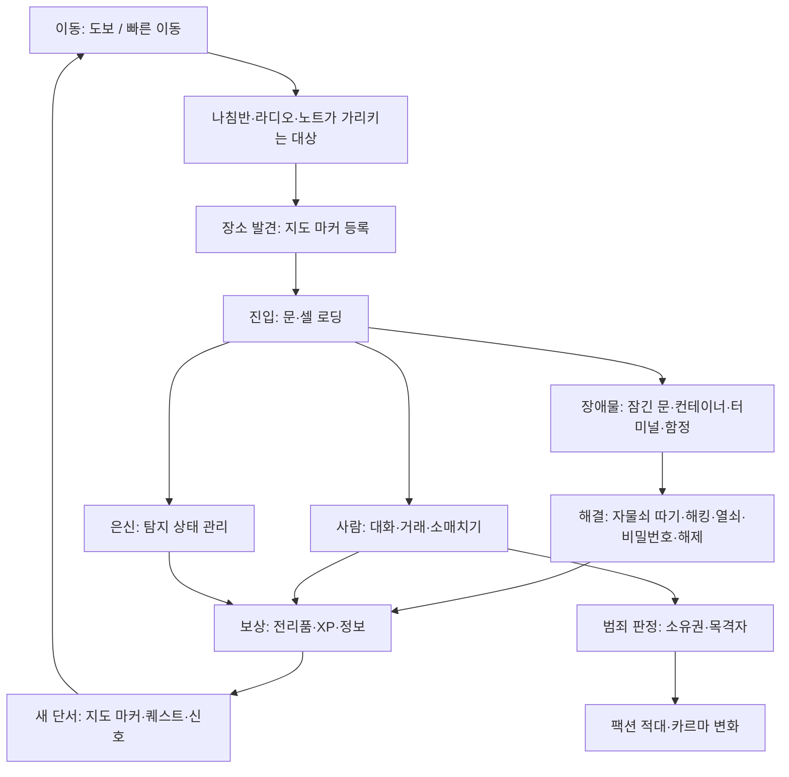
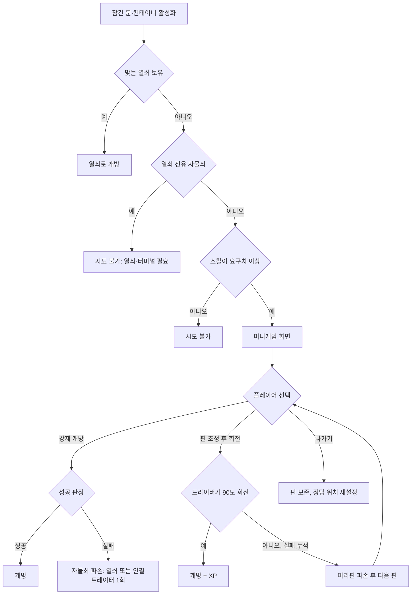
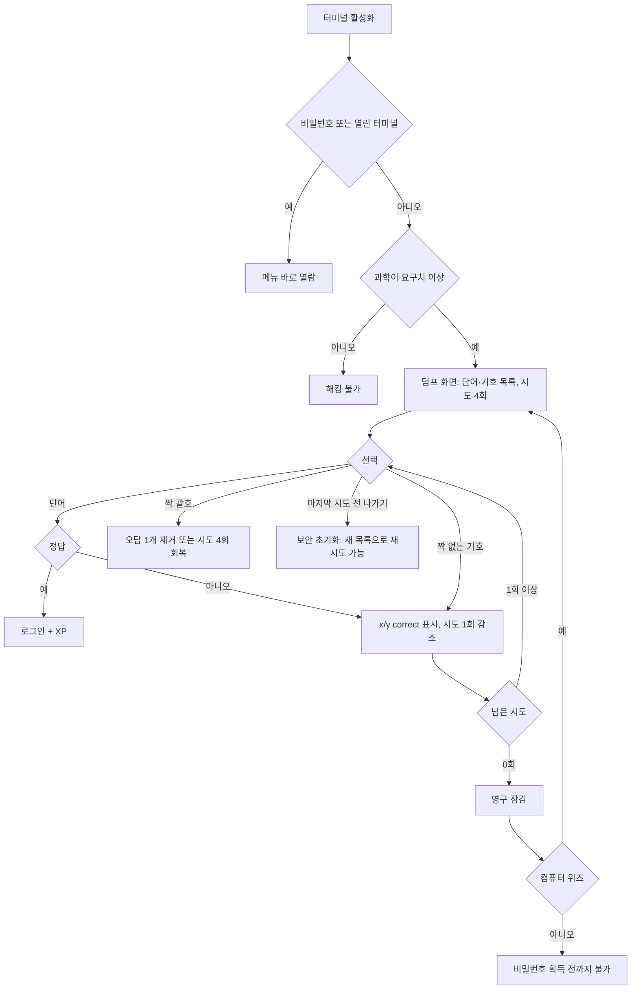
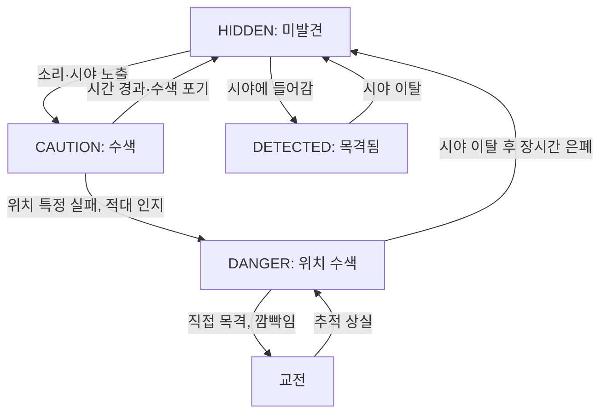
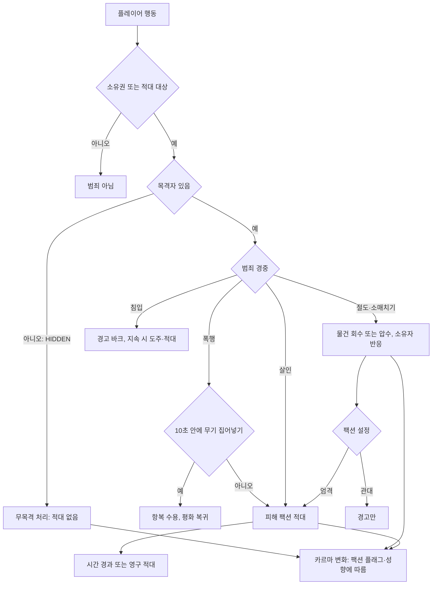
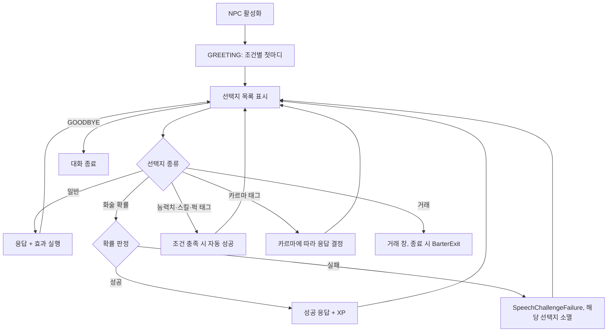
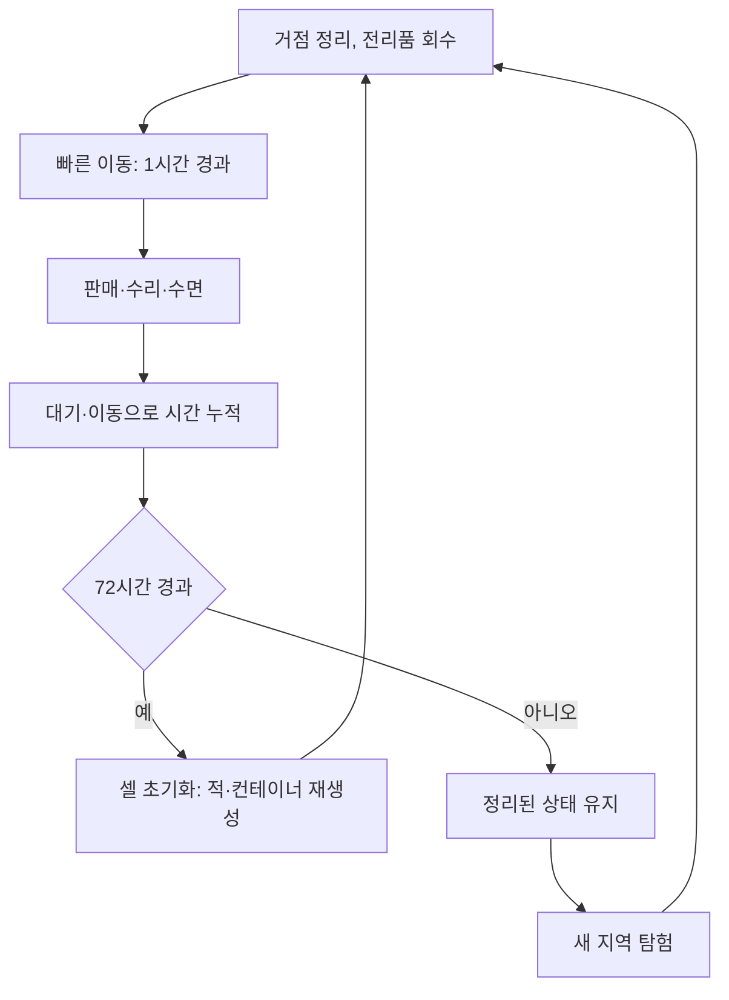
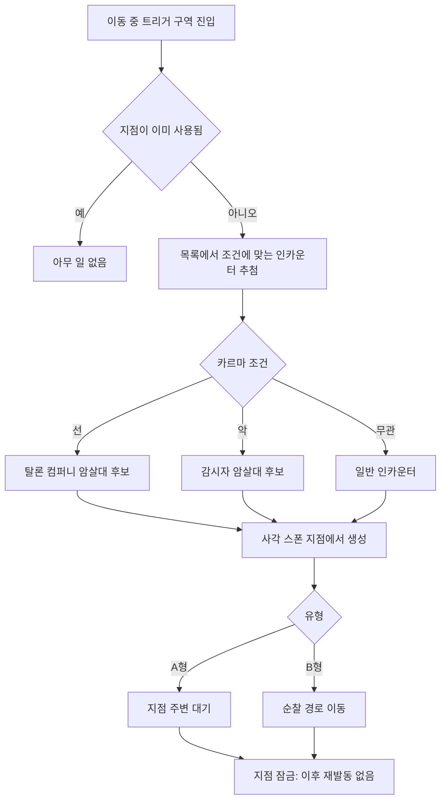
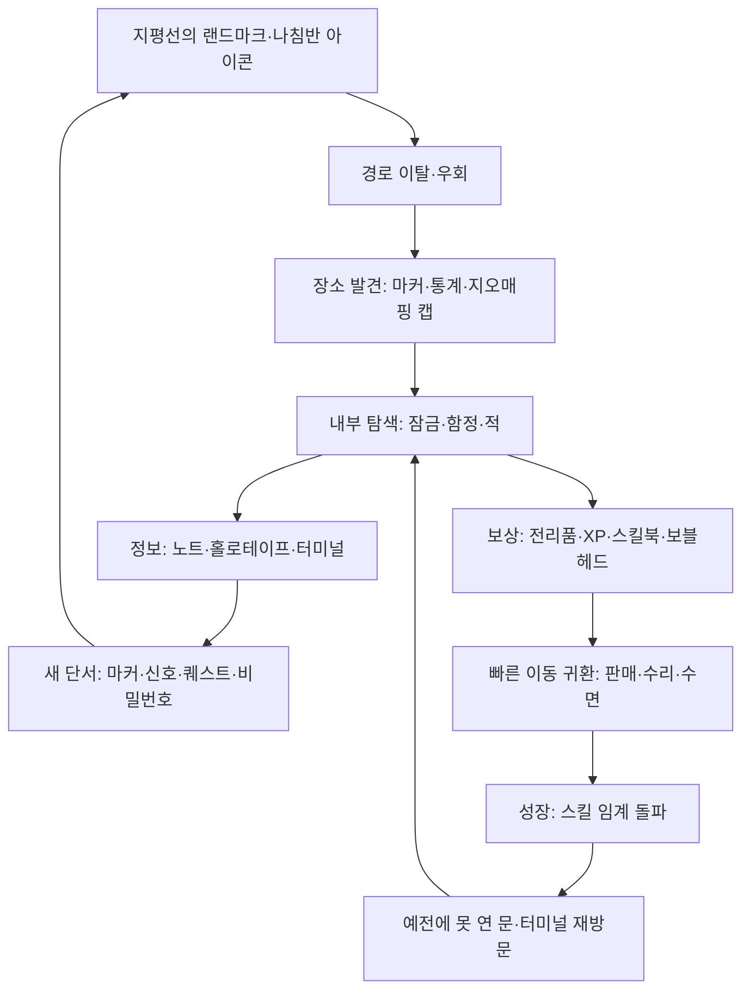

# RD-17. 탐험·상호작용

> **폴아웃 3 역기획서 세트** | 문서 ID: RD-17 | 버전: v1.0 | 작성일: 2026-10-11
> **범위**: 장소 발견·지도 마커·빠른 이동, 자물쇠 따기와 해킹(규칙·난이도 표), 터미널·홀로테이프·노트의 기능, 소매치기·역소매치기, 은신 탐지, 소유권·범죄, 대화 시스템(화술 판정 공식, 능력치·스킬·퍽 선택지, 카르마 반응), 라디오 기능, 함정, 컨테이너·전리품·열쇠·문, 리스폰·셀 초기화, 시간·대기·수면, 인카운터 존(탐험 관점). / **다루지 않는 것**: 화면 구성·조작 체계(→ RD-18), 피해 공식·VATS 수치(→ RD-16), 카르마 수치표 전체(→ RD-14), 수면·상태 효과 수치(→ RD-15), 장소별 상세(→ RD-12·RD-13), 퀘스트 상세(→ 각 퀘스트 문서), 라디오 곡 목록(→ RD-25), 랜덤 인카운터 목록(→ RD-07), 상인·가격(→ RD-22).
> **관련 문서**: [RD-03 메인 스토리 1부](03_main-story-part1.md), [RD-04 메인 스토리 2부·엔딩](04_main-story-part2-endings.md), [RD-05 사이드 퀘스트 1부](05_side-quests-part1.md), [RD-06 사이드 퀘스트 2부](06_side-quests-part2.md), [RD-07 비표시·반복 퀘스트와 랜덤 인카운터](07_misc-quests-encounters.md), [RD-08d DLC: 포인트 룩아웃](08d_dlc-point-lookout.md), [RD-08e DLC: 마더십 제타](08e_dlc-mothership-zeta.md), [RD-09 팩션](09_factions.md), [RD-10 주요 인물·동료](10_characters-major-companions.md), [RD-11 NPC 디렉터리](11_npc-directory.md), [RD-12 월드 구조·정착지·볼트](12_world-structure-settlements.md), [RD-13 장소 카탈로그](13_location-catalog.md), [RD-14 캐릭터 시스템](14_character-system.md), [RD-15 상태·생존 시스템](15_status-survival.md), [RD-16 전투 시스템](16_combat-system.md), [RD-18 UI/UX](18_ui-ux.md), [RD-21 소모품·잡화·제작](21_consumables-misc-crafting.md), [RD-22 경제·주거](22_economy-housing.md), [RD-24 크리처·적 도감](24_bestiary.md), [RD-25 아트·오디오·연출](25_art-audio-presentation.md), [RD-26 용어집](26_glossary.md)

---

## 1. 문서 개요

### 1.1 목적
- 폴아웃 3(Fallout 3)에서 플레이어가 전투 밖에서 세계와 맞물리는 모든 규칙(돌아다니기, 찾아내기, 열기, 훔치기, 숨기, 말하기, 듣기)을 데이터·이벤트로 옮길 수 있는 수준으로 정리함.
- 팬게임(쯔꾸르 도트 RPG)에서 전투는 단순화하더라도 **탐험·상호작용은 원작 규칙을 최대한 보존**하는 것이 목표이므로, 판정 공식·임계값·예외를 빠짐없이 적음.

### 1.2 범위 요약
| 구분 | 이 문서가 다루는 것 | 다른 문서로 넘기는 것 |
|---|---|---|
| 탐험 | 발견 조건, 지도 마커, 빠른 이동 가능·불가 조건, 월드 맵·지역 맵 기능 | 맵 크기·지역 구분(RD-12), 장소 목록(RD-13), 화면 구성(RD-18) |
| 잠금 해제 | 자물쇠 따기·강제 개방·해킹의 규칙과 난이도 표, XP | 미니게임 화면 배치(RD-18) |
| 정보 매체 | 터미널 기능 분류, 홀로테이프·노트·메시지 박스의 역할 | 개별 문서 전문(각 퀘스트·장소 문서), 홀로테이프·노트 분류 개요(RD-21) |
| 은신·범죄 | 탐지 상태·요소, 소매치기 공식, 소유권·범죄 처리, 적대 해소 | 기습 공격 피해(RD-16), 카르마 증감 전체 표(RD-14), 팩션 관계(RD-09) |
| 대화 | 대화 구조, 화술 판정 공식, 특수 선택지, 카르마 반응, 뇌물 | 퀘스트별 분기 상세(각 퀘스트 문서), 동료 시스템(RD-10) |
| 라디오 | 방송국·신호의 수신 규칙과 퀘스트 연동 | 곡 목록·DJ 연출(RD-25) |
| 함정·컨테이너 | 함정 종류·해제·회수, 컨테이너 유형, 레벨 연동 전리품, 열쇠·문 | 무기로서의 지뢰 수치(RD-19), 상인 재고(RD-22) |
| 시간·리스폰 | 셀 초기화 주기, 대기·수면의 탐험상 역할, 인카운터 존 | 수면 효과 수치(RD-15), 랜덤 인카운터 목록(RD-07), 적 레벨 스케일링 수치(RD-16·RD-24) |

### 1.3 3~5줄 요약
- 수도 황무지(Capital Wasteland)의 탐험은 **나침반(Compass)에 걸린 마커 → 우회 → 발견 → 전리품·정보 → 새 마커**로 이어지는 연쇄 구조이며, 한 번 발견한 장소는 핍-보이(Pip-Boy) 3000 월드 맵에서 **빠른 이동(Fast travel)**으로 다시 갈 수 있음.
- 잠긴 문·컨테이너·터미널은 **스킬 임계값(0/25/50/75/100 계열)**으로 시도 가능 여부가 갈리고, 자물쇠 따기·해킹은 실제 손재주를 요구하는 미니게임으로 해결함. 모든 잠금에는 대체 경로(열쇠, 비밀번호, 대화, 다른 입구)가 있는 경우가 많음.
- 은신은 [HIDDEN]/[CAUTION]/[DANGER] 상태로 시각화되고, 숨은 상태는 기습 치명타·소매치기·무목격 절도의 전제 조건임. 범죄는 제도적 처벌이 없고 **피해를 본 팩션만** 반응함.
- 대화는 **[Speech XX%]** 확률 선택지와, 조건만 맞으면 자동 성공하는 **[Intelligence]·[Black Widow]·[Child at Heart] 등 태그 선택지**로 구성되며, 같은 문제를 돈·스킬·퍽·폭력 등 여러 방법으로 풀 수 있게 함.
- 라디오·홀로테이프·터미널·노트·로딩 화면은 모두 정보 전달 채널이며, 상당수가 퀘스트를 시작하거나 지도 마커를 추가하는 **게임플레이 트리거**를 겸함.

### 1.4 표기 메모
- 용어는 [RD-26 용어집](26_glossary.md)을 따름. 고유명사는 첫 등장 시 `한국어(English)`로 병기함. 퍽 이름은 음차함(예: 인필트레이터(Infiltrator)).
- 수치 출처는 로컬 Nukapedia 코퍼스(2026-08-30 덤프)임. 코퍼스에서 확인하지 못한 일반 지식은 `(코퍼스 미확인)`으로 표시함.
- 엔진 설정값은 `iHoursToRespawnCell`처럼 원래 이름을 그대로 적음. 이식 시 변수명 후보로 쓸 수 있음.
- DLC 태그: `[OA]` 오퍼레이션: 앵커리지, `[TP]` 더 피트, `[BS]` 브로큰 스틸, `[PL]` 포인트 룩아웃, `[MZ]` 마더십 제타.

### 1.5 시스템 지도

## 2. 탐험: 발견·지도 마커·빠른 이동

### 2.1 탐험 공간의 단위 (요약)
- 월드는 **외부 월드스페이스**(수도 황무지 지표)와, 문을 통과하면 로딩 화면을 거쳐 들어가는 **내부 셀**(건물·볼트·지하철·동굴)로 나뉨. 상세 구조는 [RD-12](12_world-structure-settlements.md) 참조.
- 슈퍼 뮤턴트(Super mutant)가 점령한 D.C. 도심 폐허는 대부분 **지하철(Metro) 터널을 통해서만** 들어갈 수 있음. 로딩 화면 힌트가 이를 직접 알려 줌: "The only way to reach the super mutant-occupied D.C. ruins is by traveling underground, usually through the abandoned Metro tunnels."
- 개발 초기 D.C. 도심은 폐쇄 구역이 26개였으나 너무 크고 혼란스러워 12개로 줄였음(GDC 2009 발표, `Fallout 3 world map` 문서의 비하인드).
- 지도 마커 수(`Fallout 3 locations` 기준)

| 구분 | 마커 수 | 비고 |
|---|---|---|
| 본편 수도 황무지 | 163 | 로브링어(Lawbringer) 퍽으로만 나타나는 감시자 본부(Regulator HQ) 포함. 퍽이 없으면 162 |
| 핍-보이 '발견한 장소' 통계 상한(본편) | 162 | 볼트 101(Vault 101) 마커는 통계에서 제외됨 |
| DLC가 수도 황무지 지도에 추가 | 10 | DLC 5종 합계 |
| DLC 별도 월드 맵 | 51 | 앵커리지 시뮬레이션·피트·포인트 룩아웃·제타 등 |
| 총합 / 통계 반영 | 224 / 221 | 케니의 동굴(Kenny's cave)·외계인 귀환 비콘(Alien Homing Beacon)·볼트 101 제외 |

### 2.2 장소 발견 규칙
| 항목 | 규칙 |
|---|---|
| 발견 조건 | 마커가 붙은 장소에 **직접 도달**해야 '발견'으로 처리됨. 지도에 표시만 된 장소(퍽·대화·퀘스트로 공개)는 '미발견' 상태로 남음 |
| 발견 시 처리 | 월드 맵에 마커 등록, 해당 마커로 빠른 이동 가능, 핍-보이 STATS > General의 **Locations Discovered** +1 |
| 나침반 표시 | 주변 장소는 HUD 나침반에 장소 아이콘으로 나타남. 미발견 장소는 속이 빈 아이콘, 발견한 장소는 채워진 아이콘으로 구분되며 일정 거리 안에 들어오면 나침반에 잡힘 (코퍼스 미확인, 표시 거리 수치 미확인) |
| 발견 XP | 코퍼스의 FO3 XP 획득원 목록(처치, 퀘스트 단계, 지뢰·함정 해제, 자물쇠 따기, 해킹, 화술 성공)에 **장소 발견은 없음**. 발견 보상은 XP가 아니라 빠른 이동 거점·통계·지오매핑 보상으로 주어짐 |
| 업적 | 1인 정찰대(One-Man Scouting Party): 장소 100곳 발견 (20G, 실버) |
| 지오매핑 | 비표시 반복 퀘스트 '라일리와 지오매핑(Geomapping with Reilly)': 라일리스 레인저스(Reilly's Rangers) 퀘스트 완료 후 받은 지오매퍼 모듈(geomapper module)을 지닌 채 레인저 기지로 돌아오면 **발견한 장소 1곳당 30캡**(최대 4,890캡) 지급. 'Locations Discovered' 통계를 쓰므로 DLC 장소도 인정. 최신 패치 기준 익스플로러로 표시만 한 장소는 불인정. DCTA 지하철 노선도로 얻은 지하철 정보는 제출 불가 |

- 익스플로러(Explorer) 퍽(레벨 20): 지도에 모든 장소를 **표시**만 하며, 빠른 이동은 직접 가서 발견한 뒤에야 가능함. 공식 가이드(컬렉터 에디션)는 빠른 이동까지 된다고 잘못 적었음.
  - 퍽을 고른 시점에 설치된 DLC의 장소만 공개됨. 이후 설치한 DLC 장소는 숨겨진 채로 남음.
  - 스크립트 이벤트 전에는 존재하지 않는 마커(예: 감시자 본부)는 공개하지 않음.

### 2.3 지도에 마커가 추가되는 경로
| 경로 | 사례(코퍼스) | 결과 상태 |
|---|---|---|
| 직접 방문 | 모든 마커 | 발견(빠른 이동 가능) |
| 퍽 | 익스플로러: 전 장소 표시 / 로브링어: 감시자 본부 마커 생성 | 표시(미발견) |
| NPC 대화 | 랜덤 인카운터의 그레이디치(Grayditch) 생존자와 대화하면 그레이디치가 지도에 표시됨 | 표시 |
| 퀘스트 진행 | 흔적을 따라서(Picking Up the Trail) 시작 시 로스차일드 서기(Scribe Rothchild)가 모든 볼트 위치를 표시 / 초인의 도박(The Superhuman Gambit)에서 개미여인(AntAgonizer)·기계박사(Mechanist) 거처가 표시 | 표시 + 퀘스트 마커 |
| 홀로테이프·노트 | 그레이디의 마지막 녹음(Grady's last recording)이 다리그늘 마을(Girdershade) 마커 추가 / 노트의 비밀번호를 열람한 순간 '닷의 식당(Dot's Diner)'이 표시 | 표시 |
| 터미널 다운로드 | 메트로 센트럴(Metro Central)·포기 바텀(Foggy Bottom)·애너코스티아 크로싱(Anacostia Crossing) 역의 프로텍트론 포드 옆 터미널에서 **DCTA 지하철 노선도(DCTA Metro map)** 이미지 노트를 핍-보이로 내려받음 | 노트(지도 마커 아님) |
| 라디오 신호 | 햄 라디오 비콘·조난 신호가 출처로 유도 ([10장](#10-라디오) 참조) | 마커 없음, 신호 세기로 추적 |

### 2.4 지도 마커와 표식의 종류
#### 2.4.1 장소 마커 유형
- 게임은 장소 마커마다 유형별 아이콘을 씀. 아래는 코퍼스 장소 문서의 `type` 분류(Nukapedia 정보상자 기준)를 집계한 것으로, 게임 내부 아이콘 목록(G.E.C.K. 마커 타입)과 1:1로 일치하는지는 코퍼스 미확인임.

| 유형(Nukapedia `type`) | 의미·예 | 코퍼스 문서 수(대략) |
|---|---|---|
| settlement large / medium / small | 정착지 대·중·소. 예: 메가톤(Megaton), 리벳시티(Rivet City), 다리그늘 마을 | 대 21, 중 20, 소 9 |
| building | 일반 건물·사무실. 예: 알렉산드리아 암스(Alexandria Arms) | 67 |
| metro | 지하철역·터널 출입구 | 48 |
| district | D.C. 도심 구역(폐쇄 구역 단위) | 30 |
| ruins | 마을·도시 폐허. 예: 스프링베일(Springvale), 페어팩스 폐허(Fairfax ruins) | 31 |
| landmark | 자연·지형 지표, 기타 표지 | 21 |
| monument | 기념물. 예: 워싱턴 기념비(Washington Monument), 링컨 기념관(Lincoln Memorial) | 19 |
| military / Base | 군사 시설. 예: 콘스탄틴 요새(Fort Constantine), 배니스터 요새(Fort Bannister) | 16 / 5 |
| factory | 공장·산업 시설. 예: 뉴카-콜라 공장(Nuka-Cola plant) | 17 |
| sewer / tunnel | 하수도·터널 | 10 / 5 |
| cave | 동굴 | 9 |
| vault | 볼트 | 9 |
| unmarked / section | 마커 없는 장소·구역(지도 마커 없음) | 181 / 96 |

> 수치는 '마커 아이콘 종류'를 가늠하기 위한 참고값이며, 장소 정본 목록은 [RD-13](13_location-catalog.md)이 담당함.

#### 2.4.2 장소 외 표식
| 표식 | 표시 위치 | 모양·규칙 |
|---|---|---|
| 퀘스트 마커 | 월드 맵·지역 맵·HUD 나침반 | 나침반에 **큰 채워진 화살표**. 핍-보이 Quests에서 선택한 **활성 퀘스트**의 목표만 표시 |
| 사용자 마커 | 월드 맵·지역 맵·HUD 나침반 | 지도 아무 곳에나 1개 배치. 나침반에 **큰 빈 화살표** |
| 동료 위치 | 월드 맵·지역 맵 | **작은 빈 삼각형** |
| 적·아군 | HUD 나침반 | 적은 **붉은 막대(틱)**. 적이 나침반에 잡히는 거리는 **인지력(Perception)**이 결정함. 아군 NPC도 '우호' 표식으로 표시 |
| 문·출입구 | 지역 맵 | 내부·외부 연결 문. 월드 맵에 없는 장소(예: 록오폴리스(Rockopolis))도 지역 맵에는 입구가 표시되는 경우가 있음 |
| 수류탄 경고 | HUD | 날아오는 수류탄 방향을 **붉은 화살표**로 표시(던진 수류탄만. 함정으로 떨어지는 수류탄 부케는 표시 안 됨) |

### 2.5 빠른 이동
#### 2.5.1 기본 규칙
- 핍-보이 DATA > World Map에서 **이미 발견한** 장소 마커를 선택하면 그 장소의 도착 지점(fast travel arrival point)으로 이동함.
- 소요 시간: **거리와 관계없이 게임 시간 1시간**이 흐름(레이븐 락(Raven Rock)→리벳시티든 볼트 101→메가톤이든 동일). `Fast travel` 문서 기준이며, 후속작(뉴 베가스·폴아웃 4)은 거리 비례로 바뀜.
- 이동 중 [집기(Grab)](#88-기타-상호작용-규칙)로 들고 있던 물체는 그 자리에 떨어짐.

#### 2.5.2 가능·불가 조건
| 조건 | 빠른 이동 | 근거 |
|---|---|---|
| 목적지가 '발견' 상태 | 가능 | 표시만 된 장소는 불가 |
| 실내(내부 셀)에 있음 | **불가** | 외부로 나가야 함 |
| 공중(낙하 중 등) | **불가** | |
| 과적 상태 | **불가** | [RD-15](15_status-survival.md) 소지 한도 |
| 적이 근처에 있거나 전투 중 | **불가** | |
| 스크립트 금지 구역 안 | **불가** | 트리거 영역에 `DefaultDisableFastTravelSCRIPT`를 붙여 진입 시 `EnableFastTravel 0`, 이탈 시 `1`로 되돌림. 상태는 `NQlvl.FastTravelDisabled`로 추적 |
| 퀘스트·DLC 연출 구간 | **불가** | 예: 트랜퀼리티 레인(Tranquility Lane) 시뮬레이션 안에서는 핍-보이 자체를 열 수 없음 |

#### 2.5.3 동료·추종자의 동행
- 따라오기 상태의 동료는 빠른 이동 시 함께 도착함 (코퍼스 미확인, 일반 지식). 코퍼스에는 근접한 적(라드스코피온)이 따라오거나 상인 땜장이 조(Tinker Joe)가 따라오는 버그 사례가 있어, 엔진이 '근처의 동행 대상'을 함께 옮긴다는 점을 뒷받침함.
- 대기 명령을 받은 동료는 그 자리에 남음. 메가톤 집이나 텐페니 타워(Tenpenny Tower) 스위트에서 대기시키면 아무리 오래 기다려도 떠나지 않음([RD-10](10_characters-major-companions.md)).
- 리벳시티의 체리(Cherry) 호송처럼 빠른 이동을 쓰지 못하게 되는 호송 구간은 체감 난이도가 크게 오름(코퍼스 'Cherry' 언급).

#### 2.5.4 DLC 지도
- [OA] 앵커리지 시뮬레이션, [TP] 피트, [PL] 포인트 룩아웃은 **별도 월드 맵**을 씀. 각 지도 안에서 발견한 장소끼리 빠른 이동함. [BS]는 수도 황무지 지도에 장소를 추가함.
- [PL] 리버보트 더치스 갬빗(Duchess Gambit)은 탑승권이 있어야 왕복 가능하며 출발 시 강제 저장·추종자 해산이 일어남(상세는 [RD-08d](08d_dlc-point-lookout.md)).

### 2.6 월드 맵과 지역 맵
| 기능 | 월드 맵(World Map) | 지역 맵(Local Map) |
|---|---|---|
| 표시 범위 | 월드스페이스 전체. 발견한 장소, 표시된 장소 | 현재 셀 주변의 상세 지도. **이미 탐험한 영역만** 드러남 |
| 상호작용 | 발견 장소 선택 → 빠른 이동 / 사용자 마커 배치 / 확대·축소 | 사용자 마커 배치, 퀘스트 마커 확인 |
| 마커 | 장소 아이콘, 퀘스트 마커, 사용자 마커, 동료 | 문·출입구, 퀘스트 마커, 사용자 마커 |
| 실내 | 실내에서도 열람 가능(이동은 불가) | 실내 구조 표시 |
| 비고 | 익스플로러 퍽 효과가 반영됨 | 내부 셀의 나침반 방위는 외부와 맞지 않는 경우가 있음(버그로 기록됨) |

### 2.7 탐험을 돕는 보조 장치
| 장치 | 탐험상 역할 | 상세 |
|---|---|---|
| 나침반 | 주변 장소·적·퀘스트 목표 탐지 | 인지력이 높으면 적을 시야보다 먼저 '감지'함 |
| 라디오·햄 라디오 | 신호 세기로 출처를 추적 | [10장](#10-라디오) |
| 핍-보이 라이트 | 어두운 실내 시야 확보 | 핍-보이 버튼을 길게 누름. 은신 탐지 확률을 높임([6장](#6-은신)) |
| 지하철 승차권·패스 카드 | 일부 지하철 개찰구의 보안 프로텍트론 통과 | 지하철 승차권(Metro ticket)·레드/블루 패스 카드(Pass card) |
| DCTA 지하철 노선도 | 지하철망 개관 | 이미지 노트, 터미널에서 다운로드 |
| 지오매퍼 모듈 | 발견 1곳당 30캡 | 2.2 참조 |

## 3. 자물쇠 따기

### 3.1 개요
- 문·금고·상자 등의 **자물쇠(Lock)**는 5단계 난이도를 가지며, 자물쇠 따기(Lockpick) 스킬이 난이도 요구치 이상이고 **머리핀(Bobby pin)**이 1개 이상 있어야 미니게임을 시작할 수 있음.
- 미니게임 대신 **강제 개방(Force lock)**을 시도할 수 있으나, 실패하면 자물쇠가 부서져 열쇠로만 열 수 있게 됨.
- 일부 자물쇠는 `[Needs Key]`로 표시되어 따기 자체가 불가능하고 열쇠나 연결된 터미널로만 열림.

### 3.2 난이도 표
| 난이도 | 영문 | 요구 자물쇠 따기 | XP 보상 | 강제 개방 성공률 | 위키 수록 표본(54건) |
|---|---|---|---|---|---|
| 매우 쉬움 | Very Easy | 0 ※ | 20 | 스킬+10% | 6 |
| 쉬움 | Easy | 25 | 30 | 스킬−25+10% | 7 |
| 보통 | Average | 50 | 40 | 스킬−50+10% | 6 |
| 어려움 | Hard | 75 | 50 | 스킬−75+10% | 5 |
| 매우 어려움 | Very Hard | 100 | 60 | 스킬−100+10% | 30 |

- ※ `Lock (Fallout 3)`·`Lock (Fallout: New Vegas)` 문서는 매우 쉬움 요구치를 **0**으로, `Lockpick (Fallout 3)` 스킬 문서는 15로 적음. 이 문서는 자물쇠 문서의 0을 정본으로 보고, 15는 해킹 매우 쉬움(과학 15)과 혼동된 값으로 판단함.
- 강제 개방 성공률 = **자물쇠 따기 스킬 − 자물쇠 요구치 + 10(%)**. 예: 스킬 67로 보통(50) 자물쇠 → 27%. 엔진 설정 `fLockSkillBase`(기본 10)가 이 +10의 출처이며, 100으로 바꾸면 모든 강제 개방이 성공함.
  - 따라서 요구치를 막 넘긴 시점의 강제 개방은 10~14% 수준으로, 스킬이 요구치보다 40 이상 높아야 50%를 넘음.
- 표본 분포: `Lock (Fallout 3)`의 위치 표(54건)는 눈에 띄는 자물쇠만 모은 것이라 전체 분포가 아님. 다만 위키가 기록할 만한 자물쇠의 과반(30/54)이 매우 어려움이라는 점에서, **좋은 보상일수록 높은 자물쇠 뒤에 둔다**는 배치 원칙을 확인할 수 있음. 금고(Safe) 문서도 "자물쇠 난이도는 대개 안의 전리품 가치에 비례"한다고 적음.

### 3.3 미니게임 규칙
| 요소 | 규칙 |
|---|---|
| 도구 | 머리핀 1개 + 드라이버. 드라이버는 무게 0의 무료 도구로 인벤토리에 보이지 않음 |
| 목표 | 자물쇠마다 정해진 **정답 각도(스윗 스폿)**에 핀을 맞춘 뒤 드라이버로 실린더를 돌림 |
| 피드백 | 핀이 정답에 가까울수록 드라이버가 더 많이 돌아감. **90도까지 완전히 돌면 개방** |
| 스윗 스폿 크기 | 자물쇠 난이도가 정밀도를 결정함. 매우 쉬움은 거의 조정 없이 열리고, 매우 어려움은 정밀한 위치가 필요함. 스킬이 요구치를 크게 넘을수록 허용 폭이 넓어진다는 설명은 코퍼스 미확인 |
| 핀 내구 | 정답이 아닌 위치에서 회전을 시도하면 핀이 흔들리며 손상이 쌓이고, 너무 많이 실패하면 핀이 부러짐. 난이도가 높을수록 반복 시도가 늘어 핀 소모가 빠름 |
| 내구 신호 | 실패 시 핀이 얼마나 심하게 떠는지로 남은 내구를 가늠하며, 부러지기 직전에는 중앙에서 튕겨 나감. 힘을 세게 줄수록 빨리 부러짐(`Lock (Fallout: New Vegas)` 기준. 같은 미니게임이므로 FO3에도 적용되는 것으로 봄) |
| 핀 파손 후 | 다음 머리핀으로 자동 교체되어 같은 자물쇠를 계속 시도. 정답 위치는 유지됨 (코퍼스 미확인) |
| 나가기 | 미니게임을 나갔다 다시 들어오면 **현재 핀이 새것처럼 회복**되지만 **정답 위치도 새로 정해짐**. 부러지기 직전 핀을 살리는 요령으로 알려짐 |
| 머리핀 0개 | 미니게임 불가. 강제 개방은 머리핀 없이도 가능(뉴 베가스 문서 기준) |

### 3.4 강제 개방
- 미니게임을 건너뛰는 즉시 판정임. 성공률은 3.2의 공식.
- **실패하면 자물쇠가 영구히 부서짐**. 이후에는 맞는 열쇠가 있거나, 인필트레이터(Infiltrator) 퍽이 있어야만 다시 시도할 수 있음.
- 인필트레이터: 레벨 18, 인지력 7, 자물쇠 따기 70. 강제 개방으로 부순 자물쇠에 **한 번 더** 따기 기회를 줌. 위키는 "나가기 리셋 요령이 있으므로 가치가 논쟁적"이라고 평가함(컴퓨터 위즈와 같은 구조).
- 강제 개방 성공 시 XP 지급 여부는 코퍼스 미확인.

### 3.5 다른 해결 경로와 상호작용
| 경로 | 규칙·사례 |
|---|---|
| 열쇠 | 열쇠를 가지고 있으면 난이도와 무관하게 열림. 열쇠는 핍-보이의 열쇠고리(Keyring)에 저장됨([12.4](#124-열쇠비밀번호암호화-키)) |
| 터미널 | 일부 금고·문은 연결 터미널로 열림. 위키는 "대개 같은 금고의 자물쇠보다 터미널의 과학 요구치가 낮다"고 적음 |
| XP 이중 획득 | 터미널을 해킹한 뒤 잠금 해제 명령을 실행하지 않고 나와 자물쇠를 따면 **해킹 XP + 자물쇠 XP**를 모두 얻음. 반대로 자물쇠를 먼저 따면 터미널이 '고장' 처리되어 해킹할 수 없음 |
| 반대편 장치 | 뉴카-콜라 공장 입구 문은 반대편 스위치로, 리벳시티 선수부(Rivet City bow) 문은 수중 경로로 돌아가 안쪽 스위치로 열 수 있음 |
| 대화 | 그레이디치의 브라이언 윌크스(Bryan Wilks)는 화술 판정 또는 차일드 앳 하트(Child at Heart)로 아버지의 무기고 열쇠(Grayditch dumpster key)를 넘겨줌 |
| 소유권 | 남의 자물쇠를 따는 모습이 목격되면 범죄. 메가톤에서 루카스 심즈(Lucas Simms) 집 자물쇠를 따다 저격수 스톡홀름(Stockholm)에게 들키면 마을의 무장 인원 전체가 **최소 3일** 적대함. 소유자가 없거나 방을 빌린 경우(예: 숙소 방 문)는 카르마 손실 없이 딸 수 있는 사례가 있음 |

### 3.6 XP·통계·업적·관련 강화 수단
- XP: 난이도별 20/30/40/50/60(3.2 표). 숙면 효과·스위프트 러너(Swift Learner) 등 XP 배율이 적용됨([RD-14](14_character-system.md)).
- 통계: 핍-보이 STATS > General **Locks Picked**(따기에 성공한 자물쇠 1개당 +1).
- 업적: 열쇠는 겁쟁이나 쓰는 것(Keys are for Cowards) — 자물쇠 50개 따기(20G, 실버).
- 자물쇠 따기 스킬 강화 수단(수치 정본은 [RD-14](14_character-system.md))

| 구분 | 수단 | 효과 |
|---|---|---|
| 초기값 | 2 + (2×인지력) + ⌈행운÷2⌉ | 스킬 문서 공식 |
| 영구 | 레벨업 배분, 자물쇠 따기 보블헤드 +10, 스킬북 'Tumblers Today' 권당 +1(컴프리헨션 시 +2), 시프(Thief) 랭크당 +5(최대 3), 태그 +15, [OA] 커버트 옵스(Covert Ops) +3 | |
| 일시 | 멘타츠 +2~10(인지력에 따라), 아버지의 황무지 복장(Dad's wasteland outfit) +5, 볼트 101 작업복(Vault 101 utility jumpsuit) +5, [BS] 래그볼트의 선글라스(Lag-Bolt's shades) +3 | 임시 수치로도 요구치 판정 통과 |
| 퍽 | 인필트레이터(레벨 18, 인지력 7, 자물쇠 따기 70) | 부서진 자물쇠 재시도 |

### 3.7 머리핀
| 항목 | 값 |
|---|---|
| 분류 | 잡화(Misc) / 편집기 ID `Lockpick`, 폼 ID 0000000A |
| 무게 / 가치 | 0 / 1캡 |
| 획득처 | 상인 재고, 야생 구울(Feral ghoul)·레이더(Raider)·센타우로스(Centaur) 등의 시체, 집 안 탁자, 구급상자, 계산대, 개미 쓰레기 더미, 잠긴 금고, 해골 옆(성냥갑 모양) |
| 배치 특징 | 잠긴 대상 근처에 2~3개씩 보충되듯 놓인 경우가 많음. 서랍장 3개 묶음 배치가 흔함. 볼트 101 아마타(Amata) 방 서랍(탈출!·고향의 위기 중 5개), 저격수 오두막(Sniper shack) 14~20개 등 |
| 설계 의미 | 무게 0·가치 1이라 소지 부담이 없고, '부족하면 미니게임 실력으로 아껴 쓰는' 소모 자원 역할 |

## 4. 해킹

### 4.1 개요와 세계관 장치
- 보안이 걸린 **터미널(Terminal)**에 들어가는 방법은 ① 비밀번호, ② 과학(Science) 스킬로 **해킹(Hacking)**, ③ 암호화 키(Encryption key) 중 하나이며, 대개 한두 가지만 열려 있음.
- 설정상 해킹은 로브코(RobCo) **텀링크(Termlink)** 프로토콜의 허점을 이용해 터미널을 정비 모드로 재부팅하고 계정 파일을 디버그로 덤프시켜, 메모리 덤프에 섞인 비밀번호를 찾아내는 행위임. 미니게임 화면의 '단어와 기호 뭉치'가 바로 이 덤프임.
  - 설정 문구 예: `SET FILE/PROTECTION=OWNER:RWED ACCOUNTS.F` → `SET HALT RESTART/MAINT` → `RUN DEBUG/ACCOUNTS.F`(`Terminal commands` 문서). 로브코가 내놓은 유일한 대책이 '잠김(lockout)' 기능이며, 컴퓨터 위즈(Computer Whiz) 퍽은 이 잠김을 우회하는 해커를 뜻함.
- 해킹 미니게임은 보드게임 **마스터마인드(Mastermind)**를 바탕으로 함(조슈아 소여(Joshua Sawyer) 발언).

### 4.2 난이도 표
| 터미널 등급 | 영문 | 요구 과학 | 비밀번호 길이 | XP 보상 | 위키 수록 표본(140건) |
|---|---|---|---|---|---|
| 매우 쉬움 | Very Easy | 15 | 4~5자 | 20 | 21 |
| 쉬움 | Easy | 25 | 6~8자 | 30 | 17 |
| 보통 | Average | 50 | 9~10자 | 40 | 67 |
| 어려움 | Hard | 75 | 11~12자 | 50 | 19 |
| 매우 어려움 | Very Hard | 100 | 13~15자 | 60 | 16 |

- 요구치는 기본값이 아닌 **보정 후 수치**(장비·약물 포함)로 판정함. 매우 어려움은 과학 100이 있어야 시도라도 할 수 있음.
- 매우 쉬움도 과학 15가 필요하므로, 자물쇠(매우 쉬움 0)와 달리 지능이 낮은 초반 캐릭터는 가장 쉬운 터미널도 못 여는 경우가 생김(초기값 최저 5).
- 표본 분포에서 보통(67/140)이 가장 많음. 해킹 대상 터미널의 '기본값'이 보통 등급인 배치 경향이 보임(위키 표는 전체 목록이 아님).

### 4.3 미니게임 규칙
| 요소 | 규칙 |
|---|---|
| 화면 | 같은 길이의 단어 여러 개가 무작위 기호 사이에 끼어 있음. 단어 길이는 터미널 등급이 정함 |
| 단어 개수 | **과학 스킬이 높을수록 적어짐**. 과학 100이면 보통 터미널은 약 5개만 나옴. 상한은 엔진 설정 `iHackingMaxWords`(기본 20). 어려운 터미널일수록 단어가 많고 길며 괄호가 적음 |
| 시도 횟수 | 4회 |
| 오답 피드백 | `x/y correct` — x는 **같은 위치에 같은 글자**가 있는 개수, y는 단어 길이. 예: 정답 RELEASED에 DETECTOR를 고르면 2·4번째 E만 위치가 맞아 2/8. 정답 BENIGN에 DESIGN이면 4/6 |
| 괄호 기호 | 같은 줄 안에서 짝이 맞는 `()` `[]` `{}` `<>`를 고르면 **오답 단어 1개 제거** 또는 **시도 횟수를 4회로 회복** 중 하나가 일어남 |
| 괄호 조건 | 짝 사이에 다른 기호는 있어도 되나 **완전한 단어가 끼면 안 됨**. 오답 제거로 생긴 점(.)은 사이에 있어도 됨. 여는 괄호 여러 개는 하나의 닫는 괄호와 각각 짝이 됨(`[ [ ]` → 2회 사용), 반대는 안 됨(`[ ] ]` → 1회). 커서를 왼쪽에서 오른쪽으로 옮기면 유효한 짝은 전체가 강조됨 |
| 괄호 무효 | 선택 가능한 단어가 1개만 남으면 괄호는 효과 없이 "Entry Denied" |
| 짝 없는 기호 | 의미 없는 기호를 고르면 시도 1회를 잃음(폴아웃 4에서는 잃지 않도록 바뀜) |
| 기록 | 이전 선택과 결과가 화면 오른쪽에 쌓임 |
| 잠김 | 4회 모두 실패하면 **영구 잠김**. 비밀번호를 얻거나 컴퓨터 위즈 퍽으로 1회 더 시도해야 함 |
| 리셋 요령 | 마지막 시도 전에 터미널을 나가면 보안이 초기화되어 새 목록으로 다시 시작할 수 있음. 위키는 이 때문에 컴퓨터 위즈의 가치가 논쟁적이라고 평가함 |
| 빠른 진입 | 시작 화면을 클릭하면 다음 화면, 한 번 더 클릭하면 해킹 화면을 즉시 띄움(텍스트 출력 속도는 `iComputersDisplayRateMenus` 기본 150) |

#### 4.3.1 풀이 전략(플레이어 관점)
1. 괄호 짝을 먼저 모두 써서 오답을 줄이고 시도 횟수를 확보함.
2. 다른 단어와 글자 위치가 많이 겹치는 단어를 먼저 골라 정보량을 최대화함.
3. 결과(예: 3/7)와 위치 일치 수가 다른 단어를 지워 나감.
4. 남은 시도가 1회일 때 확신이 없으면 나갔다 들어와 리셋함.

### 4.4 비밀번호와 암호화 키
| 수단 | 획득 경로 | 사례 |
|---|---|---|
| 비밀번호 | NPC가 알려 줌, 노트·홀로테이프·다른 터미널에서 찾음. 핍-보이 Notes에 '○○ 비밀번호' 형태로 저장 | 노바(Nova)·괍(Gob)·서랍에서 얻는 모리아티(Moriarty)의 터미널 비밀번호 |
| 해킹 | 과학 스킬 | 4.2 표 |
| 암호화 키 | 근처 아이템 | 중국군 잔존병의 터미널은 일부 명령에 암호화 키가 필요하며 키는 대개 근처에 있음(예: 마마 돌체스(Mama Dolce's) 암호화 키) |

### 4.5 XP·통계·업적·관련 강화 수단
- XP: 등급별 20/30/40/50/60.
- 통계: **Computers Hacked**(해킹 성공 1회당 +1). 업적: 데이터 마이너(Data Miner) — 터미널 50개 해킹(20G, 실버).
- 과학 스킬 강화 수단(정본 [RD-14](14_character-system.md))

| 구분 | 수단 |
|---|---|
| 초기값 | 2 + (2×지능) + ⌈행운÷2⌉ |
| 영구 | 레벨업, 과학 보블헤드 +10, 스킬북 'Big Book of Science' 권당 +1(컴프리헨션 +2), 대디스 보이/걸(Daddy's Boy/Girl) 랭크당 +5(최대 3), 태그 +15, 서바이벌 엑스퍼트(Survival Expert) +2/4/6, [OA] 커버트 옵스 +3 |
| 일시 | 멘타츠, 엔클레이브(Enclave) 과학자 복장 +5, 레스코의 실험복(Lesko's lab coat) +10, 과학자 복장 +5, 서전의 실험복(The Surgeon's lab coat) +5, 볼트 연구복 +5, [BS] 실험복 +5 |
| 퍽 | 컴퓨터 위즈(레벨 18, 지능 7, 과학 70): 잠긴 터미널에 1회 추가 시도 |

### 4.6 소유 터미널과 범죄
- 남의 소유(이름이 붉게 표시)인 터미널에 접근하는 것은 **절도로 취급**되며, 해킹 시도 1회마다 **카르마 −5**. 반복 가능하므로 카르마를 일부러 낮추는 가장 빠른 방법으로도 쓰임(`Karma (Fallout 3)`).
- 위키 표의 '나쁜 카르마' 열이 '예'인 터미널: 시타델(The Citadel) 의무실, 메가톤의 분화구 잡화점(Craterside Supply)·원자의 자손 교회(Church of the Children of Atom)·메가톤 무기고(Megaton armory)·모리아티 살롱(Moriarty's Saloon)·브래스 랜턴(The Brass Lantern), 리벳시티 다수, 텐페니 타워 상점 금고, 언더월드(Underworld) 상점 등.
- [버그성 사례] 메레스티 지하철역(Meresti Metro station)의 패밀리(The Family) 터미널은 콘솔판에서 붉게 표시되지 않지만, 해킹하는 모습을 패밀리 구성원에게 들키면 나갈 때 집단 전체가 적대함.

### 4.7 과학 스킬의 해킹 외 용도(탐험 관련)
| 요구 과학 | 용도 | 비고 |
|---|---|---|
| 50 | 로브코 생산 시설 메인프레임 해킹 | 황무지 생존 가이드(The Wasteland Survival Guide) |
| 50 | 로봇 재가동 | 빅 타운의 큰 문제(Big Trouble in Big Town) |
| 60 | 레스코 박사(Doctor Lesko) 특수 대화 | 그것들!(Those!) |
| 60 | 이든 대통령(President Eden) 설득(화술 판정 대체) | 아메리칸 드림(The American Dream) |
| 67 | 레이저 트립와이어 해제(수리 85 대체) | 레이븐 락 |
| 75 | 노예 목걸이(slave collar) 해제 | |
| 75 | [MZ] 치유 아치(healing archway) 개조: 완전 회복, 사용 횟수 3회로 감소 | |
| 75 | [BS] 이동식 기지 크롤러(mobile base crawler) 메인프레임 해킹 | |
| 80 | [BS] 크롤러 반발장(repulsion field) 해제 | |

## 5. 터미널·홀로테이프·노트·메시지 박스

### 5.1 터미널의 기능 분류
- 터미널은 로브코의 통합 운영체제(Unified Operating System) 위에서 돌아가는 단말이며, 게임에서는 **터렛 제어, 금고·문 개방, 정보 저장, 로봇·특수 장비 가동**의 수단임. 일부는 함정으로 개조되어 있음([11장](#11-함정)).
- `Hacking (Fallout 3)` 위치 표(140건, 해킹 가능한 주요 터미널 표본)를 용도별로 묶으면 다음과 같음.

| 기능 | 표본 수 | 대표 사례 | 탐험상 의미 |
|---|---|---|---|
| 정보 열람(로그·일지·메일) | 36 | 시타델 의무실, 리벳시티 각 방, 메가톤 상점 | 세계관·인물 서사, 비밀번호·위치 단서 |
| 문·역장(force field) 개방 | 28 | 볼트 87(Vault 87) 격리실 문, 레이븐 락 역장, 수퍼-두퍼 마트(Super-Duper Mart) 창고 문 | 자물쇠 대체 경로, 동선 단축 |
| 터렛 제어 | 28 | 기술 박물관(Museum of Technology)·역사 박물관(Museum of History)·내셔널 가드 디포(National Guard depot) 경비실 | 전투 회피 또는 적에게 역이용 |
| 금고·보관함 개방 | 25 | 발전소(MDPL·VAPL) 금고, 텐페니 타워 상점 금고 | 자물쇠보다 낮은 요구치로 전리품 접근 |
| 로봇 제어 | 10 | 프로텍트론 포드 개방, 메가톤 무기고의 부보안관 로봇(Deputy Steel·Weld) 정지 | 일시 아군 확보 |
| 기타·고유 | 13 | 리틀 램프라잇(Little Lamplight)의 볼트 87 원자로 문, 레드 레이서 공장(Red Racer factory) 칩 방송 중단, 텐페니 타워 페더럴리스트 라운지 상점 할인, 뉴카-콜라 공장 컨베이어 | 퀘스트 진행·특수 보상 |

- 표에 없는 고유 기능(코퍼스 `Terminal` 문서)
  - 로봇 수리 센터(Robot repair center): 구역 내 모든 로봇을 정지시키는 펄스 폭발.
  - 콘스탄틴 요새: 발사 코드(Fort Constantine launch codes)가 있으면 ICBM 발사(발사는 불발로 끝남).
  - 샛컴 어레이 NW-05a(SatCom Array NW-05a): 궤도 무기 플랫폼 '하이워터 트라우저스(Highwater Trousers)'로 핵 공격(작고 조준 불가, 멀리서 무해하게 폭발).
  - 지하철 프로텍트론 포드 터미널: 프로텍트론 가동 + DCTA 지하철 노선도 다운로드.
  - 국립 기록 보관소(National Archives)의 역사 퀴즈, 지그스의 전리품(Jiggs' Loot)의 수수께끼형 금고 등 퍼즐 단말.

#### 5.1.1 터렛 제어 메뉴 구조
- 터렛 터미널은 모두 **로브코 침입자 관리 시스템(RobCo Trespasser Management System)** 화면을 씀.

| 메뉴 | 응답 문구 | 효과 |
|---|---|---|
| Re-configure Targeting Parameters | `Target Data Cleared. Exercise Caution.` | 표적 데이터 삭제 → 터렛이 **범위 안의 모든 대상**(플레이어 외 적 포함)을 공격 |
| Deactivate Turret System | `Powering Down...` | 터렛 정지 |
| Activate Turret System | `Booting...` | 터렛 재가동 |
| System Information | RobcOS v.85 정보 | 표적 기본값(예: `RobcoIndustrial_userGroup`) 열람 |

- 사용 위치(본편): 알링턴 도서관(Arlington Library), 콘크리트 나무집(Concrete treehouse), 듀퐁 광장(Dupont Circle) 역, 콘스탄틴 요새, 인디펜던스 요새(Fort Independence), 휴브리스 코믹스(Hubris Comics), 마마 돌체스, 기술 박물관, 아워 레이디 오브 호프 병원(Our Lady of Hope Hospital), 샛컴 어레이 NW-05a, 국회의사당(Capitol Building), 볼트-텍(Vault-Tec) 본사. [BS] 위성 관제탑(Satellite control tower), [TP] 보급 공장(Supply plant), [PL] 생토뱅 의료 시설(St. Aubin Medical Facility).

### 5.2 홀로테이프와 노트
#### 5.2.1 공통 규칙
- 집으면 핍-보이 DATA > **Notes**에 추가됨. 종이 노트는 글로 읽고, 홀로테이프는 음성으로 재생함(음성 테이프는 자막 텍스트 포함).
- 터미널의 일부 기록은 핍-보이로 내려받을 수 있음(예: DCTA 지하철 노선도는 '이미지 노트').
- 비밀번호·접근 코드도 노트 형태로 저장되어, 해당 터미널·문을 여는 열쇠 역할을 함.

#### 5.2.2 수량(코퍼스 목록 집계)
| 구분 | 본편 | [OA] | [TP] | [BS] | [PL] | [MZ] | 합계 | 음성 / 텍스트 / 이미지 | 퀘스트 연결 | 컷 |
|---|---|---|---|---|---|---|---|---|---|---|
| 홀로테이프(Holotape) | 139 | 15 | 4 | 10 | 16 | 26 | **210** | 125 / 84 / 1 | 100 | 15 |
| 노트(Note) | 126 | 0 | 7 | 5 | 8 | 1 | **147** | – / 134 / 13 | 112 | 28 |

- '퀘스트 연결'은 목록에 관련 퀘스트가 적힌 항목 수. '컷'은 최종판에서 빠진 항목(목록에 함께 실림).
- 홀로테이프가 가장 많이 몰린 퀘스트: 복제된 인간(The Replicated Man) 13, 과학적 탐구(Scientific Pursuits) 12, [MZ] 제타의 전설(The Legend of Zeta) 25(포로 기록 수집).
- 노트가 가장 많이 몰린 퀘스트: 원자의 힘(The Power of the Atom) 9, 머리를 쏴야 해(You Gotta Shoot 'Em in the Head) 7, 황무지 생존 가이드 6, 누카콜라 챌린지 6.

#### 5.2.3 기능 분류
| 기능 | 사례 | 설계 효과 |
|---|---|---|
| 퀘스트 시작·진행 | 복제된 인간 홀로테이프(퀘스트 시작 단서), 아버지 제임스의 음성 기록(과학적 탐구), 독립을 훔쳐라의 '리틀 문빔 아버지의 쪽지' | 대화 없이도 퀘스트 진입 |
| 열쇠·비밀번호 | 모리아티의 비밀번호, 접근 코드(Access codes) | 해킹·자물쇠의 대체 경로 |
| 지도 마커 추가 | 그레이디의 마지막 녹음 → 다리그늘 마을 마커 + 금고 위치·열쇠 정보 | 다음 탐험 목표 제시 |
| 환경 서사 | 켈러 가족 기록(Keller Family Refuge 연작 6개), 시체 옆 유언 노트 | 장소의 과거를 플레이어가 재구성 |
| 수집 | [MZ] 제타 포로 기록 | 완주 동기 |
| 지도·도해 | DCTA 지하철 노선도(이미지) | 복잡한 지하망 길잡이 |

### 5.3 메시지 박스
- 버튼 선택이 붙은 **팝업 창**. 스크립트가 `ShowMessage`로 띄우고 `GetButtonPressed`로 응답을 받음.

| 유형 | 사례 | 내용 |
|---|---|---|
| 전시 설명 | 기술 박물관 전시 설명판(라이트 플라이어, 버고 II 착륙선, 스텔스 보이 모델 3001 등 14종) | 세계관 정보 |
| 판정 결과 | 랜덤 인카운터 '고장 난 로봇(A Broken Robot)': 수리 성공·실패 메시지 | 스킬 결과 통보 |
| 스킬 부족 | 함정 해제 시 "Your Repair skill is not high enough to disarm this trap."(요구치 숫자 포함) | 요구치 안내 |
| 선택 메뉴 | 볼트 101 출구: 강제 저장 후 '나가기 / 이름 변경 / 외모 변경 / S.P.E.C.I.A.L. 재분배 / 태그 스킬 재선택' | 캐릭터 최종 확정([RD-14](14_character-system.md)) |
| 선택 메뉴 | 미스터 샌드맨(Mister Sandman): 잠든 대상에게 '살해 / 소매치기' 선택 | 은신 퍽 연출 |
| 이동 확인 | [PL] 더치스 갬빗 출항 확인, 탑승권 없음 안내 | 지역 이동 |

### 5.4 정보 전달 채널 비교
| 채널 | 형식 | 재열람 | 게임플레이 트리거 | 대표 역할 |
|---|---|---|---|---|
| 대화 | 음성 + 선택지 | 불가(일부 반복 토픽만) | 퀘스트 시작·분기, 지도 마커 | 핵심 플롯 전달 |
| 터미널 | 텍스트 메뉴 | 가능(현장) | 문·금고·터렛·로봇 | 장소 서사 + 장치 조작 |
| 홀로테이프 | 음성 녹음 | 가능(핍-보이) | 퀘스트 시작, 마커, 비밀번호 | 인물의 목소리로 과거 전달 |
| 노트 | 텍스트·이미지 | 가능(핍-보이) | 비밀번호, 마커 | 짧은 단서 |
| 라디오 | 음악·뉴스·신호 | 반복 방송 | 퀘스트 시작(조난 신호), 신호 추적 | 세계 반응·플레이어 행적 보도 |
| 메시지 박스 | 팝업 | 불가 | 선택 분기 | 상호작용 결과·설명판 |
| 로딩 화면 | 슬라이드 + 힌트 | 무작위 | 없음 | 규칙 교육·설정 소개([RD-18](18_ui-ux.md)) |
| 환경 | 시체·포스터·배치 | – | 함정 경고(해골) 등 | 무언의 서사 |

## 6. 은신

### 6.1 은신 모드와 기본 규칙
- **웅크리기(crouch)**가 곧 은신 모드임. 웅크린 상태에서만 은신(Sneak) 스킬이 탐지 판정에 쓰이고, HUD에 탐지 상태 표시가 나타남. 로딩 힌트: "Crouching will both improve your accuracy, and activate sneak mode."
- 시리즈 전작과 달리 **웅크린 채 달릴 수 있음**. 단, 사일런트 러닝(Silent Running) 퍽이 없으면 달리기에 탐지 페널티가 붙음.
- 은신 스킬 초기값: 2 + (2×민첩성) + ⌈행운÷2⌉([RD-14](14_character-system.md)).

### 6.2 탐지 상태
| 표시 | 색 | 의미 | 가능한 행동 |
|---|---|---|---|
| [HIDDEN] | 초록 | 아무에게도 발견되지 않음 | 공격 시 **기습 치명타 보장**, 소매치기 가능, 소유물 절도·자물쇠 따기를 안전하게 할 수 있음 |
| [DETECTED] | 빨강 | 하나 이상의 대상 시야 안에 있음 | 소매치기 메뉴는 열리나 거의 항상 실패. 절도·소유물 접근은 실패하며 우호 NPC가 적대하거나 장물을 압수할 수 있음. 적대 대상이 플레이어를 아직 '적'으로 식별하지 않았을 때 [CAUTION] 대신 뜨기도 함 |
| [CAUTION] | 빨강 | 적대 대상이 이상을 느끼고 수색 중 | 해당 대상 소매치기 불가, 기습 치명타 불가. 시간이 지나면 [HIDDEN]으로 복귀 |
| [DANGER] | 빨강 | 적대 대상이 존재를 알지만 위치는 모름(마지막 위치 주변 수색) / **깜빡이면** 플레이어를 보고 교전하려 함 | 시야에서 벗어나 충분히 오래 숨어 있어야 [HIDDEN] 복귀 |

- HUD에는 주변 모든 대상 중 **가장 나쁜 상태**만 표시됨. 그 상태를 만든 대상이 모두 죽으면 남은 대상 중 가장 높은 상태로 내려감.
- 작업 지시에서 말하는 숨음/주의/위험은 각각 [HIDDEN]/[CAUTION]/[DANGER]에 대응함.

### 6.3 탐지 요소
| 요소 | 규칙 | 플레이어 대응 |
|---|---|---|
| 은신 스킬 | 웅크렸을 때 적용. 높을수록 공격·절도·소매치기 중에도 들키지 않음 | 스킬·퍽·장비 |
| 은폐장(cloaking field) | 스텔스 보이(Stealth Boy)·중국군 스텔스 아머(Chinese stealth armor) [OA]가 생성. **시각 탐지를 거의 무력화**. 수치의 크기는 거의 무관해서 아머의 5와 스텔스 보이의 75가 비슷하게 강력함. 둘을 겹치면 80. **소리 탐지는 막지 못함** | 시끄러운 총을 쏘면 무용 |
| 적의 인지력 | 인지력이 낮은 적일수록 피하기 쉬움. 머리 불구 시 인지력 −4 | 머리 저격 후 잠입 |
| 시야선 | 시야 밖에서는 **소리로만** 탐지 | 엄폐물 활용. 메가톤의 통 같은 물체로 시야를 막을 수 있음 |
| 조명 | 어둡거나 실외 밤이면 보기 어려움. **핍-보이 라이트**는 스텔스 보이·스텔스 아머 사용 중이라도 위치를 노출함 | 라이트 끄기 |
| 거리 | 멀수록 덜 탐지됨 | |
| 움직임 | 정지 > 걷기 > 달리기 순으로 탐지가 쉬워짐. 시야 안에서는 빠를수록 잘 보임. **시선 돌리기도 움직임**으로 계산됨(지면 이동보다는 적음) | 사일런트 러닝은 '소리' 페널티만 제거 |
| 접촉 | 웅크린 채 대상과 부딪히면 **즉시 탐지**(로보틱스 엑스퍼트로 정지시킨 로봇 포함) | |
| 장착 무게 | 장착 물품 총무게(무기는 손에 든 경우만)가 발소리를 키움. 사일런트 러닝이 이 페널티를 **완전히 제거** | 가벼운 장비 |
| 무기 소리 | 대부분의 총기는 소리를 냄. **완전 무음**: 소음기 10mm 권총, BB건, 다트 건, [TP] 인필트레이터·퍼포레이터, 모든 근접·비무장 무기. 수류탄은 폭발 지점에서만 소리. 미사일 발사기·팻맨은 발사 지점과 착탄 지점 모두 소리. 무음 무기라도 죽이지 못하면 [CAUTION] 발생 | 무음 무기 선택 |
| 착탄음 | 무음 무기의 탄이 대상 근처에 맞으면 그 지점을 조사하러 감 | 적을 함정·사각으로 유인 |
| 시체 | 적이 시체를 발견하면 [CAUTION] 상태로 다가감. 구역에 머무는 한 [CAUTION]이 계속될 수 있음 | 시체를 [집기](#88-기타-상호작용-규칙)로 끌어 숨김 |
| 라디오 | 핍-보이 라디오는 **은신에 영향 없음** | 자유롭게 청취 |
| 3인칭 시점 | 3인칭으로 모퉁이 너머를 보면 몸을 드러내지 않고 정찰 가능(위키 기록상의 사소한 허점) | |

- 로딩 화면 힌트가 같은 요소를 교육함: "Stealth is affected by many factors, including light level, sound generated, weight and bulk of worn apparel, and line-of-sight." / "Running is noisier than walking..."

### 6.4 은신 강화 수단
| 수단 | 은신 보너스 | 은폐장 | 조건·지속 | 비고 |
|---|---|---|---|---|
| 스텔스 보이 3001 | +100 | +75 | 사용 후 게임 시간 1시간(실시간 2분) | 무게 1, 가치 100. 중복 사용 시 시간이 갱신이 아니라 **누적**(2개면 2시간). 패치 1.5 이후 시간 배율과 무관하게 실시간 2분. 비적대 NPC와 싸우는 중 사용 후 웅크리면 전투가 멈추고 우호로 돌아가는 경우가 있음 |
| [OA] 중국군 스텔스 아머 | +15 | +5(웅크릴 때) | 상시 | 시간 제한 없음 |
| 정찰용 아머(Recon armor) | +5 | – | 장착 | |
| 셰이디 햇(Shady hat) | +5 | – | 장착 | |
| 포플러의 두건(Poplar's hood) | +10 | – | 장착 | 민첩성 10 미만이면 추가 +2 |
| [BS] 래그볼트의 선글라스 | +3 | – | 장착 | |
| 화염개미 넥타(Fire ant nectar) | 민첩성 연동 +2~8 | – | 소모 | |
| 시프(Thief) 퍽 | 랭크당 +5(자물쇠 따기도 +5) | – | 레벨 2, 민첩성 4, 인지력 4, 3랭크 | |
| 사일런트 러닝 | +10, 달리기 페널티 제거 | – | 레벨 12, 민첩성 6, 은신 50 | 발소리 자체는 나지만 NPC가 반응하지 않음 |
| 라이트 스텝(Light Step) | – | – | 레벨 14, 민첩성 6, 인지력 6 | 지뢰·바닥 함정 미발동([11장](#11-함정)) |
| 미스터 샌드맨 | – | – | 레벨 10, 은신 60 | 잠든 인간·구울 즉사(은신 중 '소매치기' → '살해' 선택), 고정 50 XP |
| 닌자(Ninja) | – | – | 레벨 20, 은신 80, 근접 무기 80 | 근접·비무장 치명타 +15%, 기습 치명타 피해 +25%(실제로는 근접·비무장만) |

- 보블헤드·스킬북(Chinese Army: Special Ops Training Manual)·태그·서바이벌 엑스퍼트 등 영구 강화는 [RD-14](14_character-system.md) 참조.

### 6.5 기습 공격과의 연결
- [HIDDEN] 상태에서 공격이 맞으면 **기습 치명타(Sneak attack critical)가 보장**됨(치명타 불가 무기 제외). 피해는 원거리 2배, 근접·비무장 5배 수준이며 엔진 설정 `fDamageSneakAttackMult` 기본값은 4임. 정확한 공식과 VATS 연계는 [RD-16 전투 시스템](16_combat-system.md) 참조.
- VATS로 근접·비무장 기습을 걸면 대상 근처로 순간 이동하듯 접근함(자유 조준으로는 닿지 않는 거리도 가능).
- 미스터 샌드맨 처치는 **카르마 변화가 없음**(들킨 상태로 죽이면 일반 살해로 카르마 손실). 통계 **Sandman Kills**에 집계됨. 살해 연출 중 플레이어가 일어서므로 은신이 풀려, 원래 적대적인 대상(레이더 등)은 깨어나 소리를 지르기도 함.

### 6.6 NPC의 탐지 반응 대사(바크)
- NPC 대화 데이터에는 탐지 상태 전환마다 쓰는 **상황 토픽**이 있음. 코퍼스 대화 파일 571개에서 등장 횟수가 많은 순:

| 토픽 | 등장 수 | 전환 의미 | 대사 예(원문 / 번역) |
|---|---|---|---|
| AlertIdle | 225 | 경계 중 혼잣말 | – |
| AlertToCombat | 235 | 경계 → 교전 | – |
| NormalToAlert | 118 | 평상 → 경계 | "What?! Who's there?" / "뭐야? 거기 누구야?"(슈퍼 뮤턴트, 한글 패치) |
| AlertToNormal | 131 | 경계 → 평상 | "Aggh... It was nothin'." / "흥... 별 거 아니군."(한글 패치) |
| CombatToLost | 164 | 교전 → 표적 상실 | 앨리스터 텐페니(Allistair Tenpenny): 숨은 적에게 나와서 대화하자고 꾀어내는 대사 |
| LostToCombat / LostIdle / LostToNormal | 140 / 137 / 124 | 상실 → 재교전 / 수색 / 포기 | – |
| NormalToCombat / CombatToNormal | 56 / 202 | 평상 ↔ 교전 | – |

- 이 토픽 구조는 6.2의 상태 표시와 1:1로 대응하므로, 이식 시 '탐지 상태 변수 + 상태별 바크 테이블'로 그대로 옮길 수 있음.

## 7. 소매치기·역소매치기

### 7.1 시작 조건
| 조건 | 규칙 |
|---|---|
| 기본 | 은신 모드 + **[HIDDEN]** 상태에서, 손이 닿는 거리의 NPC를 '활성화'하면 소매치기 화면이 열림. 내 인벤토리와 대상 인벤토리가 함께 표시되어 양방향 이동이 가능함 |
| 예외 ① 도주 | 대상이 **도주(Fleeing)** 상태이면 보는 앞에서도 소매치기 가능 |
| 예외 ② 마비 | 패럴라이징 팜(Paralyzing Palm) 퍽으로 마비시킨 대상은 탐지 여부와 무관하게 소매치기 가능(적대 중인 적도 가능). 주변 NPC에게 경보도 울리지 않음 |
| 예외 ③ 수면 | 잠든 대상은 소매치기 가능. 미스터 샌드맨 보유 시 '살해/소매치기' 선택 메뉴가 뜸 |
| 예외 ④ [MZ] 냉동 | 크라이오 지뢰·수류탄을 역소매치기하면 대상이 얼어 쓰러지고, 그동안 소매치기해도 깨어난 뒤 적대하지 않음 |
| 불가 | [CAUTION] 상태에서 자신을 찾는 적, 실패 후 쿨다운 중인 대상 |
| 무해 행위 | 주머니나 소유 컨테이너를 **열어 보기만** 하고 아무것도 가져가지 않으면 범죄가 아님 |

### 7.2 성공률 공식
- 아이템 **1개를 옮길 때마다** 대상 NPC에게 들킬지 판정함(가져오기·넣기 모두).

$$\text{성공률}=\left\lfloor 40 + 0.6\times\text{플레이어 은신} - \left\lceil\frac{\text{아이템 가치}}{2}\right\rceil - 0.6\times\text{대상 은신}\right\rfloor,\quad 5\% \le \text{성공률} \le 85\%$$

- 텍스트 표기: `성공률(%) = clamp( floor(40 + 0.6×플레이어은신 − ceil(가치÷2) − 0.6×대상은신), 5, 85 )`

| 항목 | 규칙 |
|---|---|
| 0.6 계수 | 엔진 설정 `fPickPocketActorSkillMult`(0.60) |
| 상한·하한 | `fPickPocketMaxChance` 85%, `fPickPocketMinChance` 5% |
| 아이템 가치 | 기본 가치가 아니라 **내구도를 반영한 현재 가치**. 그래서 다 망가진 파워 아머가 멀쩡한 10mm 권총보다 훔치기 쉬운 역전이 생김 |
| 무게 | 공식에 **무게 항이 없음**. 무거운 물건이라도 싸면 쉽게 훔침(코퍼스 공식 기준) |
| 고가품 | 가치 190캡 이상은 은신 100이나 스텔스 보이를 써도 **항상 5%** |
| 장착품 | 대상이 **장착 중인** 무기·방어구는 훔칠 수 없음 |

- 계산 예

| 플레이어 은신 | 대상 은신 | 아이템 가치 | 계산 | 성공률 |
|---|---|---|---|---|
| 15 | 0 | 1(머리핀) | 40+9−1−0=48 | 48% |
| 50 | 20 | 10 | 40+30−5−12=53 | 53% |
| 100 | 50 | 50 | 40+60−25−30=45 | 45% |
| 100 | 0 | 0 | 40+60−0−0=100 | **85%(상한)** |
| 100 | 0 | 190 | 40+60−95−0=5 | **5%(하한)** |
| 30 | 50 | 100 | 40+18−50−30=−22 | **5%(하한)** |

### 7.3 실패 처리
- 들키면 대상 NPC가 **이번에 가져간 아이템을 자동으로 되찾음**.
- 같은 NPC를 곧바로 다시 소매치기할 수 없음. 구역을 떠났다가 **24시간 뒤** 돌아오면 다시 시도할 수 있음.
- 들킨 NPC의 반응: 'Pickpocket' 바크 토픽(대화 파일 90건) — 예: "Hey now! Cut that out!" / "이봐 당장 손 빼!"(앨리스터 텐페니, 한글 패치). 대상·팩션에 따라 적대로 이어짐([8장](#8-소유권과-범죄)).
- 다른 NPC도 동료가 소매치기당하는 것을 알아챔(그래서 [DETECTED] 표시가 뜸). 넓은 곳에서는 모퉁이·틈으로 시야를 끊고 [HIDDEN]으로 돌아갈 수 있음.
- **침대에 누운 NPC**는 등을 보이는 듯해도 실제 시선은 정면 판정이므로, 침대의 머리·발 쪽에서 접근해야 함.
- 카르마: 선·중립 성향 대상에게서 훔치면 카르마 손실(절도 −5, [8.5](#85-범죄-관련-카르마-변화-요약)).

### 7.4 역소매치기(Reverse pickpocketing)
- 소매치기 화면에서 아이템을 **대상에게 넣는** 행위. '셰이디 샌즈 셔플(Shady Sands Shuffle)'이라는 별칭이 GNR 라디오극에서 유래함. 넣는 것도 1개마다 판정하며, 선·중립 대상에게 넣으면 선의(무기·캡을 주는 것)라도 카르마가 깎임.

| 용도 | 규칙 |
|---|---|
| **폭발하는 바지** | 파편 수류탄·파편 지뢰·플라스마·펄스 계열 폭발물을 넣으면 'Live' 상태가 되어 대상이 꺼낼 수 없음. 창을 닫는 즉시 대상이 당황해 멈칫하다 **폭발하며 반드시 사망**(폭발물 스킬·체력·저항 무시). 이후 시체의 인벤토리는 자유롭게 가져갈 수 있음 |
| 예외 | 어린이는 피해를 받지 않으므로 폭발물이 그냥 인벤토리에 들어감. '필수(vital)' NPC에게는 폭발물이 작동하지 않음. 파라다이스폴(Paradise Falls) 노예 사냥꾼(Slavers)은 목격자가 없어도 이 방식으로 죽이면 **팩션 전체가 영구 적대** |
| 카르마 | 인간형 대상에게 쓰면 나쁜 카르마(슈퍼 뮤턴트 등 비인간 제외) |
| 통계·업적 | **Pants Exploded** 통계 +1, 업적 사이코 장난꾼(Psychotic Prankster): 소매치기로 수류탄·지뢰를 심기(10G, 브론즈) |
| 장비 교체 | 같은 슬롯의 더 좋은 장비(방어구는 DR이 높은 것, 무기는 피해가 높은 것)를 넣고 **셀을 다시 불러오면**(몇 시간 대기, 구역 출입, 로딩 화면 통과) NPC가 새 장비로 갈아입고 원래 장비를 인벤토리에 넣음 → 그때 훔침. 방사능 방호복을 넣으면 방어구는 그대로 둔 채 모자·안경류만 벗기는 요령이 있음 |
| 역소매치기로만 얻는 장비 | 엘더 라이언의 로브(Elder Lyons' robe), 아버지의 황무지 복장, 아이의 동굴쥐 옷(Kid's cave rat outfit) |
| 탄약 빼앗기 | 총을 든 NPC의 탄약을 훔치면 즉시 사격 불능. NPC 간 전투의 승패를 개입 없이 조작할 수 있음. 약 72시간(기본 리스폰 주기) 뒤 탄약이 복구됨 |
| 보호 강화 | 아군 NPC에게 파워 아머 등 강한 방어구를 넣어 생존율을 높임(파워 아머 훈련 불필요, 어린이도 착용). 빅타운(Big Town) 방어 등에 유용 |

### 7.5 통계·관련 요소
- 통계: **Pockets Picked**(성공 1회당 +1), **Pants Exploded**.
- 로딩 화면 힌트로 직접 교육함: "Picking someone's pocket and placing a mine or grenade in their inventory will activate the explosive... and cause one heck of a mess."

## 8. 소유권과 범죄

### 8.1 기본 원칙
- 수도 황무지에는 **통일된 정부도, 제도적인 범죄·처벌 체계도 없음**. 현상금·감옥·벌금 시스템이 없고, 피해 당사자가 직접 응징함. 로딩 화면 힌트: "The Capital Wasteland lacks a unified government, and any institutional system of crime and punishment. If you wrong someone, prepare to pay with your life." / "수도 황무지에는 통일된 정부도, 제도적인 범죄와 처벌 체계도 없다. 누군가에게 잘못하면 목숨으로 갚을 각오를 하라."
- **팩션 단위 인지**: 범죄의 피해를 본 팩션(또는 집단)만 범죄를 알게 되며, 피해와 무관한 팩션은 모름. 마을은 대개 그 자체가 하나의 팩션이므로 한 마을의 범죄 소문이 다른 마을로 퍼지지 않음. 단 팩션의 크기·경계는 제각각이라 한 지역에 국한되지 않을 수 있음(`Fallout 3 gameplay`). 팩션 관계 정본은 [RD-09](09_factions.md).
- 카르마는 범죄 처리와 별도로 움직이는 **전역 도덕 수치**임. 들키지 않은 절도도 카르마는 깎일 수 있음.

### 8.2 소유권 표시
| 대상 | 표시 | 의미 |
|---|---|---|
| 물건·컨테이너 | 조준 시 이름이 **붉게** 표시 | 가져가면 절도 |
| 문·구역 | 문 이름이 붉게 표시 | 들어가면 무단 침입 |
| 침대 | 붉게 표시 | **잠잘 수 없음**([BS] 딥 슬립(Deep Sleep) 퍽으로도 불가) |
| 터미널 | 붉게 표시 | 접근하면 절도 취급 |
| 열쇠 전용 | `[Needs Key]` | 따기 불가 |
| 빈 컨테이너 | `[Empty]` | 내용물 없음 |

- 예외: 붉게 표시되어도 카르마가 깎이지 않는 사례가 있음(예: 메가톤의 미스터 버크의 집(Mister Burke's house)은 문이 붉게 표시되어 무단 침입으로 처리되지만, 들어가거나 물건을 가져가도 카르마 손실이 없음). 반대로 표시가 없어도 들키면 적대하는 사례가 있음(패밀리 터미널). 즉 '붉은 표시'는 소유권 플래그이고, 카르마·적대는 소유자의 성향·팩션 설정이 별도로 결정함.
- 링컨 유물처럼 팔았다가 소매치기로 되찾은 물건은 떨어뜨리면 다시 붉게 표시되어 '훔쳐야' 주울 수 있음(소유권이 아이템 개체에 남음).

### 8.3 범죄 유형과 처리
| 범죄 | 성립 조건 | 목격 시 반응 | 카르마 | 비고 |
|---|---|---|---|---|
| 절도 | 붉은 물건 줍기, 붉은 컨테이너에서 꺼내기 | 소유자·팩션이 적대하거나 **장물 압수**. 'Steal' 바크(109건) — 아즈루칼(Ahzrukhal): "Put that back, now." / "그거 당장 내려놔." | 비악 대상: 1회당 −5 | [HIDDEN]이면 무목격 절도 가능(카르마는 여전히 적용될 수 있음). 컨테이너는 **열 때마다 1회**로 셈(한 번 열어 2개 훔치면 −5, 두 번 열어 1개씩이면 −10) |
| 소매치기 | [7장](#7-소매치기역소매치기) | 아이템 회수, 적대 가능 | 비악 대상: −5 | 24시간 재시도 제한 |
| 무단 침입 | 붉은 문 안으로 들어감 | 'GuardTrespass' 바크(149건) — "Leave before I call security." / "경비를 부르기 전에 여길 떠나."(앨리스터 텐페니, 한글 패치). 오래 머물면 소유자가 **도주**하거나 **마을 전체가 적대** | 없음(기본) | 침입 중에는 **대기 불가**, 그 셀의 빈 침대도 사용 불가 |
| 폭행 | 우호 NPC 공격 | 주변 NPC 도주 또는 적대. 'Assault' 바크(126건) | 상황별 | 10초 안에 무기를 집어넣으면 항복 가능(8.6) |
| 살인 | 비악 NPC 살해 | 팩션 적대. 'Murder' 바크(121건) — "My word. Was that truly necessary?" / "할말이 없네. 꼭 이래야만 했어?"(앨리스터 텐페니, 한글 패치) | −100(해당 팩션에 카르마 페널티가 지정된 경우만) | 비악 '크리처' 살해 −25. 들키지 않은 미스터 샌드맨 살해는 카르마 변화 없음 |
| 소유 터미널 접근 | 붉은 터미널 해킹·열람 | 팩션 적대 가능 | 시도 1회당 −5 | 반복 가능 |
| 폭발물 역소매치기 | 7.4 | 들키지 않아도 일부 팩션은 영구 적대(파라다이스폴 노예 사냥꾼) | 인간형 대상 시 나쁜 카르마 | |
| 노예화 | 메즈메트론(Mesmetron)으로 기절시켜 노예 목걸이 | 상황별 | −100 | 악 카르마 플레이어는 그루스(Grouse)에게 보상 |

- 카르마 페널티의 실제 조건: 위키는 "기본값으로는 선한 캐릭터를 죽여도 카르마를 잃지 않으며, 카르마 페널티가 지정된 팩션의 구성원을 죽였을 때만 잃는다"고 적음. 데이터 이식 시 **팩션 단위 '카르마 페널티' 플래그**로 옮겨야 함.
- 집기로 들어 올린 물체를 NPC 위에 떨어뜨려 피해를 주거나 죽여도 적대가 발생하지 않는 허점이 있음(`Grab` 문서).

### 8.4 목격자와 집단별 반응 사례
| 집단·장소 | 반응 규칙 | 해소 |
|---|---|---|
| 리벳시티 경비대 | 경범죄(소매치기·절도)와 중범죄(폭행·살인)를 **구분해 기억**함. 범죄 직후 적대 | **72시간 뒤** 돌아오면 적대가 풀리되, 범죄 경중에 따라 다른 경고 대사를 함. 하크니스(Harkness)·대너스 사령관(Commander Danvers)·베논(Bannon)도 범죄 이력 대사 보유. 경비대는 직접 목격한 범죄에만 개입함 |
| 메가톤 | 루카스 심즈 집 자물쇠를 따다 스톡홀름에게 들키면 무장 인원 전원 적대 | 최소 3일. 모이라의 용병 경호원을 죽이면 며칠을 기다려도 풀리지 않는 사례도 있음 |
| 언더월드 | 크로울리(Mister Crowley)를 죽이는 모습을 보면 주민 적대 | 72시간 |
| 인디펜던스 요새 | 캐스딘(Casdin)만 적대하고 다른 아웃캐스트(Brotherhood Outcasts)는 그대로 | 짧게는 3시간 뒤 우호 복귀 |
| 파라다이스폴 | 폭발물 역소매치기로 노예 사냥꾼을 죽이면 목격 여부와 무관하게 팩션 전체 적대 | 해소 불가 |
| 메레스티 지하철역(패밀리) | 터미널 해킹을 들키면 퇴장 시 적대 | 퀘스트 상태에 따름 |
| 아르푸(Arefu) | 에반 킹(Evan King) 집에 무단 침입한 채 오래 머물면 마을 전체(피의 유대(Blood Ties) 결과에 따라 패밀리 포함) 적대 | 카르마 손실은 없음 |
| 동료 | 4번 연속으로 피해를 주면 적대. 일정 시간이 지나면 횟수 초기화 | [RD-10](10_characters-major-companions.md) |

### 8.5 범죄 관련 카르마 변화 요약
- 카르마 수치표 전체는 [RD-14](14_character-system.md)가 정본이며, 아래는 탐험·상호작용 중 생기는 항목만 추린 것임(`Karma (Fallout 3)` 기준).

| 행동 | 카르마 |
|---|---|
| 비악 캐릭터·팩션에게서 절도(컨테이너는 열 때마다) | −5 |
| 소유 터미널 해킹 시도(접근만 해도) | 시도당 −5 |
| 비악 캐릭터 살해(팩션 지정 시) | −100 |
| 선한 크리처 살해 | −25 |
| 시체 먹기(커니벌(Cannibal) 퍽) | −1 |
| 메즈메트론으로 노예화 | −100 |
| 선한 캐릭터의 귀 판매(컨트랙트 킬러(Contract Killer)) | −10 |
| 악한 캐릭터의 손가락 판매(로브링어) | +10 |
| 매우 악한 대상 살해: 앨리스터 텐페니·미스터 버크·율로지 존스(Eulogy Jones) 등 | +100 |
| 교회 헌금 | 1캡당 +1 |

### 8.6 적대 해소 방법
| 방법 | 규칙 |
|---|---|
| 항복(Yielding) | 우호 NPC와 전투가 시작된 뒤 **10초 안에 무기를 집어넣으면** NPC가 항복을 받아들이고 무기를 거둠. 첫 항복 후 **10분 동안** 같은 NPC는 다시 항복을 받지 않음(체력 깎기 악용 방지). 처음부터 적대인 대상(레이더·크리처)에게는 불가. 'AcceptYield' 바크 — "Righto. We were only sparring then." / "좋아. 그저 약간 다툰 것뿐이라고 해두지."(앨리스터 텐페니, 한글 패치) 로딩 힌트: "If you start a fight you can't finish, try putting away your weapon." |
| 시간 경과 | 집단에 따라 3시간~3일(72시간). 리벳시티·언더월드는 72시간 |
| 스텔스 보이 | 비적대 NPC와 싸우던 중 스텔스 보이를 쓰고 웅크리면 전투가 멈추고 우호로 돌아가는 경우가 있음 |
| 이탈 | 다른 지역으로 이동(팩션 단위 인지이므로 다른 마을에서는 무관) |
| 해소 불가 | 일부 집단은 영구 적대(파라다이스폴, 일부 메가톤 사례) |

### 8.7 범죄 판정 흐름

### 8.8 기타 상호작용 규칙
| 상호작용 | 규칙 |
|---|---|
| 집기(Grab) | 대상을 겨누고 집기 키를 누르고 있으면 물체가 화면 앞에 떠서 따라옴(PC 기본 Z, 콘솔 오른쪽 스틱). 다시 누르면 놓음. 무거울수록 잘 끌리지 않음(달릴 때 `fGrabMaxWeightRunning`, 걸을 때 `fGrabMaxWeightWalking` 한도). **붉은 물건을 사각지대로 옮긴 뒤 훔치기**, 시체를 숨기기·지뢰 노출시키기, 물체를 쌓아 높은 곳 오르기(스톡홀름의 망루, 세워드 광장 설교자의 자리) 등에 씀. 빠른 이동·셀 이동 시 그 자리에 떨어짐. 보블헤드는 집을 수 없음. NPC가 자주 "You're easily amused, eh?" / "참 쉽게 즐거워하는군?" 같은 반응을 함. 튜토리얼은 첫걸음(Baby Steps) |
| 도주(Fleeing) | 큰 피해를 입었거나, 플레이어가 우호 NPC를 공격해 주변 NPC가 겁먹었거나, 슈퍼 뮤턴트 포로가 풀려났거나, 환경 연출에 놀랐을 때 발생. "<이름> is fleeing." 메시지가 뜨고 말을 걸 수 없음. 위험이 지나면 멈추며, 적은 용기를 되찾아 다시 공격하기도 함. 도주 중인 대상은 보는 앞에서 소매치기 가능 |
| 브라민 넘어뜨리기 | 무기를 넣거나 맨손인 채 웅크려 브라민 옆에서 '활성화'하면 밀어 넘어뜨림. 카르마 손실·적대 없음. 반복하면 죽을 수도 있으며 그래도 무해함. 짐 브라민은 불가 |
| 열어 보기 | 주머니·소유 컨테이너를 열어 보기만 하는 것은 범죄 아님 |

## 9. 대화 시스템

### 9.1 대화 데이터 구조
- 대화는 NPC별 **토픽(Topic)** 묶음으로 저장됨(코퍼스의 대화 파일 `<NPC>.txt` 형식: TOPIC / TOPIC TEXT·PROMPT / EMOTION / RESPONSE TEXT).
  - **TOPIC TEXT(PROMPT)**: 플레이어가 고르는 선택지 문장.
  - **RESPONSE TEXT**: NPC의 대답(음성 + 자막). 한 토픽에 조건별 응답이 여러 개 있고 순서대로 이어짐.
  - **EMOTION**: 응답마다 감정 종류와 강도(예: `Anger 100`, `Fear 50`, `Surprise 25`, `Neutral 50`). 표정 연출에 쓰임.
  - 응답 조건: 퀘스트 단계, 이전 선택, NPC 생존·상태, 카르마, 성별, 퍽 등. 예: 아마타의 GREETING은 '고향의 위기' 진행 상태와 오버시어(Overseer) 생사에 따라 분노·놀람·슬픔 등 전혀 다른 첫마디를 고름.
- 코퍼스 대화 파일 571개의 토픽 등장 횟수(상위)

| 토픽 | 횟수 | 역할 |
|---|---|---|
| GREETING | 3,466 | 말을 걸었을 때 첫마디(조건별 분기) |
| HELLO | 3,209 | 지나칠 때 거는 인사 바크 |
| Attack / Hit / Death / StartCombat | 1,160 / 280 / 255 / 252 | 전투 바크 |
| AlertToCombat / AlertIdle / CombatToNormal 등 | 235 / 225 / 202 | 탐지 상태 바크([6.6](#66-npc의-탐지-반응-대사바크)) |
| SpeechChallengeFailure | 289 | 화술 판정 실패 시 응답 |
| GOODBYE | 186 | 대화 종료 |
| GuardTrespass / Assault / Murder / Steal / Pickpocket | 149 / 126 / 121 / 109 / 90 | 범죄 목격 바크([8.3](#83-범죄-유형과-처리)) |
| Flee / AvoidThreat / AcceptYield | 99 / 91 / 68 | 도주·회피·항복 수용 |
| BarterExit | 37 | 거래 창을 닫을 때 |
| RadioGNRPlayerKarmaTitles | 119 | GNR이 카르마 칭호로 플레이어를 부르는 대사 |

- 흐름: 대화 시작 → GREETING → 선택지 목록 → 선택 → 응답 → (선택지 추가·삭제, 퀘스트·카르마·아이템 변화) → 반복 → GOODBYE 또는 강제 종료.
- 대화 결과로 바뀌는 것: 퀘스트 보상, 카르마, NPC 반응(호감도), 퀘스트 분기, 기타 효과(`Fallout 3 gameplay`).

### 9.2 선택지 표기 규칙
| 표기 | 판정 방식 | 실패·미충족 시 | 사례 |
|---|---|---|---|
| `[Speech XX%]` | XX% 확률 판정(9.3) | 실패하면 **같은 판정을 다시 할 수 없음**, NPC는 SpeechChallengeFailure 응답 | 괍에게 아버지 행방 묻기 |
| `[Karma]` | 현재 카르마에 따라 성공·실패가 자동으로 갈림 | 성향에 따라 다른 응답 | [BS] 그리폰(Griffon)은 선·매우 선 카르마면 정보를 덜 줌 |
| `[Strength]`·`[Perception]`·`[Charisma]`·`[Intelligence]` 등 | 요구 수치 충족 시 **자동 성공** | 선택지가 나타나지 않음(코퍼스 미확인, 일반 지식) | 아가사(Agatha)에게 `[Intelligence]` |
| `[Medicine]`·`[Science]`·`[Small Guns]`·`[Repair]`·`[Barter]` 등 | 요구 스킬 충족 시 자동 성공 | 위와 같음 | 이니시에이트 펙(Initiate Pek)에게 `[Small Guns]`/`[Repair]` |
| `[Black Widow]`·`[Lady Killer]`·`[Child at Heart]` 등 | 해당 퍽 보유 시 자동 성공 | 퍽이 없으면 나타나지 않음 | 노바에게 `[Lady Killer]` |
| 기타 태그 | 화술 문서는 `[Toughness]`도 예로 듦 | – | – |

- 화술 문서: 화술 외 판정 선택지는 "요구 조건을 충족하면 자동으로 성공하며, 일반 화술 판정을 덮어쓰기도 한다. 카르마는 예외로, 선하냐 악하냐에 따라 응답이 달라진다."
- 확률이 붙지 않은 선택지에는 판정이 없음. 모든 판정 선택지는 대화 창에서 **문장 앞의 대괄호 태그**로 구분됨(UI 상세는 [RD-18](18_ui-ux.md)).

### 9.3 화술 판정 공식
- 판정마다 5단계 난이도 중 하나가 지정됨.

| 난이도 | 영문 | 난이도 값 | 난이도 배수 | XP 보상 |
|---|---|---|---|---|
| 매우 쉬움 | Very Easy | 10 | 0.018 | 5 |
| 쉬움 | Easy | 40 | 0.012 | 10 |
| 보통 | Average | 55 | 0.009 | 20 |
| 어려움 | Hard | 70 | 0.006 | 30 |
| 매우 어려움 | Very Hard | 80 | 0.004 | 50 |

$$
\begin{aligned}
\text{CharismaCheck} &= \frac{\text{카리스마} - \text{무기를 든 상태(0/1)} + 2}{10}\\
\text{KarmaCheck} &= \frac{\text{대상 기본 호감도} + (\text{대상 책임감} - 50)\times\frac{\text{카르마}}{500}}{100}\\
\text{성공률} &= (\text{CharismaCheck} + \text{KarmaCheck}) \times \text{화술 스킬} \times \text{난이도 배수}\\
\text{최종 성공률} &= \begin{cases}\text{성공률}, & \text{성공률} < 0.9\\ 1\ (100\%), & \text{성공률} \ge 0.9\end{cases}
\end{aligned}
$$

- 텍스트 표기: `성공률 = ((카리스마 − 무기든상태 + 2)/10 + (기본호감도 + (책임감 − 50)×카르마/500)/100) × 화술 × 난이도배수` → 0.9 이상이면 100%.
- 원문 함수(동치): `(((((CH−5)×10) + ((책임감−50)×(카르마×0.002)) − (무기든상태×10) + 기본호감도) − 30)/100 + 1) × ((화술−50)×2/100 + 1) × ((100 − 난이도값)/100)`. 난이도 배수 = (100 − 난이도 값) ÷ 100 ÷ 50 이므로 두 식은 같음.

| 요소 | 해설 |
|---|---|
| 화술 스킬 | 1차 요인. 성공률에 **곱셈**으로 들어감 |
| 카리스마 | 화술과 별도로 곱해지는 항. 무기를 넣은 상태에서 카리스마 1의 효과는 카리스마 10의 1/4. 화술 투자가 없으면 성공률은 카리스마에 대해 이차식이 됨(카리스마가 화술 초기값도 올리므로) |
| 무기를 든 상태 | 카리스마 1 감소와 같음(화술 수치에는 영향 없음) |
| 기본 호감도 | 대상 NPC 값. 대부분 35. 예: 괍 9, 제리코(Jericho)·루카스 심즈는 낮은 편으로 역산됨 |
| 책임감 × 카르마 | 책임감(Responsibility)이 50보다 높은 NPC는 플레이어 카르마가 높을수록, 50보다 낮은 NPC는 카르마가 낮을수록 판정이 쉬워짐(공식에서 도출) |
| 90% 규칙 | 계산값이 90% 이상이면 무조건 성공 |
| 매우 어려움 한계 | 카리스마 10·화술 100·호감도 35·카르마 0이어도 **62%**. 화술 최대치로도 모든 판정을 자동 통과할 수 없음 |
| 성공 누적 | 같은 NPC에게 판정에 성공하면 이후 그 NPC와의 판정이 쉬워짐(화술 문서) |
| 호감도 변동 | 카리스마는 모든 NPC 호감도를 올림. 호감도는 카르마(대부분 선한 캐릭터를 선호), 퀘스트 처리 방식, 대화 태도(무례하면 약간 하락)로도 바뀜(`Charisma (Fallout 3)`) |
| XP | 성공 시 난이도별 XP. 숙면 효과·스위프트 러너 배율 적용 |

- 위키 실측 예(카리스마 5, 무기 넣음, 화술 50, 카르마 0): 루카스 심즈 보상 인상(보통) **32%**, 괍 정보(쉬움, 호감도 9) **47%**, 제리코 대화(매우 쉬움) **63%**. 화술 100이면 각각 63%, 95%→100%, 100%.
- 기본 호감도 35·카르마 0·무기 넣음일 때 계산값(소수점 1자리, 화면 표시 반올림 방식은 코퍼스 미확인)

| 카리스마 | 화술 | 매우 쉬움 | 쉬움 | 보통 | 어려움 | 매우 어려움 |
|---|---|---|---|---|---|---|
| 5 | 25 | 47.3% | 31.5% | 23.6% | 15.8% | 10.5% |
| 5 | 50 | 100% | 63.0% | 47.3% | 31.5% | 21.0% |
| 5 | 75 | 100% | 100% | 70.9% | 47.3% | 31.5% |
| 5 | 100 | 100% | 100% | 100% | 63.0% | 42.0% |
| 10 | 25 | 69.8% | 46.5% | 34.9% | 23.3% | 15.5% |
| 10 | 50 | 100% | 100% | 69.8% | 46.5% | 31.0% |
| 10 | 75 | 100% | 100% | 100% | 69.8% | 46.5% |
| 10 | 100 | 100% | 100% | 100% | 100% | 62.0% |

- 통계: **Speech Successes**(성공 1회당 +1). 업적: 은빛 혀의 악마(Silver-Tongued Devil) — 화술 판정 50회 성공(20G, 실버).
- 화술 강화 수단(정본 [RD-14](14_character-system.md)): 화술 보블헤드 +10, 스킬북 'Lying, Congressional Style'·[PL] 'Paradise Lost', 스카운드럴(Scoundrel) 랭크당 +5, 태그 +15, 유의 곰 부적(Yew's bear charm) +10, 임파셜 미디에이션(Impartial Mediation) 중립 카르마 시 +30, 그레이프 멘타츠·여왕개미 페로몬, 장비(야한 잠옷(Naughty nightwear) +10, 버튼의 가발(Button's wig) +10, 전쟁 전 정장 +5 등).
- 위키 퀘스트 문서는 아메리칸 드림의 이든 설득을 "화술 100·카리스마 10에서도 90%"라고 적어 90% 자동 성공 규칙과 상충함(확인 필요).

### 9.4 능력치·스킬·퍽·카르마 전용 선택지 사례
| 태그 | 대상(장소) | 효과 | 퀘스트·비고 |
|---|---|---|---|
| `[Intelligence]` | 아가사(아가사의 집) | "[Intelligence] I guess a homemade violin is never quite in tune..." / "내 생각엔 수제 바이올린은 소리가 엉망일 텐데..."(한글 패치) → 아가사가 감탄하며 사정을 털어놓음 | 애거사의 노래(Agatha's Song) |
| `[Intelligence]` | 앤 마리 모건(Anne Marie Morgan), 인디펜던스 요새 | 『모비 딕』 비유를 알아봄 → 아웃캐스트만 가진 줄 알았던 책을 아는 데 놀람 | 대사 이스터에그 |
| 저지능(지능 4 미만) | 딘 듀이(Dean Dewey), 루스벨트 아카데미(Roosevelt Academy) | 플레이어를 '특수 학급' 학생으로 보고 '적절한 교실'로 안내 | 저지능 전용 대사는 드묾 |
| `[Perception]` | 모이라 브라운(Moira Brown), 멜(Mel), 마체테(Machete) | 인지력이 높으면 추가 대사. 인지력 7이면 황무지 생존 가이드의 방사능 피폭·지뢰밭 장 마무리에서 '똑똑한' 선택지 | 황무지 생존 가이드 |
| `[Charisma]`·`[Strength]`·화술 | 윌리엄스 중위(Lieutenant Williams), 레이븐 락 | 카리스마 판정 성공 시 보내 줌, 힘 판정 성공 시 겁먹고 도망, 화술 판정 시 이든에게 확인 후 재배치됨 | 아메리칸 드림 |
| `[Medicine]` | 닥 처치(Doc Church), 메가톤 의원 | 메가톤 주민에 대해 물은 뒤 화술 또는 의학 선택지 → 레오 스탈(Leo Stahl)의 제트 중독을 알려 줌 | 레오의 약물 습관(Leo's Drug Habit) |
| `[Science]` 60 | 레스코 박사(마리골드 역) | FEV 변형으로 화염개미를 만들었음을 밝힘 | 그것들! |
| `[Science]` 60 | 존 헨리 이든(레이븐 락) | 이든의 순환 논리를 지적 → 자폭 | 아메리칸 드림 |
| `[Small Guns]`·`[Repair]` | 이니시에이트 펙, 폴스 처치(Falls Church) | "Sure can. Here, just pull this back to clear the chamber." / "그럼요. 이걸 당겨서 약실을 비우면 돼요." → 고장 난 총을 고쳐 줌 | 브라더후드 낙오병 구조 |
| `[Barter]` 50 | 아즈루칼, 언더월드 | 셰런(Charon) 계약 2,000캡 → 1,000캡 | 비표시 '고용된 조력자(Hired Help)' |
| `[Barter]` 50 | 율로지 존스, 파라다이스폴 | 클로버(Clover) 1,000캡 중 500캡 환급 | |
| `[Barter]` 70 | 땜장이 조(Tinker Joe) | RL-3 하사 1,000캡 → 500캡 | |
| `[Barter]` 30/50/70 | 지프(Zip), 리틀 램프라잇 | 수치를 넘을 때마다 보상 단계 상승 | 비표시 '지프의 누카 픽스(Zip's Nuka Fix)' |
| `[Barter]` 75 | 리틀 램프라잇 | 동굴 버섯·괴상한 고기 교환 조건 대폭 개선 | 비표시 '버섯 거래(Fungus Deal)' |
| `[Black Widow]`(여성) | 미스터 버크(Mister Burke), 메가톤 | 보상 2배(1,000캡) 또는 메가톤 폭파 포기·떠남(이후 연애편지). 이후 폭탄을 해체하면 버크가 자객을 보냄 | 원자의 힘 |
| `[Black Widow]` | 칼(Karl, 메레스티역) / 기계박사 / 듀코브(Dukov) / 로널드 라렌(Ronald Laren) | 이안 웨스트(Ian West) 방 비밀번호 / 싸움 중단 + 의상 / 열쇠 무료 / 3인 관계 제안(혼자 공장으로 가다 사망) | 피의 유대 / 초인의 도박 / 머리를 쏴야 해 / 누카콜라 챌린지 |
| `[Black Widow]` DLC | [OA] 디펜더 모릴(Defender Morrill)·디펜더 시블리(Defender Sibley), [TP] 램지(Ramsey)·베르너(Wernher), [MZ] 폴슨(Paulson) | 출입 협상, 노예 구매, 탄약 120발, 복수 사연 등 | 각 DLC 문서 |
| `[Lady Killer]`(남성) | 노바(모리아티 살롱) | "[Lady Killer] Look, sweetie. I'd love to spend time with you, but I need to find my Dad." / "이봐 예쁜이. 너와 시간을 보내는게 좋긴 하지만 나는 아버지를 찾아야 해."(한글 패치, 띄어쓰기 일부 보정) → 모리아티 터미널 비밀번호 | 아버지의 발자취 |
| `[Lady Killer]` | 브리애나(Brianna) / 개미여인 / 판타지아(Fantasia) / 아가사 | 이안 웨스트 감방 비밀번호 / 공격 중단 + 의상 / 듀코브의 열쇠를 훔쳐 옴(화술 실패 위험 제거) / 탄약 상자 열쇠 | 피의 유대 / 초인의 도박 / 머리를 쏴야 해 / 애거사의 노래 |
| `[Lady Killer]` DLC | [OA] 올린(Olin): 질문마다 대화가 끊기지 않고 자세히 답함 / [TP] 비키아(Vikia)는 **면역**이며 퍽을 조롱함 | | |
| `[Child at Heart]` | 맥크래디 시장(Mayor MacCready), 리틀 램프라잇 | 입장 허가 → 낙원으로부터의 구출을 건너뛰거나 나중에 할 수 있음. 동굴 버섯 거래 허가 | 낙원으로부터의 구출 |
| `[Child at Heart]` | 비위(Biwwy) / 에클레어(Eclair) / 닉낵(Knick Knack) / 매기(Maggie) / 브라이언 윌크스 / 데이브 공화국(Republic of Dave) 아이들 | 와저 와이플(Wazer Wifle) 무료 / 버섯 거래 / 할인·핑커톤(Pinkerton) 정보 / 빌리 크릴(Billy Creel) 금고 조합 / 무기고 열쇠 / 공화국 입장 | 복제된 인간 등 |
| `[Child at Heart]` | 오아시스(Oasis)의 유(Yew), 파라다이스폴의 페니(Penny), 딘 듀이, 데릭 패시언(Derek Pacion) | 헤럴드(Harold)가 무서워하는 것(불) + 곰 부적 / 로리를 두고 떠나기 / 출입증 없이 무사 통과 / 슈퍼히어로들의 약점 | 오아시스 / 낙원으로부터의 구출 / 초인의 도박 |
| `[Child at Heart]` DLC | [PL] 크로아토아(Croatoa): 비료 삽, 케니(Kenny): 동굴 사용 허가 / [TP] 미디아(Midea): 베르너 위치 / [MZ] 샐리(Sally): 숨겨진 보관함 안내 | | |
| `[Karma]` | [BS] 그리폰(언더월드) | 선한 카르마일수록 '놀라운 아쿠아 큐라!' 정보를 덜 줌 | 놀라운 아쿠아 큐라! |

- 커니벌·로브링어·컨트랙트 킬러 퍽은 획득 자체가 특정 NPC 대화(커니벌은 제외)와 연결되며, 퍽 보유 시 해당 NPC(소노라 크루스(Sonora Cruz), 대니얼 리틀혼(Daniel Littlehorn))와의 거래 대화가 열림([RD-14](14_character-system.md)).

### 9.5 카르마에 따른 반응
| 대상 | 반응 규칙 |
|---|---|
| 일반 NPC | 대부분 선한 캐릭터를 더 좋아함(호감도 → 화술 판정에 반영) |
| 화술 공식 | 책임감 높은 NPC는 선 카르마에, 낮은 NPC는 악 카르마에 우호(9.3) |
| 쓰리독(Three Dog), GNR | 퀘스트 관련 뉴스 전에 플레이어를 **현재 카르마 칭호**로 부름. 선행·악행을 각각 보도하므로 악한 플레이어가 선행을 하면 어색한 조합이 생김 |
| 동료 | 폭스(Fawkes)·스타 팔라딘 크로스(Star Paladin Cross)는 선 카르마 필요(악해지면 떠남), 클로버·제리코는 악, 버치(Butch)·RL-3 하사(Sergeant RL-3)는 중립, 도그밋(Dogmeat)·셰런은 무관([RD-10](10_characters-major-companions.md)) |
| 암살대 | 선 → 탈론 컴퍼니(컨트랙트 킬러 퍽이면 스크립트 습격만 해제), 악 → 감시자(로브링어 퍽이면 스크립트 습격만 해제), 중립 → 없음. 랜덤 인카운터 습격은 퍽과 무관하게 계속됨. 이미 생성된 부대는 카르마가 바뀌어도 적대 유지. 로딩 화면을 거쳐 실내에서 나올 때 매복 지점에서도 나타남 |
| 메가톤 주민 | 선 카르마면 가끔 탄약 등 선물 |
| 그루스, 파라다이스폴 | 악 카르마면 메즈메트론 노예화 의뢰와 보상 |
| 임파셜 미디에이션 | 중립 카르마일 때 화술 +30 |

### 9.6 뇌물·거래형 선택지
- 폴아웃 3에는 별도의 '뇌물 UI'가 없고, **캡 지불 선택지**와 **물물교환 스킬 판정 선택지**가 그 역할을 함.

| 유형 | 사례 | 규칙 |
|---|---|---|
| 캡 지불 | 콜린 모리아티(Colin Moriarty): 아버지 정보 100캡 | 처음 거절하면 다음엔 **300캡**으로 오름. 화술, 실버(Silver) 처리 조건 할인, 터미널 해킹(−5 카르마), 괍→노바 경로 등 대안 다수 |
| 캡 지불 | 랜덤 인카운터 멜(Mel) | 화술로 떠나게 하거나, 5캡을 쥐여 주고 떠나게 함 |
| 캡 지불 | 뉴카-콜라 퀀텀 행상(랜덤 인카운터) | 100캡 요구 → 화술로 50캡 |
| 통행료 | 텐페니 타워 입장 | 입장료(위키 표현으로 'entrance bribe'). 담을 넘어 피할 수 있음 |
| 보상 협상(화술) | 루카스 심즈 100→500캡, 버크 500→1,000캡, 실버 400캡, 율로지 존스 아이 노예 2,000→1,200캡, 언클 로(Uncle Roe) +200캡 | 화술 성공 시 금액 변경 |
| 물물교환 판정 | 9.4의 `[Barter]` 행 | 스킬 충족 시 자동 성공 |
| 화술 '값' 흥정 | 그루스 "Everyone has a price..." | 화술 판정 |

### 9.7 대화로 퀘스트를 바꾸는 사례
| 퀘스트 | 대화 수단 | 결과 | 정본 |
|---|---|---|---|
| 원자의 힘 | 심즈 화술 / 버크 화술·블랙 위도우 / 심즈에게 버크 고발 | 보상 증액, 버크의 폭파 포기, 보안관과 버크의 대결 이벤트 | [RD-05](05_side-quests-part1.md) |
| 아버지의 발자취 | 모리아티 지불·화술·흥정 / 괍 화술 / 노바 화술·레이디 킬러 | 정보 획득 경로 5가지 이상 | [RD-03](03_main-story-part1.md) |
| 황무지 생존 가이드 | 모이라에게 화술로 집필 포기 설득 | 퀘스트 즉시 종료 + 드림 크러셔(Dream Crusher) 퍽, 나쁜 카르마 | [RD-05](05_side-quests-part1.md) |
| 초인의 도박 | 화술·블랙 위도우·레이디 킬러·차일드 앳 하트 | 개미여인·기계박사 은퇴, 언클 로 보상 증액 | [RD-05](05_side-quests-part1.md) |
| 피의 유대 | 밴스(Vance) 화술 | 패밀리·아르푸 휴전(선 카르마) | [RD-05](05_side-quests-part1.md) |
| 텐페니 타워 | 주민 개별 화술 설득 | 구울과 평화 공존 결말 | [RD-06](06_side-quests-part2.md) |
| 낙원으로부터의 구출 | 맥크래디 화술·차일드 앳 하트 | 리틀 램프라잇 진입으로 퀘스트 생략·후순위 | [RD-04](04_main-story-part2-endings.md) |
| 그것들! | 과학 60 | 레스코의 실험 사실 폭로 | [RD-05](05_side-quests-part1.md) |
| 아메리칸 드림 | 화술(어려운 판정) / 과학 60 / ZAX 자폭 시퀀스 / 윌리엄스 중위 카리스마·힘·화술 | 이든 자폭 → 레이븐 락 파괴, 탈출 경로 단축 | [RD-04](04_main-story-part2-endings.md) |
| 되찾아라! | 어텀 대령(Colonel Autumn) 화술 | 항복 또는 철수 | [RD-04](04_main-story-part2-endings.md) |
| 머리를 쏴야 해 | 듀코브·데이브·테드 스트레이어 화술, 크로울리 화술 | 열쇠를 싸우지 않고 획득, 결과 위장 | [RD-06](06_side-quests-part2.md) |
| 독립을 훔쳐라 | 버튼 귀넷(Button Gwinnett)에게 자신이 토머스 제퍼슨이라고 설득 | 독립선언서 획득 | [RD-06](06_side-quests-part2.md) |
| 리벳시티 사건 | 로페스 투신 저지(밀거나 모욕하면 −500 카르마) / 존스 이병을 화술로 내보내 무기고 접근 | 생사·무기고 접근 | [RD-11](11_npc-directory.md) |

## 10. 라디오

### 10.1 수신 방식
| 규칙 | 내용 |
|---|---|
| 수신 장치 | 핍-보이 DATA > **Radio**. 발견한(수신 범위에 들어온) 방송국·신호가 목록에 쌓이고, 하나를 골라 켜면 배경에서 계속 재생됨 |
| 최초 상태 | 핍-보이를 받은 직후에는 **볼트 101 구내 방송(Vault 101 PA System)**만 잡힘. 볼트를 나간 뒤 다른 신호가 잡히기 시작함 |
| 볼트 탈출 직후 | 바로 들을 수 있는 것은 **갤럭시 뉴스 라디오(Galaxy News Radio, GNR)**와 **엔클레이브 라디오(Enclave Radio)**뿐. 나머지는 발견하거나 퀘스트를 끝내야 함 |
| 전역 방송 | GNR·엔클레이브 라디오·**아가사의 방송국(Agatha's Station)**은 수도 황무지 전역에서 수신. 그 밖의 신호는 범위 안에서만 잡힘 |
| 거리와 음질 | 국지 신호는 출처(햄 라디오)에 가까울수록 또렷해짐. 모스 부호 신호는 송신탑이 아니라 **햄 라디오에 가까울수록** 선명해짐 |
| 시뮬레이션 | 트랜퀼리티 레인 안에서는 "(방송국) signal found" 메시지가 떠도 핍-보이를 열 수 없어 들을 수 없음 |
| 은신 | 라디오 소리는 주변에 들리는 연출이 있으나 **은신에 영향 없음** |
| DLC 신호 | [OA]·[TP]·[MZ] 설치 시 해당 신호가 수도 황무지 전역에서 즉시 잡히고, DLC 스토리를 끝내면 사라짐 |
| 소멸 | 레이븐 락이 파괴되면 엔클레이브 라디오가 사라짐. [BS]를 설치하면 브라더후드 오브 스틸(Brotherhood of Steel)이 레이븐 락을 파괴하므로 소멸이 확정됨 |

### 10.2 방송국
| 방송국 | 영문 | 범위 | 수신 조건 | 내용·특징 |
|---|---|---|---|---|
| 갤럭시 뉴스 라디오 | Galaxy News Radio | 처음엔 D.C. 일대만 약하게 → 퀘스트 후 전역 | 볼트 탈출 직후(약한 신호) | 쓰리독의 뉴스·생존 조언·1940~50년대 음악 20곡, 라디오극 '허버트 대링 대시우드의 모험'. 플레이어 행적을 보도하고 **카르마 칭호로 호명**. 쓰리독이 죽으면 기술자 마거릿(Margaret)이 음악만 틂 |
| 엔클레이브 라디오 | Enclave Radio | 전역(아이봇이 중계) | 볼트 탈출 직후 첫 신호 | 이든 대통령의 연설·애국가요. '생명의 물' 이후 엔클레이브 공세에 맞춘 메시지로 바뀜. 레이븐 락 파괴 시 소멸 |
| 아가사의 방송국 | Agatha's Station | 전역 | 애거사의 노래(Agatha's Song) 완료 후 | 아가사의 바이올린 연주(미리 녹음). 아가사가 죽어도 이미 녹음된 곡은 반복 방송 |
| 볼트 101 구내 방송 | Vault 101 PA System | 볼트 101 내부 | 핍-보이 수령 시 | 연주곡·볼트 표어·방사능 수치 안내. '고향의 위기' 중 재방문하면 잡음만 나오나 목록에는 남음 |
| 미국 인민 공화국 라디오 | People's Republic of America Radio | 마마 돌체스 반경 8,000유닛(알링턴 남부) | 범위 진입 | 중국군 잔존병의 영어 선전 방송(전쟁 전 내용 그대로) |
| [TP] 피트 방송 | Pitt broadcast | 피트 시내 | 피트 도착 | 애셔(Ashur)의 노동 독려 연설. '자유 노동(Free Labor)'을 베르너 편으로 끝내면 잡음만 남음 |
| 텐페니 타워 라디오 | Tenpenny Tower radio | – | **삭제된 콘텐츠** | – |

- 수록곡·DJ 연출은 [RD-25](25_art-audio-presentation.md) 참조.

### 10.3 신호(비콘)
#### 10.3.1 퀘스트 연동 신호
| 신호 | 영문 | 출처 | 연동 |
|---|---|---|---|
| 레인저 비상 주파수 | Ranger emergency frequency | 스테이츠맨 호텔(Statesman Hotel) 옥상의 라일리 레인저(Reilly's Rangers) 대원 부처(Butcher) | 라일리스 레인저스(Reilly's Rangers) 퀘스트 시작 경로 중 하나. 아워 레이디 오브 호프 병원·스테이츠맨 호텔 주변, 국립 기록 보관소 문 앞, 메트로 센트럴의 펜실베이니아가 출구 근처에서만 수신 |
| 볼트 101 비상 주파수 | Vault 101 emergency frequency | 볼트 101 | 생명의 물(The Waters of Life) 완료 후 볼트 근처에서 잡힘. 들으면 고향의 위기(Trouble on the Homefront) 시작. 아마타의 메시지는 오버시어 생사에 따라 다르고 문 비밀번호 힌트(자기 이름)를 줌. 볼트에 돌아가면 사라짐 |
| [TP] 베르너의 조난 신호 | Wernher's distress signal | 라디오 송신탑(Radio tower) | 추적하면 피트 레이더와 싸우는 베르너를 만나고 '피트 속으로(Into The Pitt)' 시작. 모든 DLC 지역에서 수신 |
| [OA] 아웃캐스트 조난 신호 | Outcast distress signal | 아웃캐스트 전초기지 | DLC 설치 후 자동 수신. 들으면 '아웃캐스트 지원(Aiding the Outcasts)' 시작. 메시지 속 '7-B 구역'은 월드 맵 격자 좌표 힌트(오른쪽 아래 모서리에서 왼쪽 7칸, 위로 2칸) |
| 정찰선 세타 신호 | Recon craft Theta beacon | 외계인 정찰선 추락 지점 | 알아들을 수 없는 반복 신호. 범위가 좁아 추적이 쉬움. 현장에 외계인 블래스터와 탄 120발. [MZ] 설치 시 범위가 크게 넓어지고 접근하면 납치되어 DLC 시작 |

#### 10.3.2 임시 신호(햄 라디오)
- 햄 라디오(Ham radio)는 래디에이션 킹(Radiation King) 제품. 일부는 장소로 이끄는 비콘으로 송신 중이며, 도착해서 끄면 방송이 멈춤. 파괴하거나 인벤토리에 넣을 수 없음.

| 신호 | 약어 | 모스 부호 | 위치 |
|---|---|---|---|
| 중국군 무선 비콘(Chinese radio beacon) | – | 아님 | 랜덤 인카운터 '추락한 중국군 조종사(Downed Chinese Pilot)': 중국군 특공대원 시체 옆 |
| 신호 알파 리마(Signal Alfa Lima) | AL | 예 | 북서쪽 방송탑 KB5(Broadcast tower KB5), 데스클로 보호구역(Deathclaw Sanctuary) 바로 서쪽 |
| 신호 에코 폭스트롯(Signal Echo Foxtrot) | EF | 예 | 지도 북쪽 끝, 오아시스 남쪽 |
| 신호 킬로 브라보(Signal Kilo Bravo) | KB | 예 | 북서쪽 WKML 방송국(WKML Broadcast Station) |
| 신호 오스카 탱고(Signal Oscar Tango) | OT | 예 | 메가톤 근처, 주리 스트리트 지하철역(Jury Street Metro station) 남쪽 |
| 신호 오스카 줄루(Signal Oscar Zulu) | OZ | 아님 | 북동쪽, 템플 오브 유니온(Temple of the Union) 북동쪽 |
| 신호 파파 노벰버(Signal Papa November) | PN | 예 | 메가톤 정서쪽 지도 서쪽 끝, 납골당(Charnel house) 서쪽 탑 |
| 신호 시에라 로미오(Signal Sierra Romeo) | SR | 예 | 서쪽 끝 방송탑 KT8(Broadcast tower KT8), 리틀 램프라잇 정북 |
| 신호 시에라 빅터(Signal Sierra Victor) | SV | 예 | 남서쪽, 조코의 팝 앤 가스 스톱(Jocko's Pop & Gas Stop) 남동쪽 |
| 신호 양키 브라보(Signal Yankee Bravo) | YB | 아님 | 북동쪽, 캔터베리 커먼(Canterbury Commons) 바로 남쪽 |

- 모스 부호 형식: `CQ`(-.-. --.-, "모든 무선국 호출") → `DE`(-.. ., "여기는") → 두 글자 호출 부호(핍-보이 목록의 약어와 같음) → `K`(-.-, "송신하라"). 해독하면 신호 이름이 나오는 구조임.
- 탐험상 역할: 마커 대신 **소리의 세기**로 길을 찾게 하는 장치. 대개 끝에 시체·물자·메모가 있는 작은 이야기 공간으로 이어짐(상세는 [RD-13](13_location-catalog.md)).

### 10.4 퀘스트·이벤트 연동 정리
| 연동 | 내용 |
|---|---|
| 갤럭시 뉴스 라디오(퀘스트) | 워싱턴 기념비의 중계 접시가 부서져 GNR 신호가 약함. 메가톤에서도 겨우 들리고 멀어지면 끊김(모리아티 살롱 손님들이 불평하고 괍이 라디오를 두드림). 기술 박물관의 버고 II(Virgo II) 착륙선에서 접시를 떼어 기념비에 설치하면 전역 방송이 됨 |
| 플레이어 행적 보도 | 쓰리독이 원자의 힘 등 주요 선택을 뉴스로 보도. 선·중립·악 카르마별 뉴스와 호칭이 따로 있음. 브로큰 스틸 이후 추가 보도 |
| 엔클레이브 방송 변화 | 메인 퀘스트 진행에 따라 메시지 교체. 아메리칸 드림에서 이든을 살려 두면 다음 퀘스트에서 애국 연설을 방송 |
| 신호 추적 | 10.3의 조난·비콘 신호 → 퀘스트·랜덤 인카운터·DLC 진입 |
| 피트 방송 | 자유 노동 결말에 따라 방송 내용이 바뀜 |

## 11. 함정

### 11.1 구조: 발동 장치 + 탄두
- 함정은 **발동 장치**(트립와이어·압력판·근접 신관·사용 시도)와 **탄두**(산탄총·수류탄·폭탄·둔기·전기·가스)의 조합임. 둘을 따로 해제할 수 있는 경우가 많음.
- 해제는 대부분 **수리(Repair)** 또는 **폭발물(Explosives)** 스킬 판정이며, 요구치 미달이면 "Your Repair skill is not high enough to disarm this trap." 같은 메시지와 요구 수치가 표시됨.
- 요구치는 레벨 디자이너가 함정마다 따로 넣지 않고, 전역 퀘스트 `NQlvl`의 공용 변수(`TRAPShotgunSkillReq`, `TRAPBearSkillReq01` 등)로 일괄 관리함.

### 11.2 함정 종류
| 함정 | 영문 | 발동 | 해제 조건 | 회수물 | 재사용 | 비고 |
|---|---|---|---|---|---|---|
| 차량 폭발 | Cars and motorcycles | 일정 피해 누적 → 불붙음 → 수 초 뒤 핵 폭발 | 해제 불가 | – | – | 주차장에서 연쇄 폭발. 폭발 피해로 NPC를 죽이면 XP 없음, 휘말린 NPC가 적대할 수 있음 |
| 파편 지뢰 | Frag mine | 근접 신관(접근 시 삐 소리 후 폭발) | 폭발물 **1**(누구나) | 지뢰 회수 | 직접 설치 가능 | 신관 지연 시간은 **설치한 쪽의 폭발물 스킬**이 정함(적이 깐 지뢰는 플레이어 폭발물이 높을수록 늦게 터짐). 동료도 밟음 |
| 곰덫 | Bear trap | 내장 압력판 | 수리 25 | – | **수리 55로 재장전** | 저레벨에서 다리 불구. 스위치를 쏘거나 물건을 떨어뜨려 발동시켜도 됨 |
| 진자 함정 | Swinging object | 트립와이어 → 사슬에 매단 철골·엔진·브라민 고기가 휘두름 | 트립와이어 수리 25, 또는 물체를 집어 아래로 내려놓기(스킬 불필요), 사격 | – | – | 발동 뒤에도 각도에 따라 반복 피해 |
| 수류탄 부케 | Grenade bouquet | 천장에 매단 파편 수류탄 3개. 접촉·사격·트립와이어·압력판 | 수류탄 쪽 폭발물 30, 발동 장치 따로 해제 가능 | **파편 수류탄 3개** | – | 떨어질 때 '딸랑' 소리가 경고 신호. HUD 수류탄 화살표는 안 뜸. 밧줄을 쏴 원격 발동 가능 |
| 함정 파이프 | Trapped pipe | 압력판·트립와이어 → 환기관 속 수류탄 투하 | **파이프는 해제 불가**, 발동 장치만 해제 | – | – | 페어팩스 폐허, 랑팡 광장(L'Enfant Plaza), 알링턴 도서관, [TP] 제철소(Pitt steelyard) |
| 피칭 머신 | Pitching machine | 압력판·트립와이어·버튼 → 야구공 연사 | 수리(요구치 코퍼스 미확인) | – | – | 작동 소음이 주변 적을 깨움 |
| 가스 누출 | Gas leak | 화염·폭발·총구 화염 | 멀리서 일부러 점화해 제거 | – | – | 공기 일렁임으로 식별. 화염방사기·시시케밥은 발사하지 않아도 불씨로 점화(집어넣으면 안전). 레이저 무기는 탄도가 구름을 지나기만 해도 점화(DLC 에너지 무기는 예외로 보임). 핑커톤은 수류탄 부케와 결합해 씀 |
| [BS] 방사능 함정 | Radiation trap | 작동 시 강한 방사능 | 수리 60 | – | – | 홀리 라이트 수도원(Holy Light Monastery)은 수동으로만 작동, 올니 파워웍스(Olney Powerworks)는 보안 장치로 작동하며 근처 터미널로 정지. 이 두 곳뿐 |
| 산탄총 트랩 | Rigged shotgun | 압력판·트립와이어 → 발동 위치로 1발 | 수리 45 | 낡은 전투 산탄총 1, 산탄 4발, 마이크로퓨전 전지 10 | – | **발동 뒤에도 해제 가능** |
| 폭탄 유모차 | Rigged baby carriage | 근접 시 아기 울음 후 폭발 | 폭발물 65 | 지뢰 회수 불가 | **시한·근접 폭탄으로 재무장** | 집기로 옮긴 뒤 재무장 가능. 쏘면 폭발. [PL] 순례자의 상륙지(Pilgrim's Landing) 창고에 4개 |
| 폭탄 우편함 | Rigged mailbox | 근접 시 폭발 | 폭발물 45 | 폭발물을 인벤토리로 | 시한·근접 재무장 | 투입구 위 작은 안테나로 식별. 집 앞 작은 우편함만 해당(파란 우체통은 없음) |
| 폭탄 터미널 | Rigged terminal | 사용 시도 → 감전 후 수류탄 폭발 | 뒷판 해제(폭발물 판정, 요구치 코퍼스 미확인) | 수류탄 1개 | 아무 수류탄으로 재무장(NPC는 쓰지 않아 실익 없음) | 뒤쪽 회전 안테나·휜 뒷판으로 식별. 해제 후엔 '재무장해야 작동' 안내만 뜨는 가짜 터미널 |
| 변기 함정 | Toilet trap | 변기 사용 시 감전 | 변기에 올라 물탱크에서 전지 제거(수리 판정 변수 존재) | **마이크로퓨전 전지 35** | – | 탱크→변기 전선 2가닥으로 식별. 옆 해골이 경고 |
| [MZ] 냉동 함정 등 | Cryo trap | 스크립트 | – | – | – | DLC 고유([RD-08e](08e_dlc-mothership-zeta.md)) |

### 11.3 발동 장치
| 장치 | 해제 | 규칙 |
|---|---|---|
| 트립와이어(Tripwire) | 수리 25 | 문 바로 뒤 몇 인치 높이에 걸림(문을 여는 것으로는 발동 안 함). 줄은 상호작용 불가라 **말뚝**을 활성화해 해제. 라이트 스텝이면 무시 |
| 레이저 트립와이어 | 수리 85 또는 과학 67 | 레이븐 락 전용. 빔이 끊기면 1초 뒤 가연성 가스 분사 + 점화. 빔 자체는 무해 |
| 압력판(Pressure plate) | 수리 25 | 밟으면 연결 함정 발동. 곰덫 내장형은 사격·물체로 발동 가능. 라이트 스텝이면 무시 |
| 근접 신관(Proximity fuse) | 각 폭발물 | 모든 지뢰·폭탄 유모차·폭탄 우편함. 라이트 스텝은 일반 지뢰만 무시하고 유모차·우편함은 막지 못함. 해제·회피·사격 중 택일 |
| 사용 시도(Usage) | 별도 해제 지점 | 폭탄 터미널처럼 '쓰려고 하면' 발동. 해제는 다른 부위(뒷판)를 활성화 |
| 동작 감지기(컷) | 과학 50 | 최종판에서 삭제. 해제 시 마이크로퓨전 전지 지급 예정이었음 |

### 11.4 해제 XP와 통계
- 함정 스크립트는 **해제 요구치를 자물쇠 난이도 경계값(`iLockLevelMaxVeryEasy`~`iLockLevelMaxVeryHard`)과 비교해 등급을 정하고**, 등급별 XP(`TrapXPRewardVeryEasy`~`TrapXPRewardVeryHard`)를 **1회만** 지급함(`rewardXPOnce`). 매우 쉬움 경계 미만이면 XP 0.
  - 즉 함정 해제 XP는 자물쇠와 같은 5단계 체계를 공유함. 각 등급의 XP 수치는 코퍼스 미확인.
- 통계: **Mines Disarmed**(적의 지뢰 해제 1개당 +1, 직접 설치한 지뢰는 제외).

### 11.5 라이트 스텝과 동료
- 라이트 스텝(레벨 14, 민첩성 6, 인지력 6): 적의 지뢰와 **바닥형 함정**(파편 지뢰·트립와이어·압력판·곰덫)을 밟아도 발동하지 않음. 지뢰를 안전하게 수확해 팔 수 있어 수익성이 좋은 퍽으로 평가됨(지뢰는 무게 0.5, 가치 25).
- 동료는 라이트 스텝과 무관하게 함정을 밟음(공중에 뜬 RL-3 하사 포함). 산탄총·곰덫은 동료만 다침. 폭탄 유모차와 접촉식 수류탄 부케는 그대로 발동.

### 11.6 탐지 단서(레벨 디자인 언어)
| 단서 | 함정 |
|---|---|
| 삐 소리 | 지뢰 근접 |
| 딸랑 소리 | 수류탄 부케 낙하 |
| 아기 울음 | 폭탄 유모차 |
| 안테나 | 폭탄 우편함·폭탄 터미널 |
| 전선 2가닥 | 변기 함정 |
| 공기 일렁임 | 가스 누출 |
| 근처 해골·시체 | 변기 함정 등 '희생자' 연출 |
| 문 뒤 낮은 줄 | 트립와이어 |

- 어두운 곳·야간에 웅크려 이동하면 함정을 놓치기 쉬움. 핍-보이 라이트를 켜면 보이지만 은신이 나빠지는 상충 관계가 생김([6.3](#63-탐지-요소)).

## 12. 컨테이너·전리품·열쇠·문

### 12.1 컨테이너 기본 규칙
- **컨테이너(Container)**는 활성화하면 인벤토리 창이 열려 아이템을 넣고 뺄 수 있는 물체임. 시체도 같은 방식으로 뒤짐.
- 플레이어가 넣어 둔 아이템은 **시간이 지나면 사라질 수 있음**. 예외는 소유한 집의 컨테이너(메가톤 집 등)와 리스폰하지 않는 '안전 컨테이너'임([12.3](#123-리스폰과-보관-안전성)).
- 잠긴 컨테이너는 자물쇠 규칙([3장](#3-자물쇠-따기)), 소유 컨테이너는 절도 규칙([8장](#8-소유권과-범죄))을 따름. 열어 보기만 하는 것은 범죄가 아님.

### 12.2 컨테이너 유형
- `Fallout 3 containers and storage` 목록(43종) 기준. '주요 내용물'은 위키가 적은 대표 품목임.

| 유형 | 영문 | 주요 내용물 | 비고 |
|---|---|---|---|
| 탄약 상자 | Ammunition box | 레벨 연동 탄약·수류탄·지뢰, 스텔스 보이 | 일부 잠김. 탄약 레벨 목록 75% 확률 |
| 개미 쓰레기 더미 | Ant refuse pile | 잡동사니, 머리핀 | 포춘 파인더 캡 목록 사용 |
| 방어구 케이스 | Armor case | 방어구 | |
| 투표함 | Ballot box | – | 퀘스트 '선거일(Election Day)' |
| 무덤 | Burial mound | 이스트, 인육, 낚싯대, 의복, 사냥용 소총 등 | 삽 없이 열림. [PL] 다수 |
| 계산대 | Cash register | 영업 중 상점: 캡 / 폐허: 전쟁 전 지폐·머리핀 | 상인의 거래 캡은 계산대에 들어 있지 않음 |
| 상자 | Crate | 무작위 잡동사니 | 리스폰함 |
| 책상 | Desk | 캡, 잡동사니, 탄약 | |
| 서랍장 | Dresser | 의복(머리핀 3개 묶음 흔함) | |
| 엔클레이브 상자 / 구급 상자 / 사물함 | Enclave crate / first aid crate / locker | 무작위 / 의료품·약물 / 무기·잡동사니 | |
| 서류 캐비닛 | Filing cabinet | 무작위 | |
| 소화전 상자 | Fire hose box | 소화전 노즐 | 퀘스트 '그레이디의 소포(Grady's Package)' |
| 구급상자 | First aid box | 스팀팩, 물, 혈액팩, 머리핀, 라드-X, 라드어웨이 | **700개 이상** 배치. 3~4일마다 리스폰 |
| 풋로커 | Footlocker | 캡, 탄약, 의복, 스텔스 보이 | 정착지·건물 밖은 대개 안 잠김. '개인용(personal)'은 특별 전리품 |
| 쓰레기통 | Garbage can | 잡동사니, 탄약, 캡, 뉴카-콜라 | 약 72시간 뒤 리스폰, 보관 부적합 |
| 고어 백 | Gore bag | 신체 조각, 탄약, 캡, 수류탄 | |
| 수류탄 상자 | Grenade box | 수류탄 | |
| 총기 진열장 / 총기 케이스 | Gun cabinet / Gun case | 총기·탄약 | |
| 속 빈 바위 | Hollowed-out rock | 저격소총, .308탄, 스팀팩, 스텔스 보이 | 노트 '부탁하신 대로(As requested)'와 연결 |
| 잔디깎이 | Lawnmower | 잔디깎이 날 | 제작 재료 |
| 사물함 | Locker | 무작위 | 자주 잠김 |
| 우편함 / 우체통 | Mailbox / Mail dropbox | 잡동사니, 무기, 볼트-텍 편지, 스킬북 | 폭탄 우편함 주의 |
| 금속 상자 | Metal box | 잡동사니, 무작위, 탄약 | |
| 지뢰 상자 | Mine box | 지뢰 | |
| 마이얼럭 알 무더기 | Mirelurk egg clutch | 마이얼럭 알·고기 | |
| 모형 집 | Model of home | 전쟁 전 지폐, 약물 | 마인필드(Minefield) 깁슨(Gibson) 집 고유. 매우 어려움 또는 깁슨의 열쇠 |
| 뉴카-콜라 자판기 / 냉장고 | Nuka-Cola vending machine / fridge | 뉴카-콜라·퀀텀·캡 | 12.3 참조 |
| 오븐 | Oven | 점화용 불씨(pilot light), 음식 | 제작 재료 |
| 방호복 케이스 | Radiation suit case | 방사능 방호복 | |
| 냉장고 | Refrigerator | 음식, 술 | |
| 낡은 학생 책상 | Ruined school desk | 잡동사니, 캡, 스위치블레이드 | |
| 금고 | Safe | 전쟁 전 지폐, 약물, 총기·탄약, 캡, 잡동사니, 스텔스 보이 | 대부분 잠김, 고난도 경향. 터미널 연동형 다수. **리스폰 안 함** |
| 여행 가방 | Suitcase | – | |
| 공구 캐비닛 / 공구함 | Tool cabinet / Toolbox | 잡동사니 | |
| 휴지통 | Trash bin | 잡동사니 | 퀘스트 '그것들!' |
| 옷장 | Wardrobe | 전쟁 전 의복, 모자 | |
| 텔레비전 | Television | – | 카테고리에만 등재 |

### 12.3 레벨 연동 전리품과 보관 안전성
#### 12.3.1 레벨 연동 목록
- 대부분의 컨테이너 내용물은 **레벨 연동 목록(Leveled list)**에서 뽑힘. 같은 상자라도 플레이어 레벨이 높을수록 좋은 품목이 나올 수 있음.
- 금고는 레벨과 함께 **자물쇠 난이도가 전리품 가치에 비례**하도록 배치되고, 일부 금고 내용은 무작위·일부는 고정(퀘스트 보상 등)임.
- 무작위 전리품 금고·탄약 상자는 모두 스텔스 보이가 나올 가능성이 있음.
- 포춘 파인더(Fortune Finder) 퍽의 캡 목록(퍽 효과 계산식의 정본은 [RD-14](14_character-system.md))

| 목록 | 사용 컨테이너 | 발동 확률 | 추가 캡 |
|---|---|---|---|
| `CapsChangeFortuneFinder` | 개미 쓰레기 더미, 계산대, 책상, 풋로커, 서류 캐비닛, 고어 백, 총기 진열장, 사물함, 금속 상자, 낡은 학생 책상 | 목록마다 10% | 20~80 |
| `CapsFortuneFinder` | 거의 모든 금고 | 목록마다 10% | 레벨 1에서 110 → 레벨 9에서 최대 190(레벨 7만 상한 증가 없음, 레벨 8은 2단계 증가) |

- 10% 판정은 컨테이너 안의 목록 인스턴스마다 따로 굴리므로, 목록이 여러 개 든 벽금고는 확률이 더 높음.

#### 12.3.2 내용물이 정해지는 시점
| 대상 | 규칙 |
|---|---|
| 일반 컨테이너 | 셀이 처음 로드될 때 레벨 연동 목록으로 생성. 셀 초기화 시 다시 생성(리스폰 컨테이너) |
| 뉴카-콜라 자판기 | **처음 그 셀에 들어갈 때 내용이 정해지고 이후 고정**. 최소 뉴카-콜라 1병 + 추가 1병 확률 2회(75%) + 캡 10% + 퀀텀 10%. 완전 충전(캡 9, 뉴카-콜라 3, 퀀텀 1)은 매우 드묾. 자판기가 2대인 셀에서 둘 다 퀀텀일 확률 1/100. 본편에 152대. 이후에는 일반 보관함으로 쓸 수 있음 |
| 금고 | 한 번 비우면 **영구히 빈 상태**. 넣어 둔 물건도 사라지지 않음 |

#### 12.3.3 보관 안전성
| 등급 | 컨테이너 | 근거 |
|---|---|---|
| 안전(리스폰 안 함) | 플레이어 하우스 컨테이너, 금고, 일부 숙소 방의 상자·침대 근처 컨테이너, 뉴카-콜라 자판기 | 위키 장소 문서들의 '리스폰하지 않음' 기록 |
| 위험(리스폰) | 쓰레기통(약 72시간), 상자(Crate), 구급상자(3~4일), 대부분의 일반 컨테이너 | 내용물이 재생성되며 넣어 둔 물건이 사라질 수 있음 |

### 12.4 열쇠·비밀번호·암호화 키
| 항목 | 규칙 |
|---|---|
| 열쇠고리(Keyring) | 처음부터 가지고 있으며 첫 열쇠를 얻으면 ITEMS > Misc에 나타남. 선택하면 모은 열쇠 목록을 보여 줌. 실물 열쇠, 키카드, 접근 코드, VIP 카드, 녹음된 음성 비밀번호까지 '문·컨테이너를 여는 모든 것'이 들어감. 열쇠고리와 그 안의 열쇠는 **버리거나 팔 수 없음** |
| 열쇠 수 | `Fallout 3 keys` 표 기준 **166개**: 본편 146, [TP] 5, [BS] 6, [PL] 9, [OA]·[MZ] 0 |
| 획득 경로 | 월드에 놓임 / NPC 소지(소매치기 가능) / **NPC가 죽어야만** 얻음 / 대화·퀘스트로만 받음 / NPC 소지품이면서 대화로도 받음 |
| 키카드 | 레드·블루 패스 카드(Pass card): 지하철 보안 프로텍트론에게 지하철 승차권 대신 제시 / 콘스탄틴 요새 CO 키카드(삭제) |
| 열쇠 전용 자물쇠 | `[Needs Key]` 표시. 따기 불가 |
| 비밀번호 | 노트·홀로테이프·대화로 얻으며 핍-보이 Notes에 저장. 터미널을 해킹 없이 엶 |
| 암호화 키 | 중국군 터미널 등 일부 명령에 필요. 대개 근처에 있음 |
| 사례 | 모리아티 터미널 비밀번호(아버지의 발자취), 아마타가 바꾼 볼트 101 문 비밀번호 = 자기 이름(고향의 위기), 그레이디치 쓰레기통 열쇠(브라이언 윌크스), 깁슨의 열쇠(모형 집), 앨리스터 텐페니 스위트 열쇠(텐페니·경비·구스타보(Gustavo)·펜트하우스 탁자) |

### 12.5 문
| 문 유형 | 규칙 | 사례 |
|---|---|---|
| 일반 문 | 활성화로 열고 닫음 | – |
| 로드 문 | 통과 시 로딩 화면을 거쳐 다른 셀로 이동. 이 순간 오토세이브·레벨업 창·셀 초기화 판정이 일어남([RD-18](18_ui-ux.md)) | 건물·볼트·지하철 입구 |
| 잠긴 문 | 자물쇠 5단계 / 열쇠 / 터미널 | 3·4장 |
| 열쇠 전용 문 | `[Needs Key]` | 퀘스트 문 다수 |
| 한쪽 스위치 문 | 반대편 스위치·레버로만 열림 | 뉴카-콜라 공장 입구, 리벳시티 선수부 |
| 소유 문(붉은 표시) | 들어가면 무단 침입 | 남의 집·숙소 |
| 볼트 문 | 제어 장치(톱니바퀴 문) | 볼트 101·112 등([RD-12](12_world-structure-settlements.md)) |
| 지하철 개찰구 | 보안 프로텍트론이 승차권·패스 카드 확인 | 일부 지하철역 |

## 13. 리스폰·셀 초기화, 시간·대기·수면

### 13.1 리스폰과 셀 초기화
| 규칙 | 내용 |
|---|---|
| 기본 주기 | 엔진 설정 `iHoursToRespawnCell` 기본 **72시간**. 이 시간 동안 플레이어가 방문하지 않은 셀은 리스폰 대상(적·컨테이너)이 다시 채워짐. 0이면 셀을 떠나는 즉시 리스폰 |
| 실측 표현 | 위키 문서들은 '72시간', '73시간', '3일'로 기록함(경계 판정 때문에 73시간 뒤 확인되는 사례가 많음) |
| 리스폰 대상 | 레이더·슈퍼 뮤턴트 등 일반 적 거점, 생물, 경비병 등 범용 NPC, 리스폰 컨테이너, NPC의 탄약 |
| 리스폰 위치 | 일부 생물·로봇은 **죽은 자리**에서 72시간 뒤 다시 생김 |
| 리스폰 안 함 | 이름 있는 고유 NPC, 일부 고정 배치 적(위키가 'non-respawning'으로 표기한 거점), 처치된 암살대(대신 새 부대가 같은 인카운터 구역에 생길 수 있음), 노예로 보낸 일반 NPC, 안전 컨테이너 |
| 셀 재로드 효과 | 역소매치기한 장비로 갈아입기, 상인 재고 갱신([RD-22](22_economy-housing.md)), NPC 위치 재설정 등이 '셀을 다시 불러올 때' 일어남. 몇 시간 대기·구역 출입·로딩 화면 통과로 유발 |
| 스킬북 반복 | 리스폰하는 NPC가 스킬북을 지니는 경우 73시간마다 새 사본이 생겨 사실상 무한 획득(위키 기록) |

- 탐험상 의미: 한 번 정리한 던전도 **3일 뒤면 다시 위험해짐**. 빠른 이동 거점 근처의 적 거점은 재방문할 때마다 전투를 다시 치르게 하는 '반복 사냥터'가 됨(예: 위키는 슈퍼 뮤턴트가 3일마다 리스폰해 '피난처로 쓰면 빠른 이동할 때마다 만난다'고 적음).

### 13.2 게임 시간
| 규칙 | 내용 |
|---|---|
| 시간 배율 | 기본 `timescale` **30**(실시간 1분 = 게임 시간 30분). 스텔스 보이 '게임 1시간 = 실시간 2분'과 일치 |
| 표시 | 핍-보이 DATA 상단 오른쪽에 날짜·시각. 날짜는 월.일.연(두 자리) 형식(예: 버그 사례 '13.21.77') |
| 일시 정지 | **핍-보이를 보는 동안 게임 시간이 흐르지 않음**. 단, 핍-보이를 연 상태에서는 저장할 수 없음 |
| 시간 소비 행동 | 대기, 수면, 빠른 이동(1시간), 일부 DLC 이동 연출 |
| 시간 영향 | 상점 영업시간, NPC 일정, 캐러밴 이동(대기 중에도 진행되며 리벳시티 승강장·메가톤·템플 오브 유니온·아가사의 집·파라다이스폴·아르푸·에버그린 밀(Evergreen Mills) 사이를 순회), 낮밤에 따른 은신 조명, 숙면 효과 지속 시간, 리스폰 주기 |

### 13.3 대기(Wait)
| 항목 | 내용 |
|---|---|
| 조작 | PC 기본 **T**, PS3 Select, Xbox 360 Back |
| 기능 | 원하는 시간만큼 게임 시계를 빠르게 넘김. 한 번에 최대 24시간으로 알려짐(코퍼스 미확인, 버그 기록에 '24시간 대기'라는 표현만 있음) |
| 불가 조건 | **근처에 적이 있음, 무단 침입 중, 점프·낙하 중, 수영 중, 방사능에 피폭되는 중, 대화 중**. 수면에도 같은 제한 적용 |
| 용도 | 상점·건물이 열릴 때까지 기다리기, NPC가 목적지에 도착하게 하기, 해 뜨기·지기 조절, 리스폰·셀 초기화 유도, 실종 NPC 복구(24시간 대기 후 원래 일과로 복귀하는 사례 다수) |
| 침대 | 남의 소유가 아닌 침대를 활성화하면 대기 창 대신 **수면**이 실행됨 |

### 13.4 수면
- 수면의 회복 효과·숙면 효과 수치는 [RD-15](15_status-survival.md)가 정본이며, 여기서는 탐험상 규칙만 정리함.

| 항목 | 내용 |
|---|---|
| 회복 | 로딩 힌트: "Sleeping in any bed will fully restore your Health and heal any crippled body parts." 불구 부위는 약 1시간 수면으로도 회복 |
| 숙면 효과(Well Rested) | **소유한 침대**(메가톤 집, 텐페니 타워 스위트, 돈을 낸 숙소 침대, [PL] 케니의 동굴 간이침대)에서 자면 12시간 동안 XP +10%. [BS] 딥 슬립 퍽은 아무 침대에서나 8시간 |
| 불가 | 남의 소유 침대(붉은 표시), 무단 침입 중인 셀의 빈 침대, 대기 불가 조건과 동일 |
| 동료 | 집·스위트에서 대기시킨 동료는 기간과 무관하게 이탈하지 않음 |

### 13.5 시간 규칙이 만드는 탐험 리듬

## 14. 인카운터 존·레벨 스케일링·랜덤 인카운터 (탐험 관점)

### 14.1 인카운터 존
- **인카운터 존(Encounter zone, 레코드 ECZN)**은 연관된 장소들의 전리품·NPC·기타 배치물의 **전반적인 레벨**을 정하는 폼임(코퍼스 `Marigold station` 문서). 장소마다 존이 지정됨. 예: 마리골드 역의 존 편집기 ID `MariposaStation`, 조엘 버제스(Joel Burgess)가 만든 존 `POIJoel06zone`(전기 애호가 클럽), `VitalePumphouseZone`(비탈레 펌프장).
- 일반적인 엔진 동작(코퍼스 미확인, 게임브라이오 계열 일반 지식): 존마다 최소·최대 레벨이 있고, 플레이어가 처음 들어갈 때 플레이어 레벨을 그 범위 안에서 반영해 존 레벨이 정해지며, 셀이 초기화되기 전까지 유지됨. '초기화하지 않음' 설정을 둔 존도 있음.
- 설계 의미: 같은 장소라도 **처음 방문한 레벨**이 그 장소의 난이도를 결정하므로, 초반에 들른 던전은 쉬운 상태로 남고 늦게 들른 던전은 강한 적이 나옴. 적 레벨 스케일링 수치는 [RD-16](16_combat-system.md)·[RD-24](24_bestiary.md) 참조.

### 14.2 레벨 연동 배치 사례
| 대상 | 레벨에 따라 바뀌는 것(코퍼스 기록) |
|---|---|
| 탈론 컴퍼니 캠프 | 순찰 로봇이 센트리 봇 또는 미스터 거츠 |
| 슈퍼 뮤턴트 거점 | 브루트·마스터·[BS] 오버로드 출현 여부 |
| 데스클로 경비 지점 | 마릿수(최소 1), 3일마다 리스폰 |
| 레이더 거점 | 레이더 1명이 미사일 발사기를 듦(좁은 실내에서 자폭 사고가 잦음) |
| [PL] 더치스 갬빗 주변 | 해안·수중의 마이얼럭 최대 6마리 |
| 상인 재고 | 레벨에 따라 확장. 파워 아머·플라스마 무기 같은 고급품은 보통 제외([RD-22](22_economy-housing.md)) |
| 금고의 포춘 파인더 캡 | 레벨 1에서 110캡 → 레벨 9에서 최대 190캡(12.3) |
| 컨테이너 전반 | 레벨 연동 목록으로 생성 |

### 14.3 랜덤 인카운터의 탐험 규칙
- 목록 전체와 개별 상세는 [RD-07](07_misc-quests-encounters.md)이 정본임. 여기서는 '길 위에서 어떻게 발생하는가'만 정리함.

| 규칙 | 내용 |
|---|---|
| 정의 | 고정 스크립트 이벤트가 아니라, **미리 정한 인카운터 지점**에서 넓은 목록 중 무작위로 뽑히는 상황(우호·적대 조우, 작은 과제) |
| 지점 잠금 | 한 지점에서 인카운터가 한 번 발동하면 **그 지점에서는 다른 랜덤 인카운터가 발생하지 않음** |
| 재굴림 | 발동 지점에 들어가기 전에 저장하면, 원치 않는 인카운터가 나왔을 때 다시 불러와 다른 결과를 얻을 수 있음 |
| 고유·반복 | 고유 인카운터는 한 회차에 1번, 반복형은 여러 지점에서 반복 |
| 지점 수 | 트리거 접근표 기준 **126곳**(A형 62, B형 64) |
| A형 | 스폰 지점 1개. 대개 그 주변을 떠나지 않음. 일부는 먼 목적지·순찰로로 이동하지만, 이동은 주로 플레이어와 같은 셀에 있을 때만 일어나 지역을 벗어나면 행방이 꼬이기도 함 |
| B형 | 정해진 **순찰 경로**를 돌며, 경로의 웨이포인트가 곧 여러 개의 스폰 지점임. 지도 2칸 범위까지 퍼짐. 지형 때문에 경로가 복잡해짐 |
| 트리거 구역 | 스폰 지점 사이 거리만큼 넓을 수 있어 모르는 사이 발동·잠금되기도 함. 일부는 **접근 방향**이 정해져 있음(예: 던위치 빌딩 서쪽 협곡은 도로로 와야 발동하고 절벽에서 뛰어내리면 발동 안 함) |
| 스폰 연출 | 스폰 지점은 사각(모퉁이 뒤)에 두어 허공에서 나타나지 않게 함. 대립 세력은 서로 가장 먼 지점에서 생성. 스폰 지점이 보이는 곳에서 대기하면 갑자기 나타나는 모습을 볼 수 있음 |
| 성능 보호 | 같은 셀에 생물·인물이 이미 많으면 인카운터 구성원 일부가 생성되지 않음 |
| 카르마 암살대 | 감시자(Regulators)·탈론 컴퍼니 암살대도 A·B 지점 모두에서 나타남. 처치된 부대는 리스폰하지 않지만 새 부대가 같은 지점에 올 수 있음 |
| 고정 순찰 | 아웃캐스트 순찰은 별도 고정 스폰 지점(위키 지도의 녹색 점)에서 랜덤 인카운터와 같은 인원을 고유 캐릭터로 복제함 |
| 정보 전달 | 일부 인카운터 인물은 대화로 지도 마커를 추가함(그레이디치 생존자). 메시지 박스 판정형 인카운터도 있음(고장 난 로봇 수리) |

## 15. 설계 분석

### 15.1 탐험 동기 루프

- **세 겹의 당김**: ① 시각(지평선의 워싱턴 기념비·송신탑), ② 나침반(근처 미발견 장소 아이콘, 적 틱), ③ 정보(노트·신호가 다음 목적지를 지정). 셋이 동시에 작동해 '목적지로 가는 길에 다른 것을 발견'하게 만듦.
- **잠금 = 미래의 약속**: 스킬이 모자라 못 연 매우 어려움 금고·터미널은 '나중에 돌아올 이유'가 됨. 임계값이 0/25/50/75/100으로 단순해서 플레이어가 "50이 되면 저걸 연다"는 목표를 쉽게 세움.
- **발견 보상의 분산**: 장소 발견 자체에는 XP가 없고, 대신 빠른 이동 거점·통계·업적(100곳)·지오매핑 캡(30캡)·익스플로러 퍽으로 보상이 흩어져 있음. 발견은 '수단'이고 진짜 보상은 그 안의 전리품·정보라는 구조.
- **리스폰이 만든 순환**: 72시간 셀 초기화로 거점이 다시 채워져, 빠른 이동 거점 근처가 반복 사냥터가 됨. 반면 금고·고유 NPC는 리스폰하지 않아 '첫 방문의 가치'는 유지됨.

### 15.2 '다음 언덕 너머' 설계
- 개발 중 알파 단계에서 오블리비언의 POI(관심 지점) 밀도를 그대로 쓰자 "너무 많은 것이 너무 가깝게" 붙어 있다는 문제가 드러났고, 팀은 밀도를 낮추는 대신 **북쪽과 서쪽에 새 지역을 크게 추가**함(조엘 버제스, GDC 2011). 원문: "it's a game where you're supposed to occasionally feel lonely" / "때때로 외로움을 느껴야 하는 게임이다."
  - 폴아웃 3는 시야가 넓고 숲·언덕 같은 시야 차단물이 적어, 같은 밀도라도 더 빽빽하게 느껴짐. 그래서 **간격을 벌려 '언덕 너머에 뭔가 있다'는 기대와 외로움을 동시에** 만듦.
- D.C. 도심은 26개 폐쇄 구역을 12개로 줄여 혼란을 덜었고, 지하철 터널로만 이어 붙여 **탁 트인 황무지 ↔ 폐쇄된 폐허·터널**의 리듬 대비를 만듦.
- 소리로 길을 찾는 모스 부호 비콘, 시체 옆 노트로 끝나는 작은 이야기 공간은 '마커가 없는 탐험'을 위한 장치임.

### 15.3 잠금·판정 체계
| 관점 | 강점 | 약점 |
|---|---|---|
| 임계값 | 자물쇠·해킹이 같은 5단계 숫자를 공유해 이해가 쉬움. 함정 XP도 같은 체계 | 요구치 미달이면 **시도조차 불가**한 이진 구조. 해킹 매우 쉬움만 15라 예외적 |
| 다중 경로 | 대부분 열쇠·비밀번호·터미널·대화·다른 입구가 있어 빌드가 막히지 않음(모리아티 정보는 5가지 이상 경로) | 경로가 많아 일부 스킬 투자의 체감 가치가 떨어짐 |
| 자물쇠 미니게임 | 손끝 감각과 짧은 소요 시간. 난이도가 올라도 시간 증가가 작음(소여 평) | 나가기 리셋으로 핀 소모·인필트레이터의 의미가 약해짐 |
| 해킹 미니게임 | 추론 퍼즐로 지능 캐릭터의 판타지를 살림 | 단어가 길어질수록 시간이 비례해 늘고, 괄호 힌트의 존재가 잘 전달되지 않음(소여 평). 나가기 리셋으로 잠김·컴퓨터 위즈가 무력화 |
| 강제 개방 | 시간을 아끼는 대신 영구 손실 위험이라는 명확한 거래 | 성공률이 낮아(요구치 직후 10%대) 실용성이 떨어짐 |

### 15.4 은신·범죄
- **강점**: [HIDDEN]/[CAUTION]/[DANGER] 표시가 '지금 위험한가'를 바로 알려 주고, NPC 바크가 상태 변화를 소리로 전달함. 은폐장·무음 무기·시체 끌기·착탄음 유인 등 도구가 다양해 잠입 플레이가 성립함.
- **제도 없는 범죄**: 현상금·감옥 대신 피해 집단의 직접 응징이라는 설정은 무법 황무지의 톤과 맞고 구현도 단순함. 대신 리벳시티처럼 경범·중범을 구분해 기억하는 집단과, 영구 적대하는 집단이 섞여 있어 결과 예측이 어려움.
- **허점과 창발**: 항복(10초 내 무기 넣기), 스텔스 보이 전투 해제, 집기로 물건을 옮겨 훔치기, 폭발물 역소매치기, 무게를 무시하는 소매치기 공식(망가진 파워 아머를 쉽게 훔침)은 의도와 버그의 경계에 있는 창발 플레이를 낳음. 폭발물 역소매치기는 업적까지 붙은 '공인된 장난'임.

### 15.5 대화
- **투명한 확률**: `[Speech 47%]`처럼 확률을 직접 보여 줘 위험을 플레이어가 판단함. 90% 이상 자동 성공, 매우 어려움 최대 62%라는 설계로 **최고 화술도 모든 것을 해결하지는 못하게** 함.
- **태그 선택지 = 빌드 보상**: 지능·인지력·퍽 태그는 조건만 맞으면 자동 성공해, 해당 빌드를 고른 플레이어에게 확실한 보상(대개 정보·할인·대체 해결)을 줌. 블랙 위도우·레이디 킬러·차일드 앳 하트는 퍽 하나가 수십 개의 대화 분기를 여는 '대화형 퍽'의 원형임.
- **약점**: 화술 판정은 1회성이라 저장·불러오기 반복을 부추김. 저지능 전용 대사는 매우 드물어 전작처럼 '지능 1 플레이'가 성립하지 않음(`Intelligence (Fallout 3)`).

### 15.6 정보 채널
- 홀로테이프·노트·터미널은 **환경 서사**와 **실용 열쇠**(비밀번호·마커·퀘스트 시작)를 겸해, '읽을 이유'를 게임플레이로 보장함. 홀로테이프 210개 중 100개, 노트 147개 중 112개가 퀘스트와 연결됨.
- 라디오는 세계가 플레이어에게 **반응**하는 창구임(쓰리독의 카르마 칭호 호명, 행적 보도). 같은 장치가 비콘 추적이라는 탐험 도구도 겸함.

### 15.7 다른 시스템과의 연계
| 연계 시스템 | 탐험·상호작용 쪽 연결점 |
|---|---|
| 캐릭터 시스템([RD-14](14_character-system.md)) | 자물쇠 따기·과학·화술·은신·수리·폭발물의 임계값, 태그 퍽, 카르마 |
| 전투([RD-16](16_combat-system.md)) | 기습 치명타, 터렛 역이용, 함정·지뢰, 항복 |
| 경제([RD-22](22_economy-housing.md)) | 전리품 판매, 장물 판매 제한, 지뢰 수확, 지오매핑 캡 |
| 상태·생존([RD-15](15_status-survival.md)) | 수면·숙면 효과, 과적 시 빠른 이동 불가, 방사능 구역 대기 불가 |
| 팩션([RD-09](09_factions.md)) | 범죄 인지 단위, 암살대 |
| UI([RD-18](18_ui-ux.md)) | 핍-보이 지도·노트·라디오, 미니게임 화면, 대화 태그 표기 |

## 16. 쯔꾸르 이식 메모

### 16.1 보존 필수
- 스킬 임계 5단계(자물쇠 0/25/50/75/100, 해킹 15/25/50/75/100, XP 20~60)와 **'요구치 미달이면 시도 불가'** 규칙.
- 화술 공식과 `[화술 XX%]` 표시, 1회성 판정, 태그 선택지 자동 성공(능력치·스킬·퍽·카르마).
- 은신 4상태(숨음/발각/주의/위험)와 기습 보장, 소매치기 공식(5~85%, 아이템 1개당 판정, 장착품 불가).
- 소유권 붉은 표시, 절도 카르마 −5(컨테이너는 열 때마다), 팩션 단위 범죄 인지, 항복 10초 규칙.
- 장소 '발견'과 '표시'의 구분, 빠른 이동 불가 조건 5종, 빠른 이동 1시간.
- 72시간 셀 초기화, 안전·위험 컨테이너 구분, 금고 비리스폰.
- 홀로테이프·노트·터미널의 트리거 기능(퀘스트 시작, 마커 추가, 비밀번호), 라디오 비콘 추적.

### 16.2 단순화 방안
| 원작 요소 | 쯔꾸르 대응안 |
|---|---|
| 3D 나침반 | 화면 상단 방위 막대 HUD(퀘스트·사용자 마커·근처 장소·적 아이콘). 적 표시 거리는 인지력 비례 타일 수 |
| 시야·조명·소리 탐지 | 적 이벤트의 전방 시야(예: 3~6타일, 벽 차단), 맵 단위 밝기 태그(밤·어둠은 시야 감소), 행동별 소음 반경(달리기 > 걷기 > 정지, 총기 종류별) |
| 셀·인카운터 존 | 맵 ID 단위로 '최초 진입 레벨' 변수를 저장하고, 레벨 구간별 적·전리품 테이블을 공통 이벤트로 조회 |
| 랜덤 인카운터 지점 | 월드 맵 위 트리거 영역 + 지점별 '사용됨' 스위치. A형은 정지 이벤트, B형은 이동 루트 이벤트 |
| 리스폰 | 맵별 '마지막 방문 시각' 변수와 게임 시각 비교(72시간) |
| 은폐장 | 스텔스 보이 사용 시 시야 판정 무효 + 소음 판정만 유지 |

### 16.3 미니게임 재현 제안
| 미니게임 | 제안 | 원작 감각 보존 포인트 |
|---|---|---|
| 자물쇠 따기 | **각도 게이지형**: 좌우 키로 핀 각도(0~180) 조절 → 결정 키를 누르고 있으면 실린더 회전 게이지가 오름. 최대 회전량 = 정답 각도와의 거리 함수. 스윗 스폿 폭은 난이도별 상수(선택적으로 '스킬 − 요구치' 보정). 정답이 아니면 핀 내구 감소·떨림 연출. 나가기 = 핀 회복 + 정답 재추첨. 강제 개방 버튼(스킬 − 요구치 + 10%) | 손끝 탐색, 핀 소모, 강제 개방의 위험 |
| 해킹 | **단어 목록 선택 창**: 등급별 길이(4~15자)·과학 스킬별 단어 수(상한 20)를 표로 정의. 영단어 풀을 그대로 쓰면 '위치 일치' 규칙을 원작대로 유지 가능(한글 음절 단위로 바꾸면 길이 체계를 재설계해야 함). 괄호 짝은 별도 선택 가능한 토큰으로 표시하고 효과(오답 제거/시도 회복)를 무작위 부여. 시도 4회, 잠김 스위치 | 추론 퍼즐, 괄호 힌트, 잠김 |
| 화술 | 선택지 문자열에 계산된 확률을 동적으로 삽입하는 스크립트 호출 | 확률 투명성 |
| 소매치기 | 상대 인벤토리 창 + 아이템 이동마다 공식 판정 | 아이템 가치 기반 위험 |

### 16.4 생략·변형 후보
- 차량 연쇄 핵폭발·가스 누출·진자 함정의 물리 → 고정 연출 이벤트로 변환.
- 집기(Grab) 물리 → '밀기/옮기기' 가능한 이벤트 오브젝트로 한정(시체 숨기기·물건 쌓기만 남김).
- 브라민 넘어뜨리기·3인칭 모퉁이 엿보기 → 이스터에그 수준으로 축소 또는 생략.
- 모스 부호 비콘 → '신호 세기 게이지' HUD로 단순화.

### 16.5 구현 주의
- '붉은 표시'는 이벤트 이름 색·커서 아이콘으로 통일하고, 소유 팩션·카르마 페널티 여부를 이벤트 메모로 따로 관리(표시와 처벌이 별개인 원작 구조 반영).
- 장물 판정은 아이템 개체 단위 정보가 없는 쯔꾸르 특성상 **장물 전용 사본 아이템** 또는 '상점별 장물 목록' 변수로 구현.
- 화술 1회성·태그 선택지 노출 조건·대화로 추가되는 지도 마커는 모두 스위치·변수로 기록해 세이브 호환을 유지.
- 해킹·자물쇠의 '나가기 리셋'을 그대로 둘지(원작 재현) 막을지(설계 개선)는 본기획에서 결정.
- 빠른 이동 1시간, 대기 불가 조건, 핍-보이 열람 중 시간 정지는 메뉴 씬 진입·이탈 시점에서 일괄 처리.

## 17. 부록 – 출처

- 로컬 Nukapedia 코퍼스(2026-08-30 덤프, CC BY-SA)에서 참고한 문서. 표기 기준은 [RD-26 용어집](26_glossary.md)과 리드의 한글 패치 표기 지침(FANPATCH_TERMS, 2026-10-11)을 따름.

| 분류 | 문서 |
|---|---|
| 탐험·지도 | Nukapedia: Fast travel, Fallout 3 world map, Map marker, Fallout 3 locations, Explorer (Fallout 3), Geomapping with Reilly, Grayditch, Agatha's Song, Jiggs' Loot, Marigold station, DCTA Metro map(검색 결과), Fallout 3 achievements and trophies, DefaultDisableFastTravelSCRIPT, NQlvlSCRIPT, Fallout 3 companions, Point Lookout (add-on) |
| 자물쇠 | Nukapedia: Lock (Fallout 3), Lock (Fallout: New Vegas), Lock, Lockpick (Fallout 3), Lockpick, Bobby pin, Bobby pin (Fallout 3), Infiltrator (Fallout 3), Thief (Fallout 3), Safe (Fallout 3), Mini games, Gamebryo game settings |
| 해킹·터미널 | Nukapedia: Hacking (Fallout 3), Hacking, Terminal, Terminal commands, Science (Fallout 3), Computer Whiz (Fallout 3), RobCo Trespasser Management System, Museum of Technology terminal entries, Fallout 3 terminal entries |
| 정보 매체 | Nukapedia: Fallout 3 holotapes, Fallout 3 notes, Fallout 3 message box transcriptions, Vault101ExitScript, Fallout 3 loading screens |
| 은신·소매치기 | Nukapedia: Sneak (Fallout 3), Stealth Boy (Fallout 3), Silent Running (Fallout 3), Light Step (Fallout 3), Mister Sandman (Fallout 3), Ninja (Fallout 3), Pickpocket, Pickpocketing, Planting items, Perception (Fallout 3), Frag mine (Fallout 3) |
| 소유권·범죄 | Nukapedia: Karma (Fallout 3), Fallout 3 gameplay, Yielding, Fleeing, Grab, Brahmin tipping, Deep Sleep, Mister Burke's house, Rivet City security, Lucas Simms' house, Mercenary (Megaton), Fallout 3 bugs, Fallout 3 exploits |
| 대화 | Nukapedia: Speech (Fallout 3), Charisma (Fallout 3), Intelligence (Fallout 3), Barter (Fallout 3), Black Widow (Fallout 3), Lady Killer (Fallout 3), Child at Heart (Fallout 3), Agatha, Anne Marie Morgan, Nova, Pek, Harold, Eclair, Croatoa, The Power of the Atom, Following in His Footsteps, The American Dream, Dialogue file, 대화 파일 571개(`<NPC>.txt`) 토픽 집계, Amata.txt, Gob.txt |
| 라디오 | Nukapedia: Fallout 3 radio stations, Galaxy News Radio (radio), Enclave Radio, Agatha's Station, Vault 101 PA System, People's Republic of America Radio, Pitt broadcast, Ranger emergency frequency, Vault 101 emergency frequency, Wernher's distress signal, Outcast distress signal, Recon craft Theta beacon, Ham radio (Fallout 3), Radio tower |
| 함정 | Nukapedia: Fallout 3 traps, TrapShotgunSCRIPT, TrapBearTrapScript, TrapGenericPressurePlateSCRIPT, TrapMailboxSCRIPT, TrapBabyCarriageSCRIPT, TrapComputerSCRIPT, TrapToiletSCRIPT, TRAPPitchingMachineScript, Pitching machine (Fallout 3), Land mine |
| 컨테이너·열쇠 | Nukapedia: Fallout 3 containers and storage, Ammunition box (Fallout 3), First aid box (Fallout 3), Footlocker (Fallout 3), Crate (Fallout 3), Locker (Fallout 3), Nuka-Cola vending machine (Fallout 3), Mailbox (Fallout 3), Cash register (Fallout 3), Desk (Fallout 3), Burial mound, Model of home, Fortune Finder (Fallout 3), Fallout 3 keys, Keyring |
| 시간·리스폰 | Nukapedia: Waiting, Resting, Well Rested, Gamebryo game settings, Gamebryo console commands, 각 장소 문서의 리스폰 기록(검색 집계) |
| 인카운터 | Nukapedia: Fallout 3 random encounters, Experience Points, Marigold station, Version control(ECZN 언급), Regulator (Fallout 3), Talon Company merc |
| 설계 | Nukapedia: Fallout 3 world map(조엘 버제스 GDC 2011 인용), Hacking(조슈아 소여 발언), Lockpick(조슈아 소여 발언), Crippled Limbs(삭제된 수술 미니게임) |
