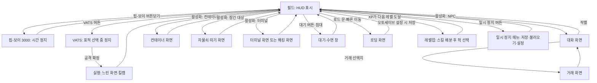

# RD-18. UI/UX

> **폴아웃 3 역기획서 세트** | 문서 ID: RD-18 | 버전: v1.0 | 작성일: 2026-10-11
> **범위**: HUD, 핍-보이 3000의 메뉴 구조(STATS/ITEMS/DATA)와 각 화면의 정보·조작, VATS 화면, 대화·거래·컨테이너·레벨업·퍽 선택·수리 화면, 자물쇠 따기·해킹·터미널 화면, 로딩 화면, 메인 메뉴·설정·세이브, 카메라와 조작 체계, 피드백(효과음·화면 효과), 엔딩 슬라이드 화면. / **다루지 않는 것**: 각 시스템의 판정 규칙과 수치(탐험·상호작용 → RD-17, 전투·VATS 수치 → RD-16, 능력치·퍽 → RD-14, 가격 → RD-22), 엔딩 조건(→ RD-04), 아트 디렉션·음악(→ RD-25).
> **관련 문서**: (작성 중)

---

## 1. 문서 개요

### 1.1 목적
- 폴아웃 3(Fallout 3)의 화면 구성과 조작 흐름을 **화면 단위로 해부**해, 쯔꾸르 팬게임의 메뉴 씬·HUD·창(Window) 설계에 바로 옮길 수 있게 정리함.
- 핵심 대상은 손목 단말 **핍-보이(Pip-Boy) 3000**임. 원작 UI의 정체성 대부분이 '게임 속 물건으로서의 메뉴(다이제틱 UI)'에서 나오기 때문임.

### 1.2 3~5줄 요약
- 화면은 ① 항상 보이는 **HUD**(나침반·HP·AP·탄약·은신 표시·알림), ② 게임 속 장치인 **핍-보이·터미널·자물쇠 클로즈업**, ③ 플레이를 멈추고 띄우는 **모달 화면**(대화·거래·레벨업·VATS·메시지 박스·일시 정지 메뉴·로딩 화면) 세 층으로 나뉨.
- 핍-보이는 STATS·ITEMS·DATA 3개 탭과 각 5개 하위 탭(총 15화면)으로 캐릭터·인벤토리·지도·퀘스트·노트·라디오를 모두 담으며, 열어 둔 동안 게임 시간이 멈춤.
- 모든 판정은 숫자로 투명하게 보여 줌: VATS 부위별 명중률(최대 95%), 대화의 `[Speech XX%]`, 자물쇠·터미널의 등급, 아이템의 CND·DAM·DR·WG·VAL.
- 화면 디자인은 1970~80년대 단색 CRT 단말(애플 II 계열)을 본뜬 **텍스트 위주·1비트 볼트 보이(Vault Boy) 아이콘** 체계이며, 화면 색은 호박·파랑·초록·흰색 중 고를 수 있음(기본 초록).

### 1.3 표기 메모
- 용어는 [RD-26 용어집](26_glossary.md)과 리드의 한글 패치 표기 지침(2026-10-11)을 따름. 화면 위 원문 문자열(메뉴명·표시 문구)은 영어 원문 그대로 적고 필요하면 번역을 덧붙임.
- 코퍼스(Nukapedia 2026-08-30 덤프)에 근거가 없는 화면 배치·조작 세부는 `(코퍼스 미확인)`으로 표시함. 폴아웃 3 매뉴얼은 코퍼스에 본문이 없어(표지·PDF 링크만 수록) 조작 체계 일부는 일반 지식에 의존함.
- 각 시스템의 판정 규칙은 다른 문서가 정본이며, 이 문서는 '화면에 무엇이 어떻게 보이는가'만 다룸.

## 2. UI 체계 개관

### 2.1 화면 계층
| 계층 | 화면 | 특징 |
|---|---|---|
| 월드(HUD) | 나침반, HP·AP 바, 탄약, 은신 표시, 방사능 계기, 알림, 조준점·상호작용 문구, 자막 | 플레이 중 항상 표시. 최소한의 정보만 노출 |
| 다이제틱 장치 | 핍-보이 3000, 터미널, 자물쇠 클로즈업, 라디오·홀로테이프 재생 | 게임 속 물건이 곧 메뉴. 팔을 들어 올리는 애니메이션, 단말 화면 출력 연출 |
| 모달 | 대화, 거래, 컨테이너, 소매치기, 레벨업·퍽 선택, VATS, 메시지 박스, 대기 창, 일시 정지 메뉴, 로딩 화면, 유전자 투사기(캐릭터 외형 편집) | 입력을 독점하는 창. 대부분 시간을 멈추거나 늦춤 |

### 2.2 화면 전환 흐름

### 2.3 화면별 시간·저장 규칙
| 화면 | 게임 시간 | 저장 | 근거·비고 |
|---|---|---|---|
| 핍-보이 3000 | **정지** | **불가** | 핍-보이는 사실상 '일시 정지 화면' 역할. 열어 둔 채로는 저장할 수 없음 |
| VATS 표적 선택 | 정지 | – | 표적·부위 선택 중에는 실시간 전투가 멈춤 |
| VATS 실행 | **느려짐**(완전히 멈추지 않음) | – | 표적이 엄폐물 뒤로 움직이거나 아군이 움직여 오사가 날 수 있음 |
| 대화·거래·컨테이너 | (코퍼스 미확인) | – | – |
| 대기·수면 | 빠르게 흐름 | – | 적 근처·무단 침입·낙하·수영·피폭·대화 중에는 열 수 없음([RD-17](17_exploration-interaction.md)) |
| 로딩 화면 | – | 오토세이브 | 로드 문 통과 시 자동 저장(설정에 따름, 12장) |
| 일시 정지 메뉴 | 정지 | 가능 | 난이도 변경, 핍-보이 화면 색 변경도 여기서 함 |

## 3. HUD

### 3.1 구성 요소
- 설정상 HUD 정보는 핍-보이의 동작 감지기·나침반 기능이 실시간으로 띄워 주는 것임(`Pip-Boy 3000` 노트: "the Pip-Boy appears to be equipped with a motion sensor and compass, as it feeds real-time directions via the HUD").
- 화면 위치는 코퍼스에 명시된 것만 확정으로 적고, 나머지는 `(코퍼스 미확인)`으로 표시함.

| 요소 | 위치 | 표시 내용 | 표시 조건 |
|---|---|---|---|
| 나침반(Compass) | 화면 아래 왼쪽, HP 바 아래 (코퍼스 미확인) | 방위, 주변 장소 아이콘(미발견은 빈 아이콘·발견은 채운 아이콘, 코퍼스 미확인), **퀘스트 마커(큰 채운 화살표)**, **사용자 마커(큰 빈 화살표)**, **적(붉은 막대)**, 우호 NPC 표식 | 항상. 적 막대가 뜨는 거리는 **인지력(Perception)**이 결정함 |
| HP 바 | 화면 아래 왼쪽 (코퍼스 미확인) | 현재 체력 비율 | 항상 |
| AP 바 | 화면 아래 오른쪽 (코퍼스 미확인) | 현재 행동력(AP). VATS 사용 후 시간에 따라 다시 참 | 항상 |
| 탄약 | AP 바 근처 (코퍼스 미확인) | 탄창 잔탄 / 보유 탄 | 원거리 무기 장착 시 |
| 은신 표시 | 화면 위쪽 중앙 (코퍼스 미확인) | `[HIDDEN]`(초록) / `[DETECTED]` / `[CAUTION]` / `[DANGER]`(빨강, 교전 직전엔 깜빡임) | 웅크렸을 때. 주변 대상 중 가장 나쁜 상태만 표시 |
| 방사능 계기(dosimeter) | **화면 오른쪽 위** | 바늘형 계기. 주요 눈금 200·400·600·800·1000라드, 보조 눈금 66.67 간격 | **피폭 중에만** 나타남 |
| 알림 | **화면 왼쪽 위** | 아이템 추가·제거(예: 뉴카-콜라 10개 제거, 퀀텀 1개 추가), 신호 발견("(방송국) signal found"), 퀘스트·장소·카르마·레벨업 알림 | 사건 발생 시 몇 초간 |
| 조준점·상호작용 문구 | 화면 중앙 | 바라보는 대상의 이름과 행동. 소유물은 **이름이 붉게** 표시, 잠긴 대상은 난이도, `[Needs Key]`, `[Empty]` 등 | 상호작용 가능한 대상을 볼 때 |
| 수류탄 경고 | 화면 가장자리 | 날아오는 수류탄의 방향을 **붉은 화살표**로 표시(함정으로 떨어지는 수류탄 부케는 표시 안 됨) | 적 수류탄 투척 시 |
| 적 정보 | 화면 아래 중앙 (코퍼스 미확인) | 조준한 대상의 이름·체력 바 | 적을 조준할 때 |
| 자막 | 화면 아래 | 대사 자막(설정으로 켜고 끔) | 대사·방송 |
| 오토세이브 알림 | (코퍼스 미확인) | 자동 저장 중 표시 | 로드 문 통과 등 |

### 3.2 나침반 상세
| 표식 | 의미 | 규칙 |
|---|---|---|
| 장소 아이콘 | 주변 지도 마커 | 장소 유형별 아이콘. DLC 일부 장소는 퀘스트 완료 후 나침반에서 사라짐(예: [TP] 라디오 송신탑) |
| 퀘스트 마커 | 활성 퀘스트의 목표 | 핍-보이 Quests에서 고른 퀘스트 1개만 표시 |
| 사용자 마커 | 지도에 직접 찍은 지점 | 1개 |
| 적 | 붉은 막대 | 시야보다 먼저 '감지'되기도 함. 적대 표시는 '적으로 분류된 대상'이며, 영역에 들어가기 전까지 실제로는 공격하지 않는 크리처도 붉게 뜸 |
| 우호 | 우호 NPC | 경기장 밖 해설자처럼 보이지 않는 인물도 표식으로는 잡힘 |
- 실내의 나침반 방위는 외부 방위와 일치하지 않는 경우가 있음(코퍼스 버그 기록). 쯔꾸르 이식 시 실내 맵은 방위를 고정 정의해야 함.

### 3.3 상황별 HUD 변화
| 상황 | 변화 |
|---|---|
| 평상시 | 나침반·HP·AP(·탄약) |
| 웅크림(은신) | 은신 상태 문구가 추가됨 |
| 교전 | 나침반에 붉은 막대가 늘고, 은신 문구가 [DANGER]로 바뀜. 수류탄 화살표 |
| 피폭 | 오른쪽 위에 방사능 계기가 나타남. 물 등을 바라보면 라드 수치가 표시됨(코퍼스에 PS3에서 이 표시가 'Strength1'로 잘못 나오는 버그 기록이 있어 존재가 확인됨) |
| 부상 | 머리 불구(뇌진탕) 시 화면이 주기적으로 흐려지고 귀울림 소리 |
| VATS | HUD가 VATS 표시(부위별 확률, AP 바, 표적 체력)로 바뀌고 화면이 흑백 계열로 바뀜(5장) |
| 대본 연출 | **HUD 없는 시네마틱**으로 전환(예: 시타델(The Citadel) 브리핑 장면) |
| 핍-보이·메뉴 | HUD 대신 해당 화면 |
| 시뮬레이션 | 트랜퀼리티 레인(Tranquility Lane)에서는 핍-보이를 열 수 없음 |

### 3.4 HUD 설계 특징
- **정보 최소화**: 화면에 상주하는 정보는 체력·행동력·탄약·방향뿐이며, 나머지는 사건이 있을 때만 잠깐 뜨는 알림으로 처리함.
- **나침반 = 레이더**: 미니맵 없이 1차원 나침반 막대 하나에 장소·목표·적·아군을 모두 겹쳐 표시함. 인지력이 레이더 범위가 되어 능력치가 UI 성능으로 체감됨.
- **상태의 '텍스트화'**: 은신 상태를 아이콘이 아닌 `[HIDDEN]` 같은 대괄호 문구로 보여 줌. 핍-보이·터미널과 같은 '단말 문법'을 HUD에도 씀.

## 4. 핍-보이 3000

(작성 중)

## 5. VATS 화면

(작성 중)

## 6. 대화 화면

(작성 중)

## 7. 거래·컨테이너 화면

(작성 중)

## 8. 레벨업·퍽 선택 화면

(작성 중)

## 9. 수리 화면

(작성 중)

## 10. 자물쇠 따기·해킹·터미널 화면

(작성 중)

## 11. 로딩 화면

(작성 중)

## 12. 메인 메뉴·일시 정지 메뉴·설정·세이브

(작성 중)

## 13. 카메라와 조작 체계

(작성 중)

## 14. 피드백: 효과음과 화면 효과

(작성 중)

## 15. 엔딩 슬라이드 화면

(작성 중)

## 16. UI 설계 분석

(작성 중)

## 17. 쯔꾸르 이식 메모

(작성 중)

## 18. 부록 – 출처

(작성 중)
