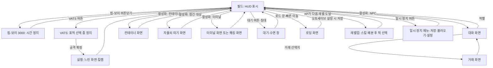
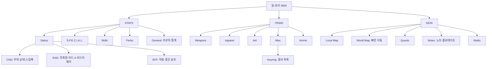
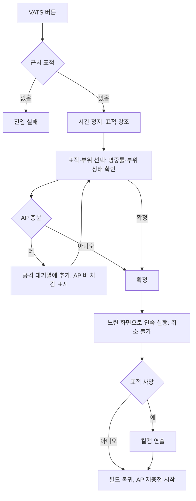

# RD-18. UI/UX

> **폴아웃 3 역기획서 세트** | 문서 ID: RD-18 | 버전: v1.0 | 작성일: 2026-10-11
> **범위**: HUD, 핍-보이 3000의 메뉴 구조(STATS/ITEMS/DATA)와 각 화면의 정보·조작, VATS 화면, 대화·거래·컨테이너·레벨업·퍽 선택·수리 화면, 자물쇠 따기·해킹·터미널 화면, 로딩 화면, 메인 메뉴·설정·세이브, 카메라와 조작 체계, 피드백(효과음·화면 효과), 엔딩 슬라이드 화면. / **다루지 않는 것**: 각 시스템의 판정 규칙과 수치(탐험·상호작용 → RD-17, 전투·VATS 수치 → RD-16, 능력치·퍽 → RD-14, 가격 → RD-22), 엔딩 조건(→ RD-04), 아트 디렉션·음악(→ RD-25).
> **관련 문서**: (작성 중)

---

## 1. 문서 개요

### 1.1 목적
- 폴아웃 3(Fallout 3)의 화면 구성과 조작 흐름을 **화면 단위로 해부**해, 쯔꾸르 팬게임의 메뉴 씬·HUD·창(Window) 설계에 바로 옮길 수 있게 정리함.
- 핵심 대상은 손목 단말 **핍-보이(Pip-Boy) 3000**임. 원작 UI의 정체성 대부분이 '게임 속 물건으로서의 메뉴(다이제틱 UI)'에서 나오기 때문임.

### 1.2 3~5줄 요약
- 화면은 ① 항상 보이는 **HUD**(나침반·HP·AP·탄약·은신 표시·알림), ② 게임 속 장치인 **핍-보이·터미널·자물쇠 클로즈업**, ③ 플레이를 멈추고 띄우는 **모달 화면**(대화·거래·레벨업·VATS·메시지 박스·일시 정지 메뉴·로딩 화면) 세 층으로 나뉨.
- 핍-보이는 STATS·ITEMS·DATA 3개 탭과 각 5개 하위 탭(총 15화면)으로 캐릭터·인벤토리·지도·퀘스트·노트·라디오를 모두 담으며, 열어 둔 동안 게임 시간이 멈춤.
- 모든 판정은 숫자로 투명하게 보여 줌: VATS 부위별 명중률(최대 95%), 대화의 `[Speech XX%]`, 자물쇠·터미널의 등급, 아이템의 CND·DAM·DR·WG·VAL.
- 화면 디자인은 1970~80년대 단색 CRT 단말(애플 II 계열)을 본뜬 **텍스트 위주·1비트 볼트 보이(Vault Boy) 아이콘** 체계이며, 화면 색은 호박·파랑·초록·흰색 중 고를 수 있음(기본 초록).

### 1.3 표기 메모
- 용어는 [RD-26 용어집](26_glossary.md)과 리드의 한글 패치 표기 지침(2026-10-11)을 따름. 화면 위 원문 문자열(메뉴명·표시 문구)은 영어 원문 그대로 적고 필요하면 번역을 덧붙임.
- 코퍼스(Nukapedia 2026-08-30 덤프)에 근거가 없는 화면 배치·조작 세부는 `(코퍼스 미확인)`으로 표시함. 폴아웃 3 매뉴얼은 코퍼스에 본문이 없어(표지·PDF 링크만 수록) 조작 체계 일부는 일반 지식에 의존함.
- 각 시스템의 판정 규칙은 다른 문서가 정본이며, 이 문서는 '화면에 무엇이 어떻게 보이는가'만 다룸.

## 2. UI 체계 개관

### 2.1 화면 계층
| 계층 | 화면 | 특징 |
|---|---|---|
| 월드(HUD) | 나침반, HP·AP 바, 탄약, 은신 표시, 방사능 계기, 알림, 조준점·상호작용 문구, 자막 | 플레이 중 항상 표시. 최소한의 정보만 노출 |
| 다이제틱 장치 | 핍-보이 3000, 터미널, 자물쇠 클로즈업, 라디오·홀로테이프 재생 | 게임 속 물건이 곧 메뉴. 팔을 들어 올리는 애니메이션, 단말 화면 출력 연출 |
| 모달 | 대화, 거래, 컨테이너, 소매치기, 레벨업·퍽 선택, VATS, 메시지 박스, 대기 창, 일시 정지 메뉴, 로딩 화면, 유전자 투사기(캐릭터 외형 편집) | 입력을 독점하는 창. 대부분 시간을 멈추거나 늦춤 |

### 2.2 화면 전환 흐름


### 2.3 화면별 시간·저장 규칙
| 화면 | 게임 시간 | 저장 | 근거·비고 |
|---|---|---|---|
| 핍-보이 3000 | **정지** | **불가** | 핍-보이는 사실상 '일시 정지 화면' 역할. 열어 둔 채로는 저장할 수 없음 |
| VATS 표적 선택 | 정지 | – | 표적·부위 선택 중에는 실시간 전투가 멈춤 |
| VATS 실행 | **느려짐**(완전히 멈추지 않음) | – | 표적이 엄폐물 뒤로 움직이거나 아군이 움직여 오사가 날 수 있음 |
| 대화·거래·컨테이너 | (코퍼스 미확인) | – | – |
| 대기·수면 | 빠르게 흐름 | – | 적 근처·무단 침입·낙하·수영·피폭·대화 중에는 열 수 없음([RD-17](17_exploration-interaction.md)) |
| 로딩 화면 | – | 오토세이브 | 로드 문 통과 시 자동 저장(설정에 따름, 12장) |
| 일시 정지 메뉴 | 정지 | 가능 | 난이도 변경, 핍-보이 화면 색 변경도 여기서 함 |

## 3. HUD

### 3.1 구성 요소
- 설정상 HUD 정보는 핍-보이의 동작 감지기·나침반 기능이 실시간으로 띄워 주는 것임(`Pip-Boy 3000` 노트: "the Pip-Boy appears to be equipped with a motion sensor and compass, as it feeds real-time directions via the HUD").
- 화면 위치는 코퍼스에 명시된 것만 확정으로 적고, 나머지는 `(코퍼스 미확인)`으로 표시함.

| 요소 | 위치 | 표시 내용 | 표시 조건 |
|---|---|---|---|
| 나침반(Compass) | 화면 아래 왼쪽, HP 바 아래 (코퍼스 미확인) | 방위, 주변 장소 아이콘(미발견은 빈 아이콘·발견은 채운 아이콘, 코퍼스 미확인), **퀘스트 마커(큰 채운 화살표)**, **사용자 마커(큰 빈 화살표)**, **적(붉은 막대)**, 우호 NPC 표식 | 항상. 적 막대가 뜨는 거리는 **인지력(Perception)**이 결정함 |
| HP 바 | 화면 아래 왼쪽 (코퍼스 미확인) | 현재 체력 비율 | 항상 |
| AP 바 | 화면 아래 오른쪽 (코퍼스 미확인) | 현재 행동력(AP). VATS 사용 후 시간에 따라 다시 참 | 항상 |
| 탄약 | AP 바 근처 (코퍼스 미확인) | 탄창 잔탄 / 보유 탄 | 원거리 무기 장착 시 |
| 은신 표시 | 화면 위쪽 중앙 (코퍼스 미확인) | `[HIDDEN]`(초록) / `[DETECTED]` / `[CAUTION]` / `[DANGER]`(빨강, 교전 직전엔 깜빡임) | 웅크렸을 때. 주변 대상 중 가장 나쁜 상태만 표시 |
| 방사능 계기(dosimeter) | **화면 오른쪽 위** | 바늘형 계기. 주요 눈금 200·400·600·800·1000라드, 보조 눈금 66.67 간격 | **피폭 중에만** 나타남 |
| 알림 | **화면 왼쪽 위** | 아이템 추가·제거(예: 뉴카-콜라 10개 제거, 퀀텀 1개 추가), 신호 발견("(방송국) signal found"), 퀘스트·장소·카르마·레벨업 알림 | 사건 발생 시 몇 초간 |
| 조준점·상호작용 문구 | 화면 중앙 | 바라보는 대상의 이름과 행동. 소유물은 **이름이 붉게** 표시, 잠긴 대상은 난이도, `[Needs Key]`, `[Empty]` 등 | 상호작용 가능한 대상을 볼 때 |
| 수류탄 경고 | 화면 가장자리 | 날아오는 수류탄의 방향을 **붉은 화살표**로 표시(함정으로 떨어지는 수류탄 부케는 표시 안 됨) | 적 수류탄 투척 시 |
| 적 정보 | 화면 아래 중앙 (코퍼스 미확인) | 조준한 대상의 이름·체력 바 | 적을 조준할 때 |
| 자막 | 화면 아래 | 대사 자막(설정으로 켜고 끔) | 대사·방송 |
| 오토세이브 알림 | (코퍼스 미확인) | 자동 저장 중 표시 | 로드 문 통과 등 |

### 3.2 나침반 상세
| 표식 | 의미 | 규칙 |
|---|---|---|
| 장소 아이콘 | 주변 지도 마커 | 장소 유형별 아이콘. DLC 일부 장소는 퀘스트 완료 후 나침반에서 사라짐(예: [TP] 라디오 송신탑) |
| 퀘스트 마커 | 활성 퀘스트의 목표 | 핍-보이 Quests에서 고른 퀘스트 1개만 표시 |
| 사용자 마커 | 지도에 직접 찍은 지점 | 1개 |
| 적 | 붉은 막대 | 시야보다 먼저 '감지'되기도 함. 적대 표시는 '적으로 분류된 대상'이며, 영역에 들어가기 전까지 실제로는 공격하지 않는 크리처도 붉게 뜸 |
| 우호 | 우호 NPC | 경기장 밖 해설자처럼 보이지 않는 인물도 표식으로는 잡힘 |
- 실내의 나침반 방위는 외부 방위와 일치하지 않는 경우가 있음(코퍼스 버그 기록). 쯔꾸르 이식 시 실내 맵은 방위를 고정 정의해야 함.

### 3.3 상황별 HUD 변화
| 상황 | 변화 |
|---|---|
| 평상시 | 나침반·HP·AP(·탄약) |
| 웅크림(은신) | 은신 상태 문구가 추가됨 |
| 교전 | 나침반에 붉은 막대가 늘고, 은신 문구가 [DANGER]로 바뀜. 수류탄 화살표 |
| 피폭 | 오른쪽 위에 방사능 계기가 나타남. 물 등을 바라보면 라드 수치가 표시됨(코퍼스에 PS3에서 이 표시가 'Strength1'로 잘못 나오는 버그 기록이 있어 존재가 확인됨) |
| 부상 | 머리 불구(뇌진탕) 시 화면이 주기적으로 흐려지고 귀울림 소리 |
| VATS | HUD가 VATS 표시(부위별 확률, AP 바, 표적 체력)로 바뀌고 화면이 흑백 계열로 바뀜(5장) |
| 대본 연출 | **HUD 없는 시네마틱**으로 전환(예: 시타델(The Citadel) 브리핑 장면) |
| 핍-보이·메뉴 | HUD 대신 해당 화면 |
| 시뮬레이션 | 트랜퀼리티 레인(Tranquility Lane)에서는 핍-보이를 열 수 없음 |

### 3.4 HUD 설계 특징
- **정보 최소화**: 화면에 상주하는 정보는 체력·행동력·탄약·방향뿐이며, 나머지는 사건이 있을 때만 잠깐 뜨는 알림으로 처리함.
- **나침반 = 레이더**: 미니맵 없이 1차원 나침반 막대 하나에 장소·목표·적·아군을 모두 겹쳐 표시함. 인지력이 레이더 범위가 되어 능력치가 UI 성능으로 체감됨.
- **상태의 '텍스트화'**: 은신 상태를 아이콘이 아닌 `[HIDDEN]` 같은 대괄호 문구로 보여 줌. 핍-보이·터미널과 같은 '단말 문법'을 HUD에도 씀.

## 4. 핍-보이 3000

### 4.1 장치와 기본 조작
| 항목 | 규칙 |
|---|---|
| 착용 | 왼쪽 팔뚝. 로브코 인더스트리(RobCo Industries) 제품 'PIP(Personal Information Processor)'. 주인공은 10살 생일에 오버시어(Overseer)에게서 받음 |
| 열기·닫기 | PC **Tab**, PS3 **○**, Xbox 360 **B**. 패치 1.1부터 VATS·핍-보이 버튼을 다시 지정할 수 있음(PC에서 다시 지정하면 '여는 키'만 바뀌고 닫는 키는 기본값으로 남는 버그) |
| 열 때 연출 | 팔이 올라오며 장치가 화면을 채움. **별도 모델이나 모드로 바꾸지 않고** 손목의 실물 화면을 그대로 들여다보는 방식 |
| 시간·저장 | 열어 둔 동안 **게임 시간 정지**, **저장 불가** |
| 라이트 | 버튼을 **길게** 누르면 화면을 과휘도 모드로 바꿔 주변을 비춤(360도 조명). 다시 길게 누르면 끔. 은신에 불리 |
| 화면 색 | **호박(amber)·파랑·초록·흰색** 4종, 기본 초록. 핍-보이가 아니라 **일시 정지 메뉴**에서 바꾸며, VATS와 UI 전체 색도 함께 바뀜. 3인칭 시점에서는 손목 화면이 항상 초록. 라이트 색은 바뀌지 않음 |
| 방사능 계기 | 화면 틀 왼쪽 위의 기계식 바늘. 어느 화면을 보든 피폭량을 한눈에 볼 수 있게 개발 후반에 추가됨 |
| 생동감 | 팔이 숨 쉬듯 미세하게 흔들리는 대기 애니메이션(커서를 쫓아다니지 않도록 아주 작게 조정) |
| 화면 효과 | 곡면 CRT에 메뉴를 투사하고, 주사선·약한 깜빡임·모드 전환 시 수직 동기 흔들림을 넣음. 화면 오른쪽 아래에 지문 자국 |
| 표시 한계 | 캡이 1,000,000 이상이면 핍-보이에 표시되지 않음(상인 거래 화면은 표시) |

### 4.2 메뉴 트리


### 4.3 공통 화면 구성
- 화면은 **상단 정보줄 + 하위 탭 목록 + 목록·상세** 구조임. 상세 영역에는 항목마다 1비트 **볼트 보이 그림**과 수치가 붙음(정확한 좌우 배치는 코퍼스 미확인).
- 개발 일지가 밝힌 문법: 겹치는 창 없음, 아이콘 최소화(볼트 보이 그림이 유일한 도상 요소), 텍스트와 숫자 위주, **대괄호로 영역을 나눔**, 작은 글꼴, 장식 없음, **단색 유지**(색으로 사용성 문제를 덮지 않음).

| 탭 | 상단 정보줄 |
|---|---|
| STATS | **LVL**(레벨) / **HP**(현재/최대) / **AP**(현재/최대) / **XP**(현재/다음 레벨 필요량) |
| ITEMS | **Wg**(현재 소지 무게/소지 한도) / **HP** / **DR**(방어구·퍽·약물 등을 합친 피해 저항) / **Caps**(캡) |
| DATA | **Location**(현재 위치) / **날짜·시각**(오른쪽 위, '월.일.연' 두 자리 형식) |

### 4.4 STATS 탭
| 하위 화면 | 표시 정보 | 조작 |
|---|---|---|
| Status > **CND** | 머리·몸통·양팔·양다리의 상태, 보유 스팀팩 수 | 스팀팩을 **불구가 된 특정 부위** 또는 몸 전체에 사용 |
| Status > **RAD** | 가이거 계수기로 잰 정밀 피폭량, 방사능 저항 | 라드-X·라드어웨이 사용 |
| Status > **EFF** | 착용 의복 효과, 방사능 단계 효과, 섭취한 약물 효과, 숙면 효과(Well Rested), 중독, 불구 부위 | 열람 |
| **S.P.E.C.I.A.L.** | 7개 능력치와 일시 증감(+/−) | 열람(능력치별 설명·볼트 보이 그림) |
| **Skills** | 13개 스킬과 증감(+/−) | 열람 |
| **Perks** | 보유 퍽 전체 | 열람 |
| **General** | 대략적인 카르마 수준(칭호)과 각종 행동 통계 | 열람 |

#### 4.4.1 General 통계 목록
| 통계 | 영문 | 증가 조건 |
|---|---|---|
| 완료한 퀘스트 | Quests Completed | 메인·사이드 퀘스트 1개 완료 |
| 발견한 장소 | Locations Discovered | 월드 맵 장소 1곳 발견(볼트 101 제외) |
| 죽인 사람 | People Killed | 인간·비야생 구울 1명 |
| 죽인 크리처 | Creatures Killed | 동물·곤충·야생 구울 1마리 |
| 딴 자물쇠 | Locks Picked | 자물쇠 1개 따기 성공 |
| 해킹한 컴퓨터 | Computers Hacked | 터미널 1개 해킹 성공 |
| 사용한 스팀팩 | Stimpaks Taken | 자신에게 스팀팩 1개 |
| 사용한 라드-X | Rad-X Taken | 자신에게 라드-X 1개 |
| 사용한 라드어웨이 | RadAway Taken | 자신에게 라드어웨이 1개 |
| 사용한 약물 | Chems Taken | 제트(울트라제트)·버프아웃·멘타츠 계열·메드-X·사이코·맥주·와인·위스키·스카치·보드카·[PL] 밀주·뉴카-콜라 퀀텀 1개 |
| 중독 횟수 | Times Addicted | 중독 1회 |
| 해제한 지뢰 | Mines Disarmed | 지뢰 1개 해제(직접 설치한 지뢰 제외) |
| 화술 성공 | Speech Successes | 화술 판정 1회 성공 |
| 소매치기 성공 | Pockets Picked | 소매치기 1회 성공 |
| 폭발한 바지 | Pants Exploded | 소매치기로 지뢰·수류탄 1개 심기 성공 |
| 읽은 책 | Books Read | 스킬북 1권 사용 |
| 모은 보블헤드 | Bobbleheads Collected | 보블헤드 1개 획득 |
| 만든 무기 | Weapons Forged | 제작 무기 1개 제작 |
| 최면 건 사람 | People Mezzed | 메즈메트론(Mesmetron)으로 1명 |
| 구출한 포로 | Captives Rescued | 슈퍼 뮤턴트에게 잡힌 포로 1명 |
| 샌드맨 처치 | Sandman Kills | 미스터 샌드맨(Mister Sandman) 퍽 처치 1회 |
| 마비 펀치 | Paralyzing Punches | 패럴라이징 팜(Paralyzing Palm) 적중 1회 |
| 정지시킨 로봇 | Robots Disabled | 로보틱스 엑스퍼트(Robotics Expert)로 1대 |
| 완수한 계약 | Contracts Completed | 컨트랙트 킬러(Contract Killer) 귀를 대니얼 리틀혼(Daniel Littlehorn)에게 1개 판매 |
| 먹은 시체 | Corpses Eaten | 커니벌(Cannibal) 퍽으로 1구 |
| 수수께끼 이방인 등장 | Mysterious Stranger Visits | 미스터리어스 스트레인저(Mysterious Stranger) 1회 |

- 로딩 화면이 이 통계를 무작위로 보여 주며([11장](#11-로딩-화면)), 일부 통계는 업적 조건(장소 100곳, 터미널 50개, 자물쇠 50개, 화술 50회 등)과 연결됨.

### 4.5 ITEMS 탭
| 하위 화면 | 내용 | 조작 |
|---|---|---|
| **Weapons** | 소지 무기 목록과 능력치 | 장착·해제, **수리**, 버리기, 단축키 지정 |
| **Apparel** | 의복·방어구 목록과 능력치 | 장착·해제, **수리**, 버리기, 단축키 지정 |
| **Aid** | 음식·의료품과 효과 | 사용, 버리기, 단축키 지정 |
| **Misc** | 그 밖의 아이템. 맨 위에 **열쇠고리(Keyring)** | 열쇠고리를 고르면 모은 열쇠·키카드·접근 코드 목록. 열쇠는 버리거나 팔 수 없음 |
| **Ammo** | 탄 종류와 수량 | 열람(탄 종류 순환은 후속작 기능) |

| 상세 필드 | 영문 | 의미 |
|---|---|---|
| 내구도 | CND | 얼마나 낡았는지(막대) |
| 피해 | DAM | 무기 피해(내구도·스킬로 보정되는 대략값) |
| 피해 저항 | DR | 방어구가 더하는 피해 저항 |
| 무게 | WG | 소지 시 늘어나는 무게 |
| 가치 | VAL | 판매 기준 가치 |
| 탄약 | (라벨 없음) | 무기 화면에서 장전 탄 종류와 '탄창/보유' 수량 |
| 효과 | EFFECTS | 장착 시 추가 효과(예: 능력치 보너스) |

#### 4.5.1 단축키(Hot Key)
| 항목 | 규칙 |
|---|---|
| 칸 수 | **8칸** |
| 지정 | PC: 숫자 키 1~8을 누른 채 핍-보이에서 아이템을 왼쪽 클릭 / 컨트롤러: 오른쪽 범퍼(RB/R1)를 누른 채 D-패드 8방향 중 하나 선택 |
| 사용 | 핍-보이를 닫은 상태에서 해당 키를 누르면 즉시 장착·사용 |
| 목록 보기 | 해당 키를 길게 누르면 현재 단축키 배정 전체가 표시됨 |
| 대상 | 무기·의복·Aid 아이템 등 |

### 4.6 DATA 탭
| 하위 화면 | 표시 정보 | 조작 |
|---|---|---|
| **Local Map** | 현재 지역의 상세 지도. **이미 탐험한 영역만** 드러남. 출입문 표식 | 사용자 마커 배치, 퀘스트 마커 확인 |
| **World Map** | 발견한 장소 마커(새로 발견하면 자동 추가), 익스플로러 퍽으로 공개된 장소, 퀘스트 마커, 사용자 마커, 동료(작은 빈 삼각형) | 발견한 마커를 골라 **빠른 이동**. 사용자 마커 배치(최대로 확대하면 배치가 안 되는 버그 기록이 있어 약간 축소해서 배치), 확대·축소. 장치 왼쪽의 작은 조작부로 지도를 움직인다는 설정 |
| **Quests** | 받은 퀘스트와 완료 기록 | 퀘스트를 고르면 **활성 퀘스트**가 되어 그 마커가 지역·월드 맵과 나침반에 표시됨. 비표시 퀘스트는 목록에 나오지 않음 |
| **Notes** | 수집한 노트·홀로테이프·비밀번호·이미지 노트 | 노트는 읽고 홀로테이프는 재생 |
| **Radio** | 수신 범위에 들어온 방송국·신호 목록 | 골라서 켜고 끔. 은신에 영향 없음 |

- 퀘스트 목표 표시 방식(완료 목표 표시, 선택 목표 표기 등)의 정확한 화면 문법은 코퍼스 미확인.
- 핍-보이는 터미널에서 파일(노트·지도)을 내려받을 수 있다는 설정임(DCTA 지하철 노선도 등).

## 5. VATS 화면

- V.A.T.S.(Vault-Tec Assisted Targeting System, 볼트-텍 보조 조준 시스템)의 명중률 공식·AP 비용·피해 규칙은 [RD-16 전투 시스템](16_combat-system.md)이 정본이며, 여기서는 화면 구성만 다룸. 볼트 101에서 10살 생일에 BB건을 받으며 처음 소개됨.

### 5.1 화면 구성
| 요소 | 표시 내용 | 규칙 |
|---|---|---|
| 표적 강조 | 선택 가능한 적을 강조, 표적 전환 | 근처 표적이 있으면 VATS 진입과 동시에 그 표적을 잡음 |
| 부위 목록 | 인간형은 **머리·몸통·왼팔·오른팔·든 무기·왼다리·오른다리** 7곳. 비인간형은 고유 부위(로봇의 전투 억제기, 개미 더듬이 등) | 근접·비무장·폭발물 무기는 부위를 고를 수 없고 몸 전체가 강조됨 |
| 부위별 명중률 | 각 부위의 명중 확률(%) | 거리·노출 정도·전투 스킬로 결정. **최대 95%**(엔진 `fVATSMaxChance`). 확률이 높다고 피해가 커지지는 않음 |
| 부위 상태 막대 | 표적 각 부위의 내구 | **막대가 비면 불구** |
| 표적 체력 | 표적 전체 체력 막대 | |
| 예상 피해 | 현재 무기로 1회 공격 시 피해 | 전투 스킬이 100일 때의 **최대 비치명 피해**를 보여 줌. 스킬이 낮으면 실제 피해는 더 작고, 치명타(기습 치명타 포함)면 더 클 수 있음 |
| AP 바 | 남은 AP와 대기열이 쓸 AP | VATS는 **대기열(queue) 방식**: 같은 부위·다른 부위·여러 표적에 공격을 쌓은 뒤 한꺼번에 실행 |
| 실행 | 확정하면 시네마틱 카메라로 느리게 연속 실행 | **확정 후에는 취소 불가**(표적이 죽거나 파괴될 때만 중단). 시간은 완전히 멈추지 않고 느려지기만 함 |
| 킬캠 | 마지막 일격을 느린 화면·근접 카메라로 연출 | 설정의 '시네마틱 킬' 옵션과 연관(코퍼스에 'cinematic kills on' 언급) |

### 5.2 연출과 부가 조작
| 항목 | 내용 |
|---|---|
| 화면 효과 | 흑백 계열 필터(드물게 VATS를 나온 뒤에도 흑백이 남는 버그 기록으로 확인) |
| 카메라 | 표적을 클로즈업. 카메라가 물체 뒤에 끼지 않도록 전용 알고리즘을 만들 만큼 공을 들였고, 시스템 완성이 출시 직전까지 걸렸다는 개발자 발언(이슈트반 펠리(Istvan Pely)) |
| 줌 아웃 | PC에서 VATS 버튼을 계속 누르고 있으면 1인칭 시야로 물러나 표적 강조를 유지한 채 전체 배치를 볼 수 있음 |
| VATS 스캔 | VATS 버튼을 연타(콘솔은 길게)하면 보이지 않던 적(은신한 적, 먼 적)의 위치를 알아낼 수 있음 |
| 조준 보조 | AP가 없어도 VATS로 표적을 고른 뒤 조준 버튼을 누른 채 나가면 그 표적에 조준이 맞춰진 상태가 됨 |
| 근접 순간 이동 | 근접·비무장 공격은 대상 근처로 순간 이동하듯 접근 |
| 받는 피해 | VATS 실행 중 플레이어가 받는 피해는 평소의 10% |
| 공중 표적 | 날아오는 수류탄도 표적으로 지정해 공중에서 터뜨릴 수 있음 |
| 지뢰 | 지뢰는 VATS에서 항상 0% |



## 6. 대화 화면

- 대화의 데이터 구조·판정 공식·특수 선택지 목록은 [RD-17 9장](17_exploration-interaction.md#9-대화-시스템)이 정본임.

### 6.1 화면 구성
| 요소 | 내용 | 비고 |
|---|---|---|
| 카메라 | 대화 상대에게 시점이 고정·확대됨 | 배치 세부는 코퍼스 미확인 |
| NPC 대사 | 음성 + 자막. 응답마다 감정(분노·공포·놀람·슬픔·행복·중립)과 강도가 지정되어 표정 연출에 쓰임 | 자막은 설정으로 켜고 끔 |
| 선택지 목록 | 플레이어가 말할 문장 목록. 고르면 그 문장이 곧 주인공의 말이 됨(주인공은 음성 없음, 코퍼스 미확인·일반 지식) | 목록 위치는 코퍼스 미확인 |
| 판정 태그 | 문장 앞 대괄호. 화술은 `[Speech XX%]`로 **성공 확률을 직접 표시**. 능력치·스킬·퍽·카르마 판정은 `[Intelligence]` `[Medicine]` `[Lady Killer]` `[Karma]`처럼 확률 없이 이름만 표시 | `Fallout 3 gameplay`: "판정이 걸린 선택지는 문장 옆에 성공 확률을 표시한다" |
| 실패 처리 | 화술 판정에 실패하면 NPC가 실패 응답을 하고 그 선택지는 다시 나오지 않음 | |
| 종료 | '작별'류 선택지 또는 NPC가 대화를 끝냄 | |

### 6.2 표기 예시
- 아래는 아버지의 발자취(Following in His Footsteps)에서 콜린 모리아티(Colin Moriarty)와 대화할 때의 선택지를 한글 패치 번역으로 재구성한 예임(실제 표시 순서·동시 노출 여부는 상황별로 다르며, 확률 숫자는 예시로 비움).

```
모리아티: (응답 자막)
  [Speech XX%] 농담이야! 아버지는 항상 당신 얘기를 하셨어. 자, 이제, 우리 아버지는 어디 계신...
  이봐. 난 단지 우리 아버지를 찾고싶을 뿐이야. 어디 있는지 알아?
  거두절미하고. 아버지의 소재를 알려주는 데 얼마면 되겠어?
  아버지가 어딨는지 불어. 모리아티! 안 그러면 힘을 써서라도 강제로 뱉어내게 할 테니!
```
- 같은 퀘스트에서 돈을 거절하고 다시 오면 300캡으로 오르는 흐름이 선택지에 그대로 드러남: "300캡? 뭐가 이래? 전에 당신이 100캡이라고 했잖아!"(한글 패치, `MegMoriartyChoice4a`).
- 화술 판정 선택지의 원문에는 `<Lie.>` 같은 연출 메모가 붙은 경우가 있음(위키 대화 데이터 표기).

### 6.3 표기 규칙 정리
| 태그 형식 | 표시 내용 | 예 |
|---|---|---|
| `[Speech 25%]` | 화술 판정과 성공 확률 | 대부분의 설득·흥정 |
| `[Karma]` | 카르마 판정(확률 없음) | [BS] 그리폰(Griffon) |
| `[Strength]`·`[Perception]`·`[Charisma]`·`[Intelligence]` 등 | 능력치 조건 선택지 | 아가사(Agatha)에게 `[Intelligence]` |
| `[Medicine]`·`[Science]`·`[Small Guns]`·`[Repair]`·`[Barter]` 등 | 스킬 조건 선택지 | 이니시에이트 펙(Initiate Pek)에게 `[Small Guns]` |
| `[Black Widow]`·`[Lady Killer]`·`[Child at Heart]` 등 | 퍽 조건 선택지 | 노바(Nova)에게 `[Lady Killer]` |

- 퍽·능력치 태그는 조건을 충족하면 자동 성공하는 '보상 선택지'라서, 플레이어에게 **어떤 빌드가 대화를 여는지** 바로 알려 주는 학습 장치 역할을 함.

### 6.4 대화에서 이어지는 화면
| 선택지 | 열리는 화면 |
|---|---|
| 상인의 '거래' | 거래 화면(7장). 닫을 때 상인이 마무리 대사(BarterExit 토픽) |
| 의사의 '치료' | 치료 결과 적용(가격·서비스는 [RD-22](22_economy-housing.md)) |
| 수리공의 '수리' | 수리 화면(9장) |
| 동료의 장비 교환 | 동료 인벤토리 화면(거래 화면과 같은 2단 구성). 임시 동료 중에는 레드·쇼티·스티키만 이 선택지가 있음 |
| 머리 손질·외모 변경 | 유전자 투사기(Gene projector) 계열 편집 화면(볼트 101 출구, 레이저그래프터) |

## 7. 거래·컨테이너 화면

### 7.1 공통 구조
- 거래·컨테이너·소매치기·동료 장비 교환은 모두 **'내 인벤토리 ↔ 상대 인벤토리' 2단 구성**의 같은 화면 계열임. 항목 상세에는 핍-보이와 같은 필드(CND·DAM·DR·WG·VAL·EFFECTS)가 붙음(배치 세부는 코퍼스 미확인).
- 상단·하단에는 양쪽의 캡(거래), 소지 무게 등 판단에 필요한 수치가 함께 나옴(코퍼스 미확인).

### 7.2 거래 화면
| 요소 | 규칙 |
|---|---|
| 진입 | 상인 대화의 거래 선택지 |
| 가격 표시 | 아이템 가치에 물물교환(Barter) 스킬 보정을 적용한 사고팔 값. 공식은 [RD-22](22_economy-housing.md)(판매가 = 가치 × (0.45 + 물물교환/100 × 0.45) × 보정, 구매가 = 가치 × (1.55 − 물물교환/100 × 0.45) × 보정) |
| 거래 성립 | 양쪽에서 고른 물건과 캡 차액을 맞춘 뒤 확정 |
| 상인 캡 | 상인이 가진 캡을 넘는 판매는 불가([RD-22](22_economy-housing.md)) |
| 장물 | 그 상점에서 훔친 물건은 그 상점에 되팔 수 없음(인벤토리에서 사라지지는 않음). 다른 상점에는 팔 수 있음 |
| 표시 한계 | 핍-보이는 캡 1,000,000 이상을 표시하지 못하지만 거래 화면은 표시함 |
| 종료 | 상인이 BarterExit 대사로 마무리 |

### 7.3 컨테이너 화면
| 요소 | 규칙 |
|---|---|
| 진입 | 컨테이너·시체 '활성화'. 잠겨 있으면 자물쇠 화면 또는 열쇠 자동 사용 |
| 표시 | 내 인벤토리와 컨테이너 내용. 빈 컨테이너는 조준 단계에서 `[Empty]` 표시 |
| 소유물 | 소유 컨테이너는 조준 시 이름이 붉게 표시되고, 꺼내면 절도로 처리. 카르마 감점은 **열 때마다 1회**(같은 창에서 여러 개를 꺼내도 1회) |
| 무해 행동 | 열어 보기만 하고 닫으면 범죄 아님 |
| 넣어 두기 | 플레이어가 넣은 물건은 리스폰 컨테이너에서는 사라질 수 있음. 안전 컨테이너 기준은 [RD-17 12장](17_exploration-interaction.md#12-컨테이너전리품열쇠문) |
| 응용 화면 | 록잇 런처(Rock-It Launcher)의 '탄약 장전' 창도 인벤토리와 비슷한 선택 창으로 잡동사니를 고름 |

### 7.4 소매치기 화면
| 요소 | 규칙 |
|---|---|
| 진입 | 은신 + [HIDDEN] 상태에서 NPC 활성화 |
| 표시 | 내 인벤토리와 대상 인벤토리. 대상이 **장착 중인 장비는 훔칠 수 없음** |
| 판정 | 아이템을 옮길 때마다 성공률 판정(공식은 [RD-17 7장](17_exploration-interaction.md#7-소매치기역소매치기)). 실패하면 대상이 가져간 물건을 되찾음(창이 즉시 닫히는 연출은 코퍼스 미확인) |
| 폭발물 | 폭발물을 넣으면 'Live' 상태로 표시되고 창을 닫는 순간 기폭 연출 시작 |
| 수면 대상 | 미스터 샌드맨 보유 시 '살해 / 소매치기' 선택 메시지 박스가 먼저 뜸 |

## 8. 레벨업·퍽 선택 화면

(작성 중)

## 9. 수리 화면

(작성 중)

## 10. 자물쇠 따기·해킹·터미널 화면

(작성 중)

## 11. 로딩 화면

(작성 중)

## 12. 메인 메뉴·일시 정지 메뉴·설정·세이브

(작성 중)

## 13. 카메라와 조작 체계

(작성 중)

## 14. 피드백: 효과음과 화면 효과

(작성 중)

## 15. 엔딩 슬라이드 화면

(작성 중)

## 16. UI 설계 분석

(작성 중)

## 17. 쯔꾸르 이식 메모

(작성 중)

## 18. 부록 – 출처

(작성 중)
