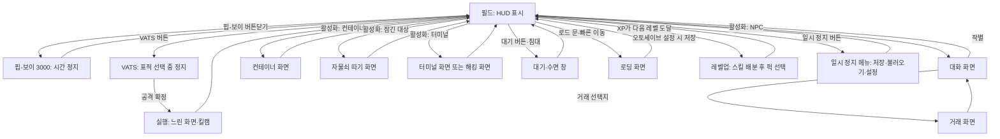

# RD-18. UI/UX

> **폴아웃 3 역기획서 세트** | 문서 ID: RD-18 | 버전: v1.0 | 작성일: 2026-10-11
> **범위**: HUD, 핍-보이 3000의 메뉴 구조(STATS/ITEMS/DATA)와 각 화면의 정보·조작, VATS 화면, 대화·거래·컨테이너·레벨업·퍽 선택·수리 화면, 자물쇠 따기·해킹·터미널 화면, 로딩 화면, 메인 메뉴·설정·세이브, 카메라와 조작 체계, 피드백(효과음·화면 효과), 엔딩 슬라이드 화면. / **다루지 않는 것**: 각 시스템의 판정 규칙과 수치(탐험·상호작용 → RD-17, 전투·VATS 수치 → RD-16, 능력치·퍽 → RD-14, 가격 → RD-22), 엔딩 조건(→ RD-04), 아트 디렉션·음악(→ RD-25).
> **관련 문서**: (작성 중)

---

## 1. 문서 개요

### 1.1 목적
- 폴아웃 3(Fallout 3)의 화면 구성과 조작 흐름을 **화면 단위로 해부**해, 쯔꾸르 팬게임의 메뉴 씬·HUD·창(Window) 설계에 바로 옮길 수 있게 정리함.
- 핵심 대상은 손목 단말 **핍-보이(Pip-Boy) 3000**임. 원작 UI의 정체성 대부분이 '게임 속 물건으로서의 메뉴(다이제틱 UI)'에서 나오기 때문임.

### 1.2 3~5줄 요약
- 화면은 ① 항상 보이는 **HUD**(나침반·HP·AP·탄약·은신 표시·알림), ② 게임 속 장치인 **핍-보이·터미널·자물쇠 클로즈업**, ③ 플레이를 멈추고 띄우는 **모달 화면**(대화·거래·레벨업·VATS·메시지 박스·일시 정지 메뉴·로딩 화면) 세 층으로 나뉨.
- 핍-보이는 STATS·ITEMS·DATA 3개 탭과 각 5개 하위 탭(총 15화면)으로 캐릭터·인벤토리·지도·퀘스트·노트·라디오를 모두 담으며, 열어 둔 동안 게임 시간이 멈춤.
- 모든 판정은 숫자로 투명하게 보여 줌: VATS 부위별 명중률(최대 95%), 대화의 `[Speech XX%]`, 자물쇠·터미널의 등급, 아이템의 CND·DAM·DR·WG·VAL.
- 화면 디자인은 1970~80년대 단색 CRT 단말(애플 II 계열)을 본뜬 **텍스트 위주·1비트 볼트 보이(Vault Boy) 아이콘** 체계이며, 화면 색은 호박·파랑·초록·흰색 중 고를 수 있음(기본 초록).

### 1.3 표기 메모
- 용어는 [RD-26 용어집](26_glossary.md)과 리드의 한글 패치 표기 지침(2026-10-11)을 따름. 화면 위 원문 문자열(메뉴명·표시 문구)은 영어 원문 그대로 적고 필요하면 번역을 덧붙임.
- 코퍼스(Nukapedia 2026-08-30 덤프)에 근거가 없는 화면 배치·조작 세부는 `(코퍼스 미확인)`으로 표시함. 폴아웃 3 매뉴얼은 코퍼스에 본문이 없어(표지·PDF 링크만 수록) 조작 체계 일부는 일반 지식에 의존함.
- 각 시스템의 판정 규칙은 다른 문서가 정본이며, 이 문서는 '화면에 무엇이 어떻게 보이는가'만 다룸.

## 2. UI 체계 개관

### 2.1 화면 계층
| 계층 | 화면 | 특징 |
|---|---|---|
| 월드(HUD) | 나침반, HP·AP 바, 탄약, 은신 표시, 방사능 계기, 알림, 조준점·상호작용 문구, 자막 | 플레이 중 항상 표시. 최소한의 정보만 노출 |
| 다이제틱 장치 | 핍-보이 3000, 터미널, 자물쇠 클로즈업, 라디오·홀로테이프 재생 | 게임 속 물건이 곧 메뉴. 팔을 들어 올리는 애니메이션, 단말 화면 출력 연출 |
| 모달 | 대화, 거래, 컨테이너, 소매치기, 레벨업·퍽 선택, VATS, 메시지 박스, 대기 창, 일시 정지 메뉴, 로딩 화면, 유전자 투사기(캐릭터 외형 편집) | 입력을 독점하는 창. 대부분 시간을 멈추거나 늦춤 |

### 2.2 화면 전환 흐름

### 2.3 화면별 시간·저장 규칙
| 화면 | 게임 시간 | 저장 | 근거·비고 |
|---|---|---|---|
| 핍-보이 3000 | **정지** | **불가** | 핍-보이는 사실상 '일시 정지 화면' 역할. 열어 둔 채로는 저장할 수 없음 |
| VATS 표적 선택 | 정지 | – | 표적·부위 선택 중에는 실시간 전투가 멈춤 |
| VATS 실행 | **느려짐**(완전히 멈추지 않음) | – | 표적이 엄폐물 뒤로 움직이거나 아군이 움직여 오사가 날 수 있음 |
| 대화·거래·컨테이너 | (코퍼스 미확인) | – | – |
| 대기·수면 | 빠르게 흐름 | – | 적 근처·무단 침입·낙하·수영·피폭·대화 중에는 열 수 없음([RD-17](17_exploration-interaction.md)) |
| 로딩 화면 | – | 오토세이브 | 로드 문 통과 시 자동 저장(설정에 따름, 12장) |
| 일시 정지 메뉴 | 정지 | 가능 | 난이도 변경, 핍-보이 화면 색 변경도 여기서 함 |

## 3. HUD

(작성 중)

## 4. 핍-보이 3000

(작성 중)

## 5. VATS 화면

(작성 중)

## 6. 대화 화면

(작성 중)

## 7. 거래·컨테이너 화면

(작성 중)

## 8. 레벨업·퍽 선택 화면

(작성 중)

## 9. 수리 화면

(작성 중)

## 10. 자물쇠 따기·해킹·터미널 화면

(작성 중)

## 11. 로딩 화면

(작성 중)

## 12. 메인 메뉴·일시 정지 메뉴·설정·세이브

(작성 중)

## 13. 카메라와 조작 체계

(작성 중)

## 14. 피드백: 효과음과 화면 효과

(작성 중)

## 15. 엔딩 슬라이드 화면

(작성 중)

## 16. UI 설계 분석

(작성 중)

## 17. 쯔꾸르 이식 메모

(작성 중)

## 18. 부록 – 출처

(작성 중)
