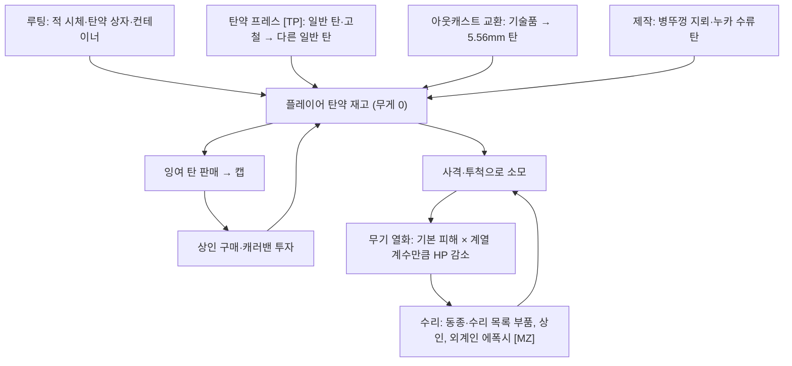
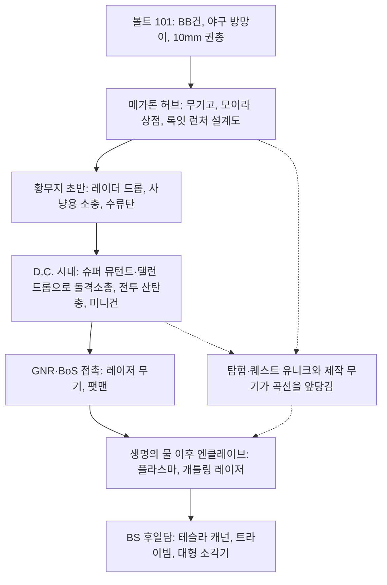

# RD-19. 무기·탄약

> **폴아웃 3 역기획서 세트** | 문서 ID: RD-19 | 버전: v1.0 | 작성일: 2026-10-11
> **범위**: 플레이어가 쓸 수 있는 무기 전체(본편 + DLC 5종, 일반·유니크·제작·투척·지뢰)의 정본 카탈로그, 탄약 전 종류, 수리 호환 그룹, 비플레이어(적·동료 전용) 무기 요약, 무기 진행 곡선 분석. **다루지 않는 것**: 피해·명중·치명타 공식의 상세(RD-16), 퍽 상세(RD-14), 제작 레시피 상세와 재료 아이템(RD-21), 상인 재고·수리 서비스 가격(RD-22), 적 개체의 무기 운용(RD-24), 방어구(RD-20)
> **관련 문서**: [RD-14 캐릭터 시스템](14_character-system.md), [RD-16 전투 시스템](16_combat-system.md), [RD-20 방어구·의복](20_armor-apparel.md), [RD-21 소모품·잡화·제작](21_consumables-misc-crafting.md), [RD-22 경제·주거](22_economy-housing.md), [RD-23 수집 요소·업적](23_collectibles-achievements.md), [RD-24 크리처·적 도감](24_bestiary.md), [RD-08a~e DLC 문서](08a_dlc-operation-anchorage.md)

---

## 1. 문서 개요

### 1.1 목적
- 팬게임의 무기 데이터베이스와 전투 밸런스를 설계할 때 근거로 쓸 **원작 무기 정본 카탈로그**를 만든다.
- 무기 하나하나의 수치뿐 아니라 계열 구성, 유니크 보상, 탄약 경제, 수리 호환이 어떻게 맞물려 '무기 진행 곡선'을 만드는지 분석한다.

### 1.2 범위
- **포함**: 플레이어가 장비할 수 있는 무기 전부(본편 + [OA]·[TP]·[BS]·[PL]·[MZ]). 일반·유니크·제작·투척·지뢰, 맨주먹, 시뮬레이션 전용 판본까지 넣는다. 탄약 전 종류, 수리 목록(수리 호환 그룹), 비플레이어 무기 요약, 삭제(미사용) 무기 요약도 다룬다.
- **제외**: 피해·명중·치명타 공식의 세부(→ [RD-16](16_combat-system.md)), 퍽 세부(→ [RD-14](14_character-system.md)), 제작 재료 아이템과 레시피 세부(→ [RD-21](21_consumables-misc-crafting.md)), 상인 재고·수리 서비스·가격 공식(→ [RD-22](22_economy-housing.md)), 적의 무기 운용(→ [RD-24](24_bestiary.md)).

### 1.3 요약
- 플레이어용 무기는 **139종**이다(허브 표 기준. 맨주먹 1, 트랭퀼리티 레인 전용 밀대 1 포함). 6개 스킬 계열(소형 화기 34 / 중화기 17 / 에너지 무기 24 / 폭발물 11 / 근접 무기 44 / 비무장 9)로 나뉘고, 이 가운데 **유니크 68종**, **DLC 무기 45종**이다.
- 탄약은 **19종**이며 모두 무게가 0이다(폴아웃 3에는 하드코어 모드가 없다). 여기에 록잇 런처가 쓰는 잡동사니와 삭제된 '주괴(Ingots)'가 따로 있다.
- 무기 간 수리 호환은 GECK의 **수리 목록 57개**가 정한다. 유니크·DLC 변형 상당수는 '수리는 받지만 부품은 못 되는' 비대칭 구조다.
- 제작 무기는 **7종**이다. 설계도 1~3장에 따라 제작 직후 상태(75/100/125% × 수리 스킬, 최대 100%)나 1회 제작 수량이 달라진다.
- 진행 곡선은 '10mm 권총·나이프 → 돌격소총·전투 산탄총·레이저 → 플라스마·개틀링·팻맨·유니크' 순으로 오르며, 상위 무기일수록 **탄약 희소성과 내구도 유지 비용**이 브레이크 역할을 한다.

### 1.4 표기 메모
- **자료원**: Nukapedia 2026-08-30 덤프. `Fallout 3 weapons` 허브 표(GECK 값)를 기본값으로 쓰고, 각 무기 문서의 정보상자 값을 스크립트로 추출해 158행을 대조했다. 대조 결과 실제 불일치는 6건이다(부록 A).
- **불일치 처리 규칙**: 정보상자·본문 비교표·본문 서술·허브의 다른 칼럼(가치/무게 비율, 내구도 역산) 가운데 **둘 이상이 일치하는 값**을 채택한다. 채택한 값에는 `※`를 붙이고 원래 허브 값은 부록 A에 남긴다.
- **기호**: `★` 유니크, `[OA]` 오퍼레이션: 앵커리지, `[TP]` 더 피트, `[BS]` 브로큰 스틸, `[PL]` 포인트 룩아웃, `[MZ]` 마더십 제타.
- **지속 피해 표기**: `화염 2/초(5초)`는 초당 2 피해가 5초 동안 들어간다는 뜻이다(독·전기도 같은 방식). `55 (6.1×9)`는 탄환 9개가 각각 6.1씩, 합계 55라는 뜻이다.
- **무기 한국어명**: 용어집(RD-26)에 있는 이름은 그대로 쓴다. 나머지는 일반 명사는 번역하고, 고유명·말장난 이름은 음차하거나 뜻을 살려 옮겼다(신규 용어로 보고).

## 2. 무기 시스템 구조

### 2.1 계열 체계

| 계열(스킬) | 하위 분류 | 수량(유니크) | 대표 무기 | 연동 퍽(정확도·피해) | 계열 정체성 |
|---|---|---|---|---|---|
| 소형 화기(Small Guns) | 권총 12 / 소총 15 / 산탄총 5 / 기관단총 2 | 34(16) | 10mm 권총, 사냥용 소총, 돌격소총, 전투 산탄총, 저격소총 | 건슬링어(Gunslinger, 한 손 무기 VATS 명중), 코만도(Commando, 두 손 소총 VATS 명중 +25%) | 탄약이 가장 흔하고 수리 부품이 많은 '기본 화기'. 저격(치명 배수 x5)부터 근거리 산탄까지 폭이 넓다 |
| 중화기(Big Guns) | 직사형 12 / 범위형 5 | 17(9) | 미니건, 개틀링 레이저, 화염방사기, 미사일 발사기, 팻맨 | 파이로매니악(Pyromaniac, 화염 +50%) | 무겁고(8~30) AP가 크며 탄약이 비싸다. 치명타가 거의 없거나 불가능한 대신 지속 화력·범위 피해로 해결한다 |
| 에너지 무기(Energy Weapons) | 권총 14 / 소총 10 | 24(15) | 레이저 권총·소총, 플라스마 권총·소총, 외계인 블래스터 | 건슬링어·코만도(테슬라 캐넌 제외), 제노테크 엑스퍼트(Xenotech Expert, [MZ] 외계 무기 +20%) | 후반 진입 신호. 치명타로 분해(재)·젤리화 연출, 높은 HP. 수리 부품과 전지가 귀하다 |
| 폭발물(Explosives) | 투척 6 / 설치(지뢰) 5 | 11(0) | 파편 수류탄·지뢰, 플라스마 수류탄, 병뚜껑 지뢰, 누카 수류탄 | 데몰리션 엑스퍼트(Demolition Expert, 3랭크 +20/40/60%) | 소모형 1회용. 범위 피해와 EMP·빙결 같은 상태 효과 담당 |
| 근접 무기(Melee Weapons) | 날붙이 26 / 둔기 18 | 44(24) | 나이프, 전투 나이프, 중국군 장교도, 슈퍼 슬레지, 시시케밥 | 오토 액서트(Auto Axpert, [TP] 자동 도끼류 +25%), 파이로매니악(시시케밥) | 탄약이 필요 없다. VATS 피해 2배, 힘(ST)에 비례하는 근접 피해 보너스. 유니크 비중이 가장 크다 |
| 비무장(Unarmed) | 너클·건틀릿·파워 피스트 | 9(4) | 황동 너클, 파워 피스트, 데스클로 건틀릿 | 아이언 피스트(Iron Fist, 3랭크 각 비무장 피해 +5), 패럴라이징 팜(Paralyzing Palm) | 맨주먹 피해 = 비무장 피해(비무장 스킬 의존). 데스클로 건틀릿은 DR을 무시한다 |

- 공통 피해 보정: 블러디 메스(Bloody Mess, 전 무기 +5%), 구울 생태학(Ghoul Ecology, 구울 상대 +5)이 거의 모든 무기 정보상자에 연동돼 있다.
- 건슬링어 적용 대상: 권총류 전부, 기관단총, 소드오프 산탄총. 코만도 적용 대상: 소총, 소드오프를 뺀 산탄총, 테슬라 캐넌을 뺀 에너지 소총(허브 각주).
- 퍽 수치와 조건의 정본은 [RD-14](14_character-system.md)다.

### 2.2 수치 정의 (카탈로그 칼럼 사전)

| 칼럼 | 정의 | 비고 |
|---|---|---|
| 피해 | 방아쇠 1회(근접은 1타)의 기본 피해. 산탄류는 탄환 합계와 `탄당×수`를 함께 적는다 | 스킬 100, 상태 100% 기준. 폭발·지속 피해는 `+`로 덧붙인다 |
| DPS | 초당 최대 피해 = 피해 × 발사 속도. 1발마다 재장전하는 무기는 재장전 시간을 포함한다 | 허브 표 값. ※는 정보상자 기준으로 다시 계산한 값 |
| AP | VATS 1회 공격에 드는 행동력(AP) | 맨주먹은 22 |
| 발사·공격 속도 | 초당 최대 공격 횟수(재장전 제외) | |
| 치명타(배수 / 피해) | 치명 배수 = 캐릭터 치명타 확률에 곱하는 값. 치명 피해 = 치명타 때 **더해지는** 피해 | 자동화기는 GECK 배수를 발사 속도로 나눠 탄당 배수로 쓴다(예: 돌격소총 x1 → 탄당 x0.125). 기습 치명타는 치명 피해 2배 |
| 탄창 | 장전 1회의 탄수. `24 (8)`은 '24발 장전, 1회 3발 소모라 실사격 8회'라는 뜻 | 근접·비무장·폭발물은 `–` |
| 무게 / 가격 | 소지 무게와 기본 가치(캡) | 판매가는 물물교환 스킬에 따라 달라진다(→ RD-22) |
| 내구도 | `사용 횟수 / HP`. 사용 횟수 = 상태 100%에서 부서질 때까지의 공격 횟수 | 2.3절 공식으로 HP에서 역산된다 |

### 2.3 내구도·수리 규칙 요약
- **열화량**: 공격 1회마다 '기본 피해 × 계열 계수'만큼 아이템 HP가 줄어든다. 계수는 소형 화기 3%, 에너지 무기 4%, 근접·비무장 5%, 중화기 6%다.
  - 예: 10mm 권총은 HP 150 ÷ (9 × 0.03) ≈ 556회, 플라스마 소총은 900 ÷ (45 × 0.04) = 500회.
  - 그래서 **피해가 큰 무기일수록 빨리 닳는다**. 저격소총은 83회, 미사일 발사기는 83회, 실험용 MIRV는 63회다.
- **상태가 성능에 주는 영향**(세부 공식 → [RD-16](16_combat-system.md)): 피해는 상태 0%에서 원거리 약 66%, 근접 50%까지 선형으로 떨어진다. 치명타 확률은 '기본 × 상태'가 된다. 자동화기는 연사 속도도 계단식으로 떨어진다. 총기는 상태 50% 이하부터 재장전 때 탄 걸림이 생긴다.
- **수리**: 같은 무기나 같은 수리 목록의 무기를 하나 소모해 상태를 올린다(6절). 플레이어가 수리할 수 있는 최대 상태는 `40 + 3 × (수리 스킬 ÷ 5)`%이고, 수리 100이면 100%다. 수리 상인 NPC는 각자 정해진 수리 스킬 상한까지 고쳐 준다(→ [RD-22](22_economy-housing.md)).
- **외계인 에폭시(Alien epoxy)** [MZ]: 무게 0, 가격 25의 소모품. 장착 중인 무기를 수리 스킬 구간에 따라 +15%(0~24) / +20%(25~49) / +25%(50~74) / +30%(75~100) 회복하며, 최대 100%까지 올릴 수 있다. 같은 무기를 구하기 어려운 제타 전용 수리 수단이다.
- **시뮬레이션 규칙** [OA]: 앵커리지 시뮬레이션 안의 무기·방어구는 HP가 극단적으로 높아 닳지 않는다. 탄약은 탄약 디스펜서에서 보충하며, 시체 루팅이 안 된다. 시뮬레이션 전용 판본은 밖으로 가져갈 수 없다.

### 2.4 유니크·특수 판본 규칙
- **유니크**: 게임 세계에 하나만 있는 무기다. 대부분 기반 무기와 외형이 같고 수치만 강화된 '이름 붙은 개체'다. 단독 유니크(기반 없음)는 메스메트론, 기피제 막대, 가우스 소총 3종뿐이다.
- **보상 경로**: 퀘스트 보상, 고정 위치 탐험(잠금·금고 포함), 이름 있는 NPC 처치나 소매치기, 상점 구매·퍽 대화, 랜덤 인카운터(파이어랜스)가 있다. 분석은 8.4절.
- **판본 대체**: [BS]를 설치하면 오텀 대령의 레이저 권총이 자동 사격판에서 반자동판으로 바뀐다(폼 ID 같음).
- **시뮬레이션 전용**: 트랭퀼리티 레인의 슬래셔 나이프와 밀대(시뮬레이션), 앵커리지 시뮬레이션판 무기들(6절 수리 표의 '시뮬레이션판')은 퀘스트 종료 때 회수된다.
- **부가 속성**: 소음(소음 10mm 권총, 다트 건, BB건, 인필트레이터, 퍼포레이터)은 사격해도 탐지가 오르지 않는다. 조준경(조준경 .44 매그넘 계열, 저격소총 계열, 인필트레이터·퍼포레이터, 가우스 소총)은 확대 조준이 된다.
- **NPC 전용판**: 동료 기본 무기와 NPC 고유 무기는 플레이어용과 수치가 다르다(7절).

### 2.5 수량 요약

| 계열 | 전체 | 일반 | 유니크 | DLC 무기 | 제작 가능 |
|---|---|---|---|---|---|
| 소형 화기 | 34 | 18 | 16 | 8 | 2(다트 건, 레일웨이 라이플) |
| 중화기 | 17 | 8 | 9 | 6 | 1(록잇 런처) |
| 에너지 무기 | 24 | 9 | 15 | 12 | 0 |
| 폭발물 | 11 | 11 | 0 | 3 | 2(병뚜껑 지뢰, 누카 수류탄) |
| 근접 무기 | 44 | 20 | 24 | 15 | 1(시시케밥) |
| 비무장 | 9 | 5 | 4 | 1 | 1(데스클로 건틀릿) |
| **합계** | **139** | **71** | **68** | **45** | **7** |

- '일반'에는 맨주먹, '유니크'에는 시뮬레이션 전용 밀대가 들어 있다. 삭제 무기(3.7절)와 비플레이어 무기(7절)는 세지 않았다.
- DLC 무기 45종을 나누면 [OA] 3, [TP] 9, [BS] 8(오텀 대령 레이저 권총 대체판 포함), [PL] 11, [MZ] 14다.

## 3. 무기 카탈로그 (정본)

- 이 절의 표 13개가 폴아웃 3 플레이어 무기의 정본 데이터다. 행 순서는 허브 표를 따르며, 유니크는 기반 무기 바로 아래에 둔다.
- 칼럼 정의는 2.2절에 있다. 수치는 스킬 100, 상태 100% 기준의 기본값이다(퍽·난이도·상태 보정 전).
- `수리 호환 무기`는 **이 무기를 수리할 때 부품으로 쓸 수 있는 다른 플레이어 무기**다. 같은 무기는 언제나 부품이 되므로 적지 않았다. 동료·NPC·시뮬레이션 판본까지 포함한 전체 목록은 6절에 있다.
- `비고`의 유니크 차이는 기반 무기 대비 바뀐 수치만 `기반→유니크` 형식으로 적었다(속도 = 발사·공격 속도, 내구 = 사용 횟수).
- 획득처는 대표적인 곳 몇 군데만 적었다. 전체 위치는 [RD-13 장소 카탈로그](13_location-catalog.md)와 [RD-23 수집 요소](23_collectibles-achievements.md)를 함께 본다.

### 3.1 소형 화기(Small Guns)

#### 3.1.1 권총

| 영문명 | 한국어 표기 | 스킬 | 피해 | DPS | AP | 발사·공격 속도(/초) | 치명타(배수 / 피해) | 탄창 | 무게 | 가격 | 내구도(사용 횟수 / HP) | 탄약 | 수리 호환 무기 | 획득처(대표) | 비고 |
|---|---|---|---|---|---|---|---|---|---|---|---|---|---|---|---|
| .32 pistol | .32 권총 | 소형 화기 | 6 | 18 | 20 | 3 | x1 / 6 | 5 | 2 | 110 | 556회 / HP 100 | .32 구경탄 | 동일 무기만 | 빅 타운 플래시·타임밤 소지, 메가톤 제니 스탈 소지, 주 방위군 보급창 벙커 선반 | 초반 권총 |
| Wild Bill's Sidearm | ★와일드 빌의 권총 | 소형 화기 | 10 | 30 | 20 | 3 | x1 / 15 | 5 | 2 | 250 | 833회 / HP 250 | .32 구경탄 | .32 권총 | 피트 제철소, 베르너의 은신처 근처 와일드 빌 시체 | [TP] ★유니크(기반: .32 권총). 피해 6→10, 치명 피해 6→15, 내구 556→833, 가격 110→250. VATS 밖에서 연사 빠름 |
| 10mm pistol | 10mm 권총 | 소형 화기 | 9 | 54 | 17 | 6 | x1 / 9 | 12 | 3 | 225 | 556회 / HP 150 | 10mm 탄 | 소음 10mm 권총, 오텀 대령의 10mm 권총 | 탈출!(Escape!) 중 아마타가 건넴(100% 상태), 볼트 101 경비원, 레이더·황무지인 다수 | 게임 최초의 실총 |
| Colonel Autumn's 10mm pistol | ★오텀 대령의 10mm 권총 | 소형 화기 | 13 | 78 | 17 | 6 | x1 / 13 | 12 | 3 | 325 | 577회 / HP 225 | 10mm 탄 | 10mm 권총, 소음 10mm 권총 | 생명의 물(The Waters of Life) 중 오텀 대령 소지 | ★유니크(기반: 10mm 권총). 피해 9→13, 치명 피해 9→13, 내구 556→577, 가격 225→325. 항상 100% 상태로 입수 |
| Silenced 10mm pistol | 소음 10mm 권총 | 소형 화기 | 8 | 48 | 21 | 6 | x2 / 5 | 12 | 3 | 250 | 333회 / HP 80 | 10mm 탄 | 10mm 권총, 오텀 대령의 10mm 권총 | 저먼타운 경찰 본부 무기고, 미스터 버크 처치(메가톤), 플랙 앤 슈래프넬·모이라 판매 | 소음. 사격해도 탐지 확률이 오르지 않음 |
| Chinese pistol | 중국제 권총 | 소형 화기 | 4 | 24 | 17 | 6 | x1 / 4 | 10 | 2 | 190 | 1250회 / HP 150 | 10mm 탄 | 주룽 v418 중국제 권총 | 저레벨 레이더, 상인 다수, 데이브 박물관(절도) | 피해 최저급·내구 높음 |
| Zhu-Rong v418 Chinese pistol | ★주룽 v418 중국제 권총 | 소형 화기 | 4 + 화염 2/초(5초) | 20 | 17 | 4.5 | x2 / 4 | 10 | 2 | 290 | 1667회 / HP 200 | 10mm 탄 | 중국제 권총 | L.O.B. 엔터프라이즈 CEO 사무실 진열장(매우 어려움 잠금 문, 열쇠는 책상) | ★유니크(기반: 중국제 권총). 피해 4→4 + 화염 2/초(5초), 속도 6→4.5, 치명 배수 x1→x2, 내구 1250→1667, 가격 190→290. |
| Dart gun | 다트 건 | 소형 화기 | 6 + 독 8/초(8초) | 44 | 25 | 6 | x2.5 / 12 | 1 | 3 | 500 | 883회 / HP 150 | 다트 | 동일 무기만 | 제작 전용(설계도 3장) | 소음. 명중 시 양다리 불구(-1000), 독 중첩 |
| Scoped .44 Magnum | 조준경 .44 매그넘 | 소형 화기 | 35 | 78.8 | 32 | 2.25 | x2 / 35 | 6 | 4 | 300 | 229회 / HP 240 | .44 매그넘탄 | 블랙호크, 캘러핸의 매그넘 | 켈러 가족 기록 5번 천막 옆 트럭, 메리골드역 해골, 리벳 시티 부서진 선수 구역, 미스터 크롤리·율로지 존스 소지 | 조준경. – |
| Blackhawk | ★블랙호크 | 소형 화기 | 55 | 123.8 | 32 | 2.25 | x2 / 45 | 6 | 4 | 500 | 218회 / HP 360 | .44 매그넘탄 | 조준경 .44 매그넘, 캘러핸의 매그넘 | 애거사의 노래(Agatha's Song) 보상(“살 수 있는 건 뭐든” 선택지) | 조준경. ★유니크(기반: 조준경 .44 매그넘). 피해 35→55, 치명 피해 35→45, 내구 229→218, 가격 300→500. 조준 사격 시 반동 없음 |
| Callahan's Magnum | ★캘러핸의 매그넘 | 소형 화기 | 65 | 146.3 | 25 | 2.25 | x2 / 50 | 6 | 4 | 750 | 205회 / HP 400 | .44 매그넘탄 | 조준경 .44 매그넘, 블랙호크 | 용기 있는 자가 이긴다(Who Dares Wins)에서 시타델 파괴 선택 시 폐허의 어려움 잠금 금고 | 조준경. [BS] ★유니크(기반: 조준경 .44 매그넘). 피해 35→65, 치명 피해 35→50, AP 32→25, 내구 229→205, 가격 300→750. 소형 화기 권총 중 최강 |
| Paulson's revolver | ★폴슨의 리볼버 | 소형 화기 | 45 (5×9) | 101.3 | 32 | 2.25 | x2 / 315 (35×9) | 6 | 4 | 300 | 178회 / HP 240 | .44 매그넘탄 | 조준경 .44 매그넘, 블랙호크, 캘러핸의 매그넘 | 제타에서 폴슨 사망 시 시체 | [MZ] ★유니크(기반: 조준경 .44 매그넘). 피해 35→45 (5×9), 치명 피해 35→315 (35×9), 확산 0.3→3, 내구 229→178. 산탄형: 1발 9탄(5×9), 탄별 치명타 판정, 조준경 없음 |

#### 3.1.2 소총

| 영문명 | 한국어 표기 | 스킬 | 피해 | DPS | AP | 발사·공격 속도(/초) | 치명타(배수 / 피해) | 탄창 | 무게 | 가격 | 내구도(사용 횟수 / HP) | 탄약 | 수리 호환 무기 | 획득처(대표) | 비고 |
|---|---|---|---|---|---|---|---|---|---|---|---|---|---|---|---|
| Assault rifle | 돌격소총 | 소형 화기 | 8 | 64 | 23 | 8 | x1(탄당 x0.125) / 8 | 24 | 7 | 300 | 1250회 / HP 300 | 5.56mm 탄 | 동일 무기만 | 텐페니 타워 경비원·구스타보 판매(텐페니 타워 퀘스트 중 무상 지급), 플랙 앤 슈래프넬, 스프링베일 학교 광산 터널 | 자동 |
| Infiltrator | 인필트레이터 | 소형 화기 | 7 | 56 | 23 | 8 | x1(탄당 x0.125) / 10 | 24 | 7 | 400 | 1429회 / HP 300 | 5.56mm 탄 | 돌격소총 | 피트 다운타운 입구의 멕스 일당, 홀의 마지막 상대 그루버 소지 | 소음·조준경. [TP] 비유니크 |
| Perforator | ★퍼포레이터 | 소형 화기 | 10 | 60 | 27 | 6 | x2(탄당 x0.33) / 14 | 24 | 7 | 600 | 1000회 / HP 300 | 5.56mm 탄 | 돌격소총 | 밀 워커(Mill Worker): 강철 주괴 90개 반납 보상 | 소음·조준경. [TP] ★유니크(기반: 인필트레이터). 피해 7→10, 속도 8→6, 치명 배수 x0.125→x0.33, 치명 피해 10→14, AP 23→27, 확산 1.5→0.5, 내구 1429→1000, 가격 400→600. |
| BB gun | BB건 | 소형 화기 | 4 | 3 | 28 | 0.8 | x1 / 4 | 100 | 2 | 36 | 417회 / HP 50 | BB탄 | 동일 무기만 | 탈출! 중 자기 방(BB탄 50), 빅 타운 킴바 소지, VAPL-58 발전소 지붕 | 소음. 최약 화기 |
| Chinese assault rifle | 중국제 돌격소총 | 소형 화기 | 11 | 88 | 23 | 8 | x1(탄당 x0.125) / 10 | 24 | 7 | 500 | 1212회 / HP 400 | 5.56mm 탄 | 쉬안룽 돌격소총 | 루커스 심스 소지·메가톤 무기고(절도), 중반 이후 탤런 컴퍼니·레귤레이터, 메트로 센트럴 4정 | 자동 |
| Xuanlong assault rifle | ★쉬안룽 돌격소총 | 소형 화기 | 12 | 96 | 23 | 8 | x1(탄당 x0.125) / 12 | 36 | 7 | 400 | 1111회 / HP 400 | 5.56mm 탄 | 중국제 돌격소총 | 주리 스트리트 지하철역 근처 식당의 프라임 시체(비표시 퀘스트 지그스의 전리품(Jiggs' Loot) 완료 후 출현) | ★유니크(기반: 중국제 돌격소총). 피해 11→12, 치명 피해 10→12, 탄창 24→36, 내구 1212→1111, 가격 500→400. 자동화기 중 기본 피해 최고 |
| Hunting rifle | 사냥용 소총 | 소형 화기 | 25 | 18.75 | 25 | 0.75 | x1 / 25 | 5 | 6 | 150 | 667회 / HP 500 | .32 구경탄 | 올 페인리스 | 볼트 101 서쪽 헛간 2층(초반), 그레이디치 빈집, 루커스 심스 집(절도) | – |
| Ol' Painless | ★올 페인리스 | 소형 화기 | 30 | 33.75 | 23 | 1.12 | x1 / 30 | 5 | 6 | 250 | 556회 / HP 500 | .32 구경탄 | 사냥용 소총 | 데이브 공화국 의사당 데이브 사무실 금고(데이브의 특별 열쇠) | ★유니크(기반: 사냥용 소총). 피해 25→30, 속도 0.75→1.12, 치명 피해 25→30, AP 25→23, 확산 0.3→0, 내구 667→556, 가격 150→250. |
| Lever-action rifle | 레버액션 소총 | 소형 화기 | 40 | 30 | 30 | 0.75 | x5 / 40 | 10 | 8 | 200 | 250회 / HP 300 | 10mm 탄 | 동일 무기만 | 헤일리·마담 파나다 판매, 늪지 주민·부족민 소지 | [PL] 10mm 탄 사용 소총 |
| Backwater rifle | ★백워터 소총 | 소형 화기 | 45 | 33.75 | 30 | 0.75 | x5 / 45 | 10 | 7 | 250 | 519회 / HP 700 | 10mm 탄 | 레버액션 소총 | 벨벳 커튼(The Velvet Curtain) 중 중국 정보 벙커 선반 | [PL] ★유니크(기반: 레버액션 소총). 피해 40→45, 치명 피해 40→45, 내구 250→519, 무게 8→7, 가격 200→250. 10mm 무기 중 피해 최고 |
| Lincoln's repeater | ★링컨의 연발총 | 소형 화기 | 50 | 37.5 | 25 | 0.75 | x2 / 50 | 15 | 5 | 500 | 400회 / HP 600 | .44 매그넘탄 | 사냥용 소총, 올 페인리스 | 역사 박물관 사무실 구역 진열장(매우 쉬움 잠금 문 너머) | ★유니크(기반: 레버액션 소총). 피해 40→50, 치명 배수 x5→x2, 치명 피해 40→50, AP 30→25, 탄창 10→15, 확산 0.25→0, 내구 250→400, 무게 8→5, 가격 200→500. 유일한 .44 소총. 사냥용 소총으로 수리되나 부품으로는 못 씀 |
| Railway rifle | 레일웨이 라이플 | 소형 화기 | 30 | 60 | 24 | 2.0 | x3 / 30 | 8 | 9 | 200 | 222회 / HP 200 | 철도 못 | 동일 무기만 | 제작(설계도 3장), 라즐로 래드퍼드(랜덤 인카운터) 소지 | 부위 피해 ×3, 사살 시 사지·머리를 벽에 고정 |
| Sniper rifle | 저격소총 | 소형 화기 | 40 | 42.85 | 38 | 1.07 | x5 / 40 | 5 | 10 | 300 | 83회 / HP 100 | .308 구경탄 | 예비군의 소총, 빅토리 소총 | 메가톤 남쪽 속 빈 바위, 베데스다 폐허 레이더, 알링턴 도서관 뒤 탤런 정찰 캠프(리스폰) | 조준경. 내구 최저급 |
| Reservist's rifle | ★예비군의 소총 | 소형 화기 | 40 | 64.28 | 32 | 1.61 | x5 / 40 | 3 | 10 | 500 | 125회 / HP 150 | .308 구경탄 | 저격소총, 빅토리 소총 | 디커슨 태버내클 예배당의 떠돌이(Drifter) 소지 | 조준경. ★유니크(기반: 저격소총). 속도 1.07→1.61, AP 38→32, 탄창 5→3, 내구 83→125, 가격 300→500. |
| Victory rifle | ★빅토리 소총 | 소형 화기 | 40 | 42.85 | 38 | 1.07 | x3 / 40 | 5 | 10 | 450 | 250회 / HP 300 | .308 구경탄 | 저격소총, 예비군의 소총 | 로크브레이커 주유소 서쪽 언덕 저격 오두막(매우 어려움 잠금 사물함) | 조준경. ★유니크(기반: 저격소총). 치명 배수 x5→x3, 내구 83→250, 가격 300→450. 치명타 시 2초 넘어뜨림 |

#### 3.1.3 산탄총

| 영문명 | 한국어 표기 | 스킬 | 피해 | DPS | AP | 발사·공격 속도(/초) | 치명타(배수 / 피해) | 탄창 | 무게 | 가격 | 내구도(사용 횟수 / HP) | 탄약 | 수리 호환 무기 | 획득처(대표) | 비고 |
|---|---|---|---|---|---|---|---|---|---|---|---|---|---|---|---|
| Combat shotgun | 전투 산탄총 | 소형 화기 | 55 (6.1×9) | 82.5 | 27 | 1.5 | x1 / 243 (27×9) | 12 | 7 | 200 | 145회 / HP 240 | 12게이지 산탄 | 끔찍한 산탄총 | 메가톤 무기고(절도), 디커슨 태버내클 예배당 해골 옆, 플랙 앤 슈래프넬 진열품(절도) | 1발 9탄 |
| The Terrible Shotgun | ★끔찍한 산탄총 | 소형 화기 | 80 (8.9×9) | 120 | 27 | 1.5 | x1 / 360 (40×9) | 12 | 10 | 250 | 146회 / HP 350 | 12게이지 산탄 | 전투 산탄총 | 에버그린 밀스 레이더 상인 스마일링 잭 소지 | ★유니크(기반: 전투 산탄총). 피해 55 (6.1×9)→80 (8.9×9), 치명 피해 243 (27×9)→360 (40×9), 확산 3→6, 내구 145→146, 무게 7→10, 가격 200→250. 확산 6(정밀도 낮음) |
| Double-barrel shotgun | 쌍열 산탄총 | 소형 화기 | 85 (9.4×9) | 191.3 | 35 | 2.25 | x1 / 270 (30×9) | 2 (1) | 6 | 175 | 118회 / HP 300 | 12게이지 산탄 | 동일 무기만 | 포인트 룩아웃 상인, 해군 모병소, 늪지 주민·부족민 | [PL] 1회 사격에 탄 2발 소모(실질 1발 장전) |
| Sawed-off shotgun | 소드오프 산탄총 | 소형 화기 | 50 (5.6×9) | 112.5 | 37 | 2.25 | x0 / 0 | 2 | 6 | 190 | 167회 / HP 250 | 12게이지 산탄 | 니캐퍼 | 레이더, 알링턴 도서관 아동 구역, 미스터 버크 집 선반 | 치명타 불가. 건슬링어 적용 |
| The Kneecapper | ★니캐퍼 | 소형 화기 | 75 (8.3×9) | 140.62 | 37 | 1.88 | x0 / 0 | 2 | 5 | 350 | 111회 / HP 250 | 12게이지 산탄 | 소드오프 산탄총 | 거더셰이드의 로널드 래런 소지 | ★유니크(기반: 소드오프 산탄총). 피해 50 (5.6×9)→75 (8.3×9), 속도 2.25→1.88, 확산 7→4, 내구 167→111, 무게 6→5, 가격 190→350. 치명타 불가 |

#### 3.1.4 기관단총

| 영문명 | 한국어 표기 | 스킬 | 피해 | DPS | AP | 발사·공격 속도(/초) | 치명타(배수 / 피해) | 탄창 | 무게 | 가격 | 내구도(사용 횟수 / HP) | 탄약 | 수리 호환 무기 | 획득처(대표) | 비고 |
|---|---|---|---|---|---|---|---|---|---|---|---|---|---|---|---|
| 10mm SMG | 10mm 기관단총 | 소형 화기 | 7 | 70 | 20 | 10 | x1(탄당 x0.1) / 7 | 30 | 5 | 330 | 1190회 / HP 250 | 10mm 탄 | 시드니의 10mm “울트라” 기관단총 | 리벳 시티 경비대, 노예상, 포트 콘스탄틴 폭탄 저장고(매우 어려움), 주 방위군 보급창 | 자동. 건슬링어 적용 |
| Sydney's 10mm "Ultra" SMG | ★시드니의 10mm “울트라” 기관단총 | 소형 화기 | 9 | 90 | 20 | 10 | x1(탄당 x0.1) / 9 | 50 | 5 | 430 | 926회 / HP 250 | 10mm 탄 | 10mm 기관단총 | 독립을 훔쳐라(Stealing Independence): 시드니 사망 시, 또는 완료 후 리틀 문빔 아버지의 쪽지 전달 | ★유니크(기반: 10mm 기관단총). 피해 7→9, 치명 피해 7→9, 탄창 30→50, 내구 1190→926, 가격 330→430. |

### 3.2 중화기(Big Guns)

#### 3.2.1 직사형

| 영문명 | 한국어 표기 | 스킬 | 피해 | DPS | AP | 발사·공격 속도(/초) | 치명타(배수 / 피해) | 탄창 | 무게 | 가격 | 내구도(사용 횟수 / HP) | 탄약 | 수리 호환 무기 | 획득처(대표) | 비고 |
|---|---|---|---|---|---|---|---|---|---|---|---|---|---|---|---|
| Drone cannon | 드론 캐넌 | 중화기 | 40 + 폭발 100 | 466.7 | 30 | 3.33 | x1 / 50 | 1 | 18 | 1999 | 417회 / HP 1000 | 외계인 동력 모듈 | 동일 무기만 | 가디언 드론 처치·팔 사격 후 노획 | [MZ] 약 3초 뒤 터지는 에너지구(폭발 100) |
| Drone cannon Ex-B | ★드론 캐넌 Ex-B | 중화기 | 40 + 폭발 100 | 466.7 | 30 | 3.33 | x1 / 50 | 1 | 18 | 1999 | 417회 / HP 1000 | 외계인 동력 모듈 | 드론 캐넌 | 무기 연구소(브라민 소환 구역)의 실험 드론 처치. 2정 입수 가능 | [MZ] ★유니크(기반: 드론 캐넌). 수치 동일. 포물선 탄도, 1회 도탄 |
| Flamer | 화염방사기 | 중화기 | 16 + 화염 2/초(5초) | 130 | 50 | 8 | x4(탄당 x0.5) / 1 + 화염 2/초(5초) | 60 | 15 | 500 | 208회 / HP 200 | 화염방사기 연료 | 번마스터, 래피드 토치 화염방사기, 슬로번 화염방사기 | 레이더 토처, 레이드 쉑·베데스다 폐허 리스폰 레이더, [OA] 아웃캐스트 전초기지 무기고 | 근거리 지속 화염 |
| Burnmaster | ★번마스터 | 중화기 | 24 + 화염 2/초(5초) | 194 | 50 | 8 | x4(탄당 x0.5) / 1 + 화염 2/초(5초) | 60 | 15 | 500 | 139회 / HP 200 | 화염방사기 연료 | 화염방사기, 래피드 토치 화염방사기, 슬로번 화염방사기 | 프랭클린 지하철 설비 구역 수중 통로 끝(방사성 폐기물 복도) | ★유니크(기반: 화염방사기). 피해 16 + 화염 2/초(5초)→24 + 화염 2/초(5초), 내구 208→139. |
| Rapid-torch flamer | ★래피드 토치 화염방사기 | 중화기 | 16 + 화염 2/초(5초) | 130 | 50 | 8 | x4(탄당 x0.5) / 1 + 화염 2/초(5초) | 60 | 15 | 500 | 208회 / HP 200 | 화염방사기 연료 | 화염방사기, 번마스터, 슬로번 화염방사기 | 애덤스 저장 시설 카운터 | [BS] ★유니크(기반: 화염방사기). 수치 동일. 점화 지연 없음(짧게 끊어 쏘기 가능) |
| Slo-burn flamer | ★슬로번 화염방사기 | 중화기 | 18 + 화염 8/초(5초) | 152 | 50 | 8 | x4(탄당 x0.5) / 1 + 화염 2/초(5초) | 60 | 15 | 500 | 185회 / HP 200 | 화염방사기 연료 | 화염방사기, 번마스터, 래피드 토치 화염방사기 | 용기 있는 자가 이긴다 중 이동 기지 크롤러 발사 플랫폼 상층 | [BS] ★유니크(기반: 화염방사기). 피해 16 + 화염 2/초(5초)→18 + 화염 8/초(5초), 내구 208→185. 1회 사격에 연료 3 소모 |
| Gatling laser | 개틀링 레이저 | 중화기 | 8 | 160 | 30 | 20 | x1(탄당 x0.05) / 6 | 240 | 18 | 2000 | 3125회 / HP 1500 | 전자 충전 팩 | 정밀 개틀링 레이저, 벤전스 | 엔클레이브·BoS·아웃캐스트 병사, 레이븐 록 탈출로 엔클레이브 상자(보호막 해제) | 자동 |
| Precision Gatling laser | ★정밀 개틀링 레이저 | 중화기 | 8 | 160 | 30 | 20 | x4(탄당 x0.2) / 6 | 240 | 18 | 3000 | 3125회 / HP 1500 | 전자 충전 팩 | 개틀링 레이저, 벤전스 | 용기 있는 자가 이긴다 중 이동 기지 크롤러 무기고 담당관 소지 | [BS] ★유니크(기반: 개틀링 레이저). 치명 배수 x0.05→x0.2, 가격 2000→3000. 게임 내 최고가 무기(3,000캡) |
| Vengeance | ★벤전스 | 중화기 | 11 | 220 | 30 | 20 | x1(탄당 x0.05) / 12 | 240 | 18 | 2400 | 3030회 / HP 2000 | 전자 충전 팩 | 개틀링 레이저, 정밀 개틀링 레이저 | 데스클로 보호구역 남동쪽 피 웅덩이 | ★유니크(기반: 개틀링 레이저). 피해 8→11, 치명 피해 6→12, 내구 3125→3030, 가격 2000→2400. 자동화기 DPS 최상위 |
| Minigun | 미니건 | 중화기 | 5 | 100 | 30 | 20 | x0 / 0 | 240 | 18 | 1000 | 3333회 / HP 1000 | 5mm 탄 | 유진 | 주 방위군 보급창 무기고, 휘턴 무기고(매우 어려움), 슈퍼 뮤턴트 브루트·BoS | 치명타 불가 |
| Eugene | ★유진 | 중화기 | 7 | 140 | 30 | 20 | x0 / 0 | 240 | 18 | 1500 | 3571회 / HP 1500 | 5mm 탄 | 미니건 | 라일리스 레인저스(Reilly's Rangers) 보상 선택, 또는 브릭 소매치기·처치 | ★유니크(기반: 미니건). 피해 5→7, 내구 3333→3571, 가격 1000→1500. |
| Rock-It Launcher | 록잇 런처 | 중화기 | 50 | 167 | 32 | 3.3 | x1 / 25 | N/A(1) | 8 | 200 | 100회 / HP 300 | 잡동사니 | 동일 무기만 | 제작 전용(설계도 4장 존재) | 잡동사니를 탄으로 발사, 탄 종류 무관 동일 피해, 플레이어 전용. 허브 탄창 N/A(정보상자 1) |

#### 3.2.2 범위형(폭발·투사)

| 영문명 | 한국어 표기 | 스킬 | 피해 | DPS | AP | 발사·공격 속도(/초) | 치명타(배수 / 피해) | 탄창 | 무게 | 가격 | 내구도(사용 횟수 / HP) | 탄약 | 수리 호환 무기 | 획득처(대표) | 비고 |
|---|---|---|---|---|---|---|---|---|---|---|---|---|---|---|---|
| Fat Man | 팻맨 | 중화기 | 10 + 폭발 1600 | 443.1 | 65 | 1.58 | 불가(x0) | 1 | 30 | 1000 | 167회 / HP 100 | 미니 누크 | 실험용 MIRV | 아버지의 발자취(Following in His Footsteps) 중 GNR 방송국 광장 BoS 시체(미니 누크 8발), 국회의사당 탤런 용병, 에버그린 밀스 주조장 잠긴 방 | 치명타 불가 |
| Experimental MIRV | ★실험용 MIRV | 중화기 | 80 (10×8) + 폭발 12800 | 3545 | 65 | 1.58 | 불가(x0) | 8 | 30 | 2498 | 63회 / HP 300 | 미니 누크 | 팻맨 | 주 방위군 보급창 무기고 벙커(비표시 퀘스트 켈러 가족 피난처(Keller Family Refuge) 완료 후) | ★유니크(기반: 팻맨). 피해 10 + 폭발 1600→80 (10×8) + 폭발 12800, 탄창 1→8, 확산 2.0→13.0, 내구 167→63, 가격 1000→2498. 미니 누크 8발 동시 발사. 8발 미만 소지 시 발사 불가 |
| Heavy incinerator | 대형 소각기 | 중화기 | 15 + 폭발 20 + 화염 8/초(5초) | 172 | 50 | 4 | x4(탄당 x1) / 5 | 24 | 15 | 500 | 222회 / HP 200 | 화염방사기 연료 | 동일 무기만 | 엔클레이브 헬파이어 트루퍼, 이동 기지 크롤러 발사 플랫폼 무기고 | [BS] 포물선 화염탄, 장거리. 정보상자는 피해 35·폭발 45·화염 8/초(5초)로 표기 |
| Missile launcher | 미사일 발사기 | 중화기 | 20 + 폭발 150 | 36 | 55 | 1.6 | 불가(x0) | 1 | 20 | 500 | 83회 / HP 100 | 미사일 | 미스 런처 | 워싱턴 기념탑 뒤(탄약 상자 동반), 휘턴 무기고 2정, 잡스코 사령관, 슈퍼 뮤턴트·탤런 중화기병 | – |
| Miss Launcher | ★미스 런처 | 중화기 | 20 + 폭발 200 | 47 | 55 | 1.58 | 불가(x0) | 1 | 15 | 400 | 83회 / HP 100 | 미사일 | 미사일 발사기 | 포트 인디펜던스 하층 무기 보관실 | ★유니크(기반: 미사일 발사기). 피해 20 + 폭발 150→20 + 폭발 200, 속도 1.6→1.58, 무게 20→15, 가격 500→400. 포물선(유탄식) 탄도 |

### 3.3 에너지 무기(Energy Weapons)

#### 3.3.1 에너지 권총

| 영문명 | 한국어 표기 | 스킬 | 피해 | DPS | AP | 발사·공격 속도(/초) | 치명타(배수 / 피해) | 탄창 | 무게 | 가격 | 내구도(사용 횟수 / HP) | 탄약 | 수리 호환 무기 | 획득처(대표) | 비고 |
|---|---|---|---|---|---|---|---|---|---|---|---|---|---|---|---|
| Alien atomizer | 외계인 원자화기 | 에너지 무기 | 35 | 105 | 20 | 3 | x1 / 40 | 20 | 2 | 500 | 714회 / HP 1000 | 외계인 동력 모듈 | 동일 무기만 | 일반 외계인 소지, 무기 연구소 5정 | [MZ] |
| Atomic pulverizer | ★원자 분쇄기 | 에너지 무기 | 37 | 111 | 12 | 3 | x2 / 40 | 20 | 2 | 500 | 676회 / HP 1000 | 외계인 동력 모듈 | 외계인 원자화기 | 무기 연구소 입구 근처 방(과학 75 단말기) | [MZ] ★유니크(기반: 외계인 원자화기). 피해 35→37, 치명 배수 x1→x2, AP 20→12, 내구 714→676. |
| Alien blaster | 외계인 블래스터 | 에너지 무기 | 100 | 300 | 20 | 3 | x100 / 100 | 10 | 2 | 500 | 125회 / HP 500 | 외계인 동력 전지 | 파이어랜스 | 외계인 추락 현장(외계인 동력 전지 120 동반), [BS] 이동 기지 크롤러 무기고(어려움 잠금) | 치명타 배수 ×100(사실상 확정 치명타), 전용 탄 희소 |
| Captain's Sidearm | ★함장의 권총 | 에너지 무기 | 35 (5.9×6) | 105 | 20 | 3 | x1 / 240 (40×6) | 30 (10) | 2 | 500 | 714회 / HP 1000 | 외계인 동력 모듈 | 외계인 원자화기 | 제타 함교의 외계인 함장 소지 | [MZ] ★유니크(기반: 외계인 블래스터). 피해 100→35 (5.9×6), 치명 배수 x100→x1, 치명 피해 100→240 (40×6), 탄창 10→30 (10), 확산 0→3.0, 내구 125→714. 1발 6갈래 산탄형(5.9×6), 동력 모듈 3 소모 |
| Firelance | ★파이어랜스 | 에너지 무기 | 80 + 화염 2/초(5초) | 242 | 20 | 3 | x100 / 80 | 10 | 2 | 750 | 63회 / HP 200 | 외계인 동력 전지 | 외계인 블래스터 | 랜덤 인카운터 미확인 비행 잔해(Unidentified Flying Debris), 1회 한정 | ★유니크(기반: 외계인 블래스터). 피해 100→80 + 화염 2/초(5초), 치명 피해 100→80, 내구 125→63, 가격 500→750. 사실상 확정 치명타 |
| Laser pistol | 레이저 권총 | 에너지 무기 | 12 | 72 | 17 | 6 | x1.5 / 12 | 30 | 3 | 320 | 729회 / HP 350 | 에너지 전지 | 오텀 대령의 레이저 권총, 프로텍트론의 응시, 밀수꾼의 최후, 오텀 대령의 레이저 권총(BS판) | 슈퍼-두퍼 마트 델리 2정, 볼트 92 입구, BoS·엔클레이브 보조 무기 | – |
| Colonel Autumn's laser pistol | ★오텀 대령의 레이저 권총 | 에너지 무기 | 10 | 120 | 17 | 12 | x1(탄당 x0.08) / 22 | 30 | 2 | 420 | 1250회 / HP 500 | 에너지 전지 | 레이저 권총, 프로텍트론의 응시, 밀수꾼의 최후, 오텀 대령의 레이저 권총(BS판) | 되찾아라!(Take It Back!) 중 제퍼슨 기념관 원형홀의 오텀 대령 | ★유니크(기반: 레이저 권총). 피해 12→10, 속도 6→12, 치명 배수 x1.5→x0.08, 치명 피해 12→22, 내구 729→1250, 무게 3→2, 가격 320→420. [BS] 미설치 판: 자동 사격. 정보상자 수리 none(수리 목록상 레이저 권총군) |
| Colonel Autumn's laser pistol (Broken Steel) | ★오텀 대령의 레이저 권총(BS판) | 에너지 무기 | 18 | 108 | 17 | 6 | x1.5 / 18 | 30 | 3 | 420 | 694회 / HP 500 | 에너지 전지 | 레이저 권총, 오텀 대령의 레이저 권총, 프로텍트론의 응시, 밀수꾼의 최후 | 위와 같음([BS] 설치 시 대체) | [BS] ★유니크(기반: 레이저 권총). 피해 12→18, 치명 피해 12→18, 내구 729→694, 가격 320→420. 반자동으로 변경 |
| Protectron's Gaze | ★프로텍트론의 응시 | 에너지 무기 | 24 (4.9×5) | 72 | 17 | 3 | x1 / 120 (24×5) | 20 | 3 | 320 | 521회 / HP 500 | 에너지 전지 | 레이저 권총, 오텀 대령의 레이저 권총, 밀수꾼의 최후, 오텀 대령의 레이저 권총(BS판) | 초인의 도박(The Superhuman Gambit): 앤타고나이저 의상을 메카니스트에게 전달 | ★유니크(기반: 레이저 권총). 피해 12→24 (4.9×5), 속도 6→3, 치명 배수 x1.5→x1, 치명 피해 12→120 (24×5), 탄창 30→20, 확산 0→2.5, 내구 729→521. 1발 5갈래 레이저(4.9×5) |
| Smuggler's End | ★밀수꾼의 최후 | 에너지 무기 | 18 | 108 | 17 | 6 | x1.5 / 18 | 30 | 2 | 450 | 694회 / HP 500 | 에너지 전지 | 레이저 권총, 오텀 대령의 레이저 권총, 프로텍트론의 응시, 오텀 대령의 레이저 권총(BS판) | 시타델 B링 라이언스 장로의 금고(매우 어려움) | ★유니크(기반: 레이저 권총). 피해 12→18, 치명 피해 12→18, 내구 729→694, 무게 3→2, 가격 320→450. |
| Mesmetron | ★메스메트론 | 에너지 무기 | 1 | 1 | 65 | 1.03 | x1 / 0 | 5 | 2 | 500 | 2500회 / HP 100 | 메스메트론 동력 전지 | 마이크로파 방사기 | 냉정한 거래(Strictly Business) 수락 시 그라우스가 지급(또는 그라우스 처치) | ★유니크(단독). 기절(최면)·광란·머리 폭발 확률. 노예 포획 퀘스트 도구. 상인 수리 |
| Microwave emitter | ★마이크로파 방사기 | 에너지 무기 | 60 | 62.1 | 30 | 1.03 | x2 / 100 | 5 | 8 | 500 | 375회 / HP 900 | 마이크로퓨전 전지 | 메스메트론 | 두뇌의 만남(A Meeting of the Minds) 완료 후 세인트 오빈 의료 시설 보상 금고 | [PL] ★유니크(기반: 메스메트론). 피해 1→60, 치명 배수 x1→x2, 치명 피해 0→100, AP 65→30, 확산 0→0.2, 내구 2500→375, 무게 2→8. 메스메트론의 살상형 개조판 |
| Plasma pistol | 플라스마 권총 | 에너지 무기 | 25 | 75 | 21 | 3 | x2 / 25 | 16 | 3 | 360 | 400회 / HP 400 | 에너지 전지 | 동일 무기만 | 엔클레이브 장교, [BS] 헬파이어 트루퍼 보조 무기, 스플릿 잭 | – |
| MPLX Novasurge | ★MPLX 노바서지 | 에너지 무기 | 80 | 240 | 21 | 3 | x3 / 75 | 16 (8) | 6 | 850 | 188회 / HP 600 | 에너지 전지 | 플라스마 권총 | 화물칸 금고(리드 언더우드의 단말기로 해제, 어려움) | [MZ] ★유니크(기반: 플라스마 권총). 피해 25→80, 치명 배수 x2→x3, 치명 피해 25→75, 탄창 16→16 (8), 내구 400→188, 무게 3→6, 가격 360→850. 1발에 에너지 전지 2 소모 |

#### 3.3.2 에너지 소총

| 영문명 | 한국어 표기 | 스킬 | 피해 | DPS | AP | 발사·공격 속도(/초) | 치명타(배수 / 피해) | 탄창 | 무게 | 가격 | 내구도(사용 횟수 / HP) | 탄약 | 수리 호환 무기 | 획득처(대표) | 비고 |
|---|---|---|---|---|---|---|---|---|---|---|---|---|---|---|---|
| Alien disintegrator | 외계인 분해기 | 에너지 무기 | 65 | 130 | 30 | 2 | x2 / 50 | 100 | 7 | 300 | 385회 / HP 1000 | 외계인 동력 모듈 | 동일 무기만 | 일반 외계인 소지, 무기 연구소·로봇 조립실 | [MZ] |
| Destabilizer | ★디스테빌라이저 | 에너지 무기 | 30 | 135 | 25 | 4.5 | x2(탄당 x0.44) / 20 | 100 | 7 | 1200 | 1500회 / HP 1500 | 외계인 동력 모듈 | 외계인 분해기 | 무기 연구소 사격장 | [MZ] ★유니크(기반: 외계인 분해기). 피해 65→30, 속도 2→4.5, 치명 배수 x2→x0.44, 치명 피해 50→20, AP 30→25, 확산 1.0→1.5, 내구 385→1500, 가격 300→1200. 자동(VATS에서는 1발) |
| Gauss rifle | ★가우스 소총 | 에너지 무기 | 100 | 30.6 | 38 | 1.1 | x5 / 50 | 1 | 12 | 500 | 375회 / HP 1500 | 마이크로퓨전 전지 | 상인 수리 전용 | 앵커리지 탈환 시뮬레이션 완료 후 아웃캐스트 전초기지 무기고(MFC 300 동반) | [OA] ★유니크(단독). 조준경, 치명타 시 4초 넘어뜨림, 단발. 상인 수리 |
| Laser rifle | 레이저 소총 | 에너지 무기 | 23 | 47 | 17 | 2.05 | x1.5 / 22 | 24 | 8 | 1000 | 1087회 / HP 1000 | 마이크로퓨전 전지 | 와저 와이플 | 저레벨 엔클레이브 병사, 레이븐 록, 볼트 92 감독관실 | – |
| Metal Blaster | ★메탈 블래스터 | 에너지 무기 | 55 (6.1×9) | 112.5 | 17 | 2.05 | x1.5 / 243 (27×9) | 24 | 8 | 1000 | 455회 / HP 1000 | 마이크로퓨전 전지 | 레이저 소총, 와저 와이플 | 밀 워커: 강철 주괴 50개 반납 보상 | [TP] ★유니크(기반: 레이저 소총). 피해 23→55 (6.1×9), 치명 피해 22→243 (27×9), 확산 0→2.5, 내구 1087→455. 1발 9갈래(6.1×9), 탄별 치명타 판정 |
| Wazer Wifle | ★와저 와이플 | 에너지 무기 | 29※ | 59.45※ | 17 | 2.05 | x1.5 / 28 | 30 | 8 | 900 | 1552회 / HP 1800 | 마이크로퓨전 전지 | 레이저 소총 | 리틀 램프라이트의 비위에게 구매, 또는 차일드 앳 하트 퍽 대화 | ★유니크(기반: 레이저 소총). 피해 23→29, 치명 피해 22→28, 탄창 24→30, 내구 1087→1552, 가격 1000→900. 허브 피해 28은 오기(정보상자·본문 29) |
| Plasma rifle | 플라스마 소총 | 에너지 무기 | 45 | 90※ | 25 | 2※ | x2 / 44 | 12 | 8 | 1799 | 500회 / HP 900 | 마이크로퓨전 전지 | A3-21의 플라스마 소총 | 포트 인디펜던스 무기고, 시타델 연구소 피버디 방, 테슬라 아머 엔클레이브 병사 | – |
| A3-21's plasma rifle | ★A3-21의 플라스마 소총 | 에너지 무기 | 50 | 100※ | 25 | 2※ | x2.5 / 50 | 12 | 8 | 2200 | 600회 / HP 1200 | 마이크로퓨전 전지 | 플라스마 소총 | 복제된 인간(The Replicated Man)의 두 결말에서 하크니스가 지급 | ★유니크(기반: 플라스마 소총). 피해 45→50, 치명 배수 x2→x2.5, 치명 피해 44→50, 내구 500→600, 가격 1799→2200. 사살 시 젤리화(Gooification) |
| Tesla cannon | 테슬라 캐넌 | 에너지 무기 | 40 + 폭발 80 + 전기 20/초(2초) | 31.6 | 37 | 1.6 | x2 / 30 | 1 | 8 | 1799 | 563회 / HP 900 | 전자 충전 팩 | 동일 무기만 | 애덤스 공군 기지 도착 직후 보급 상자, 시타델 연구소 2정 등(1회차 최대 11정) | [BS] 1발마다 재장전 |
| Tri-beam laser rifle | 트라이빔 레이저 소총 | 에너지 무기 | 75 (25×3) | 204.5 | 23 | 2.73 | x1.5 / 45 (15×3) | 24 (8) | 9 | 1000 | 333회 / HP 1000 | 마이크로퓨전 전지 | 동일 무기만 | 슈퍼 뮤턴트 오버로드, 고레벨 탤런 컴퍼니 | [BS] 1발 3갈래, MFC 3 소모(실질 8발). 플레이어를 노릴 때 갈래당 +40 |

### 3.4 폭발물(Explosives)

#### 3.4.1 투척(수류탄류)

| 영문명 | 한국어 표기 | 스킬 | 피해 | DPS | AP | 발사·공격 속도(/초) | 치명타(배수 / 피해) | 탄창 | 무게 | 가격 | 내구도(사용 횟수 / HP) | 탄약 | 수리 호환 무기 | 획득처(대표) | 비고 |
|---|---|---|---|---|---|---|---|---|---|---|---|---|---|---|---|
| Bio-gas canister | 바이오가스 통 | 폭발물 | 1 + 독 5/초(5초) | 0.7 | 24 | 0.7 | – | – | 0.5 | 50 | 1회 소모 | – | –(소모품) | 고대의 땅(An Antique Land) 진흙 구덩이 7개 + 완료 보상 10개(총 17개, 그 외 입수처 없음) | [PL] 가연성 가스 생성. 폭발 반경 450 |
| Cryo grenade | 냉각 수류탄 | 폭발물 | 1 | 0.65 | 24 | 0.65 | – | – | 0.5 | 50 | 1회 소모 | – | –(소모품) | 엘리엇 터코리언이 제작(냉각 지뢰와 같음) | [MZ] 3초 기절·빙결. 폭발 반경 250 |
| Frag grenade | 파편 수류탄 | 폭발물 | 1 + 폭발 100 | 65.6 | 24 | 0.65 | – | – | 0.5 | 25 | 1회 소모 | – | –(소모품) | 슈퍼 뮤턴트·BoS·노예상·캐러밴 경비원, 알링턴 도서관 미디어 보관소 3개 | 폭발 반경 450 |
| Nuka-grenade | 누카 수류탄 | 폭발물 | 1 + 폭발 500 + 화염 2/초(5초) | 275 | 24 | 0.65 | – | – | 0.5 | 50 | 1회 소모 | – | –(소모품) | 제작(설계도 3장), 메카니스트 작업대, 에버그린 밀스 주조장 작업대 | 방사능 +100. 정보상자는 폭발 501로 표기. 폭발 반경 328 |
| Plasma grenade | 플라스마 수류탄 | 폭발물 | 1 + 플라스마 150 | 98.5 | 24 | 0.65 | – | – | 0.5 | 50 | 1회 소모 | – | –(소모품) | 엔클레이브 장교, 시타델 연구소 2개, 휘턴 무기고 3개 | 폭발 반경 450 |
| Pulse grenade | 펄스 수류탄 | 폭발물 | 1 + EMP 10 | 7.17 | 24 | 0.65 | – | – | 0.5 | 40 | 1회 소모 | – | –(소모품) | 탤런 컴퍼니·레귤레이터, 무기 상인, 수류탄 상자 | 로봇 대상 EMP +200. 폭발 반경 450 |

#### 3.4.2 설치(지뢰)

| 영문명 | 한국어 표기 | 스킬 | 피해 | DPS | AP | 발사·공격 속도(/초) | 치명타(배수 / 피해) | 탄창 | 무게 | 가격 | 내구도(사용 횟수 / HP) | 탄약 | 수리 호환 무기 | 획득처(대표) | 비고 |
|---|---|---|---|---|---|---|---|---|---|---|---|---|---|---|---|
| Bottlecap mine | 병뚜껑 지뢰 | 폭발물 | 1 + 폭발 500 | 155 | 35 | 0.31 | – | – | 0.5 | 75 | 1회 소모 | – | –(소모품) | 거의 모든 작업대 위 1개, 슈퍼-두퍼 마트 3개, 제작 | 설계도 수만큼 1회 제작 수량 증가. 폭발 반경 256 |
| Cryo mine | 냉각 지뢰 | 폭발물 | 1 | 0.47 | 35 | 0.47 | – | – | 0.5 | 25 | 1회 소모 | – | –(소모품) | 엘리엇 터코리언이 제작(냉동 실험실 동행 후, 1시간 대기 3개, 이후 3시간마다 2개) | [MZ] 3초 기절·빙결. 폭발 반경 210 |
| Frag mine | 파편 지뢰 | 폭발물 | 1 + 폭발 100 | 47 | 35 | 0.47 | – | – | 0.5 | 25 | 1회 소모 | – | –(소모품) | 마인필드에 설치된 67개(해체 회수), 레이더 진지, 지뢰 상자 | 폭발 반경 192 |
| Plasma mine | 플라스마 지뢰 | 폭발물 | 1 + 플라스마 150 | 71 | 35 | 0.47 | – | – | 0.5 | 50 | 1회 소모 | – | –(소모품) | 엔클레이브 진지 지뢰 상자, 엔클레이브 병사·장교 | 폭발 반경 192 |
| Pulse mine | 펄스 지뢰 | 폭발물 | 1 + EMP 10 | 5.17 | 35 | 0.47 | – | – | 0.5 | 40 | 1회 소모 | – | –(소모품) | 지뢰 상자, 탤런 컴퍼니·엔클레이브, 주 방위군 보급창 무기고 4개 | 로봇 대상 EMP +200. 폭발 반경 450 |

### 3.5 근접 무기(Melee Weapons)

#### 3.5.1 날붙이

| 영문명 | 한국어 표기 | 스킬 | 피해 | DPS | AP | 발사·공격 속도(/초) | 치명타(배수 / 피해) | 탄창 | 무게 | 가격 | 내구도(사용 횟수 / HP) | 탄약 | 수리 호환 무기 | 획득처(대표) | 비고 |
|---|---|---|---|---|---|---|---|---|---|---|---|---|---|---|---|
| Auto axe | 자동 도끼 | 근접 무기 | 35 | 35 | 65 | 1.0 | x0 / 0 | – | 20 | 200 | 457회 / HP 800 | – | 리퍼, 잭, 강철 톱 | 피트 노예 다수, 위험한 작업 환경(Unsafe Working Conditions) 중 마르코 지급, 제철소 남쪽 사일로 | [TP] 치명타 불가 |
| Man Opener | ★맨 오프너 | 근접 무기 | 35 | 35 | 65 | 1.0 | x0 / 0 | – | 20 | 200 | 457회 / HP 800 | – | 리퍼, 잭, 자동 도끼, 강철 톱 | 보급 공장 안쪽 큰 방 침대 위 | [TP] ★유니크(기반: 자동 도끼). 수치 동일. 적 DR 무시 |
| The Mauler | ★몰러 | 근접 무기 | 45 | 45 | 50 | 1.0 | x0 / 0 | – | 20 | 200 | 356회 / HP 800 | – | 리퍼, 잭, 자동 도끼, 강철 톱 | 밀 워커: 강철 주괴 80개 반납 보상 | [TP] ★유니크(기반: 자동 도끼). 피해 35→45, AP 65→50, 내구 457→356. 치명타 불가 |
| Axe | 도끼 | 근접 무기 | 20 | 28.6 | 30 | 1.43 | x2 / 30 | – | 6 | 60 | 500회 / HP 500 | – | 동일 무기만 | 늪지 주민(특히 추적자·브루저), 부족민, 제트기 추락 현장 2개 | [PL] |
| The Dismemberer | ★디스멤버러 | 근접 무기 | 25 | 35.7 | 30 | 1.43 | x2 / 40 | – | 6 | 55 | 480회 / HP 600 | – | 도끼 | 해안 동굴의 플릭 — 플릭의 사파리(Plik's Safari) 완료 | [PL] ★유니크(기반: 도끼). 피해 20→25, 치명 피해 30→40, 내구 500→480, 가격 60→55. 블러디 메스 없이도 시체 절단 |
| Chinese officer's sword | 중국군 장교도 | 근접 무기 | 10 | 23.1 | 28 | 2.31 | x2 / 15 | – | 3 | 75 | 1000회 / HP 500 | – | 뱀파이어의 칼날 | 메가톤 제리코 집(곰 인형에 꽂힘), 데이브 박물관, 마마 돌체의 중국군 대위 | – |
| Jingwei's shocksword | ★징웨이의 충격검 | 근접 무기 | 35 + 전기 2/초(5초) | 82.8 | 28 | 2.31 | x2 / 25 | – | 3 | 500 | 486회 / HP 850 | – | 중국군 장교도, 뱀파이어의 칼날 | 시뮬레이션 완료 후 아웃캐스트 전초기지 봉인 무기고 | [OA] ★유니크(기반: 중국군 장교도). 피해 10→35 + 전기 2/초(5초), 치명 피해 15→25, 내구 1000→486, 가격 75→500. |
| Vampire's Edge | ★뱀파이어의 칼날 | 근접 무기 | 15 | 34.6 | 28 | 2.31 | x3 / 20 | – | 1 | 100 | 1000회 / HP 750 | – | 중국군 장교도 | 메레스티 지하철역 밴스 방 검 진열장(어려움) | ★유니크(기반: 중국군 장교도). 피해 10→15, 치명 배수 x2→x3, 치명 피해 15→20, 무게 3→1, 가격 75→100. 경량·고속·고치명으로 근접 무기 최상위권 |
| Combat knife | 전투 나이프 | 근접 무기 | 7 | 21 | 17 | 3 | x3 / 13 | – | 1 | 50 | 1286회 / HP 450 | – | 오컴의 면도날, 스탭해피 | 레이더·탤런 컴퍼니, 레귤레이터 본부 8개, 주 방위군 보급창 4개 | – |
| Occam's Razor | ★오컴의 면도날 | 근접 무기 | 10 | 30 | 17 | 3 | x3 / 13 | – | 1 | 65 | 1200회 / HP 600 | – | 전투 나이프, 스탭해피 | 포트 배니스터 탤런 컴퍼니 잡스코 사령관 소지 | ★유니크(기반: 전투 나이프). 피해 7→10, 내구 1286→1200, 가격 50→65. |
| Stabhappy | ★스탭해피 | 근접 무기 | 10 | 30 | 17 | 3 | x4 / 15 | – | 1 | 65 | 1200회 / HP 600 | – | 전투 나이프, 오컴의 면도날 | 베데스다 폐허 동쪽 레이드 쉑의 레이더 | ★유니크(기반: 전투 나이프). 피해 7→10, 치명 배수 x3→x4, 치명 피해 13→15, 내구 1286→1200, 가격 50→65. 부위 피해 소폭 증가 |
| Trench knife | ★참호 나이프 | 근접 무기 | 7 | 21 | 17 | 3 | x3 / 13 | – | 1 | 50 | 1286회 / HP 450 | – | 전투 나이프, 오컴의 면도날, 스탭해피 | 시뮬레이션 완료 후 아웃캐스트 전초기지 봉인 무기고 | [OA] ★유니크(기반: 전투 나이프). 수치 동일. 전투 나이프와 성능 동일(외형만 다름) |
| Knife | 나이프 | 근접 무기 | 4 | 12 | 20 | 3 | x1 / 4 | – | 1 | 20 | 500회 / HP 100 | – | 개미의 침, 슬래셔 나이프 | 황무지인·레이더, 폐가 주방·병원 등 각지 | – |
| Ant's Sting | ★개미의 침 | 근접 무기 | 4 + 독 4/초(10초) | 16 | 20 | 3 | x1 / 4 | – | 1 | 30 | 1250회 / HP 250 | – | 나이프, 슬래셔 나이프 | 초인의 도박: 앤타고나이저 편에서 메카니스트 의상 전달 | ★유니크(기반: 나이프). 피해 4→4 + 독 4/초(10초), 내구 500→1250, 가격 20→30. 독 중첩 가능 |
| Ritual knife | ★의식용 나이프 | 근접 무기 | 6 | 18 | 12 | 3 | x3 / 18 | – | 1 | 20 | 1333회 / HP 400 | – | 나이프, 개미의 침, 슬래셔 나이프 | 블랙홀의 어두운 심장(The Dark Heart of Blackhall) 시작 후 의식 장소 지하 동굴, 크리브베크니흐 근처 해골에 꽂힘 | [PL] ★유니크(기반: 나이프). 피해 4→6, 치명 배수 x1→x3, 치명 피해 4→18, AP 20→12, 내구 500→1333. |
| Slasher knife | ★슬래셔 나이프 | 근접 무기 | 50 | 115.4 | 0 | 2.3 | x0 / 0 | – | 1 | 50 | 400회 / HP 1000 | – | 나이프, 개미의 침 | 트랭퀼리티 레인에서 베티 편을 들 때 빈집 옆 개집(시뮬레이션 종료 시 자동 회수) | ★유니크(기반: 나이프). 피해 4→50, 속도 3→2.3, 치명 배수 x1→x0, 치명 피해 4→0, AP 20→0, 내구 500→400, 가격 20→50. 시뮬레이션 전용. 치명타 없음 |
| Toy knife | ★장난감 나이프 | 근접 무기 | 1 | 3 | 10 | 3 | x1 / 10 | – | 1 | 20 | 200회 / HP 10 | – | 상인 수리 전용 | 터틀도브 수용소 남쪽 노란 표지판 서쪽 덤불 뒤 나무 상자 | [PL] ★유니크(기반: 나이프). 피해 4→1, 치명 피해 4→10, AP 20→10, 내구 500→200. 게임 최약. 부품 사용 불가, 상인 수리 |
| Ripper | 리퍼 | 근접 무기 | 30 | 30 | 65 | 1.0 | x0 / 0 | – | 6 | 100 | 400회 / HP 600 | – | 잭 | 앤데일 스미스가 지하실·윌슨가 창고(절도), 포트 인디펜던스 캐스딘, 앤타고나이저 소지 | 치명타 불가 |
| Jack | ★잭 | 근접 무기 | 30 | 30 | 65 | 1.0 | x1 / 15 | – | 6 | 200 | 533회 / HP 800 | – | 리퍼 | 생명의 물 이후 데스클로 보호구역 남쪽 두 번째 엔클레이브 장교 시체 | ★유니크(기반: 리퍼). 치명 배수 x0→x1, 치명 피해 0→15, 내구 400→533, 가격 100→200. 부위 피해 ×1.5, 치명타 가능 |
| Samurai's sword | ★사무라이의 검 | 근접 무기 | 24 | 55.4 | 19 | 2.31 | x2 / 40 | – | 3 | 75 | 833회 / HP 1000 | – | 중국군 장교도, 뱀파이어의 칼날 | 별들 사이에서(Among the Stars) 중 정비층 경유 폐기물 처리 구역 의료품 벽장 | [MZ] ★유니크(기반: 중국군 장교도). 피해 10→24, 치명 피해 15→40, AP 28→19, 내구 1000→833. |
| Shishkebab | 시시케밥 | 근접 무기 | 35 + 화염 2/초(5초) | 80.8 | 28 | 2.3 | x2 / 24 | – | 3 | 200 | 429회 / HP 750 | – | 동일 무기만 | 제작(설계도 3장), 밴스 소지(낮은 상태) | 장착만 해도 가스 누출 점화 |
| Shovel | 삽 | 근접 무기 | 12 | 17.1 | 20 | 1.43 | x3 / 20 | – | 3 | 55 | 500회 / HP 300 | – | 동일 무기만 | 늪지 주민, 제트기 추락 현장·의식 장소 지하 각 3개 | [PL] |
| Fertilizer shovel | ★비료 삽 | 근접 무기 | 15 + 독 4/초(10초) | 25.4 | 20 | 1.43 | x3 / 30 | – | 3 | 55 | 533회 / HP 400 | – | 삽 | 방주와 비둘기 대성당의 크로아토아(차일드 앳 하트 퍽 또는 화술 판정) | [PL] ★유니크(기반: 삽). 피해 12→15 + 독 4/초(10초), 치명 피해 20→30, 내구 500→533. 독 중첩 가능, 긴 사거리 |
| Steel saw | 강철 톱 | 근접 무기 | 16 | 16 | 65 | 1.0 | x0 / 0 | – | 20 | 200 | 625회 / HP 500 | – | 리퍼, 잭, 자동 도끼 | 노예 반란 중 사망한 노예, 브랜드 소지 | [TP] 치명타 불가 |
| Switchblade | 스위치블레이드 | 근접 무기 | 5 | 15 | 18 | 3 | x2 / 9 | – | 1 | 35 | 400회 / HP 100 | – | 부치의 이쑤시개 | 레이더·탤런 컴퍼니, 스프링베일 학교 책상, 탈출! 중 부치(처치·소매치기) | – |
| Butch's Toothpick | ★부치의 이쑤시개 | 근접 무기 | 10 | 30 | 18 | 3 | x2.5 / 13 | – | 1※ | 50 | 300회 / HP 150 | – | 스위치블레이드 | 고향의 위기(Trouble on the Homefront) 중 부치 소지 | ★유니크(기반: 스위치블레이드). 피해 5→10, 치명 배수 x2→x2.5, 치명 피해 9→13, 내구 400→300, 가격 35→50. 허브 무게 5는 오기(정보상자 1) |

#### 3.5.2 둔기

| 영문명 | 한국어 표기 | 스킬 | 피해 | DPS | AP | 발사·공격 속도(/초) | 치명타(배수 / 피해) | 탄창 | 무게 | 가격 | 내구도(사용 횟수 / HP) | 탄약 | 수리 호환 무기 | 획득처(대표) | 비고 |
|---|---|---|---|---|---|---|---|---|---|---|---|---|---|---|---|
| Baseball bat | 야구 방망이 | 근접 무기 | 9 | 12.9 | 25 | 1.4 | x1 / 9 | – | 3 | 55 | 889회 / HP 400 | – | 동일 무기만 | 탈출! 중 자기 방, 마인필드, 캔터베리 커먼스 도트의 식당 | – |
| Lead pipe | 납 파이프 | 근접 무기 | 9 | 20.8 | 24 | 2.3 | x1 / 18 | – | 3 | 75 | 667회 / HP 300 | – | 동일 무기만 | 레이더·황무지인, 볼트 108 개리들, 볼트 106 정신 이상 생존자 | – |
| Nail board | 못 박힌 판자 | 근접 무기 | 8 | 11.4 | 27 | 1.43 | x0 / 0 | – | 4 | 30 | 150회 / HP 60 | – | 훈육의 판자 | 슈퍼 뮤턴트·레이더, 할로드 무어스 묘지 | 치명타 불가 |
| Board of Education | ★훈육의 판자 | 근접 무기 | 12 | 17.1 | 27 | 1.43 | x1 / 12 | – | 4 | 60 | 250회 / HP 150 | – | 못 박힌 판자 | 클리프톱 판잣집의 작은 창고, 침대 밑 해골 손 | ★유니크(기반: 못 박힌 판자). 피해 8→12, 치명 배수 x0→x1, 치명 피해 0→12, 내구 150→250, 가격 30→60. 치명타 가능 |
| Police baton | 경찰봉 | 근접 무기 | 4 | 9.2 | 25 | 2.3 | x1 / 4 | – | 2 | 70※ | 1250회 / HP 250 | – | 동일 무기만 | 볼트 101 경비원, 주 방위군 보급창 4개 | 허브 가격 25는 오기(정보상자 70) |
| Pool cue | 당구 큐 | 근접 무기 | 3 | 4.3 | 27 | 1.43 | x0 / 0 | – | 1 | 15 | 333회 / HP 50 | – | 더 브레이크 | 거의 모든 당구대 | 치명타 불가 |
| The Break | ★더 브레이크 | 근접 무기 | 6 | 8.6 | 27 | 1.43 | x1 / 6 | – | 1 | 50 | 667회 / HP 200 | – | 당구 큐 | 파라다이스 폴스 중앙 당구대(율로지의 거처 입구 근처) | ★유니크(기반: 당구 큐). 피해 3→6, 치명 배수 x0→x1, 치명 피해 0→6, 내구 333→667, 가격 15→50. 치명타 가능 |
| Repellent stick | ★기피제 막대 | 근접 무기 | 5 | 11.5 | 40 | 2.3 | x0 / 0 | – | 3 | 120 | 2000회 / HP 100 | – | 상인 수리 전용 | 황무지 생존 가이드(The Wasteland Survival Guide) 중 모이라 브라운 | ★유니크(단독). 몰랫 타격 시 5초 뒤 머리 폭발(2타째 즉시). 상인 수리 |
| Rolling pin | 밀대 | 근접 무기 | 3 | 5.2 | 24 | 1.7 | x0 / 0 | – | 1 | 10 | 667회 / HP 100 | – | 밀대(시뮬레이션) | 태프트 터널 의자 옆 탁자, 마마 돌체 식품 배급소 | 치명타 불가 |
| Rolling pin (simulation) | ★밀대(시뮬레이션) | 근접 무기 | 20 | 46 | 24 | 2.3 | x0 / 0 | – | 2 | 10 | 100회 / HP 100 | – | 밀대 | 트랭퀼리티 레인 록웰 집 부엌 식탁 | ★유니크(기반: 밀대). 피해 3→20, 속도 1.7→2.3, 내구 667→100, 무게 1→2. 시뮬레이션 전용 판본. 무게는 허브 값 |
| Shock baton | 충격봉 | 근접 무기 | 20 + 전기 2/초(5초) | 48.2 | 19 | 2.31 | x1 / 4 | – | 2 | 70 | 250회 / HP 250 | – | 동일 무기만 | 외계인 다수(수용실 첫 외계인 2명), 외계인 선반·용기 | [MZ] |
| Electro-Suppressor | ★일렉트로 서프레서 | 근접 무기 | 25 | 57.7 | 15 | 2.31 | x1 / 4 | – | 2 | 70 | 200회 / HP 250 | – | 충격봉 | 기관실(발전기 파괴 단계) 큰 공간 왼쪽 방 끝 탁자 | [MZ] ★유니크(기반: 충격봉). 피해 20 + 전기 2/초(5초)→25, AP 19→15, 내구 250→200. 전기 피해 없음, 치명타 시 2초 넘어뜨림 |
| Sledgehammer | 슬레지해머 | 근접 무기 | 20 | 28.6 | 38 | 1.43 | x1 / 10 | – | 12 | 130 | 500회 / HP 500 | – | 텐더라이저 | 행크 전기 용품점 2개, 제퍼슨 기념관, 슈퍼 뮤턴트 브루트 | – |
| The Tenderizer | ★텐더라이저 | 근접 무기 | 30 | 42.9 | 38 | 1.43 | x1 / 15 | – | 12 | 230 | 500회 / HP 750 | – | 슬레지해머 | 앵커리지 기념관 유틸리티실(문 부품+수리 35, 부품 없이 수리 95) | ★유니크(기반: 슬레지해머). 피해 20→30, 치명 피해 10→15, 가격 130→230. |
| Super sledge | 슈퍼 슬레지 | 근접 무기 | 25 | 35.7 | 38 | 1.43 | x1 / 25 | – | 20 | 180 | 600회 / HP 750 | – | 포크스의 슈퍼 슬레지 | 고레벨 근접형 슈퍼 뮤턴트, BoS 팔라딘·아웃캐스트, 파라다이스 폴스 이미르·요툰 | – |
| Fawkes' super sledge | ★포크스의 슈퍼 슬레지 | 근접 무기 | 32 | 45.7 | 38 | 1.43 | x1 / 32 | – | 18 | 300 | 625회 / HP 1000 | – | 슈퍼 슬레지 | 에덴동산을 찾아서(Finding the Garden of Eden) 중 볼트 87에서 포크스와 거래 | ★유니크(기반: 슈퍼 슬레지). 피해 25→32, 치명 피해 25→32, 내구 600→625, 무게 20→18, 가격 180→300. |
| Tire iron | 타이어 렌치 | 근접 무기 | 6 | 13.8 | 27 | 2.31 | x1 / 6 | – | 3 | 40 | 667회 / HP 200 | – | 노상강도의 친구 | 메가톤 플레이어 하우스 2개, 루스벨트 아카데미 4개, 레드 레이서 공장 | – |
| Highwayman's Friend | ★노상강도의 친구 | 근접 무기 | 10 | 23.1 | 27 | 2.31 | x1 / 10 | – | 5 | 75 | 1000회 / HP 500 | – | 타이어 렌치 | 캔터베리 커먼스 도미닉과 마체테의 집 뒷방 선반 | ★유니크(기반: 타이어 렌치). 피해 6→10, 치명 피해 6→10, 내구 667→1000, 무게 3→5, 가격 40→75. |

### 3.6 비무장(Unarmed)

#### 3.6.1 비무장 무기

| 영문명 | 한국어 표기 | 스킬 | 피해 | DPS | AP | 발사·공격 속도(/초) | 치명타(배수 / 피해) | 탄창 | 무게 | 가격 | 내구도(사용 횟수 / HP) | 탄약 | 수리 호환 무기 | 획득처(대표) | 비고 |
|---|---|---|---|---|---|---|---|---|---|---|---|---|---|---|---|
| Bare Fist | 맨주먹 | 비무장 | 1 | 미상 | 22 | 미상 | x1 / 3 | – | 0 | 0 | ∞ | – | – | 무기 미장착 시 | 피해는 비무장 피해 수치(비무장 스킬 의존). 치명 피해 3은 비무장+2 표기 |
| Brass knuckles | 황동 너클 | 비무장 | 6 | 9.47 | 18 | 1.58 | x1 / 6 | – | 1 | 20 | 667회 / HP 200 | – | 스파이크 너클, 플렁킷의 날카로운 논점 | 레이더, 상인 판매 | – |
| Steel knuckles | ★강철 너클 | 비무장 | 9 | 14.21 | 14 | 1.58 | x1 / 9 | – | 1 | 20 | 1111회 / HP 500 | – | 황동 너클, 스파이크 너클, 플렁킷의 날카로운 논점 | 밀 워커: 강철 주괴 30개 반납 보상 | [TP] ★유니크(기반: 황동 너클). 피해 6→9, 치명 피해 6→9, AP 18→14, 내구 667→1111. |
| Deathclaw gauntlet | 데스클로 건틀릿 | 비무장 | 20 | 31.58 | 26 | 1.58 | x5 / 30 | – | 10 | 150 | 600회 / HP 600 | – | 동일 무기만 | 제작(설계도 3장), [TP] 홀의 2차전 후 존 베어 시체 | 적 DR 무시, 치명 x5 |
| Power fist | 파워 피스트 | 비무장 | 20 | 21.82 | 28 | 1.09 | x1 / 20 | – | 6 | 100 | 500회 / HP 500 | – | 피스토!, 쇼커 | 테피드 하수도 사물함(락솔트의 열쇠), 파라다이스 폴스 노예상 막사 걸레통(완전 상태), 록 크리크 동굴 | – |
| Fisto! | ★피스토! | 비무장 | 25 | 27.27 | 25 | 1.09 | x1.5 / 25 | – | 6 | 100 | 480회 / HP 600 | – | 파워 피스트, 쇼커 | MDPL-13 발전소 상층 컴퓨터 옆 책상 | ★유니크(기반: 파워 피스트). 피해 20→25, 치명 배수 1→1.5, 치명 피해 20→25, AP 28→25, 내구 500→480. |
| The Shocker | ★쇼커 | 비무장 | 20 + EMP 25(로봇) | 21.82 (로봇 49.09) | 25 | 1.09 | x1 / 20 | – | 6 | 150 | 400회 / HP 400 | – | 파워 피스트, 피스토! | 알링턴 도서관 서쪽 침수된 지하철 끝(설명 홀로테이프 동봉) | ★유니크(기반: 파워 피스트). 피해 20→20 + EMP 25(로봇), AP 28→25, 내구 500→400, 가격 100→150. 로봇 대상 EMP +25 |
| Spiked knuckles | 스파이크 너클 | 비무장 | 9 | 14.21 | 19 | 1.58 | x1 / 9 | – | 1 | 25 | 667회 / HP 300 | – | 황동 너클, 플렁킷의 날카로운 논점 | 저레벨 레이더, 사물함 | – |
| Plunkett's Valid Points | ★플렁킷의 날카로운 논점 | 비무장 | 12 | 18.95 | 15 | 1.58 | x2 / 12 | – | 1 | 30 | 333회 / HP 200 | – | 상인 수리 전용 | 알링턴 하우스의 정더스 플렁킷 소지(로브링어 퍽 필요) | ★유니크(기반: 스파이크 너클). 피해 9→12, 치명 배수 1→2, 치명 피해 9→12, AP 19→15, 내구 667→333, 가격 25→30. 상인 수리 |

### 3.7 삭제·미사용 무기 (참고)

정상 플레이로는 얻을 수 없고 게임 데이터(GECK)에만 남은 무기다. 콘솔 명령으로만 꺼낼 수 있다. 카탈로그 합계에는 넣지 않았다.

| 영문명 | 한국어 표기 | 스킬 | 피해 | 무게 | 가격 | 성격 | 비고 |
|---|---|---|---|---|---|---|---|
| .22 pistol | .22 권총 | 소형 화기 | – | – | – | 일반 | 수치 자료 없음 |
| Black Bart's Bane | 블랙 바트의 재앙 | 소형 화기 | 8 | 2 | 60 | 유니크(BB건) | BB탄, 탄창 100 |
| Law Dog | 로 도그 | 소형 화기 | 9 | 2 | 210 | 유니크(.32 권총) | .32 구경탄 |
| Wanda | 원더 | 소형 화기 | 12 | 7 | 500 | 유니크(돌격소총) | 5.56mm 탄, 탄창 30 |
| Test gun | 테스트 건 | 소형 화기 | 9 | 3 | 225 | [OA] 시험용 | 10mm 권총과 같은 수치 |
| Pa's Fishing Aid | 아빠의 낚시 도우미 | 소형 화기 | 80 | 6 | 350 | [PL] 유니크(쌍열 산탄총) | 18탄·2발 소모. 시험 셀(DLC04testPhil)에만 배치 |
| Gauss rifle (Beta) | 가우스 소총(베타) | 에너지 무기 | 23 | 8 | 1000 | [OA] 시험판 | 마이크로퓨전 전지 |
| Lightning gun | 라이트닝 건 | 에너지 무기 | 23 | 8 | 999 | [BS] 유니크(레이저 소총) | GECK에만 존재, 월드 미배치 |
| Tesla cannon (Beta) | 테슬라 캐넌(베타) | 중화기 | 20 + 폭발 80 + 전기 20/초(2초) | 20 | 500 | [BS] 시험판 | 미사일 사용 |
| Grenade launcher | 유탄 발사기 | 폭발물 | 55(폭발 100) | 7 | 200 | [BS] 개발자 시험 무기 | 전투 산탄총 수리 목록 사용 |
| Cryolator | 크라이올레이터 | – | – | – | – | 삭제된 제작 무기 | 허브 각주. 수치 자료 없음 |
| Breaker | 브레이커 | 근접 무기 | 12 | 4 | 30 | 유니크(못 박힌 판자) | |
| Clover's Cleaver | 클로버의 식칼 | 근접 무기 | 15 | 3 | 100 | 유니크(중국군 장교도) | 장교도 수리 목록 |
| Curse Breaker | 커스 브레이커 | 근접 무기 | 13 | 3 | 75 | 유니크(야구 방망이) | |
| Excalibat | 엑스칼리배트 | 근접 무기 | 13 | 3 | 75 | 유니크(야구 방망이) | |
| Discharge hammer | 방전 해머 | 근접 무기 | 25 | 20 | 180 | [BS] 유니크(슈퍼 슬레지) | |
| Katana | 카타나 | 근접 무기 | 15 | 2 | 70 | [MZ] 사무라이의 검 베타판 | |
| Spanner | 스패너 | 근접 무기 | 15 | 2 | 70 | [MZ] 일반 | |
| O'Grady's Peacemaker | 오그레이디의 피스메이커 | 근접 무기 | 6 | 2 | 100 | 유니크(경찰봉) | |
| Love Tap | 러브 탭 | 비무장 | 8 | 1 | 20 | 유니크(황동 너클) | |
| Fists | 주먹(삭제 아이템) | 비무장 | 0 | 0 | 0 | 시험용 | 휘둘러도 접촉 판정이 없다 |
| Mirelurk bait grenade | 미렐럭 미끼 수류탄 | 폭발물 | 0 | 1 | 5 | 일반 | |
| Signal flare | 신호탄 | 폭발물 | 1 + 폭발 1 | 0.5 | 25 | [OA] | |
| Smoke grenade | 연막탄 | 폭발물 | 1 + 폭발 100 | 0.5 | 25 | [OA] | |
| (Schematics - trench knife) | 참호 나이프 설계도 | – | – | – | – | [OA] 기능 없는 설계도 | 콘솔로 얻어도 제작 불가 |

- 삭제 무기 상당수가 유니크 변형이다. 원래는 유니크 계획이 더 많았다가 일부만 출시판에 남은 흔적으로 볼 수 있다.

### 3.8 유니크 무기 일람 (획득 유형)

수치 차이는 3.1~3.6절의 비고에 있다. 여기서는 보상 설계 분석(8.4절)을 위해 **어떻게 얻는가**를 분류한다.

- 획득 유형별 수: **탐험 31 / 퀘스트 보상 18 / 처치·소매치기 15 / 거래·대화 3 / 랜덤 인카운터 1** (합계 68).
- 탐험: 고정 위치에 놓여 있다(잠금·금고·단말기 포함). 퀘스트 보상: 퀘스트 결과나 수집 반납으로 지급된다. 처치·소매치기: 이름 있는 NPC나 개체가 들고 있다. 거래·대화: 구매, 퍽 대화, 동료와의 교환이다.

| 영문명 | 한국어 표기 | 계열 | 기반 무기 | 획득 유형 | 연계 퀘스트·조건 | 획득처 요약 |
|---|---|---|---|---|---|---|
| Wild Bill's Sidearm | 와일드 빌의 권총 | 소형 화기 | .32 권총 | 탐험 | 와일드 빌 시체(제철소) | 피트 제철소, 베르너의 은신처 근처 와일드 빌 시체 |
| Colonel Autumn's 10mm pistol | 오텀 대령의 10mm 권총 | 소형 화기 | 10mm 권총 | 처치·소매치기 | 메인: 생명의 물 | 생명의 물(The Waters of Life) 중 오텀 대령 소지 |
| Zhu-Rong v418 Chinese pistol | 주룽 v418 중국제 권총 | 소형 화기 | 중국제 권총 | 탐험 | 매우 어려움 잠금 + 열쇠 | L.O.B. 엔터프라이즈 CEO 사무실 진열장(매우 어려움 잠금 문, 열쇠는 책상) |
| Blackhawk | 블랙호크 | 소형 화기 | 조준경 .44 매그넘 | 퀘스트 보상 | 사이드: 애거사의 노래 | 애거사의 노래(Agatha's Song) 보상(“살 수 있는 건 뭐든” 선택지) |
| Callahan's Magnum | 캘러핸의 매그넘 | 소형 화기 | 조준경 .44 매그넘 | 탐험 | [BS] 용기 있는 자가 이긴다(시타델 파괴 분기) | 용기 있는 자가 이긴다(Who Dares Wins)에서 시타델 파괴 선택 시 폐허의 어려움 잠금 금고 |
| Paulson's revolver | 폴슨의 리볼버 | 소형 화기 | 조준경 .44 매그넘 | 처치·소매치기 | [MZ] 폴슨 사망 시 | 제타에서 폴슨 사망 시 시체 |
| Perforator | 퍼포레이터 | 소형 화기 | 인필트레이터 | 퀘스트 보상 | [TP] 밀 워커(주괴 90) | 밀 워커(Mill Worker): 강철 주괴 90개 반납 보상 |
| Xuanlong assault rifle | 쉬안룽 돌격소총 | 소형 화기 | 중국제 돌격소총 | 처치·소매치기 | 비표시: 지그스의 전리품 완료 후 프라임 | 주리 스트리트 지하철역 근처 식당의 프라임 시체(비표시 퀘스트 지그스의 전리품(Jiggs' Loot) 완료 후 출현) |
| Ol' Painless | 올 페인리스 | 소형 화기 | 사냥용 소총 | 탐험 | 데이브의 특별 열쇠(소매치기·선거일·머리를 쏴야 해 화술) | 데이브 공화국 의사당 데이브 사무실 금고(데이브의 특별 열쇠) |
| Backwater rifle | 백워터 소총 | 소형 화기 | 레버액션 소총 | 탐험 | [PL] 벨벳 커튼 진행 중 | 벨벳 커튼(The Velvet Curtain) 중 중국 정보 벙커 선반 |
| Lincoln's repeater | 링컨의 연발총 | 소형 화기 | 레버액션 소총 | 탐험 | 역사 박물관(비표시 퀘스트 링컨의 이윤(Lincoln's Profit Margins)과 연계) | 역사 박물관 사무실 구역 진열장(매우 쉬움 잠금 문 너머) |
| Reservist's rifle | 예비군의 소총 | 소형 화기 | 저격소총 | 처치·소매치기 | 떠돌이(디커슨 태버내클 예배당) | 디커슨 태버내클 예배당의 떠돌이(Drifter) 소지 |
| Victory rifle | 빅토리 소총 | 소형 화기 | 저격소총 | 탐험 | 매우 어려움 잠금 | 로크브레이커 주유소 서쪽 언덕 저격 오두막(매우 어려움 잠금 사물함) |
| The Terrible Shotgun | 끔찍한 산탄총 | 소형 화기 | 전투 산탄총 | 처치·소매치기 | 스마일링 잭(에버그린 밀스 상인) | 에버그린 밀스 레이더 상인 스마일링 잭 소지 |
| The Kneecapper | 니캐퍼 | 소형 화기 | 소드오프 산탄총 | 처치·소매치기 | 로널드 래런(거더셰이드) | 거더셰이드의 로널드 래런 소지 |
| Sydney's 10mm "Ultra" SMG | 시드니의 10mm “울트라” 기관단총 | 소형 화기 | 10mm 기관단총 | 퀘스트 보상 | 사이드: 독립을 훔쳐라(결과 분기) | 독립을 훔쳐라(Stealing Independence): 시드니 사망 시, 또는 완료 후 리틀 문빔 아버지의 쪽지 전달 |
| Drone cannon Ex-B | 드론 캐넌 Ex-B | 중화기 | 드론 캐넌 | 처치·소매치기 | [MZ] 무기 연구소 실험 드론 | 무기 연구소(브라민 소환 구역)의 실험 드론 처치. 2정 입수 가능 |
| Burnmaster | 번마스터 | 중화기 | 화염방사기 | 탐험 | 프랭클린 지하철 설비 구역(수중 통로) | 프랭클린 지하철 설비 구역 수중 통로 끝(방사성 폐기물 복도) |
| Rapid-torch flamer | 래피드 토치 화염방사기 | 중화기 | 화염방사기 | 탐험 | [BS] 애덤스 저장 시설 | 애덤스 저장 시설 카운터 |
| Slo-burn flamer | 슬로번 화염방사기 | 중화기 | 화염방사기 | 탐험 | [BS] 용기 있는 자가 이긴다(이동 기지 크롤러) | 용기 있는 자가 이긴다 중 이동 기지 크롤러 발사 플랫폼 상층 |
| Precision Gatling laser | 정밀 개틀링 레이저 | 중화기 | 개틀링 레이저 | 처치·소매치기 | [BS] 무기고 담당관(용기 있는 자가 이긴다) | 용기 있는 자가 이긴다 중 이동 기지 크롤러 무기고 담당관 소지 |
| Vengeance | 벤전스 | 중화기 | 개틀링 레이저 | 탐험 | 데스클로 보호구역 | 데스클로 보호구역 남동쪽 피 웅덩이 |
| Eugene | 유진 | 중화기 | 미니건 | 퀘스트 보상 | 사이드: 라일리스 레인저스(보상 선택) 또는 브릭 | 라일리스 레인저스(Reilly's Rangers) 보상 선택, 또는 브릭 소매치기·처치 |
| Experimental MIRV | 실험용 MIRV | 중화기 | 팻맨 | 탐험 | 비표시: 켈러 가족 피난처 완료 후 | 주 방위군 보급창 무기고 벙커(비표시 퀘스트 켈러 가족 피난처(Keller Family Refuge) 완료 후) |
| Miss Launcher | 미스 런처 | 중화기 | 미사일 발사기 | 탐험 | 포트 인디펜던스(아웃캐스트 본거지) | 포트 인디펜던스 하층 무기 보관실 |
| Atomic pulverizer | 원자 분쇄기 | 에너지 무기 | 외계인 원자화기 | 탐험 | [MZ] 과학 75 단말기 | 무기 연구소 입구 근처 방(과학 75 단말기) |
| Captain's Sidearm | 함장의 권총 | 에너지 무기 | 외계인 블래스터 | 처치·소매치기 | [MZ] 외계인 함장(최종전) | 제타 함교의 외계인 함장 소지 |
| Firelance | 파이어랜스 | 에너지 무기 | 외계인 블래스터 | 랜덤 인카운터 | 미확인 비행 잔해(1회) | 랜덤 인카운터 미확인 비행 잔해(Unidentified Flying Debris), 1회 한정 |
| Colonel Autumn's laser pistol | 오텀 대령의 레이저 권총 | 에너지 무기 | 레이저 권총 | 처치·소매치기 | 메인: 되찾아라! | 되찾아라!(Take It Back!) 중 제퍼슨 기념관 원형홀의 오텀 대령 |
| Colonel Autumn's laser pistol (Broken Steel) | 오텀 대령의 레이저 권총(BS판) | 에너지 무기 | 레이저 권총 | 처치·소매치기 | 메인: 되찾아라!([BS] 설치 시) | 위와 같음([BS] 설치 시 대체) |
| Protectron's Gaze | 프로텍트론의 응시 | 에너지 무기 | 레이저 권총 | 퀘스트 보상 | 사이드: 초인의 도박(메카니스트 편) | 초인의 도박(The Superhuman Gambit): 앤타고나이저 의상을 메카니스트에게 전달 |
| Smuggler's End | 밀수꾼의 최후 | 에너지 무기 | 레이저 권총 | 탐험 | 시타델 장로 금고(매우 어려움) | 시타델 B링 라이언스 장로의 금고(매우 어려움) |
| Mesmetron | 메스메트론 | 에너지 무기 | 단독 | 퀘스트 보상 | 사이드: 냉정한 거래(수락 시 지급) | 냉정한 거래(Strictly Business) 수락 시 그라우스가 지급(또는 그라우스 처치) |
| Microwave emitter | 마이크로파 방사기 | 에너지 무기 | 메스메트론 | 퀘스트 보상 | [PL] 두뇌의 만남 | 두뇌의 만남(A Meeting of the Minds) 완료 후 세인트 오빈 의료 시설 보상 금고 |
| MPLX Novasurge | MPLX 노바서지 | 에너지 무기 | 플라스마 권총 | 탐험 | [MZ] 단말기(어려움)로 금고 해제 | 화물칸 금고(리드 언더우드의 단말기로 해제, 어려움) |
| Destabilizer | 디스테빌라이저 | 에너지 무기 | 외계인 분해기 | 탐험 | [MZ] 무기 연구소 사격장 | 무기 연구소 사격장 |
| Gauss rifle | 가우스 소총 | 에너지 무기 | 단독 | 퀘스트 보상 | [OA] 시뮬레이션 완료 보상 | 앵커리지 탈환 시뮬레이션 완료 후 아웃캐스트 전초기지 무기고(MFC 300 동반) |
| Metal Blaster | 메탈 블래스터 | 에너지 무기 | 레이저 소총 | 퀘스트 보상 | [TP] 밀 워커(주괴 50) | 밀 워커: 강철 주괴 50개 반납 보상 |
| Wazer Wifle | 와저 와이플 | 에너지 무기 | 레이저 소총 | 거래·대화 | 구매 또는 차일드 앳 하트 | 리틀 램프라이트의 비위에게 구매, 또는 차일드 앳 하트 퍽 대화 |
| A3-21's plasma rifle | A3-21의 플라스마 소총 | 에너지 무기 | 플라스마 소총 | 퀘스트 보상 | 사이드: 복제된 인간(결말 2종) | 복제된 인간(The Replicated Man)의 두 결말에서 하크니스가 지급 |
| Man Opener | 맨 오프너 | 근접 무기 | 자동 도끼 | 탐험 | [TP] 보급 공장 | 보급 공장 안쪽 큰 방 침대 위 |
| The Mauler | 몰러 | 근접 무기 | 자동 도끼 | 퀘스트 보상 | [TP] 밀 워커(주괴 80) | 밀 워커: 강철 주괴 80개 반납 보상 |
| The Dismemberer | 디스멤버러 | 근접 무기 | 도끼 | 퀘스트 보상 | [PL] 플릭의 사파리 | 해안 동굴의 플릭 — 플릭의 사파리(Plik's Safari) 완료 |
| Jingwei's shocksword | 징웨이의 충격검 | 근접 무기 | 중국군 장교도 | 퀘스트 보상 | [OA] 시뮬레이션 완료 보상 | 시뮬레이션 완료 후 아웃캐스트 전초기지 봉인 무기고 |
| Vampire's Edge | 뱀파이어의 칼날 | 근접 무기 | 중국군 장교도 | 탐험 | 밴스 방 진열장(어려움) | 메레스티 지하철역 밴스 방 검 진열장(어려움) |
| Occam's Razor | 오컴의 면도날 | 근접 무기 | 전투 나이프 | 처치·소매치기 | 잡스코 사령관(포트 배니스터) | 포트 배니스터 탤런 컴퍼니 잡스코 사령관 소지 |
| Stabhappy | 스탭해피 | 근접 무기 | 전투 나이프 | 처치·소매치기 | 레이드 쉑의 레이더 | 베데스다 폐허 동쪽 레이드 쉑의 레이더 |
| Trench knife | 참호 나이프 | 근접 무기 | 전투 나이프 | 퀘스트 보상 | [OA] 시뮬레이션 완료 보상 | 시뮬레이션 완료 후 아웃캐스트 전초기지 봉인 무기고 |
| Ant's Sting | 개미의 침 | 근접 무기 | 나이프 | 퀘스트 보상 | 사이드: 초인의 도박(앤타고나이저 편) | 초인의 도박: 앤타고나이저 편에서 메카니스트 의상 전달 |
| Ritual knife | 의식용 나이프 | 근접 무기 | 나이프 | 탐험 | [PL] 블랙홀의 어두운 심장 시작 후 | 블랙홀의 어두운 심장(The Dark Heart of Blackhall) 시작 후 의식 장소 지하 동굴, 크리브베크니흐 근처 해골에 꽂힘 |
| Slasher knife | 슬래셔 나이프 | 근접 무기 | 나이프 | 퀘스트 보상 | 메인: 트랭퀼리티 레인(베티 편 분기, 시뮬레이션 한정) | 트랭퀼리티 레인에서 베티 편을 들 때 빈집 옆 개집(시뮬레이션 종료 시 자동 회수) |
| Toy knife | 장난감 나이프 | 근접 무기 | 나이프 | 탐험 | [PL] 터틀도브 수용소 남쪽 | 터틀도브 수용소 남쪽 노란 표지판 서쪽 덤불 뒤 나무 상자 |
| Jack | 잭 | 근접 무기 | 리퍼 | 탐험 | 생명의 물 이후 데스클로 보호구역 | 생명의 물 이후 데스클로 보호구역 남쪽 두 번째 엔클레이브 장교 시체 |
| Samurai's sword | 사무라이의 검 | 근접 무기 | 중국군 장교도 | 탐험 | [MZ] 별들 사이에서 진행 중 | 별들 사이에서(Among the Stars) 중 정비층 경유 폐기물 처리 구역 의료품 벽장 |
| Fertilizer shovel | 비료 삽 | 근접 무기 | 삽 | 거래·대화 | [PL] 차일드 앳 하트 또는 화술 | 방주와 비둘기 대성당의 크로아토아(차일드 앳 하트 퍽 또는 화술 판정) |
| Butch's Toothpick | 부치의 이쑤시개 | 근접 무기 | 스위치블레이드 | 처치·소매치기 | 사이드: 고향의 위기 | 고향의 위기(Trouble on the Homefront) 중 부치 소지 |
| Board of Education | 훈육의 판자 | 근접 무기 | 못 박힌 판자 | 탐험 | 클리프톱 판잣집 | 클리프톱 판잣집의 작은 창고, 침대 밑 해골 손 |
| The Break | 더 브레이크 | 근접 무기 | 당구 큐 | 탐험 | 파라다이스 폴스 | 파라다이스 폴스 중앙 당구대(율로지의 거처 입구 근처) |
| Repellent stick | 기피제 막대 | 근접 무기 | 단독 | 퀘스트 보상 | 사이드: 황무지 생존 가이드 | 황무지 생존 가이드(The Wasteland Survival Guide) 중 모이라 브라운 |
| Rolling pin (simulation) | 밀대(시뮬레이션) | 근접 무기 | 밀대 | 탐험 | 메인: 트랭퀼리티 레인(시뮬레이션 한정) | 트랭퀼리티 레인 록웰 집 부엌 식탁 |
| Electro-Suppressor | 일렉트로 서프레서 | 근접 무기 | 충격봉 | 탐험 | [MZ] 기관실(발전기 파괴 단계) | 기관실(발전기 파괴 단계) 큰 공간 왼쪽 방 끝 탁자 |
| The Tenderizer | 텐더라이저 | 근접 무기 | 슬레지해머 | 탐험 | 앵커리지 기념관(수리 35+부품 또는 95) | 앵커리지 기념관 유틸리티실(문 부품+수리 35, 부품 없이 수리 95) |
| Fawkes' super sledge | 포크스의 슈퍼 슬레지 | 근접 무기 | 슈퍼 슬레지 | 거래·대화 | 메인: 에덴동산을 찾아서(포크스와 거래) | 에덴동산을 찾아서(Finding the Garden of Eden) 중 볼트 87에서 포크스와 거래 |
| Highwayman's Friend | 노상강도의 친구 | 근접 무기 | 타이어 렌치 | 탐험 | 캔터베리 커먼스 | 캔터베리 커먼스 도미닉과 마체테의 집 뒷방 선반 |
| Steel knuckles | 강철 너클 | 비무장 | 황동 너클 | 퀘스트 보상 | [TP] 밀 워커(주괴 30) | 밀 워커: 강철 주괴 30개 반납 보상 |
| Fisto! | 피스토! | 비무장 | 파워 피스트 | 탐험 | MDPL-13 발전소 | MDPL-13 발전소 상층 컴퓨터 옆 책상 |
| The Shocker | 쇼커 | 비무장 | 파워 피스트 | 탐험 | 침수된 지하철 | 알링턴 도서관 서쪽 침수된 지하철 끝(설명 홀로테이프 동봉) |
| Plunkett's Valid Points | 플렁킷의 날카로운 논점 | 비무장 | 스파이크 너클 | 처치·소매치기 | 정더스 플렁킷(로브링어 퍽 필요) | 알링턴 하우스의 정더스 플렁킷 소지(로브링어 퍽 필요) |

## 4. 제작 무기

> 제작 시스템 전체(작업대 위치, 재료 아이템 상세, 레시피)의 정본은 [RD-21 소모품·잡화·제작](21_consumables-misc-crafting.md)이다. 여기서는 무기 관점에서 요약한다.

### 4.1 규칙
- **제작 장소**: 작업대(Workbench). 해당 무기의 설계도(Schematics)를 1장 이상 갖고 재료 4종(병뚜껑 지뢰는 병뚜껑 10개 포함)을 소지하면 만들 수 있다.
- **설계도 장수의 효과**(3장까지만 의미가 있고, 4장째부터는 잡화로만 남는다)

| 설계도 장수 | 일반 제작 무기(5종): 제작 직후 상태 | 폭발물(병뚜껑 지뢰·누카 수류탄): 재료 1세트당 개수 |
|---|---|---|
| 1장 | 수리 스킬의 75% | 1개 |
| 2장 | 수리 스킬의 100% | 2개 |
| 3장 | 수리 스킬의 125% (최대 100%) | 3개 |

- 폭발물 2종은 항상 최대 상태로 만들어진다. 나머지 5종은 수리 스킬이 높을수록 높은 상태(= 높은 피해)로 나온다. 같은 무기를 여러 개 만들어 수리 부품으로 쓰는 흐름이 자연스럽게 생긴다.
- **워몽거(Warmonger)** [BS] 퍽: 설계도 없이 모든 제작 무기를 만들 수 있게 하고, 갖고 있지 않은 설계도를 3단계로 즉시 지급한다. 다만 위키는 병뚜껑 지뢰·누카 수류탄 외 5종의 품질 변수(`countRockItBonus` 등, 3단계 값 1.25)가 갱신되지 않는 버그를 보고한다. 제작 품질이 **무기별 전역 변수 하나**로 관리된다는 점에서 구현 참고가 된다.
- [OA]에는 참호 나이프 설계도(황동 너클 + 전투 나이프 + 원더글루)가 데이터에 남아 있지만 작동하지 않는다.

### 4.2 제작 무기 7종

| 영문명 | 한국어 표기 | 스킬 | 재료 | 설계도 입수처(장수) | 제작 결과·역할 |
|---|---|---|---|---|---|
| Bottlecap mine | 병뚜껑 지뢰 | 폭발물 | 병뚜껑 ×10, 체리 밤(Cherry bomb), 도시락통(Lunchbox), 센서 모듈 | 모이라 브라운(황무지 생존 가이드 지뢰 선택 목표 보상), 조코의 팝 앤 가스 스톱, 니크 낵(리틀 램프라이트) 판매, 허버트 대시우드 금고(비표시 퀘스트 보상 열쇠) — 4장 | 폭발 500의 최고급 지뢰. 거의 모든 작업대 위에 완성품이 1개씩 놓여 있다 |
| Dart gun | 다트 건 | 소형 화기 | 페인트 건(Paint gun), 라드스코피온 독샘(Radscorpion poison gland), 수술용 튜브(Surgical tubing), 장난감 자동차(Toy car) | MDPL-05 발전소, 해니벌 햄린(국가 원수, 노예 편) 보상, 부티크 르 시크(리디아 몬테네그로 / 구울 편이면 마이클 마스터스에게서 한 번 더) — 최대 4장 | 명중 시 양다리 불구 + 독. 월드 배치 없음(제작 전용) |
| Deathclaw gauntlet | 데스클로 건틀릿 | 비무장 | 데스클로 손(Deathclaw hand), 가죽 벨트(Leather belt), 의료용 보조기(Medical brace), 원더글루(Wonderglue) | F. 스콧 키 산책로·캠핑장 트레일러, 부상당한 데스클로 랜덤 인카운터, 배넌(리벳 시티, 비표시 퀘스트 의회 의석(Council Seat)) — 3장 | 비무장 최고 피해, DR 무시 |
| Nuka-grenade | 누카 수류탄 | 폭발물 | 애브락소 세제(Abraxo cleaner), 누카콜라 퀀텀, 깡통(Tin can), 테레빈유(Turpentine) | 닥 호프(캐러밴) 판매, 시에라 페트로비타(누카콜라 챌린지) 보상, 야오 과이 동굴(클리프사이드 동굴 경유) — 3장 | 폭발 500 + 화염 + 방사능. 재료인 퀀텀이 희귀 수집품이라 사용을 망설이게 한다 |
| Railway rifle | 레일웨이 라이플 | 소형 화기 | 목발(Crutch), 핵분열 배터리, 압력솥(Pressure cooker), 증기 계기 조립체(Steam gauge assembly) | 튤립(언더월드) 판매, 에이브러햄 워싱턴(독립을 훔쳐라) 보상, MDPL-13 발전소 변전소 작업대 — 3장 | 부위 피해 ×3, 철도 못 사용. 첫 설계도를 얻은 뒤에야 같은 무기를 쓰는 라즐로 래드퍼드가 랜덤 인카운터로 나온다 |
| Rock-It Launcher | 록잇 런처 | 중화기 | 전도체(Conductor), 소방 호스 노즐(Firehose nozzle), 낙엽 송풍기(Leaf blower), 진공청소기(Vacuum cleaner) | 모이라 브라운 판매(799~1200캡, 물물교환에 따라), 크레이지 울프강(캐러밴) 판매, 리벳 시티 무기고(매우 어려움), 볼트 101 진료소 액자 — 4장 | 무게 있는 잡동사니를 탄으로 쏜다. 메가톤에서 바로 살 수 있어 사실상 첫 제작 무기 |
| Shishkebab | 시시케밥 | 근접 무기 | 잔디깎이 날(Lawn mower blade), 오토바이 연료 탱크(Motorcycle gas tank), 오토바이 핸드브레이크(Motorcycle handbrake), 파일럿 라이트(Pilot light) | 러키 해리스(캐러밴) 판매, 밴스(피의 유대) 보상, 아웃캐스트 판잣집(SatCom Array NN-03d 서쪽) — 3장 | 화염 지속 피해 근접 무기. 연료 보급이 필요 없다 |

### 4.3 제작 무기의 설계 포인트
- **틈새 역할**: 7종 모두 일반 무기 진행선에 없는 기능을 하나씩 맡는다. 다트 건(이동 봉쇄), 레일웨이 라이플(부위 파괴), 록잇 런처(잡동사니 = 탄약), 시시케밥(지속 화염 근접), 데스클로 건틀릿(DR 무시), 병뚜껑 지뢰·누카 수류탄(고화력 폭발물)이다.
- **잡동사니에 가치 부여**: 판매 말고는 쓸모없어 보이는 생활 잡화(진공청소기, 장난감 자동차, 압력솥 등)를 무기 재료로 바꿔 탐험 루팅에 동기를 준다.
- **수리 스킬과 결합**: 제작 품질이 수리 스킬에 비례해, 수리 스킬 투자가 '고장 난 무기 고치기'를 넘어 '좋은 무기 만들기'로 이어진다.

## 5. 탄약

### 5.1 탄약 일람

모든 탄약은 무게 0이다(마이크로퓨전 전지 정보상자만 무게 칸이 'None'으로 비어 있다). 가격은 1발당 기본 가치(캡)다.

| 영문명 | 한국어 표기 | 무게 | 가격 | 사용 무기 | 획득처(대표) | 비고 |
|---|---|---|---|---|---|---|
| .32 caliber round | .32 구경탄 | 0 | 1 | .32 권총, 와일드 빌의 권총, 사냥용 소총, 올 페인리스 | D.C. 시내 슈퍼 뮤턴트 집결지(워싱턴 기념탑 근처 BoS 벙커, GNR 광장), 카운티 하수도 본관 탄약 상자 3개 | 초반 주력 탄. 삭제된 로 도그도 사용 |
| 10mm round | 10mm 탄 | 0 | 1 | 10mm 권총, 오텀 대령의 10mm 권총, 소음 10mm 권총, 중국제 권총, 주룽 v418, 10mm 기관단총, 시드니의 기관단총, 레버액션 소총, 백워터 소총 | 메리골드역 레스코 박사 연구실 5상자, 주 방위군 보급창 앞 군용 트럭 4상자, 슈퍼-두퍼 마트 3상자 | 사용 무기 최다(9종) |
| .44 round, Magnum | .44 매그넘탄 | 0 | 2 | 조준경 .44 매그넘, 블랙호크, 캘러핸의 매그넘, 폴슨의 리볼버, 링컨의 연발총 | 상인 다수(구스타보, 플랙 앤 슈래프넬, 스마일링 잭, 튤립, 더가, 모이라 등), [PL] 파나다, [TP] 프라이데이 | NPC용 미스터리어스 스트레인저의 매그넘도 사용 |
| .308 caliber round | .308 구경탄 | 0 | 3 | 저격소총, 예비군의 소총, 빅토리 소총 | 상인(구스타보, 플랙 앤 슈래프넬, 칼, 더가, 투자 후 러키 해리스), 베데스다 폐허 저격수 위치 탄약 상자, 메가톤 남쪽 속 빈 바위 | 저격 전용 탄 |
| 5.56mm round | 5.56mm 탄 | 0 | 1 | 돌격소총, 인필트레이터, 퍼포레이터, 중국제 돌격소총, 쉬안룽 돌격소총 | 레이더·탤런 컴퍼니·슈퍼 뮤턴트, 메트로 센트럴 14탄창, 포트 인디펜던스 캐스딘의 기술품 교환, [TP] 탄약 프레스 | 동료 제리코용·터렛용 특수판 별도 |
| 5mm round | 5mm 탄 | 0 | 1 | 미니건, 유진 | 슈퍼 뮤턴트(브루트·마스터), BoS 미니건병, 러키 해리스(투자 시 최대 1000발), [TP] 피트 전역 | 포크스 전용 특수판 별도 |
| Shotgun shell (12 gauge) | 12게이지 산탄 | 0 | 2 | 전투 산탄총, 끔찍한 산탄총, 쌍열 산탄총, 소드오프 산탄총, 니캐퍼 | 서류함·고어 백·탄약 상자·엔클레이브 상자, 대부분의 상인, 스마일링 잭(약 70발, 절도해도 카르마 손실 없음) | 동료용 특수판 별도 |
| BB | BB탄 | 0 | 1 | BB건 | 탈출! 중 자기 방 50발, 빨리 크는 아이(Growing Up Fast) 중 제임스의 사격장(무제한), VAPL-58 발전소 | 삭제된 블랙 바트의 재앙도 사용 |
| Dart | 다트 | 0 | 1 | 다트 건 | 각지 컨테이너·탄약 상자·쓰레기통, 무기 상인, 러키 해리스 | |
| Railway spikes | 철도 못 | 0 | 2 | 레일웨이 라이플 | 탄약 상자·금속 상자·선반, 철도·지하철 주변(워링턴 조차장, 텐페니 타워 발전기실), 라즐로 래드퍼드 소지 | 상인 재입고가 드물다 |
| Energy cell (small energy cell) | 에너지 전지 | 0 | 2 | 레이저 권총, 오텀 대령의 레이저 권총(2종), 프로텍트론의 응시, 밀수꾼의 최후, 플라스마 권총, MPLX 노바서지 | 국립 문서 보관소 비밀 구역 동쪽 9상자, 포트 배니스터 지휘관 숙소 5상자, [OA] 아웃캐스트 전초기지 120, [PL]·[MZ] 각 80 | NPC용 특수판 별도 |
| Microfusion cell | 마이크로퓨전 전지 | 0 | 3 | 레이저 소총, 메탈 블래스터, 와저 와이플, 플라스마 소총, A3-21의 플라스마 소총, 가우스 소총, 트라이빔 레이저 소총, 마이크로파 방사기 | 상인(플랙, 구스타보, 더가), 엔클레이브·BoS·아웃캐스트, 변기 함정 35, 포트 인디펜던스 무기고 80, [OA] 70, [MZ] 80 | 에너지 소총 공용탄 |
| Electron charge pack | 전자 충전 팩 | 0 | 1 | 개틀링 레이저, 정밀 개틀링 레이저, 벤전스, 테슬라 캐넌 | 저레벨에서는 매우 희귀. 개틀링 레이저를 단 센트리 봇, 엔클레이브·BoS·아웃캐스트, 상인(스크라운저 퍽이 있으면 증가) | 포크스 전용 특수판 별도 |
| Flamer fuel | 화염방사기 연료 | 0 | 1 | 화염방사기, 번마스터, 래피드 토치·슬로번 화염방사기, 대형 소각기 | 레이더, 탄약 상자, 미스터 핸디·미스터 거츠 파괴 시, 프랭클린 지하철 설비 구역 대량, [BS] 헬파이어 트루퍼, [MZ] 화물칸 150 | |
| Missile | 미사일 | 0 | 50 | 미사일 발사기, 미스 런처 | 주 방위군 보급창 무기고 10, 프랭클린 지하철 설비 구역 4, 파라거트 웨스트역 4, 플랙 앤 슈래프넬(3~6), 러키 해리스(2차 투자 시 최대 20) | 고가 탄 |
| Mini nuke | 미니 누크 | 0 | 250 | 팻맨, 실험용 MIRV | 월드 고정 70 + 퀘스트 2 + 랜덤 인카운터 2, [OA] 1, [BS] 13, [PL] 8, [MZ] 2 = 총 98 | 최고가 탄. 수량이 정해진 '한정 자원' |
| Alien power cell | 외계인 동력 전지 | 0 | 10 | 외계인 블래스터, 파이어랜스 | 외계인 추락 현장 120, 배니스터 분화구 트럭 아래 96, 미확인 비행 잔해 24, 포트 인디펜던스 탄약 상자 | 본편 최대 362, [BS] +425, 전 DLC 합계 최대 1152 |
| Alien power module | 외계인 동력 모듈 | 0 | 5 | 외계인 원자화기, 원자 분쇄기, 함장의 권총, 외계인 분해기, 디스테빌라이저, 드론 캐넌(Ex-B 포함) | [MZ] 외계인 상자와 제타의 적 대부분, 격납고 9 | [MZ] 전용 |
| Mesmetron power cell | 메스메트론 동력 전지 | 0 | 10 | 메스메트론 | 그라우스(메스메트론과 함께 50발, 이후 10발당 200캡), [PL] 세인트 오빈 의료 시설 76발 | |
| (Junk) | 잡동사니(록잇 런처 탄) | 각 아이템 무게 | 각 아이템 가격 | 록잇 런처 | 무게가 있는 잡동사니 대부분 | 종류와 무관하게 피해 동일. 연필처럼 무게 0인 물건은 못 쓴다 |
| Ingots | 주괴 | 0 | 1 | (삭제) | 게임 내 배치 없음 | [TP]에서 삭제된 탄약. 수집품 '강철 주괴(Steel ingot)'와는 다른 아이템 |

### 5.2 탄약 보충 경로
- **루팅과 상인**: 기본 경로다. 탄약은 무게가 0이라 무한정 들고 다닐 수 있다. 그래서 보급의 병목은 '들고 다닐 수 있는가'가 아니라 **'구할 수 있는가'**다. 스크라운저(Scrounger) 퍽은 상자 속 탄약을 늘린다(→ [RD-14](14_character-system.md)).
- **탄약 프레스(Ammo press)** [TP]: 더 피트의 밀(The Mill)에 있다. 퀘스트 자유 노동(Free Labor)을 완료하면 쓸 수 있으며, 일반 탄약과 고철을 다른 일반 탄약으로 바꾼다. 생산량 = ⌊Σ(투입 수량 × 압착 가치) ÷ 목표 탄의 압착 가치⌋. 에너지 탄약은 만들 수 없다.

| 탄종 | 10mm | .308 | .32 | .44 | 5.56mm | 5mm | 12게이지 | 고철 |
|---|---|---|---|---|---|---|---|---|
| 압착 가치 | 2 | 15 | 5 | 15 | 3 | 1 | 10 | 20 |

  - 예: 고철 10개(200) → 5.56mm 탄 66발, 또는 .44 매그넘탄 13발.
- **아웃캐스트 수집 교환(The Outcast Collection Agent)**: 포트 인디펜던스의 캐스딘에게 에너지 무기·파워 아머 같은 기술품을 넘기면 점수에 따라 5.56mm 탄, 파편 수류탄, 라드어웨이, 스팀팩 중 하나로 받는 반복 퀘스트다(예: 레이저 권총 2점 → 5.56mm 탄 24발, 레이저 소총 4점 → 96발). 퀘스트 정본은 [RD-07](07_misc-quests-encounters.md).
- **시뮬레이션 디스펜서** [OA]: 앵커리지 시뮬레이션 안에서만 쓰이는 무한 보급원이다.
- **NPC 전용 특수 탄**: 동료(제리코, 포크스, 카론 등)와 터렛은 별도 폼 ID의 탄을 쓴다(7절).

## 6. 수리 호환 그룹

### 6.1 규칙
- 수리할 수 있는 무기는 **같은 무기끼리 언제나 수리**된다. 여기에 더해 GECK의 **수리 목록(repair list, 폼 리스트)**이 다른 무기를 부품으로 쓸 수 있게 해 준다.
- 무기마다 '사용하는 수리 목록'이 하나씩 지정된다. 그 목록에 **수록된 무기**만 부품이 될 수 있다. 수록과 사용이 따로 정해지기 때문에 다음과 같은 **비대칭**이 생긴다.
  - **수리만 받고 부품은 못 되는 무기**: 목록을 사용하지만 수록되지는 않은 무기다. 대부분의 DLC 유니크(퍼포레이터, 몰러, 백워터 소총, 디스멤버러, 비료 삽, 원자 분쇄기 등), 링컨의 연발총, MPLX 노바서지, 폴슨의 리볼버, 메탈 블래스터, 참호 나이프, 징웨이의 충격검, 사무라이의 검이 여기에 든다.
  - **부품은 되지만 그 목록으로 수리받지는 못하는 무기**: 리퍼·잭은 자동 도끼 목록의 부품이지만, 자신은 리퍼 목록을 쓰므로 자동 도끼로 고칠 수 없다. 플렁킷의 날카로운 논점은 황동 너클 목록의 부품이지만 어떤 목록도 쓰지 않아 상인만 수리할 수 있다.
- **본편 유니크는 부품 목록에 들어간 경우가 많다.** 그래서 오텀 대령의 10mm 권총으로 일반 10mm 권총을 고치는 식의 '유니크 소모'가 가능하다. 위키는 폴아웃: 뉴 베가스에서 유니크를 목록에서 빼 이 문제를 막았다고 설명한다. DLC 유니크는 대부분 이미 '수리만 받음'으로 처리돼 있다.
- **상인 수리 전용**(동종 부품이 사실상 없음): 기피제 막대, 플렁킷의 날카로운 논점, 가우스 소총, 장난감 나이프. 외계인 에폭시 [MZ]는 이 무기들도 고칠 수 있다(장착 상태).
- **목록 없는 무기**: 데스클로 건틀릿, 맨주먹은 수리 목록이 없다. 데스클로 건틀릿은 여러 개 제작해 같은 무기끼리 수리한다. 테슬라 캐넌 목록은 수록 무기가 비어 있어 테슬라 캐넌끼리만 수리된다.
- 수리 스킬이 정하는 최대 상태와 수리량 공식은 2.3절, 상인 수리 서비스는 [RD-22](22_economy-housing.md)에 있다.

### 6.2 수리 목록 전체 (57개)

- `(시뮬레이션판)`은 앵커리지 시뮬레이션 안 판본, `(동료)`·`(NPC)`는 7절의 비플레이어 판본, `(비플레이어판)`은 [PL]에서 NPC가 드는 판본, `(삭제)`는 출시판에 없는 무기다.

| 수리 목록(GECK) | 부품으로 쓸 수 있는 무기(목록 수록) | 이 목록으로 수리되는 무기(목록 사용) | 비대칭·비고 |
|---|---|---|---|
| Repair32CaliberPistol | .32 권총, 로 도그(삭제) | .32 권총, 로 도그(삭제), 와일드 빌의 권총 | 수리만 받음(부품 불가): 와일드 빌의 권총 |
| Repair10mmPistol | 10mm 권총, 소음 10mm 권총, 오텀 대령의 10mm 권총, 부치의 10mm 권총(동료) | 10mm 권총, 소음 10mm 권총, 오텀 대령의 10mm 권총, 부치의 10mm 권총(동료), 소노라 크루즈의 10mm 권총(NPC), 소음 10mm 권총 테스트 건(삭제), 10mm 권총(시뮬레이션판) [OA], 소음 10mm 권총(시뮬레이션판) [OA], DLC02 테스트 건 [OA](삭제), 합금강 10mm 권총 [OA](삭제), 합금강 소음 10mm 권총 [OA](삭제) | – |
| Repair10mmSubmachineSun | 10mm 기관단총, 시드니의 10mm “울트라” 기관단총 | 10mm 기관단총, 시드니의 10mm “울트라” 기관단총, 10mm 기관단총(시뮬레이션판) [OA], 합금강 10mm 기관단총 [OA](삭제) | – |
| RepairAlienBlaster | 외계인 블래스터, 파이어랜스 | 외계인 블래스터, 파이어랜스 | – |
| RepairAssaultRifle | 돌격소총, 원더(삭제) | 돌격소총, 원더(삭제), 인필트레이터, 퍼포레이터, 몽고메리의 돌격소총(NPC) [OA], 돌격소총(시뮬레이션판) [OA], 합금강 돌격소총 [OA](삭제) | 수리만 받음(부품 불가): 인필트레이터, 퍼포레이터 |
| RepairBaseballBat | 야구 방망이, 커스 브레이커(삭제), 엑스칼리배트(삭제) | 야구 방망이, 커스 브레이커(삭제), 엑스칼리배트(삭제), 야구 방망이(비플레이어판) [PL] | – |
| RepairBBGun | BB건, 블랙 바트의 재앙, BB건(빨리 크는 아이 퀘스트판) | BB건, 블랙 바트의 재앙(삭제), BB건(빨리 크는 아이 퀘스트판), BB건(비플레이어판) [PL] | – |
| RepairBrassKnuckles | 황동 너클, 스파이크 너클, 플렁킷의 날카로운 논점, 러브 탭(삭제) | 황동 너클, 스파이크 너클, 강철 너클 | 수리만 받음(부품 불가): 강철 너클; 부품만 됨(이 목록으로 수리 불가): 플렁킷의 날카로운 논점 |
| RepairChineseAssaultRifle | 중국제 돌격소총, 쉬안룽 돌격소총, 제리코의 중국제 돌격소총(동료) | 중국제 돌격소총, 쉬안룽 돌격소총, 제리코의 중국제 돌격소총(동료), 중국제 돌격소총(시뮬레이션판) [OA], 중국 용기병 돌격소총 [OA](삭제), HIGHDMG 중국제 돌격소총 [OA](삭제) | – |
| RepairChineseOfficerSword | 중국군 장교도, 뱀파이어의 칼날, 클로버의 식칼(삭제) | 중국군 장교도, 뱀파이어의 칼날, 클로버의 식칼(삭제), 징웨이의 충격검, 중국군 장교도(시뮬레이션판) [OA], 사무라이의 검, 카타나 [MZ](삭제) | 수리만 받음(부품 불가): 사무라이의 검, 징웨이의 충격검 |
| RepairChinesePistol | 중국제 권총, 주룽 v418 중국제 권총 | 중국제 권총, 주룽 v418 중국제 권총, 중국제 권총(시뮬레이션판) [OA], 중국 용기병 권총 [OA](삭제) | – |
| RepairDartGun | 다트 건 | 다트 건 | – |
| DLC01RepairAutoAxe | 리퍼, 잭, 자동 도끼, 강철 톱 | 자동 도끼, 맨 오프너, 강철 톱, 몰러 | 수리만 받음(부품 불가): 맨 오프너, 몰러; 부품만 됨(이 목록으로 수리 불가): 리퍼, 잭 |
| DLC02RepairGaussRifle | 가우스 소총 | 가우스 소총, 가우스 소총(시뮬레이션판) [OA] | – |
| DLC03RepairIncinerator | 대형 소각기 | 대형 소각기 | – |
| DLC03RepairTeslaCannon | (없음) | 테슬라 캐넌 | 수리만 받음(부품 불가): 테슬라 캐넌 |
| DLC03RepairTribeamLaserRifle | 트라이빔 레이저 소총 | 트라이빔 레이저 소총 | – |
| DLC04RepairAxe | 도끼 | 도끼, 디스멤버러 | 수리만 받음(부품 불가): 디스멤버러 |
| DLC04RepairRifle | 레버액션 소총 | 레버액션 소총, 백워터 소총 | 수리만 받음(부품 불가): 백워터 소총 |
| DLC04RepairShotgun | 쌍열 산탄총 | 쌍열 산탄총 | – |
| DLC04RepairShovel | 삽 | 삽, 비료 삽 | 수리만 받음(부품 불가): 비료 삽 |
| DLC04RepairToyKnife | 장난감 나이프 | 장난감 나이프 | – |
| DLC05AlienBatonRepairList | 충격봉, 충격봉 B [MZ](삭제), 충격봉 C [MZ](삭제) | 충격봉, 일렉트로 서프레서, 충격봉 B [MZ](삭제), 충격봉 C [MZ](삭제) | 수리만 받음(부품 불가): 일렉트로 서프레서 |
| DLC05AlienCannonRepairList | 드론 캐넌 | 드론 캐넌, 드론 캐넌 Ex-B, 드론 캐넌 B [MZ](삭제), 드론 캐넌 C [MZ](삭제) | 수리만 받음(부품 불가): 드론 캐넌 Ex-B |
| DLC05AlienPistolRepairList | 외계인 원자화기, 외계인 원자화기 B [MZ](삭제), 외계인 원자화기 C [MZ](삭제) | 외계인 원자화기, 원자 분쇄기, 함장의 권총, 외계인 원자화기 B [MZ](삭제), 외계인 원자화기 C [MZ](삭제) | 수리만 받음(부품 불가): 원자 분쇄기, 함장의 권총 |
| DLC05AlienRifleRepairList | 외계인 분해기, 외계인 분해기 B [MZ](삭제), 외계인 분해기 C [MZ](삭제) | 외계인 분해기, 디스테빌라이저, 외계인 분해기 B [MZ](삭제), 외계인 분해기 C [MZ](삭제) | 수리만 받음(부품 불가): 디스테빌라이저 |
| RepairFatMan | 팻맨, 실험용 MIRV | 팻맨, 실험용 MIRV | – |
| RepairFlamer | 화염방사기, 번마스터, 래피드 토치 화염방사기, 슬로번 화염방사기 | 화염방사기, 번마스터, 래피드 토치 화염방사기, 슬로번 화염방사기, 화염방사기(시뮬레이션판) [BS] | – |
| RepairGatlingLaser | 개틀링 레이저, 정밀 개틀링 레이저, 벤전스 | 개틀링 레이저, 정밀 개틀링 레이저, 벤전스, 포크스의 개틀링 레이저(동료) | – |
| RepairHuntingRifle | 사냥용 소총, 올 페인리스 | 사냥용 소총, 링컨의 연발총, 올 페인리스, 사냥용 소총(비플레이어판) [PL] | 수리만 받음(부품 불가): 링컨의 연발총 |
| RepairKnife | 나이프, 개미의 침, 슬래셔 나이프 | 나이프, 개미의 침, 슬래셔 나이프, 의식용 나이프, 나이프(비플레이어판) [PL] | 수리만 받음(부품 불가): 의식용 나이프 |
| RepairKnifeCombat | 전투 나이프, 오컴의 면도날, 스탭해피 | 전투 나이프, 오컴의 면도날, 스탭해피, 카론의 전투 나이프(동료), 참호 나이프, 참호 나이프(시뮬레이션판) [OA], 전투 나이프(비플레이어판) [PL] | 수리만 받음(부품 불가): 참호 나이프 |
| RepairLaserPistol | 레이저 권총, 오텀 대령의 레이저 권총, 프로텍트론의 응시, 밀수꾼의 최후, 라이언스 장로의 레이저 권총(NPC), 오텀 대령의 레이저 권총(BS판) | 레이저 권총, 오텀 대령의 레이저 권총, 프로텍트론의 응시, 밀수꾼의 최후, 라이언스 장로의 레이저 권총(NPC), 크로스의 레이저 권총(동료), 오텀 대령의 레이저 권총(BS판) | – |
| RepairLaserRifle | 레이저 소총, 와저 와이플 | 레이저 소총, 와저 와이플, 데모 레이저 소총(삭제), 메탈 블래스터, 가우스 소총(베타)(삭제), 레이저 소총(시뮬레이션판) [OA](삭제), 라이트닝 건 [BS](삭제) | 수리만 받음(부품 불가): 메탈 블래스터 |
| RepairLeadPipe | 납 파이프 | 납 파이프, 납 파이프(비플레이어판) [PL] | – |
| RepairMesmetron | 메스메트론, 마이크로파 방사기 | 메스메트론, 마이크로파 방사기 | – |
| RepairMiniGun | 미니건, 유진 | 미니건, 유진, 미니건(시뮬레이션판) [OA] | – |
| RepairMissileLauncher | 미사일 발사기, 미스 런처 | 미사일 발사기, 미스 런처, 미사일 발사기(시뮬레이션판) [OA], 테슬라 캐넌(베타) [BS](삭제) | – |
| RepairNailBoard | 못 박힌 판자, 훈육의 판자 | 못 박힌 판자, 훈육의 판자, 제리코의 못 박힌 판자(동료), 브레이커(삭제) | – |
| RepairPlasmaPistol | 플라스마 권총 | 플라스마 권총, MPLX 노바서지 | 수리만 받음(부품 불가): MPLX 노바서지 |
| RepairPlasmaRifle | 플라스마 소총, A3-21의 플라스마 소총 | 플라스마 소총, A3-21의 플라스마 소총 | – |
| RepairPoliceBaton | 경찰봉, 오그레이디의 피스메이커(삭제) | 경찰봉, 오그레이디의 피스메이커(삭제) | – |
| RepairPoolCue | 당구 큐, 더 브레이크 | 당구 큐, 더 브레이크 | – |
| RepairPowerFist | 파워 피스트, 피스토!, 쇼커 | 파워 피스트, 피스토!, 쇼커, 파워 피스트(시뮬레이션판) [OA] | – |
| RepairRailwayRifle | 레일웨이 라이플 | 레일웨이 라이플 | – |
| RepairRipper | 리퍼, 잭 | 리퍼, 잭 | – |
| RepairRockItLauncher | 록잇 런처 | 록잇 런처 | – |
| RepairRollingPin | 밀대, 밀대(시뮬레이션) | 밀대, 밀대(시뮬레이션) | – |
| RepairSawedOffshotgun | 소드오프 산탄총, 니캐퍼, 클로버의 소드오프 산탄총(동료) | 소드오프 산탄총, 니캐퍼, 클로버의 소드오프 산탄총(동료) | – |
| RepairScoped44Magnum | 조준경 .44 매그넘, 블랙호크, 캘러핸의 매그넘 | 조준경 .44 매그넘, 블랙호크, 미스터리어스 스트레인저의 .44 매그넘(NPC), 베르너의 조준경 .44 매그넘(NPC) [TP], 캘러핸의 매그넘, 폴슨의 리볼버 | 수리만 받음(부품 불가): 폴슨의 리볼버 |
| RepairShishkebab | 시시케밥 | 시시케밥 | – |
| RepairShotgunCombat | 전투 산탄총, 끔찍한 산탄총, 카론의 전투 산탄총(동료) | 전투 산탄총, 끔찍한 산탄총, 카론의 전투 산탄총(동료), 데모 전투 산탄총(삭제), 전투 산탄총(시뮬레이션판) [OA], 유탄 발사기 [BS](삭제), 아빠의 낚시 도우미 [PL](삭제) | – |
| RepairSledgeHammer | 슬레지해머, 텐더라이저 | 슬레지해머, 텐더라이저, 포크스의 슬레지해머(동료) | – |
| RepairSniperRifle | 저격소총, 예비군의 소총, 빅토리 소총 | 저격소총, 예비군의 소총, 빅토리 소총, 저격소총(시뮬레이션판) [OA] | – |
| Repairsupersledge | 슈퍼 슬레지, 포크스의 슈퍼 슬레지, 크로스의 슈퍼 슬레지(동료), 슈퍼 뮤턴트용 슈퍼 슬레지(NPC) [BS] | 슈퍼 슬레지, 포크스의 슈퍼 슬레지, 크로스의 슈퍼 슬레지(동료), 슈퍼 뮤턴트용 슈퍼 슬레지(NPC) [BS], 방전 해머 [BS](삭제) | – |
| Repairswitchblade | 스위치블레이드, 부치의 이쑤시개 | 스위치블레이드, 부치의 이쑤시개 | – |
| RepairtireIron | 타이어 렌치, 노상강도의 친구 | 타이어 렌치, 노상강도의 친구, 타이어 렌치(비플레이어판) [PL] | – |

### 6.3 수리 그룹이 만드는 운용 차이
- **흔한 계열은 유지비가 거의 없다.** 10mm 권총, 중국제 돌격소총, 사냥용 소총, 전투 나이프는 적이 계속 떨어뜨려서 부품이 남아돈다. 초반 무기가 오래 쓰이는 이유 중 하나다.
- **희귀 계열은 유지 자체가 콘텐츠다.** 외계인 블래스터(부품 = 파이어랜스뿐), 가우스 소총, 테슬라 캐넌, 트라이빔 레이저 소총은 부품을 구하기 어렵다. 상인 수리나 외계인 에폭시에 기대야 해서 '아껴 쓰는 강한 무기'가 된다.
- **유니크의 장기 운용성**: 벤전스(개틀링 레이저), 쉬안룽(중국제 돌격소총), 올 페인리스(사냥용 소총)처럼 기반 무기가 흔한 유니크는 끝까지 쓸 수 있는 보상이다. 반대로 부품이 없는 유니크(기피제 막대, 플렁킷의 날카로운 논점)는 수집품 성격이 강하다.

## 7. 비플레이어 무기 (적·동료 전용)

> 엔진(게임브라이오)은 NPC와 스크립트 효과가 투사체를 쏠 때도 '무기'를 쓰게 한다. 그래서 플레이어용과 별도인 무기 레코드가 있다. 대부분 콘솔로만 얻을 수 있다. 적 개체의 무기 운용은 [RD-24](24_bestiary.md), 동료 시스템은 [RD-10](10_characters-major-companions.md)이 정본이다.

### 7.1 동료 기본 무기

| 영문명 | 한국어 표기 | 사용자 | 피해 | DPS | 탄약 | 탄창 | 무게 | 비고 |
|---|---|---|---|---|---|---|---|---|
| Butch's 10mm pistol | 부치의 10mm 권총 | 부치 | 9 | 54 | 10mm 탄 | 12 | 2 | 기본 원거리 무기 |
| Butch's switchblade | 부치의 스위치블레이드 | 부치 | 5 | 14 | – | – | 1 | 기본 근접 무기 |
| Charon's shotgun | 카론의 산탄총 | 카론 | 55 | 41 | 12게이지 산탄(특수) | 5 | 10 | 레버액션 소총 동작을 쓴다 |
| Charon's combat knife | 카론의 전투 나이프 | 카론 | 7 | 20 | – | – | 1 | |
| Clover's sawed-off shotgun | 클로버의 소드오프 산탄총 | 클로버 | 50 | 24 | 12게이지 산탄(특수) | 2 | 5 | |
| Clover's Chinese officer's sword | 클로버의 중국군 장교도 | 클로버 | 10 | 23 | – | – | 3 | |
| Fawkes' Gatling laser | 포크스의 개틀링 레이저 | 포크스 | 9 | 135 | 전자 충전 팩(특수) | 60 | 10 | 에덴동산을 찾아서에서 구출되고 살아남은 경우, 아메리칸 드림 중에 얻는다 |
| Fawkes' sledgehammer | 포크스의 슬레지해머 | 포크스 | 32 | 28 | – | – | 12 | 아메리칸 드림 때 개틀링 레이저로 바꾸며 잃는다 |
| Jericho's Chinese assault rifle | 제리코의 중국제 돌격소총 | 제리코 | 11 | 38 | 5.56mm 탄(특수) | 24 | 7 | |
| Jericho's nail board | 제리코의 못 박힌 판자 | 제리코 | 8 | 11 | – | – | 4 | |
| Cross' laser pistol | 크로스의 레이저 권총 | 스타 팔라딘 크로스 | 12 | 11 | 에너지 전지(특수) | 30 | 3 | |
| Cross' super sledge | 크로스의 슈퍼 슬레지 | 스타 팔라딘 크로스 | 25 | 35 | – | – | 3 | |

- 동료 전용 탄(특수 폼 ID)은 플레이어 탄과 다른 아이템이라 동료에게 탄을 따로 보급하지 않아도 된다.

### 7.2 기타 NPC 고유 무기

| 영문명 | 한국어 표기 | 사용자 | 피해 | 치명(배수 / 피해) | 탄약 | 비고 |
|---|---|---|---|---|---|---|
| Mysterious Stranger's .44 Magnum | 미스터리어스 스트레인저의 .44 매그넘 | 미스터리어스 스트레인저(Mysterious Stranger) | 9000 | 100 / 9000 | .44 매그넘탄 | 인벤토리 이름은 '.44 Magnum'. 퍽 연출용 즉사 무기 |
| Paulson's revolver (non-player) | 폴슨의 리볼버(NPC판) | 폴슨 [MZ] | 46 | 2 / 35 | .44 매그넘탄 | 플레이어판과 별도 |
| Sonora Cruz's 10mm pistol | 소노라 크루즈의 10mm 권총 | 소노라 크루즈 | 100 | – | 10mm 탄 | 입수 불가. 소노라는 늘 도망쳐 쓰지 않는다 |

### 7.3 크리처 무기

| 영문명 | 한국어 표기 | 사용 크리처 | 피해 | 비고 |
|---|---|---|---|---|
| Bloatfly dart | 블로트플라이 다트 | 블로트플라이 | 5 | 인벤토리 이름 없음 |
| Fire hydrant | 소화전 | 슈퍼 뮤턴트 베헤모스 | 100 | 무게 300 |
| Radioactive gore | 방사능 고어 | 페럴 구울 리버 [BS] | 1 + 폭발 260 | 투척형 |
| Radioactive spit | 방사능 침 | 켄타우로스 | 30 | |
| Acid spit | 산성 침 | 여왕개미 | 40 | |
| Acid spit (burning) | 산성 침(불타는) | 메리골드 여왕개미 | 70 + 화염 4/초(5초) | |
| Shriek | 비명 | 미렐럭 킹 | 12 | 맞으면 HP -50, PER -10 |

### 7.4 로봇·탈것·스크립트 무기

| 영문명 | 한국어 표기 | 사용 주체 | 피해 | 비고 |
|---|---|---|---|---|
| Liberty laser | 리버티 레이저 | 리버티 프라임 | 1000 + 폭발 200 | 눈 레이저. 범위 반경 128 |
| Liberty Prime's Fat Man nuke | 리버티 프라임의 팻맨 핵폭탄 | 리버티 프라임 | 200 + 폭발 550 | 투척 핵폭탄. 범위 반경 1200, 12초간 초당 +2 라드 |
| Sentry bot Gatling laser | 센트리 봇 개틀링 레이저 | 센트리 봇 | 6 | 전자 충전 팩 |
| Sentry bot minigun | 센트리 봇 미니건 | 센트리 봇 | 9 | 5mm 탄 |
| Sentry bot missile launcher | 센트리 봇 미사일 발사기 | 센트리 봇 | 20 | 미사일 |
| Electrical zap | 전기 충격 | 아이봇 | 5 | |
| Mister Handy buzzsaw | 미스터 핸디 회전톱 | 미스터 핸디 | 20 | 플레이어 손에는 렌더링되지 않는다 |
| Mister Handy flamer | 미스터 핸디 화염방사기 | 미스터 핸디 | 2 | 플레이어는 발사 불가 |
| Mister Gutsy flamer | 미스터 거츠 화염방사기 | 미스터 거츠 | 6 | |
| Mister Gutsy plasma gun | 미스터 거츠 플라스마 건 | 미스터 거츠 | 60 | |
| Turret gun | 터렛 총 | 자동 터렛 | 5 | 5.56mm 탄(제리코 특수탄 사용) |
| Vertibird gun | 버티버드 기관포 | 버티버드 | 20 | 마이크로퓨전 전지. DLC 폼 ID |
| Vertibird Bomb Gun | 버티버드 폭탄 발사기 | 버티버드 | 1600 | 미니 누크. 사실상 파괴 불가 팻맨 |
| Vertibird missile launcher | 버티버드 미사일 발사기 | 버티버드 | 20 | DLC 폼 ID |
| Chimera Mortar Lobber | 키메라 박격포 | 키메라 전차 [OA] | 210 | |
| Chimera Laser Cannon | 키메라 레이저 캐넌 | 키메라 전차 [OA] | 1111 | 완전 자동 |
| SatCom nuclear strike | 샛콤 핵공격 | 스크립트(샛콤) | 20 + 폭발 2000 | 폭심 초당 +30 라드 |
| Gas trap dummy / GasTrapFireBurst | 가스 함정 더미 / 가스 함정 폭발 | 스크립트(함정) | 26 / 폭발 6 | 더미는 미완성 레코드 |
| BioGasGrenade (explosion) | 바이오가스 폭발 | 스크립트 [PL] | 독 5/초 | 바이오가스 통의 폭발 |
| Anchorage Overlook Cannon | 앵커리지 오버룩 캐넌 | 스크립트 [OA] | 10 + 폭발 1600 | 핍보이에는 팻맨으로 표시. 사거리 +500 |

- 적 무기의 수치는 플레이어 무기보다 극단적인 값(리버티 레이저 1000, 미스터리어스 스트레인저 9000)이 많다. 연출 장치로 설계된 '무기'이기 때문이다.

## 8. 설계 분석: 무기 진행 곡선

### 8.1 진행 단계별 대표 무기

폴아웃 3에는 '레벨 n 무기' 같은 명시적 등급이 없다. 무기 진행은 **어디에 놓였는가(장소)**와 **누가 들고 나오는가(적 팩션과 레벨 연동 목록)**로 만들어진다. 아래 구분은 코퍼스의 획득처·소지자 정보를 바탕으로 한 분석이다.

| 단계 | 진입 계기 | 소형 화기 | 에너지 무기 | 중화기 | 근접·비무장 | 폭발물 | 주 공급원 |
|---|---|---|---|---|---|---|---|
| 초반 | 볼트 101 탈출 → 메가톤·스프링베일 일대 | BB건, 10mm 권총(9), .32 권총(6), 사냥용 소총(25), 중국제 권총(4), 소음 10mm 권총 | 레이저 권총(슈퍼-두퍼 마트, 낮은 상태) | 록잇 런처(모이라에게 설계도 구매) | 야구 방망이, 나이프, 납 파이프, 스위치블레이드, 황동·스파이크 너클 | 파편 수류탄·지뢰(마인필드 67개) | 레이더 드롭, 메가톤 무기고(절도), 크레이터사이드 서플라이 |
| 중반 | D.C. 시내 진입, 아버지의 발자취(GNR), BoS 접촉 | 돌격소총(8×8발/초), 중국제 돌격소총(11), 전투 산탄총(55), 조준경 .44 매그넘(35), 저격소총(40), 10mm 기관단총 | 레이저 소총(23) | 미니건, 화염방사기, 미사일 발사기, 팻맨(GNR 광장) | 전투 나이프, 슈퍼 슬레지, 파워 피스트 | 플라스마·펄스 수류탄, 펄스 지뢰 | 슈퍼 뮤턴트·탤런 컴퍼니·레귤레이터(레벨 연동), 플랙 앤 슈래프넬(리벳 시티) |
| 후반 | 생명의 물 이후 엔클레이브 등장, 메인 최종, [BS] | 고급 유니크(캘러핸의 매그넘 등) | 플라스마 권총(25)·소총(45), 개틀링 레이저(8×20발/초), 테슬라 캐넌·트라이빔 레이저 소총 [BS] | 대형 소각기 [BS], 실험용 MIRV | 시시케밥·데스클로 건틀릿(제작) | 플라스마 지뢰, 누카 수류탄, 병뚜껑 지뢰 | 엔클레이브 병사·장교, 헬파이어 트루퍼·슈퍼 뮤턴트 오버로드 [BS] |
| DLC | 각 DLC 진입 | [PL] 레버액션 소총·쌍열 산탄총, [TP] 인필트레이터 | [OA] 가우스 소총, [MZ] 외계인 원자화기·분해기 | [MZ] 드론 캐넌 | [TP] 자동 도끼, [PL] 도끼·삽, [MZ] 충격봉 | [MZ] 냉각 수류탄·지뢰, [PL] 바이오가스 통 | DLC 지역 적과 완료 보상 |

- **레벨 연동이 곡선을 끌어올린다**: 중국제 권총은 '고레벨에서 덜 나오고', 중국제 돌격소총은 '중간 레벨부터 탤런·레귤레이터가 들기 시작하며', 트라이빔 레이저 소총은 '후반에 흔해진다'(각 무기 문서). 같은 장소를 다시 가도 적 장비가 바뀌어 손에 들어오는 무기 수준이 함께 오른다(레벨 연동 목록 → [RD-24](24_bestiary.md)).
- **팩션 등장이 계열 전환을 만든다**: 에너지 무기는 BoS(레이저)와 엔클레이브(레이저·플라스마)가 들고 나온다. 엔클레이브가 생명의 물 이후 전면에 나서면서 에너지 전지와 마이크로퓨전 전지 공급도 늘어난다. 메인 스토리 진행이 곧 무기 계열의 세대교체다.
- **초반 고점이 열려 있다**: 메가톤 남쪽 속 빈 바위의 저격소총, 메가톤 무기고(절도)의 전투 산탄총·중국제 돌격소총, 외계인 추락 현장의 외계인 블래스터처럼, 정보와 스킬이 있으면 초반에 상위 무기를 얻을 수 있다. 탐험 보상을 키우는 대신 곡선이 쉽게 무너진다.

### 8.2 계열별 정체성

| 계열 | 수치 특징(허브 표) | 강점 | 약점 | 진행상의 역할 |
|---|---|---|---|---|
| 소형 화기 | 가격 중앙값 300, 무게 중앙값 5.5 | 탄 종류가 다양하고 흔하다. 저격(치명 배수 x5)·연사·산탄을 모두 갖췄다 | 상위 화력은 에너지·중화기에 밀린다. 저격소총 내구 83회 | 처음부터 끝까지 쓰는 '기본기'. 유니크 16종으로 갈래가 넓다 |
| 에너지 무기 | 가격 중앙값 500, 무게 중앙값 4.5, HP가 높다 | 가볍고 내구가 높다. 치명타 연출(분해·젤리화), 외계인 블래스터처럼 극단적인 성능 | 전지가 귀하다(특히 외계 탄). 부품도 희소하다 | 중후반 진입의 신호. 엔클레이브 등장과 함께 주력이 된다 |
| 중화기 | 가격 중앙값 1000, 무게 중앙값 18, 열화 계수 6% | DPS와 범위 피해가 압도적이다(실험용 MIRV DPS 3545) | 무겁고 AP가 크다(30~65). 미사일 50캡·미니 누크 250캡으로 탄값이 비싸다. 빨리 닳는다 | '큰 싸움용' 결정타. 소지 한도와 캡을 압박해 상시 사용을 막는다 |
| 폭발물 | 무게 0.5, 가격 25~75 | 설치와 투척으로 전투 전에 판을 깐다. EMP·빙결 같은 상태 효과 | 1회용이다. 오폭 위험이 있다 | 은신·함정 플레이를 보조하고 로봇 대응(펄스)을 맡는다 |
| 근접 무기 | 가격 중앙값 62.5, 무게 중앙값 3 | 탄약이 필요 없다. VATS 피해 2배, 힘 보너스. 유니크 24종으로 가장 많다 | 접근해야 하므로 피격 위험이 크다. 자동 도끼류는 무게 20 | 탄약 경제에서 자유로운 대안 루트. 수집 보상의 대부분을 차지한다 |
| 비무장 | 가격 중앙값 30, 무게 중앙값 1 | 가볍고 싸다. 비무장 피해 보너스가 무기 피해에 더해진다. DR 무시(데스클로 건틀릿) | 종류가 9종으로 적다. 사거리가 0이다 | 특화 빌드용. 퍽(아이언 피스트, 패럴라이징 팜)과 묶여 완성된다 |

- **VATS 효율(AP당 피해) 상위**: 외계인 블래스터 5.0(100/20), 파이어랜스 4.0, MPLX 노바서지 3.81, 트라이빔 레이저 소총 3.26, 메탈 블래스터 3.24, 원자 분쇄기 3.08, 끔찍한 산탄총 2.96. 상위권이 거의 유니크·DLC 무기다. **'좋은 무기 = VATS에서 AP를 아끼는 무기'**라는 설계 축이 보인다(VATS 규칙 → [RD-16](16_combat-system.md)).

### 8.3 희소성과 탄약 경제
- **탄값 사다리**: 1캡(10mm, .32, 5.56mm, 5mm, BB, 다트, 전자 충전 팩, 연료) → 2캡(.44, 12게이지, 에너지 전지, 철도 못) → 3캡(.308, 마이크로퓨전 전지) → 5~10캡(외계 탄) → 50캡(미사일) → 250캡(미니 누크). 무기 단계가 오를수록 1발 값이 오른다.
- **탄약 1캡당 기본 피해**(기본 피해 ÷ (탄 가격 × 1회 소모량), 분석값)

| 무기 | 계산 | 1캡당 피해 |
|---|---|---|
| 사냥용 소총 | 25 ÷ 1 | 25 |
| 전투 산탄총 | 55 ÷ 2 | 27.5 |
| 10mm 권총 | 9 ÷ 1 | 9 |
| 저격소총 | 40 ÷ 3 | 13.3 |
| 플라스마 소총 | 45 ÷ 3 | 15 |
| 레이저 소총 | 23 ÷ 3 | 7.7 |
| 개틀링 레이저 | 8 ÷ 1 | 8 |
| 미니건 | 5 ÷ 1 | 5 |
| 외계인 블래스터 | 100 ÷ 10 | 10 |
| 팻맨 | (10 + 1600) ÷ 250 | 6.4 |
| 미사일 발사기 | (20 + 150) ÷ 50 | 3.4 |

  - 단발 소총과 산탄총이 '경제적인 무기'이고, 중화기·자동화기는 화력을 캡으로 사는 구조다. 높은 DPS가 높은 유지비로 상쇄된다.
- **무게 0 탄약**: 탄은 소지 한도를 차지하지 않는다. 그래서 보급의 병목은 '얼마나 들 수 있나'가 아니라 **'얼마나 구할 수 있나'**다. 무게 부담은 무기 쪽(중화기 18~30)이 진다.
- **고정 수량 자원**: 미니 누크는 전 DLC 합계 98발, 외계인 동력 전지는 최대 1152발로 상한이 있다. 플레이어가 스스로 '아껴 쓸 결정타'로 다루게 된다.
- **공급 조절 장치**: 스크라운저 퍽(상자 속 탄 증가), 캐러밴 투자(러키 해리스의 5mm 최대 1000발, 미사일 최대 20발), 아웃캐스트 교환(기술품 → 5.56mm 탄), 탄약 프레스 [TP](남는 일반 탄 → 원하는 일반 탄). 모두 **플레이어 선택으로 탄 공급을 늘리는** 장치다. 반대로 에너지 탄은 프레스로 만들 수 없어 희소성이 유지된다.
- **내구도가 '두 번째 탄약'이다**: 열화량이 기본 피해에 비례하므로 강한 무기일수록 수리 부품을 빨리 먹는다. 탄약이 넉넉해도 부품(같은 계열 무기)과 수리 스킬이 화력 남용을 막는다.

### 8.4 유니크 무기의 보상 설계
- **규모**: 68종(전체 139종의 49%). 계열별로는 근접 24, 소형 화기 16, 에너지 15, 중화기 9, 비무장 4이고 폭발물은 0이다. 1회용 소모품에는 유니크를 두지 않았다.
- **획득 유형**: 탐험 31, 퀘스트 보상 18, 처치·소매치기 15, 거래·대화 3, 랜덤 인카운터 1. **절반 가까이가 '그 장소에 가야만' 얻는 탐험 보상**이다. 지도 곳곳에 유니크를 뿌려 탐험 동선을 만드는 장치다(위치 → [RD-13](13_location-catalog.md), [RD-23](23_collectibles-achievements.md)).
- **수치 패턴**(기반 무기가 있는 유니크 64종 기준. 단독 유니크 3종과 시뮬레이션 밀대는 제외한 분석값)
  - 기본 피해가 오른 것 47종, 같은 것 12종, 내린 것 5종이다. 피해 상승률 중앙값은 **+29%**다.
  - **순수 강화형**: 블랙호크(+57%), 캘러핸의 매그넘(+86%), 벤전스(+38%), 텐더라이저(+50%)처럼 같은 역할을 더 잘한다.
  - **특성 교환형**: 피해는 같거나 낮지만 성격이 바뀐다. 디스테빌라이저(분해기를 자동화기로), 함장의 권총·프로텍트론의 응시·메탈 블래스터·폴슨의 리볼버(단발을 산탄형으로), 예비군의 소총(연사↑·탄창↓), 빅토리 소총(넘어뜨림, 치명 배수 x5→x3), 일렉트로 서프레서(전기 피해 대신 넘어뜨림), 주룽 v418(화염 추가, 연사↓).
  - **특수 능력형**: 맨 오프너(DR 무시), 잭(부위 피해 ×1.5), 기피제 막대(몰랫 즉사), 쇼커(로봇 +25), 메스메트론(노예 포획), 디스멤버러(절단), 파이어랜스(화염 + 확정 치명).
  - 피해가 오르면 열화도 빨라진다. 그래서 유니크는 대개 HP를 높여 보정했지만, 블랙호크(229→218회), 퍼포레이터(1429→1000회)처럼 사용 횟수가 오히려 줄어든 경우도 있다.
- **선택과 연결된 보상**: 초인의 도박은 편에 따라 개미의 침 또는 프로텍트론의 응시를 준다. 트랭퀼리티 레인은 베티 편일 때만 슬래셔 나이프가 나오고, 독립을 훔쳐라는 시드니의 운명에 따라 기관단총 입수 방식이 달라진다. **도덕적 선택이 장비 보상으로 이어진다**(카르마 → [RD-14](14_character-system.md)).
- **스킬·퍽 투자의 보상**: 매우 어려움 잠금(주룽 v418, 빅토리 소총, 밀수꾼의 최후), 과학 75 단말기(원자 분쇄기), 수리 35·95(텐더라이저), 차일드 앳 하트(와저 와이플, 비료 삽), 로브링어(플렁킷의 날카로운 논점). 비전투 스킬이 전투 보상으로 돌아온다.
- **수집 사다리** [TP]: 강철 주괴 30·50·80·90개 반납에 강철 너클 → 메탈 블래스터 → 몰러 → 퍼포레이터를 순서대로 준다. 수집량에 비례해 무기 등급이 오르는 명확한 사다리다.
- **장기 운용성**: 기반 무기가 흔한 유니크(벤전스, 쉬안룽, 올 페인리스, 오컴의 면도날)는 수리 목록 덕분에 끝까지 쓸 수 있다. 부품이 없는 유니크(기피제 막대, 플렁킷의 날카로운 논점, 장난감 나이프)는 수집품 성격이 짙다(6.3절).

### 8.5 강점과 약점
- **강점**
  - 139종이라는 넓은 선택지가 6개 스킬 계열과 1:1로 묶여 있어 캐릭터 빌드가 곧 무기 선택이 된다.
  - 같은 외형의 유니크를 '이름과 사연이 붙은 보상'으로 써서 적은 에셋으로 많은 보상을 만든다.
  - 내구도·수리가 루팅한 중복 무기에 쓸모를 준다. 제작 무기는 잡동사니에 쓸모를 준다.
  - 탄약 무게 0으로 관리 부담을 줄이면서도 탄값과 획득량으로 희소성을 유지한다.
- **약점**
  - 정보만 있으면 초반에 상위 무기(외계인 블래스터, 저격소총, 무기고 절도)를 얻을 수 있어 곡선이 쉽게 무너진다.
  - 기능이 겹치는 일반 무기가 많다(나이프·스위치블레이드·전투 나이프, 납 파이프·타이어 렌치·당구 큐·밀대). BB건·중국제 권총·밀대처럼 거의 쓰이지 않는 무기도 있다.
  - 최상위 수치가 극단적이다(실험용 MIRV DPS 3545, 외계인 블래스터 치명 배수 ×100). 후반 밸런스가 쉽게 깨진다.
  - 에너지 무기 대부분이 메인 후반에 몰려 있어 에너지 무기 특화 빌드의 초중반이 빈약하다.
  - 위키 허브 표와 개별 문서 사이에 값 불일치가 있다(부록 A). 데이터를 옮길 때 검수가 필요하다.
- **다른 시스템과의 연계**: 스킬·퍽(RD-14) → 피해·VATS 명중·치명타(RD-16) → 탄약·수리 비용(RD-22 상인) → 적 레벨 연동 드롭(RD-24) → 유니크 위치(RD-13·23) → 퀘스트 보상(RD-03~08).

## 9. 쯔꾸르 이식 메모

> 전투 시스템(턴제 VATS형 / 실시간 액션형)이 아직 정해지지 않았으므로 선택지 형태로 적는다. 종합 판단은 [RD-27](27_adaptation-notes.md)에서 한다.

### 9.1 보존 필수
- **6계열 스킬과 무기의 1:1 연동**: 빌드가 곧 무기 선택이라는 원작의 핵심 구조다.
- **상징 무기**: 10mm 권총(첫 실총), 팻맨과 미니 누크, 외계인 블래스터, 록잇 런처, 레일웨이 라이플, 시시케밥, 메스메트론.
- **유니크의 고정 위치·퀘스트 보상**: 탐험 동선과 선택 보상의 핵심이다. 획득 조건(잠금 난이도, 퍽, 퀘스트 분기)까지 함께 옮긴다.
- **내구도와 부품 수리 루프**, **설계도 장수에 따른 제작 품질**.

### 9.2 무기 수 축약 선택지

| 안 | 구성 | 수량(대략) | 장점 | 단점 |
|---|---|---|---|---|
| A. 완전 이식 | 139종 전부 | 139 | 원작 재현도 최대, 데이터 변환만 하면 된다 | 아이콘·밸런스 검수량이 크다. 기능 중복 무기가 그대로 남는다 |
| B. 유니크 유지 + 일반 통합 | 유니크 68 유지, 기능이 겹치는 일반 무기 통합(예: 나이프류, 둔기류 일부) | 100~110 | 보상 구조를 지키면서 잡음을 줄인다 | 통합 기준을 정해야 한다. 수리 목록을 다시 짜야 한다 |
| C. 계열 대표 + 핵심 유니크 | 하위 분류마다 대표 1~3종 + 퀘스트·상징 유니크 | 50~60 | 도트 RPG 규모에 맞다. 밸런스 잡기가 쉽다 | 탐험 보상 밀도가 줄어든다. 원작 팬의 기대와 어긋날 수 있다 |

### 9.3 계열·수치 단순화 선택지
- **스킬 계열**: (1) 6계열 유지 / (2) 4계열(사격 = 소형 화기 + 에너지, 중화기, 근접 = 근접 + 비무장, 폭발물)로 축소. (2)는 쯔꾸르 기본 무기 타입에 맞추기 쉽지만 에너지 무기의 '후반 세대교체' 맛이 약해진다.
- **탄약**: (1) 19종 유지 / (2) 7군 통합(권총탄, 소총탄, 산탄, 에너지 전지, 중화기 탄, 미니 누크, 외계 탄). 탄 무게 0 규칙은 쯔꾸르 아이템 수량 관리와 잘 맞으므로 그대로 둔다.
- **전투 방식별 수치 변환**
  - 턴제(VATS형): AP 비용 → 행동 비용, 'AP당 피해'를 밸런스 기준으로 삼는다. 발사 속도는 '1턴 공격 횟수'로 바꾼다.
  - 실시간 액션형: DPS와 발사 속도를 그대로 쓰고 AP는 VATS 대체 기능에만 남긴다.
- **치명타**: 자동화기의 '탄당 배수'(GECK 배수 ÷ 발사 속도)와 산탄의 '탄환별 치명'은 턴제에서 1회 판정으로 합쳐도 된다. 대신 외계인 블래스터(x100)는 '확정 치명' 특성으로 남긴다.

### 9.4 생략·변형 후보
- 시뮬레이션 전용 판본(슬래셔 나이프, 밀대), NPC 전용 무기(7절)는 데이터로만 두고 아이템화하지 않는다.
- 삭제 무기(3.7절)는 이식하지 않는다.
- 레일웨이 라이플의 '사지 고정', 록잇 런처의 '잡동사니 종류별 궤적' 같은 물리 연출은 효과 텍스트·애니메이션으로 대신한다.

### 9.5 구현 시 주의
- **내구도는 개체별 값**이다. 쯔꾸르 기본 아이템은 같은 종류가 한 칸에 쌓이므로, 무기 개체별 상태를 저장하는 플러그인이나 장비 인스턴스 구조가 필요하다.
- **지속 피해(화염·독·전기)**는 상태 이상으로 구현하고 중첩 여부를 원작대로 정한다(개미의 침·다트 건은 중첩된다).
- **특수 효과 목록**: DR 무시(맨 오프너, 데스클로 건틀릿), 다리 불구(다트 건), 넘어뜨림(빅토리 소총, 가우스 소총, 일렉트로 서프레서), 로봇 추가 피해(펄스류, 쇼커), 부위 피해 배수(레일웨이 라이플 ×3, 잭 ×1.5). 부위 시스템을 단순화하면 부위 피해 배수는 '치명타 확률 보너스' 같은 대체 효과로 옮긴다.
- **허브 데이터를 그대로 옮기지 말 것**: 부록 A의 불일치 6건은 이 문서의 채택값을 쓴다.

## 10. 부록

### 10.1 부록 A. 허브 표와 정보상자 대조 결과

스크립트로 허브 표 158행(플레이어 무기 139 + 삭제 무기 19)을 정보상자와 비교했다. 표기 방식 차이(자동화기 탄당 치명 배수, 산탄 치명 합계, 발사 속도 반올림)를 빼면 실제 불일치는 아래 6건이다.

| 무기 | 항목 | 허브 값 | 정보상자 등 | 채택 | 근거 |
|---|---|---|---|---|---|
| 와저 와이플 | 피해 | 28 (DPS 57.4) | 29 | **29** (DPS 59.45로 재계산) | 정보상자, 본문 비교표, 본문 "레이저 소총보다 6 높다"(23+6) |
| 부치의 이쑤시개 | 무게 | 5 | 1 | **1** | 정보상자, 본문 비교표, 기반 스위치블레이드 무게 1 |
| 경찰봉 | 가격 | 25 | 70 | **70** | 정보상자, 허브 자신의 가치/무게 비율 35(= 70 ÷ 2) |
| 플라스마 소총 | 발사 속도 | 4.0 (DPS 180) | 2 | **2** (DPS 90 재계산) | 정보상자, 본문 비교표(2.0) |
| A3-21의 플라스마 소총 | 발사 속도 | 4.0 (DPS 200) | 2 | **2** (DPS 100 재계산) | 정보상자, 플라스마 소총 문서 비교표(2.0) |
| 대형 소각기 | 피해 구성 | 15 + 폭발 20 + 화염 8/초(5초) | 피해 35, 폭발 45, 화염 8/초(5초) | **허브** | 내구 222회 = HP 200 ÷ (15 × 0.06), DPS 172 = (15 + 20 + 8) × 4 |

- **사소한 차이(허브 값 유지)**: BB건 발사 속도 0.8(정보상자 0.75), 가우스 소총 1.1(1.0714), 미사일 발사기 1.6(1.5789), 데스클로 건틀릿 공격 속도 1.58(1.6304), 병뚜껑 지뢰 0.31(0.3261), 외계인 블래스터 내구 125회(본문 '약 120'), 프로텍트론의 응시 521회(본문 520), 누카 수류탄 폭발 500(정보상자 501).
- **해석 차이**: 밀대는 치명 배수 0이라 정보상자의 치명 피해 8이 효과가 없다. 슬래셔 나이프는 정보상자 배수 1·치명 피해 0으로 실질적으로 치명 피해가 없다. 록잇 런처 탄창은 허브 N/A, 정보상자 1이다. 오텀 대령의 레이저 권총(본편판)은 정보상자 수리가 'none'이지만 수리 목록에는 레이저 권총군을 쓰는 것으로 나온다.
- 대조 스크립트: `parse_hub.py`(허브 표 파싱), `extract_infobox.py`(정보상자 추출), `compare.py`(칼럼 대조), `dur_check.py`(내구도 본문 대조), `build_tables.py`(본 문서 표 생성). 위치는 작업 공간의 `agent-scripts/A18/`.

### 10.2 부록 B. 출처

- Nukapedia: Fallout 3 weapons
- Nukapedia: Fallout 3 unique weapons
- Nukapedia: Fallout 3 ammunition
- Nukapedia: Fallout 3 crafting
- Nukapedia: Fallout 3 non-player weapons
- Nukapedia: Repair list
- Nukapedia: Equipment condition
- Nukapedia: Repair (Fallout 3), Unarmed (Fallout 3), Unarmed Damage, Melee Damage, Small Guns (Fallout 3)
- Nukapedia: Alien epoxy, Ammo press, The Outcast Collection Agent, Mill Worker, Anchorage Reclamation simulation, Operation: Anchorage (add-on)
- Nukapedia: Schematics - bottlecap mine, Schematics - dart gun, Schematics - deathclaw gauntlet, Schematics - Nuka grenade, Schematics - railway rifle, Schematics - Rock-It Launcher, Schematics - Shishkebab
- Nukapedia: Demolition Expert (Fallout 3), Iron Fist (Fallout 3), Xenotech Expert, Auto Axpert, Pyromaniac (Fallout 3), Warmonger, Gunslinger (Fallout 3), Commando (Fallout 3)
- Nukapedia: 탄약 문서 21개 — .308 caliber round (Fallout 3), .32 caliber round, .44 round, Magnum (Fallout 3), 10mm round (Fallout 3), Shotgun shell (Fallout 3), 5.56mm round (Fallout 3), 5mm round (Fallout 3), Alien power cell (Fallout 3), Alien power module, BB (Fallout 3), Dart (Fallout 3), Electron charge pack (Fallout 3), Energy cell (Fallout 3), Flamer fuel (Fallout 3), Mesmetron power cell, Microfusion cell (Fallout 3), Mini nuke (Fallout 3), Missile (Fallout 3), Railway spikes, Ingots, Rock-It Launcher
- Nukapedia: 무기 개별 문서 160여 개(허브 표·네비박스 링크 전체). 예: 10mm pistol (Fallout 3), Colonel Autumn's laser pistol, Heavy incinerator (Broken Steel), Wazer Wifle (Fallout 3), Plasma rifle (Fallout 3), Butch's Toothpick, Police baton (Fallout 3), Slasher knife, Pa's Fishing Aid, Infiltrator (The Pitt), Grenade launcher (Broken Steel), Lightning gun, Cryolator (Fallout 3)
- Nukapedia 틀: Template:Navbox weapons FO3, Template:Navbox ammo FO3, Template:Navbox Operation Anchorage, Template:Navbox The Pitt, Template:Navbox Broken Steel, Template:Navbox Point Lookout, Template:Navbox Mothership Zeta
