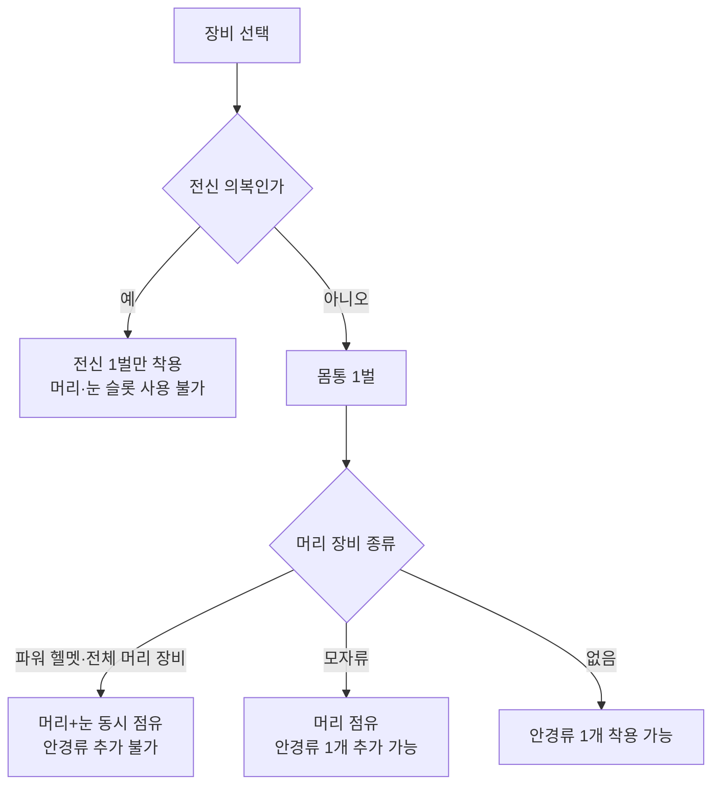
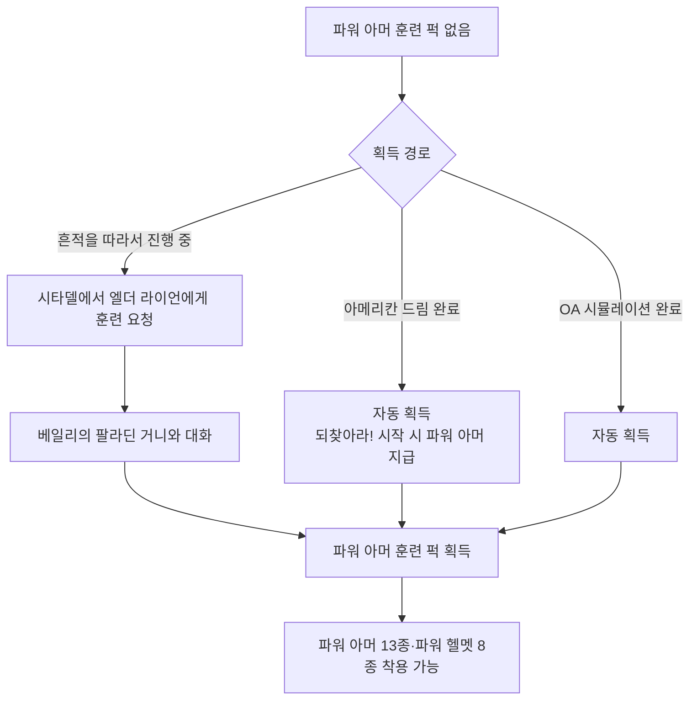
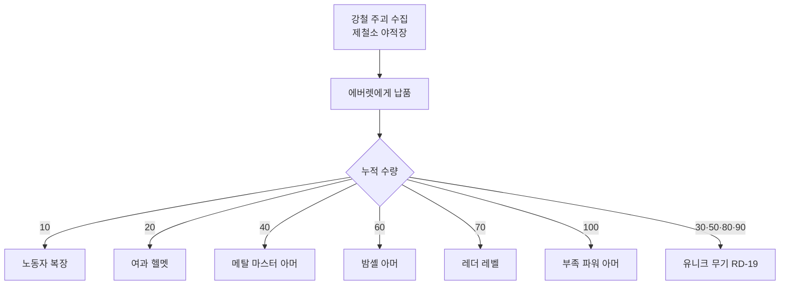

# RD-20. 방어구·의복

> **폴아웃 3 역기획서 세트** | 문서 ID: RD-20 | 버전: v1.0 | 작성일: 2026-10-11
> **범위**: 본편과 DLC 5종의 몸통·전신·머리·눈 장비 전체 카탈로그(일반·유니크·파워 아머·DLC·삭제 항목), 장착 슬롯·DR·내구도·수리 규칙, 파워 아머 규칙과 훈련 퍽 획득 경로, 동료 장비 제한, 팩션 복장과 위장 효과 / 다루지 않는 것: 무기·탄약(RD-19), 피해 공식과 DR 계산의 전투 측면(RD-16), 퍽 상세(RD-14), 상점별 재고·수리 서비스 가격(RD-22), 유니크 장비 위치 동선(RD-23)
> **관련 문서**: [RD-14 캐릭터 시스템](14_character-system.md), [RD-15 상태·생존 시스템](15_status-survival.md), [RD-16 전투 시스템](16_combat-system.md), [RD-19 무기·탄약](19_weapons-ammo.md), [RD-21 소모품·잡화·제작](21_consumables-misc-crafting.md), [RD-22 경제·주거](22_economy-housing.md), [RD-23 수집 요소·업적](23_collectibles-achievements.md), [RD-09 팩션](09_factions.md), [RD-10 주요 인물·동료](10_characters-major-companions.md), [RD-08a~e DLC 문서](08a_dlc-operation-anchorage.md)

---

## 1. 문서 개요

### 1.1 목적
- 폴아웃 3(Fallout 3) 본편과 DLC 5종에 등장하는 방어구·의복 전 항목을 수치(DR·무게·가격·내구도·보너스)와 수리 호환, 대표 획득처까지 한 표로 정리한 **정본 카탈로그**를 제공한다.
- 장착 슬롯, 내구도와 피해 저항(DR)의 관계, 수리, 파워 아머(Power armor)와 파워 아머 훈련(Power Armor Training) 퍽, 동료 장비, 팩션 복장 규칙을 정리해 쯔꾸르(RPG Maker) 팬게임의 장비 데이터베이스와 장착 규칙의 근거로 삼는다.

### 1.2 범위
- **다루는 것**
  - 허브 문서 「Fallout 3 armor and clothing」에 실린 실사용 장비 **219종**: 몸통 130종, 전신 의복 5종, 머리+눈 장비 21종(파워 헬멧 8, 전체 머리 장비 13), 모자류 50종, 안경류 13종
  - 출처별: 본편 164종, DLC 55종(오퍼레이션: 앵커리지(Operation: Anchorage) 13, 더 피트(The Pitt) 18, 브로큰 스틸(Broken Steel) 7, 포인트 룩아웃(Point Lookout) 8, 마더십 제타(Mothership Zeta) 8, 3개 DLC 공통 1)
  - 게임 파일에만 남은 삭제 장비 29종(요약 표), 동료 기본 장비(§3.12)
  - 장착·수리·내구도·파워 아머·동료·팩션 복장 규칙
- **다루지 않는 것**: 무기·탄약(RD-19), DR이 실제 피해 계산에 들어가는 전투 공식(RD-16), 퍽 상세(RD-14), 상인별 재고·수리 서비스 가격(RD-22), 유니크 장비 위치의 상세 동선(RD-23), 퀘스트 진행 상세(각 퀘스트 문서)

### 1.3 요약
- 장비 슬롯은 **몸통 1 + 머리 1 + 눈 1**이 기본이며, 전신 의복은 몸통·머리·눈을 모두 차지하고, 파워 헬멧과 전체 머리 장비는 머리와 눈을 함께 차지한다.
- 방어 성능은 DR 합산(상한 85%)과 **내구도에 비례하는 DR 감소**(0%에서 기본값의 62%)로 결정되며, 수리 스킬이 수리 가능한 최대 내구도를 정한다.
- 장비의 큰 축은 의복(DR 0~12) → 경장갑(가죽·레이더 계열, DR 16~30) → 중장갑(전투·금속 계열, DR 28~39) → 파워 아머(DR 35~50)로 이어지는 단계 구조다. 파워 아머는 퍽이 있어야만 입을 수 있고, 대신 힘과 방사능 저항을 높이고 민첩성을 깎는다.
- 의복의 진짜 역할은 방어보다 **SPECIAL·스킬 보너스**다. 화술 +10 잠옷, 과학·의학·수리 복장처럼 '판정 직전 갈아입기'를 유도하는 설계가 많다.
- 폴아웃 3에는 팩션 위장 메커니즘이 없다. 다만 구울 마스크(Ghoul mask), 아웃캐스트 파워 아머, 노예복 같은 몇몇 장비가 예외적으로 반응을 바꾼다.

### 1.4 표기 메모
- **수치 출처 원칙**: 허브 표(「Fallout 3 armor and clothing」)를 정본으로 삼는다. 개별 아이템 문서의 정보상자와 값이 다르면 비고에 `†`를 달고 §4.6에 양쪽 값을 모두 적는다.
- **칼럼 정의**
  - **슬롯**: `몸통` / `전신`(다른 방어구와 함께 입을 수 없음) / `머리+눈`(머리와 눈을 함께 점유) / `머리` / `눈`
  - **DR**: 피해 저항(Damage Resistance) %p. 착용한 장비의 DR은 합산된다.
  - **무게**: 파운드 단위 무게. 파워 아머의 `45 (25)`처럼 괄호가 붙은 값은 허브 표의 원문 표기를 그대로 옮긴 것이다. 괄호 안 수치의 의미는 코퍼스에 설명이 없고, 개별 문서 정보상자에는 괄호 앞 값(45 등)만 있다.
  - **가격**: 내구도 100% 기준의 기본 가치(캡). 실제 매매가는 물물교환 스킬과 상인에 따라 달라진다(RD-22).
  - **내구도**: 아이템 HP(최대 내구 수치). `(‡)`는 피해를 받지 않아 내구도가 줄지 않는 장비다(§4.2). 앵커리지 시뮬레이션 장비의 999,100류 수치는 사실상 파손되지 않는 시뮬레이션 판본이다.
  - **보너스 효과**: 착용 중에만 적용되는 SPECIAL·스킬·저항 보정. 저항 수치는 %p다.
  - **수리 호환**: 그 장비를 고칠 때 재료로 쓸 수 있는 장비. `없음(NPC 수리만)`은 재료로 쓸 장비가 없어 수리 서비스를 하는 NPC만 고칠 수 있다는 뜻이다(§2.3).
  - **비고**: DLC 태그 `[OA]` `[TP]` `[BS]` `[PL]` `[MZ]`, `유니크`(허브 강조 표시 또는 개별 문서 기준), `PA 훈련 필요`(파워 아머 훈련 퍽 필수)
- 폼 ID와 월드 수량(허브의 Limit 값)은 표 폭을 줄이려고 §7.1 부록으로 분리했다.
- 명칭: 용어집(RD-26)을 따르며, 등재되지 않은 장비명은 고유명사는 음차, 일반 명사는 번역했다(예: Combat armor → 전투 아머, Radiation suit → 방사능 방호복). 퀘스트명은 「」로 표기한다.

## 2. 장비 시스템 구조

### 2.1 장착 슬롯 구조

| 슬롯 | 해당 분류(허브 기준) | 함께 착용 가능 | 대표 예 |
|---|---|---|---|
| 몸통 | 볼트 의복, 전투 아머, 파워 아머, 레이더 아머, 기타 방어구, 일반 의복 | 머리 장비 1 + 눈 장비 1 | 전투 아머, 볼트 101 점프슈트 |
| 전신 | 전신 의복 5종(방사능 방호복류, 엔클레이브 과학자 복장, 환경 방호복, 우주복) | 없음(다른 방어구를 함께 쓸 수 없음) | 방사능 방호복 |
| 머리+눈 | 파워 헬멧 8종, 전체 머리 장비 13종(하키 마스크, 금속 헬멧, 레이더 헬멧 등) | 몸통 1(눈 장비 추가 불가) | 파워 헬멧, 하키 마스크 |
| 머리 | 모자류 50종(전투 헬멧, 각종 모자·두건·후드) | 몸통 1 + 눈 장비 1 | 전투 헬멧, 전쟁 전 모자 |
| 눈 | 안경류 13종(안경, 고글, 선글라스, 구울 마스크) | 몸통 1 + 머리(모자류) 1 | 선글라스, 구울 마스크 |

- 허브 문서는 파워 헬멧과 전체 머리 장비가 "눈 장비이자 머리 장비로 함께 취급된다"고 적고 있다. 그래서 하키 마스크와 선글라스는 동시에 쓸 수 없다.
- 전투 헬멧은 전작과 달리 눈 보호 아크릴판이 없어 일반 안경류와 함께 쓸 수 있다(전투 아머 문서). 이 차이로 '모자류'와 '전체 머리 장비'가 갈린다.
- 장비 조합의 최대치는 **몸통 + 머리 + 눈 3부위**다. 머리+눈 장비를 고르면 2부위, 전신 의복을 고르면 1부위가 된다.

### 2.2 방어 수치 규칙
- **DR 합산과 상한**: 착용 장비의 DR, 퍽, 약물 보정은 모두 더해지며, 최종 DR 상한은 **85%**다(Damage Resistance 문서, 폴아웃 3 절). 피해 계산식에서 DR을 쓰는 방식은 [RD-16 전투 시스템](16_combat-system.md)을 따른다.
- **상한 도달 예시**(코퍼스 계산 예)
  - T-51b 파워 아머 또는 엔클레이브 헬파이어 아머와 전용 헬멧의 DR 합은 60이다. 여기에 영구 퍽 5종(34%)을 더하면 94%가 되지만 85%로 잘린다.
  - 파워 아머 없이 레인저 배틀 아머 + 레인저 배틀 헬멧 + 구울 마스크 + 영구 퍽 조합으로 영구 DR 82%(더 피트가 없으면 79%)를 만들 수 있다.
  - 동계용 T-51b 세트(55)에 사이보그·터프니스·바크스킨·서바이벌 엑스퍼트 퍽(31%)을 더하면 85%에 도달한다.
- **내구도와 DR**: 장비의 실효 DR은 내구도에 비례해 줄어든다.
  - `실효 DR = 기본 DR × (0.62 + 내구도 비율 × 0.38)` (내구도 비율은 0~1)
  - 내구도 0%에 가까워져도 DR은 기본값의 62%까지만 떨어진다. 그래서 '낡은 상급 방어구'가 '새 하급 방어구'보다 나은 경우가 흔하다.
- **표시 가치**: `표시 가치 = 내림(기본 가치 × 내구도 비율^1.5)`. 내구도 50% 장비는 기본 가치의 약 35%로 표시된다(Equipment condition 문서).
- **파손**: 내구도가 0이 되면 파손 상태다. 이미 입고 있는 방어구·의복은 계속 착용되고 SPECIAL·스킬 보너스도 유지되지만, 벗으면 수리하기 전까지 다시 입을 수 없다.

### 2.3 내구도와 수리
- **수리 가능 최대치**: `최대 내구도(%) = 40 + 3 × (수리 스킬 ÷ 5)`. 수리 50이면 70%, 수리 100이면 100%까지 고칠 수 있다(Repair (Fallout 3) 문서).
- **수리 방식**: 같은 종류이거나 호환되는 장비 1개를 소모해 내구도를 올린다. 결과 내구도는 주로 플레이어의 수리 스킬로 정해지며, 재료 장비의 상태는 최대 5%p만 기여한다. 그래서 파손된 장비도 수리 재료로 쓸 만하다. 이 공식은 무기와 같으며 상세 예시는 [RD-19](19_weapons-ammo.md)와 같다.
- **NPC 수리**: 수리 서비스를 하는 상인에게 캡을 내고 맡길 수 있다. NPC 수리는 그 NPC의 수리 스킬 한도까지만 올라간다. 수리 상인과 스킬 수치는 [RD-22 경제·주거](22_economy-housing.md)를 따른다.
- **수리 호환 '없음' 장비**: T-51b 파워 아머(세트)처럼 재료로 쓸 장비가 없는 장비는 NPC 수리로만 고칠 수 있다. 코퍼스에 따르면 T-51b를 100%로 유지하려면 포인트 룩아웃의 작업자 작업복(수리 +10)을 정신나간 볼프강(Crazy Wolfgang)에게 역소매치기해 그의 수리 스킬을 100으로 올리는 편법이 사실상 유일하다. 수리 경제가 최상위 장비의 유지비로 작동하는 사례다.
- **단방향 호환**: T-51b는 T-45d 파워 아머 계열을 고치는 재료로 쓸 수 있지만, 반대 방향은 안 된다.

#### 수리 호환 그룹

| 그룹(표기) | 구성 장비 |
|---|---|
| 볼트 점프슈트류 | 볼트 101·106·108·112·77 점프슈트. 작업용 점프슈트 계열(볼트 101 작업용 점프슈트·개조 작업용 점프슈트·아빠의 황무지 복장)은 서로, 그리고 볼트 점프슈트로도 고칠 수 있음 |
| 전투 아머 계열 | 전투 아머, 레인저 배틀 아머, 리벳시티·텐페니 경비대 제복, 탈론 컴퍼니 전투 아머, 래그볼트의 전투 아머, 동계용 전투·의무병 아머, 볼트 101 경비대 아머 |
| 전투 헬멧 계열 | 전투 헬멧, 레인저 배틀 헬멧, 리벳시티 경비대 헬멧, 탈론 컴퍼니 전투 헬멧, 동계용 전투·의무병 헬멧, 볼트 101 경비대 헬멧 |
| T-45d 파워 아머 계열 | 파워 아머, BoS·라이언스 프라이드·아웃캐스트 파워 아머, 린든의 아웃캐스트 PA, 시제 의무 PA, 애셔의 PA, 부족 PA (재료로 T-51b 사용 가능) |
| 엔클레이브 계열(각자 전용) | 엔클레이브 파워 아머·헬멧, 테슬라 아머·헬멧, 헬파이어 아머·헬멧은 각각 같은 장비로만 수리 |
| 레이더 아머류 | 본편 레이더 아머 4종 + 피트 레이더 아머 5종(서로 호환) |
| 레이더 헬멧류 | 레이더 아크라이트·블래스트마스터·사이코틱·웨이스트하운드 헬멧. 토처의 마스크·용접 마스크는 아크라이트 헬멧으로 수리 |
| 가죽 아머 | 가죽 아머와 그 유니크 판본(방랑자의 가죽 아머, 밴스의 롱코트, 메탈 마스터·밤셸·레더 레벨) |
| 금속 아머 | 금속 아머, 감마 실드 아머, 사무라이 아머 |
| 방사능 방호복류 | 방사능 방호복, 고급 방사능 방호복, 환경 방호복, 우주복 |
| 과학자 복장류 | 과학자·연구 기술자·엔클레이브 과학자 복장, 볼트 연구복, 실험복, 리 박사의 복장, 레스코의 실험복, '외과의'의 실험복 |
| 전쟁 전 의복류 | 전쟁 전 평상복·산책복·휴양복·봄옷(더러운 판본 포함)과 전쟁 전 모자·보닛·야구모자 일부. 정장은 별도 그룹 |
| 황무지 복장류 | 브라민 가죽 옷, 황무지 정착민·방랑자 복장, 의사 작업복, 외과의 복장, 떠돌이 상인 복장, 노예복, DLC 의복 일부 |
| 용병 복장류 | 용병 6종 + 황무지 전설 복장 |
| 정비 점프슈트류 | 로브코 점프슈트, 육군 정비병 점프슈트 / 레드 레이서 점프슈트, 핸디맨 점프슈트 |
| 안경류 | 안경, 독서 안경, 착색 독서 안경, 선글라스, 대모갑 안경 등과 유니크 안경 |

#### 수리 스킬 보너스 의복
- 볼트 101 작업용 점프슈트(+5), 아빠의 황무지 복장(+5), 개조 작업용 점프슈트(+5), 정비 점프슈트류(로브코·레드 레이서·핸디맨·육군 정비병, +5), 작업자 작업복 [PL](+10).
- 수리 직전에 갈아입으면 최대 수리 한도가 일시적으로 오른다(+5당 +3%p).

### 2.4 무게의 부가 효과
- 허브 문서 노트에 따르면 방어구를 입으면 무게 1당 약 4.17%씩 **소음이 커지고**, 무게 1당 약 0.23%씩 **이동 속도가 줄어든다**. 이동 속도 감소의 상한은 무기를 들었는지에 따라 30~40%다.
- 따라서 같은 DR이라도 가벼운 장비가 은신과 기동 면에서 유리하다. 예를 들어 메탈 마스터 아머(DR 36, 무게 15)는 금속 아머(DR 36, 무게 30)와 DR이 같고 무게는 절반이다.
- 소지 한도와 과적 규칙은 [RD-15 상태·생존 시스템](15_status-survival.md)을 따른다.

### 2.5 보너스 효과 적용 규칙
- 보너스는 **장착 중에만** 적용된다. SPECIAL 보너스는 그 능력치에 딸린 파생치와 판정에도 바로 반영된다(예: 힘 보너스 → 소지 한도, 근접 피해).
- 파손된 장비도 입고 있는 동안에는 보너스가 유지된다(§2.2).
- 스킬 보너스 의복은 화술·과학·자물쇠 따기·수리 판정 직전에 갈아입어 수치를 맞추는 **'환복 판정'** 플레이를 만든다(§5.2). 문턱 방식 판정(자물쇠 따기·과학 등)에서는 등급 해금, 확률 방식인 화술에서는 성공률 상승으로 작용한다.
- 타코마 파크 리틀 리거 모자(Takoma Park Little Leaguer cap)의 효과는 리틀 리거(Little Leaguer) 퍽과 같다(문서 노트).

### 2.6 파워 아머 규칙

#### 착용 조건과 훈련 퍽 획득 경로
- 파워 아머(몸통 13종)와 파워 헬멧(8종)은 **파워 아머 훈련 퍽**이 있어야만 입을 수 있다. 퍽 랭크는 1이며 효과는 "파워 아머 계열 착용 가능"이다.
- 획득 경로 3가지(Power Armor Training (Fallout 3) 문서)
  1. **「흔적을 따라서」(Picking Up the Trail) 진행 중**(선택): 시타델에서 엘더 라이언에게 훈련을 요청해 승인을 받은 뒤 베일리(안뜰)의 팔라딘 거니(Gunny)에게 훈련을 받는다. 거니는 훈련을 해 주기 전까지 필수(essential) NPC다.
  2. **「아메리칸 드림」(The American Dream) 완료 시 자동 획득**(= 「되찾아라!」 시작 시점). 이 시점에 사라 라이언이 100% 내구도의 파워 아머 한 벌도 준다.
  3. **[OA] 앵커리지 탈환 시뮬레이션 완료 시 자동 획득**: DLC를 일찍 진행하면 메인 퀘스트 진행과 상관없이 훈련 퍽을 얻는 우회로가 된다.
- 거니의 대사(PaladinGunny.txt): "Heard you were coming. Yeah, I can train you. But don't ask me to like it." ("온다는 얘기는 들었다. 그래, 훈련은 시켜 주지. 하지만 내가 좋아할 거라곤 기대하지 마.")

#### 공통 효과와 페널티
- **힘 보너스**: T-45d 계열 +2, 엔클레이브·헬파이어·린든·애셔·부족 +1. 힘이 오르므로 소지 한도와 근접 피해에도 이득이다.
- **민첩성 페널티**: T-45d 계열 −2, 엔클레이브·린든·애셔·부족·시제 의무 −1. T-51b·테슬라·헬파이어·동계용 T-51b는 민첩성 페널티가 없다. 민첩성이 내려가면 민첩 기반 스킬(소형 화기, 은신)도 같이 내려간다. 그래서 민첩 중심 캐릭터에는 레인저 배틀 아머가 대안이 된다(Ranger battle armor 문서).
- **방사능 저항**: 모든 파워 아머가 +10~25를 주고, 헬멧이 +3~8을 더한다.
- **카리스마**: 엔클레이브·테슬라·헬파이어 헬멧 −1, T-51b 헬멧 +1.
- **무게**: 몸통 40~45, 헬멧 4~5. 몸통 하나로 경장갑 2~3벌 무게라서 소음·이동 속도 손해가 크다(§2.4).

#### 모델 비교 (몸통 + 전용 헬멧)

| 모델 | DR(몸통/헬멧/합) | 내구도(몸통/헬멧) | 방사능 저항(합) | 기타 보정 | 수리 | 획득 시점 |
|---|---|---|---|---|---|---|
| T-45d(파워 아머·BoS·아웃캐스트·라이언스 프라이드) | 40 / 8 / 48 | 1000 / 75 | 13 | 힘 +2, 민첩성 −2 | T-45d 계열, T-51b | 중반(GNR 이후 전사자) |
| T-51b | 50 / 10 / 60 | 2000 / 100 | 33 | 카리스마 +1(헬멧) | NPC 수리만 | 중반 이후(열쇠 3개) |
| 동계용 T-51b [OA] | 45 / 10 / 55 | 9,992,000 / 999,100 | 33 | 카리스마 +1(헬멧) | 없음 | OA 완료 |
| 엔클레이브 PA(APA Mk II) | 40 / 9 / 49 | 1200 / 75 | 20 | 힘 +1, 민첩성 −1, 카리스마 −1(헬멧) | 같은 장비 | 「생명의 물」 이후 |
| 테슬라 아머 | 43 / 9 / 52 | 1500 / 100 | 25 | 에너지 무기 +10, 카리스마 −1(헬멧) | 같은 장비 | 엔클레이브 등장 이후 |
| 엔클레이브 헬파이어 [BS] | 50 / 10 / 60 | 2000 / 100 | 20 | 힘 +1, 화염 저항 +35, 카리스마 −1(헬멧) | 같은 장비 | BS, 레벨 20+ |
| 시제 의무 PA(유니크) | 40 / — | 1000 | 25 | 민첩성 −1, 음성 경고, Med-X 자동 투여 | T-45d 계열 | 올드 올니 |
| 린든의 아웃캐스트 PA(유니크) | 40 / — | 1000 | 10 | 힘 +1, 민첩성 −1, 중화기 +5 | T-45d 계열 | 「오아시스」 보상 |
| 애셔의 PA [TP] | 40 / — | 1000 | 10 | 힘·카리스마·행운 +1, 민첩성 −1 | T-45d 계열 | 피트 |
| 부족 PA [TP] | 35 / — | 1000 | 0 | 힘·행운 +1, 민첩성 −1, AP +15, 근접 무기 +5 | T-45d 계열 | 주괴 100개 |

- 헬파이어의 화염 저항 합(+35)은 몸통 +30과 헬멧 +5를 더한 값이다. 헬파이어 아머 문서 본문에는 몸통 +35로 적힌 곳도 있으나 정보상자·허브는 +30이다.
- 헬멧이 '—'인 유니크 PA는 전용 헬멧이 없다. 보통은 T-45d 계열 헬멧과 조합한다.
- **특수 기능**
  - 시제 의무 PA: 미스터 거츠 계열 AI가 근처의 적을 음성으로 경고하고, 착용자가 큰 피해를 입으면 Med-X를 투여한다. 직접 Med-X를 따로 쓰면 효과가 겹친다는 기록이 있다(Damage Resistance 문서).
  - 동계용 T-51b: 내구도가 9,992,000이라 사실상 파손되지 않는다.
- **유통 규칙**
  - BoS 파워 아머는 상점 재고에 나오지 않는다. 일반 파워 아머는 상인 재고에 드물게 나오며, 캐러밴 상인 크로우는 두 번째 투자 이후 판매한다([TP] 프라이데이도 판매).
  - 「아웃캐스트 수집 대리인」(The Outcast Collection Agent, 비표시)에서 프로텍터 캐스딘(Protector Casdin)은 파워 아머를 받고 탄약·의약품으로 바꿔 준다. 다만 BoS 파워 아머는 받지 않는다(RD-07).
- **동료**: 인간·구울 동료는 퍽 없이 파워 아머를 입을 수 있다(§2.7).

### 2.7 동료 장비 제한 (요약)
- 동료는 기본 무기·방어구를 갖고 합류하며, 기본 장비보다 **우수한** 장비를 건네받으면 그것을 입는다.
- 인간·구울 동료(폭스, RL-3 하사, 도그밋 제외)는 **파워 아머 훈련 없이 파워 아머를 입을 수 있다.**
- 동료가 착용한 무기·방어구는 **열화되지 않는다.**
- 동료의 소지 한도 = 150 + 10 × 힘 − 고유 장비 무게 − 추가로 준 장비 무게. 파워 아머 세트를 주면 한도가 50 줄어든다(몸통 45 + 헬멧 5).
- 동료의 기본 장비는 일반 판본과 이름은 같아도 수치가 다른 **동료 전용 판본**이며, 콘솔 명령으로만 얻을 수 있다.

| 동료 | 기본 방어구(동료 전용 판본 수치) | 다른 방어구 착용 | 파워 아머 | 비고 |
|---|---|---|---|---|
| 버치 들로리아 | 터널스네이크 복장(DR 4, 무게 3, 가치 40) | 가능 | 가능 | 중립 카르마 |
| 셰런(Charon) | 가죽 아머(DR 16, 무게 15, 가치 160) | 가능 | 가능 | 계약서로 고용 |
| 클로버(Clover) | 더러운 전쟁 전 봄옷(DR 4, 무게 2, 가치 40, 민첩성 +1) | 가능 | 가능 | |
| 제리코(Jericho) | 가죽 아머(DR 24, 무게 15, 가치 160) | 가능 | 가능 | 악 카르마 |
| 스타 팔라딘 크로스(Star Paladin Cross) | 파워 아머(DR 40, 무게 45, 가치 740, 힘 +2·민첩성 −2·방사능 저항 +10) | 가능 | 가능(기본 착용) | 선 카르마 |
| 폭스(Fawkes) | 해진 볼트 87 점프슈트 | **불가** | 불가 | 어떤 방어구도 입지 않음 |
| RL-3 하사(Sergeant RL-3) | 없음(로봇) | 불가 | 불가 | |
| 도그밋(Dogmeat) | 없음(개) | 불가 | 불가 | |
| 베르너(Wernher) [TP] | 용병 크루저 복장(DR 12, 무게 8, 가치 50) | — | — | 임시 동료, 동료 장비 문서에만 기재 |

- 임시 동료(시드니, 사라 라이언 등)의 기본 장비와 동료 시스템 전체는 [RD-10 주요 인물·동료](10_characters-major-companions.md)를 따른다.

### 2.8 팩션 복장과 위장 효과
- **원칙: 폴아웃 3에는 팩션 위장 메커니즘이 없다.** 엔클레이브 장교 제복을 입어도 엔클레이브는 적대 상태를 유지하고, 다른 팩션의 태도도 바뀌지 않는다(Enclave officer uniform (Fallout 3) 문서).
- 예외는 특정 장비에 붙은 개별 스크립트와 대사 조건뿐이다.

| 장비 | 효과 | 조건·한계 |
|---|---|---|
| 구울 마스크 | 착용 중 야생 구울이 도발당하지 않는 한 적대하지 않는다. 동료에게도 비적대. 야생 구울은 착용자가 설치한 지뢰를 밟지 않는다 | 이미 적대해 플레이어를 인지한 구울에는 효과 없음. 「생명의 물」 호위 중에는 리 박사 일행이 공격받는다 |
| 아웃캐스트 파워 아머(풀세트) | 앵커리지 DLC의 아웃캐스트 전초기지에서 '현지인'이 아닌 구성원처럼 대한다 | 린든의 아웃캐스트 PA는 인정되지 않는다. 아웃캐스트 판본을 소지한 채 캐스딘과 대화하면 신뢰를 얻기 전까지 압수당한다 |
| 해진 노예복 [TP] | 피트 입구에서 멕스(Mex)가 플레이어를 노예로 오인한다 | 더 피트 시작부의 잠입 연출 |
| 개미여인의 의상 / 기계박사의 의상 | 상대 '슈퍼히어로' 앞에서 입으면 그 인물이 적대한다. 상대에게 의상을 넘기면 퀘스트가 해결된다 | 「초인의 도박」 |
| 볼트 점프슈트 | 메가톤의 루카스 심즈·빌리 크릴·제리코·레오 스탈 등이 볼트 출신이라는 대사를 한다 | 대사 반응만 있음 |
| 보안관의 더스터 | 메가톤 주민이 반응한다. 콜린 모리아티: "You got a lot of nerve wearing that badge in here." ("여기서 그 배지를 달고 다니다니 배짱 한번 좋군.") | 대사 반응만 있음 |
| 신경 인터페이스 슈트 [OA] | 앵커리지 탈환 시뮬레이션에 들어가는 열쇠 역할 | 「아웃캐스트 지원」 |

- 팩션 관계와 카르마 반응 전체는 [RD-09 팩션](09_factions.md)을 따른다.

## 3. 방어구·의복 카탈로그 (정본)

- 분류와 순서는 허브 문서의 표 구분(볼트 의복 → 전투 아머 → 파워 아머 → 레이더 아머 → 기타 방어구 → 전신 의복 → 일반 의복 → 파워 헬멧 → 전체 머리 장비 → 모자류 → 안경류)을 따르고, 각 표 안에서는 영문 알파벳 순서를 따른다.
- 칼럼 정의는 §1.4, 폼 ID와 월드 수량은 §7.1 부록을 본다. 비고의 `†`는 개별 문서와 수치가 다른 항목이며 §4.6에 정리했다.

### 3.1 볼트 의복 (13종)
- 볼트 101에서 시작하는 주인공의 출발 장비 계열이다. 일반 볼트 점프슈트는 DR 1에 근접 무기 +2·화술 +2를 준다. 볼트 101 경비대 아머(DR 12)가 초반 최고 방어구다.

| 영문명 | 한국어 표기 | 슬롯 | DR | 무게 | 가격 | 내구도 | 보너스 효과 | 수리 호환 | 획득처(대표) | 비고 |
|---|---|---|---|---|---|---|---|---|---|---|
| Armored Vault 101 jumpsuit | 장갑 볼트 101 점프슈트 | 몸통 | 12 | 15 | 180 | 100 | +5 에너지 무기, +5 소형 화기 | 없음(NPC 수리만) | 메가톤 분화구 잡화점: 모이라의 볼트 생활 질문에 답하면 선물(「황무지 생존 가이드」), 구매·절도도 가능 | 유니크 |
| Dad's wasteland outfit | 아빠의 황무지 복장 | 몸통 | 2 | 20 | 6 | 100 | +5 자물쇠 따기, +5 수리 | 볼트 점프슈트류·작업용 점프슈트 | 제임스 역소매치기, 또는 제퍼슨 기념관에서 사망 직후 시신 수색 | 유니크 |
| Modified utility jumpsuit | 개조 작업용 점프슈트 | 몸통 | 1 | 2 | 30 | 100 | +1 행운, +10 방사능 저항, +5 수리 | 볼트 점프슈트류·작업용 점프슈트 | 「고향의 위기」 평화적 해결(알폰스 생존·오버시어 유지) 보상 | 유니크, 가격 불일치† |
| Tunnel Snake outfit | 터널스네이크 복장 | 몸통 | 4 | 2 | 8 | 100 | +5 근접 무기 | 터널스네이크 복장 | 「탈출!」에서 버치 들로리아의 어머니를 방사능바퀴로부터 구하면 보상, 또는 버치 처치 후 획득 | — |
| Vault 77 jumpsuit | 볼트 77 점프슈트 | 몸통 | 1 | 1 | 8 | 100 | +5 비무장, +5 근접 무기 | 볼트 점프슈트류 | 파라다이스폴 노예 사냥꾼 막사 선반(홀로테이프 「이 빌어먹을 점프슈트를 태워」 옆) | 유니크 |
| Vault 101 jumpsuit | 볼트 101 점프슈트 | 몸통 | 1 | 1 | 8 | 100 | +2 근접 무기, +2 화술 | 볼트 점프슈트류 | 시작 장비, 볼트 101 주민 | 가격 불일치† |
| Vault 101 child's jumpsuit | 볼트 101 아동용 점프슈트 | 몸통 | 1 | 2 | 5 | 100 | — | 없음 | 「빨리 크는 아이」 중 자동 착용 후 제거(이후 콘솔 전용) | 프롤로그 전용 |
| Vault 101 security armor | 볼트 101 경비대 아머 | 몸통 | 12 | 15 | 70 | 100 | — | 전투 아머 계열 | 볼트 101 경비원, 아트리움 경비실 무기 사물함(2벌), 황무지의 수지 맥 | — |
| Vault 101 utility jumpsuit | 볼트 101 작업용 점프슈트 | 몸통 | 1 | 1 | 10 | 100 | +5 자물쇠 따기, +5 수리 | 볼트 점프슈트류·작업용 점프슈트 | 「탈출!」 중 주인공 방, 플로이드 루이스 시신, 스탠리 역소매치기 | 무게·가격 불일치† |
| Vault 106 jumpsuit | 볼트 106 점프슈트 | 몸통 | 1 | 1 | 6 | 100 | +2 근접 무기, +2 화술 | 볼트 점프슈트류 | 볼트 106의 미친 생존자 | — |
| Vault 108 jumpsuit | 볼트 108 점프슈트 | 몸통 | 1 | 1 | 6 | 100 | +2 근접 무기, +2 화술 | 볼트 점프슈트류 | 볼트 108의 개리 클론 | — |
| Vault 112 jumpsuit | 볼트 112 점프슈트 | 몸통 | 1 | 1 | 8 | 100 | +2 근접 무기, +2 화술 | 볼트 점프슈트류 | 볼트 112 입구 로보브레인이 지급(「과학적 탐구」) | 가격 불일치† |
| Vault lab uniform | 볼트 연구복 | 몸통 | 2 | 1 | 6 | 100 | +5 과학 | 과학자 복장류(리 박사 복장·볼트 연구복 포함) | 「탈출!」 중 조나스 파머 시신, 볼트 106 생존자 | — |

### 3.2 전투 아머 계열 (8종)
- 비파워 아머의 주력 계열이다. 레인저 배틀 아머(DR 39)는 파워 아머를 제외한 최고 DR 방어구이고, 래그볼트의 전투 아머 [BS](DR 38)가 뒤를 잇는다. 모두 서로 수리 재료가 된다.

| 영문명 | 한국어 표기 | 슬롯 | DR | 무게 | 가격 | 내구도 | 보너스 효과 | 수리 호환 | 획득처(대표) | 비고 |
|---|---|---|---|---|---|---|---|---|---|---|
| Combat armor | 전투 아머 | 몸통 | 32 | 25 | 390 | 400 | — | 전투 아머 계열 | 앵커리지 기념관, 리벳시티 함교탑(4벌), 주 방위군 기지 무기고, 상인(크로우·모이라·툴립 등) | — |
| Lag-Bolt's combat armor | 래그볼트의 전투 아머 | 몸통 | 38 | 30 | 400 | 500 | +10 AP, +10 중화기 | 전투 아머 계열 | 비표시 퀘스트 「슬픈 구혼자」: 라 메종 보르가르의 래그볼트 | [BS] 유니크 |
| Ranger battle armor | 레인저 배틀 아머 | 몸통 | 39 | 27 | 430 | 1100 | +5 AP, +1 행운, +10 소형 화기 | 전투 아머 계열 | 「라일리스 레인저스」 완료 보상, 스테이츠맨 호텔의 레인저 시신, 레인저 기지 역소매치기 | — |
| Rivet City security uniform | 리벳시티 경비대 제복 | 몸통 | 24 | 20 | 330 | 100 | +5 소형 화기 | 전투 아머 계열 | 리벳시티 경비원 처치·역소매치기 | — |
| Talon combat armor | 탈론 컴퍼니 전투 아머 | 몸통 | 28 | 25 | 275 | 300 | — | 전투 아머 계열 | 탈론 컴퍼니 용병(배니스터 요새 등), [MZ] 엔지니어링 코어 1벌 | — |
| Tenpenny security uniform | 텐페니 경비대 제복 | 몸통 | 24 | 20 | 180 | 100 | +5 소형 화기 | 전투 아머 계열 | 텐페니 타워 경비원 처치·역소매치기 | — |
| Winterized combat armor | 동계용 전투 아머 | 몸통 | 32 | 25 | 390 | 999,400 | — | 전투 아머 계열 | 앵커리지 탈환 시뮬레이션 진입 시 지급(시뮬레이션 전용) | [OA] 시뮬 전용 |
| Winterized medic armor | 동계용 의무병 아머 | 몸통 | 32 | 25 | 390 | 400 | +10 의학 | 전투 아머 | 냉동 연구실의 엘리엇 터코리언 분대(엘리엇 생존 시에만 등장) | [MZ] |

### 3.3 파워 아머 (13종, 모두 파워 아머 훈련 필요)
- 파워 아머의 규칙과 모델 비교는 §2.6을 본다. 무게의 괄호 수치는 §1.4를 본다.

| 영문명 | 한국어 표기 | 슬롯 | DR | 무게 | 가격 | 내구도 | 보너스 효과 | 수리 호환 | 획득처(대표) | 비고 |
|---|---|---|---|---|---|---|---|---|---|---|
| Ashur's power armor | 애셔의 파워 아머 | 몸통 | 40 | 45 (35) | 739 | 1000 | +1 힘, +1 카리스마, +1 행운, −1 민첩성, +10 방사능 저항 | T-45d 파워 아머 계열, T-51b | 「자유 노동」 종료 후 애셔 처치·역소매치기, 터렛 제어 터미널 해킹(과학 75) | [TP] 유니크, PA 훈련 필요 |
| Brotherhood power armor | BoS 파워 아머 | 몸통 | 40 | 45 (25) | 739 | 1000 | +2 힘, −2 민첩성, +10 방사능 저항 | T-45d 파워 아머 계열, T-51b | 전사한 BoS 대원(워싱턴 기념비 참호, GNR 방송국 광장 등) | PA 훈련 필요, 상점 판매 없음 |
| Enclave Hellfire armor | 엔클레이브 헬파이어 아머 | 몸통 | 50 | 40 (30) | 999 | 2000 | +1 힘, +30 화염 저항, +15 방사능 저항 | 엔클레이브 헬파이어 아머 | 엔클레이브 헬파이어 트루퍼, 레벨 20+ 엔클레이브 병사 | [BS] PA 훈련 필요, 가격 불일치† |
| Enclave power armor | 엔클레이브 파워 아머 | 몸통 | 40 | 45 (35) | 779 | 1200 | +1 힘, −1 민첩성, +15 방사능 저항 | 엔클레이브 파워 아머 | 엔클레이브 병사, [BS] 록랜드 차량 터널(3벌) | PA 훈련 필요, 가격 불일치† |
| Linden's Outcast power armor | 린든의 아웃캐스트 파워 아머 | 몸통 | 40 | 45 (35) | 739 | 1000 | +1 힘, −1 민첩성, +10 방사능 저항, +5 중화기 | T-45d 파워 아머 계열, T-51b | 「오아시스」에서 로렐의 연고를 헤럴드 심장에 쓰고 린든에게 보상 수령 | 유니크, PA 훈련 필요 |
| Lyons' Pride power armor | 라이언스 프라이드 파워 아머 | 몸통 | 40 | 45 (25) | 739 | 1000 | +2 힘, −2 민첩성, +10 방사능 저항 | T-45d 파워 아머 계열, T-51b | 「되찾아라!」 중 라이언스 프라이드 대원 시신 또는 역소매치기 | PA 훈련 필요 |
| Outcast power armor | 아웃캐스트 파워 아머 | 몸통 | 40 | 45 (25) | 739 | 1000 | +2 힘, −2 민첩성, +10 방사능 저항 | T-45d 파워 아머 계열, T-51b | 아웃캐스트 시신, 인디펜던스 요새 | PA 훈련 필요, 위장 효과(§2.8) |
| Power armor | 파워 아머(T-45d) | 몸통 | 40 | 45 (25) | 739 | 1000 | +2 힘, −2 민첩성, +10 방사능 저항 | T-45d 파워 아머 계열, T-51b | 상인(드묾, 크로우 2차 투자 후), [TP] 프라이데이, 「되찾아라!」 시작 시 사라 라이언 지급, 제닝스 시신 | PA 훈련 필요 |
| Prototype medic power armor | 시제 의무 파워 아머 | 몸통 | 40 | 45 | 999 | 1000 | −1 민첩성, +25 방사능 저항; 적 접근 음성 경고, 큰 피해 시 Med-X 자동 투여 | T-45d 파워 아머 계열, T-51b | 올드 올니 하수도의 BoS 이니시에이트 시신 | 유니크, PA 훈련 필요, 적 경고 음성·Med-X 자동 투여 |
| T-51b power armor | T-51b 파워 아머 | 몸통 | 50 | 40 | 999 | 2000 | +25 방사능 저항 | 없음(NPC 수리만) | 콘스탄틴 요새 지하(테드 스트레이어·듀코브·데이브 열쇠 3개), 「머리를 쏴야 해」 | 유니크, PA 훈련 필요, T-45d 수리 재료로는 사용 가능 |
| Tesla armor | 테슬라 아머 | 몸통 | 43 | 45 | 819 | 1500 | +20 방사능 저항, +10 에너지 무기 | 테슬라 아머 | 엔클레이브 병사, [MZ] 무기 연구실 전시품·냉동 연구실 선반 | PA 훈련 필요, 가격 불일치† |
| Tribal power armor | 부족 파워 아머 | 몸통 | 35 | 40 (30) | 739 | 1000 | +1 힘, +1 행운, −1 민첩성, +15 AP, +5 근접 무기 | T-45d 파워 아머 계열, T-51b | 「제철소 일꾼」 강철 주괴 100개 보상(에버렛) | [TP] 유니크, PA 훈련 필요 |
| Winterized T-51b power armor | 동계용 T-51b 파워 아머 | 몸통 | 45 | 40 | 999 | 9,992,000 / 1000 | +25 방사능 저항 | 없음(삭제 판본은 T-45d) | 「오퍼레이션: 앵커리지!」 완료 후 아웃캐스트 전초기지 무기고 | [OA] 유니크, PA 훈련 필요, 사실상 파손 불가 |

### 3.4 레이더 아머 (9종)
- 본편 레이더 4종(DR 16)과 더 피트의 피트 레이더 5종(DR 18)이다. 모두 서로 수리 재료가 된다. 피트 판본은 소형 화기·비무장·근접 무기 보너스가 붙는다.

| 영문명 | 한국어 표기 | 슬롯 | DR | 무게 | 가격 | 내구도 | 보너스 효과 | 수리 호환 | 획득처(대표) | 비고 |
|---|---|---|---|---|---|---|---|---|---|---|
| Raider badlands armor | 레이더 배드랜드 아머 | 몸통 | 16 | 15 | 180 | 100 | — | 레이더 아머류(본편·피트 공용) | 수도 황무지 레이더 | — |
| Raider blastmaster armor | 레이더 블래스트마스터 아머 | 몸통 | 16 | 15 | 180 | 100 | — | 레이더 아머류(본편·피트 공용) | 레이더 | — |
| Raider commando armor | 레이더 코만도 아머 | 몸통 | 18 | 15 | 200 | 150 | +3 소형 화기, +3 비무장 | 레이더 아머류(본편·피트 공용) | 피트 레이더 | [TP] |
| Raider iconoclast armor | 레이더 아이코노클라스트 아머 | 몸통 | 18 | 15 | 200 | 150 | +5 방사능 저항 | 레이더 아머류(본편·피트 공용) | 피트 레이더, 「위험한 작업 환경」의 그러드 베어, 프라이데이 판매 | [TP] |
| Raider ordinance armor | 레이더 오디넌스 아머 | 몸통 | 18 | 10 | 200 | 100 | +4 소형 화기 | 레이더 아머류(본편·피트 공용) | 피트 레이더 | [TP] |
| Raider paingiver armor | 레이더 페인기버 아머 | 몸통 | 18 | 5 | 200 | 100 | +4 비무장 | 레이더 아머류(본편·피트 공용) | 피트 레이더 | [TP] |
| Raider painspike armor | 레이더 페인스파이크 아머 | 몸통 | 16 | 15 | 180 | 100 | — | 레이더 아머류(본편·피트 공용) | 레이더 | — |
| Raider sadist armor | 레이더 새디스트 아머 | 몸통 | 16 | 15 | 180 | 100 | — | 레이더 아머류(본편·피트 공용) | 레이더 | — |
| Raider throwdown armor | 레이더 스로다운 아머 | 몸통 | 18 | 15 | 200 | 150 | +3 근접 무기, +3 비무장 | 레이더 아머류(본편·피트 공용) | 피트 진입 전 무선탑 첫 교전, 피트 레이더, 에버렛(가끔 착용) | [TP] |

### 3.5 기타 방어구 (10종)
- 가죽 아머(DR 24)·정찰 아머(DR 28)·금속 아머(DR 36) 계열과 DLC 유니크 판본이다. 더 피트의 「제철소 일꾼」 보상 3종(메탈 마스터·밤셸·레더 레벨)은 가죽 아머로 수리하면서도 DR이 높고 가벼운 효율형 장비다.

| 영문명 | 한국어 표기 | 슬롯 | DR | 무게 | 가격 | 내구도 | 보너스 효과 | 수리 호환 | 획득처(대표) | 비고 |
|---|---|---|---|---|---|---|---|---|---|---|
| Bombshell armor | 밤셸 아머 | 몸통 | 24 | 15 | 160 | 150 | +10 중화기, +10 폭발물 | 가죽 아머 | 「제철소 일꾼」 강철 주괴 60개 보상 | [TP] 유니크 |
| Chinese stealth armor | 중국군 스텔스 아머 | 몸통 | 28 | 20 | 500 | 400 | +15 은신, 은신(웅크림) 중 +5 스텔스 필드 | 정찰 아머 | 앵커리지 시뮬레이션 완료 후 아웃캐스트 전초기지 무기고 | [OA] 유니크, 은신 시 스텔스 필드 |
| Gamma shield armor | 감마 실드 아머 | 몸통 | 36 | 45 | 520 | 750 | −1 민첩성, +15 방사능 저항 | 감마 실드 아머·금속 아머 | 그루버·존 베어 착용, 와일드맨 2명, 제철소 야적장 방사능 구역의 레이더 시신 | [TP] 문서상 총 5벌(허브 한도 4) |
| Leather armor | 가죽 아머 | 몸통 | 24 | 15 | 160 | 150 | — | 가죽 아머 | 레이더, 셰런·로이 필립스 등 다수 NPC, [PL] 밀수꾼 | — |
| Leather Rebel | 레더 레벨 | 몸통 | 30 | 15 | 160 | 150 | +1 카리스마 | 가죽 아머 | 「제철소 일꾼」 강철 주괴 70개 보상 | [TP] 유니크 |
| Metal armor | 금속 아머 | 몸통 | 36 | 30 | 460 | 500 | −1 민첩성 | 금속 아머 | 리로이 워커, 잡스코 사령관, 요툰·이미르, 국립 기록 보관소 지하(매우 어려움 잠금), 상인 | — |
| Metal Master armor | 메탈 마스터 아머 | 몸통 | 36 | 15 | 160 | 150 | +10 에너지 무기, +10 비무장, −1 민첩성 | 가죽 아머 | 「제철소 일꾼」 강철 주괴 40개 보상 | [TP] 유니크 |
| Recon armor | 정찰 아머 | 몸통 | 28 | 20 | 105 | 400 | +5 은신 | 정찰 아머 | 「아메리칸 드림」 막바지 시타델에서 사라 라이언이 파워 아머 대신 선택 지급, 칼·툴립·모이라 판매 | — |
| Samurai armor | 사무라이 아머 | 몸통 | 30 | 20 | 1000 | 500 | +10 근접 피해, +10 근접 무기 | 금속 아머 | 도시로 카고 처치 또는 역소매치기 | [MZ] 유니크 |
| Wanderer's leather armor | 방랑자의 가죽 아머 | 몸통 | 24 | 15 | 160 | 150 | +10 소형 화기 | 가죽 아머 | 루스벨트 아카데미 인근의 적대적 방랑자 | 유니크 |

### 3.6 전신 의복 (5종)
- 입으면 머리·눈 장비를 포함해 다른 방어구를 함께 쓸 수 없다. 방사능 저항이 핵심이다(방사능 방호복 +30, 고급 방사능 방호복 +40).

| 영문명 | 한국어 표기 | 슬롯 | DR | 무게 | 가격 | 내구도 | 보너스 효과 | 수리 호환 | 획득처(대표) | 비고 |
|---|---|---|---|---|---|---|---|---|---|---|
| Advanced radiation suit | 고급 방사능 방호복 | 전신 | 8 | 5 | 100 | 25 | +40 방사능 저항 | 방사능 방호복류 | 볼트 87 실험실 창고(터미널로 개방) | 무게 불일치† |
| Enclave scientist outfit | 엔클레이브 과학자 복장 | 전신 | 3 | 2 | 8 | 100 | +5 과학 | 과학자 복장류(리 박사 복장·볼트 연구복 포함) | 엔클레이브 과학자(리스폰 없음), 일부 엔클레이브 캠프 | — |
| Environment suit | 환경 방호복 | 전신 | 6 | 6 | 100 | 25 | +5 의학, +30 방사능 저항 | 방사능 방호복류 | 「황무지 생존 가이드」 2장 선택 목표(부위 불구 상태로 귀환) 보상 | 유니크, 무게 불일치† |
| Radiation suit | 방사능 방호복 | 전신 | 5 | 5 | 60 | 15 | +30 방사능 저항 | 방사능 방호복류 | 모이라 판매, 휘튼 무기고(2벌), 오아시스 인근 과학자 시신 등 | — |
| Spacesuit | 우주복 | 전신 | 1 | 5 | 60 | 10,000,000 | 우주 공간 보행 가능 | 방사능 방호복류 | 「이 세상의 것이 아닌」에서 사망한 하티건 대령의 냉동 포드 | [MZ] 유니크, 우주 공간 보행 |

### 3.7 일반 의복 (77종)
- DR 0~25의 평상복·제복·유니크 의상이다. 방어보다 SPECIAL·스킬 보너스와 외형·대사 반응이 주목적이다.

| 영문명 | 한국어 표기 | 슬롯 | DR | 무게 | 가격 | 내구도 | 보너스 효과 | 수리 호환 | 획득처(대표) | 비고 |
|---|---|---|---|---|---|---|---|---|---|---|
| All-nighter nightwear | 올나이터 잠옷 | 몸통 | 1 | 1 | 200 | 100 | +1 카리스마, +1 지구력 | 전쟁 전 의복류·엔클레이브 장교 제복 | 「슬픈 구혼자」: 라 메종 보르가르의 여행가방(래그볼트의 열쇠) | [BS] 유니크 |
| Army mechanic jumpsuit | 육군 정비병 점프슈트 | 몸통 | 2 | 1 | 6 | 100 | +5 수리 | 로브코 점프슈트 | 앵커리지 시뮬레이션 정비병 착용(콘솔·글리치 전용) | [OA] |
| Athlete of the Wastes outfit | 황무지 운동선수 복장 | 몸통 | 2 | 2 | 30 | 100 | — | 아동복류 | 리틀 램프라잇 아이들(역소매치기) | — |
| Birth skirt | 출산용 치마 | 몸통 | 0 | 1 | 0 | 100 | — | 없음 | 오프닝 출산 장면의 어머니 착용(콘솔 전용) | 획득 불가 |
| Blast Off pajamas | 블래스트 오프 파자마 | 몸통 | 2 | 2 | 30 | 100 | — | 없음 | 리틀 램프라잇의 범블 착용 | 유니크 |
| Brahmin-skin outfit | 브라민 가죽 옷 | 몸통 | 2 | 2 | 6 | 100 | +1 민첩성, +1 지구력 | 황무지 복장류·떠돌이 상인 복장 | 황무지 주민, 상인 | — |
| Brotherhood scribe robe | BoS 서기 로브 | 몸통 | 2 | 2 | 6 | 100 | — | 서기 로브 | 시타델의 서기(처치·역소매치기) | — |
| Chinese jumpsuit | 중국군 점프슈트 | 몸통 | 6 | 2 | 10 | 100 | +5 소형 화기 | 중국군 점프슈트류 | 트랜퀼리티 레인의 중국군 코만도 착용(기절 처리·시뮬 종료로 획득 불가) | 사실상 획득 불가 |
| Colonel Autumn's uniform | 어텀 대령의 제복 | 몸통 | 10 | 3 | 12 | 100 | +5 에너지 무기, +5 소형 화기 | 없음 | 「되찾아라!」에서 어텀 처치, 「생명의 물」 중 기절한 어텀 수색 | 유니크(2벌) |
| Dirty Chinese jumpsuit | 더러운 중국군 점프슈트 | 몸통 | 5 | 2 | 6 | 50 | +5 소형 화기 | 중국군 점프슈트류 | 포토맥 어타이어 판매, 태프트 터널 침투 청음초, 마마 돌체의 중국군 잔존병 | — |
| Dirty pre-War businesswear | 더러운 전쟁 전 정장 | 몸통 | 2 | 2 | 8 | 100 | +5 화술 | 전쟁 전 정장류 | 마인필드·아르푸 가옥, 하우스 '러브 머신' 테마, 미스터 버크 등 착용 | — |
| Dirty pre-War casualwear | 더러운 전쟁 전 평상복 | 몸통 | 3 | 2 | 6 | 100 | +1 민첩성 | 전쟁 전 의복류 | 안데일 주민, 마인필드 가옥, 각종 컨테이너 | — |
| Dirty pre-War kid's outfit | 더러운 전쟁 전 아동복 | 몸통 | 2 | 2 | 30 | 100 | — | 아동복류 | 제니 윌슨·데릭 파시온 등 아이 NPC(역소매치기) | — |
| Dirty pre-War parkstroller outfit | 더러운 전쟁 전 산책복 | 몸통 | 3 | 2 | 5 | 100 | +1 민첩성 | 전쟁 전 의복류 | 가옥·컨테이너 | — |
| Dirty pre-War relaxedwear | 더러운 전쟁 전 휴양복 | 몸통 | 3 | 5 | 6 | 100 | +1 민첩성 | 전쟁 전 의복류 | 가옥·컨테이너 | — |
| Dirty pre-War spring outfit | 더러운 전쟁 전 봄옷 | 몸통 | 3 | 2 | 6 | 100 | +1 민첩성 | 전쟁 전 의복류 | 가옥·컨테이너, 클로버 착용 | — |
| Doctor Li's outfit | 리 박사의 복장 | 몸통 | 3 | 2 | 5 | 100 | — | 과학자 복장류(리 박사 복장·볼트 연구복 포함) | 리 박사 역소매치기(정화기 가동 후 리 박사가 떠나면 획득 불가) | 유니크, 가격 불일치† |
| Elder Lyons' robe | 엘더 라이언의 로브 | 몸통 | 3 | 2 | 5 | 100 | — | 없음(NPC 수리만) | 엘더 라이언에게 DR이 더 높은 의복을 역소매치기 | 유니크, 가격 불일치† |
| Enclave officer uniform | 엔클레이브 장교 제복 | 몸통 | 5 | 3 | 8 | 100 | +5 에너지 무기 | 엔클레이브 장교 제복 | 엔클레이브 장교 | DR·가격 불일치† |
| Eulogy Jones' suit | 율로지 존스의 정장 | 몸통 | 2 | 3 | 6 | 100 | +1 카리스마, +2 소형 화기 | 없음(NPC 수리만) | 율로지 존스 처치 또는 역소매치기 | 유니크 |
| Gen. Chase's overcoat (NPC-only) | 체이스 장군의 외투(NPC 전용) | 몸통 | 20 | 5 | 150 | 250 | +1 카리스마, +10 소형 화기, +5 화술 | 없음 | 앵커리지 시뮬레이션의 체이스 장군 착용(정상 획득 불가) | [OA] |
| General Chase's overcoat | 체이스 장군의 외투 | 몸통 | 20 | 25 | 150 | 250 | +1 카리스마, +10 소형 화기, +5 화술 | 용병 졸병 복장·엔클레이브 장교 제복·전쟁 전 의복 일부 | 정비층 폐기물 처리 구역 상자(홀로테이프 「앵커리지 병참 화물」과 함께) | [MZ] 유니크, 무게 25(OA판 5) |
| General Jingwei's uniform | 징웨이 장군의 제복 | 몸통 | 25 | 2 | 10 | 999,100 | — | 중국군 점프슈트류 | 앵커리지 시뮬레이션의 징웨이 장군 착용(글리치·소매치기로만 확보) | [OA] 유니크, 시뮬 판본 |
| Grifter's Fit | 그리프터스 핏 | 몸통 | 2 | 2 | 6 | 100 | +1 카리스마, +5 소형 화기 | 황무지 복장류·떠돌이 상인 복장 | 듀체스 갬빗호 기관실의 토바르(대화 후 적대) 처치 | [PL] 유니크 |
| Grimy pre-War businesswear | 꾀죄죄한 전쟁 전 정장 | 몸통 | 3 | 2 | 8 | 100 | +5 화술 | 전쟁 전 정장류 | 짐머 박사·닥 호프 착용, 가옥 | — |
| Handyman jumpsuit | 핸디맨 점프슈트 | 몸통 | 2 | 1 | 6 | 100 | +5 수리 | 레드 레이서 점프슈트 | [PL] 헤일리의 철물점 주인 헤일리 착용(원본은 콘솔 전용) | [PL] |
| Junior officer outfit | 꼬마 경관 복장 | 몸통 | 2 | 2 | 30 | ? | — | 아동복류 | 아서 맥슨·하든 심스·랄프·에클레어(역소매치기) | 허브 내구도 미기재(아동복 문서 100) |
| Kid's cave rat outfit | 아동용 동굴 쥐 복장 | 몸통 | 2 | 2 | 30 | 100 | — | 없음 | 리틀 램프라잇의 집 역소매치기 | 유니크 |
| Lab coat | 실험복 | 몸통 | 5 | 1 | 150 | 100 | +5 과학 | 과학자 복장류(리 박사 복장·볼트 연구복 포함) | 이동식 기지 크롤러의 엔클레이브 의사 | [BS] 유니크 |
| Lab technician outfit | 연구 기술자 복장 | 몸통 | 3 | 2 | 6 | 100 | +5 과학 | 과학자 복장류(리 박사 복장·볼트 연구복 포함) | 리벳시티 과학 연구실(애나 홀트 등), 레스코 박사 | — |
| Laborer outfit | 노동자 복장 | 몸통 | 5 | 2 | 6 | 100 | +1 민첩성, +1 지구력, +1 힘 | 노예복류·황무지 복장류 | 「위험한 작업 환경」 강철 주괴 10개 보상(에버렛) | [TP] 유니크 |
| Lesko's lab coat | 레스코의 실험복 | 몸통 | 4 | 1 | 150 | 200 | +10 과학, +20 방사능 저항 | 과학자 복장류(리 박사 복장·볼트 연구복 포함) | 「그것들!」에서 레스코 박사에게 '확실한 보상'을 요구 | 유니크, DR·가격 불일치† |
| Maple's garb | 메이플의 의복 | 몸통 | 15 | 2 | 200 | 150 | +1 인지력, +1 민첩성 | 황무지 복장류·떠돌이 상인 복장 | 「오아시스」에서 버치의 수액을 헤럴드 심장에 쓰고 메이플에게 보상 수령 | 유니크 |
| Mayor MacCready's outfit | 맥크래디 시장의 복장 | 몸통 | 2 | 2 | 30 | 100 | — | 없음 | 맥크래디 착용(소매치기·피해 불가, 콘솔 전용) | 획득 불가 |
| Merc adventurer outfit | 용병 모험가 복장 | 몸통 | 12 | 8 | 50 | 100 | +2 근접 무기, +2 소형 화기 | 용병 복장류 | 네이선·빌리 크릴·데이브 등 착용, 모이라·베논 판매 | — |
| Merc charmer outfit | 용병 매력남 복장 | 몸통 | 12 | 8 | 50 | 100 | +2 근접 무기, +2 소형 화기 | 용병 복장류 | 베논 판매, 프론토·시오(시신) 소지, 노바 착용, 사물함 무작위 | — |
| Merc cruiser outfit | 용병 크루저 복장 | 몸통 | 12 | 8 | 50 | 100 | +2 근접 무기, +2 소형 화기 | 용병 복장류 | 노예 사냥꾼·메가톤 주민·쓰리독·모리아티 등 착용, 사물함 무작위 | — |
| Merc grunt outfit | 용병 졸병 복장 | 몸통 | 12 | 8 | 50 | 100 | +2 근접 무기, +2 소형 화기 | 용병 복장류 | 시드·아가일·황무지 포로 착용, 사물함 무작위 | — |
| Merc troublemaker outfit | 용병 말썽꾼 복장 | 몸통 | 12 | 8 | 50 | 100 | +2 근접 무기, +2 소형 화기 | 용병 복장류 | 파라다이스폴·링컨 기념관 노예 사냥꾼, 베논 판매 | — |
| Merc veteran outfit | 용병 베테랑 복장 | 몸통 | 12 | 8 | 50 | 100 | +2 근접 무기, +2 소형 화기 | 용병 복장류 | 노예 사냥꾼, 르두 등 착용 | — |
| Mysterious Stranger outfit | 미스터리어스 스트레인저 복장 | 몸통 | 5 | 3 | 40 | 100 | — | 없음 | 콘솔 전용(퍽 NPC 착용) | 획득 불가 |
| Naughty nightwear | 야한 잠옷 | 몸통 | 1 | 1 | 200 | 100 | +1 행운, +10 화술 | 엔클레이브 장교 제복·전쟁 전 의복류 | 비표시 퀘스트 「그레이디의 소포」: 매리골드역 금고 | 2벌 |
| Neural interface suit | 신경 인터페이스 슈트 | 몸통 | 3 | 10 | 180 | 100 | 앵커리지 시뮬레이션 진입 가능 | — | 「아웃캐스트 지원」 중 아웃캐스트 전초기지에서 지급 | [OA] 유니크, 시뮬레이션 진입용 |
| Oasis robe | 오아시스 로브 | 몸통 | 4 | 3 | 30 | 100 | — | 오아시스 로브·후드류 | 나무의 아버지 버치·잎새의 어머니 로렐 착용 | — |
| Oasis villager robe | 오아시스 주민 로브 | 몸통 | 4 | 2 | 6 | 100 | — | 오아시스 로브·후드류 | 트리마인더, 오아시스 동굴 입구 쪽 나뭇가지의 파수꾼 시신 | — |
| Outcast scribe robe | 아웃캐스트 서기 로브 | 몸통 | 2 | 2 | 6 | 100 | — | 서기 로브 | 아웃캐스트 전초기지의 올린 전문가(반란 시 미구출·역소매치기) | [OA] 유니크 |
| Paulson's outfit | 폴슨의 복장 | 몸통 | 5 | 3 | 35 | 150 | +1 카리스마, +10 소형 화기, +5 화술 | 없음(NPC 수리만) | 폴슨 처치(카르마 손실 없음) 또는 역소매치기 | [MZ] 유니크 |
| Pre-War casualwear | 전쟁 전 평상복 | 몸통 | 3 | 2 | 8 | 100 | +1 민첩성 | 전쟁 전 의복류 | 아브라함 워싱턴 착용, 가옥·컨테이너 | — |
| Pre-War parkstroller outfit | 전쟁 전 산책복 | 몸통 | 3 | 2 | 6 | 100 | +1 민첩성 | 전쟁 전 의복류 | 가옥·컨테이너 | — |
| Pre-War relaxedwear | 전쟁 전 휴양복 | 몸통 | 3 | 2 | 8 | 100 | +1 민첩성 | 전쟁 전 의복류 | 가옥·컨테이너 | — |
| Pre-War spring outfit | 전쟁 전 봄옷 | 몸통 | 3 | 2 | 8 | 100 | +1 민첩성 | 전쟁 전 의복류 | 가옥·컨테이너 | — |
| Pre-War kid's outfit | 전쟁 전 아동복 | 몸통 | 1 | 2 | 30 | 100 | — | 아동복류 | 트랜퀼리티 레인의 베티 착용(깨끗한 판본) | 정상 획득 불가 |
| Ragamuffin outfit | 부랑아 복장 | 몸통 | 2 | 2 | 30 | 100 | — | 아동복류 | 아이 NPC(역소매치기) | — |
| Red Racer jumpsuit | 레드 레이서 점프슈트 | 몸통 | 2 | 1 | 6 | 100 | +5 수리 | 레드 레이서 점프슈트 | 베논·시그레이브 홈스 판매, 제니 스탈·행운의 하리스 착용 | — |
| Red's jumpsuit | 레드의 점프슈트 | 몸통 | 1 | 3 | 12 | 100 | +5 소형 화기 | 없음 | 「빅 타운의 큰 문제」 중 레드에게 무기를 줄 때·역소매치기, 「냉정한 거래」 | 유니크, DR·무게 불일치† |
| Regulator duster | 감시자 더스터 | 몸통 | 10 | 3 | 70 | 150 | +1 카리스마, +5 소형 화기 | 감시자 더스터 | 감시자 가입 시 소노라 크루즈 지급(로브링어 퍽), 악 카르마 시 습격하는 감시자 | — |
| RobCo jumpsuit | 로브코 점프슈트 | 몸통 | 2 | 1 | 6 | 100 | +5 수리 | 로브코 점프슈트 | 로브코 시설 1층(3벌), 리벳시티 시장, 모이라 등 착용 | — |
| Roving trader outfit | 떠돌이 상인 복장 | 몸통 | 2 | 2 | 6 | 100 | +5 물물교환 | 황무지 복장류·떠돌이 상인 복장 | 캐러밴 상인·스캐빈저 | — |
| Scientist outfit | 과학자 복장 | 몸통 | 3 | 2 | 8 | 100 | +5 과학 | 과학자 복장류(리 박사 복장·볼트 연구복 포함) | 각지 과학자 NPC | — |
| Sexy sleepwear | 섹시한 잠옷 | 몸통 | 1 | 1 | 6 | 100 | +1 카리스마 | 섹시한 잠옷 | 포토맥 어타이어 진열대, 듀코브의 집 여성들·스노플레이크 착용 등 | — |
| Sheriff's duster | 보안관의 더스터 | 몸통 | 5 | 3 | 35 | 150 | +1 카리스마, +5 소형 화기 | 없음(NPC 수리만) | 루카스 심즈 사망 시 또는 역소매치기 | 유니크 |
| Tattered slave outfit | 해진 노예복 | 몸통 | 2 | 2 | 6 | 100 | +1 민첩성, +1 지구력 | 노예복류·황무지 복장류 | 피트 진입 전 프로스퍼에게 요청 또는 열차 터널 노예 우리의 시신 | [TP] 위장 효과(§2.8) |
| Tenpenny's suit | 텐페니의 정장 | 몸통 | 2 | 2 | 8 | 100 | +1 카리스마, +2 소형 화기 | 없음 | 앨리스터 텐페니 처치 또는 수면 중 역소매치기 | 유니크 |
| The AntAgonizer's costume | 개미여인의 의상 | 몸통 | 20 | 15 | 120 | 100 | −1 카리스마, +1 민첩성 | 없음(NPC 수리만) | 「초인의 도박」: 개미여인 설득 또는 처치 | 유니크, 기계박사 앞 착용 시 적대 |
| The Mechanist's costume | 기계박사의 의상 | 몸통 | 20 | 15 | 30 | 100 | −1 카리스마, +1 지구력 | 없음(NPC 수리만) | 「초인의 도박」: 기계박사 설득 또는 처치 | 유니크, 개미여인 앞 착용 시 적대 |
| The Surgeon's lab coat | '외과의'의 실험복 | 몸통 | 2 | 1 | 30 | 100 | +10 의학, +5 과학 | 과학자 복장류(리 박사 복장·볼트 연구복 포함) | 레드 레이서 공장 CEO실의 구울 '외과의' 처치·역소매치기 | 유니크 |
| Tribal garb | 부족민 의복 | 몸통 | 12 | 5 | 75 | 100 | — | 부족민 의복 | 포인트 룩아웃 부족민, 선장이 되기 전의 나딘 | [PL] |
| Vance's longcoat outfit | 밴스의 롱코트 | 몸통 | 10 | 4 | 100 | 100 | +1 카리스마, +1 인지력, +10 소형 화기 | 가죽 아머 | 밴스 처치 또는 역소매치기 | 유니크 |
| Wasteland doctor fatigues | 황무지 의사 작업복 | 몸통 | 2 | 2 | 6 | 100 | +5 의학 | 황무지 복장류·떠돌이 상인 복장 | 닥 처치·커터·카를 착용, 황무지 의사 | — |
| Wasteland legend outfit | 황무지 전설 복장 | 몸통 | 12 | 8 | 50 | 100 | +2 근접 무기, +2 소형 화기 | 용병 복장류 | 사물함 무작위, 상인, 각지 적 | — |
| Wasteland scout uniform | 황무지 스카우트 제복 | 몸통 | 2 | 2 | 19 | 100 | — | 아동복류 | 아이 NPC(역소매치기) | 가격 불일치† |
| Wasteland settler outfit | 황무지 정착민 복장 | 몸통 | 2 | 2 | 6 | 100 | +1 민첩성, +1 지구력 | 황무지 복장류·떠돌이 상인 복장 | 황무지 주민 | — |
| Wasteland surgeon outfit | 황무지 외과의 복장 | 몸통 | 2 | 2 | 6 | 100 | +5 의학 | 황무지 복장류·떠돌이 상인 복장 | 배로스 박사·그레이브스 간호사·라이언 브리그 등 | — |
| Wasteland wanderer outfit | 황무지 방랑자 복장 | 몸통 | 2 | 2 | 6 | 100 | +1 민첩성, +1 지구력 | 황무지 복장류·떠돌이 상인 복장 | 황무지 주민 | — |
| Winterized Chinese jumpsuit | 동계용 중국군 점프슈트 | 몸통 | 6 | 2 | 10 | 999,100 | +5 소형 화기 | 중국군 점프슈트류 | 시뮬레이션 중국군 착용(시신 소멸로 콘솔 전용) | [OA] |
| Workman's coveralls | 작업자 작업복 | 몸통 | 2 | 2 | 6 | 100 | +10 수리 | 황무지 복장류·떠돌이 상인 복장 | 포인트 룩아웃 곳곳의 공구함·공구 캐비닛 | [PL] |
| Worn slave outfit | 낡은 노예복 | 몸통 | 2 | 2 | 6 | 100 | +1 민첩성, +1 지구력 | 노예복류·황무지 복장류 | 피트 노예 | [TP] |

### 3.8 파워 헬멧 (8종, 모두 파워 아머 훈련 필요)
- 머리+눈 슬롯을 함께 차지한다(안경류와 같이 쓸 수 없음).

| 영문명 | 한국어 표기 | 슬롯 | DR | 무게 | 가격 | 내구도 | 보너스 효과 | 수리 호환 | 획득처(대표) | 비고 |
|---|---|---|---|---|---|---|---|---|---|---|
| Brotherhood power helmet | BoS 파워 헬멧 | 머리+눈 | 8 | 5 | 110 | 75 | +3 방사능 저항 | T-45d 파워 헬멧 계열, T-51b 헬멧 | 전사한 BoS 대원 | PA 훈련 필요 |
| Enclave Hellfire helmet | 엔클레이브 헬파이어 헬멧 | 머리+눈 | 10 | 4 | 120 | 100 | −1 카리스마, +5 화염 저항, +5 방사능 저항 | 엔클레이브 헬파이어 헬멧 | 엔클레이브 헬파이어 트루퍼 | [BS] PA 훈련 필요 |
| Enclave power helmet | 엔클레이브 파워 헬멧 | 머리+눈 | 9 | 5 | 110 | 75 | −1 카리스마, +5 방사능 저항 | 엔클레이브 파워 헬멧 | 엔클레이브 병사 | PA 훈련 필요 |
| Outcast power helmet | 아웃캐스트 파워 헬멧 | 머리+눈 | 8 | 5 | 110 | 75 | +3 방사능 저항 | T-45d 파워 헬멧 계열, T-51b 헬멧 | 아웃캐스트, 인디펜던스 요새 | PA 훈련 필요 |
| Power helmet | 파워 헬멧(T-45d) | 머리+눈 | 8 | 5 | 110 | 75 | +3 방사능 저항 | T-45d 파워 헬멧 계열, T-51b 헬멧 | 상인, 전사한 팔라딘 | PA 훈련 필요 |
| T-51b power helmet | T-51b 파워 헬멧 | 머리+눈 | 10 | 4 | 120 | 100 | +1 카리스마, +8 방사능 저항 | 없음(NPC 수리만) | 콘스탄틴 요새(T-51b 파워 아머와 함께) | 유니크, PA 훈련 필요 |
| Tesla helmet | 테슬라 헬멧 | 머리+눈 | 9 | 5 | 120 | 100 | −1 카리스마, +5 방사능 저항 | 테슬라 헬멧 | 엔클레이브 테슬라 병사 | PA 훈련 필요 |
| Winterized T-51b power helmet | 동계용 T-51b 파워 헬멧 | 머리+눈 | 10 | 4 | 120 | 999,100; /1000 (cut version) | +1 카리스마, +8 방사능 저항 | 없음(삭제 판본은 T-45d) | 「오퍼레이션: 앵커리지!」 완료 후 아웃캐스트 전초기지 무기고 | [OA] 유니크, PA 훈련 필요 |

### 3.9 전체 머리 장비 (13종)
- 마스크·밀폐형 헬멧 계열이다. 파워 헬멧처럼 머리와 눈 슬롯을 함께 차지한다.

| 영문명 | 한국어 표기 | 슬롯 | DR | 무게 | 가격 | 내구도 | 보너스 효과 | 수리 호환 | 획득처(대표) | 비고 |
|---|---|---|---|---|---|---|---|---|---|---|
| Boogeyman's hood | 부기맨의 두건 | 머리+눈 | 8 | 3 | 110 | 100 | — | 없음 | 비표시 퀘스트 「아이 유괴범」: 범블을 리틀 램프라잇 밖으로 꾀어내면 율로지 존스가 지급 | 유니크 |
| Filtration helmet | 여과 헬멧 | 머리+눈 | 5 | 3 | 70 | 50 | +10 방사능 저항 | 감독자 헬멧 | 「제철소 일꾼」 강철 주괴 20개 보상 | [TP] 유니크 |
| Hockey mask | 하키 마스크 | 머리+눈 | 3 | 1 | 10 | 15 | +5 비무장 | 하키 마스크 | 레이더, 서든 데스 오버타임 단원 | — |
| Ledoux's hockey mask | 르두의 하키 마스크 | 머리+눈 | 4 | 1 | 100 | 25 (‡) | +25 AP | 하키 마스크 | 「뉴카-콜라 챌린지」 선택 목표: 레드 레이서 공장의 르두 처치·역소매치기 | 유니크, 파손 없음(‡) |
| Metal helmet | 금속 헬멧 | 머리+눈 | 5 | 3 | 70 | 50 | — | 금속 헬멧 | 금속 아머 착용자, 워싱턴 기념비 꼭대기 매트리스 옆, 태프트 터널 | — |
| Motorcycle helmet | 오토바이 헬멧 | 머리+눈 | 5 | 1 | 6 | 10 | — | 오토바이 헬멧 | 마이클 매스터스·시그레이브 홈스 착용 | — |
| Raider arclight helmet | 레이더 아크라이트 헬멧 | 머리+눈 | 3 | 3 | 20 | 15 | — | 레이더 헬멧류 | 레이더 | — |
| Raider psycho-tic helmet | 레이더 사이코틱 헬멧 | 머리+눈 | 3 | 3 | 20 | 15 | — | 레이더 헬멧류 | 레이더 | — |
| Raider wastehound helmet | 레이더 웨이스트하운드 헬멧 | 머리+눈 | 3 | 3 | 20 | 15 | — | 레이더 헬멧류 | 레이더 | — |
| Supervisor helmet | 감독자 헬멧 | 머리+눈 | 5 | 3 | 50 | 50 | — | 감독자 헬멧 | 피트 레이더(애셔 처소 앞 경비 등), 프라이데이 판매, 더 홀 경기·노예 봉기 중 피트 레이더 | [TP] |
| Torcher's mask | 토처의 마스크 | 머리+눈 | 2 | 3 | 20 | 15 | +5 중화기, +5 폭발물 | 레이더 아크라이트 헬멧 | MDPL 대량 중계소의 토처 | 유니크 |
| Vault 101 security helmet | 볼트 101 경비대 헬멧 | 머리+눈 | 3 | 3 | 30 | 25 | — | 전투 헬멧 계열 | 볼트 101 경비원 | — |
| Welder's mask | 용접 마스크 | 머리+눈 | 5 | 3 | 20 | 15 | — | 레이더 아크라이트 헬멧 | 피트 노예 | [TP] |

### 3.10 모자류 (50종)
- 머리 슬롯만 차지하므로 안경류와 함께 쓸 수 있다. 전투 헬멧(DR 5)·레인저 배틀 헬멧(DR 6)이 방어용 최상위이고, 나머지는 인지력 +1 같은 소형 보너스를 주는 경우가 많다.

| 영문명 | 한국어 표기 | 슬롯 | DR | 무게 | 가격 | 내구도 | 보너스 효과 | 수리 호환 | 획득처(대표) | 비고 |
|---|---|---|---|---|---|---|---|---|---|---|
| Bandana | 반다나 | 머리 | 2 | 1 | 6 | 10 (‡) | +1 인지력 | 없음 | 라이언 브리그(주리 스트리트 지하철역), 패밀리의 로버트, 메가톤 주민 무작위 | 파손 없음(‡) |
| Button's wig | 버튼의 가발 | 머리 | 1 | 1 | 20 | 100 | −1 인지력, +1 지능, +5 물물교환, +10 화술 | 없음(NPC 수리만) | 「독립을 훔쳐라」 막바지 국립 기록 보관소 버튼 그위넷 캐비닛 위 | 유니크, 가격 불일치† |
| Chinese commando hat | 중국군 코만도 모자 | 머리 | 1 | 1 | 6 | 15 | +1 인지력 | 중국군 코만도 모자 | 태프트 터널 발전기실, 방송탑 KT8 배수실의 중국군 잔존병 시신 등 | — |
| Chinese general hat | 중국군 장군 모자 | 머리 | 6 | 1 | 6 | 99,915 | — | 중국군 코만도 모자 | 앵커리지 시뮬레이션의 징웨이 장군 | [OA] 시뮬 판본 |
| Combat helmet | 전투 헬멧 | 머리 | 5 | 3 | 50 | 50 | — | 전투 헬멧 계열 | 전투 아머와 동일(주 방위군 기지 무기고 4개 등) | — |
| Confederate hat | 남부 연합 모자 | 머리 | 1 | 1 | 8 | 15 | +1 인지력 | 남부 연합 모자·전쟁 전 야구모자 | 제이컵 험볼트 착용, 해식 동굴(11개), 재난 구호 전초기지 등 | [PL] |
| Crow's Eyebot helmet | 크로우의 아이봇 헬멧 | 머리 | 5 | 10 | 20 | 25 | +1 인지력 | 아이봇 헬멧 | 「상인 제국」: 캐러밴 상인 크로우가 지급 | 유니크 |
| Dark gray head wrap | 진회색 두건 | 머리 | 1 | 0 | 0 | 10 (‡) | — | 두건류 | 알레한드라 토레스·벨 보니·메이 웡 착용, [PL] 헤어조그 광산 | 파손 없음(‡) |
| Enclave officer hat | 엔클레이브 장교 모자 | 머리 | 1 | 1 | 6 | 25 | +5 에너지 무기 | 엔클레이브 장교 모자 | 엔클레이브 장교 | DR·내구도 불일치† |
| Eulogy Jones' hat | 율로지 존스의 모자 | 머리 | 1 | 1 | 6 | 15 | +1 카리스마 | 없음(NPC 수리만) | 파라다이스폴 율로지의 거처 영사기 테이블 | 유니크 |
| Eyebot helmet | 아이봇 헬멧 | 머리 | 2 | 3 | 20 | 25 | — | 아이봇 헬멧 | 태프트 터널 사물함 복도 책상(「생명의 물」), 일부 레이더 | DR 불일치† |
| Gray head wrap | 회색 두건 | 머리 | 1 | 0 | 0 | 10 (‡) | — | 두건류 | 브록·라슬로 래드퍼드·와일드 빌 착용, 랜덤 인카운터 「단순한 고철 이상」(73시간마다 리스폰) | 파손 없음(‡) |
| Hat of the People | 인민의 모자 | 머리 | 1 | 1 | 30 | 20 | +5 소형 화기 | 중국군 코만도 모자류 | 피트 버려진 아파트 2층 침실 바닥 금고(보통 잠금) | [TP] 유니크 |
| Kid's baseball cap | 아동용 야구모자 | 머리 | 1 | 1 | 40 | 150 | +5 근접 무기 | 없음 | 볼트 101(「빨리 크는 아이」 이후 소멸), 데릭 파시온·비위 등 아이 NPC 역소매치기 | — |
| Kid's party hat | 아동용 파티 모자 | 머리 | 1 | 1 | 5 | 10 | — | 없음 | 볼트 101 식당(「빨리 크는 아이」) | 유니크 |
| Lincoln's hat | 링컨의 모자 | 머리 | 1 | 1 | 40 | 50 | +1 지능, +5 화술 | 없음 | 역사 박물관 사무실 구역(비표시 퀘스트 「링컨의 이윤」) | 유니크 |
| MacCready's helmet | 맥크래디의 헬멧 | 머리 | 6 | 1 | 60 | 15 | — | — | 맥크래디 시장 착용(콘솔 전용) | 획득 불가 |
| Mysterious Stranger hat | 미스터리어스 스트레인저 모자 | 머리 | 2 | 1 | 30 | 100 | — | 없음 | 콘솔 전용 | 획득 불가 |
| Oasis druid hood | 오아시스 드루이드 후드 | 머리 | 2 | 1 | 6 | 10 | — | 오아시스 로브·후드류 | 트리마인더, 디커슨 태버내클 예배당의 드리프터 | — |
| Outcast recon helmet | 아웃캐스트 정찰 헬멧 | 머리 | 4 | 3 | 40 | 40 | +1 인지력 | 정찰 아머 | 정찰 아머 문서상 콘솔 전용 | 획득 불가(문서 기준) |
| Party hat | 파티 모자 | 머리 | 1 | 1 | 5 | 10 | — | 없음 | 볼트 101 식당, 하수도 대기소의 갈로, 리틀 램프라잇 스티키(요청 시), [MZ] 화물칸 4개 | 비표시 퀘스트 「생일 축하해」 |
| Police hat | 경찰 모자 | 머리 | 1 | 1 | 6 | 150 | — | 경찰 모자·용병 졸병 복장·전쟁 전 의복 일부 | [BS] 올드 올니 S. 윌슨 빌딩·대통령 전용 지하철 등 | [BS][PL][MZ] 가격 불일치† |
| Poplar's hood | 포플러의 후드 | 머리 | 2 | 1 | 100 | 50 | +1 민첩성, +10 은신 | 황무지 복장류·노예복 | 「오아시스」에서 로렐의 연고로 헤럴드 성장을 돕는 선택의 보상 | 유니크 |
| Pint-Sized Slasher mask (sim-only) | 파인트사이즈 슬래셔 가면(시뮬 전용) | 머리 | 6 | 1 | 60 | 150 | — | 없음 | 「트랭퀼리티 레인」에서 베티 편을 들면 개집에서 자동 착용 | 퀘스트 아이템, 시뮬 종료 시 회수 |
| Pint-Sized Slasher mask | 파인트사이즈 슬래셔 가면 | 머리 | 1 | 2 | 16 | 15 | −1 인지력, +5 근접 무기 | 없음 | 케니의 동굴 광부 휴게소, 홈스테드 모텔 1K호 | [PL] 2개 |
| Pre-War bonnet | 전쟁 전 보닛 | 머리 | 1 | 1 | 8 | 15 | +1 인지력 | 전쟁 전 의복류 | 가옥·컨테이너 | — |
| Pre-War baseball cap | 전쟁 전 야구모자 | 머리 | 1 | 1 | 8 | 15 | +1 인지력 | 전쟁 전 의복류 | 가옥·컨테이너 | — |
| Pre-War hat | 전쟁 전 모자 | 머리 | 1 | 1 | 8 | 15 | +1 인지력 | 전쟁 전 모자류(보닛·야구모자) | 가옥·컨테이너 | — |
| Raider blastmaster helmet | 레이더 블래스트마스터 헬멧 | 머리 | 3 | 3 | 20 | 15 | +5 중화기, +5 폭발물 | 레이더 헬멧류 | 레이더 | — |
| Ranger battle helmet | 레인저 배틀 헬멧 | 머리 | 6 | 5 | 60 | 50 | — | 전투 헬멧 계열 | 레인저 도노반 시신 또는 역소매치기 | 유니크 |
| Recon armor helmet | 정찰 아머 헬멧 | 머리 | 4 | 3 | 40 | 40 | — | 정찰 헬멧 | 정찰 아머와 같은 출처 | — |
| Red's bandana | 레드의 반다나 | 머리 | 2 | 1 | 30 | 10 | +1 인지력 | 없음 | 레드(「빅 타운의 큰 문제」·「냉정한 거래」) | 유니크 |
| Rivet City security helmet | 리벳시티 경비대 헬멧 | 머리 | 4 | 3 | 50 | 25 | — | 전투 헬멧 계열 | 리벳시티 경비원, 빅타운의 더스티 | — |
| Roving trader hat | 떠돌이 상인 모자 | 머리 | 1 | 1 | 6 | 10 | +5 물물교환 | 떠돌이 상인 모자 | 캐러밴 상인·스캐빈저 | — |
| Samurai helmet | 사무라이 투구 | 머리 | 5 | 3 | 300 | 100 | — | 금속 헬멧 | 도시로 카고 | [MZ] 유니크 |
| Shady hat | 수상한 모자 | 머리 | 1 | 1 | 40 | 50 | +1 인지력, +5 은신 | 없음(NPC 수리만) | 「황무지 생존 가이드」: 앵커리지 기념관 마이얼럭 둥지에 관찰 장치를 살상 없이 설치 | 유니크 |
| Sheriff's hat | 보안관 모자 | 머리 | 1 | 1 | 35 | 40 | +1 인지력 | 없음(NPC 수리만) | 루카스 심즈, 소노라 크루즈(역소매치기) | 2개 |
| Sheriff's hat (Paulson's) | 보안관 모자(폴슨) | 머리 | 1 | 1 | 35 | 40 | +1 인지력 | 없음(NPC 수리만) | 폴슨 | [MZ] 유니크 |
| Stormchaser hat | 스톰체이서 모자 | 머리 | 1 | 1 | 6 | 10 | +1 인지력 | 황무지 복장류·떠돌이 상인 복장 | 상인 무작위 판매, 황무지 주민 | — |
| Takoma Park Little Leaguer cap | 타코마 파크 리틀 리거 모자 | 머리 | 1 | 1 | 60 | 15 | +5 폭발물, +5 근접 무기 | 전쟁 전 야구모자 | 타코마 파크 니프티 스리프티 전당포 옷걸이 | 유니크 |
| Talon combat helmet | 탈론 컴퍼니 전투 헬멧 | 머리 | 4; | 3 | 60 | 40; 50 | — | 전투 헬멧 계열 | 배니스터 요새의 잡스코 사령관 | 유니크 |
| The AntAgonizer's helmet | 개미여인의 헬멧 | 머리 | 6 | 5 | 60 | 50 | — | 없음(NPC 수리만) | 개미여인 | 2개 |
| The Mechanist's helmet | 기계박사의 헬멧 | 머리 | 6 | 5 | 60 | 50 | — | 없음(NPC 수리만) | 기계박사 | 2개 |
| Three Dog's head wrap | 쓰리독의 두건 | 머리 | 2 | 0 | 200 | 150 (‡) | +1 행운, +1 카리스마 | 두건 | 쓰리독 처치(중대한 결과) 또는 역소매치기 | 유니크, 파손 없음(‡) |
| White head wrap | 흰색 두건 | 머리 | 1 | 0 | 0 | 10 (‡) | — | 두건류 | 빌리 크릴·빌 슈어드·스톡홀름·마거리트 착용 | 파손 없음(‡) |
| Wig | 가발 | 머리 | 1 | 1 | 20 | 100 | — | 가발 | 박물관 관리청 건물(그리폰 착용, 캐비닛, 구울 경비) | [BS] |
| Winterized Chinese commando hat | 동계용 중국군 코만도 모자 | 머리 | 1 | 1 | 6 | 99,915 | +1 인지력 | 중국군 코만도 모자 | 시뮬레이션 중국군(콘솔 전용) | [OA] |
| Winterized combat helmet | 동계용 전투 헬멧 | 머리 | 5 | 3 | 50 | 99,950 | — | 전투 헬멧 계열 | 앵커리지 시뮬레이션 지급 | [OA] 시뮬 전용 |
| Winterized medic helmet | 동계용 의무병 헬멧 | 머리 | 5 | 3 | 50 | 50 | — | 전투 헬멧 | 엘리엇 터코리언 분대 | [MZ] |
| Yellow/red plaid head wrap | 노랑·빨강 체크 두건 | 머리 | 1 | 0 | 0 | 10 (‡) | — | 두건류 | 피트의 미디아 착용 | [TP] 파손 없음(‡) |

### 3.11 안경류 (13종)
- 눈 슬롯 장비다. 일반 안경류는 DR 0~1에 피해를 받지 않는 장비(‡)가 대부분이다. 다만 메가톤이 파괴되는 장면을 보는 동안 쓰고 있으면 파괴될 수 있다(허브 각주). 구울 마스크(DR 3)는 이 슬롯을 쓰는 특수 장비다.

| 영문명 | 한국어 표기 | 슬롯 | DR | 무게 | 가격 | 내구도 | 보너스 효과 | 수리 호환 | 획득처(대표) | 비고 |
|---|---|---|---|---|---|---|---|---|---|---|
| Biker goggles | 바이커 고글 | 눈 | 1 | 1 | 6 | 10 (‡) | — | 바이커 고글 | 레이더·황무지 주민, 모이라·크로우 판매 | 파손 없음(‡), 가격 불일치† |
| Child reading glasses | 아동용 독서 안경 | 눈 | 0 | 0 | 12 | 150 | — | 안경류 | 리틀 램프라잇 아이들 | 유니크 표시(허브) |
| Cryptochromatic spectacles | 크립토크로매틱 안경 | 눈 | 1 | 0 | 8 | 150 | — | 안경류 | 홈스테드 모텔 1D호 변기 물탱크(「벨벳 커튼」) | [PL] 유니크 |
| Desmond's eyeglasses | 데즈먼드의 안경 | 눈 | 1 | 0 | 25 | 150 | +5 폭발물, +5 소형 화기 | 안경류 | 데즈먼드 록하트 착용 | [PL] 유니크 |
| Eyeglasses | 안경 | 눈 | 1 | 0 | 8 | 150 (‡) | — | 안경류 | 조나스·머피·스티그스·짐머 박사 착용, 각지 가옥 | 파손 없음(‡) |
| Ghoul mask | 구울 마스크 | 눈 | 3 | 1 | 50 | 100 | 야생 구울이 비적대화 | 없음(NPC 수리만) | 「텐페니 타워」에서 로이 필립스 편을 들어 완료 | 유니크, 야생 구울 비적대(§2.8) |
| Lag-Bolt's shades | 래그볼트의 선글라스 | 눈 | 1 | 0 | 8 | 150 | +3 은신, +3 자물쇠 따기 | 안경류 | 「슬픈 구혼자」: 라 메종 보르가르 | [BS] 유니크 |
| Lucky shades | 행운의 선글라스 | 눈 | 1 | 1 | 40 | 150 (‡) | +1 행운 | 안경류 | 워링턴역 입구 근처 '러키' 상점 마네킹 | 유니크, 파손 없음(‡) |
| Reading glasses | 독서 안경 | 눈 | 1 | 0 | 12 | 150 (‡) | — | 안경류 | 레드·닥 호프·어빙 쳉 등 착용, 레이디 프럼퍼턴 패션 | 파손 없음(‡) |
| Sunglasses | 선글라스 | 눈 | 1 | 0 | 8 | 150 (‡) | — | 안경류 | 샘 워릭·스노플레이크 착용, 루스벨트 아카데미 화장실 등 | 파손 없음(‡) |
| Three Dog's glasses | 쓰리독의 안경 | 눈 | 1 | 0 | 12 | 150 (‡) | — | 안경류 | 쓰리독 처치 또는 역소매치기 | 유니크, 파손 없음(‡) |
| Tinted reading glasses | 착색 독서 안경 | 눈 | 1 | 0 | 12 | 150 (‡) | — | 안경류 | 어빙 쳉·플로이드 루이스·라이언 브리그·'외과의' 착용 | 파손 없음(‡) |
| Tortiseshell glasses | 대모갑 안경 | 눈 | 1 | 0 | 8 | 150 (‡) | — | 안경류 | 미스터 버크·마사 윌슨 착용, 언더월드 이발사 탁자 등 | 파손 없음(‡) |

### 3.12 동료 기본 장비
- 동료 전용 판본의 수치는 §2.7 표에 정리했다. 동료 전용 판본은 일반 아이템과 이름이 같지만 수치가 다르고, 콘솔 명령으로만 얻을 수 있다(Fallout 3 companion equipment 문서).

### 3.13 삭제된 장비 (29종, 참고)
- 게임 파일에만 남아 있고 정상 플레이로는 얻을 수 없는 장비다. 팬게임에서 '되살릴' 후보로 참고만 한다.

| 영문명 | 한국어 표기 | DR | 무게 | 가격 | 내구도 | 효과 | 비고 | 폼 ID |
|---|---|---|---|---|---|---|---|---|
| Vault 87 jumpsuit | 볼트 87 점프슈트 | 1 | 1 | 8 | 100 | +2 근접 무기, +2 화술 | 폭스·실패한 FEV 실험체 착용, 획득 불가 | 000340ED |
| Vault 92 jumpsuit | 볼트 92 점프슈트 | 1 | 1 | 8 | 100 | +2 근접 무기, +2 화술 | 볼트 92 주민 착용, 획득 불가 | 000B73F3 |
| Sim regen armor | 시뮬 재생 아머 | 32 | 25 | 390 | 400 | 체력 재생, 부위 회복 | [OA] 체력 재생·부위 회복 | 00002969 |
| Shellshocked combat armor | 셸쇼크 전투 아머 | 32 | 25 | 390 | 400 | — | 일반 전투 아머와 동일 | 000CB5EF |
| Army power armor | 육군 파워 아머 | 40 | 45 (25) | 739 | 1000 | +2 힘, −2 민첩성, +10 방사능 저항 | 미 육군 견장, 콘솔 전용 | 00061a72 |
| Enclave Shocktrooper armor | 엔클레이브 쇼크트루퍼 아머 | 40 | 45 | 899 | 1500 | +1 힘, −1 민첩성, +15 방사능 저항 | — | 0cb5f3 |
| Hand-me-down raider armor | 물려받은 레이더 아머 | 15 | 15 | 180 | 100 | — | — | 000CB5FE |
| Highway scar armor | 하이웨이 스카 아머 | 16 | 15 | 180 | 100 | — | — | 000CB5FF |
| Sharp-dressed raider's armor | 멋쟁이 레이더 아머 | 15 | 15 | 180 | 100 | — | — | 000CB5FC |
| Apocalypse gladiator armor | 아포칼립스 검투사 아머 | 36 | 30 | 460 | 1200 | −1 민첩성 | — | 0cb5f6 |
| Commando armor | 코만도 아머 | 24 | 15 | 160 | 150 | — | 가죽 아머 변형 | 000CB544 |
| Composite recon armor | 복합 정찰 아머 | 28 | 20 | 180 | 400 | +5 은신 | — | 000CB5FA |
| Defender armor | 디펜더 아머 | 24 | 15 | 160 | 150 | — | 가죽 아머 변형 | 000CB543 |
| Outcast recon armor | 아웃캐스트 정찰 아머 | 28 | 20 | 180 | 400 | +5 은신 | 콘솔 전용 | 000645ec |
| Road rascal leather armor | 로드 래스컬 가죽 아머 | 24 | 15 | 160 | 150 | — | 가죽 아머 변형 | 000CB5F5 |
| "Robo-Thor" armor | '로보 토르' 아머 | 40 | 45 | 819 | 3000 | +1 힘, −1 민첩성, +15 방사능 저항 | — | 0cb5f9 |
| All-purpose science suit | 만능 과학 슈트 | 3 | 2 | — | 100 | +5 과학 | 가격 미기재 | 000CB605 |
| Sleepwear | 잠옷 | 1 | 1 | 10 | 100 | +1 카리스마 | — | 0cb60e |
| Explorer's gear | 탐험가 장비 | 8 | 3 | 50 | 100 | +2 근접 무기, +2 소형 화기 | 용병 말썽꾼 복장 변형 | 000CB549 |
| Wastelander's gear | 황무지 주민 장비 | 12 | 2 | 50 | 100 | +2 근접 무기, +2 소형 화기 | 용병 말썽꾼 복장 변형(무게 2) | 000CB545 |
| "Robo-Thor" helmet | '로보 토르' 헬멧 | 8 | 5 | 120 | 125 | −1 카리스마, +5 방사능 저항 | — | 0cb5f8 |
| Enclave shocktrooper helmet | 엔클레이브 쇼크트루퍼 헬멧 | 7 | 5 | 150 | 125 | −1 카리스마, +5 방사능 저항 | — | 0cb5f4 |
| Apocalypse gladiator helmet | 아포칼립스 검투사 헬멧 | 5 | 3 | 70 | 75 | — | — | 0cb5f7 |
| The Devil's Pigtails | 악마의 땋은 머리 | 3 | 3 | 20 | 15 | — | 레이더 사이코틱 헬멧과 동일 | 000CB5FD |
| Makeshift gas mask | 임시 방독면 | 3 | 2 | 40 | 25 | — | — | 000C111A |
| Composite recon helmet | 복합 정찰 헬멧 | 4 | 3 | 40 | 70 | +1 인지력 | [BS] | 0088B5 |
| Shellshocked combat helmet | 셸쇼크 전투 헬멧 | 5 | 3 | 50 | 50 | — | — | 000CB5F0 |
| Lab goggles | 실험실 고글 | 1 | 1 | 25 | 10 | +10 에너지 무기 | [PL] | 00d5bd |
| The Peepers | 더 피퍼스 | 1 | 1 | 6 | 10 (‡) | 야간 투시 효과 | [OA] 야간 투시 | 003473 |

## 4. 예외·특수 사례

### 4.1 시뮬레이션 전용·NPC 전용·콘솔 전용 장비
- **앵커리지 탈환 시뮬레이션 [OA]**: 시뮬레이션에 들어가면 퀘스트 아이템을 뺀 모든 장비가 해제되고, 시뮬레이션 안에서 보급되는 장비만 쓸 수 있다. 시뮬레이션 판본 장비(동계용 전투 아머 999,400 / 동계용 전투 헬멧 99,950 / 징웨이 장군 제복 999,100 / 중국군 장군 모자 99,915 등)는 사실상 파손되지 않는다. 현실로 가져가는 방법은 글리치만 기록돼 있다. 쓰러진 적은 푸른 빛과 함께 사라지므로 중국군 판본 의복은 정상적으로 루팅할 수 없다.
- **트랜퀼리티 레인(볼트 112 시뮬레이션)**: 파인트사이즈 슬래셔 가면(시뮬 전용)은 퀘스트 아이템이라 시뮬레이션이 끝나면 회수된다. 중국군 점프슈트(깨끗한 판본)와 전쟁 전 아동복(깨끗한 판본)은 시뮬레이션 NPC만 입는다.
- **NPC 전용·콘솔 전용**: 출산용 치마, 볼트 101 아동용 점프슈트(프롤로그 이후), 맥크래디 시장의 복장·맥크래디의 헬멧, 미스터리어스 스트레인저 복장·모자, 육군 정비병 점프슈트, 체이스 장군의 외투(OA판), 동계용 중국군 점프슈트·코만도 모자, 아웃캐스트 정찰 헬멧.
- **같은 이름, 다른 판본**: 체이스 장군의 외투는 OA판(NPC 전용, 무게 5)과 MZ판(획득 가능, 무게 25)이 있다. 파인트사이즈 슬래셔 가면은 시뮬 판본(DR 6)과 [PL] 판본(DR 1)이 다르다. 보안관 모자는 루카스 심즈 판본과 [MZ] 폴슨 판본이 별개다.

### 4.2 파손되지 않는 장비(‡)
- 내구도가 줄지 않는 장비: 반다나, 두건 4종(회색·진회색·흰색·노랑·빨강 체크), 쓰리독의 두건, 르두의 하키 마스크, 그리고 안경류 대부분(바이커 고글, 안경, 독서 안경, 착색 독서 안경, 선글라스, 대모갑 안경, 행운의 선글라스, 쓰리독의 안경).
- 예외: 안경류는 메가톤이 파괴되는 장면을 보는 동안 착용하고 있으면 파괴될 수 있다(허브 각주).
- 동계용 T-51b 세트는 ‡ 표시는 없지만 내구도가 9,992,000이라 같은 효과를 낸다.
- 설계상 이 장비들은 '소모 없이 오래 쓰는 보너스 슬롯'이다. 르두의 하키 마스크(AP +25)가 최종 빌드에서 자주 쓰이는 이유다(Damage Resistance 문서의 조합 예).

### 4.3 퀘스트 보상과 분기형 장비

| 퀘스트 | 조건·분기 | 장비 보상 |
|---|---|---|
| 「고향의 위기」(Trouble on the Homefront) | 평화적 해결(알폰스 생존 또는 아마타 측 승리 후 평화 설득) | 개조 작업용 점프슈트 |
| 「황무지 생존 가이드」(The Wasteland Survival Guide) | 모이라의 볼트 질문 / 2장 선택 목표(부위 불구) / 마이얼럭 둥지 관찰(살상 없음) | 장갑 볼트 101 점프슈트 / 환경 방호복 / 수상한 모자 |
| 「오아시스」(Oasis) | 버치의 수액(성장 억제) / 로렐의 연고(성장 촉진) / 헤럴드 살해 | 메이플의 의복(+미사일 발사기) / 린든의 아웃캐스트 PA + 포플러의 후드 / 장비 없음(바크스킨 퍽) |
| 「초인의 도박」(The Superhuman Gambit) | 상대 영웅에게 의상 전달 또는 처치 | 개미여인의 의상·헬멧 / 기계박사의 의상·헬멧 |
| 「텐페니 타워」(Tenpenny Tower) | 로이 필립스 편으로 완료 | 구울 마스크 |
| 「그것들!」(Those!) | 레스코 박사에게 '확실한 보상' 요구 | 레스코의 실험복 |
| 「라일리스 레인저스」(Reilly's Rangers) | 완료 보상(레인저 생존 필요) | 레인저 배틀 아머 |
| 「뉴카-콜라 챌린지」(The Nuka-Cola Challenge) | 선택 목표: 서든 데스 오버타임 처치 | 르두의 하키 마스크(르두 처치·역소매치기) |
| 「아메리칸 드림」(The American Dream) | 막바지 시타델에서 사라 라이언과 대화 | 파워 아머 또는 정찰 아머 중 선택 + 파워 아머 훈련 |
| 「머리를 쏴야 해」(You Gotta Shoot 'Em in the Head) | 열쇠 3개 확보 후 콘스탄틴 요새 | T-51b 파워 아머·헬멧 |
| 「상인 제국」(Merchant Empire, 비표시) | 크로우에게 투자 | 크로우의 아이봇 헬멧 |
| 「슬픈 구혼자」(The Sorrowful Suitor, 비표시) [BS] | 라 메종 보르가르 탐색 | 래그볼트의 전투 아머, 래그볼트의 선글라스, 올나이터 잠옷 |
| 「오퍼레이션: 앵커리지!」 [OA] | 시뮬레이션 완료 후 무기고 개방 | 동계용 T-51b 파워 아머·헬멧, 중국군 스텔스 아머 |
| 「위험한 작업 환경」·「제철소 일꾼」 [TP] | 강철 주괴 납품(아래 사다리) | 노동자 복장 → 여과 헬멧 → 메탈 마스터 아머 → 밤셸 아머 → 레더 레벨 → 부족 파워 아머 |
| 「이 세상의 것이 아닌」(Not of This World) [MZ] | 냉동 포드 해동 | 우주복(하티건 대령) |

#### 「제철소 일꾼」(Mill Worker) 보상 사다리 [TP]
- 강철 주괴 10개마다 에버렛이 유니크 장비를 하나씩 준다. 방어구 외 보상은 무기다(RD-19).

| 누적 주괴 | 보상 | 분류 |
|---|---|---|
| 10 | 노동자 복장 | 의복(유니크 노예복) |
| 20 | 여과 헬멧 | 전체 머리 장비(유니크 감독자 헬멧) |
| 30 | 스틸 너클(Steel knuckles) | 무기 |
| 40 | 메탈 마스터 아머 | 방어구 |
| 50 | 메탈 블래스터(Metal Blaster) | 무기 |
| 60 | 밤셸 아머 | 방어구 |
| 70 | 레더 레벨 | 방어구 |
| 80 | 더 몰러(The Mauler) | 무기 |
| 90 | 퍼포레이터(Perforator) | 무기 |
| 100 | 부족 파워 아머 + 업적·트로피 「제철소 일꾼」 | 파워 아머 |

### 4.4 역소매치기로 얻는 장비
- 폴아웃 3의 NPC는 인벤토리에 더 좋은 방어구가 들어오면 그것으로 갈아입는다. 이를 이용해 **더 높은 DR의 장비를 몰래 넣고(역소매치기), 벗어 둔 원래 옷을 소매치기**하는 방식으로 상당수의 유니크 의복을 비살상으로 얻을 수 있다.
- 대표 사례: 엘더 라이언의 로브, 리 박사의 복장, 텐페니의 정장(수면 중), '외과의'의 실험복, 르두의 하키 마스크, 리틀 램프라잇 아이들의 옷, 레인저 배틀 아머·헬멧, 애셔의 파워 아머, 폴슨의 복장, 사무라이 아머.
- 예외: 맥크래디 시장처럼 소매치기·피해가 막힌 NPC의 의복은 얻을 수 없다.
- 소매치기·역소매치기 판정은 [RD-17 탐험·상호작용](17_exploration-interaction.md)을 따른다.

### 4.5 DLC별 신규 장비 요약

| DLC | 신규 장비 수 | 대표 장비 | 비고 |
|---|---|---|---|
| [OA] 오퍼레이션: 앵커리지 | 13 | 동계용 T-51b 파워 아머·헬멧, 중국군 스텔스 아머, 신경 인터페이스 슈트 | 다수가 시뮬레이션·NPC 전용 |
| [TP] 더 피트 | 18 | 애셔의 PA, 부족 PA, 메탈 마스터·밤셸·레더 레벨, 감마 실드 아머, 피트 레이더 아머 5종, 노예복 | 「제철소 일꾼」 보상 사다리 |
| [BS] 브로큰 스틸 | 7 | 엔클레이브 헬파이어 아머·헬멧, 래그볼트 3종, 실험복, 가발 | 레벨 상한 30에 맞춘 최상위 PA |
| [PL] 포인트 룩아웃 | 8 | 그리프터스 핏, 작업자 작업복, 데즈먼드의 안경, 크립토크로매틱 안경 | 보너스 의복 중심 |
| [MZ] 마더십 제타 | 8 | 사무라이 아머·투구, 우주복, 체이스 장군의 외투(MZ판), 동계용 의무병 아머·헬멧 | 시대별 납치자 테마 |
| 공통 [BS][PL][MZ] | 1 | 경찰 모자 | 3개 DLC에 배치 |

- DLC 맥락의 장비 서술은 각 DLC 문서([RD-08a](08a_dlc-operation-anchorage.md), [RD-08b](08b_dlc-the-pitt.md), [RD-08c](08c_dlc-broken-steel.md), [RD-08d](08d_dlc-point-lookout.md), [RD-08e](08e_dlc-mothership-zeta.md))가 요약하고, 수치의 정본은 이 문서다.

### 4.6 허브-개별 문서 수치 불일치 목록
- 표에는 허브 값을 실었다. 아래는 개별 아이템 문서 정보상자의 값이 다른 경우다. 팬게임 데이터에는 허브 값을 기본으로 쓰되, 실측 검증이 필요한 항목으로 관리한다.

| 장비 | 항목 | 허브 값(표 기재) | 개별 문서 값 |
|---|---|---|---|
| 개조 작업용 점프슈트 | 가격 | 30 | 8 |
| 볼트 101·77·112 점프슈트 | 가격 | 8 | 6 (볼트 106·108은 허브도 6) |
| 볼트 101 작업용 점프슈트 | 무게 / 가격 | 1 / 10 | 2 / 8 |
| 파워 아머 계열(T-45d·린든·애셔·부족) | 가격 | 739 | 740 |
| 엔클레이브 파워 아머 | 가격 | 779 | 780 |
| 테슬라 아머 | 가격 | 819 | 820 |
| T-51b·동계용 T-51b·시제 의무 PA·헬파이어 아머 | 가격 | 999 | 1000 |
| 고급 방사능 방호복 | 무게 | 5 | 7 |
| 환경 방호복 | 무게 | 6 | 5 |
| 리 박사의 복장 / 엘더 라이언의 로브 | 가격 | 5 | 8 |
| 엔클레이브 장교 제복 | DR / 가격 | 5 / 8 | 1 / 9 |
| 엔클레이브 장교 모자 | DR / 내구도 | 1 / 25 | 2 / 10 |
| 레스코의 실험복 | DR / 가격 | 4 / 150 | 5 / 70 |
| 레드의 점프슈트 | DR / 무게 | 1 / 3 | 2 / 1 |
| 아이봇 헬멧 | DR | 2 | 5 |
| 버튼의 가발 | 가격 | 20 | 15 |
| 율로지 존스의 모자 | 가격 | 6 | 5 |
| 바이커 고글 | 가격 | 6 | 3 |
| 경찰 모자 | 가격 | 6 | 8 |
| 황무지 스카우트 제복 | 가격 | 19 | 30(아동복 공통 값) |
| 체이스 장군의 외투(OA판) | 무게 | 5 | 4 |
| 출산용 치마 | 무게 | 1 | 0 |
| 꼬마 경관 복장 | 내구도 | ?(미기재) | 100(아동복 공통 값) |
| 감마 실드 아머 | 수량 | 한도 4 | 본문상 5벌 |

- 파워 아머 가격의 1 차이(739/740 등)는 허브가 게임 내 표시값을, 정보상자가 기본값을 적었을 가능성이 있으나 코퍼스로는 확인되지 않는다(코퍼스 미확인).

## 5. 설계 분석

### 5.1 방어구 진행 곡선

| 단계 | 대표 진행 시점 | 대표 세트(몸통 + 머리) | DR 합 | 무게 합 | 비고 |
|---|---|---|---|---|---|
| 0. 볼트 | 「탈출!」 | 볼트 101 경비대 아머 + 경비대 헬멧 | 12 + 3 = 15 | 18 | 볼트를 나설 때의 최고치 |
| 1. 초반 황무지 | 메가톤 주변, 레이더 거점 | 가죽 아머 / 레이더 아머 + 레이더 헬멧 | 24 / 16 + 3 | 15 / 18 | 레이더 처치로 쉽게 확보 |
| 2. 중반 진입 | GNR·리벳시티 전후 | 전투 아머 + 전투 헬멧 / 금속 아머 + 금속 헬멧 | 37 / 41 | 28 / 33 | 금속 아머는 민첩성 −1 |
| 3. 중후반 | 사이드 퀘스트 보상 | 레인저 배틀 아머 + 레인저 배틀 헬멧 | 39 + 6 = 45 | 32 | 비파워 아머 최고. AP +5, 행운 +1, 소형 화기 +10 |
| 4. 파워 아머 진입 | 훈련 퍽 획득 후 | T-45d 파워 아머 + 파워 헬멧 | 40 + 8 = 48 | 50 | 힘 +2, 민첩성 −2, 방사능 저항 +13 |
| 5. 최상위 | 콘스탄틴 요새, [BS], [OA] | T-51b 세트 / 헬파이어 세트 / 동계용 T-51b 세트 | 60 / 60 / 55 | 44 | 상한 85% 도달은 퍽과 조합해야 함 |

- **초반 급경사, 후반 완만**: 몸통+머리 DR은 볼트 탈출 시 15에서 중반 37~45까지 빠르게 오른다. 이후 파워 아머(48)와 최상위(60)까지는 완만하다. DR 상한 85%와 퍽 DR(터프니스·사이보그 각 +10 등) 때문에 후반 장비 교체의 체감 이득은 작고, 차이는 방사능 저항·힘·AP 같은 부가치와 내구도에서 생긴다.
- **내구도도 등급을 따른다**: 의복 100 → 전투 아머 400 → 레인저 배틀 아머 1100 → 파워 아머 1000~2000. 상급 장비일수록 수리 빈도가 줄어 유지비가 낮아지는 구조다. 예외는 재료 수리가 불가능한 T-51b로, '최강 장비의 유지비'라는 별도 관리 과제를 준다(§2.3).
- **파워 아머의 역할은 '순수 DR 상승'이 아니다**: T-45d(48)는 레인저 세트(45)보다 DR 3이 높을 뿐이다. 대신 무게가 18 무겁고 민첩성이 −2다. 파워 아머의 가치는 방사능 저항, 힘, BoS 정체성(권력 판타지)에 있다. 그리고 퀘스트(훈련 퍽)로 해금을 늦춰 '획득의 순간'을 연출하는 데 쓰인다.
- **무게 대비 효율의 예외 장비**: 퀘스트·DLC 보상이 효율 상위권을 차지한다. 탐험과 퀘스트 보상의 가치를 높이는 의도로 읽힌다.

| 순위 | 장비(몸통) | DR / 무게 | DR÷무게 | 출처 |
|---|---|---|---|---|
| 1 | 메이플의 의복 | 15 / 2 | 7.5 | 「오아시스」 보상 |
| 2 | 실험복 [BS] | 5 / 1 | 5.0 | BS 엔클레이브 의사 |
| 3 | 레이더 페인기버 아머 [TP] | 18 / 5 | 3.6 | 피트 레이더 |
| 4 | 감시자 더스터 / 어텀 대령의 제복 | 10 / 3 | 3.3 | 감시자 가입 / 어텀 |
| 5 | 메탈 마스터 아머 [TP] | 36 / 15 | 2.4 | 「제철소 일꾼」 40개 |
| 참고 | 전투 아머 / 레인저 배틀 아머 / T-45d / T-51b | 32/25, 39/27, 40/45, 50/40 | 1.28 / 1.44 / 0.89 / 1.25 | 일반 진행 |

- 징웨이 장군 제복(25 / 2)은 수치상 가장 효율이 좋지만 시뮬레이션 판본이라 표에서 뺐다.

### 5.2 보너스 의류의 빌드 역할
- 방어구가 '얼마나 막는가'를 담당한다면, 의복은 '무엇을 할 수 있는가'를 담당한다. 의복은 대부분 무게 1~3이라 가방에 넣어 다니며 상황에 맞춰 갈아입기 쉽다.
- **슬롯 조합 최대치(부위 겹침을 고려한 대표 조합)**

| 목적 | 조합(몸통 + 머리 + 눈) | 합계 보너스 | 용도 |
|---|---|---|---|
| 화술 판정 | 야한 잠옷 + 버튼의 가발 | 화술 +20, 행운 +1, 지능 +1, 인지력 −1, 물물교환 +5 | 화술 판정 직전 환복 |
| 은신 | 중국군 스텔스 아머 [OA] + 포플러의 후드 + 래그볼트의 선글라스 [BS] | 은신 +28, 웅크림 시 스텔스 필드, 민첩성 +1, 자물쇠 따기 +3 | 잠입·기습 |
| 폭발물·중화기 | 밤셸 아머 [TP] + 레이더 블래스트마스터 헬멧 + 데즈먼드의 안경 [PL] | 폭발물 +20, 중화기 +15, 소형 화기 +5 | 지뢰·미사일 빌드 |
| 소형 화기 | 레인저 배틀 아머 + 인민의 모자 [TP] + 데즈먼드의 안경 [PL] | 소형 화기 +20, AP +5, 행운 +1, 폭발물 +5 | 총기 빌드 |
| 근접 무기 | 사무라이 아머 [MZ] + 타코마 파크 리틀 리거 모자 | 근접 무기 +15, 근접 피해 +10, 폭발물 +5 | 근접 빌드 |
| 비무장 | 메탈 마스터 아머 [TP] + 하키 마스크 | 비무장 +15, 에너지 무기 +10, 민첩성 −1 | 격투 빌드 |
| AP(VATS) | 부족 파워 아머 [TP] + 르두의 하키 마스크 | AP +40, 힘·행운 +1, 근접 무기 +5, 민첩성 −1 | VATS 빌드의 최종 세트(Damage Resistance 문서 조합 예) |
| 행운(치명타) | 레인저 배틀 아머 + 쓰리독의 두건 + 행운의 선글라스 | 행운 +3, 카리스마 +1, AP +5, 소형 화기 +10 | 행운 기반 치명타 |
| 방사능 지역 | 고급 방사능 방호복 | 방사능 저항 +40 | 볼트 87 등 고방사능 구역 |
| 과학·의학 | 레스코의 실험복 / '외과의'의 실험복 | 과학 +10·방사능 저항 +20 / 의학 +10·과학 +5 | 터미널 해킹, 의약품 효율(RD-21) |
| 수리 | 작업자 작업복 [PL] | 수리 +10 | 수리 한도 +6%p |

- **판정 문턱 맞추기**: 자물쇠 따기(25/50/75/100 등급)와 과학(해킹), 수리·의학을 요구하는 상호작용은 스킬 문턱 방식이다. 그래서 +5~+10 보너스 의복이 '한 등급 위 판정 해금'의 가치를 가진다. 화술 판정은 화술 스킬과 카리스마로 성공률이 정해지는 확률 방식이라, 화술·카리스마 의복은 성공률을 직접 올린다(판정 공식은 RD-17). 이 구조 때문에 일반 의복도 후반까지 인벤토리에 남는다.
- **SPECIAL +1 장비의 희소성**: SPECIAL 보너스는 대부분 +1이다. 대신 민첩성(전쟁 전 의복·황무지 복장), 인지력(각종 모자), 카리스마(정장·더스터)처럼 흔한 의복에 퍼져 있어, 초반 능력치 보정을 싸게 해 준다. 스킬 초기값과 파생치가 SPECIAL을 따르므로(RD-14) 이 +1은 결국 스킬 보정으로 이어진다.
- **보너스 vs 방어의 맞교환**: 보너스가 큰 장비는 대개 DR이 낮다(야한 잠옷 DR 1, 버튼의 가발 DR 1). 전투 세트와 판정 세트를 따로 들고 다니게 만드는 의도적인 긴장이다.

### 5.3 외형 정체성: 팩션 실루엣
- 장비 외형은 팩션 식별의 1차 신호다. 폴아웃 3에는 위장 메커니즘이 없으므로(§2.8), 외형은 플레이어 위장 수단이 아니라 **적아 구분과 세계관 전달** 수단으로 쓰인다.

| 팩션·집단 | 대표 장비 | 실루엣·색 | 읽히는 메시지 |
|---|---|---|---|
| 브라더후드 오브 스틸(BoS) | T-45d 파워 아머(BoS 휘장), 서기 로브(적색), 정찰 아머(이니시에이트) | 둥글고 육중한 강철 외피, 녹슨 금속색 | 낡았지만 믿음직한 기사단 |
| 아웃캐스트 | 아웃캐스트 파워 아머 | 같은 T-45d를 검은색과 빨간색으로 거칠게 덧칠 | 같은 뿌리, 다른 노선 |
| 엔클레이브 | 엔클레이브 파워 아머(APA Mk II, '블랙 데블'), 테슬라 아머, 장교 제복 | 각지고 검은 장갑, 곤충형 헬멧 렌즈 | 첨단·위압·전체주의 |
| 엔클레이브 헬파이어 [BS] | 헬파이어 아머 | 내열 장갑, 화염방사기 부대 | 최종 단계 정예 |
| 탈론 컴퍼니 | 탈론 컴퍼니 전투 아머 | 어두운 전투 아머 | 돈 받고 움직이는 용병 |
| 감시자 | 감시자 더스터, 보안관 모자 | 서부극 더스터 코트 | 황무지의 보안관·자경단 |
| 라일리 레인저 | 레인저 배틀 아머(일련번호 41-90MPW, 미 육군 별) | 정돈된 전투 아머 | 프로 용병 |
| 레이더 / 피트 레이더 | 레이더 아머 9종, 레이더 헬멧, 하키 마스크 | 고철·타이어·가시를 덧댄 누더기 | 약탈과 광기 |
| 노예 사냥꾼 | 용병 말썽꾼·베테랑 복장 | 가죽 재킷, 탄띠 | 거친 무법자 |
| 볼트 거주자 | 볼트 점프슈트(번호 표기) | 파란 바탕에 노란 줄 | 주인공의 출신, 문명의 잔재 |
| 황무지 주민 | 황무지 복장, 더러운 전쟁 전 의복 | 누더기 평상복 | 생존자 |
| 트리마인더 | 오아시스 로브·후드 | 자연색 로브 | 종교 공동체 |
| 중국군 잔존병 | 중국군 점프슈트·코만도 모자 | 군복 | 끝나지 않은 전쟁 |

- **BoS와 엔클레이브의 대비**: 둥근 T-45d와 각진 APA Mk II는 같은 파워 아머 장르 안에서 '방어적 기사'와 '공격적 정권'을 형태로 대비시킨다. 메인 스토리 후반의 양대 세력 대결이 실루엣만으로 읽히게 하는 핵심 장치다.

### 5.4 강점과 약점
- **강점**
  - DR 단계가 뚜렷하고 획득 시점과 맞물려, 장비 교체가 진행 보상으로 체감된다.
  - 의복의 스킬 보너스가 비전투 빌드(화술·과학·은신)를 장비 차원에서 지원한다.
  - 수리 호환 그룹 덕분에 '같은 계열 수집'이 유지비가 되어 전리품 루팅에 의미가 생긴다.
  - 파워 아머를 퀘스트로 해금해 BoS 서사와 장비 성장을 결합했다.
  - 유니크 장비 상당수가 퀘스트 분기 보상이라, 선택의 결과가 장비로 남는다.
- **약점**
  - 수치가 같은 변형(용병 복장 6종, 전쟁 전 의복 8종, T-45d 4종)이 많아 카탈로그는 크지만 의미 있는 선택지는 적다.
  - DR 상한 85%와 퍽 DR이 겹쳐 후반 방어구의 차별성이 약해진다.
  - [OA]를 일찍 하면 파워 아머 훈련을 메인 퀘스트보다 먼저 얻어, 의도된 해금 연출이 무너질 수 있다.
  - 위장 메커니즘이 없어 엔클레이브 제복 같은 장비가 연출상 기대만 남기고 기능은 없다.
  - 허브와 개별 문서의 수치가 어긋나는 항목이 많아(§4.6) 데이터 이식 시 검증 비용이 든다.

### 5.5 다른 시스템과의 연계
- [RD-14 캐릭터 시스템](14_character-system.md): SPECIAL·스킬 보너스, DR 퍽(터프니스·사이보그 등), 파워 아머 훈련 퍽, 워몽거 등 퍽 정의.
- [RD-15 상태·생존 시스템](15_status-survival.md): 방사능 저항과 방사능 단계, 소지 한도·과적.
- [RD-16 전투 시스템](16_combat-system.md): 피해 공식에서 DR 적용, 은신 탐지와 장비 무게·소음.
- [RD-17 탐험·상호작용](17_exploration-interaction.md): 스킬 판정 문턱, 소매치기·역소매치기.
- [RD-19 무기·탄약](19_weapons-ammo.md): 수리 공식 공유, 「제철소 일꾼」 무기 보상.
- [RD-22 경제·주거](22_economy-housing.md): 장비 매매가, 수리 상인, 상인 재고.
- [RD-09 팩션](09_factions.md) / [RD-10 주요 인물·동료](10_characters-major-companions.md): 팩션 장비, 동료 장비.
- [RD-23 수집 요소·업적](23_collectibles-achievements.md): 유니크 장비 위치 동선, 「제철소 일꾼」 업적.

## 6. 쯔꾸르 이식 메모

- **보존 필수**
  - 몸통·머리·눈 3부위 구조와 '전신'·'머리+눈' 점유 규칙(장비 조합의 핵심 제약).
  - DR 합산 + 85% 상한, 내구도에 따른 DR 감소(최저 62%), 수리 스킬에 따른 수리 한도.
  - 파워 아머 훈련 퍽 게이트와 3가지 획득 경로, 파워 아머의 힘 +/민첩성 − 맞교환.
  - 스킬·SPECIAL 보너스 의복(판정 연계)과 퀘스트 분기형 유니크 보상(§4.3).
  - 특수 반응 장비: 구울 마스크, 아웃캐스트 파워 아머, 노예복, 슈퍼히어로 의상.
- **단순화**
  - 내구도(아이템 HP 수치) → 4~5단계 상태(새것/양호/낡음/파손)로 묶고, 단계별 DR 배율을 0.62~1.0 사이에서 정한다.
  - 수리 호환 → §2.3의 계열(약 15개)을 장비 '계열 태그'로 두고, 같은 태그끼리만 수리 재료로 쓴다.
  - 수치가 같은 변형(용병 복장 6종, 전쟁 전 의복 8종, T-45d 4종)은 데이터 1종 + 외형·이름 변형으로 통합한다.
  - 무게의 소음·이동 속도 효과 → 은신 판정 보정치(무게 구간별 −) 하나로 치환한다.
- **생략·변형 후보**
  - 삭제 장비 29종, 콘솔·NPC 전용 장비(§4.1), 시뮬레이션 판본의 999,xxx 내구도(→ '파손 불가' 플래그로 대체).
  - 메가톤 파괴 시 안경 파괴 같은 엔진 부수 효과.
- **구현 시 주의**
  - RPG Maker MV/MZ의 기본 장비 슬롯(무기/방패/머리/몸/장신구)은 원작과 맞지 않는다. 슬롯을 '몸통/머리/눈'으로 재정의하고, 전신·머리+눈 장비는 착용 시 나머지 슬롯을 봉인하는 특성(장비 봉인)으로 구현한다.
  - 파워 아머 훈련 → 방어구 타입 '파워 아머'의 장착 허용 특성(Equip Armor Type)을 퍽으로 부여한다. 동료는 처음부터 허용하되, 폭스·RL-3·도그밋은 방어구 장착 자체를 막는다.
  - DR(%)을 쯔꾸르의 방어력 수치에 그대로 넣으면 피해 공식이 달라진다. 피해 계산식에서 `피해 × (1 − 실효 DR)`로 처리하고 상한 85%를 클램프한다(전투 단순화 방침은 RD-16, RD-27).
  - **장비 외형의 도트 반영**: 219종 × 3부위를 모두 캐릭터 시트에 반영하는 것은 비현실적이다. 권장안은 **몸통 장비만 '실루엣 계열' 10~12종**(볼트 점프슈트, 황무지 의복, 레이더, 가죽, 전투, 금속, 정찰, T-45d, APA Mk II, 방호복, 로브, 정장)으로 걷기 그래픽에 반영하는 것이다. 머리·눈 장비는 얼굴 그래픽(초상화)·아이콘에만 반영한다. 팩션 NPC는 같은 계열 시트를 재활용하고 색만 바꾼다(BoS 강철색 / 아웃캐스트 흑적 / 엔클레이브 흑색).
  - 비전투 판정 연계: 스킬 보너스를 쯔꾸르의 '능력치 보정'이 아니라 **스킬 변수 가산**으로 처리해야 판정 이벤트(조건 분기)에서 참조할 수 있다.

## 7. 부록

### 7.1 폼 ID·월드 수량 표
- 허브 표의 폼 ID와 Limit(게임 세계에 배치된 수량)이다. `∞`는 레벨 연동 목록·상점 등으로 계속 나오는 장비, `n+`는 최소 수량, `—`·`미기재`는 허브에 값이 없는 항목이다. DLC 폼 ID는 앞 두 자리가 로드 순서에 따라 달라지므로 뒤 6자리만 적었다(허브 `DLC ID` 표기).

| 영문명 | 한국어 표기 | 슬롯 | 폼 ID | 월드 수량(한도) |
|---|---|---|---|---|
| Armored Vault 101 jumpsuit | 장갑 볼트 101 점프슈트 | 몸통 | 00034121 0006C587 | 1 |
| Dad's wasteland outfit | 아빠의 황무지 복장 | 몸통 | 00079F09 | 1 |
| Modified utility jumpsuit | 개조 작업용 점프슈트 | 몸통 | 0007C17C | 1 |
| Tunnel Snake outfit | 터널스네이크 복장 | 몸통 | 0002042E 00061D98 | 6 |
| Vault 77 jumpsuit | 볼트 77 점프슈트 | 몸통 | 000CAFBE | 1 |
| Vault 101 jumpsuit | 볼트 101 점프슈트 | 몸통 | 0000431E | 49+ |
| Vault 101 child's jumpsuit | 볼트 101 아동용 점프슈트 | 몸통 | 000340F2 | - |
| Vault 101 security armor | 볼트 101 경비대 아머 | 몸통 | 0001CBDD | 11+ |
| Vault 101 utility jumpsuit | 볼트 101 작업용 점프슈트 | 몸통 | 000425BA | 3 |
| Vault 106 jumpsuit | 볼트 106 점프슈트 | 몸통 | 000B73F2 | 16 |
| Vault 108 jumpsuit | 볼트 108 점프슈트 | 몸통 | 000B73F1 | 13 |
| Vault 112 jumpsuit | 볼트 112 점프슈트 | 몸통 | 000340EF | 3+ |
| Vault lab uniform | 볼트 연구복 | 몸통 | 0001cbdc | 2 |
| Combat armor | 전투 아머 | 몸통 | 00020420 | ∞ |
| Lag-Bolt's combat armor | 래그볼트의 전투 아머 | 몸통 | 00B95F | 1 |
| Ranger battle armor | 레인저 배틀 아머 | 몸통 | 00023030 | 5 |
| Rivet City security uniform | 리벳시티 경비대 제복 | 몸통 | 000239CC | ∞ |
| Talon combat armor | 탈론 컴퍼니 전투 아머 | 몸통 | 000A6F76 | ∞ |
| Tenpenny security uniform | 텐페니 경비대 제복 | 몸통 | 00034119 | 4+ |
| Winterized combat armor | 동계용 전투 아머 | 몸통 | 003AF9 | 3 |
| Winterized medic armor | 동계용 의무병 아머 | 몸통 | 00A9A1 | 3 |
| Ashur's power armor | 애셔의 파워 아머 | 몸통 | 006852 | 1 |
| Brotherhood power armor | BoS 파워 아머 | 몸통 | 00075201 | ∞ |
| Enclave Hellfire armor | 엔클레이브 헬파이어 아머 | 몸통 | 001081 | ∞ |
| Enclave power armor | 엔클레이브 파워 아머 | 몸통 | 0004443e | ∞ |
| Linden's Outcast power armor | 린든의 아웃캐스트 파워 아머 | 몸통 | 00070877 | 1 |
| Lyons' Pride power armor | 라이언스 프라이드 파워 아머 | 몸통 | 00061a73 | 6 |
| Outcast power armor | 아웃캐스트 파워 아머 | 몸통 | 00060c70 | ∞ |
| Power armor | 파워 아머(T-45d) | 몸통 | 00014e13 | ∞ |
| Prototype medic power armor | 시제 의무 파워 아머 | 몸통 | 0007836e | 1 |
| T-51b power armor | T-51b 파워 아머 | 몸통 | 000a6f77 | 1 |
| Tesla armor | 테슬라 아머 | 몸통 | 0006b464 | ∞ |
| Tribal power armor | 부족 파워 아머 | 몸통 | 00b50f | 1 |
| Winterized T-51b power armor | 동계용 T-51b 파워 아머 | 몸통 | 001F09; 00C18D | 1 |
| Raider badlands armor | 레이더 배드랜드 아머 | 몸통 | 0003307D | ∞ |
| Raider blastmaster armor | 레이더 블래스트마스터 아머 | 몸통 | 0003307E | ∞ |
| Raider commando armor | 레이더 코만도 아머 | 몸통 | 00A39D | ∞ |
| Raider iconoclast armor | 레이더 아이코노클라스트 아머 | 몸통 | 0032DD | ∞ |
| Raider ordinance armor | 레이더 오디넌스 아머 | 몸통 | 00A39B | ∞ |
| Raider paingiver armor | 레이더 페인기버 아머 | 몸통 | 00A398 | ∞ |
| Raider painspike armor | 레이더 페인스파이크 아머 | 몸통 | 0002042F | ∞ |
| Raider sadist armor | 레이더 새디스트 아머 | 몸통 | 0003307C | ∞ |
| Raider throwdown armor | 레이더 스로다운 아머 | 몸통 | 00A39A | ∞ |
| Bombshell armor | 밤셸 아머 | 몸통 | 00B510 | 1 |
| Chinese stealth armor | 중국군 스텔스 아머 | 몸통 | 00C18F | 1 |
| Gamma shield armor | 감마 실드 아머 | 몸통 | 009383 | 4 |
| Leather armor | 가죽 아머 | 몸통 | 00020423 | ∞ |
| Leather Rebel | 레더 레벨 | 몸통 | 00B50E | 1 |
| Metal armor | 금속 아머 | 몸통 | 0003307F | ∞ |
| Metal Master armor | 메탈 마스터 아머 | 몸통 | 00B511 | 1 |
| Recon armor | 정찰 아머 | 몸통 | 0003064D | ∞ |
| Samurai armor | 사무라이 아머 | 몸통 | 006940 | 1 |
| Wanderer's leather armor | 방랑자의 가죽 아머 | 몸통 | 000C7C54 | 1 |
| Advanced radiation suit | 고급 방사능 방호복 | 전신 | 0003307A | ∞ |
| Enclave scientist outfit | 엔클레이브 과학자 복장 | 전신 | 0001B5BD | ∞ |
| Environment suit | 환경 방호복 | 전신 | 000C09D4 | 1 |
| Radiation suit | 방사능 방호복 | 전신 | 00033078 | ∞ |
| Spacesuit | 우주복 | 전신 | 0058EB | 1 |
| All-nighter nightwear | 올나이터 잠옷 | 몸통 | 00b964 | 1 |
| Army mechanic jumpsuit | 육군 정비병 점프슈트 | 몸통 | 00A0EC | 2 |
| Athlete of the Wastes outfit | 황무지 운동선수 복장 | 몸통 | 000340FB | 7 |
| Birth skirt | 출산용 치마 | 몸통 | 0007CFEF | - |
| Blast Off pajamas | 블래스트 오프 파자마 | 몸통 | 0005B6EA | 1 |
| Brahmin-skin outfit | 브라민 가죽 옷 | 몸통 | 00018DE5 | ∞ |
| Brotherhood scribe robe | BoS 서기 로브 | 몸통 | 000854CF | ∞ |
| Chinese jumpsuit | 중국군 점프슈트 | 몸통 | 000340D2 | ∞ |
| Colonel Autumn's uniform | 어텀 대령의 제복 | 몸통 | 0005157E | 2 |
| Dirty Chinese jumpsuit | 더러운 중국군 점프슈트 | 몸통 | 000340D3; 000CB603 | 22+ |
| Dirty pre-War businesswear | 더러운 전쟁 전 정장 | 몸통 | 0005C682 | ∞ |
| Dirty pre-War casualwear | 더러운 전쟁 전 평상복 | 몸통 | 000340CF | ∞ |
| Dirty pre-War kid's outfit | 더러운 전쟁 전 아동복 | 몸통 | 000340C4 | ∞ |
| Dirty pre-War parkstroller outfit | 더러운 전쟁 전 산책복 | 몸통 | 0005BB70 | ∞ |
| Dirty pre-War relaxedwear | 더러운 전쟁 전 휴양복 | 몸통 | 0005BB6F | ∞ |
| Dirty pre-War spring outfit | 더러운 전쟁 전 봄옷 | 몸통 | 000340D1; 00066C71 | ∞ |
| Doctor Li's outfit | 리 박사의 복장 | 몸통 | 000340DA | 1 |
| Elder Lyons' robe | 엘더 라이언의 로브 | 몸통 | 00087274 | 1 |
| Enclave officer uniform | 엔클레이브 장교 제복 | 몸통 | 000340DE | ∞ |
| Eulogy Jones' suit | 율로지 존스의 정장 | 몸통 | 00034125 | 1 |
| Gen. Chase's overcoat (NPC-only) | 체이스 장군의 외투(NPC 전용) | 몸통 | 00AD7B | - |
| General Chase's overcoat | 체이스 장군의 외투 | 몸통 | 00ab6d | 1 |
| General Jingwei's uniform | 징웨이 장군의 제복 | 몸통 | 00C1CA | 1 |
| Grifter's Fit | 그리프터스 핏 | 몸통 | 00B431 | 1 |
| Grimy pre-War businesswear | 꾀죄죄한 전쟁 전 정장 | 몸통 | 000B1056 | ∞ |
| Handyman jumpsuit | 핸디맨 점프슈트 | 몸통 | 000BF6FD | 1 |
| Junior officer outfit | 꼬마 경관 복장 | 몸통 | 000340F9 | 4 |
| Kid's cave rat outfit | 아동용 동굴 쥐 복장 | 몸통 | 000340E4 | 1 |
| Lab coat | 실험복 | 몸통 | 0088e8 | 1 |
| Lab technician outfit | 연구 기술자 복장 | 몸통 | 000340D7 | 4 |
| Laborer outfit | 노동자 복장 | 몸통 | 00B4B2 | 1 |
| Lesko's lab coat | 레스코의 실험복 | 몸통 | 000C24F9 | 1 |
| Maple's garb | 메이플의 의복 | 몸통 | 0005A6CA | 1 |
| Mayor MacCready's outfit | 맥크래디 시장의 복장 | 몸통 | 000340E7 | - |
| Merc adventurer outfit | 용병 모험가 복장 | 몸통 | 00034124; 000CB608 | ∞ |
| Merc charmer outfit | 용병 매력남 복장 | 몸통 | 00034122; 000CB606 | ∞ |
| Merc cruiser outfit | 용병 크루저 복장 | 몸통 | 000CB60B; 000C5D34 | ∞ |
| Merc grunt outfit | 용병 졸병 복장 | 몸통 | 000CB60A; 000A3045 | ∞ |
| Merc troublemaker outfit | 용병 말썽꾼 복장 | 몸통 | 000CB607; 00034123 | ∞ |
| Merc veteran outfit | 용병 베테랑 복장 | 몸통 | 0008C83C | ∞ |
| Mysterious Stranger outfit | 미스터리어스 스트레인저 복장 | 몸통 | 0006696D | - |
| Naughty nightwear | 야한 잠옷 | 몸통 | 000C8E07 | 2 |
| Neural interface suit | 신경 인터페이스 슈트 | 몸통 | 00BB28 | 1 |
| Oasis robe | 오아시스 로브 | 몸통 | 000340e8 | 2 |
| Oasis villager robe | 오아시스 주민 로브 | 몸통 | 000340e9 | 5 |
| Outcast scribe robe | 아웃캐스트 서기 로브 | 몸통 | 00742F | 1 |
| Paulson's outfit | 폴슨의 복장 | 몸통 | 003306 | 1 |
| Pre-War casualwear | 전쟁 전 평상복 | 몸통 | 0001EA6D; 000CB60D | ∞ |
| Pre-War parkstroller outfit | 전쟁 전 산책복 | 몸통 | 000CB60F; 0005BB66 | ∞ |
| Pre-War relaxedwear | 전쟁 전 휴양복 | 몸통 | 0005BB63 | ∞ |
| Pre-War spring outfit | 전쟁 전 봄옷 | 몸통 | 000340D0 | ∞ |
| Pre-War kid's outfit | 전쟁 전 아동복 | 몸통 | 000340C3 | - |
| Ragamuffin outfit | 부랑아 복장 | 몸통 | 000340F8 | 5 |
| Red Racer jumpsuit | 레드 레이서 점프슈트 | 몸통 | 0003411B | 4+ |
| Red's jumpsuit | 레드의 점프슈트 | 몸통 | 000340EA | 1 |
| Regulator duster | 감시자 더스터 | 몸통 | 0003E54A | ∞ |
| RobCo jumpsuit | 로브코 점프슈트 | 몸통 | 0003411A | 10+ |
| Roving trader outfit | 떠돌이 상인 복장 | 몸통 | 0002B385 | ∞ |
| Scientist outfit | 과학자 복장 | 몸통 | 000340D9 | 7 |
| Sexy sleepwear | 섹시한 잠옷 | 몸통 | 000340E6 | ∞ |
| Sheriff's duster | 보안관의 더스터 | 몸통 | 00020429 | 1 |
| Tattered slave outfit | 해진 노예복 | 몸통 | 00087A | 미기재 |
| Tenpenny's suit | 텐페니의 정장 | 몸통 | 00096CB7 | 1 |
| The AntAgonizer's costume | 개미여인의 의상 | 몸통 | 0003411D | 1 |
| The Mechanist's costume | 기계박사의 의상 | 몸통 | 0003411E | 1 |
| The Surgeon's lab coat | '외과의'의 실험복 | 몸통 | 000C71E1 | 1 |
| Tribal garb | 부족민 의복 | 몸통 | 00D74F | 미기재 |
| Vance's longcoat outfit | 밴스의 롱코트 | 몸통 | 00083C5C | 1 |
| Wasteland doctor fatigues | 황무지 의사 작업복 | 몸통 | 000340FE | ∞ |
| Wasteland legend outfit | 황무지 전설 복장 | 몸통 | 000CB609 | ∞ |
| Wasteland scout uniform | 황무지 스카우트 제복 | 몸통 | 000340FA | 7 |
| Wasteland settler outfit | 황무지 정착민 복장 | 몸통 | 0001CBDB | ∞ |
| Wasteland surgeon outfit | 황무지 외과의 복장 | 몸통 | 000340FF | ∞ |
| Wasteland wanderer outfit | 황무지 방랑자 복장 | 몸통 | 0001BA00 | ∞ |
| Winterized Chinese jumpsuit | 동계용 중국군 점프슈트 | 몸통 | 003F3A | - |
| Workman's coveralls | 작업자 작업복 | 몸통 | 0D5C0 | ∞ |
| Worn slave outfit | 낡은 노예복 | 몸통 | 009AC1 | 미기재 |
| Brotherhood power helmet | BoS 파워 헬멧 | 머리+눈 | 00075203 | ∞ |
| Enclave Hellfire helmet | 엔클레이브 헬파이어 헬멧 | 머리+눈 | 001080 | ∞ |
| Enclave power helmet | 엔클레이브 파워 헬멧 | 머리+눈 | 0004443F | ∞ |
| Outcast power helmet | 아웃캐스트 파워 헬멧 | 머리+눈 | 00060C72 | ∞ |
| Power helmet | 파워 헬멧(T-45d) | 머리+눈 | 00014C08 | ∞ |
| T-51b power helmet | T-51b 파워 헬멧 | 머리+눈 | 000A6F78 | 1 |
| Tesla helmet | 테슬라 헬멧 | 머리+눈 | 0006B465 | ∞ |
| Winterized T-51b power helmet | 동계용 T-51b 파워 헬멧 | 머리+눈 | 001F08; 00c18e | 1 |
| Boogeyman's hood | 부기맨의 두건 | 머리+눈 | 0008F775 | 1 |
| Filtration helmet | 여과 헬멧 | 머리+눈 | 00B4B1 | 1 |
| Hockey mask | 하키 마스크 | 머리+눈 | 00033598 | ∞ |
| Ledoux's hockey mask | 르두의 하키 마스크 | 머리+눈 | 0007401C | 1 |
| Metal helmet | 금속 헬멧 | 머리+눈 | 00033080 | ∞ |
| Motorcycle helmet | 오토바이 헬멧 | 머리+눈 | 0009B186 | ∞ |
| Raider arclight helmet | 레이더 아크라이트 헬멧 | 머리+눈 | 00078644 | ∞ |
| Raider psycho-tic helmet | 레이더 사이코틱 헬멧 | 머리+눈 | 00020432 | ∞ |
| Raider wastehound helmet | 레이더 웨이스트하운드 헬멧 | 머리+눈 | 00078645 | ∞ |
| Supervisor helmet | 감독자 헬멧 | 머리+눈 | 007FC5 | 미기재 |
| Torcher's mask | 토처의 마스크 | 머리+눈 | 000C7C4E | 1 |
| Vault 101 security helmet | 볼트 101 경비대 헬멧 | 머리+눈 | 0003411C | 11+ |
| Welder's mask | 용접 마스크 | 머리+눈 | 008B8A | ∞ |
| Bandana | 반다나 | 머리 | 00073D57 | ∞ |
| Button's wig | 버튼의 가발 | 머리 | 0008A6DD | 1 |
| Chinese commando hat | 중국군 코만도 모자 | 머리 | 00078646 | 5 |
| Chinese general hat | 중국군 장군 모자 | 머리 | 00C1C8 | - |
| Combat helmet | 전투 헬멧 | 머리 | 00020426 | ∞ |
| Confederate hat | 남부 연합 모자 | 머리 | 00DE01 | 미기재 |
| Crow's Eyebot helmet | 크로우의 아이봇 헬멧 | 머리 | 000B17A0 | 1 |
| Dark gray head wrap | 진회색 두건 | 머리 | 00074334 | ∞ |
| Enclave officer hat | 엔클레이브 장교 모자 | 머리 | 00078647 | ∞ |
| Eulogy Jones' hat | 율로지 존스의 모자 | 머리 | 00034126 | 1 |
| Eyebot helmet | 아이봇 헬멧 | 머리 | 0004E6A0 | ∞ |
| Gray head wrap | 회색 두건 | 머리 | 00074336 | ∞ |
| Hat of the People | 인민의 모자 | 머리 | 0cb604 | 1 |
| Kid's baseball cap | 아동용 야구모자 | 머리 | 000340C1 | 4 |
| Kid's party hat | 아동용 파티 모자 | 머리 | 00028FF8 | 1 |
| Lincoln's hat | 링컨의 모자 | 머리 | 0004445B | 1 |
| MacCready's helmet | 맥크래디의 헬멧 | 머리 | 0002D11B | - |
| Mysterious Stranger hat | 미스터리어스 스트레인저 모자 | 머리 | 0006B467 | - |
| Oasis druid hood | 오아시스 드루이드 후드 | 머리 | 0009B18A | 7 |
| Outcast recon helmet | 아웃캐스트 정찰 헬멧 | 머리 | 000645ED | - |
| Party hat | 파티 모자 | 머리 | 00050e44 | 미기재 |
| Police hat | 경찰 모자 | 머리 | 0AB491 | ∞ |
| Poplar's hood | 포플러의 후드 | 머리 | 0005A6CB | 1 |
| Pint-Sized Slasher mask (sim-only) | 파인트사이즈 슬래셔 가면(시뮬 전용) | 머리 | 000340FC | 1 |
| Pint-Sized Slasher mask | 파인트사이즈 슬래셔 가면 | 머리 | 006AB4 | 2 |
| Pre-War bonnet | 전쟁 전 보닛 | 머리 | 000340CD | ∞ |
| Pre-War baseball cap | 전쟁 전 야구모자 | 머리 | 00028FF9 | ∞ |
| Pre-War hat | 전쟁 전 모자 | 머리 | 000340C8 | ∞ |
| Raider blastmaster helmet | 레이더 블래스트마스터 헬멧 | 머리 | 0005B6E8 | ∞ |
| Ranger battle helmet | 레인저 배틀 헬멧 | 머리 | 00034105 | 1 |
| Recon armor helmet | 정찰 아머 헬멧 | 머리 | 00028EAD | ∞ |
| Red's bandana | 레드의 반다나 | 머리 | 000340EB | 1 |
| Rivet City security helmet | 리벳시티 경비대 헬멧 | 머리 | 000239CB | ∞ |
| Roving trader hat | 떠돌이 상인 모자 | 머리 | 00078648 | ∞ |
| Samurai helmet | 사무라이 투구 | 머리 | 00693F | 1 |
| Shady hat | 수상한 모자 | 머리 | 0007C17D | 1 |
| Sheriff's hat | 보안관 모자 | 머리 | 0002DD80 | 2 |
| Sheriff's hat (Paulson's) | 보안관 모자(폴슨) | 머리 | 003305 | 1 |
| Stormchaser hat | 스톰체이서 모자 | 머리 | 0009B189 | ∞ |
| Takoma Park Little Leaguer cap | 타코마 파크 리틀 리거 모자 | 머리 | 000C72FB | 1 |
| Talon combat helmet | 탈론 컴퍼니 전투 헬멧 | 머리 | 000B0278; 000CB5F1 | 1 |
| The AntAgonizer's helmet | 개미여인의 헬멧 | 머리 | 0003411F | 2 |
| The Mechanist's helmet | 기계박사의 헬멧 | 머리 | 00034120 | 2 |
| Three Dog's head wrap | 쓰리독의 두건 | 머리 | 00073FEC | 1 |
| White head wrap | 흰색 두건 | 머리 | 00074296 | ∞ |
| Wig | 가발 | 머리 | 003B66 | 9 |
| Winterized Chinese commando hat | 동계용 중국군 코만도 모자 | 머리 | 003F39 | 1 |
| Winterized combat helmet | 동계용 전투 헬멧 | 머리 | 003AFC | 1 |
| Winterized medic helmet | 동계용 의무병 헬멧 | 머리 | 00A9A2 | 2 |
| Yellow/red plaid head wrap | 노랑·빨강 체크 두건 | 머리 | 00074335 | ∞ |
| Biker goggles | 바이커 고글 | 눈 | 0009B188 | ∞ |
| Child reading glasses | 아동용 독서 안경 | 눈 | 0005dc82 | 1+ |
| Cryptochromatic spectacles | 크립토크로매틱 안경 | 눈 | 00DE12 | 1 |
| Desmond's eyeglasses | 데즈먼드의 안경 | 눈 | 00832E | 1 |
| Eyeglasses | 안경 | 눈 | 000340FD | ∞ |
| Ghoul mask | 구울 마스크 | 눈 | 0001DC1C | 1 |
| Lag-Bolt's shades | 래그볼트의 선글라스 | 눈 | 00b960 | 1 |
| Lucky shades | 행운의 선글라스 | 눈 | 000CB54B | 1 |
| Reading glasses | 독서 안경 | 눈 | 0001C296 | 6+ |
| Sunglasses | 선글라스 | 눈 | 0005C99F | 5+ |
| Three Dog's glasses | 쓰리독의 안경 | 눈 | 000ACDA4 | 1 |
| Tinted reading glasses | 착색 독서 안경 | 눈 | 0001C295 | 4+ |
| Tortiseshell glasses | 대모갑 안경 | 눈 | 0005C9A1 | ∞ |

### 7.2 출처 (Nukapedia 로컬 코퍼스, 2026-08-30 덤프)
- 허브·규칙: `Nukapedia: Fallout 3 armor and clothing`, `Nukapedia: Fallout 3 power armor`, `Nukapedia: Power Armor Training (Fallout 3)`, `Nukapedia: Power armor (Fallout 3)`, `Nukapedia: Fallout 3 companion equipment`, `Nukapedia: Fallout 3 companions`, `Nukapedia: Damage Resistance`, `Nukapedia: Equipment condition`, `Nukapedia: Repair (Fallout 3)`, `Nukapedia: Medicine (Fallout 3)`, `Nukapedia: Speech (Fallout 3)`, `Nukapedia: Lockpick (Fallout 3)`
- 계열 문서: `Nukapedia: Combat armor (Fallout 3)`, `Nukapedia: Ranger battle armor`, `Nukapedia: Security uniform`, `Nukapedia: Talon combat armor`, `Nukapedia: Raider armor (Fallout 3)`, `Nukapedia: Leather armor (Fallout 3)`, `Nukapedia: Metal armor (Fallout 3)`, `Nukapedia: Recon armor (Fallout 3)`, `Nukapedia: Vault jumpsuit (Fallout 3)`, `Nukapedia: Scientist outfit (Fallout 3)`, `Nukapedia: Kid's outfit (Fallout 3)`, `Nukapedia: Wasteland outfit (Fallout 3)`, `Nukapedia: Merc outfit (Fallout 3)`, `Nukapedia: Pre-War outfit (Fallout 3)`, `Nukapedia: Pre-War businesswear (Fallout 3)`, `Nukapedia: Repairman jumpsuit (Fallout 3)`, `Nukapedia: Slave outfit`, `Nukapedia: Oasis robe`, `Nukapedia: Scribe robe (Fallout 3)`, `Nukapedia: Chinese jumpsuit`, `Nukapedia: Head wrap (Fallout 3)`, `Nukapedia: Enclave officer uniform (Fallout 3)`
- 파워 아머 개별: `Nukapedia: T-51b power armor (Fallout 3)`, `Nukapedia: Winterized T-51b power armor`, `Nukapedia: Enclave power armor (Fallout 3)`, `Nukapedia: Enclave Hellfire armor`, `Nukapedia: Tesla armor (Fallout 3)`, `Nukapedia: Ashur's power armor`, `Nukapedia: Tribal power armor`, `Nukapedia: Linden's Outcast power armor`, `Nukapedia: Prototype medic power armor`, `Nukapedia: Gunny`
- 유니크·특수 장비 개별 문서: `Nukapedia: Ghoul mask`, `Nukapedia: Sheriff's duster (Fallout 3)`, `Nukapedia: Regulator duster (Fallout 3)`, `Nukapedia: The AntAgonizer's costume`, `Nukapedia: The Mechanist's costume`, `Nukapedia: Lesko's lab coat`, `Nukapedia: Red's jumpsuit`, `Nukapedia: Eyebot helmet (Fallout 3)`, `Nukapedia: Advanced radiation suit (Fallout 3)`, `Nukapedia: Environment suit`, `Nukapedia: Modified utility jumpsuit`, `Nukapedia: Vault 101 utility jumpsuit`, `Nukapedia: Doctor Li's outfit`, `Nukapedia: Button's wig`, `Nukapedia: Biker goggles (Fallout 3)`, `Nukapedia: Police hat (Fallout 3)`, `Nukapedia: General Chase's overcoat`, `Nukapedia: General Jingwei's uniform`, `Nukapedia: Pint-Sized Slasher mask`, `Nukapedia: Spacesuit (Mothership Zeta)`, `Nukapedia: Winterized combat armor`, `Nukapedia: Winterized medic armor`, 그 밖에 §3 표의 각 장비 문서
- 퀘스트·기타: `Nukapedia: Mill Worker`, `Nukapedia: Oasis (quest)`, `Nukapedia: Picking Up the Trail`, `Nukapedia: Operation: Anchorage (add-on)`, `Nukapedia: Aiding the Outcasts`, `Nukapedia: Anchorage Reclamation simulation`, `Nukapedia: Enclave doctor`
