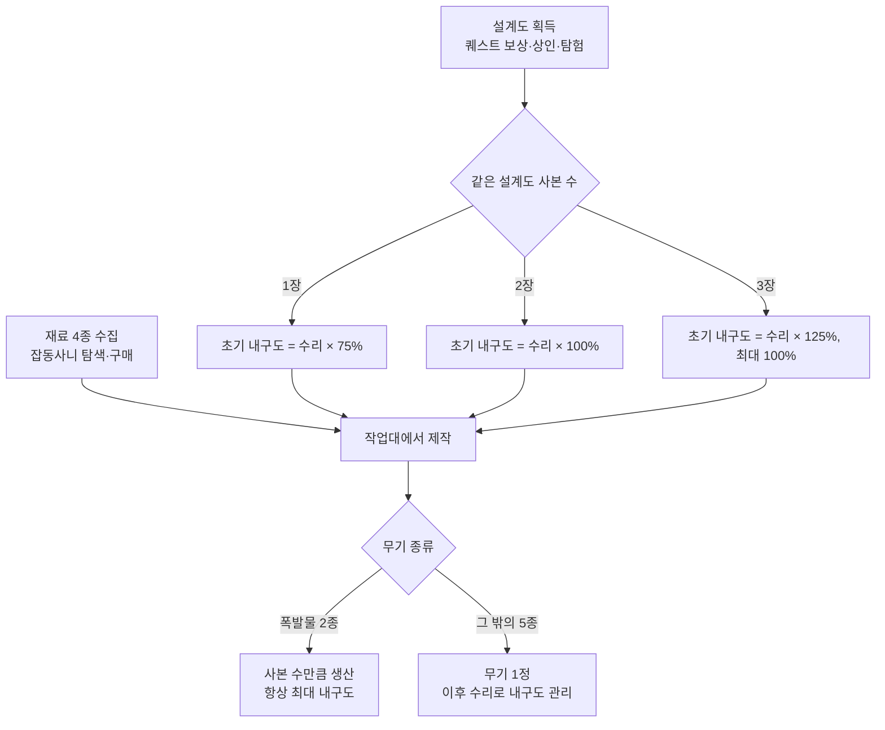

# RD-21. 소모품·잡화·제작

> **폴아웃 3 역기획서 세트** | 문서 ID: RD-21 | 버전: v1.0 | 작성일: 2026-10-11
> **범위**: 본편과 DLC 5종의 소모품 전체(의약품·약물·음식·음료·주류·기타), 잡화 전체(판매용 잡동사니, 수집 판매·반복 거래 품목, 제작 재료, 기능성 아이템, 퀘스트 아이템), 열쇠·비밀번호 유형 요약, 홀로테이프·노트 분류 개요, 제작 시스템(작업대·설계도·레시피·품질 규칙) / 다루지 않는 것: HP·방사능·중독·금단의 상태 공식(RD-15), 제작 무기의 전투 수치(RD-19), 상인 가격 공식과 수집품 판매 루프의 경제 분석(RD-22), 설계도·뉴카-콜라 퀀텀·스킬북의 위치 동선(RD-23), 반복 퀘스트 진행 상세(RD-07), 터미널·홀로테이프·자물쇠 상호작용 규칙(RD-17)
> **관련 문서**: [RD-15 상태·생존 시스템](15_status-survival.md), [RD-19 무기·탄약](19_weapons-ammo.md), [RD-20 방어구·의복](20_armor-apparel.md), [RD-22 경제·주거](22_economy-housing.md), [RD-23 수집 요소·업적](23_collectibles-achievements.md), [RD-07 비표시·반복 퀘스트와 랜덤 인카운터](07_misc-quests-encounters.md), [RD-14 캐릭터 시스템](14_character-system.md), [RD-17 탐험·상호작용](17_exploration-interaction.md)

---

## 1. 문서 개요

### 1.1 목적
- 폴아웃 3(Fallout 3)의 소모품 83종과 잡화 210종을 효과·라드·중독·무게·가격·획득처까지 정리한 **정본 카탈로그**를 제공한다.
- 작업대(Workbench)·설계도(Schematics)·레시피·품질 규칙으로 이루어진 제작 시스템을 정리한다. 그리고 소모품 경제, 회복 수단, '정크(잡동사니)'의 쓰임새를 분석해 쯔꾸르(RPG Maker) 팬게임의 아이템 데이터베이스 근거로 삼는다.

### 1.2 범위
- **소모품 83종**(허브 「Fallout 3 consumables」 기준): 의약품 6, 약물 12, 음식 49, 음료 8, 주류 6, 기타 2(스텔스 보이, 외계인 에폭시)
- **잡화 210종**(허브 「Fallout 3 miscellaneous items」 기준): 퀘스트 아이템 65, 기타 잡화 141(잡동사니 95, 제작 재료 25, 기능성 10, 반복 거래 9, 화폐 2), 삭제 항목 4
- 허브 밖이지만 판매 루프에 쓰이는 품목: 귀(Ear), 손가락(Finger)
- 열쇠 166종·홀로테이프 210종·노트 147종은 **유형과 분포만** 요약한다. 개별 위치와 원문은 각 장소·퀘스트 문서와 RD-17이 다룬다.
- 제작: 작업대 위치 개관, 설계도 7종(+삭제 1종), 레시피, 품질 규칙, 제작 무기 목록(수치는 RD-19), 기타 제작·변환 장치

### 1.3 요약
- 소모품은 **HP 회복(음식·음료·스팀팩)**, **방사능 관리(라드어웨이·라드-X·정화수)**, **일시 강화(약물·주류)** 세 축으로 나뉜다. 의약품 효과는 의학 스킬에 비례해 최대 3배가 되고, 음식·음료는 음식 살균기(Food sanitizer)가 있으면 HP 회복이 20% 늘어난다.
- 음식은 싸고 흔하지만 대부분 라드 +2~3을 함께 준다. 방사능이 없는 회복원(신선 식품·정화수·아쿠아 퓨라)은 희소 자원으로 설계됐다.
- 약물은 4분 지속이 표준이며, 중독 확률과 누적 사용량(UMON)으로 중독이 생긴다. 중독은 영구적이라 의사나 플레이어 하우스 설비로만 치료된다.
- 잡화 141종 중 116종이 **록잇 런처(Rock-It Launcher) 탄환**이 된다. 25종은 제작 재료이고, 고철·전쟁 전 서적·홀로태그 같은 품목은 반복 거래로 캡과 XP로 바뀐다. 쓸모없어 보이는 '정크'에 판매·제작·탄환·거래라는 네 겹의 쓰임새가 있다.
- 제작은 작업대에서 **설계도 + 재료 4종**으로 제작 무기 7종을 만든다. 설계도를 많이 모을수록 품질(초기 내구도)이나 생산 수가 오른다.

### 1.4 표기 메모
- **수치 출처 원칙**: 허브 표를 정본으로 싣는다. 개별 아이템 문서 정보상자와 값이 다르면 해당 칸에 `†(문서 값)`으로 함께 적고, §3.9에 모아 정리한다.
- **소모품 칼럼**
  - **효과**: 1회 섭취 효과. 의약품은 기본값과 의학 100일 때 최대값을 함께 적는다. `살균기`는 음식 살균기 소지 시 값이다.
  - **지속**: 시간이 정해진 효과의 지속 시간. 음식·음료의 HP 회복 방식(즉시 또는 분할)은 코퍼스에 명시가 없어 `—`로 둔다(RD-15 참조).
  - **라드**: 섭취 시 늘어나는 방사능량(+) 또는 줄어드는 양(−).
  - **중독**: 정보상자의 중독 확률과 중독 표의 UMON(사용량 감시 수치)·유지 시간. 상세는 §3.7과 RD-15.
  - **무게·가격**: 허브 값(가격은 기본 가치, 캡).
- **잡화 칼럼**: `QI`는 퀘스트 아이템 표시로, 버리거나 팔 수 없다. 이런 아이템은 표시 무게와 상관없이 실제로는 무게가 없다(허브 설명). `록잇 런처 탄`은 록잇 런처로 발사할 수 있는 잡화(허브 RIL 칼럼)다.
- **명칭**: 용어집(RD-26)과 한글 패치 표기 기준을 따른다. 상표 Nuka-Cola는 패치 표기 `뉴카-콜라`를 쓴다. 용어집에 없는 아이템명은 일반 명사는 번역하고 고유명사는 음차했다. 퀘스트명은 「」로 표기하며, 용어집에 있는 퀘스트명은 용어집 표기를 따른다.
- DLC 태그: `[OA]` `[TP]` `[BS]` `[PL]` `[MZ]`. 폼 ID는 잡화 표에 직접 싣고, 소모품 폼 ID는 §8.1 부록에 분리했다.

## 2. 소모품 시스템 개요

### 2.1 분류 체계

| 분류(이 문서) | 허브 분류 | 수량 | 핵심 역할 | 대표 품목 |
|---|---|---|---|---|
| 의약품 | Chems 일부 | 6 | HP 회복, 방사능 제거·저항 | 스팀팩, 라드어웨이, 라드-X |
| 약물 | Chems 일부 | 12 | SPECIAL·AP·DR·피해 일시 강화 | 버프아웃, 제트, 메드-X, 멘타츠, 사이코 |
| 음식 | Food | 49 | 소량 HP 회복(+라드) | 각종 고기·통조림·과자 |
| 음료 | Drinks 일부 | 8 | HP 회복, 일부 AP | 정화수, 오염된 물, 뉴카-콜라 |
| 주류 | Drinks 일부 | 6 | 힘·카리스마 +, 지능 − | 맥주, 위스키, 보드카 |
| 기타 | Miscellaneous | 2 | 은신, 무기 수리 | 스텔스 보이, 외계인 에폭시 |

- 허브 설명에 따르면 스텔스 보이와 외계인 에폭시는 먹는 물건이 아니지만 게임 내부에서는 소모품으로 처리된다.

### 2.2 효과 계산 규칙
- **의학 스킬 배율**: `효과 = 기본값 × (1 + 의학 ÷ 50)`. 의학 50이면 2배, 100이면 3배다(Medicine (Fallout 3) 문서). 적용 대상과 범위는 다음과 같다.

| 품목 | 기본값 | 의학 5(최저) | 의학 50 | 의학 100 |
|---|---|---|---|---|
| 스팀팩 | HP +30 | +33 | +60 | +90 |
| 적응형 바이오젤 [MZ] | HP +50 | +55 | +100 | +150 |
| 외계인 바이오젤 [MZ] | HP +10 | +11 | +20 | +30 |
| 라드-X | 방사능 저항 +25% | +27.5% | +50% | +75% |
| 라드어웨이 | 라드 −50 | −55 | −100 | −150 |

- **음식 살균기**: 「황무지 생존 가이드」(The Wasteland Survival Guide) 보상인 퀘스트 연계 잡화다(무게 7, 가치 150). 인벤토리에 있으면 대부분의 음식·음료 HP 회복량이 20% 늘어난다. 라드는 그대로다.
- **퍽 보정**(정의는 RD-14)

| 퍽 | 효과 | 관련 소모품 |
|---|---|---|
| 케미스트(Chemist) | 약물 효과 지속 시간 100% 증가 | 약물 전반 |
| 켐 레지스턴트(Chem Resistant) | 중독 확률 50% 감소 | 중독성 약물·주류 |
| 패스트 메타볼리즘(Fast Metabolism) | 스팀팩 회복량 +20% | 스팀팩, 적응형 바이오젤 |
| 리드 벨리(Lead Belly) | 오염된 물을 마실 때 받는 라드 50% 감소 | 오염된 물, 수원 음용 |
| 헤마토파지(Hematophage) | 혈액 팩 회복량이 1에서 20 HP로 증가 | 혈액 팩 |
| 펑가 파워!(Punga Power!) [PL] | 펑가 열매의 라드 제거량 증가 | 야생·정제 펑가 열매 |
| 카니발(Cannibal) | 시체를 먹어 HP 회복 | (소모품 대체 수단) |

- **약물 지속 시간**: 정보상자 기준 대부분 4분(240초)이다. 라드-X는 여러 개를 먹어도 저항치가 겹치지 않고 지속 시간만 늘어난다. 야오과이 고기의 피해 보너스와 스텔스 보이도 같은 방식으로 시간이 누적된다.
- **SPECIAL 상한**: 행운의 8번 공 문서는 '최대 10까지' 행운을 올린다고 적고 있다. 약물·주류 보정에 상한이 어떻게 적용되는지는 코퍼스에서 일괄 규칙을 확인하지 못했다(코퍼스 미확인). RD-14를 따른다.

### 2.3 방사능과 소모품
- 음식은 대부분 라드 +2~3을 함께 준다(허브는 다수를 +3, 개별 문서는 다수를 +2로 적어 값이 엇갈린다. §3.9).
- **방사능 없는 회복원**: 신선한 사과·당근·배·감자(리벳시티(Rivet City) 과학 연구실 위주), 정화수, 아쿠아 퓨라, 스위트롤. 모두 구하기 어렵게 배치됐다.
- **방사능을 줄이는 음식**: 동굴 버섯(−10), 야생·정제 펑가 열매 [PL](−1/−2, 펑가 파워! 시 −5/−15).
- **고방사능 고회복**: 인육(HP +25/라드 +10), 슬롭 [TP](+25/+25), 성수 [BS](+20/+15).
- 방사능 단계·페널티와 치료 규칙은 [RD-15 상태·생존 시스템](15_status-survival.md)을 따른다.

### 2.4 중독 개요
- 폴아웃 3의 중독은 **영구적**이다. 의사에게 캡을 내고 치료하거나, 플레이어 하우스에 '마이 퍼스트 래버러토리(My First Laboratory)'를 설치하면 무료로 치료할 수 있다. [MZ]의 치유 아치도 중독을 없앤다(Addiction 문서).
- 중독은 두 장치로 생긴다.
  - **확률(Risk)**: 1회 사용마다 판정하는 기본 확률. 정보상자는 약물에도 확률을 적었지만, 중독 문서는 "기본 확률은 폴아웃 3에서 주류에만 적용되고, 약물은 UMON 누적으로 판정한다"고 설명한다(코퍼스 내부 서술 불일치).
  - **UMON(Usage Monitor, 사용량 감시)**: 사용할 때마다 품목별 UMON 값이 누적되고, 유지 시간이 지나면 빠진다. 누적 75가 중독 확률 약 +1%p, 175가 약 +100%에 해당하는 것으로 보인다(문서가 '~로 보인다'고 표현).
- 품목별 위험·UMON·금단 효과는 §3.7 표에 정리했다. 금단 페널티의 적용 방식은 RD-15를 따른다.

## 3. 소모품 카탈로그

### 3.1 의약품 (6종)

| 영문명 | 한국어 표기 | 분류 | 효과 | 지속 | 라드 | 중독 | 무게 | 가격 | 획득처(대표) | 비고 |
|---|---|---|---|---|---|---|---|---|---|---|
| Adapted biogel | 적응형 바이오젤 | 의약품 | HP +50(의학 보정 최대 +150, 패스트 메타볼리즘 적용), 생화학적 이상 50% | 이상 효과 30초 | —(이상 효과로 변동) | 없음 | 0 | 25 | 엘리엇 터코리언이 외계인 바이오젤을 1:1 변환 | [MZ] 허브 표기 +150은 의학 100 기준 |
| Alien biogel | 외계인 바이오젤 | 의약품 | HP +10(의학 보정 최대 +30), 50% 확률로 생화학적 이상 1종(30초) | 이상 효과 30초 | —(이상 효과로 변동) | 없음 | 0 | 25 | 마더십 제타 상자·외계인 작업자, 샐리 제공 | [MZ] 허브 표기 +30은 의학 100 기준 |
| Blood pack | 혈액 팩 | 의약품 | HP +1(헤마토파지 퍽 시 +20) | — | — | 없음 | 1 | 5 | 구급상자, 병원의 수액 걸이 | 밴스에게 15캡에 판매(반복 퀘스트) |
| RadAway | 라드어웨이 | 의약품 | 라드 −50(의학 보정: 의학 100이면 −150) | — | −50~−150 | 없음 | 0 | 20 | 의료·과학 시설, 구급상자, 의사 판매 | 허브 표기 −150은 의학 100 기준 |
| Rad-X | 라드-X | 의약품 | 방사능 저항 +25%(의학 보정: 의학 100이면 +75%) | 4분(중복 시 시간만 누적) | — | 없음 | 0 | 20 | 휘튼 무기고(8), 주 방위군 기지 무기고(6) 등, 의사 판매 | 허브 표기 +75%는 의학 100 기준 |
| Stimpak | 스팀팩 | 의약품 | HP +30 즉시(의학 보정: 의학 100이면 +90, 패스트 메타볼리즘 +20%) | 즉시 | — | 없음 | 0 | 25 | 구급상자 대부분, 거의 모든 상인 | 허브 표기 +90은 의학 100 기준 |

### 3.2 약물 (12종)

| 영문명 | 한국어 표기 | 분류 | 효과 | 지속 | 라드 | 중독 | 무게 | 가격 | 획득처(대표) | 비고 |
|---|---|---|---|---|---|---|---|---|---|---|
| Ant nectar | 개미 넥타 | 약물 | 힘 +4, 카리스마 −2, 지능 −2 | 4분 | — | 5%, UMON 20/1시간 | 0.25 | 20 | 개미여인의 은신처, 코르베가 공장, 매리골드역, 셰일브리지 | — |
| Ant queen pheromones | 여왕개미 페로몬 | 약물 | 카리스마 +3, 지능 −3, 인지력 −3 | 4분 | — | 없음 | 1 | 75 | 여왕개미 시신 3곳, 신디 칸텔리 판매(총 4개) | 「좋은 날의 결혼식」 관련 |
| Berry Mentats | 베리 멘타츠 | 약물 | 지능 +5 | 4분 | — | 없음 | 0 | 20 | 국립 기록 보관소 경품 교환권 | 중독 없음 |
| Buffout | 버프아웃 | 약물 | 최대 HP +60, 지구력 +3, 힘 +2 | 4분(본문은 약 10분 후 HP 60 감소) | — | 10%, UMON 30/30시간 | 0 | 20 | 닥 호프·신디 칸텔리·아즈루칼·레오 스탈 판매, [BS] 크롤러 무기고 | 효과 종료 시 HP 60 감소(최소 1) |
| Fire ant nectar | 화염개미 넥타 | 약물 | 민첩성 +4, 지능 −3, 화염 저항 +25% | 4분 | — | 없음 | 1 | 20 | 그레이디치 화염개미, 매리골드역 여왕개미 부화장 | 레스코 박사에게 1개 40캡(반복 퀘스트) |
| Grape Mentats | 포도 멘타츠 | 약물 | 카리스마 +5 | 4분 | — | 없음 | 0 | 20 | 국립 기록 보관소 경품 교환권 | 중독 없음 |
| Jet | 제트 | 약물 | 현재 AP +30, 최대 AP +30 | 4분 | — | 20%, UMON 30/30시간 | 0 | 20 | 레오 스탈(「레오의 약물 습관」), 황무지 약쟁이, 의사·약 상인 | 가장 중독성 높은 약물군 |
| Med-X | 메드-X | 약물 | DR +25 | 4분(본문은 6분, 케미스트 12분) | — | 10%, UMON 30/30시간 | 0 | 20 | 리벳시티 중앙 갑판(7), 크롤러·메가톤 하우스(4) 등 | 시제 의무 PA 자동 투여와 중첩 |
| Mentats | 멘타츠 | 약물 | 지능 +5, 인지력 +5 | 4분 | — | 5%, UMON 30/30시간 | 0 | 20 | 레이더·엔클레이브 캠프, 약 상인 | 착용 의복과 함께 스킬 판정 보정 |
| Orange Mentats | 오렌지 멘타츠 | 약물 | 인지력 +5 | 4분 | — | 없음 | 0 | 20 | 국립 기록 보관소 경품 교환권 | 중독 없음 |
| Psycho | 사이코 | 약물 | 가하는 피해 +25% | 4분 | — | 10%, UMON 30/30시간 | 0 | 20 | 수퍼-두퍼 마트, 레이더 거점, 약 상인 | 야오과이 고기 피해 보너스와 중첩 |
| Ultrajet | 울트라제트 | 약물 | 현재 AP +40, 최대 AP +40 | 4분 | — | 20%, UMON 12/48분 | 0 | 50 | 노스웨스트 세네카역 머피(슈가 밤 8상자당 1개 판매) | 제트 중독과 별개 |

### 3.3 음식 (49종)
- 대부분 HP +5·라드 +3(문서상 +2)·가치 5다. 회복량이 큰 음식은 연갑 마이얼럭 고기(+30), 인육·슬롭(+25), 마이얼럭 고기·땅두더지 원더 미트·뉴카럭 고기(+20)다.

| 영문명 | 한국어 표기 | 분류 | 효과 | 지속 | 라드 | 중독 | 무게 | 가격 | 획득처(대표) | 비고 |
|---|---|---|---|---|---|---|---|---|---|---|
| Alien squid food | 외계인 오징어 식량 | 음식 | HP +5 | — | — | 없음 | 0 | 1 | 마더십 제타 곳곳 | [MZ] |
| Alien worm food | 외계인 벌레 식량 | 음식 | HP +5 | — | — | 없음 | 0 | 1 | 마더십 제타 곳곳 | [MZ] |
| Ant meat | 개미 고기 | 음식 | HP +5(살균기 +6) | — | +3 | 없음 | 1 | 4 | 거대 개미·개미 알, 그레이디치, 스프링베일 학교 | — |
| BlamCo Mac & Cheese | 블램코 맥 앤 치즈 | 음식 | HP +5(살균기 +6) | — | +3 | 없음 | 1 | 5 | 텐페니 타워 로비(12), 플레이어 하우스 | — |
| Bloatfly meat | 블로트플라이 고기 | 음식 | HP +5(살균기 +6) | — | +3 | 없음 | 1 | 4 | 블로트플라이 | — |
| Brahmin steak | 브라민 스테이크 | 음식 | HP +5(살균기 +6) | — | +3 †(문서 +2) | 없음 | 1 | 5 | 브라민, 정착지, 레이더 캠프 | 메가톤 폭탄 해체 답례품 후보 |
| Bubblegum | 풍선껌 | 음식 | HP +1 | — | +1 †(문서 없음) | 없음 | 1 | 1 | 야오과이 터널, 하우스 전쟁 전 테마 | 회복량 최저 |
| Cave fungus | 동굴 버섯 | 음식 | HP +5(살균기 +6), 라드 감소 | — | −10 | 없음 | 1 | 50 | 리틀 램프라잇 거래(루시: 버프아웃 / 에클레어: 수상한 고기), 맥크래디 설득 | 「버섯 거래」 반복 퀘스트 |
| Cram | 크램 | 음식 | HP +5(살균기 +6) | — | +3 †(문서 +2) | 없음 | 1 | 5 | 냉장고·선반, 하우스 테마, 알폰스 알모도바르르르(15개) | — |
| Crispy squirrel bits | 바삭한 다람쥐 조각 | 음식 | HP +5(살균기 +6) †(문서 +6) | — | +3 †(문서 +2) | 없음 | 1 | 5 | 각지 상인 | — |
| Crunchy mutfruit | 아삭한 뮤트프루트 | 음식 | HP +5(살균기 +6) | — | +3 †(문서 +2) | 없음 | 1 | 5 | 빌리 크릴 집, 닥 호프 등 캐러밴, 「집의 뉴카 갈증」 보상 | — |
| Dandy Boy Apples | 댄디 보이 사과 | 음식 | HP +5(살균기 +6) | — | +3 †(문서 +2) | 없음 | 1 | 5 | 잇오트로닉 3000, 지하철역, 가옥 | — |
| Dog meat | 개고기 | 음식 | HP +5(살균기 +6) | — | +3 †(문서 +2) | 없음 | 1 | 4 | 들개, 탈론 용병·레이더 등 소지 | — |
| Fancy Lad Snack Cakes | 팬시 래드 스낵 케이크 | 음식 | HP +5(살균기 +6) | — | +3 †(문서 +2) | 없음 | 1 | 5 | 하우스 전쟁 전 테마, 가옥 | — |
| Fresh apple | 신선한 사과 | 음식 | HP +10(살균기 +12) | — | 0 | 없음 | 1 | 5 | 리벳시티 과학 연구실(절도), 알링턴 도서관 | 방사능 없는 음식 |
| Fresh carrot | 신선한 당근 | 음식 | HP +10(살균기 +12) | — | 0 | 없음 | 1 | 5 | 리벳시티 과학 연구실(5개, 절도) | 방사능 없는 음식 |
| Fresh pear | 신선한 배 | 음식 | HP +10(살균기 +12) | — | 0 | 없음 | 1 | 5 | 리벳시티 과학 연구실 | 가장 희귀한 신선 식품 |
| Fresh potato | 신선한 감자 | 음식 | HP +10(살균기 +12) | — | 0 | 없음 | 1 | 5 | 리벳시티 과학 연구실(10개), 핑커톤 실험실 | 방사능 없는 음식 |
| Gum drops | 검드롭 | 음식 | HP +1 | — | +1 | 없음 | 1 | 2 | 리벳시티 퀵 픽스(절도), 주리 스트리트 지하철 배수실 | 희귀 |
| Hatchling mirelurk meat | 새끼 마이얼럭 고기 | 음식 | HP +5(살균기 +6) | — | +3 †(문서 +2) | 없음 | 1 | 4 | 마이얼럭 알 무더기(앵커리지 기념관 등) | 허브의 살균기 값 +12는 오기로 보임 |
| Human flesh | 인육 | 음식 | HP +25(살균기 +30) | — | +10 †(문서 +9) | 없음 | 1 | 0 | 야생 구울, 개미여인, [TP] 트로그, [PL] 부족민·늪지 주민, [MZ] 어보미네이션 | 가치 0 |
| Iguana bits | 이구아나 조각 | 음식 | HP +5(살균기 +6) | — | +3 | 없음 | 1 | 5 | 가옥 식탁, 모이라·시그레이브 판매, 적 소지 | — |
| Iguana-on-a-stick | 이구아나 꼬치 | 음식 | HP +5(살균기 +6) | — | +3 †(문서 +2) | 없음 | 1 | 5 | 레이더 상점·애국 피크닉장 바비큐, 브래스 랜턴(제니 스탈) | — |
| InstaMash | 인스타매시 | 음식 | HP +5(살균기 +6) | — | +3 †(문서 +2) | 없음 | 1 | 5 | 하우스 전쟁 전 테마 | — |
| Junk food | 정크 푸드 | 음식 | HP +5(살균기 +6) | — | +3 | 없음 | 1 | 5 | 잇오트로닉, 가옥 | 포테이토 크리스프와 외형 동일 |
| Mirelurk meat | 마이얼럭 고기 | 음식 | HP +20(살균기 +24) | — | +2 | 없음 | 1 | 20 | 마이얼럭·마이얼럭 헌터, 마이얼럭 알 | — |
| Mirelurk cakes | 마이얼럭 케이크 | 음식 | HP +5(살균기 +6) | — | +3 | 없음 | 1 | 5 | 식당 상인(게리의 갤리 등), 앵커리지 기념관 | — |
| Mississippi Quantum pie | 미시시피 퀀텀 파이 | 음식 | 최대 AP +20, 힘 +1, 지능 −1 | 4분 | +5 | 없음 | 1 | 20 | 시에라 페트로비타가 제작(밀가루·퀀텀·보드카) | 반복 퀘스트 「미시시피 퀀텀 파이」 |
| Mole rat meat | 땅두더지 고기 | 음식 | HP +5(살균기 +6) | — | +3 | 없음 | 1 | 4 | 땅두더지 | 원더 미트 재료 |
| Mole rat wonder meat | 땅두더지 원더 미트 | 음식 | HP +20(살균기 +24) | — | +3 | 없음 | 1 | 20 | 주리 스트리트 원더 미트 메이커(땅두더지 고기 + 원더글루) | 「라이언 브리그의 원더 미트」 |
| Mutfruit | 뮤트프루트 | 음식 | HP +5(살균기 +6) | — | +3 †(문서 +2) | 없음 | 1 | 5 | 브래스 랜턴, 게리의 갤리 판매 | — |
| Noodles | 국수 | 음식 | HP +5(살균기 +6) | — | +3 †(문서 +2) | 없음 | 1 | 5 | 브래스 랜턴 국수 가판대, 비더컵의 선물 | — |
| Nukalurk meat | 뉴카럭 고기 | 음식 | HP +20(살균기 +24), AP +10 | AP 4분 | +5 †(문서 +4) | 없음 | 1 | 7 | 뉴카-콜라 공장의 뉴카럭(최대 10개, 리스폰 없음) | — |
| Pork n' Beans | 포크 앤 빈스 | 음식 | HP +5(살균기 +6) | — | +3 †(문서 +2) | 없음 | 1 | 5 | 메가톤 하우스(35), 텐페니 스위트(22), 레이더 거점 | 가격 불일치†(문서 4) |
| Potato Crisps | 포테이토 크리스프 | 음식 | HP +5(살균기 +6) | — | +3 †(문서 +2) | 없음 | 1 | 5 | 잇오트로닉, 가옥, 하우스 테마 | — |
| Radroach meat | 방사능바퀴 고기 | 음식 | HP +5(살균기 +6) | — | +3 †(문서 +2) | 없음 | 1 | 4 | 방사능바퀴, 슈퍼 뮤턴트 소지 | — |
| Refined punga fruit | 정제 펑가 열매 | 음식 | HP +15(살균기 +18), 라드 감소 | — | −2(펑가 파워! −15) | 없음 | 1 | 30 | 아크 앤드 도브 대성당(141개), 비표시 퀘스트 보상 10개 | [PL] |
| Salisbury Steak | 솔즈베리 스테이크 | 음식 | HP +5(살균기 +6) | — | +3 †(문서 +2) | 없음 | 1 | 5 | 냉장고, 하우스 테마 | — |
| Slop | 슬롭 | 음식 | HP +25 | — | +25 | 없음 | 1 | 5 | 피트의 카이에게서만 구매 | [TP] 트로그 고기·오염수 |
| Squirrel on a stick | 다람쥐 꼬치 | 음식 | HP +5(살균기 +6) | — | +2 | 없음 | 1 | 5 | 대부분의 상점, 사냥꾼, 레이더 거점 | — |
| Squirrel stew | 다람쥐 스튜 | 음식 | HP +5(살균기 +6) | — | +3 †(문서 +2) | 없음 | 1 | 5 | 식당 상인(브래스 랜턴 등) | — |
| Strange meat | 수상한 고기 | 음식 | HP +5(살균기 +6) | — | +3 †(문서 +2) | 없음 | 1 | 2 | 안데일 냉장고(총 80개), 크라이슬러스 빌딩 | 인육 암시, 동굴 버섯 거래 재료 |
| Strange meat pie | 수상한 고기 파이 | 음식 | HP +5(살균기 +6) | — | +3 †(문서 +2) | 없음 | 1 | 2 | 안데일 린다 스미스(비밀 유지 시 매일 1개), [PL] 사냥꾼 오두막 | — |
| Softshell mirelurk meat | 연갑 마이얼럭 고기 | 음식 | HP +30(살균기 +36) | — | +3 †(문서 +2) | 없음 | 1 | 30 | 마이얼럭 킹·스웜프럭, 리버보트 랜딩, [PL] 알 무더기 | 회복량 최상위 음식 |
| Sugar Bombs | 슈가 밤 | 음식 | HP +5(살균기 +6) | — | +3 †(문서 +2) | 없음 | 1 | 5 | 냉장고 무작위, 고정 배치 다수(RD-23) | 머피에게 1상자 15캡(설득 30) |
| Sweetroll | 스위트롤 | 음식 | HP +5(살균기 +6) | — | 0 | 없음 | 1 | 5 | 「빨리 크는 아이」에서 파머 할머니가 줌 | 생일 선물 |
| Wild punga fruit | 야생 펑가 열매 | 음식 | HP +5(살균기 +6) †(문서 +10), 라드 감소 | — | −1(펑가 파워! −5) | 없음 | 1 | 10 | 포인트 룩아웃 전역, DLC 설치 후 캐피털 상인 | [PL] |
| Yao guai meat | 야오과이 고기 | 음식 | HP +10(살균기 +12), 가하는 피해 +10% | 피해 보너스 지속(여러 개 먹으면 시간 누적) | +10 †(문서 +9) | 없음 | 1 | 30 | 야오과이, 일부 상인·사냥꾼 | 사이코와 중첩, 자체 중복 불가 |
| YumYum Deviled Eggs | 얌얌 데빌드 에그 | 음식 | HP +5(살균기 +6) | — | +3 †(문서 +2) | 없음 | 1 | 5 | 가옥, 냉장고·스토브, 하우스 테마 | — |

### 3.4 음료 (8종)

| 영문명 | 한국어 표기 | 분류 | 효과 | 지속 | 라드 | 중독 | 무게 | 가격 | 획득처(대표) | 비고 |
|---|---|---|---|---|---|---|---|---|---|---|
| Aqua Cura | 아쿠아 큐라 | 음료 | HP +10(살균기 +12) | — | +6 | 없음 | 1 | 10 | 역사 박물관 그리폰(2개 10캡), 박물관 관리청 건물(30) | [BS] 아쿠아 퓨라에 오염수를 바꿔 넣은 사기 상품 |
| Aqua Pura | 아쿠아 퓨라 | 음료 | HP +20(살균기 +24) | — | 0 | 없음 | 1 | 6 | 캐러밴 물 배달, 약탈 레이더·탈론, [BS] 정화기 가동 이후 | [BS] FEV 오염 시 힘·지능 감소, 4병째 즉사 |
| Dirty water | 오염된 물 | 음료 | HP +10(살균기 +12) | — | +6 †(문서 +5) | 없음 | 1 | 10 | 수퍼-두퍼 마트(10), 스프링베일 학교(8) 등 | 리드 벨리 퍽 시 라드 50% 감소 |
| Holy water | 성수 | 음료 | HP +20(살균기 +24) | — | +15 | 없음 | 1 | 0 | 제라드 형제(첫 대면 시 지급), 로자·미키 소매치기 | [BS] 「성수」, FEV 감염 시 힘 −2·지능 −1 |
| Ice cold Nuka-Cola | 아이스 콜드 뉴카-콜라 | 음료 | HP +20(살균기 +24), 병뚜껑 +1 | — | +3 | 없음 | 1 | 20 | 뉴카-콜라 견학(시에라), 하우스용 뉴카-콜라 기계로 변환 | 일반 뉴카-콜라의 2배 회복 |
| Nuka-Cola | 뉴카-콜라 | 음료 | HP +10(살균기 +12), 병뚜껑 +1 | — | +2 †(문서 +3) | 없음 | 1 | 20 | 시에라의 집(65), 자판기, 각지 | 빈 병은 남지 않음 |
| Nuka-Cola Quantum | 뉴카-콜라 퀀텀 | 음료 | 최대 AP +20, 병뚜껑 +1 | 4분 | +6 †(문서 +10) | 10%, UMON 12/48분 | 1 | 30 | 본편 94병 + DLC 14병(총 108병, RD-23) | 뉴카 수류탄·퀀텀 파이 재료 |
| Purified water | 정화수 | 음료 | HP +20(살균기 +24) | — | 0 | 없음 | 1 | 20 | 구급상자, 주 방위군 기지 무기고(7), 하우스 로봇(와즈워스·고드프리 주 5병) | 물 거지에게 주면 선 카르마 |

### 3.5 주류 (6종)
- 모두 4분간 힘·카리스마를 올리고 지능을 깎는다(밀주 [PL]는 ±2). 주류만 기본 중독 확률(5% 또는 10%)로 판정한다.

| 영문명 | 한국어 표기 | 분류 | 효과 | 지속 | 라드 | 중독 | 무게 | 가격 | 획득처(대표) | 비고 |
|---|---|---|---|---|---|---|---|---|---|---|
| Beer | 맥주 | 주류 | 힘 +1, 카리스마 +1, 지능 −1 | 4분 | — | 5%(알코올) | 1 | 2 | 에버그린 밀 시장(36), 샛컴 NN-03d(32), 진흙탕 술집(25) 등 | — |
| Moonshine | 밀주 | 주류 | 힘 +2, 카리스마 +2, 지능 −2 | 4분 | — | 10%(알코올) | 2 | 50 | 포인트 룩아웃 적(늪지 주민), 마거리트·그로워 오두막 | [PL] 「위스키 한 숟가락」 |
| Scotch | 스카치 | 주류 | 힘 +1, 카리스마 +1, 지능 −1 | 4분 | — | 10%(알코올) | 1 | 10 | 스프링베일 발전소, 메레스티 지하철역 등 | — |
| Vodka | 보드카 | 주류 | 힘 +1, 카리스마 +1, 지능 −1 | 4분 | — | 10%(알코올) | 1 | 20 | 메가톤 괍·스탈 가족 판매, 메레스티 칼 등 | 퀀텀 파이 재료 |
| Whiskey | 위스키 | 주류 | 힘 +1, 카리스마 +1, 지능 −1 | 4분 | — | 10%(알코올) | 1 | 10 | 텐페니 타워 로비(37)·스위트(34), 메가톤 하우스(32) | — |
| Wine | 와인 | 주류 | 힘 +1, 카리스마 +1, 지능 −1 | 4분 | — | 5%(알코올) | 1 | 10 | 알링턴 하우스, 진흙탕 술집, [PL] 캘버트 저택 지하 | — |

### 3.6 기타 소모품 (2종)

| 영문명 | 한국어 표기 | 분류 | 효과 | 지속 | 라드 | 중독 | 무게 | 가격 | 획득처(대표) | 비고 |
|---|---|---|---|---|---|---|---|---|---|---|
| Alien epoxy | 외계인 에폭시 | 기타(수리) | 장착 무기 내구도 +15/20/25/30%(수리 0~24/25~49/50~74/75~100) | 즉시 | — | 없음 | 0 | 25 | 마더십 제타 100개 이상(무기 연구실 16 등) | [MZ] 방어구는 수리 불가 |
| Stealth Boy | 스텔스 보이 | 기타(은신) | 은신 +100, 스텔스 필드 +75 | 2분(게임 내 1시간), 중복 사용 시 누적 | — | 없음 | 1 | 100 | 금고·탄약 상자 무작위, 고정 배치 다수 | 중립 NPC와의 전투를 멈출 수 있음 |

- 외계인 에폭시의 수리량은 수리 스킬 구간별 값이다. 지구 무기를 고칠 재료가 없는 마더십 제타(Mothership Zeta) 안에서 무기를 고치는 대체 수단이며, 여러 개를 쓰면 수리 스킬과 상관없이 100%까지 올릴 수 있다. 방어구는 고칠 수 없다.
- 스텔스 보이는 실시간 2분(게임 내 1시간) 지속된다. 중복 사용하면 시간이 누적된다. 중립 NPC와 싸우는 중에 쓰고 웅크리면 전투가 풀리기도 한다.

### 3.7 중독 표

| 품목 | 분류 | 기본 위험 | UMON 값 | UMON 유지 | 금단 효과 |
|---|---|---|---|---|---|
| 버프아웃 | 약물 | 10% | 30 | 30시간 | 지구력 −1, 힘 −1 |
| 제트 | 약물 | 20% | 30 | 30시간 | 민첩성 −1, 카리스마 −1 |
| 울트라제트 | 약물 | 20% | 12 | 48분 | 민첩성 −2, 인지력 −1, 힘 −1 |
| 멘타츠(일반) | 약물 | 5% | 30 | 30시간 | 지능 −1, 인지력 −1 |
| 사이코 | 약물 | 10% | 30 | 30시간 | 지구력 −1, 인지력 −1 |
| 메드-X | 약물 | 10% | 30 | 30시간 | 민첩성 −1, 지능 −1 |
| 개미 넥타(일반) | 약물 | 5% | 20 | 1시간 | 힘 −2 |
| 뉴카-콜라 퀀텀 | 음료(허브 분류상 음식) | 10% | 12 | 48분 | 카리스마 −1, 방사능 저항 −15 |
| 맥주·와인 | 주류 | 5% | — | — | 민첩성 −1, 카리스마 −1 |
| 보드카·스카치·위스키 | 주류 | 10% | — | — | 민첩성 −1, 카리스마 −1 |
| 밀주 [PL] | 주류 | 10%(정보상자) | — | — | 중독 표에 미기재(알코올 중독 공통으로 추정, 코퍼스 미확인) |

- 중독되지 않는 소모품: 스팀팩, 라드어웨이, 라드-X, 베리·포도·오렌지 멘타츠, 화염개미 넥타, 여왕개미 페로몬, 바이오젤 2종, 퀀텀을 뺀 모든 음식·음료.
- 알코올 중독은 주류 6종이 같은 중독 하나를 공유한다.

### 3.8 소모품 생산·변환 수단

| 수단 | 위치·조건 | 투입 → 산출 | 비고 |
|---|---|---|---|
| 원더 미트 메이커 | 주리 스트리트 지하철역(Jury Street Metro station) | 땅두더지 고기 + 원더글루 → 땅두더지 원더 미트 | 반복 퀘스트 「라이언 브리그의 원더 미트」 |
| 시에라 페트로비타(Sierra Petrovita) | 다리그늘 마을(Girdershade), 「뉴카-콜라 챌린지」·「미시시피 퀀텀 파이」 완료 후 | 밀가루 + 뉴카-콜라 퀀텀 + 보드카 → 미시시피 퀀텀 파이 | 재료 가치 합 52캡 → 파이 가치 20캡 |
| 하우스 뉴카-콜라 기계 | 플레이어 하우스 설비(RD-22) | 뉴카-콜라 → 아이스 콜드 뉴카-콜라 | 회복량 2배(+10 → +20) |
| 엘리엇 터코리언(Elliott Tercorien) [MZ] | 대화 | 외계인 바이오젤 → 적응형 바이오젤(1:1) | |
| 하우스 로봇(와즈워스·고드프리) | 메가톤 하우스·텐페니 타워 스위트 | 요청 시 정화수, 주 최대 5병 | RD-22 |
| 리틀 램프라잇(Little Lamplight) 거래 | 루시: 버프아웃 / 에클레어: 수상한 고기 | → 동굴 버섯 | 반복 퀘스트 「버섯 거래」 |
| 린다 스미스 | 안데일(Andale), 식인 비밀 유지 시 | 매일 수상한 고기 파이 1개 | |
| 머피 | 노스웨스트 세네카역 | 슈가 밤 8상자 → 울트라제트 1개 판매 자격 | 반복 퀘스트 「머피의 폭격」 |
| 경품 교환권 | 국립 기록 보관소(National Archives) 퀴즈 | 교환권 → 베리·포도·오렌지 멘타츠 중 1종 | |
| [PL] 「위스키 한 숟가락」(A Spoonful of Whiskey) | 포인트 룩아웃의 마거리트 오두막 | 효모·핵분열 배터리 등 재료 수집 → 보상으로 밀주 6병, 300~500캡, 50 XP | 퀘스트 상세는 RD-08d |

### 3.9 허브-개별 문서 수치 불일치 요약
- 표에는 허브 값을 싣고 `†(문서 값)`을 덧붙였다. 유형별로 정리하면 다음과 같다.
  - **음식 라드 +3 vs +2**: 브라민 스테이크, 크램, 바삭한 다람쥐 조각, 아삭한 뮤트프루트, 댄디 보이 사과, 개고기, 팬시 래드 스낵 케이크, 새끼 마이얼럭 고기, 이구아나 꼬치, 인스타매시, 뮤트프루트, 국수, 포크 앤 빈스, 포테이토 크리스프, 방사능바퀴 고기, 솔즈베리 스테이크, 다람쥐 스튜, 수상한 고기·파이, 연갑 마이얼럭 고기, 슈가 밤, 얌얌 데빌드 에그(22종). 검드롭 문서는 "다른 음식은 3"이라고 적어 허브 쪽을 지지한다.
  - **기타 라드**: 인육·야오과이 고기 +10 vs +9, 뉴카럭 고기 +5 vs +4, 오염된 물 +6 vs +5, 뉴카-콜라 +2 vs +3, 뉴카-콜라 퀀텀 +6 vs +10(본문도 +10), 풍선껌 +1 vs 없음.
  - **회복량**: 바삭한 다람쥐 조각 +5 vs +6, 야생 펑가 열매 +5 vs +10, 새끼 마이얼럭 고기의 살균기 값(허브 +12는 오기로 보임).
  - **가격**: 포크 앤 빈스 5 vs 4.
  - **지속 시간**: 메드-X 4분(정보상자) vs 6분(본문), 버프아웃 4분(정보상자) vs 약 10분 후 HP 감소(본문).
  - **의학 보정 표기**: 허브는 스팀팩 +90, 라드어웨이 −150, 라드-X +75%, 바이오젤 +30/+150처럼 **의학 100일 때의 값**을 적었다. 정보상자는 기본값(+30/−50/+25%/+10/+50)이다. 이 문서는 둘 다 적었다.

## 4. 잡화 카탈로그

### 4.1 잡화 개요와 분류
- 허브 「Fallout 3 miscellaneous items」는 무기·방어구·소모품·탄약·책·열쇠·문서가 아닌 아이템을 모은 목록이다. 이 문서는 용도에 따라 다음과 같이 나눈다.

| 분류 | 수량 | 정의 | 대표 품목 |
|---|---|---|---|
| 퀘스트 아이템 | 65 | 특정 퀘스트 진행에 쓰이는 아이템. 이 중 50종은 QI(버리기·판매 불가, 실제 무게 0) | 독립 선언문, G.E.C.K., 변형 FEV, 음식 살균기 |
| 판매용 잡동사니 | 95 | 판매·록잇 런처 탄환 외 용도가 없는 생활용품 | 접시, 컵, 당구공, 장난감, 책 잔해 |
| 제작 재료 | 25 | 제작 무기 레시피 재료(§5.3) | 센서 모듈, 핵분열 배터리, 원더글루 |
| 기능성 아이템 | 10 | 소지만으로 효과가 있거나 장치를 여는 아이템 | 머리핀, 지하철 승차권, 출입 카드, 사무직원 신분증 |
| 반복 거래 품목 | 9 | 특정 NPC에게 반복해서 넘겨 캡·XP·아이템으로 바꾸는 아이템 | 고철, 전쟁 전 서적, BoS 홀로태그, 곰 인형 |
| 화폐 | 2 | 캡과 그 대용 | 병뚜껑(캡), 전쟁 전 지폐 |
| 삭제 항목 | 4 | 게임 파일에만 있음 | 미국 헌법, 생존 가이드 원고 |

- **무게 0 잡화** 17종: 병뚜껑, 머리핀, 전쟁 전 지폐, 담배, 연필, BoS 홀로태그, 체리 폭탄, 출입 카드 2종, 지하철 승차권, 사무직원 신분증, 실험용 로 신분증, 리버보트 승선권 [PL], 외계 수정 2종 [MZ], 뇌 덩어리 [PL], 슈퍼 뮤턴트 혈액 샘플 [BS]. 무게가 없어 소지 한도에 부담을 주지 않는 수집·거래 품목으로 설계됐다.
- **록잇 런처 탄환**: 기타 잡화 141종 중 116종(퀘스트 아이템까지 합치면 117종)이 록잇 런처의 탄환이 된다. 록잇 런처의 수치와 탄환 규칙은 [RD-19 무기·탄약](19_weapons-ammo.md)을 따른다.

### 4.2 수집 판매 품목·반복 거래
- 잡동사니 가운데 일부는 특정 NPC가 **반복해서** 사 주거나 다른 아이템으로 바꿔 준다. 이 표는 품목 중심으로 정리한 것이다. 퀘스트 진행은 [RD-07](07_misc-quests-encounters.md), 캡 경제 관점의 루프 분석은 [RD-22](22_economy-housing.md)를 따른다.

| 품목 | 거래처(위치) | 보상 | 연결 퀘스트 | 비고 |
|---|---|---|---|---|
| 전쟁 전 서적 | 이얼링 서기(Scribe Yearling), 알링턴 도서관 | 1권당 100캡 + 10 XP | 「배움의 열망」(Yearning for Learning) | 일반 가치 1, 파란 희귀본 가치 5 |
| 고철 | 월터(Walter), 메가톤 | 10캡, XP, 선 카르마 중 택1 | 「월터의 고철」(Walter's Scrap Metal) | 메가톤 수도관 보수 명목 |
| 고철 | 윈드롭(Winthrop), 언더월드 | 고철 5개 → 스팀팩·라드-X·라드어웨이 중 1 | 「이 낡은 집」(This Old House) | |
| 고철·파워 아머·에너지 무기·센서 모듈 | 프로텍터 캐스딘(Protector Casdin), 인디펜던스 요새(Fort Independence) | 5.56mm탄·파편 수류탄·라드어웨이·스팀팩, 요새 출입 | 「아웃캐스트 수집 대리인」(The Outcast Collection Agent) | BoS 파워 아머는 받지 않음 |
| 고철·탄약 | [TP] 탄약 프레스, 제철소(The Mill) | 다른 탄약으로 변환(§5.6) | 「자유 노동」(Free Labor) 완료 후 | 고철 프레스 가치 20 |
| 슈가 밤 | 머피(Murphy), 노스웨스트 세네카역 | 1상자 15캡(설득 시 30), 8상자마다 울트라제트 1개 구매 가능 | 「머피의 폭격」(Murphy's Bombing Run) | 슈가 밤은 소모품(음식) |
| BoS 홀로태그 | 제임슨 서기(Scribe Jameson), 시타델 | 1개 100캡 + 25 XP | 「홀로태그 수집」(Collecting Holotags) | 무게 0 |
| 카메라 [BS] | 로스차일드 서기(Scribe Rothchild), 시타델 | 1개 100캡 + 25 XP | 「황금 시간대 준비」(Getting Ready for Prime Time) | |
| 센서 모듈 [BS] | 로스차일드 서기, 시타델 | 1개 75캡 + 10 XP | 「황금 시간대 준비」 | 병뚜껑 지뢰 재료와 경합 |
| 슈퍼 뮤턴트 혈액 샘플 [BS] | 팔라딘 트리스탄(Paladin Tristan), 시타델 | 1개 50캡 + 10 XP | 「피의 형제단」(Blood Brotherhood) | 동료가 잡은 슈퍼 뮤턴트도 떨굼 |
| 곰 인형 [TP] | 미디아(Midea)·샌드라(Sandra), 피트 | 1개 30캡 | 「아이들에게 장난감을」(Toys for Tots) | |
| 화염개미 넥타 | 레스코 박사(Doctor Lesko), 그레이디치 | 1개 40캡 | 「재미와 이익을 위한 넥타 수집」(Nectar Collecting for Fun and Profit) | 소모품(약물) |
| 혈액 팩 | 밴스(Vance), 메레스티 지하철역 | 1개 15캡 | 「네 피를 마시고 싶어」(I Want to Drink Your Blood) | 소모품(의약품) |
| 정화수·아쿠아 퓨라 | 물 거지 미키·카를로스·윌리(메가톤·리벳시티·텐페니 타워 밖) | 선 카르마 | 「물 거지」(Water Beggars) | |
| 버프아웃·수상한 고기 | 루시(Lucy)·에클레어(Eclair), 리틀 램프라잇 | 동굴 버섯 | 「버섯 거래」(Fungus Deal) | §3.8 |
| 뉴카-콜라 | 집(Zip), 리틀 램프라잇 | 여러 아이템 | 「집의 뉴카 갈증」(Zip's Nuka Fix) | 아삭한 뮤트프루트 등 |
| 뉴카-콜라 퀀텀 | 시에라 페트로비타, 다리그늘 마을 | 퀘스트 보상(뉴카 수류탄 설계도 등) | 「뉴카-콜라 챌린지」(The Nuka-Cola Challenge) | 사이드 퀘스트 상세는 RD-06, 위치는 RD-23 |
| 밀가루 + 퀀텀 + 보드카 | 시에라 페트로비타 | 미시시피 퀀텀 파이 | 「미시시피 퀀텀 파이」(Mississippi Quantum Pie) | |
| 땅두더지 고기 + 원더글루 | 원더 미트 메이커, 주리 스트리트 지하철역 | 땅두더지 원더 미트 | 「라이언 브리그의 원더 미트」(Ryan Brigg's Wonder Meat) | |
| 링컨 기념품 7종 | 아브라함 워싱턴(리벳시티)·한니발 햄린(템플 오브 유니온)·리로이 워커 | 총 10~1,110캡(구매자·품목별 상이) | 「링컨의 이윤」(Lincoln's Profit Margins, 비표시) | 판매처 선택이 카르마·서사와 연결 |
| 강철 주괴 [TP] | 에버렛(Everett), 제철소 | 10개마다 유니크 장비 | 「제철소 일꾼」(Mill Worker) | 보상 사다리는 RD-20 §4.3 |
| 손가락(Finger) | 소노라 크루즈(Sonora Cruz), 감시자 본부(Regulator HQ) | 1개 5캡(카르마 750 이상이면 10캡) + 카르마 +10 | 로브링어(Lawbringer) 퍽 | 무게 0, 가치 1. 준더스 플렁킷의 손가락은 1,000캡 |
| 귀(Ear) | 다니엘 리틀혼(Daniel Littlehorn), 고철 처리장 사무실 | 1개 10캡(카르마 −750 이하이면 15캡) + 카르마 −10 | 컨트랙트 킬러(Contract Killer) 퍽 | 무게 0, 가치 1 |
| 지도 마커 데이터 | 라일리(Reilly), 레인저 기지 | 발견 위치당 30캡 | 「라일리와 지형 측량」(Geomapping with Reilly, 비표시) | 지형 측량 모듈 필요 |

- 손가락·귀는 해당 퍽을 고른 뒤 처치한 선(귀)·악(손가락) 성향 NPC에게서만 나온다. 다른 캐릭터·크리처·환경이 대상 HP의 50% 넘게 피해를 주면 나오지 않는다(Finger·Ear 문서).

### 4.3 제작 재료 색인
- 제작 재료 25종과 병뚜껑·뉴카-콜라 퀀텀의 레시피 연결은 §5.3 레시피 표에 정리했다. 재료 대부분은 판매가 5~30캡의 생활용품이다. 센서 모듈(30)·핵분열 배터리(75)처럼 반복 거래나 퀘스트와 수요가 겹치는 재료도 있다.

### 4.4 기타 잡화 전체 표 (141종)
- `분류`는 §4.1 기준이다. `록잇 런처 탄`의 ○는 록잇 런처로 쏠 수 있는 아이템이다.

| 영문명 | 한국어 표기 | 분류 | 가치 | 무게 | 용도·연결 | 록잇 런처 탄 | 폼 ID |
|---|---|---|---|---|---|---|---|
| 10-ball | 10번 당구공 | 잡동사니 | 2 | 1 | — | ○ | 0002b41b |
| 13-ball | 13번 당구공 | 잡동사니 | 2 | 1 | — | ○ | 0002b41d |
| 2-ball | 2번 당구공 | 잡동사니 | 2 | 1 | — | ○ | 0002b415 |
| 5-ball | 5번 당구공 | 잡동사니 | 2 | 1 | — | ○ | 0002b417 |
| 8-ball | 8번 당구공 | 잡동사니 | 2 | 1 | — | ○ | 0002b419 |
| Abraxo cleaner | 아브락소 세제 | 제작 재료 | 5 | 1 | 뉴카 수류탄 | ○ | 00022106 |
| Ashtray | 재떨이 | 잡동사니 | 1 | 1 | — | ○ | 00034057 |
| Baseball | 야구공 | 잡동사니 | 2 | 1 | — | ○ | 0002b40b |
| Baseball glove | 야구 글러브 | 잡동사니 | 4 | 1 | — | ○ | 0002b410 |
| Basketball | 농구공 | 잡동사니 | 1 | 1 | — | ○ | 0002b40e |
| Bent tin can | 찌그러진 깡통 | 잡동사니 | 1 | 1 | — | ○ | 0005b6ca |
| Big spoon | 큰 숟가락 | 잡동사니 | 1 | 1 | — | ○ | 0005b640 |
| Blue pass card | 파란 출입 카드 | 기능 | 1 | 0 | 해당 노선 지하철 프로텍트론 통과(소모 안 됨) | — | 00028706 |
| Bobby pin | 머리핀 | 기능 | 1 | 0 | 자물쇠 따기 소모품(RD-17) | — | 0000000a |
| Bonesaw | 뼈톱 | 잡동사니 | 5 | 2 | — | ○ | 000250a3 |
| Bottle cap | 병뚜껑(캡) | 화폐 | 1 | 0 | 화폐, 병뚜껑 지뢰 재료(10개) | — | 000000f |
| Box of detergent | 세제 상자 | 잡동사니 | 1 | 1 | — | ○ | 0003406f |
| Brahmin skull | 브라민 두개골 | 잡동사니 | 1 | 2 | — | — | 0003405e |
| Brotherhood of Steel holotag | BoS 홀로태그 | 반복 거래 | 1 | 0 | 「홀로태그 수집」: 제임슨 서기에게 100캡·25XP | — | 0001edc5 |
| Butter knife (cafeteria) | 버터나이프(식당용) | 잡동사니 | 1 | 1 | — | ○ | 0005b639 |
| Butter knife (metal) | 버터나이프(금속) | 잡동사니 | 1 | 1 | — | ○ | 0005b63a |
| Buttercup toy | 버터컵 장난감 | 잡동사니 | 150 | 2 | [MZ] 가치 150 | ○ | 00bdfc |
| Camera | 카메라 | 반복 거래 | 5 | 1 | [BS] 「황금 시간대 준비」: 로스차일드 서기에게 100캡·25XP | ○ | 00034062 |
| Carton of cigarettes | 담배 한 보루 | 잡동사니 | 50 | 2 | 가치 50 | ○ | 00034068 |
| Ceramic dinner plate | 도자기 접시 | 잡동사니 | 1 | 1 | — | ○ | 000340a0 |
| Cherry bomb | 체리 폭탄 | 제작 재료 | 5 | 0 | 병뚜껑 지뢰 | — | 00022108 |
| Chessboard | 체스판 | 잡동사니 | 1 | 1 | — | ○ | 0009a809 |
| Cigarette | 담배 | 잡동사니 | 1 | 0 | — | — | 0005b52c |
| Clipboard | 클립보드 | 잡동사니 | 1 | 1 | — | ○ | 00025238 |
| Coffee mug | 커피 머그 | 잡동사니 | 1 | 1 | — | ○ | 0003406c |
| Coffee pot | 커피 포트 | 잡동사니 | 1 | 1 | — | ○ | 00025421 |
| Conductor | 도체 | 제작 재료 | 30 | 5 | 록잇 런처 | ○ | 00022102 |
| Crutch | 목발 | 제작 재료 | 5 | 2 | 레일웨이 라이플 | — | 0001B01F |
| Cue ball | 큐볼 | 잡동사니 | 3 | 1 | — | ○ | 0002b41f |
| Cup | 컵 | 잡동사니 | 1 | 1 | — | ○ | 0003407b |
| Cutting board | 도마 | 잡동사니 | 1 | 1 | — | ○ | 0003406e |
| Damaged garden gnome | 망가진 정원 난쟁이 인형 | 잡동사니 | 1 | 4 | — | ○ | 0005b635 |
| Danielle's book | 다니엘의 책 | 잡동사니 | 1 | 1 | 포기 바텀역, 용도 없음 | ○ | 000c9403 |
| Deathclaw hand | 데스클로 손 | 제작 재료 | 25 | 1 | 데스클로 건틀릿 | ○ | 0002210B |
| Dinner plate | 접시 | 잡동사니 | 1 | 1 | — | ○ | 0005b59f |
| Dog bowl | 개 밥그릇 | 잡동사니 | 1 | 1 | — | ○ | 00034070 |
| Door component | 문 부품 | 기능 | 1 | 1 | 앵커리지 기념관 문 수리(수리 35, 부품 없으면 95) | — | 000a8745 |
| Drinking glass | 유리잔 | 잡동사니 | 1 | 1 | — | ○ | 0005b633 |
| Earnings clipboard | 수익 클립보드 | 잡동사니 | 1 | 1 | — | ○ | 00025237 |
| Empty Nuka-Cola bottle | 빈 뉴카-콜라 병 | 잡동사니 | 2 | 1 | — | ○ | 00022103 |
| Empty soda bottle | 빈 탄산음료 병 | 잡동사니 | 1 | 1 | — | ○ | 0009aa4e |
| Empty syringe | 빈 주사기 | 잡동사니 | 5 | 1 | — | ○ | 000250a8 |
| Empty whiskey bottle | 빈 위스키 병 | 잡동사니 | 1 | 1 | — | ○ | 0005b6ce |
| Experimental Rho ID | 실험용 로(Rho) 신분증 | 기능 | 1 | 0 | 캠프 로 방어 터렛이 소지자를 아군으로 인식 | — | 000347de |
| Finance clipboard | 재무 클립보드 | 잡동사니 | 1 | 1 | — | ○ | 00025236 |
| Firehose nozzle | 소방 호스 노즐 | 제작 재료 | 5 | 1 | 록잇 런처 | ○ | 00022101 |
| Fishing pole | 낚싯대 | 잡동사니 | 10 | 1.5 | [PL] | — | 010bc3 |
| Fission battery | 핵분열 배터리 | 제작 재료 | 75 | 10 | 레일웨이 라이플, 「라일리스 레인저스」 승강기 수리, [PL] 「위스키 한 숟가락」 | ○ | 00033bc6 |
| Flour | 밀가루 | 반복 거래 | 2 | 1 | 미시시피 퀀텀 파이 재료 | ○ | 00074ee1 |
| Forceps | 겸자 | 잡동사니 | 5 | 1 | — | ○ | 000250a7 |
| Fork | 포크 | 잡동사니 | 1 | 0.5 | — | ○ | 00034078 |
| Garden gnome | 정원 난쟁이 인형 | 잡동사니 | 1 | 5 | — | ○ | 0003407a |
| Glass pitcher | 유리 주전자 | 잡동사니 | 1 | 1 | — | ○ | 0005b636 |
| Green plate | 초록 접시 | 잡동사니 | 1 | 1 | — | ○ | 0005b63f |
| Hammer | 망치 | 잡동사니 | 3 | 2 | — | ○ | 0005b637 |
| Harmonica | 하모니카 | 잡동사니 | 2 | 1 | — | ○ | 0005b638 |
| Hot plate | 핫플레이트 | 잡동사니 | 5 | 2 | — | ○ | 0005516b |
| Intact garden gnome | 멀쩡한 정원 난쟁이 인형 | 잡동사니 | 1 | 5 | — | ○ | 0005b634 |
| Iron | 다리미 | 잡동사니 | 2 | 5 | — | ○ | 00034088 |
| Large alien crystal | 큰 외계 수정 | 잡동사니 | 20 | 0 | [MZ] 판매용(가치 20) | ○ | 00a9e6 |
| Large burned book | 큰 탄 책 | 잡동사니 | 1 | 1 | — | ○ | 000a9e6c |
| Large destroyed book | 큰 망가진 책 | 잡동사니 | 1 | 1 | — | ○ | 000a9e6f |
| Large ruined book | 큰 훼손된 책 | 잡동사니 | 1 | 1 | — | ○ | 000a9e6d |
| Large scorched book | 큰 그을린 책 | 잡동사니 | 1 | 1 | — | ○ | 000a9e6e |
| Large whiskey bottle | 큰 위스키 병 | 잡동사니 | 5 | 2 | — | ○ | 0005b6cd |
| Lawn mower blade | 잔디깎이 칼날 | 제작 재료 | 10 | 2 | 시시케밥 | ○ | 00025e03 |
| Leaf blower | 낙엽 송풍기 | 제작 재료 | 15 | 2 | 록잇 런처 | ○ | 00022100 |
| Leather belt | 가죽 벨트 | 제작 재료 | 5 | 1 | 데스클로 건틀릿 | ○ | 0002210C |
| Lighthouse bulb | 등대 전구 | 기능 | 60 | 5 | [PL] 「등대 밝히기」 | — | 010bc5 |
| Lump of brain | 뇌 덩어리 | 기능 | 0 | 0 | [PL] 「영혼과 함께 걷기」·「말괄량이 미행」 | ○ | 00cc61 |
| Lunchbox | 도시락통 | 제작 재료 | 3 | 1 | 병뚜껑 지뢰 | ○ | 00022107 |
| Medical brace | 의료용 보조기 | 제작 재료 | 10 | 2 | 데스클로 건틀릿 | ○ | 0002210D |
| Medical brace (new) | 의료용 보조기(신품) | 잡동사니 | 2 | 1 | 제작 재료 아님 | ○ | 0003A73A |
| Medical clipboard | 의료 클립보드 | 잡동사니 | 1 | 1 | — | ○ | 00025235 |
| Metal cooking pan | 금속 프라이팬 | 잡동사니 | 5 | 1 | — | ○ | 0003409c |
| Metal cooking pot | 금속 냄비 | 잡동사니 | 1 | 1 | — | ○ | 000340a7 |
| Metal spoon | 금속 숟가락 | 잡동사니 | 1 | 0.5 | — | ○ | 000340bc |
| Metro ticket | 지하철 승차권 | 기능 | 1 | 0 | 활성화된 지하철 프로텍트론에게 제시 시 적대 방지 | — | 0002920f |
| Milk bottle | 우유병 | 잡동사니 | 1 | 1 | — | ○ | 0005b63b |
| Motorcycle gas tank | 오토바이 연료 탱크 | 제작 재료 | 25 | 5 | 시시케밥 | ○ | 000220FB |
| Motorcycle handbrake | 오토바이 핸드브레이크 | 제작 재료 | 15 | 1 | 시시케밥 | ○ | 000220FE |
| Mutilated arm | 훼손된 팔 | 잡동사니 | 0 | 2 | 가치 0 | ○ | 0006eee7 |
| Mutilated leg | 훼손된 다리 | 잡동사니 | 0 | 2 | 가치 0 | ○ | 0006f2d8 |
| Mutilated organs | 훼손된 장기 | 잡동사니 | 0 | 2 | 가치 0 | ○ | 0006f2d9 |
| Mutilated skull | 훼손된 두개골 | 잡동사니 | 0 | 2 | 가치 0 | ○ | 00074170 |
| Mutilated torso | 훼손된 몸통 | 잡동사니 | 0 | 2 | 가치 0 | ○ | 0006f2da |
| Nuka-Cola truck | 뉴카-콜라 트럭 장난감 | 잡동사니 | 5 | 2 | — | ○ | 00029171 |
| Office employee ID | 사무직원 신분증 | 기능 | 1 | 0 | 수퍼-두퍼 마트 프로텍트론이 아군으로 인식 | — | 0003997e |
| Ophthalmascope | 검안경 | 잡동사니 | 4 | 1 | — | ○ | 0005f183 |
| Pack of cigarettes | 담배 한 갑 | 잡동사니 | 10 | 0.5 | — | — | 00034069 |
| Paint gun | 페인트 건 | 제작 재료 | 15 | 5 | 다트 건 | ○ | 0002210E |
| Paperweight | 문진 | 잡동사니 | 1 | 1 | — | ○ | 0003409d |
| Pencil | 연필 | 잡동사니 | 1 | 0 | — | — | 0005b63c |
| Pilot light | 파일럿 라이트 | 제작 재료 | 14 | 1 | 시시케밥 | ○ | 000220FC |
| Plunger | 뚫어뻥 | 잡동사니 | 1 | 1 | — | ○ | 000340a4 |
| Pool ball | 당구공 | 잡동사니 | 2 | 1 | — | ○ | 0002b412 |
| Pot | 냄비(속 빈 판본) | 잡동사니 | 0 | 2 | 물건을 안에 담을 수 있는 드문 물체 | ○ | 0002541b |
| Pre-War book (blue) | 전쟁 전 서적(파랑) | 반복 거래 | 5 | 1 | 희귀 판본, 「배움의 열망」 납품 대상 | ○ | 000943f2 |
| Pre-War money | 전쟁 전 지폐 | 화폐 | 10 | 0 | 무게 0, 가치 10의 판매용 | ○ | 00034067 |
| Pressure cooker | 압력솥 | 제작 재료 | 15 | 5 | 레일웨이 라이플 | ○ | 00022113 |
| Radscorpion poison gland | 라드스코피온 독샘 | 제작 재료 | 30 | 1 | 다트 건 | ○ | 0002210f |
| Rake | 갈퀴 | 잡동사니 | 1 | 2 | — | — | 000340ad |
| Red pass card | 빨간 출입 카드 | 기능 | 1 | 0 | 해당 노선 지하철 프로텍트론 통과(소모 안 됨) | — | 00028704 |
| Red plate | 빨간 접시 | 잡동사니 | 1 | 1 | — | ○ | 0005b63e |
| Riverboat ticket | 리버보트 승선권 | 기능 | 300 | 0 | [PL] 듀체스 갬빗호 승선(토바르, 300~500캡) | — | 00b5e8 |
| Scalpel | 메스 | 잡동사니 | 5 | 1 | — | ○ | 000250a5 |
| Scissors | 가위 | 잡동사니 | 3 | 1 | — | ○ | 000250a4 |
| Scrap metal | 고철 | 반복 거래 | 1 | 1 | 「월터의 고철」·「이 낡은 집」·「아웃캐스트 수집 대리인」, [TP] 탄약 프레스 | — | 00031944 |
| Sensor module | 센서 모듈 | 반복 거래 | 30 | 2 | 병뚜껑 지뢰 재료, [BS] 로스차일드 서기에게 75캡·10XP, 캐스딘 거래 | ○ | 00022109 |
| Shot glass | 샷 글라스 | 잡동사니 | 1 | 1 | — | ○ | 000340b5 |
| Small alien crystal | 작은 외계 수정 | 잡동사니 | 10 | 0 | [MZ] 판매용(가치 10) | ○ | 00a9e9 |
| Small burned book | 작은 탄 책 | 잡동사니 | 1 | 1 | — | ○ | 000a9e70 |
| Small destroyed book | 작은 망가진 책 | 잡동사니 | 1 | 1 | — | ○ | 000a9e6b |
| Small ruined book | 작은 훼손된 책 | 잡동사니 | 1 | 1 | — | ○ | 000a9e69 |
| Small scorched book | 작은 그을린 책 | 잡동사니 | 1 | 1 | — | ○ | 000a9e6a |
| Spatula | 뒤집개 | 잡동사니 | 1 | 1 | — | ○ | 000340bb |
| Spork | 스포크 | 잡동사니 | 1 | 0.5 | — | ○ | 0005b641 |
| Steam gauge assembly | 증기 압력계 조립품 | 제작 재료 | 25 | 10 | 레일웨이 라이플 | — | 00022112 |
| Super mutant blood sample | 슈퍼 뮤턴트 혈액 샘플 | 반복 거래 | 1 | 0 | [BS] 「피의 형제단」: 팔라딘 트리스탄에게 50캡·10XP | — | 009f95 |
| Surgical tubing | 수술용 튜브 | 제작 재료 | 10 | 1 | 다트 건 | — | 00022111 |
| Teddy bear | 곰 인형 | 반복 거래 | 3 | 1 | [TP] 「아이들에게 장난감을」: 30캡 | ○ | 0001f21f |
| Tin can | 깡통 | 제작 재료 | 1 | 1 | 뉴카 수류탄 | ○ | 00022104 |
| Tin plate | 양철 접시 | 잡동사니 | 1 | 1 | — | ○ | 0002541c |
| Toaster (post-War) | 토스터(전쟁 후) | 잡동사니 | 3 | 5 | — | ○ | 0009a807 |
| Toaster (pre-War) | 토스터(전쟁 전) | 잡동사니 | 3 | 5 | — | ○ | 0009a808 |
| Toy car | 장난감 자동차 | 제작 재료 | 5 | 1 | 다트 건 | ○ | 00022110 |
| Triangle | 당구 삼각 틀 | 잡동사니 | 1 | 1 | — | ○ | 0002c5f6 |
| Turpentine | 테레빈유 | 제작 재료 | 10 | 2 | 뉴카 수류탄 | ○ | 00022105 |
| Tweezers | 핀셋 | 잡동사니 | 3 | 1 | — | ○ | 000250a6 |
| Vacuum cleaner | 진공청소기 | 제작 재료 | 20 | 10 | 록잇 런처 | ○ | 000220FF |
| Whet stone | 숫돌 | 잡동사니 | 1 | 2 | — | ○ | 0005b6cb |
| White plate | 흰 접시 | 잡동사니 | 1 | 1 | — | ○ | 0005b63d |
| Wood chipper | 목재 파쇄기 | 잡동사니 | 25 | 50 | 무게 50 | — | 0007cbcc |
| Wonderglue | 원더글루 | 제작 재료 | 10 | 1 | 데스클로 건틀릿, 땅두더지 원더 미트 | ○ | 0002210A |
| Wrench | 렌치 | 잡동사니 | 1 | 1 | — | ○ | 0005b6d0 |
| Yeast | 효모 | 반복 거래 | 21 | 4 | [PL] 「위스키 한 숟가락」 | — | 003fa3 |

### 4.5 퀘스트 아이템 표 (65종)
- 퀘스트 진행 방식은 각 퀘스트 문서를 따른다. `QI 예`인 아이템은 버리거나 팔 수 없고 실제 무게가 0이다.

| 영문명 | 한국어 표기 | 관련 퀘스트·용도 | 가치 | 무게 | 버리기·판매 불가(QI) | 비고 | 폼 ID |
|---|---|---|---|---|---|---|---|
| Action Abe action figure | 액션 에이브 액션 피규어 | 「링컨의 이윤」(비표시) | 5 | 1 | 아니오 | 링컨 기념품, 한니발 햄린·아브라함 워싱턴 등에게 판매 | 00045258 |
| Android component | 안드로이드 부품 | 「복제된 인간」 | 0 | 0 | 예 | 짐머에게 전달 시 퀘스트 진행 | 000c8503 |
| Antique Lincoln coin collection | 골동품 링컨 동전 수집품 | 「링컨의 이윤」(비표시) | 5 | 1 | 아니오 | 링컨 기념품 | 00045252 |
| Archives prize voucher | 기록 보관소 경품 교환권 | 국립 기록 보관소 퀴즈 | 0 | 1 | 예 | 베리·포도·오렌지 멘타츠와 교환 | 000bf20f |
| Bill of Rights | 권리장전 | 「독립을 훔쳐라」 | 0 | 1 | 예 | — | 00003a82 |
| Birch's sap | 버치의 수액 | 「오아시스」 | 0 | 1 | 예 | 헤럴드 성장 억제 선택 | 000504da |
| Card catalog holotape | 카드 목록 홀로테이프 | 「황무지 생존 가이드」 | 0 | 0 | 예 | — | 0006ca2f |
| Charon's employment contract | 셰런의 고용 계약서 | 「고용된 일손」(비표시) | 1 | 0 | 예 | 셰런 동료 영입 조건 | 0003713c |
| Close assault requisition holo | 근접 돌격 요청 홀로 | 「길 닦기」 | 0 | 0 | 예 | [OA] 시뮬레이션 보급 요청 | 002f2c |
| Cogwave jammer | 코그웨이브 재머 | 「사고 통제」 | 0 | 7 | 예 | [PL] | 0084a1 |
| Crumpled note | 구겨진 쪽지 | 메가톤 브래스 랜턴 | 1 | 1 | 예 | 브래스 랜턴 터미널 접근 | 000151db |
| Deathclaw control scrambler | 데스클로 제어 스크램블러 | 「충격 요법」 | 0 | 0 | 예 | [BS] | 006530 |
| Declaration of Independence | 독립 선언문 | 「독립을 훔쳐라」 | 0 | 1 | 예 | — | 00003a7f |
| Donovan's wrench | 도노반의 렌치 | 「라일리스 레인저스」 | 75 | 0 | 예 | — | 00070cd4 |
| Drone control device | 드론 제어 장치 | 「별들 사이에서」 | 300 | 3 | 아니오 | [MZ] 지원·수호 드론 1기 동행 | 009a36 |
| Empty sap container | 빈 수액 용기 | 「오아시스」 관련 | 0 | 1 | 예 | — | 000504d7 |
| Explosive charge | 폭약 | 「앵커리지의 대포」·「길 닦기」 | 0 | 0 | 예 | [OA] | 0015f3 |
| Fire team requisition holo | 화력조 요청 홀로 | 「길 닦기」 | 0 | 0 | 예 | [OA] | 002f2d |
| Food sanitizer | 음식 살균기 | 「황무지 생존 가이드」 보상 | 150 | 7 | 아니오 | 소지만 하면 음식·음료 HP 회복 +20% | 0002D3A5 |
| Forged Declaration | 위조 독립 선언문 | 「독립을 훔쳐라」 | 0 | 1 | 예 | — | 0006b192 |
| Fuse | 퓨즈 | 「생명의 물」 | 0 | 0 | 예 | — | 0001a168 |
| Fusion pulse charge | 핵융합 펄스 장약 | 「원자의 힘」 | 1 | 0 | 예 | 메가톤 핵폭탄 기폭 장치 | 00014F81 |
| G.E.C.K. | G.E.C.K. | 「에덴동산을 찾아서」 | 0 | 5 | 예 | — | 0003d34d |
| Geomapper module | 지형 측량 모듈 | 「라일리와 지형 측량」(비표시) | 20 | 1 | 아니오 | 발견 지도 마커당 30캡 | 00040d4d |
| Heavy weapons requisition holo | 중화기 요청 홀로 | 「길 닦기」 | 0 | 0 | 예 | [OA] | 002f2e |
| Holotape | 홀로테이프 | 「복제된 인간」 | 0 | 0 | 예 | — | 0005fae6 |
| Ink container | 잉크 용기 | 「독립을 훔쳐라」 | 3 | 1 | 예 | — | 00003aa2 |
| John Wilkes Booth wanted poster | 존 윌크스 부스 수배 포스터 | 「링컨의 이윤」(비표시) | 5 | 1 | 아니오 | 링컨 기념품 | 00045256 |
| Junders Plunkett's finger | 준더스 플렁킷의 손가락 | 로브링어 퍽 | 1 | 0 | 예 | 소노라 크루즈에게 1,000캡 | 000cafa2 |
| Kenny-bear | 케니 곰인형 | 케니의 동굴 | 0 | 1 | 예 | [PL] | 008868 |
| The Krivbeknih | 크리브베크니흐 | 「블랙홀의 어두운 심장」 | 15 | 0 | 예 | [PL] | 002f46 |
| Lab access card | 연구실 출입 카드 | 「정신의 만남」 | 1 | 0 | 예 | [PL] | 00c6fd |
| Lacy underwear | 레이스 속옷 | 「트랭퀼리티 레인」 | 3 | 0 | 아니오 | 시뮬레이션 소품 | 000270f0 |
| Laurel's liniment | 로렐의 연고 | 「오아시스」 | 0 | 1 | 예 | 헤럴드 성장 촉진 선택 | 0003e56a |
| Lincoln Memorial poster | 링컨 기념관 포스터 | 「국가 원수」 | 0 | 1 | 예 | — | 00028ee9 |
| Lincoln's diary | 링컨의 일기 | 「링컨의 이윤」(비표시) | 5 | 1 | 아니오 | 링컨 기념품 | 00045254 |
| Lincoln's voice | 링컨의 목소리 | 「링컨의 이윤」(비표시) | 5 | 2 | 아니오 | 링컨 기념품 | 00028ee6 |
| Lucky 8 ball | 행운의 8번 공 | 「빅 타운의 큰 문제」 | 4 | 1 | 아니오 | 소지 시 행운 +1(최대 10) | 0002EDFB |
| Lucy's sealed envelope | 루시의 봉인된 편지 | 「피의 유대」 | 0 | 0 | 예 | — | 0001890a |
| Magna Carta | 마그나 카르타 | 「독립을 훔쳐라」 | 0 | 1 | 아니오 | — | 00003a80 |
| Main fuse | 메인 퓨즈 | 「감히 하는 자가 이긴다」 | 0 | 0 | 예 | [BS] | 00641e |
| Marie | 마리 | 「자유 노동」 | 0 | 5 | 예 | [TP] 애셔의 딸(아기) | 000f39 |
| Media archives holotape | 미디어 아카이브 홀로테이프 | 「황무지 생존 가이드」 | 0 | 0 | 예 | — | 0006ca30 |
| Military school brochure | 군사 학교 안내 책자 | 「트랭퀼리티 레인」 | 0 | 0 | 예 | 시뮬레이션 소품 | 000296C0 |
| Modified FEV | 변형 FEV | 「되찾아라!」 | 0 | 1 | 예 | 「프로젝트 임퓨리티」 분기 | 0003bd33 |
| Nuka-Cola Clear formula | 뉴카-콜라 클리어 제조법 | 「뉴카-콜라 챌린지」 | 150 | 1 | 아니오 | 판매 가능 | 000cade6 |
| Observer | 관찰 장치 | 「황무지 생존 가이드」 | 0 | 1 | 예 | 마이얼럭 둥지 관찰 | 00030663 |
| Plik's journal | 플릭의 일지 | — | 1 | 1 | 예 | [PL] 읽으면 구울 에콜로지 퍽 | 01116d |
| Pre-War book (green) | 전쟁 전 서적(초록) | 「배움의 열망」 | 1 | 1 | 아니오 | 이얼링 서기에게 1권 100캡·10XP | 000C5D24 |
| Punga seeds | 펑가 씨앗 | 「영혼과 함께 걷기」 | 25 | 0 | 예 | [PL] | 00a87a |
| Recruitment marker | 모병 표지 | 「길 닦기」 | 1 | 0 | 예 | [OA] | 0029c8 |
| Rivet City historical record | 리벳시티 역사 기록 | 「황무지 생존 가이드」 | 0 | 1 | 예 | — | 0002d3b3 |
| RobCo processor widget | 로브코 프로세서 부품 | 「황무지 생존 가이드」 | 0 | 1 | 예 | — | 0002d3b4 |
| Senate employee ID | 상원 직원 신분증 | 「감히 하는 자가 이긴다」 | 0 | 0 | 예 | [BS] | 002e8e |
| Sheet music book | 악보집 | 「애거사의 노래」 | 100 | 1 | 아니오 | 아가사에게 전달 시 블랙호크 또는 선 카르마 | 0006835f |
| Slave collar | 노예 목줄 | 「냉정한 거래」·「냉정한 수익」 | 0 | 1 | 예 | — | 00022ff0 |
| Sniper requisition holo | 저격수 요청 홀로 | 「길 닦기」 | 0 | 0 | 예 | [OA] | 002f2f |
| Steel ingot | 강철 주괴 | 「제철소 일꾼」·「위험한 작업 환경」 | 1 | 1 | 예 | [TP] 10개마다 보상(RD-20) | 0032de |
| Soil Stradivarius | 소일 스트라디바리우스 | 「애거사의 노래」 | 0 | 3 | 예 | 바이올린 | 000033ff |
| Submarine self-destruct codes | 잠수함 자폭 코드 | 「벨벳 커튼」 | 0 | 0 | 예 | [PL] | 006ab6 |
| Tesla coil | 테슬라 코일 | 「충격 요법」 | 0 | 3 | 예 | [BS] | 005687 |
| Vance's proposal | 밴스의 제안서 | 「피의 유대」 | 0 | 0 | 예 | — | 0001cfaf |
| Virgo II dish | 버고 II 안테나 접시 | 「갤럭시 뉴스 라디오」 | 1 | 0 | 예 | GNR 중계 안테나 수리용(허브의 관련 퀘스트 칸은 「아버지의 발자취」) | 0002393c |
| Wernher's note to Midea | 베르너가 미디아에게 보내는 쪽지 | 「자유 노동」 | 0 | 1 | 예 | [TP] | 005fbb (item); 005fba (note) |
| Yew's bear charm | 유의 곰 부적 | 「오아시스」 | 50 | 1 | 아니오 | 획득 시 화술 영구 +10 | 0005a6ce |

### 4.6 열쇠·비밀번호 유형 요약
- **열쇠**(허브 「Fallout 3 keys」): 본편 146종(A~F 50, G~M 51, N~S 27, T~Z 18), [TP] 5, [BS] 6, [PL] 9종으로 총 166종이다. [OA]와 [MZ]는 열쇠를 추가하지 않는다.
- **여는 대상**('Opens' 칼럼 키워드 집계, 중복 포함): 문 60, 방 32, 사물함 24, 발치 사물함(footlocker) 21, 집 18, 금고 13, 상자 9, 창고 8, 캐비닛 6, 감방 5, 무기고 5, 터미널 4, 컨테이너 4, 철문 3, 우리 2, '아무것도 열지 않음' 8.
- **획득 방식**: 월드 배치, NPC 소지(소매치기 가능), **NPC 사망 시에만 획득**(허브 기호 기준 약 50종), **대화·퀘스트로만 획득**(약 20종).
- **열쇠의 설계 역할**: 자물쇠 따기 스킬이 부족한 플레이어에게 대체 경로를 주고(예: T-51b 파워 아머 보관실은 열쇠 3개로만 열림, RD-20), NPC 살해·소매치기·대화 같은 성향별 해법을 만든다.
- **비밀번호**: 폴아웃 3의 비밀번호는 아이템이 아니라 **노트·홀로테이프**로 존재한다. 이름에 password가 들어간 문서만 홀로테이프 14종, 노트 11종이다. 비밀번호 문서를 얻으면 해당 터미널에 해킹 없이 접속할 수 있다. 예: 선적 컴퓨터 로그인 코드(뉴카-콜라 공장 선적 터미널, 「뉴카-콜라 챌린지」).
- **카드키류**: 출입 카드(빨강·파랑, 해당 지하철 노선의 프로텍트론 통과, 소모되지 않음), 지하철 승차권(소모), 사무직원 신분증(수퍼-두퍼 마트(Super-Duper Mart) 프로텍트론 아군 인식), 실험용 로 신분증(캠프 로 터렛 아군 인식). 콘스탄틴 요새 CO 키카드는 삭제됐다.
- 자물쇠 따기·해킹 규칙(난이도 등급, 머리핀 소모, 실패 처리)은 [RD-17 탐험·상호작용](17_exploration-interaction.md)을 따른다.

### 4.7 홀로테이프·노트 분류 개요
- 홀로테이프와 노트는 줍는 즉시 핍-보이(Pip-Boy) DATA 화면의 'Notes' 항목에 등록되는 **문서 아이템**이다(허브 설명). 인벤토리 무게 처리는 코퍼스에서 확인하지 못했다(코퍼스 미확인).

| 구분 | 본편 | [OA] | [TP] | [BS] | [PL] | [MZ] | 합계 | 형식 | 퀘스트 연결 | 삭제 |
|---|---|---|---|---|---|---|---|---|---|---|
| 홀로테이프 | 139 | 15 | 4 | 10 | 16 | 26 | 210 | 음성 125 / 텍스트 84 / 기타 1 | 약 100종 | 14 |
| 노트(종이) | 126 | 0 | 7 | 5 | 8 | 1 | 147 | 텍스트 134 / 기타 13 | 약 112종 | 25 |

- **내용 유형**(제목 키워드 집계): 홀로테이프는 log 44, entry 24, journal 23, note 20, password 14, tape 14, diary 7, transcript 5, recording 4, code 3, letter 2. 노트는 note 20, password 11, letter 10, code 3, map 3, list 2, recipe 1.
- **기능별 분류**
  - **퀘스트 단서·목표 문서**: 퀘스트 목표를 갱신하거나 위치를 알려 준다. 노트의 약 76%(112/147)가 퀘스트와 연결된다. 예: 「원자의 힘」 9종, 「머리를 쏴야 해」 7종, 「황무지 생존 가이드」 6종, 「뉴카-콜라 챌린지」 6종.
  - **비밀번호·코드**: 터미널·금고 해제(§4.6).
  - **환경 서사(로그·일지·일기)**: 장소의 과거를 들려준다. 예: 「복제된 인간」 관련 홀로테이프 13종, 「과학적 탐구」의 제임스 연구 기록 12종, 켈러 가족 홀로테이프 6종(켈러 가족 피난처로 이어짐).
  - **수집형 녹음**: [MZ] 외계인 포로 녹음 기록 25종. 모두 모으면 비표시 퀘스트 「제타의 전설」(The Legend of Zeta)이 끝나고 업적 '외계인 기록 보관자'(Alien Archivist)를 얻는다.
  - **보물 지도·은닉처**: 노트 'map' 계열, 「직스의 전리품」(Jiggs' Loot) 등.
- 터미널·홀로테이프의 열람 UI와 상호작용은 [RD-17](17_exploration-interaction.md)·[RD-18](18_ui-ux.md)을 따른다.

### 4.8 삭제된 잡화 (4종, 참고)

| 영문명 | 한국어 표기 | 가치 | 무게 | 비고 | 폼 ID |
|---|---|---|---|---|---|
| Constitution of the United States | 미국 헌법 | 1 | 1 | 삭제 | 0008c214 |
| Safari membership card | 사파리 회원 카드 | 1 | 0 | [PL] 「플릭의 사파리」(삭제) | 00ecf8 |
| Survival Guide manuscript | 생존 가이드 원고 | 0 | 0 | 「황무지 생존 가이드」(삭제) | 0002d3b2 |
| U.S. Declaration of War on China | 미국의 대중국 선전포고문 | 1 | 1 | 삭제 | 0008c219 |

## 5. 제작 시스템

### 5.1 작업대
- **기능**: 해당 무기의 설계도를 갖고 필요한 재료를 모두 소지했을 때, 작업대에서 제작 무기를 만든다. 폴아웃 3의 작업대는 제작 무기 생산 전용이다.
- **외형·배치**: 2단 나무 작업대에 금속 상판·바이스를 단 형태다. 수도 황무지(Capital Wasteland)의 작업대 위나 아래 선반에는 공구와 함께 병뚜껑 지뢰가 놓인 경우가 많다(Workbench (Fallout 3) 문서).
- **위치 수**: 본편 39곳 항목(주 방위군 기지·리벳시티는 2대씩) + DLC 9곳.

| 구분 | 대표 위치 |
|---|---|
| 정착지·상점 | 메가톤 분화구 잡화점(Craterside Supply), 리벳시티 시장·국회의사당 보존 협회, 언더월드 아웃피터스, 리틀 램프라잇 대광장, 캔터베리 커먼(Canterbury Commons)의 도미닉·마셰티 집, 에버그린 밀(Evergreen Mills) 시장·주조장, 파라다이스폴(Paradise Falls) '록 앤드 로드', 인디펜던스 요새, 시타델 연구소 |
| 던전·시설 | 레드 레이서 공장, 로브코 시설, 주 방위군 기지, 올니 하수도, 태프트 터널(방사능 지역), 주리 스트리트 지하철역, 메레스티 지하철역, 그리너 패스처 폐기장, MDPL-13·16·21 발전소, VAPL-58 발전소 |
| 플레이어 하우스 | 메가톤 하우스·텐페니 타워 스위트에 '마이 퍼스트 워크벤치'(My First Workbench) 설치 시(모이라 브라운·리디아 몬테네그로 판매, RD-22) |
| DLC | [BS] 이동식 기지 크롤러, 주리 스트리트 행크의 전기 용품점 / [TP] 피트 지하 / [PL] 헤일리의 철물점, 중국 정보 벙커, 사냥꾼 오두막 지하, 세인트 오빈 의료 시설 / [MZ] 함교 함장실, 엔지니어링 코어 |

- 전체 위치 목록은 장소 문서([RD-13 장소 카탈로그](13_location-catalog.md))가 각 장소에 표기한다.

### 5.2 설계도 목록

| 설계도 | 결과물 | 사본 수 | 가치(장당) | 획득처(대표, 위치 상세는 RD-23) | 폼 ID |
|---|---|---|---|---|---|
| Schematics - bottlecap mine | 병뚜껑 지뢰 | 4 | 300 | 모이라 「황무지 생존 가이드」 지뢰 장 보상, 조코의 팝 앤드 가스 스톱, 닉낵(Knick Knack, 리틀 램프라잇) 판매, 허버트 대시우드의 금고(「험한 꼴 당한 집사」 보상 열쇠) | 0baffb |
| Schematics - dart gun | 다트 건 | 3 | 500 | 한니발 햄린(「국가 원수」 노예 편 완료), 부티크 르 시크(리디아 몬테네그로, 구울 편 결과 시 마이클 매스터스에게 한 번 더 구매), MDPL-05 발전소 | 0baffa |
| Schematics - deathclaw gauntlet | 데스클로 건틀릿 | 3 | 800 | F. 스콧 키 트레일·캠핑장(데스클로 경비), 「의회 의석」(Council Seat) 베논(Bannon) 편 보상, 랜덤 인카운터 「부상당한 데스클로」 | 0baffc |
| Schematics - Nuka grenade | 뉴카 수류탄 | 3 | 300 | 닥 호프 판매, 시에라 페트로비타(「뉴카-콜라 챌린지」 보상), 절벽 동굴을 지나는 야오과이 동굴 | 0baffd |
| Schematics - railway rifle | 레일웨이 라이플 | 3 | 800 | 툴립(Tulip, 언더월드) 판매, 아브라함 워싱턴(「독립을 훔쳐라」 보상), MDPL-13 발전소 변전소 작업대 위 | 0baffe |
| Schematics - Rock-It Launcher | 록잇 런처 | 4 | 800 | 모이라 판매(799~1,200캡), 리벳시티 무기고(매우 어려움 잠금), 정신나간 볼프강(Crazy Wolfgang) 판매, 볼트 101 진료실 액자 「요한계시록 21:6」 | 0bafff |
| Schematics - Shishkebab | 시시케밥 | 3 | 500 | 행운의 하리스(Lucky Harith) 판매, 밴스(「피의 유대」 완료 보상), SatCom NN-03d 서쪽 아웃캐스트 오두막 | 0bb000 |
| Schematics - trench knife [OA] | 트렌치 나이프 | — | — | 게임 파일에만 있음. 콘솔로 얻어도 제작 불가(삭제) | 0024ef |

- 설계도 아이템은 무게 0이다. 워몽거 퍽 문서에 따르면 보유 설계도는 핍-보이의 노트 항목에도 표시된다. 같은 설계도를 더 얻으면 등급(버전)이 올라간다(§5.4).

### 5.3 레시피(재료)

| 결과물 | 계열·스킬 | 재료 1 | 재료 2 | 재료 3 | 재료 4 | 재료 가치 합 | 재료 무게 합 | 결과물 기본 가치 |
|---|---|---|---|---|---|---|---|---|
| 병뚜껑 지뢰 | 지뢰·폭발물 | 병뚜껑 ×10 | 체리 폭탄 | 도시락통 | 센서 모듈 | 48 | 3 | 75 |
| 다트 건 | 총·소형 화기 | 페인트 건 | 라드스코피온 독샘 | 수술용 튜브 | 장난감 자동차 | 60 | 8 | 500 |
| 데스클로 건틀릿 | 비무장 | 데스클로 손 | 가죽 벨트 | 의료용 보조기 | 원더글루 | 50 | 5 | 150 |
| 뉴카 수류탄 | 수류탄·폭발물 | 아브락소 세제 | 뉴카-콜라 퀀텀 | 깡통 | 테레빈유 | 46 | 5 | 50 |
| 레일웨이 라이플 | 총·소형 화기 | 목발 | 핵분열 배터리 | 압력솥 | 증기 압력계 조립품 | 120 | 27 | 200 |
| 록잇 런처 | 총·중화기 | 도체 | 소방 호스 노즐 | 낙엽 송풍기 | 진공청소기 | 70 | 18 | 200 |
| 시시케밥 | 근접 무기 | 잔디깎이 칼날 | 오토바이 연료 탱크 | 오토바이 핸드브레이크 | 파일럿 라이트 | 64 | 9 | 200 |

- 재료 가치 합은 허브 잡화 표의 기본 가치(퀀텀 30 포함)로 계산했다. 결과물 기본 가치는 각 무기 문서의 정보상자 값이며, 무기 수치 전체는 [RD-19](19_weapons-ammo.md)가 정본이다.
- 탄약: 다트 건은 다트, 레일웨이 라이플은 철도 못(Railway spikes), 록잇 런처는 잡동사니(§4.1)를 쓴다.

### 5.4 품질 규칙
- **설계도 사본 수에 따른 효과**(Fallout 3 crafting 문서)

| 보유 사본 | 일반 제작 무기의 초기 내구도 | 병뚜껑 지뢰·뉴카 수류탄 |
|---|---|---|
| 1장 | 수리 스킬의 75% | 재료 1세트당 1개 |
| 2장 | 수리 스킬의 100% | 재료 1세트당 2개 |
| 3장 | 수리 스킬의 125%(단, 최대 100%) | 재료 1세트당 3개 |
| 4장째 이상 | 효과 없음(인벤토리 아이템으로만 남음) | 효과 없음 |

- 계산 예: 수리 60이면 1장 45%, 2장 60%, 3장 75%다. 수리 80 이상에서 3장을 모으면 처음부터 100%로 만든다.
- 병뚜껑 지뢰와 뉴카 수류탄은 언제나 최대 내구도로 만들어진다. 대신 사본 수가 생산량을 정한다.
- 수리 스킬은 제작 무기의 초기 내구도를 통해 **피해량**에도 영향을 준다(내구도와 피해의 관계는 RD-19·RD-20 §2.2). 만든 뒤에는 같은 무기끼리 수리해 내구도를 올리거나 NPC에게 수리를 맡길 수 있다.
- **워몽거(Warmonger) 퍽 [BS]**: 레벨 26, 지능 7 이상. 설계도 없이 모든 제작 무기를 만들 수 있고, 아직 없는 무기의 3단계 설계도를 즉시 준다. 다만 PC·Xbox 360판에서는 병뚜껑 지뢰·뉴카 수류탄을 뺀 무기의 품질 변수가 갱신되지 않아, 이전 품질로 계속 만들어지는 버그가 기록돼 있다.
- 3장 설계도로 수리 스킬보다 높은 내구도의 무기를 만들어 동료에게 주면, 플레이어 인벤토리를 거치는 동안 플레이어의 수리 한도까지 내구도가 떨어지는 사례가 보고돼 있다(문서 노트, Xbox 360 관찰).

### 5.5 제작 무기 목록 (수치는 RD-19)

| 제작 무기 | 계열·스킬 | 설계도 사본 | 비고 |
|---|---|---|---|
| 록잇 런처(Rock-It Launcher) | 중화기 | 4 | 잡동사니 116종을 탄환으로 발사 |
| 레일웨이 라이플(Railway rifle) | 소형 화기 | 3 | 철도 못 탄약 |
| 시시케밥(Shishkebab) | 근접 무기 | 3 | 화염 칼날 근접 무기 |
| 다트 건(Dart gun) | 소형 화기 | 3 | 다트 탄약 |
| 데스클로 건틀릿(Deathclaw gauntlet) | 비무장 | 3 | 데스클로 손 재료 |
| 병뚜껑 지뢰(Bottlecap mine) | 폭발물(지뢰) | 4 | 병뚜껑 10개 소모 |
| 뉴카 수류탄(Nuka-grenade) | 폭발물(수류탄) | 3 | 뉴카-콜라 퀀텀 소모 |

### 5.6 기타 제작·변환 장치
- **탄약 프레스(Ammo press) [TP]**: 제철소(The Mill)에 있다. 「자유 노동」을 마친 뒤 베르너 또는 애셔의 허가로 쓸 수 있다. 재료 상자에 탄약이나 고철을 넣고 터미널에서 원하는 탄약을 고르면 변환된다. 에너지 탄약은 만들 수 없다.
  - 산출량 = (투입 수량 × 투입물 프레스 가치) ÷ 원하는 탄약의 프레스 가치, 정수로 계산한다.

| 투입·산출물 | 프레스 가치 |
|---|---|
| 5mm탄 | 1 |
| 10mm탄 | 2 |
| 5.56mm탄 | 3 |
| .32 구경탄 | 5 |
| 산탄 | 10 |
| .308 구경탄 | 15 |
| .44 매그넘탄 | 15 |
| 고철 | 20(투입 전용) |

- **음식·음료 변환 장치**(원더 미트 메이커, 하우스 뉴카-콜라 기계, 엘리엇의 바이오젤 변환 등)는 §3.8을 본다.

### 5.7 제작 흐름

## 6. 설계 분석

### 6.1 소모품 경제
- **기본 가치 ≈ 회복량**: 음식·음료 다수는 '가치 1캡 ≈ HP 1'로 맞춰져 있다(일반 음식 5캡/HP +5, 마이얼럭 고기 20캡/+20, 연갑 마이얼럭 고기 30캡/+30, 정화수 20캡/+20). 반면 스팀팩은 25캡으로 +30~+90을 회복하고 무게도 0이다. 그래서 의학 스킬이 오를수록 **스팀팩이 가장 효율적인 회복 수단**이 된다.

| 회복 수단 | 가치(캡) | 회복(HP) | 캡/HP | 라드 | 무게 |
|---|---|---|---|---|---|
| 스팀팩(의학 5 / 50 / 100) | 25 | 33 / 60 / 90 | 0.76 / 0.42 / 0.28 | 0 | 0 |
| 정화수 | 20 | 20 | 1.00 | 0 | 1 |
| 아이스 콜드 뉴카-콜라 | 20 | 20 | 1.00 | +3 | 1 |
| 일반 음식(크램 등) | 5 | 5 | 1.00 | +3 | 1 |
| 신선 식품 | 5 | 10 | 0.50 | 0 | 1 |
| 오염된 물 | 10 | 10 | 1.00 | +6 | 1 |
| 뉴카-콜라 | 20 | 10 | 2.00(캡 +1 반환) | +2 | 1 |
| 인육 | 0 | 25 | — | +10 | 1 |

- **숨은 비용 = 방사능**: 일반 음식 하나는 라드 +3을 남긴다. 라드어웨이 1개(20캡)는 의학 수준에 따라 라드 50~150을 지운다. 그래서 음식의 실제 비용은 '가격 + 방사능 처리비'다. 방사능 없는 회복원(신선 식품·정화수)이 비싸고 귀한 이유다.
- **지연 비용 = 중독**: 약물은 20캡 안팎으로 싸지만, 중독되면 의사 치료비나 하우스 설비가 필요하고 그때까지 금단 페널티가 붙는다. 강한 효과를 '나중에 갚는 빚'으로 만든 구조다.
- **무게의 압박**: 음식·음료는 무게 1, 의약품·약물은 무게 0이다(혈액 팩·개미 넥타 등 일부 예외). 소지 한도가 빠듯한 초반에는 음식이 부담이 되고, 후반에는 무게 0인 스팀팩 위주로 넘어가게 된다.
- **재생 공급원**: 와즈워스의 정화수(주 5병), 린다 스미스의 파이(매일 1개), 시에라의 파이, 집의 교환, 동굴 버섯 거래처럼 **반복 공급처**를 곳곳에 둬서 소모품이 바닥나지 않게 했다.

### 6.2 회복 수단 다양성

| 수단 | 즉시성 | 비용 | 부작용·조건 | 성장 요소 | 관련 문서 |
|---|---|---|---|---|---|
| 스팀팩 | 즉시 | 25캡 | 없음 | 의학 스킬, 패스트 메타볼리즘 | 이 문서 |
| 음식·음료 | 섭취 시 | 1~30캡 | 라드 +2~25 | 음식 살균기(+20%) | 이 문서 |
| 정화수·아쿠아 퓨라 | 섭취 시 | 6~20캡 | 없음([BS] FEV 오염 시 치명) | 하우스 로봇 공급 | 이 문서, RD-22 |
| 수원 직접 음용·오염된 물 | 섭취 시 | 무료 | 라드 | 리드 벨리 퍽 | RD-15 |
| 수면·휴식 | 시간 소모 | 무료(소유 침대) | 장소 제약 | 숙면 효과 | RD-15 |
| 의사 | 즉시 | 캡 | 상인 위치 제약 | — | RD-22 |
| 혈액 팩 | 섭취 시 | 5캡 | 사실상 무효(HP +1) | 헤마토파지 퍽(+20) | 이 문서 |
| 바이오젤 [MZ] | 섭취 시 | — | 50% 확률 무작위 이상 효과 | 의학 스킬 | 이 문서 |
| 시체 섭취 | 즉시 | 무료 | 목격 시 문제(RD-14) | 카니발 퍽 | RD-14 |
| 치유 아치 [MZ] | 즉시 | 무료 | 마더십 제타 한정 | — | RD-08e |

- 같은 'HP 회복'에 **돈·방사능·시간·평판·위험**이라는 서로 다른 비용을 붙여, 상황마다 선택이 생기게 했다. 반대로 회복 효율의 최종 승자가 스팀팩으로 수렴하는 점은 단조로움의 원인이기도 하다(§6.4).

### 6.3 정크의 가치
- 잡동사니 대부분은 가치 1~5캡, 무게 1이다. 단순 판매만 보면 수지가 맞지 않는다. 그런데도 정크를 줍게 만드는 장치가 네 겹이다.
  1. **록잇 런처 탄환**(116종): 무엇이든 쏠 수 있는 무기로 정크를 탄약으로 바꾼다.
  2. **제작 재료**(25종): 레시피 재료의 가치 합(46~120캡)보다 완성품 가치(50~500캡)가 높다. 특히 다트 건은 재료 60캡으로 가치 500의 무기가 나온다. 그래서 제작은 전력 강화이자 돈벌이다.
  3. **반복 거래 프리미엄**: 전쟁 전 서적(가치 1 → 100캡 + 10 XP), BoS 홀로태그(가치 1 → 100캡 + 25 XP), 고철(가치 1 → 10캡)처럼 특정 NPC가 기본 가치의 10~100배를 준다. 초반 자금줄 역할을 한다(RD-22).
  4. **환경 서사**: 접시·장난감·탄 책 같은 생활 잔해가 '전쟁 전의 일상'을 보여 주는 소품이 된다(RD-25).
- **무게 대비 가치(V:W)**가 정크 선택의 기준이 된다. 고효율 정크는 전쟁 전 지폐(10/0), 담배 한 보루(50/2), 센서 모듈(30/2), 라드스코피온 독샘(30/1), 데스클로 손(25/1), [MZ] 버터컵 장난감(150/2)이다. 저효율 정크는 목재 파쇄기(25/50), 핵분열 배터리(75/10, 다만 재료·퀘스트 가치가 큼)다.
- 퀘스트 아이템을 '실제 무게 0'으로 처리해, 퀘스트 진행이 소지 한도 관리와 충돌하지 않게 했다.

### 6.4 강점과 약점
- **강점**
  - 회복·강화 수단이 다양하고, 각자 방사능·중독·무게라는 다른 비용을 가져 선택의 의미가 있다.
  - 의학 스킬 배율이 의약품 효율을 크게(최대 3배) 바꿔, 비전투 스킬 투자에도 전투 보상이 생긴다.
  - 정크에 판매·제작·탄환·거래라는 다층 가치를 줘 탐색과 루팅의 동기가 오래 간다.
  - 설계도 사본 수에 따른 품질 단계가 탐험 보상(같은 설계도를 또 찾는 이유)으로 작동한다.
- **약점**
  - 음식 49종 중 약 30종이 'HP +5·라드 +3·가치 5'로 사실상 같다. 카탈로그는 크지만 선택지는 적다.
  - 후반 HP 총량(수백)에 비해 음식 회복량(+5~+30)이 작아 음식의 존재감이 빠르게 사라진다.
  - 허브와 개별 문서의 수치가 자주 다르다(§3.9). 데이터 이식 시 검증 비용이 든다.
  - 제작 무기가 7종뿐이고, 워몽거 퍽에는 품질 갱신 버그가 있다.
  - 잡동사니 95종은 판매 외 용도가 없어 인벤토리 잡음이 된다(록잇 런처를 쓰지 않는 빌드 기준).

### 6.5 다른 시스템과의 연계
- [RD-15 상태·생존 시스템](15_status-survival.md): HP·방사능·중독·금단 공식, 수면·수원 음용.
- [RD-14 캐릭터 시스템](14_character-system.md): 의학·수리 스킬, 케미스트·켐 레지스턴트·패스트 메타볼리즘·리드 벨리·워몽거 등 퍽.
- [RD-16 전투 시스템](16_combat-system.md): 약물(제트·사이코·메드-X)의 전투 효과, 스텔스 보이와 은신.
- [RD-17 탐험·상호작용](17_exploration-interaction.md): 자물쇠 따기·해킹, 열쇠·비밀번호, 소매치기.
- [RD-19 무기·탄약](19_weapons-ammo.md): 제작 무기 수치, 록잇 런처 탄환, 탄약 프레스와 탄약.
- [RD-20 방어구·의복](20_armor-apparel.md): 수리 공식 공유, 「제철소 일꾼」 보상 사다리.
- [RD-22 경제·주거](22_economy-housing.md): 상인 가격, 수리·의사 서비스, 수집품 판매 루프, 하우스 설비(작업대·뉴카 기계·연구실).
- [RD-23 수집 요소·업적](23_collectibles-achievements.md): 설계도·뉴카-콜라 퀀텀 위치, 관련 업적.
- [RD-07](07_misc-quests-encounters.md): 반복 퀘스트(「배움의 열망」, 「월터의 고철」, 「홀로태그 수집」 등) 진행 상세.

## 7. 쯔꾸르 이식 메모

- **보존 필수**
  - 스팀팩의 의학 배율(`30 × (1 + 의학 ÷ 50)`)과 라드어웨이·라드-X의 같은 배율.
  - 음식의 '회복 + 라드' 맞교환, 방사능 없는 희소 회복원(정화수·신선 식품).
  - 약물 중독(확률 + 누적)과 영구 중독·치료 수단. 금단 페널티.
  - 반복 거래 루프(전쟁 전 서적·고철·홀로태그 등)와 그 프리미엄 가격.
  - 설계도 1·2·3장 품질 단계와 재료 4종 레시피, 록잇 런처의 정크 탄환 개념.
- **단순화**
  - 음식 49종은 회복량 등급(+5/+10/+20/+25/+30)과 라드 유무로 묶어 10~15종 대표 품목으로 줄이고, 이름·도트 아이콘만 다양화한다.
  - UMON은 '최근 사용 횟수' 변수 하나로 바꾼다. 일정 걸음 수·시간이 지나면 줄어드는 카운터로 중독 확률을 가산한다.
  - 약물의 4분 지속은 전투 턴 수 또는 맵 걸음 수로 환산한다.
  - 잡동사니 95종은 무게·가치 등급별 대표 15~20종으로 줄인다. 제작 재료 25종과 반복 거래 9종은 유지한다.
  - 홀로테이프·노트는 '문서' 아이템 카테고리(또는 스위치 + 열람 공통 이벤트)로 처리하고, 비밀번호 문서는 터미널 이벤트의 해킹 생략 스위치로 연결한다.
- **생략·변형 후보**
  - 삭제 아이템, 탄약 프레스(전투를 단순화해 탄약 종류를 줄이면 불필요), 바이오젤의 10종 무작위 이상 효과(2~3종으로 축소).
  - 허브-문서 불일치 수치는 한쪽으로 확정한다(권장: 허브 값 + 라드는 통일값 +3).
- **구현 시 주의**
  - RPG Maker MZ 아이템의 '사용 효과'에서 HP 회복량은 계산식으로 의학 변수를 참조하게 만든다(예: `30 * (1 + v[의학] / 50)`). 라드는 변수 + 상태(방사능 단계)로 관리한다.
  - 열쇠·퀘스트 아이템(QI)은 '중요 아이템' 카테고리로 두고, 판매·폐기 불가와 무게 0을 함께 적용한다.
  - 기본 쯔꾸르에는 무게·제작 기능이 없다. 소지 한도(무게)와 작업대 제작은 플러그인이나 공통 이벤트로 구현해야 한다. 설계도 사본 수는 아이템 소지 수로 판정한다.
  - 록잇 런처는 '아무 잡화나 탄환으로 쓰는' 구조라 기본 탄약 시스템과 맞지 않는다. '잡동사니 1개 소모' 스킬로 구현하는 방안을 RD-19와 함께 검토한다.

## 8. 부록

### 8.1 소모품 폼 ID 표
- DLC 폼 ID는 로드 순서에 따라 앞 두 자리가 달라지므로 뒤 6자리만 적었다(허브 `DLC ID` 표기).

| 영문명 | 한국어 표기 | 분류 | 폼 ID |
|---|---|---|---|
| Alien squid food | 외계인 오징어 식량 | 음식 | 000F8D |
| Alien worm food | 외계인 벌레 식량 | 음식 | 000F8C |
| Ant meat | 개미 고기 | 음식 | 003C345 |
| BlamCo Mac & Cheese | 블램코 맥 앤 치즈 | 음식 | 08C556 |
| Bloatfly meat | 블로트플라이 고기 | 음식 | 07C10D |
| Brahmin steak | 브라민 스테이크 | 음식 | 00015198 |
| Bubblegum | 풍선껌 | 음식 | 08C560 |
| Cave fungus | 동굴 버섯 | 음식 | 038E0C |
| Cram | 크램 | 음식 | 08C552 |
| Crispy squirrel bits | 바삭한 다람쥐 조각 | 음식 | 031948 |
| Crunchy mutfruit | 아삭한 뮤트프루트 | 음식 | 01519C |
| Dandy Boy Apples | 댄디 보이 사과 | 음식 | 08C554 |
| Dog meat | 개고기 | 음식 | 034050 |
| Fancy Lad Snack Cakes | 팬시 래드 스낵 케이크 | 음식 | 08C55A |
| Fresh apple | 신선한 사과 | 음식 | 015196 |
| Fresh carrot | 신선한 당근 | 음식 | 015199 |
| Fresh pear | 신선한 배 | 음식 | 0001519F |
| Fresh potato | 신선한 감자 | 음식 | 0151A0 |
| Gum drops | 검드롭 | 음식 | 08C564 |
| Hatchling mirelurk meat | 새끼 마이얼럭 고기 | 음식 | 065175 |
| Human flesh | 인육 | 음식 | 03404F |
| Iguana bits | 이구아나 조각 | 음식 | 01519A |
| Iguana-on-a-stick | 이구아나 꼬치 | 음식 | 0001519B |
| InstaMash | 인스타매시 | 음식 | 08C558 |
| Junk food | 정크 푸드 | 음식 | 0003359C |
| Mirelurk meat | 마이얼럭 고기 | 음식 | 03404E |
| Mirelurk cakes | 마이얼럭 케이크 | 음식 | 003404D |
| Mississippi Quantum pie | 미시시피 퀀텀 파이 | 음식 | 049076 |
| Mole rat meat | 땅두더지 고기 | 음식 | 03404C |
| Mole rat wonder meat | 땅두더지 원더 미트 | 음식 | 0ABD17 |
| Mutfruit | 뮤트프루트 | 음식 | 034049 |
| Noodles | 국수 | 음식 | 01519D |
| Nukalurk meat | 뉴카럭 고기 | 음식 | 00095F48 |
| Pork n' Beans | 포크 앤 빈스 | 음식 | 08C55E |
| Potato Crisps | 포테이토 크리스프 | 음식 | 08C562 |
| Radroach meat | 방사능바퀴 고기 | 음식 | 09C957 |
| Refined punga fruit | 정제 펑가 열매 | 음식 | 003FE9 |
| Salisbury Steak | 솔즈베리 스테이크 | 음식 | 0293A9 |
| Slop | 슬롭 | 음식 | 005208 |
| Squirrel on a stick | 다람쥐 꼬치 | 음식 | 031949 |
| Squirrel stew | 다람쥐 스튜 | 음식 | 03194A |
| Strange meat | 수상한 고기 | 음식 | 02E376 |
| Strange meat pie | 수상한 고기 파이 | 음식 | 0007E173 |
| Softshell mirelurk meat | 연갑 마이얼럭 고기 | 음식 | 0552CE |
| Sugar Bombs | 슈가 밤 | 음식 | 08C551 |
| Sweetroll | 스위트롤 | 음식 | 030A23 |
| Wild punga fruit | 야생 펑가 열매 | 음식 | 003FC6 |
| Yao guai meat | 야오과이 고기 | 음식 | 03404B |
| YumYum Deviled Eggs | 얌얌 데빌드 에그 | 음식 | 08C55C |
| Aqua Cura | 아쿠아 큐라 | 음료 | 006F62 |
| Aqua Pura | 아쿠아 퓨라 | 음료 | 00104F |
| Beer | 맥주 | 주류 | 00015197 |
| Dirty water | 오염된 물 | 음료 | 000151A4 |
| Holy water | 성수 | 음료 | 004c7a |
| Ice cold Nuka-Cola | 아이스 콜드 뉴카-콜라 | 음료 | 00040dcb |
| Moonshine | 밀주 | 주류 | 00422d |
| Nuka-Cola | 뉴카-콜라 | 음료 | 0001519E |
| Nuka-Cola Quantum | 뉴카-콜라 퀀텀 | 음료 | 000284F9 |
| Purified water | 정화수 | 음료 | 000151A3 |
| Scotch | 스카치 | 주류 | 000151A1 |
| Vodka | 보드카 | 주류 | 00032C74 |
| Whiskey | 위스키 | 주류 | 00032C75 |
| Wine | 와인 | 주류 | 0003404A |
| Adapted biogel | 적응형 바이오젤 | 의약품 | 007A6C |
| Alien biogel | 외계인 바이오젤 | 의약품 | 007A6B |
| Ant nectar | 개미 넥타 | 약물 | 031020 |
| Ant queen pheromones | 여왕개미 페로몬 | 약물 | 0033068 |
| Berry Mentats | 베리 멘타츠 | 약물 | 000BF7C6 |
| Blood pack | 혈액 팩 | 의약품 | 00034051 |
| Buffout | 버프아웃 | 약물 | 00015163 |
| Fire ant nectar | 화염개미 넥타 | 약물 | 085ABB |
| Grape Mentats | 포도 멘타츠 | 약물 | 000BF7C5 |
| Jet | 제트 | 약물 | 00015164 |
| Med-X | 메드-X | 약물 | 00050F8F |
| Mentats | 멘타츠 | 약물 | 00015165 |
| Orange Mentats | 오렌지 멘타츠 | 약물 | 000BF7C7 |
| Psycho | 사이코 | 약물 | 00015166 |
| RadAway | 라드어웨이 | 의약품 | 00015167 |
| Rad-X | 라드-X | 의약품 | 00015168 |
| Stimpak | 스팀팩 | 의약품 | 00015169 |
| Ultrajet | 울트라제트 | 약물 | 000C9CF4 |
| Alien epoxy | 외계인 에폭시 | 기타(수리) | 006BE3 |
| Stealth Boy | 스텔스 보이 | 기타(은신) | 00043E94 |

### 8.2 출처 (Nukapedia 로컬 코퍼스, 2026-08-30 덤프)
- 허브: `Nukapedia: Fallout 3 consumables`, `Nukapedia: Fallout 3 miscellaneous items`, `Nukapedia: Fallout 3 crafting`, `Nukapedia: Fallout 3 holotapes`, `Nukapedia: Fallout 3 notes`, `Nukapedia: Fallout 3 keys`, `Nukapedia: Fallout 3 items`, `Nukapedia: Fallout 3 quests`(반복 퀘스트 표), `Template: Navbox consumables FO3`
- 규칙: `Nukapedia: Medicine (Fallout 3)`, `Nukapedia: Repair (Fallout 3)`, `Nukapedia: Addiction`, `Nukapedia: Food sanitizer (Fallout 3)`, `Nukapedia: Hit Points`, `Nukapedia: Water`, `Nukapedia: Hacking`, `Nukapedia: Workbench (Fallout 3)`, `Nukapedia: Ammo press`, `Nukapedia: Warmonger`, `Nukapedia: Chemist (Fallout 3)`, `Nukapedia: Chem Resistant (Fallout 3)`, `Nukapedia: Fast Metabolism (Fallout 3)`, `Nukapedia: Lead Belly (Fallout 3)`, `Nukapedia: Hematophage`, `Nukapedia: Punga Power!`, `Nukapedia: Cannibal (Fallout 3)`, `Nukapedia: Contract Killer`, `Nukapedia: Lawbringer`
- 소모품 개별 문서: `Nukapedia: Stimpak (Fallout 3)`, `Nukapedia: RadAway (Fallout 3)`, `Nukapedia: Rad-X (Fallout 3)`, `Nukapedia: Buffout (Fallout 3)`, `Nukapedia: Jet (Fallout 3)`, `Nukapedia: Ultrajet (Fallout 3)`, `Nukapedia: Med-X (Fallout 3)`, `Nukapedia: Psycho (Fallout 3)`, `Nukapedia: Alien biogel`, `Nukapedia: Adapted biogel`, `Nukapedia: Alien epoxy`, `Nukapedia: Stealth Boy (Fallout 3)`, `Nukapedia: Aqua Pura`, `Nukapedia: Aqua Cura`, `Nukapedia: Holy water`, `Nukapedia: Purified water (Fallout 3)`, `Nukapedia: Dirty water (Fallout 3)`, `Nukapedia: Nuka-Cola (Fallout 3)`, `Nukapedia: Nuka-Cola Quantum (Fallout 3)`, `Nukapedia: Ice cold Nuka-Cola (Fallout 3)`, `Nukapedia: Mississippi Quantum pie`, `Nukapedia: Yao guai meat (Fallout 3)`, `Nukapedia: Cave fungus (Fallout 3)`, `Nukapedia: Brahmin steak (Fallout 3)`, 그 밖에 §3 표의 각 소모품 문서
- 잡화·제작 개별 문서: `Nukapedia: Pre-War book (Fallout 3)`, `Nukapedia: Scrap metal (Fallout 3)`, `Nukapedia: Sugar Bombs (Fallout 3)`, `Nukapedia: Brotherhood of Steel holotag (Fallout 3)`, `Nukapedia: Bottle cap (Fallout 3)`, `Nukapedia: Pre-War money (Fallout 3)`, `Nukapedia: Teddy bear (Fallout 3)`, `Nukapedia: Super mutant blood sample`, `Nukapedia: Steel ingot (The Pitt)`, `Nukapedia: Ear (Fallout 3)`, `Nukapedia: Finger (Fallout 3)`, `Nukapedia: Lucky 8 ball`, `Nukapedia: Yew's bear charm`, `Nukapedia: Geomapper module`, `Nukapedia: Virgo II dish`, `Nukapedia: Metro ticket`, `Nukapedia: Pass card`, `Nukapedia: Office employee ID`, `Nukapedia: Experimental Rho ID`, `Nukapedia: Door component`, `Nukapedia: Riverboat ticket`, `Nukapedia: Shipping computer login code`, `Nukapedia: Schematics - bottlecap mine` 외 설계도 문서 7종, `Nukapedia: Bottlecap mine (Fallout 3)`, `Nukapedia: Dart gun`, `Nukapedia: Deathclaw gauntlet (Fallout 3)`, `Nukapedia: Nuka-grenade (Fallout 3)`, `Nukapedia: Railway rifle (Fallout 3)`, `Nukapedia: Rock-It Launcher`, `Nukapedia: Shishkebab (Fallout 3)`
- 퀘스트: `Nukapedia: Lincoln's Profit Margins`, `Nukapedia: A Spoonful of Whiskey`, `Nukapedia: The Legend of Zeta`, `Nukapedia: Mill Worker`, `Nukapedia: Galaxy News Radio (quest)`
