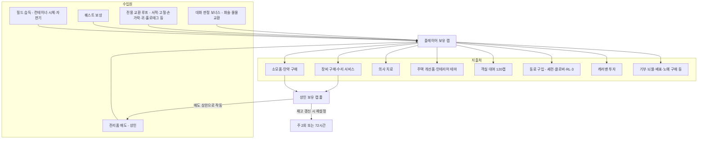
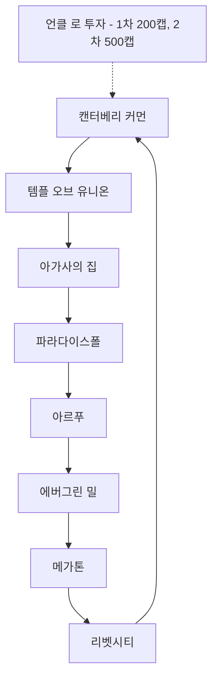
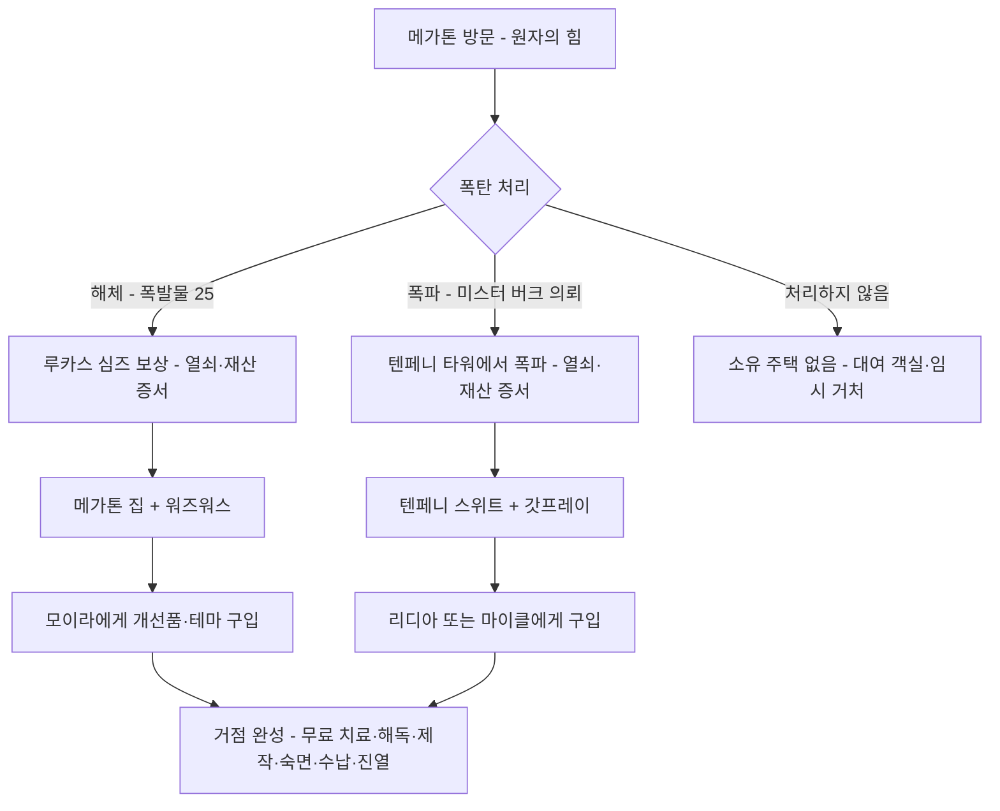

# RD-22. 경제·주거

> **폴아웃 3 역기획서 세트** | 문서 ID: RD-22 | 버전: v1.0 | 작성일: 2026-10-11
> **범위**: 캡 경제 구조와 화폐성 아이템, 거래 가격 공식(물물교환·내구도·할인), 상인 전체 목록(위치·영업시간·취급 품목·보유 캡·재고 갱신·수리 서비스), 캐러밴 상인과 투자 개요, 의사 서비스와 가격, 수집품 판매·교환 루프 요약, 플레이어 하우스(메가톤 집·텐페니 타워 스위트: 획득 조건·시설·개선품·인테리어 테마·집사 로봇·수납)와 그 밖의 거처. 퀘스트 상세(RD-05·06·07·08x), 아이템 개별 수치(RD-19·20·21), 퍽 상세(RD-14), NPC 프로필(RD-11)은 다루지 않고 링크한다.
> **관련 문서**: [RD-05 사이드 퀘스트 1부](05_side-quests-part1.md), [RD-06 사이드 퀘스트 2부](06_side-quests-part2.md), [RD-07 비표시·반복 퀘스트와 랜덤 인카운터](07_misc-quests-encounters.md), [RD-11 NPC 디렉터리](11_npc-directory.md), [RD-12 월드 구조·정착지·볼트](12_world-structure-settlements.md), [RD-14 캐릭터 시스템](14_character-system.md), [RD-15 상태·생존 시스템](15_status-survival.md), [RD-17 탐험·상호작용](17_exploration-interaction.md), [RD-18 UI/UX](18_ui-ux.md), [RD-19 무기·탄약](19_weapons-ammo.md), [RD-20 방어구·의복](20_armor-apparel.md), [RD-21 소모품·잡화·제작](21_consumables-misc-crafting.md), [RD-23 수집 요소·업적](23_collectibles-achievements.md)

---

## 1. 문서 개요

### 1.1 목적

- 원작 폴아웃 3(본편 + DLC 5종)의 돈이 도는 구조(캡의 수입원·지출처, 가격 공식)와 그 구조를 떠받치는 상인·의사·주거 데이터를 한곳에 모은다.
- 쯔꾸르 팬게임에서 상점 이벤트, 의사 이벤트, 플레이어 하우스 이벤트를 데이터베이스·공통 이벤트로 옮길 때 바로 쓸 수 있는 표 형태를 목표로 한다.

### 1.2 범위

| 다루는 것 | 다루지 않는 것 (링크) |
|---|---|
| 캡과 화폐성 아이템, 캡 흐름 | 개별 아이템 수치 → [RD-19](19_weapons-ammo.md)·[RD-20](20_armor-apparel.md)·[RD-21](21_consumables-misc-crafting.md) |
| 물물교환 매도·매입 공식, 할인, 내구도-가격 관계 | 물물교환 스킬·퍽 전체 규칙 → [RD-14](14_character-system.md) |
| 상인·수리 NPC·의사 전체 목록과 서비스 수치 | NPC 프로필·생사 조건 → [RD-11](11_npc-directory.md), [RD-10](10_characters-major-companions.md) |
| 캐러밴 상인 4명과 투자 결과 요약 | Merchant Empire 등 비표시 퀘스트 상세 → [RD-07](07_misc-quests-encounters.md) |
| 수집품 판매·반복 교환 루프 요약 | 루프를 이루는 반복 퀘스트 상세 → [RD-07](07_misc-quests-encounters.md), DLC 루프 → RD-08x |
| 플레이어 하우스 2곳, 개선품 5종, 테마 6종, 집사 로봇, 대여 객실, 기타 거처 | 보블헤드 진열·스킬북 등 수집 요소 → [RD-23](23_collectibles-achievements.md) |

### 1.3 요약

- 화폐는 **캡(병뚜껑)** 하나뿐이다. 전쟁 전 지폐처럼 무게 0에 가치가 높은 잡화가 보조 화폐 역할을 하고, 서적·고철·손가락·귀 같은 '전용 교환품'이 특정 NPC에게 고정 시세로 환전된다.
- 가격은 **어느 상점이나 동일**하며, 변수는 플레이어의 물물교환 스킬과 상점별 할인뿐이다. 물물교환 0→100에서 매도가는 기본가의 45%→90%, 매입가는 155%→110%로 선형 변한다. 상인 쪽 스킬은 가격에 관여하지 않는다.
- 상인의 **보유 캡이 사실상 판매 상한**이고 재고는 주 2회(캐러밴은 72시간마다) 갱신된다. 수리 서비스는 상인의 수리 스킬로 한도가 정해진다(최대 내구도 % = 40 + 3 × 수리 ÷ 5).
- 의사는 HP·부위 치료 50/75/100캡(부상 정도별), 방사능 100캡, 중독 50캡이 표준가다.
- 주거는 '원자의 힘(The Power of the Atom)'의 선택에 따라 **메가톤 집 또는 텐페니 타워 스위트 중 하나**만 주어지는 도덕 선택 보상이며, 개선품(500~1,199캡)과 테마(1,414캡)가 후반의 큰 캡 소비처가 된다.

### 1.4 표기 메모

- **기본가**: 아이템 정보상자의 `value`(핍-보이에 표시되는 가치, 내구도 100% 기준). 실제 거래가는 3장의 공식을 거친다.
- **보유 캡**: 개별 NPC 문서의 상호작용 표(Interactions) 값을 그대로 옮겼다. 범위 표기(예: 60–240)는 코퍼스 원문 그대로이며, 범위가 생기는 원리(레벨 연동 여부)는 문서마다 명시되지 않았다. 값이 없으면 '미기재'.
- **수리 한도**: 그 NPC가 수리해 줄 수 있는 최대 내구도 %.
- **영업시간**: `08–20`은 오전 8시~오후 8시, `24시간`은 상시 거래.
- 장소·인물의 한국어 표기는 [RD-26 용어집](26_glossary.md)을 따르고, 용어집에 없는 고유명사는 음차 후 처음 나올 때 영문을 병기했다.

---

## 2. 화폐와 경제 구조

### 2.1 캡 (Bottle cap)

| 항목 | 값 |
|---|---|
| 영문명 | Bottle cap |
| 폼 ID / 에디터 ID | 00000f / Caps001 |
| 무게 / 가치 | 0 / 1 |
| 다른 용도 | 병뚜껑 지뢰(Bottlecap mine) 제작 재료(10개) |
| 획득 | 전역(컨테이너, 시체, 쓰레기통, 뉴카-콜라 자판기 등) |

- 수도 황무지(Capital Wasteland)의 표준 화폐다. 주인공은 볼트를 나온 직후부터 캡의 가치를 알고 있는 것으로 처리되며, 게임 안에서 그 기원은 설명되지 않는다.
- 캡은 **버릴 수 없지만 컨테이너에는 넣을 수 있다.** 소유자가 있는 컨테이너에 넣었다가 다시 꺼내면 절도로 처리되어 카르마가 깎인다([RD-17](17_exploration-interaction.md) 소유권 규칙).
- 음료 중 **뉴카-콜라와 뉴카-콜라 퀀텀만** 마시면 캡 1개를 돌려준다(맥주·스카치 등은 없음).
- 상인에게 지불한 캡은 상인 인벤토리로 들어간다. 상인을 죽이면 그 캡을 되찾을 수 있다. 스캐빈저 상인은 거래 중 보유 캡이 시체에 그대로 남아 **지불액 100% 회수**가 가능하다.
- 포춘 파인더(Fortune Finder) 퍽(레벨 6, 행운 5): 컨테이너에 캡이 추가로 생성된다. 책상·사물함·금전 등록기 등 일반 컨테이너는 10% 확률로 20~80캡, 금고 계열은 10% 확률로 110캡(레벨 1)~190캡(레벨 9) 추가. 확률은 컨테이너 안의 목록마다 따로 굴린다.

### 2.2 화폐성 아이템과 전용 교환품

캡 이외에 '돈처럼 쓰이는' 아이템은 두 종류다. ① 무게 0에 기본가가 높아 상인에게 팔기 좋은 **보조 화폐형**, ② 특정 NPC만 고정 시세로 사 주는 **전용 교환품형**(상세 루프는 6장).

| 아이템 | 영문명 | 무게 | 기본가 | 유형 | 환전처·용도 | 비고 |
|---|---|---|---|---|---|---|
| 전쟁 전 지폐 | Pre-War money | 0 | 10 | 보조 화폐 | 모든 상인(물물교환 공식 적용), 록잇 런처(Rock-It Launcher) 탄약 | 금전 등록기·금고·서류함·쓰레기통 등. 고정 다량 위치: L.O.B. 엔터프라이즈(L.O.B. Enterprises) 17장, 듀코브의 집(Dukov's Place) 15장, 크라이슬러스 빌딩(Chryslus Building) 10장, [PL] 덫사냥꾼 오두막(Trapper's shack) 12장·홈스테드 모텔(Homestead Motel) 24장·바다 동굴(Sea cave) 39장 |
| 전쟁 전 서적(초록) | Pre-War book | 1 | 1 | 전용 교환품 | 이얼링 서기(Scribe Yearling): 1권당 100캡 + 10 XP | 본편 98권, [PL] 3권. 파란 '희귀본'(가치 5)은 받지 않음 |
| BoS 홀로태그 | Brotherhood of Steel holotag | 0 | 1 | 전용 교환품 | 제임슨 서기(Scribe Jameson): 1개당 100캡 + 25 XP | 시타델 개방('생명의 물' 이후) 필요. BoS 병력이 재생성되어 사실상 무한 |
| 손가락 | Finger | 0 | 1 | 전용 교환품 | 소노라 크루즈(Sonora Cruz): 5캡(카르마 750 이상이면 10캡) + 카르마 +10 | 로브링어(Lawbringer) 퍽 필요 |
| 귀 | Ear | 0 | 1 | 전용 교환품 | 데니엘 리틀혼(Daniel Littlehorn): 10캡(카르마 −750 이하면 15캡) + 카르마 −10 | 컨트랙트 킬러(Contract Killer) 퍽 필요 |
| 고철 | Scrap metal | 1 | 1 | 전용 교환품 | 월터(Walter): 10캡 + 5 XP(또는 카르마 +10) / 윈드롭(Winthrop): 5개당 소모품 1 | 고정 배치 67개 + 로봇 잔해 |
| 뉴카-콜라 퀀텀 | Nuka-Cola Quantum | 1 | 30 | 전용 교환품 | 시에라 페트로비타(Sierra Petrovita) 40캡/병, 로날드 라렌(Ronald Laren) 40~80캡/병 | 누카콜라 챌린지 진행 중. 수량은 [RD-23](23_collectibles-achievements.md) |
| 강철 주괴 [TP] | Steel ingot | 1 | 1 | 전용 교환품 | 에버렛(Everett): 10개 단위로 유니크 장비 | 총 100개. 퀘스트 진행 중엔 무게 0 |

- **설계 포인트**: 보조 화폐형(전쟁 전 지폐)은 물물교환 공식을 거치므로 스킬이 낮으면 실제 가치가 4.5캡까지 떨어진다. 반면 전용 교환품형은 **스킬과 무관한 고정 시세**라서, 물물교환을 찍지 않은 캐릭터에게 더 큰 수입원이 된다(서적: 기본가 1 → 100캡).

### 2.3 캡의 흐름



- 상인에게 쓴 캡은 그 상인의 보유 캡으로 쌓여, 다시 플레이어가 팔 수 있는 한도가 된다. 즉 **구매가 판매 한도를 늘리는 순환 구조**다.
- 상인을 거치지 않는 지출(의사·개선품 이외의 퀘스트성 지출, 기부, 투자)은 캡을 경제 밖으로 빼는 순수 소멸처다.

### 2.4 대표적인 대형 지출·수입 항목

| 구분 | 항목 | 금액 | 조건·비고 | 상세 |
|---|---|---|---|---|
| 지출 | 셰런(Charon) 고용 계약 | 2,000캡 (물물교환 50 이상 1,000캡) | 아즈루칼(Ahzrukhal)에게 구매. 그레타 살해 의뢰 수락 후엔 불가 | [RD-10](10_characters-major-companions.md), [RD-07](07_misc-quests-encounters.md) |
| 지출 | 클로버(Clover) 구매 | 1,000캡 (물물교환 50 이상 500캡) | 율로지 존스(Eulogy Jones). 악 카르마일 때만 | [RD-10](10_characters-major-companions.md) |
| 지출 | RL-3 하사(Sergeant RL-3) 구매 | 1,000캡 (물물교환 70 이상 500캡) | 땜장이 조(Tinker Joe). 중립 카르마일 때만 | [RD-10](10_characters-major-companions.md) |
| 지출 | 인테리어 테마 1종 | 기본가 1,414캡 | 메가톤 집·텐페니 스위트 | 7장 |
| 지출 | 나의 첫 의무실·실험실 | 기본가 각 1,199캡 | 〃 | 7장 |
| 지출 | 캐러밴 투자 전체 | 2,800캡 (마스터 트레이더 1,400캡) | 4명 × (200 + 500) | 4.5절 |
| 지출 | [PL] 리버보트 배표 | 기본가 300캡 (거래가 300~400캡대) | 토바(Tobar) | [RD-08d](08d_dlc-point-lookout.md) |
| 지출 | 메스메트론 동력 전지 | 10발당 200캡 | 그루스(Grouse) | [RD-07](07_misc-quests-encounters.md) |
| 지출 | 교회 헌금 | 10·50·100캡 | 캡 1당 선 카르마 1 | [RD-07](07_misc-quests-encounters.md) |
| 수입 | 원자의 힘 - 폭탄 해체 | 100캡(화술로 500캡) 또는 카르마 +200, 메가톤 집 | 루카스 심즈(Lucas Simms) | [RD-05](05_side-quests-part1.md) |
| 수입 | 원자의 힘 - 폭탄 폭파 | 500캡(화술로 1,000캡), 카르마 −1,000, 텐페니 스위트 | 미스터 버크(Mister Burke) | [RD-05](05_side-quests-part1.md) |
| 수입 | 누카콜라 챌린지 | 1,200~2,400캡(퀀텀 30병 판매 총액) | 시에라 40캡/병, 로널드 40~80캡/병 | [RD-06](06_side-quests-part2.md) |
| 수입 | 노예 포획 | 1명당 250캡 | 그루스, 냉정한 이윤(Strictly Profitable) | [RD-07](07_misc-quests-encounters.md) |
| 수입 | 전더스 플렁킷(Junders Plunkett)의 손가락 | 1,000캡 | 로브링어 퍽 | [RD-07](07_misc-quests-encounters.md) |

---

## 3. 거래 가격 공식

### 3.1 매도·매입 공식

폴아웃 3는 1·2편과 달리 **상인 NPC의 물물교환 스킬이 가격에 관여하지 않는다.** 가격을 정하는 것은 플레이어의 물물교환 스킬과 상점별 보정치뿐이다.

```
매도가(플레이어가 팔 때) = 기본가 × ( 0.45 + 물물교환 ÷ 100 × 0.45 ) × 보정치
매입가(플레이어가 살 때) = 기본가 × ( 1.55 − 물물교환 ÷ 100 × 0.45 ) × 보정치
```

- 계산 마지막에 가장 가까운 정수로 반올림한다.
- `기본가`는 핍-보이 설명에 표시되는 아이템 가치다(내구도가 반영된 값, 3.3절).
- `보정치`는 기본 1.0이며, 상점별 할인(3.2절)이 곱해진다.
- 물물교환 5점마다 매도가가 2.25%p 오른다. 물물교환 11이면 매도가가 거의 기본가의 50%가 된다.
- 물물교환 초기값 = 2 + (카리스마 × 2) + ⌈행운 ÷ 2⌉ (카리스마·행운 5 → 15). 스킬 일반 규칙은 [RD-14](14_character-system.md).

| 물물교환 | 매도 배율 | 매입 배율 | 매입/매도 비 | 출처 |
|---|---|---|---|---|
| 0 | 45% | 155% | 3.44 | 원문 표 |
| 10 | 49.5% | 150.5% | 3.04 | 공식 계산 |
| 20 | 54% | 146% | 2.70 | 원문 표 |
| 30 | 58.5% | 141.5% | 2.42 | 공식 계산 |
| 40 | 63% | 137% | 2.17 | 원문 표 |
| 50 | 67.5% | 132.5% | 1.96 | 공식 계산 |
| 60 | 72% | 128% | 1.78 | 공식 계산 |
| 70 | 76.5% | 123.5% | 1.61 | 공식 계산 |
| 80 | 81% | 119% | 1.47 | 원문 표 |
| 90 | 85.5% | 114.5% | 1.34 | 공식 계산 |
| 100 | 90% | 110% | 1.22 | 원문 표 |

- **스프레드(매입/매도 비)**가 물물교환 0에서 3.44배, 100에서 1.22배다. 같은 물건을 사서 되팔면 반드시 손해를 보도록 매도 상한 90%, 매입 하한 110%가 고정되어 있어 **무한 차익 거래가 원천 차단**된다.

### 3.2 할인과 가격 보정

| 할인 | 대상 | 조건 | 비고 |
|---|---|---|---|
| 마스터 트레이더(Master Trader) 퍽 | 모든 상인·트레이더 **구매가 −25%** | 레벨 14, 카리스마 6, 물물교환 60 | 판매가에는 영향 없음. 할인가가 기본가보다 낮아지면 **기본가가 하한**. 캐러밴 투자금 반액 |
| 드림 크러셔(Dream Crusher) 퍽 | 분화구 잡화점(Craterside Supply) 30% | 모이라에게 '황무지 생존 가이드' 집필을 단념시킴 | 모이라 수리 스킬 24→54(한도 54%→72%) |
| 괍(Gob)의 호의 | 모리아티 살롱(Moriarty's Saloon) 10% | 첫 대면에서 괍을 기분 상하게 하지 않음(선 카르마) | 스팀팩·술 등 판매품 전체 |
| 리벳시티 역사 조사 | 리벳시티(Rivet City) 상인 전원 10% | '황무지 생존 가이드'의 리벳시티 역사 조사 완료 | [RD-05](05_side-quests-part1.md) |
| 의회 의석(Council Seat) 선택 | 리벳시티 서플라이(Rivet City Supply) 10% 또는 포토맥 의류(Potomac Attire) 10% | 비표시 퀘스트에서 누구 편을 드느냐에 따라 | [RD-07](07_misc-quests-encounters.md) |
| 폭력의 경제학(Economics of Violence) | 락 앤 로드(Lock and Load) 20% | 프론토(Pronto)에게 중국제 돌격소총 20정 | 프론토 보유 캡 약 150→약 400 |
| 연방주의자 라운지(Federalist Lounge) | 10% 또는 50% | 근처 터미널 해킹 | 텐페니 타워 |

- **마스터 트레이더의 실효**: 물물교환 60에서 매입 배율 128% × 0.75 = 96% → 하한에 걸려 100%가 된다. 즉 **퍽을 찍는 시점부터 거의 모든 구매가 기본가**다(물물교환 약 48.2 이상이면 25% 할인가가 기본가 밑으로 내려감).
- 상점 할인은 공식의 `보정치`로 곱해진다(예: 괍의 10% → 0.9).

### 3.3 내구도와 가격

무기·방어구의 표시 가치는 내구도에 따라 다음과 같이 줄어든다.

```
내구도 = 현재 아이템 HP ÷ 최대 아이템 HP   (0~1)
표시 가치 = ⌊ 기본가 × 내구도^1.5 ⌋
```

| 내구도 | 가치 배율 | 예: 10mm 권총(기본가 225) |
|---|---|---|
| 100% | 100% | 225 |
| 90% | 85.4% | 192 |
| 75% | 65.0% | 146 |
| 50% | 35.4% | 79 |
| 25% | 12.5% | 28 |
| 10% | 3.2% | 7 |

- 내구도가 반으로 줄면 가치는 3분의 1 남짓만 남는다. 따라서 **수리 스킬이 높을수록 판매 수익이 비약적으로 커진다**(수리로 같은 종류 둘을 하나로 합쳐 내구도를 올린 뒤 파는 루프가 성립).
- 내구도가 무기 피해·치명타·탄 걸림, 방어구 DR에 주는 영향은 [RD-16](16_combat-system.md)·[RD-19](19_weapons-ammo.md)·[RD-20](20_armor-apparel.md)이 정본이다.
- 상인 수리 서비스의 비용 공식은 코퍼스에 폴아웃 3 기준으로는 실려 있지 않다(뉴베가스 공식만 수록). **(코퍼스 미확인)**

### 3.4 계산 예시

- 물물교환 40, 10mm 권총(기본가 225):
  - 내구도 100%: 매도 225 × 0.63 = 141.75 → **142캡**, 매입 225 × 1.37 = 308.25 → **308캡**
  - 내구도 50%(표시 가치 79): 매도 79 × 0.63 = 49.77 → **50캡**, 매입 79 × 1.37 = 108.23 → **108캡**
- 물물교환 60 + 마스터 트레이더, 같은 권총(100%) 구매: 225 × 1.28 × 0.75 = 216 < 225 → **225캡(기본가 하한)**
- 전쟁 전 지폐 1장(기본가 10): 물물교환 0이면 4.5 → 4~5캡, 100이면 9캡.

### 3.5 물물교환 스킬을 올리는 수단

| 수단 | 효과 | 유형 |
|---|---|---|
| 레벨업 | 레벨당 스킬 포인트 10 + 지능(+3 에듀케이티드 퍽) | 영구 |
| 보블헤드 - 물물교환(Bobblehead - Barter) | +10 | 영구, [RD-23](23_collectibles-achievements.md) |
| 정크타운 육포 상인 이야기(Tales of a Junktown Jerky Vendor) | +1(컴프리헨션 퍽 +2) | 영구, 스킬북 |
| 스카운드럴(Scoundrel) 퍽 | 랭크당 화술·물물교환 +5(최대 3랭크) | 영구 |
| 태그!(Tag!) 퍽 | 태그 스킬 +15 | 영구 |
| 여왕개미 페로몬(Ant queen pheromones) | +2~6(현재 카리스마에 따라, 카리스마 10이면 효과 없음) | 일시 |
| 그레이프 멘타츠(Grape Mentats) | +2~10(〃) | 일시 |
| 버튼의 가발(Button's wig) | +5 | 장비 |
| 로빙 트레이더 의상·모자(Roving trader outfit) | 각 +5 | 장비 |

### 3.6 물물교환이 걸린 대화 거래

거래 화면 밖에서 물물교환 수치가 대화 선택지 조건으로 쓰이는 경우다.

| 거래 | 기본 조건 | 물물교환 판정 효과 | 상세 |
|---|---|---|---|
| 셰런 계약(고용된 도움 Hired Help) | 2,000캡 | 50 이상: 1,000캡 | [RD-07](07_misc-quests-encounters.md) |
| 클로버 구매 | 1,000캡 | 50 이상: 500캡 | [RD-10](10_characters-major-companions.md) |
| RL-3 하사 구매 | 1,000캡 | 70 이상: 500캡 | [RD-10](10_characters-major-companions.md) |
| 권리장전·대헌장 매각(아브라함 워싱턴) | 100캡·75캡 | 70 이상: 125캡·100캡 | [RD-06](06_side-quests-part2.md) |
| 짚의 뉴카 픽스(Zip's Nuka Fix) | 뉴카-콜라 교환 | 30·50·70 구간마다 보상 상향 | [RD-07](07_misc-quests-encounters.md) |
| 버섯 거래(Fungus Deal) | 동굴 버섯 ↔ 괴상한 고기 | 75 이상: 더 유리한 교환비 | [RD-07](07_misc-quests-encounters.md) |
| 링컨의 이윤(Lincoln's Profit Margins) | 유물 매각 | 수치 미상의 물물교환 판정으로 더 높은 가격(최소 10~최대 1,110캡) | [RD-07](07_misc-quests-encounters.md) |
| 상인 제국(Merchant Empire) 개시 | 언클 로(Uncle Roe)과 상담 | 높은 물물교환, 블랙 위도우·마스터 트레이더 퍽, 또는 250캡 이상 소지 중 하나 | 4.5절 |

---

## 4. 상인

### 4.1 공통 규칙

| 규칙 | 내용 |
|---|---|
| 가격 | 같은 아이템은 모든 상점에서 같은 가격. 변수는 물물교환 스킬과 상점 할인뿐(3장) |
| 재고 갱신 | 상인 허브 서술: **매주 일요일·수요일 0시**에 새 재고. 서비스 전용 NPC는 해당 없음 |
| 갱신 예외 | 개별 문서 서술이 허브와 다르다. 모이라 브라운 **월·수**, 씨그레이브 홈즈 **월·목**, 캐러밴 4명 **72시간마다**(4.4절), [PL] 헤일리는 엑스박스 360에서 '4일마다 오전 8시 무렵, 가게 밖에서 기다려야 갱신'이 관찰됨. 원작 데이터의 정확한 값은 **(코퍼스 미확인)** |
| 레벨 연동 | 재고는 플레이어 레벨에 따라 좋아진다. 단 파워 아머·플라스마 무기 같은 고급품은 보통 팔지 않는다 |
| 보유 캡 | 상인이 가진 캡만큼만 사 준다. 플레이어가 산 만큼 상인 캡이 늘어 다시 팔 수 있다 |
| 판매품 되사기 | 플레이어가 판 물건은 갱신 전까지 상인 인벤토리에 남아 되살 수 있다. 단 전문 상인(의사 등)은 전문 분야 밖 품목을 사들여도 진열하지 않아 되살 수 없다 |
| 서비스 전용 | 수리·치료만 하는 NPC에게는 물건을 팔 수 없다 |
| 스팀팩 | 대부분의 상인(떠돌이 포함)이 스팀팩을 여러 개 갖고 있다 |
| 장비 효과 | 상인은 착용 장비의 S.P.E.C.I.A.L. 보너스는 받지 않지만, 물물교환·수리처럼 **스킬을 직접 올리는 장비 효과는 받는다**(예: 행운의 하리스의 수리 +5는 수리공 점프슈트 효과, 파피에게 수리 보너스 의복을 역소매치기로 입히면 수리 한도 상승) |
| 상인 상자 | 이름 있는 상인 대부분은 열쇠로만 열리는 전용 보관함이 있고, 열쇠는 상인이 죽어야 시체에 생긴다. 상자 안에는 그 상인이 팔던 물건 전부가 들어 있다 |
| 상자 삭감 스크립트 | 열쇠로 상자를 처음 열 때 `VendorMerchantContainerScript`가 표준 탄약 14종(5.56mm·10mm·마이크로퓨전 전지·소형 에너지 전지·미니 누크·.32·산탄·BB·화염 연료·.44·미사일·.308·5mm·전자 충전 팩)과 스팀팩의 일정 비율(전역 변수 VendorRemoveAmmoPercent / VendorRemoveStimpakPercent)을 지운 뒤 옮긴다. 주석상 목적은 '플레이어가 지나치게 부자가 되는 것 방지' |
| 귀 | 상인은 중립이라 컨트랙트 킬러 퍽이 있어도 귀를 떨어뜨리지 않는다 |

### 4.2 정착지 상인 목록

표의 `취급 품목`은 상인 허브의 분류(보조·탄약·의복·잡화·무기)와 개별 문서 서술을 합친 것이다. 정착지 구조와 접근 조건은 [RD-12](12_world-structure-settlements.md), NPC 프로필은 [RD-11](11_npc-directory.md)을 본다.

#### 메가톤 (Megaton)

| 상인 | 영문명 | 가게·위치 | 영업 | 취급 품목 | 보유 캡 | 수리 한도 | 비고 |
|---|---|---|---|---|---|---|---|
| 모이라 브라운 | Moira Brown | 분화구 잡화점 | 08–20 | 무기·탄약·의복·보조·잡화, 메가톤 집 개선품·테마, 록잇 런처 설계도 | 160–3000 | 54% (드림 크러셔 후 72%) | 재고 월·수 갱신. 메가톤 폭파 시 구울이 되어 폐허 입구(가이드 집필 완료 후라면 수리만 가능) 또는 언더월드(가게 없이 거래)로 옮겨 감 |
| 괍 | Gob | 모리아티 살롱 | 08–20 | 보조(술·음식·스팀팩) | 100–200 | – | 호의 시 10% 할인 |
| 노바 | Nova | 모리아티 살롱 2층 | – | 객실 대여 120캡 | – | – | 7.8절 |
| 제니 스탈 | Jenny Stahl | 브래스 랜턴(The Brass Lantern) | 08–20 | 보조(음식) | 100–200 | – | |
| 레오 스탈 | Leo Stahl | 브래스 랜턴 일대 | 08–20 | 약물 | 100–200 | – | 비표시 퀘스트 '레오의 약물 습관(Leo's Drug Habit)' 연계 |
| 처치 박사 | Doc Church | 메가톤 진료소(Megaton clinic) | 24시간 | 약물, 의료 서비스 | 200–300 | – | 의사(5장) |
| 월터 | Walter | 정수 처리장 | – | 고철 매입 | – | – | 6장 루프 |

#### 리벳시티 (Rivet City)

리벳시티 상인 전원은 '황무지 생존 가이드'의 리벳시티 역사 조사 완료 시 10% 할인된다.

| 상인 | 영문명 | 가게·위치 | 영업 | 취급 품목 | 보유 캡 | 수리 한도 | 비고 |
|---|---|---|---|---|---|---|---|
| 씨그레이브 홈즈 | Seagrave Holmes | 리벳시티 서플라이(Rivet City Supply) | 08–20 | 탄약·방어구·무기·잡화 | 약 300 | – | 재고 월·목 갱신. 의회 의석 결과 10% 할인 가능 |
| 플랙 | Flak | 플랙과 샤프넬 무기상점(Flak 'N Shrapnel's) | 08–20 | 무기·탄약·의복 | 260–540 | 49% | 리벳시티에서 캡이 가장 많음. 모든 무기가 스폰될 수 있고 미니 누크 전용 스폰 목록 보유 |
| 샤프넬 | Shrapnel | 플랙과 샤프넬 무기상점 | 08–20 | 무기·탄약·의복 | 플랙과 공유 | 49% | 두 사람의 재고는 공유 |
| 베논 | Bannon | 포토맥 의류(Potomac Attire) | 08–20 | 의복 | 160–390 | 49% | 의회 의석 결과 10% 할인 가능 |
| 신디 칸티엘리 | Cindy Cantelli | 퀵 픽스(A Quick Fix) | 08–20 | 약물 | 335 | – | |
| 안젤라 스테일리 | Angela Staley | 게리의 주방(Gary's Galley) | 08–20 | 음식·음료 | 250 | – | |
| 게리 스테일리 | Gary Staley | 게리의 주방 | 08–20 | 음식 | 미기재 | – | |
| 벨리 보니 | Belle Bonny | 진흙탕 술집(The Muddy Rudder) | 08–20 | 음료(술) | 60–240 | – | |
| 미스터 버킹검 | Mister Buckingham | 웨덜리 호텔(Weatherly Hotel) | 24시간 | 음식·술, 객실 대여 120캡 | 미기재 | – | 미스터 핸디형 로봇 |
| 베라 웨덜리 | Vera Weatherly | 웨덜리 호텔 | 08–20 | 음식, 객실 대여 120캡 | 미기재 | – | |
| 프레스턴 박사 | Doctor Preston | 리벳시티 진료소(Rivet City clinic) | 08–20 | 소모품, 의료 서비스 | 미기재 | – | 의사 |
| 아브라함 워싱턴 | Abraham Washington | 수도 보존협회(Capitol Preservation Society) | – | 유물 매입 전용 | – | – | 4.6절 |

#### 텐페니 타워 (Tenpenny Tower)

'텐페니 타워' 퀘스트에서 구울을 들이면 일부 상인이 구울 상인으로 바뀐다([RD-06](06_side-quests-part2.md)).

| 상인 | 영문명 | 가게·위치 | 영업 | 취급 품목 | 보유 캡 | 수리 한도 | 비고 |
|---|---|---|---|---|---|---|---|
| 구스타보 경비 대장 | Chief Gustavo | 텐페니 타워 | 24시간 | 무기·탄약 | 160–390 | – | |
| 앤서니 링 | Anthony Ling | 신도시 옷집(New Urban Apparel) | 08–20 | 방어구·의복 | 260–540 | – | |
| 리디아 몬테네그로 | Lydia Montenegro | 부티크 르 시크(Boutique Le Chic) | 08–20 | 보조·잡화, 텐페니 스위트 개선품·테마, 다트 건 설계도 | 260–540 | – | |
| 마가렛 프림로즈 | Margaret Primrose | 보 몽드 카페(Café Beau Monde) | 08–20 | 음식 | 60–240 | – | |
| 쉐익스 | Shakes | 연방주의자 라운지 | 24시간 | 음료·스팀팩 | 120 | – | 터미널 해킹으로 10%/50% 할인 |
| 줄리어스 밴필드 박사 | Julius Banfield | 텐페니 보건소(Wellness center) | 24시간 | 소모품, 의료 서비스 | 60–240 | – | 의사 |
| 마이클 마스터스 | Michael Masters | 와링톤 지하철역(Warrington station) → 부티크 르 시크 | 08–20 | 무기·방어구·탄약·보조·잡화, 개선품·테마, 다트 건 설계도 | 260–540 | – | 구울 입주 후 리디아 대체 |
| 베시 린 | Bessie Lynn | 와링톤 지하철역 → 신도시 옷집 | 08–20 | 방어구·의복 | 260–540 | – | 구울 입주 후 앤서니 대체 |

#### 언더월드 (Underworld)

| 상인 | 영문명 | 가게·위치 | 영업 | 취급 품목 | 보유 캡 | 수리 한도 | 비고 |
|---|---|---|---|---|---|---|---|
| 아즈루칼 | Ahzrukhal | 나인서클(The Ninth Circle) | 08–20 | 술, 버프아웃·사이코·제트 | 미기재 | – | 셰런 계약 판매(2.4절). 셰런 획득 시 셰런에게 사살되어 상점 소멸 |
| 시드니 | Sydney | 나인서클 | 24시간 | 무기·탄약 | 미기재 | – | '독립을 훔쳐라'에서 살아남으면 국립 기록 보관소에서 이주 |
| 캐롤 | Carol | 캐롤의 집(Carol's Place) | 08–20 | 침대 대여 120캡 | – | – | |
| 그레타 | Greta | 캐롤의 집 | 08–20 | 음식, 침대 대여 | 60–240 | – | |
| 튤립 | Tulip | 언더월드 양품점(Underworld Outfitters) | 08–20 | 무기·탄약·의복·보조, 레일웨이 라이플 설계도 | 400–500 | – | 스킬북 '실낙원(Paradise Lost)' 무료 증정 |
| 배로우즈 박사 | Doctor Barrows | 찹 숍(The Chop Shop) | 08–20 | 의료 용품, 의료 서비스 | 60–240 | – | 의사 |
| 윈드롭 | Winthrop | 언더월드 | – | 수리, 고철 교환 | – | 54% | 6장 루프 |

#### 파라다이스폴 (Paradise Falls)

입장 조건(노예 사냥꾼 우호 등)은 [RD-12](12_world-structure-settlements.md)·[RD-05](05_side-quests-part1.md)를 본다.

| 상인 | 영문명 | 가게·위치 | 영업 | 취급 품목 | 보유 캡 | 수리 한도 | 비고 |
|---|---|---|---|---|---|---|---|
| 프론토 | Pronto | 락 앤 로드(Lock and Load) | 24시간 | 무기·탄약 | 150–400 | 51% | 폭력의 경제학 완료 시 20% 할인, 보유 캡 약 400, 재고 확장 |
| 커터 | Cutter | 커터의 진료소(Cutter's clinic) | 24시간 | 보조·약물 | 120–480 | – | 가게가 2개이며 캡·재고가 따로 있다. 의사 |
| 그루스 | Grouse | 파라다이스폴 입구 | 08–20 | 메스메트론 동력 전지만(10발 200캡) | 미기재 | – | 노예 1명당 250캡 매입 |

#### 리틀 램프라잇 (Little Lamplight)

| 상인 | 영문명 | 가게·위치 | 영업 | 취급 품목 | 보유 캡 | 수리 한도 | 비고 |
|---|---|---|---|---|---|---|---|
| 닉낵 | Knick Knack | 기념품 가게(Souvenir shop) | 08–20 | 잡화, 병뚜껑 지뢰 설계도 | 미기재 | –¹ | |
| 에클레어 | Eclair | 스펄렁커스(Spelunkers) | 08–20 | 음식 | 40–100 | – | 버섯 거래 |
| 루시 | Lucy | 리틀 램프라잇 사무동 | 08–20 | 의료 서비스 | – | – | 의사 |

¹ 수리 스킬 문서의 '수리하는 NPC' 목록에는 수리 15로 올라 있으나, 상인 허브와 개별 문서에는 수리 서비스가 없다.

#### 그 밖의 정착지·거점

| 상인 | 영문명 | 정착지·가게 | 영업 | 취급 품목 | 보유 캡 | 수리 한도 | 비고 |
|---|---|---|---|---|---|---|---|
| 레드 | Red | 빅타운(Big Town) 레드의 진료소 | 24시간 | 보조(의약품), 의료 서비스 | 211 | – | 저먼타운 경찰 본부(Germantown Police HQ)에서 구출해야 영업 |
| 파피 | Pappy | 빅타운 | – | 수리 | – | 48% | |
| 조 포터 | Joe Porter | 캔터베리 커먼 포터스 카페(Porter's Café) | 24시간 | 소모품 | 160–390 | – | |
| 언클 로 | Uncle Roe (Ernest Roe) | 캔터베리 커먼 | – | 수리, 캐러밴 투자 | – | 50% | 4.4절 |
| 스마일링 잭 | Smiling Jack | 에버그린 밀 바자(Evergreen Mills bazaar) | 24시간 | 무기·탄약 | 미기재 | 49% | 레이더 상인. 유니크 '더 테러블 샷건' 소지 |
| 칼 | Karl | 메레스티 지하철역 | 08–20 | 무기·탄약·잡화 | 미기재 | – | 패밀리 소속 |
| 머피 | Murphy | 북서 세네카 역(Northwest Seneca Station) | – | 울트라제트와 약간의 약물 | 미기재 | – | 슈거 밤 납품 후 울트라제트 판매(6장) |
| 나이트 캡틴 두르가 | Knight Captain Durga | 시타델 무기고 | 24시간 | 무기·탄약·방어구 | 100–400 | 50% | 시타델 개방('생명의 물') 필요 |
| 피바디 서기 | Scribe Peabody | 시타델 연구소 | – | 수리 | – | 51% | |
| 도노반 | Donovan | 레인저 기지(Ranger compound) | 24시간 | 수리 | – | 47% | '라일리스 레인저스'에서 구출해야 서비스 |
| 켄 유어스 | Ken Ewers | 아르푸 유어스의 집 | – | 수리 | – | 49% | '피의 유대' 완료 후 |
| 스파클 할머니 | Grandma Sparkle | 윌헬름스 워프(Wilhelm's Wharf) | 08–20 | 음식·잡화·무기 | 60–240 | – | |
| 샤나 | Shawna | 데이브 공화국 박물관 | – | 매입 전용 | 700(박물관 예산) | – | 4.6절 |
| 땜장이 조 | Tinker Joe | 로브코 시설(RobCo facility)·텐페니 타워 외곽 순회 | – | 잡화(고철 1캡씩 최대 10개 등) | 10–90 | – | RL-3 하사 판매 |
| 포토맥 어부 | Potomac fisherman | 스캐빈저 부두(Scavenger's jetty) | – | 무기·탄약·보조·의복·잡동사니 | 100–300 | 20–51% | 스캐빈저형 |

- 참고: 상인 카테고리에 있는 '도그밋의 주인(Dogmeat's owner)'은 고물상에서 레이더에게 즉사하는 스캐빈저로, 실제 거래 대상이 아니다(보유 캡 0).

#### DLC 상인

| 상인 | 영문명 | 장소 | 영업 | 취급 품목 | 보유 캡 | 수리 한도 | 비고 |
|---|---|---|---|---|---|---|---|
| [OA] 올린 특기병 | Specialist Olin | 아웃캐스트 전초기지 | – | 수리(유료) | – | 54%² | 시뮬레이션 종료 후 시블리의 반란에서 살아남아야 함 |
| [TP] 프라이데이 | Friday | 피트 다운타운(The Pitt Downtown) 수리점 | 24시간 | 무기·탄약·의복 | 150–390 | 47% | |
| [TP] 해리스 | Harris | 버티고 바 앤 그릴(Vertigo Bar and Grill) | 24시간 | 소모품 | 60–240 | – | |
| [PL] 헤일리 | Haley | 헤일리스 하드웨어(Haley's Hardware) | 24시간 | 탄약·소모품·잡화·무기 | 미기재 | 49%³ | |
| [PL] 파나다 부인 | Madame Panada | 하우스 오브 웨어스(House of Wares) | 24시간 | 무기·의복·보조·잡화·탄약 | 370 | 41%⁴ | 게임 최대의 탄약 재고(매 갱신 3,000캡어치 이상) |
| [PL] 토바 | Tobar | 리버보트 더치스 갬빗(Duchess Gambit), 필그림스 랜딩(Pilgrim's Landing) | 24시간 | 음식(펑가 열매), 리버보트 배표 | 800–900 | – | 배표 거래가 300~400캡대 |
| [MZ] 소마 | Somah | 엔지니어링 코어(Engineering core) | – | 수리(유료) | – | 100% | 수리 스킬이 플레이어 레벨에 연동되어 레벨 15에 100. 죽이면 지불한 캡 회수 가능 |

² 수리 스킬 24(공식상 54%). 올린 문서 본문은 '50%까지'라고 서술한다.
³ 기본 수리 16. 버그로 가게를 방문할 때마다 +5씩 올라 최대 100까지 오를 수 있다(허브 표기 '100%').
⁴ 허브·상호작용 표기 41%. 수리 스킬 값은 출처마다 다르다(수리 NPC 목록 19, 개별 문서 '5'). 공식(4.3절)과 맞지 않으므로 이식 시 재검토 필요.
- [BS]에는 고정 상인이 추가되지 않는다. 대신 아쿠아 퓨라(Aqua Pura) 캐러밴(스캐빈저 상인 + 물 브라민 + 리벳시티 경비대 또는 BoS 호위 2명)이 황무지를 돈다.

### 4.3 수리 서비스

```
수리 가능한 최대 내구도(%) = 40 + 3 × (수리 스킬 ÷ 5)
```

- 플레이어의 자가 수리와 같은 공식이다. 수리 5점마다 한도가 3%p 오른다(10 → 46%, 15 → 49%, 50 → 70%, 100 → 100%).
- 상인 수리는 같은 종류의 아이템을 소모하지 않고 캡만 받는다. 상인 수리로만 다룰 수 있는 장비(같은 종류가 드문 유니크 등)에 특히 중요하다.
- 비용 공식은 폴아웃 3 기준으로 코퍼스에 없다 **(코퍼스 미확인)**.

| NPC | 영문명 | 위치 | 수리 스킬 | 수리 한도(표기) | 공식 검산 |
|---|---|---|---|---|---|
| 도노반 | Donovan | 레인저 기지 | 12 또는 13 | 47% | 47.2~47.8 |
| [TP] 프라이데이 | Friday | 피트 다운타운 | 12 또는 13 | 47% | 47.2~47.8 |
| 파피 | Pappy | 빅타운 | 14 | 48% | 48.4 |
| 베논 | Bannon | 리벳시티 | 15 또는 16 | 49% | 49~49.6 |
| 플랙·샤프넬 | Flak / Shrapnel | 리벳시티 | 15 또는 16 | 49% | 49~49.6 |
| 스마일링 잭 | Smiling Jack | 에버그린 밀 | 15 또는 16 | 49% | 49~49.6 |
| 켄 유어스 | Ken Ewers | 아르푸 | 15 또는 16 | 49% | 49~49.6 |
| [PL] 헤일리 | Haley | 헤일리스 하드웨어 | 16(버그로 최대 100) | 49%(최대 100%) | 49.6 |
| 두르가 | Durga | 시타델 | 17 또는 18 | 50% | 50.2~50.8 |
| 언클 로 | Uncle Roe | 캔터베리 커먼 | 17 | 50% | 50.2 |
| 피바디 서기 | Scribe Peabody | 시타델 | 19 | 51% | 51.4 |
| 프론토 | Pronto | 파라다이스폴 | 19 | 51% | 51.4 |
| 모이라 브라운 | Moira Brown | 메가톤 | 24 (드림 크러셔 54) | 54% (72%) | 54.4 (72.4) |
| 윈드롭 | Winthrop | 언더월드 | 24 | 54% | 54.4 |
| [OA] 올린 특기병 | Specialist Olin | 아웃캐스트 전초기지 | 24 | 54% | 54.4 |
| [PL] 파나다 부인 | Madame Panada | 하우스 오브 웨어스 | 불일치(5 또는 19) | 41% | – |
| 스캐빈저 | Scavenger | 황무지 | 개체별 | 20–51% | – |
| 정신나간 볼프강 | Crazy Wolfgang | 캐러밴 | 15 → 50 → 75 | 49% → 85% | 49 / 70 / 85 |
| 크로우 | Crow | 캐러밴 | 15 → 40 → 65 | 49% → 79% | 49 / 64 / 79 |
| 호프 박사 | Doc Hoff | 캐러밴 | 15 → 40 → 65 | 49% → 79% | 49 / 64 / 79 |
| 행운의 하리스 | Lucky Harith | 캐러밴 | 20 → 45 → 70 (의복 +5 포함) | 52% → 82% | 52 / 67 / 82 |
| [MZ] 소마 | Somah | 마더십 제타 | 레벨 연동, 레벨 15에 100 | 100% | 100 |

- 대부분의 정착지 수리공은 50% 전후에 머문다. **고급 수리처는 투자한 캐러밴(79~85%), 드림 크러셔 후 모이라(72%), DLC의 소마(100%)뿐**이어서, 수리 서비스 품질이 '진행 보상'의 하나로 설계되어 있다.

### 4.4 캐러밴 상인

수도 황무지에는 이름 있는 캐러밴 상인 4명이 있고, 각자 무장 호위 1명과 짐 브라민 1마리를 데리고 같은 경로를 돈다. 모두 수리 서비스를 제공하며 전문 분야가 다르다.

| 상인 | 영문명 | 전문 품목 | 판매 설계도 | 초기 캡 / 수리 | 1차 투자 후 | 2차 투자 후 (한도) | 완전 투자 선물 | 폼 ID |
|---|---|---|---|---|---|---|---|---|
| 정신나간 볼프강 | Crazy Wolfgang | 잡동사니 | 록잇 런처 | ≈61–249 / 15 | ≈222–648 / 50 | ≈483–1197 / 75 (85%) | 스텔스 보이 2~6개(레벨 연동) | 00063c07 |
| 크로우 | Crow | 방어구 | – | ≈61–249 / 15 | ≈222–648 / 40 | ≈483–1197 / 65 (79%) | 크로의 아이봇 헬멧(유니크) | 00063c05 |
| 호프 박사 | Doc Hoff | 약물·의약품 | 누카 수류탄 | ≈161–399 / 15 | ≈322–798 / 40 | ≈483–1197 / 65 (79%) | 스팀팩 3~7개(레벨 연동) | 00063c06 |
| 행운의 하리스 | Lucky Harith | 무기·탄약 | 시시케밥 | ≈161–399 / 20 | ≈322–798 / 45 | ≈483–1197 / 70 (82%) | 미니 누크 1개 | 00063c08 |

**운영 규칙**

- **경로**: 8개 정류장을 같은 순서로 돈다. 각 정류장 '바로 바깥'에서 장사한다.
- **교대 순서**: 상인들은 호프 박사 → 정신나간 볼프강 → 크로우 → 행운의 하리스 순으로 같은 정류장을 거친다. 대기(Wait) 기능으로 2~3시간을 넘기면 다음 상인이 나타나지만, 실시간으로 서 있으면 5시간 넘게 아무도 오지 않을 수 있다(대기 시간과 실시간의 이동 처리 차이).
- **적대 연좌**: 캐러밴 상인 한 명이라도 공격하면 **4명 전원이 거래를 거부**한다.
- **호위**: 돌격소총 + 가죽 갑옷. 일반 인간 NPC보다 훨씬 강해 동료나 슈퍼 뮤턴트 마스터급 내구력이다. 상인·호위 모두 스팀팩 몇 개를 쓴다. 짐 브라민은 일반 브라민보다 체력이 훨씬 높다.
- **사망 위험**: 데스클로, 야오과이, 엔클레이브 병사, 레이더, 슈퍼 뮤턴트. 플레이어가 없을 때는 위험을 대개 비껴가지만, **플레이어와 같은 영역(셀)에 있으면 언제든 교전**한다. 메가톤→리벳시티 구간(알링턴 도서관·시타델·D.C. 도심·슈퍼 뮤턴트가 들끓는 제퍼슨 기념관 다리)이 특히 위험하고, '생명의 물' 이후 엔클레이브 캠프가 경로 위에 생긴다. 후반엔 호위·브라민 없이 혼자 다니는 상인이 흔하다.
- **사망 후**: 언클 로에게 투자를 물으면 생사를 알 수 있다(죽은 상인에게는 투자 불가). 살아남은 호위는 언클 로의 집 근처를 서성인다. 상인 허브 서술로는 상인·호위가 죽어도 짐 브라민은 경로를 계속 돌지만 상호작용이 없고 재고도 보충되지 않는다(투자 문서는 '상인과 호위가 모두 죽으면 브라민이 캔터베리 커먼으로 가서 머문다'고 적어 서술이 엇갈린다). 상인 시체에서 열쇠를 얻어 브라민 짐을 털면, 실제로 죽이지 않았어도 **엔딩에서 '상인을 죽였다'로 처리**된다.
- **생존 보조(플레이어 측 대응)**: 더 좋은 장비를 역소매치기로 입히기, 경로상의 적 거점·엔클레이브 캠프 미리 소탕, 메스메트론으로 적대 인간을 노예로 보내 재생성 차단, 위험 지점 근처에서 캐러밴을 보면 빠른 이동으로 이탈.

**투자(상인 제국 Merchant Empire, 상세는 [RD-07](07_misc-quests-encounters.md))**

- 캔터베리 커먼의 언클 로에게 상인 단일화 이야기를 꺼내고 조건(높은 물물교환, 블랙 위도우·마스터 트레이더 퍽, 또는 250캡 이상 소지)을 만족하면 경로 지도(Caravan trade route)와 투자 선택지가 열린다.
- 상인마다 2회 투자: 1차 200캡, 2차 500캡(마스터 트레이더 100·250캡). 4명 전부 = 2,800캡(1,400캡).
- 효과: 보유 캡 증가, 재고 범위·품질 향상, 수리 스킬 상승(위 표). 수리 상승과 선물은 즉시, **재고 개선은 다음 갱신(72시간) 때** 반영된다.
- 캡은 72시간마다 보충되지만 기존 캡이 보존·누적되므로, 수리 서비스를 자주 이용하는 상인일수록 보유 캡이 매우 커질 수 있다.



- 주거 허브 문서에는 '빅 타운의 큰 문제'에서 마을을 지켜 내면 빅타운이 캐러밴 정류장으로 열린다는 서술이 있다(상인 허브의 경로 목록에는 없음).

### 4.5 떠돌이 상인과 랜덤 인카운터 상인

| 유형 | 영문명 | 출현 | 취급 품목 | 보유 캡 | 수리 한도 | 특징 |
|---|---|---|---|---|---|---|
| 스캐빈저 | Scavenger | 고정 14곳 + 랜덤 인카운터 | 무기·탄약·보조·의복·잡동사니 | 100–300 | 20–51% | 레벨 6~12(플레이어 레벨의 2배로 스케일), HP 140~170, DR 3. 로빙 트레이더 의상. 짐 브라민·개·길들인 야오과이·로봇을 데리기도 함. 1.2 패치 이후 재고의 강한 무기(미사일 발사기·화염방사기)를 직접 쓰기도 해 저레벨에 위험. 고정 위치 개체는 죽으면 재생성되지 않음 |
| 황무지 의사 | Wasteland doctor | 랜덤 인카운터 '황무지 소본스(Wasteland Sawbones)' | 약물, 의료 서비스 | 미기재 | – | 5장 |
| 황무지 중독자 | Wasteland junkie | 랜덤 인카운터 | 약물 | 미기재 | – | 불타는 드럼통 옆에 계속 머문다 |
| 사냥꾼 | Hunter | 랜덤 인카운터 | 고기 | 미기재 | – | 동물 사냥꾼은 마이얼럭·야오과이·땅두더지·개 고기, 식인 사냥꾼은 괴상한 고기만 판매. 사냥감을 가로채면 적대 |
| [BS] 아쿠아 퓨라 캐러밴 | Aqua Pura caravan | 황무지 순회 | 스캐빈저 상인 재고 | – | – | 정화수 운반 캐러밴 |

**스캐빈저 고정 위치 14곳**

1. 리클라이닝 그로브스 리조트 홈스(Reclining Groves Resort Homes) 동쪽 헛간
2. 와링톤 지하철역 남서쪽 빨간 건물 '러키스(Lucky's)'
3. 조코스 팝 앤 가스 스톱(Jocko's Pop & Gas stop) 동쪽, 시그널 시에라 빅터(Signal Sierra Victor) 북쪽
4. 레드 레이서 공장 북쪽, 폴스 처치 지하철역 서쪽의 스캐빈저 다리(Scavenger's bridge)
5. 새트컴 어레이 NW-07c(SatCom Array NW-07c) 서쪽 언덕 위, 쓰러진 위성 안테나 그늘
6. 해밀턴의 은신처(Hamilton's hideaway) 서쪽 스캐빈저 오두막(Scavenger shack)
7. 윌헬름스 워프 남동쪽 포토맥강 서안의 스캐빈저 부두(앵커리지 기념관 방향)
8. 펜실베이니아 애비뉴(Pennsylvania Avenue), 프리덤 스트리트 역 출구 남동쪽(경비견 2마리)
9. 프리덤 스트리트 역(Freedom Street station) 안, 메트로 센트럴 출구 근처
10. 배니스터 요새 서쪽·차넬 하우스(Charnel house) 북쪽의 스캐빈저 폐허(Scavenger ruins)
11. 페어팩스 폐허(Fairfax ruins) 남쪽 콘크리트 나무집(Concrete treehouse)
12. 조지타운의 라디에이션 킹(Radiation King)
13. 인디펜던스 요새 북서쪽 무너진 집(개 동반)
14. 시타델과 D.C. 폐허 사이 프랜시스 스콧 키 다리(Francis Scott Key Bridge) 아래 대피소

### 4.6 특수 매입처

거래 화면이 아니라 대화로 특정 물건을 사 주는 NPC들이다. 고정 시세라 물물교환 스킬의 영향을 받지 않는 경우가 많다.

| NPC | 영문명 | 장소 | 사는 것 | 가격 | 조건·비고 |
|---|---|---|---|---|---|
| 아브라함 워싱턴 | Abraham Washington | 리벳시티 | 독립선언서·권리장전·대헌장 등 국가 유물 | 권리장전 100캡·대헌장 75캡(물물교환 70: 125·100캡) | '독립을 훔쳐라', [RD-06](06_side-quests-part2.md) |
| 〃 | 〃 | 〃 | 소일 스트라디바리우스(Soil Stradivarius) | 200캡(화술 판정 300캡) | '애거사의 노래' 대체 결말, [RD-05](05_side-quests-part1.md) |
| 〃 | 〃 | 〃 | 링컨 유물 | 최소 10~최대 1,110캡 | '링컨의 이윤', [RD-07](07_misc-quests-encounters.md) |
| 아즈루칼 | Ahzrukhal | 언더월드 | 소일 스트라디바리우스 | 200캡(화술 300캡) | 술집 장식품 취급 |
| 샤나 | Shawna | 데이브 공화국 | **무엇이든** | 아이템 기본가 그대로 | 화술 판정 성공 시. 박물관 예산 700캡 한도. 판 물건은 전시되지 않음 |
| 시에라 페트로비타 / 로날드 라렌 | Sierra Petrovita / Ronald Laren | 다리그늘 마을 | 뉴카-콜라 퀀텀 | 40캡 / 40~80캡(화술 성공 시 80, 카르마 감소) | '누카콜라 챌린지', [RD-06](06_side-quests-part2.md) |
| 그루스 | Grouse | 파라다이스폴 | 노예 | 1명당 250캡 | '냉정한 거래' 이후 반복, 6장 |
| 소노라 크루즈 | Sonora Cruz | 감시자 본부 | 손가락 | 5/10캡 | 6장 |
| 데니엘 리틀혼 | Daniel Littlehorn | 고물상 사무실 | 귀 | 10/15캡 | 6장 |

- **샤나의 기본가 매입은 경제적으로 특이점**이다. 물물교환 100의 상인 매도가(90%)보다 유리한 '100% 매도처'이지만 예산 700캡으로 상한을 걸어 균형을 맞췄다.

---

## 5. 의사 서비스

### 5.1 서비스와 표준 가격

의사는 대화 선택지로 치료를 판다. 부상 상태에 따라 인사말이 바뀌고, 다치지 않았으면 치료를 거절한다. 가격은 의사마다 대사는 달라도 금액 체계는 같다.

| 서비스 | 대화 토픽 | 표준 가격 | 효과 |
|---|---|---|---|
| 치료 | DoctorMedical | **50 / 75 / 100캡** (부상 정도 3구간) | HP 회복과 부위 불구 치료를 한 번에 처리 |
| 방사능 제거 | DoctorRadiation | **100캡** | 누적 라드 제거 |
| 중독 치료 | DoctorAddiction | **50캡** | 중독 해소. 개미 꿀 중독처럼 집 실험실로 못 고치는 중독도 의사는 치료 가능 |

- **치료 3구간**: 결제 토픽 이름이 `DoctorMedical99YES`(50캡), `DoctorMedical66YES`(75캡), `DoctorMedical33YES`(100캡)로 나뉘어 있어, 부상이 심할수록 비싸지는 3단계 구조다. 처치 박사의 대사도 '찰과상 정도 → 50', '중간 열상·골절 하나둘 → 75', '이건 일이 많겠군 → 100'으로 단계를 표현한다. 구간을 가르는 정확한 기준(체력 비율만인지, 부위 손상까지 포함하는지)은 **(코퍼스 미확인)**.
- **진행 연출**: 결제하면 조작이 잠기고 의사가 치료 동작을 한 뒤 화면이 암전되며(약 8초), 치료가 적용되고 대화가 다시 이어진다(`DoctorTemplateSCRIPT`: 치료는 Doctors 퀘스트 10단계, 중독 치료는 20단계를 실행).
- 원문 예시(처치 박사): "Good lord, this'll take some work... 100 caps worth of work." → "세상에, 손이 꽤 가겠군… 100캡어치 일이야."
- 대사 예외: 레드의 중독 치료는 의사 대사로는 50캡인데 플레이어 선택지에 '20캡이 없다'는 문구가 섞여 있다(원작 대사 불일치). 배로우즈 박사에게는 인간 대상 할증으로 보이는 별도 결제 토픽(100·200·300캡)이 존재하나 발동 조건은 **(코퍼스 미확인)**.

### 5.2 의사 목록

| 의사 | 영문명 | 위치 | 영업 | 치료 | 방사능 | 중독 | 약 판매 | 보유 캡 | 이용 조건·비고 |
|---|---|---|---|---|---|---|---|---|---|
| 처치 박사 | Doc Church | 메가톤 진료소 | 24시간 | 50/75/100 | 100 | 50 | O | 200–300 | 없음 |
| 프레스턴 박사 | Doctor Preston | 리벳시티 진료소 | 08–20 | 50/75/100 | 100 | 50 | O | 미기재 | 없음 |
| 배로우즈 박사 | Doctor Barrows | 언더월드 찹 숍 | 08–20 | 50/75/100 | 100 | 50 | O | 60–240 | 없음(언더월드 출입) |
| 커터 | Cutter | 파라다이스폴 | 24시간 | 50/75/100 | 100 | 50 | O | 120–480 | 파라다이스폴 입장 조건 |
| 밴필드 박사 | Doctor Banfield | 텐페니 타워 텐페니 보건소 | 24시간 | 50/75/100 | 100 | 50 | O | 60–240 | 없음 |
| 레드 | Red | 빅타운 진료소 | 24시간 | 50/75/100 | 100 | 50 | – | 211 | '빅 타운의 큰 문제'에서 구출 필요. 타임밤(Timebomb)을 치료해 주면 이후 **무료** |
| 루시 | Lucy | 리틀 램프라잇 | 08–20 | 50/75/100 | 100 | 50 | – | – | 리틀 램프라잇 출입 필요 |
| 부처 | Butcher | 레인저 기지 | 24시간 | **무료** | – | – | – | – | '라일리스 레인저스'에서 살려 내야 함 |
| 소본스 | Sawbones | 시타델 B링 | 24시간 | 처음엔 오작동으로 오히려 피해. 진단 선택지('과학' 판정 표시가 있으나 실제 요구치 없음)로 고치면 **무료** | – | 50 | – | – | '생명의 물' 이후. 수리 후 치료 시 '소본스의 정밀함(Sawbones' Precision)': 지구력 +2·인지력 +2, 약 3시간(재치료로 다시 획득). 체력이 낮으면 오작동 치료로 사망할 수 있음 |
| 황무지 의사 | Wasteland doctor | 랜덤 인카운터 | 24시간 | 50/75/100 | 100 | 50 | O | 미기재 | 랜덤 인카운터 '황무지 소본스' |
| [OA] 아다미 박사 | Doctor Adrienn Adami | 미 육군 야전 사령부(앵커리지 시뮬레이션) | – | O | O | O | – | – | 시뮬레이션 안의 의무관 |
| [TP] 놀라 | Nola | 피트 다운타운 | – | **무료** | – | – | – | – | 다쳐 있을 때 먼저 제안. 열악한 환경 탓에 치료 후 부위가 불구가 될 위험 |
| [MZ] 엘리엇 터코리언 | Elliott Tercorien | 엔지니어링 코어 | – | O | – | – | – | – | 외계인 바이오젤을 회복량이 큰 '적응형 바이오젤(Adapted biogel)'로 가공 |

- 의사 허브 표 기준 가격이다. 레드는 상호작용 표에 중독 치료가 비어 있으나 대사(Red.txt)에 중독 치료 50캡이 있어 허브를 따랐다. 아다미 박사·터코리언의 가격은 **(코퍼스 미확인)**.

### 5.3 의사를 대체하는 수단

| 수단 | 비용 | 효과 | 비고 |
|---|---|---|---|
| 나의 첫 의무실(My First Infirmary) | 구입 1회(기본가 1,199캡) | 치료·부위 치료·방사능 0을 **무료·무제한** | 집 개선품, 7.4절 |
| 나의 첫 실험실(My First Laboratory) | 구입 1회(기본가 1,199캡) | 중독 무료 해독(개미 꿀 중독 제외) | 〃 |
| 스팀팩·라드어웨이 등 | 소모품 | 부위별 치료, 라드 제거 | [RD-21](21_consumables-misc-crafting.md) |
| 수면 | 시간 | 약 1시간 수면으로 부위 불구 치료, HP 회복 | [RD-15](15_status-survival.md) |
| 무료 의사 | – | 부처, 수리된 소본스, 타임밤 치료 후의 레드, [TP] 놀라 | 위 표 |

- 집 의무실을 사면 의사 방문 수요가 거의 사라진다. 따라서 **의사 서비스는 '집을 갖기 전·집에서 먼 곳'의 비상 수단**으로 기능한다.

---

## 6. 수집품 판매·교환 루프

일반 상점 거래 외에, 특정 아이템을 특정 NPC에게 **고정 시세로 반복 납품**하는 루프가 경제의 큰 축이다. 대부분 비표시·반복 퀘스트로 구현되어 있으며 상세 진행은 [RD-07](07_misc-quests-encounters.md)(DLC는 RD-08x)이 정본이다. 여기서는 경제 관점의 교환비만 정리한다.

### 6.1 캡을 버는 루프

| 루프 | 영문명 | 장소 | 상대 | 납품물 | 보상(1단위당) | 공급 | 시작 조건 |
|---|---|---|---|---|---|---|---|
| 배움에 대한 갈망 | Yearning for Learning | 알링턴 도서관 | 이얼링 서기 | 전쟁 전 서적(초록) | **100캡 + 10 XP** | 유한: 본편 98권 + [PL] 3권 | 서기를 모욕하지 않을 것 |
| 홀로태그 수집 | Collecting Holotags | 시타델 | 제임슨 서기 | BoS 홀로태그 | **100캡 + 25 XP** | 사실상 무한(BoS 병력 재생성) | '생명의 물' 이후. 레이븐 락 탈출 후 대화가 막히며, [BS]가 있으면 정화기 가동 후 재개 |
| 월터의 고철 | Walter's Scrap Metal | 메가톤 | 월터 | 고철 | **10캡 + 5 XP**, 또는 대금 거절 시 카르마 +10 | 반무한(고정 67개 + 로봇 잔해) | 선행 '치료(Treatment)': 수리 30으로 파이프 3곳 수리(200캡 + 100 XP) |
| 로브링어 손가락 | Lawbringer (퍽) | 감시자 본부 | 소노라 크루즈 | 손가락 | **5캡(카르마 750 이상 10캡) + 카르마 +10** | 무한(악한 인물 처치) | 레벨 14 퍽. 플레이어가 피해 50% 이상을 줘야 손가락이 생김. 슈퍼 뮤턴트·야생 구울·중국군 잔존병 제외. 전더스 플렁킷의 손가락 1,000캡 |
| 컨트랙트 킬러 귀 | Contract Killer (퍽) | 고물상 사무실 | 데니엘 리틀혼 | 귀 | **10캡(카르마 −750 이하 15캡) + 카르마 −10** | 무한(선한 인물 처치) | 레벨 14 퍽. 같은 50% 규칙. 감시자·리벳시티 경비대(3일마다 재생성)가 주 공급원 |
| 재미와 이익을 위한 꿀 채집 | Nectar Collecting for Fun and Profit | 마리골드 역(Marigold station) | 레스코 박사(Doctor Lesko) | 화염개미 꿀(기본가 20) | **40캡** | 유한(화염개미 개체 수) | '그것들!' 연계 |
| 머피의 폭격 작전 | Murphy's Bombing Run | 북서 세네카 역 | 머피 | 슈거 밤(기본가 5) | **15캡(화술 성공 30캡)** | 유한(필드 배치량) | 8상자마다 울트라제트 1개 구매권(약 70캡, 물물교환에 따라 변동) |
| 네 피를 마시고 싶어 | I Want to Drink Your Blood | 메레스티 지하철역 | 밴스(Vance) | 혈액 팩(기본가 5) | **15캡** | 유한 | '피의 유대' 연계 |
| 라일리와 지형 탐사 | Geomapping with Reilly | 레인저 기지 | 라일리(Reilly) | 발견한 지도 위치 데이터 | **위치당 30캡** | 유한(지도 마커 수) | '라일리스 레인저스' 연계 |
| 냉정한 이윤 | Strictly Profitable | 파라다이스폴 | 그루스 | 노예(메스메트론으로 기절시켜 목걸이 착용) | **250캡** + 새 노예 목걸이 | 다수의 노예화 가능 NPC | '냉정한 거래' 이후. 메스메트론 동력 전지 10발 200캡 |
| 누카콜라 챌린지 | The Nuka-Cola Challenge | 다리그늘 마을 | 시에라 / 로널드 | 뉴카-콜라 퀀텀(기본가 30) | **40캡** / **40~80캡**(로널드: 화술 성공 시 80, 카르마 감소) | 유한(30병 목표) | 사이드 퀘스트, [RD-06](06_side-quests-part2.md) |
| 링컨의 이윤 | Lincoln's Profit Margins | 역사 박물관 / 리벳시티 | 아브라함 워싱턴 등 | 링컨 유물 | 총 10~1,110캡 | 유한(유물 수) | [RD-07](07_misc-quests-encounters.md) |
| [TP] 아이들에게 장난감을 | Toys for Tots | 피트 다운타운·헤이븐 | 미디아(Midea)·샌드라(Sandra) | 테디 베어(기본가 3) | **30캡 + 10 XP** | 유한 | [RD-08b](08b_dlc-the-pitt.md) |
| [BS] 프라임 타임 준비 | Getting Ready for Prime Time | 시타델 | 로스차일드 서기(Scribe Rothchild) | 카메라(기본가 5) / 센서 모듈(기본가 30) | **100캡 + 25 XP** / **75캡 + 10 XP** | 유한 | [RD-08c](08c_dlc-broken-steel.md) |
| [BS] 피의 형제단 | Blood Brotherhood | 시타델 | 팔라딘 트리스탄(Paladin Tristan) | 슈퍼 뮤턴트 혈액 샘플 | **50캡 + 10 XP** | 무한(슈퍼 뮤턴트) | [RD-08c](08c_dlc-broken-steel.md) |

### 6.2 물건·카르마로 받는 루프

| 루프 | 영문명 | 장소 | 상대 | 납품물 | 보상 | 비고 |
|---|---|---|---|---|---|---|
| 이 낡은 집 | This Old House | 언더월드 | 윈드롭 | 고철 5개 | 스팀팩·라드어웨이·라드-X 중 1개 | 힘 또는 무기 스킬이 충분하면 위협해 스팀팩 10개(와 라드어웨이)를 한 번에 뺏을 수 있으나, 이후 교환 루프는 닫힘 |
| 아웃캐스트 수거 대리인 | The Outcast Collection Agent | 인디펜던스 요새 | 프로텍터 캐스딘(Protector Casdin) | 기술 장비(아래 표) | 점수에 따라 5.56mm 탄·파편 수류탄·라드어웨이·스팀팩 | 누적 50점이면 아웃캐스트 우호, 포트 진입 시 적대 없음 |
| 버섯 거래 | Fungus Deal | 리틀 램프라잇 | 루시·에클레어 | 버프아웃, 괴상한 고기 | 동굴 버섯(기본가 50) | 물물교환 75면 유리한 비율 |
| 짚의 뉴카 픽스 | Zip's Nuka Fix | 리틀 램프라잇 | 짚(Zip) | 뉴카-콜라(아이스 콜드 불가) | 각종 아이템 | 물물교환 30·50·70 구간 |
| 미시시피 퀀텀 파이 | Mississippi Quantum Pie | 다리그늘 마을 | 시에라 | 퀀텀 + 보드카 + 밀가루 | 미시시피 퀀텀 파이(AP +20, 지능 −1, 힘 +1) | 챌린지 완료 후 |
| 라이언 브리그의 원더 미트 | Ryan Brigg's Wonder Meat | 주리 스트리트 역(Jury St. station) | 원더 미트 제조기 | 땅두더지 고기 + 원더글루 | 땅두더지 원더 미트 | |
| 라이트 핑거스 하그레이브 | Light-Fingers Hargrave | 리벳시티 | 제임스 하그레이브(James Hargrave) | (차일드 앳 하트 퍽 대화) | 탄약 | |
| 교회 헌금 | Church Donations | 메가톤·리벳시티 | 크롬웰·클리포드 신부 | 10·50·100캡 | 캡 1당 선 카르마 1 | **캡 → 카르마 환전소** |
| 물 구걸꾼 | Water Beggars | 메가톤·리벳시티·텐페니 타워 밖 | 미키·카를로스·윌리 | 정화수([BS] 아쿠아 퓨라) | 선 카르마 | |
| [BS] 물 요청 | Wastelander Water Request | 메가톤 | 캐러밴 호위·메가톤 주민 | 정화수 | 선 카르마 | 비표시 |
| [TP] 제철소 노동자 | Mill Worker | 피트 제철소 | 에버렛 | 강철 주괴 10개 단위 | 10개마다 유니크 장비, 100개에 트라이벌 파워 아머 + 업적 | 표는 [RD-23](23_collectibles-achievements.md) |

**아웃캐스트 수거 대리인 교환표(요약)**

| 납품물 | 기본가 | 점수 | 5.56mm 탄 | 수류탄·라드어웨이·스팀팩 중 택1 |
|---|---|---|---|---|
| 고철 2개 | 2 | 1 | 12 | 1 |
| 센서 모듈 | 30 | 1 | 12 | 1 |
| 레이저 권총 | 320 | 2 | 24 | 2 |
| 플라스마 권총 | 360 | 3 | 48 | 3 |
| 파워 헬멧(T-45d) / 엔클레이브 파워 헬멧 | 110 | 3 | 48 | 3 |
| 레이저 소총 | 1000 | 4 | 96 | 5 |
| 플라스마 소총 | 1800 | 5 | 144 | 7 |
| 파워 아머(T-45d) | 740 | 6 | 192 | 9 |
| 외계인 동력 전지 12발 / 엔클레이브 파워 아머 | 120 / 780 | 7 | 240 | 11 |
| 테슬라 아머 | 820 | 8 | 288 | 13 |
| 외계인 블래스터 | 500 | 10 | 484 | 20 |

- **내구도를 따지지 않는다.** 납품한 장비는 완전 수리 상태로 캐스딘 인벤토리에 들어가며, 내구도가 가장 낮은 것부터 가져간다. 유니크와 DLC 장비는 받지 않는다(T-51b 등).
- 그래서 '상점에서 내구도 낮은 레이저 무기를 싸게 사서 납품'하는 차익이 생긴다(예: 플랙과 샤프넬 무기상점의 낡은 레이저 권총 25캡 → 스팀팩 2개, 튤립의 낡은 레이저 소총 52캡 → 스팀팩 5개).

### 6.3 일반 판매 루프

| 루프 | 내용 | 핵심 규칙 |
|---|---|---|
| 전리품 판매 | 무기·방어구를 주워 상인에게 판다 | 내구도^1.5 가치(3.3절) × 물물교환 배율. 상인 보유 캡이 상한 |
| 수리 후 판매 | 같은 종류 2개를 합쳐 내구도를 올린 뒤 판다 | 수리 스킬이 높을수록 이득. 가치가 내구도에 비선형이라 효과 큼 |
| 무게 0 고가품 | 전쟁 전 지폐(10) 등을 모아 판다 | 소지 한도 부담 없음 |
| 상인 순회 | 여러 상인을 돌며 각자의 보유 캡을 소진 | 재고 갱신 주기(주 2회·72시간)가 페이스를 정함 |

### 6.4 루프 설계 정리

- **고정 시세 vs 스킬 시세**: 교환 루프의 보상은 대부분 물물교환 스킬과 무관한 고정값이다. 스킬 투자를 하지 않은 캐릭터도 수입을 얻게 해, 물물교환을 '선택 스킬'로 만든다.
- **유한 루프와 무한 루프의 분리**: 서적·퀀텀·슈거 밤·혈액 팩·지형 데이터는 수량이 정해진 '탐험 보상형', 손가락·귀·홀로태그·혈액 샘플은 전투가 계속되는 한 이어지는 '전투 부산물형'이다. 후자가 후반 캡 과잉의 주요 원인 중 하나다(8장).
- **카르마 정렬**: 손가락(선 +10)과 귀(악 −10)는 같은 구조의 거울쌍이며, 각 진영에 맞는 카르마 보상과 함께 상대 진영 암살대 스폰을 막는 부수 효과가 있다(로브링어: 악 카르마일 때 감시자 스크립트 암살대 차단, 컨트랙트 킬러: 선 카르마일 때 탈론 컴퍼니 스크립트 암살대 차단. 랜덤 인카운터 암살대는 여전히 출현). 두 퍽은 동시에 가질 수 있다.
- **캡의 출구**: 교회 헌금은 캡을 카르마로 바꾸는 유일한 상설 환전소로, 업적용 카르마 조절(레벨 8·14·20·30 업적)에도 쓰인다([RD-23](23_collectibles-achievements.md)).

---

## 7. 플레이어 하우스와 거처

### 7.1 거처 개요

| 거처 | 영문명 | 유형 | 획득 조건 | 숙면 효과 | 집사 | 개선품 구매처 | Ref ID |
|---|---|---|---|---|---|---|---|
| 메가톤 집 | My Megaton house | 소유 | '원자의 힘'에서 폭탄 해체 | O | 워즈워스(Wadsworth) | 모이라 브라운 | 000151E3 |
| 텐페니 타워 스위트 | Tenpenny Tower suite | 소유 | '원자의 힘'에서 메가톤 폭파 | O | 갓프레이(Godfrey) | 리디아 몬테네그로 / 마이클 마스터스 | 000170E7 |
| [PL] 케니의 동굴 | Kenny's cave | 준소유 | 케니(Kenny)를 도움 | O(간이침대) | – | – | 외부 DLC 0008ae |
| 캐롤의 집 | Carol's Place | 대여 | 120캡 | O | – | – | 0002AFB0 |
| 모리아티 살롱 | Moriarty's Saloon | 대여 | 120캡 | O | – | – | 00003A35 |
| 웨덜리 호텔 | Weatherly Hotel | 대여 | 120캡 | O | – | – | 00019FBB |

- 소유 주택 두 곳은 **'원자의 힘' 결말에 따라 하나만** 얻는다(퀘스트 상세는 [RD-05](05_side-quests-part1.md)).
- 두 집은 기능이 거의 같다. 수납, 숙면 침대, 보블헤드 진열대, 집사 로봇, 개선품 5종·테마 6종을 공통으로 갖는다. 차이는 위치·구매처·테마 세부 구성뿐이다.



### 7.2 메가톤 집 (My Megaton house)

| 항목 | 내용 |
|---|---|
| 획득 | 폭탄 해체(폭발물 25 필요, 멘타츠·레이더 블래스트마스터 헬멧으로 일시 보정 가능) 후 루카스 심즈가 열쇠를 준다. 심스가 퀘스트 전·중에 죽었으면 아들 하든 심즈(Harden Simms)가 준다. 재산 증서(Property deed: Megaton house)는 자동 지급 |
| 보상 패키지 | 300 XP + 100캡(화술로 500캡) 또는 카르마 +200 + 집 |
| 위치 | 메가톤 상층, 브래스 랜턴 바로 위 뒤편. 집의 반은 브래스 랜턴 지붕의 지지대 위, 반은 땅 위에 걸쳐 있다 |
| 구조 | 1층 라운지, 아주 작은 간이 부엌, 2층 층계참, 침실, 이름 없는 빈 방 |
| 기본 수납 | 사물함 2, 냉장고, 책상, 서류함 — 모두 **무한 용량 안전 보관** |
| 기본 시설 | 2층 침대(숙면 효과), 보블헤드 진열대, 집사 워즈워스 |
| 이름 변경 | 획득 전 '빈 집(Empty House)' → 획득 후 '나의 메가톤 집(My Megaton house)' |
| 셀 | MegatonPlayerHouse |
| 관련 퀘스트 | 원자의 힘, [BS] 성수(Holy Water) |
| 숨은 공간 | 집 앞 계단 왼쪽 난간에서 이어지는 턱으로 가면 폭탄이 내려다보이는 작은 공간이 있어 물건 보관·전시에 쓸 수 있다 |

- 증서 원문: "Included Amenities: One 'Mister Handy' robotic butler" → "포함된 편의 시설: '미스터 핸디' 로봇 집사 1대". 추가 시설은 모이라에게 구입한다고 적혀 있다(모이라가 메가톤 주민으로 남아 있는 한).

### 7.3 텐페니 타워 스위트 (Tenpenny Tower suite)

| 항목 | 내용 |
|---|---|
| 획득 | 미스터 버크를 도와 메가톤을 폭파하면 열쇠·재산 증서(Property deed: Tenpenny Tower suite) 지급 |
| 보상 패키지 | 300 XP + 500캡(화술로 1,000캡) + 카르마 −1,000 + 스위트 |
| 위치 | 텐페니 타워 최상층 |
| 구조 | 정사각형 방. 입구 왼쪽 킹사이즈 침대, 오른쪽 큰 책장, 보블헤드 진열대, 앨리스터 텐페니의 발코니와 이어지는 발코니 문 |
| 기본 수납 | 옷장, 금고, 책상, 풋로커(볼트 테마 구입 시 사물함 1 추가) |
| 기본 시설 | 침대(숙면 효과), 보블헤드 진열대, 집사 갓프레이, **발코니에서 빠른 이동 가능** |
| 개선품 구매처 | 부티크 르 시크의 리디아 몬테네그로. '텐페니 타워' 퀘스트에서 구울을 들이면 마이클 마스터스. **두 사람이 모두 죽으면 개선 불가** |
| 셀 | Tenpenny03Player |
| 특기 사항 | 개선품은 메가톤을 파괴한 경우(스위트 소유자)에만 구입 가능. 갓프레이는 증서를 받기 전에는 상호작용할 수 없다 |

### 7.4 주택 개선품

| 개선품 | 영문명 | 기본가 | 기능 | 동봉품 | 비고 |
|---|---|---|---|---|---|
| 나의 첫 의무실 | My First Infirmary | 1,199 | 치료·부위 치료·방사능 0 제거를 **무료·무제한** | 메스, 핀셋, 수술용 튜브 | 메드텍(Med-Tek) 제품. 의료 상자 부분은 장식 |
| 나의 첫 실험실 | My First Laboratory | 1,199 | 중독 무료 해독. '양조'로 설정하면 **24시간마다 무작위 소모품 1개** 생산 | – | 생산 목록: 버프아웃·오염된 물·제트·메드-X·멘타츠·사이코·라드-X·라드어웨이·스팀팩, [BS] 아쿠아 퓨라. 양조 중에는 해독 불가. 개미 꿀 중독은 해독 불가. 구매가 예: 물물교환 45에서 1,615캡, 100에서 1,320캡, 마스터 트레이더면 1,199캡 |
| 나의 첫 작업대 | My First Workbench | 미기재(거래가 약 725캡) | 제작 무기 제작용 작업대 | 렌치, 망치, 병뚜껑 지뢰(가끔 재생성) | 제작 규칙은 [RD-21](21_consumables-misc-crafting.md) |
| 나의 첫 주크박스 | My First Jukebox | 500 | 갤럭시 뉴스 라디오 방송 재생 | – | 텐페니에서는 '갤럭시 뉴스 라디오' 퀘스트로 GNR 신호를 증폭해야 작동. 메가톤에서도 그 전엔 거의 들리지 않음 |
| 고급 뉴카-콜라 자판기 | Pristine Nuka-Cola machine | 500 | 뉴카-콜라를 **아이스 콜드 뉴카-콜라**로 변환(HP +20, 일반 +10. 식품 살균기 장착 시 +24/+12) + 별도 수납 공간 | 아이스 콜드 뉴카-콜라 8병, 뉴카-콜라 병 램프, 뉴카-콜라 시계 | 아이스 콜드도 판매가는 같음(20). 퀀텀은 냉각 불가. 그냥 넣어 두면 일반 콜라 보관용 컨테이너로도 쓸 수 있음. 문서상 구매가 예시(물물교환 50: 462, 100: 450, 마스터 트레이더: 400)는 3.1절 공식과 맞지 않아 확인 필요 |

- 개선품 기본가 합계: 의무실 1,199 + 실험실 1,199 + 주크박스 500 + 자판기 500 + 작업대(약 725 거래가) ≈ **4,100캡대**.

### 7.5 인테리어 테마

- 테마 1종 = **기본가 1,414캡**(물물교환으로 할인). 메가톤 집은 모이라, 텐페니 스위트는 리디아/마이클이 판다.
- 마지막으로 산 테마는 버릴 수 없는 퀘스트 아이템으로 인벤토리(잡화)에 남는다. **되팔 수 없고**, 새 테마를 사야 교체된다.
- 테마에 딸린 스킬북·의복 등 아이템은 **한 번만** 생성되며 테마를 다시 사도 재생성되지 않는다.
- 테마를 사면 수납함 밖(바닥·선반)에 둔 물건이 밀려나거나 영구히 사라질 수 있다. 볼트 테마의 추가 사물함은 테마를 바꾸면 내용물과 함께 사라진다.

| 테마 | 영문명 | 메가톤 집의 변화 | 텐페니 스위트의 변화 | 특수 보상 | 테마 아이템 ID |
|---|---|---|---|---|---|
| 러브 머신 | Love machine theme | 1층 하트 모양 침대(숙면 침대), 듀코브의 집과 같은 에로틱 천장 조명 | 같은 콘셉트 | **스킬북 '거짓말, 의회 스타일' 1권**(양쪽). 제트(메가톤 6·텐페니 3), 안경류 5종, 전쟁 전 의복, 술(메가톤 보드카 7·위스키 11 / 텐페니 맥주 8·위스키 7), 텐페니는 섹시 슬립웨어 추가 | c7af0 |
| 과학 | Science theme | 대·소형 컴퓨터 | 같은 콘셉트 | 메가톤: **'니콜라 테슬라와 당신'** + 메드-X 1·스팀팩 2·라드-X 3·라드어웨이 3·멘타츠 2·버프아웃 2 / 텐페니: **'과학 대백과'** + 카메라·원더글루 3·수술용 튜브·압력솥·증기 압력계 등 제작 부품 | 7c120 |
| 볼트 | Vault theme | 금속 벤치, 푸른 볼트 조명, 벽 환풍구·에어컨, 볼트-텍 현수막, 대형 컴퓨터 | 'Revelation 21:6' 자수 장식, **사물함 1개 추가**, 방사능 없는 변기 | 메가톤: 10mm 권총 등. 양쪽 모두 전쟁 전 포장 식품 다수. 상인이 "향수병이냐"고 반응 | 7c122 |
| 레이더 | Raider theme | 피 묻은 시신, 우리에 갇힌 시체, 목 없는 교수 시체. 워즈워스가 2층 창고 우리에 갇힌 연출 | 같은 콘셉트 | 무기(메가톤: 레이더 헬멧 2·10mm 권총·돌격소총·슬레지해머·타이어 레버·칼 3 / 텐페니: 돌격소총·사냥용 소총·10mm 권총·슬레지해머·당구 큐·타이어 레버), 파편 수류탄(메가톤 3·텐페니 1), 메드-X 3(메가톤), 술 | 7c124 |
| 황무지 탐험가 | Wasteland explorer theme | 2층 오토바이(쏘면 폭발·한동안 화재), 나무 벤치·의자, 주황빛 조명(첫 방문 후 사라짐) | **작동하는 라디오** | 무기(메가톤: 칼·야구 방망이·슬레지해머·타이어 레버·10mm 권총 2·사냥용 소총 / 텐페니: 돌격소총·사냥용 소총·10mm 권총·슬레지해머·전투용 나이프 + 10mm 탄 15발), 음식·술 | 7c121 |
| 전쟁 전 | Pre-War theme | 러그·가구, 계단 옆 식품 선반, 모자걸이·정원 노움, 레드 레이서 세발자전거, 2층 소파 | 선반·커피 테이블·의자 2·개집과 박제 개·오븐·냉장고(상호작용 불가)·작업 책상·소파·욕조·작동 안 하는 TV | 전쟁 전 포장 식품 다수, 테디 베어 1 | 7c123 |

- **스킬북을 얻을 수 있는 테마는 러브 머신(거짓말, 의회 스타일)과 과학(메가톤: 니콜라 테슬라와 당신 / 텐페니: 과학 대백과)뿐**이다. 이 때문에 '원자의 힘' 결말에 따라 일부 스킬북 사본이 영구히 갈린다([RD-23](23_collectibles-achievements.md)).
- 테마 6종을 모두 사면 기본가로 8,484캡이다.

### 7.6 집사 로봇

| 항목 | 워즈워스 | 갓프레이 |
|---|---|---|
| 영문명 | Wadsworth | Godfrey |
| 거처 | 메가톤 집 | 텐페니 타워 스위트 |
| 종류 | 미스터 핸디 | 미스터 핸디 |
| 레벨 / HP | 3 / 100 | 3 / 100 |
| 성우 | 스티븐 러셀(Stephen Russell) | 스티븐 러셀 |
| 폼 ID | 07f477 | 07f476 |
| 정화수 | 최대 5병 지급, 다 주면 보충까지 1주 | 주 5병 |
| 헤어 | 이발·헤어스타일 변경 | 동일 |
| 농담 | 하루 1회('유머 방출 장치' 재충전) | 동일 계열 대사 |
| 안내 | 개선품 설명, 분화구 잡화점 안내, 의무실이 있으면 부상 시 사용 권유 | 개선품 설명, 리디아 안내(리디아가 죽어도 안내함), 고급 자판기 사용법, 부상 상태 인지 |
| 무장 | 미기재 | 미스터 핸디 화염방사기·회전톱 |

- 원문 예시(워즈워스): "Yes, I believe this place could do with a bit more in the way of decoration." → "네, 이곳은 장식이 조금 더 필요하겠군요."
- 집사는 **정화수 공급원**(주 5병, 방사능 없이 HP를 회복하는 물)과 **헤어 변경 서비스**를 겸한다. 정화수 기본가 20 × 5병 = 주 100캡어치의 소득원이기도 하다.

### 7.7 수납과 진열

- **소유 주택의 컨테이너는 비워지지 않는다.** 용량 무제한이다. 소유하지 않은 컨테이너는 셀 초기화 때 비워질 수 있다([RD-17](17_exploration-interaction.md)).
- 바닥·선반에 놓은 물건도 유지되지만, 테마 구입 시 사라질 위험이 있다(7.5절).
- 고급 뉴카-콜라 자판기와 볼트 테마의 사물함(텐페니)이 추가 수납 수단이다.
- **보블헤드 진열대(Bobblehead collector's stand)**: 두 집에 기본 설치(구매 불가, 이동 불가). 상호작용하면 소지한 보블헤드를 모두 정해진 자리에 올린다. 한번 올리면 뺄 수 없고, 보너스는 주울 때 이미 영구 적용되었으므로 진열해도 잃지 않는다. 진열은 그 집의 진열대에만 보인다. 4단 구성(1단 은신·화술·비무장 / 2단 의학·근접 무기·수리·과학·소형 화기 / 3단 물물교환·중화기·에너지 무기·폭발물·자물쇠 따기 / 4단 S.P.E.C.I.A.L. 7종)이며 핍-보이의 능력치·스킬 순서와 같다. 수집 상세는 [RD-23](23_collectibles-achievements.md).

### 7.8 그 밖의 거처

**대여 객실 (120캡)**

| 장소 | 대여 상대 | 특징 |
|---|---|---|
| 캐롤의 집(언더월드) | 캐롤(그레타도 대여 가능) | 카운터 뒤 침대. 미스터 크로울리도 이곳 침대를 빌려 묵는다 |
| 모리아티 살롱(메가톤) | 노바 | 2층 첫 번째 방. 노바가 동침하는 연출. 콜린 모리아티가 죽으면 노바는 영업을 그만두지만 쉴 때 곁에 누워 있는 연출은 남는다 |
| 웨덜리 호텔(리벳시티) | 미스터 버킹검·베라 웨덜리 | 객실 컨테이너(풋로커·서류함·옷장·책상)를 안전하게 쓸 수 있다. 스크립트 결함으로 한 번만 빌려도 사실상 계속 소유하는 경우가 많다 |

**숙면 효과 (Well Rested)**

| 항목 | 내용 |
|---|---|
| 발생 | **소유 침대**(메가톤 집·텐페니 스위트·대여 침대·[PL] 케니의 동굴 간이침대)에서 수면 |
| 효과 | 경험치 +10%, 12시간 |
| 지속 규칙 | 잠든 시간과 무관하게 깬 시점부터 12시간. 수면을 즉시 취소(0시간)해도 효과를 받는다. 다른 침대에서 자면 효과가 사라지지만, 소유 침대면 즉시 다시 붙는다 |
| [BS] 딥 슬립(Deep Sleep) 퍽 | 아무 침대에서나 숙면 효과(단 8시간) |
| 비고 | 다른 XP 보너스와 곱연산. 상세는 [RD-15](15_status-survival.md) |

**[PL] 케니의 동굴**: 허조그 광산(Herzog Mine) 안. 케니를 도운 뒤 쓸 수 있는 포인트 룩아웃의 사실상 소유 주택이다. 간이침대가 숙면 효과를 주고, 비리셋 컨테이너가 있다. 케니가 대부분 침대를 차지하고, 술래잡기·숨바꼭질 상대가 되어 준다.

**임시 거처(Incidental housing)**: 소유 혜택(숙면·안전 보관 보장)은 없지만 침대·작업대·컨테이너를 갖춘 장소가 많다. 대표 예시만 적고 전체는 [RD-13](13_location-catalog.md)·[RD-12](12_world-structure-settlements.md)로 넘긴다.

| 장소 | 침대 | 작업대 | 적 없음 | 특징 |
|---|---|---|---|---|
| 시타델 | 32 | O | O | 두르가 상점, 소본스, 파워 아머 훈련 |
| 알링턴 하우스(알링턴 묘지) | 3 | O | O(로브링어 시 전더스 플렁킷 등장) | 보블헤드 - 행운, 병뚜껑 지뢰 |
| 에버그린 밀 바자 | 6 | O | – | 보블헤드 - 물물교환, 스마일링 잭 |
| 메레스티 지하철역 | 5 | O | 조건부 | 칼 상점, 머피 인근 |
| 리틀 램프라잇 볼트 87 원자로실 | 1 | O | – | 닉낵·에클레어 이용 |
| [BS] 록랜드 차량 터널(Rockland car tunnel) | 0 | – | O | '하늘에서 내리는 죽음' 후 BoS 철수. 작동 터렛 |
| [OA] 아웃캐스트 전초기지 | 1 | – | – | 시뮬레이션 후 개방, 올린 수리, 터렛 2기 |
| [TP] 피트 지하 | 1 | – | O | '자유 노동'에서 노예 편일 때 |
| [PL] 블랙홀 저택(Blackhall Manor) | 3 | – | O | 넓은 선반·당구대·주방 |
| [PL] 중국 정보 벙커(Chinese intelligence bunker) | 0 | O | O | 탄약 상자 16개, 수리 44로 방사능 차단 |
| [MZ] 엔지니어링 코어 | 1 | O | – | 정체 장치를 진열장으로 사용 가능 |

---

## 8. 설계 분석

### 8.1 설계 의도

- **단순·투명한 가격**: 상인별 가격 차이와 NPC 스킬 대결을 없애고, 플레이어 스킬 하나로 가격이 정해지게 했다. 1·2편의 '상인 물물교환 대 플레이어 물물교환' 구조보다 예측하기 쉽고, 오픈 월드에서 어느 상점에 가든 같은 기대값을 준다.
- **상인의 개성은 '무엇을 사 주고, 얼마까지 사 주고, 얼마나 고쳐 주느냐'로**: 가격이 같으므로 상인은 취급 품목·보유 캡·수리 한도·위치(접근성)·특전(할인·설계도·유니크)으로 구분된다.
- **고정 시세 교환품**: 서적·고철·손가락·귀·홀로태그 등은 물물교환과 무관하게 일정한 캡을 준다. 탐험(서적), 정착지 기여(고철), 카르마 노선(손가락·귀), 진영(홀로태그)에 각각 '돈 되는 이유'를 붙여 행동을 유도한다.
- **집 = 도덕 선택의 물질적 보상 + 거점**: 메가톤 폭탄이라는 게임 초반 최대 선택의 결과가 '어느 집을 얻느냐'로 이어진다. 두 집의 기능을 거의 같게 만들어 선택이 효율이 아니라 서사로 갈리게 했다.

### 8.2 경제 밸런스

**초반: 캡 부족 구간**

- 물물교환이 낮으면 매도 45~55%, 매입 145~155%로 손해가 크다. 소지 한도와 상인 보유 캡(대부분 100~500캡대)도 판매를 제한한다.
- 이 구간의 핵심 수입원은 '원자의 힘' 보상(100~1,000캡), 월터의 고철, 이얼링 서기의 서적(1권 100캡) 같은 **스킬 무관 고정 수입**이다.

**후반: 캡 과잉 구간**

- 위키 서술 그대로 '주인공은 결국 쓸 수 있는 것보다 많은 캡을 갖게 된다'. 원인은 다음과 같다.
  - 무한 루프의 존재: 손가락·귀·홀로태그·[BS] 혈액 샘플은 전투가 이어지는 한 끝나지 않는다.
  - 전리품 물량 증가: 레벨이 오르면 적 장비 등급이 오르고, 동료에게 약 200파운드를 맡길 수 있어 운반량이 크게 는다.
  - 스킬 상한의 효과: 물물교환 100이면 매도 90%·매입 110%까지 좁혀지고, 마스터 트레이더는 구매를 기본가에 묶는다.
  - **소비처 부족**: 고가 소비처는 주택(개선품 약 4,100 + 테마 8,484 ≈ 1.2만 캡대), 동료 구입(최대 2,000), 캐러밴 투자(2,800) 정도이며 모두 **1회성**이다. 반복 소비처는 탄약·스팀팩·의사·수리 정도인데, 집 의무실을 사면 의사 수요마저 사라진다.
- 원작이 둔 **제동 장치**:
  - 상인 보유 캡 상한과 주 2회(72시간) 갱신 → 시간당 환전량 제한
  - 매입/매도 스프레드(최소 1.22배) → 되팔기 차익 원천 차단
  - 내구도^1.5 가치 감소 → 낡은 장비의 가치를 크게 깎음
  - 상인 상자 삭감 스크립트 → 상인 살해 후 재고 독식 억제
  - 파워 아머·플라스마 무기 등 고급품의 상점 비판매 → 캡으로 진행을 건너뛰지 못하게 함
- 그럼에도 캡 과잉이 생기는 이유는 **가치 있는 지출이 1회성 개선에 몰려 있고, 반복 수입은 무한**하기 때문이다.

### 8.3 주거의 역할

| 역할 | 내용 |
|---|---|
| 도덕 선택 보상 | 해체 → 메가톤 집(선), 폭파 → 텐페니 스위트(악). 결과물의 기능이 같아 '보상의 크기'가 아니라 '보상의 맥락'이 다르다 |
| 귀환 거점 | 안전한 무한 수납, 숙면(XP +10%), 무료 치료·해독(개선품), 작업대, 주 5병 정화수 → 탐험 루프의 출발·귀환 지점 |
| 수집 진열 | 보블헤드 진열대로 수집 진척을 시각화([RD-23](23_collectibles-achievements.md)) |
| 캡 소비처 | 후반 캡의 의미를 유지하는 대형 소비 메뉴(개선품·테마) |
| 개성 표현 | 테마 6종으로 같은 공간을 레이더 소굴부터 전쟁 전 가정집까지 바꿈. 테마가 스킬북·무기·약품을 동봉해 '소비'가 일부 '보상'으로 회수된다 |

### 8.4 강점과 약점

- **강점**
  - 공식 하나(선형)로 모든 거래를 설명할 수 있어 플레이어 학습 비용이 낮다.
  - 고정 시세 교환이 탐험·전투·카르마 노선에 '돈 이유'를 붙여 준다.
  - 집 개선품이 '편의 기능 해금'이라는 명확한 효용을 준다(의무실·실험실·작업대).
  - 수리 서비스 품질이 진행과 연동(캐러밴 투자, 드림 크러셔, DLC 소마)되어 캡을 쓸 이유가 생긴다.
- **약점**
  - 중반 이후 캡의 의미가 급격히 줄어든다(반복 소비처 부족).
  - 상점 간 가격 차이가 없어 '어디서 팔지' 고민이 '누가 캡이 많은지'로만 남는다.
  - 캐러밴 투자는 상인 사망 위험에 비해 보상(선물 1회, 재고 개선)이 작고, 상인이 죽으면 투자금이 날아간다.
  - 원작 데이터 자체에 불일치가 있다(재고 갱신 요일, 파나다 수리 한도, 자판기 구매가 예시 등).

### 8.5 다른 시스템과의 연계

| 시스템 | 연계 지점 | 문서 |
|---|---|---|
| 물물교환·화술 스킬, 경제 퍽 | 가격 공식, 대화 거래, 캐러밴 투자 조건 | [RD-14](14_character-system.md) |
| 수리 스킬·내구도 | 판매가, 상인 수리 한도 | [RD-14](14_character-system.md), [RD-19](19_weapons-ammo.md), [RD-20](20_armor-apparel.md) |
| 소지 한도·과적 | 판매 루프의 물량 제한 | [RD-15](15_status-survival.md) |
| 카르마 | 손가락/귀, 교회 헌금, 동료 구매 조건 | [RD-14](14_character-system.md) |
| 소유권·셀 초기화 | 안전 수납, 캡을 컨테이너에 넣을 때의 절도 판정 | [RD-17](17_exploration-interaction.md) |
| 제작 | 작업대, 설계도 판매 상인 | [RD-21](21_consumables-misc-crafting.md) |
| 수집 | 보블헤드 진열, 테마 스킬북, 퀀텀·서적 교환 | [RD-23](23_collectibles-achievements.md) |
| 동료 | 셰런·클로버·RL-3 구매 | [RD-10](10_characters-major-companions.md) |
| 엔딩 | 캐러밴 상인 살해 판정 | [RD-04](04_main-story-part2-endings.md) |

---

## 9. 쯔꾸르 이식 메모

- **보존 필수**
  - 캡 단일 화폐와 '물물교환 스킬 선형 공식'(매도 45→90%, 매입 155→110%). 쯔꾸르 기본 상점은 판매가가 구매가의 절반으로 고정이므로, 매도·매입 배율을 변수로 계산하는 상점 플러그인이나 공통 이벤트가 필요하다.
  - 상인별 **보유 캡 한도**와 주 2회 재고 갱신(게임 내 요일 변수).
  - 의사 3단 가격(50/75/100) + 방사능 100 + 중독 50.
  - '원자의 힘' 결과에 따른 **양자택일 주택**과 개선품 5종의 기능(무료 치료·해독·작업대·자판기·주크박스), 숙면 XP +10%.
  - 고정 시세 교환 NPC(서적 100캡, 고철 10캡, 손가락·귀, 홀로태그 100캡).
- **단순화**
  - 내구도-가격(내구도^1.5)은 내구도 시스템을 넣지 않으면 생략한다. 넣는다면 '양호/손상/파손' 3단계 가치 배율(100/35/0% 등)로 근사한다.
  - 상인 재고의 레벨 연동은 진행 단계(챕터)별 상품 목록 3~4종으로 바꾼다.
  - 캐러밴 8정류장 순환은 '정착지마다 일정 확률로 출현 + 출현 요일 고정' 정도로 줄인다. 투자 2단계는 유지할 만하다.
  - 테마 6종은 테마별 맵 교체가 필요해 비용이 크다. 기능적 차이가 있는 볼트(수납 추가)·러브 머신(스킬북)·과학(스킬북) 위주로 줄이는 안을 검토한다.
- **생략·변형 후보**
  - 상인 상자 열쇠와 탄약·스팀팩 삭감 스크립트, 상인 장비 보너스(역소매치기로 수리 한도 올리기), 메스메트론 노예 매매, 대여 객실 3곳 중 일부.
  - 원작 데이터 불일치(재고 요일, 파나다 수리, 자판기 가격)는 공식에 맞춰 정리한다.
- **구현 시 주의**
  - 쯔꾸르 기본 상점에는 '상인 소지금' 개념이 없다. 판매 시 상인 캡 변수 차감과 상한 검사를 직접 구현해야 한다.
  - 반올림은 '최종값 1회'. 할인은 공식에 곱한 뒤 기본가 하한을 적용한다(마스터 트레이더).
  - 주택 맵에 놓아 둔 아이템(이벤트)이 테마 교체 시 사라지지 않도록 하거나, 원작처럼 사라진다면 사전 경고를 띄운다.
  - 후반 캡 과잉을 그대로 재현할지, 반복 소비처(유료 수리·탄약 의존 강화 등)를 추가할지 기획 단계에서 결정한다.

---

## 부록 – 출처

- Nukapedia: Fallout 3 merchants
- Nukapedia: Fallout 3 doctors
- Nukapedia: Barter (Fallout 3)
- Nukapedia: Bottle cap (Fallout 3)
- Nukapedia: Pre-War money (Fallout 3)
- Nukapedia: Equipment condition
- Nukapedia: Repair (Fallout 3)
- Nukapedia: Master Trader (Fallout 3), Fortune Finder (Fallout 3), Scoundrel, Dream Crusher, Lawbringer, Contract Killer, Black Widow (Fallout 3), Deep Sleep
- Nukapedia: Merchant Empire, Caravan trade route
- Nukapedia: VendorMerchantContainerScript, DoctorTemplateSCRIPT, DoctorBarrowsScript, FFEDoctorSCRIPT
- Nukapedia: Scavenger (Fallout 3), Hunter (Fallout 3), Wasteland junkie, Wasteland doctor, Fallout 3 random encounters
- Nukapedia: 개별 상인·NPC 문서 — Moira Brown, Gob, Jenny Stahl, Leo Stahl, Church (Fallout 3), Seagrave Holmes, Flak, Shrapnel, Bannon, Cindy Cantelli, Angela Staley, Gary Staley, Belle Bonny, Mister Buckingham, Vera Weatherly, Preston, Abraham Washington, Gustavo (Fallout 3), Anthony Ling, Lydia Montenegro, Margaret Primrose, Shakes, Julius Banfield, Michael Masters, Bessie Lynn, Ahzrukhal, Sydney, Carol (Fallout 3), Greta, Tulip, Barrows, Winthrop, Pronto, Cutter, Grouse, Knick Knack, Eclair, Lucy (Fallout 3), Red (Fallout 3), Pappy, Joe Porter, Ernest Roe, Smiling Jack, Karl (Fallout 3), Murphy (Fallout 3), Durga, Peabody, Donovan, Butcher, Ken Ewers, Grandma Sparkle, Shawna, Tinker Joe, Potomac fisherman, Dogmeat's owner, Crazy Wolfgang, Crow (Fallout 3), Hoff, Lucky Harith, Friday, Harris, Nola, Haley, Panada, Tobar, Somah, Olin, Adrienn Adami, Elliott Tercorien, Sawbones (Fallout 3)
- Nukapedia: 대사 문서 — DocChurch.txt, DoctorBarrows.txt, DoctorBanfield.txt, DoctorPreston.txt, Cutter.txt, Lucy.txt, Red.txt
- Nukapedia: Fallout 3 quests(반복 퀘스트 표), Yearning for Learning, Walter's Scrap Metal, Collecting Holotags, Strictly Profitable, The Outcast Collection Agent, This Old House, Murphy's Bombing Run, Nectar Collecting for Fun and Profit, I Want to Drink Your Blood, Geomapping with Reilly, Toys for Tots, Getting Ready for Prime Time, Blood Brotherhood, Hired Help, The Power of the Atom, The Nuka-Cola Challenge, Mill Worker
- Nukapedia: Pre-War book (Fallout 3), Scrap metal (Fallout 3), Finger (Fallout 3), Ear (Fallout 3), Brotherhood of Steel holotag (Fallout 3), Clover, Charon 관련 Hired Help
- Nukapedia: Fallout 3 player character housing, Fallout 3 house improvements, My Megaton house, Tenpenny Tower suite, Property deed: Megaton house, Property deed: Tenpenny Tower suite
- Nukapedia: My First Infirmary, My First Laboratory, My First Workbench, Jukebox (Fallout 3), Pristine vending machine
- Nukapedia: Love machine theme, Science theme, Vault theme, Raider theme, Wasteland explorer theme, Pre-War theme
- Nukapedia: Wadsworth, Godfrey, Bobblehead collector's stand, Well Rested, Carol's Place, Weatherly Hotel, Moriarty's Saloon, Kenny's cave
