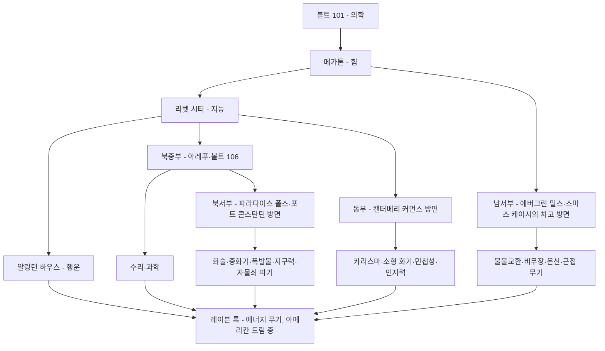

# RD-23. 수집 요소·업적

> **폴아웃 3 역기획서 세트** | 문서 ID: RD-23 | 버전: v1.0 | 작성일: 2026-10-11
> **범위**: 볼트텍 보블헤드 20개(효과·위치·주의 사항·수집 동선), 스킬북 13종(효과 규칙·수량·대표 위치·특수 책), 누카콜라 퀀텀 위치 전체, 제작 무기 설계도 위치, 유니크 무기·방어구 획득처 요약, 업적·트로피 전체(본편 + DLC), 수집 요소의 설계 분석. 아이템 수치의 정본(무기 RD-19, 방어구 RD-20, 소모품·제작 RD-21), 장소 상세(RD-13), 퀘스트 상세(RD-03~08x)는 다루지 않고 링크한다.
> **관련 문서**: [RD-13 장소 카탈로그](13_location-catalog.md), [RD-14 캐릭터 시스템](14_character-system.md), [RD-19 무기·탄약](19_weapons-ammo.md), [RD-20 방어구·의복](20_armor-apparel.md), [RD-21 소모품·잡화·제작](21_consumables-misc-crafting.md), [RD-22 경제·주거](22_economy-housing.md), [RD-06 사이드 퀘스트 2부](06_side-quests-part2.md), [RD-07 비표시·반복 퀘스트와 랜덤 인카운터](07_misc-quests-encounters.md), [RD-08a](08a_dlc-operation-anchorage.md)·[RD-08b](08b_dlc-the-pitt.md)·[RD-08c](08c_dlc-broken-steel.md)·[RD-08d](08d_dlc-point-lookout.md)·[RD-08e](08e_dlc-mothership-zeta.md) DLC 문서

---

## 1. 문서 개요

### 1.1 목적

- 원작 폴아웃 3의 '찾아서 모으는' 요소를 한곳에 정리하고, 이것이 탐험 동기를 어떻게 만드는지 분석한다.
- 팬게임에서 맵마다 수집품을 배치하고 업적(또는 그에 준하는 도전 과제)을 설계할 때 바로 쓸 수 있는 목록을 제공한다.

### 1.2 요약

- **보블헤드 20개**는 S.P.E.C.I.A.L. 7종 +1, 스킬 13종 +10을 영구히 주는 최상위 수집품이다. 4개는 진행에 따라 영구히 놓칠 수 있다.
- **스킬북 13종**은 종류마다 대개 25권이 흩어져 있고, 1권당 해당 스킬 +1(컴프리헨션 퍽이면 +2)을 준다. '흔하지만 많이 모을수록 이득'인 2차 수집품이다.
- **누카콜라 퀀텀**(본편 94병 + DLC 14병으로 서술)은 사이드 퀘스트 '누카콜라 챌린지'(30병)와 누카 수류탄 제작 재료로 쓰이는 퀘스트형 수집품이다.
- **설계도**는 제작 무기 7종마다 3~4부가 있고, 같은 설계도를 더 모으면 제작품 품질(또는 폭발물 개수)이 오른다.
- **업적**은 본편 50개(1,000점) + DLC 22개(550점) = 72개(1,550점), PS3는 플래티넘 포함 트로피 73개다. 표시 퀘스트 완료가 대부분이고, 레벨×카르마, 수집, 행동 통계형이 섞여 있다.

### 1.3 표기 메모

- 고유명사는 [RD-26 용어집](26_glossary.md)을 따르고, 용어집에 없는 이름은 처음 나올 때 영문을 병기했다. 유니크 장비·업적·스킬북의 한국어 이름은 이 문서에서 정한 **잠정 표기**이며, 장비 이름은 RD-19·RD-20 확정본을 우선한다.
- 위치 설명의 '세부'는 코퍼스 서술을 요약했다. 같은 장소의 지도 마커·구역 구조는 [RD-13](13_location-catalog.md)·[RD-12](12_world-structure-settlements.md)를 본다.
- 폼 ID는 코퍼스 표기 그대로 적었다(앞자리 0 생략 여부 포함).

---

## 2. 수집 요소 개관

| 수집 요소 | 영문명 | 수량(코퍼스) | 보상 | 진열·연계 | 업적 | 본문 |
|---|---|---|---|---|---|---|
| 볼트텍 보블헤드 | Vault-Tec bobblehead | 20 | S.P.E.C.I.A.L. +1 또는 스킬 +10(영구) | 집의 보블헤드 진열대 | 10개·20개 | 3장 |
| 스킬북 | Skill book | 13종, 종당 23~25권(일부 무한) + 특수 1종 | 스킬 +1(컴프리헨션 +2, 영구) | – | – | 4장 |
| 누카콜라 퀀텀 | Nuka-Cola Quantum | 본편 94 + DLC 14 = 108(본문 서술) | AP +20(4분), 퀘스트 납품(40캡) | 누카콜라 챌린지 | 사이드 퀘스트 업적 | 5장 |
| 설계도 | Schematics | 7종, 종당 3~4부 | 제작 무기 해금·품질 향상 | 작업대 | 무기 장인(7종 제작) | 6장 |
| 유니크 무기 | Unique weapon | 허브 표 67종(DLC 포함) | 강화된 변종 무기 | – | – | 7장 |
| 유니크 방어구·의복 | Unique armor and clothing | 허브 강조 70종 + α(DLC 포함) | 강화된 변종·보너스 | – | – | 7장 |
| 전쟁 전 서적(초록) | Pre-War book | 본편 98 + [PL] 3 | 1권당 100캡 + 10 XP | 이얼링 서기 | – | [RD-22](22_economy-housing.md) 6장 |
| 지도 위치 | Map marker | 본편 163(로브링어 포함), DLC 포함 224 | 빠른 이동 | 핍보이 지도 | 1인 정찰대(100곳) | 8장 |
| [TP] 강철 주괴 | Steel ingot | 100 | 10개마다 유니크 장비 | 에버렛 | 제철소 노동자 | 7.3절 |
| [PL] 포인트 룩아웃 장소 | Point Lookout locations | 31곳 중 29곳 필요 | – | – | 늪지 보행자 | 8장 |
| [MZ] 외계인 포로 녹음 | Alien captive recorded log | 25 | – | – | 외계 기록 보관인 | 8장 |

- 영구 능력치를 주는 수집품(보블헤드·스킬북)과 퀘스트용 수집품(퀀텀·서적·주괴·녹음), 장비형 수집품(설계도·유니크)이 층을 이룬다. 능력치 상승 아이템 전반(장비·소모품의 일시 보너스 포함)은 [RD-14](14_character-system.md)가 정본이다.

---

## 3. 볼트텍 보블헤드

### 3.1 규칙

| 항목 | 내용 |
|---|---|
| 수량 | 20개(S.P.E.C.I.A.L. 7 + 스킬 13) |
| 효과 | 줍는 즉시 해당 S.P.E.C.I.A.L. +1 또는 스킬 +10, **영구** |
| 상한 | S.P.E.C.I.A.L. 10, 스킬 100을 넘기지 않는다. 이미 상한이면 추가 효과 없음 |
| 무게·가치 | 0 / 0(판매 불가 수준) |
| 진열 | 메가톤 집·텐페니 스위트의 보블헤드 진열대에 올릴 수 있다(효과와 무관, 회수 불가). 규칙은 [RD-22](22_economy-housing.md) 7.7절 |
| 업적 | 그래, 나 인형 갖고 논다(Yes, I Play with Dolls): 10개 / 볼트텍 CEO(Vault-Tec C.E.O.): 20개 |
| 배경 | 전쟁 전 볼트텍 임원용 한정 굿즈이자 볼트 입주 확정자에게 준 선물. 어디서 발견되든 모두 볼트 101 점프슈트를 입고 있다 |
| 예외 | PC 콘솔 `player.additem`으로 얻은 보블헤드는 진열대에 올릴 수 없고 업적에도 집계되지 않는다(`placeatme`로 생성해 주우면 가능). 테스트 셀(TestQAItems)의 보블헤드도 진열 불가 |
| [PL] 가짜 | 포인트 룩아웃의 환각 장면에 가짜 '슈몰트텍 버블헤드(Schmault-Tec bubblehead)' 7개(S.P.E.C.I.A.L.)가 나온다 |
| 개발 | 퀘스트 디자이너 앨런 네인스(Alan Nanes)가 구현. 그는 '수집형 퀘스트(너른뿌리·보블헤드·퀀텀)를 밀어붙이는 사람'이라는 사내 농담을 남겼다 |

### 3.2 보블헤드 목록

`¹` = 진행에 따라 영구히 얻을 수 없게 될 수 있는 보블헤드.

| # | 보블헤드 | 영문명 | 효과 | 장소 | 세부 위치 | 관련 퀘스트·주의 | 폼 ID |
|---|---|---|---|---|---|---|---|
| 1 | 보블헤드 - 힘¹ | Bobblehead - Strength | 힘 +1 | 메가톤, 루커스 심스의 집(Lucas Simms' house) | 2층 계단 바로 왼쪽 침실의 책상 위 | '원자의 힘'에서 메가톤을 파괴하면 획득 불가 | 00038832 |
| 2 | 보블헤드 - 인지력 | Bobblehead - Perception | 인지력 +1 | 데이브 공화국(Republic of Dave), 데이브 박물관 | 박물관 오른쪽 책장 | – | 00038833 |
| 3 | 보블헤드 - 지구력 | Bobblehead - Endurance | 지구력 +1 | 데스클로 보호구역 | 입구에서 남쪽 바위 경사로를 내려가 왼쪽, 썩은 브라민 시체 옆 작은 받침대 | 같은 단상에 미니 누크·스킬북 '니콜라 테슬라와 당신', 브라민 반대편에 퀀텀. 데스클로 소굴 | 00038834 |
| 4 | 보블헤드 - 카리스마 | Bobblehead - Charisma | 카리스마 +1 | 볼트 108, 복제 연구실 | 침대 4개가 있는 중앙 방의 테이블(진료실 남쪽, 수술실 창으로 보임) | 같은 방에 스킬북 '거짓말, 의회 스타일'. 개리(Gary) 클론 다수 | 00038850 |
| 5 | 보블헤드 - 지능 | Bobblehead - Intelligence | 지능 +1 | 리벳 시티, 과학 연구소 | 아래층 중앙 테이블 셋 중 사물함 두 개 옆 테이블 | 매디슨 리가 근처에 있다. 중앙 갑판·상갑판으로 진입 | 0003885c |
| 6 | 보블헤드 - 민첩성 | Bobblehead - Agility | 민첩성 +1 | 그린 패스처스 폐기물 처리장(Greener Pastures disposal site), 사무실 | 금고를 여는 터미널(평균 잠금) 옆 책상 | 같은 자리에 퀀텀 | 000388e5 |
| 7 | 보블헤드 - 행운 | Bobblehead - Luck | 행운 +1 | 알링턴 묘지 북부, 알링턴 하우스(Arlington House) | 지하실 선반 | 윌헬름스 워프 남쪽의 알링턴/웨이스트랜드 지하철로 진입. 로브링어 퍽이 있으면 전더스 플렁킷이 점거 | 000388e6 |
| 8 | 보블헤드 - 물물교환 | Bobblehead - Barter | 물물교환 +10 | 에버그린 밀스, 바자 | 스마일링 잭 오른쪽 방 구석의 어두운 굴. 작업대를 넘어 맨 오른쪽 선반 | 레이더 소굴. 볼트 보이가 (전쟁 전인데도) 병뚜껑을 들고 있다 | 000388F3 |
| 9 | 보블헤드 - 중화기 | Bobblehead - Big Guns | 중화기 +10 | 포트 콘스탄틴, CO 숙소 | 지하실 왼쪽의 열린 금고(10mm 권총·탄약·발사 코드·캡과 함께) | 숙소의 프로텍트론을 처치하고 지하로 | 00038906 |
| 10 | 보블헤드 - 에너지 무기¹ | Bobblehead - Energy Weapons | 에너지 무기 +10 | 레이븐 록, 오텀 대령의 침실 | 2B→2C 구역 대형 문을 지나 복도 끝 왼쪽 문, 오른쪽 책상 | '아메리칸 드림' 중 유일한 기회. 에덴 대통령을 만나러 제어실에 들어가기 전에 챙겨야 하며 이후 재방문 불가 | 0003892F |
| 11 | 보블헤드 - 폭발물 | Bobblehead - Explosives | 폭발물 +10 | WKML 방송국, 봉인된 저수조 | 방송국 남쪽(최남단 탑 남서쪽 절벽 아래) 바위 틈의 맨홀 | 방송국 안에서 신호를 켜고, 신호가 가장 강한 곳을 따라가면 맨홀을 찾을 수 있다 | 00038930 |
| 12 | 보블헤드 - 자물쇠 따기 | Bobblehead - Lockpick | 자물쇠 따기 +10 | 베데스다 폐허, 베데스다 오피스 동관 | 2층, 금고 아래의 켜진 램프가 있는 책상 | 획득 후 진열대에서 유일하게 흔들리지 않는 보블헤드 | 00038931 |
| 13 | 보블헤드 - 의학¹ | Bobblehead - Medicine | 의학 +10 | 볼트 101, 진료소 | '불완전한 미래'·'탈출!' 때는 제임스의 책상, '고향의 위기' 때는 피 튄 창문 앞 작은 카트 | 세 퀘스트가 끝나면 볼트가 영구 봉쇄(주민 몰살·볼트 사보타주 예외). 볼트 버전이 셋이라 실제로는 세 개가 존재하고 하나를 주우면 나머지가 숨겨진다 | 00038950 |
| 14 | 보블헤드 - 근접 무기 | Bobblehead - Melee Weapons | 근접 무기 +10 | 던위치 빌딩, 독성 지하실(Virulent underchambers) | 던위치 빌딩으로 돌아가는 두 번째 출입구 근처, 금속 바닥 방 한가운데 빈 병·깡통 사이 | 크리브베크니(The Krivbeknih)가 있는 곳. [PL] 퀘스트와 연결 | 00038951 |
| 15 | 보블헤드 - 수리¹ | Bobblehead - Repair | 수리 +10 | 아레푸, 에반 킹의 집(Evan King's house) | 들어가자마자 왼쪽 흰 테이블 | 문이 잠겨 자물쇠 따기 50 필요(카르마 손실 없음). '강제 따기' 실패 시 영구 잠김(인필트레이터 퍽이 있으면 예외). 에반 킹이 보면 적대할 수 있다 | 00038952 |
| 16 | 보블헤드 - 과학 | Bobblehead - Science | 과학 +10 | 볼트 106, 거주 구역 | 위층 가장 동쪽 방의 강철 선반(작은 다리를 건너 남쪽 → 동쪽 문 → 복도 끝) | 환각 가스와 미친 생존자 | 00038953 |
| 17 | 보블헤드 - 소형 화기 | Bobblehead - Small Guns | 소형 화기 +10 | 국가방위군 창고(National Guard depot), 무기고 | 지하 봉인 저장실 선반. 무기고 출입문 스위치는 훈련동·사무동을 지나 3층에 있다 | 켈러 가문 녹취록이 필요한 방 바로 앞이며, 녹취록 없이도 갈 수 있다 | 00038954 |
| 18 | 보블헤드 - 은신 | Bobblehead - Sneak | 은신 +10 | 야오 과이 터널, 야오 과이 굴 | 큰 방사능 웅덩이 북동쪽 금속 상자 위(북쪽 터널 → 문) | 야오 과이 다수 | 00038955 |
| 19 | 보블헤드 - 화술 | Bobblehead - Speech | 화술 +10 | 파라다이스 폴스, 율로지의 거처(Eulogy's pad) | 하트 모양 침대가 있는 방, 터미널 옆 테이블 | 파라다이스 폴스 입장 조건(노예상 우호 또는 전투) | 00038956 |
| 20 | 보블헤드 - 비무장 | Bobblehead - Unarmed | 비무장 +10 | 록오폴리스(Rockopolis, 지도 마커 없음) | 거더셰이드 바로 북쪽·스미스 케이시의 차고 바로 서쪽 갈래 계곡. 찢긴 검은 깃발 아래 큰 바위가 입구이며, 아가일(Argyle)의 시신 옆 | 지도 마커 없는 장소의 유일한 보블헤드. 밤엔 바위 틈에서 빛이 샌다. 계곡은 랜덤 인카운터 지점. 비표시 퀘스트 '학대당한 하인(A Manhandled Manservant)'과 연결 | 00038958 |

### 3.3 보블헤드 모토

보블헤드를 진열대에서 살펴보면 각 받침의 모토를 다시 읽을 수 있다. 원문은 짧은 격언이다.

| 보블헤드 | 원문 | 번역 |
|---|---|---|
| 힘 | It's essential to give your arguments impact. | 논쟁엔 반드시 한 방을 실어라. |
| 인지력 | Only through observation will you perceive weakness. | 관찰해야만 약점이 보인다. |
| 지구력 | Always be ready to take one for the team. | 언제든 팀을 위해 대신 맞을 각오를 하라. |
| 카리스마 | Nothing says pizzaz like a winning smile. | 승자의 미소만큼 멋진 건 없다. |
| 지능 | It takes the smartest individuals to realize there's always more to learn. | 배울 것이 늘 더 있음을 깨닫는 건 가장 똑똑한 이들뿐이다. |
| 민첩성 | Never be afraid to dodge the sensitive issues. | 민감한 문제는 피하는 걸 두려워하지 마라. |
| 행운 | There's only one way to give 110%. | 110%를 내는 방법은 하나뿐이다. |
| 물물교환 | Never forget to walk away with more than you've brought. | 가져온 것보다 많이 챙겨 떠나는 걸 잊지 마라. |
| 중화기 | The best way to win an argument is to be the loudest. | 논쟁에서 이기는 최선의 방법은 가장 시끄러운 것이다. |
| 에너지 무기 | Arrive at peaceful resolutions by using superior firepower. | 압도적 화력으로 평화적 해결에 이르러라. |
| 폭발물 | The best way to solve a problem is to make it go away. | 문제를 해결하는 최선의 방법은 문제를 날려 버리는 것이다. |
| 자물쇠 따기 | Always strive for the unobtainable. | 언제나 손에 넣을 수 없는 것을 노려라. |
| 의학 | The smart man knows a bandage only hides his wounds. | 현명한 이는 붕대가 상처를 가릴 뿐임을 안다. |
| 근접 무기 | It's important to do business up close and personal. | 일은 가까이서, 직접 처리하는 게 중요하다. |
| 수리 | Why go down with the ship when you can try to fix it? | 고쳐 볼 수 있는데 왜 배와 함께 가라앉나? |
| 과학 | Always be prepared to explain the hows and whys. | 어떻게와 왜를 설명할 준비를 늘 해 두라. |
| 소형 화기 | Because it's easier to have courage from a safe distance away. | 안전한 거리에서라면 용기를 내기가 더 쉬우니까. |
| 은신 | The safest distance between two points is a shadowy line. | 두 점 사이 가장 안전한 길은 그늘진 선이다. |
| 화술 | Let words be your weapon. | 말을 무기로 삼아라. |
| 비무장 | When words fail, there's always fists | 말이 안 통하면 주먹이 있다. |

- 모토는 해당 능력치·스킬의 쓰임을 볼트텍식 블랙 유머로 비튼 문구다. 진열대가 '능력치 사전' 역할을 겸한다.

### 3.4 놓치기 쉬운 보블헤드

| 보블헤드 | 잠기는 조건 | 대응 |
|---|---|---|
| 의학 | 볼트 101 관련 세 퀘스트('불완전한 미래'·'탈출!'·'고향의 위기')가 끝나 볼트가 봉쇄됨 | 탈출 전 제임스의 책상에서 줍는다. 놓쳤다면 '고향의 위기'로 재방문 시 카트에서 |
| 힘 | '원자의 힘'에서 메가톤 폭파 | 폭파 노선이라도 폭파 전에 루커스 심스의 집에서 줍는다 |
| 에너지 무기 | '아메리칸 드림'에서 레이븐 록 제어실 진입 | 2C 구역의 오텀 대령 침실을 먼저 들른다 |
| 수리 | 에반 킹의 집 '강제 따기' 실패 | 자물쇠 따기 50 확보 후 정상 따기, 또는 인필트레이터 퍽 |

### 3.5 수집 동선 제안

**원칙**: ① 시간 제한이 있는 3개(의학·힘·에너지 무기)는 메인 진행과 함께 처리, ② 나머지 17개는 지역 묶음으로 처리한다. 지역 배치는 각 장소 문서의 방위 서술을 근거로 묶었다.

| 묶음 | 보블헤드 | 지역 근거(코퍼스 서술) | 권장 시점·위험 |
|---|---|---|---|
| A. 진행 연동 | 의학(볼트 101), 힘(메가톤), 지능(리벳 시티), 에너지 무기(레이븐 록) | 메인 퀘스트 동선상 | 탈출 직전·메가톤 첫 방문·'아버지의 발자취'·'아메리칸 드림' |
| B. 북서부 | 중화기(포트 콘스탄틴), 폭발물(WKML 방송국), 지구력(데스클로 보호구역), 자물쇠 따기(베데스다 폐허), 화술(파라다이스 폴스) | WKML은 포트 콘스탄틴 바로 남쪽, 데스클로 보호구역은 포트 콘스탄틴 남서쪽, 베데스다 폐허는 D.C. 북서쪽, 파라다이스 폴스는 볼트 106 바로 북쪽 | 데스클로 보호구역은 후반 권장. 파라다이스 폴스는 입장 노선 결정 후 |
| C. 북중부 | 과학(볼트 106), 수리(아레푸) | 아레푸는 볼트 106 북서쪽의 다리 위 마을 | 아레푸는 '피의 유대'와 함께. 자물쇠 따기 50 준비 |
| D. 동·북동부 | 카리스마(볼트 108), 소형 화기(국가방위군 창고), 민첩성(그린 패스처스), 인지력(데이브 공화국) | 국가방위군 창고는 볼트 108 바로 남쪽. 볼트 108은 캔터베리 커먼스 남쪽. 그린 패스처스는 연합의 신전 북서쪽·올드 올니 남서쪽. 데이브 공화국은 지도 북동쪽 끝(올드 올니 동쪽) | 캐러밴 투자 등 캔터베리 커먼스 일정과 묶기 좋다 |
| E. 서·남서부 | 비무장(록오폴리스), 은신(야오 과이 터널), 물물교환(에버그린 밀스), 근접 무기(던위치 빌딩) | 록오폴리스는 서쪽 끝·거더셰이드 북쪽·야오 과이 터널 남동쪽. 에버그린 밀스는 남서부·스미스 케이시의 차고 바로 동쪽. 던위치 빌딩은 지도 남서쪽 끝·거더셰이드 남쪽 | 거더셰이드('누카콜라 챌린지')·스미스 케이시의 차고(볼트 112) 방문과 묶기 좋다 |
| F. D.C. 남서 | 행운(알링턴 하우스) | 윌헬름스 워프 남쪽 지하철로 진입 | 로브링어 퍽 선택 시 전더스 플렁킷과 전투 |

- 레벨 관점: 데스클로 보호구역(지구력)과 야오 과이 터널(은신), 던위치 빌딩(근접 무기)은 강적 서식지라 중후반으로 미루는 편이 안전하다. 반대로 메가톤·리벳 시티·볼트 108·국가방위군 창고는 진행 중 자연스럽게 지나간다.
- 보블헤드는 효과가 즉시 영구 적용되므로, **스킬 +10은 레벨업 1회분(10 + 지능) 가치**가 된다. 초반에 원하는 스킬 보블헤드를 먼저 노리는 '빌드 동선'도 성립한다(예: 물물교환·수리·자물쇠 따기 보블헤드를 먼저).

---

## 4. 스킬북

(작성 중)

---

## 5. 누카콜라 퀀텀

(작성 중)

---

## 6. 설계도

(작성 중)

---

## 7. 유니크 무기·방어구

(작성 중)

---

## 8. 업적·트로피

(작성 중)

---

## 9. 설계 분석

(작성 중)

---

## 10. 쯔꾸르 이식 메모

(작성 중)

---

## 부록 A. 스킬북 전체 위치(원명)

(작성 중)

## 부록 B – 출처

(작성 중)
