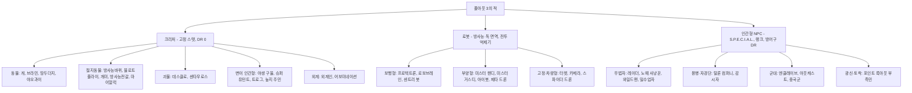
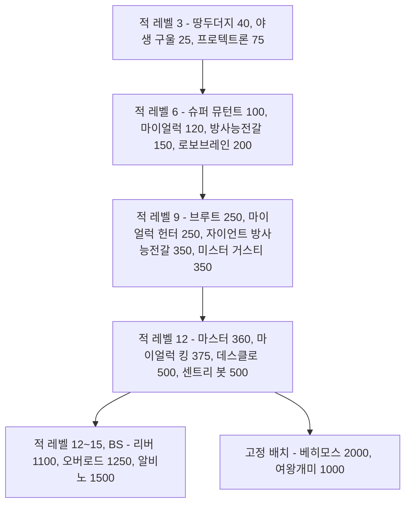
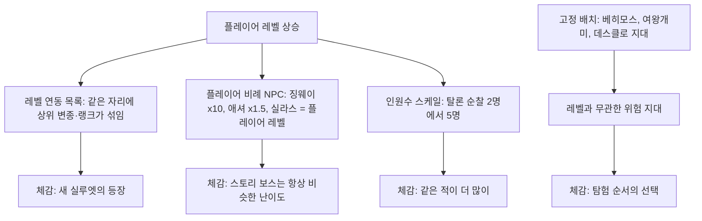

# RD-24. 크리처·적 도감

> **폴아웃 3 역기획서 세트** | 문서 ID: RD-24 | 버전: v1.0 | 작성일: 2026-10-11
> **범위**: 본편과 DLC 5종에서 플레이어가 싸우는 적 전 유형의 정본 카탈로그. 크리처·로봇·인간 적의 변종별 레벨·HP·DR·공격·XP, 행동 패턴, 약점, 서식지, 드롭, 레벨 연동 등장 규칙, 고유·보스급 적. **다루지 않는 것**: 피해·명중·VATS 공식과 AI 탐지 엔진(RD-16), 랜덤 인카운터 목록과 암살대 출현 규칙의 정본(RD-07), 팩션의 역사·관계(RD-09), 이름 있는 NPC의 프로필(RD-10·RD-11), 무기·방어구 수치(RD-19·RD-20), 장소 상세(RD-13)
> **관련 문서**: [RD-07 비표시·반복 퀘스트와 랜덤 인카운터](07_misc-quests-encounters.md), [RD-08a 오퍼레이션: 앵커리지](08a_dlc-operation-anchorage.md), [RD-08b 더 피트](08b_dlc-the-pitt.md), [RD-08c 브로큰 스틸](08c_dlc-broken-steel.md), [RD-08d 포인트 룩아웃](08d_dlc-point-lookout.md), [RD-08e 마더십 제타](08e_dlc-mothership-zeta.md), [RD-09 팩션](09_factions.md), [RD-13 장소 카탈로그](13_location-catalog.md), [RD-14 캐릭터 시스템](14_character-system.md), [RD-16 전투 시스템](16_combat-system.md), [RD-19 무기·탄약](19_weapons-ammo.md), [RD-21 소모품·잡화·제작](21_consumables-misc-crafting.md), [RD-26 용어집](26_glossary.md)

---

## 목차

1. 문서 개요
2. 적 분류 체계
3. 전체 요약표
4. 위협도 곡선
5. 크리처 ① 동물·절지동물
6. 크리처 ② 변이 인간형(야생 구울, 슈퍼 뮤턴트, 센타우로스)
7. 로봇
8. 인간 적
9. DLC 적
10. 고유·보스급 적
11. 적 디자인 분석
12. 쯔꾸르 이식 메모
- 부록 A. 데이터 처리 노트
- 부록 B. 출처

---

## 1. 문서 개요

### 1.1 목적
- 팬게임의 적 데이터베이스(몬스터 표, 적 편성표, 인카운터 테이블)를 설계할 때 근거로 쓸 **원작 적 정본 카탈로그**를 만든다.
- 개별 수치뿐 아니라 '같은 계통이 레벨 6·9·12에 한 단계씩 강해지는 계단 구조', '지역마다 다른 생태 배치', '부위별 약점 설계'가 어떻게 전투 경험을 만드는지 분석한다.

### 1.2 범위
- **포함**: 본편 크리처 15계통, 로봇 8계통, 인간 적 7집단(레이더(Raiders), 탈론 컴퍼니(Talon Company), 감시자(Regulators), 노예 사냥꾼(Slavers), 엔클레이브(Enclave), 아웃캐스트(Brotherhood Outcasts), 중국군 잔존병(Chinese remnants)), DLC 적 전부([OA] 중국군 시뮬레이션, [TP] 트로그(Trogs)·와일드맨(Wildmen), [BS] 상위 변종, [PL] 늪지 주민(Swampfolk)·부족민·밀수업자, [MZ] 외계인(Aliens)·드론), 고유·보스급 적 약 40명.
- **요약만 하고 링크**: 카르마 암살대 출현 규칙과 고정 출현 31곳(정본 [RD-07](07_misc-quests-encounters.md) 5.3절), 랜덤 인카운터 슬롯(정본 RD-07 5.2절), 피해 공식·VATS·적 AI 엔진(정본 [RD-16](16_combat-system.md)), DLC별 적의 줄거리상 역할(정본 RD-08a~e).
- **제외**: 동료로만 쓰이는 개체(도그밋 등)의 성장 수치, 비적대 NPC.

### 1.3 요약
- 위키 허브 문서 기준으로 본편 크리처는 **43종·변종 63개**, DLC가 **변종 18개**를 더한다. 로봇·컴퓨터는 본편 **39개**, DLC **16개**, 합계 **55개**다. 이 문서는 이를 전투 단위로 다시 묶어 **약 47계통, 변종·랭크 약 190행**을 싣는다.
- **크리처의 DR은 전부 0**이다. 크리처의 단단함은 HP와 '부위별 피해 배율'(마이얼럭 몸통 ½, 마이얼럭 킹 몸통 ⅔, 방사능전갈 다리 감쇄, 브라민 머리 50%)로 표현된다. DR을 쓰는 적은 방어구를 입은 인간과 관성 억제장을 켠 외계인뿐이다.
- 계통마다 **레벨 6 → 9 → 12** 지점에 다음 단계 변종이 놓이고, HP가 한 단계에 2~3배씩 뛴다(슈퍼 뮤턴트(Super mutant) 100 → 250 → 360, 방사능전갈(Radscorpion) 150 → 350, 마이얼럭(Mirelurk) 120 → 250 → 375). [BS]는 그 위에 HP 1,000대 변종(오버로드 1,250, 리버 1,100, 알비노 방사능전갈 1,500)을 얹는다.
- 인간 적은 **랭크형**이다. 같은 이름 아래 랭크 1~3(4)이 있고, 랭크가 오르면 레벨·HP·태그 스킬·무기 풀이 함께 오른다. 감시자는 플레이어 레벨 1·6·9에서 랭크가 열린다.
- XP는 위키 정보상자에 **일부 종만** 기록되어 있다(화염개미(Fire ant), 거대 개미(Giant ant), 센타우로스(Centaur), 트로그, 늪지 주민 등). 나머지는 `—`로 두고 수치를 지어내지 않는다.

### 1.4 표기 메모
- **자료원**: Nukapedia 2026-08-30 덤프. 각 종의 `XXX (Fallout 3)` 문서에 있는 `{{Stats creature FO3}}` 행 151개를 스크립트로 일괄 추출했고, 인간 적은 `Infobox character`와 'Generic variants' 랭크 표를 추출했다. 여러 게임을 다루는 개요 문서(`Deathclaw`, `Mirelurk` 등)의 수치는 쓰지 않았다.
- **공식 가이드 교차 확인**: `Fallout 3 Official Game Guide Game of the Year Edition Wasteland Census`는 인물 소개문만 싣고 **전투 수치는 없다**. 고유 적의 소개(쪽수)를 10장에서 참고로만 적었다.
- **칸 정의**
  - 레벨: 적 개체 자신의 레벨. 플레이어 레벨과 다르다(레벨 연동 규칙은 각 종의 '등장 규칙' 항목과 11.2절).
  - HP: 정보상자 값. 인간 적의 `75 → 110` 같은 화살표는 '플레이어 레벨에 따라 오르는 범위'다.
  - DR: 피해 저항(%). 위키의 `11% → 13%` 같은 화살표는 원문 표기를 그대로 옮겼다(장비 상태에 따른 범위로 보이며 정확한 의미는 코퍼스 미확인).
  - 공격: `근접 28`은 공격 한 번의 기본 피해다. `+ 독 3/초(5초)`는 지속 피해다. `피해`는 플레이어 DR 적용 전 값이다.
  - XP: 처치 XP(보통 난이도). 아주 쉬움 ×0.5, 아주 어려움 ×1.5([RD-16](16_combat-system.md) 11장).
  - AI: `공격성/자신감/협조` 값. 공격성 0 비공격~3 광란, 자신감 0 겁쟁이~4 무모, 협조 0 아무도 안 도움~2 친구와 동맹을 도움.
- **기호**: `[OA]` 오퍼레이션: 앵커리지(Operation: Anchorage), `[TP]` 더 피트(The Pitt), `[BS]` 브로큰 스틸(Broken Steel), `[PL]` 포인트 룩아웃(Point Lookout), `[MZ]` 마더십 제타(Mothership Zeta), `★` 고유 개체, `✝` 시체로만 존재, `✂` 삭제 콘텐츠(게임 파일에만 있음).
- **표기 기준**: [RD-26 용어집](26_glossary.md) v0.2와 한글 패치 표기를 따른다. 크리처: 방사능바퀴(Radroach), 땅두더지(Mole rat), 야오과이(Yao guai), 데스클로(Deathclaw), 베히모스(Behemoth), 미스터 거스티(Mister Gutsy, 패치 'Mr. 거스티'), 야생 구울(Feral ghoul), 구울(Ghoul), 브라민(Brahmin), 블로트플라이(Bloatfly). 세력·장소: 브라더후드 오브 스틸(Brotherhood of Steel, BoS), 수도 황무지(Capital Wasteland), 버티버드(Vertibird), 정화 계획(Project Purity), 메가톤(Megaton), 시타델(The Citadel), 볼트 87(Vault 87), 레이븐 락(Raven Rock), 파라다이스폴(Paradise Falls), 애덤스 공군 기지(Adams Air Force Base), 국회의사당(Capitol Building), 제퍼슨 기념관(Jefferson Memorial), 언더월드(Underworld), 리틀 램프라잇(Little Lamplight), 그레이디치(Grayditch), 올드 올니(Old Olney), 마리골드 역(Marigold station), 패밀리(The Family). 메인 퀘스트: 「생명의 물(The Waters of Life)」, 「되찾아라!(Take It Back!)」.

---

## 2. 적 분류 체계

### 2.1 분류 트리

- 외계인, 늪지 주민, 트로그는 게임 데이터상 '크리처'로 분류되어 고정 스탯 표를 쓴다. 반면 중국군 잔존병은 구울이지만 인간형 NPC 데이터다.

### 2.2 엔진 분류가 만드는 차이

| 구분 | 크리처 | 인간형 NPC | 로봇 |
|---|---|---|---|
| 스탯 구조 | 레벨·HP·피해가 고정 | S.P.E.C.I.A.L.(스페셜)·스킬에서 HP와 명중이 파생 | 크리처와 같은 고정 스탯 |
| 강해지는 방식 | 다른 변종(상위 모델)으로 교체 | 같은 이름의 랭크가 오르고 장비 풀이 바뀜 | 다른 모델·도색으로 교체 |
| 방어 | DR 0, 부위 배율과 HP | 입은 방어구의 DR | DR 0, 방사능·독 100% 저항 |
| 드롭 | 고기·분비물 등 '부산물' 고정 | 소지 장비 전부 + 사망 시 무작위 음식·약물·탄약 | 에너지 셀·핵분열 배터리·고철 등 부품 |
| 특수 약점 | 더듬이(개미), 얼굴(마이얼럭), 다리(도약형) | 머리, 무기 쥔 팔 | 전투 억제기(Combat inhibitor)를 부수면 광란 |
| 퍽 상호작용 | 애니멀 프렌드(Animal Friend, 동물 우호), 엔토몰로지스트(Entomologist, 곤충 피해 +50%) | 로브링어(Lawbringer, 악인 손가락), 컨트랙트 킬러(Contract Killer, 선인 귀) | 로보틱스 엑스퍼트(Robotics Expert, 몰래 접근해 정지) |

- **크리처 간 적대 규칙**: 같은 팩션으로 묶이지 않은 크리처끼리는 가까이 있으면 서로 싸운다. 예를 들어 데스클로는 마이얼럭을 공격하지만, 야생 구울은 글로잉 원(Glowing one)을 공격하지 않는다.
- **'혐오체(abomination)' 분류**: 데스클로와 마이얼럭은 혐오체로 분류되어 애니멀 프렌드가 통하지 않는다. 개·땅두더지·야오과이·브라민은 통한다.
- 구울 마스크(Ghoul mask)를 쓰면 모든 야생 구울 변종이 비적대가 된다.

### 2.3 AI 속성 분포 (크리처·로봇 정보상자)

| 성향 | 값(공격성/자신감/협조) | 해당 적 | 플레이어 체감 |
|---|---|---|---|
| 겁 많은 해충 | 0/1/0 | 방사능바퀴 | 다가가면 날개를 퍼덕여 위협하다가, 오래 붙어 있으면 공격 |
| 비공격 가축 | 0/0/1 | 브라민, 짐 브라민 | 맞으면 대개 도망 |
| 매우 공격적·무모 | 2/4/2 | 데스클로, 슈퍼 뮤턴트 전 단계, 방사능전갈, 마이얼럭, 야오과이, 화염개미, 거대 개미 | 보는 즉시 달려들고 도망치지 않음 |
| 공격적·무모·협조 약함 | 2/4/1 | 야생 구울 전 변종 | 무리로 돌진하지만 서로 엄호하지 않음 |
| 무장 경비 | 1/4/2 또는 1/3/2 | 프로텍트론 계열 일부, 레이더·탈론 경비견 | 적으로 판정된 대상만 공격 |
| 비공격 기계 | 0/4/0 | 터렛 대부분 | 터미널이나 조건으로 적이 정해짐 |

---

## 3. 전체 요약표

> 레벨·HP 범위는 이 문서의 변종 표 기준이다(시체 전용·삭제 개체 제외). '변종'은 이 문서의 표 행 수가 아니라 서로 다른 이름의 전투 단위 수다.

### 3.1 크리처

| 계통 | English | 변종 수 | 레벨 범위 | HP 범위 | 대표 서식지 | 절 |
|---|---|---|---|---|---|---|
| 방사능바퀴 | Radroach | 1 | 0 | 5 | 볼트 101, 하수도, 로브코 시설 | 5.1 |
| 블로트플라이 | Bloatfly | 1 | 1 | 15 | 독성 폐기물 통 주변, 볼트 92 입구 | 5.2 |
| 땅두더지 | Mole rat | 1 | 3 | 40 | 황무지 전역, [PL] | 5.3 |
| 개 | Dog | 5 | 1~3 | 20~60 | 황무지 전역, 레이더·탈론 거점 | 5.4 |
| 브라민 | Brahmin | 3(+시체) | 1 | 40~100 | 정착지, 캐러밴, 랜덤 인카운터 | 5.5 |
| 거대 개미 | Giant ant | 5(+시체) | 2~7 | 30~1,000 | 캔터베리 커먼 일대(개미여인의 소굴), 코베가 공장, 셰일브리지 | 5.6 |
| 화염개미 | Fire ant | 5 | 2~9 | 30~1,000 | 그레이디치, 마리골드 역 | 5.7 |
| 방사능전갈 | Radscorpion | 3 | 6~13 | 150~1,500 | 황무지 서부·남부 | 5.8 |
| 마이얼럭 | Mirelurk | 6 | 6~20 | 120~600 | 포토맥 강변, 하수도, [PL] 늪 | 5.9 |
| 야오과이 | Yao guai | 2(+★) | 7 | 220 | 야오과이 터널·동굴, 절벽 동굴 | 5.10 |
| 데스클로 | Deathclaw | 2 | 12 | 500 | 올드 올니, 데스클로 보호구역 | 5.11 |
| 야생 구울 | Feral ghoul | 5 | 3~12 | 25~1,100 | 지하철역, 던위치 빌딩, [PL] | 6.1 |
| 슈퍼 뮤턴트 | Super mutant | 5 | 6~15 | 100~2,000 | D.C. 도심, 볼트 87 | 6.2 |
| 센타우로스 | Centaur | 1 | 5 | 100 | 슈퍼 뮤턴트 무리 | 6.3 |
| 실패한 FEV 피험체 ✝ | Failed FEV subject | 1 | 1 | 0 | 볼트 87 실험실 | 6.4 |

### 3.2 로봇

| 계통 | English | 변종 수 | 레벨 범위 | HP 범위 | 대표 서식지 | 절 |
|---|---|---|---|---|---|---|
| 프로텍트론 | Protectron | 8 | 3 | 75 | 지하철역, 뉴카-콜라 공장, 국립 기록 보관소 | 7.1 |
| 미스터 핸디 | Mister Handy | 3(+✂1) | 3 | 100 | 전쟁 전 주택 | 7.2 |
| 미스터 거스티 | Mister Gutsy | 3 | 3~9 | 200~350 | 창고, 군 시설, 레이븐 락 | 7.3 |
| 로보브레인 | Robobrain | 5(+✂1) | 1~6 | 200 | 군 시설, 엔클레이브·아웃캐스트 순찰 | 7.4 |
| 센트리 봇 | Sentry bot | 6(+✂1) | 3~12 | 300~500 | 콘스탄틴 요새, 레이븐 락, 애덤스 공군 기지 | 7.5 |
| 아이봇 | Eyebot | 1 | 1 | 30 | 황무지 상공 | 7.6 |
| 자동 터렛 | Automated turret | 8(+DLC 3) | 2~30 | 40~10,000 | 군 시설, 레이더 거점 | 7.7 |

### 3.3 인간 적

| 집단 | English | 랭크·유형 | 레벨 범위 | HP 범위 | 대표 거점 | 절 |
|---|---|---|---|---|---|---|
| 레이더 | Raider | 총·근접·소총·중화기 × 랭크 1~3 | 1~9 | 25~90 | 에버그린 밀, 레이더 전초기지, 학교·공장 폐허 | 8.1 |
| 탈론 컴퍼니 | Talon Company merc | 랭크 1~4 | 8~17 | 75~300 | 배니스터 요새, 국회의사당 | 8.2 |
| 감시자 | Regulator | 랭크 1~3 | 8~14 | 75~135 | 암살대, 감시자 본부 | 8.3 |
| 노예 사냥꾼 | Slaver | 지역 2종 | 3~15 | 75~110 | 파라다이스폴, 링컨 기념관 | 8.4 |
| 엔클레이브 | Enclave soldier 외 | 랭크 0~2, 테슬라, 헬파이어, 장교, 과학자 | 1~24 | 20~250 | 엔클레이브 캠프, 레이븐 락, [BS] 애덤스 공군 기지 | 8.5 |
| 아웃캐스트 | Brotherhood Outcast | 총·근접·중화기 × 랭크 1~3 | 4~11 | 70~125 | 인디펜던스 요새, 순찰로 | 8.6 |
| 중국군 잔존병 | Chinese remnant soldier | 병사·부사관·장교·대위 | 1~10 | 코퍼스 미확인(대위 70) | 마마 돌체 식품 공장 | 8.7 |

### 3.4 DLC 적

| DLC | 계통 | 변종·랭크 | 레벨 범위 | HP 범위 | 절 |
|---|---|---|---|---|---|
| [OA] | 중국군(시뮬레이션) | 소총수 랭크 1~5, 저격병, 화염방사병, 로켓병, 기술병, 크림슨 드라군 | 3~13 (드라군은 플레이어 ×1.3) | 40~90 | 9.1 |
| [OA] | 키메라 / 스파이더 드론 / 경비견 / OA 터렛 | 각 1 | 1~12 | 20~10,000 | 9.1 |
| [TP] | 트로그 | 4 | 3~12 | 15~65 | 9.2 |
| [TP] | 와일드맨, 피트 레이더, 노예 투사 | 3 | 코퍼스 미확인 | 코퍼스 미확인 | 9.2 |
| [BS] | 상위 변종 | 오버로드, 리버, 알비노, 헬파이어, 탈론 랭크 4, 마크 VII·VIII, 시그마 분대 | 9~24 | 250~1,500 | 9.3 |
| [PL] | 늪지 주민 | 5(근접·원거리 판본 8행) | 7~20 | 150~700 | 9.4 |
| [PL] | 부족민 / 밀수업자 | 각 랭크 1~5 | 7~20 | 75~415 | 9.4 |
| [PL] | 스웜프러크·퀸, 늪지 구울, 로보브레인 센트리, 루즈카 | 5 | 1~20 | 25~600 | 9.4 |
| [MZ] | 외계인 / 어보미네이션 | 각 6단계 + 작업자·함장 | 1~30 | 25~500 | 9.5 |
| [MZ] | 드론 3종, 외계인 터렛 | 4 | 1~30 | 20~600 | 9.5 |

---

## 4. 위협도 곡선

### 4.1 적 레벨대별 대표 적

> 아래 레벨은 **적 개체의 레벨**이다. 레벨 연동 목록은 대체로 적 레벨이 플레이어 레벨 근처인 개체를 뽑지만, 정확한 문턱값은 종마다 다르고 코퍼스에 거의 없다(감시자처럼 문턱값이 명시된 예는 각 절에 적었다).

| 적 레벨 | 크리처 | 로봇 | 인간 | 전투 성격 |
|---|---|---|---|---|
| 0~3 | 방사능바퀴(5), 블로트플라이(15), 땅두더지(40), 사나운 개(60), 야생 구울(25), 거대 일개미·화염개미 일개미(30) | 아이봇(30), 프로텍트론(75), 미스터 핸디(100), 터렛 마크 I·II | 레이더 랭크 1(25~30) | 수로 밀어붙이는 약한 무리. 10mm 권총 몇 발로 정리 |
| 4~6 | 센타우로스(100), 슈퍼 뮤턴트(100), 마이얼럭(120), 방사능전갈(150), 화염개미 병정(150) | 로보브레인(200), 터렛 마크 III·IV | 레이더 랭크 2(55~60), 엔클레이브 훈련병(45), 아웃캐스트 랭크 1(70) | **첫 벽**. 마이얼럭의 껍데기, 방사능전갈의 독, 슈퍼 뮤턴트의 화력 |
| 7~9 | 야오과이(220), 글로잉 원(240), 마이얼럭 헌터(250), 슈퍼 뮤턴트 브루트(250), 자이언트 방사능전갈(350), 화염개미 전사(225) | 미스터 거스티(350), 터렛 마크 V·VI | 레이더 랭크 3(85~90), 탈론 랭크 1(75), 감시자 랭크 1(75), 엔클레이브 랭크 1(80~90) | 근접 한 방이 50~75로 커짐. 원거리 화기 필수 |
| 10~12 | 데스클로(500), 마이얼럭 킹(375), 슈퍼 뮤턴트 마스터(360), [BS] 리버(1,100)·오버로드(1,250) | 센트리 봇(500) | 탈론 랭크 2(105), 감시자 랭크 2(105), 아웃캐스트 랭크 3(125) | 본편 최상위 필드 적. 데스클로 근접 100 |
| 13~17 | 슈퍼 뮤턴트 베히모스(2,000, 고정 5마리), [BS] 알비노 방사능전갈(1,500) | (없음) | 엔클레이브 랭크 2(125), 탈론 랭크 3(135), 테슬라 병사(170), 엔클레이브 장교(125), [BS] 탈론 랭크 4(300) | 보스·준보스 구간 |
| 18 이상 | [PL] 스웜프러크 퀸(600), 늪지 주민 브루저(700), [MZ] 어보미네이션(250~500) | [MZ] 외계인 터렛(300~600) | [BS] 헬파이어(250, DR 37→41), [PL] 부족민 랭크 5(410~415) | [BS] 레벨 상한 30 구간 |

### 4.2 계단 구조

- 같은 계통의 다음 단계는 **레벨 +3**, **HP ×2~3**이다. 플레이어는 레벨 업 3번마다 '같은 실루엣의 더 큰 적'을 만나게 된다.
- 로봇도 같은 계단을 탄다: 프로텍트론 3 → 로보브레인 6 → 미스터 거스티 9 → 센트리 봇 12.

### 4.3 기준 무기로 본 필요 타수 (작성자 계산)

> 무기 기본 피해(정보상자)로 HP를 나눈 값이다. 스킬·내구도·치명타·부위 배율·DR을 무시한 '감'을 보기 위한 표다.

| 적 | HP | 10mm 권총(9) | 사냥용 소총(25) | 전투 산탄총(55) | 플라스마 소총(45) |
|---|---|---|---|---|---|
| 야생 구울 | 25 | 3 | 1 | 1 | 1 |
| 땅두더지 | 40 | 5 | 2 | 1 | 1 |
| 슈퍼 뮤턴트 | 100 | 12 | 4 | 2 | 3 |
| 야오과이 | 220 | 25 | 9 | 4 | 5 |
| 데스클로 | 500 | 56 | 20 | 10 | 12 |
| 야생 구울 리버 [BS] | 1,100 | 123 | 44 | 20 | 25 |
| 슈퍼 뮤턴트 오버로드 [BS] | 1,250 | 139 | 50 | 23 | 28 |
| 알비노 방사능전갈 [BS] | 1,500 | 167 | 60 | 28 | 34 |
| 슈퍼 뮤턴트 베히모스 | 2,000 | 223 | 80 | 37 | 45 |

- 후반 적은 '맞추기 어려운 적'이 아니라 **'오래 버티는 적'**이다. 원작은 이를 실시간 연사와 VATS 치명타로 해결하지만, 턴제에서는 그대로 옮기면 한 전투가 수십 턴으로 늘어난다(12.3절).

---

## 5. 크리처 ① 동물·절지동물

### 5.1 방사능바퀴 (Radroach)

**개요**
- 전쟁 전 미국바퀴(*Periplaneta americana*)가 낙진으로 집고양이만 하게 커진 곤충이다. 햇빛을 꺼리지 않아 밝은 곳에도 나온다.
- 게임에서 처음 만나는 적대 크리처이며, 볼트 101 안에서 반드시 잡아야 하는 유일한 적이다(「빨리 크는 아이(Growing Up Fast)」에서 BB건으로 처치).

| English | 한국어 표기 | 레벨 | HP | DR | 공격 방식과 피해 | XP | 비고 |
|---|---|---|---|---|---|---|---|
| Radroach | 방사능바퀴 | 0 | 5 | 0 | 근접(물기) 3 | 1 (정보상자 5) | AI 0/1/0. 정보상자는 XP 5이나 본문·`Experience Points` 문서는 '보통 이상 난이도에서 1'로 적음 → 1 채택 |
| Radroach (Aggr. Vault 101) | 방사능바퀴(볼트 101 공격형) | 0 | 5 | 0 | 근접 3 | 1 | AI 1/1/0. 볼트 101 전용 |
| Radroach (foolh. Vault 101) | 방사능바퀴(볼트 101 무모형) | 0 | 5 | 0 | 근접 3 | 1 | AI 1/4/0 |
| Radroach (Butch Vault 101) | 방사능바퀴(버치 이벤트용) | 0 | 5 | 0 | 근접 3 | 1 | AI 1/4/1. 「탈출!(Escape!)」에서 버치 들로리아(Butch DeLoria)의 어머니를 구하는 장면 |

**행동 패턴**
- 발견해도 바로 공격하지 않는다. 날개와 더듬이를 퍼덕이며 위협하다가, 너무 가까이 오래 있으면 덤빈다.
- 최대 7마리 무리로 다니며 펄쩍 뛰어들어 문다.
- 다른 곤충과 달리 **부숴서 광란(frenzy)을 일으킬 부위가 없다**.
- 비무장 VATS 공격을 쓰면 주먹 대신 **밟는 동작**이 나온다(이 적에게만 있는 애니메이션).

**서식지·드롭**
- 황무지 거의 전역. 뉴카-콜라 공장(Nuka-Cola plant) 사무실, 마인필드(Minefield)의 길리언 집, 로브코 시설(RobCo facility, 31마리로 최다).
- 드롭: 방사능바퀴 고기(Radroach meat).
- 랜덤 인카운터: '시체 뜯는 방사능바퀴'(밤 20:00~05:00, 2~7마리, [RD-07](07_misc-quests-encounters.md)).

**등장 규칙**: 레벨 연동 변종 없음. 단일 개체가 게임 내내 나온다.

**고유 개체**: 플러피(Fluffy)·지터스(Jitters, 저격수 오두막 우리 안의 방사능바퀴, HP 5). 갈로(Gallo)가 카운티 하수도 본선 집에서 기르는 작은 방사능바퀴 2마리. 볼트 108 거주 구역 식당의 작은 개체 2마리. 바퀴 왕(Roach King, 10장) 주변의 비적대 무리.

### 5.2 블로트플라이 (Bloatfly)

**개요**
- 거대하게 변이한 검정파리(blowfly). 콘셉트 아트에서는 '비명 지르는 검정파리(shrieking blowfly)'로 불렸다.
- 엔클레이브 전초기지(메가톤 인근)가 수도 황무지의 토착 생물로 연구한 대상 중 하나다.

| English | 한국어 표기 | 레벨 | HP | DR | 공격 방식과 피해 | XP | 비고 |
|---|---|---|---|---|---|---|---|
| Bloatfly | 블로트플라이 | 1 | 15 | 0 | 유충 침 뱉기(원거리) 5 | — | AI 2/2/0 |

**행동 패턴**
- 빠르고 불규칙하게 날며 크기가 작아 VATS 없이 맞히기 어렵다. 추격 속도는 느려서 도망치기 쉽다.
- 혼자서는 약하지만 무리로 오면 저레벨 캐릭터와 동료에게 위협이 된다.
- 뇌를 불구로 만들면 광란하지만, 보통 그만큼 머리를 맞히면 죽는다.
- 방해받지 않으면 가끔 땅으로 내려와 몇 초간 이리저리 돈다.

**서식지·드롭**
- 독성 물질 통이 땅에 스며든 곳 주변에 가장 많다. 볼트 92(Vault 92) 입구 구역, 리클라이닝 그로브스 리조트 홈스(Reclining Groves Resort Homes) 북동쪽 시체 더미, 인디펜던스 요새(Fort Independence)와 페어팩스 폐허(Fairfax ruins) 사이 언덕.
- 드롭: 블로트플라이 고기(Bloatfly meat).
- ✂ 삭제된 탄약 '블로트플라이 다트(Bloatfly dart)'가 게임 파일에 남아 있다.

**등장 규칙**: 단일 개체.

### 5.3 땅두더지 (Mole rat)

**개요**
- 땅속에 굴을 파고 살아 핵폭발을 피했지만 낙진으로 크게 변이한 설치류다. 지능은 전쟁 전과 같고, 앞니의 법랑질·상아질이 자라 면도날처럼 날카롭다. 통증에 매우 둔하다.
- 황무지 사람들이 애완용으로 길들이기도 한다(고유 개체 펌프킨(Pumpkin)).

| English | 한국어 표기 | 레벨 | HP | DR | 공격 방식과 피해 | XP | 비고 |
|---|---|---|---|---|---|---|---|
| Mole rat | 땅두더지 | 3 | 40 | 0 | 근접(돌진 물기) 15 | — | AI 2/4/2 |

**행동 패턴**
- 3~4마리 무리가 기본이며 둘이나 혼자일 때도 있다. 매우 공격적이지만 압도적으로 밀리면 물러나기도 한다.
- 근접 사거리가 길어 몇 걸음 거리에서 덤벼든다. 뒷다리로 서서 냄새를 맡거나 땅을 긁는 대기 동작이 있다.
- 애니멀 프렌드 1랭크면 비적대, 2랭크면 플레이어 편에서 싸운다(다른 동물과는 싸우지 않음).
- 「황무지 생존 가이드(The Wasteland Survival Guide)」의 퇴치봉(Repellent stick)에 맞으면 약 3초 뒤 머리가 터진다. 두 번째 타격이면 즉시.

**서식지·드롭**
- 수도 황무지 전역, [PL] 포인트 룩아웃. 레이더의 '땅두더지 경주장(Mole rat race track)'.
- 드롭: 땅두더지 고기(Mole rat meat). 원더글루(Wonderglue)와 합쳐 땅두더지 원더 미트(Mole rat wonder meat)를 만든다([RD-21](21_consumables-misc-crafting.md)).
- ✂ 사람을 태울 만큼 큰 '거대 땅두더지(giant mole rat)'가 콘셉트로만 존재한다.

**등장 규칙**: 단일 개체.

### 5.4 개 (Dog)

**개요**
- 전쟁 후 200년 동안 방사능에 비교적 덜 변한 동물이다. 대부분 털이 빠지고 얼룩진 피부가 되었지만 털이 남은 개체도 있다. 상인의 길동무이자 경비견으로 쓰인다.

| English | 한국어 표기 | 레벨 | HP | DR | 공격 방식과 피해 | XP | 비고 |
|---|---|---|---|---|---|---|---|
| Vicious dog | 사나운 개 | 3 | 60 | 0 | 근접 12 | — | AI 2/4/2. 애니멀 프렌드가 없으면 항상 적대 |
| Raider guard dog | 레이더 경비견 | 3 | 60 | 0 | 근접 12 | — | AI 1/3/2. 레이더를 공격하지 않음. 인지력 8로 먼저 발견하고 주인을 부름 |
| Talon Company guard dog | 탈론 컴퍼니 경비견 | 3 | 60 | 0 | 근접 12 | — | AI 1/3/2. 탈론 컴퍼니 용병을 따라다님 |
| Scavenger's dog | 스캐빈저의 개 | 1 | 20 | 0 | 근접 5 | — | AI 0/4/1. 비적대. 죽이면 카르마 감소. 주인에게서 훔친 물건을 되찾아 감 |
| Guard dog [OA] | 경비견(시뮬레이션) | 1 | 20 | 0 | 근접 5 | 1 | AI 1/2/2. 시뮬레이션 개체라 애니멀 프렌드 무효, 처치 후 소멸 |

**행동 패턴**
- 4~6마리(사나운 개는 2~5마리) 무리로 뛰어와 **포위**한다. 저레벨에서는 위험하고, 고레벨에서는 지그재그 이동 때문에 맞히기 귀찮은 정도다.
- 경비견 계열은 인지력이 높아 플레이어를 먼저 발견하고 달려가 주인에게 알린다.

**서식지·드롭**
- 사나운 개: 탁 트인 황무지, 랜덤 인카운터 '이리 온, 멍멍아'(순찰), '앉아!'(시체를 지키는 무리). 경비견: 레이더·탈론 거점.
- 드롭: 개고기(Dog meat). 시뮬레이션 경비견은 드롭 없음.

**등장 규칙**: 레벨 변종 없음. 레이더·탈론 편성에 경비견이 섞이는 방식으로 등장한다.

**고유 개**: 도그밋(Dogmeat, 동료), 포 스코어(Four Score, 한니발 햄린의 개), 리틀 램프라잇의 진저·훌리건·밴딧·피트·렉스·머트페이스, 머피(✝ Muffy), [PL] 프레키·게리(데즈먼드 록하트의 개).

### 5.5 브라민 (Brahmin)

**개요**
- 방사능으로 머리가 둘이 된 소. 위가 여덟 개다. 대부분 길들여져 고기·우유·가죽을 얻고 캐러밴 짐을 나른다. [BS]에서는 BoS가 정화수 배급에 쓴다.

| English | 한국어 표기 | 레벨 | HP | DR | 공격 방식과 피해 | XP | 비고 |
|---|---|---|---|---|---|---|---|
| Brahmin | 브라민 | 1 | 40 | 0 | 근접(들이받기) 8 | — | AI 0/0/1. 방사능 저항 100% |
| Pack brahmin | 짐 브라민 | 1 | 100 | 0 | 근접 8 | — | 캐러밴용. 외형이 다름. 캔터베리 커먼(Canterbury Commons) 상인의 브라민은 HP가 특히 높음 |
| Mad brahmin | 미친 브라민 | 1 | 40 | 0 | 근접 8 | — | AI 2/4/2. 애니멀 프렌드가 없으면 적대 |
| Rotting brahmin corpse ✝ | 썩은 브라민 사체 | 3 | 0 | 0 | 근접 9 | — | 처음부터 시체로 배치 |

**행동 패턴**
- 머리 피해 배율 50%. 머리 하나가 터지면 다른 머리도 함께 터진다(두 머리가 한 부위).
- 맞으면 대개 도망친다. 은신 상태에서 다가가 '쓰러뜨리기(tipping)'를 할 수 있다.
- 헤엄치지 못하고 물속을 걸어 다닌다.

**서식지·드롭**
- 데이브 공화국(Republic of Dave), 메가톤(Megaton), 아르푸(Arefu), 감시자 본부(Regulator HQ) 앞, 캐러밴.
- 미친 브라민은 랜덤 인카운터 '미친 브라민의 난동'(2~5마리, 행운이 낮을수록 많음)에서만 나온다. '브라민 떼'(2~5마리)도 있다.
- 드롭: 브라민 스테이크(Brahmin steak).

**등장 규칙**: 레벨 변종 없음.

### 5.6 거대 개미 (Giant ant)

**개요**
- 목수개미 속(*Camponotus*)으로 보이는 개미가 방사능으로 거대해졌다. 강한 무리 본능이 있어 여왕이 위협받으면 떼로 지킨다.
- 「그것들!(Those!)」의 화염개미는 이 종을 레스코 박사(Doctor Lesko)가 변이시킨 결과다(5.7절).

| English | 한국어 표기 | 레벨 | HP | DR | 공격 방식과 피해 | XP | 비고 |
|---|---|---|---|---|---|---|---|
| Giant worker ant | 거대 일개미 | 2 | 30 | 0 | 근접 7 | 5 | AI 2/4/2 |
| Giant soldier ant | 거대 병정개미 | 2 | 30 | 0 | 근접 7 | 10 | 하위형 |
| Giant soldier ant | 거대 병정개미(상위형) | 6 | 150 | 0 | 근접 24 | 10 | 같은 이름의 상위 행 |
| Giant ant queen | 여왕개미 | 7 | 1,000 | 0 | 근접 25 / 산성 침(원거리) 40 | 10 | 보스급. 게임 전체에 3마리 |
| Invader ant | 침입자 개미 | 2 | 30 | 0 | 근접 7 | — | 셰일브리지(Shalebridge) 전용. 채집개미 군락을 침략 중 |
| Mutated forager ant | 변이 채집개미 | 2 | 30 | 0 | 근접 7 | — | AI 0/3/1. 비적대. 방사능바퀴보다 작음 |
| Giant ant ✝ | 거대 개미(시체) | 1 | 0 | 0 | 근접 5 | 0 | 죽은 상태로만 존재 |

**행동 패턴**
- 최대 5마리가 정면으로 몰려온다. 측면으로 돌지는 않지만 가까이 오면 둘러싼다.
- **더듬이를 불구로 만들면 광란**해 동족까지 공격한다. 엔토몰로지스트 퍽은 피해 +50%.
- 여왕개미는 느리지만 먼 거리에서 정확하게 산성 침을 뱉는다. HP가 베히모스의 절반이라 뉴카 수류탄(Nuka-grenade)을 버티는 몇 안 되는 적이다.

**서식지·드롭**
- 개미여인의 소굴(AntAgonizer's lair, 캔터베리 커먼 지하), 코베가 공장(Corvega factory), 셰일브리지. 여왕개미는 마리골드 역(Marigold station)·셰일브리지·코베가 공장에 1마리씩.
- 볼트 106(Vault 106) 바로 밖에서는 랜덤 인카운터 '개미 대 방사능전갈'(우호적인 자이언트 방사능전갈 대 거대 일개미 1~4마리)이 거의 확정으로 나온다.
- 드롭: 개미 고기(Ant meat) 100%, 여왕은 여왕개미 페로몬(Ant queen pheromones) 100%. 시체와 개미 폐기물 더미에서 개미 꿀(Ant nectar)이 가끔 나온다.
- 셰일브리지에서는 침입자 개미의 여왕을 죽인 뒤 알 무더기에 스팀팩을 주사해 채집개미 군락을 키울 수 있다.

**등장 규칙**: 병정개미 하위형(레벨 2)과 상위형(레벨 6)이 같은 이름으로 존재한다. 어느 쪽이 나올지는 레벨 연동 목록이 정한다(문턱값 코퍼스 미확인).

### 5.7 화염개미 (Fire ant)

**개요**
- 그레이디치(Grayditch)를 덮친 불 뿜는 개미. 레스코 박사가 개미를 작게 만들려고 마리골드 역 여왕개미에게 변이원을 주사했는데, 오히려 불을 뿜는 새끼들이 태어났다. 붉은 주황색 갑각을 지녔다.

| English | 한국어 표기 | 레벨 | HP | DR | 공격 방식과 피해 | XP | 비고 |
|---|---|---|---|---|---|---|---|
| Fire ant worker | 화염개미 일개미 | 2 | 30 | 0 | 근접 7 / 화염 숨결 2 + 화염 2/초(5초), 초당 8회 | 5 | 화염 저항 85% |
| Fire ant soldier | 화염개미 병정 | 6 | 150 | 0 | 근접 24 / 화염 숨결 4 + 화염 2/초(5초) | 10 | 화염 저항 85% |
| Fire ant warrior | 화염개미 전사 | 9 | 225 | 0 | 근접 32 / 화염 숨결 6 + 화염 2/초(5초) | 25 | 고레벨에서 그레이디치·마리골드 역의 주력 |
| Fire ant nest guardian | 화염개미 둥지 수호자 | 9 | 225 | 0 | 근접 32 / 화염 숨결 2 + 화염 2/초(5초) | 25 | 5마리 한정('여왕의 5중주') |
| Marigold ant queen | 마리골드 여왕개미 | 7 | 1,000 | 0 | 근접 25 / 산성 침 40 | 90 | 보스. 불은 뿜지 못함(변이는 알에만 작용). ✂ 불타는 침 효과가 미사용으로 남음 |

**행동 패턴**
- **원거리 화염 숨결**을 선호하며 유효 사거리가 꽤 길다. 최소 사거리가 있어서 바짝 붙으면 뒷걸음질하며 한두 번만 뿜는다. 회전이 느리다.
- 더듬이를 불구로 만들면 광란해 다른 개미와 NPC를 공격한다. 광란 개미가 죽인 적의 XP도 플레이어가 받는다.
- 화염 저항 85%라 화염방사기·시시케밥(Shishkebab)은 거의 통하지 않는다.

**서식지·드롭**
- 그레이디치, 마리골드 역(여왕개미의 부화장).
- 드롭: 일개미 개미 고기 20%·화염개미 꿀(Fire ant nectar) 12%, 병정·전사·수호자 개미 고기 100%·화염개미 꿀 70%. 여왕은 여왕개미 페로몬 100%.
- 관련 퀘스트: 「그것들!」, 비표시 퀘스트 「재미와 이익을 위한 꿀 채집(Nectar Collecting for Fun and Profit)」([RD-05](05_side-quests-part1.md), [RD-07](07_misc-quests-encounters.md)).

**등장 규칙**: 화염개미 전사는 '높은 레벨에서' 주력이 된다(문턱값 코퍼스 미확인). 「그것들!」 진행 중에는 랜덤 인카운터 '화염개미의 습격'이 활성화된다.

### 5.8 방사능전갈 (Radscorpion)

**개요**
- 전쟁 전 애완동물 가게에 흔하던 황제전갈(*Pandinus imperator*)이 변이했다. 독은 묽어지기는커녕 훨씬 강해졌다. 사막 출신이라 밝은 곳도 꺼리지 않는다. 독샘은 다트 건(Dart gun) 제작 재료다.

| English | 한국어 표기 | 레벨 | HP | DR | 공격 방식과 피해 | XP | 비고 |
|---|---|---|---|---|---|---|---|
| Radscorpion | 방사능전갈 | 6 | 150 | 0 | 근접 22 + 독 3/초(5초) | — | AI 2/4/2 |
| Giant radscorpion | 자이언트 방사능전갈 | 9 | 350 | 0 | 근접 60 + 독 8/초(5초) | — | 대개 2마리 1조 |
| Albino radscorpion [BS] | 알비노 방사능전갈 | 13 | 1,500 | 0 | 근접 100 + 독 25/초(4초) | — | 햇빛 아래에서 HP 서서히 회복 |

**행동 패턴**
- 정면으로 들어온 뒤 측면을 노린다. **약점 부위(머리)가 없어** VATS와 총기의 효율이 떨어진다. 다리에 맞은 피해는 크게 줄어 치명타도 약하다.
- 몸이 길어 회전 반경이 넓고 느리다(알비노는 이동이 더 빠름). 실내에서는 걷는 소리로 위치가 드러난다.
- 플레이어가 돌진하거나 강한 근접 공격을 받으면 뒷걸음질한다. 비무장·근접 캐릭터에게 유리한 틈이다.
- 자이언트 방사능전갈은 한 마리가 물러났다가 짝과 함께 다시 돌진하는 패턴을 보인다.
- 모든 변종이 엔토몰로지스트의 대상이다.

**서식지·드롭**
- 황무지 서부와 남부(자이언트). 감시자 본부 앞에는 브라민 울음에 끌린 자이언트(고레벨이면 알비노)가 자주 나타난다.
- 랜덤 인카운터에서 비적대 자이언트 방사능전갈이 레이더·크리처·동료를 공격하며 돌아다니기도 한다.
- 드롭: 방사능전갈 독샘(Radscorpion poison gland) 1개(일반), 4개(자이언트·알비노).

**등장 규칙**: 알비노는 자이언트가 스폰되는 곳이면 어디서나 대체 출현할 수 있고, 잘 준비된 고레벨 플레이어는 일반 개체보다 알비노를 더 자주 만난다([BS]).

### 5.9 마이얼럭 (Mirelurk)

**개요**
- 포토맥강 유역에 사는 거대 변이 갑각류다. 게(crab)를 닮은 '하위 계급'과 인간형에 가까운 '킹'이 함께 산다. 오염된 물이 있어야 사는 듯하며, 정화 계획(Project Purity) 가동 후 타이달 베이슨(Tidal Basin)의 개체가 죽어 간다.
- 고기는 최고급 식재료다(그랜마 스파클: "the best meat you can get out here" / "여기서 구할 수 있는 최고의 고기").

| English | 한국어 표기 | 레벨 | HP | DR | 공격 방식과 피해 | XP | 비고 |
|---|---|---|---|---|---|---|---|
| Mirelurk | 마이얼럭 | 6 | 120 | 0 | 근접(집게) 28 | — | 몸통 피해 ½. AI 2/4/2 |
| Mirelurk hunter | 마이얼럭 헌터 | 9 | 250 | 0 | 근접 50 | — | 몸통 피해 ½. 저레벨을 넉백 |
| Mirelurk king | 마이얼럭 킹 | 12 | 375 | 0 | 근접 35 / 음파 공격 10(DR 무시, 머리 즉시 불구) | — | 몸통 피해 ⅔. 머리가 불구면 음파 불가 |
| Nukalurk | 뉴카러크 | 6 | 120 | 0 | 근접 28 | — | 뉴카-콜라 공장 전용 10마리. 리스폰 없음. 외형만 다름 |
| Swamplurk [PL] | 스웜프러크 | 6 | 120 | 0 | 근접 28 | — | 게임 내 이름은 '마이얼럭' |
| Swamplurk queen [PL] | 스웜프러크 퀸 | 20 | 600 | 0 | 근접 60 / 산성 침 100 | — | 몸통 피해 ⅔. 게임 내 이름은 '스웜프러크' |
| Catfish mirelurk ✂ | 메기 마이얼럭 | — | — | — | — | — | 삭제 변종 |

**행동 패턴**
- 킹을 뺀 모든 마이얼럭은 두꺼운 껍데기로 덮여 있다. **얼굴만 무방비**인데 표적이 작고, 돌진할 때는 머리를 숙여 가린다. 근접 공격을 시작하거나 박치기 직후 머리를 드는 순간이 공략 타이밍이다. 사지도 몸통보다 약하다.
- 영역성이 강해 침입자를 끝까지 쫓고, 근처 동족을 불러 수로 압박한다. 혼자 다니는 일이 없다.
- 미니 누크 정도가 아니면 '저지력'이 통하지 않는다. 미사일이나 가우스 소총을 얼굴에 맞아도 돌진이 멈추지 않는다.
- 헤엄치는 동안 공격하지 못한다. 단 킹의 음파는 물을 통과한다.
- 마이얼럭 킹은 소매치기 대상이 될 수 있다(소지품 없음). 수류탄·지뢰 역소매치기는 카르마 감소.
- 스웜프러크 퀸은 큰 피해를 받으면 잠시 쓰러졌다 일어난다.
- 볼트 92의 백색 소음(white noise)이 마이얼럭을 즉사시킨다는 설정이 있다.

**서식지·드롭**
- 포토맥강 북부, D.C. 근교 하수도와 동굴, 앵커리지 기념관(Anchorage Memorial), 타이달 베이슨, [PL] 늪과 바다 동굴.
- 드롭: 마이얼럭 고기(Mirelurk meat). 헌터·킹·퀸은 소프트셸 마이얼럭 고기(Softshell mirelurk meat) 추가. 뉴카러크는 뉴카러크 고기(Nukalurk meat, AP 소량 회복).
- 관련 퀘스트: 「황무지 생존 가이드」, 「오아시스(Oasis)」, 「아가사의 노래(Agatha's Song)」, 「뉴카-콜라 챌린지(The Nuka-Cola Challenge)」.

**등장 규칙**: 헌터와 킹은 **플레이어 레벨이 높을수록 더 자주** 나온다(문턱값 코퍼스 미확인). [BS] 메인 완료 후 타이달 베이슨의 마이얼럭은 HP가 크게 깎인 채 리스폰한다.

### 5.10 야오과이 (Yao guai)

**개요**
- 흑곰의 후손인 변이 곰. 바위 많은 언덕과 동굴에 살며, 둘씩 또는 혼자 다니고 밤에 많이 나온다. 일부 스캐빈저는 야오과이를 길동무로 데리고 다닌다.
- 쓰리독(Three Dog)의 한 줄 방송: "Don't feed the yao guai! That is all." / "야오과이한테 먹이 주지 마세요! 이상."

| English | 한국어 표기 | 레벨 | HP | DR | 공격 방식과 피해 | XP | 비고 |
|---|---|---|---|---|---|---|---|
| Yao guai | 야오과이 | 7 | 220 | 0 | 근접(도약 후 할퀴기·물기) 75 | — | AI 2/4/2. 인지력 7 |
| Scavenger's yao guai | 스캐빈저의 야오과이 | 7 | 220 | 0 | 근접 75 | — | AI 0/4/1. 비적대, 주인 방어 |
| Ruzka ★ [PL] | 루즈카 | 7 | 220 | 0 | 근접 75 / 도약 공격 100 | — | 10장 참고 |

**행동 패턴**
- 달려오며 덮친 뒤 할퀴고 문다. 도약형 크리처라 **뒷다리 하나만 불구로 만들어도 도약을 못 한다**(잠시 뒤 돌진은 재개).
- 인지력이 높아 시야가 막혀도 존재를 알아챈다. 근접 한 방 75는 이 레벨대에서 가장 강하다.
- 애니멀 프렌드가 통한다. 블로트플라이와 우호적일 때가 있다.

**서식지·드롭**
- 야오과이 터널(Yao guai tunnels), 야오과이 동굴(Yao guai cave), 절벽 동굴(Cliffside cavern). 메가톤 남동쪽에서 D.C.로 건너가는 길목에도 가끔 나온다. 던위치 빌딩(Dunwich Building) 주변에서는 데스클로와 싸운다.
- 드롭: 야오과이 고기(Yao guai meat) 100%(라드가 높지만 일시적 피해 보너스).

**등장 규칙**: 레벨 변종 없음.

### 5.11 데스클로 (Deathclaw)

**개요**
- 잭슨카멜레온이 변이한, 크고 빠르고 강한 파충류형 포식자. 둥지를 짓고 알을 낳는다. 엔클레이브는 데스클로에 사이버네틱 정신 제어 장치(Domestication unit)를 달아 '소모용 병사'로 쓰는 실험을 했다.
- 로딩 화면: "Deathclaws are some of the most frightening creatures ever encountered by settlers in the Capital Wasteland." / "데스클로는 수도 황무지 정착민들이 마주친 가장 무서운 생물 중 하나다."

| English | 한국어 표기 | 레벨 | HP | DR | 공격 방식과 피해 | XP | 비고 |
|---|---|---|---|---|---|---|---|
| Deathclaw | 데스클로 | 12 | 500 | 0 | 근접(도약·할퀴기) 100 | 50 | AI 2/4/2. XP는 `Experience Points` 문서 |
| Enclave deathclaw | 엔클레이브 데스클로 | 12 | 500 | 0 | 근접 100 | 50 | 엔클레이브를 공격하지 않음. 머리의 제어 장치를 부수면 광란 |
| Deathclaw (follower) [BS] | 데스클로(아군화) | 12 | 500 | 0 | 근접 100 | — | 협조 0. 데스클로 제어 교란기(Deathclaw control scrambler)로 아군화되는 판본 |

**행동 패턴**
- 게임에서 가장 빠르고 강한 크리처 중 하나다. 도약 공격으로 거리를 단숨에 좁힌다.
- **다리를 불구로 만들면 도약을 못 하고 크게 느려진다.** 두 발로 걷는 생물이라 네발 크리처보다 감속 효과가 크다.
- 엔클레이브 데스클로: 제어 장치를 부수면 광란한다. 숨어 있으면 듀코브의 집(Dukov's Place) 근처 캠프의 데스클로가 교란기 없이도 날뛰어 엔클레이브 병사를 공격하는 경우가 많다.
- [BS] 「충격의 가치(Shock Value)」에서 받는 교란기를 쓰면 일시 동료가 되지만, 캠프 송신기에서 너무 멀어지면 머리가 폭발한다.
- 레이븐 락(Raven Rock) 우리 안의 데스클로는 자물쇠 따기 50으로 풀어 줄 수 있다. 풀린 데스클로는 해방자를 뺀 모두를 공격하다가 적이 없어지면 플레이어를 공격한다.

**서식지·드롭**
- 데스클로 보호구역(Deathclaw sanctuary), 올드 올니(Old Olney) 일대, F. 스콧 키 산책로·캠핑장 주변, 캔터베리 커먼 서쪽, 레이븐 락, 메이슨-딕슨 고물상(Mason Dixon Salvage) 서쪽, 휘턴 무기고(Wheaton Armory) 근처, [BS] 애덤스 공군 기지(Adams Air Force Base) 격납고·이동 기지 크롤러(Mobile base crawler).
- **D.C. 지하철 구역에는 스폰되지 않는다**(「생명의 물」 이후 엔클레이브가 데려오는 경우 제외).
- 엔클레이브 데스클로: 엔클레이브 캠프, 듀코브의 집 왼쪽 공터, 국회의사당 밖, 다리그늘 마을(Girdershade) 근처 기지(데스클로 2마리가 감시병을 죽이고 배회).
- 드롭: 데스클로 손(Deathclaw hand) 100%(팔이 날아가도 회수 가능). 데스클로 건틀릿(Deathclaw gauntlet) 재료.
- 랜덤 인카운터 '부상당한 데스클로'(HP 80% 감소 상태로 황무지인을 쫓음, 시체에 데스클로 건틀릿 설계도).

**등장 규칙**: [BS]를 설치하면 데스클로 랜덤 인카운터가 훨씬 잦아지고, 고레벨에서는 **2마리 1조**가 흔하다. 엔클레이브 데스클로는 「생명의 물」 이후 엔클레이브 캠프와 버티버드 투하로 나온다.

### 5.12 기타 동물
- 새(Bird): 허브 문서의 '조류' 항목에 하나만 올라 있는 배경 생물이다. 전투 수치 표가 없고 적으로 쓰이지 않는다.

---

## 6. 크리처 ② 변이 인간형

### 6.1 야생 구울 (Feral ghoul)

**개요**
- 방사능으로 이성을 잃은 구울(Ghoul). 구울이 아닌 모든 존재에게 공격적이다. 일반 구울이 받는 차별의 원인으로 지목되기도 한다.
- 쓰리독: "They ARE basically mindless zombies. So kill as many as you damn well please." / "그놈들은 그냥 생각 없는 좀비야. 그러니 마음껏 죽여도 돼."

| English | 한국어 표기 | 레벨 | HP | DR | 공격 방식과 피해 | XP | 비고 |
|---|---|---|---|---|---|---|---|
| Feral ghoul | 야생 구울 | 3 | 25 | 0 | 근접 5 | — | AI 2/4/1. 방사능 저항 85%, 방사능 회복(라드 100당 HP +1) |
| Feral ghoul roamer | 야생 구울 로머 | 6 | 80 | 0 | 근접 16 | — | 전쟁 전 주방위군·육군 전투 아머 잔해 착용(벗길 수 없음). 위키 표에 레벨 3·HP 25·근접 5 행도 함께 있음 |
| Glowing one | 글로잉 원 | 9 | 240 | 0 | 근접 32 / 방사능 폭발 5 + 방사능 5/초(2초) | — | 방사능 저항 80%. 폭발로 주변 구울 회복 |
| Feral ghoul reaver [BS] | 야생 구울 리버 | 12 | 1,100 | 0 | 근접 100 / 살점 투척(폭발, 방사능, 부위 불구) | — | 넉백 돌진. 은신·스텔스 보이도 간파 |
| Swamp ghoul [PL] | 늪지 구울 | 3 | 25 | 0 | 근접 5 | — | 창백한 피부, 부족민 반바지. 수가 많을 때만 위협 |

**행동 패턴**
- 공격 전에 낮은 비명이나 으르렁거림을 낸다. 어두운 지하철과 던위치 빌딩에서는 이 소리가 조기 경보 역할을 한다.
- 전략 없이 한꺼번에 돌진한다. 첫 공격은 달리면서 머리 위로 내려치기, 붙으면 가로·대각선 휘두르기다.
- **글로잉 원과 함께 나오면 위험도가 급상승**한다. 글로잉 원은 계속 방사능을 내뿜고, 방사능 폭발로 적에게 피해를 주면서 주변 야생 구울을 회복시킨다.
- 리버는 자기 몸의 살점을 뜯어 던진다. 수류탄처럼 폭발하고 정확하며 사지를 쉽게 불구로 만든다. 헤엄치지 못하고 물속을 걷는다.
- 들키지 않고 오래 있으면 경련하듯 몸을 떠는 대기 동작이 있다.
- 구울 마스크를 쓰면 모든 변종이 비적대가 된다.

**서식지·드롭**
- 지하철역 거의 전부(알링턴/폴스 처치, 알링턴/웨이스트랜드, 베데스다 지하 시설, 패러거트 웨스트, 폴스 처치/메이슨 디스트릭트, 프리덤 스트리트, 방사능 오염 지하철, 중앙 지하철역, 뮤지엄 역, 와링톤 역), 카운티 하수도 본선, 던위치 빌딩, 듀퐁 광장(Dupont Circle), 휴브리스 코믹스, MDPL-13 발전소, 역사 박물관, 레드 레이서 공장, 침수 하수도, 와링톤 조차장, [PL] 터틀도브 수용소·아크 앤드 도브 묘지, [MZ] 냉동 포드.
- 드롭(전 변종 공통): 캡 63%, 무작위 약물 12.5%, 무작위 아이템·탄약 25%. 파란·빨간 패스 카드(지하철) 1.5%로 크리처 중 최고 확률. 사람 고기(Human flesh)가 나올 수 있다.

**등장 규칙**
- 일반 → 로머 → 글로잉 원 → [BS] 리버 순으로 레벨 3·6·9·12에 놓인다. 리버는 [BS] 대통령 전용 지하철에서 고레벨일수록 많다.
- 던위치 빌딩의 환각 연출 직후 나오는 글로잉 원은 **레벨과 무관하게** 고정으로 나오는 몇 안 되는 개체다.

**고유 개체**: 미스터 켈러(Mr. Keller, 주 방위군 보급창 무기고, 적대 글로잉 원), 새뮤얼(Samuel, 타코마 인더스트리얼 근처 숨겨진 방사능 웅덩이, 적대 글로잉 원), 스테판(Stefan, 레드 레이서 공장 우리 안), 미트(Meat)·에설(Ethyl, 언더월드 찹 숍의 길든 글로잉 원), [BS] 원자의 태양(Sun of Atom)·원자의 투사(Atom's Champion)·마더 퀴리 3세(Curie III). 10장 참고.

### 6.2 슈퍼 뮤턴트 (Super mutant)

**개요**
- 볼트 87(Vault 87)의 진화 실험 프로그램(Evolutionary Experimentation Program)에서 변형 FEV(강제 진화 바이러스)로 만들어진 '동부형' 슈퍼 뮤턴트다. 2078년부터 존재했고, 불임이며, **나이를 먹을수록 계속 커진다**. 서부의 마스터 군대와 계통이 다르다.
- 노출 14일 안에 거의 야만 상태로 퇴행해 비뮤턴트를 극도로 증오한다. 사람을 납치해 볼트 87에서 '초록 물(green stuff)'로 변이시키며, 2277년에는 FEV가 바닥나 새 공급원을 찾고 있다.
- 서열은 그런트(일반) → 브루트 → 마스터 → 오버로드 → 베히모스이며, 다른 뮤턴트도 베히모스만은 두려워한다.

| English | 한국어 표기 | 레벨 | HP | DR | 공격 방식과 피해 | XP | 비고 |
|---|---|---|---|---|---|---|---|
| Super mutant | 슈퍼 뮤턴트 | 6 | 100 | 0 | 근접(맨손) 4 + 소지 무기 | — | 사냥용 소총 / 못 박은 판자 + 파편 수류탄. 위키 표에 레벨 1 행도 있음 |
| Super mutant brute | 슈퍼 뮤턴트 브루트 | 9 | 250 | 0 | 근접 5 + 소지 무기 | — | 돌격소총 / 슬레지해머 + 파편 수류탄 / 미니건·미사일 발사기. 금속 헬멧과 갑옷 |
| Super mutant master | 슈퍼 뮤턴트 마스터 | 12 | 360 | 0 | 근접 6 + 소지 무기 | — | 중국제 돌격소총 / 슬레지해머 + 파편 수류탄 / 미사일 발사기 / 미니건. 검은 튜브 갑옷과 조종사 헬멧 |
| Super mutant overlord [BS] | 슈퍼 뮤턴트 오버로드 | 12~15 | 1,250 | 0 | 근접 6 + 소지 무기 | — | 개틀링 레이저 / 트라이빔 레이저 소총(+40, 레벨 15 행) / 슈퍼 슬레지(+25) + 파편 수류탄 / 미사일 발사기 |
| Super mutant behemoth | 슈퍼 뮤턴트 베히모스 | 15 | 2,000 | 0 | 근접 33 / 소화전 100 | — | 고정 5마리. 2~6m 크기 |

- 전 단계 방사능 저항 100%. AI 2/4/2(에버그린 밀의 갇힌 베히모스만 1/4/0).
- 위키 브루트 표에는 레벨 4·HP 10 행이 하나 섞여 있다. 다른 행과 동떨어진 값이라 전투 기준에서 제외했다(부록 A).

**베히모스 5마리 (고정 배치)**

| 위치 | English | 무장 | 드롭 |
|---|---|---|---|
| 국회의사당 원형 홀 | Capitol Rotunda | 소화전 | 소화전, 탄약·약물·캡 |
| 에버그린 밀 | Evergreen Mills | 맨손(갑옷 없는 고유 외형, 레이더에게 갇혀 있음) | 캡 |
| GNR 방송국 광장 | GNR building plaza | 소화전 | 소화전, 탄약·약물·캡 |
| 주리 스트리트 지하철역 | Jury Street Metro Station | 소화전 | 소화전, 탄약·약물·캡 |
| 타코마 파크(타코마 인더스트리얼 인근) | Takoma Park | 소화전 | 소화전, 탄약·약물·캡 |

- 5마리를 모두 죽이면 업적·트로피 「클수록 더…(The Bigger They Are...)」([RD-23](23_collectibles-achievements.md)).

**행동 패턴**
- 지능이 낮아 보여도 기본 전술을 쓴다. 근접 무기 개체가 앞으로 나서고 뒤에서 원거리 무기 개체가 쏜다. 수류탄은 동료가 휘말려도 던진다.
- 일반 개체도 인간 NPC의 약 2배 HP지만 갑옷이 없어 중반 플레이어에게는 쉬운 편이다. 브루트부터 갑옷과 무기가 좋아진다.
- 오버로드는 에너지·근접 무기를 다룰 만큼 영리하고, 무리를 이끌거나 둘씩 또는 혼자 다닌다. 돌격소총류를 한 손 권총 자세로 쏜다. 스팀팩·미니 누크·정화수 같은 좋은 전리품을 자주 지닌다.
- 베히모스는 말을 못 하고 포효만 하며, 등에 쇼핑 카트로 만든 우리를 지고 다닌다. 일부는 자동차 문짝 방패를 든다. **머리를 날릴 수 없고** 두개골만 터진다(오버로드도 같음).
- 권총을 주우면 돌격소총 자세로 쏘는 애니메이션 버그가 있다.
- 거대 개미·마이얼럭과는 적대하지 않는다. 야생 구울과는 싸운다(패러거트 웨스트 지하철역).

**서식지(영역)·드롭**
- D.C. 도심 대부분을 장악했다: 알링턴(앵커리지 기념관 강변 포로 수용소, F. 스콧 키 다리), 아나코스티아 크로싱(제퍼슨 기념관, 슈퍼 뮤턴트 화톳불 포로 수용소), 베일리스 크로스로즈(아웃캐스트와 대치), 체비 체이스·폴스 처치·펜실베이니아 애비뉴(BoS와 대치), 내셔널 몰(국회의사당, 뮤지엄 역, 기술 박물관, 국립 기록 보관소), 시워드 스퀘어·타코마 파크(탈론 컴퍼니와 대치), 조지타운, 랑팡, 메이슨 디스트릭트, 베논 광장(Vernon Square).
- 외곽: 크라이슬러스 빌딩(주둔지), 저먼타운 경찰 본부(포로 수용소), 루스벨트 아카데미(주둔지·수용소), 메이슨-딕슨 고물상, 클리프톱 판잣집, 할로드 무어스 묘지, 에버글로 국립 캠핑장(레이더와 다툼), 송신탑 KT8, 볼트 87과 머더 패스(본부·FEV 변환 시설).
- 영역 표시: 뾰족한 고철 구조물, 훼손된 시체, 사지와 장기를 담은 '고어 백'.
- 드롭: 소지 무기와 탄약, 수류탄, 캡·약물(베히모스·오버로드는 상급).

**등장 규칙**
- 저레벨: 2~3마리 + 센타우로스 1~2마리. 고레벨: 3~5마리 + 센타우로스 여러 마리.
- 브루트는 플레이어 레벨이 높을수록 흔해진다. [BS] 오버로드는 레벨 연동 목록의 최상위로 끼워 넣어졌다.
- [BS] 진행 중에는 슈퍼 뮤턴트 자체가 드물어진다('깡통 머리'가 너무 많이 죽인다는 대사).
- [MZ] 냉동 포드에서 풀려나는 슈퍼 뮤턴트는 오버로드까지 나온다.

**고유 개체**: 폭스(Fawkes, 동료), 엉클 레오(Uncle Leo, 비적대 떠돌이, 레벨 12·HP 360. 패치의 'Uncle Roe → 언클 로' 표기에 맞춤), 셰퍼드(Shepherd, 언급만).

### 6.3 센타우로스 (Centaur)

**개요**
- 여러 동물과 인간을 섞어 FEV에 감염시킨 혐오스러운 결과물이다. 팔 없는 몸통에 입에서 촉수 세 개가 나오고, 다리 대신 여러 개의 인간 팔로 몸을 끌고 다닌다. 슈퍼 뮤턴트의 '경비견'이다.

| English | 한국어 표기 | 레벨 | HP | DR | 공격 방식과 피해 | XP | 비고 |
|---|---|---|---|---|---|---|---|
| Centaur | 센타우로스 | 5 | 100 | 0 | 근접(혀 채찍) 27 / 방사능 침(원거리) 30 + 방사능 5/초(15초) | 5 | AI 2/4/2. 인지력 9 |
| Clancy ✂ | 클랜시 | 5 | 100 | 0 | 같음 | 5 | 게임 파일에만 존재 |

**행동 패턴**
- 느리게 기어 다니지만 오래 버틴다. 근접 공격은 예비 동작이 커서 피하기 쉽다.
- **소리를 전혀 내지 않는다.** 눈과 귀가 안 보이는데도 인지력이 높아 몰래 다가온다.
- 센타우로스가 보이면 근처에 슈퍼 뮤턴트가 있다는 신호다.

**서식지·드롭**
- 슈퍼 뮤턴트 무리 동행이 기본. 크라이슬러스 빌딩 지하(최대 무리), 시워드 스퀘어 육교 아래(설교자 근처), 볼트 87.
- 드롭: 대개 없음. 캡, 라드-X(Rad-X), 잡화가 나올 수 있다.
- ✂ '지능 있는 센타우로스', '쌍둥이 센타우로스'가 콘셉트로 남아 있다.

**등장 규칙**: 슈퍼 뮤턴트 편성에 1~2마리(저레벨)에서 여러 마리(고레벨)로 붙는다.

### 6.4 실패한 FEV 피험체 (Failed FEV subject) ✝

- 볼트 87 실험실에서 FEV 투여 후 근육과 뼈가 무작위로 자라 피부를 뚫고 죽은 피험자들. 레벨 1, HP 0, 근접 4로 등록되어 있지만 **전부 시체로만** 배치된다. 래그돌이 없어 수류탄으로 밀면 위치가 순간 이동한다.
- 서사 장치(볼트 87 실험의 참상)이자 슈퍼 뮤턴트 기원의 시각 증거다. 전투 데이터로는 쓰지 않는다.

---

## 7. 로봇

> 공통 규칙: 모든 로봇은 방사능·독 저항 100%(예비 경호 유닛과 아웃캐스트 프로텍트론은 정보상자에 방사능 저항만 기재). **전투 억제기(Combat inhibitor)**를 부수면 광란해 가장 가까운 대상을 아군·적 구분 없이 공격한다. 로보틱스 엑스퍼트 퍽이 있으면 들키지 않고 다가가 정지시킬 수 있다. 펄스 수류탄(Pulse grenade)이 특히 잘 듣는다. 드롭은 부품(에너지 셀, 핵분열 배터리, 고철)이다.

### 7.1 프로텍트론 (Protectron)

**개요**
- 로브코 인더스트리(RobCo Industries)의 범용 보안 로봇. 전쟁 전 미 육군이 많이 들였다(올리브색 도장에 흰 별). 기지 포드(base pod)에 보관·충전되고, 포드와 연결된 터미널을 해킹해 풀어 줄 수 있다. 정해진 '시퀀스'(순찰, 승차권 검사 등)를 수행한다.

| English | 한국어 표기 | 레벨 | HP | DR | 공격 방식과 피해 | XP | 비고 |
|---|---|---|---|---|---|---|---|
| Protectron | 프로텍트론 | 3 | 75 | 0 | 근접 2 / 손 레이저 30 / 머리 레이저 30 | — | AI 2/4/2 |
| Metro Protectron | 지하철 프로텍트론 | 3 | 75 | 0 | 같음 | — | AI 1/4/1. 승차권(파란·빨간 패스 카드)이 있으면 우호 |
| Nuka-Cola security | 뉴카-콜라 경비 로봇 | 3 | 75 | 0 | 같음 | — | 뉴카-콜라 공장 생산 라인 전용 도색 |
| Factory Protectron | 공장 프로텍트론 | 3 | 75 | 0 | 같음 | — | AI 1/4/1. 뉴카-콜라 공장 저장·혼합 탱크실. 사원증이 있으면 우호, 뉴카러크를 공격 |
| Factory Protectron [TP] | 공장 프로텍트론(피트) | 3 | 75 | 0 | 같음 | — | 노란 도장, 안전모형 머리, 억제기 보호 철망. 피트 제강소·지하·보급 공장 |
| Maintenance Protectron | 정비 프로텍트론 | 3 | 0 | 0 | 같음 | — | 「라일리 레인저(Reilly's Rangers)」에서 정지 상태. 핵분열 배터리 회수용 |
| Backup protection unit | 예비 경호 유닛 | 3 | 75 | 0 | 같음 | — | AI 0/4/2. 국립 기록 보관소 문서 보관실 포드. 재프로그래밍 불가 |
| Outcast Protectron | 아웃캐스트 프로텍트론 | 3 | 75 | 0 | 같음 | — | AI 1/4/1. 녹슨 갈색. 아웃캐스트 순찰 보조 |

- [BS] 엔클레이브 프로텍트론(붉은 유리 돔, 광택 회색)과 [PL] 하우스 오브 웨어스의 붉은 프로텍트론이 문서 본문에 언급되지만 별도 수치 행은 없다.

**행동 패턴**
- 레이저 3정(두 손, 머리 돔)으로 쏜다. 레이저 권총급이라 **원거리에 약하다**. 근접 공격 수단이 사실상 없다.
- 느리지만 상체가 좌우 90도까지 돌아 표적을 잘 따라간다. 180도 회전은 느려서 **등 뒤에 붙으면 거의 무력**하다.
- 전투 억제기가 등에 노출되어 있어 뒤에서 쏘기 쉽다.
- 지하철 프로텍트론은 터미널에 연락을 시도하지만 응답이 없어 '치명적 무력'이 허가된 상태다. 동료는 승차권이 없어도 공격하지 않는다.

**서식지·드롭**
- 지하철역 다수, 뉴카-콜라 공장, 국립 기록 보관소, 수퍼-두퍼 마트(Super-Duper Mart) 사무 구역, 로봇 수리 센터, 인디펜던스 요새 육교(아웃캐스트형).
- 드롭: 에너지 셀(Energy cell), 핵분열 배터리(Fission battery), 고철(Scrap metal).

**고유 개체**: 버튼 그윈넷(Button Gwinnett, 국립 기록 보관소), 딘 듀이(Dean Dewey, 루스벨트 아카데미), 데퓨티 웰드(Deputy Weld, 메가톤), 셰이크스(Shakes), 토머스 제퍼슨(Thomas Jefferson). 모두 레벨 3·HP 75.

### 7.2 미스터 핸디 (Mister Handy)

**개요**
- 제너럴 아토믹스 인터내셔널(General Atomics International)의 가정·정비용 로봇. 구형 몸체에 눈 3개, 팔 3개(집게, 회전 톱, 간이 화염방사기)를 달고 제트 추진으로 떠다닌다. 전투용은 아니지만 위험한 정비 작업용이라 튼튼하다.

| English | 한국어 표기 | 레벨 | HP | DR | 공격 방식과 피해 | XP | 비고 |
|---|---|---|---|---|---|---|---|
| Mister Handy | 미스터 핸디 | 3 | 100 | 0 | 근접 9 / 화염방사기 2 / 회전 톱 20 | — | AI 1/4/2 |
| McClellan Mister Handy | 매클렐런 미스터 핸디 | 3 | 100 | 0 | 같음 | — | AI 0/4/0. 조지타운 매클렐런 타운홈. 터미널 명령 5종 |
| Henderson Mister Handy | 헨더슨 미스터 핸디 | 3 | 100 | 0 | 같음 | — | AI 1/3/2. 트랜퀼리티 레인(Tranquility Lane) 시뮬레이션. 안전 모드 해제 시 메이블을 죽이고 플레이어도 공격 |
| Mister Mulberry ✂ | 미스터 멀베리 | 3 | 100 | 0 | 같음 | — | 메가톤에 배치될 예정이던 삭제 개체 |

**행동 패턴**: 근거리에서 회전 톱과 화염방사기가 위협적이다. 저레벨에게만 위험하다. 매클렐런 미스터 핸디에게 '머피 산책' 명령을 내리면 개의 시체를 찾은 뒤 플레이어를 공격한다.

**서식지·드롭**: 전쟁 전 주택 등. 드롭은 화염방사기 연료(Flamer fuel), 고철.

**고유 개체**: 앤디(Andy, 볼트 101), 고드프리(Godfrey), 마일로(Milo), 미스터 버킹엄(Mister Buckingham), 워즈워스(Wadsworth).

### 7.3 미스터 거스티 (Mister Gutsy)

**개요**
- 미스터 핸디의 군용 변형. 집게, 플라스마 캐스터(플라스마 권총급), 화염방사기를 달았고 장갑이 두껍다. 패치 대사에서는 'Mr. 거스티', '거스티-클래스'로 불린다. 서부형보다 목소리가 낮고 크다.

| English | 한국어 표기 | 레벨 | HP | DR | 공격 방식과 피해 | XP | 비고 |
|---|---|---|---|---|---|---|---|
| Mister Gutsy | 미스터 거스티 | 9 | 350 | 0 | 근접 23 / 플라스마 권총 60 / 화염방사기 6 | — | AI 2/4/2. 미 육군 올리브색 |
| Enclave Mister Gutsy [BS] | 엔클레이브 미스터 거스티 | 9 | 350 | 0 | 같음 | — | 짙은 금속색, 붉은 눈. 레이븐 락, 애덤스 공군 기지, 위성 중계소. 버티버드 투하에는 섞이지 않음 |
| Strike team Mister Gutsy [OA] | 타격대 미스터 거스티 | 3 | 200 | 0 | 근접 20 / 플라스마 권총 60 / 화염방사기 6 | — | 아군. 방한 도장. 모집 포인트 3 |

**행동 패턴**
- 두 무기를 동시에 못 쓰고, 표적이 화염 사거리에 들어오면 **반드시 화염방사기로 바꾼다**. 사거리 경계를 드나들면 무기 교체만 반복하게 만들 수 있다.
- 바짝 붙어 주위를 돌면 공격하지 못한다. 폭발(비살상 포함)에 맞거나 추진기가 불구가 되면 땅에 떨어져 잠시 무력해진다.
- 다른 로봇보다 총탄에 강하다. 오래 방치하면 HP가 회복된다. 떠 있어서 지뢰를 밟지 않는다(RL-3 하사 예외). 물 위에도 뜬다.

**서식지·드롭**: 창고, 황무지 배회. 드롭은 에너지 셀, 화염방사기 연료, 고철.

**등장 규칙**: 군 검문소는 레벨에 따라 센트리 봇 또는 미스터 거스티가 지킨다([RD-16](16_combat-system.md) 10.4절).

**고유 개체**: 케르베로스(Cerberus, 언더월드), 데퓨티 스틸(Deputy Steel), 존스 일병(Private Jones), 소본스(Sawbones, 시타델), RL-3 하사(Sergeant RL-3, 동료), [BS] 후버(Hoover, 이동 기지 크롤러). 모두 레벨 9·HP 350.

### 7.4 로보브레인 (Robobrain)

**개요**
- 사람 뇌를 담은 돔 머리에 무한궤도 하체를 단 로봇. 레이저 권총급 레이저 2문과 **메스메트론(Mesmetron)**을 내장했다. 프로텍트론보다 튼튼하고 정확하며 위험하다.

| English | 한국어 표기 | 레벨 | HP | DR | 공격 방식과 피해 | XP | 비고 |
|---|---|---|---|---|---|---|---|
| Robobrain | 로보브레인 | 6 | 200 | 0 | 근접 5 / 로보브레인 레이저 38 / 메스메트론 1 | — | AI 2/4/2. 회색 민간형. 볼트 112의 비적대 개체 포함 |
| U.S. Army Robobrain | 미 육군 로보브레인 | 6 | 200 | 0 | 같음 | — | 녹색에 흰 일련번호. 콘스탄틴 요새, 주 방위군 보급창 |
| Enclave Robobrain | 엔클레이브 로보브레인 | 6 | 200 | 0 | 같음 | — | 엔클레이브 순찰·거점 |
| Robobrain sentry [PL] | 로보브레인 센트리 | 1 | 200 | 0 | 같음 | — | 세인트 오빈 의료 시설에서 캘버트 교수를 지킴 |
| Outcast Robobrain | 아웃캐스트 로보브레인 | 6 | 200 | 0 | 같음 | — | AI 1/4/1. 주 방위군 보급창 ~ 고철 처리장 사이 |
| BoS Robobrain ✂ | BoS 로보브레인 | 6 | 200 | 0 | 같음 | — | 텍스처만 있고 GECK 개체 없음 |

**행동 패턴**
- **머리(뇌 돔)가 매우 약하다.** 몸집이 커서 맞히기도 쉽다.
- 메스메트론은 피해는 1이지만 플레이어의 **머리를 즉시 불구**로 만들고(부위 피해 1,000) 뇌진탕(시야 흐림, 명중 저하, 인지력 -4)을 건다. 로보브레인이 가장 약한 근접·근거리 전투를 억제하는 장치다.
- 전투 억제기를 부수면 광란한다.

**서식지·드롭**: 버려진 건물, 군 시설, 엔클레이브·아웃캐스트 순찰. 드롭은 고철, 에너지 셀(미 육군·엔클레이브형은 소형 에너지 셀 표기), 핵분열 배터리.

**고유 개체**: 마스터브레인(Masterbrain, 볼트-텍 본사, 레벨 6·HP 200).

### 7.5 센트리 봇 (Sentry bot)

**개요**
- 본편 최상위 로봇. 바퀴 달린 삼각대 다리에 오른팔 미니건 또는 개틀링 레이저, 왼팔 미사일 발사기를 달았다. 미스터 거스티의 '열혈 애국' 성격과 달리 권위적이고 사무적인 군인 성격이다.

| English | 한국어 표기 | 레벨 | HP | DR | 공격 방식과 피해 | XP | 비고 |
|---|---|---|---|---|---|---|---|
| Sentry bot | 센트리 봇 | 12 | 500 | 0 | 근접 22 / 미사일 발사기 20 / 개틀링 레이저 6 | — | AI 2/4/2 |
| U.S. Army sentry bot | 미 육군 센트리 봇 | 12 | 500 | 0 | 근접 22 / 미사일 20 / 개틀링 레이저 6 또는 미니건 9 | — | 2행. 콘스탄틴 요새, 주 방위군 보급창 |
| Enclave sentry bot | 엔클레이브 센트리 봇 | 12 | 500 | 0 | 근접 20 / 미사일 20 / 미니건 9 | — | 무광 검정, 붉은 센서. 레이븐 락, 버티버드 투하 |
| Enclave sentry bot [BS] | 엔클레이브 센트리 봇(BS판) | 12 | 500 | 0 | 근접 20 / 미사일 20 / 개틀링 레이저 6 | — | 애덤스 공군 기지 구역 경비 |
| Presidential metro sentinal unit [BS] | 대통령 전용 지하철 경비 유닛 | 12 | 500 | 0 | 근접 22 / 미사일 20 / 개틀링 레이저 6 | — | 고유. 주 퓨즈(Main fuse) 소지. 원문 철자 'sentinal' |
| Strike team sentry bot [OA] | 타격대 센트리 봇 | 3 | 300 | 0 | 근접 20 / 미사일 20 / 미니건 9 | — | 아군. 방한 도장. 모집 포인트 4 |
| Winterized sentry bot ✂ [OA] | 방한 센트리 봇(개틀링 레이저) | 3 | 300 | 0 | 근접 22 / 미사일 20 / 개틀링 레이저 6 | — | 삭제 |

**행동 패턴**
- 데스클로와 같은 HP 500에 **약점 부위가 없다.** 오히려 머리가 몸통보다 단단하지만 머리를 노리면 치명타 확률이 높다.
- 빠르지만 회전이 느리다. 고레벨에서는 2~3대가 함께 돌아다니는 일이 흔하다.
- 레이븐 락 제어실의 센트리 봇 2대는 "The president will see you now." / "대통령께서 지금 만나 주실 겁니다."라고 말한다. 파괴하면 XP 1과 카르마 감소뿐이다.
- 시타델을 지키는 센트리 봇은 「되찾아라!」 완료 후 사라지며, 그 전에 파괴하면 리스폰한다.

**서식지·드롭**: 콘스탄틴 요새, 주 방위군 보급창, 레이븐 락, 엔클레이브 분대, 빅타운(고장 난 개체 수리 가능), [BS] 애덤스 공군 기지·이동 기지 크롤러(스파키(Sparky)). 드롭은 미사일, 5mm 탄 또는 전자 충전 팩(Electron charge pack), 핵분열 배터리, 고철.

**등장 규칙**: 「초인의 도박(The Superhuman Gambit)」 후 기계박사의 로봇은 고레벨이면 한두 대가 센트리 봇이 된다. 군 검문소는 레벨에 따라 센트리 봇 또는 미스터 거스티.

### 7.6 아이봇 (Eyebot)

**개요**
- 엔클레이브가 엔클레이브 라디오(Enclave Radio) 선전 방송·대통령 연설·애국 음악을 틀며 날려 보내는 구형 비행 로봇. 게임 안 이름은 전부 '엔클레이브 아이봇(Enclave Eyebot)'이다. 수도 황무지에 117대가 돌아다닌다.

| English | 한국어 표기 | 레벨 | HP | DR | 공격 방식과 피해 | XP | 비고 |
|---|---|---|---|---|---|---|---|
| Enclave Eyebot | 엔클레이브 아이봇 | 1 | 30 | 0 | 원거리 1 / 전기 충격 5 | — | AI 0/4/1. 로봇 중 최저 HP. 파괴 시 소폭발 |

**행동 패턴**
- 처음에는 우호적이며 플레이어나 황무지인을 공격하는 적을 대신 쏜다. 「생명의 물」 이후나 공격받으면 적대한다. 맨주먹으로도 부서지고 땅두더지에게도 부서진다.
- **버티버드 호출**: 순찰 아이봇 117대 중 56대는 파괴되면 버티버드가 와서 엔클레이브 병사 2명을 내려놓을 수 있다. 행운이 낮을수록 확률이 높다(규칙 정본 [RD-07](07_misc-quests-encounters.md) 5.5절).
- 터렛과 함께 '파괴되면 통째로 터져 루팅할 수 없는' 로봇이다(에너지 무기 치명타로 재·젤이 되면 고철 회수 가능).

**드롭**: 에너지 셀. 관련: 크로우의 아이봇 헬멧(Crow's Eyebot helmet), 아이봇 헬멧(Eyebot helmet).

### 7.7 자동 터렛 (Automated turret)

**개요**
- 군 시설과 역사 시설, 레이더 거점까지 널리 쓰이는 무인 화기. **홀수 마크는 천장형 실탄 기관총, 짝수 마크는 바닥형 레이저**이고 탄약은 무한이다.

| English | 한국어 표기 | 레벨 | HP | DR | 공격 방식과 피해 | XP | 비고 |
|---|---|---|---|---|---|---|---|
| Mark I turret | 마크 I 터렛(천장) | 2 | 40 | 0 | 근접 1 / 터렛 기관총 5 | — | AI 0/4/0 |
| Mark I turret [OA] | 마크 I 터렛(앵커리지 벙커) | 10 | 200 | 0 | 근접 1 / 터렛 기관총 5 | — | AI 2/4/0. 원형 벙커 |
| Mark III turret | 마크 III 터렛(천장) | 5 | 60 | 0 | 근접 1 / 터렛 기관총 7 | — | |
| Mark V turret | 마크 V 터렛(천장) | 7 | 75 | 0 | 근접 1 / 터렛 기관총 10 | — | |
| Mark VII turret [BS] | 마크 VII 터렛(천장) | 9 | 300 | 0 | 근접 1 / 터렛 기관총 10 | — | [BS] 신규 시설 전용 |
| Mark II turret | 마크 II 터렛(바닥) | 2 | 50 | 0 | 근접 1 / 레이저 8 | — | 시타델 밖 등 |
| Mark II turret [OA] | 마크 II 터렛(중국군 기지 성벽) | 2 | 10,000 | 0 | 근접 1 / 레이저 8 | — | 마지막 퀘스트 성벽. 사실상 파괴 불가 |
| Mark IV turret | 마크 IV 터렛(바닥) | 5 | 75 | 0 | 근접 1 / 레이저 9 | — | |
| Mark VI turret | 마크 VI 터렛(바닥) | 7 | 100 | 0 | 근접 1 / 레이저 10 | — | |
| Mark VIII turret [BS] | 마크 VIII 터렛(바닥) | 9 | 300 | 0 | 근접 1 / 레이저 10 | — | [BS] 신규 시설 전용 |
| Alien turret [MZ] | 외계인 터렛 | 3 / 7 / 10 / 20 / 25 / 30 | 50 / 100 / 150 / 300 / 400 / 600 | 0 | 근접 1 / 터렛 사격 11(5연사) | — | 레벨 10 행의 DR 칸은 위키에 비어 있음 |

**행동 패턴**
- 천장형은 렌즈, 바닥형은 조준 칩을 부수면 광란해 보이는 모든 것을 쏜다.
- 천장형은 **바로 아래가 사각**이고 회전이 느려 근거리에서 원을 그리며 돌면 피할 수 있다.
- 근처 터미널을 해킹해 목표 설정 초기화(모두를 쏘게 함) 또는 정지를 고를 수 있다. 엔클레이브 RHO 캠프는 장교의 'Experimental Rho ID'를 얻으면 터렛이 비적대가 된다.
- 파괴되면 폭발해 가까이 있으면 다친다. 대개 루팅할 수 없다(가끔 바닥형이 고철을 남김).
- 외계인 터렛은 크기가 작아 잘 안 보이고, 터미널로 끌 수 없지만 근처 스위치로 원격 폭파할 수 있다.

### 7.8 기타 기계

| English | 한국어 표기 | 레벨 | HP | 공격 | 비고 |
|---|---|---|---|---|---|
| Liberty Prime | 리버티 프라임 | 45 | 5,000,000 | 리버티 레이저 1,000 / 폭탄 200 / 특수 폭탄 1,000 | 아군 거대 로봇. 퍽 블러디 메스(Bloody Mess) 보유. 「되찾아라!」에서 BoS와 함께 진격. [BS] 「하늘에서 내리는 죽음(Death From Above)」에서 궤도 미사일 공격으로 파괴 |
| Vertibird | 버티버드 | — | 750(폭발 표 기준) | 개틀링 레이저, 미니건, 미사일 발사기 2, 미니 누크 폭탄 | VATS 조준 불가. 격추 시 파편 피해. 지상 착륙 개체는 우리 속 데스클로를 실음 |

- 키메라(Chimera)·스파이더 드론(Spider drone)은 [OA], 드론 3종은 [MZ] 절에서 다룬다(9장).
- 허브의 '안드로이드·사이보그·AI' 항목(아미티지, 하크니스, 캘버트 교수의 뇌, 스타 팔라딘 크로스, M.A.R.Go.T., 이든 대통령)은 전투 개체 수치가 없거나 적이 아니므로 제외했다. 인물 정보는 [RD-10](10_characters-major-companions.md)·[RD-11](11_npc-directory.md).

---

## 8. 인간 적

> 공통 규칙: 인간 적은 S.P.E.C.I.A.L.과 스킬을 가진 NPC다. HP는 레벨과 지구력에서 파생되고, DR은 입은 방어구에서 온다. **소지 장비를 그대로 떨어뜨리며**, 사망 시 무작위 음식·약물·탄약이 추가로 생기는 집단이 많다. 카르마가 '악'인 적은 죽여도 카르마가 줄지 않고 로브링어 퍽 보유 시 손가락(Finger)을, '선'인 적은 컨트랙트 킬러 퍽 보유 시 귀(Ear)를 남긴다([RD-14](14_character-system.md)). XP는 코퍼스 정보상자에 기록이 없다.

### 8.1 레이더 (Raider)

**개요**
- 약물에 찌든 무법자 집단. 레이더와 노예 사냥꾼(Slavers)을 뺀 모두를 공격한다. 거점에는 다른 레이더와 황무지인의 훼손된 시체가 널려 있다.
- 로딩 화면: "Raiders take whatever they want, whenever they want, and their favorite pastimes are torture and murder." / "레이더는 원하는 건 언제든 빼앗고, 고문과 살인을 취미로 삼는다."

| English | 한국어 표기 | 랭크 | 레벨 | HP | DR | 공격 방식(주무기) | XP | 비고 |
|---|---|---|---|---|---|---|---|---|
| Raider (Gun) | 레이더(총) | 1 | 1 | 25 | 방어구 | .32 권총 / 중국제 권총 / 10mm 권총 | — | 보조: 나이프·황동 너클(25%). 소형 화기 34 |
| Raider (Gun) | 레이더(총) | 2 | 4 | 55 | 방어구 | 사냥용 소총 / 소드오프 산탄총 / 돌격소총 | — | 보조: 나이프·황동 너클·가시 너클(25%). 소형 화기 47 |
| Raider (Gun) | 레이더(총) | 3 | 9 | 85 | 방어구 | 돌격소총 / 전투 산탄총 / 10mm 기관단총 | — | 보조: 스위치블레이드·가시 너클(25%). 소형 화기 68 |
| Raider (Melee) | 레이더(근접) | 1 / 2 / 3 | 1 / 4 / 9 | 30 / 60 / 90 | 방어구 | 당구 큐, 나이프, 경찰봉, 타이어 레버, 야구 방망이, 전투용 나이프, 납 파이프, 슬레지해머, 중국군 장교 검 중 하나 | — | 보조: 파편 수류탄 여러 개. 근접 무기 34 / 47 / 68 |
| Raider (Rifle) | 레이더(소총) | 1 / 2 / 3 | 1 / 4 / 9 | 25 / 55 / 85 | 방어구 | 사냥용 소총 고정 | — | 나머지는 '총'과 같음 |
| Raider (Big Guns) | 레이더(중화기) | 2 / 3 | 4 / 9 | 55 / 85 | 방어구 | 화염방사기 / 미사일 발사기 | — | **랭크 1 없음**. 보조: 스위치블레이드·전투용 나이프·.32 권총·중국제 권총. 중화기 41 / 62 |

- 공통 장비: 무작위 레이더 아머(헬멧 확률 20%), 캡(50%) 또는 담배(25%), 사망 시 무작위 음식·약물·탄약.
- S.P.E.C.I.A.L.: 총 6,5,4,3,3,7,5 / 근접 7,5,5,3,3,6,5 / 중화기 6,5,4,3,3,6,5(전 랭크 공통).

**행동 패턴**
- 소수 무리로 다니며 무장 폭이 넓다. 랭크가 오르면 무기 계열이 권총 → 소총·산탄총 → 자동화기로 바뀌고, 랭크 2부터 화염방사기·미사일을 든 중화기형이 열린다.
- 근접형은 파편 수류탄을 던지고 돌진한다. 레이더 경비견이 먼저 플레이어를 발견해 알린다.
- 무력화된 엔클레이브 캠프를 털고 엔클레이브 아머를 입은 레이더 3~4명이 서성이는 장면이 있다(「생명의 물」 이후).

**서식지·드롭**
- 에버그린 밀(Evergreen Mills, 바자·사창가), 레이더 전초기지, 스프링베일 학교, 학교·공장·주유소 폐허 다수, 땅두더지 경주장, 몽고메리 카운티 저수지, 마리골드 역의 러그-넛(Lug-Nut).
- 드롭: 소지 무기·탄약·레이더 아머, 캡·담배, 사망 시 무작위 음식·약물·탄약.
- 노예로 팔 수 있다(「냉정한 거래(Strictly Business)」).

**등장 규칙**: 랭크 1·2·3의 NPC 레벨은 1·4·9다. 중화기형 랭크 1이 비어 있어 **최하위 구간에는 화염방사기·미사일 레이더가 나오지 않는다.** 랜덤 인카운터 '레이더 신고식', '황무지인 폭탄'(레이더가 황무지인에게 폭탄을 묶음) 등은 [RD-07](07_misc-quests-encounters.md).

### 8.2 탈론 컴퍼니 (Talon Company merc)

**개요**
- 배니스터 요새(Fort Bannister)를 본거지로 둔 용병단. 다른 용병이 거절하는 일도 맡는다. 라일리 레인저(Reilly's Rangers)의 라일리는 민간인 학살 전력을 들어 이들을 혐오한다. 지도자는 잡스코 사령관(Commander Jabsco).
- 플레이어 카르마가 '선' 이상이면 **암살대**를 보낸다(8.8절).

| English | 한국어 표기 | 랭크 | 레벨 | HP | DR | 공격 방식(주무기) | XP | 비고 |
|---|---|---|---|---|---|---|---|---|
| Talon Company merc | 탈론 컴퍼니 용병 | 1 | 8 | 75(근접형 80) | 11→13 | 무기 풀에서 1종 | — | 랭크 1만 노예화 가능 |
| Talon Company merc | 탈론 컴퍼니 용병 | 2 | 11 | 105(근접형 110) | 13→15 | 같음 | — | |
| Talon Company merc | 탈론 컴퍼니 용병 | 3 | 14 | 135(근접형 140) | 15→17 | 같음 | — | |
| Talon Company merc [BS] | 탈론 컴퍼니 용병 | 4 | 17 | 300 | 21 | 같음 | — | 레벨 30에서도 드묾. 고정 거점보다 랜덤 인카운터 |

- 무기 풀: 중국제 돌격소총, 전투 산탄총, 레이저 소총, 미사일 발사기, 전투용 나이프, 저격소총, 레이저 권총, 경찰봉, 납 파이프, 팻맨(Fat Man) 중 하나. 방어구: 탈론 전투 아머(Talon combat armor). 기타: 개인 계약서(Private contract), 담배 한 갑.
- S.P.E.C.I.A.L.: 6,7,5,3,3,6,5 / 7,5,5,3,3,6,5 / 6,5,4,3,3,6,5.

**행동 패턴**
- 어디서 만나도 거의 항상 플레이어에게 적대한다. 타코마 인더스트리얼, 국회의사당에서는 슈퍼 뮤턴트와 교전 중이면서도 플레이어를 공격한다.
- 감시자와 화력은 같지만 DR 16~26급 아머를 입어 더 질기다(감시자 문서 비교).
- 탈론 컴퍼니 경비견(5.4절)을 데리고 다닌다.

**서식지·드롭**: 배니스터 요새, 탈론 컴퍼니 캠프, 탈론 컴퍼니 정찰 캠프, 국회의사당, 시워드 스퀘어·타코마 파크(슈퍼 뮤턴트와 대치). 시체는 크라이슬러스 빌딩, 코베가 공장, 중앙 지하철역 등에도 있다. 드롭은 소지 장비, 개인 계약서.

**등장 규칙**
- 랜덤 인카운터 '탈론 컴퍼니 순찰대'는 플레이어 레벨 8 이상, '순찰대 2'는 인원이 레벨 7 이하 2명 / 8~11 3명 / 12~15 4명 / 16 이상 5명으로 늘어난다([RD-07](07_misc-quests-encounters.md) 5.4절).
- 랭크 4는 [BS]의 고레벨 구간에서만 드물게 나온다.

### 8.3 감시자 (Regulator)

**개요**
- 소노라 크루즈(Sonora Cruz)가 이끄는 자경단. 서부 개척 시대 보안관처럼 카우보이 모자와 더스터를 입고 황무지의 악인을 처단한다. 본부는 로브링어 퍽이 있어야 들어갈 수 있다.
- 소노라 크루즈: "We're the Regulators. We've dedicated our lives to bringing the evil to justice." / "우리는 감시자다. 악을 심판하는 데 평생을 바쳤지."
- 플레이어 카르마가 '악' 이하이면 **암살대**를 보낸다(8.8절).

| English | 한국어 표기 | 랭크 | 레벨 | HP | DR | 공격 방식(주무기) | XP | 비고 |
|---|---|---|---|---|---|---|---|---|
| Regulator | 감시자 | 1 (플레이어 레벨 1 이상) | 8 | 75 | 더스터 2~5 | 돌격소총(5.56mm 1~16발) / 사냥용 소총(.32 1~8발) / 레이저 권총(에너지 셀 20~35) | — | 에너지 무기 64, 소형 화기 62, 은신 62 |
| Regulator | 감시자 | 2 (플레이어 레벨 6 이상) | 11 | 105 | 더스터 2~5 | 10mm 기관단총(1~40발) / 돌격소총 / 전투 산탄총(1~11발) / 레이저 권총 | — | 에너지 무기 77, 소형 화기 75, 은신 75 |
| Regulator | 감시자 | 3 (플레이어 레벨 9 이상) | 14 | 135 | 더스터 2~5 | 중국제 돌격소총(1~28발) / 전투 산탄총 / 레이저 소총(마이크로퓨전 셀 30~45) | — | 에너지 무기 90, 소형 화기 88, 은신 88 |

- 공통 장비: 감시자 더스터(내구도 20~30%), 33% 확률 보조 무기(.32 권총 / 중국제 권총 / 전투용 나이프)와 그 탄약, 현상금 고지(Bounty notice), 담배 한 갑 또는 1~9캡(50%).
- 상위 랭크는 이전 랭크에 '추가로' 열린다. 즉 플레이어 레벨 9 이후에도 랭크 1·2가 섞여 나온다.

**행동 패턴**: 모두 원거리 무기를 쓴다. 화력은 총을 든 탈론 용병과 같지만 더스터의 DR이 낮아 잡기 쉽다. 로브링어 보유 시 감시자 본부 안의 3명은 중립이다. 노예로 팔 수 있다(비표시 퀘스트 「냉정한 이익(Strictly Profitable)」).

### 8.4 노예 사냥꾼 (Slaver)

**개요**
- 파라다이스폴(Paradise Falls)을 근거지로 노예를 잡아 판다. 수도 황무지 경제의 큰 축이며, 노예 상당수는 피트(The Pitt)로 팔려 간다. 평소에는 플레이어에게 적대하지 않는다.
- 그루스(Grouse): "There's two kinds of people who get into Paradise Falls. Slaves and Slavers." / "파라다이스폴에 들어오는 사람은 두 종류야. 노예, 그리고 노예 사냥꾼."

| English | 한국어 표기 | 유형 | 레벨 | HP | DR | 공격 방식(주무기) | XP | 비고 |
|---|---|---|---|---|---|---|---|---|
| Slaver | 노예 사냥꾼 | 황무지·파라다이스폴 | 3 → 10 | 75 → 110 | 용병 복장 | 10mm 기관단총 / 돌격소총 / 사냥용 소총 / 중국제 돌격소총 / 전투 산탄총 | — | 물물교환·근접·소형 화기 41→74·71·71 |
| Slaver | 노예 사냥꾼 | 링컨 기념관 | 8 → 15 | 75 → 110 | 용병 복장 | 같음 | — | 소형 화기 64→97, 근접 62→95 |

**행동 패턴**: 적대적 대화 선택지로 도발하지 않으면 공격하지 않는다. 먼저 공격하면 파라다이스폴 노예 사냥꾼이 영구 적이 될 수 있다. 랜덤 인카운터 '작은 경쟁'에서는 노예 호송 중인 플레이어를 경쟁자로 보고 공격한다.

**서식지·드롭**: 파라다이스폴, 링컨 기념관(「국가 원수(Head of State)」), 황무지 호송대. 드롭은 소지 장비(용병 복장과 화기).

**고유 개체**: 율로지 존스(Eulogy Jones), 실라스(Silas, 레벨 8~15 = 플레이어 레벨), 그루스(Grouse) 등. 10장.

### 8.5 엔클레이브 (Enclave)

**개요**
- 전쟁 전 미국 정부의 후신을 자처하는 군사 집단. 「생명의 물」에서 정화 계획을 장악한 뒤 수도 황무지 곳곳에 캠프를 세우고 버티버드로 병력을 투하한다. 브로큰 스틸 이후에도 잔당이 계속 리스폰한다.
- BoS 이니시에이트: "I heard those Enclave soldiers are equipped with Plasma weapons. Lucky bastards." / "엔클레이브 놈들은 플라스마 무기를 쓴다더라. 운 좋은 자식들."

| English | 한국어 표기 | 랭크·유형 | 레벨 | HP | DR | 공격 방식(주무기) | XP | 비고 |
|---|---|---|---|---|---|---|---|---|
| Enclave trainee | 엔클레이브 훈련병 | 랭크 0 | 4 | 45 | 12→15(헬멧 없음), 15→19(헬멧) | 레이저 권총(본문). 정보상자 태그 스킬에는 리퍼형도 있음 | — | 낡은 파워 아머, 헬멧 없음. 장교 감독하에 팔굽혀펴기 |
| Enclave soldier | 엔클레이브 병사 | 랭크 1 | 9 | 90(근접형 80) | 19→22 | 레이저 소총 / 레이저 권총 / 화염방사기 / 리퍼 / 플라스마 소총(드묾) | — | 무작위 약물(사이코·버프아웃 등) 소지 |
| Enclave soldier | 엔클레이브 병사 | 랭크 2 | 13 | 125 | 22→26 | 같음 | — | 에너지 무기 83~87 |
| Enclave soldier (Tesla armor) | 엔클레이브 테슬라 병사 | 테슬라 | 17 | 170 | 28→31 | 플라스마 소총 / 미니건 / 개틀링 레이저 / 미사일 발사기 | — | 고레벨에서 흔해지고 버티버드 투하 병력을 대체 |
| Enclave Hellfire trooper [BS] | 엔클레이브 헬파이어 트루퍼 | 헬파이어 | 24 | 250 | 37→41 | 헤비 인시너레이터 + 플라스마 권총 | — | 중화기·에너지 무기 100 |
| Enclave soldier (Hellfire armor) [BS] | 엔클레이브 병사(헬파이어 아머) | 헬파이어 | 24 | 250 | 37→41 | 플라스마 소총 | — | 이름은 '엔클레이브 병사' |
| Enclave officer | 엔클레이브 장교 | 장교 | 17 | 125 | 0(+3) | 플라스마 권총 + 플라스마 수류탄 | — | 에너지 무기·폭발물·은신 100. 방어구 없는 제복 |
| Enclave scientist | 엔클레이브 과학자 | 비전투 | 1 | 20 | 3 | 레이저 권총 | — | 대부분 싸우지 않고 도망 |
| Enclave Squad Sigma [BS] | 엔클레이브 시그마 분대 | 정예 분대 | 4 → 24 | 45 → 250 | 랭크별 | 랭크별 | — | 이동 기지 크롤러. 9.3절 |

- 사망 시 공통: 손가락(로브링어). 엔클레이브 파워 아머·헬멧, 테슬라 아머, 헬파이어 아머의 주 공급원이다([RD-20](20_armor-apparel.md)).

**행동 패턴**
- 파워 아머와 에너지 무기로 무장한 **본편 최강의 일반 보병**이다. 헬파이어 트루퍼는 2~3명의 일반 병사, 가끔 장교와 짝을 이뤄 끈질기게 화염을 퍼붓는다.
- 장교는 숙련도가 높지만 방어구가 없어 먼저 잡기 좋다. 캠프의 장교는 우리 속 데스클로를 풀어 놓기도 한다.
- 과학자는 거의 반드시 도망친다.
- 엔클레이브 병사는 거의 항상 헬멧을 쓴다(훈련병과 레이븐 락 파괴 후 저레벨 개체만 예외). 데스클로 우리, 센트리 봇, 아이봇과 함께 운용된다.

**서식지·드롭**: 「생명의 물」 이후의 엔클레이브 캠프·전초기지([RD-13](13_location-catalog.md)), 버티버드 투하 지점, 레이븐 락, 정화 계획(제퍼슨 기념관), 알렉산드리아 암스 앞(테슬라 고정 배치), 어텀 대령의 호위, [BS] 애덤스 공군 기지·이동 기지 크롤러·위성 중계소.

**등장 규칙**
- 원칙적으로 「생명의 물」 이후에 나온다. 예외로 '엔클레이브 대 아웃캐스트' 랜덤 인카운터는 「아버지의 발자취(Following in His Footsteps)」 무렵에도 보인다.
- [BS] 설치 시 캠프 예정지를 **두 번째 방문할 때** 미리 병사가 나타나며, 고레벨이면 헬파이어 변종도 섞인다.
- [BS] 이후 랭크 1·2 일반 병사는 드물어지고(특히 높은 난이도와 메인 완료 후), 아주 어려움에서는 테슬라와 헬파이어 병사가 같은 빈도로 나온다. 헬파이어 병사는 메인 진행과 무관하게 엔클레이브 지역에 레벨 연동 빈도로 나온다.
- 레벨이 높으면 「생명의 물」 탈출 장면에서도 헬파이어 아머 병사가 대거 나온다([RD-16](16_combat-system.md) 10.4절).

### 8.6 아웃캐스트 (Brotherhood Outcast)

**개요**
- 수도 황무지 BoS에서 갈라져 나와 '기술 회수'라는 원래 교리를 고수하는 분파. 장비·실력은 BoS와 같아 엔클레이브 다음가는 정예다. 현지 모병을 하지 않아 재프로그래밍한 로봇으로 머릿수를 채운다.
- 플레이어에게는 **중립**(무례할 뿐)이고 적대 크리처·레이더·엔클레이브와 싸운다. 순찰대 개체는 카르마가 '악'으로 설정되어 있어 죽여도 카르마가 줄지 않는다(베일리스 크로스로즈·[OA] 전초기지 개체는 '중립').

| English | 한국어 표기 | 유형·랭크 | 레벨 | HP | DR | 공격 방식(주무기) | XP | 비고 |
|---|---|---|---|---|---|---|---|---|
| Brotherhood Outcast (Gun) | 아웃캐스트(총) | 랭크 1 | 4 | 70 | 아웃캐스트 파워 아머 | 돌격소총 / 10mm 기관단총 / 중국제 돌격소총 | — | 이니시에이트급 |
| Brotherhood Outcast (Gun) | 아웃캐스트(총) | 랭크 2 | 7 | 95 | 같음 | 레이저 권총 / 레이저 소총 | — | 나이트급 |
| Brotherhood Outcast (Gun) | 아웃캐스트(총) | 랭크 3 | 11 | 125 | 같음 | 레이저 권총 / 레이저 소총 | — | 팔라딘급 |
| Brotherhood Outcast (Melee) | 아웃캐스트(근접) | 랭크 1 / 2 / 3 | 5 / 7 / 11 | 70 / 90 / 120 | 같음 | 파워 피스트 / 리퍼 / 슈퍼 슬레지 | — | 보조: 파편 수류탄(20%) |
| Brotherhood Outcast (Big Guns) | 아웃캐스트(중화기) | 랭크 1 / 3 | 4 / 11 | 70 / 125 | 같음 | 화염방사기 / 미사일 발사기 | — | 랭크 2 행 없음 |

- 공통: 아웃캐스트 파워 아머와 헬멧, 사망 시 무작위 음식·약물·탄약(75%).

**행동 패턴**: 순찰대는 **3명** 또는 **2명 + 전투 로봇**(아웃캐스트 프로텍트론·로보브레인·센트리 봇). 순찰대원이 다치면 다친 상태를 유지한 채 다음 스폰에 나온다. 죽은 순찰대원은 72시간 동안 다시 나오지 않는다.

**서식지**: 인디펜던스 요새(본거지), 베일리스 크로스로즈 전초기지, 콘스탄틴 요새 남쪽 순찰로(항상 3명), 새트컴 어레이 NN-03d 일대. 고정 순찰 스폰 지점 12곳: 배니스터 요새 남쪽 도로, 콘스탄틴 요새 남문, 인디펜던스 요새 앞 육교(자동 터렛), 캘린의 B&B 서쪽 교차로, 주 방위군 보급창 정문, 고철 처리장 남문, 스미스 케이시의 정비소 북쪽, 볼트 92 남쪽 도로, 볼트 87 남쪽, 볼트 101 입구 앞 도로, 볼트 108 서쪽, 휘턴 무기고 북문.

**관계 메모**: BoS 전원이 아웃캐스트와 적대한다. [BS]에서 BoS 물 캐러밴이 아웃캐스트 순찰대와 싸울 수 있다. 팩션 관계는 [RD-09](09_factions.md).

### 8.7 중국군 잔존병 (Chinese remnant soldier)

**개요**
- 전쟁 전 마마 돌체 식품 공장(Mama Dolce's)을 위장 거점으로 삼은 중국 인민해방군(People's Liberation Army) 첩보 작전의 생존자들. 대전쟁 때 대부분 구울이 되었고, 200년이 지나도 낡은 중국군 군복을 입고 공산주의와 '쳉 주석'에 충성한다. 발각을 두려워해 침입자를 몰살하려 한다.
- 다른 수도 황무지 구울과 달리 목소리가 쉬지 않았다(시뮬레이션의 중국군과 같은 음성).

| English | 한국어 표기 | 계급 | 레벨 | HP | DR | 공격 방식 | XP | 비고 |
|---|---|---|---|---|---|---|---|---|
| Chinese remnant soldier | 중국군 잔존병 | 병사 | 1 | 코퍼스 미확인 | 군복 | 중국제 무기 | — | 구울 방사능 저항·방사능 회복 |
| Chinese remnant sergeant | 중국군 잔존 부사관 | 부사관 | 4 | 코퍼스 미확인 | 군복 | 같음 | — | |
| Chinese remnant officer | 중국군 잔존 장교 | 장교 | 7 | 코퍼스 미확인 | 군복 | 같음 | — | |
| Chinese remnant captain ★ | 황 대위(중국군 잔존 대위) | 대위 | 10 | 70 | 6(더러운 중국군 점프슈트) | 같음 | — | 본명 황(Huang). 소형 화기 69+5 |

- 위키 정보상자의 일반 병사 HP·SPECIAL 칸은 주석 처리되어 있어 수치를 채택하지 않았다.

**행동 패턴**: 매우 공격적·용감·동료 엄호(AI 표기). 도망치는 적을 막고 압도적 화력으로 몰아붙인다.

**서식지**: 마마 돌체 식품 공장(약 12명: 가공식품 구역 5, 식품 유통 구역 6 + 대위). 시체: 송신탑 KT8 근처 하수도의 첩보원 2구, 「생명의 물」 탈출로인 태프트 터널의 첩보 조.

### 8.8 카르마 암살대 요약 (정본: RD-07 5.3절)

| 항목 | 감시자 암살대 | 탈론 컴퍼니 암살대 |
|---|---|---|
| 카르마 조건 | 악·매우 악 | 선·매우 선 |
| 인원 | 2~4명 | 2~3명 |
| 휴대 노트 | 현상금 고지 | 개인 계약서 |
| 첫 분대 | 비적대로 다가와 말을 건 뒤 적대 | 같음 |
| 고정 출현 | 31곳, 플레이어 레벨 6 초과(문서에 따라 이상), 지점당 1회 | 같은 31곳 |
| 고정 출현 차단 퍽 | 로브링어 | 컨트랙트 킬러 |
| 랜덤 인카운터판 | 카르마만 조건(퍽과 무관), 재출현 가능 | 같음 |

- 전투 수치는 8.2·8.3절, 31곳 목록과 노트 문구, 스크립트 이름은 [RD-07](07_misc-quests-encounters.md) 5.3절을 본다.
- 카르마가 바뀌기 전에 스폰된 분대를 놓치면 두 세력이 함께 나타나 서로 싸울 수 있다. 암살대는 저처리 AI가 없어 새로 로드된 셀까지 따라오지 않는다.

### 8.9 기타 인간 적

| English | 한국어 표기 | 레벨 | HP | 비고 |
|---|---|---|---|---|
| Mercenary ✝ | 용병(시체) | 1 | 0 | 낡은 가죽 아머, 머리핀. 올드 올니, 데스클로 보호구역 등에 시체로만 배치 |
| Bandit [BS] | 밴딧 | 코퍼스 미확인 | 코퍼스 미확인 | 스플릿 잭(Split Jack) 일당. 윌헬름 부두(Wilhelm's Wharf). 9.3절 |
| Lyons' Pride / BoS | 라이언스 프라이드 / BoS | — | — | 적대 시에만 적. 팩션 데이터는 [RD-09](09_factions.md) |

---

## 9. DLC 적

> DLC별 줄거리상의 역할, 퀘스트 흐름, 시스템 규칙은 RD-08a~e가 정본이다. 이 장은 전투 데이터의 정본이며, 본편 계통에 속하는 DLC 변종(리버, 오버로드, 알비노 방사능전갈, 스웜프러크 등)은 5~8장의 해당 계통 표에 함께 실었다.

### 9.1 [OA] 오퍼레이션: 앵커리지 — 앵커리지 탈환전 시뮬레이션

**개요**
- 전쟁 전 VSS가 만든 앵커리지 탈환전(Anchorage Reclamation) 가상 시뮬레이션 속의 중국 인민해방군이다. 모든 시뮬레이션 개체는 죽으면 몇 초 뒤 파란 정전기 효과와 함께 사라져 **루팅할 수 없다**.

| English | 한국어 표기 | 레벨 | HP | DR | 공격 방식과 피해 | XP | 비고 |
|---|---|---|---|---|---|---|---|
| Chinese soldier (Rank 1~5) | 중국군 병사(소총수) | 3 / 5 / 7 / 10 / 13 | 40 / 50 / 60 / 75 / 90 | 방한 점프슈트 | 중국제 돌격소총 | — | 폭발물 38→88, 근접·소형 화기 40→90. 4~5명 분대 |
| Chinese sniper | 중국군 저격병 | 병사 템플릿 | 병사의 약 2배(본문) | 중국제 스텔스 아머 | 저격소총 | — | 크림슨 드라군 소속. 소매치기 불가 |
| Chinese inferno unit | 중국군 화염방사병 | 병사 템플릿 | 병사의 약 2배(본문) | 방한 점프슈트 | 화염방사기 | — | 대개 단독, 모퉁이·참호 경비 |
| Chinese launcher | 중국군 로켓병 | 병사 템플릿 | 병사의 약 2배(본문) | 방한 점프슈트 | 미사일 발사기 | — | 고지대에서 T-51b·파워 아머 병사를 노림 |
| Chinese technician | 중국군 기술병 | 코퍼스 미확인 | 코퍼스 미확인 | 방한 점프슈트 | 중국제 돌격소총 | — | 감청 기지 2명. 비적대로 일하며 공격받으면 반격 또는 도주. 무전기에 다가가면 증원 |
| Crimson Dragoon | 크림슨 드라군 | 플레이어 레벨 ×1.3(1~20, 포대 기지판) | 40(65) | 중국제 스텔스 아머 | 중국군 장교 검 / 중국제 권총 / 중국제 돌격소총 / 저격소총 | — | 이동 속도 200%(검 소지 개체). 피격 1.5초 뒤 재은신 |
| Guard dog | 경비견 | 1 | 20 | 0 | 근접 5 | 1 | 5.4절 |
| Chimera | 키메라 | 12 | 500 | 0 | 근접 0 / 레이저 캐논 10 | — | 로봇 판정. 나사·캐논·레이더 안테나가 약점 |
| Spider drone | 스파이더 드론 | 1 | 20 | 0 | 근접(자폭) 22 | — | 근접하면 자폭, 주변 드론 연쇄 폭발 |
| Mark I turret (OA) | 마크 I 터렛(벙커) | 10 | 200 | 0 | 터렛 기관총 5 | — | 7.7절 |
| Mark II turret (OA) | 마크 II 터렛(성벽) | 2 | 10,000 | 0 | 레이저 8 | — | 7.7절 |
| General Jingwei ★ | 징웨이 장군 | 플레이어 레벨 ×10 | 295 → 1,245([BS] 1,745) | 31 | 징웨이의 쇼크소드 | — | 10장 |

**행동 패턴**
- **중국군 병사**: 미국측 타격대 병사의 절반 정도 HP지만 수가 많다. 레이더나 고레벨 탈론 용병과 비슷한 내구·실력이다. 함성: "For General Jingwei!"
- **특수 무기 병과**(저격·화염·로켓): 일반 병사 약 2배 HP, 고레벨에서는 엔클레이브 병사급.
- **크림슨 드라군**: 은신 중에는 VATS의 모든 부위 명중률이 **0%**(수류탄 조준은 가능). 수동 사격으로 은신을 벗겨야 VATS가 된다. 은신 상태로 웅크리고 있다가 플레이어가 지나간 뒤 등을 노린다. BoS 나이트·팔라딘급. 감청 기지의 드라군은 병사·저격병 템플릿이라 훨씬 약하다.
- **키메라**: 개조 채굴 장비에 레이저 캐논을 단 전차. 연료 저장소에서 중간 보스로 1대만 실제로 싸운다. 웅크린 채 들이받으면 넘어져 피해를 입는다. 로보틱스 엑스퍼트로 정지할 수 있다.
- **스파이더 드론**: 폭격기가 공중 투하한 'Mk VI 시제품' 이동식 지뢰. 빠르고 작아서 VATS 명중률이 20피트 밖 0%, 5피트 안팎 약 50%다. 3인 화력조와 함께라면 대개 먼저 터뜨려 준다.

**서식지**: 포대 입구·포대 전망대(드라군 매복), 광산 마을, 전진 기지 델타, 키메라 기갑 창고, 감청 기지, 중국군 점령 정유소(징웨이). 상세 동선은 [RD-08a](08a_dlc-operation-anchorage.md).

**등장 규칙**: 병사 랭크 1~5는 레벨 연동으로 뽑힌다(문턱값 코퍼스 미확인). 드라군은 플레이어 레벨 ×1.3, 징웨이는 플레이어 레벨 ×10으로 직접 비례한다.

### 9.2 [TP] 더 피트 — 트로그·와일드맨·피트 레이더

**개요**
- **트로그(Trog)**: 혈거인 퇴행 전염병(TDC)의 마지막 단계에 이른 피트 주민. 피트 인구의 약 20%가 트로그가 될 수 있고, TDC 활성 지역에서 태어난 아이는 거의 100% 몇 주 안에 퇴행한다. 빛을 피해 조명이 없는 곳에만 산다.
- **와일드맨(Wildmen)**: 몸은 인간이지만 TDC로 정신이 완전히 무너진 주민. 일반 레이더의 대사를 공유한다.
- 베르너(Wernher)의 대사: "They turn into animals. They forget who they are." / "짐승이 돼 버려. 자기가 누군지도 잊지."

| English | 한국어 표기 | 레벨 | HP | DR | 공격 방식과 피해 | XP | 비고 |
|---|---|---|---|---|---|---|---|
| Trog fledgling | 트로그 유체 | 3 | 15 | 0 | 근접 5 | 10 | 주로 플레이어 레벨 7 이하에서 등장 |
| Trog | 트로그 | 6 | 30 | 0 | 근접 16 | 20 | 야생 구울 기본형과 비슷한 내구 |
| Trog brute | 트로그 브루트 | 9 | 50 | 0 | 근접 32 | 30 | 일반 트로그의 약 2배 체력·공격 |
| Trog savage | 트로그 새비지 | 12 | 65 | 0 | 근접 50 | 50 | 드묾. 자이언트 방사능전갈·마이얼럭 헌터급 근접 피해 |
| Wildmen | 와일드맨 | 코퍼스 미확인 | 코퍼스 미확인 | 방어구 | 저구경 권총·사냥용 소총·소드오프 산탄총·근접 무기·수류탄. 고레벨: 기관단총·돌격소총·전투 산탄총·미사일 발사기·화염방사기, 가끔 저격소총 | — | 트로그와도 싸움 |
| Pitt raider | 피트 레이더 | 레벨 연동(코퍼스 미확인) | 코퍼스 미확인 | 피트 전용 레이더 아머 | 레이더 무기 + 인필트레이터 등 | — | 평소 비적대. 일반 레이더보다 약간 강하고 장비가 좋음 |
| Pitt guard | 피트 경비 | 코퍼스 미확인 | 코퍼스 미확인 | 피트 레이더 아머 | 10mm 기관단총, 타이어 레버 | — | 다운타운·제철소에서 노예 감시 |
| Slave fighter | 노예 투사 | 코퍼스 미확인 | 코퍼스 미확인 | 낡은 노예복 | 중국제 돌격소총 / 전투 산탄총 | — | 더 홀(The Hole) 1라운드 3명 |

- AI: 트로그 2/4/1. 대부분의 트로그는 **아이템을 정확히 1개** 지닌다(머리핀이 흔하고 약물 1회분이나 잡화).

**행동 패턴**
- 트로그는 사람보다 약하지만 **훨씬 빠르고** 혼자 사냥하는 일이 드물다. 공격 때 "Kill it!", "Meat!", "Hungry!", 피격 때 "Hurts!", "Pain!", "Why?"라고 외치고, 죽기 직전 "...peace...", "Thank you..."라고 중얼거리는 개체가 있다.
- 머리를 쏘면 두개골 윗부분만 날아간다(어보미네이션, 늪지 주민 브루저, 오버로드, 베히모스와 같은 처리).
- 피트 레이더는 플레이어가 공격하거나 결말 분기에서 적대한다. 애셔를 죽이는 결말이면 이후 리스폰하지 않아 피트 레이더 아머가 한정 자원이 된다.

**고유 개체**: 빌리(Billy, 게임 내 이름 '트로그'). 제강소에 처음 들어갈 때 동생 존-존(John-John)이 말을 걸지만 이성을 잃은 빌리가 동생을 공격한다. 처치하면 존-존은 시체 곁에서 울기만 한다. 처음 마주쳤을 때 죽이지 않으면 다시 나타나지 않는다. 트로그가 가족마저 알아보지 못한다는 설정을 보여 주는 연출이다.

**서식지**: 트로그는 피트 제강소, 피트 지하, 버려진 아파트(업타운은 투광등이 막음). 와일드맨은 피트 다리(「피트 속으로(Into The Pitt)」), 제강소. 피트 레이더는 제강소를 뺀 피트 전역. 이름 있는 상대(그러드·존 베어, 그루버, 애셔 등)는 10장.

### 9.3 [BS] 브로큰 스틸 — 상위 변종과 신규 적

| English | 한국어 표기 | 계통 | 레벨 | HP | DR | 주 공격 | 상세 |
|---|---|---|---|---|---|---|---|
| Super mutant overlord | 슈퍼 뮤턴트 오버로드 | 슈퍼 뮤턴트 | 12~15 | 1,250 | 0 | 트라이빔 레이저 소총 +40 등 | 6.2절 |
| Feral ghoul reaver | 야생 구울 리버 | 야생 구울 | 12 | 1,100 | 0 | 근접 100, 살점 투척 | 6.1절 |
| Albino radscorpion | 알비노 방사능전갈 | 방사능전갈 | 13 | 1,500 | 0 | 근접 100 + 독 25/초 | 5.8절 |
| Enclave Hellfire trooper | 엔클레이브 헬파이어 트루퍼 | 엔클레이브 | 24 | 250 | 37→41 | 헤비 인시너레이터 | 8.5절 |
| Enclave soldier (Hellfire armor) | 엔클레이브 병사(헬파이어 아머) | 엔클레이브 | 24 | 250 | 37→41 | 플라스마 소총 | 8.5절 |
| Talon Company merc (Rank 4) | 탈론 컴퍼니 용병 랭크 4 | 탈론 | 17 | 300 | 21 | 무기 풀 | 8.2절 |
| Enclave Mister Gutsy | 엔클레이브 미스터 거스티 | 로봇 | 9 | 350 | 0 | 플라스마 60 | 7.3절 |
| Enclave sentry bot (BS) | 엔클레이브 센트리 봇 | 로봇 | 12 | 500 | 0 | 미사일 20, 개틀링 레이저 6 | 7.5절 |
| Presidential metro sentinal unit | 대통령 전용 지하철 경비 유닛 | 로봇 | 12 | 500 | 0 | 같음 | 7.5절 |
| Mark VII / VIII turret | 마크 VII / VIII 터렛 | 터렛 | 9 | 300 | 0 | 기관총 10 / 레이저 10 | 7.7절 |
| Deathclaw (follower) | 데스클로(아군화) | 데스클로 | 12 | 500 | 0 | 근접 100 | 5.11절 |
| Enclave Squad Sigma | 엔클레이브 시그마 분대 | 엔클레이브 | 4→9→13→17→24 | 45→80→125→170→250 | 랭크별 | 레이저·플라스마 소총, 미니건, 개틀링 레이저, 리퍼 + 플라스마·펄스 수류탄·지뢰 | 아래 |
| Bandit | 밴딧 | 인간 | 코퍼스 미확인 | 코퍼스 미확인 | 금속 아머 | R91 돌격소총 | 아래 |

**엔클레이브 시그마 분대**: 이동 기지 크롤러를 지키는 정예 6인조(분대장은 헬파이어 아머와 인시너레이터). 경보를 울리고 들어가면 랭크 1 1명·랭크 2 3명·테슬라 1명·헬파이어 분대장으로 **평범하게** 나오지만, 경보 없이(스티그스 근처 뒷문) 발사대 구역에 들어가면 레벨 스케일링이 정상 적용되어 고레벨에서는 헬파이어 아머·플라스마 소총의 랭크 4 병사 5명과 분대장이 된다. 들키지 않고 숨으면 숙소로 돌아간다.

**밴딧**: 정화 계획 가동 약 2주 뒤 윌헬름 부두에 자리 잡은 스플릿 잭(Split Jack) 일당. 물 캐러밴을 갈취한다. 미끼 캐러밴을 공격하는 3명만 적대하고 나머지는 처음엔 우호적이다. 결투 중 지정 무기 외의 것을 쓰면 전원 적대한다(「물길을 지켜라(Protecting the Water Way)」).

**[BS] 고유 적**: 래그볼트(Lag-Bolt), 마더 퀴리 3세(구울화 시), 원자의 투사, 스플릿 잭 → 10장.

### 9.4 [PL] 포인트 룩아웃 — 늪지 주민·부족민·밀수업자

**개요**
- **늪지 주민(Swampfolk)**: 방사능과 좁은 혈통으로 기형이 된 원주민. 콘스턴스 블랙홀이 전한 의식을 이어 크리브베크니(Krivbeknih) 주변에서 제물 의식을 벌인다. 외지인을 '아웃사이더(Outsider)'라 부르며 공격한다. 게임 데이터상 크리처다.
- **포인트 룩아웃 부족민(Point Lookout tribal)**: 아크 앤드 도브 대성당에서 펑가를 기르며 명상하는 컬트. '초월한 자'의 지시로 캘버트 저택을 공격한다.
- **밀수업자(Smuggler)**: 포인트 룩아웃을 약탈하는 3~4인 무리. 허조그 광산 위 판자에서 동료를 처형하기도 한다.

| English | 한국어 표기 | 레벨 | HP | DR | 공격 방식과 피해 | XP | 비고 |
|---|---|---|---|---|---|---|---|
| Scrapper (Melee / Ranged) | 스크래퍼(근접 / 원거리) | 7 | 150 | 0 | 근접 5 + 무기 | 10 | 도끼·야구 방망이 / BB건·사냥용 소총·레버액션 소총·더블배럴 산탄총 |
| Brawler (Melee / Ranged) | 브롤러(근접 / 원거리) | 10 | 250 | 0 | 근접 5 + 무기 | 25 | 도끼·야구 방망이·전투용 나이프 / 레버액션 소총·더블배럴 산탄총. 브루트급 |
| Creeper (Melee / Ranged) | 크리퍼(근접 / 원거리) | 13 | 400 | 0 | 근접 5 + 무기 | 50 | 도끼·삽·타이어 레버·납 파이프 / 더블배럴 산탄총·레버액션 소총. 마스터보다 약간 질김 |
| Tracker | 트래커 | 15 | 600 | 0 | 근접 15 + 도끼 | 50 | 부은 손가락 탓에 총을 못 씀. 다리가 불구여도 거의 같은 속도 |
| Bruiser | 브루저 | 20 | 700 | 0 | 근접 100 + 도끼 | 50 | 맨손 피해가 데스클로보다 높고 빠름 |
| Point Lookout tribal | 포인트 룩아웃 부족민 | 랭크 1~5: 7 / 10 / 13 / 15 / 20 | 원거리 120 / 160 / 225 / 285 / 410, 근접 95(레벨 0 표기) / 165 / 230 / 290 / 415 | 부족민 옷 | 나이프·전투용 나이프·도끼 / 사냥용 소총·레버액션 소총·더블배럴 산탄총 | — | 비적대형 레벨 7·HP 80. 최약 개체도 BoS 팔라딘급 |
| Smuggler | 밀수업자 | 랭크 1~5: 7 / 10 / 13 / 15 / 20 | 75 / 100 / 130 / 165 / 215(근접 80 / 105 / 135 / 170 / 195) | 용병 복장·가죽 아머·전투 아머 | 근접형: 황동 너클·슈퍼 슬레지·파워 피스트·리퍼·플라스마·파편 수류탄 / 사격형: 소형 화기·에너지 무기 | — | AI: 매우 공격적·무모·동료 엄호. 사망 시 추가 드롭 없음 |
| Swamp ghoul | 늪지 구울 | 3 | 25 | 0 | 근접 5 | — | 6.1절 |
| Swamplurk / Swamplurk queen | 스웜프러크 / 스웜프러크 퀸 | 6 / 20 | 120 / 600 | 0 | 근접 28 / 근접 60·산성 침 100 | — | 5.9절 |
| Robobrain sentry | 로보브레인 센트리 | 1 | 200 | 0 | 레이저 38, 메스메트론 | — | 7.4절 |
| Ruzka ★ | 루즈카 | 7 | 220 | 0 | 근접 75, 도약 100 | — | 10장 |

- 늪지 주민 AI 1/4/2, 방사능 저항 100%(스크래퍼 원거리형은 표에 미기재).

**행동 패턴**
- **+35 고정 피해**: 늪지 주민과 부족민이 쓰는 무기에는 스크립트로 붙인 효과가 있어 한 방마다 **저항할 수 없는 피해 35**가 더해진다. 포인트 룩아웃의 적이 수치보다 훨씬 아프게 느껴지는 이유다.
- 늪지 주민은 2~5명이 무리를 짓고, 대개 근접형 1명(가장 강한 개체)이 돌진하고 나머지가 뒤에서 쏜다. HUD에는 적으로 표시되지만 100피트 이상의 넓은 영역 안으로 들어오거나 쏘기 전에는 공격하지 않는다.
- 무기가 부서지면 즉시 다른 무기를 찾고, 없으면 맨손으로 싸운다. 트래커와 브루저는 맨손도 강하다.
- 브루저와 트래커는 돌진할 때 기형 팔로 얼굴을 가려 헤드샷이 어렵다(VATS에는 95%로 표시되어도).
- 덫사냥꾼의 오두막 지하를 뒤지고 나오면 입구 주변에 파편 지뢰가 깔리고 숨은 늪지 주민 무리가 덮친다.
- 부족민은 캘버트 저택 습격(「현지의 맛(The Local Flavor)」)과 「사고 통제(Thought Control)」에서 재머를 관람차에 달았을 때 적대한다. 데즈먼드 편을 들면 영구 적대한다. 이름 있는 부족민(잭슨 등)은 일반 인간 NPC라 약하다.

**서식지**: 늪지 주민은 늪지 곳곳의 토템 지대·의식 장소·덫사냥꾼의 오두막, 부족민은 아크 앤드 도브 대성당·캘버트 저택·보드워크, 밀수업자는 캠프·허조그 광산·보드워크, 메인 완료 후 등대.

### 9.5 [MZ] 마더십 제타 — 외계인·어보미네이션·드론

**개요**
- **외계인(제타인, Zetans)**: 수 세기 동안 지구를 관찰하며 사람을 납치해 온 작은 회녹색 인간형. 손가락이 세 개뿐이고 엄지가 없다. 충격봉·아토마이저·디스인티그레이터를 쓰고 가디언 드론을 부린다.
- **어보미네이션(Abomination)**: 인간과 제타인을 섞은 듯한 크고 창백한 괴물. 인간과 외계인 모두에게 적대한다. 녹음 기록은 사람을 어보미네이션으로 '바꾸는' 과정을 암시한다.

| English | 한국어 표기 | 레벨 | HP | DR | 공격 방식과 피해 | XP | 비고 |
|---|---|---|---|---|---|---|---|
| Alien (tier 1~6) | 외계인 | 3 / 7 / 10 / 20 / 25 / 30 | 25 / 75 / 125 / 250 / 250 / 250 | 0 / 0 / 0 / 50 / 80 / 110 | 근접 2 / 2 / 5 / 10 / 10 / 10 + 외계 무기 | — | 상위 3단계는 관성 억제장(Inertia suppression field)으로 DR 상승. AI 1/4/2 |
| Alien captain ★ | 외계인 함장 | 3 | 25 | 0 | 근접 2 + 함장의 권총(Captain's Sidearm) | — | 함교. 최종 전투 개시 |
| Alien worker | 외계인 작업자 | 1 | 30 | 0 | 근접 10 | — | 적 표시지만 공격하지 않고 도망·웅크림. 처치 시 카르마 -50 |
| Abomination (tier 1~6) | 어보미네이션 | 3 / 7 / 10 / 20 / 25 / 30 | 50 / 100 / 125 / 250 / 350 / 500 | 0 | 근접 10 / 20 / 30 / 40 / 50 / 75 | — | AI 3/4/0(광란). 넘어뜨리기 면역 |
| Guardian drone | 가디언 드론 | 3 | 50 | 0 | 근접 10 / 드론 캐논 40 | — | 처음엔 비적대. 우주 유영 이후 흔해짐 |
| Support drone | 서포트 드론 | 3 | 20 | 0 | 근접 10 | — | 정비용 |
| Experimental weapons drone | 실험 무기 드론 | 1 | 50 | 0 | 근접 0 | — | 2대. 드론 캐논 Ex-B의 유일한 출처 |
| Alien turret | 외계인 터렛 | 3~30 | 50~600 | 0 | 5연사 11 | — | 7.7절 |

- 드롭: 외계인은 아토마이저·디스인티그레이터·외계인 동력 모듈·충격봉, 작업자는 동력 모듈·외계 식량, 함장은 함장의 권총·외계인 동력 전지, 어보미네이션은 잡동사니·소모품(동력 모듈, 외계인 에폭시, 담배, 전쟁 전 지폐, 하모니카, 전쟁 전 서적 등), 드론은 드론 캐논·동력 모듈·고철.

**행동 패턴**
- 외계인은 근접 무기를 들면 돌진하고, 원거리 무기를 들면 뒤로 물러서 거리를 둔다. **외계인과 어보미네이션은 플레이어 레벨에 따라 6단계**로 바뀐다(정확한 문턱값 코퍼스 미확인).
- 어보미네이션은 목표를 손가락으로 가리키며 울부짖은 뒤 긴 팔로 공격한다. 가우스 소총·일렉트로 서프레서로도 넘어뜨릴 수 없다.
- 드론은 부양 플랫폼을 쏘면 잠시 움직이지 못하고, 가디언 드론은 캐논을 쏘아 떨어뜨릴 수 있다. 드론 제어 장치(Drone control device)가 있으면 1대를 일시 동료로 만들 수 있고, 로보틱스 엑스퍼트로 정지할 수 있다.
- 함내 냉동 포드에서 풀어 준 야생 구울·레이더·슈퍼 뮤턴트(오버로드까지)는 외계인과 싸운다. 무기 연구실 사격장에서는 납치된 레이더·야오과이·데스클로·센트리 봇·자이언트·알비노 방사능전갈이 소환된다.

**서식지**: 외계인 추락 지점(본편), 모선 제타 전역. 어보미네이션은 생물학 연구실·실험실. 최종 전투의 지원 모선(Support mothership)은 함대전 연출이다([RD-08e](08e_dlc-mothership-zeta.md)).

---

## 10. 고유·보스급 적

> 이름이 있거나 한 번만 나오는 강적, 퀘스트 결전 상대를 모았다. 인물 프로필·생사 조건·대사는 [RD-10](10_characters-major-companions.md)·[RD-11](11_npc-directory.md), 퀘스트 흐름은 각 퀘스트 문서가 정본이다. 'Census'는 공식 가이드 GOTY판 인물 소개 수록 쪽이다(수치는 없음).

### 10.1 본편

| 한국어 표기 | English | 종류 | 레벨 | HP | DR | 위치 | 전투 특징·전리품 | Census |
|---|---|---|---|---|---|---|---|---|
| 여왕개미(3마리) | Giant ant queen | 거대 개미 | 7 | 1,000 | 0 | 마리골드 역(화염개미의 어미), 셰일브리지(침입자 개미), 코베가 공장 | 산성 침 40. 여왕개미 페로몬. 마리골드 여왕은 XP 90 | — |
| 슈퍼 뮤턴트 베히모스(5마리) | Super mutant behemoth | 슈퍼 뮤턴트 | 15 | 2,000 | 0 | 6.2절 표 | 소화전 100. 5마리 처치 업적 | — |
| 바퀴 왕 | Roach King | 인간(레이더 중화기형) | 4 → 9 | 55 → 85 | 3 → 4 | 비표시 장소 '바퀴 왕'(마인필드 북동쪽, 템플 오브 유니온 바로 서쪽) | 미니건을 들고 길들인 방사능바퀴(비적대)를 거느림. 타이어 왕좌 안에 미니 누크. 근처를 지나는 방사능전갈·레이더·데스클로에게 죽기도 함 | p.93 |
| 미스터 켈러 | Mr. Keller | 글로잉 원 | (글로잉 원 기준 9) | (240) | 0 | 주 방위군 보급창 무기고 | 「켈러 가족의 피난처(Keller Family Refuge)」의 끝. 개별 수치 코퍼스 미확인 | — |
| 새뮤얼 | Samuel | 글로잉 원 | (9) | (240) | 0 | 숨겨진 방사능 웅덩이(타코마 인더스트리얼 일대) | 적대. 개별 수치 코퍼스 미확인 | — |
| 스테판 | Stefan | 글로잉 원 | 9 | (240) | 0 | 레드 레이서 공장 우리 | 우리에 갇힌 개체 | p.98 |
| 어텀 대령 | Colonel Augustus Autumn | 인간(엔클레이브) | 10 → 20 → 30[BS] | 80 → 130 → 180[BS] | 8 | 제퍼슨 기념관, 볼트 87, 레이븐 락 | 메인 악역. 테슬라 병사 호위. 화술로 물러나게 할 수 있음([RD-04](04_main-story-part2-endings.md)) | p.66 |
| 잡스코 사령관 | Commander Jabsco | 인간(탈론) | 9 | 585 | 20 | 배니스터 요새 지휘 벙커 | 전투에서 도망치는 버릇('제팅 잡스코') | p.66 |
| 율로지 존스 | Eulogy Jones | 인간(노예 사냥꾼) | 10 → 20 → 30[BS] | 140 → 190 → 240[BS] | 2 | 파라다이스폴 | 노예 사냥꾼 두목 | p.72 |
| 미스터 버크 | Mister Burke | 인간 | 12 → 20 → 30[BS] | 85 → 125 → 175[BS] | 0(+4) | 메가톤 모리아티 살롱, 텐페니 타워 | 「원자의 힘(The Power of the Atom)」 | p.86 |
| 밴스 | Vance | 인간(패밀리) | 7 → 14 | 205 → 240 | — | 메레스티 지하철역 | 「피의 유대(Blood Ties)」 패밀리 지도자 | p.102 |
| 실라스 | Silas | 인간(노예 사냥꾼) | 8 → 15(= 플레이어 레벨) | 75 → 110 | — | 링컨 기념관 | 「국가 원수」 | p.97 |
| 개미여인 | AntAgonizer | 인간 | 3 → 12 | 35 → 80 | 16(+26) | 개미여인의 소굴 | 거대 개미를 부림. 「초인의 도박」 | p.100 |
| 기계박사 | Mechanist | 인간 | 3 → 12 | 40 → 85 | 16(+26) | 로봇 수리 센터 | 로봇(프로텍트론·센트리 봇 등)을 부림. 「초인의 도박」 | p.100 |
| 러그-넛 | Lug-Nut | 인간(레이더) | 4 | 55 | — | 마리골드 역 | 비표시 퀘스트 「그레이디의 소포(Grady's Package)」. 화술 판정으로 비적대 가능 | p.82 |
| 스마일링 잭 | Smiling Jack | 인간(레이더 상인) | 1 | 65 | 2 | 에버그린 밀 바자 | 비적대 레이더 상인 | p.97 |
| 황 대위 | Huang | 구울(중국군 잔존병) | 10 | 70 | 6 | 마마 돌체 식품 공장 | 8.7절 | — |
| 마스터브레인 | Masterbrain | 로보브레인 | 6 | 200 | 0 | 볼트-텍 본사 | 「아가사의 노래」 | — |
| 버튼 그윈넷 | Button Gwinnett | 프로텍트론 | 3 | 75 | 0 | 국립 기록 보관소 | 「독립을 훔쳐라(Stealing Independence)」 | p.64 |
| 엉클 레오 | Uncle Leo | 슈퍼 뮤턴트 | 12 | 360 | 0 | 떠돌이 | 비적대. 공격하면 적 | p.102 |

### 10.2 DLC

| 한국어 표기 | English | DLC | 종류 | 레벨 | HP | DR | 위치 | 전투 특징 | Census |
|---|---|---|---|---|---|---|---|---|---|
| 징웨이 장군 | General Jingwei | [OA] | 인간(시뮬레이션) | 플레이어 레벨 ×10 | 295 → 1,245([BS] 1,745) | 31 | 중국군 점령 정유소 | 징웨이의 쇼크소드. 화술로 자결 유도 가능([RD-08a](08a_dlc-operation-anchorage.md)) | p.74 |
| 키메라 | Chimera | [OA] | 로봇(전차) | 12 | 500 | 0 | 키메라 기갑 창고 | 9.1절 | — |
| 이슈마엘 애셔 | Ishmael Ashur | [TP] | 인간 | 7 → 17(플레이어 ×1.5) | 85 → 135 | 36 | 헤이븐 | 베르너 편 결말에서 결전 | p.61 |
| 그루버 | Gruber | [TP] | 인간 | 8 → 11 → 14 → 17[BS] | 75 → 90 → 105(→ 120[BS]) | — | 더 홀 | 3라운드 상대 | p.75 |
| 존 베어 | John Bear | [TP] | 인간 | 4 → 9 | 55 → 85 | — | 더 홀 | 2라운드. 데스클로 건틀릿 + 파편 수류탄 5, 감마 실드 아머 | p.79 |
| 그러드 베어 | Grudd Bear | [TP] | 인간 | 코퍼스 미확인 | 코퍼스 미확인 | — | 더 홀 | 2라운드. 화염방사기, 레이더 아이코노클라스트 아머. 형제가 원거리·근접으로 역할을 나눔(가이드) | p.75 |
| 베르너 | Wernher | [TP] | 인간 | 1 → 20 → 30[BS] | 215 → 310 → 360 | 8(+12) | 은신처 | 애셔 편 결말에서 결전 | p.102 |
| 샌드라 쿤다니카 | Sandra Kundanika | [TP] | 인간 | 3 → 13 | 30 → 80 | 3 | 헤이븐 | 베르너 편 결말 | p.94 |
| 래그볼트 | Lag-Bolt | [BS] | 인간 | 플레이어 ×1.5(15 → 25) | 210 → 260 | 39 | 라 메종 보르가르 | 헤비 인시너레이터([RD-08c](08c_dlc-broken-steel.md)) | p.81 |
| 스플릿 잭 | Split Jack | [BS] | 인간 | 8 → 11 → 14 → 17 | 70 → 100 → 130(최대 185) | 12 → 15 → 18(최대 21) | 윌헬름 부두 | 결투 지정 무기 규칙 | p.98 |
| 원자의 투사 | Atom's Champion | [BS] | 야생 구울 리버 | 12 | 1,110 | — | 성스러운 빛 수도원 | 비적대 | p.61 |
| 원자의 태양 | Sun of Atom | [BS] | 글로잉 원 | 9 | 240 | — | 성스러운 빛 수도원 | 비적대 | p.97 |
| 마더 퀴리 3세 | Mother Curie III | [BS] | 인간 / 야생 구울(선택) | 1 | 70 | 5 | 성스러운 빛 수도원 / 메가톤 폐허 | 메가톤이 파괴되었으면 메가톤 폐허에서 적대 리버로 나옴(허브 기재) | p.86 |
| 루즈카 | Ruzka | [PL] | 야오과이 | 7 | 220 | 0 | 루즈카의 굴(북서쪽 끝 작은 만) | 일반 야오과이보다 20% 큼. 도약 100. 빨간 공을 가지고 놂 | p.94 |
| 잭슨 | Jackson | [PL] | 인간(부족민 지도자) | 1 | 70 | — | 바다 동굴 / 대성당 | 이름 있는 부족민은 일반 NPC라 약함 | p.77 |
| 크로아토아 | Croatoa | [PL] | 인간(부족민) | 1 | 70 | — | 대성당 | 같음 | p.67 |
| 외계인 함장 | Alien captain | [MZ] | 외계인 | 3 | 25 | 0 | 함교 | 함장의 권총 | — |

- **설계 메모**: 인간 보스 대부분이 **'플레이어 레벨에 비례'**(징웨이 ×10, 애셔 ×1.5, 래그볼트 ×1.5, 실라스 = 플레이어 레벨)하거나 **'레벨 구간 화살표'**(어텀 10 → 20 → 30)로 따라 오른다. 반면 크리처 보스(여왕개미, 베히모스)는 고정 수치다. 즉 원작의 '스토리 보스'는 언제 만나도 비슷한 체감이고, '필드 보스'는 늦게 만날수록 쉬워진다.

---

## 11. 적 디자인 분석

### 11.1 실루엣과 행동의 다양성

폴아웃 3의 적은 '종류'보다 **행동 원형(archetype)**으로 묶을 때 설계 의도가 잘 보인다(작성자 정리).

| 행동 원형 | 대표 적 | 플레이어에게 요구하는 대응 | 설계 장치 |
|---|---|---|---|
| 돌진형 근접 | 데스클로, 야오과이, 야생 구울, 땅두더지, 개, 트로그, 어보미네이션 | 거리 유지, 다리 저격 | 도약 공격 + '다리 불구 시 도약 불가' 규칙 |
| 장갑 돌진형 | 마이얼럭·헌터, 늪지 주민 트래커·브루저 | 약점 노출 순간 노리기 | 몸통 피해 ½, 돌진 중 얼굴 가리기 |
| 무약점 탱커 | 방사능전갈, 센트리 봇, 베히모스 | 화력 집중, 지형 활용 | 머리 부위 없음 또는 머리가 더 단단함, 다리 피해 감쇄 |
| 원거리 견제 | 화염개미, 센타우로스, 블로트플라이, 마이얼럭 킹, 여왕개미 | 엄폐, 근접 압박 | 최소 사거리(화염개미), 무음 접근(센타우로스) |
| 상태 이상 | 방사능전갈(독), 로보브레인(머리 불구·뇌진탕), 마이얼럭 킹(음파로 머리 불구), 센타우로스·글로잉 원(방사능) | 치료 소모품 관리 | 피해는 낮고 후유증이 큼 |
| 지원·호출 | 글로잉 원(동족 회복), 경비견(경보), 아이봇(버티버드 호출), 중국군 기술병(증원) | 우선 처치 | '먼저 잡아야 할 적'의 존재 |
| 은신·기습 | 크림슨 드라군, 센타우로스, 늪지 주민(영역형 적대) | 탐지, 수동 사격 | VATS 0% 규칙, 무음 |
| 자폭·투척 | 스파이더 드론, 야생 구울 리버, 수류탄 든 슈퍼 뮤턴트 | 원거리 선제 처리 | 폭발 연쇄 |
| 광란 약점 | 개미 더듬이, 로봇 전투 억제기, 엔클레이브 데스클로 제어 장치, 터렛 렌즈·칩 | 부위 저격으로 적을 아군 공격에 이용 | VATS 부위 선택의 보상 |
| 비전투·도망 | 외계인 작업자, 엔클레이브 과학자, 방사능바퀴(위협만) | 죽일지 말지 선택(카르마) | 카르마 페널티 |

- **실루엣 축**: 크기(블로트플라이·방사능바퀴 → 사람 → 베히모스), 이동 방식(네 발·두 발·여러 팔로 기기·부양·바퀴·고정), 머리의 유무(방사능전갈·센트리 봇은 '머리 저격'이라는 기본 공략을 막는다)가 서로 겹치지 않게 배치되어 있다.
- **같은 실루엣의 단계화**: 마이얼럭(게) → 헌터(더 크고 갈색) → 킹(인간형, 원거리)처럼, 상위 단계가 단순히 커지기만 하는 게 아니라 **행동이 하나씩 추가**된다(킹의 음파, 리버의 투척, 퀸의 산성 침, 오버로드의 에너지 무기).

### 11.2 레벨 스케일링

- **세 가지 스케일 방식이 공존**한다. ① 레벨 연동 목록(크리처 변종 교체, 인간 랭크 교체) ② 플레이어 레벨 비례 수치(스토리 보스·고유 NPC) ③ 인원수 증가(탈론 순찰대, 슈퍼 뮤턴트 무리 2~3 → 3~5). 여기에 레벨과 무관한 **고정 배치 강적**이 섞여 '아직 가면 안 되는 곳'을 만든다.
- **단계 간격 3레벨**: 계통 안의 다음 변종이 레벨 +3에 놓이고 HP가 2~3배 뛴다. 퍽이 레벨마다 1개씩 오르는 폴아웃 3에서, 3레벨은 대략 '무기 한 단계 + 퍽 몇 개'의 성장분이다.
- **'추가로 열리는' 랭크**: 감시자 문서는 상위 랭크가 하위 랭크를 대체하는 게 아니라 '추가된다'고 적는다. 고레벨이 되어도 약한 개체가 섞여 나와 **성장 체감**과 **긴장 유지**를 동시에 노린다.
- **[BS]의 천장 확장**: 레벨 상한 30에 맞춰 HP 1,000대 변종을 넣었다. 체감은 '총알 스펀지'에 가까워졌다는 평가와 함께, 너브스 오브 스틸 같은 AP 회복 수단의 가치를 올렸다([RD-08c](08c_dlc-broken-steel.md) 9.5절).
- **약점**: 레벨 연동 목록의 정확한 문턱값이 플레이어에게 보이지 않아, '언제부터 데스클로가 둘씩 다니는지' 같은 규칙을 플레이어가 학습하기 어렵다. 반대로 고정 수치의 크리처 보스는 늦게 만나면 너무 쉬워진다.

### 11.3 지역별 생태 배치

| 권역 | 주된 적 | 배치 논리(작성자 정리) |
|---|---|---|
| 볼트 101 일대·스프링베일 | 방사능바퀴, 땅두더지, 사나운 개, 레이더 랭크 1 | 튜토리얼 직후 '안전한 학습 구역' |
| 메가톤 남쪽·그레이디치·마리골드 역 | 화염개미, 레이더 | 사이드 퀘스트 「그것들!」의 무대가 곧 개미 생태계 |
| 북부·북서부 황무지 | 데스클로(올드 올니, 데스클로 보호구역), 야오과이(절벽·동굴), 자이언트 방사능전갈 | 주 동선에서 먼 '고위험 오지'. 메인 퀘스트가 데려가기 전까지는 탐험 선택지 |
| 포토맥강·타이달 베이슨·하수도 | 마이얼럭 계통 | 물가 = 마이얼럭. 정화 계획 이후 생태 변화(마이얼럭이 죽어 감)까지 연출 |
| D.C. 지하철망 | 야생 구울(+글로잉 원·리버), 프로텍트론 | 좁고 어두운 공간 = 소리로 다가오는 무리 |
| D.C. 도심 지상 | 슈퍼 뮤턴트·센타우로스, 탈론 컴퍼니, BoS·아웃캐스트 | **세력 간 전선**. 플레이어는 교전 중인 전장에 끼어든다 |
| 남서부(파라다이스폴 방면) | 노예 사냥꾼, 레이더 | 인간 악당의 거점 |
| 군 시설(콘스탄틴 요새, 주 방위군 보급창 등) | 로봇(프로텍트론 → 센트리 봇), 터렛 | 전쟁 전 방어 체계가 아직 작동 |
| 「생명의 물」 이후 전역 | 엔클레이브 캠프, 아이봇, 버티버드 투하 | 메인 진행에 따라 **세계 전체의 적 구성이 바뀜** |
| DLC 지역 | [OA] 중국군, [TP] 트로그·와일드맨, [PL] 늪지 주민·부족민·밀수업자, [MZ] 외계인 | DLC마다 본편에 없는 '그 지역만의 생태계'를 새로 구성 |

- **크리처 간 적대**가 스크립트 없는 장면을 만든다: 데스클로 대 야오과이(던위치 빌딩), 개미 대 방사능전갈(볼트 106), 탈론 대 야오과이, 아웃캐스트 대 야오과이(3일마다 반복될 수 있음), 슈퍼 뮤턴트 대 야생 구울(패러거트 웨스트), 방사능전갈 대 감시자 본부 브라민.
- 종마다 **고기·부산물 드롭**이 정해져 있어 '어디서 무엇을 사냥하면 무엇을 얻는다'는 생존 루프가 생태 배치와 연결된다(마이얼럭 고기 → 마이얼럭 케이크 설정, 방사능전갈 독샘 → 다트 건, 데스클로 손 → 데스클로 건틀릿).

### 11.4 강점과 약점 (원작 평가, 작성자 해석)

- **강점**
  - DR 0 + 부위 배율이라는 단순한 규칙으로 '어디를 쏴야 하는가'라는 VATS의 핵심 질문을 적마다 다르게 만든다.
  - 레벨 3 간격의 계단과 행동 추가형 상위 변종 덕분에, 적 종류가 많지 않아도 성장에 따라 새 위협을 계속 만난다.
  - 지역 생태와 세력 전선이 적 배치에 서사를 입힌다.
- **약점**
  - 수치상 XP·스폰 문턱값이 플레이어에게 보이지 않는다.
  - 후반 적의 HP 인플레이션([BS])으로 전투가 길어진다.
  - 인간 적은 랭크가 달라도 겉모습이 같아 위험도를 눈으로 구분하기 어렵다(무기로만 구분).

---

## 12. 쯔꾸르 이식 메모

### 12.1 보존 필수
- **계통별 3단계 계단**(레벨 +3, HP ×2~3)과 '상위 단계에 행동 하나 추가' 원칙. 예: 마이얼럭 → 헌터(강공) → 킹(원거리 음파 + 머리 불구 상태 이상).
- **약점 부위의 의미**: 턴제에서는 '부위 선택' 대신 **스킬 선택**으로 옮긴다. 예: '다리 저격'(돌진·도약 봉인), '더듬이 저격'(광란 = 혼란 상태), '억제기 저격'(로봇 혼란), '얼굴 노리기'(마이얼럭 방어 무시). 원작의 몸통 피해 ½은 '방어 상태 기본 적용 + 특정 스킬로 해제'로 표현할 수 있다.
- **지역 생태**: 맵마다 인카운터 테이블을 원작 생태 배치(11.3절) 그대로 짠다.
- **고유 드롭**: 고기·독샘·데스클로 손 같은 부산물은 제작 시스템([RD-21](21_consumables-misc-crafting.md))과 연결되므로 유지한다.
- **스토리 보스의 플레이어 비례 성장**: 쯔꾸르에서는 '보스 등장 시 플레이어 레벨을 참조해 능력치를 정하는 공통 이벤트'로 구현한다.

### 12.2 필요한 적 도트 수 추정 (작성자 추정)

| 구분 | 고유 원화(새로 그림) | 팔레트·크기 변형으로 처리 | 비고 |
|---|---|---|---|
| 본편 크리처 | 약 22장: 방사능바퀴, 블로트플라이, 땅두더지, 개(털 없음·있음), 브라민(일반·짐), 거대 개미, 여왕개미, 방사능전갈, 마이얼럭, 마이얼럭 헌터, 마이얼럭 킹, 야오과이, 데스클로, 야생 구울, 로머, 리버, 슈퍼 뮤턴트, 브루트, 마스터, 오버로드, 베히모스, 센타우로스 | 약 14: 화염개미 4종(개미 재채색), 자이언트·알비노 방사능전갈, 뉴카러크·스웜프러크·퀸, 글로잉 원·늪지 구울, 엔클레이브 데스클로(머리 장치 덧그림), 미친 브라민 | 슈퍼 뮤턴트 4단계는 갑옷 차이가 커서 고유 원화 권장 |
| 로봇 | 약 9장: 프로텍트론, 미스터 핸디, 미스터 거스티, 로보브레인, 센트리 봇, 아이봇, 천장 터렛, 바닥 터렛, 버티버드 | 약 12: 지하철·뉴카-콜라·공장·피트·아웃캐스트 프로텍트론, 미 육군·엔클레이브·아웃캐스트 로보브레인·센트리 봇, 엔클레이브 거스티 | 도색 차이가 곧 소속 표시 |
| 인간 적 | 약 12장: 레이더(근접·총·중화기), 탈론, 감시자, 노예 사냥꾼, 엔클레이브 파워 아머, 테슬라, 헬파이어, 장교, 과학자, 아웃캐스트, 중국군 잔존병 | 랭크는 같은 그림 + 무기 아이콘·색 띠 | 원작의 '랭크 구분 불가' 약점을 색 띠로 보완 가능 |
| DLC | 약 20장: [OA] 중국군 병사·저격병(반투명)·키메라·스파이더 드론, [TP] 트로그·와일드맨·피트 레이더, [PL] 늪지 주민 체형 3(스크래퍼·크리퍼 / 브롤러 / 트래커·브루저), 부족민, 밀수업자, [MZ] 외계인, 어보미네이션, 드론 2(가디언·서포트), 외계인 터렛 | 약 15: 화염방사병·로켓병·기술병, 트로그 4단계, 늪지 주민 근접·원거리판, 외계인 6단계·함장, 실험 무기 드론, 루즈카(야오과이 확대) | |
| 고유·보스 | 약 10장: 어텀, 징웨이, 애셔, 잡스코, 율로지 존스, 개미여인, 기계박사, 바퀴 왕, 래그볼트, 스플릿 잭 | 나머지 고유 개체는 일반 원화 재사용 | |
| **합계** | **약 73장** | **약 55 변형** | 적 DB 항목은 약 190개 |

- 사이드뷰 전투(쯔꾸르 MZ)로 가면 원화 1장당 대기·공격·피격 프레임이 추가로 든다. 프런트뷰 정지 배틀러로 시작해 보스만 애니메이션을 붙이는 방식이 현실적이다.

### 12.3 원작 HP를 턴제에 맞게 재조정
- 원작 HP는 **5(방사능바퀴) ~ 2,000(베히모스)으로 400배** 차이가 나고, 실시간 연사와 VATS 치명타를 전제로 한다(4.3절 필요 타수 표). 그대로 옮기면 후반 전투가 수십 턴이 된다.
- 권장 원칙
  1. **계통 안의 비율은 지키고, 계통 사이의 극단은 압축**한다.
  2. 목표 '처치 턴 수'를 먼저 정한다: 잡몹 1~2턴, 일반 2~4턴, 중형 4~6턴, 준보스 8~12턴, 보스 15~25턴(파티 기준, 작성자 제안).
  3. 압축 예시(작성자 계산, 지수 0.6 압축 `HP' = 10 × HP^0.6`):

| 적 | 원작 HP | 압축 HP' | 원작 대비 비율 |
|---|---|---|---|
| 방사능바퀴 | 5 | 26 | 바퀴 : 베히모스 = 1 : 400 → 1 : 37 |
| 야생 구울 | 25 | 69 | |
| 땅두더지 | 40 | 91 | |
| 슈퍼 뮤턴트 | 100 | 158 | |
| 야오과이 | 220 | 254 | |
| 데스클로 | 500 | 416 | |
| 야생 구울 리버 | 1,100 | 668 | |
| 알비노 방사능전갈 | 1,500 | 805 | |
| 슈퍼 뮤턴트 베히모스 | 2,000 | 956 | |

- 원작의 **DR 0 크리처 / DR 있는 인간** 구분은 쯔꾸르의 방어력(DEF)으로 옮기되, 크리처는 DEF를 낮게 두고 '부위 배율'을 속성 유효도(예: 마이얼럭 물리 50%, 약점 스킬 200%)로 표현한다.
- 인간 적의 '플레이어 레벨 화살표'(75 → 110)는 쯔꾸르 적 DB가 고정 수치이므로 **랭크별 별도 적**으로 나눈다(레이더 R1·R2·R3).

### 12.4 단순화·변형 후보
- **AI 속성**(공격성·자신감·협조)은 행동 패턴의 '조건부 행동'으로 바꾼다: 자신감 낮음 → HP 30% 이하에서 '도망' 행동, 협조 2 → '동료 회복·보호' 행동, 공격성 0 → 첫 턴 '위협' 행동만.
- **상태 이상 매핑**: 독(방사능전갈) → 독, 방사능(센타우로스·글로잉 원) → 별도 '라드' 누적 상태([RD-15](15_status-survival.md)), 머리 불구(로보브레인·마이얼럭 킹) → 명중 저하 + 인지력 감소에 해당하는 '뇌진탕' 상태, 광란 → 혼란.
- **은신 적**(크림슨 드라군): '회피율 100% + 특정 스킬·광역기로만 해제'로 표현.
- **+35 고정 피해**([PL]): 쯔꾸르 피해 공식에 '방어 무시 고정 가산'으로 넣으면 원작 체감을 재현할 수 있다.
- **생략 후보**: 시체 전용 개체(실패한 FEV 피험체, 용병 시체, 썩은 브라민), 삭제 콘텐츠(클랜시, 미스터 멀베리, 메기 마이얼럭), 1회성 연출 개체(지하철 프로텍트론의 승차권 검사는 이벤트로 대체).

### 12.5 구현 시 주의
- 원작 XP는 대부분 코퍼스에 없다(1.3절). 팬게임에서는 **'레벨 + HP 비율'로 XP를 새로 산정**하되, 기록된 앵커(방사능바퀴 1, 화염개미 5·10·25, 트로그 10·20·30·50, 늪지 주민 10·25·50, 데스클로 50)와 어긋나지 않게 맞춘다.
- 크리처끼리의 적대(11.3절)는 쯔꾸르 기본 전투에 없는 요소다. 맵 이벤트(필드에서 두 적이 싸우는 연출)나 '3세력 전투' 플러그인으로 일부만 재현한다.
- 엔클레이브 등장 전후로 **인카운터 테이블 자체를 교체**해야 한다(「생명의 물」 플래그).

---

## 부록 A. 데이터 처리 노트

| 항목 | 코퍼스 상황 | 이 문서의 처리 |
|---|---|---|
| 방사능바퀴 XP | 정보상자 5, 본문·`Experience Points`는 '보통 이상에서 1' | 1 채택, 정보상자 값 병기 |
| 데스클로 XP | 정보상자 칸 없음. `Experience Points` 문서는 보통 50(아주 쉬움 25, 아주 어려움 75) | 50 채택 |
| 여왕개미 XP | `Giant ant (Fallout 3)` 10, `Fire ant (Fallout 3)`의 마리골드 여왕 90 | 각 문서 값을 개체별로 따로 적음 |
| 슈퍼 뮤턴트 | 일반형 레벨 1 행, 브루트 레벨 4·HP 10 행이 섞여 있음 | 다른 행과 동떨어진 값이라 전투 기준에서 제외하고 비고에만 언급 |
| 야생 구울 로머 | 레벨 3·HP 25 행과 레벨 6·HP 80 행이 함께 있음 | 레벨 6·HP 80을 대표값으로, 레벨 3 행은 비고 |
| 외계인 터렛 레벨 10 | DR 칸 공란 | 0으로 취급하지 않고 표 비고에 공란 사실을 적음 |
| 중국군 잔존병 HP | 정보상자 HP·SPECIAL이 주석 처리됨 | 코퍼스 미확인(대위 황만 HP 70) |
| 인간 적 DR 화살표 | `11% → 12% → 13%` 등 | 원문 표기 유지. 의미(장비 상태 범위 추정)는 코퍼스 미확인 |
| 공식 가이드 Wasteland Census | 인물 소개문만 있고 전투 수치 없음 | 교차 확인 불가. 고유 적의 수록 쪽수만 10장에 표기 |
| XP 미기재 | 슈퍼 뮤턴트·마이얼럭·로봇·인간 적 등 대부분 | `—`로 둠(수치를 지어내지 않음) |

---

## 부록 B. 출처

- 허브: Nukapedia: Fallout 3 creatures / Fallout 3 robots and computers / Fallout 3 Official Game Guide Game of the Year Edition Wasteland Census / Experience Points / Fallout 3 random encounters
- 크리처: Nukapedia: Radroach (Fallout 3) / Bloatfly (Fallout 3) / Mole rat (Fallout 3) / Dog (Fallout 3) / Brahmin (Fallout 3) / Giant ant (Fallout 3) / Fire ant (Fallout 3) / Radscorpion (Fallout 3) / Mirelurk (Fallout 3) / Yao guai (Fallout 3) / Ruzka / Deathclaw (Fallout 3) / Feral ghoul (Fallout 3) / Glowing one / Super mutant (Fallout 3) / Centaur (Fallout 3) / Failed FEV subject / Trog (The Pitt) / Trog / Swampfolk / Alien (Fallout 3) / Alien captain / Abomination (Mothership Zeta)
- 로봇: Nukapedia: Protectron (Fallout 3) / Mister Handy (Fallout 3) / Mister Gutsy (Fallout 3) / Robobrain (Fallout 3) / Sentry bot (Fallout 3) / Eyebot (Fallout 3) / Automated turret (Fallout 3) / Liberty Prime / Vertibird (Fallout 3) / Chimera / Spider drone / Guardian drone / Support drone / Experimental weapons drone / Mesmetron
- 인간 적: Nukapedia: Raider (Fallout 3) / Raiders (Fallout 3) / Talon Company merc / Talon Company / Regulator (Fallout 3) / Regulators (Fallout 3) / Slaver (Fallout 3) / Slavers (Fallout 3) / Enclave soldier (Fallout 3) / Enclave Hellfire trooper / Enclave officer / Enclave scientist (Fallout 3) / Enclave Squad Sigma / Brotherhood Outcast / Chinese remnants / Chinese remnant soldier / Huang / Mercenary (Fallout 3)
- DLC 인간 적: Nukapedia: Chinese soldier (Operation: Anchorage) / Crimson Dragoon / Chinese technician / Pitt raider (character) / Wildmen / Slave fighter / Point Lookout tribal / Smuggler / Bandit (Broken Steel)
- 고유 적: Nukapedia: Roach King / Keller (Fallout 3) / Samuel (Fallout 3) / Stefan / Augustus Autumn / Jabsco / Eulogy Jones / Burke (Fallout 3) / Vance (Fallout 3) / Silas (Fallout 3) / AntAgonizer / Mechanist (Fallout 3) / Lug-Nut / Smiling Jack / Masterbrain / Button Gwinnett (robot) / Uncle Leo / Jingwei / Ishmael Ashur / Gruber / John Bear / Grudd Bear / Wernher / Sandra Kundanika / Lag-Bolt / Split Jack / Atom's Champion / Sun of Atom / Curie III / Jackson (Point Lookout) / Croatoa / Cerberus / Sawbones (Fallout 3) / Hoover / Dean Dewey
- 무기 기본 피해(4.3절 계산용): Nukapedia: 10mm pistol (Fallout 3) / Hunting rifle (Fallout 3) / Combat shotgun (Fallout 3) / Plasma rifle (Fallout 3)
- 표기: 폴아웃 3 한글 패치 영-한 병렬 대사(`parallel.tsv`), [RD-26 용어집](26_glossary.md)
