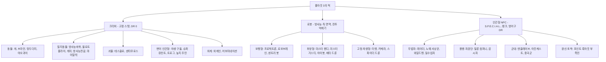
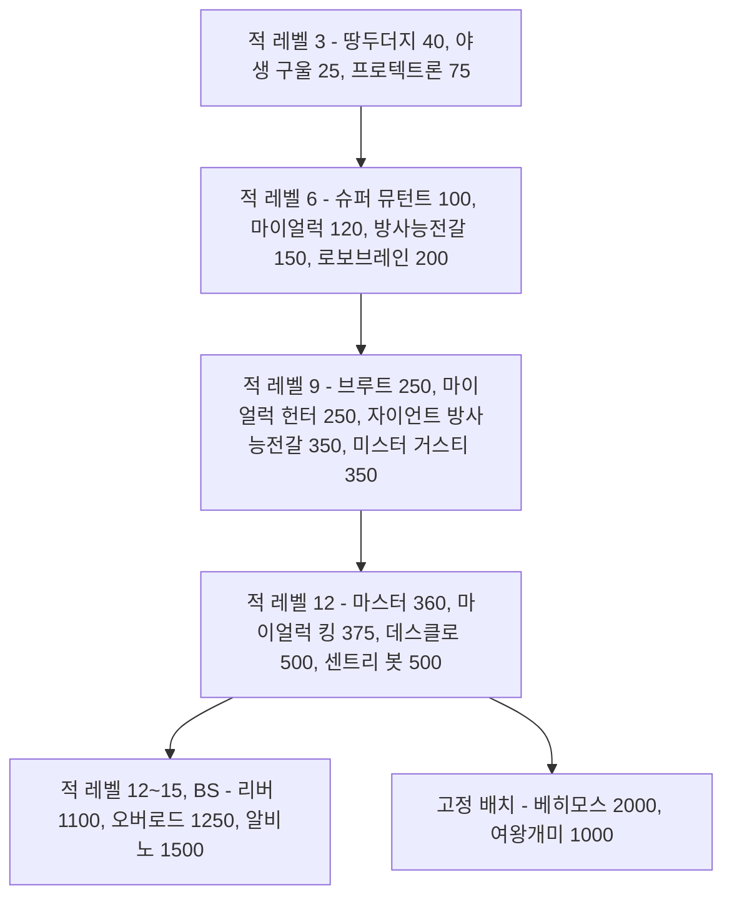

# RD-24. 크리처·적 도감

> **폴아웃 3 역기획서 세트** | 문서 ID: RD-24 | 버전: v1.0 | 작성일: 2026-10-11
> **범위**: 본편과 DLC 5종에서 플레이어가 싸우는 적 전 유형의 정본 카탈로그. 크리처·로봇·인간 적의 변종별 레벨·HP·DR·공격·XP, 행동 패턴, 약점, 서식지, 드롭, 레벨 연동 등장 규칙, 고유·보스급 적. **다루지 않는 것**: 피해·명중·VATS 공식과 AI 탐지 엔진(RD-16), 랜덤 인카운터 목록과 암살대 출현 규칙의 정본(RD-07), 팩션의 역사·관계(RD-09), 이름 있는 NPC의 프로필(RD-10·RD-11), 무기·방어구 수치(RD-19·RD-20), 장소 상세(RD-13)
> **관련 문서**: [RD-07 비표시·반복 퀘스트와 랜덤 인카운터](07_misc-quests-encounters.md), [RD-08a 오퍼레이션: 앵커리지](08a_dlc-operation-anchorage.md), [RD-08b 더 피트](08b_dlc-the-pitt.md), [RD-08c 브로큰 스틸](08c_dlc-broken-steel.md), [RD-08d 포인트 룩아웃](08d_dlc-point-lookout.md), [RD-08e 마더십 제타](08e_dlc-mothership-zeta.md), [RD-09 팩션](09_factions.md), [RD-13 장소 카탈로그](13_location-catalog.md), [RD-14 캐릭터 시스템](14_character-system.md), [RD-16 전투 시스템](16_combat-system.md), [RD-19 무기·탄약](19_weapons-ammo.md), [RD-21 소모품·잡화·제작](21_consumables-misc-crafting.md), [RD-26 용어집](26_glossary.md)

---

## 목차

1. 문서 개요
2. 적 분류 체계
3. 전체 요약표
4. 위협도 곡선
5. 크리처 ① 동물·절지동물
6. 크리처 ② 변이 인간형(야생 구울, 슈퍼 뮤턴트, 센타우로스)
7. 로봇
8. 인간 적
9. DLC 적
10. 고유·보스급 적
11. 적 디자인 분석
12. 쯔꾸르 이식 메모
- 부록 A. 데이터 처리 노트
- 부록 B. 출처

---

## 1. 문서 개요

### 1.1 목적
- 팬게임의 적 데이터베이스(몬스터 표, 적 편성표, 인카운터 테이블)를 설계할 때 근거로 쓸 **원작 적 정본 카탈로그**를 만든다.
- 개별 수치뿐 아니라 '같은 계통이 레벨 6·9·12에 한 단계씩 강해지는 계단 구조', '지역마다 다른 생태 배치', '부위별 약점 설계'가 어떻게 전투 경험을 만드는지 분석한다.

### 1.2 범위
- **포함**: 본편 크리처 15계통, 로봇 8계통, 인간 적 7집단(레이더, 탈론 컴퍼니, 감시자, 노예 사냥꾼, 엔클레이브, 아웃캐스트, 중국군 잔존병), DLC 적 전부([OA] 중국군 시뮬레이션, [TP] 트로그·와일드맨, [BS] 상위 변종, [PL] 늪지 주민·부족민·밀수업자, [MZ] 외계인·드론), 고유·보스급 적 약 40명.
- **요약만 하고 링크**: 카르마 암살대 출현 규칙과 고정 출현 31곳(정본 [RD-07](07_misc-quests-encounters.md) 5.3절), 랜덤 인카운터 슬롯(정본 RD-07 5.2절), 피해 공식·VATS·적 AI 엔진(정본 [RD-16](16_combat-system.md)), DLC별 적의 줄거리상 역할(정본 RD-08a~e).
- **제외**: 동료로만 쓰이는 개체(도그밋 등)의 성장 수치, 비적대 NPC.

### 1.3 요약
- 위키 허브 문서 기준으로 본편 크리처는 **43종·변종 63개**, DLC가 **변종 18개**를 더한다. 로봇·컴퓨터는 본편 **39개**, DLC **16개**, 합계 **55개**다. 이 문서는 이를 전투 단위로 다시 묶어 **약 47계통, 변종·랭크 약 190행**을 싣는다.
- **크리처의 DR은 전부 0**이다. 크리처의 단단함은 HP와 '부위별 피해 배율'(마이얼럭 몸통 ½, 마이얼럭 킹 몸통 ⅔, 방사능전갈 다리 감쇄, 브라민 머리 50%)로 표현된다. DR을 쓰는 적은 방어구를 입은 인간과 관성 억제장을 켠 외계인뿐이다.
- 계통마다 **레벨 6 → 9 → 12** 지점에 다음 단계 변종이 놓이고, HP가 한 단계에 2~3배씩 뛴다(슈퍼 뮤턴트 100 → 250 → 360, 방사능전갈 150 → 350, 마이얼럭 120 → 250 → 375). [BS]는 그 위에 HP 1,000대 변종(오버로드 1,250, 리버 1,100, 알비노 방사능전갈 1,500)을 얹는다.
- 인간 적은 **랭크형**이다. 같은 이름 아래 랭크 1~3(4)이 있고, 랭크가 오르면 레벨·HP·태그 스킬·무기 풀이 함께 오른다. 감시자는 플레이어 레벨 1·6·9에서 랭크가 열린다.
- XP는 위키 정보상자에 **일부 종만** 기록되어 있다(화염개미, 거대 개미, 센타우로스, 트로그, 늪지 주민 등). 나머지는 `—`로 두고 수치를 지어내지 않는다.

### 1.4 표기 메모
- **자료원**: Nukapedia 2026-08-30 덤프. 각 종의 `XXX (Fallout 3)` 문서에 있는 `{{Stats creature FO3}}` 행 151개를 스크립트로 일괄 추출했고, 인간 적은 `Infobox character`와 'Generic variants' 랭크 표를 추출했다. 여러 게임을 다루는 개요 문서(`Deathclaw`, `Mirelurk` 등)의 수치는 쓰지 않았다.
- **공식 가이드 교차 확인**: `Fallout 3 Official Game Guide Game of the Year Edition Wasteland Census`는 인물 소개문만 싣고 **전투 수치는 없다**. 고유 적의 소개(쪽수)를 10장에서 참고로만 적었다.
- **칸 정의**
  - 레벨: 적 개체 자신의 레벨. 플레이어 레벨과 다르다(레벨 연동 규칙은 각 종의 '등장 규칙' 항목과 11.2절).
  - HP: 정보상자 값. 인간 적의 `75 → 110` 같은 화살표는 '플레이어 레벨에 따라 오르는 범위'다.
  - DR: 피해 저항(%). 위키의 `11% → 13%` 같은 화살표는 원문 표기를 그대로 옮겼다(장비 상태에 따른 범위로 보이며 정확한 의미는 코퍼스 미확인).
  - 공격: `근접 28`은 공격 한 번의 기본 피해다. `+ 독 3/초(5초)`는 지속 피해다. `피해`는 플레이어 DR 적용 전 값이다.
  - XP: 처치 XP(보통 난이도). 아주 쉬움 ×0.5, 아주 어려움 ×1.5([RD-16](16_combat-system.md) 11장).
  - AI: `공격성/자신감/협조` 값. 공격성 0 비공격~3 광란, 자신감 0 겁쟁이~4 무모, 협조 0 아무도 안 도움~2 친구와 동맹을 도움.
- **기호**: `[OA]` 오퍼레이션: 앵커리지(Operation: Anchorage), `[TP]` 더 피트(The Pitt), `[BS]` 브로큰 스틸(Broken Steel), `[PL]` 포인트 룩아웃(Point Lookout), `[MZ]` 마더십 제타(Mothership Zeta), `★` 고유 개체, `✝` 시체로만 존재, `✂` 삭제 콘텐츠(게임 파일에만 있음).
- **표기 기준**: [RD-26 용어집](26_glossary.md) v0.2와 한글 패치 표기를 따른다. 방사능바퀴(Radroach), 땅두더지(Mole rat), 화염개미(Fire ant), 방사능전갈(Radscorpion), 마이얼럭(Mirelurk), 야오과이(Yao guai), 센타우로스(Centaur), 베히모스(Behemoth), 미스터 거스티(Mister Gutsy), 야생 구울(Feral ghoul), 탈론 컴퍼니(Talon Company), 감시자(Regulators), 노예 사냥꾼(Slavers), 아웃캐스트(Brotherhood Outcasts), 수도 황무지(Capital Wasteland).

---

## 2. 적 분류 체계

### 2.1 분류 트리

- 외계인, 늪지 주민, 트로그는 게임 데이터상 '크리처'로 분류되어 고정 스탯 표를 쓴다. 반면 중국군 잔존병은 구울이지만 인간형 NPC 데이터다.

### 2.2 엔진 분류가 만드는 차이

| 구분 | 크리처 | 인간형 NPC | 로봇 |
|---|---|---|---|
| 스탯 구조 | 레벨·HP·피해가 고정 | S.P.E.C.I.A.L.(스페셜)·스킬에서 HP와 명중이 파생 | 크리처와 같은 고정 스탯 |
| 강해지는 방식 | 다른 변종(상위 모델)으로 교체 | 같은 이름의 랭크가 오르고 장비 풀이 바뀜 | 다른 모델·도색으로 교체 |
| 방어 | DR 0, 부위 배율과 HP | 입은 방어구의 DR | DR 0, 방사능·독 100% 저항 |
| 드롭 | 고기·분비물 등 '부산물' 고정 | 소지 장비 전부 + 사망 시 무작위 음식·약물·탄약 | 에너지 셀·핵분열 배터리·고철 등 부품 |
| 특수 약점 | 더듬이(개미), 얼굴(마이얼럭), 다리(도약형) | 머리, 무기 쥔 팔 | 전투 억제기(Combat inhibitor)를 부수면 광란 |
| 퍽 상호작용 | 애니멀 프렌드(Animal Friend, 동물 우호), 엔토몰로지스트(Entomologist, 곤충 피해 +50%) | 로브링어(Lawbringer, 악인 손가락), 컨트랙트 킬러(Contract Killer, 선인 귀) | 로보틱스 엑스퍼트(Robotics Expert, 몰래 접근해 정지) |

- **크리처 간 적대 규칙**: 같은 팩션으로 묶이지 않은 크리처끼리는 가까이 있으면 서로 싸운다. 예를 들어 데스클로는 마이얼럭을 공격하지만, 야생 구울은 글로잉 원(Glowing one)을 공격하지 않는다.
- **'혐오체(abomination)' 분류**: 데스클로와 마이얼럭은 혐오체로 분류되어 애니멀 프렌드가 통하지 않는다. 개·땅두더지·야오과이·브라민은 통한다.
- 구울 마스크(Ghoul mask)를 쓰면 모든 야생 구울 변종이 비적대가 된다.

### 2.3 AI 속성 분포 (크리처·로봇 정보상자)

| 성향 | 값(공격성/자신감/협조) | 해당 적 | 플레이어 체감 |
|---|---|---|---|
| 겁 많은 해충 | 0/1/0 | 방사능바퀴 | 다가가면 날개를 퍼덕여 위협하다가, 오래 붙어 있으면 공격 |
| 비공격 가축 | 0/0/1 | 브라민, 짐 브라민 | 맞으면 대개 도망 |
| 매우 공격적·무모 | 2/4/2 | 데스클로, 슈퍼 뮤턴트 전 단계, 방사능전갈, 마이얼럭, 야오과이, 화염개미, 거대 개미 | 보는 즉시 달려들고 도망치지 않음 |
| 공격적·무모·협조 약함 | 2/4/1 | 야생 구울 전 변종 | 무리로 돌진하지만 서로 엄호하지 않음 |
| 무장 경비 | 1/4/2 또는 1/3/2 | 프로텍트론 계열 일부, 레이더·탈론 경비견 | 적으로 판정된 대상만 공격 |
| 비공격 기계 | 0/4/0 | 터렛 대부분 | 터미널이나 조건으로 적이 정해짐 |

---

## 3. 전체 요약표

> 레벨·HP 범위는 이 문서의 변종 표 기준이다(시체 전용·삭제 개체 제외). '변종'은 이 문서의 표 행 수가 아니라 서로 다른 이름의 전투 단위 수다.

### 3.1 크리처

| 계통 | English | 변종 수 | 레벨 범위 | HP 범위 | 대표 서식지 | 절 |
|---|---|---|---|---|---|---|
| 방사능바퀴 | Radroach | 1 | 0 | 5 | 볼트 101, 하수도, 로브코 시설 | 5.1 |
| 블로트플라이 | Bloatfly | 1 | 1 | 15 | 독성 폐기물 통 주변, 볼트 92 입구 | 5.2 |
| 땅두더지 | Mole rat | 1 | 3 | 40 | 황무지 전역, [PL] | 5.3 |
| 개 | Dog | 5 | 1~3 | 20~60 | 황무지 전역, 레이더·탈론 거점 | 5.4 |
| 브라민 | Brahmin | 3(+시체) | 1 | 40~100 | 정착지, 캐러밴, 랜덤 인카운터 | 5.5 |
| 거대 개미 | Giant ant | 5(+시체) | 2~7 | 30~1,000 | 캔터베리 커먼 일대(개미여인의 소굴), 코베가 공장, 셰일브리지 | 5.6 |
| 화염개미 | Fire ant | 5 | 2~9 | 30~1,000 | 그레이디치, 메리골드 역 | 5.7 |
| 방사능전갈 | Radscorpion | 3 | 6~13 | 150~1,500 | 황무지 서부·남부 | 5.8 |
| 마이얼럭 | Mirelurk | 6 | 6~20 | 120~600 | 포토맥 강변, 하수도, [PL] 늪 | 5.9 |
| 야오과이 | Yao guai | 2(+★) | 7 | 220 | 야오과이 터널·동굴, 절벽 동굴 | 5.10 |
| 데스클로 | Deathclaw | 2 | 12 | 500 | 올드 올니, 데스클로 보호구역 | 5.11 |
| 야생 구울 | Feral ghoul | 5 | 3~12 | 25~1,100 | 지하철역, 던위치 빌딩, [PL] | 6.1 |
| 슈퍼 뮤턴트 | Super mutant | 5 | 6~15 | 100~2,000 | D.C. 도심, 볼트 87 | 6.2 |
| 센타우로스 | Centaur | 1 | 5 | 100 | 슈퍼 뮤턴트 무리 | 6.3 |
| 실패한 FEV 피험체 ✝ | Failed FEV subject | 1 | 1 | 0 | 볼트 87 실험실 | 6.4 |

### 3.2 로봇

| 계통 | English | 변종 수 | 레벨 범위 | HP 범위 | 대표 서식지 | 절 |
|---|---|---|---|---|---|---|
| 프로텍트론 | Protectron | 8 | 3 | 75 | 지하철역, 뉴카-콜라 공장, 국립 기록 보관소 | 7.1 |
| 미스터 핸디 | Mister Handy | 3(+✂1) | 3 | 100 | 전쟁 전 주택 | 7.2 |
| 미스터 거스티 | Mister Gutsy | 3 | 3~9 | 200~350 | 창고, 군 시설, 레이븐 락 | 7.3 |
| 로보브레인 | Robobrain | 5(+✂1) | 1~6 | 200 | 군 시설, 엔클레이브·아웃캐스트 순찰 | 7.4 |
| 센트리 봇 | Sentry bot | 6(+✂1) | 3~12 | 300~500 | 콘스탄틴 요새, 레이븐 락, 애덤스 공군 기지 | 7.5 |
| 아이봇 | Eyebot | 1 | 1 | 30 | 황무지 상공 | 7.6 |
| 자동 터렛 | Automated turret | 8(+DLC 3) | 2~30 | 40~10,000 | 군 시설, 레이더 거점 | 7.7 |

### 3.3 인간 적

| 집단 | English | 랭크·유형 | 레벨 범위 | HP 범위 | 대표 거점 | 절 |
|---|---|---|---|---|---|---|
| 레이더 | Raider | 총·근접·소총·중화기 × 랭크 1~3 | 1~9 | 25~90 | 에버그린 밀, 레이더 전초기지, 학교·공장 폐허 | 8.1 |
| 탈론 컴퍼니 | Talon Company merc | 랭크 1~4 | 8~17 | 75~300 | 배니스터 요새, 국회의사당 | 8.2 |
| 감시자 | Regulator | 랭크 1~3 | 8~14 | 75~135 | 암살대, 감시자 본부 | 8.3 |
| 노예 사냥꾼 | Slaver | 지역 2종 | 3~15 | 75~110 | 파라다이스폴, 링컨 기념관 | 8.4 |
| 엔클레이브 | Enclave soldier 외 | 랭크 0~2, 테슬라, 헬파이어, 장교, 과학자 | 1~24 | 20~250 | 엔클레이브 캠프, 레이븐 락, [BS] 애덤스 공군 기지 | 8.5 |
| 아웃캐스트 | Brotherhood Outcast | 총·근접·중화기 × 랭크 1~3 | 4~11 | 70~125 | 인디펜던스 요새, 순찰로 | 8.6 |
| 중국군 잔존병 | Chinese remnant soldier | 병사·부사관·장교·대위 | 1~10 | 코퍼스 미확인(대위 70) | 마마 돌체 식품 공장 | 8.7 |

### 3.4 DLC 적

| DLC | 계통 | 변종·랭크 | 레벨 범위 | HP 범위 | 절 |
|---|---|---|---|---|---|
| [OA] | 중국군(시뮬레이션) | 소총수 랭크 1~5, 저격병, 화염방사병, 로켓병, 기술병, 크림슨 드라군 | 3~13 (드라군은 플레이어 ×1.3) | 40~90 | 9.1 |
| [OA] | 키메라 / 스파이더 드론 / 경비견 / OA 터렛 | 각 1 | 1~12 | 20~10,000 | 9.1 |
| [TP] | 트로그 | 4 | 3~12 | 15~65 | 9.2 |
| [TP] | 와일드맨, 피트 레이더, 노예 투사 | 3 | 코퍼스 미확인 | 코퍼스 미확인 | 9.2 |
| [BS] | 상위 변종 | 오버로드, 리버, 알비노, 헬파이어, 탈론 랭크 4, 마크 VII·VIII, 시그마 분대 | 9~24 | 250~1,500 | 9.3 |
| [PL] | 늪지 주민 | 5(근접·원거리 판본 8행) | 7~20 | 150~700 | 9.4 |
| [PL] | 부족민 / 밀수업자 | 각 랭크 1~5 | 7~20 | 75~415 | 9.4 |
| [PL] | 스웜프러크·퀸, 늪지 구울, 로보브레인 센트리, 루즈카 | 5 | 1~20 | 25~600 | 9.4 |
| [MZ] | 외계인 / 어보미네이션 | 각 6단계 + 작업자·함장 | 1~30 | 25~500 | 9.5 |
| [MZ] | 드론 3종, 외계인 터렛 | 4 | 1~30 | 20~600 | 9.5 |

---

## 4. 위협도 곡선

### 4.1 적 레벨대별 대표 적

> 아래 레벨은 **적 개체의 레벨**이다. 레벨 연동 목록은 대체로 적 레벨이 플레이어 레벨 근처인 개체를 뽑지만, 정확한 문턱값은 종마다 다르고 코퍼스에 거의 없다(감시자처럼 문턱값이 명시된 예는 각 절에 적었다).

| 적 레벨 | 크리처 | 로봇 | 인간 | 전투 성격 |
|---|---|---|---|---|
| 0~3 | 방사능바퀴(5), 블로트플라이(15), 땅두더지(40), 사나운 개(60), 야생 구울(25), 거대 일개미·화염개미 일개미(30) | 아이봇(30), 프로텍트론(75), 미스터 핸디(100), 터렛 마크 I·II | 레이더 랭크 1(25~30) | 수로 밀어붙이는 약한 무리. 10mm 권총 몇 발로 정리 |
| 4~6 | 센타우로스(100), 슈퍼 뮤턴트(100), 마이얼럭(120), 방사능전갈(150), 화염개미 병정(150) | 로보브레인(200), 터렛 마크 III·IV | 레이더 랭크 2(55~60), 엔클레이브 훈련병(45), 아웃캐스트 랭크 1(70) | **첫 벽**. 마이얼럭의 껍데기, 방사능전갈의 독, 슈퍼 뮤턴트의 화력 |
| 7~9 | 야오과이(220), 글로잉 원(240), 마이얼럭 헌터(250), 슈퍼 뮤턴트 브루트(250), 자이언트 방사능전갈(350), 화염개미 전사(225) | 미스터 거스티(350), 터렛 마크 V·VI | 레이더 랭크 3(85~90), 탈론 랭크 1(75), 감시자 랭크 1(75), 엔클레이브 랭크 1(80~90) | 근접 한 방이 50~75로 커짐. 원거리 화기 필수 |
| 10~12 | 데스클로(500), 마이얼럭 킹(375), 슈퍼 뮤턴트 마스터(360), [BS] 리버(1,100)·오버로드(1,250) | 센트리 봇(500) | 탈론 랭크 2(105), 감시자 랭크 2(105), 아웃캐스트 랭크 3(125) | 본편 최상위 필드 적. 데스클로 근접 100 |
| 13~17 | 슈퍼 뮤턴트 베히모스(2,000, 고정 5마리), [BS] 알비노 방사능전갈(1,500) | (없음) | 엔클레이브 랭크 2(125), 탈론 랭크 3(135), 테슬라 병사(170), 엔클레이브 장교(125), [BS] 탈론 랭크 4(300) | 보스·준보스 구간 |
| 18 이상 | [PL] 스웜프러크 퀸(600), 늪지 주민 브루저(700), [MZ] 어보미네이션(250~500) | [MZ] 외계인 터렛(300~600) | [BS] 헬파이어(250, DR 37→41), [PL] 부족민 랭크 5(410~415) | [BS] 레벨 상한 30 구간 |

### 4.2 계단 구조

- 같은 계통의 다음 단계는 **레벨 +3**, **HP ×2~3**이다. 플레이어는 레벨 업 3번마다 '같은 실루엣의 더 큰 적'을 만나게 된다.
- 로봇도 같은 계단을 탄다: 프로텍트론 3 → 로보브레인 6 → 미스터 거스티 9 → 센트리 봇 12.

### 4.3 기준 무기로 본 필요 타수 (작성자 계산)

> 무기 기본 피해(정보상자)로 HP를 나눈 값이다. 스킬·내구도·치명타·부위 배율·DR을 무시한 '감'을 보기 위한 표다.

| 적 | HP | 10mm 권총(9) | 사냥용 소총(25) | 전투 산탄총(55) | 플라스마 소총(45) |
|---|---|---|---|---|---|
| 야생 구울 | 25 | 3 | 1 | 1 | 1 |
| 땅두더지 | 40 | 5 | 2 | 1 | 1 |
| 슈퍼 뮤턴트 | 100 | 12 | 4 | 2 | 3 |
| 야오과이 | 220 | 25 | 9 | 4 | 5 |
| 데스클로 | 500 | 56 | 20 | 10 | 12 |
| 야생 구울 리버 [BS] | 1,100 | 123 | 44 | 20 | 25 |
| 슈퍼 뮤턴트 오버로드 [BS] | 1,250 | 139 | 50 | 23 | 28 |
| 알비노 방사능전갈 [BS] | 1,500 | 167 | 60 | 28 | 34 |
| 슈퍼 뮤턴트 베히모스 | 2,000 | 223 | 80 | 37 | 45 |

- 후반 적은 '맞추기 어려운 적'이 아니라 **'오래 버티는 적'**이다. 원작은 이를 실시간 연사와 VATS 치명타로 해결하지만, 턴제에서는 그대로 옮기면 한 전투가 수십 턴으로 늘어난다(12.3절).

---

## 5. 크리처 ① 동물·절지동물

### 5.1 방사능바퀴 (Radroach)

**개요**
- 전쟁 전 미국바퀴(*Periplaneta americana*)가 낙진으로 집고양이만 하게 커진 곤충이다. 햇빛을 꺼리지 않아 밝은 곳에도 나온다.
- 게임에서 처음 만나는 적대 크리처이며, 볼트 101 안에서 반드시 잡아야 하는 유일한 적이다(「빨리 크는 아이(Growing Up Fast)」에서 BB건으로 처치).

| English | 한국어 표기 | 레벨 | HP | DR | 공격 방식과 피해 | XP | 비고 |
|---|---|---|---|---|---|---|---|
| Radroach | 방사능바퀴 | 0 | 5 | 0 | 근접(물기) 3 | 1 (정보상자 5) | AI 0/1/0. 정보상자는 XP 5이나 본문·`Experience Points` 문서는 '보통 이상 난이도에서 1'로 적음 → 1 채택 |
| Radroach (Aggr. Vault 101) | 방사능바퀴(볼트 101 공격형) | 0 | 5 | 0 | 근접 3 | 1 | AI 1/1/0. 볼트 101 전용 |
| Radroach (foolh. Vault 101) | 방사능바퀴(볼트 101 무모형) | 0 | 5 | 0 | 근접 3 | 1 | AI 1/4/0 |
| Radroach (Butch Vault 101) | 방사능바퀴(버치 이벤트용) | 0 | 5 | 0 | 근접 3 | 1 | AI 1/4/1. 「탈출!(Escape!)」에서 버치 들로리아(Butch DeLoria)의 어머니를 구하는 장면 |

**행동 패턴**
- 발견해도 바로 공격하지 않는다. 날개와 더듬이를 퍼덕이며 위협하다가, 너무 가까이 오래 있으면 덤빈다.
- 최대 7마리 무리로 다니며 펄쩍 뛰어들어 문다.
- 다른 곤충과 달리 **부숴서 광란(frenzy)을 일으킬 부위가 없다**.
- 비무장 VATS 공격을 쓰면 주먹 대신 **밟는 동작**이 나온다(이 적에게만 있는 애니메이션).

**서식지·드롭**
- 황무지 거의 전역. 뉴카-콜라 공장(Nuka-Cola plant) 사무실, 마인필드(Minefield)의 길리언 집, 로브코 시설(RobCo facility, 31마리로 최다).
- 드롭: 방사능바퀴 고기(Radroach meat).
- 랜덤 인카운터: '시체 뜯는 방사능바퀴'(밤 20:00~05:00, 2~7마리, [RD-07](07_misc-quests-encounters.md)).

**등장 규칙**: 레벨 연동 변종 없음. 단일 개체가 게임 내내 나온다.

### 5.2 블로트플라이 (Bloatfly)

**개요**
- 거대하게 변이한 검정파리(blowfly). 콘셉트 아트에서는 '비명 지르는 검정파리(shrieking blowfly)'로 불렸다.
- 엔클레이브 전초기지(메가톤 인근)가 수도 황무지의 토착 생물로 연구한 대상 중 하나다.

| English | 한국어 표기 | 레벨 | HP | DR | 공격 방식과 피해 | XP | 비고 |
|---|---|---|---|---|---|---|---|
| Bloatfly | 블로트플라이 | 1 | 15 | 0 | 유충 침 뱉기(원거리) 5 | — | AI 2/2/0 |

**행동 패턴**
- 빠르고 불규칙하게 날며 크기가 작아 VATS 없이 맞히기 어렵다. 추격 속도는 느려서 도망치기 쉽다.
- 혼자서는 약하지만 무리로 오면 저레벨 캐릭터와 동료에게 위협이 된다.
- 뇌를 불구로 만들면 광란하지만, 보통 그만큼 머리를 맞히면 죽는다.
- 방해받지 않으면 가끔 땅으로 내려와 몇 초간 이리저리 돈다.

**서식지·드롭**
- 독성 물질 통이 땅에 스며든 곳 주변에 가장 많다. 볼트 92(Vault 92) 입구 구역, 리클라이닝 그로브스 리조트 홈스(Reclining Groves Resort Homes) 북동쪽 시체 더미, 인디펜던스 요새(Fort Independence)와 페어팩스 폐허(Fairfax ruins) 사이 언덕.
- 드롭: 블로트플라이 고기(Bloatfly meat).
- ✂ 삭제된 탄약 '블로트플라이 다트(Bloatfly dart)'가 게임 파일에 남아 있다.

**등장 규칙**: 단일 개체.

### 5.3 땅두더지 (Mole rat)

**개요**
- 땅속에 굴을 파고 살아 핵폭발을 피했지만 낙진으로 크게 변이한 설치류다. 지능은 전쟁 전과 같고, 앞니의 법랑질·상아질이 자라 면도날처럼 날카롭다. 통증에 매우 둔하다.
- 황무지 사람들이 애완용으로 길들이기도 한다(고유 개체 펌프킨(Pumpkin)).

| English | 한국어 표기 | 레벨 | HP | DR | 공격 방식과 피해 | XP | 비고 |
|---|---|---|---|---|---|---|---|
| Mole rat | 땅두더지 | 3 | 40 | 0 | 근접(돌진 물기) 15 | — | AI 2/4/2 |

**행동 패턴**
- 3~4마리 무리가 기본이며 둘이나 혼자일 때도 있다. 매우 공격적이지만 압도적으로 밀리면 물러나기도 한다.
- 근접 사거리가 길어 몇 걸음 거리에서 덤벼든다. 뒷다리로 서서 냄새를 맡거나 땅을 긁는 대기 동작이 있다.
- 애니멀 프렌드 1랭크면 비적대, 2랭크면 플레이어 편에서 싸운다(다른 동물과는 싸우지 않음).
- 「황무지 생존 가이드(The Wasteland Survival Guide)」의 퇴치봉(Repellent stick)에 맞으면 약 3초 뒤 머리가 터진다. 두 번째 타격이면 즉시.

**서식지·드롭**
- 수도 황무지 전역, [PL] 포인트 룩아웃. 레이더의 '땅두더지 경주장(Mole rat race track)'.
- 드롭: 땅두더지 고기(Mole rat meat). 원더글루(Wonderglue)와 합쳐 땅두더지 원더 미트(Mole rat wonder meat)를 만든다([RD-21](21_consumables-misc-crafting.md)).
- ✂ 사람을 태울 만큼 큰 '거대 땅두더지(giant mole rat)'가 콘셉트로만 존재한다.

**등장 규칙**: 단일 개체.

### 5.4 개 (Dog)

**개요**
- 전쟁 후 200년 동안 방사능에 비교적 덜 변한 동물이다. 대부분 털이 빠지고 얼룩진 피부가 되었지만 털이 남은 개체도 있다. 상인의 길동무이자 경비견으로 쓰인다.

| English | 한국어 표기 | 레벨 | HP | DR | 공격 방식과 피해 | XP | 비고 |
|---|---|---|---|---|---|---|---|
| Vicious dog | 사나운 개 | 3 | 60 | 0 | 근접 12 | — | AI 2/4/2. 애니멀 프렌드가 없으면 항상 적대 |
| Raider guard dog | 레이더 경비견 | 3 | 60 | 0 | 근접 12 | — | AI 1/3/2. 레이더를 공격하지 않음. 인지력 8로 먼저 발견하고 주인을 부름 |
| Talon Company guard dog | 탈론 컴퍼니 경비견 | 3 | 60 | 0 | 근접 12 | — | AI 1/3/2. 탈론 컴퍼니 용병을 따라다님 |
| Scavenger's dog | 스캐빈저의 개 | 1 | 20 | 0 | 근접 5 | — | AI 0/4/1. 비적대. 죽이면 카르마 감소. 주인에게서 훔친 물건을 되찾아 감 |
| Guard dog [OA] | 경비견(시뮬레이션) | 1 | 20 | 0 | 근접 5 | 1 | AI 1/2/2. 시뮬레이션 개체라 애니멀 프렌드 무효, 처치 후 소멸 |

**행동 패턴**
- 4~6마리(사나운 개는 2~5마리) 무리로 뛰어와 **포위**한다. 저레벨에서는 위험하고, 고레벨에서는 지그재그 이동 때문에 맞히기 귀찮은 정도다.
- 경비견 계열은 인지력이 높아 플레이어를 먼저 발견하고 달려가 주인에게 알린다.

**서식지·드롭**
- 사나운 개: 탁 트인 황무지, 랜덤 인카운터 '이리 온, 멍멍아'(순찰), '앉아!'(시체를 지키는 무리). 경비견: 레이더·탈론 거점.
- 드롭: 개고기(Dog meat). 시뮬레이션 경비견은 드롭 없음.

**등장 규칙**: 레벨 변종 없음. 레이더·탈론 편성에 경비견이 섞이는 방식으로 등장한다.

**고유 개**: 도그밋(Dogmeat, 동료), 포 스코어(Four Score, 한니발 햄린의 개), 리틀 램프라잇의 진저·훌리건·밴딧·피트·렉스·머트페이스, 머피(✝ Muffy), [PL] 프레키·게리(데즈먼드 록하트의 개).

### 5.5 브라민 (Brahmin)

**개요**
- 방사능으로 머리가 둘이 된 소. 위가 여덟 개다. 대부분 길들여져 고기·우유·가죽을 얻고 캐러밴 짐을 나른다. [BS]에서는 BoS가 정화수 배급에 쓴다.

| English | 한국어 표기 | 레벨 | HP | DR | 공격 방식과 피해 | XP | 비고 |
|---|---|---|---|---|---|---|---|
| Brahmin | 브라민 | 1 | 40 | 0 | 근접(들이받기) 8 | — | AI 0/0/1. 방사능 저항 100% |
| Pack brahmin | 짐 브라민 | 1 | 100 | 0 | 근접 8 | — | 캐러밴용. 외형이 다름. 캔터베리 커먼(Canterbury Commons) 상인의 브라민은 HP가 특히 높음 |
| Mad brahmin | 미친 브라민 | 1 | 40 | 0 | 근접 8 | — | AI 2/4/2. 애니멀 프렌드가 없으면 적대 |
| Rotting brahmin corpse ✝ | 썩은 브라민 사체 | 3 | 0 | 0 | 근접 9 | — | 처음부터 시체로 배치 |

**행동 패턴**
- 머리 피해 배율 50%. 머리 하나가 터지면 다른 머리도 함께 터진다(두 머리가 한 부위).
- 맞으면 대개 도망친다. 은신 상태에서 다가가 '쓰러뜨리기(tipping)'를 할 수 있다.
- 헤엄치지 못하고 물속을 걸어 다닌다.

**서식지·드롭**
- 데이브 공화국(Republic of Dave), 메가톤(Megaton), 아르푸(Arefu), 감시자 본부(Regulator HQ) 앞, 캐러밴.
- 미친 브라민은 랜덤 인카운터 '미친 브라민의 난동'(2~5마리, 행운이 낮을수록 많음)에서만 나온다. '브라민 떼'(2~5마리)도 있다.
- 드롭: 브라민 스테이크(Brahmin steak).

**등장 규칙**: 레벨 변종 없음.

### 5.6 거대 개미 (Giant ant)

**개요**
- 목수개미 속(*Camponotus*)으로 보이는 개미가 방사능으로 거대해졌다. 강한 무리 본능이 있어 여왕이 위협받으면 떼로 지킨다.
- 「그것들!(Those!)」의 화염개미는 이 종을 레스코 박사(Doctor Lesko)가 변이시킨 결과다(5.7절).

| English | 한국어 표기 | 레벨 | HP | DR | 공격 방식과 피해 | XP | 비고 |
|---|---|---|---|---|---|---|---|
| Giant worker ant | 거대 일개미 | 2 | 30 | 0 | 근접 7 | 5 | AI 2/4/2 |
| Giant soldier ant | 거대 병정개미 | 2 | 30 | 0 | 근접 7 | 10 | 하위형 |
| Giant soldier ant | 거대 병정개미(상위형) | 6 | 150 | 0 | 근접 24 | 10 | 같은 이름의 상위 행 |
| Giant ant queen | 여왕개미 | 7 | 1,000 | 0 | 근접 25 / 산성 침(원거리) 40 | 10 | 보스급. 게임 전체에 3마리 |
| Invader ant | 침입자 개미 | 2 | 30 | 0 | 근접 7 | — | 셰일브리지(Shalebridge) 전용. 채집개미 군락을 침략 중 |
| Mutated forager ant | 변이 채집개미 | 2 | 30 | 0 | 근접 7 | — | AI 0/3/1. 비적대. 방사능바퀴보다 작음 |
| Giant ant ✝ | 거대 개미(시체) | 1 | 0 | 0 | 근접 5 | 0 | 죽은 상태로만 존재 |

**행동 패턴**
- 최대 5마리가 정면으로 몰려온다. 측면으로 돌지는 않지만 가까이 오면 둘러싼다.
- **더듬이를 불구로 만들면 광란**해 동족까지 공격한다. 엔토몰로지스트 퍽은 피해 +50%.
- 여왕개미는 느리지만 먼 거리에서 정확하게 산성 침을 뱉는다. HP가 베히모스의 절반이라 뉴카 수류탄(Nuka-grenade)을 버티는 몇 안 되는 적이다.

**서식지·드롭**
- 개미여인의 소굴(AntAgonizer's lair, 캔터베리 커먼 지하), 코베가 공장(Corvega factory), 셰일브리지. 여왕개미는 메리골드 역(Marigold station)·셰일브리지·코베가 공장에 1마리씩.
- 볼트 106(Vault 106) 바로 밖에서는 랜덤 인카운터 '개미 대 방사능전갈'(우호적인 자이언트 방사능전갈 대 거대 일개미 1~4마리)이 거의 확정으로 나온다.
- 드롭: 개미 고기(Ant meat) 100%, 여왕은 여왕개미 페로몬(Ant queen pheromones) 100%. 시체와 개미 폐기물 더미에서 개미 꿀(Ant nectar)이 가끔 나온다.
- 셰일브리지에서는 침입자 개미의 여왕을 죽인 뒤 알 무더기에 스팀팩을 주사해 채집개미 군락을 키울 수 있다.

**등장 규칙**: 병정개미 하위형(레벨 2)과 상위형(레벨 6)이 같은 이름으로 존재한다. 어느 쪽이 나올지는 레벨 연동 목록이 정한다(문턱값 코퍼스 미확인).

### 5.7 화염개미 (Fire ant)

**개요**
- 그레이디치(Grayditch)를 덮친 불 뿜는 개미. 레스코 박사가 개미를 작게 만들려고 메리골드 역 여왕개미에게 변이원을 주사했는데, 오히려 불을 뿜는 새끼들이 태어났다. 붉은 주황색 갑각을 지녔다.

| English | 한국어 표기 | 레벨 | HP | DR | 공격 방식과 피해 | XP | 비고 |
|---|---|---|---|---|---|---|---|
| Fire ant worker | 화염개미 일개미 | 2 | 30 | 0 | 근접 7 / 화염 숨결 2 + 화염 2/초(5초), 초당 8회 | 5 | 화염 저항 85% |
| Fire ant soldier | 화염개미 병정 | 6 | 150 | 0 | 근접 24 / 화염 숨결 4 + 화염 2/초(5초) | 10 | 화염 저항 85% |
| Fire ant warrior | 화염개미 전사 | 9 | 225 | 0 | 근접 32 / 화염 숨결 6 + 화염 2/초(5초) | 25 | 고레벨에서 그레이디치·메리골드 역의 주력 |
| Fire ant nest guardian | 화염개미 둥지 수호자 | 9 | 225 | 0 | 근접 32 / 화염 숨결 2 + 화염 2/초(5초) | 25 | 5마리 한정('여왕의 5중주') |
| Marigold ant queen | 메리골드 여왕개미 | 7 | 1,000 | 0 | 근접 25 / 산성 침 40 | 90 | 보스. 불은 뿜지 못함(변이는 알에만 작용). ✂ 불타는 침 효과가 미사용으로 남음 |

**행동 패턴**
- **원거리 화염 숨결**을 선호하며 유효 사거리가 꽤 길다. 최소 사거리가 있어서 바짝 붙으면 뒷걸음질하며 한두 번만 뿜는다. 회전이 느리다.
- 더듬이를 불구로 만들면 광란해 다른 개미와 NPC를 공격한다. 광란 개미가 죽인 적의 XP도 플레이어가 받는다.
- 화염 저항 85%라 화염방사기·시시케밥(Shishkebab)은 거의 통하지 않는다.

**서식지·드롭**
- 그레이디치, 메리골드 역(여왕개미의 부화장).
- 드롭: 일개미 개미 고기 20%·화염개미 꿀(Fire ant nectar) 12%, 병정·전사·수호자 개미 고기 100%·화염개미 꿀 70%. 여왕은 여왕개미 페로몬 100%.
- 관련 퀘스트: 「그것들!」, 비표시 퀘스트 「재미와 이익을 위한 꿀 채집(Nectar Collecting for Fun and Profit)」([RD-05](05_side-quests-part1.md), [RD-07](07_misc-quests-encounters.md)).

**등장 규칙**: 화염개미 전사는 '높은 레벨에서' 주력이 된다(문턱값 코퍼스 미확인). 「그것들!」 진행 중에는 랜덤 인카운터 '화염개미의 습격'이 활성화된다.

### 5.8 방사능전갈 (Radscorpion)

**개요**
- 전쟁 전 애완동물 가게에 흔하던 황제전갈(*Pandinus imperator*)이 변이했다. 독은 묽어지기는커녕 훨씬 강해졌다. 사막 출신이라 밝은 곳도 꺼리지 않는다. 독샘은 다트 건(Dart gun) 제작 재료다.

| English | 한국어 표기 | 레벨 | HP | DR | 공격 방식과 피해 | XP | 비고 |
|---|---|---|---|---|---|---|---|
| Radscorpion | 방사능전갈 | 6 | 150 | 0 | 근접 22 + 독 3/초(5초) | — | AI 2/4/2 |
| Giant radscorpion | 자이언트 방사능전갈 | 9 | 350 | 0 | 근접 60 + 독 8/초(5초) | — | 대개 2마리 1조 |
| Albino radscorpion [BS] | 알비노 방사능전갈 | 13 | 1,500 | 0 | 근접 100 + 독 25/초(4초) | — | 햇빛 아래에서 HP 서서히 회복 |

**행동 패턴**
- 정면으로 들어온 뒤 측면을 노린다. **약점 부위(머리)가 없어** VATS와 총기의 효율이 떨어진다. 다리에 맞은 피해는 크게 줄어 치명타도 약하다.
- 몸이 길어 회전 반경이 넓고 느리다(알비노는 이동이 더 빠름). 실내에서는 걷는 소리로 위치가 드러난다.
- 플레이어가 돌진하거나 강한 근접 공격을 받으면 뒷걸음질한다. 비무장·근접 캐릭터에게 유리한 틈이다.
- 자이언트 방사능전갈은 한 마리가 물러났다가 짝과 함께 다시 돌진하는 패턴을 보인다.
- 모든 변종이 엔토몰로지스트의 대상이다.

**서식지·드롭**
- 황무지 서부와 남부(자이언트). 감시자 본부 앞에는 브라민 울음에 끌린 자이언트(고레벨이면 알비노)가 자주 나타난다.
- 랜덤 인카운터에서 비적대 자이언트 방사능전갈이 레이더·크리처·동료를 공격하며 돌아다니기도 한다.
- 드롭: 방사능전갈 독샘(Radscorpion poison gland) 1개(일반), 4개(자이언트·알비노).

**등장 규칙**: 알비노는 자이언트가 스폰되는 곳이면 어디서나 대체 출현할 수 있고, 잘 준비된 고레벨 플레이어는 일반 개체보다 알비노를 더 자주 만난다([BS]).

### 5.9 마이얼럭 (Mirelurk)

**개요**
- 포토맥강 유역에 사는 거대 변이 갑각류다. 게(crab)를 닮은 '하위 계급'과 인간형에 가까운 '킹'이 함께 산다. 오염된 물이 있어야 사는 듯하며, 정화 계획(Project Purity) 가동 후 타이달 베이슨(Tidal Basin)의 개체가 죽어 간다.
- 고기는 최고급 식재료다(그랜마 스파클: "the best meat you can get out here" / "여기서 구할 수 있는 최고의 고기").

| English | 한국어 표기 | 레벨 | HP | DR | 공격 방식과 피해 | XP | 비고 |
|---|---|---|---|---|---|---|---|
| Mirelurk | 마이얼럭 | 6 | 120 | 0 | 근접(집게) 28 | — | 몸통 피해 ½. AI 2/4/2 |
| Mirelurk hunter | 마이얼럭 헌터 | 9 | 250 | 0 | 근접 50 | — | 몸통 피해 ½. 저레벨을 넉백 |
| Mirelurk king | 마이얼럭 킹 | 12 | 375 | 0 | 근접 35 / 음파 공격 10(DR 무시, 머리 즉시 불구) | — | 몸통 피해 ⅔. 머리가 불구면 음파 불가 |
| Nukalurk | 뉴카러크 | 6 | 120 | 0 | 근접 28 | — | 뉴카-콜라 공장 전용 10마리. 리스폰 없음. 외형만 다름 |
| Swamplurk [PL] | 스웜프러크 | 6 | 120 | 0 | 근접 28 | — | 게임 내 이름은 '마이얼럭' |
| Swamplurk queen [PL] | 스웜프러크 퀸 | 20 | 600 | 0 | 근접 60 / 산성 침 100 | — | 몸통 피해 ⅔. 게임 내 이름은 '스웜프러크' |
| Catfish mirelurk ✂ | 메기 마이얼럭 | — | — | — | — | — | 삭제 변종 |

**행동 패턴**
- 킹을 뺀 모든 마이얼럭은 두꺼운 껍데기로 덮여 있다. **얼굴만 무방비**인데 표적이 작고, 돌진할 때는 머리를 숙여 가린다. 근접 공격을 시작하거나 박치기 직후 머리를 드는 순간이 공략 타이밍이다. 사지도 몸통보다 약하다.
- 영역성이 강해 침입자를 끝까지 쫓고, 근처 동족을 불러 수로 압박한다. 혼자 다니는 일이 없다.
- 미니 누크 정도가 아니면 '저지력'이 통하지 않는다. 미사일이나 가우스 소총을 얼굴에 맞아도 돌진이 멈추지 않는다.
- 헤엄치는 동안 공격하지 못한다. 단 킹의 음파는 물을 통과한다.
- 마이얼럭 킹은 소매치기 대상이 될 수 있다(소지품 없음). 수류탄·지뢰 역소매치기는 카르마 감소.
- 스웜프러크 퀸은 큰 피해를 받으면 잠시 쓰러졌다 일어난다.
- 볼트 92의 백색 소음(white noise)이 마이얼럭을 즉사시킨다는 설정이 있다.

**서식지·드롭**
- 포토맥강 북부, D.C. 근교 하수도와 동굴, 앵커리지 기념관(Anchorage Memorial), 타이달 베이슨, [PL] 늪과 바다 동굴.
- 드롭: 마이얼럭 고기(Mirelurk meat). 헌터·킹·퀸은 소프트셸 마이얼럭 고기(Softshell mirelurk meat) 추가. 뉴카러크는 뉴카러크 고기(Nukalurk meat, AP 소량 회복).
- 관련 퀘스트: 「황무지 생존 가이드」, 「오아시스(Oasis)」, 「아가사의 노래(Agatha's Song)」, 「뉴카-콜라 챌린지(The Nuka-Cola Challenge)」.

**등장 규칙**: 헌터와 킹은 **플레이어 레벨이 높을수록 더 자주** 나온다(문턱값 코퍼스 미확인). [BS] 메인 완료 후 타이달 베이슨의 마이얼럭은 HP가 크게 깎인 채 리스폰한다.

### 5.10 야오과이 (Yao guai)

**개요**
- 흑곰의 후손인 변이 곰. 바위 많은 언덕과 동굴에 살며, 둘씩 또는 혼자 다니고 밤에 많이 나온다. 일부 스캐빈저는 야오과이를 길동무로 데리고 다닌다.
- 쓰리독(Three Dog)의 한 줄 방송: "Don't feed the yao guai! That is all." / "야오과이한테 먹이 주지 마세요! 이상."

| English | 한국어 표기 | 레벨 | HP | DR | 공격 방식과 피해 | XP | 비고 |
|---|---|---|---|---|---|---|---|
| Yao guai | 야오과이 | 7 | 220 | 0 | 근접(도약 후 할퀴기·물기) 75 | — | AI 2/4/2. 인지력 7 |
| Scavenger's yao guai | 스캐빈저의 야오과이 | 7 | 220 | 0 | 근접 75 | — | AI 0/4/1. 비적대, 주인 방어 |
| Ruzka ★ [PL] | 루즈카 | 7 | 220 | 0 | 근접 75 / 도약 공격 100 | — | 10장 참고 |

**행동 패턴**
- 달려오며 덮친 뒤 할퀴고 문다. 도약형 크리처라 **뒷다리 하나만 불구로 만들어도 도약을 못 한다**(잠시 뒤 돌진은 재개).
- 인지력이 높아 시야가 막혀도 존재를 알아챈다. 근접 한 방 75는 이 레벨대에서 가장 강하다.
- 애니멀 프렌드가 통한다. 블로트플라이와 우호적일 때가 있다.

**서식지·드롭**
- 야오과이 터널(Yao guai tunnels), 야오과이 동굴(Yao guai cave), 절벽 동굴(Cliffside cavern). 메가톤 남동쪽에서 D.C.로 건너가는 길목에도 가끔 나온다. 던위치 빌딩(Dunwich Building) 주변에서는 데스클로와 싸운다.
- 드롭: 야오과이 고기(Yao guai meat) 100%(라드가 높지만 일시적 피해 보너스).

**등장 규칙**: 레벨 변종 없음.

### 5.11 데스클로 (Deathclaw)

**개요**
- 잭슨카멜레온이 변이한, 크고 빠르고 강한 파충류형 포식자. 둥지를 짓고 알을 낳는다. 엔클레이브는 데스클로에 사이버네틱 정신 제어 장치(Domestication unit)를 달아 '소모용 병사'로 쓰는 실험을 했다.
- 로딩 화면: "Deathclaws are some of the most frightening creatures ever encountered by settlers in the Capital Wasteland." / "데스클로는 수도 황무지 정착민들이 마주친 가장 무서운 생물 중 하나다."

| English | 한국어 표기 | 레벨 | HP | DR | 공격 방식과 피해 | XP | 비고 |
|---|---|---|---|---|---|---|---|
| Deathclaw | 데스클로 | 12 | 500 | 0 | 근접(도약·할퀴기) 100 | 50 | AI 2/4/2. XP는 `Experience Points` 문서 |
| Enclave deathclaw | 엔클레이브 데스클로 | 12 | 500 | 0 | 근접 100 | 50 | 엔클레이브를 공격하지 않음. 머리의 제어 장치를 부수면 광란 |
| Deathclaw (follower) [BS] | 데스클로(아군화) | 12 | 500 | 0 | 근접 100 | — | 협조 0. 데스클로 제어 교란기(Deathclaw control scrambler)로 아군화되는 판본 |

**행동 패턴**
- 게임에서 가장 빠르고 강한 크리처 중 하나다. 도약 공격으로 거리를 단숨에 좁힌다.
- **다리를 불구로 만들면 도약을 못 하고 크게 느려진다.** 두 발로 걷는 생물이라 네발 크리처보다 감속 효과가 크다.
- 엔클레이브 데스클로: 제어 장치를 부수면 광란한다. 숨어 있으면 듀코브의 집(Dukov's Place) 근처 캠프의 데스클로가 교란기 없이도 날뛰어 엔클레이브 병사를 공격하는 경우가 많다.
- [BS] 「충격 요법(Shock Value)」에서 받는 교란기를 쓰면 일시 동료가 되지만, 캠프 송신기에서 너무 멀어지면 머리가 폭발한다.
- 레이븐 락(Raven Rock) 우리 안의 데스클로는 자물쇠 따기 50으로 풀어 줄 수 있다. 풀린 데스클로는 해방자를 뺀 모두를 공격하다가 적이 없어지면 플레이어를 공격한다.

**서식지·드롭**
- 데스클로 보호구역(Deathclaw sanctuary), 올드 올니(Old Olney) 일대, F. 스콧 키 산책로·캠핑장 주변, 캔터베리 커먼 서쪽, 레이븐 락, 메이슨-딕슨 고물상(Mason Dixon Salvage) 서쪽, 휘턴 무기고(Wheaton Armory) 근처, [BS] 애덤스 공군 기지(Adams Air Force Base) 격납고·이동 기지 크롤러(Mobile base crawler).
- **D.C. 지하철 구역에는 스폰되지 않는다**(「생명의 물」 이후 엔클레이브가 데려오는 경우 제외).
- 엔클레이브 데스클로: 엔클레이브 캠프, 듀코브의 집 왼쪽 공터, 국회의사당 밖, 다리그늘 마을(Girdershade) 근처 기지(데스클로 2마리가 감시병을 죽이고 배회).
- 드롭: 데스클로 손(Deathclaw hand) 100%(팔이 날아가도 회수 가능). 데스클로 건틀릿(Deathclaw gauntlet) 재료.
- 랜덤 인카운터 '부상당한 데스클로'(HP 80% 감소 상태로 황무지인을 쫓음, 시체에 데스클로 건틀릿 설계도).

**등장 규칙**: [BS]를 설치하면 데스클로 랜덤 인카운터가 훨씬 잦아지고, 고레벨에서는 **2마리 1조**가 흔하다. 엔클레이브 데스클로는 「생명의 물(The Waters of Life)」 이후 엔클레이브 캠프와 버티버드 투하로 나온다.

### 5.12 기타 동물
- 새(Bird): 허브 문서의 '조류' 항목에 하나만 올라 있는 배경 생물이다. 전투 수치 표가 없고 적으로 쓰이지 않는다.

---
