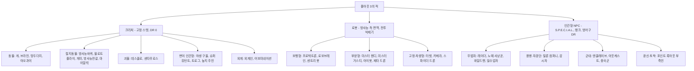
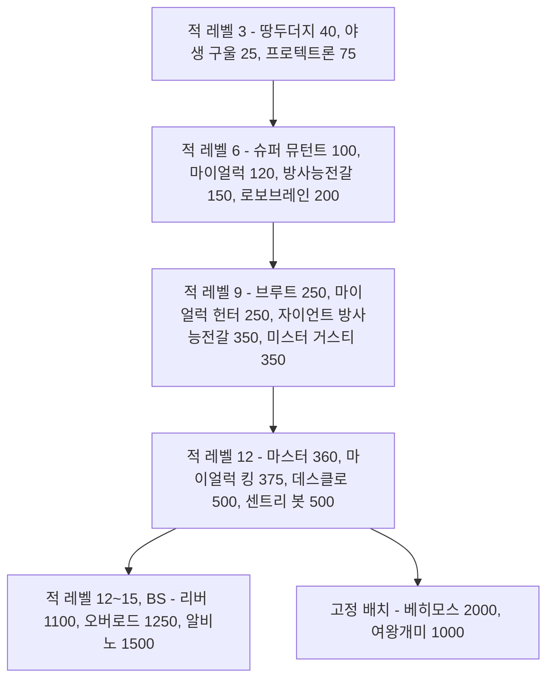

# RD-24. 크리처·적 도감

> **폴아웃 3 역기획서 세트** | 문서 ID: RD-24 | 버전: v1.0 | 작성일: 2026-10-11
> **범위**: 본편과 DLC 5종에서 플레이어가 싸우는 적 전 유형의 정본 카탈로그. 크리처·로봇·인간 적의 변종별 레벨·HP·DR·공격·XP, 행동 패턴, 약점, 서식지, 드롭, 레벨 연동 등장 규칙, 고유·보스급 적. **다루지 않는 것**: 피해·명중·VATS 공식과 AI 탐지 엔진(RD-16), 랜덤 인카운터 목록과 암살대 출현 규칙의 정본(RD-07), 팩션의 역사·관계(RD-09), 이름 있는 NPC의 프로필(RD-10·RD-11), 무기·방어구 수치(RD-19·RD-20), 장소 상세(RD-13)
> **관련 문서**: [RD-07 비표시·반복 퀘스트와 랜덤 인카운터](07_misc-quests-encounters.md), [RD-08a 오퍼레이션: 앵커리지](08a_dlc-operation-anchorage.md), [RD-08b 더 피트](08b_dlc-the-pitt.md), [RD-08c 브로큰 스틸](08c_dlc-broken-steel.md), [RD-08d 포인트 룩아웃](08d_dlc-point-lookout.md), [RD-08e 마더십 제타](08e_dlc-mothership-zeta.md), [RD-09 팩션](09_factions.md), [RD-13 장소 카탈로그](13_location-catalog.md), [RD-14 캐릭터 시스템](14_character-system.md), [RD-16 전투 시스템](16_combat-system.md), [RD-19 무기·탄약](19_weapons-ammo.md), [RD-21 소모품·잡화·제작](21_consumables-misc-crafting.md), [RD-26 용어집](26_glossary.md)

---

## 목차

1. 문서 개요
2. 적 분류 체계
3. 전체 요약표
4. 위협도 곡선
5. 크리처 ① 동물·절지동물
6. 크리처 ② 변이 인간형(야생 구울, 슈퍼 뮤턴트, 센타우로스)
7. 로봇
8. 인간 적
9. DLC 적
10. 고유·보스급 적
11. 적 디자인 분석
12. 쯔꾸르 이식 메모
- 부록 A. 데이터 처리 노트
- 부록 B. 출처

---

## 1. 문서 개요

### 1.1 목적
- 팬게임의 적 데이터베이스(몬스터 표, 적 편성표, 인카운터 테이블)를 설계할 때 근거로 쓸 **원작 적 정본 카탈로그**를 만든다.
- 개별 수치뿐 아니라 '같은 계통이 레벨 6·9·12에 한 단계씩 강해지는 계단 구조', '지역마다 다른 생태 배치', '부위별 약점 설계'가 어떻게 전투 경험을 만드는지 분석한다.

### 1.2 범위
- **포함**: 본편 크리처 15계통, 로봇 8계통, 인간 적 7집단(레이더, 탈론 컴퍼니, 감시자, 노예 사냥꾼, 엔클레이브, 아웃캐스트, 중국군 잔존병), DLC 적 전부([OA] 중국군 시뮬레이션, [TP] 트로그·와일드맨, [BS] 상위 변종, [PL] 늪지 주민·부족민·밀수업자, [MZ] 외계인·드론), 고유·보스급 적 약 40명.
- **요약만 하고 링크**: 카르마 암살대 출현 규칙과 고정 출현 31곳(정본 [RD-07](07_misc-quests-encounters.md) 5.3절), 랜덤 인카운터 슬롯(정본 RD-07 5.2절), 피해 공식·VATS·적 AI 엔진(정본 [RD-16](16_combat-system.md)), DLC별 적의 줄거리상 역할(정본 RD-08a~e).
- **제외**: 동료로만 쓰이는 개체(도그밋 등)의 성장 수치, 비적대 NPC.

### 1.3 요약
- 위키 허브 문서 기준으로 본편 크리처는 **43종·변종 63개**, DLC가 **변종 18개**를 더한다. 로봇·컴퓨터는 본편 **39개**, DLC **16개**, 합계 **55개**다. 이 문서는 이를 전투 단위로 다시 묶어 **약 47계통, 변종·랭크 약 190행**을 싣는다.
- **크리처의 DR은 전부 0**이다. 크리처의 단단함은 HP와 '부위별 피해 배율'(마이얼럭 몸통 ½, 마이얼럭 킹 몸통 ⅔, 방사능전갈 다리 감쇄, 브라민 머리 50%)로 표현된다. DR을 쓰는 적은 방어구를 입은 인간과 관성 억제장을 켠 외계인뿐이다.
- 계통마다 **레벨 6 → 9 → 12** 지점에 다음 단계 변종이 놓이고, HP가 한 단계에 2~3배씩 뛴다(슈퍼 뮤턴트 100 → 250 → 360, 방사능전갈 150 → 350, 마이얼럭 120 → 250 → 375). [BS]는 그 위에 HP 1,000대 변종(오버로드 1,250, 리버 1,100, 알비노 방사능전갈 1,500)을 얹는다.
- 인간 적은 **랭크형**이다. 같은 이름 아래 랭크 1~3(4)이 있고, 랭크가 오르면 레벨·HP·태그 스킬·무기 풀이 함께 오른다. 감시자는 플레이어 레벨 1·6·9에서 랭크가 열린다.
- XP는 위키 정보상자에 **일부 종만** 기록되어 있다(화염개미, 거대 개미, 센타우로스, 트로그, 늪지 주민 등). 나머지는 `—`로 두고 수치를 지어내지 않는다.

### 1.4 표기 메모
- **자료원**: Nukapedia 2026-08-30 덤프. 각 종의 `XXX (Fallout 3)` 문서에 있는 `{{Stats creature FO3}}` 행 151개를 스크립트로 일괄 추출했고, 인간 적은 `Infobox character`와 'Generic variants' 랭크 표를 추출했다. 여러 게임을 다루는 개요 문서(`Deathclaw`, `Mirelurk` 등)의 수치는 쓰지 않았다.
- **공식 가이드 교차 확인**: `Fallout 3 Official Game Guide Game of the Year Edition Wasteland Census`는 인물 소개문만 싣고 **전투 수치는 없다**. 고유 적의 소개(쪽수)를 10장에서 참고로만 적었다.
- **칸 정의**
  - 레벨: 적 개체 자신의 레벨. 플레이어 레벨과 다르다(레벨 연동 규칙은 각 종의 '등장 규칙' 항목과 11.2절).
  - HP: 정보상자 값. 인간 적의 `75 → 110` 같은 화살표는 '플레이어 레벨에 따라 오르는 범위'다.
  - DR: 피해 저항(%). 위키의 `11% → 13%` 같은 화살표는 원문 표기를 그대로 옮겼다(장비 상태에 따른 범위로 보이며 정확한 의미는 코퍼스 미확인).
  - 공격: `근접 28`은 공격 한 번의 기본 피해다. `+ 독 3/초(5초)`는 지속 피해다. `피해`는 플레이어 DR 적용 전 값이다.
  - XP: 처치 XP(보통 난이도). 아주 쉬움 ×0.5, 아주 어려움 ×1.5([RD-16](16_combat-system.md) 11장).
  - AI: `공격성/자신감/협조` 값. 공격성 0 비공격~3 광란, 자신감 0 겁쟁이~4 무모, 협조 0 아무도 안 도움~2 친구와 동맹을 도움.
- **기호**: `[OA]` 오퍼레이션: 앵커리지(Operation: Anchorage), `[TP]` 더 피트(The Pitt), `[BS]` 브로큰 스틸(Broken Steel), `[PL]` 포인트 룩아웃(Point Lookout), `[MZ]` 마더십 제타(Mothership Zeta), `★` 고유 개체, `✝` 시체로만 존재, `✂` 삭제 콘텐츠(게임 파일에만 있음).
- **표기 기준**: [RD-26 용어집](26_glossary.md) v0.2와 한글 패치 표기를 따른다. 방사능바퀴(Radroach), 땅두더지(Mole rat), 화염개미(Fire ant), 방사능전갈(Radscorpion), 마이얼럭(Mirelurk), 야오과이(Yao guai), 센타우로스(Centaur), 베히모스(Behemoth), 미스터 거스티(Mister Gutsy), 야생 구울(Feral ghoul), 탈론 컴퍼니(Talon Company), 감시자(Regulators), 노예 사냥꾼(Slavers), 아웃캐스트(Brotherhood Outcasts), 수도 황무지(Capital Wasteland).

---

## 2. 적 분류 체계

### 2.1 분류 트리

- 외계인, 늪지 주민, 트로그는 게임 데이터상 '크리처'로 분류되어 고정 스탯 표를 쓴다. 반면 중국군 잔존병은 구울이지만 인간형 NPC 데이터다.

### 2.2 엔진 분류가 만드는 차이

| 구분 | 크리처 | 인간형 NPC | 로봇 |
|---|---|---|---|
| 스탯 구조 | 레벨·HP·피해가 고정 | S.P.E.C.I.A.L.(스페셜)·스킬에서 HP와 명중이 파생 | 크리처와 같은 고정 스탯 |
| 강해지는 방식 | 다른 변종(상위 모델)으로 교체 | 같은 이름의 랭크가 오르고 장비 풀이 바뀜 | 다른 모델·도색으로 교체 |
| 방어 | DR 0, 부위 배율과 HP | 입은 방어구의 DR | DR 0, 방사능·독 100% 저항 |
| 드롭 | 고기·분비물 등 '부산물' 고정 | 소지 장비 전부 + 사망 시 무작위 음식·약물·탄약 | 에너지 셀·핵분열 배터리·고철 등 부품 |
| 특수 약점 | 더듬이(개미), 얼굴(마이얼럭), 다리(도약형) | 머리, 무기 쥔 팔 | 전투 억제기(Combat inhibitor)를 부수면 광란 |
| 퍽 상호작용 | 애니멀 프렌드(Animal Friend, 동물 우호), 엔토몰로지스트(Entomologist, 곤충 피해 +50%) | 로브링어(Lawbringer, 악인 손가락), 컨트랙트 킬러(Contract Killer, 선인 귀) | 로보틱스 엑스퍼트(Robotics Expert, 몰래 접근해 정지) |

- **크리처 간 적대 규칙**: 같은 팩션으로 묶이지 않은 크리처끼리는 가까이 있으면 서로 싸운다. 예를 들어 데스클로는 마이얼럭을 공격하지만, 야생 구울은 글로잉 원(Glowing one)을 공격하지 않는다.
- **'혐오체(abomination)' 분류**: 데스클로와 마이얼럭은 혐오체로 분류되어 애니멀 프렌드가 통하지 않는다. 개·땅두더지·야오과이·브라민은 통한다.
- 구울 마스크(Ghoul mask)를 쓰면 모든 야생 구울 변종이 비적대가 된다.

### 2.3 AI 속성 분포 (크리처·로봇 정보상자)

| 성향 | 값(공격성/자신감/협조) | 해당 적 | 플레이어 체감 |
|---|---|---|---|
| 겁 많은 해충 | 0/1/0 | 방사능바퀴 | 다가가면 날개를 퍼덕여 위협하다가, 오래 붙어 있으면 공격 |
| 비공격 가축 | 0/0/1 | 브라민, 짐 브라민 | 맞으면 대개 도망 |
| 매우 공격적·무모 | 2/4/2 | 데스클로, 슈퍼 뮤턴트 전 단계, 방사능전갈, 마이얼럭, 야오과이, 화염개미, 거대 개미 | 보는 즉시 달려들고 도망치지 않음 |
| 공격적·무모·협조 약함 | 2/4/1 | 야생 구울 전 변종 | 무리로 돌진하지만 서로 엄호하지 않음 |
| 무장 경비 | 1/4/2 또는 1/3/2 | 프로텍트론 계열 일부, 레이더·탈론 경비견 | 적으로 판정된 대상만 공격 |
| 비공격 기계 | 0/4/0 | 터렛 대부분 | 터미널이나 조건으로 적이 정해짐 |

---

## 3. 전체 요약표

> 레벨·HP 범위는 이 문서의 변종 표 기준이다(시체 전용·삭제 개체 제외). '변종'은 이 문서의 표 행 수가 아니라 서로 다른 이름의 전투 단위 수다.

### 3.1 크리처

| 계통 | English | 변종 수 | 레벨 범위 | HP 범위 | 대표 서식지 | 절 |
|---|---|---|---|---|---|---|
| 방사능바퀴 | Radroach | 1 | 0 | 5 | 볼트 101, 하수도, 로브코 시설 | 5.1 |
| 블로트플라이 | Bloatfly | 1 | 1 | 15 | 독성 폐기물 통 주변, 볼트 92 입구 | 5.2 |
| 땅두더지 | Mole rat | 1 | 3 | 40 | 황무지 전역, [PL] | 5.3 |
| 개 | Dog | 5 | 1~3 | 20~60 | 황무지 전역, 레이더·탈론 거점 | 5.4 |
| 브라민 | Brahmin | 3(+시체) | 1 | 40~100 | 정착지, 캐러밴, 랜덤 인카운터 | 5.5 |
| 거대 개미 | Giant ant | 5(+시체) | 2~7 | 30~1,000 | 캔터베리 커먼 일대(개미여인의 소굴), 코베가 공장, 셰일브리지 | 5.6 |
| 화염개미 | Fire ant | 5 | 2~9 | 30~1,000 | 그레이디치, 메리골드 역 | 5.7 |
| 방사능전갈 | Radscorpion | 3 | 6~13 | 150~1,500 | 황무지 서부·남부 | 5.8 |
| 마이얼럭 | Mirelurk | 6 | 6~20 | 120~600 | 포토맥 강변, 하수도, [PL] 늪 | 5.9 |
| 야오과이 | Yao guai | 2(+★) | 7 | 220 | 야오과이 터널·동굴, 절벽 동굴 | 5.10 |
| 데스클로 | Deathclaw | 2 | 12 | 500 | 올드 올니, 데스클로 보호구역 | 5.11 |
| 야생 구울 | Feral ghoul | 5 | 3~12 | 25~1,100 | 지하철역, 던위치 빌딩, [PL] | 6.1 |
| 슈퍼 뮤턴트 | Super mutant | 5 | 6~15 | 100~2,000 | D.C. 도심, 볼트 87 | 6.2 |
| 센타우로스 | Centaur | 1 | 5 | 100 | 슈퍼 뮤턴트 무리 | 6.3 |
| 실패한 FEV 피험체 ✝ | Failed FEV subject | 1 | 1 | 0 | 볼트 87 실험실 | 6.4 |

### 3.2 로봇

| 계통 | English | 변종 수 | 레벨 범위 | HP 범위 | 대표 서식지 | 절 |
|---|---|---|---|---|---|---|
| 프로텍트론 | Protectron | 8 | 3 | 75 | 지하철역, 뉴카-콜라 공장, 국립 기록 보관소 | 7.1 |
| 미스터 핸디 | Mister Handy | 3(+✂1) | 3 | 100 | 전쟁 전 주택 | 7.2 |
| 미스터 거스티 | Mister Gutsy | 3 | 3~9 | 200~350 | 창고, 군 시설, 레이븐 락 | 7.3 |
| 로보브레인 | Robobrain | 5(+✂1) | 1~6 | 200 | 군 시설, 엔클레이브·아웃캐스트 순찰 | 7.4 |
| 센트리 봇 | Sentry bot | 6(+✂1) | 3~12 | 300~500 | 콘스탄틴 요새, 레이븐 락, 애덤스 공군 기지 | 7.5 |
| 아이봇 | Eyebot | 1 | 1 | 30 | 황무지 상공 | 7.6 |
| 자동 터렛 | Automated turret | 8(+DLC 3) | 2~30 | 40~10,000 | 군 시설, 레이더 거점 | 7.7 |

### 3.3 인간 적

| 집단 | English | 랭크·유형 | 레벨 범위 | HP 범위 | 대표 거점 | 절 |
|---|---|---|---|---|---|---|
| 레이더 | Raider | 총·근접·소총·중화기 × 랭크 1~3 | 1~9 | 25~90 | 에버그린 밀, 레이더 전초기지, 학교·공장 폐허 | 8.1 |
| 탈론 컴퍼니 | Talon Company merc | 랭크 1~4 | 8~17 | 75~300 | 배니스터 요새, 국회의사당 | 8.2 |
| 감시자 | Regulator | 랭크 1~3 | 8~14 | 75~135 | 암살대, 감시자 본부 | 8.3 |
| 노예 사냥꾼 | Slaver | 지역 2종 | 3~15 | 75~110 | 파라다이스폴, 링컨 기념관 | 8.4 |
| 엔클레이브 | Enclave soldier 외 | 랭크 0~2, 테슬라, 헬파이어, 장교, 과학자 | 1~24 | 20~250 | 엔클레이브 캠프, 레이븐 락, [BS] 애덤스 공군 기지 | 8.5 |
| 아웃캐스트 | Brotherhood Outcast | 총·근접·중화기 × 랭크 1~3 | 4~11 | 70~125 | 인디펜던스 요새, 순찰로 | 8.6 |
| 중국군 잔존병 | Chinese remnant soldier | 병사·부사관·장교·대위 | 1~10 | 코퍼스 미확인(대위 70) | 마마 돌체 식품 공장 | 8.7 |

### 3.4 DLC 적

| DLC | 계통 | 변종·랭크 | 레벨 범위 | HP 범위 | 절 |
|---|---|---|---|---|---|
| [OA] | 중국군(시뮬레이션) | 소총수 랭크 1~5, 저격병, 화염방사병, 로켓병, 기술병, 크림슨 드라군 | 3~13 (드라군은 플레이어 ×1.3) | 40~90 | 9.1 |
| [OA] | 키메라 / 스파이더 드론 / 경비견 / OA 터렛 | 각 1 | 1~12 | 20~10,000 | 9.1 |
| [TP] | 트로그 | 4 | 3~12 | 15~65 | 9.2 |
| [TP] | 와일드맨, 피트 레이더, 노예 투사 | 3 | 코퍼스 미확인 | 코퍼스 미확인 | 9.2 |
| [BS] | 상위 변종 | 오버로드, 리버, 알비노, 헬파이어, 탈론 랭크 4, 마크 VII·VIII, 시그마 분대 | 9~24 | 250~1,500 | 9.3 |
| [PL] | 늪지 주민 | 5(근접·원거리 판본 8행) | 7~20 | 150~700 | 9.4 |
| [PL] | 부족민 / 밀수업자 | 각 랭크 1~5 | 7~20 | 75~415 | 9.4 |
| [PL] | 스웜프러크·퀸, 늪지 구울, 로보브레인 센트리, 루즈카 | 5 | 1~20 | 25~600 | 9.4 |
| [MZ] | 외계인 / 어보미네이션 | 각 6단계 + 작업자·함장 | 1~30 | 25~500 | 9.5 |
| [MZ] | 드론 3종, 외계인 터렛 | 4 | 1~30 | 20~600 | 9.5 |

---

## 4. 위협도 곡선

### 4.1 적 레벨대별 대표 적

> 아래 레벨은 **적 개체의 레벨**이다. 레벨 연동 목록은 대체로 적 레벨이 플레이어 레벨 근처인 개체를 뽑지만, 정확한 문턱값은 종마다 다르고 코퍼스에 거의 없다(감시자처럼 문턱값이 명시된 예는 각 절에 적었다).

| 적 레벨 | 크리처 | 로봇 | 인간 | 전투 성격 |
|---|---|---|---|---|
| 0~3 | 방사능바퀴(5), 블로트플라이(15), 땅두더지(40), 사나운 개(60), 야생 구울(25), 거대 일개미·화염개미 일개미(30) | 아이봇(30), 프로텍트론(75), 미스터 핸디(100), 터렛 마크 I·II | 레이더 랭크 1(25~30) | 수로 밀어붙이는 약한 무리. 10mm 권총 몇 발로 정리 |
| 4~6 | 센타우로스(100), 슈퍼 뮤턴트(100), 마이얼럭(120), 방사능전갈(150), 화염개미 병정(150) | 로보브레인(200), 터렛 마크 III·IV | 레이더 랭크 2(55~60), 엔클레이브 훈련병(45), 아웃캐스트 랭크 1(70) | **첫 벽**. 마이얼럭의 껍데기, 방사능전갈의 독, 슈퍼 뮤턴트의 화력 |
| 7~9 | 야오과이(220), 글로잉 원(240), 마이얼럭 헌터(250), 슈퍼 뮤턴트 브루트(250), 자이언트 방사능전갈(350), 화염개미 전사(225) | 미스터 거스티(350), 터렛 마크 V·VI | 레이더 랭크 3(85~90), 탈론 랭크 1(75), 감시자 랭크 1(75), 엔클레이브 랭크 1(80~90) | 근접 한 방이 50~75로 커짐. 원거리 화기 필수 |
| 10~12 | 데스클로(500), 마이얼럭 킹(375), 슈퍼 뮤턴트 마스터(360), [BS] 리버(1,100)·오버로드(1,250) | 센트리 봇(500) | 탈론 랭크 2(105), 감시자 랭크 2(105), 아웃캐스트 랭크 3(125) | 본편 최상위 필드 적. 데스클로 근접 100 |
| 13~17 | 슈퍼 뮤턴트 베히모스(2,000, 고정 5마리), [BS] 알비노 방사능전갈(1,500) | (없음) | 엔클레이브 랭크 2(125), 탈론 랭크 3(135), 테슬라 병사(170), 엔클레이브 장교(125), [BS] 탈론 랭크 4(300) | 보스·준보스 구간 |
| 18 이상 | [PL] 스웜프러크 퀸(600), 늪지 주민 브루저(700), [MZ] 어보미네이션(250~500) | [MZ] 외계인 터렛(300~600) | [BS] 헬파이어(250, DR 37→41), [PL] 부족민 랭크 5(410~415) | [BS] 레벨 상한 30 구간 |

### 4.2 계단 구조

- 같은 계통의 다음 단계는 **레벨 +3**, **HP ×2~3**이다. 플레이어는 레벨 업 3번마다 '같은 실루엣의 더 큰 적'을 만나게 된다.
- 로봇도 같은 계단을 탄다: 프로텍트론 3 → 로보브레인 6 → 미스터 거스티 9 → 센트리 봇 12.

### 4.3 기준 무기로 본 필요 타수 (작성자 계산)

> 무기 기본 피해(정보상자)로 HP를 나눈 값이다. 스킬·내구도·치명타·부위 배율·DR을 무시한 '감'을 보기 위한 표다.

| 적 | HP | 10mm 권총(9) | 사냥용 소총(25) | 전투 산탄총(55) | 플라스마 소총(45) |
|---|---|---|---|---|---|
| 야생 구울 | 25 | 3 | 1 | 1 | 1 |
| 땅두더지 | 40 | 5 | 2 | 1 | 1 |
| 슈퍼 뮤턴트 | 100 | 12 | 4 | 2 | 3 |
| 야오과이 | 220 | 25 | 9 | 4 | 5 |
| 데스클로 | 500 | 56 | 20 | 10 | 12 |
| 야생 구울 리버 [BS] | 1,100 | 123 | 44 | 20 | 25 |
| 슈퍼 뮤턴트 오버로드 [BS] | 1,250 | 139 | 50 | 23 | 28 |
| 알비노 방사능전갈 [BS] | 1,500 | 167 | 60 | 28 | 34 |
| 슈퍼 뮤턴트 베히모스 | 2,000 | 223 | 80 | 37 | 45 |

- 후반 적은 '맞추기 어려운 적'이 아니라 **'오래 버티는 적'**이다. 원작은 이를 실시간 연사와 VATS 치명타로 해결하지만, 턴제에서는 그대로 옮기면 한 전투가 수십 턴으로 늘어난다(12.3절).

---
