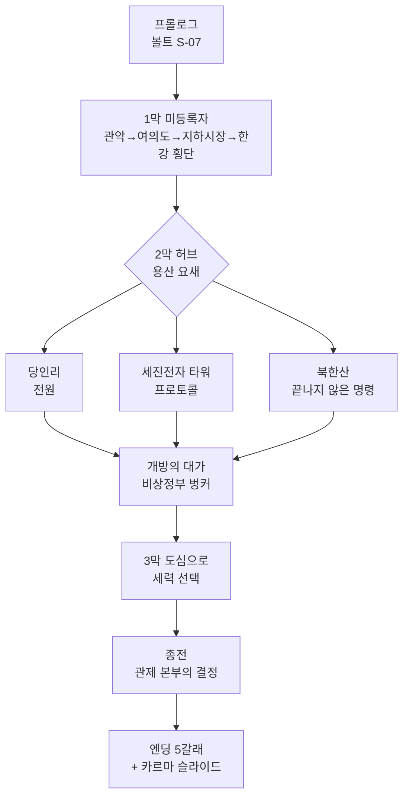

# SC-00. 서울 폴아웃 컨셉 기획서

> **서울 폴아웃 기획서 세트** | 문서 ID: SC-00 | 버전: v0.2 (핵심 결정 확정) | 작성일: 2026-10-12
> **범위**: 실제 서울을 배경으로 하는 폴아웃 3 게임의 컨셉. 세계관 위치(2077년 한국), 무대 구성, 메인 스토리 구조, 세력, 크리처, 톤, 고정 명칭, 상세 기획서 세트 구성.
> **근거 자료**: 원작 역기획서 [RD-00~27](../reverse-design/00_README.md), 조사 자료 [SR-01 공식 설정](research/SR-01_fallout-canon.md), [SR-02 서울 지리](research/SR-02_seoul-geography.md), [SR-03 인프라·군사](research/SR-03_seoul-infrastructure.md), [SR-04 생물](research/SR-04_korean-fauna.md), [SR-05 국가·사회](research/SR-05_korea-state-society.md)

---

## 1. 한 줄 컨셉

> **2277년 서울. 200년 전에 내려진 전쟁의 명령이 아직도 도시를 움직인다. 관악산 아래 볼트에서 자란 주인공은 잠든 '수도 관제망'을 깨울 단 하나의 열쇠로 지목돼 쫓기고, 마지막에 이 도시의 전쟁을 끝낼지, 누구에게 넘길지를 결정한다.**

- 장르와 시스템은 원작 폴아웃 3와 같다. 볼트 프롤로그(캐릭터 생성) → 오픈월드 → 메인·사이드 퀘스트 → 카르마와 엔딩 슬라이드.
- **이야기 구조는 원작과 다르다.** 부모 추적도, 정수 계획도 없다. 주인공은 무언가를 쫓는 사람이 아니라 **모두가 쫓는 사람**이다(→ §5).
- **'수도 황무지'**: 원작의 무대 Capital Wasteland는 한글 패치에서 '수도 황무지'로 옮겨졌다. 서울은 말 그대로 한국의 수도다. 이름 하나로 원작과 서울판이 이어진다.

## 2. 설계 원칙

| # | 원칙 | 내용 |
|---|---|---|
| 1 | 시스템은 폴아웃 3 그대로 | 시스템과 톤은 역기획서 RD 세트를 따른다. 바꾸는 것은 '무대와 이야기'다 |
| 2 | 이야기는 새 구조 | 원작 메인 스토리의 뼈대(부모 추적 → 물 → 희생)를 쓰지 않는다. 사이드 퀘스트도 원작 줄거리를 옮기지 않고, 원작이 쓴 '퀘스트 설계 패턴'(다중 해법, 카르마 분기, 정착지 운명)만 계승한다 |
| 3 | 공식 설정과 충돌하지 않기 | SR-01의 캐논 체크리스트 C1~C16을 지킨다. 한국은 공식 설정의 공백이므로, 공백을 채우되 정사와 부딪히지 않게 한다 |
| 4 | 현실 기반 | 실제 서울의 지형·시설·생물을 근거로 한다. 설화·요괴·신화는 쓰지 않는다 |
| 5 | 2077년 한국 | 배경은 폴아웃 세계의 2077년 한국이다. 1950~70년대 한국 레트로 풍속은 꾸밈으로 쓰지 않는다. 레트로 퓨처리즘은 폴아웃 세계의 기술 규칙(원자력, 진공관, 로봇, 파워 아머)으로만 들어온다 |
| 6 | 실명 가상화 | 실존 생존 인물, 실제 기업, 실제 부대명·작전 시설명은 쓰지 않고 가상화한다. 지명과 공공 공간(한강, 남산, 선유도, 용산 등)은 실명을 쓴다 |
| 7 | 확정 제작 전제 유지 | 쯔꾸르 RPG 스타일 그래픽(품질 타협 없음), 외부 심리스 오픈월드(실내는 문 전환), 실시간 맵 전투(V.A.T.S.는 선택), 장비 외형 반영, BGM·효과음, 음성 없음([RD-27 §2](../reverse-design/27_adaptation-notes.md)) |

---

## 3. 세계관: 폴아웃 세계의 한국 (1945~2277)

### 3.1 고정값과 결정값
| 구분 | 내용 |
|---|---|
| **정사 고정값** | 1945년까지는 현실 역사와 같다(C13). 대전쟁은 2077-10-23 하루, 약 2시간의 전 세계 핵 교전이다(C1). 주된 교전국은 미국과 중국이다(C2). 누가 먼저 쐈는지는 확정하지 않는다(C3). 2074년 미군 중국 본토 침공, 2077년 1월 앵커리지 탈환(C4). 기술 규칙: 휴대전화·인터넷·평면 디스플레이 없음, 원자력·로봇·에너지 무기·파워 아머(C7). 유엔은 2052년 해체(C10). 소련 존속(C11). 대전쟁 뒤 각국 정부는 사실상 소멸(C16) |
| **결정값 (확정)** | 아래 3.2의 한반도 구도, 3.3의 2077년 한국, 3.4의 대피 체계, 3.5의 전후 200년 |

### 3.2 한반도 구도 (확정: K1)
| 연도 | 사건 | 근거 |
|---|---|---|
| 1945 | 해방과 남북 분할 | 현실과 같다(분기점 이전) |
| 1950~1953 | 한국전쟁과 **정전**. 전쟁은 법적으로 끝나지 않고 휴전선이 고착된다 | 공식 공백. 현실과 같게 둔다. **'끝나지 않은 전쟁'은 서울판의 주제와 이어진다(§5.1)** |
| 1953~2052 | 남한은 미국 동맹국으로 원자력·중공업 국가가 된다. 북쪽 정권은 중국에 갈수록 종속된다 | 공식 공백. 현실의 원자력·중공업 강국 지표(SR-05)를 폴아웃 기술 규칙으로 옮긴다 |
| 2052 | 유엔 해체, 자원 전쟁 시작. 에너지 수입 의존 93%의 한국은 가장 먼저 타격을 받는다 | C10 + SR-05 |
| 2060년대 | **중국이 북쪽을 병합한다.** 휴전선은 '중국과의 국경'이 된다. 서울에서 국경까지 약 40km | 공식: 중국의 주변국 병합(SR-01 [D], 병합국 이름 미상) |
| 2066~2077 | 중미 전쟁. **한반도는 미군의 중국 본토 진격 전진기지**가 된다. 서해를 건너 산둥·상하이로 가는 병력과 보급이 인천·평택·서울을 거친다 | 공식: 2074 본토 침공, 경로는 공백(SR-01 §8) |
| 2070년대 | 국경 너머의 침투와 잠수함 출몰이 잦아지자 정부는 **'수도 관제망'**을 깐다. 서울 전역의 경비 로봇·포탑·차단벽·대피소 문을 한 중앙 컴퓨터가 지휘하는 전시 치안 체계다 | 창작. 폴아웃 기술 규칙(진공관 컴퓨터, 로봇) + 로봇 밀도 세계 1위(SR-05) |
| 2077-10-23 | 대전쟁. 한반도는 중국의 1순위 표적이다. 탄두는 항구·비행장·기지(인천, 평택, 김포, 용산)에 집중되고, 서울 도심은 심하게 파괴되지만 폐허가 남는다. 관제망은 전력이 끊겨 '대기 상태'로 멈춘다 | C1, C15 |

- 북쪽은 현실의 북한 정권으로 그리지 않는다. 수십 년 전에 중국에 병합된 땅('북방 병합지')으로만 존재한다.
- 2077년의 한국은 미국처럼 13개 연방 체제가 아니다. 성조기와 미군은 등장하지만 13개 별 성조기를 쓴다(C12).

### 3.3 2077년의 한국 (대한민국)
- **체제**: 형식은 민주공화국이지만, 2070년대 전시 비상 체제 아래에서 **국가와 재벌이 한 몸**이 된 상태다. 군수·원자력·건설 재벌이 정부를 움직인다. 미국 쪽(계엄, 반공 광풍)과 같은 시대 분위기다.
- **주민등록과 계엄**: 2075년 '비상 주민 분류 지침'이 시행된다. 주민등록증에 '충성 등급'이 찍히고, 미등록자·국경 이탈자·반전 시위자는 '적성 분자'로 분류된다. 관제망의 경비 로봇은 이 분류를 따라 움직인다. 이 지침은 메인 스토리의 핵심 장치다(§5).
- **산업**: 원자력 수출 대국, 로봇 밀도 세계 1위, 조선·중공업 기반의 군수 생산(SR-05). 폴아웃 기술 규칙에 맞춰 '진공관 컴퓨터와 소형 원자로로 돌아가는 로봇 대국'이 된다. 파워 아머는 미국 웨스트 텍 프레임의 면허 생산·정비만 한다(C8).
- **가상 재벌 (확정 명칭, §11)**

| 역할 | 원작 대응 | 서울판 가상 재벌 | 주력 |
|---|---|---|---|
| 원자력·에너지·중공업·군수 | 제너럴 아토믹스, 포세이돈 에너지 | **태성그룹** | 도시형 소형 원자로, 원자력 차량, 무기, 파워 아머 면허 정비 |
| 로봇·컴퓨터 | 로브코 | **세진전자** | 가정용·산업용·보안 로봇, 진공관 터미널, **수도 관제망 설계·시공** |
| 대피 시설·건설 | 볼트-텍 | **한결건설** | 아파트 브랜드 '세이프빌', 볼트-텍 면허를 받은 서울 볼트 시공 |
| 음료·식품·편의점 | 뉴카-콜라 | **청솔식품** | 탄산음료 '번개사이다', 편의점 체인 '번개24'. 수입 뉴카-콜라와 경쟁 |

- **생활**: 아파트 단지 중심 주거, 입시와 학원가, 편의점, 지하상가, 택배·배달 로봇. 모두 2077년 폴아웃 기술로 바꿔 그린다(예: 배달 로봇, 진공관 단말기를 쓰는 학원가).
- **전쟁 분위기**: 징병, 동원령, 배급, 미군 대규모 주둔, 반중 선전, 반전 시위, 탈영과 암시장.

### 3.4 대피 체계: '볼트 계급 사회'
- **일반 시민**: 정부가 지정한 대피소로 간다. 지하철역, 아파트 지하주차장, 지하상가다. 현실 서울에도 화생방을 견디는 1등급 대피 시설은 하나도 없다(SR-03). 대부분은 대전쟁을 견디지 못한다. 살아남은 사람의 후손이 지하철 정착민과 구울이 된다.
- **서울 볼트**: 한결건설이 볼트-텍 면허와 한미 대피 협정에 따라 서울에 12곳을 지었다. 정사 번호(1~122)는 쓰지 않고 **서울 계열 번호 S-01~S-12**를 쓴다(C9). 추첨과 돈과 '충성 등급'으로 입주가 결정됐다. 각 볼트에는 원작처럼 숨은 실험이 있다.
- **볼트 S-07 (관악)**: 주인공의 고향. 표면상 '재건 행정 요원 양성 볼트'다. 200년 동안 시험 성적이 거주 구역, 배급, 결혼 허가를 정하는 **적성 평가 사회**로 굴러왔다. 숨은 목적은 **관제망을 다시 켤 '등록 관리자'를 길러 내는 것**이다(§5.2).
- **정부·재벌 벙커**: 국가 지도부와 재벌 일가는 따로 지은 심층 벙커로 들어갔다. 이들이 전후 **비상정부**의 뿌리다.

### 3.5 전후 200년 (2078~2277)
| 시기 | 사건 |
|---|---|
| 2078~2100 | 지하철·대피소 생존자 대부분이 방사능과 굶주림으로 죽는다. 구울이 생겨난다. 볼트는 닫혀 있다 |
| 2100~2180 | 지상에 정착지가 생긴다. 고철 장벽을 두른 아파트 단지, 기름 탱크 안 마을, 다리 위 마을, 시장 터. 약탈자와 인신매매단이 등장한다 |
| 2180~2250 | 용산의 옛 한미 연합 기지 생존자 후손이 기술을 모으는 군사 집단 **연합단**이 된다. 중국군 침투조의 구울 생존자가 북부 산악 지하에 남는다. 미군 생물 연구소 시료가 퍼뜨린 **변종**이 도심에 늘어난다 |
| 2250~2276 | 청계산 심층 벙커의 **비상정부**가 지상 활동을 시작한다. 당인리의 원자로와 관제망 기록을 찾고, 서울 볼트들에 200년 묵은 '개방 지령'을 다시 송신한다 |
| **2277** | **게임 시작.** 볼트 S-07이 지령에 응해 처음으로 문을 연다 |

---

## 4. 무대: 서울 수도 황무지 (확정: K4)

### 4.1 월드 구성
- **외부 심리스 월드**: 서울 전역(약 605㎢, 동서 37km·남북 30km)을 축척을 줄여 하나로 잇는다. 장소의 상대 위치와 방위는 실제 서울을 따른다.
- **도심 밀폐 구역**: **한양도성 안 도심(종로·중구)**을 무너진 건물 잔해, 성곽, 관제망 차단벽으로 막힌 구역으로 만든다. 지하철로만 드나든다. 메인 스토리의 종착지 '관제 본부'가 이 안에 있다.
- **한강**: 폭 약 1km의 깊은 강이 맵을 남북으로 가른다. **건널 수 있는 곳이 몇 개의 다리와 하저 터널뿐**이다. 강을 건너는 것 자체가 탐험 과제이고, 다리마다 주인이 다르다.
- **실내**: 볼트, 지하철, 지하상가, 건물, 벙커는 문으로 들어간다(확정 전제).

### 4.2 권역 구성
| 권역 | 실제 지역 | 성격 | 메인 스토리 역할 |
|---|---|---|---|
| ① 관악 | 관악구·동작구, 관악산 | **시작 지역.** 볼트 S-07, 봉천 계단마을 | 프롤로그, 1막 시작 |
| ② 여의도·영등포 | 여의도, 영등포 | 무너진 국회, 여의도 지하 벙커, 영등포 지하상가의 구울 사회 '지하시장' | 1막(집결지, 지하시장) |
| ③ 마포·상암 | 마포, 상암, 난지도 | 석유비축기지 탱크 안 정착지 '탱크마을', 쓰레기 산, **당인리 지하 원자력 발전소** | 2막(당인리) |
| ④ 서강·선유도 | 양화·선유도, 합정 | 옛 정수장 섬의 물 농사 정착지. 서울판 경제의 물 공급지 | 사이드 |
| ⑤ 도심 (밀폐) | 종로·중구, 광화문·세종대로 | 정부 청사와 궁궐, 지하철 미로, **광화문 지하 관제 본부** | 3막(최종) |
| ⑥ 용산·남산 | 용산 기지, 남산 | **연합단의 용산 요새**, 남산 송신탑의 방송국 | 1막 끝·2막 |
| ⑦ 강남 | 서초·강남·송파, 초고층 타워 | 재벌의 땅. **세진전자 타워**(수직 던전), 세이프빌 아파트 대단지 | 2막(세진 타워) |
| ⑧ 동부 | 성동·광진·강동, 아차산 | 뚝섬 장터, 강변 습지, 정착지 | 사이드 |
| ⑨ 북부 산악 | 은평·노원·도봉, 북한산·도봉산 | **중국군 잔존병**, 야생 생물, 국경 방향의 위협 | 2막(끝나지 않은 명령) |
| ⑩ 서부 평야 | 강서·마곡, 김포 방향 | 피폭이 심한 공항·평야, 인천항 방향 | 사이드, 고레벨 |
| ⑪ 청계산 | 서초 남쪽 산지 | **비상정부의 심층 벙커** (맵 남동쪽 끝) | 2막 끝 |

### 4.3 대표 장소 (조사 자료 근거)
| 장소 | 실제 근거 | 게임 속 역할 |
|---|---|---|
| 관악산 | 서울 남쪽 끝 산, 송신소 | 볼트 S-07 |
| 봉천동 언덕 | 계단과 골목이 많은 언덕 동네 | 첫 정착지 '봉천 계단마을' |
| 여의도 지하 벙커 | 1970년대 건설, 2005 발견 | 1막 단서: 2077년 비상 집결지 기록 |
| 영등포 지하상가 | 서울의 대표 지하상가 | 구울 사회 '지하시장' |
| 당인리 발전소 | 1930년 가동한 서울 최초의 화력발전소 부지, 지금은 지하 발전소 | **[가상 설정] 2060년대 도시형 소형 원자로로 바뀐 '당인리 지하 원자력 발전소'.** 관제망의 전원 |
| 마포 석유비축기지 | 1978 비축 탱크 5개 | 탱크 안 정착지 '탱크마을' |
| 노들섬·한강대교 | 한강 한가운데 섬과 다리 | 다리 위 교역 도시 '노들섬', 한강 횡단의 중심 |
| 남산 | 1969 남산요새화계획, 송신탑 | 방송국 '남산 방송', 대피 터널 |
| 용산 기지·국방부 | 백 년 넘는 외국군·국군 주둔지 | 연합단 요새 |
| 선유도 | 1978~2000 정수장, 수조 구조물이 남은 섬 | 물 농사 정착지(사이드·경제) |
| 신월 빗물터널 | 지하 40m, 4.7km | 침수 지하 던전 |
| 밤섬 | 1968 폭파, 재생된 습지 | 접근 금지 섬, 변이 생태 |
| 초고층 타워 (강남·송파) | 555m급 마천루 | 세진전자 타워(수직 던전) |
| 공릉동 연구용 원자로 | 한국 최초 연구로(1962~95) | 원자력 연구 던전 |
| 북한산 | 서울 북쪽 산악, 터널 | 중국군 잔존병 거점 |
| 광화문·정부청사 | 수도의 행정 중심 | 지하 관제 본부(최종 던전) |

---

## 5. 메인 스토리 (확정: K2 완전히 새 구조)

### 5.1 주제: 끝나지 않은 명령
- 한국전쟁은 1953년에 '정전'했을 뿐 끝나지 않았다. 폴아웃 세계에서는 그 위에 2077년의 대전쟁이 겹친다. 그리고 2277년의 서울에는 **200년 전에 내려진 명령을 아직도 따르는 것들**이 있다.
  - 비상정부는 2077년의 '비상 주민 분류 지침'을 되살려 국가를 복원하려 한다.
  - 볼트 S-07은 200년 동안 시험을 치르며 '관리자'를 길렀다.
  - 연합단은 '기지를 지켜라'는 마지막 명령을 신앙처럼 지킨다.
  - 중국군 잔존병 구울은 관제 본부를 파괴하라는 침투 명령을 아직 수행 중이다.
  - 관제망의 로봇들은 전력만 들어오면 2077년 10월 23일의 계엄을 이어서 집행한다.
- 주인공은 이 모든 명령이 가리키는 **열쇠**다. 마지막 퀘스트의 이름은 **〈종전〉**이다. 주인공은 이 도시의 전쟁을 끝낼 수도, 이어 갈 수도, 자신의 것으로 만들 수도 있다.
- 폴아웃의 "전쟁은… 변하지 않는다"에 대한 서울판의 응답: **"명령은 끝나지 않는다. 누군가 끝내기 전까지는."**

### 5.2 핵심 장치: 수도 관제망과 등록 관리자
| 요소 | 내용 |
|---|---|
| **수도 관제망** | 세진전자가 2070년대에 깐 전시 치안 체계. 서울 전역의 경비 로봇, 포탑, 차단벽, 대피소 문, 방송망을 광화문 지하 '관제 본부'의 진공관 중앙 컴퓨터가 지휘한다. 대전쟁 때 전력이 끊겨 200년째 대기 중이다. 곳곳의 로봇은 잠든 채로 남아 있다 |
| **켜는 조건 3가지** | ① **전원**: 당인리 지하 원자력 발전소의 재가동 ② **본부**: 밀폐된 도심 한가운데 광화문 지하 관제 본부에 도달 ③ **관리자**: 관제망은 살아 있는 '등록 관리자'의 생체 인증으로만 명령 권한을 연다 |
| **등록 관리자** | 2077년의 관리자들은 모두 죽었다. 세진전자는 대비책으로 볼트 S-07의 출생 등록 체계를 관제망에 연결해 두었다. 200년 동안 끊기지 않은 등록 계보 안에서 적성 평가로 뽑힌 한 사람이 관리자 권한을 물려받는다. 2277년의 그 사람이 **주인공**이다 |
| **기본 프로토콜** | 관제망이 켜지면 기본값인 **'비상 주민 분류 지침'**대로 움직인다. 등록되지 않은 사람, 곧 볼트 밖의 거의 모든 서울 사람이 '적성 분자'가 된다. 비상정부는 이것을 알고 바란다 |
| **숨은 대안** | 관제망 설계자(세진전자 수석 기술자, 2077년 사망)가 남긴 **'시민 보호 프로토콜'**이 세진전자 타워 어딘가에 있다. 이것이 있어야 좋은 결말이 열린다 |

### 5.3 구조 개요
- **프롤로그 → 1막(선형) → 2막(허브, 순서 자유) → 3막(세력 선택) → 엔딩(5갈래 + 카르마 슬라이드)**.
- 원작 폴아웃 3는 메인 퀘스트가 한 줄로 이어진다. 서울판은 **2막을 세 갈래 허브**로 만들어, 플레이어가 순서를 정하고 어느 세력과 손잡을지를 쌓아 가게 한다.
- 주인공은 처음부터 **쫓기는 사람**이다. 비상정부는 주인공을 데려가려 하고, 연합단은 주인공을 지키거나 이용하려 하며, 인신매매단은 현상금을 노린다.

### 5.4 메인 퀘스트 목록 (초안)
| ID | 퀘스트 | 시점·장소 | 요지 |
|---|---|---|---|
| **프롤로그** ||||
| MQ-P1 | 출생신고 | 2258, 볼트 S-07 | 주인공이 태어난다. 볼트 등록 단말기에 출생을 신고하는 서류가 곧 **캐릭터 생성**(이름, 성별, 외형)이다. 어머니는 S-07의 젊은 오버시어 윤정인 |
| MQ-P2 | 열 살, 첫 배정 | 2268 | 핍-보이를 받는다. **생활기록부** 작성이 S.P.E.C.I.A.L. 배분이다. 사격장과 해충 구제로 전투 튜토리얼 |
| MQ-P3 | 적성 평가 | 2274 | 볼트의 운명을 가르는 시험. 답에 따라 **태그 스킬**이 정해진다. 결과는 언제나 같다: 주인공이 '관리 후보 1순위'다. 아무도 그 뜻을 모른다 |
| MQ-P4 | 개방의 날 | 2277, 19세 | 200년 만에 볼트 문이 열린다. 비상정부 계엄군이 와서 '관리자 인도'를 요구한다. 어머니는 볼트의 시민권을 약속받고 주인공을 넘기기로 한다. 친구 하도윤의 도움으로 탈출해 관악산 비탈에서 처음으로 무너진 서울을 내려다본다 |
| **1막 미등록자** ||||
| MQ-01 | 산 아래 마을 | 봉천 계단마을 | 첫 정착지. 황무지의 규칙을 배운다. 비상정부가 주인공에게 현상금을 걸었다는 소문, 인신매매단의 추적. 핍-보이에 뜬 정체 모를 '관리자 코드'를 읽을 사람이 필요하다 |
| MQ-02 | 여의도 집결지 | 여의도, 지하 벙커 | 볼트 기록이 가리킨 2077년 비상 집결지. 관제망의 존재와 '관리자 인도' 지령의 정체를 알게 된다. 계엄군과 첫 충돌 |
| MQ-03 | 지하시장 | 영등포 지하상가 | 구울 사회. 2077년 세진전자 하청 기술자였던 구울이 코드를 해독한다: 주인공의 등록 정보가 관제망의 열쇠다 |
| MQ-04 | 강을 건너다 | 노들섬 / 하저 터널 | 한강 횡단. 노들섬의 통행 정치(통행세, 밀수, 현상금 사냥꾼)를 풀거나, 침수된 하저 터널을 지나거나. 강 건너에서 연합단 순찰대와 만난다 |
| **2막 열쇠 (허브)** ||||
| MQ-05 | 용산 요새 | 용산 | 연합단의 요새. 연합단은 관제망의 로봇 군대가 깨어나면 서울이 끝난다고 믿는다. 관제망을 '부수든 쥐든' 먼저 세 가지를 확인해야 한다 → 세 갈래 허브가 열린다 |
| MQ-06 | 당인리 | 마포, 당인리 지하 원자력 발전소 | 전원. 반쯤 침수된 지하 원자로를 되살린다(또는 멈춘 채로 봉인한다). 비상정부·탱크마을·약탈자가 얽힌다 |
| MQ-07 | 세진전자 타워 | 강남 | 프로토콜. 초고층 타워를 오르며 관제망 설계자의 기록과 **시민 보호 프로토콜**을 찾는다. 깨어나기 시작한 세진 로봇들 |
| MQ-08 | 끝나지 않은 명령 | 북한산 | 중국군 잔존병 구울은 2077년에 관제 본부로 가는 침투 터널을 파 두었다. 싸우거나, 그들에게 '전쟁이 끝났다'는 것을 증명해 길을 얻는다 |
| MQ-09 | 개방의 대가 | 청계산 벙커, 볼트 S-07 | 2막의 세 갈래 중 둘을 마치면 발동한다. 비상정부가 볼트 S-07을 장악하고 어머니와 볼트 주민을 볼모로 잡는다. 주인공은 벙커로 가서 **권한대행 남궁혁**(2077년 행정안전부 장관, 구울)을 만난다. 그의 편에 서거나, 벙커를 무너뜨리거나, 볼트를 구해 탈출한다 |
| **3막 종전** ||||
| MQ-10 | 도심으로 | 지하철 → 밀폐 도심 | 선택한 동맹(연합단 / 비상정부 / 시민 연합 / 단독)과 함께 지하철로 밀폐 도심에 들어간다. 전원이 들어온 관제망의 로봇들이 깨어난다 |
| MQ-11 | 종전 | 광화문 지하 관제 본부 | 관리자 콘솔 앞의 마지막 결정(§5.5). 결정 뒤 남산 방송으로 서울 전역에 방송이 나간다 |

- 메인 퀘스트 15개(프롤로그 4 + 본편 11). 원작(프롤로그 4 + 본편 13)과 비슷한 볼륨이다.
- 엔딩 뒤에도 계속 플레이할 수 있다(원작 DLC '브로큰 스틸' 이후의 방식). 결말에 따라 월드 상태가 바뀐다.

### 5.5 엔딩 구조
| # | 관제 본부의 결정 | 조건 | 카르마 성향 | 결과 요지 |
|---|---|---|---|---|
| E1 | **계엄 프로토콜 가동** | 비상정부 동맹 또는 단독 | 악 | 로봇이 '미등록자'를 쓸어 낸다. 비상정부의 '정통 대한민국'이 서고 서울은 거대한 볼트가 된다 |
| E2 | **연합단에 지휘권 이양** | 연합단 동맹 | 중립 | 로봇 군대가 연합단 손에 들어간다. 질서는 오지만 총으로 지킨 질서다 |
| E3 | **시민 등록 (새 주민등록)** | 시민 보호 프로토콜 확보 + 비상정부 무력화 | 선 | 서울의 모든 생존자가 '시민'으로 등록된다. 로봇은 모두를 지킨다 |
| E4 | **관제망 영구 정지 (종전 선언)** | 언제나 가능 | 선·중립 | 로봇도 명령도 멈춘다. 200년 묵은 전쟁이 끝난다. 서울은 맨손으로 다시 시작한다 |
| E5 | **관리자 군림** | 단독 | 악·중립 | 주인공이 관제망의 주인이 된다 |

- 원작처럼 **결말 슬라이드**가 이어진다. 결정 + 카르마 + 사이드 퀘스트 결과(볼트 S-07, 봉천 계단마을, 노들섬, 탱크마을, 지하시장, 중국군 잔존병, 동료 등)로 슬라이드가 조합된다.
- 어머니(윤정인)의 생사와 볼트 S-07의 운명은 MQ-09의 선택으로 갈린다.

### 5.6 원작 대비
| 항목 | 원작 폴아웃 3 | 서울판 |
|---|---|---|
| 주인공의 동기 | 아버지를 쫓는다 | 쫓긴다. 자기가 왜 열쇠인지 알아내고, 열쇠를 어디에 쓸지 정한다 |
| 핵심 자원 | 깨끗한 물(정화 계획) | 도시의 지휘권(관제망) — 전원·본부·관리자 |
| 메인 구조 | 선형 | 1막 선형 → 2막 허브 → 3막 세력 선택 |
| 적대 정부 | 엔클레이브(이든 대통령 = 컴퓨터) | 비상정부(권한대행 = 2077년을 기억하는 구울) |
| 클라이맥스 | 정화기 가동과 희생 | 관리자 콘솔에서의 결정과 '종전' 방송 |
| 볼트의 의미 | 떠나온 곳 | 떠나온 곳이자 볼모. 다시 돌아가야 한다 |
| 계승하는 것 | 볼트 프롤로그(캐릭터 생성), 오픈월드, 카르마, 동료, 결말 슬라이드, 정부 잔존 세력 vs 기술 군사 집단의 구도 ||

---

## 6. 세력 구도 (확정: K3)

| 세력 (확정 명칭) | 원작 대응 | 개요 |
|---|---|---|
| **비상정부** | 엔클레이브 | 청계산 심층 벙커의 국가 지도부·재벌 후예. 자신들만이 '정통 대한민국'이라 믿는다. 지상 병력은 **계엄군**(면허 생산 파워 아머, 버티버드). 수장은 권한대행 남궁혁 |
| **연합단** | 브라더후드 오브 스틸 | 용산 한미 연합 기지 생존자의 후손. 기술을 모으고 지키는 군사 집단. 영어와 한국어가 섞인 계급과 의례. '기지를 지켜라'를 교리로 삼는다 |
| **원칙파** | 아웃캐스트 | 연합단에서 갈라진 분파. 바깥 사람을 돕는 데 반대하고 기술 회수만을 고집한다 |
| **약탈자** | 레이더 | 폐허를 떠도는 무장 집단 |
| **새벽인력** | 노예 사냥꾼 | 사람을 잡아 '인력'으로 파는 인신매매단. 옛 인력사무소의 이름과 장부를 그대로 쓴다. 주인공 현상금의 주요 추적자 |
| **철벽경호** | 탈론 컴퍼니 | 돈으로 움직이는 용병 회사. 선한 카르마의 주인공을 노린다 |
| **자율방범대** | 감시자 | 악한 카르마의 주인공을 노리는 자경단 |
| **중국군 잔존병** | 중국군 잔존병 | 2077년 관제 본부 파괴 임무로 침투한 특수부대의 구울 생존자. 북한산 지하에 남았다. 비하가 아니라 '명령에 갇힌 병사'로 그린다 |
| **변종** | 슈퍼 뮤턴트 | 미군 생물 연구소 시료와 방사능으로 생긴 거대 변이 인간. 도심과 지하철에 많다 |
| **지하시장** | 언더월드 | 영등포 지하상가의 구울 사회 |
| **각성회** | 원자의 자손 | 잠든 관제망을 '도시의 수호자'로 믿는 신앙 공동체. 관제망이 깨어나면 '등록된 자'가 구원받는다고 가르친다 |
| **정착지들** | 메가톤, 리벳시티 등 | 봉천 계단마을, 탱크마을, 노들섬, 선유도, 뚝섬 장터, 세이프빌(강남 아파트 요새) 등 |

---

## 7. 크리처 (현실 생물의 변이)

| 원작 크리처 | 서울판 | 실제 근거 (SR-04) |
|---|---|---|
| 방사능바퀴 | 변이 바퀴벌레 | 서울 바퀴 민원 4년 사이 약 5배 |
| 블로트플라이 | 변이 하루살이·러브버그 | 동양하루살이, 러브버그 대발생 |
| 땅두더지 | 변이 시궁쥐 | 도심 집쥐 |
| 들개 | 변이 들개 무리 | 관악산 들개 30여 마리, 무리 생활 |
| 야오과이 | 변이 반달가슴곰 | 사육곰 약 199마리, 지리산 복원 개체 |
| 마이얼럭 | 변이 외래 거북·참게 | 서울 하천 거북의 64%가 외래종 |
| 방사능전갈 | 변이 왕지네·장수말벌 | 실제 독성 절지동물 |
| 화염개미 | 변이 붉은불개미 | 2017년 부산항 유입 |
| 브라민 | 두 머리 한우 | 가축 소 |
| (신규) | 변이 멧돼지 | 도심 출몰 2022→2024 205→486건 |
| (신규) | 변이 수달·뉴트리아 | 한강 생태 |
| 데스클로 | 미군 생물병기(외래 대형 파충류 개조) | 설화가 아닌 군사 생물병기 |
| 슈퍼 뮤턴트 | 변종 | 미군 생물 연구 시료 + 방사능 |
| 구울 | 구울, 야생 구울 | 원작과 같다 |
| 로봇 | 세진전자의 가정용·보안·군용 로봇, 관제망 경비 로봇 | 로봇 밀도 세계 1위 |
| 개 동료 (도그밋) | **진돗개 '백구'** | 실제 한국 토종견 |

---

## 8. 톤과 연출

- **폴아웃의 블랙 유머**를 2077년 한국 소비 사회에 적용한다. 아파트 분양 광고, 입시 학원, 재벌 홍보, 전시 선전 방송, 배달 로봇, 주민등록 공문.
- **선전은 풍자 대상**이다. 반중 선전도 원작처럼 시대의 광기로 그린다. 특정 국가나 민족을 비하하지 않는다.
- **환경 스토리텔링**: 대피소로 지정됐던 지하철역의 해골들, 분양 광고판 앞 행렬, 학원가 교실의 시험지, 충성 등급이 찍힌 주민등록증.
- **한국어 텍스트 문화**: 간판, 공문체 터미널, 안내 방송 자막.

---

## 9. 상세 기획서 세트 구성

| ID | 문서 | 내용 |
|---|---|---|
| SD-01 | 게임 개요 | 컨셉, 디자인 필러, 코어 루프, 볼륨 목표 |
| SD-02 | 세계관·연표 | 1945~2277 한국사, 2077년 한국 사회, 가상 기업, 대피 체계, 관제망 |
| SD-03 | 메인 스토리·메인 퀘스트 | 시놉시스, 퀘스트 상세, 엔딩 |
| SD-04 | 사이드 퀘스트 | 원작의 퀘스트 설계 패턴을 계승한 서울판 고유 퀘스트 |
| SD-05 | 비표시·반복 퀘스트, 랜덤 인카운터 | |
| SD-06 | 세력 | 세력별 설정, 관계, 카르마 반응 |
| SD-07 | 인물 | 주요 인물, 동료 |
| SD-08 | 월드·권역 | 축척, 권역, 한강 횡단, 도심 밀폐 구역, 지하철 |
| SD-09 | 장소 카탈로그 | 정착지, 볼트, 던전, 랜드마크 |
| SD-10 | 캐릭터 시스템 | S.P.E.C.I.A.L.·스킬·퍽(원작 계승 + 서울판 퍽) |
| SD-11 | 전투 시스템 | 실시간 맵 전투(RD-27 §7) |
| SD-12 | 탐험·상호작용·UI | 핍-보이, 라디오, 미니게임 |
| SD-13 | 아이템 | 무기, 방어구, 소모품, 잡화 |
| SD-14 | 크리처·적 | |
| SD-15 | 경제 | 화폐, 상인, 주거 |
| SD-16 | 아트 디렉션·그래픽 스타일 가이드 | 2077년 한국의 레트로 퓨처 미술, 도트 규격 |
| SD-17 | 사운드 | BGM, 효과음, 라디오 |
| SD-18 | 용어·명명 규칙 | 가상 기업·지명·인명 표기 |

---

## 10. 핵심 결정 (확정, 2026-10-12)

| # | 결정 | 확정안 |
|---|---|---|
| K1 | 2077년 한반도 구도 | 분단 유지, 북쪽은 2060년대 중국에 병합, 남한은 미군 대륙 진격 전진기지 |
| K2 | 메인 스토리 | **완전히 새 구조.** 주제 '끝나지 않은 명령', 핵심 장치 '수도 관제망과 등록 관리자', 1막 선형 → 2막 허브 → 3막 세력 선택 → 엔딩 5갈래(§5) |
| K3 | 세력 | 원작 세력 역할의 서울판 대응 + 한국 고유 세력. 브라더후드·엔클레이브는 등장하지 않는다(태평양 횡단 근거 없음, SR-01 §8.3) |
| K4 | 맵 범위 | 서울 전역(압축) + 도심 밀폐 구역 + 한강 횡단 제한 |

---

## 11. 고정 명칭 (상세 기획 공통)

상세 기획서는 아래 명칭을 그대로 쓴다. 바꿀 때는 이 문서를 먼저 고친다.

| 분류 | 명칭 |
|---|---|
| 무대 | 서울 수도 황무지(약칭 수도 황무지), 도심 밀폐 구역, 북방 병합지 |
| 핵심 장치 | 수도 관제망(약칭 관제망), 관제 본부(광화문 지하), 등록 관리자, 비상 주민 분류 지침(계엄 프로토콜), 시민 보호 프로토콜, 당인리 지하 원자력 발전소 |
| 볼트 | 서울 볼트 S-01~S-12, 주인공의 볼트 **S-07(관악)** |
| 재벌 | 태성그룹, 세진전자, 한결건설(아파트 브랜드 세이프빌), 청솔식품(번개사이다, 편의점 번개24) |
| 세력 | 비상정부(지상군: 계엄군), 연합단, 원칙파, 약탈자, 새벽인력, 철벽경호, 자율방범대, 중국군 잔존병, 변종, 지하시장, 각성회 |
| 정착지 | 봉천 계단마을, 탱크마을, 노들섬, 선유도, 뚝섬 장터, 세이프빌 |
| 주요 장소 | 여의도 지하 벙커, 영등포 지하상가, 용산 요새, 남산 방송, 세진전자 타워, 청계산 벙커, 북한산 |
| 핵심 인물 | 윤정인(S-07 오버시어, 주인공의 어머니), 하도윤(S-07 친구), 남궁혁(비상정부 권한대행, 2077년 행정안전부 장관, 구울), 진돗개 백구(동료) |
| 원작에서 그대로 쓰는 용어 | 볼트-텍, 핍-보이, 캡, 스팀팩, 라드어웨이, 라드-X, 구울, 야생 구울, 파워 아머, 버티버드, 뉴카-콜라, S.P.E.C.I.A.L., V.A.T.S. (표기는 [RD-26 용어집](../reverse-design/26_glossary.md)) |

## 12. 버전 이력

| 버전 | 날짜 | 내용 |
|---|---|---|
| v0.1 | 2026-10-12 | 최초 초안. 핵심 결정 K1~K4 확인 요청 |
| v0.2 | 2026-10-12 | K1~K4 확정. 메인 스토리를 완전히 새 구조로 다시 씀(§5). 관제망 설정, 엔딩 5갈래, 고정 명칭(§11) 추가 |
