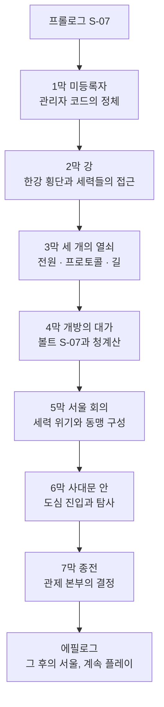

# SC-00. 서울 폴아웃 컨셉 기획서

> **서울 폴아웃 기획서 세트** | 문서 ID: SC-00 | 버전: v1.0 (확정, 세트 정합 반영) | 작성일: 2026-10-12
> **범위**: 실제 서울을 배경으로 하는 폴아웃 3 게임의 컨셉. 세계관 위치(2077년 한국), 무대 구성, 메인 스토리 구조, 세력, 크리처, 톤, 고정 명칭, 상세 기획서 세트 구성.
> **근거 자료**: 원작 역기획서 [RD-00~27](../reverse-design/00_README.md), 조사 자료 [SR-01 공식 설정](research/SR-01_fallout-canon.md), [SR-02 서울 지리](research/SR-02_seoul-geography.md), [SR-03 인프라·군사](research/SR-03_seoul-infrastructure.md), [SR-04 생물](research/SR-04_korean-fauna.md), [SR-05 국가·사회](research/SR-05_korea-state-society.md)

---

## 1. 한 줄 컨셉

> **2277년 서울. 200년 전에 내려진 전쟁의 명령이 아직도 도시를 움직인다. 관악산 아래 볼트에서 자란 주인공은 잠든 '수도 관제망'을 깨울 단 하나의 열쇠로 지목돼 쫓기고, 마지막에 이 도시의 전쟁을 끝낼지, 누구에게 넘길지를 결정한다.**

- 장르와 시스템은 원작 폴아웃 3와 같다. 볼트 프롤로그(캐릭터 생성) → 오픈월드 → 메인·사이드 퀘스트 → 카르마와 엔딩 슬라이드.
- **이야기 구조는 원작과 다르다.** 부모 추적도, 정수 계획도 없다. 주인공은 무언가를 쫓는 사람이 아니라 **모두가 쫓는 사람**이다. 프롤로그 + 7막 + 에필로그, 막마다 여러 경로, 세력별 호감도로 협력자와 결말이 정해진다(→ §5, §6.2).
- **넓은 자유도와 큰 볼륨**: 월드는 프롤로그 직후 전부 열리고, 장소 250곳 이상, 사이드 퀘스트 60개 이상, 이름 있는 NPC 500명 이상을 목표로 한다(§5.7). 동료 시스템은 없다.
- **'수도 황무지'**: 원작의 무대 Capital Wasteland는 한글 패치에서 '수도 황무지'로 옮겨졌다. 서울은 말 그대로 한국의 수도다. 이름 하나로 원작과 서울판이 이어진다.

## 2. 설계 원칙

| # | 원칙 | 내용 |
|---|---|---|
| 1 | 시스템은 폴아웃 3 그대로 | 시스템과 톤은 역기획서 RD 세트를 따른다. 바꾸는 것은 '무대와 이야기'다 |
| 2 | 이야기는 새 구조 | 원작 메인 스토리의 뼈대(부모 추적 → 물 → 희생)를 쓰지 않는다. 사이드 퀘스트도 원작 줄거리를 옮기지 않고, 원작이 쓴 '퀘스트 설계 패턴'(다중 해법, 카르마 분기, 정착지 운명)만 계승한다 |
| 3 | 공식 설정과 충돌하지 않기 | SR-01의 캐논 체크리스트 C1~C16을 지킨다. 한국은 공식 설정의 공백이므로, 공백을 채우되 정사와 부딪히지 않게 한다 |
| 4 | 현실 기반 | 실제 서울의 지형·시설·생물을 근거로 한다. 설화·요괴·신화는 쓰지 않는다 |
| 5 | 2077년 한국 | 배경은 폴아웃 세계의 2077년 한국이다. 1950~70년대 한국 레트로 풍속은 꾸밈으로 쓰지 않는다. 레트로 퓨처리즘은 폴아웃 세계의 기술 규칙(원자력, 진공관, 로봇, 파워 아머)으로만 들어온다 |
| 6 | 실명 가상화 | 실존 생존 인물, 실제 기업, 실제 부대명·작전 시설명은 쓰지 않고 가상화한다. 지명과 공공 공간(한강, 남산, 선유도, 용산 등)은 실명을 쓴다 |
| 7 | 고르지 않고 기운다 | 세력·동맹·결말을 메뉴나 양자택일 질문으로 고르게 하지 않는다. 플레이어가 한 일이 쌓여 세계가 자연스럽게 한쪽으로 기운다(§5.8) |
| 8 | 확정 제작 전제 유지 | 쯔꾸르 RPG 스타일 그래픽(품질 타협 없음), 외부 심리스 오픈월드(실내는 문 전환), 실시간 맵 전투(V.A.T.S.는 선택), 장비 외형 반영, BGM·효과음, 음성 없음([RD-27 §2](../reverse-design/27_adaptation-notes.md)) |

---

## 3. 세계관: 폴아웃 세계의 한국 (1945~2277)

### 3.1 고정값과 결정값
| 구분 | 내용 |
|---|---|
| **정사 고정값** | 1945년까지는 현실 역사와 같다(C13). 대전쟁은 2077-10-23 하루, 약 2시간의 전 세계 핵 교전이다(C1). 주된 교전국은 미국과 중국이다(C2). 누가 먼저 쐈는지는 확정하지 않는다(C3). 2074년 미군 중국 본토 침공, 2077년 1월 앵커리지 탈환(C4). 기술 규칙: 휴대전화·인터넷·평면 디스플레이 없음, 원자력·로봇·에너지 무기·파워 아머(C7). 유엔은 2052년 해체(C10). 소련 존속(C11). 대전쟁 뒤 각국 정부는 사실상 소멸(C16) |
| **결정값 (확정)** | 아래 3.2의 한반도 구도, 3.3의 2077년 한국, 3.4의 대피 체계, 3.5의 전후 200년 |

### 3.2 한반도 구도 (확정: K1)
| 연도 | 사건 | 근거 |
|---|---|---|
| 1945 | 해방과 남북 분할 | 현실과 같다(분기점 이전) |
| 1950~1953 | 한국전쟁과 **정전**. 전쟁은 법적으로 끝나지 않고 휴전선이 고착된다 | 공식 공백. 현실과 같게 둔다. **'끝나지 않은 전쟁'은 서울판의 주제와 이어진다(§5.1)** |
| 1953~2052 | 남한은 미국 동맹국으로 원자력·중공업 국가가 된다. 북쪽 정권은 중국에 갈수록 종속된다 | 공식 공백. 현실의 원자력·중공업 강국 지표(SR-05)를 폴아웃 기술 규칙으로 옮긴다 |
| 2052 | 유엔 해체, 자원 전쟁 시작. 에너지 수입 의존 93%의 한국은 가장 먼저 타격을 받는다 | C10 + SR-05 |
| 2060년대 | **중국이 북쪽을 병합한다.** 휴전선은 '중국과의 국경'이 된다. 서울에서 국경까지 약 40km | 공식: 중국의 주변국 병합(SR-01 [D], 병합국 이름 미상) |
| 2066~2077 | 중미 전쟁. **한반도는 미군의 중국 본토 진격 전진기지**가 된다. 서해를 건너 산둥·상하이로 가는 병력과 보급이 인천·평택·서울을 거친다 | 공식: 2074 본토 침공, 경로는 공백(SR-01 §8) |
| 2070년대 | 국경 너머의 침투와 잠수함 출몰이 잦아지자 정부는 **'수도 관제망'**을 깐다. 서울 전역의 경비 로봇·포탑·차단벽·대피소 문을 한 중앙 컴퓨터가 지휘하는 전시 치안 체계다 | 창작. 폴아웃 기술 규칙(진공관 컴퓨터, 로봇) + 로봇 밀도 세계 1위(SR-05) |
| 2077-10-23 | 대전쟁. 한반도는 중국의 1순위 표적이다. 탄두는 항구·비행장·기지(인천, 평택, 김포, 용산)에 집중되고, 서울 도심은 심하게 파괴되지만 폐허가 남는다. 관제망은 전력이 끊겨 '대기 상태'로 멈춘다 | C1, C15 |

- 북쪽은 현실의 북한 정권으로 그리지 않는다. 수십 년 전에 중국에 병합된 땅('북방 병합지')으로만 존재한다.
- 2077년의 한국은 미국처럼 13개 연방 체제가 아니다. 성조기와 미군은 등장하지만 13개 별 성조기를 쓴다(C12).

### 3.3 2077년의 한국 (대한민국)
- **체제**: 형식은 민주공화국이지만, 2070년대 전시 비상 체제 아래에서 **국가와 재벌이 한 몸**이 된 상태다. 군수·원자력·건설 재벌이 정부를 움직인다. 미국 쪽(계엄, 반공 광풍)과 같은 시대 분위기다.
- **주민등록과 계엄**: 2075년 '비상 주민 분류 지침'이 시행된다. 주민등록증에 '충성 등급'(1~5등급, 1등급이 가장 높다)이 찍히고, 등급 밖으로 분류된 미등록자·국경 이탈자·반전 시위자는 '적성 분자'가 된다. 관제망의 경비 로봇은 이 분류를 따라 움직인다. 이 지침은 메인 스토리의 핵심 장치다(§5).
- **산업**: 원자력 수출 대국, 로봇 밀도 세계 1위, 조선·중공업 기반의 군수 생산(SR-05). 폴아웃 기술 규칙에 맞춰 '진공관 컴퓨터와 소형 원자로로 돌아가는 로봇 대국'이 된다. 파워 아머는 미국 웨스트 텍 프레임의 면허 생산·정비만 한다(C8).
- **가상 재벌 (확정 명칭, §11)**

| 역할 | 원작 대응 | 서울판 가상 재벌 | 주력 |
|---|---|---|---|
| 원자력·에너지·중공업·군수 | 제너럴 아토믹스, 포세이돈 에너지 | **태성그룹** | 도시형 소형 원자로, 원자력 차량, 무기, 파워 아머 면허 정비 |
| 로봇·컴퓨터 | 로브코 | **세진전자** | 가정용·산업용·보안 로봇, 진공관 터미널, **수도 관제망 설계·시공** |
| 대피 시설·건설 | 볼트-텍 | **한결건설** | 아파트 브랜드 '세이프빌', 볼트-텍 면허를 받은 서울 볼트 시공 |
| 음료·식품·편의점 | 뉴카-콜라 | **청솔식품** | 탄산음료 '번개사이다', 편의점 체인 '번개24'. 수입 뉴카-콜라와 경쟁 |

- **생활**: 아파트 단지 중심 주거, 입시와 학원가, 편의점, 지하상가, 택배·배달 로봇. 모두 2077년 폴아웃 기술로 바꿔 그린다(예: 배달 로봇, 진공관 단말기를 쓰는 학원가).
- **전쟁 분위기**: 징병, 동원령, 배급, 미군 대규모 주둔, 반중 선전, 반전 시위, 탈영과 암시장.

### 3.4 대피 체계: '볼트 계급 사회'
- **일반 시민**: 정부가 지정한 대피소로 간다. 지하철역, 아파트 지하주차장, 지하상가다. 현실 서울에도 화생방을 견디는 1등급 대피 시설은 하나도 없다(SR-03). 대부분은 대전쟁을 견디지 못한다. 살아남은 사람의 후손이 지하철 정착민과 구울이 된다.
- **서울 볼트**: 한결건설이 볼트-텍 면허와 한미 대피 협정에 따라 서울에 12곳을 지었다. 정사 번호(1~122)는 쓰지 않고 **서울 계열 번호 S-01~S-12**를 쓴다(C9). 추첨과 돈과 '충성 등급'으로 입주가 결정됐다. 각 볼트에는 원작처럼 숨은 실험이 있다.
- **볼트 S-07 (관악)**: 주인공의 고향. 표면상 '재건 행정 요원 양성 볼트'다. 200년 동안 시험 성적이 거주 구역, 배급, 결혼 허가를 정하는 **적성 평가 사회**로 굴러왔다(평가 등급 A~D, 2077년 충성 등급과 다른 체계). 2077년 입주 596명, 2277년 인구 192명. 숨은 목적은 **관제망을 다시 켤 '등록 관리자'를 길러 내는 것**이다(§5.2).
- **정부·재벌 벙커**: 국가 지도부와 재벌 일가는 따로 지은 심층 벙커로 들어갔다. 이들이 전후 **비상정부**의 뿌리다.

### 3.5 전후 200년 (2078~2277)
| 시기 | 사건 |
|---|---|
| 2078~2100 | 지하철·대피소 생존자 대부분이 방사능과 굶주림으로 죽는다. 구울이 생겨난다. 볼트는 닫혀 있다 |
| 2100~2180 | 지상에 정착지가 생긴다. 고철 장벽을 두른 아파트 단지, 기름 탱크 안 마을, 다리 위 마을, 시장 터. 약탈자와 인신매매단이 등장한다 |
| 2180~2250 | 용산의 옛 한미 연합 기지 생존자 후손이 기술을 모으는 군사 집단 **연합단**이 된다. 중국군 침투조의 구울 생존자가 북부 산악 지하에 남는다. 미군 생물 연구소 시료가 퍼뜨린 **변종**이 도심에 늘어난다 |
| 2250~2276 | 청계산 심층 벙커의 **비상정부**가 지상 활동을 시작한다. 당인리의 원자로와 관제망 기록을 찾고, 서울 볼트들에 200년 묵은 '개방 지령'을 다시 송신한다 |
| **2277** | **게임 시작.** 2277-10-23(대전쟁 200주년), 볼트 S-07이 개방 지령에 응해 처음 문을 연다. 주인공 등록번호 S07-2258-0031 |

---

## 4. 무대: 서울 수도 황무지 (확정: K4)

### 4.1 월드 구성
- **외부 심리스 월드**: 서울 전역(약 605㎢, 동서 37km·남북 30km)을 축척을 줄여 하나로 잇는다. 장소의 상대 위치와 방위는 실제 서울을 따른다.
- **도심 밀폐 구역**: **한양도성 안 도심(종로·중구)**을 무너진 건물 잔해, 성곽, 관제망 차단벽으로 막힌 구역으로 만든다. 지하철로만 드나든다. 메인 스토리의 종착지 '관제 본부'가 이 안에 있다.
- **한강**: 폭 약 1km의 깊은 강이 맵을 남북으로 가른다. **건널 수 있는 곳이 몇 개의 다리와 하저 터널뿐**이다. 강을 건너는 것 자체가 탐험 과제이고, 다리마다 주인이 다르다.
- **실내**: 볼트, 지하철, 지하상가, 건물, 벙커는 문으로 들어간다(확정 전제).
- **정교한 배치**: 실제 위경도를 게임 월드 좌표로 바꾸는 변환식을 두고, 모든 장소·랜드마크·다리·지하철역에 월드 좌표(청크·타일)를 매긴다. 권역 경계, 도로, 하천, 산지 등고선도 같은 좌표계로 설계한다(SD-08이 좌표계를, SD-09가 장소별 좌표를 정한다).

### 4.2 권역 구성
| 권역 | 실제 지역 | 성격 | 메인 스토리 역할 |
|---|---|---|---|
| ① 관악 | 관악구·동작구, 관악산 | **시작 지역.** 볼트 S-07, 봉천 계단마을 | 프롤로그, 1막, 4막(귀향) |
| ② 여의도·영등포 | 여의도, 영등포 | 무너진 국회, 여의도 지하 벙커, 영등포 지하상가의 구울 사회 '지하시장' | 1막(집결지, 지하시장, 새벽인력), 2막(하저 터널) |
| ③ 마포·상암 | 마포, 상암, 난지도 | 석유비축기지 탱크 안 정착지 '탱크마을', 쓰레기 산, **당인리 지하 원자력 발전소** | 2막(양화 나루), 3막(당인리) |
| ④ 서강·선유도 | 양화·선유도, 합정 | 옛 정수장 섬의 물 농사 정착지. 서울판 경제의 물 공급지 | 사이드 |
| ⑤ 도심 (밀폐) | 종로·중구, 광화문·세종대로 | 정부 청사와 궁궐, 지하철 미로, **광화문 지하 관제 본부** | 6막(사대문 안), 7막(관제 본부) |
| ⑥ 용산·남산 | 용산 기지, 남산 | **연합단의 용산 요새**, 남산 송신탑의 방송국 | 2막(남산의 목소리, 용산 요새), 5막 |
| ⑦ 강남 | 서초·강남·송파, 초고층 타워 | 재벌의 땅. **세진전자 타워**(수직 던전), 세이프빌 아파트 대단지 | 2막(잠실 우회), 3막(세진전자 타워) |
| ⑧ 동부 | 성동·광진·강동, 아차산 | 뚝섬 장터, 강변 습지, 정착지 | 사이드 |
| ⑨ 북부 산악 | 은평·노원·도봉, 북한산·도봉산 | **중국군 잔존병**, 야생 생물, 국경 방향의 위협 | 3막(끝나지 않은 명령), 6막(침투 터널 입구) |
| ⑩ 서부 평야 | 강서·마곡, 김포 방향 | 피폭이 심한 공항·평야, 인천항 방향 | 사이드, 고레벨 |
| ⑪ 청계산 | 서초 남쪽 산지 | **비상정부의 심층 벙커** (맵 남쪽 경계, 강남 남쪽) | 4막(청계산) |

### 4.3 대표 장소 (조사 자료 근거)
| 장소 | 실제 근거 | 게임 속 역할 |
|---|---|---|
| 관악산 | 서울 남쪽 끝 산, 송신소 | 볼트 S-07 |
| 봉천동 언덕 | 계단과 골목이 많은 언덕 동네 | 첫 정착지 '봉천 계단마을' |
| 여의도 지하 벙커 | 1970년대 건설, 2005 발견 | 1막 단서: 2077년 비상 집결지 기록 |
| 영등포 지하상가 | 서울의 대표 지하상가 | 구울 사회 '지하시장' |
| 당인리 발전소 | 1930년 가동한 서울 최초의 화력발전소 부지, 지금은 지하 발전소 | **[가상 설정] 2060년대 도시형 소형 원자로로 바뀐 '당인리 지하 원자력 발전소'.** 관제망의 전원 |
| 마포 석유비축기지 | 1978 비축 탱크 5개 | 탱크 안 정착지 '탱크마을' |
| 노들섬·한강대교 | 한강 한가운데 섬과 다리 | 다리 위 교역 도시 '노들섬', 한강 횡단의 중심 |
| 남산 | 1969 남산요새화계획, 송신탑 | 방송국 '남산 방송', 대피 터널 |
| 용산 기지·국방부 | 백 년 넘는 외국군·국군 주둔지 | 연합단 요새 |
| 선유도 | 1978~2000 정수장, 수조 구조물이 남은 섬 | 물 농사 정착지(사이드·경제) |
| 신월 빗물터널 | 지하 40m, 4.7km | 침수 지하 던전 |
| 밤섬 | 1968 폭파, 재생된 습지 | 접근 금지 섬, 변이 생태 |
| 초고층 타워 (강남·송파) | 잠실 초고층(실명·수치 미사용) | 세진전자 타워(수직 던전). 지상 101층 + 첨탑, 첨탑 끝 약 500m |
| 공릉동 연구용 원자로 | 한국 최초 연구로(1962~95) | 원자력 연구 던전 |
| 북한산 | 서울 북쪽 산악, 터널 | 중국군 잔존병 거점 |
| 광화문·정부청사 | 수도의 행정 중심 | 지하 관제 본부(최종 던전) |

---

## 5. 메인 스토리 (확정: K2 완전히 새 구조)

### 5.1 주제: 끝나지 않은 명령
- 한국전쟁은 1953년에 '정전'했을 뿐 끝나지 않았다. 폴아웃 세계에서는 그 위에 2077년의 대전쟁이 겹친다. 그리고 2277년의 서울에는 **200년 전에 내려진 명령을 아직도 따르는 것들**이 있다.
  - 비상정부는 2077년의 '비상 주민 분류 지침'을 되살려 국가를 복원하려 한다.
  - 볼트 S-07은 200년 동안 시험을 치르며 '관리자'를 길렀다.
  - 연합단은 '기지를 지켜라'는 마지막 명령을 신앙처럼 지킨다.
  - 중국군 잔존병 구울은 관제 본부를 파괴하라는 침투 명령을 아직 수행 중이다.
  - 관제망의 로봇들은 전력만 들어오면 2077년 10월 23일의 계엄을 이어서 집행한다.
- 주인공은 이 모든 명령이 가리키는 **열쇠**다. 마지막 퀘스트의 이름은 **〈종전〉**이다. 주인공은 이 도시의 전쟁을 끝낼 수도, 이어 갈 수도, 자신의 것으로 만들 수도 있다.
- 폴아웃의 "전쟁은… 변하지 않는다"에 대한 서울판의 응답: **"명령은 끝나지 않는다. 누군가 끝내기 전까지는."**

### 5.2 핵심 장치: 수도 관제망과 등록 관리자
| 요소 | 내용 |
|---|---|
| **수도 관제망** | 세진전자가 2070년대에 깐 전시 치안 체계. 서울 전역의 경비 로봇, 포탑, 차단벽, 대피소 문, 방송망을 광화문 지하 '관제 본부'의 진공관 중앙 컴퓨터가 지휘한다. 대전쟁 때 전력이 끊겨 200년째 대기 중이다. 곳곳의 로봇은 잠든 채로 남아 있다 |
| **켜는 조건 3가지** | ① **전원**: 당인리 지하 원자력 발전소의 재가동 ② **본부**: 밀폐된 도심 한가운데 광화문 지하 관제 본부에 도달 ③ **관리자**: 관제망은 살아 있는 '등록 관리자'의 생체 인증으로만 명령 권한을 연다 |
| **등록 관리자** | 2077년의 관리자들은 모두 죽었다. 세진전자는 대비책으로 볼트 S-07의 출생 등록 체계를 관제망에 연결해 두었다. 200년 동안 끊기지 않은 등록 계보 안에서 적성 평가로 뽑힌 한 사람이 관리자 권한을 물려받는다. 2277년의 그 사람이 **주인공**이다 |
| **기본 프로토콜** | 관제망이 켜지면 기본값인 **'비상 주민 분류 지침'**대로 움직인다. 등록되지 않은 사람, 곧 볼트 밖의 거의 모든 서울 사람이 '적성 분자'가 된다. 비상정부는 이것을 알고 바란다 |
| **숨은 대안** | 관제망 설계자(세진전자 수석 기술자, 2077년 사망)가 남긴 **'시민 보호 프로토콜'**이 세진전자 타워(지상 101층) 꼭대기 수석 연구실 금고에 있다. 이것이 있어야 좋은 결말이 열린다 |

### 5.3 구조 개요 (v0.3 개편: 프롤로그 + 7막 + 에필로그)
- **프롤로그 + 7막 + 에필로그.** 막마다 하나의 '목표'가 있고, 목표에 이르는 **경로가 여럿**이다. 경로 하나만 마쳐도 막이 넘어가고, 나머지 경로는 정보·호감도·보상으로 남는다.
- **자유도 원칙**
  1. **월드는 프롤로그가 끝나는 순간 전부 열린다.** 막은 '이야기 진행 단계'일 뿐 지역 잠금이 아니다. 강 건너, 도심 근처, 청계산까지 처음부터 갈 수 있다. 막는 것은 위험도(권역 위협도)와 물리적 장벽(한강·도심 밀폐)뿐이다.
  2. **목표 기반 진행.** 퀘스트는 '어디로 가라'가 아니라 '무엇을 알아내라/확보하라'로 준다. 플레이어가 다른 경로로 먼저 목표를 이루면 퀘스트가 그에 맞게 갱신된다.
  3. **순서 파괴 허용.** 고레벨이면 2막을 건너뛰고 바로 3막 열쇠를 노릴 수 있다. 막 전환은 세계 상태 플래그로 판정한다.
  4. **메인 진행은 절대 막히지 않는다.** 핵심 인물을 죽여도, 어느 세력과 적대해도 대체 경로가 남는다. 최후의 대체 경로는 '단독' 경로다.
  5. **선택은 플레이로 기운다**(§5.8, §6.2). 세력 가입, 동맹 확정, 결말을 고르는 메뉴나 '어느 편에 서겠습니까?' 같은 질문은 없다. 누구를 돕고, 무엇을 누구에게 넘기고, 누구와 싸웠는지가 쌓여 각 세력의 태도, 서울의 판도, 3·5·6·7막에서 주인공 곁에 서는 세력, 결말이 정해진다.
- 주인공은 처음부터 **쫓기는 사람**이다. 비상정부는 주인공을 데려가려 하고, 연합단은 주인공을 지키거나 이용하려 하며, 새벽인력은 현상금을 노린다.

### 5.4 막별 목표와 메인 퀘스트 (골격, 세부는 SD-03a·03b)
메인 퀘스트 ID는 `MQ-<막><순번>` 형식이다(예: MQ-301). 프롤로그는 MQ-P1~P4, 에필로그는 MQ-E1.

| 막 | 목표 | 주 무대 | 퀘스트 (경로) |
|---|---|---|---|
| **프롤로그 「S-07」** | 볼트에서 자라고 탈출한다 | 볼트 S-07 | MQ-P1 출생신고(이름·성별·외형) / MQ-P2 열 살, 첫 배정(생활기록부 = S.P.E.C.I.A.L., 핍-보이, 전투 튜토리얼) / MQ-P3 적성 평가(태그 스킬. 결과는 언제나 '관리 후보 1순위') / MQ-P4 개방의 날(2277-10-23, 대전쟁 200주년. 계엄군이 '관리자 인도'를 요구, 어머니 윤정인은 볼트의 시민권과 맞바꾸려 한다. **탈출 방법 4가지**: 전투·은신·설득·하도윤의 도움) |
| **1막 「미등록자」** | 내 핍-보이의 '관리자 코드'가 무엇인지 알아낸다. 현상금 추적을 따돌린다 | R01 관악, R02 여의도·영등포 | MQ-101 산 아래 마을(봉천 계단마을, 첫 거점) → MQ-102 코드를 읽을 사람(경로 퀘스트) → **경로 셋 중 아무거나**: MQ-103 지하시장(마영식) / MQ-104 여의도 집결지(지하 벙커의 2077년 기록) / MQ-105 현상금의 주인(새벽인력 사무소, 황두칠의 장부) → MQ-106 첫 번째 추적자(계엄사령관 육지환의 수색대와 첫 대면. 싸우기·숨기·협상) |
| **2막 「강」** | 한강을 건너 서울의 세력들과 접촉한다 | 한강, R03·R04·R06·R07 | **횡단 경로 넷 중 아무거나**: MQ-201 노들섬(통행세와 다리 정치, 백인하) / MQ-202 양화 나루(선유도 물 상인 조합의 배) / MQ-203 하저 터널(침수된 지하철 5호선 강 밑 구간) / MQ-204 잠실 우회(강남 세이프빌을 거쳐 동쪽 다리로) → MQ-205 남산의 목소리(송미래. 주인공의 존재를 방송할지 숨길지 = 첫 공적 입장) → MQ-206 용산 요새(다니엘 서와 연합단) → MQ-207 손을 내미는 자들(비상정부·연합단·각성회·지하시장·정착지 연합이 각자 방식으로 주인공에게 접근한다. 제안을 '수락/거절'로 고르는 장면이 아니다. 각 세력의 부탁·의뢰·위협이 월드 곳곳에 퍼지고, 주인공이 실제로 무엇을 해 주는지가 호감도를 움직인다. **호감도 시스템 본격 가동**) |
| **3막 「세 개의 열쇠」** | 관제망의 세 조건 중 둘 이상을 손에 넣는다(순서 자유) | R03 마포, R07 강남, R09 북부 산악 | MQ-301 당인리(전원. 현장에서 먼저 손잡은 쪽이 협력자가 된다: 연합단 기술진 / 탱크마을 / 비상정부 / 단독. 원자로를 켠 뒤 제어실 열쇠를 누구 손에 두고 떠나는지가 이후 판도를 바꾼다) / MQ-302 세진전자 타워(프로토콜. 각성회 / 세이프빌 주민 / 원칙파 / 단독. 찾은 프로토콜 테이프를 들고 나오는지, 누구에게 맡기는지가 곧 선택이다) / MQ-303 끝나지 않은 명령(길. 멍쉐밍 상위의 중국군 잔존병: 전쟁이 끝났음을 증명하기 / 전투 / 연합단 공격) / MQ-304 한유리의 기록(서울 곳곳에 흩어진 설계자의 기록 8건을 모으는 선택 퀘스트. 다 모으면 E3 조건 일부를 대체) |
| **4막 「개방의 대가」** | 볼모가 된 볼트 S-07과 어머니의 운명을 정하고, 비상정부와 담판한다 | R01 관악, R11 청계산 | MQ-401 귀향(점령된 S-07: 잠입·협상·강습·동맹 세력 동원) / MQ-402 청계산(비상정부 심층 벙커, 권한대행 남궁혁과 대면: 협력·사보타주·협상) / MQ-403 어머니(윤정인의 결말 4가지 이상). 401과 402는 순서 자유 |
| **5막 「서울 회의」** | 비상정부의 계엄 선포로 서울이 흔들린다. 주인공이 어디서 누구와 싸우는지에 따라 판도가 굳어진다 | 서울 전역 | MQ-501 계엄 선포(전원이 들어온 관제망 일부가 깨어나고 로봇이 거리로 나온다) → MQ-502 서울 회의(노들섬에서 열리는 세력 회의. 호감도와 지금까지의 행적에 따라 참석·발언·합의가 달라진다. 주인공이 편을 '고르는' 투표는 없다. 회의장에서 주인공이 꺼내는 증거와 약속, 회의 뒤 실제로 지키는 행동이 결과를 만든다) → **세력 위기 퀘스트(아무것이나, 몇 개든)**: MQ-503 연합단의 분열(원칙파와의 충돌) / MQ-504 새벽의 장(새벽인력 인력시장 전쟁) / MQ-505 각성(각성회가 로봇을 깨운다) / MQ-506 지하시장 봉쇄 / MQ-507 계엄군 총공세(정착지 방어) → MQ-508 함께 가는 사람들(협력 세력을 고르는 화면은 없다. 위기 퀘스트에서 주인공이 실제로 누구 곁에서 싸웠는지와 호감도에 따라, 도심 진입 날 집결지에 나타나는 세력이 정해진다. 아무도 오지 않으면 단독) |
| **6막 「사대문 안」** | 밀폐된 도심에 들어가 관제 본부의 문을 연다 | R05 도심 | **진입 경로 넷 중 하나(플레이어가 실제로 들어간 길)**: MQ-601 1호선(지하철 미로) / MQ-602 침투 터널(MQ-303을 평화롭게 끝낸 경우) / MQ-603 차단벽(관리자 권한으로 성벽 차단벽 개방, 전원 필요) / MQ-604 공중 강하(비상정부 버티버드: 비상정부가 태워 주거나, 주인공이 탈취) → MQ-605 사대문 안(도심 지상 탐사. 경복궁·광화문·시청·명동·남대문시장 등. 관제 본부 출입 권한 3개, 곧 행정(청사 보안 카드)·계엄(위병소 암호표)·운영(본부 승강기 열쇠)을 모은다. 도심 전용 사이드 퀘스트 다수) |
| **7막 「종전」** | 관제 본부에 들어가 결정한다 | 광화문 지하 관제 본부 | MQ-701 관제 본부(최종 던전. 협력 세력과의 공동 작전 또는 단독) → MQ-702 종전(결정 메뉴는 없다. 관리자 콘솔 앞에서 주인공이 실제로 하는 행동이 결말을 정한다(§5.5). 그 결과가 남산 방송으로 서울 전역에 방송된다) |
| **에필로그** | 결과를 확인하고 계속 산다 | 서울 전역 | MQ-E1 그 후의 서울(결말 슬라이드 뒤 계속 플레이. 결말별 월드 상태 변화와 후일담 퀘스트) |

- 메인 퀘스트 약 40개(프롤로그 4 + 본편 35 안팎 + 에필로그 1). 원작(17개)의 두 배 이상이다. 경로 퀘스트는 하나만 해도 진행되므로 1회차 필수량은 약 22개다.
- 엔딩 뒤에도 계속 플레이할 수 있다(원작 DLC '브로큰 스틸' 이후의 방식).

### 5.5 엔딩 구조
결말은 메뉴에서 고르지 않는다. **관제 본부에 도착했을 때의 세계 상태**(누가 주인공 곁에 와 있는가, 주인공이 무엇을 들고 왔는가, 전원과 길이 누구 손에 있는가)가 그 자리에서 할 수 있는 행동을 정하고, **주인공이 콘솔 앞에서 실제로 하는 행동**이 결말이 된다.

| # | 결말 | 그 자리에 이르는 기울기(누적 상태) | 콘솔 앞의 행동 | 카르마 성향 | 결과 요지 |
|---|---|---|---|---|---|
| E1 | **계엄 프로토콜 가동** | 비상정부 호감도 '동맹'이면 육지환·남궁혁이 곁에 있다. 아니어도 프로토콜을 바꾸지 않았다면 일어날 수 있다 | 기본 프로토콜 그대로 생체 인증 판에 손을 올린다(또는 곁의 비상정부가 손을 올리게 두고 막지 않는다) | 악 | 로봇이 '미등록자'를 쓸어 낸다. 비상정부의 '정통 대한민국'이 서고 서울은 거대한 볼트가 된다 |
| E2 | **연합단에 지휘권 이양** | 연합단이 '동맹'이거나, '신뢰' + MQ-508에서 주력으로 곁에서 싸웠으면 다니엘 서가 곁에 있다 | 인증 뒤 나온 지휘 열쇠를 다니엘 서에게 건넨다 | 중립 | 로봇 군대가 연합단 손에 들어간다. 질서는 오지만 총으로 지킨 질서다 |
| E3 | **시민 등록 (새 주민등록)** | 시민 보호 프로토콜 테이프(또는 한유리의 기록 8건으로 복원한 사본)를 들고 왔다. 정착지 연합의 대표들이 곁에 있다(정착지 연합 '동맹', 또는 '신뢰' + MQ-508 주력). 비상정부는 이미 무력화됐다 | 테이프를 꽂고 인증한다 | 선 | 서울의 모든 생존자가 '시민'으로 등록된다. 로봇은 모두를 지킨다. 관제망은 서울 회의가 함께 관리한다 |
| E4 | **관제망 영구 정지 (종전 선언)** | 언제나 가능 | 중앙 진공관 코어를 부수거나 당인리 전원선을 끊는다 | 선·중립 | 로봇도 명령도 멈춘다. 200년 묵은 전쟁이 끝난다. 서울은 맨손으로 다시 시작한다 |
| E5 | **관리자 군림** | 언제나 가능 | 인증한 뒤 지휘 열쇠를 누구에게도 넘기지 않고 관리자 등록을 자기에게 고정한다 | 악·중립 | 주인공이 관제망의 주인이 된다 |

- 곁에 선 세력은 가만히 있지 않는다. 기울기가 강한 세력은 콘솔 앞에서 주인공의 행동을 막거나 재촉하고, 주인공은 대화·전투·은신으로 대응한다(예: E4로 코어를 부수려 하면 곁의 비상정부가 총을 든다).
- 결말 슬라이드는 **결말 + 카르마 + 세력별 최종 호감도 + 서울의 판도 + 사이드 퀘스트 결과**로 조합된다. 세력마다 호감도 구간별 슬라이드가 있다.
- 어머니(윤정인)의 생사와 볼트 S-07의 운명은 4막에서 주인공이 한 일로 갈린다.

### 5.6 원작 대비
| 항목 | 원작 폴아웃 3 | 서울판 |
|---|---|---|
| 주인공의 동기 | 아버지를 쫓는다 | 쫓긴다. 자기가 왜 열쇠인지 알아내고, 열쇠를 어디에 쓸지 정한다 |
| 핵심 자원 | 깨끗한 물(정화 계획) | 도시의 지휘권(관제망) — 전원·본부·관리자 |
| 메인 구조 | 선형, 메인 퀘스트 17개 | 7막, 막마다 다중 경로, 메인 퀘스트 약 40개 |
| 세력 선택 | 메인 스토리상 고정(브라더후드 편) | 고르는 장면이 없다. 플레이의 누적(호감도와 판도)으로 곁에 서는 세력과 결말이 기운다 |
| 적대 정부 | 엔클레이브(이든 대통령 = 컴퓨터) | 비상정부(권한대행 = 2077년을 기억하는 구울) |
| 클라이맥스 | 정화기 가동과 희생 | 관리자 콘솔에서의 결정과 '종전' 방송 |
| 볼트의 의미 | 떠나온 곳 | 떠나온 곳이자 볼모. 다시 돌아가야 한다 |
| 동료 | 동료 8명 | **동료 시스템 없음.** 원작의 동료 역할(동행·전투 보조)은 퀘스트 중 일시 동행 NPC와 세력 지원 병력으로만 남는다 |
| 계승하는 것 | 볼트 프롤로그(캐릭터 생성), 오픈월드, 카르마, 결말 슬라이드, 정부 잔존 세력 vs 기술 군사 집단의 구도 ||

### 5.7 볼륨 목표 (v0.3, '대폭 확장')
| 항목 | 원작 폴아웃 3 본편(참고) | 서울판 목표 |
|---|---|---|
| 메인 퀘스트 | 17 | 약 40 |
| 사이드 퀘스트(지도 표시) | 17 | **60 이상** (권역 퀘스트 + 세력 퀘스트 라인) |
| 세력 퀘스트 라인 | 없음(일부 사이드에 흡수) | 호감도 대상 세력마다 5~10개 |
| 비표시 퀘스트 / 반복 퀘스트 | 31 / 17 | 50 이상 / 25 이상 |
| 랜덤 인카운터 | 수십 종 | 100종 이상 |
| 지도 표시 장소 | 약 160 | **250 이상** (정착지 15+, 볼트 S-01~S-12, 지하철역 40+, 랜드마크 60+) |
| 이름 있는 상호작용 NPC | 수백 | **500 이상** |
| 맵 설계 | 권역 단위 | 실제 좌표 기반 격자 배치. 모든 장소에 월드 좌표를 부여한다(SD-08·SD-09) |

- v1.0 실적(장소 425곳, 이름 있는 NPC 734명, 지도 표시 사이드 75편 등)은 §11 '볼륨 실적' 행에 적었다. 모든 목표를 넘었다.

### 5.8 선택의 원칙: 고르지 않고 기운다
사용자 지시(2026-10-12): **"고르는 게 아니라 선택하는 거야. 선택은 선택지로 하기보다는 게임 플레이를 통해 자연스럽게 기울도록 해."**

| # | 원칙 | 설계 규칙 |
|---|---|---|
| 1 | 진영 선택 화면이 없다 | 세력 가입, 동맹 확정, 결말을 메뉴·양자택일 대화로 묻지 않는다. '어느 편에 서겠습니까?', '이 제안을 받아들이겠습니까?' 같은 진영 결정 질문을 만들지 않는다 |
| 2 | 행동이 선택이다 | 누구의 부탁을 실제로 들어줬는지, 무엇을 누구 손에 넘겼는지(원자로 열쇠, 프로토콜 테이프, 정보, 물자), 누구를 죽이고 살렸는지, 어디에 머물며 거래했는지, 무엇을 방송했는지가 쌓인다 |
| 3 | 세계가 먼저 알려 준다 | 기울기는 숫자 팝업보다 세계의 반응으로 체감된다. NPC의 인사와 호칭, 상점 가격, 순찰대의 태도, 남산 방송·공보방송의 뉴스, 정착지의 깃발과 경비, 지도 위 세력 판도가 바뀐다 |
| 4 | 결정적 순간도 행동으로 | 3막 협력자는 현장에서 실제로 함께 움직인 세력이다. 5막 협력 세력은 위기 때 주인공이 곁에서 싸운 세력이다. 6막 진입로는 실제로 들어간 길이다. 7막 결말은 콘솔 앞의 행동이다(§5.5) |
| 5 | 대화 선택지는 남는다 | 폴아웃의 대화 선택지·스피치 체크는 유지한다. 대화는 개별 사안(이 사람을 살릴지, 값을 깎을지, 진실을 말할지)을 다룬다. 그 결과가 쌓여 기울 뿐, 대화 한 번으로 진영이 정해지지 않는다 |
| 6 | 천천히 기울고, 큰 사건은 크게 기운다 | 호감도는 작은 행동으로 천천히 움직인다. 지도자 살해, 시설 파괴·탈취, 핵심 물건의 인도 같은 사건은 판도를 크게 바꾼다. 되돌리기 어렵지만 불가능하지는 않다 |
| 7 | 양다리도 플레이다 | 여러 세력을 동시에 돕는 것은 막지 않는다. 다만 적대 세력끼리는 서로의 행적을 알게 되고(소문·방송·목격자), 그 결과가 호감도 연동으로 돌아온다 |
| 8 | 아무 편도 들지 않는 것도 기울기다 | 끝까지 혼자 움직이면 단독 경로가 자연스럽게 열린다 |

---

## 6. 세력 구도 (확정: K3)

### 6.1 세력 목록

| 세력 (확정 명칭) | 원작 대응 | 개요 |
|---|---|---|
| **비상정부** | 엔클레이브 | 청계산 심층 벙커의 국가 지도부·재벌 후예. 자신들만이 '정통 대한민국'이라 믿는다. 지상 병력은 **계엄군**(면허 생산 파워 아머, 버티버드). 수장은 권한대행 남궁혁 |
| **연합단** | 브라더후드 오브 스틸 | 용산 한미 연합 기지 생존자의 후손. 기술을 모으고 지키는 군사 집단. 영어와 한국어가 섞인 계급과 의례. '기지를 지켜라'를 교리로 삼는다 |
| **원칙파** | 아웃캐스트 | 연합단에서 갈라진 분파. 바깥 사람을 돕는 데 반대하고 기술 회수만을 고집한다 |
| **약탈자** | 레이더 | 폐허를 떠도는 무장 집단 |
| **새벽인력** | 노예 사냥꾼 | 사람을 잡아 '인력'으로 파는 인신매매단. 옛 인력사무소의 이름과 장부를 그대로 쓴다. 주인공 현상금의 주요 추적자 |
| **철벽경호** | 탈론 컴퍼니 | 돈으로 움직이는 용병 회사. 선한 카르마의 주인공을 노린다 |
| **자율방범대** | 감시자 | 악한 카르마의 주인공을 노리는 자경단 |
| **중국군 잔존병** | 중국군 잔존병 | 2077년 관제 본부 파괴 임무로 침투한 특수부대의 구울 생존자. 북한산 지하에 남았다. 비하가 아니라 '명령에 갇힌 병사'로 그린다 |
| **변종** | 슈퍼 뮤턴트 | 미군 생물 연구소 시료와 방사능으로 생긴 거대 변이 인간. 도심과 지하철에 많다 |
| **지하시장** | 언더월드 | 영등포 지하상가의 구울 사회 |
| **각성회** | 원자의 자손 | 잠든 관제망을 '도시의 수호자'로 믿는 신앙 공동체. 관제망이 깨어나면 '등록된 자'가 구원받는다고 가르친다 |
| **정착지들** | 메가톤, 리벳시티 등 | 봉천 계단마을, 탱크마을, 노들섬, 선유도, 뚝섬 장터, 세이프빌(강남 아파트 요새) 등 |

- **세력 약호**(SD-06 §2.2): 호감도 대상 10개 = **BJ** 비상정부, **YH** 연합단, **WP** 원칙파, **SB** 새벽인력, **JG** 중국군 잔존병, **JH** 지하시장, **GS** 각성회, **JC** 정착지 연합, **NJ** 난지 고철단, **KD** 큰돌 무리. 데이터 분류 약호 = YT·BY·CB·JY·S7·NS·SH·MS·HS·DG·GT·SW(호감도 없음).

### 6.2 세력 호감도 시스템 (v0.3 신설, 세부는 SD-06)
- **카르마와 별개**로, 주요 세력마다 **호감도(-100~+100)**를 둔다. 카르마는 '주인공이 어떤 사람인가', 호감도는 '각 세력이 주인공을 어떻게 보는가'다.
- **단계**

| 단계 | 범위 | 기본 반응 |
|---|---|---|
| 적대 | -100 ~ -60 | 보면 공격한다. 영역 출입 불가, 현상금·암살대 |
| 경계 | -59 ~ -20 | 대화는 하지만 거래·퀘스트 제한, 영역 안에서 감시 |
| 중립 | -19 ~ +19 | 기본 상태 |
| 우호 | +20 ~ +49 | 할인, 세력 퀘스트 라인 개방, 안전 가옥. 3막 열쇠 현장에 정찰 2명이 온다(구해 주면 그 자리 협력자) |
| 신뢰 | +50 ~ +79 | 세력 장비·계급, 지원 병력 호출, 3·5·6막 협력자 후보 |
| 동맹 | +80 ~ +100 | 세력 고유 보상, 7막 콘솔실에 함께 온다(동맹, 또는 신뢰 + MQ-508에서 주력으로 곁에서 싸운 세력), 슬라이드 최상위 분기 |

- **대상(10개)**: 비상정부, 연합단, 원칙파, 지하시장, 각성회, 중국군 잔존병, 새벽인력, **정착지 연합**의 8개 + **난지 고철단**(NJ, 최대 신뢰)·**큰돌 무리**(KD). 정착지 연합 = 가맹 정착지 12곳(핵심 6 + 소규모 6) 개별값의 가중 평균. 고속터미널 지하상가·세운 공방은 비가맹 자치 공동체다. 약탈자와 변종은 기본 적대이고 호감도 대상이 아니다(일부 예외 집단은 SD-06에서 정한다). 철벽경호·자율방범대는 카르마로 움직이는 추적자다.
- **변화 원천**: 퀘스트 선택, 대화 선택, 세력 퀘스트 완료, 거래·기부, 적대 세력 처치, 세력원 살해·절도 적발, 세력 복장 착용(변장) 중 행동.
- **연동**: 서로 적대하는 세력 사이에서는 한쪽 호감도가 오르면 다른 쪽이 일부 떨어진다(연동 계수는 SD-06). 모든 세력과 동시에 '동맹'이 될 수는 없지만, 적대하지 않는 세력끼리는 함께 높일 수 있다.
- **쓰이는 곳**: 2막 세력들의 접근 방식, 3막 열쇠 현장에 나타나는 협력자, 5막 서울 회의의 참석·합의, 도심 진입 날 집결지에 나타나는 세력, 6막 진입 경로의 가능 여부, 7막 관제 본부에 함께 오는 세력과 콘솔 앞에서 할 수 있는 행동(E1·E2·E3), 세력별 결말 슬라이드.
- **표시 원칙(§5.8)**: 호감도 수치는 내부 값이다. 플레이어에게는 숫자 게이지 대신 관계를 말로 보여 준다(핍-보이 세력 기록의 한 줄 서술, 예: "연합단 순찰대가 당신에게 경례한다"). 변화는 세계의 반응(호칭, 가격, 순찰, 방송, 깃발)으로 먼저 알린다. 숫자 표시는 옵션으로만 둔다.
- **서울의 판도**: 권역·정착지마다 어느 세력의 영향력이 큰지를 나타내는 '판도' 값을 둔다. 주인공의 행동(거점 탈환·방어, 지도자 처리, 물자·시설 인도)과 막 진행에 따라 판도가 움직이고, 순찰대·검문소·깃발·상점·인카운터가 바뀐다. 핍-보이 지도에서 판도를 볼 수 있다. 세부는 SD-06·SD-08.
- **동료 시스템은 없다.** 세력 호감도가 '신뢰' 이상이면 세력 지원 병력을 일시 호출할 수 있고, 일부 퀘스트에는 일시 동행 NPC가 붙는다. 이들은 퀘스트·호출이 끝나면 돌아간다.

---

## 7. 크리처 (현실 생물의 변이)

| 원작 크리처 | 서울판 | 실제 근거 (SR-04) |
|---|---|---|
| 방사능바퀴 | 변이 바퀴벌레 | 서울 바퀴 민원 4년 사이 약 5배 |
| 블로트플라이 | 변이 하루살이·러브버그 | 동양하루살이, 러브버그 대발생 |
| 땅두더지 | 변이 시궁쥐 | 도심 집쥐 |
| 들개 | 변이 들개 무리 | 관악산 들개 30여 마리, 무리 생활 |
| 야오과이 | 변이 반달가슴곰 | 사육곰 약 199마리, 지리산 복원 개체 |
| 마이얼럭 | 변이 외래 거북·참게 | 서울 하천 거북의 64%가 외래종 |
| 방사능전갈 | 변이 왕지네·장수말벌 | 실제 독성 절지동물 |
| 화염개미 | 변이 붉은불개미 | 2017년 부산항 유입 |
| 브라민 | 두 머리 한우 | 가축 소 |
| (신규) | 변이 멧돼지 | 도심 출몰 2022→2024 205→486건 |
| (신규) | 변이 수달·뉴트리아 | 한강 생태 |
| 데스클로 | 미군 생물병기 HK 계획: HK-7 갈퀴도마뱀, HK-9 강화 군견(용산 생물방어 연구동) | 설화가 아닌 군사 생물병기 |
| 슈퍼 뮤턴트 | 변종 | 미군 생물 연구 시료 + 방사능. 기원지 두 곳: 서울역 녹수조(S-12 아래), 을지로 방산동 의무 분소 |
| 구울 | 구울, 야생 구울 | 원작과 같다 |
| 로봇 | 세진전자의 가정용·보안·군용 로봇, 관제망 경비 로봇 | 로봇 밀도 세계 1위 |
| 들개와 다른 개 | **진돗개** (봉천 계단마을의 백구 등 NPC 개) | 실제 한국 토종견. 동료 시스템은 없다 |

---

## 8. 톤과 연출

- **폴아웃의 블랙 유머**를 2077년 한국 소비 사회에 적용한다. 아파트 분양 광고, 입시 학원, 재벌 홍보, 전시 선전 방송, 배달 로봇, 주민등록 공문.
- **선전은 풍자 대상**이다. 반중 선전도 원작처럼 시대의 광기로 그린다. 특정 국가나 민족을 비하하지 않는다.
- **환경 스토리텔링**: 대피소로 지정됐던 지하철역의 해골들, 분양 광고판 앞 행렬, 학원가 교실의 시험지, 충성 등급이 찍힌 주민등록증.
- **한국어 텍스트 문화**: 간판, 공문체 터미널, 안내 방송 자막.

---

## 9. 상세 기획서 세트 구성 (v1.0, 현재 파일 구성)

| ID | 파일 | 내용 |
|---|---|---|
| SC-00 | 00_concept.md | 컨셉 바이블(이 문서). 세트의 최상위 정본 |
| SD-02 | 02_world-and-lore.md | 1945~2277 한국사, 2077년 한국 사회, 가상 기업, 대피 체계, 관제망, 기록물 LR-01~109 |
| SD-03a | 03a_main-story-part1.md | 메인 스토리 전체 구조·변수·호감도 연동, 프롤로그~3막 |
| SD-03b | 03b_main-story-part2.md | 4막~7막, 엔딩, 결말 슬라이드, 에필로그 |
| SD-04a | 04a_side-quests-south.md | 사이드 퀘스트: R01 관악, R02 여의도·영등포, R07 강남, R11 청계산 |
| SD-04b | 04b_side-quests-west-river.md | 사이드 퀘스트: R03 마포·상암, R04 서강·선유도, R10 서부, 한강과 섬 |
| SD-04c | 04c_side-quests-north-east-center.md | 사이드 퀘스트: R05 도심, R06 용산·남산, R08 동부, R09 북부 산악 |
| SD-04d | 04d_faction-questlines.md | 세력 퀘스트 라인(호감도 대상 10개 세력) |
| SD-05 | 05_misc-quests-encounters.md | 비표시·반복 퀘스트, 랜덤 인카운터 |
| SD-06 | 06_factions.md | 세력 설정, 관계, **호감도 시스템**, 카르마 반응 |
| SD-07a | 07a_characters-major.md | 주요 인물 프로필 |
| SD-07b | 07b_npc-directory.md | 이름 있는 NPC 전체 디렉터리(권역별) |
| SD-08 | 08_world-regions.md | 축척, **월드 좌표계**, 권역, 한강 횡단, 도심 밀폐 구역, 지하철, 장소 시드 |
| SD-09a | 09a_locations-r01-r02.md | 장소 카탈로그: 관악, 여의도·영등포 |
| SD-09b | 09b_locations-r03-r04-r10.md | 장소 카탈로그: 마포·상암, 서강·선유도, 서부 평야 |
| SD-09c | 09c_locations-r05-r06.md | 장소 카탈로그: 도심, 용산·남산 |
| SD-09d | 09d_locations-r07-r11.md | 장소 카탈로그: 강남, 청계산 |
| SD-09e | 09e_locations-r08-r09.md | 장소 카탈로그: 동부, 북부 산악 |
| SD-09f | 09f_locations-underground-river.md | 장소 카탈로그: 지하철망·지하 공간, 한강·섬·다리 |
| SD-10 | 10_character-system.md | S.P.E.C.I.A.L.·스킬·퍽·카르마, 수집품(흔들인형·스킬북) |
| SD-11 | 11_combat-system.md | 실시간 맵 전투, 상태·생존 |
| SD-12 | 12_exploration-ui.md | 핍-보이, HUD, 대화, 미니게임, 라디오 |
| SD-13 | 13_items.md | 무기, 방어구, 소모품, 잡화·제작 |
| SD-14 | 14_creatures-enemies.md | 크리처·로봇·인간 적 |
| SD-15 | 15_economy.md | 화폐, 상인, 주거 |
| SD-16 | 16_art-direction.md | 그래픽 스타일 가이드, 도트 규격, 에셋 목록 |
| SD-17 | 17_sound.md | BGM, 효과음, 라디오 |
| SD-18 | 18_naming-terms.md | 용어·명명 규칙, 통합 용어집 |
| (부속) | maps/ | 월드 지도·도심 지도(seoul_world_map, seoul_center_map, SVG·PNG) |
| (부속) | research/ | 조사 자료 SR-01~SR-05 |

- SD-01(게임 개요)은 만들지 않았다. 컨셉·필러·볼륨은 이 문서가, 코어 루프와 시스템 개요는 SD-10~12가 맡는다.

**ID 체계 보충**

| ID | 형식 | 정본 |
|---|---|---|
| 기록물 | LR-01~(현재 LR-109까지) | SD-02 §10 |
| 결말 슬라이드 | ES-01~48(ES-01~32 메인, ES-33~48 사이드) | SD-03b §7, SD-04a~c |
| 수집품 | CL-01~20(든든이 입주 기념 흔들인형) / BK-01~13(스킬북 종), 배치 BK-<종>-<권역>-<nn> | SD-10 |
| 인도처 코드 | HO 값 0~21(세력·집단), 81~95(정착지·공동체), 96~99(금고·두고 떠남·빼앗김·파기) | SD-03a §4.5·§4.6 |
| 변수·스위치 대역 | 메인 V0001~0300 / S0001~0300, 이하 문서별 대역 | SD-03a §12.3 |

---

## 10. 핵심 결정 (확정, 2026-10-12)

| # | 결정 | 확정안 |
|---|---|---|
| K1 | 2077년 한반도 구도 | 분단 유지, 북쪽은 2060년대 중국에 병합, 남한은 미군 대륙 진격 전진기지 |
| K2 | 메인 스토리 | **완전히 새 구조.** 주제 '끝나지 않은 명령', 핵심 장치 '수도 관제망과 등록 관리자', 엔딩 5갈래(§5). 막 구조는 K5로 개편 |
| K3 | 세력 | 원작 세력 역할의 서울판 대응 + 한국 고유 세력. 브라더후드·엔클레이브는 등장하지 않는다(태평양 횡단 근거 없음, SR-01 §8.3) |
| K4 | 맵 범위 | 서울 전역(압축) + 도심 밀폐 구역 + 한강 횡단 제한 |
| K5 | 막 구조와 자유도 (v0.3) | 프롤로그 + 7막 + 에필로그. 막마다 목표 하나와 다중 경로. 월드는 프롤로그 직후 전부 개방, 순서 파괴 허용, 메인 진행 잠금 없음(§5.3~5.4) |
| K6 | 세력 선택 (v0.3~0.4) | 양자택일 대신 **세력별 호감도 시스템**(§6.2)과 **서울의 판도**. 카르마와 병행. **진영·동맹·결말을 고르는 선택지 없음, 플레이로 기운다**(§5.8) |
| K7 | 동료 (v0.3) | **동료 시스템 없음.** 일시 동행 NPC와 세력 지원 병력 호출로 대체 |
| K8 | 볼륨과 맵 (v0.3) | 장소 250+, 사이드 퀘스트 60+, 이름 있는 NPC 500+. 실제 좌표 기반의 정교한 맵 배치(§5.7, §4.1) |

---

## 11. 고정 명칭 (상세 기획 공통)

상세 기획서는 아래 명칭을 그대로 쓴다. 바꿀 때는 이 문서를 먼저 고친다.

| 분류 | 명칭 |
|---|---|
| 무대 | 서울 수도 황무지(약칭 수도 황무지), 도심 밀폐 구역, 북방 병합지 |
| 핵심 장치 | 수도 관제망(약칭 관제망), 관제 본부(광화문 지하), 등록 관리자, 비상 주민 분류 지침(계엄 프로토콜), 시민 보호 프로토콜, 당인리 지하 원자력 발전소 |
| 볼트 | 서울 볼트 S-01~S-12, 주인공의 볼트 **S-07(관악)** |
| 재벌 | 태성그룹, 세진전자, 한결건설(아파트 브랜드 세이프빌, 마스코트 든든이), 청솔식품(번개사이다, 편의점 번개24, 배급 통조림 한끼) |
| 세력 | 비상정부(지상군: 계엄군), 연합단, 원칙파, 약탈자, 새벽인력, 철벽경호, 자율방범대, 중국군 잔존병, 변종, 지하시장, 각성회, 난지 고철단, 큰돌 무리 |
| 세력 약호 (호감도 대상 10) | BJ 비상정부, YH 연합단, WP 원칙파, SB 새벽인력, JG 중국군 잔존병, JH 지하시장, GS 각성회, JC 정착지 연합, NJ 난지 고철단, KD 큰돌 무리 (§6.1) |
| 정착지 | 봉천 계단마을, 탱크마을, 노들섬, 선유도, 뚝섬 장터, 세이프빌 |
| 주요 장소 | 여의도 지하 벙커, 영등포 지하상가, 용산 요새, 남산 방송, 세진전자 타워, 청계산 벙커, 북한산 |
| 핵심 인물 | 윤정인(S-07 오버시어, 주인공의 어머니), 하도윤(S-07 친구), 남궁혁(비상정부 권한대행, 2077년 행정안전부 장관, 구울) |
| 주요 인물 | 육지환 대령(계엄사령관, 비상정부 지상군 지휘관), 다니엘 서(연합단 단장), 마영식(지하시장의 구울 기술자, 2077년 세진전자 하청 기술자), 멍쉐밍 상위(중국군 잔존병 지휘관, 구울), 송미래(남산 방송 진행자), 한유리 박사(세진전자 수석 기술자, 관제망 설계자, 2077년 사망), 조만석(봉천 계단마을 이장), 백인하(노들섬 선주 조합장), 민경자(탱크마을 대표), 황두칠(새벽인력 소장), 류정(각성회 안내자) |
| 이름 있는 NPC (v0.2의 동료 후보를 NPC로 존치) | 백구(봉천 계단마을의 진돗개), 큰돌(평화적인 변종), 제이슨 임(연합단 기사), 박춘삼(지하시장의 계약 구울 경호원), 파수-3(세진전자 경비 로봇), 진세라(철벽경호 용병), 독사(새벽인력 추심원). 모두 퀘스트·세력 NPC이며 일부 퀘스트에서 일시 동행한다 |
| 호감도 단계 | 적대 / 경계 / 중립 / 우호 / 신뢰 / 동맹 (§6.2) |
| 2077년 등급 | 충성 1~5등급(1등급이 가장 높다) + 등급 밖의 적성 분자. S-07 적성 평가 등급(A~D)과 다른 체계 |
| 날짜·번호 | 게임 시작 2277-10-23(대전쟁 200주년, MQ-P4 개방의 날), 주인공 출생 2258-03-02, 등록번호 S07-2258-0031(`S07-<출생연도>-<일련 4자리>`) |
| 세진전자 타워 | 지상 101층 + 첨탑(첨탑 끝 약 500m). 60층 설계실, 101층 수석 연구실. 실재 초고층의 층수·높이를 쓰지 않는다 |
| 메인 퀘스트 ID | MQ-P1~P4, MQ-101~ (막 번호 + 순번), MQ-E1 (§5.4) |
| 라디오 | 남산 방송(진행자 송미래), 공보방송(비상정부, 권한대행 연설). 2077년 국영 방송은 **전시 국영방송**(여의도 본사, 상암 센터)이고, 공보방송은 2262년 그 주파수로 개국했다 |
| 실명 충돌로 바꾼 이름 (v0.4) | 강태오 → **육지환**(실존 배우와 동명), 천웨이 → **멍쉐밍**(실존 중국 군 인사와 동음), 국민방송 → **공보방송**(실제 정부 채널명과 중복). 원작 용어 '불구'는 '부위 손상'으로 쓴다. 2077년 국영 방송은 전시 국영방송 |
| 시스템 고정값 | 레벨 상한 35 / 관제망 각성 단계 G0~G5 / 방사능 구역 Z1~Z5 / 장소·권역 위협도 1~5 / 관제망 색 코드(대기 앰버, 계엄 적, 시민 보호 청록, 정지 소등)와 관제망 휘장(동심원 + 열쇠 구멍) / 세진 로봇 제품명 체계(살림-2·배송-7·돌봄-4·파수-3·순찰-5·두뇌-4·돌격-6·방벽-9. '보듬이'·'나르미' 같은 애칭은 광고에만) / 서울 볼트 방문 가능 11곳(S-06 불가) |
| 볼륨 실적 (v1.0) | 메인 퀘스트 41 / 지도 표시 사이드 75(SD-04a 25·04b 23·04c 27) / 세력 퀘스트 69 / 비표시 124·반복 55 / 랜덤 인카운터 157 / 장소 425곳(SD-08 시드) / 대화하는 이름 있는 NPC 734명(SD-07b, 기록 인물 3명 제외) / 기록물 LR 109 / 결말 슬라이드 ES 48 |
| 화폐 | 캡(병뚜껑). 선유도 물 상인 조합이 물과 교환을 보증한다 |
| 원작에서 그대로 쓰는 용어 | 볼트-텍, 핍-보이, 캡, 스팀팩, 라드어웨이, 라드-X, 구울, 야생 구울, 파워 아머, 버티버드, 뉴카-콜라, S.P.E.C.I.A.L., V.A.T.S. (표기는 [RD-26 용어집](../reverse-design/26_glossary.md)) |

## 12. 버전 이력

| 버전 | 날짜 | 내용 |
|---|---|---|
| v0.1 | 2026-10-12 | 최초 초안. 핵심 결정 K1~K4 확인 요청 |
| v0.2 | 2026-10-12 | K1~K4 확정. 메인 스토리를 완전히 새 구조로 다시 씀(§5). 관제망 설정, 엔딩 5갈래, 고정 명칭(§11) 추가 |
| v0.3 | 2026-10-12 | 사용자 지시로 구조 개편: 프롤로그 + 7막 + 에필로그와 막별 다중 경로(§5.3~5.4), 세력 호감도 시스템(§6.2), 동료 시스템 삭제, 볼륨 대폭 확장과 좌표 기반 맵(§5.7, §4.1), 문서 세트 재구성(§9), 결정 K5~K8 |
| v0.4 | 2026-10-12 | 사용자 지시 '고르는 게 아니라 선택하는 것, 선택지보다 플레이로 기울게'를 반영: 선택 원칙(§5.8), 엔딩을 콘솔 앞 행동으로(§5.5), 2·3·5·6·7막 진영 결정 장면 제거, 호감도 표시 원칙과 서울의 판도(§6.2). 실명 충돌 이름 교체(§11) |
| v1.0 | 2026-10-12 | **확정판.** 세트 정합(RECON_SPEC §5.0 B-01~B-17) 반영: 청계산 위치(§4.2), 세진전자 타워 101층(§4.3·§5.2·§11), 충성 등급 1~5와 적성 분자(§3.3), 게임 시작 2277-10-23과 등록번호(§3.5·§5.4·§11), S-07 인구(§3.4), 호감도 우호·동맹 반응과 대상 10개(§6.2·§5.5), 세력 약호(§6.1·§11), 출입 권한 3종(§5.4), 크리처 HK 계획·변종 기원 두 곳(§7), 문서 세트 표를 현재 파일 구성으로(§9)와 ID 체계 보충, 고정 명칭 보강(마스코트 든든이, 통조림 한끼, 전시 국영방송, 시스템 고정값, 볼륨 실적)(§11) |
