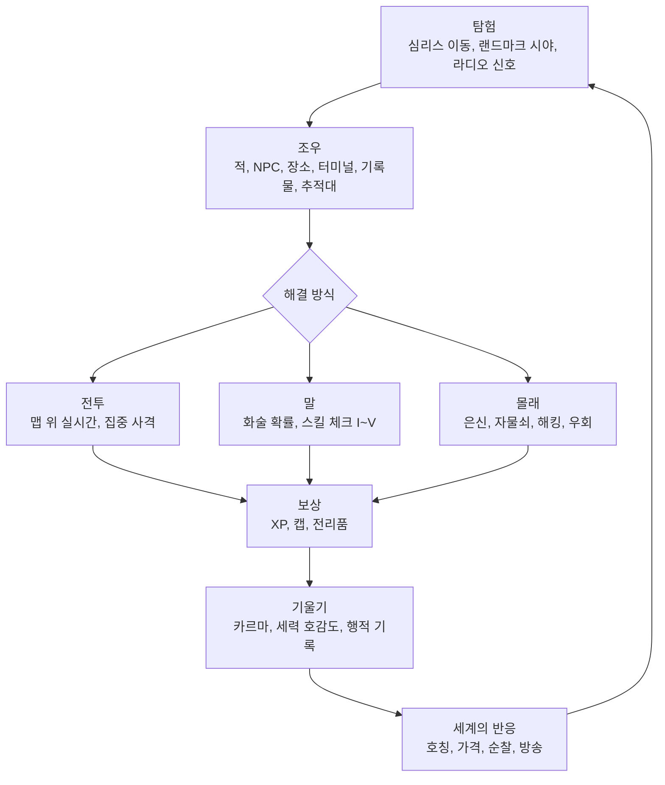
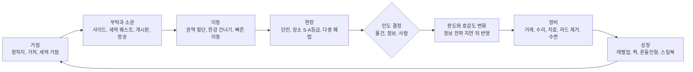
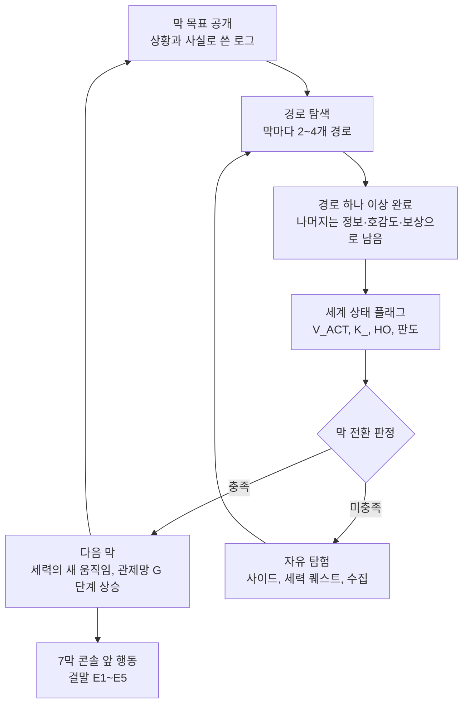
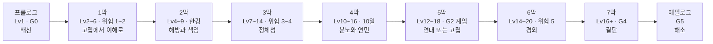
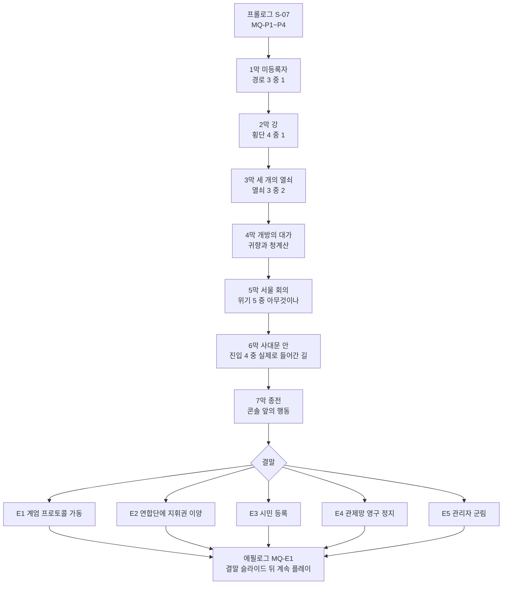
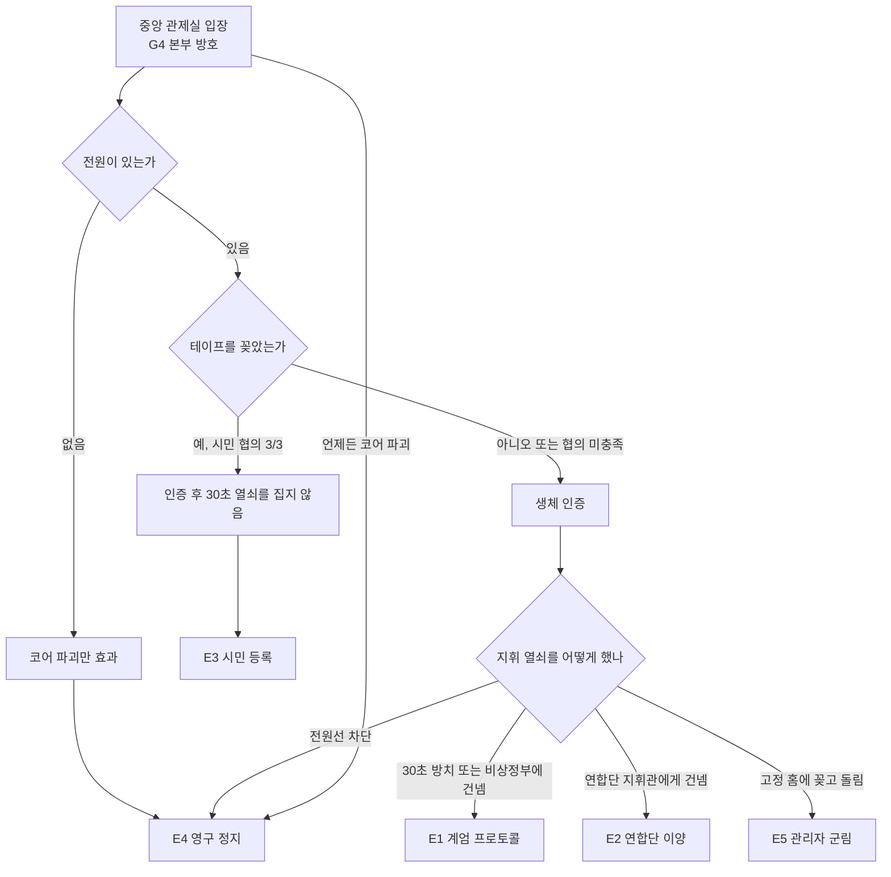
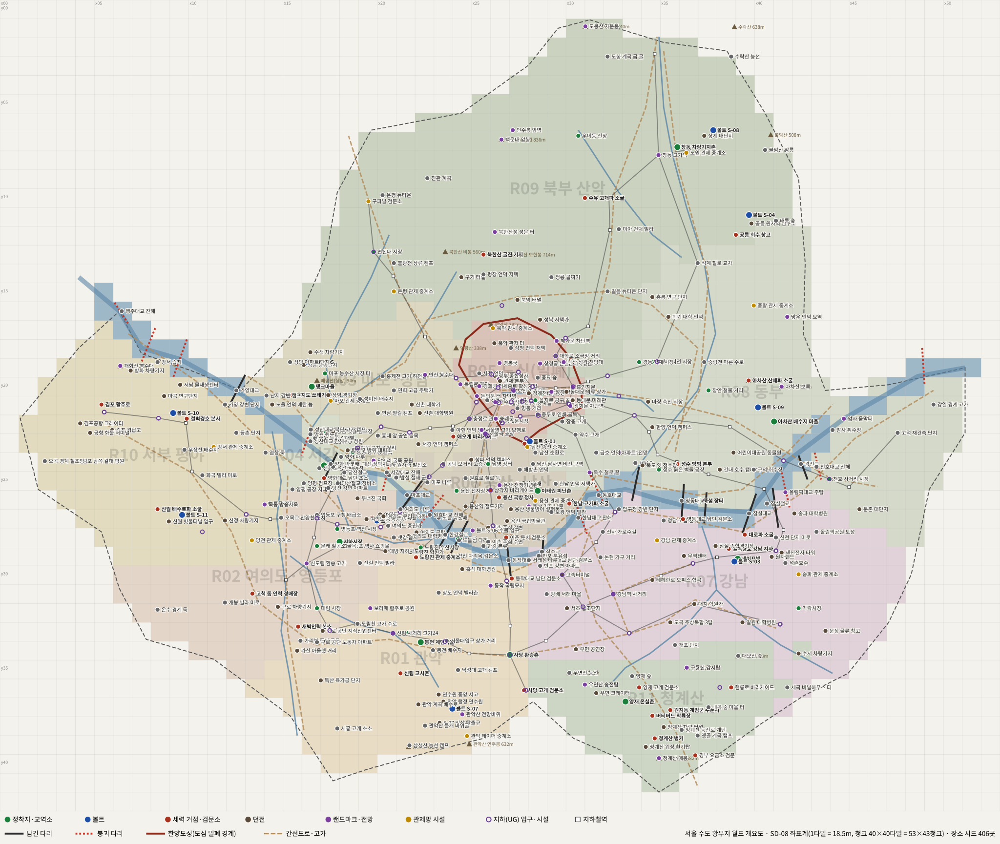

# SD-01. 게임 개요

> **서울 폴아웃 상세 기획서 세트** | 문서 ID: SD-01 | 버전: v1.1 | 작성일: 2026-10-12
> **범위**: 세트의 첫 문서. 제품 개요(가제·장르·플랫폼·엔진·비상업 팬게임·원작과의 관계·확정 제작 전제·사용자 지시), 하이 콘셉트와 엘리베이터 피치, 주제 '끝나지 않은 명령', 디자인 필러 7개와 구현 문서, 코어 루프(분·시간·막)와 플레이어 경험 곡선, 게임 구조(프롤로그~7막·에필로그, 엔딩 E1~E5, 결말 슬라이드), 시스템 요약(캐릭터·전투·탐험·호감도·경제·아이템·크리처), 월드 요약(좌표계·권역·지도), 볼륨 총괄(원작 비교), 원작 대비와 서울판 고유 특징, 제작 관점(그래픽·사운드·제작량·리스크·로드맵·사람이 정할 항목), 문서 안내(읽는 순서·정본 우선순위·ID 체계), 권리 표기. **다루지 않는 것**: 각 시스템·퀘스트·장소의 상세 수치와 문안(각 정본 문서). 이 문서는 요약과 안내만 하고, 수치가 다르면 정본 문서가 이긴다(§12.3).
> **관련 문서**: [SC-00 컨셉](00_concept.md), [SD-02 세계관](02_world-and-lore.md), [SD-03a 메인 1부](03a_main-story-part1.md), [SD-03b 메인 2부](03b_main-story-part2.md), [SD-04a](04a_side-quests-south.md)·[04b](04b_side-quests-west-river.md)·[04c](04c_side-quests-north-east-center.md) 사이드, [SD-04d 세력 퀘스트](04d_faction-questlines.md), [SD-05 기타 퀘스트·인카운터](05_misc-quests-encounters.md), [SD-06 세력](06_factions.md), [SD-07a 주요 인물](07a_characters-major.md), [SD-07b NPC](07b_npc-directory.md), [SD-08 월드·권역](08_world-regions.md), [SD-09a~f 장소](09a_locations-r01-r02.md), [SD-10 캐릭터](10_character-system.md), [SD-11 전투](11_combat-system.md), [SD-12 탐험·UI](12_exploration-ui.md), [SD-13 아이템](13_items.md), [SD-14 크리처](14_creatures-enemies.md), [SD-15 경제](15_economy.md), [SD-16 아트](16_art-direction.md), [SD-17 사운드](17_sound.md), [SD-18 용어](18_naming-terms.md), [SD-19 개발 로드맵](19_dev-roadmap.md)
> **근거 자료**: 원작 [RD-01 게임 개요](../reverse-design/01_game-overview.md), [RD-27 이식 시사점](../reverse-design/27_adaptation-notes.md), 지도 [maps/](maps/locations.csv)

---

## 목차

0. 한 장 요약
1. 문서 개요
2. 제품 개요
3. 하이 콘셉트
4. 디자인 필러
5. 코어 루프와 플레이어 경험 곡선
6. 게임 구조
7. 시스템 요약
8. 월드 요약
9. 볼륨 총괄
10. 원작 대비와 서울판 고유 특징
11. 제작 관점
12. 문서 안내
13. 미결 사항
14. 권리 표기
- 부록 A. 신규 고유명사
- 부록 B. 참고 문서
- 버전 이력

---

## 0. 한 장 요약

> **2277년 서울. 200년 전에 내려진 전쟁의 명령이 아직도 도시를 움직인다. 관악산 아래 볼트에서 자란 주인공은 잠든 '수도 관제망'을 깨울 단 하나의 열쇠로 지목돼 쫓기고, 마지막에 이 도시의 전쟁을 끝낼지, 누구에게 넘길지를 결정한다.** ([바이블 §1](00_concept.md))

| 질문 | 답 |
|---|---|
| 무엇인가 | 실제 서울을 무대로 한 **폴아웃 3 방식의 오픈월드 RPG**. 비상업 팬게임 |
| 언제·어디 | 폴아웃 세계의 2077-10-23 대전쟁 200년 뒤, **2277-10-23** 서울(서울 수도 황무지) |
| 누구 | 볼트 S-07(관악)에서 자란 등록번호 S07-2258-0031. 관제망의 **등록 관리자**로 지목돼 모두가 쫓는 사람 |
| 무엇을 하나 | 관제망의 세 조건(전원·본부·관리자)을 둘러싸고 세력들 사이를 오가며, 결국 광화문 지하 관제 본부의 콘솔 앞에서 **행동으로** 결말을 정한다 |
| 어떻게 보이나 | 쯔꾸르 RPG 스타일의 3/4 탑다운 2D 도트(32px 타일), **외부 심리스 오픈월드**, **맵 위 실시간 전투**, 입은 장비대로 바뀌는 주인공 외형 |
| 어디서 하나 | **PC(Windows 우선) + 모바일(Android·iOS).** 엔진은 범용 2D 엔진(기본값 Godot 4.x). 모바일은 터치 트윈 스틱 조작 |
| 원작과 같은 것 | 볼트 프롤로그(캐릭터 생성), S.P.E.C.I.A.L.·스킬 13·퍽·카르마, 다중 해법 퀘스트, 스킬·화술 체크, 결말 슬라이드, 라디오 |
| 원작과 다른 것 | 줄거리 전체(부모 추적·정화 계획 없음), 세력(브라더후드·엔클레이브 없음), **세력별 호감도와 '서울의 판도'**, 7막 다중 경로, **동료 없음**, V.A.T.S. 1차 제외, 음성 없음, 라디오에 음악 없음(텍스트 방송) |
| 핵심 원칙 | **고르지 않고 기운다.** 진영·동맹·결말을 메뉴로 묻지 않는다. 한 일이 쌓여 세계가 기운다 |
| 규모 | 메인 40 · 사이드 75 · 세력 퀘스트 69 · 비표시 124 · 반복 55 · 랜덤 인카운터 157 · 장소 425 · 이름 있는 NPC 738(대화 735) |
| 다음 할 일 | **기술 시험판**(Godot 4, PC·모바일 실기 측정) → **버티컬 슬라이스(프롤로그 + MQ-101)** ([SD-19](19_dev-roadmap.md), §11.5) |

---

## 1. 문서 개요

### 1.1 목적
- 세트를 처음 여는 사람이 **이 문서 하나로 게임 전체를 이해**하고, 필요한 상세 문서로 바로 찾아가게 한다.
- 27개 상세 문서(SD-02~18, 03a·03b, 04a~d, 07a·b, 09a~f)에 흩어진 핵심 결정과 수치를 한곳에 모은다. 새 결정은 하지 않는다. **세트 전체 로드맵**은 v1.0에서 이 문서가 정했으나 v1.1부터 [SD-19 개발 로드맵](19_dev-roadmap.md)이 정본이고, 이 문서 §11.5는 요약만 둔다.
- 원작 [RD-01](../reverse-design/01_game-overview.md)의 구성(제품 정보 → 정체성 → 필러 → 코어 루프 → 구조 → 볼륨 → 설계 분석 → 이식 메모)을 따르되, 팬게임 본기획에 맞게 '제작 관점'과 '문서 안내'를 더했다.

### 1.2 이 문서와 바이블의 관계
- 바이블 [SC-00](00_concept.md) v1.0은 §9 끝에 "SD-01은 만들지 않았다. 컨셉·필러·볼륨은 이 문서가, 코어 루프와 시스템 개요는 SD-10~12가 맡는다"고 적었다. 이 문서는 그 역할을 **안내 문서로 다시 묶은 것**이다. 컨셉·볼륨의 정본은 여전히 바이블이고, 이 문서는 요약이다(바이블 §9 비고 한 줄 수정 필요, §13 U-01).
- 수치 기준: 바이블 §11 '볼륨 실적'과 각 문서 v1.1 머리말·총괄표. 어긋나면 바이블 값을 쓰고 차이를 적는다. 예외로 이름 있는 NPC 대화 가능 인원은 **07b v1.1 최신값 735명**을 쓴다(바이블 v1.0 집계 734명 + 지온 N-R11-505 추가, §9.1 주석).

### 1.3 표기 메모
- 원작 용어는 [RD-26 용어집](../reverse-design/26_glossary.md)의 한글 패치 표기(핍-보이, 볼트-텍, 캡, 스팀팩, 라드어웨이, 야생 구울, 파워 아머, 버티버드, S.P.E.C.I.A.L., V.A.T.S.)를 쓴다.
- 고정 명칭은 [바이블 §11](00_concept.md)을 그대로 쓴다. 세력 약호(BJ·YH·WP·SB·JG·JH·GS·JC·NJ·KD)는 [SD-06 §2.2](06_factions.md) 정본이다.
- '정본'은 해당 수치·문안을 결정하는 문서다. 이 문서가 인용한 값이 정본과 다르면 정본이 이긴다.
- `(미확인)`·`†` 표시는 조사 자료가 검증하지 않은 사실이다. 이 문서는 사실 주장 대신 '게임 속 설정'으로 쓴다.

---

## 2. 제품 개요

### 2.1 제품 정보표

| 항목 | 내용 | 근거 |
|---|---|---|
| 제목 | **서울 폴아웃**(가제). 부제 미정. 후보: '수도 황무지', '종전'. 'Fallout' 표기를 정식 제목에 넣을지는 IP 판단(H-03)과 함께 정한다 | §13 U-02 |
| 장르 | 오픈월드 롤플레잉. 탑다운 2D, 실시간 맵 전투, 선택과 결과 중심 서사 | P1·P6·P7 |
| 시점·그래픽 | 쯔꾸르 RPG 스타일 3/4 탑다운(스타일만 쓰고 엔진은 쯔꾸르가 아니다), 32×32px 타일, 내부 해상도 640×360(정수 배율 출력, 화면 비율에 따라 최대 854×480로 확장), 8방향 도트 캐릭터 | [SD-16 §3](16_art-direction.md) |
| 플랫폼 | **PC(Windows 우선, macOS·Linux 가능) + 모바일(Android·iOS) 모두 플레이 가능**(바이블 K10). PC는 마우스+키보드 기본, 게임패드 지원(오른쪽 스틱 조준, SD-11 §2.3). 모바일은 가로 고정, 터치 트윈 스틱 + 조준 보조(SD-11 §15), 터치 UI(SD-12 §17), 블루투스 패드도 지원 | [바이블 K10](00_concept.md), §2.5 |
| 엔진 | **범용 2D 엔진, 기본값 Godot 4.x**(바이블 K9, H-04 결정). MIT 라이선스·로열티 없음, 2D 타일맵·픽셀 스냅·정수 배율, Windows·macOS·Linux·Android·iOS·웹 내보내기, 텍스트 기반 씬·리소스. 쯔꾸르 MZ·플러그인은 쓰지 않는다. 기존 문서의 변수·스위치 대역은 저장 데이터 키로 읽는다(§2.5) | [바이블 K9](00_concept.md), [SD-11 §14](11_combat-system.md) |
| 언어 | 한국어 단일. 한글 도트 폰트 12px·16px, 조사 제어 코드 `\J[...]` | [SD-12 §14](12_exploration-ui.md) |
| 음성 | **없음.** 대사는 텍스트 + 얼굴 그래픽(96×96). BGM·효과음 있음 | P3·P11 |
| 성격 | **비상업 팬게임.** 판매·후원 보상·광고 수익 없음. 원작 리소스(이미지·음성·음악·대사 원문)를 추출해 쓰지 않는다. 그래픽은 모두 새로 그리고, 음악은 모두 오리지널 | §14, [SD-17 §1.2](17_sound.md) |
| 원작 | 폴아웃 3(베데스다 게임 스튜디오, 2008)의 시스템과 설계 패턴 | [RD-01](../reverse-design/01_game-overview.md) |
| 그래픽 제작 | Claude 전담(P2), 품질 타협 없음(P5). 분량은 콘텐츠 범위로 조절 | [SD-16 §13](16_art-direction.md) |
| 사운드 제작 | 오리지널. 외부 인력·도구 협업 전제, 약 255인일 추정(라디오 수록곡 없음, K11) | [SD-17 §8](17_sound.md) |
| 표현 수위 | 원작 수준의 폭력·약물·블랙 유머. 사지 절단·약물 표현은 옵션 순화 후보(H-06) | [SD-10 U12](10_character-system.md) |
| 게임 시작일 | **2277-10-23**(대전쟁 200주년, MQ-P4 개방의 날). 승인됨(H-08) | 바이블 §11 |

### 2.2 원작과의 관계
- **계승하는 것은 시스템과 설계 패턴이다.** S.P.E.C.I.A.L.·스킬·퍽·카르마, 볼트 프롤로그의 성장형 캐릭터 생성, 다중 해법 퀘스트, 스킬·화술 체크, 카르마 분기와 카르마 추적자, 정착지의 운명, 라디오 뉴스, 결말 슬라이드, 엔딩 뒤 계속 플레이([BS] 방식).
- **옮기지 않는 것은 줄거리다.** 부모 추적, 정화 계획, G.E.C.K., 이든의 FEV 계획, 원작 인물·장소는 없다. 사이드 퀘스트도 원작 줄거리의 '서울 리스킨'을 만들지 않는다(사용자 지시 4). SD-03b §10.2가 메인 40개 전체를 원작 줄거리와 대조해 겹치지 않음을 확인했다.
- **세력은 서울판 대응 세력이다.** 비상정부(엔클레이브 역할), 연합단(브라더후드 역할) 등 원작의 '역할'만 대응시키고 이름·역사·인물은 새로 만든다. 브라더후드 오브 스틸·엔클레이브·미국 원작 인물은 등장하지 않는다(태평양 횡단 근거 없음, 바이블 K3).
- **공식 설정과 충돌하지 않는다.** 한국은 공식 설정의 공백이다. 공백은 채우되 캐논 체크리스트 C1~C16([SR-01 §7.1](research/SR-01_fallout-canon.md))을 지킨다. 서울 볼트는 정사 번호 1~122를 피해 S-01~S-12를 쓴다.
- 이 관계 전체를 한 줄로: **"폴아웃 3의 문법으로 쓴 완전히 새 이야기."**

### 2.3 확정 제작 전제 (RD-27 §2, 2026-10-11 사용자 결정)

| # | 전제 | 서울판에서 구현된 모습 | 정본 |
|---|---|---|---|
| P1 | 쯔꾸르 RPG 스타일 그래픽·시점 | 3/4 탑다운, 32px 타일, 640×360, 인간형 키 40px(약 3.6등신), 8방향(직접 그리는 5 + 반전 3). 스타일 전제이며 엔진은 범용 2D(Godot 4, K9) | SD-16 §3 |
| P2 | 모든 그래픽 Claude 전담 | 팔레트 인덱스 격자 원본 → 합성 스크립트로 시트 굽기 → 검수 스크립트 → 손보정. 컨셉 원화 단계 없음(K11) | SD-16 §13 |
| P3 | BGM 있음, 음성 없음 | BGM 큐 135. 라디오는 음악 채널 없는 자막 띠 방송 + 징글·감정 스팅어(K11) | SD-17 |
| P4 | 구현 곤란 요소 제외 가능 | V.A.T.S. 1차 제외, 배고픔·갈증 수치 제외(하드코어는 2차), 동료 삭제(사용자 지시) | SD-11, RD-27 §5 |
| P5 | 그래픽 품질 타협 없음 | 그림 수준은 고정, 분량은 조합 체계(공용 몸·팔레트·프리팹·모듈 초상화)와 단계 범위로 조절 | SD-16 §1.2 |
| P6 | 심리스 오픈월드 | 53×43청크(40×40타일) 월드, 청크 스트리밍 | SD-08 §3.8 |
| P7 | 맵 위 실시간 전투 | 별도 전투 화면 없음. 360° 조준, 공격 자세 8계열 | SD-11 |
| P8 | V.A.T.S.는 어려우면 생략 | 1차 제외. 감성은 집중 사격·치명타 강조·은신 기습·결정타 히트스톱으로. 축약형 설계안은 선택 과제 | SD-11 §6 |
| P9 | 착용 장비에 따라 주인공 외형 변경 | 페이퍼돌 6슬롯(몸·몸통·머리카락·머리 장비·눈 장비·무기). 파워 아머는 별도 리그 | SD-16 §5, SD-13 §11 |
| P10 | 외부만 심리스, 실내는 문 전환 | 볼트·지하철·지하상가·건물·벙커는 문으로 들어간다. 도심(R05)은 지하철·특수 진입로로만 | SD-08 §9, §10 |
| P11 | 효과음 있음 | 효과음 567파일(P1 우선 334), 환경음 루프 68 | SD-17 §5 |

### 2.4 사용자 지시와 구현 위치
사용자 지시는 세트 전체의 상위 규칙이다. 지시마다 어디서 어떻게 구현했는지를 적는다.

| # | 사용자 지시 | 구현 | 대표 문서 |
|---|---|---|---|
| 1 | **현실 기반**: 설화·요괴·신화를 쓰지 않는다. 실제 생물·공간·사회 구조 | 크리처는 서울 실제 생물의 변이(바퀴벌레·러브버그·들개·반달곰·멧돼지·외래 거북·참게 등, SR-04 근거 수치 인용). 데스클로 대응은 미군 생물병기 HK 계획 | SD-14 §2.1, 바이블 §7 |
| 2 | **2077년 한국**이 전쟁 전 시점(2077-10-23 대전쟁) | 1945년까지 현실, 이후 '정전 상태로 갈라진 미국 동맹 원자력·로봇 국가'. 2063 북쪽 병합, 2075 비상 주민 분류 지침, 2077-09 관제망 가동, 23:29 정전 | SD-02 §3 |
| 3 | 1950~70년대 한국 레트로 최소화 | 꾸밈은 아파트 단지·학원가·편의점·지하상가·배달 로봇·진공관 터미널·원자력 차량. 음악에서도 트로트·그룹사운드를 쓰지 않는다 | SD-16 §2, SD-17 §1.2 |
| 4 | **게임 시작은 2277년** | 2277-10-23 MQ-P4 개방의 날. 주인공 출생 2258-03-02 | SD-03a §7 |
| 5 | **메인은 원작과 완전히 다른 새 구조** | 쫓는 주인공 대신 쫓기는 주인공, 물 대신 도시의 지휘권, 선형 17개 대신 7막 40개 다중 경로 | SD-03a §2, SD-03b §10.2 |
| 6 | **서울판 세력** | 18개 세력(F-01~F-18), 호감도 대상 10개. 원작 세력은 역할만 대응 | SD-06 §2 |
| 7 | **서울 전역 압축** | 실제 위경도 → 월드 타일 변환식, 1타일 = 18.5m(거리 압축 약 12.3배), 서울 동서 직선 약 8분 20초 | SD-08 §3 |
| 8 | **프롤로그 + 7막 + 에필로그, 자유도** | 월드는 프롤로그 직후 전부 개방, 순서 파괴 허용, 메인 진행 잠금 없음, 최후 대체 경로 '단독' | SD-03a §3, §6 |
| 9 | **세력별 호감도**(-100~+100, 6단계), 카르마와 병행 | 적대·경계·중립·우호·신뢰·동맹. 연동 계수·히스테리시스·회복 수단. 서울의 판도 | SD-06 §3~5 |
| 10 | **동료 시스템 없음** | 동료 영입·AI·명령·퍽·슬라이드 없음. 대체: 퀘스트 중 일시 동행 NPC, '신뢰' 이상 세력의 지원 병력 호출(신뢰 2명·동맹 4명) | SD-06, SD-11 §8, SD-12 §11.4 |
| 11 | **고르지 않고 기운다** | 진영 선택 화면·'어느 편에 서겠습니까' 질문 없음. 인도처(HO) 기록, 정보 전파, 판도, 결말은 콘솔 앞 행동. 호감도 수치는 숨기고 세계의 반응으로 보여 준다 | 바이블 §5.8, SD-06 §4, SD-12 §3.10 |
| 12 | **대규모 볼륨**, 실제 좌표 기반 맵 | 장소 425(목표 250+), 사이드 75(60+), NPC 735(500+), 랜덤 인카운터 157(100+). 모든 장소에 월드 좌표 | §9, SD-08 §11 |
| 13 | **실존 인물 확인은 하지 않는다**(2026-10-12) | 포털 확인 생략. 작성자 지식 검사로 바꾼 이름은 그대로 쓴다(H-01 종결) | 바이블 K11, §11.6 |
| 14 | **엔진은 범용 2D 엔진**(2026-10-12) | 기본값 Godot 4.x. 쯔꾸르 스타일은 유지 | 바이블 K9, §2.5 |
| 15 | **모바일로도 플레이 가능**(2026-10-12) | Android·iOS 터치 조작, 화면 비율 확장, 모바일 성능 예산, 중단 저장 | SD-11 §15, SD-12 §17, SD-16 §3.3, SD-17 §7.8 |
| 16 | **라디오 곡·크리처 원화는 필요 없다**(2026-10-12) | 라디오 수록곡·가상 가수·보컬 삭제, 텍스트 방송 + 징글. 크리처는 컨셉 원화 없이 스프라이트로 | SD-17 §4.7, SD-14 §14.1 |

### 2.5 엔진·플랫폼·범위 결정 (2026-10-12, 바이블 K9~K11)
> 사용자 결정 원문: "실존 인물 확인은 할 필요 없어. 엔진은 범용 2D엔진. 모바일로도 플레이 가능해야 해. 라디오 곡이나 크리처 원화 같은 건 필요없어."

| # | 결정 | 내용 | 반영 문서 |
|---|---|---|---|
| K9 | 엔진 | 범용 2D 엔진, 기본값 **Godot 4.x**(MIT 라이선스·로열티 없음, 2D 타일맵·픽셀 스냅·정수 배율, Windows·macOS·Linux·Android·iOS·웹 내보내기, 텍스트 기반 씬·리소스라 데이터를 스크립트로 생성하기 좋다). 쯔꾸르 MZ와 플러그인은 쓰지 않는다. 쯔꾸르 RPG **스타일**(3/4 탑다운 시점·도트 그림체)과 에셋 규격(32px 타일, 640×360, 64×64 프레임)은 그대로다 | SD-11 §14, SD-12 §16, SD-16 §3·§15, SD-17 §7.1·§10 |
| K10 | 플랫폼 | PC(Windows 우선) + 모바일(Android·iOS) 모두 플레이 가능. 가로 고정, 터치 트윈 스틱 + 조준 보조, 최소 터치 영역 40px, 화면 비율에 따라 시야 확장(상한 854×480), 모바일 동시 교전 28명, 중단 저장 | SD-11 §15, SD-12 §17, SD-16 §3.3, SD-17 §7.8 |
| K11 | 범위 조정 | 실존 인물 동명 확인 생략(H-01 종결) / 라디오 수록곡·가상 가수·보컬 제작 없음, 라디오는 텍스트 방송 + 징글 / 크리처 컨셉 원화 없음, 스프라이트로 바로 제작 | SD-17 §2.5·§4.7, SD-14 §14.1, SD-16 §7.3·§13.2 |

**기존 문서 용어 읽는 법 (엔진 결정 뒤)**: 여러 문서의 '쯔꾸르 제작 메모'는 엔진 결정 전에 쓴 구현 메모다. 아래처럼 읽는다. 각 문서의 제작 메모 절 제목은 '제작 메모(엔진: 범용 2D)'로 바꿨다.

| 기존 표기 | Godot 4 기준으로 읽는 법 |
|---|---|
| 변수·스위치 번호 대역(V0001~, S0001~, RECON_SPEC §3.3) | 저장 데이터의 정수·불리언 키 이름. 번호 대역은 접두어 규칙과 함께 그대로 쓴다 |
| 공통 이벤트·공용 이벤트 | 공용 스크립트 함수(전역 싱글턴) |
| 맵 이벤트·이벤트 페이지 | 맵 위 오브젝트와 그 상태별 동작 |
| 플러그인 | 엔진 기본 기능 또는 자체 스크립트 모듈 |
| 데이터베이스(아이템·적 DB) | 외부 데이터 표(CSV·JSON) → 리소스 파일(.tres) 생성 |
| `\J[...]` 등 제어 코드 | 텍스트 출력 함수의 전처리 토큰(SD-12 §14, SD-18) |

---

## 3. 하이 콘셉트

### 3.1 하이 콘셉트
> **"폴아웃 3의 수도 황무지가 서울이었다면."** 원작의 무대 Capital Wasteland는 한글 패치에서 '수도 황무지'로 옮겨졌다. 서울은 말 그대로 한국의 수도다. 이름 하나로 원작과 서울판이 이어진다.

- **무대**: 실제 서울(약 605㎢)을 압축한 심리스 월드. 한강이 맵을 남북으로 가르고, 한양도성 안 도심은 밀폐됐다.
- **장치**: 2077년 세진전자가 깐 전시 치안 체계 **수도 관제망**. 서울 전역의 경비 로봇·포탑·차단벽·대피소 문·방송망을 광화문 지하 관제 본부의 진공관 중앙 컴퓨터가 지휘한다. 대전쟁 8분 전 '계엄 프로토콜 전면 집행'에 들어간 직후 전원이 끊겨 200년째 대기 중이다.
- **열쇠**: 관제망은 살아 있는 '등록 관리자'의 생체 인증으로만 명령을 받는다. 2077년 관리자는 모두 죽었고, 대비책으로 연결해 둔 볼트 S-07 출생 등록 계보에서 뽑힌 2277년의 관리자가 **주인공**이다.
- **갈등**: 관제망이 켜지면 기본값 '비상 주민 분류 지침'대로 볼트 밖의 거의 모든 서울 사람이 '적성 분자'가 된다. 비상정부는 이것을 바라고, 연합단은 로봇 군대를 원하고, 각성회는 구원을 기다리고, 중국군 잔존병은 본부를 파괴하라는 200년 묵은 명령을 아직 수행 중이다.

### 3.2 엘리베이터 피치

**30초판**
> 관악산 아래 볼트에서 시험 성적으로 모든 것이 정해지는 사회를 살던 당신은, 200년 만에 문이 열린 날 계엄군에게 '인도 대상'이 된다. 당신의 출생 등록이 서울 전체의 로봇 군대를 깨우는 관리자 인증이었기 때문이다. 정부 잔당, 기술 군단, 구울 시장, 신앙 공동체, 인신매매단이 모두 당신을 쫓는다. 한강을 건너고, 원자로를 켜거나 터뜨리고, 초고층 타워 꼭대기에서 설계자의 유산을 찾고, 결국 광화문 지하의 콘솔 앞에 선다. 메뉴는 없다. 당신이 그 자리에서 손을 올리는지, 열쇠를 누구에게 건네는지, 코어를 부수는지가 서울의 다음 200년이다.

**2분판(기획 회의용)**
1. **누구**: 볼트 S-07의 아이. 열여섯 살 적성 평가에서 무슨 답을 써도 '관리 후보 1순위'가 나온다.
2. **왜 쫓기나**: 2277-10-23, 볼트가 비상정부의 개방 지령에 응한다. 계엄사령관 육지환이 2077년의 서류를 읽어 '등록 관리자 인도'를 요구하고, 어머니 윤정인은 주민 전원의 시민권과 자식을 맞바꾸려 한다. 탈출 방법은 넷(전투·은신·설득·친구 하도윤).
3. **무엇을 하나**: 1막에서 '관리자 코드'의 정체를 알고, 2막에서 한강을 건너 세력들과 만나고, 3막에서 관제망의 세 열쇠(전원·프로토콜·길) 중 둘의 행방을 정한다. 4막에 볼모가 된 고향과 어머니를 되찾고, 5막 계엄 속에서 누구 곁에서 싸울지가 굳어지며, 6막 밀폐된 도심으로 들어가 7막 콘솔 앞에 선다.
4. **어떻게 고르나**: 고르지 않는다. 누구의 부탁을 실제로 들어줬는지, 원자로 열쇠와 프로토콜 테이프를 누구 손에 두고 떠났는지, 누구와 싸웠는지가 쌓여 세력들의 태도와 '서울의 판도'가 기운다. 콘솔실에 누가 곁에 와 있는지도 그 결과다.
5. **결말 다섯**: E1 계엄 가동 / E2 연합단에 지휘권 / E3 시민 등록 / E4 영구 정지(종전) / E5 관리자 군림. 결과는 남산 송신탑을 타고 '종전' 방송으로 서울 전역에 나간다. 그 뒤 바뀐 서울에서 계속 산다.
6. **왜 지금 이것인가**: 폴아웃 3의 구조(볼트 프롤로그, 오픈월드, 카르마, 결말 슬라이드)를 한국 플레이어가 매일 보는 공간(아파트 단지, 지하철, 학원가, 편의점, 한강 다리) 위에서 다시 경험한다. 원작이 '1950년대 미국이 상상한 원자력 미래'라면 서울판은 '원자력과 진공관으로 2077년까지 달려온 한국'이다.

### 3.3 주제: 끝나지 않은 명령
- 한국전쟁은 1953년에 '정전'했을 뿐 끝나지 않았다. 폴아웃 세계에서는 그 위에 2077년 대전쟁이 겹친다. 2277년의 서울에는 **200년 전 명령을 아직도 따르는 것들**이 있다.
- 원작의 "전쟁은… 변하지 않는다"에 대한 응답: **"명령은 끝나지 않는다. 누군가 끝내기 전까지는."** 오프닝 자막과 맺음 슬라이드(ES-32)에서 수미상관으로 쓴다.

| 명령을 따르는 자 | 끝나지 않은 명령 | 주인공이 마주하는 막 |
|---|---|---|
| 볼트 S-07 | "시험을 치르라, 관리자를 길러라" | 프롤로그, 4막 |
| 새벽인력·계엄군 수색대 | "장부의 빚은 사람으로 받는다", "관리자를 인도하라" | 1막 |
| 연합단 | "기지를 지켜라(HOLD THE BASE)" | 2막, 5막 |
| 중국군 잔존병(멍쉐밍 상위) | "관제 본부를 파괴하라. 철수 명령 전까지 대기" | 3막, 6막 |
| 비상정부(권한대행 남궁혁) | "지침을 집행하라" | 4막 |
| 관제망 로봇 | 2077-10-23 23:21 계엄 프로토콜(주인 없이도 집행) | 5막 |
| 도심 자체 | 23:29에 멈춘 시계와 '대기 구역' 노란 선 | 6막 |
| 관제망 전체 | 관리자에게 넘겨지는 모든 명령권 | 7막 |

- **반복 모티프는 문**이다. 볼트 문(프롤로그) → 벙커 문(1막) → 다리와 수문(2막) → 차단벽(3·6막) → 볼트 문 재방문(4막) → 판독기 개찰구(5막) → 콘솔 화면 속 적성 평가 10번 문항 '문을 열고 밖을 본다'(7막). 마지막 선택은 결국 어떤 문을 여느냐다([SD-03a §2.3](03a_main-story-part1.md)).
- 마지막 퀘스트의 이름은 **〈종전〉**이다. 2076년 반전 운동 '종전 행진'의 구호 "정전 123년, 이제는 종전을"([SD-02 §4.5](02_world-and-lore.md))이 7막과 E4로 이어진다.

### 3.4 플레이어가 기억할 순간 (핵심 경험)
원작 RD-01 §7.3의 '핵심 경험'에 대응한다. 버티컬 슬라이스와 각 단계의 품질 기준이 된다.

| # | 순간 | 막 | 원작 대응 |
|---|---|---|---|
| 1 | **처음 본 서울**: 배수 갱도를 빠져나와 관악산 비탈에서 남산 송신탑·한강·무너진 아파트 숲을 내려다본다(ME-11, 키 아트) | 프롤로그 | 볼트 101 문이 열리는 순간 |
| 2 | **서류로 태어나기**: 출생신고서 → 생활기록부 → 적성 평가 → 전출 신고서로 캐릭터를 만든다. 적성 평가 결과는 언제나 '관리 후보 1순위' | 프롤로그 | 출생~G.O.A.T. |
| 3 | **현상금 방송을 듣는 밤**: 공보방송이 내 얼굴에 현상금을 걸고, 봉천 마을 사람들의 호칭이 내 행동에 따라 바뀐다 | 1막 | 메가톤의 선택 |
| 4 | **한강을 건넌다**: 다리마다 주인이 다르고, 건너는 방법이 넷이다 | 2막 | (서울판 고유) |
| 5 | **누구 손에 두고 떠나는가**: 원자로 제어실 열쇠, 프로토콜 테이프. 선택지 대신 내 손의 물건이 판도를 바꾼다 | 3막 | 원자의 힘(핵폭탄) |
| 6 | **"네 집안이었다"**: 세진 타워 101층에서 설계자 한유리와 주인공의 핏줄이 드러난다 | 3막 | (서울판 고유) |
| 7 | **73,000일의 근무일지**: 200년째 철수 명령을 기다린 중국군 잔존병에게 전쟁이 끝났음을 증명한다 | 3막 | 중국군 잔존병(공격 대상) |
| 8 | **점령된 고향**: '오버시어님께 감사합니다' 표어에 그어진 붉은 줄 | 4막 | (볼트 101 재방문 확장) |
| 9 | **집결지에 누가 왔는가**: 도심 진입 날, 내가 곁에서 싸운 세력만 나타난다. 아무도 오지 않으면 혼자 간다 | 5→6막 | 리버티 프라임 진군 |
| 10 | **콘솔 앞의 30초**: 결정 메뉴 없이, 손을 올리고, 열쇠를 집거나 놓고, 코어를 부순다. 곁의 세력이 막거나 재촉한다 | 7막 | 정화기 가동 |
| 11 | **종전 방송**: 결말이 남산 송신탑을 타고 서울 전역 가두 스피커로 나간다. E4라면 200년 만에 모든 확성기가 '딸깍' 꺼진다 | 7막 | 엔딩 내레이션 |

### 3.5 톤
- **폴아웃의 블랙 유머를 2077년 한국 소비 사회에 적용한다.** 아파트 분양 광고("지하 3층 개인 대피실 완비 — 청약 경쟁률 777:1"), 입시 학원("적성 평가 D-100, 합격의 원자 공식"), 재벌 홍보, 배달 로봇, 주민등록 공문, 충성 등급([SD-16 §11.3](16_art-direction.md)).
- **선전은 풍자 대상**이다. 반중 선전은 원작처럼 '시대의 광기'로 그리고, 특정 국가·민족을 비하하지 않는다. 중국군 잔존병은 '명령에 갇힌 병사'다. 북쪽은 현실 북한 정권이 아니라 '북방 병합지'다.
- **환경 스토리텔링**: 대피소로 지정됐던 지하철역의 해골, 분양 광고판 앞 행렬, 학원 교실의 시험지, 충성 등급이 찍힌 주민등록증, 23:29에 멈춘 시계. 기록물 LR-01~109([SD-02 §10](02_world-and-lore.md)).
- **한국어 텍스트 문화**: 간판 숲, 공문체 터미널, 안내 방송 자막, 세력별 말투([SD-18](18_naming-terms.md)).

---
## 4. 디자인 필러

필러는 '무엇을 만들고 무엇을 만들지 않을지'를 정하는 기준이다. 새 콘텐츠를 넣을 때 아래 7개 중 하나 이상을 강화하지 않으면 넣지 않는다. 원작 RD-01 §7.2의 10개 필러 가운데 S.P.E.C.I.A.L.·블랙 유머·환경 스토리텔링·라디오는 필러 6·7에 흡수했고, V.A.T.S.는 P8에 따라 필러에서 뺐으며, '생존과 물'·'부자 관계'는 서울판의 새 이야기로 바꿨다.

### 4.1 필러 총괄

| # | 필러 | 한 줄 정의 | 이것이 아니다 |
|---|---|---|---|
| F1 | **고르지 않고 기운다** | 진영·동맹·결말은 플레이어가 한 일의 누적으로 정해진다 | '어느 편에 서겠습니까?' 메뉴, 호감도 숫자 팝업, 퍽으로 진영 고르기 |
| F2 | **모두가 쫓는 사람** | 주인공은 무언가를 쫓지 않고 쫓긴다. 세계가 먼저 주인공에게 다가온다 | 퀘스트 주는 사람을 찾아다니는 수동적 구조 |
| F3 | **끝나지 않은 명령** | 주제가 시스템이 된다. 200년 묵은 명령이 로봇·방송·문·서류로 플레이에 개입한다 | 주제를 대사로만 말하기 |
| F4 | **진짜 서울을 걷는다** | 실제 좌표·지형·랜드마크 위의 심리스 월드. 한강과 도심 밀폐가 탐험 과제다 | 이름만 서울인 가상 지도 |
| F5 | **열린 막, 막히지 않는 길** | 7막 각각 목표 하나와 경로 여럿. 순서 파괴 허용, 메인은 절대 막히지 않는다 | 지역 잠금, 필수 NPC 사망으로 인한 진행 불가 |
| F6 | **2077년 폴아웃의 한국** | 원자력·진공관·로봇의 폴아웃 기술로 그린 한국 도시 생활과 블랙 유머 | 1950~70년대 복고 풍속, 설화·요괴, 실존 기업·인물 |
| F7 | **입은 대로 보이고, 맵 위에서 싸운다** | 탑다운 실시간 전투와 페이퍼돌 외형. 캐릭터 수치가 결과를 정한다 | 별도 전투 화면, 순수 반응 속도 액션 |

### 4.2 필러별 구현

| 필러 | 구현하는 시스템 | 구현하는 콘텐츠 | 대표 수치 | 상세 문서 |
|---|---|---|---|---|
| **F1 고르지 않고 기운다** | 세력 호감도 10개(-100~+100, 6단계, 히스테리시스·연동 계수), 서울의 판도(판도 구역 54 + 거점 24), 인도처 코드 HO(무엇을 누구 손에 넘겼나), 정보 전파(소문·방송·목격자), 서술형 세력 탭, 가격 공식의 호감도 배수 | MQ-207 손을 내미는 자들, 3막 열쇠 현장 협력자, MQ-502 서울 회의(투표 없음), MQ-508 집결, MQ-702 콘솔 행동, 결말 슬라이드 세력 꼬리, 라디오 행적·판도 뉴스 약 280편 | 단계 경계 ±20·50·80, 세력 비기 8종은 '동맹' 도달 시 자동 습득 | [SD-06 §3~7](06_factions.md), [SD-03a §4.5·§4.6·§5](03a_main-story-part1.md), [SD-12 §3.10](12_exploration-ui.md), [SD-15 §3.3](15_economy.md), [SD-17 §4.8](17_sound.md) |
| **F2 모두가 쫓는 사람** | 수배도 `V_WANTED`(현상금), 등록 카드 단계 `V_REGCARD` 0~5, 추적대(세력 11종 편성, 빈도표), 생포 이벤트(게임 오버 대체), 관리자 판정(관제망이 주인공을 보는 법) | MQ-105 현상금의 주인, MQ-106 첫 번째 추적자, MQ-207 각 세력의 접근, 계엄군 인도 분대, 새벽인력 추심원 독사, 랜덤 인카운터 '추적대' 군 | 현상금 500·1,500·3,000(처단 5,000) | [SD-03a §6.5·§6.7](03a_main-story-part1.md), [SD-05](05_misc-quests-encounters.md), [SD-14 §9.13](14_creatures-enemies.md), [SD-15 §5](15_economy.md) |
| **F3 끝나지 않은 명령** | 관제망 각성 단계 G0~G5(`V_GSTAGE`), 관제망 색 코드(대기 앰버·계엄 적·시민 보호 청록·정지 소등), 관제망 4음 차임(LM-01), `[관리자 인증]` 판정, 2077년 충성 등급 1~5와 적성 분자 판독 | 기록물 LR-01~109, 23:29에 멈춘 시계, 멍쉐밍의 근무일지, 남궁혁의 서명, 공보방송 연설 10편, '종전' 방송 5판 | G 단계 6개, 관제망 로봇 30개 행 | [SD-02 §4~§10](02_world-and-lore.md), [SD-14 §8](14_creatures-enemies.md), [SD-16 §1.2](16_art-direction.md), [SD-17 §1.2](17_sound.md) |
| **F4 진짜 서울을 걷는다** | 위경도 → 타일 변환식, 청크 40×40 스트리밍, 기준점 좌표표(산·랜드마크·다리·역 102곳), 랜드마크 시야와 길잡이, 한강 횡단 규칙(다리·하저 터널·나룻배·수영), 도심 밀폐, 위협도 1~5·방사능 Z1~Z5 | 장소 425곳(S 34·A 99·B 203·C 89), 한강 횡단로 15개, 지하철 1~5호선 던전 구간 20, 권역 11 + UG + HR | 1타일 = 18.5m, 월드 2,120×1,720타일 | [SD-08](08_world-regions.md), [SD-09a~f](09a_locations-r01-r02.md), [maps/](maps/locations.csv) |
| **F5 열린 막, 막히지 않는 길** | 막 전환 판정 `V_ACT`(세계 상태 플래그), 지식 플래그 K_, 순서 파괴 시 퀘스트 갱신 규칙, 핵심 NPC 사망 시 대체 경로, 시간 경과로 닫는 규칙(필수 퀘스트도 실패하지 않고 닫힘) | 1막 경로 3, 2막 횡단 4, 3막 열쇠 3 중 2, 6막 진입 4, 최후 대체 '단독' 경로 | 메인 40, 1회차 필수 22 | [SD-03a §3·§4·§6](03a_main-story-part1.md) |
| **F6 2077년 폴아웃의 한국** | 가상 재벌 4곳의 디자인 언어, 실명 가상화 규칙, 세진 로봇 제품명 체계, 간판 글자 세트, 세력별 말투 | 태성그룹·세진전자·한결건설(세이프빌, 든든이)·청솔식품(번개사이다, 번개24, 한끼), 학원가·아파트 단지·지하상가 장소군, 라디오 방송 문안(진행 멘트·생활 정보·낭독 연속극), 든든이 입주 기념 흔들인형 20종, 2077년 한국 출판물 스킬북 13종 | 칭호 105종, 퍽 신규 31종(한국 생활·제도 24 + 호감도 연동 7) | [SD-02 §5](02_world-and-lore.md), [SD-16 §2·§11](16_art-direction.md), [SD-18](18_naming-terms.md), [SD-10 §5·§7](10_character-system.md) |
| **F7 입은 대로 보이고, 맵 위에서 싸운다** | 실시간 맵 전투(원작 피해식 `Dmg × (100+스킬)/200 × 상태`), AP 실시간 자원(질주·회피·집중 사격·파워 공격), 무작위 부위 판정, 내구도 5단계, 공격 자세 8계열, 페이퍼돌 6슬롯, 세력 복장 변장 | 무기 104(외형 53), 방어구 105(몸통 실루엣 15 + 파워 아머 리그 2), 크리처·적 DB 약 240행, 보스 29 | 인간형 모션 방향당 135프레임, TTK 약 1~2초 / 중 3~6초 / 강 7~15초 | [SD-11](11_combat-system.md), [SD-13](13_items.md), [SD-14](14_creatures-enemies.md), [SD-16 §3·§5](16_art-direction.md) |

### 4.3 필러 충돌 시 우선순위
필러끼리 부딪히면 아래 순서로 판단한다.

1. **F1 > F5**: 자유도(순서 파괴)를 위해 '기울기'를 무시하는 지름길을 만들지 않는다. 예: 3막을 건너뛰어도 열쇠를 '누구 손에 두었는가'의 기록(HO)은 반드시 남긴다.
2. **F5 > F2**: 추적이 메인 진행을 막으면 안 된다. 생포는 게임 오버가 아니라 생포 이벤트로 이어진다([SD-03a §6.7](03a_main-story-part1.md)).
3. **F4 > F6**: 실제 지리와 공공 공간 실명은 지킨다. 다만 실존 기업·브랜드·부대명·초고층 실제 수치는 F6의 실명 가상화가 이긴다(세진전자 타워 101층, H-02 승인).
4. **F7은 P5와 묶인다**: 전투 표현을 늘리려고 그래픽 품질을 낮추지 않는다. 분량은 범위로 줄인다.

---

## 5. 코어 루프와 플레이어 경험 곡선

### 5.1 분 단위 루프 (조우 루프, 30초~5분)
월드를 걷다 무언가를 만나고, 세 방식 중 하나로 풀고, 보상과 기울기를 받는다. 원작 RD-01 §7.4 루프에서 V.A.T.S.를 실시간 전투로 바꾸고, **'세계의 반응'** 단계를 더했다.

- 거의 모든 성공 행동에 XP가 붙어 어떤 플레이 스타일이든 성장한다(원작 루프의 동력 계승).
- **조우 밀도**: 이동 중 판정 주기와 확률은 SD-08 §13.3, 인카운터 지점 EP 64곳과 표 교체 규칙은 [SD-05](05_misc-quests-encounters.md).

### 5.2 시간 단위 루프 (세션 루프, 30분~2시간)
정착지나 거점에서 시작해 부탁을 받고, 다녀와서, **무엇을 누구 손에 넘길지 정하고**, 돌아와 정비한다.

- 소지 무게와 내구도 5단계가 정비를 강제해 거점으로 돌아오게 한다(원작 계승, [SD-11 §11.7·§11.8](11_combat-system.md)).
- 돌아온 거점은 떠날 때와 다르다. 내가 넘긴 물건과 도운 세력에 따라 가격·인사·깃발·순찰이 바뀌어 있다(F1).
- 거처 6곳은 정착지 개별 호감도 '우호' + 문제 해결이면 대표가 먼저 열쇠를 건넨다([SD-15 §7](15_economy.md)).

### 5.3 막 단위 루프 (메타 루프, 막당 5~15시간 추정)

- 막은 '이야기 진행 단계'이지 지역 잠금이 아니다. 월드는 프롤로그 직후 전부 열린다. 흐름은 **위협도 1~5, 한강, 도심 밀폐, 방사능** 넷으로만 유도한다([SD-08 §14](08_world-regions.md)).
- 4막(10일)·5막(3/5/7일)에는 시간 경과 규칙이 있어, 미루면 결과가 나빠질 뿐 퀘스트는 반드시 닫힌다(수치는 H-07 플레이 테스트).

### 5.4 플레이어 경험 곡선

| 구간 | 권장 레벨 | 주 무대(권역·위협도) | 감정선 | 관제망 | 새로 체감하는 시스템 | 대표 퀘스트 |
|---|---|---|---|---|---|---|
| 프롤로그 「S-07」 | 1 | 볼트 S-07(R01) | 소속감 → 배신감 | G0 | 캐릭터 생성(서류 4종), 핍-보이, 전투·은신·화술 튜토리얼, 카르마 | MQ-P1~P4 |
| 1막 「미등록자」 | 2~6 | R01 관악(1), R02 여의도·영등포(2) | 고립 → 이해 | G0 | 정착지·거래, 수배도, 첫 호감도 변화(봉천 개별값), 기록물, 경로 퀘스트 | MQ-101~106 |
| 2막 「강」 | 4~9 | 한강 HR, R04(2), R06(2~3), R07(3), R08(2) | 해방 → 책임 | G0 | 한강 횡단, 판도 지도, 세력 퀘스트 라인 개방, 라디오 공개/익명 분기 | MQ-201~207 |
| 3막 「세 개의 열쇠」 | 7~14 | R03(3~4), R07 세진 타워(3~4), R09(4) | 탐구 → 정체성 | G0 → G1 | 인도처(HO), 현장 협력자, 수직 던전, 일시 동행 NPC | MQ-301~304 |
| 4막 「개방의 대가」 | 10~16 | R01 귀향, R11 청계산(4~5) | 분노와 연민 | G1 | 지원 병력 호출 본격화, 시간 제한(10일) | MQ-401~403 |
| 5막 「서울 회의」 | 12~18 | 서울 전역(깨어난 권역 위협도 +1) | 연대 또는 고립 | G2 | 계엄 하 판독, 대규모 교전(동시 40명), 서울 회의 합의 점수 | MQ-501~508 |
| 6막 「사대문 안」 | 14~20 | R05 도심(5) | 경외 | G3 | 밀폐 구역 탐사, 출입 권한 3종 수집 | MQ-601~605 |
| 7막 「종전」 | 16+ | 관제 본부(5) | 결단 | G4 → G5 | 콘솔 오브젝트 상호작용, 곁에 선 세력의 반응 | MQ-701·702 |
| 에필로그 | 자유(상한 35) | 서울 전역(결말별 상태) | 해소 또는 서늘함 | G5 | 결말별 월드, 후일담 14, E5 지휘 모드 | MQ-E1 |

- **R10 서부 평야**(위협도 5)는 메인 퀘스트가 없는 고레벨 사이드 권역이다. 순서 파괴 예: Lv5 플레이어가 MQ-P4 직후 한강을 건너 세진 타워에 가면 B2~60층은 통과할 수 있고 61~101층은 은신·우회로로 가능하다([SD-03a §3.5](03a_main-story-part1.md)).
- **레벨 곡선**: 상한 35, 필요 XP `50 + 150 × 현재 레벨`, 획득 가능 XP 약 11만(원작의 두 배 이상). 1회차 메인 완주 시 레벨 18~22, 사이드·세력 퀘스트를 고르게 하면 25~30을 기준으로 잡는다(시험판에서 실측, SD-10 §4).
- **플레이 시간(SD-01 추정)**: 메인 필수 경로만 약 20~25시간, 메인 40개 전부 약 35시간, 사이드·세력·비표시 퀘스트와 장소 탐험을 포함한 완주 약 100~140시간. 근거: 메인 장면 약 314·대사 약 6,550줄(SD-03b §9.1), 사이드 75·세력 69편, 장소 425곳. 버티컬 슬라이스에서 장면당 평균 시간을 재서 고친다(§13 U-04).

---

## 6. 게임 구조

### 6.1 막 구조 (바이블 §5.4, SD-03a §3.1 정본)

| 막 | 목표(퀘스트 로그 상단) | 메인 퀘스트 | 경로 원칙 | 다음 막 전환 | 1회차 필수 |
|---|---|---|---|---|---|
| 프롤로그 「S-07」 | 볼트에서 자라고, 나간다 | MQ-P1 출생신고 / P2 열 살, 첫 배정 / P3 적성 평가 / P4 개방의 날 | 선형. P4 탈출 4가지(전투·은신·설득·하도윤) | 볼트 밖으로 나온다 | 4 |
| 1막 「미등록자」 | 내 핍-보이의 관리자 코드가 무엇인지 알아낸다 | MQ-101 산 아래 마을 / 102 코드를 읽을 사람 / **103 지하시장 · 104 여의도 집결지 · 105 현상금의 주인** / 106 첫 번째 추적자 | 103~105 중 하나 | 코드의 정체(K_CODE) + 육지환과 첫 대면(MQ-106 종료) | 4 |
| 2막 「강」 | 강 건너 서울의 세력들을 만난다 | **MQ-201 노들섬 · 202 양화 나루 · 203 하저 터널 · 204 잠실 우회** / 205 남산의 목소리 / 206 용산 요새 / 207 손을 내미는 자들 | 횡단 넷 중 하나. 205·206 권장 | 강 북쪽 도달(S_CROSSED) + 세력의 손길 하나에 실제로 응함(MQ-207 종료) | 2 |
| 3막 「세 개의 열쇠」 | 관제망의 세 열쇠 중 둘의 행방을 정한다 | **MQ-301 당인리(전원) · 302 세진전자 타워(프로토콜) · 303 끝나지 않은 명령(길)** / 304 한유리의 기록(선택, 302 대체 가능) | 셋 중 둘 | 열쇠 둘 처리(V_KEYS ≥ 2) | 2 |
| 4막 「개방의 대가」 | 볼트 S-07과 어머니를 되찾는다 | MQ-401 귀향 / 402 청계산 / 403 어머니 | 401·402 순서 자유 | 401·402 종료 또는 10일 경과 | 3 |
| 5막 「서울 회의」 | 계엄 아래에서 버틴다 | MQ-501 계엄 선포 / 502 서울 회의 / **503 연합단의 분열 · 504 새벽의 장 · 505 각성 · 506 지하시장 봉쇄 · 507 계엄군 총공세** / 508 함께 가는 사람들 | 위기는 아무것이나 몇 개든 | 회의 종료 + 위기 하나 닫힘 또는 7일 → 도심 진입로 접근 시 508 종료 | 3 |
| 6막 「사대문 안」 | 관제 본부의 문을 연다 | **MQ-601 1호선 · 602 침투 터널 · 603 차단벽 · 604 공중 강하** / 605 사대문 안 | 실제로 들어간 길 하나 | 출입 권한 3개(행정·계엄·운영, V_PERMIT = 3) | 2 |
| 7막 「종전」 | 관제 본부 안으로 | MQ-701 관제 본부 / 702 종전 | 공동 작전 또는 단독 | 콘솔 앞의 행동 | 2 |
| 에필로그 | 그 후의 서울 | MQ-E1 그 후의 서울(+ 후일담 14) | — | 끝나지 않음 | 자동 |

- **메인 퀘스트 40개**: 프롤로그 4, 1막 6, 2막 7, 3막 4, 4막 3, 5막 8, 6막 5, 7막 2, 에필로그 1. 1회차 필수 22개(에필로그 제외). 원작 메인 17개의 2.4배다.
- 상세: 프롤로그~3막 [SD-03a §7~§10](03a_main-story-part1.md), 4막~에필로그 [SD-03b §2~§8](03b_main-story-part2.md).

### 6.2 자유도 규칙 (SD-03a §3.3 요약)
1. **월드는 프롤로그 직후 전부 열린다.** 막는 것은 위협도와 물리적 장벽(한강·도심 밀폐)뿐이다.
2. **목표 기반 진행.** 퀘스트는 '어디로 가라'가 아니라 '무엇을 알아내라/확보하라'로 준다. 다른 경로로 먼저 이루면 기록이 갱신된다.
3. **순서 파괴 허용.** 막 전환은 세계 상태 플래그(`V_ACT`)로 판정한다.
4. **메인 진행은 막히지 않는다.** 핵심 인물을 죽여도, 어느 세력과 적대해도 대체 경로가 남는다. 예: 마영식 사망 시 석대호(N-UG-502) → 연합단 공작창 → 원칙파 회수병 순으로 판독자를 대체한다. 최후 대체는 '단독' 경로다.
5. **경로 퀘스트는 하나만 해도 진행되고, 나머지는 보너스다.** 남은 경로는 정보(지식 플래그)·호감도·보상으로 남는다(SD-03a §3.4).
6. **선택은 플레이로 기운다.** 3막 협력자는 현장에서 실제로 함께 움직인 세력, 5막 협력 세력은 위기 때 곁에서 싸운 세력, 6막 진입로는 실제로 들어간 길, 7막 결말은 콘솔 앞의 행동이다.

### 6.3 엔딩 E1~E5와 결정 방식

**원칙**: 결말은 메뉴에서 고르지 않는다. 관제 본부에 도착했을 때의 세계 상태(누가 곁에 와 있는가, 무엇을 들고 왔는가, 전원과 길이 누구 손에 있는가)가 그 자리에서 할 수 있는 행동을 정하고, **콘솔 앞에서 실제로 하는 행동**이 결말이 된다. 콘솔은 오브젝트 4종(생체 인증 판, 테이프 슬롯, 진공관 코어, 지휘 열쇠)과 전원 차단 레버로 이루어진다([SD-12 §7.9](12_exploration-ui.md), [SD-16 §6.9](16_art-direction.md)).

| 결말 | 이르는 기울기(요지) | 콘솔 앞의 행동 | 변형 | 행동 순간 카르마 | 결과 요지 |
|---|---|---|---|---|---|
| **E1 계엄 프로토콜 가동** | 전원(V_POWER ≥ 1). 테이프를 꽂지 않았다. BJ 80 이상이면 남궁혁·육지환이 곁에서 재촉 | 기본 프로토콜 그대로 인증 판에 손을 올리고 30초 동안 열쇠를 집지 않음 | E1-a 직접 / b 열쇠를 비상정부에 건넴 / c 견본 판 인증을 막지 않음 / d 테이프는 꽂았지만 시민 협의 미충족 | -500(E1-c -300) | 로봇이 미등록자를 쓸어 낸다. 서울은 거대한 볼트가 된다 |
| **E2 연합단에 지휘권 이양** | YH 50 이상 + MQ-508 주력, 또는 YH 80 이상 → 다니엘 서(실각·사망 시 마리아 권 또는 제이슨 임)가 곁에 | 인증 뒤 올라온 지휘 열쇠를 그에게 건넴 | E2-a 다니엘 서 / b 마리아 권 / c 제이슨 임 | 0 | 로봇 군대가 연합단 손에. 총으로 지킨 질서 |
| **E3 시민 등록** | ① 테이프 원본 또는 기록 8건 사본 ② JC 50 이상 + 주력, 또는 JC 80 이상 ③ 핵심 정착지 6곳 중 생존한 곳의 2/3 이상이 개별 +20 이상 ④ 서울 회의 부분 합의 이상 ⑤ 비상정부 무력화 ⑥ 카르마 '매우 악함' 아님 | 테이프를 꽂고 인증, 시민 협의 대표 3인이 협의 판에 손을 얹은 상태로 30초 | E3-a 원본 / b 사본(판독 기술자 또는 [과학 75]) | +500 | 서울의 모든 생존자가 시민으로 등록. 로봇은 모두를 지킨다 |
| **E4 관제망 영구 정지** | 언제나(전원과 무관) | 중앙 진공관 코어 파괴, 또는 인증 뒤 관제 본부 인입 차단기에서 전원선 차단 | E4-a 코어 파괴 / b 원칙파가 코어를 뜯어 가게 둠 / c 전원선 차단 / d 잔존병과 함께 부숨 | +300(E4-b +100) | 로봇도 명령도 멈춘다. 200년 묵은 전쟁이 끝난다 |
| **E5 관리자 군림** | 언제나(인증에는 전원 필요) | 인증 뒤 지휘 열쇠를 관리자 고정 홈에 꽂고 돌림 | E5-a 홀로 / b 곁의 세력을 쓰러뜨리고 / c 각성회가 엎드린 가운데 | -300(배신 시 -500) | 주인공이 관제망의 주인이 된다 |

- **곁에 선 세력은 가만히 있지 않는다.** 기울기가 강한 세력은 행동을 막거나 재촉하고, 주인공은 대화·전투·은신으로 대응한다. 예: E4로 코어를 부수려 하면 곁의 비상정부가 총을 든다.
- **전원이 없으면**(V_POWER = 0) 인증 판은 `전원 부족`을 띄우고 E4-a만 효과가 있다. 기동 키를 지녔으면 원격 기동반으로 당인리를 켤 수 있다.
- **카르마 판정**: 결말 슬라이드의 카르마는 콘솔 행동 **직전** 값(`V_KARMA_PRE7`)으로 고른다. 원작에서 마지막 순간의 보정이 누적 성향을 덮어쓴 문제를 피한다.
- 정본: 조건 수치 [SD-06 §9.9](06_factions.md), 장면·판정 흐름 [SD-03b §6](03b_main-story-part2.md), '종전' 방송 5판 [SD-03b §6.3](03b_main-story-part2.md)·[SD-17](17_sound.md).

### 6.4 결말 슬라이드 조합 (SD-03b §7 요약)
- **조합식**: 결말(E1~E5 변형) + 카르마(선 +250 이상 / 중립 / 악 -250 이하) + 세력별 최종 호감도(3구간 T1 -20 이하 / T2 -19~+49 / T3 +50 이상) + 서울의 판도(권역 지배 세력) + 인물·정착지 운명 + 사이드 퀘스트 결과.
- **한 장 = 그림 1장 + 문안 1~3문장**(본문 + 꼬리). 콘솔 앞에서 막아선 세력과 싸웠으면 그 세력 슬라이드는 '배신판' 한 줄을 쓴다.
- **재생 순서와 상한(최대 24장, 약 6분)**: ES-01 결정 → ES-02 주인공 → ES-03 볼트 → ES-04 어머니 → ES-05 하도윤 → 권역 판도(최대 3) → 세력(최대 6) → 정착지(최대 3) → 사이드 슬롯(최대 3) → ES-29 남산 방송 → ES-30 마영식 → ES-31 이름 있는 NPC → ES-32 맺음.

| 범위 | ID | 내용 |
|---|---|---|
| 메인 | ES-01~05 | 결정, 주인공(페이퍼돌 반영), 볼트 S-07, 윤정인, 하도윤 |
| 세력 | ES-06~15 | 호감도 대상 10개(BJ·YH·WP·SB·JG·JH·GS·JC·NJ·KD) |
| 정착지 | ES-16~21 | 봉천, 탱크마을, 노들섬, 선유도, 뚝섬 장터, 세이프빌 |
| 권역 판도 | ES-22~28 | R01·R02·R03·R06·R07·R09·HR. 결말 그룹 3(E1 / E2·E5 / E3·E4) × 지배 상태 |
| 인물·맺음 | ES-29~32 | 남산 방송, 마영식, 이름 있는 NPC 콜라주, 맺음 |
| 사이드 | ES-33~48 | 04a 33~36, 04b 37~40, 04c 41~48 |

- 결말 슬라이드 그림 약 104장(메인 72 + 사이드 32), 문안 약 170줄.

### 6.5 에필로그 (MQ-E1)
- 결말 슬라이드 뒤 **사흘 뒤** 바뀐 서울에서 계속 플레이한다(원작 [BS]의 2주보다 짧게).
- 결말별 월드 상태(로봇의 태도, 정착지 경비, 판도, 라디오)가 다르고, 후일담 퀘스트 14편이 하위 목표로 붙는다. E5는 구역 단위 명령을 내리는 '관리자의 하루' 지휘 모드가 있다([SD-03b §8](03b_main-story-part2.md)).
- 랜덤 인카운터에는 에필로그 결말별 군이 따로 있다([SD-05](05_misc-quests-encounters.md)).

---
## 7. 시스템 요약

각 시스템을 2~5줄과 핵심 수치로 요약한다. 수치의 정본은 오른쪽 문서다.

### 7.1 캐릭터: S.P.E.C.I.A.L.·스킬·퍽·카르마 → [SD-10](10_character-system.md)
- **S.P.E.C.I.A.L. 7종 그대로**(각 1~10, 합계 40). 배분은 MQ-P2 **생활기록부** 화면. V.A.T.S.가 빠지면서 민첩성의 AP는 질주·회피·집중 사격·파워 공격 자원이 되고, 인지력은 탐지 반경, 카리스마는 세력 호감도 획득량과 지원 병력에도 작용한다.
- **스킬 13종을 통합하지 않고 계승**한다. 비무기 스킬 체크는 I~V 5단계 고정 요구치(자물쇠 0/25/50/75/100, 그 밖의 스킬 15/25/50/75/100). 화술만 원작 확률식을 유지하고 `[화술 45%]`로 표시한다.
- **레벨 상한 35**(원작 20, [BS] 30). 필요 XP `50 + 150 × 현재 레벨`, 레벨업마다 HP +10, 스킬 포인트 `10 + 지능`, 퍽 1개.
- **퍽 119종**(PK-001~119): 원작 일반 퍽 71종 계승·변형(V.A.T.S. 의존 9종 재해석, 동료 전제 1종 삭제), 서울판 신규 31종(한국 생활·제도 24 + 호감도 연동 7), 특별·퀘스트 9종, **세력 비기 8종**(호감도 '동맹'에서 자동 습득. 퍽 선택이 진영 결정이 되지 않게).
- **카르마** -1,000~+1,000, 5구간, 칭호 105종(Lv1~35 × 선·중립·악). **수집품**: 든든이 입주 기념 흔들인형 20종(CL-01~20, 능력치 +1 / 스킬 +10), 2077년 한국 출판물 스킬북 13종(BK-01~13) 198권.
- **캐릭터 생성은 서류 4장**: 출생신고서(이름·성별·외형) → 생활기록부(S.P.E.C.I.A.L.) → 적성 평가 10문항(태그 스킬 3) → 전출 신고서(전 항목 마지막 재조정).

### 7.2 전투와 생존 → [SD-11](11_combat-system.md)
- **별도 전투 화면이 없다.** 이동·조준·사격·근접·투척·재장전이 모두 월드 맵 위에서 실시간으로 일어난다. 조준은 마우스(오른쪽 스틱) 360°, 몸은 8방향 스냅.
- **조준 실력보다 캐릭터가 결과를 정한다.** 탄 퍼짐·피해·재장전·치명타·부위에 스킬·능력치·무기 상태가 들어간다. 원작 피해식 `Dmg × (100 + 스킬)/200 × 상태 계수`, DR(%) 상한 85%, DT 없음.
- **AP는 실시간 자원**: 최대치 `65 + 2 × 민첩성`, 질주 초당 10, 회피 구르기 20, 집중 사격(무기별), 근접 파워 공격(무기 AP의 절반). **부위 손상**은 무작위 부위 판정 + 무기 특성. **내구도 5단계**(새것·양호·낡음·위태·파손).
- **V.A.T.S.는 1차 제외.** 감성은 집중 사격·치명타 강조·은신 기습·결정타 히트스톱(킬캠 대체)으로 살린다. 축약형(시간 정지 → 부위 선택 → AP 예약 → 감속 실행)은 설계안만 둔다(H-06).
- **목표 교전 시간(TTK)**: 약 1~2초 / 중 3~6초 / 강 7~15초 / 전설 20~35초 / 보스 45~120초. 난이도 5단계(매우 쉬움 ~ 매우 어려움). **대규모 교전**(5~7막): 동시 전투 인원 상한 40(근경 16 + 중경 24), 세력 간 피아 식별, 오사 감점.
- **모바일 터치 전투**: 트윈 스틱(왼쪽 이동 + 오른쪽 조준·사격) + 탭 사격·표적 고정, 탭 조준 '간편 조작'은 옵션. 조준 보조는 반각 15°·끌어당김 60%로 방향만 고치고 명중 공식은 같다. 모바일 동시 교전 28명(PC 40명), 총 인원은 증원 대기열로 맞춘다([SD-11 §15](11_combat-system.md)).
- **생존**: HP 자연 회복 없음, 방사능 5단계(1,000 즉사), 영구 중독, 부위 손상, 수면 완전 회복. 배고픔·갈증·수면 수치는 넣지 않고 하드코어 모드는 2차 과제.

### 7.3 탐험과 UI → [SD-12](12_exploration-ui.md)
- **핍-보이 3000**: 원작 3탭 구조에 **세력** 하위 탭을 더했다. S-07 지급품에는 세진전자 **등록 단말 모듈**이 붙어 '관리자 코드'를 띄운다.
- **세력 기록은 숫자가 아니라 한 줄 서술**("연합단 순찰대가 당신에게 경례한다") + 최근 사건 기록. 숫자는 옵션에서만. 대화 선택지에 호감도 영향을 미리 표시하지 않는다.
- **퀘스트 기록**은 '막 목표 + 경로 퀘스트' 묶음. 목표는 '무엇을 고르라'가 아니라 상황과 사실로 쓴다(`당인리 제어실 열쇠는 아직 당신 손에 있다`).
- **HUD**: 북쪽 고정 탑다운에 맞춘 원형 방위 링, 미니맵 없음. **월드 지도**: 지상·지하(UG)·한강(HR)·판도 레이어, 커서에 SD-08 좌표. 빠른 이동은 지도와 이동 목록(초성 검색). **강을 건너는 빠른 이동은 확보한 횡단로 1개 이상일 때만.**
- **미니게임**: 자물쇠 따기(원작식), 해킹은 **한국어 2~4음절 단어 맞히기**(원작 `x/y` 피드백 유지). **범죄**는 집단 단위 응징 + 수배도. **라디오**는 음악 채널이 없는 자막 띠 텍스트 방송(징글만, K11).
- **모바일 터치 UI**: 상태 표시는 위로, 아래 양쪽 모서리는 엄지 조작부. 최소 터치 영역 40×40, 모바일 기본 글자 16px, 화면 비율에 따라 시야 확장, 핍-보이·지도(두 손가락 확대)·대화·거래·해킹·자물쇠 터치 조작, 앱 중단 시 중단 저장([SD-12 §17](12_exploration-ui.md)).
- **이름 있는 NPC 735명** 대응: 이름표, 서비스 아이콘, 인물 수첩. 대화창 얼굴 96×96, 판정 태그 `[화술 45%]` `[과학 60]` `[카르마]` `[관리자 인증]`.

### 7.4 세력 호감도와 서울의 판도 → [SD-06](06_factions.md)
- **세력 18개**(F-01~F-18), 이 중 **호감도 대상 10개**: BJ 비상정부(시작 -30), YH 연합단(0), WP 원칙파(-10), SB 새벽인력(-25), JG 중국군 잔존병(-40), JH 지하시장(0), GS 각성회(+25), JC 정착지 연합(가맹 12곳 가중 평균), NJ 난지 고철단(-70), KD 큰돌 무리(0).
- **6단계**: 적대(-100~-60) / 경계(-59~-20) / 중립(-19~+19) / 우호(+20~+49) / 신뢰(+50~+79) / 동맹(+80~+100). 상승은 경계값에서 즉시, 하락은 하한보다 5 낮아질 때(히스테리시스).
- **상한**: 1회 사건 ±15, 스크립트 사건 ±40, 일일 상승 세력당 +6, 기부·거래 천장 +49, 대면 전 천장 +49, 적대 쌍 공존 천장(서로 전쟁 중인 두 세력에게 동시에 신뢰 이상 불가). 적대 세력끼리는 **연동 계수 행렬**로 한쪽이 오르면 다른 쪽이 떨어진다.
- **카르마와 별개**: 카르마는 '주인공이 어떤 사람인가', 호감도는 '세력이 주인공을 어떻게 보는가'. 철벽경호(선 카르마 추적)·자율방범대(악 카르마 추적)는 카르마에 반응한다.
- **서울의 판도**: 판도 구역 54곳 + 거점 24곳마다 어느 세력의 영향력이 큰지. 거점 탈환·방어, 지도자 처리, 물자·시설 인도, 막 진행, 세력 간 자체 전쟁 시뮬레이션으로 움직이고, 순찰·검문·깃발·상점·인카운터를 바꾼다. **정보의 전파**(소문·방송·목격자, 지연 있음)로 양다리가 알려진다.

### 7.5 경제 → [SD-15](15_economy.md)
- **화폐는 캡**(번개사이다·뉴카-콜라 2077년 금속 왕관 병뚜껑). 선유도 물 상인 조합이 **캡 20개 = 정화수 1병**을 보증한다. 물 교환증(M-005)은 거래 창 보조 칸.
- **통합 매매가 공식**: `가격 = 가치 × 상태 × 물물교환 × 호감도 단계 × 시장(판도·공급) × 수배 × 개인`. 구매가는 구역 시세 아래로, 판매가는 시세의 95% 위로 가지 않는다. 거래 창은 숫자 대신 인사로 기울기를 보여 준다.
- **상인 57명**(고정 29, 세력 22, 순회 6) + 노점·물물교환 NPC. 재고 2~7일 갱신. **서비스**: 의사 40/70/100캡, 정비, 통행세 0~150, 현상금 처리 500·1,500·3,000(처단 5,000).
- **공급망**: 산지와 교역로 6개가 13개 구역의 공급 단계(풍족~단절)를 정한다. 주인공이 누구를 돕고 무엇을 넘겼는지가 가격표로 돌아온다. **거처 6곳**(동시 소유 가능). 레벨 구간 5개의 수입 목표와 반복 소비처·주간 한도로 캡 과잉을 막는다.

### 7.6 아이템 → [SD-13](13_items.md)
- **무기 104종**(일반 66 / 고유 31 / 제작 7), **공격 자세 8계열**(권총·소총·산탄총·중화기·한손 근접·양손 근접·비무장·투척 설치)로 모션을 공유하고, 그림은 **무기 외형 53개**로 그린다. 탄약 19종.
- **출처 4가지**: A 국산(태성그룹 군수·세진전자 보안·한결건설 공구, 가상 제품명 '실바람·높새·갈마' 등) / B 주한미군(원작 무기 그대로) / C 중국군 침투 장비 / D 2277 수제.
- **방어구·의복 105종**(몸통 65·전신 6·머리 19·머리+눈 9·눈 6), 파워 아머 7(구형·신형 리그 2), 세력 복장으로 변장. **소모품 82종**, **잡화 284칸**(제작 재료·호출 수단·계급 증표·퀘스트 아이템 M-201~250·M-301~399 포함).
- **고유 장비 47종**: 7막 메인 무대마다 1개 이상, 호감도 대상 10개 세력마다 우호·신뢰·동맹 보상. **동료 장비는 없고**, 대신 '신뢰' 이상 세력의 **지원 병력 호출 수단**(M-110~119)이 있다.
- **제작**: 작업대, 설계도 7종(M-100~106), 레시피, 조리. **루팅 등급 T1~T5**를 권역별로 배정.

### 7.7 크리처와 적 → [SD-14](14_creatures-enemies.md)
- **서울 사람이 실제로 마주치는 생물의 변이**: 크리처 15계통 60변종(바퀴벌레·러브버그·흡혈모기·왕지네·장수말벌·붉은불개미·시궁쥐·들개·반달가슴곰·멧돼지·수달·뉴트리아·외래 거북·참게·두 머리 한우 등) + 환경 위험 5. 근거 수치는 SR-04 인용.
- **변이 원인 3가지**: 대전쟁 낙진 / 중미 전쟁기 생물·화학무기 잔류물 / 용산 미군 생물 연구 시료 유출. 데스클로 대응은 **미군 생물병기 HK 계획**(HK-7 갈퀴도마뱀, HK-9 강화 군견) 2계통 7개.
- **변종**(슈퍼 뮤턴트 대응) 7개 + 고정 거인 4체, 기원지 두 곳(서울역 녹수조, 을지로 방산동 의무 분소). **구울** 7개. **로봇·포탑** 30개(세진 제품명 체계: 살림-2·배송-7·돌봄-4·파수-3·순찰-5·두뇌-4·돌격-6·방벽-9).
- **인간 적** 11개 세력 58개 템플릿 + 추적대 11종, **보스 29개**, 권역별 지역 변종 33개. 적 DB 약 240행 + 레벨 23 이상 '고참 판본'.
- **관제망 로봇은 메인과 묶인다**: G0 휴면 → G1 시험 통전(MQ-301) → G2 계엄 선포(MQ-501) → G3 사대문 봉쇄(6막) → G4 본부 방호(MQ-701) → G5 결말 상태. 모든 적은 '예비 동작 → 공격 → 약점 창' 리듬을 가진다.

### 7.8 이야기를 받치는 그 밖의 시스템

| 시스템 | 요지 | 정본 |
|---|---|---|
| 기록물 | LR-01~109. 터미널·서류·테이프. 2077년의 진실 T1~T8을 단계적으로 드러낸다 | [SD-02 §10](02_world-and-lore.md) |
| 일시 동행 NPC | 하도윤·백구·박춘삼·물개·제이슨 임·파수-3·샤오린, 3막 현장 협력자. 명령 메뉴 없음, 단계가 끝나면 돌아간다 | [SD-03a §5.5](03a_main-story-part1.md) |
| 지원 병력 호출 | '신뢰' 2명·쿨다운 24시간 / '동맹' 4명·12시간. 외부 맵에서만, 걸어서 도착 | [SD-06](06_factions.md), [SD-12 §11.4](12_exploration-ui.md) |
| 수배도·생포 | 현상금 단계, 계엄군 인도 분대는 비살상 무기로 생포 시도. 생포는 게임 오버 대신 탈출 이벤트 | [SD-03a §6.5·§6.7](03a_main-story-part1.md) |
| 라디오 | 남산 방송(송미래), 공보방송(남궁혁), 용산 기지 방송, 관제망 비상 안내 + 국지 신호 6종. 음악 채널 없음(징글 16·신호 베드 5·스팅어 15, K11), 뉴스 문안 약 280편 | [SD-17 §4](17_sound.md) |
| 서울 볼트 | S-01~S-12 중 방문 가능 11곳(S-06 불가). 볼트마다 숨은 실험 | [SD-02 §7](02_world-and-lore.md) |

---

## 8. 월드 요약

### 8.1 좌표계와 축척 (SD-08 §3 정본)

| 항목 | 확정값 |
|---|---|
| 월드 축척 | **1타일 = 18.5m**(거리·배치용). 국소 축척(인물·건물 그림) 1타일 ≈ 1.5m. 거리 압축 약 12.3배 |
| 변환식 | `tx = round((경도 − 126.7550) × 4769.46)`, `ty = round((37.7080 − 위도) × 5999.46)`. 원점 = 월드 북서쪽 모서리, 회전 없음 |
| 청크 | **40×40타일**(실제 740m 사방). 월드 53×43청크 = 2,120×1,720타일. ID `C-xx-yy` |
| 픽셀 | 32px 타일 → 청크 1,280px, 월드 67,840×55,040px. 화면 시야 20×11.25타일(640×360) |
| 플레이 영역 | 1,230청크(약 674㎢ 상당). 권역 R01~R11 + 한강 HR 54청크 + 지하 UG(별도 층, 깊이 z) |
| 이동 시간 | 기본 이동 4.0타일/초 기준 서울 동서 직선 약 8분 20초, 남북 약 6분 50초. 실제 경로 계수 1.3 |
| 한강 횡단로 | **15개**(다리 12 + 하저 터널 1 + 나룻배 2). 붕괴·표시 안 함 다리 13개. 수영 가능하나 방사능·크리처 위험 |
| 도심 | 한양도성 안 30청크, 지상 구획 D1~D9, 진입점 8곳(지하철 5 + 특수 3), 6막 경로 4종 |
| 지하철 | 1~5호선, 기준 역 102곳(입장 53 / 지상·고가 19 / 표지만 30), 던전 구간 U01~U20 |
| 장소 | **425곳**(지상 권역 330, UG 64, HR 31). 등급 S 34 · A 99 · B 203 · C 89 |
| 판도 단위 | 판도 구역 54 + 거점 24 |
| 시스템 고정값 | 장소·권역 위협도 1~5, 방사능 구역 Z1~Z5 |

### 8.2 지도 이미지
| 파일 | 내용 | 비고 |
|---|---|---|
| [maps/seoul_world_map.svg](maps/seoul_world_map.svg) | 월드 개요도(권역 색, 장소 425곳, 남긴·붕괴 다리, 한양도성, 간선도로, 지하철) | **최신판(장소 425곳)** |
| [maps/seoul_world_map.png](maps/seoul_world_map.png) | 같은 개요도의 PNG(2,120×1,790) | 캡션이 '장소 시드 406곳'인 정합 전 렌더다. SVG에서 다시 출력해야 한다(§13 U-05) |
| [maps/seoul_center_map.png](maps/seoul_center_map.png) · [.svg](maps/seoul_center_map.svg) | 도심 밀폐 구역(R05)과 용산·남산 접점 상세 | 6막·7막 동선 |
| [maps/region_R01.png](maps/region_R01.png) ~ [region_R11.png](maps/region_R11.png), [region_HR.png](maps/region_HR.png) | 권역별 상세 지도 12장 | UG는 [SD-09f](09f_locations-underground-river.md)의 연결 그래프로 대신 |
| [maps/locations.csv](maps/locations.csv) | 장소 425행: `lid, name, type, region, tx, ty, chunk, threat, grade, marker` | 장소 좌표 데이터의 기계 판독용 사본(정본은 SD-09a~f 표) |

### 8.3 권역 (11 + 지하·한강)

| 권역 | 실제 지역 | 청크 | 위협도(기본) | 한 줄 성격 | 주 위협 | 대표 장소(L-ID) | 메인 역할 | 장소 문서·지도 |
|---|---|---|---|---|---|---|---|---|
| **R01 관악** | 관악·동작·금천구 | 118 | **1**(볼트 주변·봉천) ~ 3 | 시작 권역. 따뜻한 산비탈, 붉은 벽돌 빌라와 계단 골목, 노량진 학원가의 시험지 | 변이 바퀴·들개, 새벽인력 추적조, 사당 고개 계엄군 검문소 | 볼트 S-07(L-R01-01), 봉천 계단마을(L-R01-09), 노량진 관제 중계소(L-R01-23) | 프롤로그, 1막, 4막 귀향 | [09a](09a_locations-r01-r02.md) · [지도](maps/region_R01.png) |
| **R02 여의도·영등포** | 영등포·구로구 | 83 | **2** ~ 4 | 섬의 고층 폐허와 지하상가 백열등, 내려앉은 국회 돔, 인력시장의 번호표 | 새벽인력, 약탈자, 여의도 고층 로봇 | 여의도 지하 벙커(L-R02-02), 지하시장(L-R02-11), 새벽인력 본소(L-R02-19) | 1막 경로 3곳 | [09a](09a_locations-r01-r02.md) · [지도](maps/region_R02.png) |
| **R03 마포·상암** | 마포·서대문구 | 70 | **3**(탱크마을 2, 당인리 4) | 쓰레기 산의 메탄 불꽃, 은색 석유 탱크, 지하 원자로의 체렌코프 청백 | 난지 고철단, 원자로 내부 로봇·방사능 | 당인리 지하 원자력 발전소(L-R03-01), 탱크마을(L-R03-03), 난지도 쓰레기 산(L-R03-04) | 3막 MQ-301(전원) | [09b](09b_locations-r03-r04-r10.md) · [지도](maps/region_R03.png) |
| **R04 서강·선유도** | 망원·합정 강변, 양평 북부, 선유도, 밤섬 | 15 | **2**(밤섬 4) | 서울판에서 유일한 '살아 있는 녹색'. 수경 농장과 물 상인 조합의 배 | 밤섬 크리처, 물가 생물 | 선유도(L-R04-01), 양화 나루(L-R04-03), 밤섬(L-R04-19) | 2막 MQ-202, 경제(물 보증) | [09b](09b_locations-r03-r04-r10.md) · [지도](maps/region_R04.png) |
| **R05 도심(밀폐)** | 한양도성 안 종로·중구 | 30 | **5** | 가장 차갑고 흐린 곳. 무너진 관청 석재, 앰버 관제 경광, 23:29에 멈춘 시계 | 변종(을지로·서울역 무리), 관제망 경비 체계 | 관제 본부(L-R05-03), 경복궁(L-R05-05), 세운 공방(L-R05-22) | 6막, 7막 | [09c](09c_locations-r05-r06.md) · [지도](maps/region_R05.png) · [도심도](maps/seoul_center_map.png) |
| **R06 용산·남산** | 용산구, 남산·서울역 | 37 | **2** ~ 4 | 군 요새와 송신탑, 퇴색한 성조기 패치와 올리브색 바리케이드 | 이촌 폭심 방사능, 서울역 지하 변종, 생물방어 실험동 | 용산 요새(L-R06-01), 남산 방송(L-R06-08), 이태원 피난촌(L-R06-14) | 2막 MQ-205·206, 5막 | [09c](09c_locations-r05-r06.md) · [지도](maps/region_R06.png) |
| **R07 강남** | 서초 북부·강남·송파 | 148 | **3**(타워 상층 4) | 재벌의 박제된 도시. 네온 분홍 간판과 크롬, 학원가, 세이프빌 단지 | 세진 타워 로봇, 철벽경호, 대로파, 계엄군 검문 | 세진전자 타워(L-R07-01, 지상 101층), 세이프빌(L-R07-04), 고속터미널(L-R07-12) | 2막 MQ-204, 3막 MQ-302(프로토콜) | [09d](09d_locations-r07-r11.md) · [지도](maps/region_R07.png) |
| **R08 동부** | 성동·광진·동대문·중랑·강동 | 189 | **2** ~ 4 | 장터와 습지, 주황 비닐 천막과 강안개, 상류의 비교적 깨끗한 물 | 자율방범대(악 카르마), 아차산 산채파 | 뚝섬 장터(L-R08-01), 아차산 배수지 마을(L-R08-21) | 사이드, 2막 잠실 우회 북단 | [09e](09e_locations-r08-r09.md) · [지도](maps/region_R08.png) |
| **R09 북부 산악** | 은평·강북·도봉·노원·성북 | 292 | **4**(창동 2, 곰 굴 5) | 차가운 바위산과 고립, 끝없이 같은 모양의 아파트 | 중국군 잔존병, 반달곰, 원칙파 | 북한산 굴진 기지(L-R09-01), 창동 차량기지촌(L-R09-17), 공릉 원자력 연구소(L-R09-23) | 3막 MQ-303(길), 6막 침투 터널 | [09e](09e_locations-r08-r09.md) · [지도](maps/region_R09.png) |
| **R10 서부 평야** | 강서·양천 | 125 | **5**(목동 3) | 산이 없는 열린 쪽. 유리화된 활주로, 탁한 황색 하늘, 영구 방사능 안개 | 고방사능, 활주로파, S-10 로봇, 철벽경호 본사 | 김포공항 크레이터(L-R10-01), 볼트 S-10(L-R10-12), 신월 빗물터널 입구(L-R10-19) | 메인 없음. 고레벨 사이드 | [09b](09b_locations-r03-r04-r10.md) · [지도](maps/region_R10.png) |
| **R11 청계산** | 서초 남부·강남 남부 | 69 | **4**(벙커 내부 5) | 비상정부의 권위. 흑청 콘크리트, 금장 휘장, 짙은 침엽수 | 계엄군 정예, 파워 아머, 버티버드 | 청계산 벙커(L-R11-01), 양재 온실촌(L-R11-09) | 4막 MQ-402 | [09d](09d_locations-r07-r11.md) · [지도](maps/region_R11.png) |
| **UG 지하** | 지하철 1~5호선, 지하상가, 하수·빗물터널, 대심도 | 별도 층 | 2~5 | 대피소였던 역의 해골, 정착지가 된 역, 침수 구간 | 야생 구울, 변종, 침수, 관제망 차단문 | 하저 터널(L-UG-09), 서울역 지하 교차역(L-UG-34), 서울역 녹수조(L-UG-63) | 2막 MQ-203, 6막 MQ-601 | [09f](09f_locations-underground-river.md) |
| **HR 한강** | 한강 수역·섬·다리·나루 | 54 | 1~4 | 폭 약 1km의 깊은 강. 다리마다 주인이 다르다 | 물가 변이 생물, 통행세, 다리 위 전투 | 노들섬(L-HR-01), 횡단로 X01~X15 | 2막 MQ-201, 5막 서울 회의 | [09f](09f_locations-underground-river.md) · [지도](maps/region_HR.png) |

- **지상 정착지·던전의 지하층**(지하시장, 여의도 벙커, 당인리, 관제 본부, 볼트)은 지상 권역 ID를 쓴다. 다리는 양끝이 육지에 걸쳐도 HR이다. 섬 예외: 선유도·밤섬 R04, 여의도 R02, 노들섬 HR([SD-08 §4.4](08_world-regions.md)).

### 8.4 월드가 플레이어를 이끄는 방법
- **위협도 1~5**: 권역·청크별 기본 위협도가 적 스폰 레벨 하한을 정한다. 막 진행은 위협도를 바꾸지 않는다(5막 계엄 뒤 관제망이 깨어난 권역만 +1).
- **한강**: 건널 수 있는 곳이 15개뿐이다. 2막의 목표 자체가 횡단이다.
- **도심 밀폐**: 성곽·잔해·관제망 차단벽으로 막혀 지하철과 특수 진입로로만 들어간다.
- **방사능 Z1~Z5**: 서부 평야와 폭심지가 고레벨 구역이 된다.
- **랜드마크 시야와 길잡이**: 남산 송신탑·세진전자 타워·북한산이 어디서나 방위를 알려 준다. 전망 지점 10곳에서 픽처 14장([SD-08 §12](08_world-regions.md)).

---
## 9. 볼륨 총괄

### 9.1 콘텐츠 볼륨 (원작 폴아웃 3 본편 비교)

| 항목 | 원작 폴아웃 3 본편 | 바이블 목표(§5.7) | **서울판 실적** | 배율(원작 대비) | 정본 |
|---|---|---|---|---|---|
| 메인 퀘스트 | 17 ¹ | 약 40 | **40**(1회차 필수 22) | 2.4× | SD-03a §3.1 |
| 사이드 퀘스트(지도 표시) | 17 | 60 이상 | **75**(04a 25 · 04b 23 · 04c 27) | 4.4× | SD-04a~c |
| 세력 퀘스트 | 없음(일부 사이드에 흡수) | 세력마다 5~10 | **69**(BJ 8 · YH 8 · WP 6 · SB 6 · JG 7 · JH 7 · GS 7 · JC 10 · NJ 5 · KD 5) | — | SD-04d |
| 비표시 퀘스트 | 32 ² | 50 이상 | **124**(상세 61 + 이관 훅 압축 63) | 3.9× | SD-05 |
| 반복 퀘스트 | 17 | 25 이상 | **55** | 3.2× | SD-05 |
| 랜덤 인카운터 | 수십 종 | 100종 이상 | **157종**(RE-001~157) + 인카운터 지점 EP 64곳 | — | SD-05 |
| 지도 표시 장소 | 163 | 250 이상 | **425곳**(S 34 · A 99 · B 203 · C 89) | 2.6× | SD-08 §11, SD-09a~f |
| 정착지 | 메가톤·리벳시티 등 약 10 | 15 이상 | 지도 유형 '정착지' 15곳. 정착지 연합 가맹 12곳(핵심 6 + 소규모 6) | — | SD-06 §3.2.2 |
| 서울 볼트 | 볼트 101 등 방문 가능 약 6 | S-01~S-12 | 12기(방문 가능 11) | — | SD-02 §7 |
| 이름 있는 NPC | 375 ³ | 500 이상 | **738행**(주요 인물 C 75 + 일반 N 663), **대화 가능 735** ⁴ | 2.0× | SD-07b §2.2 |
| 주요 인물 | 약 45(동료 8 포함) | — | 75(C-001~C-075) | — | SD-07a |
| 동료 | 8 | 없음 | **0**(일시 동행 NPC 7 + 지원 병력 호출) | — | 바이블 K7 |
| 세력 | 원작 팩션 약 10 | — | 18(F-01~F-18), 호감도 대상 10 | — | SD-06 §2 |
| 기록물 | 홀로테이프 210 · 노트 147(개별 문안) | — | 주요 기록물 **LR-01~109**(목록화된 서사 기록) | — | SD-02 §10 |
| 엔딩 / 결말 슬라이드 | 엔딩 영상 구간 26 | 결말 5갈래 | 결말 **E1~E5**(변형 16) / 슬라이드 **ES 48종**(그림 약 104장, 재생 상한 24장) | — | SD-03b §6·§7 |
| 메인 대사 | 응답 약 30,000줄(전체) | — | 메인만 약 6,550줄. 세트 전체 약 35,000줄 추정 ⁵ | — | SD-03b §9.1 |

### 9.2 시스템·데이터 볼륨

| 항목 | 원작 폴아웃 3 본편 | **서울판** | 정본 |
|---|---|---|---|
| 무기 | 139(DLC 포함 허브 표, 본편 약 100) | **104**(일반 66 · 고유 31 · 제작 7), 공격 자세 8계열, 외형 53 | SD-13 §3 |
| 탄약 | 19 | 19 | SD-13 §4 |
| 방어구·의복 | 164(DLC 포함 219) | **105**(몸통 65 · 전신 6 · 머리 19 · 머리+눈 9 · 눈 6), 파워 아머 7 | SD-13 §5 |
| 소모품 | 83 ⁶ | **82**(의약품 12 · 약물 13 · 음식 33 · 음료 13 · 주류 4 · 기타 7) | SD-13 §6 |
| 잡화·제작·퀘스트 아이템 | 210 ⁶ | **284칸**(일반·재료·증표·호출 + 메인 퀘스트 M-201~250 + 사이드·세력 M-301~399) | SD-13 §7 |
| 고유 장비 | 무기 유니크 68 + 방어구 유니크 | 47(고유 무기 31 + 고유 방어구 16) | SD-13 §1.2 |
| 크리처·적 | 크리처 43종(변종 63) + 로봇 39 | 크리처 15계통 60 + 생물병기 7 + 변종 7 + 구울 7 + 로봇·포탑 30 + 인간 적 58 템플릿 + 보스 29 + 지역 변종 33. **적 DB 약 240행** | SD-14 §1.2 |
| 능력치·스킬 | S.P.E.C.I.A.L. 7, 스킬 13 | 7, 13(통합 없음) | SD-10 |
| 퍽 | 일반 58 · 특별 5 · 퀘스트 7 | **119**(PK-001~119) | SD-10 §5 |
| 레벨 상한 | 20([BS] 30) | **35** | SD-10 §4 |
| 카르마 칭호 | 90([BS] 포함) | 105 | SD-10 §6.2 |
| 영구 상승 수집품 | 보블헤드 20, 스킬북 13종 × 25권 | 흔들인형 20(CL-01~20), 스킬북 13종 198권(BK) | SD-10 §7 |
| 상인 | 정착지·순회 상인 수십 명 | 57명(고정 29 · 세력 22 · 순회 6) + 노점·물물교환 | SD-15 §4 |
| 거처 | 2(메가톤·텐페니) | 6 | SD-15 §7 |
| 한강 횡단로 / 지하철역 | — / 지하철 구역 다수 | 15 / 기준 역 102(입장 53), 던전 구간 20 | SD-08 §8·§10 |
| BGM | 이논 주르 스코어 약 40트랙 + GNR 수록곡 20 | **큐 135**(루프 111 + 원샷 24), 총 재생 약 5시간 30분 | SD-17 §3 |
| 라디오 | 주요 2 + 소규모 3 | 방송국 4 + 국지 신호 6, 수록곡 없음(K11), 징글·신호 베드·스팅어 36파일, 뉴스 문안 약 280편 | SD-17 §4 |
| 효과음(SFX) | 집계 없음 | **567파일**(P1 334) | SD-17 §5.2 |
| 환경음 루프(BGS) | — | 68 | SD-17 §5.2 |
| 음성 | 전 NPC 음성 | 없음(자막 + 블립 + 스팅어) | P3 |
| 변수·스위치 | — | 변수 대역 V0001~V2050 할당(요구 약 1,400칸), 스위치 S0001~S1400 | RECON_SPEC §3.3, SD-03a §12.3 |

주석
1. 바이블 §5.7의 비교값. RD-01 §7.6 허브 표는 튜토리얼 3 + 메인 12로 센다.
2. RD-01 §7.6 허브 표 기준. 바이블 §5.7은 31로 적었다.
3. RD-27 §3의 '이름 있는 고유 NPC' 본편 값(DLC 포함 496). RD-01 §7.6 허브 표는 319명.
4. 07b v1.1 최신값. 바이블 §11 '볼륨 실적'의 734명은 v1.0 집계이고, 그 뒤 지온(N-R11-505)이 추가됐다. 기록 인물 3명은 대화하지 않아 뺐다. 바이블 §11도 735명으로 갱신했다(§13 U-06 해소).
5. SD-01 추정: 메인 6,550 + 사이드 75편 × 평균 90줄 + 세력 69편 × 평균 70줄 + 비표시·반복·인카운터 약 5,000 + 일반 NPC 대화·바크 약 11,000 + 라디오·기록물 문안. 04a가 사이드 25편에 약 2,200줄을 추정한 값(편당 약 88줄)을 기준으로 삼았다.
6. RD-21 허브 표 기준(DLC 포함 여부는 RD-21 참조).

### 9.3 그래픽 에셋 추정 (SD-16 §12.1 · SD-13 §11.1 · SD-14 §14.1 종합)

| 분류 | 단위 수 | 추정 제작량(원본 칸·장) | 원작 이식 추정(RD-27 §9.2) | 비고 |
|---|---|---|---|---|
| 타일셋 | 26종 | 약 7,500칸 | 외부 3~4 + 실내 8~9종 | 오토타일, 변형 4장 무작위 |
| 외부·실내 프리팹 | 외부 약 120종 × 상태 3, 실내 방 약 150종 | — | — | 장소 425곳을 조립 |
| 장소 앵커 소품 | S·A·B·C 등급별 | 약 520점 | — | 장소 기억용 고유 그림 |
| 주인공·인간형 몸 | 공용 몸 6 + 파워 아머 리그 2 | 부위 스탬프 약 480장 | 성별 2벌 | PC 몸 2벌 × 675칸 굽기 |
| 몸통 장비 | 실루엣 15~16 + 외형 차분 24 | 스탬프 약 900~1,200장 | 외형 통합 수 | **가장 큰 항목**. 세력 팔레트 12 × 낡음 3 |
| 머리 3슬롯 | 머리카락 12, 머리 장비 18, 눈 장비 6~8 | 약 930컷 | — | 머리 앵커 합성(15컷) |
| 무기 외형 | 53 | 스탬프 1,060장 + 도색 차분 약 200 | 139종 | SD-16 가정(약 70, 1,400장)보다 적다 |
| 크리처·로봇 | 고유 스프라이트 약 66종 + 변형 약 136 | **약 9,200칸**(SD-14 정본, SD-16 v1.2 반영). 컨셉 원화 없음(K11) | 기본형 43종 + 변종 | 1차 14·2차 30·3차 22종 단계 제작(H-06 해당 항목 종결) |
| 얼굴 초상화 | 고유 약 40명 × 표정 6 = 240점, 모듈 부위 약 260장(460명 조립) | — | 약 45명 | 일반 NPC는 모듈 조립 |
| NPC 시그니처 소품 | 200종 | — | — | 이름 있는 NPC 식별용 |
| 이펙트 | 약 80종(투사체 16방향 시트 약 20종 포함) | — | 40~60종 | 계열 공용 |
| 아이콘 | 아이템 약 585~700, 핍-보이 그림 120, 퍽·스킬 110, 상태 30, 지도 16, 휘장 33 | 약 900~1,000칸 | 약 750칸 + 볼트 보이 120 | 같은 외형 공유 |
| 픽처 | 인트로 10, 프롤로그 1(볼트 안 장면은 인게임 컷신), 막 전환 8, 결말 슬라이드 약 104, 로딩 30 | 약 153점(640×360) | 50~80점 | 결말 조합 규칙으로 절감 |
| 간판·선전물 | 간판 글자 세트 약 1,250자 + 소품 | 약 150점 | — | 진짜 한글만 |
| UI | HUD(PC·터치), 핍-보이, 지도 원본 740×600 + 판도 레이어, 대화창, 터미널 3종, 세력 탭, 미니게임, 터치 UI 약 46점 | 1세트 | 1세트 | 모바일 글꼴 3종 추가 |

- 원작 이식안(RD-27)보다 커진 곳은 **장소 조립(프리팹·앵커)**과 **NPC 조합(외형 코드·모듈 초상화)**, **크리처 스프라이트**다. 가장 큰 항목은 여전히 **인물 레이어 × 모션**이다.

---

## 10. 원작 대비와 서울판 고유 특징

### 10.1 원작 대비표 (계승·변형·삭제)

| 영역 | 원작 폴아웃 3 | 처리 | 서울판 | 정본 |
|---|---|---|---|---|
| 볼트 프롤로그 | 출생~19세, 4단계 성장, 탈출 | **계승·변형** | 출생신고서·생활기록부·적성 평가·전출 신고서의 '서류 4장', 탈출 4가지 | SD-03a §7 |
| 메인 줄거리 | 아버지 추적 → 정화 계획 → 희생 | **삭제·신규** | 쫓기는 관리자 → 관제망의 세 열쇠 → 콘솔 앞 행동 | SD-03a·03b |
| 메인 구조 | 선형 17개, 일부 화술 우회 | **변형** | 7막 40개, 막마다 다중 경로, 순서 파괴 | SD-03a §3 |
| 핵심 자원 | 깨끗한 물 | **변형** | 도시의 지휘권(관제망) | 바이블 §5.6 |
| 세력 선택 | 메인상 고정(브라더후드 편) | **변형** | 고르는 장면 없음. 호감도 10개와 판도로 기운다 | SD-06 |
| 카르마 | -1,000~+1,000, 칭호, 추적자 | **계승** | 같은 범위, 칭호 105, 철벽경호·자율방범대 | SD-10 §6 |
| 평판 | 마을 단위 범죄 인지만 | **신규** | 세력 호감도 6단계 + 정착지 개별값 + 서울의 판도 + 정보 전파 | SD-06 §3~6 |
| S.P.E.C.I.A.L.·스킬 | 7 · 13 | **계승** | 7 · 13. 파생 수치를 실시간 전투·호감도용으로 보강 | SD-10 |
| 퍽 | 매 레벨, 일반 58 + [BS] 14 | **계승·확장** | 119종, 세력 비기 8 | SD-10 §5 |
| 전투 | 1·3인칭 실시간 + V.A.T.S. | **변형** | 탑다운 실시간 맵 전투, V.A.T.S. 1차 제외 | SD-11 |
| 부위 불구 | V.A.T.S. 조준 중심 | **변형** | 무작위 부위 판정 + 무기 특성, 용어 '부위 손상' | SD-11 §4 |
| 내구도 | 개체별 HP | **변형** | 5단계 상태 | SD-11 §11.8, SD-13 §8 |
| 동료 | 8명, 카르마별 합류 | **삭제** | 일시 동행 NPC + 지원 병력 호출 | 바이블 K7 |
| 장비 외형 | 3D 장비 외형 | **변형** | 페이퍼돌 6슬롯 레이어 | SD-16 §5 |
| 월드 | 외부 심리스 51×51셀, 실내 로딩 | **계승** | 외부 심리스 53×43청크, 실내 문 전환, 실제 좌표 | SD-08 |
| D.C. 도심 | 지하철로만 들어가는 밀폐 구역 12 | **계승·변형** | 한양도성 안 밀폐 구역(R05), 지하철 + 특수 진입 3, 6막 진입로 4종 | SD-08 §9 |
| 강 | 포토맥 강(장애물 아님) | **신규** | 한강 횡단 제한(15개 횡단로), 2막의 목표 | SD-08 §8 |
| 크리처 | 미국 생물 변이 + 데스클로 | **변형** | 서울 실제 생물 변이 + 미군 생물병기 HK | SD-14 |
| 슈퍼 뮤턴트·구울 | FEV 슈퍼 뮤턴트, 구울 | **변형·계승** | 변종(미군 생물 연구 시료 + 방사능), 구울 그대로 | SD-14 §6·§7 |
| 라디오 | GNR·엔클레이브 라디오, 실존 1940년대 곡 | **구조 계승, 음악 삭제** | 남산 방송·공보방송 등 4국, 음악 채널 없는 텍스트 방송 + 징글(K11), 행적·판도 뉴스 | SD-17 §4 |
| 음성 | 전 NPC 음성 연기 | **삭제** | 텍스트 + 얼굴 + 대화 블립 | P3 |
| 엔딩 | 정화기 가동 주체와 FEV 여부, 슬라이드 26구간 | **변형** | 콘솔 앞 행동 5갈래, 슬라이드 48종 조합 | SD-03b §6·§7 |
| 엔딩 후 | 본편 종료, [BS]에서 계속 | **계승** | 에필로그 MQ-E1, 결말별 월드 | SD-03b §8 |
| 수집품 | 보블헤드, 스킬북, 뉴카-콜라 퀀텀 | **변형** | 든든이 흔들인형, 2077년 한국 출판물 스킬북 | SD-10 §7 |
| 해킹 | 영어 단어 맞히기 | **변형** | 한국어 2~4음절 단어, 원작 피드백 규칙 유지 | SD-12 §8.3 |
| DLC | 5종 | **해당 없음** | 본편 완성 전 확장 계획 없음 | — |
| 플랫폼·조작 | PC·콘솔, 마우스·패드 | **변형** | PC + 모바일(Android·iOS). 터치 트윈 스틱과 조준 보조 | SD-11 §15, SD-12 §17 |

### 10.2 서울판만의 특징 10가지
1. **쫓기는 주인공.** 주인공이 무언가를 찾는 이야기가 아니라, 주인공의 출생 등록 자체가 도시의 무기가 되는 이야기다. 세계가 먼저 다가온다(F2).
2. **고르지 않고 기운다.** 진영 선택 화면, 동맹 확정 질문, 결말 메뉴가 없다. 물건의 인도처·도운 사람·싸운 상대·방송한 내용이 세력 10개의 태도와 서울의 판도를 기울인다(F1).
3. **콘솔 앞의 행동으로 끝난다.** 결말은 오브젝트 상호작용이다. 손을 올리고, 열쇠를 건네고, 테이프를 꽂고, 코어를 부순다. 곁에 선 세력이 그 손을 막거나 재촉한다.
4. **한강이 탐험 과제다.** 폭 1km의 강을 건널 길이 15개뿐이고 다리마다 주인이 다르다. 2막 전체가 '강을 건너는 법'이다.
5. **실제 좌표로 짠 서울.** 모든 장소가 위경도 변환 좌표를 가진다. 남산 송신탑·북한산·초고층 타워가 어디서나 방위를 알려 준다.
6. **주제가 시스템이다.** 관제망 G0~G5 단계, 4음 차임, 색 코드, 23:29에 멈춘 시계, 2077년 충성 등급 판독이 '끝나지 않은 명령'을 플레이로 느끼게 한다.
7. **7막 다중 경로와 막히지 않는 메인.** 경로 퀘스트는 하나만 해도 넘어가고, 핵심 인물이 죽어도 대체 경로가 있으며, 최후에는 단독 경로가 열린다.
8. **세계가 말로 알려 준다.** 호감도 숫자 대신 호칭·가격·순찰·깃발·라디오 뉴스(약 280편)가 기울기를 보여 준다. 숫자는 옵션.
9. **2077년 폴아웃 한국의 생활.** 아파트 단지와 분양 광고, 학원가와 적성 평가, 편의점 번개24, 배달 로봇, 지하상가, 충성 등급 주민등록증. 1950~70년대 복고는 쓰지 않는다.
10. **현실 생물의 변이.** 러브버그 떼, 붉은불개미, 외래 거북, 반달가슴곰, 도심 멧돼지. 설화·요괴 없이 실제 서울 생태의 공포로 만든다.

---
## 11. 제작 관점

### 11.1 그래픽 규격 요약 (SD-16 §3 확정안)

| 항목 | 규격 |
|---|---|
| 시점 | 쯔꾸르 RPG 스타일 3/4 탑다운, 북쪽 고정 |
| 엔진 설정 | Godot 4: 뷰포트 640×360 + 정수 배율, 텍스처 필터 최근접, 픽셀 스냅, 호환성 렌더러 |
| 타일 | **32×32px**(48px는 참고 환산만) |
| 내부 해상도 | **640×360**, 정수 배율 ×2·×3·×4·×6 출력. 화면 비율이 다르면 논리 해상도를 넓혀 시야 확장(상한 854×480, 모바일 20:9 → 800×360, 4:3 → 682×480) |
| 인간형 | 표준 키 40px(약 3.6등신), 전투 프레임 64×64px |
| 방향 | **8방향**(직접 그리는 5방향 + 좌우 반전 3) |
| 모션 | 인간형 방향당 135프레임(공통 32 + 공격 자세 8계열 103), 레이어 1벌 = 675칸. 비인간형 소형 14~17 / 중형 21~29 / 대형 30~40프레임 |
| 페이퍼돌 | 몸 → 몸통 장비 → 머리카락 → 머리 장비 → 눈 장비 → 무기 6슬롯. 몸·몸통은 파츠 리그로 굽고, 머리 3슬롯은 머리 앵커 합성(5방향 × 상태 3 = 15컷), 무기는 손 앵커 합성(20스탬프). 파워 아머는 별도 리그 |
| 팔레트 | 64색 마스터(13램프) + 교체(피부 6·머리색 8·세력 12) + 권역 보조색(권역당 4) + UI(핍-보이 녹 8, 관제망 앰버 8) + 상황 필터 14 |
| 관제망 색 코드 | 대기 앰버 느린 점멸 / 계엄 적색 / 시민 보호 청록 / 정지 소등 |
| 초상화 | 대화창 96×96. 주요 인물은 고유 초상화(표정 6), 일반 NPC는 부위 조합 모듈 |
| 간판 | 진짜 한글만. 간판 글자 세트 대 16×16(약 400자)·중 10×10(약 600자)·소 7×7(약 250자) |
| 제작 방식 | 팔레트 인덱스 격자(텍스트) 원본 → 포즈 표와 합성 스크립트로 시트 굽기 → 검수 스크립트와 확대 미리보기 → 손보정 → Godot 리소스 생성. 컨셉 원화 단계 없음(K11) |
| 품질 게이트 | 버티컬 슬라이스 **기준 샘플 14종**(팔레트, S-07 타일셋, 관악산 비탈, 주인공 몸, 몸통 4계열, 머리 3슬롯, 무기, 크리처, NPC, 초상화, UI, 이펙트, 픽처 '처음 본 서울', 간판)이 승인되기 전에는 대량 제작을 시작하지 않는다 |

### 11.2 사운드 요약 (SD-17)
- **실존 곡 0곡.** 원작 스코어·라디오 수록곡·실존 대중가요·군가·국가·CM송은 음원·편곡·멜로디 인용 모두 쓰지 않는다. 1950~70년대 한국 레트로(트로트·그룹사운드·통기타 포크)도 쓰지 않는다.
- **BGM 큐 135**(루프 111 + 원샷 24), 장소 유형별 곡군, 막별 장면곡, 6막·7막 전용곡, 결말 장면곡 ME-E1~E5와 '종전' 방송 BGM-E00 5판. 심리스 월드에서는 권역 경계 크로스페이드.
- **BGS 68, 효과음 567파일**(P1 334). 대화는 화자 유형별 블립.
- **시그니처: 관제망 4음 차임(LM-01).** 안내 방송·로봇 기상·차단벽·최종 콘솔에서 같은 4음이 들린다.
- **라디오에 음악이 없다**(K11). 라디오 수록곡·가상 가수·보컬은 만들지 않고, 텍스트 방송 + 징글 16·신호 베드 5·스팅어 15만 둔다. 모바일은 무음 스위치·백그라운드 규칙을 따른다(SD-17 §7.8).
- **작업량 약 255인일**(BGM 190 + 라디오 징글 8 + SE 30 + BGS 25, v1.0의 305인일에서 라디오 수록곡 몫 감소). 사운드는 외부 인력·도구에 기대므로 단계 1까지의 약 90인일을 먼저 확보한다. 오디오 용량 PC 약 695MB, 모바일 약 495MB.

### 11.3 제작량 추정 총괄

| 축 | 규모 | 주 근거 |
|---|---|---|
| 그래픽 | 타일 약 7,500칸, 인물 레이어 스탬프 약 3,500장, 크리처·로봇 약 9,200칸, 아이콘 약 1,000칸, 픽처 약 153점, 초상화 고유 240 + 모듈 260 | §9.3 |
| 맵 | 외부 1,230청크(심리스), 메인 신규 실내 약 96장 + 장소 425곳의 실내(S·A등급 중심) | SD-03b §9.1, SD-09 |
| 이벤트 | 메인 장면 약 314, 사이드 75 · 세력 69 · 비표시 124 · 반복 55 · 인카운터 157 | SD-03b·04·05 |
| 텍스트 | 대사 약 35,000줄 추정(메인 6,550), 기록물 109, 라디오 문안 약 280편, 결말 문안 약 170줄 | §9.1 주석 5 |
| 데이터 | NPC 738행, 적 DB 약 240행, 아이템 약 594칸, 퍽 119, 칭호 105, 장소 425행 | §9 |
| 변수 | 변수 약 1,400칸(대역 V0001~V2050) + 스위치(대역 S0001~S1400) + 판도·행적 큐 | RECON_SPEC §3.3 |
| 사운드 | 약 255인일 | SD-17 §8.5 |
| 플랫폼 | PC + 모바일 빌드. 터치 UI 약 46점, 모바일 글꼴 3종, 모바일 성능 측정 | SD-11 §15, SD-12 §16.3·§17 |

### 11.4 리스크와 대응

| # | 리스크 | 내용 | 영향 | 대응 |
|---|---|---|---|---|
| R1 | **그래픽 제작량** | 인물 레이어 × 모션(P9), 크리처 스프라이트 약 9,200칸(SD-14 정본, 컨셉 원화 없음), 장소 425곳 조립 | 일정의 결정 요인 | 품질 고정(P5), 조합 체계(공용 몸·팔레트·프리팹·모듈 초상화), 단계 범위로 나눈다. 1차 범위(프롤로그~2막)에 필요한 외형 목록을 먼저 확정(SD-13 §11.1, SD-14 §14.1 1차 14종) |
| R2 | **엔진 구현** | 범용 2D 엔진(Godot 4)에서 심리스 스트리밍·실시간 전투·페이퍼돌 합성·청크 경계 교전을 직접 만들어야 한다 | 구현 일정 지연 | 기술 시험판 성능 기준(SD-11 §14.2: PC 화면 24명 + 투사체 128 60fps, AI 40명 3ms, 경로 탐색 0.5ms, 합성 2ms, 청크 전환 0.1초 / 모바일 18명 + 96, AI 28명 4ms). 투사체·AI는 일괄 처리, 부족하면 C#·GDExtension으로 옮긴다. 전투 코어는 데이터 주도 |
| R3 | **변수 수** | 메인·사이드·세력·장소·시스템 변수 약 1,400칸 + 스위치 + 판도 약 120 + 행적 큐 | 저장 키 관리, 저장 데이터 비대 | 문서별 대역을 미리 할당(RECON_SPEC §3.3), 접두어 규칙 통일. 대역을 저장 데이터 키 이름으로 그대로 쓰고 직렬화 모듈로 저장(SD-12 §16.1, 저장 2MB 목표) |
| R4 | **대규모 교전** | 5~7막 다세력 전투 동시 40명, 피아 식별, 깨어난 로봇 무리 | 프레임 저하, AI 혼선 | 근경·중경·원경 3층 처리(원경은 수치 시뮬레이션만), 공격 토큰, 시험판 측정 |
| R5 | **볼륨 과다** | 목표의 1.5~3배를 설계했다 | 미완성 위험 | 단계 로드맵(§11.5)으로 공개 단위를 나눈다. 사이드·세력·비표시는 메인 완주 뒤 채운다 |
| R6 | **텍스트량** | 약 35,000줄 + 방송·기록물 | 교정·조사 처리 부담 | SD-18 문체 규칙, 조사 제어 코드, 단계별 교정 |
| R7 | **정합 유지** | 문서 27개가 서로의 ID·수치를 인용 | 수정이 번질 때 불일치 | 정본 우선순위(§12.3), ID 소관 문서 고정, 신규 고유명사 부록 |
| R8 | **실시간 밸런스 미실측** | TTK·XP 곡선·경제 수입 목표가 계산값 | 체감 불일치 | 버티컬 슬라이스에서 실측해 SD-10·11·14·15를 고친다 |
| R9 | **IP·실명** | 폴아웃 명칭·설정은 베데스다/제니맥스 소유, 실존 인물 동명 | 배포 중단 위험 | 비상업 원칙, 원작 리소스 미사용, 실명 가상화, IP 판단(H-03). 실존 인물 동명 포털 확인은 하지 않는다(바이블 K11, H-01 종결): 작성자 지식 검사로 바꾼 이름을 유지하고 남는 위험은 사용자 결정으로 수용한다 |
| R10 | **사운드 외부 의존** | 그래픽과 달리 외부 인력·도구 필요 | 일정 지연 | 라디오 수록곡·보컬 없음(K11)으로 약 52인일 감소. 단계 1까지 약 90인일 먼저 확보 |
| R11 | **모바일 성능·조작** | 터치 조준의 불리함, 중급 기기 발열·배터리, 화면 비율 다양성(16:9~20:9, 4:3) | 모바일 경험 저하 | 트윈 스틱 + 조준 보조(SD-11 §15), 모바일 동시 교전 28명·투사체 96 예산, 시야 상한 854×480, 단계 T 모바일 실측(SD-11 §15.8) |
| R12 | **모바일 배포 경로** | 앱 마켓은 타사 상표·IP를 쓰는 앱을 거절할 수 있다. iOS는 마켓 밖 배포 경로가 제한적이다 | 모바일 배포 불가 | Android는 APK 직접 배포 가능. iOS·마켓 배포 여부는 H-03(IP 판단)과 SD-19 H-09·H-10에서 정한다(§13 U-10) |

### 11.5 단계별 로드맵 (요약, 정본은 SD-19)
세트 공통 개발 로드맵은 v1.1부터 **[SD-19 개발 로드맵](19_dev-roadmap.md)이 정본**이다. v1.0에 있던 단계 표와 흐름도는 SD-19로 넘겼고, 이 절은 요약만 남긴다. 큰 흐름은 기술 시험판 → 버티컬 슬라이스(프롤로그 + MQ-101, 기준 샘플 승인) → 막 단위 확장(1차 공개 후보는 프롤로그~2막, U-07) → 메인 완주판 → 사이드·세력·월드 채우기 → 선택 과제·마감이다. 엔진(H-04)은 바이블 K9로 이미 정해졌으므로, 기술 시험판은 엔진을 고르는 단계가 아니라 Godot 4에서 구현 방식과 PC·모바일 성능 예산을 정하는 단계다(SD-11 §14.2·§15.8). 단계 이름·번호·완료 기준·결정 게이트는 SD-19를 따르며, 다른 문서(SD-16 §12.2, SD-17 §8.5 등)의 단계 표기가 SD-19와 다르면 SD-19가 이긴다.

### 11.6 사람이 결정해야 할 항목 (RECON_SPEC §6)

| # | 항목 | 상태 | 권고와 이 문서의 판단 | 결정 시점 |
|---|---|---|---|---|
| H-01 | 실존 인물 동명 **포털 확인** | **종결(2026-10-12, 사용자 결정)** | **확인하지 않음.** 사용자 결정 "실존 인물 확인은 할 필요 없어"(바이블 K11). 작성자 지식 판정으로 바꾼 14건과 새 이름(펠릭스 문·탄궈량·송지우·이수겸·권태진), 중국 이름 19명은 그대로 쓴다. SD-17 가상 가수·악단 이름은 삭제돼 대상이 없다 | — |
| H-02 | 세진전자 타워 **101층** | **승인됨** | 지상 101층 + 첨탑(약 500m), 60층 설계실, 101층 수석 연구실. 실재 초고층 수치를 쓰지 않는다 | — |
| H-03 | IP·라이선스 | **미결** | 볼트 보이 새 도트 사용(불가 시 S-07 고유 마스코트), 한글 도트 폰트 판본별 라이선스(갈무리·Neo둥근모 후보), 정식 제목의 'Fallout' 표기 | 단계 0(폰트), 공개 전(IP) |
| H-04 | 엔진 선택 | **결정(2026-10-12, 사용자 결정)** | **범용 2D 엔진, 기본값 Godot 4.x**(바이블 K9). 변수 약 1,400칸은 저장 데이터 키로, 32px 정수 배율·화면 비율 확장은 SD-16 §3.3, 공급 계산 부하·대규모 교전 40명(모바일 28명)은 단계 T에서 실측(SD-11 §14.2) | — |
| H-05 | 문서 분량 초과 허용 | **미결(권고: 현재 분량 유지)** | 거의 모든 SD가 목표 분량을 넘었다. 정합 작업 뒤 현재 분량 유지를 권한다 | 즉시 |
| H-06 | 1차 제작 범위 | **일부 종결(2026-10-12)** | 종결: '크리처 원화 1.8배 처리'(컨셉 원화 없음, 스프라이트 약 9,200칸을 1차 14·2차 30·3차 22종으로 단계 제작, K11), '라디오 보컬'(라디오 수록곡 자체를 만들지 않음, K11). 미결: V.A.T.S. 축약형·하드코어, 거처 테마 6→3, 고유 장비 47종 배분, 표현 수위·순화 옵션. '1차 공개 = 프롤로그~2막' 제안은 SD-19와 함께 정한다 | 단계 0 끝 |
| H-07 | 4·5막 시간 제한 수치 | **미결** | 4막 10일, 5막 3/5/7일로 시작해 플레이 테스트로 조정 | 단계 3~4 |
| H-08 | 게임 시작일 **2277-10-23** | **승인됨** | 대전쟁 200주년 연출. MQ-P4 개방의 날 | — |

---

## 12. 문서 안내

### 12.1 세트 문서 목록

| ID | 파일 | 한 줄 내용 | 주요 ID |
|---|---|---|---|
| SC-00 | [00_concept.md](00_concept.md) | 컨셉 바이블. 세트의 최상위 정본(고정 명칭 §11, 볼륨 실적, 엔진·플랫폼) | K1~K11 |
| **SD-01** | [01_game-overview.md](01_game-overview.md) | **게임 개요(이 문서).** 요약·안내(로드맵은 요약만) | H-01~H-08(인용) |
| SD-02 | [02_world-and-lore.md](02_world-and-lore.md) | 1945~2277 한국사, 2077년 한국, 가상 재벌, 관제망, 서울 볼트, 기록물 | LR-01~109 |
| SD-03a | [03a_main-story-part1.md](03a_main-story-part1.md) | 메인 총론, 구조·자유도·변수·호감도 연동, 프롤로그~3막 | MQ-P1~304, V_/S_/K_/HO |
| SD-03b | [03b_main-story-part2.md](03b_main-story-part2.md) | 4막~7막, 엔딩 E1~E5, 결말 슬라이드, 에필로그 | MQ-401~E1, E1~E5, ES-01~32 |
| SD-04a | [04a_side-quests-south.md](04a_side-quests-south.md) | 사이드: R01·R02·R07·R11 | SQ-S01~S25, ES-33~36 |
| SD-04b | [04b_side-quests-west-river.md](04b_side-quests-west-river.md) | 사이드: R03·R04·R10·HR | SQ-W01~W23, ES-37~40 |
| SD-04c | [04c_side-quests-north-east-center.md](04c_side-quests-north-east-center.md) | 사이드: R05·R06·R08·R09·UG | SQ-N01~N27, ES-41~48 |
| SD-04d | [04d_faction-questlines.md](04d_faction-questlines.md) | 세력 퀘스트 라인(호감도 대상 10) | FQ-BJ-01~FQ-KD-05 |
| SD-05 | [05_misc-quests-encounters.md](05_misc-quests-encounters.md) | 비표시·반복 퀘스트, 랜덤 인카운터, 인카운터 지점, 추적대 빈도 | UQ-01~124, RQ-01~55, RE-001~157, EP |
| SD-06 | [06_factions.md](06_factions.md) | 세력 18, 호감도·판도·정보 전파 시스템, 엔딩 조건 수치 | F-01~F-18, 약호 |
| SD-07a | [07a_characters-major.md](07a_characters-major.md) | 주요 인물 프로필, 관계도 | C-001~C-075 |
| SD-07b | [07b_npc-directory.md](07b_npc-directory.md) | 이름 있는 NPC 전체 디렉터리, 외형 코드, 정정 목록 | N-<권역>-001~ |
| SD-08 | [08_world-regions.md](08_world-regions.md) | 축척·좌표계, 권역 경계, 한강·도심·지하철, 장소 시드 425 | R01~R11·UG·HR, C-xx-yy, X01~X15, U01~U20 |
| SD-09a | [09a_locations-r01-r02.md](09a_locations-r01-r02.md) | 장소 카탈로그: 관악, 여의도·영등포 | L-R01·L-R02 |
| SD-09b | [09b_locations-r03-r04-r10.md](09b_locations-r03-r04-r10.md) | 장소 카탈로그: 마포·상암, 서강·선유도, 서부 평야 | L-R03·R04·R10 |
| SD-09c | [09c_locations-r05-r06.md](09c_locations-r05-r06.md) | 장소 카탈로그: 도심, 용산·남산 | L-R05·R06 |
| SD-09d | [09d_locations-r07-r11.md](09d_locations-r07-r11.md) | 장소 카탈로그: 강남, 청계산 | L-R07·R11 |
| SD-09e | [09e_locations-r08-r09.md](09e_locations-r08-r09.md) | 장소 카탈로그: 동부, 북부 산악 | L-R08·R09 |
| SD-09f | [09f_locations-underground-river.md](09f_locations-underground-river.md) | 장소 카탈로그: 지하철망·지하, 한강·섬·다리 | L-UG·L-HR |
| SD-10 | [10_character-system.md](10_character-system.md) | S.P.E.C.I.A.L.·스킬·레벨·퍽·카르마·수집품·캐릭터 생성 | PK-001~119, CL·BK |
| SD-11 | [11_combat-system.md](11_combat-system.md) | 실시간 맵 전투, AI, 대규모 교전, 상태·생존, 모바일 터치 전투 | — |
| SD-12 | [12_exploration-ui.md](12_exploration-ui.md) | 핍-보이, HUD, 지도, 대화, 미니게임, 범죄, 라디오 UI, 저장, 모바일 터치 UI | — |
| SD-13 | [13_items.md](13_items.md) | 무기·탄약·방어구·소모품·잡화·제작·내구도·루팅 | W-, A-, I-, M- |
| SD-14 | [14_creatures-enemies.md](14_creatures-enemies.md) | 크리처·생물병기·변종·구울·로봇·인간 적·보스 | CR-001~ |
| SD-15 | [15_economy.md](15_economy.md) | 캡, 매매가 공식, 상인 57, 서비스, 공급망, 거처 | — |
| SD-16 | [16_art-direction.md](16_art-direction.md) | 비주얼 컨셉, 그래픽 규격, 팔레트, 페이퍼돌, 에셋 목록 | PF·T·BD 코드 |
| SD-17 | [17_sound.md](17_sound.md) | BGM·라디오·효과음·믹싱·제작 일정 | BGM-, ME-, SE-, LM-, ST- |
| SD-18 | [18_naming-terms.md](18_naming-terms.md) | 실명·가상화 원칙, 명명 규칙, 문체, 통합 용어집 | 데이터 키 규칙 |
| SD-19 | [19_dev-roadmap.md](19_dev-roadmap.md) | 개발 로드맵: 단계·마일스톤·완료 기준(**로드맵 정본**) | 단계 |
| (부속) | [maps/](maps/locations.csv) | 월드·도심·권역 지도, 장소 좌표 CSV | — |
| (부속) | [research/](research/SR-01_fallout-canon.md) | 조사 자료 SR-01~05 | — |

### 12.2 목적별 읽는 순서

| 독자 | 순서 | 먼저 볼 절 |
|---|---|---|
| **처음 읽는 사람** | SD-01 → SC-00 → SD-03a §2(시놉시스·전사·주제) → SD-08 §1 → SD-06 §1·§3 | SD-01 §0·§3·§6 |
| **시나리오·퀘스트 작가** | SC-00 → SD-02 → SD-03a → SD-03b → SD-06 → SD-07a → SD-04a~d → SD-05 → SD-18 | SD-03a §3~§6(규칙), SD-06 §4(세계의 반응) |
| **레벨·월드 디자이너** | SD-08 → maps → SD-09a~f → SD-05(EP·스폰) → SD-14 §11 → SD-16 §6 | SD-08 §3·§4·§14 |
| **시스템 기획자** | SD-10 → SD-11 → SD-12 → SD-13 → SD-15 → SD-06 §3~§5 | SD-11 §1.2, SD-06 §3 |
| **프로그래머(시험판)** | SD-19 → SD-11 §14·§15 → SD-08 §3(좌표·스트리밍) → SD-16 §3·§5 → SD-03a §4·§12.3(변수) → SD-06 §3·§5 → SD-12 §13·§17(저장·터치) | SD-11 §14.2·§15.8 측정 항목 |
| **그래픽 제작** | SD-16 → SD-13 §11 → SD-14 §14 → SD-07b(외형 코드) → SD-09(앵커 소품) → SD-03b §7(슬라이드) | SD-16 §12.3 기준 샘플 |
| **사운드 제작** | SD-17 → SD-12 §10(라디오 UI) → SD-03b §6.3('종전' 방송) → SD-06 §6(정보 전파) | SD-17 §1.2·§8.5 |
| **정합·검수** | 정본 우선순위(§12.3) → 각 문서 미결 사항 → 부록 '신규 고유명사' → SD-18 용어집 | SD-07b §6.3 정정 목록 |

### 12.3 정본 우선순위
1. **SC-00 바이블** > **SD-03a·03b** > **SD-06** > **SD-08** > **SD-09a~f** > 나머지 문서.
2. 같은 순위 안에서는 **그 ID를 부여하는 문서**가 정본이다(§12.4 '정본' 열). 예: 무기 수치는 SD-13, 적 수치는 SD-14, 장소 좌표는 SD-09(시드 목록은 SD-08).
3. 인명은 SD-07b §6.3 정정 목록의 '기준(정본)' 열 결정을 존중한다.
4. 다른 문서 소관의 ID가 새로 필요하면 번호를 붙이지 않고 `(SD-xx에서 ID 부여)`로 쓴다.
5. **이 문서(SD-01)는 정본이 아니다.** 요약 수치가 정본과 다르면 정본을 따르고 이 문서를 고친다. 로드맵의 정본은 SD-19, 엔진·플랫폼의 정본은 바이블 K9·K10이다. 이 문서가 정하는 것은 §2.1의 가제·부제 제안뿐이다.

### 12.4 ID 체계 요약

| 대상 | 형식 | 예 | 정본 |
|---|---|---|---|
| 메인 퀘스트 | MQ-P1~P4, MQ-<막><순번>, MQ-E1 | MQ-302 | SD-03a·03b |
| 사이드 퀘스트 | SQ-S01~(남부) / SQ-W01~(서부·한강) / SQ-N01~(북부·동부·도심) | SQ-W19 | SD-04a / 04b / 04c |
| 세력 퀘스트 | FQ-<약호>-01~ | FQ-JC-10 | SD-04d |
| 비표시 / 반복 / 랜덤 인카운터 / 인카운터 지점 | UQ-01~ / RQ-01~ / RE-001~ / EP | RE-157 | SD-05 |
| 세력 / 하위 조직 | F-01~F-18 / F-01-A | F-04-A 난지 고철단 | SD-06 |
| 세력 약호 | 호감도 대상 BJ·YH·WP·SB·JG·JH·GS·JC·NJ·KD, 데이터 분류 YT·BY·CB·JY·S7·NS·SH·MS·HS·DG·GT·SW | AFF_JC | SD-06 §2.2 |
| 주요 인물 / 일반 NPC | C-001~ / N-<권역>-001~(07b 신규 501~) | N-R11-505 | SD-07a / SD-07b·09 |
| 권역 | R01~R11, UG, HR | R05 | SD-08 |
| 청크 / 타일 좌표 | C-xx-yy / (tx, ty) | C-26-20 | SD-08 §3 |
| 장소 | L-<권역>-nn | L-R05-03 관제 본부 | SD-08 시드, SD-09a~f |
| 한강 횡단로 / 지하철 던전 구간 / 도심 구획 | X01~X15 / U01~U20 / D1~D9 | X06 하저 터널 | SD-08 |
| 퍽 | PK-001~ | PK-119 | SD-10 |
| 수집품 | CL-01~20 / BK-01~13(배치 BK-<종>-<권역>-<nn>) | CL-07 | SD-10 |
| 무기 / 방어구 / 소모품 / 잡화 | W-001~ / A-001~ / I-001~ / M-001~ | M-240 출입 권한 | SD-13 |
| 크리처·적 | CR-001~(계통별 대역) | CR-303 | SD-14 |
| 엔딩 / 결말 슬라이드 | E1~E5(변형 a~d) / ES-01~48 | E3-b | SD-03b |
| 기록물 | LR-01~ | LR-21 | SD-02 §10 |
| 인도처 코드 | HO 0~21(세력·집단), 81~95(정착지·공동체), 96~99(금고·두고 떠남·빼앗김·파기) | HO_KEY | SD-03a §4.5·§4.6 |
| 변수·스위치 | V0001~, S0001~ 문서별 대역. 접두어 V_ S_ K_ SQ_ SQR_ FQ_ UQ_ RQ_ RE_ AFF_ D_ | V_GSTAGE | SD-03a §12.3, RECON_SPEC §3.3 |
| 관제망 단계 / 방사능 구역 / 위협도 | G0~G5 / Z1~Z5 / 1~5 | G2 | SD-14 §8, SD-08 |
| 사운드 | BGM-, ME-, SE-<분류>, LM-, ST-, BGS | LM-01 | SD-17 |
| 그래픽 코드 | 팔레트 PF-, 몸통 실루엣 T01~, 외형 차분 BD, 무기 외형 P·R·S·H·M·T·U·X | PF-01 | SD-16, SD-13 |

---
## 13. 미결 사항

H-01~H-08(§11.6)은 세트 공통 결정 항목이다(2026-10-12: H-01 종결, H-04 결정, H-06 일부 종결). 아래는 이 문서가 새로 남기는 항목이다.

| # | 항목 | 현재 결정 | 확정 주체 |
|---|---|---|---|
| U-01 | 바이블 §9 비고 "SD-01은 만들지 않았다" | 이 문서가 생겼으므로 "SD-01은 요약·안내·로드맵 문서, 컨셉·볼륨 정본은 바이블"로 고친다 | **해소**: 바이블 v1.0 §9에 SD-01 행 추가, 비고 수정 |
| U-02 | 정식 제목과 부제 | 가제 '서울 폴아웃'. 'Fallout' 표기 여부는 H-03과 함께 | 리드 |
| U-03 | 플랫폼 | PC(윈도) 우선, 패드 지원. 그 밖은 엔진 결정 뒤 | **해소(v1.1)**: PC + 모바일(Android·iOS) 모두(바이블 K10, 사용자 결정) |
| U-04 | 플레이 시간 | 메인 필수 20~25시간, 완주 100~140시간 추정(§5.4). 버티컬 슬라이스 실측으로 고친다 | 단계 0 |
| U-05 | `maps/seoul_world_map.png` 캡션 | '장소 시드 406곳'인 정합 전 렌더다. 최신 SVG(장소 425곳)에서 다시 출력한다 | **해소**: PNG를 425곳 기준으로 다시 출력함(권역별 지도 12장 포함) |
| U-06 | 대화 가능 NPC 수 | 07b v1.1 735명 사용. 바이블 §11 '볼륨 실적'의 734명을 735명(디렉터리 738행)으로 갱신 | **해소**: 바이블 §11 735명으로 갱신 |
| U-07 | 1차 공개 범위 | 프롤로그~2막을 제안. H-06 미결분과 함께 SD-19에서 확정 | 리드 |
| U-08 | 크리처 원화량 | SD-14 추정 약 9,200칸이 SD-16 가정(약 5,000칸)의 1.8배. 1차 14종 → 2차 30종 → 3차 22종으로 나눈다 | **해소(v1.1)**: 컨셉 원화 없음(K11). 스프라이트 9,200칸을 정본으로 단계 제작, SD-16 §12.1 갱신(H-06 해당 항목 종결) |
| U-09 | 무기 외형 수 | SD-13 확정 53개(SD-16 가정 약 70, RECON_SPEC §5.25 '약 70 유지'). 제작은 53개 기준, SD-16 §12.1 수량표 갱신 필요 | **해소(v1.1)**: SD-16 v1.2 §12.1을 53개 기준으로 갱신 |
| U-10 | 모바일 배포 경로 | Android는 APK 직접 배포. 앱 마켓·iOS 배포는 상표·IP 심사 위험(R12). SD-19의 배포 경로(H-09)·iOS 빌드 환경(H-10) 결정과 같은 항목 | 리드(H-03과 함께) |
| U-11 | 모바일 기준 기기·최저 사양 | 2022년 이후 중급 기기(Android RAM 4GB, iPhone 11 이상) 제안(SD-11 §16) | 리드 |

---

## 14. 권리 표기

- **Fallout**, 폴아웃, 볼트-텍, 핍-보이, 뉴카-콜라, S.P.E.C.I.A.L., V.A.T.S., 볼트 보이 및 관련 명칭·설정·캐릭터는 **Bethesda Softworks LLC / ZeniMax Media Inc.**의 상표 또는 저작물이다.
- 이 문서와 '서울 폴아웃 상세 기획서 세트'는 **비상업 팬 프로젝트의 내부 기획 자료**다. Bethesda Softworks·ZeniMax Media·Microsoft와 관계없고, 그들이 승인하거나 후원하지 않는다.
- 판매, 유료 배포, 후원 보상, 광고 수익을 만들지 않는다. 원작 게임 파일의 리소스(이미지·모델·음성·음악·텍스트)를 추출해 쓰지 않는다. 그래픽은 새로 그리고, 음악은 오리지널로 만든다.
- 한글 패치 표기는 참고만 한다. 패치 번역문을 그대로 쓰려면 번역팀의 허락을 받는다([RD-27 §13](../reverse-design/27_adaptation-notes.md)).
- 실존 생존 인물, 실제 기업·브랜드, 실제 부대명·작전 시설명, 실제 무기 제식명은 쓰지 않는다. 태성그룹·세진전자·한결건설·청솔식품과 모든 제품명은 가상이다. 지명과 공공 공간은 실명을 쓴다([SD-18](18_naming-terms.md)).
- 한글 폰트·외부 도구의 라이선스는 배포 전에 판본별로 확인한다(H-03).

---

## 부록 A. 신규 고유명사

이 문서는 다른 문서의 고유명사를 요약할 뿐 새 인물·장소·아이템을 만들지 않았다. 새로 쓴 명칭은 아래뿐이다.

| 명칭 | 분류 | 한 줄 설명 | 처음 나온 절 |
|---|---|---|---|
| 서울 폴아웃(가제) | 제품 제목 | 이 게임의 가제. 부제 후보 '수도 황무지', '종전' | §2.1 |
| F1~F7 | 디자인 필러 ID | 고르지 않고 기운다 / 모두가 쫓는 사람 / 끝나지 않은 명령 / 진짜 서울을 걷는다 / 열린 막, 막히지 않는 길 / 2077년 폴아웃의 한국 / 입은 대로 보이고, 맵 위에서 싸운다 | §4.1 |
| 단계 T·0~7 | 로드맵 단계 | v1.0에서 정한 세트 공통 제작 단계. v1.1부터 SD-19가 정본 | §11.5 |
| R1~R12 | 리스크 ID | 제작 리스크 목록 | §11.4 |

## 부록 B. 참고 문서
- 바이블: [SC-00 컨셉](00_concept.md) v1.1(§1·§5·§6·§9·§10 K9~K11·§11)
- 로드맵: [SD-19 개발 로드맵](19_dev-roadmap.md)
- 세트 문서: §12.1 표의 SD-02~SD-18 전부(각 v1.1 머리말·총괄표)
- 지도: [maps/locations.csv](maps/locations.csv), [seoul_world_map.svg](maps/seoul_world_map.svg), 권역 지도 12장, [seoul_center_map.svg](maps/seoul_center_map.svg)
- 원작 역기획서: [RD-01 게임 개요](../reverse-design/01_game-overview.md)(문서 구성, §7 정체성·볼륨, §9 설계 분석), [RD-27 이식 시사점](../reverse-design/27_adaptation-notes.md)(§2 제작 전제, §3 원작 볼륨, §9 그래픽, §11 로드맵, §13 리스크), [RD-19](../reverse-design/19_weapons-ammo.md)·[RD-20](../reverse-design/20_armor-apparel.md)·[RD-21](../reverse-design/21_consumables-misc-crafting.md)·[RD-24](../reverse-design/24_bestiary.md)(원작 수량), [RD-26 용어집](../reverse-design/26_glossary.md)
- 정합 기준: RECON_SPEC(세트 정정 기준표) §3.3 변수 대역, §6 리드 결정 항목 H-01~H-08

## 버전 이력

| 버전 | 날짜 | 내용 |
|---|---|---|
| v1.0 | 2026-10-12 | 최초 작성. 바이블 v1.0과 SD 27개 v1.1 기준으로 제품 개요·하이 콘셉트·필러·코어 루프·구조·시스템·월드·볼륨·원작 대비·제작 관점·문서 안내를 정리. 세트 공통 로드맵(§11.5) 제정 |
| v1.1 | 2026-10-12 | 엔진(범용 2D, Godot 4 권장)·모바일 지원·범위 조정(K9~K11) 반영: 제품 정보(엔진·플랫폼, §2.1), §2.5 결정·용어 대응 신설, 사용자 지시 13~16(§2.4), 시스템 요약에 모바일(§7.2·§7.3), 라디오 음악 삭제·크리처 스프라이트 수량(§7.8·§9·§10·§11), 리스크 R2·R3·R9·R10 개정과 R11·R12 신설, H-01 종결·H-04 결정·H-06 일부 종결(§11.6), 로드맵은 SD-19 정본으로 넘기고 §11.5 요약화, 문서 목록에 SD-19, U-03·08·09 해소, U-10·11 신설 |
