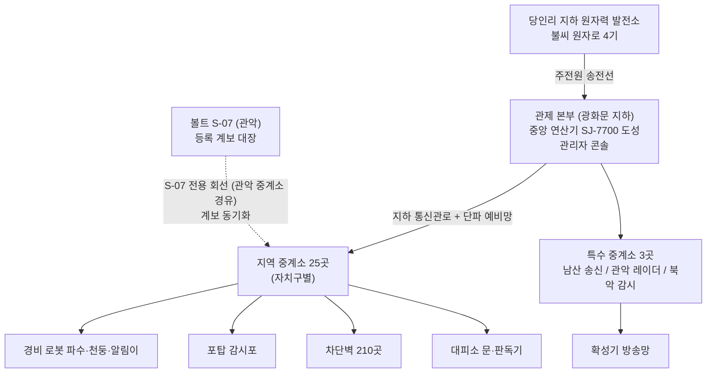
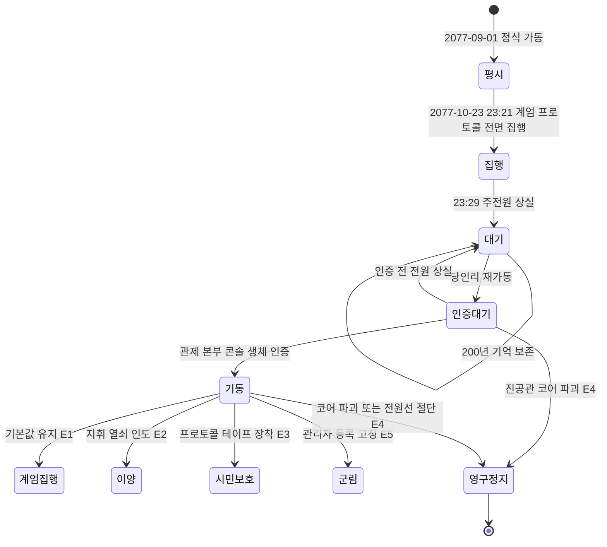
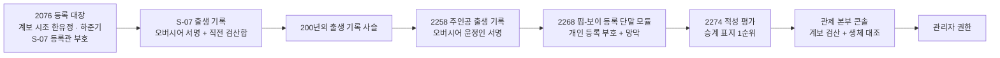

# SD-02. 세계관·연표

> **서울 폴아웃 상세 기획서 세트** | 문서 ID: SD-02 | 버전: v1.0 | 작성일: 2026-10-12
> **범위**: 정사 고정값과 서울판 결정값 대조, 1945~2077 한국사 연표(2052~2077 연 단위, 2077-10-23 시각 단위), 2077년 대한민국의 체제·사회·기술, 가상 재벌 4곳, 수도 관제망의 기술·역사·규칙, 서울 볼트 S-01~S-12, 생물 시료·중국군 침투조·세력의 기원 연대, 전후 200년 연표(2078~2277)와 2277년 정세, 환경 스토리텔링 기록물 목록, 주제와 미스터리
> **관련 문서**: [SC-00 컨셉](00_concept.md), [SD-01 게임 개요](01_game-overview.md), [SD-03 메인 스토리](03_main-story.md), [SD-04 사이드 퀘스트](04_side-quests.md), [SD-06 세력](06_factions.md), [SD-07 인물](07_characters.md), [SD-08 월드·권역](08_world-regions.md), [SD-09 장소 카탈로그](09_location-catalog.md), [SD-13 아이템](13_items.md), [SD-14 크리처·적](14_creatures-enemies.md), [SD-16 아트 디렉션](16_art-direction.md), [SD-18 용어·명명](18_naming-terms.md)
> **근거 자료**: [SR-01 공식 설정](research/SR-01_fallout-canon.md), [SR-02 서울 지리](research/SR-02_seoul-geography.md), [SR-03 인프라·군사](research/SR-03_seoul-infrastructure.md), [SR-04 생물](research/SR-04_korean-fauna.md), [SR-05 국가·사회](research/SR-05_korea-state-society.md), 원작 [RD-02 세계관·설정·연표](../reverse-design/02_world-and-lore.md), [RD-26 용어집](../reverse-design/26_glossary.md), [RD-27 이식 메모](../reverse-design/27_adaptation-notes.md)

---

## 1. 개요

### 1.1 목적
- 서울 폴아웃의 **설정 원본**이다. 다른 SD 문서는 연도·수치·명칭을 이 문서에서 가져간다. 퀘스트·인물·장소의 세부는 각 문서가 정하고, 이 문서는 그 바탕이 되는 '무엇이 언제 왜 그렇게 됐나'를 고정한다.
- 바이블 [SC-00](00_concept.md) §3·§5.2·§6·§11과 모순이 없게 쓴다. 바이블에 없는 것을 새로 정한 곳은 본문에 **[SD-02 결정]**으로 표시하고 미결 사항·최종 보고에 올린다.

### 1.2 요약
- 1945년까지는 현실과 같다. 그 뒤 한국은 **정전 상태로 갈라진 채** 미국 동맹의 원자력·로봇 국가로 자란다. 2052년 자원 전쟁으로 석유가 끊기자 원자력 전면 전환에 들어가고, 2063년 중국이 북쪽을 병합하면서 휴전선은 '중국과의 국경'이 된다.
- 2066년 중미 전쟁이 시작되고, 2074년부터 한반도는 미군의 중국 본토 진격 전진기지가 된다. 국가와 재벌은 '국가비상대비위원회' 아래 한 몸이 되고, 2075년 비상계엄과 함께 **비상 주민 분류 지침**이 시행된다. 2077년 9월 세진전자의 **수도 관제망**이 정식 가동한다.
- **2077-10-23 23:13(한국 표준시)** 발사 섬광이 관측되고, 23:21 관제망이 계엄 프로토콜 전면 집행에 들어간다. **23:29** 고고도 핵폭발의 전자기 충격으로 송전망이 무너져 관제망이 '대기 상태'로 잠든다. 서울의 전기 시계는 이 시각에 멈춘다. 23:47 마지막 탄두가 떨어진다. 모든 피격은 10월 23일 안에 끝난다.
- 200년 동안 관제망은 잠들어 있고, 서울 볼트 S-07(관악)은 관제망을 다시 켤 **등록 관리자 계보**를 끊지 않고 이어 왔다. 2277년 비상정부의 개방 지령에 S-07이 응하면서 게임이 시작된다.

### 1.3 표기 규칙
| 표기 | 뜻 |
|---|---|
| **[정사]** | 폴아웃 공식 설정(SR-01 등급 [G]·[D]). 바꾸지 않는다 |
| **[바이블]** | SC-00이 확정한 서울판 결정값 |
| **[SD-02 결정]** | 이 문서가 새로 정한 값. 리드 확인 대상 |
| `(미확인)`, `†` | 조사 자료에서 검증되지 않은 현실 사실. 게임 속 설정으로만 쓴다 |
| 시각 | 별도 표기가 없으면 **한국 표준시(KST, UTC+9)**. 미국 쪽 기록은 '미 동부'로 따로 적는다 |
| 연도 범위 | '2078~2100'은 양 끝 연도를 포함한다 |

- 실명 원칙: 지명·공공 공간은 실명, 기업·브랜드·부대·무기·인물은 가상이다(브리프 §5). 대통령·국무총리 같은 2077년 국가 지도자는 **직함으로만** 부르고 이름을 짓지 않는다. 현실 정치인 연상을 막기 위해서다.
- 게임 안에서 설정은 **엇갈리는 기록**(한국 정부 공문, 미군 통신, 중국 노획 문서, 생존자 증언)으로 전한다. 이 문서는 '진실'을 적지만, 플레이어에게 보이는 텍스트는 §10의 기록물 단위로 쪼개 나간다.

---

## 2. 정사 고정값과 서울판 결정값

### 2.1 캐논 체크리스트 대조표 (C1~C16)

| # | 정사 제약 (SR-01 §7.1) | 서울판이 지키는 방법 | 관련 절 |
|---|---|---|---|
| C1 | 대전쟁은 2077-10-23(미 동부 09:42~09:47 전후) 하루, 약 2시간 | 미 동부 09:13 발사 탐지 = **KST 23:13**. 서울 피격은 23:27~23:47에 모두 끝난다. 날짜는 10월 23일을 넘지 않는다(§3.3.1 환산 박스). 낙진·화재는 24일 이후에도 이어지지만 새 탄두는 없다 | §3.3 |
| C2 | 대전쟁은 중미 전쟁의 귀결, 주 교전국은 미·중 | 한국은 미국 측 전진기지로서 **표적이 됐을 뿐** 핵을 쏘지 않는다. 한국군에는 핵무기가 없다(미군 관리 탄두만 존재) | §3.2, §4.3 |
| C3 | 누가 먼저 쐈는지 확정하지 않는다 | 서울 쪽 기록은 '23:13 서해·북방 상공 섬광 다수'만 적고 발사 주체를 적지 않는다. 한국 정부·미군·중국 노획 문서가 서로 다른 말을 한다. 게임은 끝까지 답하지 않는다(§11 미스터리 M1) | §3.3, §11 |
| C4 | 2066 알래스카 침공 → 2067 T-45 → 2072 캐나다 병합 발표 → 2074 본토 침공 → 2076-06 T-51 → 2077-01 앵커리지 탈환 → 본토 교착 | 한국 연표는 이 순서를 **배경 뉴스**로만 받는다. 한국 쪽 사건(2074 원정군 파견, 2076 평택 T-51 정비창, 2077-01 탈환 축하 행사)은 공식 사건 날짜 뒤에 놓는다 | §3.2 |
| C5 | 중국은 청 주석의 공산 일당 체제, 개혁·개방 없음 | 중국은 '청 주석의 중국'으로만 언급한다. 시장경제·IT 대국 중국은 나오지 않는다. 중국 정보부(공식 명칭)가 침투조를 운용한다 | §8.2 |
| C6 | 중국은 궁핍하지만 군은 강하고 스텔스 우위, 파워 아머는 뒤처짐 | 침투조는 헤이구이 스텔스 슈트를 쓰고 파워 아머는 없다. 북방 병합지는 배급 추첨을 하는 궁핍한 땅으로 소문만 나온다 | §8.2 |
| C7 | 휴대전화·인터넷·평면 디스플레이·반도체 산업 없음 | 한국의 전자 산업은 **진공관·자기 드럼·테이프 릴** 산업이다. 통신은 유선 전화, 공중전화, 라디오, 관공서 전산망의 전자 공문까지만 있다. 학원가 단말기도 녹색 단색 CRT다 | §4.7 |
| C8 | 파워 아머는 미국 웨스트 텍 프레임 계열 | 한국은 **면허 정비·부품 생산만** 한다(태성중공업 평택 정비창). 계엄군의 파워 아머는 전쟁 전 정비창에 남은 미군 프레임을 200년 동안 고쳐 쓴 것이다 | §5.1, §4.3 |
| C9 | 볼트 정사 번호 1~122 사용 금지, 볼트는 미국 연방 사업 | 서울 볼트는 **S-01~S-12**다. 볼트-텍은 한결건설에 '설계·장비 면허'만 팔았고, 발주처는 한국 정부다(한미 대피 협정). 정사 볼트 번호와 겹치지 않는다 | §7.1 |
| C10 | 유엔 2052 해체 | 2052년 유엔 해체로 정전협정의 '유엔군사령부'가 사라진다. 정전 감시는 한미 양자 체제로 넘어간다. 2077년에 유엔군은 없다 | §3.2 |
| C11 | 소련 2077년까지 존속 | 소련은 '북쪽 바다 건너의 관망자'로 신문 기사 한두 줄에만 나온다. 러시아 연방은 없다 | §3.2 |
| C12 | 미국 13개 연방, 13개 별 성조기 | 용산·평택의 미군 깃발은 **원형 13개 별 + 가운데 별 1개** 성조기다. 한국은 연방 체제가 아니다 | §4.3, SD-16 |
| C13 | 1945년까지 현실 역사 | 1945-08-15 해방까지 현실과 같다. 일제강점기·해방 이전 역사를 바꾸지 않는다 | §3.1 |
| C14 | 미 본토 정사 인물·장소 변경 금지 | 체이스 장군, 징웨이, 리버티 프라임, 브라운 박사 등은 서울에 오지 않는다. 신문 기사 제목으로만 스친다('알래스카 해방!') | §3.2 |
| C15 | 탄두는 200~750킬로톤 다수, 낙진 많음 | 서울 지도 안 폭발은 3발(김포·이촌·광화문 상공) + 우면산 1발 + 요격 1발. 위력은 350~550킬로톤으로 잡고, 도심은 '심하게 부서졌지만 폐허가 남은' 상태다 | §3.3.3 |
| C16 | 대전쟁 뒤 각국 정부 소멸 | 대한민국 정부는 2077-10-23에 사실상 끝난다. 비상정부는 벙커 생존자의 **자칭 정통**일 뿐이고, 2277년의 '국가'는 벙커 하나와 계엄군 수백 명이다 | §7.5, §9 |

### 2.2 서울판 결정값 목록
| 구분 | 결정값 | 출처 |
|---|---|---|
| 한반도 구도 | 분단 유지, 북쪽은 2063년 중국에 병합('북방 병합지'), 남한은 미군 대륙 진격 전진기지 | [바이블] K1, 연도는 [SD-02 결정] |
| 체제 | 형식은 민주공화국, 실제는 **국가비상대비위원회** 중심의 국가-재벌 융합 전시 체제 | [바이블] §3.3, 기구명은 [SD-02 결정] |
| 핵심 장치 | 수도 관제망, 관제 본부(광화문 지하), 등록 관리자, 비상 주민 분류 지침, 시민 보호 프로토콜 | [바이블] §5.2 |
| 서울 시계 | 전기 시계가 멈춘 시각 **23:29**(전자기 충격). 마지막 폭발 23:47 | [SD-02 결정] |
| 서울 볼트 | S-01~S-12, 위치·실험·현재 상태는 §7 | [바이블] §3.4 + [SD-02 결정] |
| 변종의 기원 | 용산 미군 생물방어 분견대가 2076년 들여온 FEV 계열 비교 시료 + 방사능 | [바이블] §6 + [SD-02 결정] |
| 2277년 인구 | 수도 황무지의 의식 있는 주민 약 1만 2천(구울 약 1천 포함, 야생 구울·변종 제외). 세력별 규모는 SD-06 총람표를 따른다 | [SD-02 결정] (SD-06·SD-08과 조율) |
| 관리 계보 | 관리 후보는 S-07의 **관리 계보 1(한유리의 동생 한유정 가계)·계보 2(세진전자 연구원 하준기 가계)**와 출생 순서로 정해진다. 적성 평가는 겉치레다 | SD-03 채택, 계보 2 시조 이름은 [SD-02 결정] |

---

## 3. 한국사 연표 (1945~2077)

### 3.1 1945~2051: 정전 국가에서 원자력·로봇 국가로

> 1945년까지는 현실과 같다(C13). 1945년 이후는 현실의 큰 흐름(분단, 한국전쟁, 정전, 한미동맹, 압축 성장)을 남기되, 폴아웃 기술 규칙(C7)에 맞게 산업의 방향을 바꾼다. 이 시기는 게임에서 **기념비·교과서·광고 문구**로만 스친다. 1950~70년대 생활 풍속은 그리지 않는다(브리프 §2-3).

| 연도 | 사건 | 구분 | 게임 속 흔적 |
|---|---|---|---|
| 1945-08-15 | 해방. 38선을 경계로 남북이 나뉘어 점령된다 | 현실과 같음 | 교과서 터미널 첫 줄 |
| 1945-09 | 미군 용산 주둔 시작 | 현실과 같음 | 용산 요새 정문 명판 |
| 1948 | 남북에 각각 정부가 선다 | 현실과 같음(일반화) | — |
| 1950~1953 | 한국전쟁. **1953-07-27 정전협정.** 전쟁은 법적으로 끝나지 않는다 | [바이블] | 남산 방송 송미래의 단골 멘트 "정전 324년째" |
| 1953 | 한미상호방위조약 | 현실과 같음(일반화) | 용산 요새 기록실 |
| 1952 | **태성그룹** 창업(전후 복구 자재·발전 설비) | [SD-02 결정] | 태성 사사(社史) 홀로테이프 |
| 1955 | **청솔식품** 창업(제분·통조림) | [SD-02 결정] | 번개24 매장 '창업 122주년' 현수막 |
| 1957 | 주한미군사령부 용산 창설 | 현실과 같음 | — |
| 1959 | 국립 원자력연구소 개소, 공릉동 연구로 기공 | 현실 근거(SR-03) | 공릉 연구로 정문 비석 |
| 1961 | **한결건설** 창업(국토 재건 토목) | [SD-02 결정] | 세이프빌 분양 광고 '1961년부터' |
| 1962 | 공릉 연구로 가동. 한국 원자력의 시작 | 현실 근거 | S-04 정문의 기념 동판 |
| 1968 | **세진전자** 창업(진공관 라디오 조립) | [SD-02 결정] | 세진 타워 로비의 '1호 라디오' 전시 |
| 1969 | 남산요새화계획. 1970년대에 남산 지하 대피 터널 완성 | 현실 근거(SR-03), 완성은 창작 | S-01과 남산 대피 터널의 뿌리 |
| 1970년대 | 도심 지하상가가 방공호 겸용으로 퍼진다. 여의도에 사열대 비밀 벙커 | 현실 근거 | 영등포 지하상가, 여의도 지하 벙커 |
| 1974 | 첫 상업용 원자로 가동(현실보다 4년 이르다) | [SD-02 결정] | 태성 연혁 |
| 1980년대 | 서울 지하철망 확장. 대심도 역(여의나루·신금호·서울역)이 대피소로 지정된다 | 현실 근거, 연대는 일반화 | 지하철 대피소 표지 |
| 1990년대 | 세진전자, 첫 진공관 대형 연산기 국산화. 은행·관공서 전산실 보급 | [SD-02 결정] | 은행 터미널 제조 명판 |
| 2000년대 | 원자력 수출 시작. 소형 핵분열 전지가 가전에 들어간다 | [SD-02 결정] | 가전 폐품의 '핵분열 전지' 부품 |
| 2010년대 | 세진 가정용 로봇 '살림이' 1세대. 아파트 단지 경비실에 로봇 배치 시작 | [SD-02 결정] | 세이프빌 경비실 |
| 2020년대 | 원자력 승용차 보급. 휘발유 차와 공존 | [SD-02 결정] | 도로의 녹슨 '태성 새빛' |
| 2030년대 | 학원가 진공관 단말기 보급('전산 모의고사'). 입시 경쟁이 국가 산업이 된다 | [SD-02 결정] | 대치동 학원 건물 |
| 2040년대 | 근로자 1만 명당 로봇 수 세계 1위. 배달 로봇 '나르미'가 골목을 다닌다 | 현실 근거(SR-05) 투영 | 배달 로봇 잔해 |
| 2048 | 청솔식품, 편의점 체인 '번개24'와 탄산음료 '번개사이다' 출시 | [SD-02 결정] | 번개24 매장 |
| 2050~2051 | 에너지 수입 의존 93%. 유가 폭등으로 첫 '석유 배급제' 논의 | 현실 근거 투영 | — |

### 3.2 2052~2077: 연 단위 연표

> 굵은 글씨는 정사 사건(C4·C10)이다. 정사 사건은 한국에서 '뉴스'로만 받는다.

| 연도 | 세계 (정사) | 한국 (서울판) |
|---|---|---|
| **2052** | **4월 자원 전쟁 시작. 7월 유엔 해체** | 석유 수입이 70% 넘게 끊긴다. **'대정전의 겨울'**: 수도권 순환 정전 41일. 정부는 휘발유 차량 운행을 홀짝제로 묶는다. 유엔군사령부가 사라지면서 정전 감시가 **한미 양자 정전 감시단**으로 넘어간다 |
| 2053 | 신종 역병, 미국 국경 폐쇄 | **원자력 국가 선언.** '모든 에너지를 원자력으로' 15년 계획. 역병 유입을 막는다며 항만 검역소 설치, 첫 '주민 이동 신고제' |
| 2054 | 중동 제한 핵 교전, 미국 프로젝트 세이프하우스 착수 | 민방위 대피소 일제 점검. 서울 공공 대피소 약 3,000곳 중 화생방 방호 시설이 **0곳**이라는 국회 보고서가 화제가 된다(현실 2011년 연구의 투영) |
| 2055 | — | 태성그룹, 도시형 소형 원자로 'TS-60 불씨' 첫 실증. 청솔식품, 장기 보존 배급 통조림 '든든' 출시 |
| 2056 | — | 중국이 북쪽 정권에 '자원 차관'을 준다. 북쪽 항구·광산의 운영권이 중국으로 넘어간다 |
| 2057 | — | 세진전자, 경찰 순찰 로봇 '파수-1' 납품. 서울 25개 구 경찰서 배치 |
| 2058 | — | 휘발유 판매 전면 배급제. 태성 '원자 충전소' 체인이 주유소를 대신한다 |
| **2059** | **앵커리지 전선 설치. 첫 인공지능** | 미국이 '송유관 경비'를 이유로 캐나다를 압박하던 방식 그대로, 한국에 **서해 항만 사용권 확대**를 요구한다. 인천항 일부가 미 해군 보급항이 된다 |
| 2060 | 유럽 공동체 붕괴, 유럽 내전 | 수출 시장 붕괴로 재벌 구조조정. 4대 재벌(태성·세진·한결·청솔)이 국가 기간산업을 나눠 갖는다 |
| 2061 | — | **한미 대피 협정** 체결. 볼트-텍이 한결건설에 볼트 설계·장비 면허를 판다. **서울 볼트 계획(S-시리즈) 착수** |
| 2062 | 신종 역병 재확산, 미국의 반중 편집증 | 한국도 '경계 시민 신고 전화'를 들여온다(미국 제도의 수입). 신고 실적이 나중의 충성 등급 가점이 된다 |
| **2063** | 대부분의 미국 볼트 완공 | **북방 병합.** 북쪽 정권이 중국의 '자치 성(省)'으로 편입된다. 휴전선이 하루아침에 **중국과의 국경**이 된다. 서울~국경 약 40km. 접경 주민과 월경 피란민 약 40만 명이 서울로 밀려든다 |
| 2064 | — | 당인리 발전소 부지 지하에 소형 원자로 4기 착공. 월경 피란민 다수가 주민등록을 받지 못해 '무등록 체류자'로 남는다 |
| 2065 | 미국, 파워 아머 개발 착수 | 국경 철책 3중화. 세진 '천둥' 경계 로봇이 국경선에 배치된다 |
| **2066** | **여름 첫 퓨전 셀 공개. 12월 중국의 알래스카 침공, 중미 전쟁 시작** | 12월 정부가 '대미 전면 지지' 성명. **1차 동원령**: 예비군 소집, 복무 기간 18개월 → 30개월 |
| 2067 | T-45 알래스카 투입. 대만 해협 '파스칼 사건' | 서해에 정체불명 잠수함 출몰 보고 연 37건. 한강 하구에 수중 감시망 설치 |
| 2068 | — | **당인리 지하 원자력 발전소 가동**(4기, 총 1.2GW). 서울 전력 자급률이 처음으로 60%를 넘는다 |
| 2069 | — | **연천 정유소 사보타주 사건**: 국경 너머 침투조가 접경 연료 저장소를 폭파. 사망 63명. 국경 침투 공포가 시작된다 |
| 2070 | — | 서울 볼트 1차 준공(S-01 남산 시범 볼트 공개 행사). 지하철 대심도 역 방폭문 설치 사업. 연말 **수도 관제망 계획** 국무회의 의결, 세진전자 단독 수의계약 |
| 2071 | — | 한강 하구에서 잠수정 1척 나포(승조원 자폭). **관제망 착공.** 같은 해 태성·한결 컨소시엄이 청계산 지하에 **중앙 비상 지휘 시설 '청계'**(청계산 벙커) 비밀 착공 |
| **2072** | **6월 미국, 캐나다 병합 착수 발표** | **전시 비상 체제 선포. 국가비상대비위원회(국비위) 설치.** 4대 재벌 총수가 당연직 위원이 된다. 관제 본부 굴착 |
| 2073 | 9월 범면역 비리온 계획(PVP) 출범 | 여성 징병 시범 실시(기술병). 학원가에 '국가 대피 적성 검사' 대비반이 생긴다 |
| **2074** | **미군 중국 본토 침공** | 인천·평택이 **대륙 진격 전진기지**가 된다. 한국군 **대륙 원정군** 2개 사단이 서해를 건너 산둥 교두보에 투입된다. 관제망 1단계(도심) 가동 |
| **2075** | 3월 PVP를 FEV로 개칭 | **4월 12일 비상계엄 선포. 같은 날 '비상 주민 분류 지침' 시행.** 주민등록증에 충성 등급이 찍힌다. 관제망 2단계(여의도·강남) 가동, 지침과 연동. 대륙 원정군 사상자 1만 명 돌파 |
| **2076** | **1월 캐나다 병합 완료. 6월 T-51 투입. 8월 미국 식량 폭동·계엄** | 3월 태성중공업 평택 정비창이 T-51 면허 정비를 시작한다. 5월 **'종전 행진'**(반전 운동) 시작. 8월 배급 축소로 서울 7개 구 배급소 소요. 청계 시설 완공, 입소 명단 '청계 명부' 확정. 9월 S-07 입주 예정자가 관악 행정 연수원 기숙사에 상주 대기 시작. 12월 중국 정보부 침투 중대가 월경 피란민 행렬에 섞여 북한산으로 잠입한다(정체는 아무도 모른다) |
| **2077** | **1월 앵커리지 탈환. 2월 FEV 유출 파문. 본토 교착** | 1월 여의도에서 '알래스카 해방 축하 대행진'. 3월 **여의도 해산 사건**(종전 행진 집회를 경비 로봇이 해산, 사망 11명). 6월 관제망 3단계 완공, 시운전. **9월 1일 관제망 정식 가동.** 10월 22일 '공격 임박' 정보로 서울 전역 경계 2단계. 등록 관리자 12명이 여의도 지하 벙커(비상 집결지)에 집결해 관제 본부행 호송을 기다린다 |

**연도별 세부 메모**
- **2052~2058 (석유가 끊긴 7년)**: 한국은 석유 위기를 가장 먼저 맞는 나라였다. 이 7년이 '원자력이 곧 애국'이라는 국민 정서를 만들었다. 태성그룹은 이 시기에 국가 에너지 정책을 사실상 대신 짰다.
- **2059~2065 (기지 국가로)**: 미국의 요구는 늘 '항만·비행장·통과권'이었다. 한국 정부는 그 대가로 볼트 면허(2061)와 파워 아머 정비 면허(2076 실현) 약속을 받았다. 2063년 북방 병합으로 국경이 생기자 반대 여론은 사라졌다.
- **2066~2073 (전쟁 국가로)**: 동원령은 해마다 늘었다. 복무 30개월, 예비군 50세까지, 여성 기술병 시범. 인구 절벽을 로봇으로 메우는 '병사 1명 + 로봇 분대' 편제가 이때 나온다.
- **2074~2077 (전진기지)**: 서울은 전선이 아니면서 전선의 모든 것을 겪었다. 원정군 전사 통지서, 상이군인, 미군 수송 행렬, 배급표, 반전 집회, 그리고 거리마다 깔린 관제망의 경비 로봇.

### 3.3 2077-10-23: 서울의 그날 밤

#### 3.3.1 시각 환산
> **환산 박스**
> - 정사 기록(스위치보드 터미널)의 시각은 미 동부 시각이고, SR-01은 이를 로미오 시간대(UTC-5)로 본다.
> - KST = UTC+9이므로 **미 동부 + 14시간 = KST**. 미 동부 2077-10-23 09:13 → **KST 2077-10-23 23:13**. 09:42 → **23:42**, 09:47 → **23:47**.
> - 미국이 그날 일광 절약 시간(UTC-4)이었다면 KST는 한 시간 이르다(22:13~22:47). **어느 쪽이든 10월 23일 안이다.** 서울판은 SR-01을 따라 UTC-5 기준(23시대)으로 고정한다.
> - 서울 피격은 23:27~23:47이다. 단거리 탄도탄은 비행 시간이 수 분이라 미 본토보다 서울이 먼저 맞는다. **발사 순서와 발사 주체는 정하지 않는다**(C3).
> - 자정을 넘긴 10월 24일 이후에는 새 폭발이 없다. 화재 폭풍, 낙진, 붕괴만 이어진다.

#### 3.3.2 시각표

| KST | 미 동부(참고) | 서울에서 일어난 일 | 기록 출처(게임 속) |
|---|---|---|---|
| 22:00 | 08:00 | 학원 심야 수업이 끝나고 대치동·목동 학원가에서 학생 수만 명이 귀가한다. 번개24 야간 근무 교대 | 학원 출결 단말기 |
| 22:40 | 08:40 | 국민방송 심야 뉴스: "상하이 전선 교착, 평화 회담 재개 기대" | 라디오 대본 |
| 23:00 | 09:00 | 지하철 막차 운행 중. 용산 원정 사령부 야간 당직 교대 | 용산 당직 일지 |
| **23:13** | 09:13 | 서해·북방 상공에서 **발사 섬광 다수** 관측. 관악산 레이더 기지 기록은 '발사 주체 식별 불가' | 관악 레이더 일지 |
| 23:15 | 09:15 | 한미 연합 정전 감시단, 최고 경계 발령 | 용산 통신 기록 |
| 23:17 | 09:17 | 미군 통신망 '미사일 비행 확인' 수신. 청계 시설 '국가 지도부 입소' 명령. 대통령 차량 행렬 출발(그 뒤 기록 없음) | 미군 통신 테이프, 청계 출입 대장 |
| **23:19** | 09:19 | **서울 전역 공습경보·화생방경보.** 관제망 방송망 8,000개 확성기가 자동 경보를 낸다. 지하철 운행 중지, 전동차 승객 하차 후 역사 대피 | 관제망 방송 기록 |
| **23:21** | 09:21 | 행정안전부 장관 남궁혁, 청계 시설 입구 통신실에서 **'비상 주민 분류 지침 전면 집행'** 명령. 관제망 '집행 모드' 진입: 도심 차단벽 38곳 닫힘 시작(관제 본부 지하 외곽 차단벽 포함), 대피소 판독기 등급 필터 가동, 경비 로봇 집행 수칙 전환 | 관제 본부 명령 기록 |
| 23:21 | 09:21 | 북한산 침투 갱도 끝, 관제 본부 외곽 지하 차단벽이 중국군 굴진 중대의 눈앞에서 내려온다. 폭파 예정 시각 23:40을 19분 앞두고 길이 막힌다 | 천웨이 근무일지 1일째 |
| 23:22 | 09:22 | 대피소 입구마다 판독기 앞에 줄이 생긴다. 충성 4등급 이하와 무등록자는 '대기 구역'으로 분류돼 문 밖에 남는다 | 대피소 판독기 출력지 |
| 23:23 | 09:23 | 남궁혁, 서울 볼트 12곳에 **'개방 지령'**(코드명 '개방-1') 송신. 2077년의 뜻은 '문을 열고 입주자를 받아라'다. 200년 뒤 같은 지령이 '문을 열고 나오라'로 다시 쓰인다 | 청계 송신 기록 |
| 23:24 | 09:24 | 개방 지령을 받은 S-07이 문을 연다. 관악 행정 연수원 기숙사의 입주 요원과 가족이 볼트로 이동 시작 | S-07 입주 기록 |
| 23:25 | 09:25 | 여의도 지하 벙커의 등록 관리자 12명, 관제 본부행 호송차 출발 시각. 호송차는 오지 않는다(도심 차단벽이 닫혔다) | 집결지 출석부 |
| 23:26 | 09:26 | (미국, 대응 시나리오 MX-CN91 발령 — 서울은 알지 못한다) | — |
| **23:27** | 09:27 | **인천항(지도 밖)·김포 비행장 지면 폭발.** 서쪽 하늘이 두 번 하얗게 빛난다 | 생존자 증언 |
| **23:29** | 09:29 | **서해 상공 고고도 핵폭발.** 전자기 충격으로 수도권 송전망 붕괴, 당인리 원자로 4기 자동 정지. 관제망 주전원 상실 → 비상 축전 → **'대기 상태(보존 모드)'** 진입. **서울의 전기 시계가 멈춘다.** 진공관 장비는 대부분 살아남는다 | 당인리 제어실 기록, 멈춘 시계 |
| 23:30 | 09:30 | 전원을 잃은 차단벽·대피소 문이 **그 자리에 멈춘다.** 닫히던 문은 반쯤 닫힌 채, 열리던 문은 반쯤 열린 채 | 환경(반쯤 닫힌 문) |
| **23:31** | 09:31 | **용산 표적 탄두 2발.** 1발은 용산 기지 레이저 방공 포대가 요격해 상공에서 부서진다(핵폭발 없음, 핵물질 비산). 1발은 표적에서 1.8km 빗나가 **이촌 앞 한강 수면 위 저고도 공중 폭발** | 용산 방공 일지 |
| 23:33 | 09:33 | 용산 원정 사령부, 지하 지휘소 봉인. 마지막 무선 "HOLD THE BASE"(기지를 지켜라) | 연합단 성물 테이프 |
| 23:35 | 09:35 | 중국 정보부 중계 무전이 굴진 중대에 마지막 명령을 보낸다: **"전원이 돌아오면 다시 시도하라. 철수 명령 전까지 대기."** 그 뒤 어떤 무전도 오지 않는다 | 천웨이 근무일지 |
| **23:38** | 09:38 | **광화문 상공 공중 폭발.** 정부서울청사·관제 본부 일대를 노린 탄두. 도심 지상부 대부분 붕괴, 화재 폭풍 시작. 지하 60m의 관제 본부는 살아남는다 | 관제 본부 당직 일지 |
| 23:42 | 09:42 | (미국 펜실베이니아·뉴욕 피격). 지도 밖 의정부·성남 방향 군 시설 피격. 북쪽 하늘이 붉다 | 생존자 증언 |
| **23:47** | 09:47 | **우면산 남쪽 사면 지면 폭발.** 청계 시설을 노린 탄두가 3km 빗나간다. 서울 지도 안 마지막 폭발. 마지막까지 입구 통신실에 남아 있던 남궁혁이 낙진을 맞는다 | 청계 시설 지진계 |
| 23:52 | 09:52 | **S-07 방폭문 폐쇄.** 초대 오버시어 장문석이 수동으로 닫는다. 안에 596명 | S-07 오버시어 일지 |
| 23:58 | 09:58 | 청계 시설 봉인. 남궁혁이 마지막으로 입소한다. 안에 국무위원·고위 관료·재벌 일가·경비 병력 약 1,100명. 대통령은 끝내 오지 않는다 | 청계 출입 대장 |
| 10-24 00:00 이후 | — | 화재 폭풍이 도심과 용산을 밤새 태운다. 새벽부터 낙진. 대피소마다 문 밖에 남은 사람들 | 생존자 쪽지 |

#### 3.3.3 탄두 표적과 피해 양상

| # | 표적 | 결과 | 위력(게임 설정) | 지도 위 흔적 | 권역 |
|---|---|---|---|---|---|
| W-1 | 인천항(2발) | 지면 폭발 | 각 550kt | 지도 밖. 서쪽 지평선의 영구 방사능 안개 | R10 경계 |
| W-2 | 김포 비행장 | 지면 폭발 | 450kt | 거대한 분화구, 고방사능 평야, 활주로 유리화 | R10 |
| W-3 | 용산 기지 A | **요격**, 상공 파쇄 | (핵폭발 없음) | 남산 남사면·이태원 일대 '플루토늄 비산 구역'(저준위·광역) | R06 |
| W-4 | 용산 기지 B | 표적에서 1.8km 빗나가 이촌 앞 한강 수면 위 저고도 폭발 | 350kt | 이촌·동작 강변 전멸, 한강대교 남단 절반 붕괴, 노들섬 지반 침하. 용산 기지 지상부는 반파, 지하 지휘소는 생존 | R06, 노들섬 |
| W-5 | 광화문 상공 | 고도 약 1.5km 공중 폭발 | 400kt | 도심 지상부 붕괴, 화재 폭풍. 고방사능은 아니고 **잔해와 차단벽**이 도심을 막는다 | R05 |
| W-6 | 의정부·성남 방향 군 시설 | 지면 폭발 | 각 450kt | 지도 밖. 북부·남동부 낙진 | R09, R11 경계 |
| W-7 | 청계 시설 | 3km 빗나가 우면산 남사면 지면 폭발 | 500kt | 우면산~양재 분화구, 양재천 오염, 강남 남부 건물군 반파 | R07, R11 |
| — | 서해 상공 | 고고도 폭발(전자기 충격) | — | 직접 피해 없음. 서울 전체 정전 | 전역 |

- **잘 버틴 곳**: 관악(S-07, 산이 폭풍을 막았다), 마포 상암(탱크마을이 될 석유 비축 탱크), 북한산(침투 터널), 송파 잠실(초고층 타워 다수가 골조로 남았다), 여의도 지하.
- **사라진 곳**: 이촌·동작 강변, 김포 비행장 일대, 우면산 남쪽.
- **표적이 말하는 것**: 광화문 상공 탄두와 청계 벙커 탄두는 중국이 **관제 본부와 비상 지휘 시설의 위치를 알았다**는 뜻이다. 중국 정보부의 서울 첩보망이 이 정보를 넘겼다(§8.2).

#### 3.3.4 관제망 정전
- 관제망은 23:21에 계엄 프로토콜 '집행 모드'에 들어가고 **8분 뒤** 23:29에 전원을 잃었다. 200년 동안 관제망은 '집행 모드로 들어간 직후의 상태'를 기억한 채 잠들어 있다.
- 정전의 순서: 전자기 충격 → 송전망 붕괴 → 당인리 원자로 4기 자동 정지(설계대로) → 관제 본부 비상 축전지 전환 → 축전지는 '기억 보존'에만 전력을 쓰도록 설계돼 있어 관제망은 **대기 상태(보존 모드)**로 들어간다.
- 지역 중계소 25곳도 같은 순서로 잠든다. 단, 자체 핵분열 전지를 가진 중계소 6곳은 200년 동안 **가끔 깜박인다**(§6.10).
- 진공관은 전자기 충격에 강하다. 관제망의 하드웨어 대부분이 살아남은 이유다. 반대로 송전망·변전 설비와 반도체가 들어간 미군 수입 장비 일부는 망가졌다.

#### 3.3.5 대피소 상황
| 대피소 유형 | 그날 밤 | 그 뒤 (2077-10~2078) | 2277년의 흔적 |
|---|---|---|---|
| 지하철 대심도 역(여의나루, 신금호, 서울역 등) | 가장 많은 사람이 살아남는다. 관제망 판독기 문이 반쯤 닫힌 채 멈춰, 문틈으로 밀려든 사람이 정원의 2~3배 | 공기·물·식량 부족으로 첫 겨울에 대부분 사망. 일부가 구울이 된다 | 지하철 정착민, 야생 구울 둥지, 판독기 앞 해골 행렬 |
| 얕은 지하철 역 | 화재 폭풍의 열기와 연기가 들어온다 | 대부분 그날 밤 사망 | 검게 그을린 역사 |
| 지하상가(영등포, 을지로, 강남 등) | 상가 셔터를 내려 버틴다. 1인당 0.825㎡ 기준의 두세 배가 들어찬다 | 영등포 지하상가에서 구울 공동체가 생긴다 | **지하시장**의 뿌리 |
| 아파트 지하주차장 | 대피소 표지에는 '수용 5,800명'. 실제로는 차로 가득 차 있다 | 대부분 사망 | 녹슨 차와 해골 사이의 수용 인원 표지 |
| 세이프빌 대피형 단지 지하 방호층 | 단지 주민만 판독기로 들인다(등급 무관, 입주민 카드) | 다른 대피소보다 오래 버틴다. 5년 안에 대부분 지상으로 나와 흩어진다 | 세이프빌 단지 폐허의 방호층 |
| 서울 볼트(S-시리즈) | 입주 대상자만 들어간다. 볼트마다 사정이 다르다(§7) | 볼트마다 다르다 | §7 |
| 청계 시설(청계산 벙커) | '청계 명부'에 오른 사람만 들어간다 | 벙커 사회로 200년 | 비상정부 |

- **판독기의 비극**: 23:21부터 관제망 판독기가 대피소 문에서 충성 등급을 읽었다. 4등급 이하와 무등록자는 '대기 구역'에 세워졌다. 8분 뒤 전원이 끊기며 문은 그 상태로 굳었다. 2277년에도 많은 지하철역 입구에 **'대기 구역' 노란 선 안쪽에만 해골이 쌓여 있다.** 서울판 환경 스토리텔링의 상징 장면이다(SD-16 연출 키 이미지 후보).
- **멈춘 시계**: 원작의 '9시 47분'에 대응하는 서울판 상징은 **'11시 29분'에 멈춘 전기 시계**다. 학원 교실 벽시계, 지하철 승강장 시계, 아파트 거실 시계가 모두 23:29를 가리킨다. 태엽 시계와 핵분열 전지 시계는 계속 돌다가 각자 다른 시각에 멈춘다(연출 규칙은 SD-16).

---

## 4. 2077년 대한민국

### 4.1 정치 체제: 국가-재벌 융합 전시 체제
- **형식**: 헌법상 민주공화국, 대통령제, 국회가 있다. 국회는 2075년 계엄 선포 뒤 '전시 휴회' 상태로 2년째 열리지 않는다.
- **실제**: **국가비상대비위원회(국비위)**가 나라를 움직인다. 2072년 '전시 비상 체제 특별법'으로 설치됐다.

| 국비위 구성 | 인원 | 비고 |
|---|---|---|
| 위원장 | 국무총리 | 직함으로만 등장 |
| 정부 위원 | 국방부·행정안전부·산업자원부·재정부 장관, 합동참모의장, 계엄사령관 | 행안부 장관 **남궁혁**이 주민 분류·대피·관제망을 맡는다 |
| 당연직 재계 위원 | 태성그룹·세진전자·한결건설·청솔식품 총수 | 법률상 '전시 기간산업 대표'. 의결권 있음 |
| 미국 측 참관인 | 주한 미 원정 사령부 연락관 1명 | 의결권 없음, 사실상 거부권 |

- **국가와 재벌의 분업**: 에너지·군수는 태성, 치안·전산·관제망은 세진, 대피 시설·주택은 한결, 배급·식품은 청솔이 '국가 사무를 위탁받아' 수행한다. 공무원과 재벌 직원의 제복이 거의 같다.
- **대통령**: 국비위 의결을 서명으로 확정하는 자리로 줄었다. 2077-10-23 23:21 이후 대통령의 행방은 어느 기록에도 없다(미스터리 M4).
- **남궁혁**: 2077년 행정안전부 장관. 주민등록 전산화와 비상 주민 분류 지침의 설계자이자 집행 책임자. 관제망의 '정부 측 주인'이다. 그날 밤 관제망 집행 명령과 볼트 개방 지령을 보내느라 청계 시설에 마지막으로 들어갔고, 그 사이 낙진을 맞아 구울이 됐다. 2078년 살아 있는 최상위 국무위원으로서 대통령 권한대행에 취임했다. 2277년 비상정부 권한대행이다([바이블] §11, 상세는 SD-06·SD-07a).

### 4.2 계엄과 비상 주민 분류 지침

#### 4.2.1 개요
- **비상계엄**: 2075-04-12 선포. 계엄사령관은 육군 대장 **도정훈**(2077년 계엄사령관, 그날 밤 행방불명). 집회 금지, 언론 사전 검열, 야간 통행 제한(00:00~05:00), 영장 없는 구금 72시간.
- **비상 주민 분류 지침**: 같은 날 행안부 고시로 시행. 정식 명칭은 「전시 비상 주민 분류 및 처우에 관한 지침」, 약칭 **'분류 지침'**, 관제망 안의 이름은 **'계엄 프로토콜'**이다([바이블] §11).
- 목적은 '전시 인력의 효율적 배치와 적성 분자의 조기 식별'. 실제로는 배급·이동·대피를 등급으로 나누는 장치다.

#### 4.2.2 충성 등급 체계

| 등급 | 명칭 | 주민등록증 표시 | 대상(예) | 2077년 서울 비율 | 배급 | 이동 | 대피 |
|---|---|---|---|---|---|---|---|
| 1등급 | 국가 핵심 인력 | 금색 띠 '충성 1' | 고위 공무원, 장교, 재벌 임원, 원자력·관제망 기술자 | 약 2% | 특배(1.5배) | 제한 없음 | 볼트·벙커 우선 배정 대상 |
| 2등급 | 모범 시민 | 청색 띠 '충성 2' | 국방채 매입·신고 실적·군 복무 가족, 상이군인 | 약 14% | 1.2배 | 통행 제한 시간 예외 | 대심도 역 우선 입장 |
| 3등급 | 일반 시민 | 무색 '충성 3' | 기본값 | 약 61% | 1배 | 제한 시간 준수 | 지정 대피소 |
| 4등급 | 요주의 시민 | 황색 띠 '충성 4' | 반전 집회 참가 이력, 적성국 연고자(북방 병합지 이산가족), 배급 위반 1회 | 약 15% | 0.8배 | 구 경계 이동 시 신고 | 지정 대피소 '대기 구역' |
| 5등급 | 관찰 대상 | 적색 띠 '충성 5' | 반전 단체 회원, 병역 연기 신청자, 신고 2회 이상 피신고 | 약 5% | 0.6배 | 거주 구 밖 이동 금지 | 대기 구역 |
| 등급 외 | **적성 분자** | 증 몰수 또는 미발급 | 아래 4.2.3 기준 해당자 | 약 3% + 무등록 약 30만 명 | 없음 | 체포 대상 | 없음 |

- 등급은 **분기마다 재산정**된다. 가점: 국방채 매입, 신고 실적, 가족의 원정군 복무, 헌혈, 배급 절약 모범. 감점: 집회, 신고당함, 배급 위반, 적성국 연고.
- 학원가는 '등급 상향 컨설팅'을 판다. 아파트 단지는 '전 세대 2등급 이상'을 분양 광고에 쓴다. 블랙 유머의 재료다.

#### 4.2.3 적성 분자 분류 기준 (지침 제9조)
1. **미등록자**: 주민등록이 없는 자. 월경 피란민, 무등록 체류자, 출생 미신고자 포함.
2. **국경 이탈자**: 북방 병합지에서 허가 없이 넘어온 자, 접경 지대에서 허가 없이 이탈한 자.
3. **반전 시위 주동자**: 금지 집회를 주최·선동한 자. 단순 참가자는 5등급.
4. **병역·동원 기피자**: 동원령에 2회 이상 불응한 자, 탈영병.
5. **배급 질서 교란자**: 배급표 위조·전매 2회 이상.
6. **적성국 협력 혐의자**: 적성국과 통신·연락한 혐의가 있는 자.
7. **판독 불능자**: 관제망 판독기가 신원을 확인하지 못한 자 → '임시 적성'으로 처리 후 구금.

- 7항이 핵심이다. 관제망은 **모르는 사람을 적으로 본다.** 2277년 서울 사람 거의 전부가 이 조항에 걸린다([바이블] §5.2 기본 프로토콜).

#### 4.2.4 관제망 경비 로봇의 등급별 처우 (집행 모드)
| 판독 결과 | 경비 로봇 행동 | 판독기 문 |
|---|---|---|
| 1·2등급 | 경례, 통과 | 열림 |
| 3등급 | 통과(통행 제한 시간에는 귀가 안내) | 열림 |
| 4등급 | 동행 확인, 목적지 신고 요구 | 대기 구역 안내 |
| 5등급 | 정지 명령, 인근 구금소 인계 | 닫힘 |
| 적성 분자·판독 불능 | 경고 방송 1회 → **제압(치명 무력 허용)** | 닫힘 |

#### 4.2.5 공문 예시 (게임 속 기록물 LR-03)
```
행정안전부 공고 제2075-412호

  전시 비상 주민 분류 및 처우에 관한 지침 시행 안내

1. 「전시 비상 체제 특별법」 제14조에 따라 2075년 4월 12일
   00시부터 비상 주민 분류 지침을 시행합니다.
2. 모든 주민은 4월 30일까지 거주지 주민센터에서 충성 등급이
   표시된 신규 주민등록증을 발급받아야 합니다.
3. 기한 내 미발급자는 지침 제9조 제1호에 따라 미등록자로
   분류됩니다.
4. 수도 관제망 판독기가 설치된 시설(지하철역, 배급소, 대피소,
   한강 교량)에서는 주민등록증을 판독기에 제시하십시오.
5. 이웃의 등급 변동 사유를 아시는 분은 경계 시민 신고 전화
   (국번 없이 1953)로 알려 주십시오. 신고 실적은 가점에
   반영됩니다.

   우리의 등급이 우리의 안전입니다.

                          행정안전부 장관 남궁혁
```
- 신고 전화 번호 '1953'은 정전 연도다. 의도적 블랙 유머다.

### 4.3 군과 미군 주둔
| 항목 | 2077년 상태 |
|---|---|
| 국군 | 상비 약 41만 + 로봇 분대. 편제 원칙 '병사 1명 + 로봇 4기'. 파워 아머 독자 생산 없음 |
| 대륙 원정군 | 2074년부터 산둥 교두보·양쯔강 하구 전선에 2개 사단 교대 파견. 누적 사상자 약 3만 1천(2077-09 국방부 발표) |
| 수도 방위 | 수도 방위 전구 사령부(남태령 산악 지휘소, 가상 명칭). 서울 치안의 70%는 관제망 로봇이 맡는다 |
| 주한 미군 | **주한 미 원정 사령부**(약칭 원정사). 총 약 38만(평택·인천·김포·군산 중심), 서울 용산 약 4만 2천. 13개 별 성조기 |
| 용산 기지 | 1945년부터 이어진 미군 주둔지. 2074년 대륙 진격 지휘소 '용산 지휘소'가 지하에 들어선다. 한미 연합 참모 약 900명 상주 |
| 평택 | 미군 최대 집결지, 태성중공업 T-51 면허 정비창(2076-03~) |
| 인천·김포 | 서해 횡단 상륙 집결항, 공수 비행장 |
| 핵무기 | 미군 관리 전술 탄두만 존재. 한국군 지휘권 없음(C2) |

- 미군과 서울 시민의 관계: 용산 앞 이태원 상권은 미군 소비로 돌아간다. 동시에 '미군 우선 배급'과 징발에 대한 불만이 쌓인다. 반전 운동의 구호 중 하나가 "누구의 전쟁인가"다.
- 연합단의 뿌리: 용산 지휘소의 한미 연합 참모와 경비 병력(§8.3).

### 4.4 징병·배급·선전
**징병과 동원**
- 남성 복무 30개월(2066~), 여성 기술병 18개월(2073 시범, 2075 의무화). 예비군 50세까지.
- 동원 통지서는 등기 우편과 관제망 확성기로 온다. "○○구 ○○동 2027년생부터 2059년생까지 남자 예비군은…" 같은 동원 방송이 아파트 단지에 울린다.
- 원정군 전사 통지는 '국가 유공 통지서'라는 이름으로 금색 봉투에 온다. 통지서를 받은 집은 충성 2등급으로 오른다(블랙 유머: 아들을 잃어야 등급이 오른다).

**배급**
- 쌀·연료·의약품은 청솔식품 위탁 배급소(동마다 1곳)에서 배급표로 받는다. 배급표는 충성 등급에 따라 색이 다르다.
- 번개24 편의점은 배급표와 현금을 함께 받는다. 배급 외 물품(번개사이다, 과자, 담배)은 현금 구매.
- 암시장: 미군 PX 물품, 뉴카-콜라, 위조 배급표, 위조 주민등록증(등급 위조). 2277년 '위조 주민등록증'은 고급 잡화가 된다(SD-13에서 ID 부여).

**선전**
- 국민방송(국영 라디오)의 정시 뉴스와 '오늘의 전선' 코너.
- 포스터·광고 문구 예시: "원자력으로 지키는 나라, 등급으로 지키는 이웃", "대륙의 형제들에게 번개사이다를!", "의심은 애국입니다 — 신고 1953", "청 주석은 겨울을 넘기지 못한다", "세이프빌 — 우리 아이의 지하 30미터".
- 반중 선전은 **시대의 광기로 풍자**한다. 선전 포스터는 늘 과장되고, 실제 중국군 잔존병은 '명령에 갇힌 병사'로 그린다(브리프 §5).

### 4.5 반전 운동: 종전 행진
- **이름**: '종전 행진'(2076-05 시작). 구호는 **"정전 123년, 이제는 종전을"**(2076년 기준). 1953년의 정전과 2066년의 중미 전쟁을 같은 '끝나지 않은 전쟁'으로 묶는다. 메인 퀘스트 MQ-11 〈종전〉과 엔딩 E4 '종전 선언'의 역사적 메아리다.
- **구성**: 대학생, 원정군 전사자 유족, 상이군인, 월경 피란민 단체, 일부 종교인. 특정 정당·교단과 연결하지 않는다.
- **활동**: 촛불 대신 **'정전 시계' 행진**(1953-07-27부터 멈춘 날수를 적은 손팻말), 등사기 유인물 「종전」, 원정군 귀환 요구 서명.
- **탄압**: 2077-03 **여의도 해산 사건**. 관제망 2단계 경비 로봇 '파수-3' 240기가 처음으로 집회 해산에 투입돼 사망 11명. 이 사건 뒤 주동자 약 2,300명이 적성 분자로 분류된다.
- **그날 밤**: 적성 분자로 분류된 종전 행진 회원 대부분은 대피소 대기 구역에 남았다. 2277년 지하철역의 '대기 구역' 해골 중 일부가 「종전」 유인물을 쥐고 있다(LR-11).
- **유산**: 2277년 남산 방송의 송미래는 종전 행진의 유인물을 방송에서 읽는다(SD-07과 조율).

### 4.6 생활상
| 공간 | 2077년의 모습 | 2277년의 흔적 |
|---|---|---|
| **아파트 단지** | 서울 주택의 70%. 한결건설 '세이프빌'이 대표 브랜드. 단지마다 경비실 로봇, 동 출입구 판독기, 지하 주차장 겸 대피소. 단지 관리 터미널에 관리비·배급표·동대표 회의록이 들어 있다 | 정착지의 기본 형태. 고철 장벽을 두른 단지 |
| **학원가** | 대치동·목동·중계동. '국가 대피 적성 검사'(볼트 입주 시험)·원자력 기술자 시험·충성 등급 상향 대비반. 교실마다 녹색 CRT 단말기, 진공관 '전산 모의고사' 채점기. 심야 수업 22:00 종료 | 23:29에 멈춘 교실 시계, 책상 위 시험지, 붙어 있는 합격 현수막 |
| **편의점 번개24** | 동네마다 2~3곳. 무인 계산 로봇 '번개 점원', 배급표 판독기, 번개사이다 냉장고 | 2277년에도 일부 로봇 점원이 '영업 중'. 캡을 받지 않고 배급표만 찾는다 |
| **지하상가** | 영등포·을지로·강남역·고속터미널. 옷·전자 부품·라디오 수리점. 방공호 겸용 셔터 | 지하시장(영등포), 약탈자 소굴, 고물상 |
| **배달 로봇** | 세진 '나르미'. 바퀴 6개, 보온 화물칸, 확성기로 "배달 왔습니다"를 말한다. 택배는 아파트 무인 보관함으로 | 2277년에도 200년 전 주소를 찾아 헤매는 나르개. 랜덤 인카운터 소재(SD-05) |
| **지하철** | 1~9호선 + 원자력 전동 경전철. 역마다 관제망 판독기 개찰구 | 지하 이동망, 정착민·구울·변종의 공간 |
| **교통** | 원자력 승용차(태성 '새빛'), 원자력 트럭('일꾼'), 원자력 시내버스, 배급제로 휘발유 차는 드물다 | 도로마다 녹슨 원자력 차(폭발 위험) |
| **통신·매체** | 유선 전화, 공중전화, 국민방송 라디오, 흑백·초기 컬러 CRT 텔레비전, 신문 | 공중전화 부스, 라디오 수신기 |
| **음식** | 쌀 배급, 통조림 '든든', 라면, 번개사이다, 수입 뉴카-콜라(미군 PX와 백화점) | 통조림, 병, **병뚜껑** |

- **소비와 공포의 공존**: 원작의 '1950년대 낙관 × 종말'을 서울판은 **'입시·분양·등급 경쟁 × 종말'**로 옮긴다. 사람들은 전쟁 중에도 학원에 다니고, 분양 추첨에 줄 서고, 등급 가점을 계산했다.
- **쓰지 않는 것**: 1950~70년대 한국 레트로 풍속(연탄·달동네 판잣집·교복 풍속 등)은 꾸밈으로 쓰지 않는다. 오래된 동네(봉천동 언덕 등)는 2077년의 노후 주거지로 그린다.

### 4.7 기술 수준
| 있다 | 없다 |
|---|---|
| 진공관 대형 연산기, 자기 드럼·테이프 릴 기억 장치, 녹색 단색 CRT 터미널(명령어 메뉴) | 휴대전화, 인터넷, 개인용 소형 컴퓨터, GUI |
| 관공서·은행·재벌 사내 전산망과 전자 공문 | 대중 인터넷, 전자 상거래 |
| 핵분열 전지, 도시형 소형 원자로, 원자력 차량 | 반도체 산업, 평면 디스플레이 |
| 가정용·산업용·경비·군용 로봇 | 소형 드론 |
| 레이저·플라스마 무기(미군 제식, 한국은 면허 생산 일부) | 한국 독자 파워 아머 |
| 홀로테이프, 핍-보이(볼트 지급품, 볼트-텍 면허 수입) | 스마트 기기 일반 |
| 유리병·금속 용기 중심(플라스틱 희소) | 플라스틱 일회용품 대량 소비 |

- **반도체 대신 진공관**: 현실 한국의 반도체 산업 역량은 이 세계에서 **진공관·대형 연산기·로봇 두뇌 생산**으로 향했다(SR-05 §7.2). 세진전자의 거대 진공관 공장이 그 상징이다.
- **한글 터미널**: 세진전자 터미널은 한글 명령어 메뉴를 쓴다(운영 체계 '바른글'). 게임 터미널 UI의 기본 스킨이다(SD-12).

---

## 5. 가상 재벌 4곳

> 공통 원칙: 실존 그룹명·로고 색·창업 일화·상품명과 1:1로 대응하지 않는다(SR-05 §8.3). 제품명은 모두 가상이다. 무기·로봇·소모품의 게임 데이터 ID는 SD-13·SD-14에서 부여한다.

### 5.1 태성그룹 (원자력·에너지·중공업·군수)
| 항목 | 내용 |
|---|---|
| 원작 대응 | 제너럴 아토믹스 + 포세이돈 에너지 + 웨스트 텍(면허 측면) |
| 계열사 | 태성에너지(원자로·전력), 태성중공업(차량·파워 아머 정비·무기), 태성모터스(원자력 승용차·버스), 태성정밀(에너지 무기 부품) |
| 슬로건 | **"태성이 켜면, 대한민국이 켜진다."** / 전시: "불씨 하나가 나라를 지킨다" |
| 로고 | 원자 궤도 3개가 감싼 다섯 모 원자핵. 색은 적갈·검정·놋쇠(디자인 정본은 SD-16 §2.5) |
| 정부와의 관계 | 2053 원자력 국가 선언의 실질 설계자. 국비위 당연직. 에너지부 국장급 절반이 태성 출신. 남궁혁과는 '관제망 전원'을 두고 긴밀 |

**연혁**
| 연도 | 사건 |
|---|---|
| 1952 | 전후 복구 자재·발전 설비 회사로 창업 |
| 1974 | 첫 상업용 원자로 시공 |
| 2000년대 | 원자로 수출, 핵분열 전지 양산 |
| 2024 | 원자력 승용차 '새빛' 1세대 |
| 2055 | 도시형 소형 원자로 **TS-60 '불씨'** 실증 |
| 2058 | '원자 충전소' 체인(주유소 대체) 전국 1,800곳 |
| 2064~2068 | **당인리 지하 원자력 발전소** 시공·운영(불씨 4기, 1.2GW) |
| 2074 | 미군 레이저 소총 부품 면허 생산 |
| 2076-03 | 평택 T-51 면허 정비창 가동 |

**주력 제품 (가상)**
| 제품 | 분류 | 메모 |
|---|---|---|
| TS-60 '불씨' | 도시형 소형 원자로 | 당인리·세진 타워·청계 벙커·일부 볼트의 전원 |
| '새빛' | 원자력 승용차 | 2277년 도로의 녹슨 차. 총격 시 폭발 |
| '일꾼' | 원자력 트럭 | 고속도로·물류 단지 잔해 |
| '한길' | 원자력 시내버스 | 버스 정류장 폐허 |
| 태성 핵분열 전지 | 휴대 동력 | 2277년 핵심 잡화(SD-13) |
| TS 형식 화기(TS-74 보병소총 등)와 미군 레이저 면허판 | 화기·에너지 무기 | 계엄군·연합단 무기 계보. 명명은 SD-13 §2.2(TS·SJ·HG 접두어) |
| 원자 충전소 | 충전소 체인 | 원작 레드 로켓 대응. 2277년 약탈자 소굴·정착지 |

**전후에 남은 흔적**
- 당인리 지하 원자력 발전소(MQ-301), 원자 충전소 폐허(지역마다 1~2곳), 녹슨 '새빛'과 '한길' 버스, 평택 정비창 출신 파워 아머 부품, 태성 사내 홀로테이프 「불씨 안전 수칙」.
- 광고판: "불씨 하나면 30년. 태성 TS-60" / "새빛 — 기름 냄새 없는 출근길".

### 5.2 세진전자 (로봇·컴퓨터·관제망)
| 항목 | 내용 |
|---|---|
| 원작 대응 | 로브코 |
| 계열사 | 세진전자(본사·연산기), 세진로보틱스(로봇), 세진시스템(관제망 시공·운영), 세진정보통신(전산망) |
| 슬로건 | **"생각하는 기계, 지켜 주는 기계."** / 관제망 홍보: "서울은 잠들어도, 세진은 깨어 있습니다" |
| 로고 | 동심원 세 개(레이더) 안의 'SJ'. 색은 크림·청록, 화면은 CRT 녹색·호박색(SD-16 §2.5) |
| 본사 | **세진전자 타워**(송파구 잠실, 석촌호수 북쪽. 지상 118층·약 540m 초고층, 자체 불씨 원자로 2기. 2076 완공). 상층 '설계실'에 한유리 박사의 연구실 |
| 정부와의 관계 | 관제망 단독 수의계약(2071). 행안부 주민등록 전산을 위탁 운영. 남궁혁과 공동 설계자 관계. 한유리 박사는 2075년 지침 연동에 반대했다가 설계실로 좌천 |

**연혁**
| 연도 | 사건 |
|---|---|
| 1968 | 진공관 라디오 조립 공장으로 창업 |
| 1990년대 | 진공관 대형 연산기 국산화, 은행 전산실 보급 |
| 2010년대 | 가정용 로봇 '살림이' 1세대 |
| 2030년대 | 학원가 '전산 모의고사' 단말기 독점 |
| 2040년대 | 배달 로봇 '나르미', 아파트 경비 로봇 '지킴이' |
| 2057 | 경찰 순찰 로봇 '파수-1' |
| 2065 | 국경 경계 로봇 '천둥' |
| 2070 | 수도 관제망 수주(단독 수의계약) |
| 2071 | 관제망 착공 |
| 2075 | 주민등록 전산과 관제망 연동, '파수-3' 양산 |
| 2077-09 | 관제망 정식 가동. 세진전자 타워 완공 1년 |

**주력 제품 (가상)**
| 제품 | 분류 | 원작 대응 | 2277년 |
|---|---|---|---|
| '살림이' | 가정용 로봇(부유형, 팔 3개) | 미스터 핸디 | 폐가에서 아직 집안일을 하는 로봇. 적·상인 |
| '보듬이' | 돌봄 로봇(노인·아동) | (신규) | 요양원·S-08의 보육 로봇 |
| '나르미' | 배달 로봇(6륜) | (신규) | 200년 전 주소를 찾는 로봇 |
| '지킴이' | 아파트 경비실 로봇 | (신규) | 세이프빌 단지 폐허의 경비 |
| '번개 점원' | 편의점 계산 로봇(청솔 납품) | (신규) | 번개24 폐허 |
| **'파수' 시리즈(1~4)** | 경찰·경비 로봇(이족 보행) | 프로텍트론 | 관제망 경비 로봇의 주력. 이름 있는 NPC **파수-3**의 기종 |
| '알림이' | 비행 감시 구체(확성기) | 아이봇 | 비상정부·남산 방송 중계에 재활용 |
| '천둥' | 경계·전투 로봇(궤도·중화기) | 센트리 봇 | 고위험 적 |
| '수문장' | 관제 본부 수비 로봇 | (신규) | 관제 본부(MQ-701) |
| '감시포' | 자동 포탑 | 포탑 | 다리·관공서·지하철 입구 |
| SJ-2000 단말기 | 진공관 터미널(한글 '바른글' 체계) | 로브코 터미널 | 게임 터미널 UI |
| SJ-7700 '도성' | 관제망 중앙 연산기 | (신규) | 관제 본부 |
| 판독기 | 주민등록 판독 문·개찰구 | (신규) | 대피소·역·다리의 '대기 구역' |

**전후에 남은 흔적**
- 세진전자 타워(MQ-302, 수직 던전), 관제망 지역 중계소 25곳, 거리마다 잠든 파수 로봇, 판독기 문, 학원가 단말기, '살림이'가 지키는 폐가.
- 광고판: "살림이 — 엄마의 손이 하나 더" / "파수가 지키는 골목, 아이가 웃는 골목" / "세진 SJ-2000으로 전산 모의고사 1등급".

### 5.3 한결건설 (대피 시설·건설·주택)
| 항목 | 내용 |
|---|---|
| 원작 대응 | 볼트-텍 |
| 계열사 | 한결건설(토목·볼트), 한결주택(세이프빌 분양), 한결방호(방폭문·대피소 설비) |
| 슬로건 | **"한결같이, 당신의 지하까지."** / 세이프빌: "지하 30미터의 평화, 세이프빌" |
| 로고 | 방패 안의 집 지붕 + 톱니 테두리(볼트-텍 면허 표시 병기). 색은 볼트 청·황 + 콘크리트 회청. 마스코트는 안전모 쓴 아이 '든든이'(SD-16 §2.5) |
| 정부와의 관계 | 2061 한미 대피 협정 직후 볼트-텍 면허 독점. 서울 볼트 12곳 시공. 국비위 당연직. 볼트 입주 추첨·분양을 위탁 운영 |

**연혁**
| 연도 | 사건 |
|---|---|
| 1961 | 국토 재건 토목 회사로 창업 |
| 1970년대 | 남산 대피 터널, 도심 지하상가 시공 참여 |
| 2030년대 | 아파트 브랜드 **'세이프빌'** 출시. '지하 방호층 일체형' 단지가 핵심 |
| 2061 | 볼트-텍 설계·장비 면허 취득, 서울 볼트 계획 수주 |
| 2063~2076 | S-01~S-11 시공(S-12는 미완공) |
| 2070 | S-01 남산 시범 볼트 공개 행사 |
| 2075 | 볼트 입주 추첨에 충성 등급 가점 도입 |

**주력 제품 (가상)**
| 제품 | 분류 | 메모 |
|---|---|---|
| 세이프빌 | 아파트 브랜드 | 대피형 단지(지하 방호층), 강남 대단지가 2277년 정착지 '세이프빌'이 된다 |
| HG-100 방폭문 | 볼트·대피소 문 | 볼트-텍 톱니바퀴 문의 면허판. 문에 'S-07' 같은 계열 번호 도장 |
| 한결 대피 키트 | 가정용 대피 물품 | 2277년 잡화 |
| 볼트 분양권 | 증서 | 2277년 수집품·퀘스트 아이템 후보(SD-13) |

**전후에 남은 흔적**
- 서울 볼트 S-01~S-12, 세이프빌 단지 폐허, 공사 중단된 S-12, 분양 견본 주택(볼트 체험관) 폐허, 한결 사내 문서 「입주 추첨 가중치 표」.
- 광고판: "당첨되면 200년이 편안합니다 — 서울 볼트 분양" / "세이프빌 — 우리 아이의 지하 30미터".

### 5.4 청솔식품 (음료·식품·편의점·배급)
| 항목 | 내용 |
|---|---|
| 원작 대응 | 뉴카-콜라 |
| 계열사 | 청솔식품(제분·통조림·음료), 번개24(편의점), 청솔유통(배급소 위탁) |
| 슬로건 | **"번쩍! 번개사이다."** / 배급: "청솔이 드립니다, 나라가 드립니다" |
| 로고 | 소나무 가지 위 번개(번개사이다), '24' 안의 번개(번개24). 색은 하늘청·주황·흰색(SD-16 §2.5) |
| 정부와의 관계 | 2066 동원령 이후 전시 배급 위탁. 배급표 인쇄·배급소 운영. 군 전투식량 납품 |
| 경쟁 | 미군 PX와 백화점에 들어오는 **수입 뉴카-콜라**. 청솔은 "국산의 맛"으로 맞선다. 2077년 점유율 번개사이다 61%, 뉴카-콜라 27% |

**연혁**
| 연도 | 사건 |
|---|---|
| 1955 | 제분·통조림 회사로 창업 |
| 2020년대 | 라면·통조림 대량 생산 |
| 2048 | **번개사이다** 출시, 편의점 체인 **번개24** 개업 |
| 2055 | 장기 보존 배급 통조림 '든든' |
| 2066 | 전시 배급 위탁, 군 전투식량 납품 |
| 2077-08 | 한정판 '번개사이다 섬광' 출시(미량 방사성 착색료로 푸르게 빛난다) |

**주력 제품 (가상)**
| 제품 | 분류 | 2277년 |
|---|---|---|
| 번개사이다 | 탄산음료(유리병, 금속 병뚜껑) | 소모품. **병뚜껑이 캡 화폐의 주원료** |
| 번개사이다 섬광 | 한정판 | 희귀 소모품·수집품 |
| '든든' 통조림 | 배급 식품 | 기본 식량 |
| '얼큰이' 라면 | 즉석 식품 | 소모품 |
| 번개 자판기 | 자판기 | 맵 소품, 병뚜껑 수집처 |

**전후에 남은 흔적**
- 번개24 폐허(서울 전역에 가장 흔한 실내 소형 장소), 번개 자판기, 청솔 배급소, 청솔 공장(R10 마곡 근처 후보).
- **캡 화폐**: 번개사이다와 뉴카-콜라의 금속 병뚜껑이 2277년 화폐 '캡'이 된다. 선유도 물 상인 조합이 물과 교환을 보증한다([바이블] §11, 경제 세부는 SD-15).
- 광고판: "번쩍! 번개사이다 — 대륙의 형제들에게도" / "번개24 — 배급표 되는 편의점".

---

## 6. 수도 관제망

### 6.1 개요
| 항목 | 내용 |
|---|---|
| 정식 명칭 | 수도 전시 치안 관제망(약칭 **수도 관제망**, 관제망) |
| 발주·시공 | 행정안전부 발주, 세진전자(세진시스템) 단독 시공·운영 |
| 설계 책임 | **한유리 박사**(세진전자 수석 기술자) |
| 목적 | 국경 침투·잠수함 침투·내부 '적성 분자'로부터 수도를 지키는 전시 치안 체계 |
| 지휘 대상 | 경비 로봇, 포탑, 차단벽, 대피소 문, 판독기, 방송망 |
| 두뇌 | 광화문 지하 **관제 본부**의 진공관 중앙 연산기 **SJ-7700 '도성'** |
| 가동 | 2074 1단계 → 2075 2단계(지침 연동) → 2077-09-01 정식 가동 → **2077-10-23 23:29 대기 상태** |
| 2277년 상태 | 200년째 대기 중. 켜는 조건 3가지(§6.6)가 갖춰지면 깨어난다 |

### 6.2 기술 구조

| 계층 | 구성 | 수량(2077-10 기준) | 메모 |
|---|---|---|---|
| 중앙 | 관제 본부(광화문 지하 4~6층, 지하 약 60m). 중앙 연산기 '도성', 관리자 콘솔, 등록 대장 보관실, 비상 축전실 | 1 | 진공관 약 38만 개, 자기 드럼 기억 장치 144대, 테이프 릴 약 1,200개 |
| 지역 | **지역 중계소** — 자치구마다 1곳. 진공관 중계 연산기 + 로봇 정비고 + 무선 송수신탑 | 25 | 6곳은 자체 핵분열 전지 보유(§6.10) |
| 특수 중계 | 남산 송신 중계소(방송망 총괄), 관악 레이더 중계소, 북악 감시 중계소 | 3 | 남산 송신탑은 2277년 남산 방송의 송출 설비 |
| 통신 | 전시 지하 통신관로(케이블) + 단파 무선 예비망 | 관로 약 410km | 지하철 터널·공동구를 따라 깔림 |
| 말단: 로봇 | 경비 로봇 파수-2·3·4, 경계 로봇 천둥, 감시 구체 알림이, 본부 수비 로봇 수문장 | 파수 약 12,000 / 천둥 약 600 / 알림이 약 2,400 / 수문장 24 | 중계소 정비고·거리 대기소에서 대기 |
| 말단: 포탑 | 세진 '감시포' 자동 포탑(기관총·레이저) | 약 3,400 | 다리·관공서·지하철 입구 |
| 말단: 차단벽 | 도로 하강식 강철 차단벽 | 210곳(도심 링 38곳 포함) | 도심 밀폐 구역의 뼈대 |
| 말단: 문 | 대피소 문·판독기 문(관제망 연결분) | 약 1,900 | 지하철역·지하상가·볼트 외곽문 |
| 말단: 판독기 | 주민등록 판독 개찰구 | 약 640 | 역·배급소·한강 교량 |
| 말단: 방송 | 확성기망 | 약 8,000 | 경보·동원 방송·계엄 고지 |



- **진공관 설계의 이유**: 한국 전자 산업 자체가 진공관 산업이다(C7). 한유리 박사는 전자기 충격에 강한 진공관을 일부러 고집했다. 덕분에 관제망은 23:29의 충격을 견디고 200년 뒤에도 켤 수 있다.
- **판독기**: 주민등록증의 천공 띠와 자기 띠를 읽어 등급을 판정한다. 판독 결과는 중계소를 거쳐 도성에 기록된다. 2277년 판독기는 볼트 출신 핍-보이 신호를 '등록됨'으로, 그 밖의 모두를 '판독 불능'으로 읽는다.


### 6.3 2070년대 건설 과정

| 시기 | 단계 | 내용 |
|---|---|---|
| 2069 | 계기 | 연천 정유소 사보타주. 국경 침투 공포 |
| 2070 | 계획 | 국무회의가 '수도 관제망 계획'을 의결. 세진전자 단독 수의계약(예산 비공개) |
| 2071 | 착공 | 한강 하구 잠수정 나포 직후 착공. 지하철 터널·공동구를 따라 통신관로 410km |
| 2072 | 본부 굴착 | 전시 비상 체제 선포. 광화문 지하 관제 본부 굴착(정부서울청사·세종대로 지하). 중계소 25곳 착공 |
| 2074 | 1단계 가동 | 도심(종로·중구) 차단벽 38곳, 경비 로봇 1,800기. 당인리 전원 연결 |
| 2075 | 2단계 가동 | 여의도·용산·강남. **4월 비상 주민 분류 지침과 연동** — 주민등록 전산과 관제망이 하나가 된다. 한유리 박사 반대 의견서 제출 후 설계실 좌천 |
| 2076 | 3단계 시공 | 서울 전역 25개 구로 확대. **볼트 S-07 예비 관리 계보 연결 공사**(관악 중계소~S-07 전용 회선, 시공 협력사 영신통신, 현장 기술자 마영식) |
| 2077-03 | 실전 투입 | 여의도 해산 사건. 파수-3 240기 투입 |
| 2077-06 | 완공 | 3단계 완공, 시운전 |
| 2077-09-01 | 정식 가동 | 국민방송 특집 「잠들지 않는 서울」 |
| 2077-10-23 | 집행 모드 → 대기 | 23:21 집행 모드, 23:29 대기 상태 |

### 6.4 대전쟁 때 정지한 이유
관제망은 '고장'이 아니라 **설계대로 잠들었다.** 세 가지가 겹쳤다.
1. **전원**: 23:29 전자기 충격으로 송전망이 무너지고 당인리 원자로 4기가 설계대로 자동 정지했다. 관제 본부의 **보존 축전지**(동위원소 전지)는 '기억 보존'만 하도록 만들어졌다. 전원이 없으면 명령을 낼 수 없다.
2. **재기동 규칙(한유리의 안전장치)**: 한유리 박사는 "재난 뒤 아무나 관제망을 쥐는 것"을 가장 두려워했다. 그래서 **주전원을 잃었다가 되찾으면, 관리자 콘솔에서 살아 있는 등록 관리자가 생체 인증을 해야만 명령 권한이 열린다**는 규칙을 하드웨어(배선과 계전기)에 박아 넣었다. 소프트웨어로 우회할 수 없다.
3. **관리자의 부재**: 정규 등록 관리자 12명은 관제 본부에 상주하지 않았다. '관리자 분산 원칙'에 따라 경계 2단계가 되면 **여의도 지하 벙커(비상 집결지)**에 모여 호송을 기다리게 돼 있었다. 10월 22일 밤 12명이 모두 집결했지만 23:25 출발 예정이던 호송차는 오지 않았다. 도심 차단벽이 23:21에 닫혔기 때문이다. 12명은 벙커 안에서 호송을 기다리다 죽었다(MQ-104에서 유해와 출석부를 본다).

- **관제 본부의 마지막 9일**: 23:38 광화문 상공 폭발 뒤에도 지하 60m의 관제 본부는 버텼다. 안에는 관제 본부장과 운영 요원 34명이 있었지만 **관리자는 한 명도 없었다.** 전원도 권한도 없이, 23:21에 스스로 닫힌 도심 차단벽 때문에 나가지도 못했다. 비축 식량으로 9일을 버텼고, 마지막 당직 일지는 2077-11-01에 끊긴다(LR-30). 7막 MQ-701에서 플레이어가 이들의 유해와 일지를 본다.
- **도심 밀폐 구역의 정체**: 2277년의 도심 밀폐 구역은 **관제망이 23:21에 스스로 닫은 도심 링 차단벽 38곳 + 광화문 폭발의 잔해 + 한양도성 성곽**으로 이루어져 있다([바이블] §4.1의 '관제망 차단벽'). 관제망이 깨어나면 이 벽도 움직인다(SD-08과 조율).
- **본부 출입문**: 관제 본부의 지상 쪽 출입문은 2077년 규정상 출입 권한 여러 개를 요구한다. MQ-605에서 모으는 '관제 본부 출입 권한 3개'의 설정 근거다(구성은 SD-03b).

### 6.5 관제망의 상태


- 결말은 메뉴가 아니라 **콘솔 앞의 행동**이다([바이블] §5.5·§5.8). 위 상태 전이는 그 행동이 관제망에 어떻게 기록되는지를 정한 것이다. 상세 연출은 SD-03b.
- **'인증대기' 상태의 위험**: 당인리가 다시 돌고 관리자가 아직 인증하지 않은 동안, 관제망은 마지막 상태인 **'집행 모드'의 하위 기능만** 되살린다. 경비 로봇이 깨어나 '판독 불능자 제압'을 시작하지만 새 명령은 받지 않는다. 5막 MQ-501 '계엄 선포'에서 로봇이 거리로 나오는 근거다. 비상정부는 이 상태를 '계엄의 부활'로 선전한다.
- **영구 정지(E4)의 원리**: 관제망의 등록 대장과 명령 상태는 **수은 지연선 기억 장치**에 있다. 200년 동안 이 기억을 지킨 것은 보존 축전지다. 생체 인증으로 '기동'하는 순간, 설계대로 보존 축전지가 분리되고 주전원이 기억을 떠맡는다. 그 뒤에는 ① 중앙 진공관 코어를 부수거나 ② 당인리에서 오는 전원선을 끊으면 기억이 지워지고, 관제망은 **다시는 켤 수 없다.** 인증 전(인증대기)에는 전원선을 끊어도 보존 축전지가 기억을 지키므로 대기로 돌아갈 뿐이고, 코어 파괴만이 영구 정지다. 한유리 박사가 남긴 '끄는 법'이다(LR-16).
- **현장 차단벽**: 전원이 돌아온 뒤에는 도심 링 차단벽마다 있는 현장 정비반이 등록 관리자의 부호(핍-보이 등록 단말 모듈)를 받아 **그 벽 하나만** 여닫는다. 관제망 전체 명령은 콘솔에서만 낸다. MQ-603 '차단벽' 진입 경로의 근거다.

### 6.6 켜는 조건 3가지
| # | 조건 | 2277년의 장애물 | 메인 퀘스트 |
|---|---|---|---|
| ① | **전원**: 당인리 지하 원자력 발전소 재가동 | 반쯤 침수된 원자로, 200년 묵은 연료봉, 송전 관로 단절. 2256년 비상정부 정찰대가 침수 구역에서 전멸했다 | MQ-301 |
| ② | **본부**: 광화문 지하 관제 본부 도달 | 도심 밀폐 구역(차단벽·잔해·성곽), 지하철 미로, 깨어나는 로봇, 본부 출입 권한 | MQ-601~605, MQ-701 |
| ③ | **관리자**: 살아 있는 등록 관리자의 생체 인증 | 2277년 인증 자격자는 S-07 관리 계보의 1순위(주인공)와 2순위(하도윤)뿐이다. 1순위가 살아서 인증할 수 있는 동안 2순위는 인증되지 않는다 | 프롤로그~MQ-702 |

- 세 조건은 **모두** 필요하다. 하나라도 없으면 관제망은 대기 상태다. 그래서 세력마다 노리는 것이 다르다: 비상정부는 ①과 ③(주인공의 신병, 실패하면 '예비 열쇠' 하도윤), 연합단은 ②(부수든 쥐든 본부), 중국군 잔존병은 ②(파괴. 단, ①이 먼저다 — '전원이 돌아오면 다시 시도하라').
- **중국군 잔존병과 전원의 관계**: 천웨이 부대의 마지막 명령은 '전원이 돌아오면 다시 시도하라'다. 당인리가 다시 돌면(MQ-301) 관제 본부 외곽 차단벽도 움직이기 시작하므로, 부대는 200년 만에 폭파를 다시 시도한다. 3막의 순서가 6막의 북한산 경로와 도심 상황을 바꾸는 이유다(SD-03a와 조율).

### 6.7 등록 관리자 계보와 볼트 S-07 연결의 원리

#### 6.7.1 2077년의 관리 권한자
| 구분 | 인원 | 2077-10-23의 운명 |
|---|---|---|
| 정규 등록 관리자(3교대 × 4명) | 12 | 여의도 지하 벙커에 집결, 호송 실패, 그 자리에서 사망 |
| 관제 본부장·운영 요원 | 35 | 관리자가 아니다. 관제 본부 안에서 2077-11 사망 |
| 설계 책임자 한유리 | 1 | '설계자 정비 권한'만 있다(명령 권한 없음). 세진전자 타워 설계실에서 사망 |
| **S-07 등록관**(초대 오버시어 장문석) | 1 | 출생 등록에 서명하는 '등록관 부호'를 가진다. 명령 권한은 없다. S-07 안에서 생존, 2091 사망 |
| **예비 관리 계보 시조** | 2 | **계보 1: 한유정**(한유리의 동생, 관악 행정 연수원 교관), **계보 2: 하준기**(세진전자 연구원, 한유리의 설계실 부책임자). 둘 다 S-07에 입주해 생존 |

- 남궁혁은 등록 관리자가 아니다. 그는 명령을 '내리는' 장관이었고, 관제망의 '손'은 관리자들이었다. 설령 관리자였더라도 구울이 된 몸은 생체 인증을 통과하지 못한다(지문·망막이 변형된다).

#### 6.7.2 왜 S-07인가, 왜 한유정인가
- 2075년 행안부는 '정부 연속성 계획'에 따라 관제망의 **예비 관리자 계보**를 요구했다. 정규 관리자가 모두 죽으면 관제망이 영원히 잠든다는 이유다.
- 세진전자는 볼트 S-07을 '재건 행정 요원 양성 볼트'로 지정하고, 계보 설계를 한유리에게 맡겼다. 지침 연동에 반대해 좌천된 그녀에게 남은 마지막 큰 일이었다.
- 한유리는 계보 시조로 **자기 동생 한유정**과 **자기 부하 하준기**를 등록했다. 행안부에는 "신원이 확실하고 관제망 원리를 아는 가계"라고 보고했다. 진짜 이유는 기록에 없다(§11 미스터리 M2).
- 그녀는 계보 순위를 **시험 점수와 무관하게** 짰다. S-07의 적성 평가는 정부가 요구한 '선발'의 겉모양일 뿐이다. 다만 적성 평가지 **10번 문항**은 그녀가 직접 넣었고, 그 답은 관제 본부 콘솔이 인증 직후 화면에 다시 띄운다(SD-03).

#### 6.7.3 관리 후보 순위 규칙 (S-07 계보 대장 제1조~제4조)
1. 관리 후보는 **관리 계보 1·2의 직계 후손**으로서 **16세 적성 평가를 마친** 사람이다. 평가 점수는 보지 않는다. 평가는 승계 표지를 기록하는 '절차'다.
2. 각 계보에서 **계보 대표 1명**을 정한다. 대표는 **시조로부터 세대가 가장 먼(가장 젊은) 성년 세대** 가운데 **출생 순서가 가장 빠른** 사람이다. 대표가 죽거나 50세가 되면 같은 규칙으로 다음 사람이 잇는다.
3. **관리 후보 1순위는 계보 1 대표, 2순위는 계보 2 대표**다. 콘솔은 1순위가 살아 있는 동안 2순위를 인증하지 않는다. 1순위가 죽으면 2순위가 1순위가 된다.
4. 계보 기록은 출생 등록마다 **등록관(오버시어) 부호로 서명**되고 **직전 기록의 검산합**을 품는다. 사슬이 한 번이라도 끊기면 그 뒤 기록은 무효다.

- **2277년의 적용**: 주인공은 한유정의 7대손이고, 2274년 16세 적성 평가로 계보 1의 가장 젊은 성년 세대에 처음 들어선 맏이다. 그래서 '어떤 답을 쓰든' 1순위가 된다. 하도윤은 하준기의 후손으로 같은 해 평가를 마친 계보 2 대표, 곧 **2순위**다. 비상정부가 하도윤을 '예비 열쇠'로 데려가는 이유다.
- 계보 1의 혈통이 주인공의 어머니 쪽인지 아버지 쪽인지는 SD-07a가 정한다. 어머니 쪽이라면 2274년까지 1순위였던 사람은 **윤정인 자신**이다. 그녀는 그 뜻을 모른 채 표지를 갖고 있다가, 자식이 16세가 된 날 표지를 넘겨주었고, 3년 뒤 그 자식을 계엄군에 넘기려 한다(연출 선택지, 미결 U4).
- 이 규칙은 한유리가 '전쟁에서 가장 먼 세대'에게 관제망을 맡기려 했다는 해석을 낳는다. 게임은 이 해석을 확인해 주지 않는다.

#### 6.7.4 연결 원리: 연쇄 서명 계보
1. **씨앗**: 관제 본부의 등록 대장에는 2076년에 등록된 **계보 시조 2명의 생체 정보**(지문, 혈액 표지, 망막 무늬)와 **S-07 등록관 부호**가 있다.
2. **출생 등록**: S-07에서 아이가 태어나면 행정실이 출생신고서를 등록 단말기에 넣고 오버시어가 **등록관 부호로 서명**한다. 기록에는 아이의 지문·혈액 표지, 부모의 계보 표시, **직전 기록의 검산합**이 들어간다. 이 사슬이 **등록 계보**다(MQ-P1). 출생신고서의 '관제망 회선' 칸은 관악 중계소로 가는 전용 회선의 응답을 표시한다. 중계소가 깜박이는 순간에만 불이 들어온다(SD-03의 '불이 한 번 들어왔다 꺼진다').
3. **오버시어 승계**: 새 오버시어는 전임 오버시어의 부호로 서명받아 취임한다. 그래서 등록관 부호가 장문석에서 윤정인까지 끊기지 않는다.
4. **10세 핍-보이 지급**: S-07의 핍-보이 3000은 세진전자가 면허 조립하며 **등록 단말 모듈**을 덧단 판본이다(SD-12). 지급 때 망막 무늬를 찍고 모듈에 **개인 등록 부호**를 넣는다(MQ-P2).
5. **16세 적성 평가와 승계 표지**: 지하 판정실의 세진 '적성 판정기'가 규칙 6.7.3에 따라 계보 대표를 찾아 등록 기록과 등록 단말 모듈에 **승계 표지**를 써넣는다. 화면에는 '관리 후보 1순위(2순위)'만 찍힌다(MQ-P3).
6. **관제 본부의 검증**: 콘솔은 등록 단말 모듈의 승계 표지와 S-07 계보를 읽고, 사슬을 거꾸로 따라 **시조의 씨앗까지 끊김 없이 이어지는지** 검산한다. 이어지면 지문·혈액 표지·망막 무늬를 대조한다. 모두 맞으면 '예비 계보 관리자'로 인정한다.



- **끊기면 끝**: S-07은 200년 동안 등록 단말기와 계보 대장 테이프를 **볼트에서 가장 신성한 물건**으로 다뤘다. 주민들은 이유를 모른 채 '출생 등록을 빠뜨리면 볼트가 망한다'는 규율만 지켰다. 계보 대장의 사본은 오버시어 금고에 있다.
- **핍-보이에 뜬 관리자 코드**: 등록 단말 모듈은 관제망 중계소의 반송파를 받으면 '관리자 부호 수신 대기'를 띄운다. 볼트 안에서는 반송파가 닿지 않아 아무도 몰랐다. 주인공이 관악 중계소 근처를 지날 때 처음 뜬다(1막).
- **비상정부가 아는 것**: 남궁혁은 2075년 계보 요구의 장본인이다. 그는 S-07에 계보가 있다는 것까지는 알았다. 2262년 여의도 지하 벙커에서 회수한 기록으로 '켜는 조건 3가지'를 확인했고, 2270~2276년 개방 지령에 대한 S-07의 응답 신호로 **관리 후보가 살아 있다는 것**을 확인했다(SD-06). **누가** 1순위인지는 볼트 문이 열리고 판정 기록을 읽은 뒤에야 안다.
- **S-07 전용 회선**: 관악 중계소와 S-07 사이에 2076년 마영식이 깐 회선이다. 2277년 비상정부의 개방 지령은 청계산 벙커의 송신기가 관제망 '대피소 지령 주파수'로 보낸 것이고, 관악 중계소의 잔류 전력으로 이 회선을 타고 들어왔다. 개방 지령은 오버시어 승인 없이 문을 강제로 열지 못한다.

### 6.8 비상 주민 분류 지침 vs 시민 보호 프로토콜

| 항목 | 비상 주민 분류 지침(계엄 프로토콜) | 시민 보호 프로토콜 |
|---|---|---|
| 작성 | 행안부(남궁혁) 요구, 세진전자 구현 | 한유리 박사 단독, 비공식 |
| 상태 | 관제망에 **기본값으로 장착**돼 있다. 마지막 상태가 '집행 모드' | 장착된 적 없다. 자기 테이프 릴 6개 + 천공 카드 설정집 1벌로 **세진전자 타워 최상층 설계실**에 있다 |
| 보호 대상 | 충성 등급 1~3등급(2277년에는 사실상 비상정부 벙커 등록자와 S-07 주민뿐) | 서울 안의 **살아 있는 모든 사람** |
| 미등록자 처우 | 적성 분자(판독 불능) → 제압 | **새 주민등록**: 판독기가 처음 보는 사람을 그 자리에서 '시민'으로 등록 |
| 로봇 | 판독 불능자 제압, 구금 | 위협 생물·무장 공격자로부터 시민 방어 |
| 차단벽·문 | 등급별 개폐 | 대피소·차단벽 개방, 위협 시에만 폐쇄 |
| 관리자 권한 | 관리자 1인 집중 | 관리자 권한을 **시민 대표 협의 절차**(서울 회의)에 묶는 조항 포함 |
| 장착 | — | 관리자가 콘솔에서 테이프를 꽂고 인증한다 |
| 결말 | E1 | E3 |

- 한유리 박사는 2075~2077년 퇴근 뒤 설계실에서 혼자 이 프로토콜을 썼다. 회사에도 정부에도 알리지 않았다. 2277년 비상정부는 이 프로토콜의 존재를 **소문으로만** 안다(MQ-302).
- **사본 경로**: 한유리는 설계의 핵심을 서울 곳곳의 기록 8건에 나눠 남겼다. 8건을 모두 모으면 마영식 같은 기술자가 테이프 사본을 복원할 수 있다(MQ-304, E3 조건 대체). 8건의 후보는 §10의 LR-15~LR-22다.

### 6.9 설계자 한유리 박사
| 항목 | 내용 |
|---|---|
| 생몰 | 2031~2077-10-23 |
| 가족 | 동생 **한유정**(2036~2101, 관악 행정 연수원 교관, S-07 입주. 관리 계보 1 시조) |
| 경력 | 국립 과학기술원 전자공학 박사(2058). 세진전자 입사(2058), 학원가 전산 모의고사 채점기 설계(2061), 경찰 로봇 '파수-2' 판단 회로 설계(2066), 관제망 설계 책임(2070), 수석 기술자(2073) |
| 신념 | "기계는 사람을 고르지 않는다. 고르는 건 언제나 사람이다." 관제망이 사람을 '분류'하는 데 쓰이는 것을 끝까지 반대했다 |
| 2075 | 지침 연동 반대 의견서 제출 → 설계실 좌천. 그러나 재기동 규칙, 영구 정지 원리, S-07 계보 규칙은 여전히 그녀가 짰다 |
| 2077-10-23 | 세진전자 타워 최상층 설계실에서 야근 중이었다. 23:29 정전 뒤에도 타워 자체 원자로로 설계실 전력이 유지됐다. 마지막 터미널 기록은 **23:44**, "테이프 6번 검산 끝. 누가 이걸 찾든, 그 사람이 고르길." 사인은 기록에 없다(미스터리 M2) |
| 유품 | 시민 보호 프로토콜 테이프 6릴, 설계 일지 홀로테이프, 동생에게 부치지 못한 편지, S-07 계보 설계 메모 |

- 한유리는 화면 밖 인물이다. 플레이어는 기록과 콘솔 메시지로만 그녀를 만난다. 인물 상세는 SD-07a.
- 마영식(2077년 영신통신 기술자, 지금은 지하시장의 구울)은 2076년 그녀의 지시로 S-07 회선을 깔았다. 그는 회선이 무엇에 쓰이는지 나중에야 알았고, 200년 동안 그것을 죄책감으로 안고 있다(SD-03 전사 4번).

### 6.10 2277년의 관제망: 반쯤 깬 흔적
- **깜박이는 중계소 6곳**: 자체 핵분열 전지를 가진 중계소(동작 노량진, 관악, 마포, 송파, 노원, 강서)는 전지가 약하게 남아 몇 년에 한 번 몇 분씩 깨어난다. 그때 근처 파수 로봇 몇 기가 일어나 순찰하고 다시 멈춘다. 황무지 사람들은 이것을 **'도성이 뒤척인다'**고 부른다. 노량진 관제 중계소는 각성회의 성소다(§8.3).
- **독립 전원 구역**: 세진전자 타워(자체 원자로)와 일부 볼트는 관제망과 별개로 전원이 있다. 타워의 로봇들은 관제망 명령 없이 타워 자체 경비 규칙으로 움직인다(MQ-302).
- **판독기 문**: 전원이 없는 판독기 문은 손으로 열 수 있지만 무겁다(근력 판정, SD-12). 핵분열 전지를 꽂으면 판독기가 깨어나 '판독 불능 — 대기 구역으로 이동하십시오'라고 말한다. 주인공의 핍-보이에는 '등록됨 — 관리 후보'로 반응한다(정체가 드러나는 위험 요소).
- **확성기망**: 남산 송신 중계소의 송출 설비를 남산 방송이 차지해 쓴다. 관제망이 깨어나면 남산 방송은 관제망 방송망 전체를 쓸 수 있다(MQ-702 '종전' 방송의 근거).
- **관제망 각성 단계**: 메인 진행에 따른 로봇 각성 5단계의 연출·수치는 SD-14 §8.6과 SD-03이 정한다. 이 문서는 원리만 정한다: 0단계 대기 → 1단계 깜박임(중계소 전지) → 2단계 인증대기(당인리 재가동) → 3단계 기동 → 4단계 결말별 상태.

---

## 7. 서울 볼트 S-01~S-12

### 7.1 서울 볼트 계획
- **근거**: 2061년 **한미 대피 협정**. 볼트-텍은 한결건설에 볼트 설계·장비 면허(방폭문, 정수기, 공기 정화기, 핍-보이 공급)를 팔았다. 발주처는 한국 정부, 시공은 한결건설이다. 정사 볼트(1~122, 미국 연방 사업)와는 다른 계열이라 번호를 **S-01~S-12**로 쓴다(C9).
- **숨은 실험**: 면허 계약서의 '사회 보존 협력 조항'에 따라 볼트마다 실험 조건이 걸렸다. 조건을 짠 곳은 국비위 산하 **전후 재건 연구반**과 한결건설 사회연구실이다. 실험 결과가 미국 볼트-텍에 보고됐는지는 기록에 없다(미스터리 M6). 원작처럼 대부분의 볼트에서 오버시어만 실험을 안다.
- **입주 방식**: 볼트마다 다르다. 크게 넷이다.

| 방식 | 내용 | 해당 볼트 |
|---|---|---|
| 추첨 | 국가 대피 적성 검사 합격자 중 추첨. 충성 등급 가점(2075~) | S-02, S-08, S-09 B구역, S-11, S-12 |
| 분양 | 세이프빌 분양권처럼 돈으로 산다. 분양가가 거주 등급을 정한다 | S-03 |
| 지정 | 직업·기관 단위 지정(공무원, 연구자, 방송인, 공장 노동자) | S-01, S-04, S-05, S-06, S-07, S-10 |
| 등급 | 충성 1·2등급 우선 | S-09 A구역 |

- **그날 밤의 입주**: 개방 지령(23:23)부터 첫 폭발(23:27)까지 4분, 마지막 폭발(23:47)까지 24분이었다. **입주 대상자가 볼트 옆에 상주한 볼트**(S-07 연수원 기숙사, S-08 보육원, S-10 공장 기숙사)만 정원을 거의 채웠다.

### 7.2 요약표

| 볼트 | 위치(실제 지명) | 권역 | 표면 명분 | 정원 / 입주 | 숨은 실험 | 2277년 상태 | 방문 |
|---|---|---|---|---|---|---|---|
| **S-01** | 중구 예장동 남산 북사면 지하(남산 대피 터널과 연결) | R06 | 시범 볼트(공개 견학용) | 3,000 / **43** | 없음(서울 볼트 중 유일한 대조군) | 2121 개방. 남산 방송의 지하 설비실 | 가능 |
| **S-02** | 영등포구 여의도동, 여의도공원 지하 | R02 | 국회·금융 인력 보존 | 800 / 702 | 끝없는 선거 | 2140 전멸. 투표함과 해골 | 가능 |
| **S-03** | 송파구 잠실동, 세이프빌 잠실 대단지 지하 | R07 | 분양 볼트 | 1,200 / 1,184 | 관리비 서열 | 2203 개방. **정착지 세이프빌**의 지하층 | 가능 |
| **S-04** | 노원구 공릉동, 옛 원자력연구소 터 지하 | R09 | 원자력 인력 보존 | 300 / 291 | 저선량 장기 피폭 | 야생 구울·글로잉 원. 노심이 빛난다 | 가능(고위험) |
| **S-05** | 마포구 상암동, 방송 단지 지하 | R03 | 방송·공보 인력 보존 | 500 / 466 | 단일 채널 | **아직 닫혀 있다.** 주민 약 140명이 2077년 전쟁이 계속된다고 믿는다 | 가능(사이드) |
| **S-06** | 용산구 이촌동, 한강변 단지 지하 | R06 | 한미 군속 가족 | 600 / 112 | 언어 분리(계획) | 23:31 폭발로 입구 붕괴, 수몰 | **불가** |
| **S-07** | 관악구 관악산 북서 사면, 관악 행정 연수원 부지 지하 | R01 | 재건 행정 요원 양성 | 600 / 596 | 관리 계보 보존, 적성 평가 사회 | 2277 개방. 주민 약 190 | 가능(고향) |
| **S-08** | 노원구 상계동, 아파트 대단지 지하 | R09 | 미래 세대 보존 | 400 / 388(6~12세) | 부모 없는 사회(로봇 양육) | 돌봄 로봇이 2077년 교과로 후손 약 70명을 기른다 | 가능(사이드) |
| **S-09** | 광진구 아차산 서사면 | R08 | 쌍둥이 볼트(A·B구역) | 400+400 / 402+377 | 벽 하나 사이의 격차 | 2112 내전, 2190 무인. 약탈자 창고 | 가능 |
| **S-10** | 강서구 마곡동, 산업단지 지하 | R10 | 세진 공장 볼트 | 700 / 651 | 생산 할당 | 사람은 없고 로봇이 아직 부품을 만든다 | 가능(고위험) |
| **S-11** | 양천구 신월동, 빗물터널 상부 구조 지하 | R10 | 수방 연구 볼트 | 500 / 433 | 침수 대응(배수 펌프 고의 결함) | 2078 침수, 2120 전멸. 침수 던전 | 가능 |
| **S-12** | 중구·용산구 경계, 서울역 대심도 지하 | R05·지하 | 대량 수용 볼트(미완공) | 2,000 / 약 6,000(문 못 닫음) | (미완공) | **변종의 둥지** | 가능(고위험) |

- 방문 가능 11곳, 불가 1곳(S-06). 장소 ID는 SD-09a~f가 부여한다(지하 볼트는 `L-UG-` 또는 권역 ID, 판단은 SD-09).
- 2270~2276 비상정부의 개방 지령에 대한 반응: S-07은 응답 신호를 보냈고 2277년 문을 열었다. S-05는 지령을 '적의 기만 방송'으로 판정해 거부했다. S-08은 지령을 받은 로봇이 '보호자 동의 없음'으로 처리했다. 나머지는 응답할 사람이 없다.

### 7.3 볼트별 상세

#### S-01 남산 — 아무도 없던 대조군
- **명분**: 서울 볼트 계획의 홍보용 시범 볼트. 2070년 공개 행사, 이후 견학 코스. 정원 3,000의 서울 최대 볼트. 1969년 남산요새화계획의 대피 터널과 이어진다.
- **그날 밤**: 국민방송이 볼트 안에서 심야 특집 「볼트에서 보내는 밤」을 생방송 중이었다. 제작진·출연자·경비 43명이 그대로 갇혔다. 입주 대상자 3,000명은 오지 못했다.
- **실험**: 없다. 서울 볼트 중 **유일한 대조군**이다. 정직하게 지은 단 하나의 볼트가 거의 빈 채로 닫혔다는 것이 블랙 유머다.
- **역사**: 43명은 3,000명분 물자로 44년을 버티며 아이를 낳았다. 2121년 물자가 아니라 사람이 그리워 문을 열었다. 방송 장비를 들고 나온 후손 일부가 남산 송신탑에 자리 잡았다.
- **2277년**: 남산 방송의 지하 설비실·발전실·식량 창고. 송미래의 방송 장비 일부가 여기서 나왔다는 것이 남산 방송의 창립 설화다(SD-06·SD-07a와 조율, 제안).

#### S-02 여의도 — 끝없는 선거
- **명분**: 국회·금융·언론 인력을 보존해 전후 의회를 재건한다. 추첨(국회의원·고위 금융인 우선 배정).
- **실험**: 오버시어를 **매달 선거**로 뽑는다. 낙선한 후보의 지지자는 다음 달 배급이 10% 줄어든다. 개표기는 세진 진공관 개표기, 선거 관리 로봇 4기.
- **역사**: 2078~2095 정당 6개 생성. 2096 '배급 연동 폐지' 공약 정당이 당선 직후 실험 조건을 발견하고 공개한다. 2104 선거 불복 소요. 2131 내전. 2140 마지막 생존자(선거 관리 로봇 정비공)의 기록이 끊긴다.
- **2277년**: 투표함 수천 개, 선거 벽보, 터미널 「제751차 개표 결과」(유권자 0명, 투표율 0%, 당선자 없음). 선거 관리 로봇 2기가 아직 투표를 독려한다. 국회 재건을 노리는 이들의 순례지(사이드 후보).

#### S-03 잠실 — 관리비 서열
- **명분**: 세이프빌 잠실 대단지 입주민 전용 분양 볼트. 분양가 3단계(펜트·로열·일반).
- **실험**: 거주 공간·공기 배분·배급이 분양가에 따라 다르고, **관리비 미납은 대물림**된다. 하층 '일반' 세대는 상층의 관리비 연체 이자를 노동으로 갚는다.
- **역사**: 2077~2150 철저한 서열 사회. 2152 '연체 세대' 반란 진압. 2203 상층 세대 협의회가 지상 재건을 결정하고 문을 연다. 볼트 위 아파트 단지를 고철 장벽으로 두르고 **정착지 세이프빌**을 세운다. 바깥 사람을 '미분양자'라 부르며 경계한다.
- **2277년**: 세이프빌(F-12-F)의 지하층. 관리 사무소 터미널에 200년 치 관리비 장부가 남아 있다. 원작 텐페니 타워의 대응 정착지다.

#### S-04 공릉 — 저선량 장기 피폭
- **명분**: 원자력 연구 인력 보존. 공릉 연구로 바로 아래.
- **실험**: 거주 구역의 차폐를 일부러 얇게 해 **저선량 장기 피폭에 인간이 적응하는지** 본다. 태성그룹 의뢰. 오버시어 겸 연구 책임자만 안다.
- **역사**: 2090년대 주민 다수가 구울화. 2110 비구울 마지막 주민 사망. 2150 무렵부터 야생화.
- **2277년**: 야생 구울과 글로잉 원의 소굴. 연구로 노심이 아직 빛난다. 위층은 원칙파의 '공릉 회수 창고'가 기술 회수를 위해 드나든다(SD-06 F-03). 고위험 던전.

#### S-05 상암 — 단일 채널
- **명분**: 방송·공보 인력을 보존해 전후 국가 방송을 재건한다.
- **실험**: 볼트 안 라디오·텔레비전은 **국민방송 '전시 특보' 녹음 테이프 한 채널**만 나온다. 테이프는 미리 녹화된 '승전이 가까운 전쟁'을 1년 주기로 되풀이한다. 바깥 소식은 들어오지 않는다.
- **역사**: 200년 동안 문을 열지 않았다. 주민은 지금도 전선의 승리를 기다리며 '전방 위문품'을 모은다. 2270년대 개방 지령은 "적의 기만 방송"으로 판정됐다.
- **2277년**: 아직 닫혀 있다. 주민 약 140명. 외부 안테나가 가끔 '오늘의 전선'을 라디오로 내보낸다(SD-17 라디오 후보). 문 앞 인터컴으로 대화할 수 있다. **'끝나지 않은 명령'의 가장 작은 판본**이다. 사이드 퀘스트 후보: 전쟁이 끝났다고 알릴 것인가(SD-04b).

#### S-06 이촌 — 열리지 못한 문
- **명분**: 한미 군속 가족(미군과 결혼한 한국인 배우자·자녀) 보존. 계획된 실험은 '두 언어 구역 분리'였다.
- **그날 밤**: 23:31 이촌 앞 한강 수면 폭발로 입구가 무너졌다. 입주 행렬은 전멸했고, 이미 들어간 112명은 침수로 며칠 뒤 죽었다.
- **2277년**: 진입 불가. 한강 둔치에 반쯤 잠긴 외곽 표지와 기울어진 방폭문 상단만 보인다. 연합단은 이곳을 '용산의 형제들이 잠든 곳'이라 부른다(연합단의 한미 혼혈 계보와 연결).

#### S-08 상계 — 부모 없는 볼트
- **명분**: '미래 세대 보존'. 6~12세 아동을 추첨으로 뽑아 부모 없이 입주시킨다. 2070년대 출생아 감소와 돌봄 로봇 의존을 그대로 볼트로 옮긴 계획이다.
- **실험**: 돌봄 로봇 '보듬이' 60기가 2077년 국정 교과와 생활 규칙으로 아이들을 기른다. 성인이 된 뒤에도 로봇의 '보호자 동의' 없이는 아무것도 결정하지 못한다.
- **역사**: 아이들은 자라 아이를 낳았고, 로봇은 그 아이들도 길렀다. '졸업'은 2077년 교과에만 있고 실제로는 오지 않는다. 2196 보듬이 절반 고장.
- **2277년**: 후손 약 70명, 작동하는 보듬이 22기. 어른들은 로봇에게 존댓말을 쓰고 '선생님'이라 부른다. 사이드 퀘스트 후보: '졸업식'(SD-04c).

#### S-09 아차산 — 벽 하나 사이
- **명분**: 같은 설계의 두 구역을 한 산에 나란히 지어 '공사비를 아낀' 쌍둥이 볼트. A구역은 충성 1·2등급, B구역은 추첨.
- **실험**: 정수 시설은 하나다. 물과 공기 배분이 **A구역 우선**으로 설정돼 있고, B구역에는 벽 너머 A구역의 생활 소음이 들린다.
- **역사**: 2112 B구역이 공용 벽을 뚫는다. 2112~2130 내전. 2131 통합 협약. 2190 무렵 인구가 줄어 지상으로 흩어진다. 일부가 뚝섬 장터의 초기 상인이 된다.
- **2277년**: 무인. A구역은 깨끗하고 B구역은 벽이 부서진 채다. 약탈자 대로파 분대가 B구역을 창고로 쓴다.

#### S-10 마곡 — 생산 할당
- **명분**: 전쟁 물자 생산을 멈추지 않는 '공장 볼트'. 세진전자 로봇 부품 공장 노동자와 가족.
- **실험**: 배급과 공기 배분을 **생산 할당 달성률**에 묶는다. 감독은 세진 감독 로봇.
- **역사**: 김포 폭발의 낙진으로 지상 출구가 막혔다. 2100 노동자 절반 사망, 2150 마지막 노동자 사망. 감독 로봇이 생산을 이어 간다.
- **2277년**: 사람은 없다. 로봇이 파수 부품과 진공관을 200년째 만들어 쌓아 둔다. R10 로봇 적의 공급원. 고위험 던전이자 진공관·로봇 부품의 보고(SD-13·SD-14).

#### S-11 신월 — 물이 차오르는 볼트
- **명분**: 수방(水防) 연구 인력 보존. 빗물터널 상부 구조 안에 지었다.
- **실험**: 배수 펌프 3기 중 2기에 **고의 결함**. 침수 위기에서 공동체가 어떻게 자원을 나누는지 본다.
- **역사**: 2078년 첫 장마에 하층 침수, 주민 절반 사망. 생존자는 상층에서 버티다 2120년 마지막 주민이 죽는다.
- **2277년**: 반쯤 잠긴 침수 던전. 수중 구간과 변이 수생 생물. 바이블 §4.3의 '신월 빗물터널 침수 지하 던전'과 이어진다.

#### S-12 서울역 — 닫히지 못한 볼트
- **명분**: 서울역 대심도 지하의 '대량 수용 볼트'(정원 2,000). 2077년 10월 공정률 85%.
- **그날 밤**: 방폭문 구동부가 미완성이라 문을 닫지 못했다. 서울역 일대 시민 약 6,000명이 밀려들었다.
- **그 뒤**: 용산 생물방어 연구동에서 흘러나온 배양액이 배수로를 타고 이곳 지하 저수조에 고였다(§8.1). 생존자 일부가 저수조 물을 마시고 변이했다. **서울의 첫 변종**이 여기서 나왔다.
- **2277년**: 변종의 둥지(SD-06 F-09 '서울역 지하'). 변종은 붙잡은 사람을 이 저수조로 끌고 온다. 원작 볼트 87의 역할이다. 6막 지하철 진입 경로와 가깝다.

### 7.4 볼트 S-07 (관악) 상세

#### 7.4.1 기본 정보
| 항목 | 내용 |
|---|---|
| 위치 | 관악구 관악산 북서 사면(해발 약 200m), 관악 행정 연수원 부지 지하. 관악 중계소와 전용 회선으로 연결 |
| 시공 | 2066 착공, 2073 준공(한결건설) |
| 정원 / 입주 | 600 / **596**(2077-10-23 23:52 폐쇄) |
| 입주자 구성 | 재건 행정 요원(연수생) 312, 가족 228, 교관·운영 인력 56(한유정, 하준기, 초대 오버시어 장문석 포함) |
| 표면 명분 | 전후 국가 재건을 맡을 행정 요원을 길러 낸다 |
| 실제 목적 | 관제망 **예비 관리 계보**를 끊기지 않게 보존한다 |
| 실험(전후 재건 연구반 조건) | 시험 성적이 거주·배급·결혼·출생을 정하는 '적성 평가 사회'를 200년 유지한다 |
| 2277년 인구 | **192명**(2277년 개방 직전 인구 조사) |
| 전원 | 볼트-텍 면허 표준 소형 원자로 1기 + 예비 축전지 |
| 식량 | 수경 농장(쌀·콩·버섯·채소). 2276년부터 곰팡이병 |

#### 7.4.2 적성 평가 사회의 규칙 (S-07 생활 규정 발췌)
| 조 | 내용 |
|---|---|
| 제1조 | 모든 주민은 출생 즉시 등록된다. 등록은 오버시어가 서명한다. 등록되지 않은 사람은 볼트 주민이 아니다 |
| 제3조 | 정기 평가: 10세 첫 배정 평가(생활기록부), 매년 학력 평가, **16세 적성 평가**, 성인은 4년마다 재평가(45세까지) |
| 제5조 | 평가 등급 **A·B·C·D**. 거주 구역(A 행정동, B 기술동, C 생산동, D 정비동)과 배급(A 1.2배 ~ D 0.8배)을 정한다 |
| 제7조 | 직무 배정은 16세 적성 평가 결과로 정한다. 재배정은 재평가 때만 |
| 제9조 | **결혼 허가**: 두 사람의 평가 등급 합이 기준 이상이고 평가 위원회가 승인해야 한다 |
| 제10조 | **출생 허가**: 볼트 정원과 등급에 따라 해마다 출생 허가 수를 정한다. 무허가 출생도 등록은 한다(제1조) |
| 제12조 | 오버시어는 평가 위원회가 추천하고 주민 투표 없이 전임 오버시어가 임명한다 |
| 제15조 | 출생 등록 단말기와 계보 대장은 볼트의 근간이다. 훼손하면 추방에 준하는 처벌(D등급 영구 고정) |

- **겉치레의 구조**: 주민은 시험이 모든 것을 정한다고 믿는다. 실제로 시험이 정하는 것은 거주·배급·결혼이다. **관리 후보 순위만은 시험과 무관하다**(§6.7.3). 평가관도 오버시어도 '관리 후보'가 무엇인지 모른다. 오버시어 인수인계 문서에는 "관리 후보 1순위는 볼트-텍 규정상 표기일 뿐 처우에 반영하지 말 것"이라고만 적혀 있다.
- **적성 평가지**: 문항 대부분은 2070년대 국가 대피 적성 검사를 그대로 옮긴 것이다. **10번 문항**만 출처가 없다(한유리가 넣었다, SD-03). 주민 사이에는 "10번은 정답이 없다"는 말이 전해진다.

#### 7.4.3 200년 역사
| 연도 | 사건 |
|---|---|
| 2077 | 596명 입주. 장문석 초대 오버시어. 첫 출생 등록(2078-02) |
| 2091 | 장문석 사망. 딸 장혜원 취임 → 세습 논란 |
| 2101 | 계보 1 시조 한유정 사망(65세). 유품에 언니 한유리의 편지(미개봉)가 있었다는 기록 |
| 2104 | 오버시어 임명 규정(제12조) 제정. 세습 금지 |
| 2131 | **공기 정화기 사고**. 인구 15% 사망. 오버시어 고은비 사망 |
| 2150 | '평가 강화령'. 결혼·출생 허가 기준 상향 → 출생 감소가 시작된다 |
| 2160 | **개방파 사건**. 볼트 문을 열자는 주민 41명이 방폭문 제어실을 점거, 진압. 주동자 D등급 영구 고정 |
| 2196 | **회색 열병** 유행. 인구 약 25% 사망. 오버시어 차유진 사망 |
| 2214 | 정비공 1명이 배수 갱도에서 실종. 오버시어 기록은 '사고사'(미스터리 M7) |
| 2219 | 평가 위원회 상설화 |
| 2256 | 윤정인 오버시어 취임(최연소 24세) |
| 2258 | 주인공 출생. 출생신고서의 '관제망 회선' 칸에 불이 한 번 들어왔다 꺼진다 |
| 2268 | 주인공 핍-보이 수령 |
| 2271 | 비상정부 개방 지령 첫 수신. 이후 해마다 수신. 오버시어는 응답 신호만 보내고 문은 열지 않는다 |
| 2274 | 주인공·하도윤 16세 적성 평가. 관리 후보 1·2순위 판정 |
| 2276 | **수경 농장 곰팡이병** 발생. 쌀·콩 수확 60% 감소 |
| 2277 | 식량 위기와 개방 지령이 겹쳐 윤정인이 200년 만에 문을 연다. 계엄군 도착, '관리자 인도' 요구(MQ-P4) |

#### 7.4.4 인구 추이
| 연도 | 2077 | 2100 | 2131 | 2150 | 2170 | 2196 | 2220 | 2250 | 2270 | 2277 |
|---|---|---|---|---|---|---|---|---|---|---|
| 인구 | 596 | 548 | 455 | 468 | 421 | 318 | 287 | 241 | 214 | 192 |

- 줄어든 이유: 사고(2131)와 열병(2196), 그리고 **출생 허가제**. 시험이 결혼과 출생을 정하는 사회는 늙는다. 2070년대 한국의 출생 감소를 볼트가 200년 동안 되풀이했다.

#### 7.4.5 오버시어 계보
| 대 | 이름 | 재임 | 기록 |
|---|---|---|---|
| 1 | 장문석 | 2077~2091 | 초대. S-07 등록관 부호의 시작. 23:52에 문을 직접 닫았다 |
| 2 | 장혜원 | 2091~2104 | 장문석의 딸. 세습 논란 끝에 사임 |
| 3 | 오태민 | 2104~2119 | 임명 규정 제정 |
| 4 | 고은비 | 2119~2131 | 공기 정화기 사고 중 사망 |
| 5 | 문재하 | 2131~2150 | 재건, 평가 강화령 |
| 6 | 서미란 | 2150~2163 | 개방파 진압 |
| 7 | 남기현 | 2163~2181 | 수경 농장 확장 |
| 8 | 차유진 | 2181~2196 | 회색 열병 중 사망 |
| 9 | 권도현 | 2196~2219 | 최장기 재임, 평가 위원회 상설화 |
| 10 | 백승아 | 2219~2238 | — |
| 11 | 이수호 | 2238~2256 | 인구 감소 책임으로 사임 |
| 12 | **윤정인** | 2256~ | 최연소. 주인공의 어머니 |

- 12명 모두 출생 등록에 서명했다. 그 서명 사슬이 끊겼다면 주인공은 열쇠가 아니다.

### 7.5 청계산 벙커 (중앙 비상 지휘 시설 '청계')
- 2071 태성·한결 컨소시엄 착공, 2076 완공. 정원 약 1,500. 2077-10-23 약 1,100명 입소. 대통령은 도착하지 못했다.
- 볼트가 아니다. 볼트-텍 면허와 무관한 국가 시설이다. 그래서 '실험'은 없고, 대신 **2077년의 지침이 그대로 법**이다. 2277년 벙커 인구 약 2,400(SD-06).
- 전후 연표와 조직은 SD-06 §3.1이 정본이다. 이 문서의 §9 연표는 그 요약을 따른다.

---

## 8. 전쟁이 남긴 것: 시료, 침투조, 세력의 기원

### 8.1 미군 생물 연구 시료와 변종
| 항목 | 내용 |
|---|---|
| 시설 | 용산 기지 안 **생물방어 연구동**(주한 미 원정 사령부 직할, 가상 명칭). 2073년 중국의 생물무기 공세 뒤 세워졌다 |
| 계획 | **헌터-킬러 생체 계획**(SD-14 §2.2·5장). 외래 대형 도마뱀과 군견을 개조한 생물병기 HK-7·HK-9를 만들었다 |
| 시료 | 2076년 미 본토에서 들여온 **FEV 계열 비교 시료**. 생물병기 개조와 '중국 생물무기 해독' 연구에 썼다. FEV는 '미군이 들여온 시료' 수준으로만 다룬다(C16, 브리프 §4) |
| 그날 밤 | 23:31 이촌 폭발의 충격파로 연구동이 무너지고 배양조가 깨졌다. 배양액이 기지 배수로를 따라 ① 한강(이촌·노들섬·밤섬 방향) ② 삼각지~서울역 지하 배수 관로로 흘렀다 |
| 결과 1: 생물병기 | 우리를 부수고 나온 HK 실험체가 한강변과 남산 남사면에 퍼졌다. 갈퀴도마뱀은 한강 생태의 정점이 된다(SD-14) |
| 결과 2: 변종 | 서울역 대심도 S-12 저수조에 배양액이 고였다. 그 물을 마신 생존자가 변이해 **변종**이 됐다. 변종은 번식하지 못하고, 사람을 붙잡아 저수조에 담가 수를 늘린다 |
| 시기 | 2080~2120 소수의 '거인' 목격담. 2180년대 변종 무리가 체계적으로 사람을 끌고 가기 시작하면서 수가 늘어난다([바이블] §3.5의 2180~2250). 2277년 약 450(SD-06) |
| 비밀 | 용산 요새(연합단)의 지하에는 무너진 연구동의 **봉인 구역**이 있다. 연합단 상층부는 변종의 기원이 자기 발밑이라는 것을 안다(SD-06과 조율, 미스터리 M5) |

### 8.2 중국군 침투조: 끝나지 않은 명령
| 항목 | 내용 |
|---|---|
| 소속 | 중국 정보부가 운용한 특수 굴진 중대(헤이구이 스텔스 슈트 소대 포함). 공식 부대명은 노획 문서에서도 지워져 있다 |
| 인원 | 2077년 126명. 2277년 41명(의식 유지 29, 야생화 12, SD-06 F-08) |
| 지휘관 | 천웨이 상위(중대 부지휘관. 중대장은 2079 사망) |
| 잠입 | 2076년 12월 북방 병합지에서 월경 피란민 행렬에 섞여 넘어온다. 북한산 남쪽 비탈 폐채석장에 기지를 둔다 |
| 임무 | 관제 본부 폭파. 서울의 로봇·차단벽 체계를 마비시켜 국경 너머 공세의 길을 연다 |
| 갱도 | 2077년 초부터 굴진 로봇(노획한 태성 굴착기 개조)으로 북한산 남쪽 비탈 → 평창동·세검정 지하 → 경복궁 서쪽 → 관제 본부 외곽까지 약 5.2km. 9월 완성 |
| 그날 밤 | 폭파 예정 23:40. 23:21 관제망 집행 모드로 관제 본부 외곽 지하 차단벽이 갱도 끝을 막는다. 23:29 전원 상실로 벽이 그 자리에 굳는다. 23:35 마지막 무전: **"전원이 돌아오면 다시 시도하라. 철수 명령 전까지 대기."** |
| 그 뒤 | 갱도와 굴진 기지에서 낙진을 피했지만 구울이 된다. 철수 명령은 오지 않았다. 천웨이는 200년 동안 근무일지를 하루도 빼지 않았다(약 73,000일) |
| 2277년 | 북한산 굴진 기지. 폭약은 아직 갱도 끝 차단벽 앞에 설치돼 있다. 당인리가 다시 돌면 명령이 살아난다(§6.6). 해법은 SD-03a(MQ-303)와 SD-06 |
| 묘사 원칙 | 비하하지 않는다. 그들은 '명령에 갇힌 병사'이고, 주인공의 거울이다(주인공은 명령을 내릴 사람, 천웨이는 명령을 기다리는 사람) |

### 8.3 세력의 기원 연대
> 세력 설정의 정본은 SD-06이다. 이 표는 연표에 놓일 기원만 적는다. SD-06이 확정한 연도(비상정부)는 그대로 옮겼다.

| 세력 | 기원 | 주요 연도 |
|---|---|---|
| 비상정부·계엄군 | 청계 시설 입소자 약 1,100명. 남궁혁이 2078년 권한대행 취임 | 2163 배급 소요 뒤 계엄군 재편, 2190~2230 파워 아머 재정비, 2241 버티버드 시험 비행, 2250 지상 활동, 2256 당인리 1차 탐사 실패, 2262 여의도 벙커 기록 회수, 2270~2276 개방 지령 재송신 |
| 연합단 | 용산 지휘소 봉인 생존자 약 640명(한미 연합 참모·경비 병력·군속). 마지막 무선 "HOLD THE BASE"가 교리가 된다 | 2078~2140 기지 사회. 2150년대 영어·한국어가 섞인 계급과 의례 정착. 2186 '연합단' 명칭과 '기지 규약' 성립. 2230년대 바깥 순찰 시작 |
| 원칙파 | 연합단의 바깥 지원 정책에 반대한 기술 회수파 | 2250년대 분리, 공릉 회수 창고로 이동 |
| 지하시장 | 영등포 지하상가 대피민. 첫 10년 안에 다수가 구울이 된다 | 2090 구울 자치, 2120 교역 시장 개장. 마영식은 2077년부터 여기 있었다 |
| 각성회 | 노량진 관제 중계소의 '깜박임'을 본 사람들 | 2190년대 '도성이 뒤척인다' 신앙, 2214 노량진 중계소 점등 사건 뒤 공동체 성립. 2277 신도 약 130 |
| 새벽인력 | 남구로 일대 인력시장 터의 사무소 간판과 장부를 쓰는 인신매매단 | 2160년대 성립. 장부의 '빚은 사람으로 받는다' 규칙 |
| 약탈자 | 굶주린 생존자 무리 | 2090년대부터. 2277 난지 고철단·대로파·남부순환 패거리·활주로파(SD-06) |
| 철벽경호 | 전쟁 전 경비 용역 회사 '철벽경호'의 후신. 200년 묵은 상시 계약을 지킨다 | 2120년대 용병 회사로 재편 |
| 자율방범대 | 성수동 일대 동네 방범 조직 | 2200년대. 악명 높은 자를 쫓는 자경단 |
| 중국군 잔존병 | §8.2 | 2077 |
| 변종 | §8.1 | 2080 첫 목격, 2180년대 증가 |
| 남산 방송 | S-01 생존자 후손의 방송 장비(제안) | 2121 S-01 개방, 2250년대 송미래 이전 세대의 방송 재개(SD-06·07a와 조율) |

---

## 9. 전후 200년 (2078~2277)

### 9.1 연표
| 시기 | 서울 수도 황무지 | 볼트·벙커 |
|---|---|---|
| **2077-10-24 ~ 2077-12** | 화재 폭풍이 사흘 동안 도심과 용산을 태운다. 낙진. 대피소의 첫 사망 물결. 관제 본부 운영 요원 2077-11-01 마지막 일지. 여의도 벙커의 관리자 12명 사망 | 모든 볼트·벙커 봉인 |
| **2078~2085** | 첫 겨울 기근. 대심도 역 대피소 대부분 몰락. 생존자는 정수장·배수지(산 위 물탱크) 주변으로 모인다. 첫 장마에 한강변·지하철 저지대 침수. 구울이 생겨난다 | S-11 침수. S-12 첫 변이 |
| **2086~2100** | 서울 지역 생존 인구 약 4만으로 줄어든다(구울 포함). 영등포 지하상가의 구울 자치. 약탈자 무리 등장. 미군 PX 창고와 청솔 배급 창고를 둘러싼 첫 '창고 전쟁' | S-04 구울화 진행 |
| **2101~2130** | 지상 정착 시작: 고철 장벽을 두른 아파트 단지, 다리 아래 마을. 한강 다리 대부분이 끊긴 채 남아 **나룻배 교통**이 생긴다. 2120 지하시장 교역 시장 개장. 2121 S-01 개방 | S-02 내전(2131). S-07 공기 정화기 사고(2131) |
| **2131~2160** | 마포 석유비축기지 탱크에 사람이 들어가 **탱크마을** 형성(2140년대). 노들섬에 배와 다리 교역 거점(2150년대). **선유도**에 정수장 구조물을 고친 물 농사 정착지(2150년대). 2160 선유도 물 상인 조합 결성, 번개사이다·뉴카-콜라 **병뚜껑(캡)을 물과 교환하는 보증** 시작 | S-02 전멸(2140). S-07 개방파 사건(2160). 청계 벙커 2163 배급 소요 |
| **2161~2190** | 새벽인력 성립. 캐러밴 순환로(노들섬~선유도~탱크마을~뚝섬). 뚝섬 장터 형성(2170년대, S-09 출신 상인 포함). 2186 연합단 성립. 변종 무리가 사람을 끌고 가기 시작한다 | S-09 무인화(2190). 청계 파워 아머 재정비 시작(2190) |
| **2191~2230** | 봉천 계단마을 형성(2190년대). 각성회 성립(2214). 자율방범대 형성. 2203 S-03 개방, 세이프빌 정착지. 북한산 중국군 잔존병과 등산로 정착민의 충돌 기록 | S-07 회색 열병(2196). S-08 보듬이 절반 고장(2196) |
| **2231~2250** | 연합단 바깥 순찰 시작. 철벽경호·새벽인력의 영역 다툼. 2241 하늘에서 처음 버티버드 소리. 2250 계엄군 첫 지상 정찰 | 청계 버티버드 시험 비행(2241) |
| **2251~2270** | 원칙파 분리(2250년대). 계엄군 검문소가 관악·여의도·용산·강남 길목에 생긴다. 2256 당인리 탐사 실패. 2262 여의도 벙커 기록 회수. 국민방송 재개, 권한대행 연설 | S-07 윤정인 취임(2256), 주인공 출생(2258) |
| **2271~2276** | 비상정부 개방 지령 재송신. 국민방송이 '등록 수수료'와 '시민권'을 선전한다. 정착지마다 등록하자는 쪽과 거부하자는 쪽이 갈린다. 남산 방송은 등록 거부를 부른다 | S-07 응답 신호(2271~), 주인공 관리 후보 1순위(2274), 곰팡이병(2276) |
| **2277** | **게임 시작.** S-07 개방, 주인공 탈출(MQ-P4) | — |

### 9.2 2277년 서울의 정세
- **한 줄 요약**: 관제망은 잠들어 있고, 서울은 **'누가 그것을 깨우는가'**를 두고 숨을 죽이고 있다. 비상정부는 남쪽 산에서 내려와 길목을 쥐기 시작했고, 연합단은 용산에서 버티며, 정착지들은 강과 다리를 따라 흩어져 서로 거래하고 의심한다.
- **힘의 균형**: 무력은 비상정부(파워 아머·버티버드)와 연합단(기술·요새)이 압도한다. 그러나 둘 다 수가 적다(지상 병력 약 420 / 전투원 약 220). 정착지 연합의 인구(약 1,700)와 물(선유도)·교역(노들섬)·연료(탱크마을)가 서울의 실제 생활을 굴린다.
- **강이 정치다**: 한강 다리는 대부분 끊겼다. 노들섬·한강대교, 양화 나루(선유도 배), 5호선 하저 터널, 잠실 우회로가 건널 수 있는 몇 안 되는 길이고, 길마다 주인이 다르다(SD-08).
- **사람들이 아는 것**: 관제망은 '도성'이라는 이름의 소문이다. 대부분은 로봇이 왜 가끔 깨어나는지 모른다. 비상정부의 '등록'이 무엇을 뜻하는지도 모른다. 국민방송은 '시민권', 남산 방송은 '등록하면 끝장'이라고 말한다.

### 9.3 서울의 판도: 2277년 초기 상태
> 바이블 v0.4 §6.2의 '서울의 판도'(권역·정착지별 세력 영향력)의 **게임 시작 시점(MQ-P4 직후)** 값이다. 수치 규칙(판도 값의 범위·증감·표시)은 SD-06, 공간 단위(권역·구역 경계)는 SD-08이 정한다. 이 표는 서술 단계 4개(**지배 / 우세 / 경합 / 공백**)로 초기 상태만 적는다.

**권역별**
| 권역 | 초기 판도 | 주된 영향력 | 견제·경합 세력 | 세계의 표지(깃발·검문·순찰) |
|---|---|---|---|---|
| R01 관악 | 경합 | 정착지(봉천 계단마을), 비상정부(관악 검문소) | 각성회(노량진), 남부순환 패거리, 새벽인력 추적조 | 봉천 고철 장벽, 남부순환로의 계엄군 검문소, 노량진 중계소의 각성회 천 |
| R02 여의도·영등포 | 우세: 지하시장(지하), 경합: 지상 | 지하시장(영등포 지하상가), 새벽인력(본소) | 계엄군 여의도 검문소 | 지하상가 입구의 구울 경비, 인력시장 깃발 |
| R03 마포·상암 | 우세 | 정착지(탱크마을) | 난지 고철단(약탈자), 비상정부(당인리 관심) | 탱크 위 감시탑, 난지도 쓰레기 산의 약탈자 깃발 |
| R04 서강·선유도 | 지배 | 정착지(선유도 물 상인 조합) | — | 물 조합 깃발, 양화 나루 배 |
| R05 도심(밀폐) | 공백 | 없음(관제망 차단벽) | 변종(서울역 지하·지하철) | 차단벽, 잠든 파수 로봇 |
| R06 용산·남산 | 지배: 용산, 경합: 남산·노들섬 | 연합단(용산 요새), 노들섬(정착지) | 남산 방송(중립), 계엄군(한강대교 남단) | 연합단 휘장, 노들섬 통행 초소 |
| R07 강남 | 경합 | 정착지(세이프빌), 비상정부(강남 검문소) | 대로파, 철벽경호 강남 지사, 세진 타워 로봇(독립) | 세이프빌 장벽, 계엄군 감색 깃발 |
| R08 동부 | 우세 | 정착지(뚝섬 장터), 자율방범대(성수) | 대로파 | 장터 천막, 방범대 완장 |
| R09 북부 산악 | 경합 | 중국군 잔존병(북한산), 원칙파(공릉) | 야생 생물, 약탈자 | 북한산 경고 표지(중국어·한국어), 공릉 회수 창고 |
| R10 서부 평야 | 경합 | 활주로파(약탈자), 철벽경호 본사 | S-10 로봇 | 공항 터의 약탈자 표식, 철벽경호 초소 |
| R11 청계산 | 지배 | 비상정부 | — | 벙커 입구 방공 진지, 버티버드 착륙장 |

**주요 정착지·거점별**
| 거점 | 초기 판도 | 비상정부 '등록' 압력 | 메모 |
|---|---|---|---|
| 봉천 계단마을 | 정착지 자치(중립) | 중간 — 계엄군 검문소가 가깝다 | 첫 거점. 주인공이 처음 판도를 바꾸는 곳 |
| 탱크마을 | 정착지 자치 | 높음 — 당인리 이웃 | 비상정부가 원자로 재가동 협력을 요구 중 |
| 노들섬 | 정착지 자치(통행 정치) | 중간 | 새벽인력·철벽경호가 드나든다 |
| 선유도 | 정착지 자치 | 낮음 | 물과 캡의 보증처. 누구와도 거래한다 |
| 뚝섬 장터 | 정착지 자치 | 낮음 | 연합단과 거래 |
| 세이프빌 | 정착지 자치(친비상정부 경향) | 높음 — 일부 주민이 이미 '등록' | 2077년 서열을 기억하는 정착지 |
| 영등포 지하상가 | 지하시장 | 낮음(구울은 등록 대상이 아니다) | 비상정부 눈 밖 |
| 용산 요새 | 연합단 | 없음(적대) | — |
| 노량진 관제 중계소 | 각성회 | 중간(각성회는 '등록'을 구원으로 본다) | 비상정부가 이용하려 한다 |

- **초기 판도의 의도**: 시작 시점에 비상정부는 남쪽(R01·R07·R11)에서 **검문소로 길목**만 쥐고 있다. 플레이어가 아무것도 하지 않아도 막 진행에 따라 비상정부 판도가 북쪽으로 번진다(5막 계엄 선포). 주인공의 행동은 그 번짐을 늦추거나, 돕거나, 다른 세력의 판도로 덮는다. 증감 규칙은 SD-06.

---

## 10. 환경 스토리텔링용 기록물 목록

> 기록물 ID `LR-01~`은 이 문서가 매기는 **설정 원본 번호**다. 게임 안의 터미널·홀로테이프·노트 데이터 ID와 정확한 배치 장소(L-ID)는 SD-12·SD-09a~f가 정한다. 퀘스트 연결은 SD-03a·03b·04a~d가 확정한다. 형식: 터미널(T), 홀로테이프(H), 종이 문서·노트(N), 광고·표지(A), 방송 녹음(B).
> 화자는 늘 **한 쪽의 기록**이다(한국 정부, 재벌, 미군, 중국 노획 문서, 생존자). 서로 엇갈리게 둔다(SR-01 §4.5 기획 활용).

### 10.1 목록 (50건)

| ID | 제목 | 형식 | 기록 시점 | 놓일 곳(권역) | 요지 | 연결 |
|---|---|---|---|---|---|---|
| LR-01 | 국민방송 심야 뉴스 대본 | N | 2077-10-23 22:40 | 여의도 방송가 폐허(R02) | "상하이 전선 교착, 평화 회담 기대". 마지막 정상 뉴스 | 세계관 도입 |
| LR-02 | 관악 레이더 일지 | T | 2077-10-23 23:13 | 관악 레이더 중계소(R01) | 섬광 다수, **발사 주체 식별 불가** | 미스터리 M1 |
| LR-03 | 행안부 공고 제2075-412호 | N | 2075-04-12 | 주민센터 폐허(전역) | 분류 지침 시행 안내(§4.2.5 본문) | 1막 |
| LR-04 | 충성 등급 재산정 통지서 | N | 2077-08 | 봉천 주택가(R01) | 3등급 → 4등급. 사유 '적성국 연고(북방 병합지 거주 고모)' | 지침의 얼굴 |
| LR-05 | 판독기 출력지 '대기 구역 안내' | N | 2077-10-23 23:22 | 지하철역 대피소(지하) | "귀하의 등급은 대기 구역입니다. 노란 선 안에서 기다리십시오" | 대피소 해골 행렬 |
| LR-06 | 국가 유공 통지서 | N | 2076-11 | 아파트 거실(R07 등) | 원정군 전사 통지와 '충성 2등급 상향' 안내가 한 장에 | 블랙 유머 |
| LR-07 | 동원 방송 녹음 | B | 2077-05 | 관제망 확성기(전역, 재생) | "2027년생부터 2059년생까지 남자 예비군은…" | 분위기 |
| LR-08 | 세이프빌 분양 광고 | A | 2075 | 세이프빌 단지(R07) | "전 세대 2등급 이상. 우리 아이의 지하 30미터" | S-03 |
| LR-09 | 서울 볼트 분양 광고 | A | 2070 | 지하철 광고판(전역) | "당첨되면 200년이 편안합니다" | 볼트 계급 사회 |
| LR-10 | 전산 모의고사 성적표 | T | 2077-10-23 21:58 | 대치동 학원 교실(R07) | '국가 대피 적성 검사 대비반' 성적. 출력 시각 21:58, 귀가 안내 | 그날 밤 |
| LR-11 | 종전 행진 유인물 「종전」 | N | 2076~2077 | 대피소 해골의 손, 대학가 | "정전 123년, 이제는 종전을" | MQ-702 메아리 |
| LR-12 | 여의도 해산 사건 경찰 보고서 | T | 2077-03 | 영등포 경찰서 폐허(R02) | 파수-3 240기 투입, 사망 11명, 주동자 적성 분류 | 관제망의 첫 실전 |
| LR-13 | 번개24 점장 업무 일지 | N | 2077-09 | 번개24 폐허(전역) | 본사가 점포마다 '배급표 위조 신고' 월 할당 2건을 내렸다 | 신고 사회 |
| LR-14 | 신고 전화 1953 접수 기록 | T | 2077 | 구청 지하(전역) | 이웃 신고 목록. 신고자와 피신고자가 같은 동 같은 호수 | 블랙 유머 |
| LR-15 | 한유리 설계 일지 「진공관은 잊지 않는다」 | H | 2071 | 관악 중계소(R01) | 진공관을 고집한 이유: 전자기 충격에 강하다. "이 기계는 우리보다 오래 산다" | **MQ-304 후보 1** |
| LR-16 | 한유리 메모 「끄는 법」 | N | 2076 | 세진전자 타워(R07) | 영구 정지 원리(§6.5): 기동 뒤 코어 또는 전원선 | **MQ-304 후보 2**, E4 |
| LR-17 | 지침 연동 반대 의견서 | T | 2075-03 | 여의도 지하 벙커(R02) | "판독기가 모르는 사람을 적으로 부르는 순간, 서울 시민 대부분이 적이 된다" | **MQ-304 후보 3** |
| LR-18 | S-07 계보 설계 메모 | N | 2076 | 볼트 S-07 오버시어 금고(R01) | 계보 규칙 4조. 시조를 고른 이유를 적은 줄은 지워져 있다 | **MQ-304 후보 4**, M2 |
| LR-19 | 동생에게 부치지 못한 편지 | N | 2077-10-20 | 관악 행정 연수원 폐허(R01) | 한유리가 한유정에게. "네 아이의 아이의 아이가…" 이후 찢김 | **MQ-304 후보 5** |
| LR-20 | 적성 평가 10번 문항 원고 | N | 2076 | 대치동 세진 채점기 지점(R07) | 10번 문항 손글씨 원고. 보기 중 하나에 '문을 열고 밖을 본다' | **MQ-304 후보 6**, MQ-702 |
| LR-21 | 시민 보호 프로토콜 사양서 1쪽 | N | 2077-07 | 마영식 보관(지하시장, R02) | '관리자 권한의 시민 협의 조항'. 마영식이 200년 동안 숨겨 둔 한 장 | **MQ-304 후보 7**, E3 |
| LR-22 | 한유리 마지막 터미널 기록 | T | 2077-10-23 23:44 | 세진전자 타워 설계실(R07) | "테이프 6번 검산 끝. 누가 이걸 찾든, 그 사람이 고르길." | **MQ-304 후보 8**, MQ-302 |
| LR-23 | 영신통신 시공 일지 | N | 2076 | 지하시장 마영식 작업장(R02) | 관악 중계소~S-07 회선 시공. "용도: 예비 계보 동기화(?)" | MQ-103 |
| LR-24 | S-07 오버시어 인수인계 문서 | T | 2077~2256 | S-07 오버시어실(R01) | "관리 후보 1순위는 볼트-텍 규정상 표기일 뿐 처우에 반영하지 말 것" | 프롤로그 |
| LR-25 | 장문석 오버시어 일지 | H | 2077-10-23 23:52 | S-07(R01) | 문을 닫은 순간의 기록 | 프롤로그 |
| LR-26 | 개방파 사건 기록 | T | 2160 | S-07(R01) | 문을 열자던 41명의 진압 | 4막 S-07 |
| LR-27 | 수경 농장 곰팡이병 보고 | T | 2276 | S-07 수경 농장(R01) | 수확 60% 감소, 이듬해 봄 비축 고갈 예측 | MQ-P4 개방 동기 |
| LR-28 | 비상 집결지 출석부 | N | 2077-10-22 | 여의도 지하 벙커(R02) | 등록 관리자 12명 전원 '출석'. 호송 출발 23:25 칸은 비어 있다 | MQ-104 |
| LR-29 | 관리자의 마지막 쪽지 | N | 2077-10-28 | 여의도 지하 벙커(R02) | "호송은 오지 않는다. 그래도 명령은 기다리라였다" | 주제 |
| LR-30 | 관제 본부 당직 일지 | T | 2077-10-23~11-01 | 관제 본부(R05) | 마지막 9일 | MQ-701 |
| LR-31 | 당인리 제어실 기록 | T | 2077-10-23 23:29 | 당인리 지하 원자력 발전소(R03) | 송전망 이상, 4기 자동 정지. "관제망 송전 차단" | MQ-301 |
| LR-32 | "HOLD THE BASE" 테이프 | H | 2077-10-23 23:33 | 용산 요새 성물실(R06) | 원정 사령부 마지막 무선. 연합단의 성물 | 연합단 |
| LR-33 | 생물방어 연구동 반입 목록 | T | 2076 | 용산 연구동 봉인 구역(R06) | HK 실험체 목록과 '비교 시료(본토 반입)' 한 줄 | 변종 기원 |
| LR-34 | 연구동 사고 보고 | T | 2077-10-24 | 용산 연구동 봉인 구역(R06) | 배양조 파손, 배수로 유출. 보고 수신자 없음 | M5 |
| LR-35 | 천웨이 근무일지 | N | 2077~2277 | 북한산 굴진 기지(R09) | 1일째와 73,000일째 | MQ-303 |
| LR-36 | 중국 정보부 노획 문서 | N | 2077-09 | 북한산 굴진 기지(R09) | 관제 본부·청계 시설 위치 도면 | 표적의 의미 |
| LR-37 | 중국 측 전단 「서울 시민에게」 | N | 2077 | 북부 산길(R09) | 공중 살포 전단. 서울 쪽 선전과 똑같이 과장돼 있다 | 선전의 거울 |
| LR-38 | 청계 명부(일부) | T | 2076 | 청계산 벙커(R11) | 입소 명단. 대통령 칸 옆 '미도착' 도장 | M4 |
| LR-39 | 청계 통신실 기록 | T | 2077-10-23 23:21~23:47 | 청계산 벙커(R11) | 남궁혁의 집행 명령, 개방 지령 송신, 23:47 '입구 피폭' | MQ-402 |
| LR-40 | 국민방송 특집 「잠들지 않는 서울」 | B | 2077-09-01 | 남산 방송 자료실(R06) | 관제망 홍보 방송 | 관제망 도입 |
| LR-41 | 「볼트에서 보내는 밤」 녹음 | H | 2077-10-23 | S-01(R06) | 생방송 중 경보, 진행자가 "방송은 계속됩니다"라고 말한다 | S-01 |
| LR-42 | 「제751차 개표 결과」 | T | 2140 | S-02(R02) | 유권자 0명, 투표율 0%, 당선자 없음 | S-02 |
| LR-43 | 세대별 관리비 장부 | T | 2077~2203 | S-03(R07) | 200년 연체 이자 계산 | 세이프빌 |
| LR-44 | '오늘의 전선' 방송 | B | 2277 | S-05 안테나(R03, 라디오) | "우리 군은 양쯔강을 건넜습니다" — 200년째 같은 테이프 | S-05 |
| LR-45 | 보듬이 교과 「바른 어린이 생활」 | T | 2077 | S-08(R09) | 2077년 국정 교과. "보호자의 동의를 받읍시다" | S-08 |
| LR-46 | 생산 할당표 | T | 2077~2277 | S-10(R10) | 달성률과 공기 배분 연동표. 2150년 이후 '인원 0, 달성률 100%' | S-10 |
| LR-47 | 대피소 수용 인원 표지와 쪽지 | A·N | 2077-10 | 아파트 지하주차장(전역) | 표지 '수용 5,800명', 쪽지 "차를 빼 주세요" | 대피소 |
| LR-48 | 뉴카-콜라 vs 번개사이다 광고 | A | 2077 | 이태원·번개24(R06 등) | "미군도 마시는 맛" 대 "국산의 맛, 대륙의 형제에게" | 청솔 |
| LR-49 | 원자 충전소 「불씨 안전 수칙」 | N | 2058~ | 원자 충전소 폐허(전역) | "충전 중 흡연 금지. 노심이 노래하면 대피" | 태성 |
| LR-50 | 각성회 경전 「도성 문답」 | N | 2214~ | 노량진 관제 중계소(R01) | 2214 점등 사건을 기록한 문답. "도성은 잠든 것이 아니다. 기다리는 것이다" | 각성회 |

### 10.2 본문 예시

**LR-02 관악 레이더 일지** (터미널)
```
[관악 레이더 중계소 / 당직 일지 / 2077-10-23]
23:12:40  서해 방향 고고도 표적 없음. 이상 없음.
23:13:05  섬광 다수. 방위 285~320, 북방 병합지 및 서해 상공.
23:13:20  발사 주체 식별 불가. 반복, 식별 불가.
23:13:41  상급 보고 완료. 회신 없음.
23:17:02  연합 통신망 수신: BIRDS IN AIR.
23:29:--  (기록 끊김)
```

**LR-11 종전 행진 유인물 「종전」** (등사 유인물)
> 1953년 7월 27일, 총소리가 멈췄다. 전쟁은 끝나지 않았다. 123년 동안 우리는 '정전 중'이었다.
> 지금 우리 형제들은 바다 건너에서 죽는다. 누구의 전쟁인가. 누구의 명령인가.
> 명령은 끝나지 않는다. 우리가 끝내기 전까지는.
> — 종전 행진, 매주 토요일 여의도

- 마지막 문장은 [바이블] §5.1의 서울판 응답 문장이다. 2076년 유인물에 이미 그 문장이 있었다는 설정은 엔딩 E3·E4 슬라이드에서 되불러 쓸 수 있다(SD-03b 판단).

**LR-25 장문석 오버시어 일지** (홀로테이프 문자화)
> 23시 52분. 문을 닫는다. 바깥에 아직 사람이 있다. 연수생 명부에 없는 사람들이다. 규정은 명부다.
> 596명. 나는 이 숫자를 평생 잊지 못할 것이다. 아니, 잊어야 한다. 내일부터 우리는 시험을 친다.

**LR-30 관제 본부 당직 일지** (터미널, 발췌)
```
10-23 23:29  주전원 상실. 보존 모드 진입. 관리자 미도착.
10-24 02:10  지상 출입문 개방 불가. 도심 차단벽 폐쇄 상태 유지.
10-26 09:00  관리자 호송 연락 두절. 여의도 집결지 무응답.
10-29 18:30  본부장: "우리가 켤 수는 없다. 지킬 수만 있다."
11-01 06:00  잔여 인원 9. 보존 모드 정상. 도성은 기억하고 있다.
```

**LR-35 천웨이 근무일지** (한국어 번역문으로 표시, 원문은 중국어 표기 연출)
> 1일째. 23시 21분, 갱도 끝에서 벽이 내려왔다. 23시 35분 명령 수신: 전원이 돌아오면 다시 시도하라. 철수 명령 전까지 대기. 이상 없음.
> 73,000일째. 전원 돌아오지 않음. 철수 명령 없음. 대원 41명. 폭약 상태 양호. 이상 없음.

**LR-47 대피소 쪽지** (지하주차장 기둥에 테이프로 붙은 종이)
> 수용 인원 5,800명이라고 써 놓고 차를 왜 안 빼요? 107동 관리실은 대답하세요. 지금 몇 시예요? 시계가 11시 29분에서 안 가요.

---

## 11. 주제와 미스터리

### 11.1 주제
- **끝나지 않은 명령**([바이블] §5.1): 1953년의 정전, 2077-10-23 23:21의 집행 명령, 23:35의 '대기' 명령, "HOLD THE BASE", S-07의 '출생 등록을 빠뜨리지 마라', S-05의 '오늘의 전선'. 서울의 모든 공동체가 누군가 내리고 거두지 않은 명령 위에 서 있다.
- **분류하는 사회**: 2077년의 충성 등급, S-07의 A~D 등급, 청계 벙커의 1~5등급, S-03의 분양가 서열. 서울판의 2077년은 사람을 숫자로 나누는 사회였고, 그 습관은 200년을 살아남았다. 관제망은 그 습관을 기계로 만든 것이다.
- **시험과 출생**: 시험이 결혼과 출생을 정한 S-07은 늙었다. 부모 없이 로봇이 기른 S-08은 '졸업'하지 못했다. 2070년대 한국의 입시·출생 문제가 볼트의 실험으로 증폭된다.
- **고르는 사람**: 한유리의 말 "기계는 사람을 고르지 않는다. 고르는 건 언제나 사람이다"와 마지막 기록 "그 사람이 고르길"은, 바이블 §5.8의 '고르지 않고 기운다'와 짝을 이룬다. 주인공은 메뉴에서 고르지 않는다. 200년 동안 쌓인 서울과 자기가 쌓은 행동이 콘솔 앞에 선다.

### 11.2 미스터리 (끝까지 답하지 않는 것)
| # | 질문 | 단서(엇갈리는 기록) | 처리 |
|---|---|---|---|
| M1 | **누가 먼저 쐈나** | 관악 레이더 '식별 불가'(LR-02), 미군 통신 'BIRDS IN AIR', 중국 노획 문서의 '보복 준비' 문구, 국민방송 재개 뒤 '중국의 기습' 주장 | C3. 확정하지 않는다 |
| M2 | **한유리는 무엇을 원했나** | 계보 시조 선정 이유의 지워진 줄(LR-18), 찢긴 편지(LR-19), 10번 문항(LR-20), 마지막 기록(LR-22). 사인 미상 | 계보가 '비상정부를 위한 열쇠'였는지 '끝내기 위한 열쇠'였는지 답하지 않는다 |
| M3 | **도성은 잠들어 있나** | 중계소의 깜박임, 2214 점등 사건, S-07 출생신고서의 불빛(2258), 관제 본부 일지의 "도성은 기억하고 있다" | 자의식 여부는 답하지 않는다. 정사상 2077년 AI는 초보 단계다(SR-01 §2.2). 각성회의 믿음으로만 남긴다 |
| M4 | **대통령은 어디로 갔나** | 23:17 출발한 차량 행렬, 청계 명부의 '미도착'(LR-38), 남궁혁의 침묵 | 답하지 않는다. 남궁혁의 '권한대행' 정통성의 균열로 쓴다 |
| M5 | **연합단은 무엇을 숨기나** | 용산 연구동 봉인 구역(LR-33·34), 변종의 기원 | 연합단 상층부는 안다. 플레이어가 증거를 모을 수는 있지만 연합단의 공식 인정은 없다(SD-06·04d 판단) |
| M6 | **실험 결과는 누구에게 갔나** | 볼트-텍 면허 계약의 '사회 보존 협력 조항', 보고 회선 기록 | 미국 쪽 수신 여부를 답하지 않는다(C14) |
| M7 | **2214년 S-07에서 사라진 정비공** | 오버시어 기록 '사고사', 배수 갱도(MQ-P4 탈출로)의 오래된 손자국 | S-07에서 바깥으로 나간 사람이 있었는지 답하지 않는다 |
| M8 | **서울광장 아래 방** | 도심 지하에 관제망 도면에 없는 공간(현실에서도 정체 미상, SR-03 §5.4) | 들어갈 수 있지만 용도를 밝히지 않는다(SD-09c 판단) |

---

## 12. 원작 대응

| 원작 요소 ([RD-02](../reverse-design/02_world-and-lore.md)) | 처리 | 서울판 |
|---|---|---|
| 분기 역사, 1950년대가 상상한 미래 | 계승 | 1945년까지 현실, 이후 폴아웃 기술 규칙. 꾸밈은 1950년대 한국이 아니라 '폴아웃 기술의 2077년 한국'(§4.7) |
| 2077-10-23과 9시 47분의 멈춘 시계 | 변형 | KST 23:13~23:47의 그날 밤. 상징은 **23:29에 멈춘 전기 시계**(관제망이 잠든 시각) |
| 볼트-텍, 사회 보존 프로그램, 볼트 실험 | 변형 | 한결건설의 볼트-텍 면허 시공, 전후 재건 연구반의 실험. S-01~S-12, 방문 가능 11곳 |
| 볼트 101(안 열리는 볼트, 오버시어 통제) | 변형 | S-07: 시험이 모든 것을 정하는 적성 평가 사회. 숨은 목적은 관리 계보 보존 |
| 볼트 87(FEV, 슈퍼 뮤턴트 출생지) | 변형 | 용산 생물방어 연구동 시료 → S-12 저수조 → 변종 |
| 볼트 92·106·108·112의 개별 실험 | 삭제·대체 | 서울 고유 실험(끝없는 선거, 관리비 서열, 단일 채널, 부모 없는 사회, 벽 하나 사이, 생산 할당 등). 원작 실험을 옮기지 않는다 |
| G.E.C.K., 정화 계획, 이든의 FEV 계획 | 삭제 | 핵심 자원은 물이 아니라 **도시의 지휘권(관제망)** |
| 엔클레이브(정부 잔존, 대통령 = 컴퓨터) | 변형 | 비상정부(권한대행 = 2077년을 기억하는 구울). 연대는 SD-06 |
| 브라더후드 오브 스틸·아웃캐스트 | 변형 | 연합단(용산 지휘소 생존자, "HOLD THE BASE")·원칙파 |
| 중국군 잔존병(마마 돌체 등) | 계승·변형 | 관제 본부 폭파 침투조. '전원이 돌아오면 다시 시도하라' |
| 데스클로(정부 생물병기) | 변형 | 헌터-킬러 생체 계획 HK-7·HK-9(SD-14) |
| 기업(로브코, 제너럴 아토믹스, 뉴카-콜라, 레드 로켓) | 변형 | 세진전자, 태성그룹, 청솔식품, 태성 원자 충전소 |
| 캡 화폐의 유래 | 계승 | 번개사이다·뉴카-콜라 병뚜껑, 선유도 물 상인 조합 보증 |
| 터미널·홀로테이프·노트 중심의 설정 전달 | 계승 | 기록물 50건(§10), 화자가 엇갈리는 구성 |
| 결말 슬라이드의 세계 상태 | 계승 | 서울의 판도(§9.3)가 슬라이드 재료가 된다([바이블] §5.5) |

---

## 13. 쯔꾸르 제작 메모

### 13.1 설정 데이터 관리
- RD-02 §13.2의 권고대로 설정을 **데이터베이스**로 관리한다. 열: `LR-ID / 연도·시각 / 형식 / 화자 / 노출 장소(L-ID) / 해금 조건(퀘스트·플래그) / 연결 미스터리`. 이 문서 §10.1이 초기 데이터다.
- 연도·수치의 정본 순서: SD-06(세력 연대·규모) > SD-02(그 밖의 연표·관제망·볼트) > 개별 SD 문서. 충돌을 발견하면 SD-02 미결 사항에 올린다.

### 13.2 그날 밤 연출
- **멈춘 시계**: 전기 시계 오브젝트는 모두 '23:29'를 표시하는 도트 1종으로 통일한다(벽시계·승강장 시계·탁상시계 3종 × 낡음 3단계, SD-16). 태엽 시계는 제각각의 시각으로 무작위 배치.
- **대기 구역 해골 행렬**: 지하철역 입구 타일 세트에 '노란 선 + 판독기 개찰구 + 해골 행렬' 조합을 프리셋으로 만든다. 반복 배치 시 해골 수와 소지품(유인물, 배급표, 학원 가방)만 바꾼다.
- **회상 연출**: 2077-10-23 장면은 SD-16의 회상 팔레트(흑백·단색)로 2~3컷 이벤트로만 보여 준다. 플레이어가 조작하는 2077년 파트는 만들지 않는다.

### 13.3 관제망 구현
- 관제망 상태는 게임 변수 1개(0 대기 / 1 깜박임 / 2 인증대기 / 3 기동 / 4 결말 상태)로 관리하고, 로봇·포탑·차단벽·판독기 이벤트가 이 값을 참조한다(변수명은 SD-03a).
- **판독기 이벤트**: 공용 이벤트 1개. 입력(전원 유무, 주인공 여부, 동행 NPC 여부) → 출력(문 개폐, 경고 대사, 경비 로봇 호출).
- **중계소 깜박임**: 중계소 6곳 주변 맵에 낮은 확률(게임 내 하루 1회 판정, 3%)로 '깜박임' 이벤트. 파수 로봇 2~4기가 일어나 순찰 후 정지. 각성회 반응 대사와 연동.
- **심리스 월드와의 관계**: 차단벽은 외부 맵의 통행 불가 타일이다. 관제망 상태 3 이상에서 결말별로 통행 가능 여부를 바꾼다. 도심 밀폐 구역 경계 타일은 SD-08이 정한다.

### 13.4 볼트 에셋
- 서울 볼트 공통 타일셋 1종(볼트-텍 청·황 + 한결 방패 엠블럼) + 볼트별 차별 소품 세트 11종(S-06 제외).

| 볼트 | 차별 소품 세트 |
|---|---|
| S-01 | 방송 스튜디오, 견학 안내판, 빈 거주동 |
| S-02 | 투표함, 선거 벽보, 개표기 |
| S-03 | 분양 등급 표지, 관리비 고지서, 펜트 거주동 |
| S-04 | 연구로 노심, 차폐 구역 경고, 빛나는 물웅덩이 |
| S-05 | 전선 상황판, 위문품 상자, 단일 채널 수신기 |
| S-07 | 시험장, 생활기록부, 등급 표지(A~D), 수경 농장(곰팡이 단계) |
| S-08 | 교실, 보듬이, 2077년 교과 게시물 |
| S-09 | 부서진 공용 벽, A·B구역 대비 |
| S-10 | 생산 라인, 할당표 전광판, 부품 더미 |
| S-11 | 침수 타일, 배수 펌프 |
| S-12 | 미완성 방폭문, 저수조, 변종 둥지 |

### 13.5 제작량 추정
| 항목 | 수량 |
|---|---|
| 기록물 텍스트(§10) | 50건(터미널 21, 홀로테이프 5, 문서 18, 광고·방송 6) |
| 볼트 내부 맵 | 11곳(S-07은 프롤로그·4막 두 상태) |
| 그날 밤 회상 컷 | 6~8컷 |
| 멈춘 시계·판독기·차단벽 공용 오브젝트 | 각 3종 × 낡음 3단계 |

---

## 14. 미결 사항

| # | 내용 | 결정 주체 |
|---|---|---|
| U1 | 2277년 주민 총수(약 1만 2천)를 SD-06의 세력 규모 합계·SD-08의 정착지 밀도와 맞출 것 | SD-06, SD-08 |
| U2 | 남산 방송의 기원을 S-01 생존자 후손으로 둘지(§7.3 제안) | SD-06, SD-07a |
| U3 | 계보 2 시조 이름 **하준기**(세진전자 연구원)와 한유정(2036~2101)의 프로필 | SD-07a |
| U4 | 계보 1 혈통이 주인공의 어머니 쪽인지 아버지 쪽인지. 어머니 쪽이면 2274년까지 1순위는 윤정인이었다는 연출을 쓸지 | SD-03a, SD-07a |
| U5 | 충성 등급 표기: 이 문서와 SD-06은 1~5등급, SD-16 §2.4는 'A·B·C'로 적었다. S-07의 평가 등급(A~D)과 혼동되지 않게 2077년 충성 등급은 숫자로 통일할 것을 제안 | SD-16, SD-18 |
| U6 | 청솔 통조림 '든든'과 한결 마스코트 '든든이'의 이름 겹침 | SD-13, SD-16, SD-18 |
| U7 | 관제 본부 출입 권한 3개의 구성(§6.4) | SD-03b |
| U8 | 중국군 잔존병이 당인리 재가동 뒤 폭파를 다시 시도하는 시점과 결과(§6.6) | SD-03a, SD-06 |
| U9 | 2277년 게임 시작 월일 | SD-03a |
| U10 | 한유리 기록 8건의 최종 목록·배치(LR-15~22 후보) | SD-03a, SD-09 |
| U11 | 서울의 판도 서술 단계(지배·우세·경합·공백)를 SD-06의 수치 구간으로 바꾸는 규칙 | SD-06 |
| U12 | S-05 상암 주민(약 140)·S-08 상계 후손(약 70)을 SD-06 세력 총람에 넣을지(현재 F-16 무소속 취급 가정) | SD-06 |
| U13 | 문서 분량: 목표 70~110KB를 넘었다. v0.3 요구(기록물 40~60건, 방문 가능 볼트 8곳 이상) 반영 때문이다 | 리드 |

---

## 부록 A. 신규 고유명사

| 명칭 | 분류 | 한 줄 설명 | 처음 나온 절 |
|---|---|---|---|
| 국가비상대비위원회(국비위) | 2077 국가 기구 | 국가-재벌 융합 전시 체제의 최고 의결 기구 | §3.2 |
| 전시 비상 체제 특별법 | 2077 법령 | 국비위와 분류 지침의 법적 근거 | §4.1 |
| 대륙 원정군 | 2077 군 | 산둥 교두보·양쯔강 하구에 파견된 한국군 | §3.2 |
| 주한 미 원정 사령부(원정사) | 2077 군 | 대륙 진격 전진기지의 미군 사령부 | §4.3 |
| 용산 지휘소 | 2077 시설 | 용산 기지 지하 한미 연합 지휘소. 연합단의 뿌리 | §4.3 |
| 수도 방위 전구 사령부 | 2077 군 | 남태령 산악 지휘소의 가상 명칭 | §4.3 |
| 한미 대피 협정 | 2077 협정 | 볼트-텍 면허로 서울 볼트를 짓게 한 2061년 협정 | §3.2 |
| 한미 양자 정전 감시단 | 2077 기구 | 유엔 해체 뒤 정전 감시 | §3.2 |
| 북방 병합(2063) | 사건 | 중국의 북쪽 병합 | §3.2 |
| 연천 정유소 사보타주 | 사건(2069) | 국경 침투 공포의 시작 | §3.2 |
| 대정전의 겨울 | 사건(2052) | 수도권 순환 정전 41일 | §3.2 |
| 원자력 국가 선언 | 사건(2053) | 원자력 전면 전환 | §3.2 |
| 종전 행진 | 2076~77 반전 운동 | "정전 123년, 이제는 종전을" | §4.5 |
| 여의도 해산 사건 | 사건(2077-03) | 파수-3의 첫 집회 해산 | §4.5 |
| 도정훈 | 인물(2077) | 2077년 계엄사령관, 그날 밤 행방불명 | §4.2 |
| 경계 시민 신고 전화 1953 | 2077 제도 | 이웃 신고 전화 | §4.2 |
| 충성 등급 1~5등급, 적성 분자 | 2077 제도 | 분류 지침의 등급 | §4.2 |
| 대기 구역 | 2077 제도·환경 | 판독기가 하위 등급을 세워 둔 노란 선 안쪽 | §3.3 |
| 국민 유공 통지서 | 2077 문서 | 전사 통지와 등급 상향 안내 | §4.4 |
| 국가 대피 적성 검사 | 2077 제도 | 볼트 입주 시험 | §3.2 |
| TS-60 '불씨' | 태성 제품 | 도시형 소형 원자로 | §5.1 |
| '새빛' / '일꾼' / '한길' | 태성 제품 | 원자력 승용차 / 트럭 / 시내버스('새빛'·'일꾼'은 SD-16 가칭 채택) | §5.1 |
| 원자 충전소 | 태성 체인 | 주유소 대체 충전소 | §5.1 |
| 태성에너지·태성중공업·태성모터스·태성정밀 | 계열사 | 태성그룹 계열 | §5.1 |
| 세진로보틱스·세진시스템·세진정보통신 | 계열사 | 세진전자 계열 | §5.2 |
| 영신통신 | 2077 기업 | 세진 협력사, 마영식의 직장(SD-03 채택) | §6.3 |
| '번개 점원' | 세진 제품 | 편의점 계산 로봇 | §5.2 |
| SJ-7700 '도성' | 세진 제품 | 관제망 중앙 연산기. 황무지에서는 관제망의 별명 | §6.1 |
| 판독기 | 세진 제품 | 주민등록 판독 문·개찰구 | §5.2 |
| 바른글 | 세진 제품 | 한글 터미널 운영 체계 | §4.7 |
| 적성 판정기 | 세진 제품 | S-07 지하 판정실의 진공관 연산기 | §6.7 |
| 한결주택·한결방호 | 계열사 | 한결건설 계열 | §5.3 |
| HG-100 방폭문 | 한결 제품 | 볼트-텍 면허 방폭문 | §5.3 |
| 한결 대피 키트 / 볼트 분양권 | 한결 제품 | 가정용 대피 물품 / 볼트 입주 증서 | §5.3 |
| 청솔유통 | 계열사 | 배급소 위탁 운영 | §5.4 |
| '든든' / '얼큰이' / 번개 자판기 / 번개사이다 섬광 | 청솔 제품 | 통조림 / 라면 / 자판기 / 한정판 음료 | §5.4 |
| 수도 전시 치안 관제망 | 정식 명칭 | 수도 관제망의 정식 명칭 | §6.1 |
| 지역 중계소(25) / 특수 중계소(남산 송신·관악 레이더·북악 감시) | 관제망 시설 | 관제망 중간 계층 | §6.2 |
| 노량진 관제 중계소 | 관제망 시설 | 각성회 성소(SD-06 채택) | §6.10 |
| 도심 링 차단벽(38) | 관제망 시설 | 도심 밀폐 구역의 뼈대 | §6.2 |
| 보존 축전지 / 수은 지연선 기억 장치 | 관제망 부품 | 200년 기억 보존과 영구 정지의 원리 | §6.4 |
| 집행 모드 / 대기 상태 / 인증대기 / 기동 | 관제망 상태 | 관제망 상태 이름 | §6.5 |
| 관리자 분산 원칙 / 비상 집결지 | 관제망 규정 | 관리자가 여의도 벙커에 모인 이유 | §6.4 |
| 예비 관리 계보, 계보 1·2, 계보 대표, 승계 표지 | 관제망 규정 | S-07 관리 후보 체계 | §6.7 |
| S-07 등록관 부호 | 관제망 규정 | 오버시어가 출생 등록에 쓰는 서명 부호 | §6.7 |
| 등록 단말 모듈 | 장치 | S-07 핍-보이에 덧단 모듈(SD-12 채택) | §6.7 |
| 한유정 | 인물(2036~2101) | 한유리의 동생, 계보 1 시조(SD-03 채택) | §6.7 |
| 하준기 | 인물(2077) | 세진전자 연구원, 계보 2 시조 | §6.7 |
| 장문석 | 인물(2077~2091) | S-07 초대 오버시어 | §3.3 |
| 장혜원·오태민·고은비·문재하·서미란·남기현·차유진·권도현·백승아·이수호 | 인물 | S-07 2~11대 오버시어 | §7.4 |
| 관악 행정 연수원 | 2077 시설 | S-07 입주 요원의 연수원·기숙사 | §3.2 |
| S-07 생활 규정 / 평가 등급 A~D / 평가 위원회 | 볼트 제도 | 적성 평가 사회의 규칙 | §7.4 |
| 개방파 사건(2160) / 회색 열병(2196) / 공기 정화기 사고(2131) | S-07 사건 | 200년 역사 | §7.4 |
| 전후 재건 연구반 / 한결 사회연구실 / 사회 보존 협력 조항 | 기구·조항 | 서울 볼트 실험의 설계 주체 | §7.1 |
| 개방 지령(코드명 '개방-1') | 명령 | 2077 입주 개시, 2270년대 '나오라' | §3.3 |
| 중앙 비상 지휘 시설 '청계' / 청계 명부 | 시설·문서 | 청계산 벙커(SD-06 채택) | §3.2 |
| S-01 남산 시범 볼트 ~ S-12 서울역 대량 수용 볼트 | 장소 | 서울 볼트 12곳 | §7.2 |
| 「볼트에서 보내는 밤」 | 2077 방송 | S-01 생방송 특집 | §7.3 |
| 보듬이 / 지킴이 / 알림이 / 천둥 / 수문장 / 감시포 / 나르미 | 세진 로봇 | SD-14·SD-16 명칭 채택 | §5.2 |
| 생물방어 연구동 / 헌터-킬러 생체 계획 | 2077 시설·계획 | 변종·생물병기의 기원(계획명은 SD-14 채택) | §8.1 |
| 특수 굴진 중대 / 북한산 굴진 기지 | 중국군 | 침투조와 기지(기지명은 SD-06 채택) | §8.2 |
| 기지 규약 | 연합단 | 2186 연합단 성립 문서 | §8.3 |
| 2214 점등 사건 / 「도성 문답」 | 각성회 | 신앙의 기원 | §8.3 |
| 창고 전쟁 | 사건(2090년대) | 미군 PX·배급 창고 쟁탈 | §9.1 |
| 서울의 판도 서술 단계(지배·우세·경합·공백) | 시스템 용어 | 판도 초기 상태 서술용 | §9.3 |
| LR-01~LR-50 | 기록물 번호 | 설정 원본 기록물 번호 | §10 |
| 미스터리 M1~M8 | 설정 관리 | 답하지 않는 질문 목록 | §11 |

## 부록 B. 참고 문서
- 바이블: [SC-00 컨셉](00_concept.md) v0.4 §3, §4, §5.1~5.8, §6, §11
- 조사: [SR-01](research/SR-01_fallout-canon.md) §2·§3·§4·§5·§7·§8, [SR-02](research/SR-02_seoul-geography.md) §2·§5, [SR-03](research/SR-03_seoul-infrastructure.md) §3·§4·§5·§6·§7·§9, [SR-04](research/SR-04_korean-fauna.md) §3.8·§8.3, [SR-05](research/SR-05_korea-state-society.md) §1.5·§2·§7·§8
- 원작: [RD-02 세계관·설정·연표](../reverse-design/02_world-and-lore.md) §4·§13, [RD-26 용어집](../reverse-design/26_glossary.md)
- 세트 내 정합: [SD-03](03_main-story.md) §2.2 전사(관리 계보·마영식·천웨이의 명령 채택), [SD-06](06_factions.md) §2.1·§3.1(규모·비상정부 연대 채택), [SD-12](12_exploration-ui.md) §3(등록 단말 모듈 채택), [SD-13](13_items.md) §2.2(명명 규칙), [SD-14](14_creatures-enemies.md) §2.2(변이 원인·로봇 명칭 채택), [SD-16](16_art-direction.md) §2.5(재벌 로고·색 채택)
