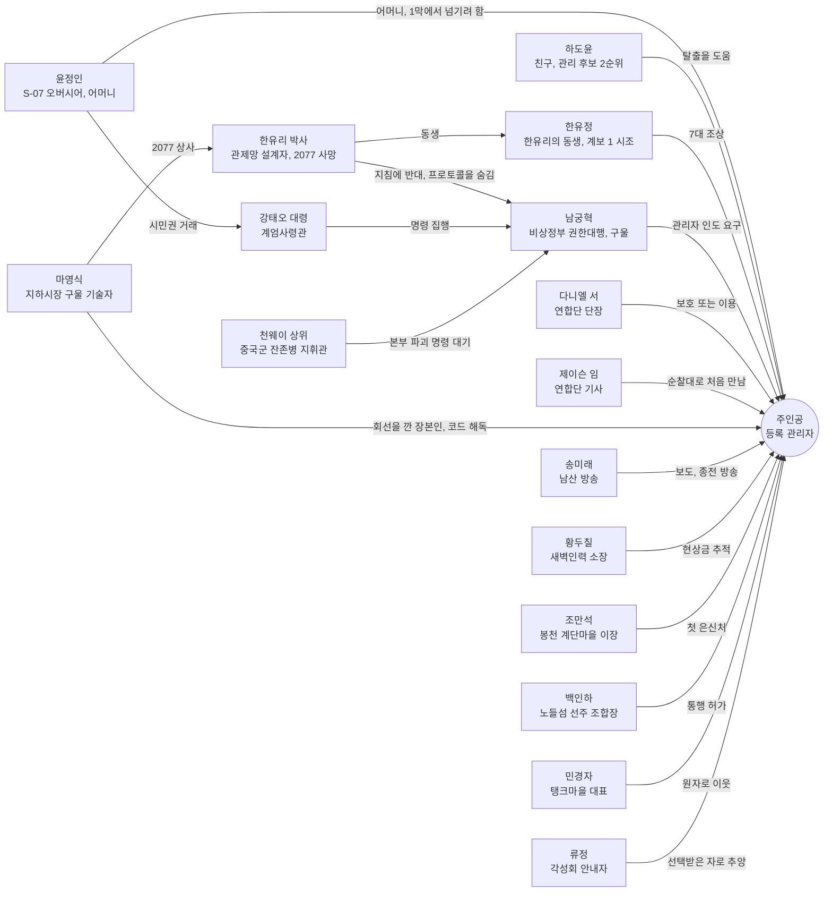

# SD-03. 메인 스토리·메인 퀘스트

> **서울 폴아웃 상세 기획서 세트** | 문서 ID: SD-03 | 버전: v1.0 | 작성일: 2026-10-12
> **범위**: 메인 스토리 전체(시놉시스, 전사, 주제, 인물 관계), 막 구조와 흐름도, 게임 변수(플래그) 설계, 메인 퀘스트 15개(MQ-P1~P4, MQ-01~MQ-11) 상세, 엔딩 E1~E5와 '종전' 방송, 결말 슬라이드 ES-01~ES-24 전체 문안, 엔딩 이후 월드 상태, 볼륨 추정과 버티컬 슬라이스 범위. **다루지 않는 것**: 사이드 퀘스트 상세(SD-04), 비표시·반복 퀘스트와 랜덤 인카운터(SD-05), 세력 설정 전체(SD-06), 인물 프로필·동료 영입 규칙(SD-07), 장소 구조(SD-08·SD-09), 판정 공식(SD-10), 전투 수치(SD-11), 아이템 수치(SD-13), 적 데이터(SD-14)
> **관련 문서**: [SC-00 컨셉](00_concept.md), [SD-01 게임 개요](01_game-overview.md), [SD-02 세계관·연표](02_world-and-lore.md), [SD-04 사이드 퀘스트](04_side-quests.md), [SD-05 비표시·반복 퀘스트, 랜덤 인카운터](05_misc-quests-encounters.md), [SD-06 세력](06_factions.md), [SD-07 인물](07_characters.md), [SD-08 월드·권역](08_world-regions.md), [SD-09 장소 카탈로그](09_location-catalog.md), [SD-10 캐릭터 시스템](10_character-system.md), [SD-11 전투 시스템](11_combat-system.md), [SD-12 탐험·UI](12_exploration-ui.md), [SD-13 아이템](13_items.md), [SD-14 크리처·적](14_creatures-enemies.md), [SD-17 사운드](17_sound.md), 원작 [RD-03](../reverse-design/03_main-story-part1.md)·[RD-04](../reverse-design/04_main-story-part2-endings.md)·[RD-14](../reverse-design/14_character-system.md)·[RD-27](../reverse-design/27_adaptation-notes.md)

---

## 목차

1. [문서 개요](#1-문서-개요)
2. [메인 스토리 총론](#2-메인-스토리-총론)
3. [구조·흐름·변수 설계](#3-구조흐름변수-설계)
4. [퀘스트 상세: 프롤로그](#4-퀘스트-상세-프롤로그)
5. [퀘스트 상세: 1막 미등록자](#5-퀘스트-상세-1막-미등록자)
6. [퀘스트 상세: 2막 열쇠](#6-퀘스트-상세-2막-열쇠)
7. [퀘스트 상세: 3막 종전](#7-퀘스트-상세-3막-종전)
8. [엔딩](#8-엔딩)
9. [결말 슬라이드 전체 문안](#9-결말-슬라이드-전체-문안)
10. [엔딩 이후 월드 상태](#10-엔딩-이후-월드-상태)
11. [볼륨 추정과 버티컬 슬라이스](#11-볼륨-추정과-버티컬-슬라이스)
12. [원작 대응](#12-원작-대응)
13. [쯔꾸르 제작 메모](#13-쯔꾸르-제작-메모)
14. [미결 사항](#14-미결-사항)
15. [부록](#15-부록)

---

## 1. 문서 개요

### 1.1 목적
- 바이블 [SC-00 §5](00_concept.md)에서 확정한 메인 스토리(구조, 퀘스트 15개, 엔딩 5갈래)를 **이벤트·변수 단위로 바로 만들 수 있는 수준**까지 채운다.
- 퀘스트마다 발동 조건, 단계별 목표, 장면, 다중 해법과 판정 수치, 카르마, 보상, 분기, 대사, 연출을 정한다. 엔딩은 판정 로직과 슬라이드 문안 전체를 정한다.
- 원작 폴아웃 3에서는 **설계 패턴만** 가져온다(볼트 프롤로그의 캐릭터 생성, 다중 해법, 카르마 분기, 정착지 운명, 결말 슬라이드). 줄거리는 가져오지 않는다(§12.2 확인표).

### 1.2 요약
- 주인공은 무언가를 쫓지 않는다. **모두가 주인공을 쫓는다.** 비상정부는 데려가려 하고, 새벽인력은 현상금을 노리고, 연합단은 지키거나 이용하려 한다.
- 이야기의 축은 **"200년 전의 명령을 누가, 어떻게 끝내는가"**다. 볼트, 연합단, 중국군 잔존병, 비상정부, 관제망 로봇이 각자 끝나지 않은 명령을 따른다. 주인공은 그 모든 명령이 가리키는 열쇠(등록 관리자)다.
- 구조는 프롤로그 4 → 1막 선형 4 → 2막 허브(MQ-05 + 순서 자유 3 + MQ-09) → 3막 동맹 선택 2 → 엔딩 5갈래 + 결말 슬라이드 24종이다.
- 원작 대비 새로 넣은 장치 셋: ① 프롤로그의 서류(출생신고서, 생활기록부, 적성 평가지)가 곧 캐릭터 생성 화면이다. ② 적성 평가 10번 문항의 답이 마지막 콘솔에서 다시 불려 나온다. ③ 콘솔 앞에서 동맹을 배신할 수 있고, 배신하면 그 자리에서 최종 전투가 바뀐다.

### 1.3 표기 규칙

| 표기 | 뜻 |
|---|---|
| **[화술·보통]** | 화술 판정. 서울판은 원작 확률식을 유지한다([RD-27 §6](../reverse-design/27_adaptation-notes.md)). 난이도 5단계와 '권장 화술'(카리스마 5, 호감 50, 카르마 0일 때 성공률 약 70%가 되는 화술값)은 아래 표. 최종 공식은 SD-10 |
| **[과학 50]** 등 | 스킬 고정 판정. 수치 이상이면 자동 성공(원작 자물쇠·터미널과 같은 방식). 25/50/75/100 4단계를 쓴다 |
| **[힘 7]** 등 | S.P.E.C.I.A.L. 고정 판정. 수치 이상이면 선택지가 열리고 자동 성공 |
| **[증거]** | 특정 아이템을 가졌을 때 열리는 선택지. 화술 판정 난이도를 한 단계 낮추거나 자동 성공시킨다 |
| **[카르마: 선/악]** | 카르마 구간 조건 선택지 |
| **카르마 +N / -N** | 카르마 수치 증감(범위 -1,000~+1,000, [RD-14 §7](../reverse-design/14_character-system.md)) |
| `V_XXX`, `S_XXX` | 게임 변수(V)와 스위치(S). 전체 목록은 §15.2 |
| 퀘스트 로그 문구 | 핍-보이 DATA 탭에 뜨는 목표 문장. 작은따옴표 없이 그대로 쓴다 |
| 사이드 연계 후보 | SD-04·SD-05가 사이드 퀘스트로 만들 수 있는 접점. ID는 매기지 않는다 |

| 화술 난이도 | 원작 배수 | 권장 화술(카리스마 5) | 성공 XP | 메인 퀘스트 사용처 |
|---|---|---|---|---|
| 아주 쉬움 | 0.018 | 30 | 5 | 프롤로그 |
| 쉬움 | 0.012 | 50 | 10 | 1막 |
| 보통 | 0.009 | 65 | 20 | 1막 후반~2막 |
| 어려움 | 0.006 | 95 | 30 | 2막 핵심, 3막 |
| 아주 어려움 | 0.004 | 카리스마 8 이상 + 화술 100 | 50 | 증거 없이 결정적 설득을 노릴 때만 |

- 메인 퀘스트의 결정적 설득(천웨이, 남궁혁, 강태오, 다니엘 서)은 **증거 아이템으로 난이도를 낮추는 구조**다. 화술만으로는 어렵고, 탐험으로 모은 증거가 설득을 연다.
- 은신은 실시간 시야 판정이므로 '은신 해법'은 판정 수치가 아니라 **경로 설계**로 적는다. 소매치기만 [은신 N]으로 적는다.

---

## 2. 메인 스토리 총론

### 2.1 시놉시스 (결말 포함)

**프롤로그 — 서류로 태어난 아이 (2258~2277, 볼트 S-07)**
2258년 관악산 아래 볼트 S-07. 젊은 오버시어 윤정인이 아이를 낳는다. 행정실 서기가 출생신고서를 단말기에 넣는 순간, 200년 동안 한 번도 응답하지 않던 '관제망 회선' 칸에 불이 한 번 들어왔다 꺼진다. 시험 성적이 거주 구역과 배급과 결혼 허가를 정하는 적성 평가 사회에서 아이는 생활기록부를 채우며 자라고, 열여섯 살 적성 평가에서 어떤 답을 쓰든 같은 판정을 받는다. **'관리 후보 1순위'.** 평가관도 오버시어도 그 뜻을 모른다.
2277년, 수경 농장이 곰팡이병으로 죽어 가자 윤정인은 몇 해째 수신되던 비상정부의 '개방 지령'에 응해 200년 만에 문을 연다. 들어온 것은 교역 상대가 아니라 계엄군이다. 강태오 대령은 2077년의 서류를 읽어 '등록 관리자 인도'를 요구하고, 윤정인은 주민 전원의 1등급 시민권을 받는 대가로 자식을 넘기기로 한다. 주인공은 친구 하도윤이 열어 준 비상 배수 갱도로 빠져나와, 관악산 비탈에서 처음으로 무너진 서울을 내려다본다. 하도윤은 갱도를 닫다가 붙잡힌다.

**1막 — 미등록자 (관악 → 여의도 → 영등포 → 한강)**
봉천 계단마을의 이장 조만석은 볼트에서 내려온 아이에게 수도 황무지의 규칙을 가르친다. 국민방송은 주인공에게 현상금을 걸었고, 인신매매단 새벽인력의 소장 황두칠이 마을로 사람을 보낸다. 주인공은 볼트에서 빼 온 기록이 가리키는 여의도 지하 벙커로 간다. 그곳은 2077년 관제망 관리 요원들의 비상 집결지였다. 요원들은 오지 않는 호송차를 기다리다 그 자리에서 죽었다. 벙커 기록에서 관제망과 '관리자 인도' 지령의 정체가 드러나고, 계엄군 수색조와 첫 충돌이 벌어진다. 영등포 지하시장의 구울 기술자 마영식은 핍-보이의 코드를 해독한다. 주인공의 출생 등록 자체가 관제망의 관리자 인증 정보이고, 2077년 S-07과 관제망을 잇는 회선을 깐 사람이 바로 마영식 자신이다. 관제망을 막을 무력은 강 건너 용산의 연합단에게만 있다. 주인공은 노들섬의 통행 정치를 풀거나 침수된 하저 터널을 지나 한강을 건너고, 강 북쪽에서 연합단 순찰대와 만난다.

**2막 — 열쇠 (용산 → 당인리·세진 타워·북한산 → 청계산)**
연합단 단장 다니엘 서는 관제망의 로봇 군대가 깨어나면 서울이 끝난다고 본다. 부수든 쥐든 먼저 세 가지를 확인해야 한다. 전원(당인리 지하 원자력 발전소), 설계자의 비밀(세진전자 타워), 본부로 가는 길(북한산). 주인공은 원하는 순서로 셋을 푼다. 당인리에서는 반쯤 잠긴 원자로를 되살리거나 봉인하거나 터뜨린다. 세진 타워 꼭대기에서는 설계자 한유리 박사가 '비상 주민 분류 지침'에 맞서 **시민 보호 프로토콜**을 숨겨 두었고, S-07의 관리 계보가 그녀의 동생 한유정의 핏줄, 곧 주인공의 집안이라는 것을 안다. 북한산에서는 2077년에 관제 본부를 파괴하러 들어와 200년째 철수 명령을 기다리는 천웨이 상위의 부대를 만난다. 싸우거나, 속이거나, 전쟁이 끝났다는 것을 증명한다.
셋 중 둘을 마치면 비상정부가 움직인다. 계엄군이 볼트 S-07을 장악하고 어머니와 주민을 볼모로 잡는다. 청계산 벙커에서 권한대행 남궁혁이 주인공을 기다린다. 그는 2077년에 그 지침에 서명한 행정안전부 장관이고, 지금은 구울이다. 주인공은 그의 편에 서거나, 벙커를 무너뜨리거나, 어머니와 볼트를 구해 빠져나온다.

**3막 — 종전 (지하철 → 밀폐 도심 → 광화문 지하)**
주인공은 연합단, 비상정부, 시민 연합, 혼자 중 하나를 고르고 지하철로 밀폐된 도심에 들어간다. 전원이 들어온 관제망의 로봇이 깨어나고, 각 세력이 관제 본부로 몰려든다. 광화문 지하 관리자 콘솔은 주인공의 생체 인증을 받고, 열여섯 살 때 적어 낸 10번 문항의 답을 화면에 띄운 뒤 묻는다. 명령을 입력하십시오.
- **E1 계엄 프로토콜 가동**: 로봇이 미등록자를 쓸어 내고 서울은 거대한 볼트가 된다.
- **E2 연합단에 지휘권 이양**: 총으로 지키는 질서가 온다.
- **E3 시민 등록**: 서울의 모든 생존자가 시민이 되고 로봇은 모두를 지킨다.
- **E4 관제망 영구 정지**: 로봇도 명령도 멈춘다. 서울은 맨손으로 다시 시작한다.
- **E5 관리자 군림**: 주인공이 관제망의 주인이 된다.
결정은 남산 송신탑을 타고 서울 전역의 가두 스피커로 '종전' 방송이 되어 나가고, 결말 슬라이드가 이어진다. 엔딩 뒤에도 바뀐 서울에서 계속 플레이할 수 있다.

### 2.2 전사: 2077년에 일어난 일 (플레이어가 단계적으로 알게 되는 진실)

| 순서 | 사실 | 플레이어가 아는 시점 | 근거 기록 |
|---|---|---|---|
| 1 | 세진전자가 2070년대에 수도 관제망을 설계·시공했다. 설계 책임자는 수석 기술자 한유리 박사다 | MQ-02 | 여의도 벙커 터미널 |
| 2 | 2075년 '비상 주민 분류 지침'이 관제망의 기본 프로토콜로 들어갔다. 서명자는 행정안전부 장관 남궁혁이다 | MQ-02(지침), MQ-07(서명자) | 벙커 공문, 세진 타워 기록 |
| 3 | 관제망은 살아 있는 '등록 관리자'의 생체 인증으로만 명령을 받는다. 2077년 관리자 12명은 여의도 벙커에 집결했으나 호송차가 오지 않았다 | MQ-02 | 집결지 출석부, 유해 |
| 4 | 관리자 전원 유고에 대비해 세진전자는 볼트 S-07의 출생 등록 체계를 관제망 관리자 대장에 연결했다. 회선 시공자는 협력사 영신통신의 기술자 마영식이다 | MQ-03 | 마영식의 증언, 시공 일지 |
| 5 | 관리 후보는 '관리 계보'에서 뽑힌다. 계보 1은 한유리의 동생 한유정의 가계, 계보 2는 세진전자 연구원 하씨 가계다. 적성 평가 점수는 관리 후보 순위에 반영되지 않는다. 순위는 계보와 출생 순서로 정해진다 | MQ-07 | 한유리의 기록, S-07 계보 대장 |
| 6 | 한유리는 지침이 켜지면 서울 시민 대부분이 '적성 분자'가 된다는 것을 알고 반대했다. 막지 못하자 **시민 보호 프로토콜**을 몰래 만들어 세진 타워 최상층에 숨겼다. 적성 평가 10번 문항은 그녀가 넣은 것이다 | MQ-07, MQ-11 | 수석 연구실 금고, 콘솔 메시지 |
| 7 | 중국군 특수부대 한 개 중대가 2077년 초 북한산 남쪽 비탈에서 관제 본부 방향으로 침투 갱도를 팠다. 10월 23일 폭파 직전 관제망 전원이 끊기며 본부 차단벽이 닫혔고, 부대는 '전원이 돌아오면 다시 시도하라, 철수 명령 전까지 대기'라는 마지막 명령 속에 남았다 | MQ-08 | 천웨이의 근무일지 |
| 8 | 남궁혁은 대전쟁 뒤 청계산 벙커에서 대통령 유고로 권한대행이 되었고, 벙커 사고로 구울이 되었다. 그는 2077년 10월 23일의 국가를 그날의 서류대로 복원하는 것을 자기 임무로 여긴다 | MQ-09 | 남궁혁 면담 |

- 플레이어는 이 사실을 1막부터 3막까지 한 겹씩 얻는다. 5번(주인공의 계보)과 6번(시민 보호 프로토콜)은 MQ-07에서 함께 드러나는 이야기의 중심 반전이다. MQ-07을 마지막으로 미뤄도 MQ-09에서 남궁혁이 5번을 말해 준다(6번은 MQ-07에서만 얻는다).

### 2.3 주제 '끝나지 않은 명령'의 막별 표현

| 막 | 끝나지 않은 명령 | 그 명령을 따르는 자 | 주인공이 마주하는 질문 | 주제를 드러내는 장치 |
|---|---|---|---|---|
| 프롤로그 | "볼트를 지켜라", "시험을 치르라" | 윤정인, 보안부장 도경철, 평가관 차명수 | 지키라는 명령이 사람을 넘기라는 뜻이 될 때 | 출생신고서의 응답 없는 칸, 무슨 답을 써도 같은 판정, 어머니의 거래 |
| 1막 | "비상 집결지로 모여 호송을 기다려라", "장부의 빚은 사람으로 받는다" | 여의도 벙커의 관리 요원 유해, 새벽인력, 계엄군 수색조, 마영식 | 명령을 따른 사람에게 책임이 있는가 | 집결지 출석부, 새벽인력 장부, 회선을 깐 기술자의 죄책감 |
| 2막 | "기지를 지켜라", "관제 본부를 파괴하라", "지침을 집행하라" | 연합단, 천웨이 부대, 계엄군, 각성회 | 명령을 거둘 사람이 없을 때 누가 끝내는가 | 천웨이의 73,000일 근무일지, 한유리의 불복종, 남궁혁의 서명 |
| 3막 | 관제망 기본 프로토콜(2077-10-23 계엄의 계속) | 관제망 로봇, 수문장 | 이제 명령을 내리는 사람은 주인공이다 | 콘솔이 띄우는 10번 문항, '종전' 방송 |

- 반복 모티프: **문**. 볼트 문(프롤로그), 벙커 문(1막), 관제 본부 차단벽(2막), 콘솔 화면 속 10번 문항의 '문을 열고 밖을 본다'(3막). 마지막 선택은 결국 어떤 문을 여느냐다.
- 원작의 "전쟁은… 변하지 않는다"에 대한 응답 문장 **"명령은 끝나지 않는다. 누군가 끝내기 전까지는."**은 오프닝 자막과 ES-24 맺음 슬라이드에서 수미상관으로 쓴다. E4·E3에서는 문장의 뒷부분이 바뀐다(§9.14).

### 2.4 인물 관계도

### 2.5 주요 인물의 메인 스토리 속 역할

| 인물 | 고정/신규 | 메인 스토리 속 기능 | 등장 퀘스트 | 생사·분기 |
|---|---|---|---|---|
| 윤정인 | 고정 | 주인공의 어머니, S-07 오버시어. "볼트를 지켜라"라는 명령을 따르다 자식을 넘기려 한다. 2막 끝 볼모. 주인공이 용서할지 정한다 | P1~P4, MQ-09, MQ-11(조건부) | `V_MOTHER`: 화해 생존 / 결별 생존 / 사망 / 비상정부 편 |
| 하도윤 | 고정(동료) | 동갑 친구. 배수 갱도를 열어 주고 붙잡힌다. 관리 후보 2순위라 비상정부가 '예비 열쇠'로 데려간다 | P2~P4, MQ-02 또는 MQ-09에서 구출 | `V_DOYUN`: MQ-02 구출 / MQ-09 구출 / 사망 / 비상정부 억류 |
| 남궁혁 | 고정 | 최종 적대 정부의 수장. 2077년 지침의 서명자이자 그 지침의 마지막 집행자. 악당이 아니라 '서류대로 사는 사람'으로 그린다 | 목소리(국민방송) 1막~, 대면 MQ-09, MQ-11 | `V_NAMGUNG`: 생존 집권 / 사망 / 퇴진 |
| 강태오 대령 | 고정 | 계엄사령관. 벙커에서 태어난 3대째 군인. 주인공을 쫓는 현장 지휘관. 3막에서 투항시키거나 쓰러뜨린다 | P4, MQ-02(무전), MQ-06, MQ-09, MQ-10 | `V_KANG`: 적대 / 사망 / 투항 / 충성 유지 |
| 다니엘 서 | 고정 | 연합단 단장. 2막 허브의 의뢰인. 관제망을 부수든 쥐든 연합단 손으로 하려 한다 | MQ-05, 허브 보고, MQ-10·11(연합단 동맹) | 콘솔 배신 시 적대 |
| 제이슨 임 | 고정(동료) | 연합단 기사. 1막 끝에서 주인공을 요새로 데려간다. 연합단 안의 온건파 | MQ-04, MQ-05, MQ-10 | 동료 영입 규칙은 SD-07 |
| 마영식 | 고정 | 2077년 회선 시공자. 1막의 해설자, 3막 시민 연합의 기술 책임자. E3에서 프로토콜 테이프를 판독기에 건다 | MQ-03, MQ-07(무전 조언), MQ-10·11 | 시민 연합 동맹이면 콘솔실까지 동행. 생존 고정 |
| 천웨이 상위 | 고정 | 명령에 갇힌 병사. 주인공의 거울(주인공은 명령을 받을 사람, 천웨이는 명령을 기다리는 사람) | MQ-08, MQ-10·11(미해결 시) | `V_CW` 6종 |
| 송미래 | 고정 | 남산 방송 진행자. 막마다 주인공을 보도한다. 2077 감청 일지를 보관한다. 종전 방송을 잇는다 | 라디오 상시, MQ-05(인터뷰), MQ-08(증거), MQ-11 | E1에서 체포(슬라이드) |
| 한유리 박사 | 고정(기록만) | 관제망 설계자. 기록 7편과 콘솔 메시지로만 등장한다. 불복종의 본보기 | MQ-02, MQ-03, MQ-07, MQ-11 | 2077 사망 |
| 조만석 | 고정 | 봉천 계단마을 이장. 황무지의 규칙을 가르치는 첫 어른. 시민 연합의 첫 지지자 | MQ-01, MQ-10(시민 연합) | MQ-01에서 사망 가능 |
| 백인하 | 고정 | 노들섬 선주 조합장. 다리와 섬의 통행 정치. 시민 연합 지지자 | MQ-04, MQ-10(시민 연합) | MQ-04에서 실각 가능 |
| 민경자 | 고정 | 탱크마을 대표. 원자로 재가동의 이해 당사자 | MQ-06 | 원자로 파괴 시 마을 피해 |
| 황두칠 | 고정 | 새벽인력 소장. 1막의 추적자. 노들섬에서 결판 | MQ-01(부하), MQ-04(직접) | 사망 / 도주 / 거래 |
| 류정 | 고정 | 각성회 안내자. 관제망을 수호신으로 믿는다. 주인공을 '등록된 자의 첫째'라 부른다 | MQ-07, MQ-10 | 설득 시 시민 연합 지지 |
| 백구 | 고정(동료) | 진돗개. MQ-01 첫 장면의 관악산 들개 무리 속에서 만난다 | MQ-01 | 영입 규칙 SD-07 |
| 박춘삼 | 고정(동료) | 지하시장 계약 구울 경호원. MQ-03에서 고용 가능 | MQ-03 | SD-07 |
| 파수-3 | 고정(동료) | 세진전자 경비 로봇. MQ-07 세진 타워에서 관리자 코드에 반응해 깨어난다. MQ-11 수문장 전투의 특수 해법 | MQ-07, MQ-11 | SD-07 |
| 진세라 | 고정(동료) | 철벽경호 용병. MQ-04 노들섬의 현상금 사냥꾼 중 하나로 처음 만난다 | MQ-04 | SD-07 |
| 독사 | 고정(동료) | 새벽인력 추심원. MQ-01에서 봉천에 온 추적조의 조장 | MQ-01, MQ-04 | SD-07 |
| 큰돌 | 고정(동료) | 평화적인 변종. 메인 퀘스트와 직접 엮지 않는다. MQ-10 도심 지하철에서 조우 대사만 있다 | MQ-10(조건부 대사) | SD-04·SD-07 |

- 신규 조연(차명수, 도경철, 방금례, 신혜령, 나채윤, 한유정, 석진혁, 허문경, 엄태식, 에밀리 차, 마커스 노, 여금순, 물개, 맹구철, 저우린)은 §15.1 부록에 적었다.

### 2.6 감정선

| 구간 | 감정 | 장면 |
|---|---|---|
| 프롤로그 | 소속감 → 배신감 | 돌잔치, 첫 핍-보이, 친구의 누명, 어머니의 거래 |
| 1막 | 고립 → 이해 | 현상금 방송, 벙커의 유해, 마영식의 고백 |
| 2막 전반 | 탐구 → 정체성 | 한유리의 기록, "네 집안이었다" |
| 2막 끝 | 분노와 연민 | 볼모가 된 어머니, 남궁혁의 논리 |
| 3막 | 책임 | 동료와 세력이 주인공의 명령을 기다린다 |
| 엔딩 | 해소(또는 서늘함) | 종전 방송, 슬라이드 |

---
