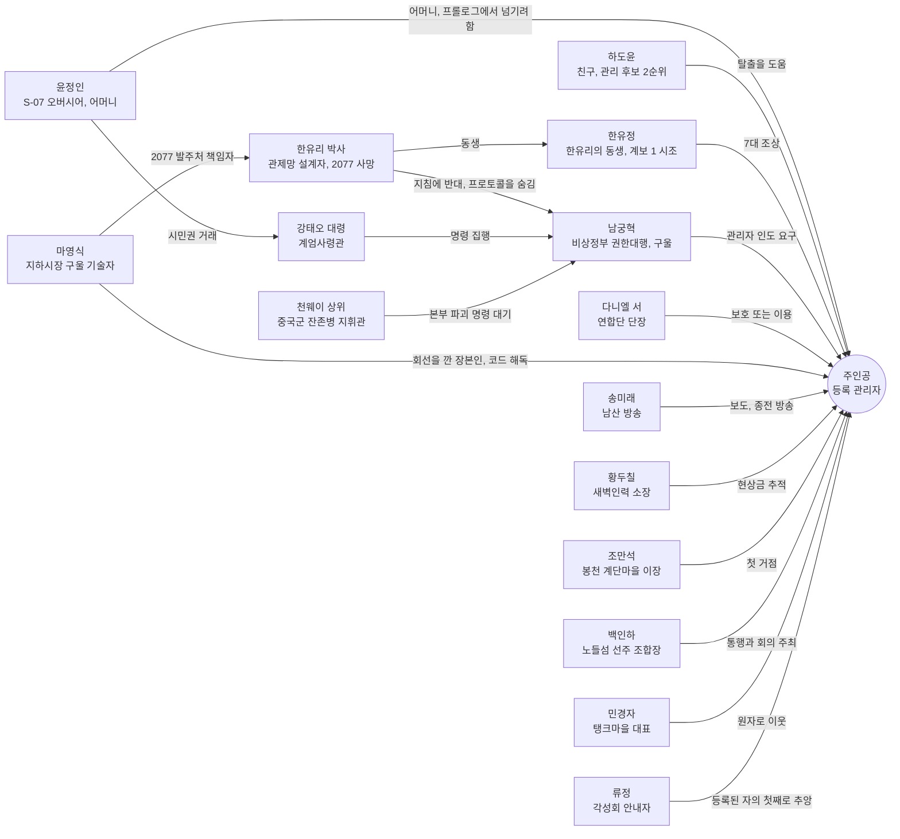
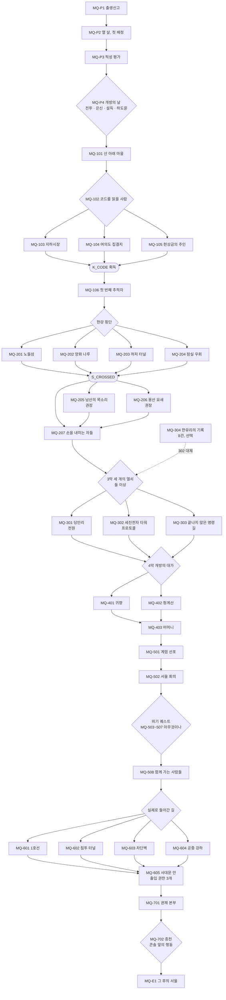

# SD-03a. 메인 스토리·메인 퀘스트 1부

> **서울 폴아웃 상세 기획서 세트** | 문서 ID: SD-03a | 버전: v1.0 | 작성일: 2026-10-12
> **범위**: 메인 스토리 총론(시놉시스, 2077년 전사, 주제, 인물 관계), 프롤로그 + 7막 + 에필로그의 전체 구조와 자유도 규칙, 막 전환 판정 플래그와 전체 변수표, 세력 호감도 연동 규칙(메인 퀘스트별 증감량과 메인에서의 쓰임), 순서 파괴 시 퀘스트 갱신 규칙, 핵심 NPC 사망 시 대체 경로, 퀘스트 상세 **프롤로그(MQ-P1~P4)·1막(MQ-101~106)·2막(MQ-201~207)·3막(MQ-301~304)**. **다루지 않는 것**: 4막~7막·에필로그 퀘스트 상세, 엔딩 E1~E5, 결말 슬라이드(→ [SD-03b](03b_main-story-part2.md)), 사이드 퀘스트(SD-04a~d), 비표시·반복 퀘스트와 랜덤 인카운터(SD-05), 세력 설정과 호감도 시스템 본체(SD-06), 인물 프로필(SD-07a), 장소 구조·좌표(SD-08·SD-09a~f), 판정 공식(SD-10), 전투·아이템·적 수치(SD-11·13·14)
> **관련 문서**: [SC-00 컨셉](00_concept.md), [SD-01 게임 개요](01_game-overview.md), [SD-02 세계관·연표](02_world-and-lore.md), [SD-03b 메인 스토리 2부](03b_main-story-part2.md), [SD-04a 사이드(남부)](04a_side-quests-south.md), [SD-04b 사이드(서부·한강)](04b_side-quests-west-river.md), [SD-04c 사이드(북부·동부·도심)](04c_side-quests-north-east-center.md), [SD-04d 세력 퀘스트 라인](04d_faction-questlines.md), [SD-05 비표시·반복·인카운터](05_misc-quests-encounters.md), [SD-06 세력](06_factions.md), [SD-07a 주요 인물](07a_characters-major.md), [SD-07b NPC 디렉터리](07b_npc-directory.md), [SD-08 월드·권역](08_world-regions.md), [SD-10 캐릭터 시스템](10_character-system.md), [SD-11 전투](11_combat-system.md), [SD-12 탐험·UI](12_exploration-ui.md), [SD-13 아이템](13_items.md), [SD-14 크리처·적](14_creatures-enemies.md), [SD-17 사운드](17_sound.md), 원작 [RD-03](../reverse-design/03_main-story-part1.md)·[RD-04](../reverse-design/04_main-story-part2-endings.md)·[RD-14](../reverse-design/14_character-system.md)·[RD-27](../reverse-design/27_adaptation-notes.md)

---

## 목차

1. [문서 개요](#1-문서-개요)
2. [메인 스토리 총론](#2-메인-스토리-총론)
3. [전체 구조와 자유도 규칙](#3-전체-구조와-자유도-규칙)
4. [막 전환 판정과 변수 설계](#4-막-전환-판정과-변수-설계)
5. [세력 호감도 연동 규칙](#5-세력-호감도-연동-규칙)
6. [순서 파괴와 대체 경로](#6-순서-파괴와-대체-경로)
7. [퀘스트 상세: 프롤로그 「S-07」](#7-퀘스트-상세-프롤로그-s-07)
8. [퀘스트 상세: 1막 「미등록자」](#8-퀘스트-상세-1막-미등록자)
9. [퀘스트 상세: 2막 「강」](#9-퀘스트-상세-2막-강)
10. [퀘스트 상세: 3막 「세 개의 열쇠」](#10-퀘스트-상세-3막-세-개의-열쇠)
11. [원작 대응](#11-원작-대응)
12. [쯔꾸르 제작 메모](#12-쯔꾸르-제작-메모)
13. [미결 사항](#13-미결-사항)
14. [부록](#14-부록)

---

## 1. 문서 개요

### 1.1 목적
- 바이블 [SC-00 v0.3 §5](00_concept.md)의 메인 스토리(프롤로그 + 7막 + 에필로그, 막별 다중 경로, 세력 호감도, 동료 없음)를 **이벤트·변수 단위로 바로 만들 수 있는 수준**까지 채운다.
- 두 문서로 나눈다. **SD-03a(이 문서)**는 전체 규칙과 프롤로그~3막, **[SD-03b](03b_main-story-part2.md)**는 4막~7막, 엔딩, 결말 슬라이드, 에필로그를 다룬다. 변수와 호감도 규칙의 정본은 이 문서 §4·§5다. SD-03b는 이를 참조만 한다.
- 원작 폴아웃 3에서는 **설계 패턴만** 가져온다(볼트 프롤로그의 캐릭터 생성, 다중 해법, 화술·스킬 판정, 카르마 분기, 정착지 운명, 결말 슬라이드). 줄거리는 가져오지 않는다(§11.2 확인표).

### 1.2 요약
- 주인공은 무언가를 쫓지 않는다. **모두가 주인공을 쫓는다.** 비상정부는 데려가려 하고, 새벽인력은 현상금을 노리고, 연합단은 지키거나 이용하려 한다.
- 이야기의 축은 **"200년 전의 명령을 누가, 어떻게 끝내는가"**다. 볼트, 연합단, 중국군 잔존병, 비상정부, 관제망 로봇이 각자 끝나지 않은 명령을 따른다. 주인공은 그 모든 명령이 가리키는 열쇠(등록 관리자)다.
- **월드는 프롤로그 직후 전부 열린다.** 막은 지역 잠금이 아니라 '이야기 진행 단계'이고, 세계 상태 플래그로 판정한다. 퀘스트는 장소가 아니라 **목표**로 주어지며, 다른 경로로 목표를 먼저 이루면 퀘스트가 그에 맞게 갱신된다. 핵심 인물이 죽어도, 어느 세력과 적대해도 메인 진행은 막히지 않는다(§6).
- **경로 퀘스트 원칙**: 막마다 목표에 이르는 경로가 2~5개다. 경로 하나를 마치면 막이 넘어가고(막 진행 XP 100%), 나머지 경로는 보너스(경로 XP 60% + 고유 정보·호감도·아이템)로 남는다(§3.4).
- **고르지 않고 기운다**(바이블 §5.8). 진영 가입, 동맹 확정, 결말을 고르는 메뉴나 "어느 편에 서겠습니까?" 같은 질문은 이 문서 어디에도 없다. 누구의 부탁을 실제로 들어줬는지, 원자로 열쇠·프로토콜 테이프·정보를 **누구 손에 두고 떠났는지**, 누구 곁에서 싸웠는지가 쌓여 서울이 기운다. 대화 선택지와 화술 판정은 개별 사안(이 사람을 살릴지, 값을 깎을지, 진실을 말할지)에만 쓴다.
- 기울기는 세 겹의 변수로 기록한다. ① **세력 호감도 8종**(비상정부, 연합단, 원칙파, 지하시장, 각성회, 중국군 잔존병, 새벽인력, 정착지 연합. 내부 수치, §5) ② **서울의 판도**(권역·정착지·핵심 시설 24칸의 지배 세력과 영향력, §4.5) ③ **핵심 물건의 인도처**(원자로 열쇠, 프로토콜 테이프, 기록 사본, 터널 정보 등 9종, §4.6). 이 셋이 2막 세력들의 접근, 3막 현장 협력자, 4막 동원, 5막 회의와 도심 진입 날 집결지, 6막 진입로, 7막 콘솔 곁에 선 세력과 그 자리에서 할 수 있는 행동을 정한다.
- 플레이어는 숫자 대신 **세계의 반응**으로 기울기를 느낀다. NPC의 호칭, 상점 가격, 순찰대의 태도, 남산 방송·국민방송의 뉴스, 정착지의 깃발과 경비, 핍-보이 지도 위 판도. 퀘스트마다 '기울기 체감' 항목에 이것을 적었다.
- **동료 시스템은 없다.** 원작 동료의 역할은 퀘스트 중 **일시 동행 NPC**와 호감도 '신뢰' 이상 세력의 **지원 병력 호출**로 대체한다(§5.5).
- 메인 퀘스트는 41개(프롤로그 4 + 본편 36 + 에필로그 1)다. 1회차 최소 필수량은 22개다(§3.1).

### 1.3 표기 규칙

| 표기 | 뜻 |
|---|---|
| **[화술·보통]** | 화술 판정. 서울판은 원작 확률식을 유지한다([RD-27 §6](../reverse-design/27_adaptation-notes.md)). 난이도 5단계와 '권장 화술'은 아래 표. 최종 공식은 SD-10 |
| **[과학 50]** 등 | 스킬 고정 판정. 수치 이상이면 자동 성공한다(원작의 자물쇠·터미널 방식). 25/50/75/100 4단계를 쓴다 |
| **[힘 7]** 등 | S.P.E.C.I.A.L. 고정 판정. 수치 이상이면 선택지가 열리고 자동 성공한다 |
| **[증거: 아이템명]** | 특정 아이템이나 정보 플래그가 있을 때 열리는 선택지. 화술 판정 난이도를 한 단계 낮추거나 자동 성공시킨다 |
| **[카르마: 선/악]** | 카르마 구간 조건 선택지 |
| **[호감: 세력 단계]** | 호감도 단계 조건 선택지. 예: [호감: 연합단 우호+]는 연합단 호감도 +20 이상 |
| **카르마 ±N** | 카르마 수치 증감(범위 -1,000~+1,000, [RD-14 §7](../reverse-design/14_character-system.md)) |
| **연합단 +N** | 해당 세력 호감도 증감(범위 -100~+100, 바이블 §6.2). 표에서는 약호를 쓴다(§5.1) |
| `V_XXX`, `S_XXX`, `K_XXX`, `AF_XXX`, `PD_XXX`, `HO_XXX` | 변수(V), 스위치(S), 지식 플래그(K), 호감도(AF), 서울의 판도(PD), 핵심 물건 인도처(HO). 전체 목록은 §4.7 |
| **판도 R01 +비상정부 10** | 해당 판도 칸에서 그 세력의 영향력 증감(§4.5) |
| **[인도: 열쇠 → 탱크마을]** | 핵심 물건을 누구 손에 두고 떠났는지 기록(§4.6) |
| **기울기 체감** | 그 퀘스트의 결과가 세계에서 어떻게 보이는지(호칭·가격·순찰·방송·깃발). 숫자 표시는 옵션으로만 둔다 |
| 퀘스트 로그 문구 | 핍-보이 DATA 탭에 뜨는 목표 문장. 본문에 그대로 쓴다 |
| 일시 동행 NPC | 퀘스트 구간 안에서만 함께 움직이는 NPC. 퀘스트 단계가 끝나면 자기 자리로 돌아간다 |
| 사이드 연계 후보 | SD-04a~d·SD-05가 사이드·세력·비표시 퀘스트로 만들 수 있는 접점. ID는 매기지 않는다 |
| 장소·인물·아이템 ID | 이 문서는 이름만 쓴다. L-ID는 SD-09a~f, C-ID는 SD-07a, W/A/I/M-ID는 SD-13, CR-ID는 SD-14에서 부여한다 |

| 화술 난이도 | 원작 배수 | 권장 화술(카리스마 5, 호감 50, 카르마 0일 때 성공률 약 70%) | 성공 XP | 메인 퀘스트 사용처 |
|---|---|---|---|---|
| 아주 쉬움 | 0.018 | 30 | 5 | 프롤로그 |
| 쉬움 | 0.012 | 50 | 10 | 1막 |
| 보통 | 0.009 | 65 | 20 | 1막 후반~3막 |
| 어려움 | 0.006 | 95 | 30 | 3막 핵심, 4막~7막 |
| 아주 어려움 | 0.004 | 카리스마 8 이상 + 화술 100 | 50 | 증거 없이 결정적 설득을 노릴 때만 |

- 메인 퀘스트의 결정적 설득(천웨이, 남궁혁, 강태오, 다니엘 서)은 **증거로 난이도를 낮추는 구조**다. 화술만으로는 어렵고, 탐험으로 모은 증거가 설득을 연다.
- 세력 호감도는 화술 판정에 보정을 준다(우호 +5%p, 신뢰 +10%p, 동맹 자동 성공 한 단계 낮춤, 경계 -10%p). 판정식 안의 '대상 호감' 항은 SD-10과 SD-06이 맞춘다.
- 은신은 실시간 시야 판정이므로 '은신 해법'은 판정 수치가 아니라 **경로 설계**로 적는다. 소매치기만 [은신 N]으로 적는다.

---

## 2. 메인 스토리 총론

### 2.1 시놉시스 (결말 포함)

**프롤로그 「S-07」 — 서류로 태어난 아이 (2258~2277)**
2258년 관악산 아래 볼트 S-07. 젊은 오버시어 윤정인이 아이를 낳는다. 행정실 서기가 출생신고서를 단말기에 넣는 순간, 200년 동안 한 번도 응답하지 않던 '관제망 회선' 칸에 불이 한 번 들어왔다 꺼진다. 시험 성적이 거주 구역과 배급과 결혼 허가를 정하는 적성 평가 사회에서 아이는 생활기록부를 채우며 자라고, 열여섯 살 적성 평가에서 어떤 답을 쓰든 같은 판정을 받는다. **'관리 후보 1순위'.** 평가관도 오버시어도 그 뜻을 모른다.
2277년, 수경 농장이 곰팡이병으로 죽어 가자 윤정인은 몇 해째 수신되던 비상정부의 '개방 지령'에 응해 200년 만에 문을 연다. 들어온 것은 교역 상대가 아니라 계엄군이다. 강태오 대령은 2077년의 서류를 읽어 '등록 관리자 인도'를 요구하고, 윤정인은 주민 전원의 1등급 시민권을 받는 대가로 자식을 넘기기로 한다. 주인공은 싸우거나, 숨거나, 어머니를 설득하거나, 친구 하도윤이 열어 준 배수 갱도로 빠져나와 관악산 비탈에서 처음으로 무너진 서울을 내려다본다. 관리 후보 2순위인 하도윤은 계엄군에게 붙잡힌다.

**1막 「미등록자」 — 내 핍-보이의 코드는 무엇인가 (R01·R02)**
봉천 계단마을 이장 조만석은 볼트에서 내려온 아이에게 수도 황무지의 규칙을 가르친다. 국민방송은 주인공에게 현상금을 걸었고, 새벽인력의 추심원 독사가 마을로 온다. 핍-보이에는 잠든 경비 로봇 곁을 지날 때마다 깜박이는 '관리자 코드'가 떠 있다. 코드를 읽을 길은 셋이다. 영등포 지하시장의 구울 기술자 마영식은 2077년 S-07과 관제망을 잇는 회선을 깐 장본인이다. 여의도 지하 벙커에는 2077년 관리 요원들이 오지 않는 호송차를 기다리다 죽은 비상 집결지가 있다. 새벽인력 본소의 황두칠 장부에는 현상금 의뢰서와 '관리자 인도 지령' 사본이 붙어 있다. 어느 길로든 주인공은 알게 된다. 자기 출생 등록 자체가 관제망의 관리자 인증 정보라는 것을. 그 순간 계엄사령관 강태오의 수색대가 직접 주인공 앞에 나타난다.

**2막 「강」 — 한강을 건너 세력과 만난다 (한강, R03·R04·R06·R07)**
관제망을 막을 수 있는 무력은 강 건너에 있다. 주인공은 노들섬의 다리 정치, 선유도 물 상인 조합의 배, 침수된 5호선 하저 터널, 강남 세이프빌을 거치는 잠실 우회 중 하나로 한강을 건넌다. 남산 방송의 송미래는 주인공의 이야기를 방송할지 묻는다. 처음으로 세상 앞에 서는 선택이다. 용산 요새의 연합단 단장 다니엘 서는 관제망을 부수든 쥐든 연합단 손으로 하려 한다. 주인공이 강을 건넜다는 소식이 퍼지자 서울의 다섯 세력(비상정부, 연합단, 각성회, 지하시장, 정착지 연합)이 각자의 방식으로 손을 내민다. 국민방송의 출두 권고와 검문소 수배 전단, 연합단의 수색 의뢰, 각성회의 순례 초대, 지하시장의 밀린 납품, 정착지들의 경비 요청이 월드 곳곳에 퍼진다. 무엇을 실제로 해 주는지가 서울을 기울이기 시작한다.

**3막 「세 개의 열쇠」 — 전원, 프로토콜, 길 (R03·R07·R09)**
관제망을 켜려면 전원, 본부, 관리자가 필요하다. 관리자는 이미 주인공이다. 주인공은 원하는 순서로 세 열쇠를 다룬다. 당인리에서는 반쯤 잠긴 원자로를 되살리거나 봉인하거나 터뜨린다. 세진전자 타워 꼭대기에서는 설계자 한유리 박사가 '비상 주민 분류 지침'에 맞서 **시민 보호 프로토콜**을 숨겨 두었고, S-07의 관리 계보가 그녀의 동생 한유정의 핏줄, 곧 주인공의 집안이라는 것을 안다. 북한산에서는 2077년에 관제 본부를 파괴하러 들어와 200년째 철수 명령을 기다리는 천웨이 상위의 부대를 만나 싸우거나, 속이거나, 전쟁이 끝났다는 것을 증명한다. 서울 곳곳에 흩어진 한유리의 기록 8건은 프로토콜을 대신할 수 있다. 어느 현장에서든 누가 주인공과 함께 움직였는지, 원자로 열쇠와 프로토콜 테이프를 누구 손에 두고 떠났는지가 곧 선택이다.

**4막 「개방의 대가」 — 볼트와 어머니 (R01·R11)** *(상세는 SD-03b)*
열쇠 둘이 정해지면 비상정부가 움직인다. 계엄군이 볼트 S-07을 점령하고 주민을 볼모로 잡는다. 어머니 윤정인은 청계산 벙커로 끌려간다. 주인공은 S-07로 돌아가 볼트를 되찾고, 청계산 벙커에서 권한대행 남궁혁과 마주한다. 그는 2077년에 그 지침에 서명한 행정안전부 장관이고, 지금은 구울이다. 주인공은 그의 요구(열쇠, 테이프, 생체 인증 견본)를 실제로 들어주거나, 벙커를 무너뜨리거나, 증거를 내밀어 물러나게 한다. 어머니의 결말은 주인공이 벙커와 볼트에서 한 일로 정해진다.

**5막 「서울 회의」 — 계엄과 동맹 (서울 전역)** *(SD-03b)*
전원이 들어온 관제망 일부가 깨어나고 계엄이 선포된다. 비상정부가 무너졌어도 계엄은 선포된다. 명령은 명령한 사람보다 오래 산다. 노들섬에서 열리는 서울 회의에 세력들이 모인다. 투표는 없다. 주인공이 꺼내는 증거와 약속, 그리고 회의 뒤에 실제로 지키는 행동이 결과를 만든다. 곧 연합단의 분열, 새벽인력의 인력시장, 각성회의 로봇 각성, 지하시장 봉쇄, 계엄군 총공세가 동시에 터진다. 주인공이 실제로 누구 곁에서 싸웠는지가 도심 진입 날 집결지에 나타날 세력을 정한다. 아무도 오지 않으면 혼자 간다.

**6막 「사대문 안」 — 밀폐된 도심 (R05)** *(SD-03b)*
1호선 지하 미로, 중국군의 침투 터널, 관리자 권한으로 여는 성벽 차단벽, 비상정부 버티버드 중 플레이어가 실제로 들어간 길이 진입로가 된다. 주인공은 경복궁, 광화문, 시청, 명동, 남대문시장을 뒤져 관제 본부 출입 권한 3개를 모은다.

**7막 「종전」 — 관리자 콘솔 (광화문 지하)** *(SD-03b)*
관제 본부 깊은 곳의 관리자 콘솔은 열여섯 살 때 적어 낸 적성 평가 10번 문항의 답을 화면에 띄우고 생체 인증 판을 켠다. 결정 메뉴는 없다. 주인공이 그 자리에서 실제로 하는 일이 결말이다. 기본 프로토콜 그대로 손을 올리면 계엄이 돌아가고(E1), 인증 뒤 나온 지휘 열쇠를 다니엘 서에게 건네면 연합단의 질서가 서고(E2), 들고 온 시민 보호 프로토콜 테이프를 꽂으면 모두가 시민이 되고(E3), 진공관 코어를 부수거나 당인리 전원선을 끊으면 모든 것이 멈추고(E4), 열쇠를 누구에게도 넘기지 않고 관리자 등록을 자기에게 고정하면 서울의 주인이 된다(E5). 곁에 선 세력은 그 손을 막거나 재촉한다. 주인공은 말로, 총으로, 혹은 몰래 움직여 대응한다. 결과는 남산 송신탑을 타고 서울 전역의 가두 스피커로 '종전' 방송이 되어 나간다.

**에필로그 — 그 후의 서울** *(SD-03b)*
결말 슬라이드가 결정, 카르마, 세력별 최종 호감도, 정착지와 인물의 운명을 보여 준다. 그 뒤 바뀐 서울에서 계속 플레이한다.

### 2.2 전사: 2077년에 일어난 일 (플레이어가 단계적으로 알게 되는 진실)

연도·시각은 [SD-02 §3.3](02_world-and-lore.md)을 따른다.

| # | 사실 | 기본으로 알게 되는 시점 | 다른 경로(§6.1) |
|---|---|---|---|
| T1 | 세진전자가 수도 관제망을 설계·시공했다(2077-09 정식 가동). 설계 책임자는 수석 기술자 한유리 박사다 | 1막 | 여의도 벙커, 지하시장, 남산 방송 아카이브 |
| T2 | 2075년 '비상 주민 분류 지침'이 관제망의 기본 프로토콜(계엄 프로토콜)로 들어갔다. 설계·서명자는 행정안전부 장관 남궁혁이다. 2077-10-23 23:21에 그가 전면 집행을 명령했고, 8분 뒤 23:29 전원이 끊겨 관제망은 '집행 모드에 들어간 직후의 상태'로 잠들었다 | 1막(지침), 3막(서명자·집행 명령) | 벙커 공문, 세진 타워, 남궁혁 본인 |
| T3 | 관제망은 살아 있는 '등록 관리자'의 생체 인증으로만 명령을 받는다. 2077년 관리자 12명은 여의도 벙커 비상 집결지에 모였으나 호송차가 오지 않았다 | 1막 | 여의도 벙커만(집결지 출석부) |
| T4 | 관리자 전원 유고에 대비해 세진전자는 볼트 S-07의 출생 등록 체계를 관제망 관리자 대장에 연결했다. 회선 시공자는 협력사 영신통신의 기술자 마영식이다 | 1막 | 마영식, 시공 일지(지하시장), 황두칠 장부의 지령 사본 |
| T5 | 관리 후보는 '관리 계보'에서 뽑힌다. 계보 1은 한유리의 동생 한유정의 가계, 계보 2는 세진전자 연구원 하씨 가계다. 적성 평가 점수는 순위에 반영되지 않는다. 순위는 계보와 출생 순서로 정해진다 | 3막(세진 타워) | 남궁혁(4막), S-07 오버시어 금고(프롤로그·4막), 한유리 기록 8건 중 2건 |
| T6 | 한유리는 지침이 켜지면 서울 시민 대부분이 '적성 분자'가 된다는 것을 알고 반대했다. 막지 못하자 **시민 보호 프로토콜**을 몰래 만들어 세진 타워 최상층에 숨겼다. 적성 평가 10번 문항은 그녀가 넣은 것이다 | 3막 | 프로토콜 본체는 세진 타워에만 있다. 내용은 기록 8건으로 재구성 가능 |
| T7 | 중국군 특수부대가 2077년 초 북한산 남쪽 비탈에서 관제 본부 방향으로 침투 터널을 팠다. 10월 23일 23:21 관제망 집행 모드로 본부 차단벽이 닫혀 폭파가 막혔고, 부대에 남은 마지막 명령은 **'전원이 돌아오면 다시 시도하라. 철수 명령 전까지 대기'**였다 | 3막 | 천웨이의 근무일지, 연합단 2077 전황 보고, 송미래의 감청 일지 |
| T8 | 남궁혁은 대전쟁 뒤 청계산 벙커에서 대통령 유고로 권한대행이 되었고, 벙커 원자로 사고로 구울이 되었다. 그는 2077년 10월 23일의 국가를 그날의 서류대로 복원하는 것을 자기 임무로 여긴다 | 4막 | 국민방송 연설(상시), 청계산 벙커 |

- T5(주인공의 계보)와 T6(시민 보호 프로토콜)은 MQ-302에서 함께 드러나는 이야기의 중심 반전이다. MQ-302를 하지 않아도 T5는 4막에서 남궁혁이 말해 준다. T6의 '프로토콜 본체'는 MQ-302에서만 얻고, 내용은 MQ-304(기록 8건)로 재구성할 수 있다.

### 2.3 주제 '끝나지 않은 명령'의 막별 표현

| 막 | 끝나지 않은 명령 | 그 명령을 따르는 자 | 주인공이 마주하는 질문 | 주제를 드러내는 장치 |
|---|---|---|---|---|
| 프롤로그 | "볼트를 지켜라", "시험을 치르라" | 윤정인, 보안부장 도경철, 평가관 차명수 | 지키라는 명령이 사람을 넘기라는 뜻이 될 때 | 출생신고서의 응답 없는 칸, 무슨 답을 써도 같은 판정, 어머니의 거래 |
| 1막 | "비상 집결지로 모여 호송을 기다려라", "장부의 빚은 사람으로 받는다" | 여의도 벙커의 관리 요원 유해, 새벽인력, 계엄군 수색대, 마영식 | 명령을 따른 사람에게 책임이 있는가 | 집결지 출석부, 새벽인력 장부, 회선을 깐 기술자의 죄책감 |
| 2막 | "기지를 지켜라(HOLD THE BASE)" | 연합단, 노들섬 선주 조합(다리를 지켜라) | 지키는 자는 누구를 위해 지키는가 | 연합단 성물 테이프, 송미래의 마이크, 세력들이 내미는 손(부탁·의뢰·위협) |
| 3막 | "관제 본부를 파괴하라, 철수 명령 전까지 대기" | 천웨이 부대, 계엄군 공병대, 각성회 | 명령을 거둘 사람이 없을 때 누가 끝내는가 | 천웨이의 73,000일 근무일지, 한유리의 불복종 |
| 4막 | "지침을 집행하라" | 남궁혁, 엄태식 대위, 윤정인 | 명령을 내린 사람을 벌하면 명령이 끝나는가 | 남궁혁의 서명, 볼모가 된 볼트 |
| 5막 | 관제망 계엄 프로토콜(주인 없이도 집행) | 깨어난 로봇, 계엄군 잔당, 새벽인력 | 명령이 사람 없이 돌아갈 때 | 비상정부가 무너져도 나오는 계엄 선포 방송 |
| 6막 | 2077-10-23 23:29에 멈춘 도심 | 차단벽, 대기 구역의 해골 | 200년 전 그 밤을 어떻게 지나갈 것인가 | 23:29에 멈춘 시계, '대기 구역' 노란 선 |
| 7막 | 관리자에게 넘겨지는 모든 명령권 | 수문장, 관제망 자체 | 이제 명령을 내리는 사람은 주인공이다 | 콘솔이 띄우는 10번 문항, '종전' 방송 |

- 반복 모티프는 **문**이다. 볼트 문(프롤로그), 벙커 문(1막), 다리와 수문(2막), 차단벽(3·6막), 볼트 문 재방문(4막), 판독기 개찰구(5막), 콘솔 화면 속 10번 문항의 '문을 열고 밖을 본다'(7막). 마지막 선택은 결국 어떤 문을 여느냐다.
- 원작의 "전쟁은… 변하지 않는다"에 대한 응답 문장 **"명령은 끝나지 않는다. 누군가 끝내기 전까지는."**은 오프닝 자막과 SD-03b의 맺음 슬라이드에서 수미상관으로 쓴다.
- 역사적 메아리: 2076년 반전 운동 '종전 행진'의 구호 "정전 123년, 이제는 종전을"([SD-02 §4.5](02_world-and-lore.md))은 7막 퀘스트 이름 〈종전〉과 E4로 이어진다. 송미래는 2막부터 종전 행진 유인물을 방송에서 읽는다.

### 2.4 인물 관계도

### 2.5 주요 인물의 메인 스토리 속 역할

동료는 없다. 아래 인물은 모두 퀘스트·세력 NPC이고, '일시 동행'으로 표시한 구간에서만 주인공과 함께 움직인다.

| 인물 | 구분 | 메인 스토리 속 기능 | 등장 퀘스트 | 생사·분기 변수 |
|---|---|---|---|---|
| 윤정인 | 핵심 | 주인공의 어머니, S-07 오버시어. "볼트를 지켜라"라는 명령을 따르다 자식을 넘기려 한다. 4막 볼모. 주인공이 용서할지 정한다 | P1~P4, MQ-401~403, MQ-702(조건부 회상) | `V_MOTHER` 6종 |
| 하도윤 | 핵심 | 동갑 친구. 관리 후보 2순위라 비상정부가 '예비 열쇠'로 데려간다. MQ-104·MQ-106 또는 4막에서 구할 수 있다. 구하면 봉천 계단마을에 머물며 정보와 회상 대사를 준다 | P2~P4(P4 일시 동행), MQ-104, MQ-106, MQ-402 | `V_DOYUN` 5종 |
| 남궁혁 | 핵심 | 최종 적대 정부의 수장. 2077년 지침의 서명자이자 그 지침의 마지막 집행자. 악당이 아니라 **서류대로 사는 사람**으로 그린다 | 국민방송 1막~, 대면 MQ-402, MQ-702 | `V_NAMGUNG` 4종 |
| 강태오 대령 | 주요 | 계엄사령관. 청계산 벙커에서 태어난 3대째 군인. 주인공을 쫓는 현장 지휘관. 투항시키거나 쓰러뜨린다 | P4, MQ-106, MQ-301, MQ-401, MQ-507, MQ-6xx~702 | `V_KANG` 5종 |
| 다니엘 서 | 주요 | 연합단 단장. 관제망을 부수든 쥐든 연합단 손으로 하려 한다 | MQ-206, MQ-207, MQ-503, MQ-508~702 | 사망 시 부단장 승계(§6.3) |
| 마영식 | 주요 | 2077년 회선 시공자. 1막의 해설자, 기록 8건의 재구성자, E3의 테이프 판독 기술자 | MQ-103, MQ-207, MQ-304, MQ-506, MQ-701·702 | 사망 시 대체 기술자(§6.3) |
| 천웨이 상위 | 주요 | 명령에 갇힌 병사. 주인공의 거울(주인공은 명령을 받을 사람, 천웨이는 명령을 기다리는 사람) | MQ-303, MQ-602, MQ-701(미해결 시) | `V_CW` 7종 |
| 송미래 | 주요 | 남산 방송 진행자. 막마다 주인공을 보도한다. 2077년 감청 일지를 보관한다. 종전 방송을 잇는다 | 라디오 상시, MQ-205, MQ-303(증거), MQ-702 | 사망 시 방송 대체(§6.3) |
| 한유리 박사 | 주요(기록만) | 관제망 설계자. 기록 8편과 콘솔 메시지로만 등장한다. 불복종의 본보기 | MQ-104, MQ-302, MQ-304, MQ-702 | 2077 사망 |
| 조만석 | 주요 | 봉천 계단마을 이장. 황무지의 규칙을 가르치는 첫 어른. 정착지들의 경비 요청을 처음 전하는 사람 | MQ-101, MQ-102, MQ-207, MQ-502 | 사망 시 부이장 승계 |
| 백인하 | 주요 | 노들섬 선주 조합장. 다리 통행 정치, 서울 회의 주최자 | MQ-201, MQ-207, MQ-502 | 실각·사망 시 회의 장소 이동(§6.3) |
| 민경자 | 주요 | 탱크마을 대표. 원자로 재가동의 이해 당사자 | MQ-301, MQ-502, MQ-507 | — |
| 황두칠 | 주요 | 새벽인력 소장. 1막의 추적자. 장부의 주인 | MQ-105, MQ-201(조건부), MQ-504 | 사망 시 독사 또는 부소장 승계 |
| 류정 | 주요 | 각성회 안내자. 관제망을 수호신으로 믿고 주인공을 '등록된 자의 첫째'라 부른다 | MQ-207, MQ-302, MQ-505 | — |
| 백구 | 이름 있는 NPC | 봉천 계단마을의 진돗개. MQ-101 첫 장면에서 들개 무리에 쫓긴다. 마을 경보견이며, MQ-101 추적조 대응에서 냄새로 매복을 알린다 | MQ-101 | 생존 시 봉천 슬라이드에 등장 |
| 제이슨 임 | 이름 있는 NPC | 연합단 기사, 남산 분견대장. MQ-205~206에서 용산까지 일시 동행. 연합단 안의 온건파 | MQ-205, MQ-206, MQ-503 | — |
| 박춘삼 | 이름 있는 NPC | 지하시장 계약 구울 경호원. MQ-103에서 고용하면 지하시장 구간 일시 동행 | MQ-103, MQ-506 | — |
| 파수-3 | 이름 있는 NPC | 세진전자 경비 로봇 '파수' 3형의 한 기체. 2077년 여의도 해산 사건에 투입됐던 기체다. MQ-302에서 관리자 코드에 반응해 깨어나 타워 안내를 맡는다(일시 동행). MQ-605·702의 특수 해법 | MQ-302, MQ-605, MQ-702 | — |
| 진세라 | 이름 있는 NPC | 철벽경호 용병. MQ-201 노들섬에서 현상금을 노리는 사냥꾼으로 처음 만난다 | MQ-201, MQ-507 | — |
| 독사 | 이름 있는 NPC | 새벽인력 추심원. MQ-101에서 봉천에 온 추적조의 조장 | MQ-101, MQ-105, MQ-504 | — |
| 큰돌 | 이름 있는 NPC | 평화적인 변종. 메인과 직접 엮지 않는다. MQ-601 서울역 구간에 조우 대사가 있다 | MQ-601(조건부) | SD-04c |

- 신규 조연(차명수, 도경철, 방금례, 신혜령, 나채윤, 한유정, 석진혁, 허문경, 엄태식, 에밀리 차, 마커스 노, 여금순, 물개, 맹구철, 저우린, 우태현)은 §14.1 부록에 적었다.

### 2.6 감정선

| 구간 | 감정 | 장면 |
|---|---|---|
| 프롤로그 | 소속감 → 배신감 | 돌잔치, 첫 핍-보이, 친구의 누명, 어머니의 거래 |
| 1막 | 고립 → 이해 | 현상금 방송, 벙커의 유해, 마영식의 고백 |
| 2막 | 해방 → 책임 | 강 건너의 첫 풍경, 송미래의 마이크, 월드에 퍼지는 부탁과 수배 전단 |
| 3막 | 탐구 → 정체성 | 한유리의 기록, "네 집안이었다", 천웨이의 근무일지 |
| 4막 | 분노와 연민 | 점령된 고향, 볼모가 된 어머니, 남궁혁의 논리 |
| 5막 | 연대 또는 고립 | 서울 회의, 동시에 터지는 위기 |
| 6막 | 경외 | 23:29에 멈춘 도심, 대기 구역의 해골 |
| 7막 | 결단 | 콘솔, 10번 문항, 종전 방송 |
| 에필로그 | 해소(또는 서늘함) | 슬라이드, 바뀐 서울 |

---
## 3. 전체 구조와 자유도 규칙

### 3.1 막 구조표

| 막 | 목표(퀘스트 로그 상단 문구) | 메인 퀘스트 | 경로 원칙 | 다음 막 전환(요약, 정식 판정은 §4.1) | 권장 레벨 | 1회차 필수 |
|---|---|---|---|---|---|---|
| 프롤로그 「S-07」 | 볼트에서 자라고, 나간다 | MQ-P1~P4 | 선형. P4 탈출 방법 4가지 | 볼트 밖으로 나온다 | 1 | P1~P4 (4) |
| 1막 「미등록자」 | 내 핍-보이의 관리자 코드가 무엇인지 알아낸다 | MQ-101, 102, **103/104/105**, 106 | 103~105 중 하나 | 코드의 정체를 알고(K_CODE), 강태오와 처음 마주친다(MQ-106 종료) | 2~6 | 101, 102, 경로 1, 106 (4) |
| 2막 「강」 | 강 건너 서울의 세력들을 만난다 | **MQ-201/202/203/204**, 205, 206, 207 | 횡단 넷 중 하나. 205·206은 권장 | 강 북쪽에 발을 디디고(S_CROSSED) 세력의 손길 하나에 실제로 응한다(MQ-207 종료) | 4~9 | 횡단 1, 207 (2) |
| 3막 「세 개의 열쇠」 | 관제망의 세 열쇠 중 둘의 행방을 정한다 | **MQ-301/302/303**, 304 | 셋 중 둘. 304는 선택이며 302를 대신할 수 있다 | 열쇠 둘의 처리가 끝난다(V_KEYS ≥ 2) | 7~14 | 열쇠 2 (2) |
| 4막 「개방의 대가」 | 볼트 S-07과 어머니를 되찾는다 | MQ-401, 402, 403 | 401·402 순서 자유. 403은 둘의 결과로 닫힌다 | 401·402 종료, 또는 4막 시작 10일 경과 | 10~16 | 401, 402, 403 (3) |
| 5막 「서울 회의」 | 계엄 아래에서 버틴다 | MQ-501, 502, **503~507**, 508 | 위기 퀘스트는 아무것이나 몇 개든 | 회의가 끝나고(참석 여부 무관) 위기 하나가 닫히거나 7일 경과 → 도심 진입로에 다가가면 508 종료 | 12~18 | 501, 502, 508 (3) |
| 6막 「사대문 안」 | 관제 본부의 문을 연다 | **MQ-601/602/603/604**, 605 | 진입 넷 중 실제로 들어간 길 하나 | 출입 권한 3개(V_PERMIT = 3)를 갖고 관제 본부 정문에 선다 | 14~20 | 진입 1, 605 (2) |
| 7막 「종전」 | 관제 본부 안으로 | MQ-701, 702 | 공동 작전 또는 단독 | 콘솔 앞의 행동 | 16+ | 701, 702 (2) |
| 에필로그 | 그 후의 서울 | MQ-E1 | — | (끝나지 않음) | — | 자동 |

- 메인 퀘스트는 **41개**다(프롤로그 4, 1막 6, 2막 7, 3막 4, 4막 3, 5막 8, 6막 5, 7막 2, 에필로그 1). 1회차 필수는 **22개**(에필로그 자동 진행 제외)다.
- '필수'는 막 전환 판정에 들어가는 퀘스트라는 뜻이다. 필수 퀘스트도 실패하지 않는다. 결과가 나쁠 뿐 반드시 닫힌다(§6.6 시간 경과 규칙).

### 3.2 전체 흐름도

### 3.3 자유도 규칙

| # | 규칙 | 구현 |
|---|---|---|
| F1 | **월드 전부 개방** | MQ-P4 종료와 동시에 모든 외부 권역과 실내 문이 열린다. 막은 지역 잠금이 아니다. 장벽은 권역 위협도(§3.5), 한강(다리·배·터널로만 건넘), 도심 밀폐(6막 진입로 넷)뿐이다 |
| F2 | **목표로 준다** | 퀘스트 로그는 장소가 아니라 목표 문장을 띄운다("관리자 코드를 읽을 사람을 찾는다"). 지도 마커는 '알려진 단서'에만 붙는다. 단서가 없는 경로는 마커 없이 열린다 |
| F3 | **먼저 이뤄도 된다** | 목표를 다른 경로로 먼저 이루면 해당 퀘스트는 '이미 알고 있음' 단계로 건너뛰고, 남은 경로는 보너스로 바뀐다(§6.2) |
| F4 | **막은 세계 상태로 넘어간다** | 막 전환은 퀘스트 완료 순서가 아니라 세계 상태 플래그 조합으로 판정한다(§4.1). 예: 1막 중에 세진 타워에서 프로토콜을 먼저 찾으면 K_CODE와 3막 열쇠 1개가 동시에 선다 |
| F5 | **잠기지 않는다** | 핵심 인물이 죽어도, 어느 세력과 적대해도 대체 경로가 있다(§6.3). 모든 막에 '단독' 경로가 남는다. 시간이 지나면 닫히는 퀘스트는 나쁜 결과로 닫힐 뿐 실패 상태가 없다(§6.6) |
| F6 | **진영을 묻지 않는다** | 세력 가입, 동맹 확정, 결말을 고르는 메뉴와 대화 선택지를 만들지 않는다. "어느 편에 서겠습니까?", "제안을 받아들이겠습니까?"는 금지 문형이다. 세력이 주인공에게 거는 대사는 부탁·의뢰·위협·초대이고, 응답은 행동으로 한다 |
| F7 | **물건과 행동이 선택이다** | 열쇠·테이프·장부·기록 같은 핵심 물건을 누구 손에 두고 떠났는지(§4.6), 현장에서 누구와 함께 움직였는지, 누구를 살리고 죽였는지가 기록되고 호감도·판도를 움직인다 |
| F8 | **세계가 먼저 말한다** | 호감도와 판도의 변화는 숫자보다 호칭·가격·순찰·방송·깃발로 먼저 보인다(§5.7). 핍-보이 '세력 기록'에는 세력마다 한 줄 서술만 뜬다. 숫자 표시는 설정 옵션이다 |
| F9 | **양다리도 플레이다** | 여러 세력을 동시에 돕는 것은 막지 않는다. 적대 세력끼리는 소문·방송·목격자로 서로의 행적을 알게 되고 연동 감소가 돌아온다(§5.2) |
| F10 | **아무 편도 들지 않아도 된다** | 어느 세력도 신뢰에 이르지 않으면 3·5·6·7막의 모든 장면이 '단독' 판으로 진행된다. 단독 판은 난도가 높고 보상(유니크 장비, 카르마 칭호 대사)이 다르다 |

### 3.4 경로 퀘스트의 보상 원칙 (하나만 해도 진행, 나머지는 보너스)

| 구분 | 막 진행 기여 | XP | 고유 보상 | 퀘스트 로그 표시 |
|---|---|---|---|---|
| 첫 번째로 끝낸 경로 | 막 목표 달성(전환 판정에 들어감) | 기본 XP의 **100%** | 그 경로 고유의 정보·아이템·호감도 | 목표 문장 완료 → 다음 목표로 |
| 두 번째 이후 경로(소형: 1·2·6막) | 없음 | 기본 XP의 **60%** | 고유 보상은 전부 받는다(정보 플래그, 아이템, 호감도, 판도). 정보 중복분은 '추가 증거'로 바뀌어 화술 판정 보정이 된다 | 회색 '(선택)' 표시로 남는다 |
| 3막 세 번째 열쇠 | 없음(열쇠 둘로 이미 전환) | **75%** | 3막 열쇠는 각자 다른 결말 조건을 연다. 셋 다 처리하면 7막 콘솔 앞에서 할 수 있는 행동이 가장 많다 | '(선택) 남은 열쇠' |
| 5막 위기 퀘스트 | 첫 하나가 MQ-508 시계를 앞당긴다 | 매 퀘스트 **100%** | 각 위기는 독립 콘텐츠. 곁에서 싸운 세력이 도심 진입 날 집결지에 나타날 자격을 얻는다 | 동시에 여러 개 진행 |

**경로별 기본 XP와 보너스 예시**

| 막 | 경로 퀘스트 | 기본 XP | 첫 경로로 끝내면 | 나중에 하면 | 그 경로만 주는 것 |
|---|---|---|---|---|---|
| 1막 | MQ-103 지하시장 | 300 | 300 + 막 진행 | 180 | T4 직접 증언(마영식), 지하시장 +10, 기록 #3 |
| 1막 | MQ-104 여의도 집결지 | 300 | 300 + 막 진행 | 180 | T3(집결지 출석부), 기록 #2, 하도윤 구출 기회 |
| 1막 | MQ-105 현상금의 주인 | 300 | 300 + 막 진행 | 180 | 황두칠 장부(현상금 단계 하향 수단), 새벽인력 판도 변화 |
| 2막 | MQ-201 노들섬 | 400 | 400 + S_CROSSED | 240 | 노들섬 통행권, 노들섬 +10~15, 서울 회의 장소의 사전 호감 |
| 2막 | MQ-202 양화 나루 | 400 | 400 + S_CROSSED | 240 | 선유도 물 계약, 선유도 +10 |
| 2막 | MQ-203 하저 터널 | 400 | 400 + S_CROSSED | 240 | 5호선 지하 통로 개통(이후 빠른 이동 거점), 호감도 변화 없음 |
| 2막 | MQ-204 잠실 우회 | 400 | 400 + S_CROSSED | 240 | 세이프빌 출입, 세이프빌 +10, 강남 판도 정보 |
| 3막 | MQ-301/302/303 | 각 800 | 800 + 열쇠 1 | 셋째는 600 | 전원·프로토콜·길 각각의 결말 조건 |
| 6막 | MQ-601~604 | 각 500 | 500 + 도심 진입 | 300 | 진입로별 6막 시작 위치와 동행 세력 |

### 3.5 권장 레벨과 권역 위협도
- 월드는 열려 있지만 권역마다 위협도(1~5)가 있다. 위협도는 적 스폰 레벨 하한을 정한다(수치는 SD-08·SD-14). 막 진행은 위협도를 바꾸지 않는다. 5막 계엄 선포 뒤에만 관제망 로봇이 깨어난 권역의 위협도가 +1 된다.

| 권역 | 위협도 | 이 권역에서 처음 만나는 메인 퀘스트 | 1회차 일반 도달 시점 |
|---|---|---|---|
| R01 관악 | 1 | MQ-101 | 프롤로그 직후 |
| R02 여의도·영등포 | 2 | MQ-103~105 | 1막 |
| R04 서강·선유도 | 2 | MQ-202 | 2막 |
| R06 용산·남산 | 2(남산) / 3(이촌 강변) | MQ-205·206 | 2막 |
| R03 마포·상암 | 3 | MQ-301 | 3막 |
| R07 강남 | 3(세이프빌) / 4(세진 타워 상층) | MQ-204, 302 | 2~3막 |
| R08 동부 | 2 | MQ-204 북단 | 2막 |
| R09 북부 산악 | 4 | MQ-303 | 3막 |
| R11 청계산 | 4 | MQ-402 | 4막 |
| R10 서부 평야 | 5 | 메인 없음(사이드) | 자유 |
| R05 도심(밀폐) | 5 | MQ-601~605 | 6막 |

- 순서 파괴 예: Lv5 플레이어가 MQ-P4 직후 한강을 건너 세진 타워를 노릴 수 있다. 타워 1~30층(위협도 3)은 통과할 수 있고, 최상층(위협도 4)은 은신과 우회로를 쓰면 가능하다. 성공하면 1막과 3막 목표가 동시에 진행된다(§6.2 시나리오 O-03).

---

## 4. 막 전환 판정과 변수 설계

### 4.1 막 전환 판정 (V_ACT)
- `V_ACT`는 0(프롤로그)~7(7막), 8(에필로그)이다. **매 장소 진입과 퀘스트 단계 변경 때 아래 조건을 위에서부터 검사**하고, 조건을 만족하는 가장 큰 막으로 올린다. 막은 내려가지 않는다. 한 번에 두 막 이상 오를 수 있다(순서 파괴).
- 막이 오르면 ① 자동 저장 ② 막 제목 카드(검은 화면 + 막 번호·제목·한 줄 인용) ③ 남산 방송·국민방송의 막 전환 보도 ④ 새 막의 목표 문장이 순서대로 뜬다. 두 막 이상 한꺼번에 오르면 제목 카드는 마지막 막만 띄우고, 건너뛴 막의 목표는 '이미 이룬 목표'로 로그에 남긴다.

| 전환 | 조건(모두 만족) | 미충족이어도 넘어가는 시간 경과 조건 |
|---|---|---|
| 0 → 1 | MQ-P4 종료(볼트 밖 첫 외부 맵 진입) | 없음 |
| 1 → 2 | `K_CODE = 1` AND `MQ106_DONE = 1` | 없음. 단 K_CODE가 서면 MQ-106은 다음 외부 맵 진입 때 반드시 발동하므로 막히지 않는다 |
| 2 → 3 | `S_CROSSED = 1` AND `MQ207_DONE = 1` | MQ-207은 S_CROSSED 뒤 게임 내 7일이 지나면 자동 종료(§6.6) |
| 3 → 4 | `V_KEYS ≥ 2` (아래 열쇠 판정) | 없음. 열쇠는 모두 다른 경로로도 처리할 수 있다 |
| 4 → 5 | `MQ401_DONE = 1` AND `MQ402_DONE = 1` | 4막 시작 후 10일 경과 시 남은 퀘스트가 '외면' 결과로 닫힌다 |
| 5 → 6 | `MQ508_DONE = 1` | MQ-508은 회의 종료 + (위기 1개 종료 또는 7일 경과) 뒤, 도심 진입로 네 곳 중 하나의 입구 반경에 들어가면 종료된다 |
| 6 → 7 | `V_PERMIT = 3` AND 관제 본부 정문 진입 | 없음. 출입 권한 3개는 각각 3가지 이상의 방법이 있다 |
| 7 → 8 | MQ-702 종료(콘솔 앞 행동 확정) | 없음 |
| **특례** | 막과 무관하게 관제 본부 콘솔실에 도달하면 즉시 `V_ACT = 7` | 순서 파괴의 끝. 콘솔 앞 행동 규칙은 막과 상관없이 같다(SD-03b §2.2). 경고문과 자동 저장을 먼저 띄운다 |

**열쇠 판정 (V_KEYS = KEY_POWER + KEY_PROTO + KEY_ROUTE)**

| 열쇠 | 1이 되는 조건 | 상태 변수 |
|---|---|---|
| `KEY_POWER` (전원) | `V_REACTOR` ∈ {2 재가동, 3 봉인, 4 파괴} | V_REACTOR |
| `KEY_PROTO` (프로토콜) | `V_PROTO` ∈ {1 원본 회수, 2 원본 인도, 3 원본 파기} 또는 `V_RECORDS = 8`(재구성 가능) | V_PROTO, V_RECORDS |
| `KEY_ROUTE` (길) | `V_CW` ∈ {2 해산, 3 해산 후 협력, 4 전멸, 5 기만 철수, 6 연합단 섬멸} 또는 `S_TUNNEL_MAP = 1`(은신으로 터널 지도만 확보) | V_CW, S_TUNNEL_MAP |

- '처리'에는 파괴도 들어간다. 원자로를 터뜨리거나 테이프를 태워도 그 열쇠의 행방은 '정해진' 것이다. 막 전환은 결말 가능성을 묻지 않는다.

### 4.2 지식 플래그 (K_)

| 플래그 | 뜻 | 세우는 곳(하나면 충분) | 쓰이는 곳 |
|---|---|---|---|
| `K_CODE` | 관리자 코드 = 주인공의 생체 인증 정보라는 것을 안다 | MQ-103, MQ-104, MQ-105, 세진 타워 로비 단말(순서 파괴), 용산 기록보관소(에밀리 차), 청계산 벙커 침입 | 1막 전환 |
| `K_NET` | 관제망의 존재와 켜는 조건 3가지 | K_CODE와 동시 | 3막 목표 문장 |
| `K_RALLY` | 여의도 비상 집결지의 존재 | MQ-P4 오버시어 단말, 조만석 대화, 송미래 방송 | MQ-104 마커 |
| `K_LINE` | 마영식이 S-07 회선을 깔았다 | MQ-103, 기록 #3, 황두칠 장부의 지령 사본 | MQ-103 대사, 4막 남궁혁 대사 |
| `K_LINEAGE` | 주인공이 한유정의 후손, 계보 1이다(T5) | MQ-302, MQ-402(남궁혁), S-07 오버시어 금고(MQ-401), 기록 #1·#8 | 3·4막 대사, 슬라이드 |
| `K_PROTO` | 시민 보호 프로토콜의 존재 | MQ-302, 기록 4건 이상, 마영식(MQ-103 후반 추측) | MQ-304 시작, 5막 회의 증거 |
| `K_ORDER` | 중국군 부대의 마지막 명령(T7) | MQ-303, 연합단 전황 보고, 송미래 감청 일지 | MQ-303 설득 |
| `K_SIGNER` | 남궁혁이 지침의 서명자이고 23:21 집행 명령자다 | MQ-302, 기록 #5, 국민방송 연설 녹음(MQ-205 아카이브) | MQ-402 협상 증거 |
| `K_Q10` | 적성 평가 10번 문항을 한유리가 넣었다 | MQ-302 최상층, 기록 #8 | MQ-702 콘솔 회상 대사 |

### 4.3 핵심 세계 상태 변수

| 변수 | 값 | 정하는 퀘스트 | 쓰이는 곳 |
|---|---|---|---|
| `V_ESCAPE` | 1 전투 / 2 은신 / 3 설득 / 4 하도윤 | MQ-P4 | 윤정인 대사(4막), 볼트 주민 반응, 슬라이드 |
| `V_Q10` | 1 계속 지킨다 / 2 찾으러 간다 / 3 기계에 맡긴다 / 4 문을 열고 밖을 본다 | MQ-P3 | MQ-702 콘솔 화면, 천웨이 대사 |
| `V_DOL` | 돌잡이 물건 1~6 | MQ-P1 | 회상 대사 3곳(능력치 효과 없음) |
| `V_STANCE` | 0 없음 / 1 공개(진실 방송) / 2 위장(거짓 정보 방송) / 3 침묵(마이크를 잡지 않음) / 4 비상정부에 출두 의사 방송 | MQ-205 | 현상금 단계, 국민방송 반응, 정착지 호칭 |
| `V_REACTOR` | 0 미방문 / 1 계엄군 공사 중 / 2 재가동 / 3 봉인 / 4 파괴 | MQ-301, MQ-402(비상정부 재가동) | KEY_POWER, `V_POWER`, 탱크마을 |
| `V_FEED` | 재가동 송전 대상 비트: 1 관제망 / 2 탱크마을 / 4 용산 요새 / 8 청계산 | MQ-301 | 판도, 5막 사건, 슬라이드 |
| `V_POWER` | 0 무전원 / 1 부분 전원(지역 중계소 핵분열 전지 6곳) / 2 전원 | V_REACTOR와 5막 사건에서 계산 | 501 이후 로봇 각성 범위, 7막 콘솔 앞 행동의 효과 범위 |
| `V_PROTO` | 0 미발견 / 1 원본 소지(주인공) / 2 원본 인도(HO_TAPE 참조) / 3 원본 파기 | MQ-302 | KEY_PROTO, E3 |
| `V_RECORDS` | 0~8 | MQ-304(+P4, 104, 103, 205, 206, 301, 302, 303 현장) | KEY_PROTO 대체, 회의 증거 |
| `V_CW` | 0 미접촉 / 1 접촉 / 2 해산 / 3 해산 후 협력 / 4 전멸(주인공 전투) / 5 기만 철수 / 6 연합단 섬멸 / 7 은신 통과(미해결) | MQ-303 | KEY_ROUTE, MQ-602, MQ-701 폭파조 |
| `S_TUNNEL_MAP` | 침투 터널 지도 확보 | MQ-303 은신 | KEY_ROUTE, MQ-602(조건부) |
| `V_VAULT` | 0 정상 / 1 점령 / 2 해방 / 3 비상정부 직할 / 4 파손(주민 일부 사망) / 5 주민 분산 이주 | MQ-401 | 슬라이드, 에필로그 |
| `V_MOTHER` | 0 볼트 / 1 볼모 / 2 생존·화해 / 3 생존·결별 / 4 사망 / 5 비상정부 행정관 / 6 퇴임(평주민) | MQ-403 | 슬라이드 |
| `V_DOYUN` | 0 S-07 / 1 억류 / 2 MQ-104·106 구출 / 3 MQ-402 구출 / 4 사망 / 5 비상정부 예비 관리자 | MQ-P4, 104, 106, 402 | 4·7막(예비 열쇠), 슬라이드 |
| `V_NAMGUNG` | 0 생존·집권 / 1 사망 / 2 퇴진(벙커에 남음) / 3 체포(연합단·정착지 구금) | MQ-402 | `S_GOV_DOWN`, 7막 |
| `V_KANG` | 0 지휘 중 / 1 사망 / 2 투항 / 3 독자 계엄(권한대행 부재 뒤) / 4 주인공 곁(비상정부 동맹) | MQ-106, 402, 507, 6~7막 | `S_GOV_DOWN` |
| `S_GOV_DOWN` | 비상정부 무력화 | (V_NAMGUNG ∈ {1,2,3}) AND (V_KANG ∈ {1,2}) 일 때 자동 ON | E3 조건 |
| `V_BOUNTY` | 0 없음 ~ 4 최고(§6.5) | 국민방송, MQ-105, 205 | 새벽인력·현상금 사냥꾼 인카운터 |
| `V_PERMIT` | 0~3 | MQ-605 | 7막 진입 |
| `V_ENTRY` | 1 1호선 / 2 침투 터널 / 3 차단벽 / 4 공중 강하 | MQ-601~604 | 6막 시작 위치, 집결 세력 위치 |

### 4.4 퀘스트 단계 공통 규칙
- 각 메인 퀘스트는 `MQxxx_STAGE` 변수(0 미발동 / 10 발동 / 20~90 진행 / 100 종료)를 갖는다. 본문 '단계별 목표' 표의 단계 번호가 이 값이다.
- **결과 변수**는 퀘스트별로 따로 둔다(`MQxxx_RESULT`). 결과 변수는 '어떻게 끝났는가'(경로·해법)를 기록한다. 결말 슬라이드는 결과 변수와 §4.3·§4.5·§4.6을 읽는다.
- 목표를 먼저 이룬 경우 해당 단계로 바로 건너뛰고 `MQxxx_SKIP = 1`을 세운다. 건너뛴 단계의 XP는 주지 않고, 남은 단계부터 정상 지급한다.

### 4.5 서울의 판도 (PD)
- 바이블 §6.2의 '서울의 판도'를 **24칸**으로 나눈다. 칸마다 `PD_칸_OWN`(지배 세력 코드)과 `PD_칸_STR`(지배 강도 0~100) 두 변수를 둔다(48개). 판도 계산 규칙의 정본은 SD-06·SD-08이고, 이 문서는 메인 퀘스트가 주는 변화량과 초기값 제안을 정한다.
- **세력 코드**: 0 없음 / 1 비상정부 / 2 연합단 / 3 원칙파 / 4 지하시장 / 5 각성회 / 6 중국군 잔존병 / 7 새벽인력 / 8 정착지 연합 / 9 약탈자 / 10 변종 / 11 관제망(주인 없는 로봇) / 12 볼트 S-07 / 13 주인공(E5 이후).
- **줄다리기 규칙**: "판도 X +세력 N"은 X칸의 지배 세력이 그 세력이면 STR += N(최대 100), 다른 세력이면 STR -= N이고, STR이 0 아래로 내려가면 지배 세력이 바뀌며 STR = |남은 값|이 된다.

| STR | 단계 | 세계에서 보이는 것 |
|---|---|---|
| 0~29 | 경합 | 깃발 없음. 두 세력 순찰이 섞여 나온다. 인카운터 테이블이 섞인다 |
| 30~69 | 우세 | 지배 세력 순찰 1조, 검문소 1곳. 상점 1곳이 그 세력 물품을 판다 |
| 70~100 | 장악 | 정착지 입구·옥상에 그 세력 깃발. 검문소 2곳, 인카운터 테이블이 그 세력 것으로 바뀐다. 그 세력에 대한 호감도 단계가 상점 가격에 그대로 반영된다 |

| # | 판도 칸 | 2277년 시작값(OWN / STR) | 메인 퀘스트로 크게 움직이는 계기 |
|---|---|---|---|
| 1 | R01 관악 | 약탈자 / 30 | MQ-101 방어, MQ-401 |
| 2 | R02 여의도·영등포 | 새벽인력 / 55 | MQ-105, MQ-504 |
| 3 | R03 마포·상암 | 약탈자 / 40 | MQ-301 |
| 4 | R04 서강·선유도 | 정착지 연합 / 60 | MQ-202 |
| 5 | R05 도심 | 변종 / 50 | MQ-501(관제망), 6막 |
| 6 | R06 용산·남산 | 연합단 / 75 | MQ-206, MQ-503 |
| 7 | R07 강남 | 정착지 연합 / 30 | MQ-204, MQ-302 |
| 8 | R08 동부 | 정착지 연합 / 45 | MQ-204 |
| 9 | R09 북부 산악 | 중국군 잔존병 / 60 | MQ-303 |
| 10 | R10 서부 평야 | 약탈자 / 50 | (사이드) |
| 11 | R11 청계산 | 비상정부 / 90 | MQ-402 |
| 12 | 봉천 계단마을 | 정착지 연합 / 60 | MQ-101, MQ-507 |
| 13 | 탱크마을 | 정착지 연합 / 60 | MQ-301, MQ-507 |
| 14 | 노들섬 | 정착지 연합 / 65 | MQ-201, MQ-502 |
| 15 | 선유도 | 정착지 연합 / 70 | MQ-202 |
| 16 | 뚝섬 장터 | 정착지 연합 / 60 | MQ-204 |
| 17 | 세이프빌 | 정착지 연합 / 50 | MQ-204, MQ-302 |
| 18 | 볼트 S-07 | 볼트 S-07 / 100 | MQ-401 |
| 19 | 당인리 발전소 | 없음 / 0 | MQ-301 |
| 20 | 세진전자 타워 | 관제망 / 40 | MQ-302 |
| 21 | 북한산 침투 터널 | 중국군 잔존병 / 90 | MQ-303 |
| 22 | 남산 송신탑 | 연합단 / 40 | MQ-205 |
| 23 | 영등포 지하상가 | 지하시장 / 85 | MQ-103, MQ-506 |
| 24 | 용산 요새 | 연합단 / 100 | MQ-503 |

- 시작값은 SD-06 초안의 세력 근거지·규모와 맞췄다. SD-06이 판도 칸을 늘리면 이 24칸은 그 안의 메인 퀘스트용 부분집합이 된다.

### 4.6 핵심 물건의 인도처 (HO)
- 바이블 §5.8 원칙 2·6에 따라 **"무엇을 누구 손에 두고 떠났는가"**를 별도 변수로 기록한다. 인도는 대화 선택지가 아니라 **물리적 행동**이다. 아이템을 그 인물에게 '건네기'(소지품에서 주기), 그 세력 보관함·책상·금고에 '두기', 그 장소에 '버려두기', '파기'(소각로·원자로 냉각수조·폭발)로 처리한다. 건네기는 대화창의 '물건 주기' 기능을 쓰고 선택지 문구는 물건 이름만 보인다.
- 값: 0 주인공이 지니고 있음 / 1~12 세력 코드(§4.5) / 81~86 개별 정착지(봉천·탱크·노들·선유·뚝섬·세이프빌) / 97 그 자리에 두고 떠남(주인 없음) / 98 빼앗김(주인공이 쓰러져 압수) / 99 파기.
- 한 번 넘긴 물건도 되찾을 수 있다(훔치기, 거래, 그 세력 거점 습격). 되찾으면 값이 0으로 돌아오고, 빼앗긴 쪽의 호감도가 크게 떨어진다(-25~-40).

| 변수 | 물건 | 처음 얻는 곳 | 인도처별 효과(요지) |
|---|---|---|---|
| `HO_KEY` | 당인리 제어실 기동 키 | MQ-301 | 쥔 세력이 당인리 판도를 장악(+60)하고 5막에 전원을 끄고 켤 수 있다. 비상정부 손이면 MQ-501이 전면 계엄으로, 탱크마을 손이면 송전 협상으로, 연합단 손이면 용산 우선 송전으로 시작한다. 파기하면 V_REACTOR는 봉인 고정 |
| `HO_TAPE` | 시민 보호 프로토콜 테이프(원본) | MQ-302 | 7막 E3의 물리적 조건. 쥔 세력이 7막에 그것을 들고 오거나(정착지 연합·지하시장), 숨기거나(원칙파: 기술 회수), 태운다(비상정부). 각성회 손이면 '성물'이 되어 5막 MQ-505의 판이 바뀐다 |
| `HO_COPY` | 한유리 기록 재구성본(기록 8건 + 마영식 판독) | MQ-304 | 원본 테이프를 대신한다. 기술자(마영식 또는 대체 기술자)가 있어야 7막에서 쓸 수 있다 |
| `HO_LEDGER` | 황두칠의 장부 | MQ-105 | 정착지 연합에 넘기면 새벽인력 판도 -30, 현상금 단계 -1. 비상정부에 넘기면 새벽인력이 계엄군 하청이 된다(MQ-504 판 변화). 태우면 장부에 적힌 '인력' 112명이 빚에서 풀린다(카르마 +100) |
| `HO_DECODE` | 마영식의 관리자 코드 해독 메모 | MQ-103 | 연합단 손이면 6막 차단벽 개방(MQ-603) 준비가 빠르다. 비상정부 손이면 계엄군이 주인공 위치를 관제 중계소로 추적한다(현상금 +1) |
| `HO_TUNNEL` | 침투 터널 위치·지도 | MQ-303 | 연합단에 주면 MQ-303 '연합단 공격' 판이 열린다(이미 끝났으면 6막 연합단 진입로). 비상정부에 주면 계엄군이 터널을 점거하고 MQ-602가 강습 판으로 바뀐다 |
| `HO_LOG` | 천웨이 부대의 근무일지 | MQ-303 | 남산 방송에 주면 송미래가 일지를 낭독한다(정착지 연합 +5, 중국군 잔존병 +10). 연합단 기록보관소에 주면 연합단 +5 |
| `HO_SAMPLE` | 주인공의 생체 인증 견본(진공관 지문·망막 판) | MQ-402(남궁혁 요구) | 비상정부에 남기면 남궁혁이 관리자 없이도 계엄 프로토콜 일부를 돌릴 수 있다(V_POWER 2일 때 MQ-501 전면 계엄) |
| `HO_BROADCAST` | 남산 방송 원본 녹음(주인공의 증언) | MQ-205 | 송미래가 보관하면 5막 회의의 증거가 된다. 비상정부에 넘어가면 국민방송이 짜깁기해 내보낸다(정착지 연합 -10) |

### 4.7 전체 변수표
SD-03a·03b가 쓰는 변수 전체다. 퀘스트별 `MQxxx_STAGE`·`MQxxx_RESULT`는 생략했다(41×2).

| 분류 | 변수 | 개수 | 비고 |
|---|---|---|---|
| 막 | `V_ACT`, `V_KEYS`, `KEY_POWER`, `KEY_PROTO`, `KEY_ROUTE`, `V_DAY4`(4막 경과일), `V_DAY5`(5막 경과일), `V_DAY207`(207 경과일) | 8 | §4.1 |
| 지식 | `K_CODE`, `K_NET`, `K_RALLY`, `K_LINE`, `K_LINEAGE`, `K_PROTO`, `K_ORDER`, `K_SIGNER`, `K_Q10` | 9 | §4.2 |
| 세계 상태 | `V_ESCAPE`, `V_Q10`, `V_DOL`, `V_STANCE`, `V_REACTOR`, `V_FEED`, `V_POWER`, `V_PROTO`, `V_RECORDS`, `V_CW`, `S_TUNNEL_MAP`, `V_VAULT`, `V_MOTHER`, `V_DOYUN`, `V_NAMGUNG`, `V_KANG`, `S_GOV_DOWN`, `V_BOUNTY`, `V_PERMIT`, `V_ENTRY`, `S_CROSSED` | 21 | §4.3 |
| 호감도 | `AF_GOV`, `AF_UNI`, `AF_PUR`, `AF_MKT`, `AF_AWK`, `AF_REM`, `AF_DAWN`, `AF_SET`(계산값), `AF_BC`, `AF_TK`, `AF_ND`, `AF_SY`, `AF_TS`, `AF_SV`, `AF_SETB` | 15 | §5.1 |
| 판도 | `PD_01`~`PD_24` 각 `_OWN`, `_STR` | 48 | §4.5 |
| 인도처 | `HO_KEY`, `HO_TAPE`, `HO_COPY`, `HO_LEDGER`, `HO_DECODE`, `HO_TUNNEL`, `HO_LOG`, `HO_SAMPLE`, `HO_BROADCAST` | 9 | §4.6 |
| 곁에서 싸움 | `FW_GOV`, `FW_UNI`, `FW_PUR`, `FW_MKT`, `FW_AWK`, `FW_REM`, `FW_DAWN`, `FW_SET` (0~n, 그 세력과 같은 전장에서 함께 싸운 횟수) | 8 | §5.4, MQ-508 |
| 현장 협력 | `CO_301`, `CO_302`, `CO_303` (3막 현장에서 함께 움직인 세력 코드, 0 단독) | 3 | §10 |
| 인물 생사 | `D_JMS`(조만석), `D_BIH`(백인하), `D_MKJ`(민경자), `D_HDC`(황두칠), `D_MYS`(마영식), `D_SMR`(송미래), `D_DS`(다니엘 서), `D_CW`(천웨이), `D_RJ`(류정), `D_JL`(제이슨 임), `D_BG`(백구) | 11 | §6.3 |
| 카르마 | `V_KARMA`, `V_KARMA_PRE7`(MQ-702 직전 값) | 2 | 슬라이드 카르마 판정은 PRE7 기준(SD-03b) |
| 합계 | | 142 | 쯔꾸르 MZ 변수 상한(5,000) 안. SD-05·SD-06 변수와 번호 대역을 나눠 쓴다(§12.3) |

---
