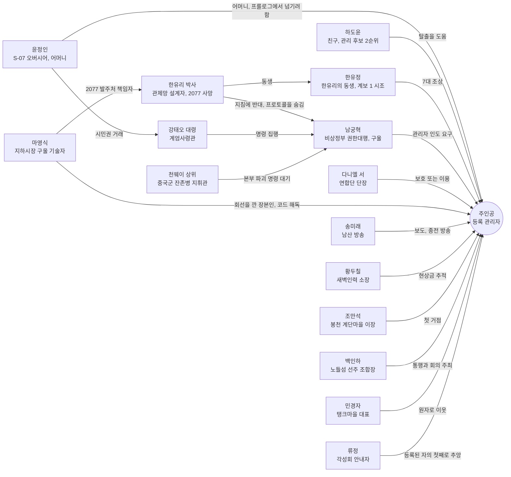

# SD-03a. 메인 스토리·메인 퀘스트 1부

> **서울 폴아웃 상세 기획서 세트** | 문서 ID: SD-03a | 버전: v1.0 | 작성일: 2026-10-12
> **범위**: 메인 스토리 총론(시놉시스, 2077년 전사, 주제, 인물 관계), 프롤로그 + 7막 + 에필로그의 전체 구조와 자유도 규칙, 막 전환 판정 플래그와 전체 변수표, 세력 호감도 연동 규칙(메인 퀘스트별 증감량과 메인에서의 쓰임), 순서 파괴 시 퀘스트 갱신 규칙, 핵심 NPC 사망 시 대체 경로, 퀘스트 상세 **프롤로그(MQ-P1~P4)·1막(MQ-101~106)·2막(MQ-201~207)·3막(MQ-301~304)**. **다루지 않는 것**: 4막~7막·에필로그 퀘스트 상세, 엔딩 E1~E5, 결말 슬라이드(→ [SD-03b](03b_main-story-part2.md)), 사이드 퀘스트(SD-04a~d), 비표시·반복 퀘스트와 랜덤 인카운터(SD-05), 세력 설정과 호감도 시스템 본체(SD-06), 인물 프로필(SD-07a), 장소 구조·좌표(SD-08·SD-09a~f), 판정 공식(SD-10), 전투·아이템·적 수치(SD-11·13·14)
> **관련 문서**: [SC-00 컨셉](00_concept.md), [SD-01 게임 개요](01_game-overview.md), [SD-02 세계관·연표](02_world-and-lore.md), [SD-03b 메인 스토리 2부](03b_main-story-part2.md), [SD-04a 사이드(남부)](04a_side-quests-south.md), [SD-04b 사이드(서부·한강)](04b_side-quests-west-river.md), [SD-04c 사이드(북부·동부·도심)](04c_side-quests-north-east-center.md), [SD-04d 세력 퀘스트 라인](04d_faction-questlines.md), [SD-05 비표시·반복·인카운터](05_misc-quests-encounters.md), [SD-06 세력](06_factions.md), [SD-07a 주요 인물](07a_characters-major.md), [SD-07b NPC 디렉터리](07b_npc-directory.md), [SD-08 월드·권역](08_world-regions.md), [SD-10 캐릭터 시스템](10_character-system.md), [SD-11 전투](11_combat-system.md), [SD-12 탐험·UI](12_exploration-ui.md), [SD-13 아이템](13_items.md), [SD-14 크리처·적](14_creatures-enemies.md), [SD-17 사운드](17_sound.md), 원작 [RD-03](../reverse-design/03_main-story-part1.md)·[RD-04](../reverse-design/04_main-story-part2-endings.md)·[RD-14](../reverse-design/14_character-system.md)·[RD-27](../reverse-design/27_adaptation-notes.md)

---

## 목차

1. [문서 개요](#1-문서-개요)
2. [메인 스토리 총론](#2-메인-스토리-총론)
3. [전체 구조와 자유도 규칙](#3-전체-구조와-자유도-규칙)
4. [막 전환 판정과 변수 설계](#4-막-전환-판정과-변수-설계)
5. [세력 호감도 연동 규칙](#5-세력-호감도-연동-규칙)
6. [순서 파괴와 대체 경로](#6-순서-파괴와-대체-경로)
7. [퀘스트 상세: 프롤로그 「S-07」](#7-퀘스트-상세-프롤로그-s-07)
8. [퀘스트 상세: 1막 「미등록자」](#8-퀘스트-상세-1막-미등록자)
9. [퀘스트 상세: 2막 「강」](#9-퀘스트-상세-2막-강)
10. [퀘스트 상세: 3막 「세 개의 열쇠」](#10-퀘스트-상세-3막-세-개의-열쇠)
11. [원작 대응](#11-원작-대응)
12. [쯔꾸르 제작 메모](#12-쯔꾸르-제작-메모)
13. [미결 사항](#13-미결-사항)
14. [부록](#14-부록)

---

## 1. 문서 개요

### 1.1 목적
- 바이블 [SC-00 v0.3 §5](00_concept.md)의 메인 스토리(프롤로그 + 7막 + 에필로그, 막별 다중 경로, 세력 호감도, 동료 없음)를 **이벤트·변수 단위로 바로 만들 수 있는 수준**까지 채운다.
- 두 문서로 나눈다. **SD-03a(이 문서)**는 전체 규칙과 프롤로그~3막, **[SD-03b](03b_main-story-part2.md)**는 4막~7막, 엔딩, 결말 슬라이드, 에필로그를 다룬다. 변수와 호감도 규칙의 정본은 이 문서 §4·§5다. SD-03b는 이를 참조만 한다.
- 원작 폴아웃 3에서는 **설계 패턴만** 가져온다(볼트 프롤로그의 캐릭터 생성, 다중 해법, 화술·스킬 판정, 카르마 분기, 정착지 운명, 결말 슬라이드). 줄거리는 가져오지 않는다(§11.2 확인표).

### 1.2 요약
- 주인공은 무언가를 쫓지 않는다. **모두가 주인공을 쫓는다.** 비상정부는 데려가려 하고, 새벽인력은 현상금을 노리고, 연합단은 지키거나 이용하려 한다.
- 이야기의 축은 **"200년 전의 명령을 누가, 어떻게 끝내는가"**다. 볼트, 연합단, 중국군 잔존병, 비상정부, 관제망 로봇이 각자 끝나지 않은 명령을 따른다. 주인공은 그 모든 명령이 가리키는 열쇠(등록 관리자)다.
- **월드는 프롤로그 직후 전부 열린다.** 막은 지역 잠금이 아니라 '이야기 진행 단계'이고, 세계 상태 플래그로 판정한다. 퀘스트는 장소가 아니라 **목표**로 주어지며, 다른 경로로 목표를 먼저 이루면 퀘스트가 그에 맞게 갱신된다. 핵심 인물이 죽어도, 어느 세력과 적대해도 메인 진행은 막히지 않는다(§6).
- **경로 퀘스트 원칙**: 막마다 목표에 이르는 경로가 2~5개다. 경로 하나를 마치면 막이 넘어가고(막 진행 XP 100%), 나머지 경로는 보너스(경로 XP 60% + 고유 정보·호감도·아이템)로 남는다(§3.4).
- **고르지 않고 기운다**(바이블 §5.8). 진영 가입, 동맹 확정, 결말을 고르는 메뉴나 "어느 편에 서겠습니까?" 같은 질문은 이 문서 어디에도 없다. 누구의 부탁을 실제로 들어줬는지, 원자로 열쇠·프로토콜 테이프·정보를 **누구 손에 두고 떠났는지**, 누구 곁에서 싸웠는지가 쌓여 서울이 기운다. 대화 선택지와 화술 판정은 개별 사안(이 사람을 살릴지, 값을 깎을지, 진실을 말할지)에만 쓴다.
- 기울기는 세 겹의 변수로 기록한다. ① **세력 호감도 8종**(비상정부, 연합단, 원칙파, 지하시장, 각성회, 중국군 잔존병, 새벽인력, 정착지 연합. 내부 수치, §5) ② **서울의 판도**(권역·정착지·핵심 시설 24칸의 지배 세력과 영향력, §4.5) ③ **핵심 물건의 인도처**(원자로 열쇠, 프로토콜 테이프, 기록 사본, 터널 정보 등 9종, §4.6). 이 셋이 2막 세력들의 접근, 3막 현장 협력자, 4막 동원, 5막 회의와 도심 진입 날 집결지, 6막 진입로, 7막 콘솔 곁에 선 세력과 그 자리에서 할 수 있는 행동을 정한다.
- 플레이어는 숫자 대신 **세계의 반응**으로 기울기를 느낀다. NPC의 호칭, 상점 가격, 순찰대의 태도, 남산 방송·국민방송의 뉴스, 정착지의 깃발과 경비, 핍-보이 지도 위 판도. 퀘스트마다 '기울기 체감' 항목에 이것을 적었다.
- **동료 시스템은 없다.** 원작 동료의 역할은 퀘스트 중 **일시 동행 NPC**와 호감도 '신뢰' 이상 세력의 **지원 병력 호출**로 대체한다(§5.5).
- 메인 퀘스트는 41개(프롤로그 4 + 본편 36 + 에필로그 1)다. 1회차 최소 필수량은 22개다(§3.1).

### 1.3 표기 규칙

| 표기 | 뜻 |
|---|---|
| **[화술·보통]** | 화술 판정. 서울판은 원작 확률식을 유지한다([RD-27 §6](../reverse-design/27_adaptation-notes.md)). 난이도 5단계와 '권장 화술'은 아래 표. 최종 공식은 SD-10 |
| **[과학 50]** 등 | 스킬 고정 판정. 수치 이상이면 자동 성공한다(원작의 자물쇠·터미널 방식). 25/50/75/100 4단계를 쓴다 |
| **[힘 7]** 등 | S.P.E.C.I.A.L. 고정 판정. 수치 이상이면 선택지가 열리고 자동 성공한다 |
| **[증거: 아이템명]** | 특정 아이템이나 정보 플래그가 있을 때 열리는 선택지. 화술 판정 난이도를 한 단계 낮추거나 자동 성공시킨다 |
| **[카르마: 선/악]** | 카르마 구간 조건 선택지 |
| **[호감: 세력 단계]** | 호감도 단계 조건 선택지. 예: [호감: 연합단 우호+]는 연합단 호감도 +20 이상 |
| **카르마 ±N** | 카르마 수치 증감(범위 -1,000~+1,000, [RD-14 §7](../reverse-design/14_character-system.md)) |
| **연합단 +N** | 해당 세력 호감도 증감(범위 -100~+100, 바이블 §6.2). 표에서는 약호를 쓴다(§5.1) |
| `V_XXX`, `S_XXX`, `K_XXX`, `AF_XXX`, `PD_XXX`, `HO_XXX` | 변수(V), 스위치(S), 지식 플래그(K), 호감도(AF), 서울의 판도(PD), 핵심 물건 인도처(HO). 전체 목록은 §4.7 |
| **판도 R01 +비상정부 10** | 해당 판도 칸에서 그 세력의 영향력 증감(§4.5) |
| **[인도: 열쇠 → 탱크마을]** | 핵심 물건을 누구 손에 두고 떠났는지 기록(§4.6) |
| **기울기 체감** | 그 퀘스트의 결과가 세계에서 어떻게 보이는지(호칭·가격·순찰·방송·깃발). 숫자 표시는 옵션으로만 둔다 |
| 퀘스트 로그 문구 | 핍-보이 DATA 탭에 뜨는 목표 문장. 본문에 그대로 쓴다 |
| 일시 동행 NPC | 퀘스트 구간 안에서만 함께 움직이는 NPC. 퀘스트 단계가 끝나면 자기 자리로 돌아간다 |
| 사이드 연계 후보 | SD-04a~d·SD-05가 사이드·세력·비표시 퀘스트로 만들 수 있는 접점. ID는 매기지 않는다 |
| 장소·인물·아이템 ID | 이 문서는 이름만 쓴다. L-ID는 SD-09a~f, C-ID는 SD-07a, W/A/I/M-ID는 SD-13, CR-ID는 SD-14에서 부여한다 |

| 화술 난이도 | 원작 배수 | 권장 화술(카리스마 5, 호감 50, 카르마 0일 때 성공률 약 70%) | 성공 XP | 메인 퀘스트 사용처 |
|---|---|---|---|---|
| 아주 쉬움 | 0.018 | 30 | 5 | 프롤로그 |
| 쉬움 | 0.012 | 50 | 10 | 1막 |
| 보통 | 0.009 | 65 | 20 | 1막 후반~3막 |
| 어려움 | 0.006 | 95 | 30 | 3막 핵심, 4막~7막 |
| 아주 어려움 | 0.004 | 카리스마 8 이상 + 화술 100 | 50 | 증거 없이 결정적 설득을 노릴 때만 |

- 메인 퀘스트의 결정적 설득(천웨이, 남궁혁, 강태오, 다니엘 서)은 **증거로 난이도를 낮추는 구조**다. 화술만으로는 어렵고, 탐험으로 모은 증거가 설득을 연다.
- 세력 호감도는 화술 판정에 보정을 준다(우호 +5%p, 신뢰 +10%p, 동맹 자동 성공 한 단계 낮춤, 경계 -10%p). 판정식 안의 '대상 호감' 항은 SD-10과 SD-06이 맞춘다.
- 은신은 실시간 시야 판정이므로 '은신 해법'은 판정 수치가 아니라 **경로 설계**로 적는다. 소매치기만 [은신 N]으로 적는다.

---

## 2. 메인 스토리 총론

### 2.1 시놉시스 (결말 포함)

**프롤로그 「S-07」 — 서류로 태어난 아이 (2258~2277)**
2258년 관악산 아래 볼트 S-07. 젊은 오버시어 윤정인이 아이를 낳는다. 행정실 서기가 출생신고서를 단말기에 넣는 순간, 200년 동안 한 번도 응답하지 않던 '관제망 회선' 칸에 불이 한 번 들어왔다 꺼진다. 시험 성적이 거주 구역과 배급과 결혼 허가를 정하는 적성 평가 사회에서 아이는 생활기록부를 채우며 자라고, 열여섯 살 적성 평가에서 어떤 답을 쓰든 같은 판정을 받는다. **'관리 후보 1순위'.** 평가관도 오버시어도 그 뜻을 모른다.
2277년, 수경 농장이 곰팡이병으로 죽어 가자 윤정인은 몇 해째 수신되던 비상정부의 '개방 지령'에 응해 200년 만에 문을 연다. 들어온 것은 교역 상대가 아니라 계엄군이다. 강태오 대령은 2077년의 서류를 읽어 '등록 관리자 인도'를 요구하고, 윤정인은 주민 전원의 1등급 시민권을 받는 대가로 자식을 넘기기로 한다. 주인공은 싸우거나, 숨거나, 어머니를 설득하거나, 친구 하도윤이 열어 준 배수 갱도로 빠져나와 관악산 비탈에서 처음으로 무너진 서울을 내려다본다. 관리 후보 2순위인 하도윤은 계엄군에게 붙잡힌다.

**1막 「미등록자」 — 내 핍-보이의 코드는 무엇인가 (R01·R02)**
봉천 계단마을 이장 조만석은 볼트에서 내려온 아이에게 수도 황무지의 규칙을 가르친다. 국민방송은 주인공에게 현상금을 걸었고, 새벽인력의 추심원 독사가 마을로 온다. 핍-보이에는 잠든 경비 로봇 곁을 지날 때마다 깜박이는 '관리자 코드'가 떠 있다. 코드를 읽을 길은 셋이다. 영등포 지하시장의 구울 기술자 마영식은 2077년 S-07과 관제망을 잇는 회선을 깐 장본인이다. 여의도 지하 벙커에는 2077년 관리 요원들이 오지 않는 호송차를 기다리다 죽은 비상 집결지가 있다. 새벽인력 본소의 황두칠 장부에는 현상금 의뢰서와 '관리자 인도 지령' 사본이 붙어 있다. 어느 길로든 주인공은 알게 된다. 자기 출생 등록 자체가 관제망의 관리자 인증 정보라는 것을. 그 순간 계엄사령관 강태오의 수색대가 직접 주인공 앞에 나타난다.

**2막 「강」 — 한강을 건너 세력과 만난다 (한강, R03·R04·R06·R07)**
관제망을 막을 수 있는 무력은 강 건너에 있다. 주인공은 노들섬의 다리 정치, 선유도 물 상인 조합의 배, 침수된 5호선 하저 터널, 강남 세이프빌을 거치는 잠실 우회 중 하나로 한강을 건넌다. 남산 방송의 송미래는 주인공의 이야기를 방송할지 묻는다. 처음으로 세상 앞에 서는 선택이다. 용산 요새의 연합단 단장 다니엘 서는 관제망을 부수든 쥐든 연합단 손으로 하려 한다. 주인공이 강을 건넜다는 소식이 퍼지자 서울의 다섯 세력(비상정부, 연합단, 각성회, 지하시장, 정착지 연합)이 각자의 방식으로 손을 내민다. 국민방송의 출두 권고와 검문소 수배 전단, 연합단의 수색 의뢰, 각성회의 순례 초대, 지하시장의 밀린 납품, 정착지들의 경비 요청이 월드 곳곳에 퍼진다. 무엇을 실제로 해 주는지가 서울을 기울이기 시작한다.

**3막 「세 개의 열쇠」 — 전원, 프로토콜, 길 (R03·R07·R09)**
관제망을 켜려면 전원, 본부, 관리자가 필요하다. 관리자는 이미 주인공이다. 주인공은 원하는 순서로 세 열쇠를 다룬다. 당인리에서는 반쯤 잠긴 원자로를 되살리거나 봉인하거나 터뜨린다. 세진전자 타워 꼭대기에서는 설계자 한유리 박사가 '비상 주민 분류 지침'에 맞서 **시민 보호 프로토콜**을 숨겨 두었고, S-07의 관리 계보가 그녀의 동생 한유정의 핏줄, 곧 주인공의 집안이라는 것을 안다. 북한산에서는 2077년에 관제 본부를 파괴하러 들어와 200년째 철수 명령을 기다리는 천웨이 상위의 부대를 만나 싸우거나, 속이거나, 전쟁이 끝났다는 것을 증명한다. 서울 곳곳에 흩어진 한유리의 기록 8건은 프로토콜을 대신할 수 있다. 어느 현장에서든 누가 주인공과 함께 움직였는지, 원자로 열쇠와 프로토콜 테이프를 누구 손에 두고 떠났는지가 곧 선택이다.

**4막 「개방의 대가」 — 볼트와 어머니 (R01·R11)** *(상세는 SD-03b)*
열쇠 둘이 정해지면 비상정부가 움직인다. 계엄군이 볼트 S-07을 점령하고 주민을 볼모로 잡는다. 어머니 윤정인은 청계산 벙커로 끌려간다. 주인공은 S-07로 돌아가 볼트를 되찾고, 청계산 벙커에서 권한대행 남궁혁과 마주한다. 그는 2077년에 그 지침에 서명한 행정안전부 장관이고, 지금은 구울이다. 주인공은 그의 요구(열쇠, 테이프, 생체 인증 견본)를 실제로 들어주거나, 벙커를 무너뜨리거나, 증거를 내밀어 물러나게 한다. 어머니의 결말은 주인공이 벙커와 볼트에서 한 일로 정해진다.

**5막 「서울 회의」 — 계엄과 동맹 (서울 전역)** *(SD-03b)*
전원이 들어온 관제망 일부가 깨어나고 계엄이 선포된다. 비상정부가 무너졌어도 계엄은 선포된다. 명령은 명령한 사람보다 오래 산다. 노들섬에서 열리는 서울 회의에 세력들이 모인다. 투표는 없다. 주인공이 꺼내는 증거와 약속, 그리고 회의 뒤에 실제로 지키는 행동이 결과를 만든다. 곧 연합단의 분열, 새벽인력의 인력시장, 각성회의 로봇 각성, 지하시장 봉쇄, 계엄군 총공세가 동시에 터진다. 주인공이 실제로 누구 곁에서 싸웠는지가 도심 진입 날 집결지에 나타날 세력을 정한다. 아무도 오지 않으면 혼자 간다.

**6막 「사대문 안」 — 밀폐된 도심 (R05)** *(SD-03b)*
1호선 지하 미로, 중국군의 침투 터널, 관리자 권한으로 여는 성벽 차단벽, 비상정부 버티버드 중 플레이어가 실제로 들어간 길이 진입로가 된다. 주인공은 경복궁, 광화문, 시청, 명동, 남대문시장을 뒤져 관제 본부 출입 권한 3개를 모은다.

**7막 「종전」 — 관리자 콘솔 (광화문 지하)** *(SD-03b)*
관제 본부 깊은 곳의 관리자 콘솔은 열여섯 살 때 적어 낸 적성 평가 10번 문항의 답을 화면에 띄우고 생체 인증 판을 켠다. 결정 메뉴는 없다. 주인공이 그 자리에서 실제로 하는 일이 결말이다. 기본 프로토콜 그대로 손을 올리면 계엄이 돌아가고(E1), 인증 뒤 나온 지휘 열쇠를 다니엘 서에게 건네면 연합단의 질서가 서고(E2), 들고 온 시민 보호 프로토콜 테이프를 꽂으면 모두가 시민이 되고(E3), 진공관 코어를 부수거나 당인리 전원선을 끊으면 모든 것이 멈추고(E4), 열쇠를 누구에게도 넘기지 않고 관리자 등록을 자기에게 고정하면 서울의 주인이 된다(E5). 곁에 선 세력은 그 손을 막거나 재촉한다. 주인공은 말로, 총으로, 혹은 몰래 움직여 대응한다. 결과는 남산 송신탑을 타고 서울 전역의 가두 스피커로 '종전' 방송이 되어 나간다.

**에필로그 — 그 후의 서울** *(SD-03b)*
결말 슬라이드가 결정, 카르마, 세력별 최종 호감도, 정착지와 인물의 운명을 보여 준다. 그 뒤 바뀐 서울에서 계속 플레이한다.

### 2.2 전사: 2077년에 일어난 일 (플레이어가 단계적으로 알게 되는 진실)

연도·시각은 [SD-02 §3.3](02_world-and-lore.md)을 따른다.

| # | 사실 | 기본으로 알게 되는 시점 | 다른 경로(§6.1) |
|---|---|---|---|
| T1 | 세진전자가 수도 관제망을 설계·시공했다(2077-09 정식 가동). 설계 책임자는 수석 기술자 한유리 박사다 | 1막 | 여의도 벙커, 지하시장, 남산 방송 아카이브 |
| T2 | 2075년 '비상 주민 분류 지침'이 관제망의 기본 프로토콜(계엄 프로토콜)로 들어갔다. 설계·서명자는 행정안전부 장관 남궁혁이다. 2077-10-23 23:21에 그가 전면 집행을 명령했고, 8분 뒤 23:29 전원이 끊겨 관제망은 '집행 모드에 들어간 직후의 상태'로 잠들었다 | 1막(지침), 3막(서명자·집행 명령) | 벙커 공문, 세진 타워, 남궁혁 본인 |
| T3 | 관제망은 살아 있는 '등록 관리자'의 생체 인증으로만 명령을 받는다. 2077년 관리자 12명은 여의도 벙커 비상 집결지에 모였으나 호송차가 오지 않았다 | 1막 | 여의도 벙커만(집결지 출석부) |
| T4 | 관리자 전원 유고에 대비해 세진전자는 볼트 S-07의 출생 등록 체계를 관제망 관리자 대장에 연결했다. 회선 시공자는 협력사 영신통신의 기술자 마영식이다 | 1막 | 마영식, 시공 일지(지하시장), 황두칠 장부의 지령 사본 |
| T5 | 관리 후보는 '관리 계보'에서 뽑힌다. 계보 1은 한유리의 동생 한유정의 가계, 계보 2는 세진전자 연구원 하씨 가계다. 적성 평가 점수는 순위에 반영되지 않는다. 순위는 계보와 출생 순서로 정해진다 | 3막(세진 타워) | 남궁혁(4막), S-07 오버시어 금고(프롤로그·4막), 한유리 기록 8건 중 2건 |
| T6 | 한유리는 지침이 켜지면 서울 시민 대부분이 '적성 분자'가 된다는 것을 알고 반대했다. 막지 못하자 **시민 보호 프로토콜**을 몰래 만들어 세진 타워 최상층에 숨겼다. 적성 평가 10번 문항은 그녀가 넣은 것이다 | 3막 | 프로토콜 본체는 세진 타워에만 있다. 내용은 기록 8건으로 재구성 가능 |
| T7 | 중국군 특수부대가 2077년 초 북한산 남쪽 비탈에서 관제 본부 방향으로 침투 터널을 팠다. 10월 23일 23:21 관제망 집행 모드로 본부 차단벽이 닫혀 폭파가 막혔고, 부대에 남은 마지막 명령은 **'전원이 돌아오면 다시 시도하라. 철수 명령 전까지 대기'**였다 | 3막 | 천웨이의 근무일지, 연합단 2077 전황 보고, 송미래의 감청 일지 |
| T8 | 남궁혁은 대전쟁 뒤 청계산 벙커에서 대통령 유고로 권한대행이 되었고, 벙커 원자로 사고로 구울이 되었다. 그는 2077년 10월 23일의 국가를 그날의 서류대로 복원하는 것을 자기 임무로 여긴다 | 4막 | 국민방송 연설(상시), 청계산 벙커 |

- T5(주인공의 계보)와 T6(시민 보호 프로토콜)은 MQ-302에서 함께 드러나는 이야기의 중심 반전이다. MQ-302를 하지 않아도 T5는 4막에서 남궁혁이 말해 준다. T6의 '프로토콜 본체'는 MQ-302에서만 얻고, 내용은 MQ-304(기록 8건)로 재구성할 수 있다.

### 2.3 주제 '끝나지 않은 명령'의 막별 표현

| 막 | 끝나지 않은 명령 | 그 명령을 따르는 자 | 주인공이 마주하는 질문 | 주제를 드러내는 장치 |
|---|---|---|---|---|
| 프롤로그 | "볼트를 지켜라", "시험을 치르라" | 윤정인, 보안부장 도경철, 평가관 차명수 | 지키라는 명령이 사람을 넘기라는 뜻이 될 때 | 출생신고서의 응답 없는 칸, 무슨 답을 써도 같은 판정, 어머니의 거래 |
| 1막 | "비상 집결지로 모여 호송을 기다려라", "장부의 빚은 사람으로 받는다" | 여의도 벙커의 관리 요원 유해, 새벽인력, 계엄군 수색대, 마영식 | 명령을 따른 사람에게 책임이 있는가 | 집결지 출석부, 새벽인력 장부, 회선을 깐 기술자의 죄책감 |
| 2막 | "기지를 지켜라(HOLD THE BASE)" | 연합단, 노들섬 선주 조합(다리를 지켜라) | 지키는 자는 누구를 위해 지키는가 | 연합단 성물 테이프, 송미래의 마이크, 세력들이 내미는 손(부탁·의뢰·위협) |
| 3막 | "관제 본부를 파괴하라, 철수 명령 전까지 대기" | 천웨이 부대, 계엄군 공병대, 각성회 | 명령을 거둘 사람이 없을 때 누가 끝내는가 | 천웨이의 73,000일 근무일지, 한유리의 불복종 |
| 4막 | "지침을 집행하라" | 남궁혁, 엄태식 대위, 윤정인 | 명령을 내린 사람을 벌하면 명령이 끝나는가 | 남궁혁의 서명, 볼모가 된 볼트 |
| 5막 | 관제망 계엄 프로토콜(주인 없이도 집행) | 깨어난 로봇, 계엄군 잔당, 새벽인력 | 명령이 사람 없이 돌아갈 때 | 비상정부가 무너져도 나오는 계엄 선포 방송 |
| 6막 | 2077-10-23 23:29에 멈춘 도심 | 차단벽, 대기 구역의 해골 | 200년 전 그 밤을 어떻게 지나갈 것인가 | 23:29에 멈춘 시계, '대기 구역' 노란 선 |
| 7막 | 관리자에게 넘겨지는 모든 명령권 | 수문장, 관제망 자체 | 이제 명령을 내리는 사람은 주인공이다 | 콘솔이 띄우는 10번 문항, '종전' 방송 |

- 반복 모티프는 **문**이다. 볼트 문(프롤로그), 벙커 문(1막), 다리와 수문(2막), 차단벽(3·6막), 볼트 문 재방문(4막), 판독기 개찰구(5막), 콘솔 화면 속 10번 문항의 '문을 열고 밖을 본다'(7막). 마지막 선택은 결국 어떤 문을 여느냐다.
- 원작의 "전쟁은… 변하지 않는다"에 대한 응답 문장 **"명령은 끝나지 않는다. 누군가 끝내기 전까지는."**은 오프닝 자막과 SD-03b의 맺음 슬라이드에서 수미상관으로 쓴다.
- 역사적 메아리: 2076년 반전 운동 '종전 행진'의 구호 "정전 123년, 이제는 종전을"([SD-02 §4.5](02_world-and-lore.md))은 7막 퀘스트 이름 〈종전〉과 E4로 이어진다. 송미래는 2막부터 종전 행진 유인물을 방송에서 읽는다.

### 2.4 인물 관계도

### 2.5 주요 인물의 메인 스토리 속 역할

동료는 없다. 아래 인물은 모두 퀘스트·세력 NPC이고, '일시 동행'으로 표시한 구간에서만 주인공과 함께 움직인다.

| 인물 | 구분 | 메인 스토리 속 기능 | 등장 퀘스트 | 생사·분기 변수 |
|---|---|---|---|---|
| 윤정인 | 핵심 | 주인공의 어머니, S-07 오버시어. "볼트를 지켜라"라는 명령을 따르다 자식을 넘기려 한다. 4막 볼모. 주인공이 용서할지 정한다 | P1~P4, MQ-401~403, MQ-702(조건부 회상) | `V_MOTHER` 6종 |
| 하도윤 | 핵심 | 동갑 친구. 관리 후보 2순위라 비상정부가 '예비 열쇠'로 데려간다. MQ-104·MQ-106 또는 4막에서 구할 수 있다. 구하면 봉천 계단마을에 머물며 정보와 회상 대사를 준다 | P2~P4(P4 일시 동행), MQ-104, MQ-106, MQ-402 | `V_DOYUN` 5종 |
| 남궁혁 | 핵심 | 최종 적대 정부의 수장. 2077년 지침의 서명자이자 그 지침의 마지막 집행자. 악당이 아니라 **서류대로 사는 사람**으로 그린다 | 국민방송 1막~, 대면 MQ-402, MQ-702 | `V_NAMGUNG` 4종 |
| 강태오 대령 | 주요 | 계엄사령관. 청계산 벙커에서 태어난 3대째 군인. 주인공을 쫓는 현장 지휘관. 투항시키거나 쓰러뜨린다 | P4, MQ-106, MQ-301, MQ-401, MQ-507, MQ-6xx~702 | `V_KANG` 5종 |
| 다니엘 서 | 주요 | 연합단 단장. 관제망을 부수든 쥐든 연합단 손으로 하려 한다 | MQ-206, MQ-207, MQ-503, MQ-508~702 | 사망 시 부단장 승계(§6.3) |
| 마영식 | 주요 | 2077년 회선 시공자. 1막의 해설자, 기록 8건의 재구성자, E3의 테이프 판독 기술자 | MQ-103, MQ-207, MQ-304, MQ-506, MQ-701·702 | 사망 시 대체 기술자(§6.3) |
| 천웨이 상위 | 주요 | 명령에 갇힌 병사. 주인공의 거울(주인공은 명령을 받을 사람, 천웨이는 명령을 기다리는 사람) | MQ-303, MQ-602, MQ-701(미해결 시) | `V_CW` 7종 |
| 송미래 | 주요 | 남산 방송 진행자. 막마다 주인공을 보도한다. 2077년 감청 일지를 보관한다. 종전 방송을 잇는다 | 라디오 상시, MQ-205, MQ-303(증거), MQ-702 | 사망 시 방송 대체(§6.3) |
| 한유리 박사 | 주요(기록만) | 관제망 설계자. 기록 8편과 콘솔 메시지로만 등장한다. 불복종의 본보기 | MQ-104, MQ-302, MQ-304, MQ-702 | 2077 사망 |
| 조만석 | 주요 | 봉천 계단마을 이장. 황무지의 규칙을 가르치는 첫 어른. 정착지들의 경비 요청을 처음 전하는 사람 | MQ-101, MQ-102, MQ-207, MQ-502 | 사망 시 부이장 승계 |
| 백인하 | 주요 | 노들섬 선주 조합장. 다리 통행 정치, 서울 회의 주최자 | MQ-201, MQ-207, MQ-502 | 실각·사망 시 회의 장소 이동(§6.3) |
| 민경자 | 주요 | 탱크마을 대표. 원자로 재가동의 이해 당사자 | MQ-301, MQ-502, MQ-507 | — |
| 황두칠 | 주요 | 새벽인력 소장. 1막의 추적자. 장부의 주인 | MQ-105, MQ-201(조건부), MQ-504 | 사망 시 독사 또는 부소장 승계 |
| 류정 | 주요 | 각성회 안내자. 관제망을 수호신으로 믿고 주인공을 '등록된 자의 첫째'라 부른다 | MQ-207, MQ-302, MQ-505 | — |
| 백구 | 이름 있는 NPC | 봉천 계단마을의 진돗개. MQ-101 첫 장면에서 들개 무리에 쫓긴다. 마을 경보견이며, MQ-101 추적조 대응에서 냄새로 매복을 알린다 | MQ-101 | 생존 시 봉천 슬라이드에 등장 |
| 제이슨 임 | 이름 있는 NPC | 연합단 기사, 남산 분견대장. MQ-205~206에서 용산까지 일시 동행. 연합단 안의 온건파 | MQ-205, MQ-206, MQ-503 | — |
| 박춘삼 | 이름 있는 NPC | 지하시장 계약 구울 경호원. MQ-103에서 고용하면 지하시장 구간 일시 동행 | MQ-103, MQ-506 | — |
| 파수-3 | 이름 있는 NPC | 세진전자 경비 로봇 '파수' 3형의 한 기체. 2077년 여의도 해산 사건에 투입됐던 기체다. MQ-302에서 관리자 코드에 반응해 깨어나 타워 안내를 맡는다(일시 동행). MQ-605·702의 특수 해법 | MQ-302, MQ-605, MQ-702 | — |
| 진세라 | 이름 있는 NPC | 철벽경호 용병. MQ-201 노들섬에서 현상금을 노리는 사냥꾼으로 처음 만난다 | MQ-201, MQ-507 | — |
| 독사 | 이름 있는 NPC | 새벽인력 추심원. MQ-101에서 봉천에 온 추적조의 조장 | MQ-101, MQ-105, MQ-504 | — |
| 큰돌 | 이름 있는 NPC | 평화적인 변종. 메인과 직접 엮지 않는다. MQ-601 서울역 구간에 조우 대사가 있다 | MQ-601(조건부) | SD-04c |

- 신규 조연(차명수, 도경철, 방금례, 신혜령, 나채윤, 한유정, 석진혁, 허문경, 엄태식, 에밀리 차, 마커스 노, 여금순, 물개, 맹구철, 저우린, 우태현)은 §14.1 부록에 적었다.

### 2.6 감정선

| 구간 | 감정 | 장면 |
|---|---|---|
| 프롤로그 | 소속감 → 배신감 | 돌잔치, 첫 핍-보이, 친구의 누명, 어머니의 거래 |
| 1막 | 고립 → 이해 | 현상금 방송, 벙커의 유해, 마영식의 고백 |
| 2막 | 해방 → 책임 | 강 건너의 첫 풍경, 송미래의 마이크, 월드에 퍼지는 부탁과 수배 전단 |
| 3막 | 탐구 → 정체성 | 한유리의 기록, "네 집안이었다", 천웨이의 근무일지 |
| 4막 | 분노와 연민 | 점령된 고향, 볼모가 된 어머니, 남궁혁의 논리 |
| 5막 | 연대 또는 고립 | 서울 회의, 동시에 터지는 위기 |
| 6막 | 경외 | 23:29에 멈춘 도심, 대기 구역의 해골 |
| 7막 | 결단 | 콘솔, 10번 문항, 종전 방송 |
| 에필로그 | 해소(또는 서늘함) | 슬라이드, 바뀐 서울 |

---
## 3. 전체 구조와 자유도 규칙

### 3.1 막 구조표

| 막 | 목표(퀘스트 로그 상단 문구) | 메인 퀘스트 | 경로 원칙 | 다음 막 전환(요약, 정식 판정은 §4.1) | 권장 레벨 | 1회차 필수 |
|---|---|---|---|---|---|---|
| 프롤로그 「S-07」 | 볼트에서 자라고, 나간다 | MQ-P1~P4 | 선형. P4 탈출 방법 4가지 | 볼트 밖으로 나온다 | 1 | P1~P4 (4) |
| 1막 「미등록자」 | 내 핍-보이의 관리자 코드가 무엇인지 알아낸다 | MQ-101, 102, **103/104/105**, 106 | 103~105 중 하나 | 코드의 정체를 알고(K_CODE), 강태오와 처음 마주친다(MQ-106 종료) | 2~6 | 101, 102, 경로 1, 106 (4) |
| 2막 「강」 | 강 건너 서울의 세력들을 만난다 | **MQ-201/202/203/204**, 205, 206, 207 | 횡단 넷 중 하나. 205·206은 권장 | 강 북쪽에 발을 디디고(S_CROSSED) 세력의 손길 하나에 실제로 응한다(MQ-207 종료) | 4~9 | 횡단 1, 207 (2) |
| 3막 「세 개의 열쇠」 | 관제망의 세 열쇠 중 둘의 행방을 정한다 | **MQ-301/302/303**, 304 | 셋 중 둘. 304는 선택이며 302를 대신할 수 있다 | 열쇠 둘의 처리가 끝난다(V_KEYS ≥ 2) | 7~14 | 열쇠 2 (2) |
| 4막 「개방의 대가」 | 볼트 S-07과 어머니를 되찾는다 | MQ-401, 402, 403 | 401·402 순서 자유. 403은 둘의 결과로 닫힌다 | 401·402 종료, 또는 4막 시작 10일 경과 | 10~16 | 401, 402, 403 (3) |
| 5막 「서울 회의」 | 계엄 아래에서 버틴다 | MQ-501, 502, **503~507**, 508 | 위기 퀘스트는 아무것이나 몇 개든 | 회의가 끝나고(참석 여부 무관) 위기 하나가 닫히거나 7일 경과 → 도심 진입로에 다가가면 508 종료 | 12~18 | 501, 502, 508 (3) |
| 6막 「사대문 안」 | 관제 본부의 문을 연다 | **MQ-601/602/603/604**, 605 | 진입 넷 중 실제로 들어간 길 하나 | 출입 권한 3개(V_PERMIT = 3)를 갖고 관제 본부 정문에 선다 | 14~20 | 진입 1, 605 (2) |
| 7막 「종전」 | 관제 본부 안으로 | MQ-701, 702 | 공동 작전 또는 단독 | 콘솔 앞의 행동 | 16+ | 701, 702 (2) |
| 에필로그 | 그 후의 서울 | MQ-E1 | — | (끝나지 않음) | — | 자동 |

- 메인 퀘스트는 **41개**다(프롤로그 4, 1막 6, 2막 7, 3막 4, 4막 3, 5막 8, 6막 5, 7막 2, 에필로그 1). 1회차 필수는 **22개**(에필로그 자동 진행 제외)다.
- '필수'는 막 전환 판정에 들어가는 퀘스트라는 뜻이다. 필수 퀘스트도 실패하지 않는다. 결과가 나쁠 뿐 반드시 닫힌다(§6.6 시간 경과 규칙).

### 3.2 전체 흐름도

### 3.3 자유도 규칙

| # | 규칙 | 구현 |
|---|---|---|
| F1 | **월드 전부 개방** | MQ-P4 종료와 동시에 모든 외부 권역과 실내 문이 열린다. 막은 지역 잠금이 아니다. 장벽은 권역 위협도(§3.5), 한강(다리·배·터널로만 건넘), 도심 밀폐(6막 진입로 넷)뿐이다 |
| F2 | **목표로 준다** | 퀘스트 로그는 장소가 아니라 목표 문장을 띄운다("관리자 코드를 읽을 사람을 찾는다"). 지도 마커는 '알려진 단서'에만 붙는다. 단서가 없는 경로는 마커 없이 열린다 |
| F3 | **먼저 이뤄도 된다** | 목표를 다른 경로로 먼저 이루면 해당 퀘스트는 '이미 알고 있음' 단계로 건너뛰고, 남은 경로는 보너스로 바뀐다(§6.2) |
| F4 | **막은 세계 상태로 넘어간다** | 막 전환은 퀘스트 완료 순서가 아니라 세계 상태 플래그 조합으로 판정한다(§4.1). 예: 1막 중에 세진 타워에서 프로토콜을 먼저 찾으면 K_CODE와 3막 열쇠 1개가 동시에 선다 |
| F5 | **잠기지 않는다** | 핵심 인물이 죽어도, 어느 세력과 적대해도 대체 경로가 있다(§6.3). 모든 막에 '단독' 경로가 남는다. 시간이 지나면 닫히는 퀘스트는 나쁜 결과로 닫힐 뿐 실패 상태가 없다(§6.6) |
| F6 | **진영을 묻지 않는다** | 세력 가입, 동맹 확정, 결말을 고르는 메뉴와 대화 선택지를 만들지 않는다. "어느 편에 서겠습니까?", "제안을 받아들이겠습니까?"는 금지 문형이다. 세력이 주인공에게 거는 대사는 부탁·의뢰·위협·초대이고, 응답은 행동으로 한다 |
| F7 | **물건과 행동이 선택이다** | 열쇠·테이프·장부·기록 같은 핵심 물건을 누구 손에 두고 떠났는지(§4.6), 현장에서 누구와 함께 움직였는지, 누구를 살리고 죽였는지가 기록되고 호감도·판도를 움직인다 |
| F8 | **세계가 먼저 말한다** | 호감도와 판도의 변화는 숫자보다 호칭·가격·순찰·방송·깃발로 먼저 보인다(§5.7). 핍-보이 '세력 기록'에는 세력마다 한 줄 서술만 뜬다. 숫자 표시는 설정 옵션이다 |
| F9 | **양다리도 플레이다** | 여러 세력을 동시에 돕는 것은 막지 않는다. 적대 세력끼리는 소문·방송·목격자로 서로의 행적을 알게 되고 연동 감소가 돌아온다(§5.2) |
| F10 | **아무 편도 들지 않아도 된다** | 어느 세력도 신뢰에 이르지 않으면 3·5·6·7막의 모든 장면이 '단독' 판으로 진행된다. 단독 판은 난도가 높고 보상(유니크 장비, 카르마 칭호 대사)이 다르다 |

### 3.4 경로 퀘스트의 보상 원칙 (하나만 해도 진행, 나머지는 보너스)

| 구분 | 막 진행 기여 | XP | 고유 보상 | 퀘스트 로그 표시 |
|---|---|---|---|---|
| 첫 번째로 끝낸 경로 | 막 목표 달성(전환 판정에 들어감) | 기본 XP의 **100%** | 그 경로 고유의 정보·아이템·호감도 | 목표 문장 완료 → 다음 목표로 |
| 두 번째 이후 경로(소형: 1·2·6막) | 없음 | 기본 XP의 **60%** | 고유 보상은 전부 받는다(정보 플래그, 아이템, 호감도, 판도). 정보 중복분은 '추가 증거'로 바뀌어 화술 판정 보정이 된다 | 회색 '(선택)' 표시로 남는다 |
| 3막 세 번째 열쇠 | 없음(열쇠 둘로 이미 전환) | **75%** | 3막 열쇠는 각자 다른 결말 조건을 연다. 셋 다 처리하면 7막 콘솔 앞에서 할 수 있는 행동이 가장 많다 | '(선택) 남은 열쇠' |
| 5막 위기 퀘스트 | 첫 하나가 MQ-508 시계를 앞당긴다 | 매 퀘스트 **100%** | 각 위기는 독립 콘텐츠. 곁에서 싸운 세력이 도심 진입 날 집결지에 나타날 자격을 얻는다 | 동시에 여러 개 진행 |

**경로별 기본 XP와 보너스 예시**

| 막 | 경로 퀘스트 | 기본 XP | 첫 경로로 끝내면 | 나중에 하면 | 그 경로만 주는 것 |
|---|---|---|---|---|---|
| 1막 | MQ-103 지하시장 | 300 | 300 + 막 진행 | 180 | T4 직접 증언(마영식), 지하시장 +10, 기록 #3 |
| 1막 | MQ-104 여의도 집결지 | 300 | 300 + 막 진행 | 180 | T3(집결지 출석부), 기록 #2, 하도윤 구출 기회 |
| 1막 | MQ-105 현상금의 주인 | 300 | 300 + 막 진행 | 180 | 황두칠 장부(현상금 단계 하향 수단), 새벽인력 판도 변화 |
| 2막 | MQ-201 노들섬 | 400 | 400 + S_CROSSED | 240 | 노들섬 통행권, 노들섬 +10~15, 서울 회의 장소의 사전 호감 |
| 2막 | MQ-202 양화 나루 | 400 | 400 + S_CROSSED | 240 | 선유도 물 계약, 선유도 +10 |
| 2막 | MQ-203 하저 터널 | 400 | 400 + S_CROSSED | 240 | 5호선 지하 통로 개통(이후 빠른 이동 거점), 호감도 변화 없음 |
| 2막 | MQ-204 잠실 우회 | 400 | 400 + S_CROSSED | 240 | 세이프빌 출입, 세이프빌 +10, 강남 판도 정보 |
| 3막 | MQ-301/302/303 | 각 800 | 800 + 열쇠 1 | 셋째는 600 | 전원·프로토콜·길 각각의 결말 조건 |
| 6막 | MQ-601~604 | 각 500 | 500 + 도심 진입 | 300 | 진입로별 6막 시작 위치와 동행 세력 |

### 3.5 권장 레벨과 권역 위협도
- 월드는 열려 있지만 권역마다 위협도(1~5)가 있다. 위협도는 적 스폰 레벨 하한을 정한다(수치는 SD-08·SD-14). 막 진행은 위협도를 바꾸지 않는다. 5막 계엄 선포 뒤에만 관제망 로봇이 깨어난 권역의 위협도가 +1 된다.

| 권역 | 위협도 | 이 권역에서 처음 만나는 메인 퀘스트 | 1회차 일반 도달 시점 |
|---|---|---|---|
| R01 관악 | 1 | MQ-101 | 프롤로그 직후 |
| R02 여의도·영등포 | 2 | MQ-103~105 | 1막 |
| R04 서강·선유도 | 2 | MQ-202 | 2막 |
| R06 용산·남산 | 2(남산) / 3(이촌 강변) | MQ-205·206 | 2막 |
| R03 마포·상암 | 3 | MQ-301 | 3막 |
| R07 강남 | 3(세이프빌) / 4(세진 타워 상층) | MQ-204, 302 | 2~3막 |
| R08 동부 | 2 | MQ-204 북단 | 2막 |
| R09 북부 산악 | 4 | MQ-303 | 3막 |
| R11 청계산 | 4 | MQ-402 | 4막 |
| R10 서부 평야 | 5 | 메인 없음(사이드) | 자유 |
| R05 도심(밀폐) | 5 | MQ-601~605 | 6막 |

- 순서 파괴 예: Lv5 플레이어가 MQ-P4 직후 한강을 건너 세진 타워를 노릴 수 있다. 타워 1~30층(위협도 3)은 통과할 수 있고, 최상층(위협도 4)은 은신과 우회로를 쓰면 가능하다. 성공하면 1막과 3막 목표가 동시에 진행된다(§6.2 시나리오 O-03).

---

## 4. 막 전환 판정과 변수 설계

### 4.1 막 전환 판정 (V_ACT)
- `V_ACT`는 0(프롤로그)~7(7막), 8(에필로그)이다. **매 장소 진입과 퀘스트 단계 변경 때 아래 조건을 위에서부터 검사**하고, 조건을 만족하는 가장 큰 막으로 올린다. 막은 내려가지 않는다. 한 번에 두 막 이상 오를 수 있다(순서 파괴).
- 막이 오르면 ① 자동 저장 ② 막 제목 카드(검은 화면 + 막 번호·제목·한 줄 인용) ③ 남산 방송·국민방송의 막 전환 보도 ④ 새 막의 목표 문장이 순서대로 뜬다. 두 막 이상 한꺼번에 오르면 제목 카드는 마지막 막만 띄우고, 건너뛴 막의 목표는 '이미 이룬 목표'로 로그에 남긴다.

| 전환 | 조건(모두 만족) | 미충족이어도 넘어가는 시간 경과 조건 |
|---|---|---|
| 0 → 1 | MQ-P4 종료(볼트 밖 첫 외부 맵 진입) | 없음 |
| 1 → 2 | `K_CODE = 1` AND `MQ106_DONE = 1` | 없음. 단 K_CODE가 서면 MQ-106은 다음 외부 맵 진입 때 반드시 발동하므로 막히지 않는다 |
| 2 → 3 | `S_CROSSED = 1` AND `MQ207_DONE = 1` | MQ-207은 S_CROSSED 뒤 게임 내 7일이 지나면 자동 종료(§6.6) |
| 3 → 4 | `V_KEYS ≥ 2` (아래 열쇠 판정) | 없음. 열쇠는 모두 다른 경로로도 처리할 수 있다 |
| 4 → 5 | `MQ401_DONE = 1` AND `MQ402_DONE = 1` | 4막 시작 후 10일 경과 시 남은 퀘스트가 '외면' 결과로 닫힌다 |
| 5 → 6 | `MQ508_DONE = 1` | MQ-508은 회의 종료 + (위기 1개 종료 또는 7일 경과) 뒤, 도심 진입로 네 곳 중 하나의 입구 반경에 들어가면 종료된다 |
| 6 → 7 | `V_PERMIT = 3` AND 관제 본부 정문 진입 | 없음. 출입 권한 3개는 각각 3가지 이상의 방법이 있다 |
| 7 → 8 | MQ-702 종료(콘솔 앞 행동 확정) | 없음 |
| **특례** | 막과 무관하게 관제 본부 콘솔실에 도달하면 즉시 `V_ACT = 7` | 순서 파괴의 끝. 콘솔 앞 행동 규칙은 막과 상관없이 같다(SD-03b §2.2). 경고문과 자동 저장을 먼저 띄운다 |

**열쇠 판정 (V_KEYS = KEY_POWER + KEY_PROTO + KEY_ROUTE)**

| 열쇠 | 1이 되는 조건 | 상태 변수 |
|---|---|---|
| `KEY_POWER` (전원) | `V_REACTOR` ∈ {2 재가동, 3 봉인, 4 파괴} | V_REACTOR |
| `KEY_PROTO` (프로토콜) | `V_PROTO` ∈ {1 원본 회수, 2 원본 인도, 3 원본 파기} 또는 `V_RECORDS = 8`(재구성 가능) | V_PROTO, V_RECORDS |
| `KEY_ROUTE` (길) | `V_CW` ∈ {2 해산, 3 해산 후 협력, 4 전멸, 5 기만 철수, 6 연합단 섬멸} 또는 `S_TUNNEL_MAP = 1`(은신으로 터널 지도만 확보) | V_CW, S_TUNNEL_MAP |

- '처리'에는 파괴도 들어간다. 원자로를 터뜨리거나 테이프를 태워도 그 열쇠의 행방은 '정해진' 것이다. 막 전환은 결말 가능성을 묻지 않는다.

### 4.2 지식 플래그 (K_)

| 플래그 | 뜻 | 세우는 곳(하나면 충분) | 쓰이는 곳 |
|---|---|---|---|
| `K_CODE` | 관리자 코드 = 주인공의 생체 인증 정보라는 것을 안다 | MQ-103, MQ-104, MQ-105, 세진 타워 로비 단말(순서 파괴), 용산 기록보관소(에밀리 차), 청계산 벙커 침입 | 1막 전환 |
| `K_NET` | 관제망의 존재와 켜는 조건 3가지 | K_CODE와 동시 | 3막 목표 문장 |
| `K_RALLY` | 여의도 비상 집결지의 존재 | MQ-P4 오버시어 단말, 조만석 대화, 송미래 방송 | MQ-104 마커 |
| `K_LINE` | 마영식이 S-07 회선을 깔았다 | MQ-103, 기록 #3, 황두칠 장부의 지령 사본 | MQ-103 대사, 4막 남궁혁 대사 |
| `K_LINEAGE` | 주인공이 한유정의 후손, 계보 1이다(T5) | MQ-302, MQ-402(남궁혁), S-07 오버시어 금고(MQ-401), 기록 #1·#8 | 3·4막 대사, 슬라이드 |
| `K_PROTO` | 시민 보호 프로토콜의 존재 | MQ-302, 기록 4건 이상, 마영식(MQ-103 후반 추측) | MQ-304 시작, 5막 회의 증거 |
| `K_ORDER` | 중국군 부대의 마지막 명령(T7) | MQ-303, 연합단 전황 보고, 송미래 감청 일지 | MQ-303 설득 |
| `K_SIGNER` | 남궁혁이 지침의 서명자이고 23:21 집행 명령자다 | MQ-302, 기록 #5, 국민방송 연설 녹음(MQ-205 아카이브) | MQ-402 협상 증거 |
| `K_Q10` | 적성 평가 10번 문항을 한유리가 넣었다 | MQ-302 최상층, 기록 #8 | MQ-702 콘솔 회상 대사 |

### 4.3 핵심 세계 상태 변수

| 변수 | 값 | 정하는 퀘스트 | 쓰이는 곳 |
|---|---|---|---|
| `V_ESCAPE` | 1 전투 / 2 은신 / 3 설득 / 4 하도윤 | MQ-P4 | 윤정인 대사(4막), 볼트 주민 반응, 슬라이드 |
| `V_Q10` | 1 계속 지킨다 / 2 찾으러 간다 / 3 기계에 맡긴다 / 4 문을 열고 밖을 본다 | MQ-P3 | MQ-702 콘솔 화면, 천웨이 대사 |
| `V_DOL` | 돌잡이 물건 1~6 | MQ-P1 | 회상 대사 3곳(능력치 효과 없음) |
| `V_STANCE` | 0 없음 / 1 공개(진실 방송) / 2 위장(거짓 정보 방송) / 3 침묵(마이크를 잡지 않음) / 4 비상정부에 출두 의사 방송 | MQ-205 | 현상금 단계, 국민방송 반응, 정착지 호칭 |
| `V_REACTOR` | 0 미방문 / 1 계엄군 공사 중 / 2 재가동 / 3 봉인 / 4 파괴 | MQ-301, MQ-402(비상정부 재가동) | KEY_POWER, `V_POWER`, 탱크마을 |
| `V_FEED` | 재가동 송전 대상 비트: 1 관제망 / 2 탱크마을 / 4 용산 요새 / 8 청계산 | MQ-301 | 판도, 5막 사건, 슬라이드 |
| `V_POWER` | 0 무전원 / 1 부분 전원(지역 중계소 핵분열 전지 6곳) / 2 전원 | V_REACTOR와 5막 사건에서 계산 | 501 이후 로봇 각성 범위, 7막 콘솔 앞 행동의 효과 범위 |
| `V_PROTO` | 0 미발견 / 1 원본 소지(주인공) / 2 원본 인도(HO_TAPE 참조) / 3 원본 파기 | MQ-302 | KEY_PROTO, E3 |
| `V_RECORDS` | 0~8 | MQ-304(+P4, 104, 103, 205, 206, 301, 302, 303 현장) | KEY_PROTO 대체, 회의 증거 |
| `V_CW` | 0 미접촉 / 1 접촉 / 2 해산 / 3 해산 후 협력 / 4 전멸(주인공 전투) / 5 기만 철수 / 6 연합단 섬멸 / 7 은신 통과(미해결) | MQ-303 | KEY_ROUTE, MQ-602, MQ-701 폭파조 |
| `S_TUNNEL_MAP` | 침투 터널 지도 확보 | MQ-303 은신 | KEY_ROUTE, MQ-602(조건부) |
| `V_VAULT` | 0 정상 / 1 점령 / 2 해방 / 3 비상정부 직할 / 4 파손(주민 일부 사망) / 5 주민 분산 이주 | MQ-401 | 슬라이드, 에필로그 |
| `V_MOTHER` | 0 볼트 / 1 볼모 / 2 생존·화해 / 3 생존·결별 / 4 사망 / 5 비상정부 행정관 / 6 퇴임(평주민) | MQ-403 | 슬라이드 |
| `V_DOYUN` | 0 S-07 / 1 억류 / 2 MQ-104·106 구출 / 3 MQ-402 구출 / 4 사망 / 5 비상정부 예비 관리자 | MQ-P4, 104, 106, 402 | 4·7막(예비 열쇠), 슬라이드 |
| `V_NAMGUNG` | 0 생존·집권 / 1 사망 / 2 퇴진(벙커에 남음) / 3 체포(연합단·정착지 구금) | MQ-402 | `S_GOV_DOWN`, 7막 |
| `V_KANG` | 0 지휘 중 / 1 사망 / 2 투항 / 3 독자 계엄(권한대행 부재 뒤) / 4 주인공 곁(비상정부 동맹) | MQ-106, 402, 507, 6~7막 | `S_GOV_DOWN` |
| `S_GOV_DOWN` | 비상정부 무력화 | (V_NAMGUNG ∈ {1,2,3}) AND (V_KANG ∈ {1,2}) 일 때 자동 ON | E3 조건 |
| `V_BOUNTY` | 0 없음 ~ 4 최고(§6.5) | 국민방송, MQ-105, 205 | 새벽인력·현상금 사냥꾼 인카운터 |
| `V_PERMIT` | 0~3 | MQ-605 | 7막 진입 |
| `V_ENTRY` | 1 1호선 / 2 침투 터널 / 3 차단벽 / 4 공중 강하 | MQ-601~604 | 6막 시작 위치, 집결 세력 위치 |

### 4.4 퀘스트 단계 공통 규칙
- 각 메인 퀘스트는 `MQxxx_STAGE` 변수(0 미발동 / 10 발동 / 20~90 진행 / 100 종료)를 갖는다. 본문 '단계별 목표' 표의 단계 번호가 이 값이다.
- **결과 변수**는 퀘스트별로 따로 둔다(`MQxxx_RESULT`). 결과 변수는 '어떻게 끝났는가'(경로·해법)를 기록한다. 결말 슬라이드는 결과 변수와 §4.3·§4.5·§4.6을 읽는다.
- 목표를 먼저 이룬 경우 해당 단계로 바로 건너뛰고 `MQxxx_SKIP = 1`을 세운다. 건너뛴 단계의 XP는 주지 않고, 남은 단계부터 정상 지급한다.

### 4.5 서울의 판도 (PD)
- 바이블 §6.2의 '서울의 판도'를 **24칸**으로 나눈다. 칸마다 `PD_칸_OWN`(지배 세력 코드)과 `PD_칸_STR`(지배 강도 0~100) 두 변수를 둔다(48개). 판도 계산 규칙의 정본은 SD-06·SD-08이고, 이 문서는 메인 퀘스트가 주는 변화량과 초기값 제안을 정한다.
- **세력 코드**: 0 없음 / 1 비상정부 / 2 연합단 / 3 원칙파 / 4 지하시장 / 5 각성회 / 6 중국군 잔존병 / 7 새벽인력 / 8 정착지 연합 / 9 약탈자 / 10 변종 / 11 관제망(주인 없는 로봇) / 12 볼트 S-07 / 13 주인공(E5 이후) / 14 남산 방송(인도처 전용).
- **줄다리기 규칙**: "판도 X +세력 N"은 X칸의 지배 세력이 그 세력이면 STR += N(최대 100), 다른 세력이면 STR -= N이고, STR이 0 아래로 내려가면 지배 세력이 바뀌며 STR = |남은 값|이 된다.

| STR | 단계 | 세계에서 보이는 것 |
|---|---|---|
| 0~29 | 경합 | 깃발 없음. 두 세력 순찰이 섞여 나온다. 인카운터 테이블이 섞인다 |
| 30~69 | 우세 | 지배 세력 순찰 1조, 검문소 1곳. 상점 1곳이 그 세력 물품을 판다 |
| 70~100 | 장악 | 정착지 입구·옥상에 그 세력 깃발. 검문소 2곳, 인카운터 테이블이 그 세력 것으로 바뀐다. 그 세력에 대한 호감도 단계가 상점 가격에 그대로 반영된다 |

| # | 판도 칸 | 2277년 시작값(OWN / STR) | 메인 퀘스트로 크게 움직이는 계기 |
|---|---|---|---|
| 1 | R01 관악 | 약탈자 / 30 | MQ-101 방어, MQ-401 |
| 2 | R02 여의도·영등포 | 새벽인력 / 55 | MQ-105, MQ-504 |
| 3 | R03 마포·상암 | 약탈자 / 40 | MQ-301 |
| 4 | R04 서강·선유도 | 정착지 연합 / 60 | MQ-202 |
| 5 | R05 도심 | 변종 / 50 | MQ-501(관제망), 6막 |
| 6 | R06 용산·남산 | 연합단 / 75 | MQ-206, MQ-503 |
| 7 | R07 강남 | 정착지 연합 / 30 | MQ-204, MQ-302 |
| 8 | R08 동부 | 정착지 연합 / 45 | MQ-204 |
| 9 | R09 북부 산악 | 중국군 잔존병 / 60 | MQ-303 |
| 10 | R10 서부 평야 | 약탈자 / 50 | (사이드) |
| 11 | R11 청계산 | 비상정부 / 90 | MQ-402 |
| 12 | 봉천 계단마을 | 정착지 연합 / 60 | MQ-101, MQ-507 |
| 13 | 탱크마을 | 정착지 연합 / 60 | MQ-301, MQ-507 |
| 14 | 노들섬 | 정착지 연합 / 65 | MQ-201, MQ-502 |
| 15 | 선유도 | 정착지 연합 / 70 | MQ-202 |
| 16 | 뚝섬 장터 | 정착지 연합 / 60 | MQ-204 |
| 17 | 세이프빌 | 정착지 연합 / 50 | MQ-204, MQ-302 |
| 18 | 볼트 S-07 | 볼트 S-07 / 100 | MQ-401 |
| 19 | 당인리 발전소 | 없음 / 0 | MQ-301 |
| 20 | 세진전자 타워 | 관제망 / 40 | MQ-302 |
| 21 | 북한산 침투 터널 | 중국군 잔존병 / 90 | MQ-303 |
| 22 | 남산 송신탑 | 연합단 / 40 | MQ-205 |
| 23 | 영등포 지하상가 | 지하시장 / 85 | MQ-103, MQ-506 |
| 24 | 용산 요새 | 연합단 / 100 | MQ-503 |

- 시작값은 SD-06 초안의 세력 근거지·규모와 맞췄다. SD-06이 판도 칸을 늘리면 이 24칸은 그 안의 메인 퀘스트용 부분집합이 된다.

### 4.6 핵심 물건의 인도처 (HO)
- 바이블 §5.8 원칙 2·6에 따라 **"무엇을 누구 손에 두고 떠났는가"**를 별도 변수로 기록한다. 인도는 대화 선택지가 아니라 **물리적 행동**이다. 아이템을 그 인물에게 '건네기'(소지품에서 주기), 그 세력 보관함·책상·금고에 '두기', 그 장소에 '버려두기', '파기'(소각로·원자로 냉각수조·폭발)로 처리한다. 건네기는 대화창의 '물건 주기' 기능을 쓰고 선택지 문구는 물건 이름만 보인다.
- 값: 0 주인공이 지니고 있음 / 1~12 세력 코드(§4.5) / 81~86 개별 정착지(봉천·탱크·노들·선유·뚝섬·세이프빌) / 97 그 자리에 두고 떠남(주인 없음) / 98 빼앗김(주인공이 쓰러져 압수) / 99 파기.
- 한 번 넘긴 물건도 되찾을 수 있다(훔치기, 거래, 그 세력 거점 습격). 되찾으면 값이 0으로 돌아오고, 빼앗긴 쪽의 호감도가 크게 떨어진다(-25~-40).

| 변수 | 물건 | 처음 얻는 곳 | 인도처별 효과(요지) |
|---|---|---|---|
| `HO_KEY` | 당인리 제어실 기동 키 | MQ-301 | 쥔 세력이 당인리 판도를 장악(+60)하고 5막에 전원을 끄고 켤 수 있다. 비상정부 손이면 MQ-501이 전면 계엄으로, 탱크마을 손이면 송전 협상으로, 연합단 손이면 용산 우선 송전으로 시작한다. 파기하면 V_REACTOR는 봉인 고정 |
| `HO_TAPE` | 시민 보호 프로토콜 테이프(원본) | MQ-302 | 7막 E3의 물리적 조건. 쥔 세력이 7막에 그것을 들고 오거나(정착지 연합·지하시장), 숨기거나(원칙파: 기술 회수), 태운다(비상정부). 각성회 손이면 '성물'이 되어 5막 MQ-505의 판이 바뀐다 |
| `HO_COPY` | 한유리 기록 재구성본(기록 8건 + 마영식 판독) | MQ-304 | 원본 테이프를 대신한다. 기술자(마영식 또는 대체 기술자)가 있어야 7막에서 쓸 수 있다 |
| `HO_LEDGER` | 황두칠의 장부 | MQ-105 | 정착지 연합에 넘기면 새벽인력 판도 -30, 현상금 단계 -1. 비상정부에 넘기면 새벽인력이 계엄군 하청이 된다(MQ-504 판 변화). 태우면 장부에 적힌 '인력' 112명이 빚에서 풀린다(카르마 +100) |
| `HO_DECODE` | 마영식의 관리자 코드 해독 메모 | MQ-103 | 연합단 손이면 6막 차단벽 개방(MQ-603) 준비가 빠르다. 비상정부 손이면 계엄군이 주인공 위치를 관제 중계소로 추적한다(현상금 +1) |
| `HO_TUNNEL` | 침투 터널 위치·지도 | MQ-303 | 연합단에 주면 MQ-303 '연합단 공격' 판이 열린다(이미 끝났으면 6막 연합단 진입로). 비상정부에 주면 계엄군이 터널을 점거하고 MQ-602가 강습 판으로 바뀐다 |
| `HO_LOG` | 천웨이 부대의 근무일지 | MQ-303 | 남산 방송에 주면 송미래가 일지를 낭독한다(정착지 연합 +5, 중국군 잔존병 +10). 연합단 기록보관소에 주면 연합단 +5 |
| `HO_SAMPLE` | 주인공의 생체 인증 견본(진공관 지문·망막 판) | MQ-402(남궁혁 요구) | 비상정부에 남기면 남궁혁이 관리자 없이도 계엄 프로토콜 일부를 돌릴 수 있다(V_POWER 2일 때 MQ-501 전면 계엄) |
| `HO_BROADCAST` | 남산 방송 원본 녹음(주인공의 증언) | MQ-205 | 송미래가 보관하면 5막 회의의 증거가 된다. 비상정부에 넘어가면 국민방송이 짜깁기해 내보낸다(정착지 연합 -10) |

### 4.7 전체 변수표
SD-03a·03b가 쓰는 변수 전체다. 퀘스트별 `MQxxx_STAGE`·`MQxxx_RESULT`는 생략했다(41×2).

| 분류 | 변수 | 개수 | 비고 |
|---|---|---|---|
| 막 | `V_ACT`, `V_KEYS`, `KEY_POWER`, `KEY_PROTO`, `KEY_ROUTE`, `V_DAY4`(4막 경과일), `V_DAY5`(5막 경과일), `V_DAY207`(207 경과일) | 8 | §4.1 |
| 지식 | `K_CODE`, `K_NET`, `K_RALLY`, `K_LINE`, `K_LINEAGE`, `K_PROTO`, `K_ORDER`, `K_SIGNER`, `K_Q10` | 9 | §4.2 |
| 세계 상태 | `V_ESCAPE`, `V_Q10`, `V_DOL`, `V_STANCE`, `V_REACTOR`, `V_FEED`, `V_POWER`, `V_PROTO`, `V_RECORDS`, `V_CW`, `S_TUNNEL_MAP`, `V_VAULT`, `V_MOTHER`, `V_DOYUN`, `V_NAMGUNG`, `V_KANG`, `S_GOV_DOWN`, `V_BOUNTY`, `V_PERMIT`, `V_ENTRY`, `S_CROSSED` | 21 | §4.3 |
| 호감도 | `AF_GOV`, `AF_UNI`, `AF_PUR`, `AF_MKT`, `AF_AWK`, `AF_REM`, `AF_DAWN`, `AF_SET`(계산값), `AF_BC`, `AF_TK`, `AF_ND`, `AF_SY`, `AF_TS`, `AF_SV`, `AF_SETB` | 15 | §5.1 |
| 판도 | `PD_01`~`PD_24` 각 `_OWN`, `_STR` | 48 | §4.5 |
| 인도처 | `HO_KEY`, `HO_TAPE`, `HO_COPY`, `HO_LEDGER`, `HO_DECODE`, `HO_TUNNEL`, `HO_LOG`, `HO_SAMPLE`, `HO_BROADCAST` | 9 | §4.6 |
| 곁에서 싸움 | `FW_GOV`, `FW_UNI`, `FW_PUR`, `FW_MKT`, `FW_AWK`, `FW_REM`, `FW_DAWN`, `FW_SET` (0~n, 그 세력과 같은 전장에서 함께 싸운 횟수) | 8 | §5.4, MQ-508 |
| 현장 협력 | `CO_301`, `CO_302`, `CO_303` (3막 현장에서 함께 움직인 세력 코드, 0 단독) | 3 | §10 |
| 인물 생사 | `D_JMS`(조만석), `D_BIH`(백인하), `D_MKJ`(민경자), `D_HDC`(황두칠), `D_MYS`(마영식), `D_SMR`(송미래), `D_DS`(다니엘 서), `D_CW`(천웨이), `D_RJ`(류정), `D_JL`(제이슨 임), `D_BG`(백구) | 11 | §6.3 |
| 카르마 | `V_KARMA`, `V_KARMA_PRE7`(MQ-702 직전 값) | 2 | 슬라이드 카르마 판정은 PRE7 기준(SD-03b) |
| 합계 | | 142 | 쯔꾸르 MZ 변수 상한(5,000) 안. SD-05·SD-06 변수와 번호 대역을 나눠 쓴다(§12.3) |

---
## 5. 세력 호감도 연동 규칙

### 5.1 대상, 약호, 초기값
- 호감도 시스템의 본체(단계, 연동 계수 정본, 세력 퀘스트 라인)는 SD-06이다. 이 문서는 **메인 퀘스트가 주는 변화량**과 **메인에서의 쓰임**을 정한다. 초기값은 SD-06 초안과 맞췄다.

| 약호(본문) | 변수 | 세력 | 2277 초기값 | 단계 | 비고 |
|---|---|---|---|---|---|
| 비상 | `AF_GOV` | 비상정부(계엄군 포함) | -20 | 경계 | 주인공을 '생포'하려 한다. 우호 이상이면 생포 추적이 '호송 제안'으로 바뀐다 |
| 연합 | `AF_UNI` | 연합단 | 0 | 중립 | |
| 원칙 | `AF_PUR` | 원칙파 | -10 | 중립 | |
| 지하 | `AF_MKT` | 지하시장 | 0 | 중립 | |
| 각성 | `AF_AWK` | 각성회 | +20 | 우호 | '등록된 자의 첫째'를 숭배한다 |
| 잔존 | `AF_REM` | 중국군 잔존병 | -60 | 적대 | 영역(북한산 굴진 기지) 침입 시 공격 |
| 새벽 | `AF_DAWN` | 새벽인력 | -20 | 경계 | 현상금 추적의 주체 |
| 정착 | `AF_SET` | 정착지 연합(계산값) | 0 | 중립 | 아래 산식 |
| 봉천·탱크·노들·선유·뚝섬·세이프 | `AF_BC`·`AF_TK`·`AF_ND`·`AF_SY`·`AF_TS`·`AF_SV` | 개별 정착지 | 0·0·0·0·+5·-10 | | 정착지별 반응은 개별 값, 연합 단위 판정은 AF_SET |

**정착지 연합 산식**
- `AF_SET = clamp( round( (AF_BC + AF_TK + AF_ND + AF_SY + AF_TS + AF_SV) ÷ 6 ) + AF_SETB, -100, +100 )`
- `AF_SETB`(-20~+20)는 정착지 전체에 걸친 행동의 보너스다. 서울 회의 주최 협력, 정착지 연합에 넘긴 핵심 물건, 남산 방송의 공개 증언이 여기에 쌓인다.
- 바이블 §6.2는 "정착지별 호감도의 합산"이라 적었다. 범위를 -100~+100으로 유지하려고 평균 + 보너스로 해석했다(§13 미결 U-02).

### 5.2 연동 규칙 (메인 퀘스트 기본값)
- 한 세력의 호감도가 오르거나 내릴 때, 그 사건이 **알려지면** 적대 관계 세력의 호감도가 계수만큼 반대로 움직인다. 알려지는 조건: 그 세력 영역 안에서 일어남 / 그 세력원이 목격함 / 남산 방송·국민방송이 보도함 / 핵심 물건의 인도. 은신 상태로 아무도 보지 못한 행동은 연동하지 않는다. 나중에 증거(시체, 장부, 방송)가 드러나면 그때 연동한다.
- 계수의 정본은 SD-06이다. 아래는 메인 퀘스트 밸런스를 잡은 기본값이다.

| 세력 A | 세력 B | 계수(A가 +N이면 B가 -N×계수) | 이유 |
|---|---|---|---|
| 비상정부 | 연합단 | 0.5 | 관제망을 두고 다투는 두 군사 세력 |
| 비상정부 | 정착지 연합 | 0.5 | 계엄은 정착지를 '미등록자 집단'으로 본다 |
| 비상정부 | 지하시장 | 0.4 | 구울은 등록 대상이 아니다 |
| 비상정부 | 중국군 잔존병 | 0.5 | 200년 묵은 교전 상대 |
| 연합단 | 원칙파 | 0.5 | 분파 갈등 |
| 연합단 | 중국군 잔존병 | 0.3 | 정찰대 전사자의 원한 |
| 새벽인력 | 정착지 연합 | 0.5 | 사람 사냥 대상 |
| 새벽인력 | 지하시장 | 0.3 | 구울 '인력'은 값이 낮아 버려진다 |
| 각성회 | 원칙파 | 0.3 | 성물을 뜯어 가는 자들 |

- 정착지끼리는 연동하지 않는다. 단 세이프빌과 봉천 계단마을은 서로 깔보는 사이라, 한쪽의 '장악' 판도를 키우는 행동은 다른 쪽에 -3을 준다(분위기 대사용, 작은 값).
- 한 행동이 여러 세력을 동시에 움직이면, 각 직접 변화를 먼저 더한 뒤 연동을 한 번만 계산한다(연쇄 연동 없음).

### 5.3 메인 퀘스트별 호감도 변동 폭 총괄
퀘스트 상세(§7~§10, SD-03b)의 개별 행동 값을 합친 **퀘스트 하나의 최대 변동 범위**다. 빈칸은 변화 없음. 개별 정착지 값은 괄호로 적었다.

| 퀘스트 | 비상 | 연합 | 원칙 | 지하 | 각성 | 잔존 | 새벽 | 정착(개별) |
|---|---|---|---|---|---|---|---|---|
| MQ-P4 | -10~0 | | | | | | | |
| MQ-101 | | | | | | | -15~+10 | (봉천 -20~+20) |
| MQ-103 | -5~0 | | | -10~+15 | | | -5~0 | |
| MQ-104 | -15~0 | | | | | | | (봉천 +5, 하도윤 구출 시) |
| MQ-105 | -5~+5 | | | | | | -30~+15 | (전 정착지 +3~+5, 장부 인도 시 AF_SETB +5) |
| MQ-106 | -15~+15 | | | | | | | |
| MQ-201 | | | | | | | -15~+5 | (노들 -15~+15) |
| MQ-202 | | | | | | | | (선유 0~+12) |
| MQ-203 | | | | +3 | | | | |
| MQ-204 | | | | | | | | (세이프 -10~+12, 뚝섬 0~+5) |
| MQ-205 | -15~+10 | +3 | | | +5 | | -5~0 | (AF_SETB -5~+8) |
| MQ-206 | -5~0 | -15~+15 | -5~+5 | | | | | |
| MQ-207 | -25~+20 | -15~+20 | | -10~+15 | -10~+15 | | | (정착 각 -10~+10) |
| MQ-301 | -30~+30 | -20~+25 | -5~+10 | | | | | (탱크 -40~+30) |
| MQ-302 | -20~+15 | -10~+15 | -20~+25 | | -25~+25 | | | (세이프 -10~+15) |
| MQ-303 | -10~+10 | -10~+25 | | | | -40~+60 | | (AF_SETB 0~+5) |
| MQ-304 | | | | +5 | +5 | | | (AF_SETB +5) |

- 4막~7막 값은 SD-03b 각 퀘스트에 적는다. 4막 이후 큰 사건(지도자 처리, 벙커 붕괴, 볼트 해방)은 ±30~±60의 큰 변화를 준다(바이블 §5.8 원칙 6).

### 5.4 호감도·판도·인도처가 메인에서 쓰이는 곳

| 막 | 무엇이 | 어떻게 쓰이는가(판정) | 체감 |
|---|---|---|---|
| 1막 | AF_DAWN, V_BOUNTY | 새벽인력 추적 인카운터 빈도(§6.5) | 마을 어귀의 수배 전단, 독사의 재등장 |
| 2막 MQ-207 | 각 세력 호감도 단계 | 세력이 주인공에게 다가오는 **방식**을 정한다. 적대 → 위협·습격, 경계 → 조건 붙은 의뢰, 중립 → 의뢰, 우호 이상 → 부탁과 안전 가옥 제공 | 같은 세력이라도 전령이 오는지, 총을 든 분대가 오는지가 다르다 |
| 3막 현장 | 호감도 + 현장 행동 | 현장에 와 있는 세력 무리 가운데 **주인공이 실제로 함께 움직인 쪽**(호위하거나, 문을 열어 주거나, 함께 싸운 쪽)이 `CO_30x` 협력자가 된다. 호감도는 그 무리가 현장에 나타나는지만 정한다(경계 이하이면 그 세력은 적으로 나온다) | 협력자 무리가 주인공을 이름으로 부르기 시작한다 |
| 3막 이후 | HO_KEY, HO_TAPE 등 | 핵심 물건을 쥔 세력의 판도가 크게 오르고, 4·5막의 사건 판이 바뀐다 | 당인리 굴뚝의 깃발, 국민방송 뉴스 |
| 4막 | 신뢰 이상 세력 | MQ-401 '동맹 세력 동원' 경로: 신뢰 이상인 세력의 지원 병력을 볼트 앞에 부를 수 있다 | 무전에 응답하는 목소리 |
| 5막 MQ-502 | 호감도 단계 | 회의 참석: 중립 이상은 대표를 보낸다. 경계는 참관인만, 적대는 오지 않거나 회의를 습격한다 | 회의장 좌석 배치 |
| 5막 MQ-503~507 | `FW_x` | 위기 퀘스트에서 그 세력과 같은 전장에서 싸우면 `FW_x +1` | 전투 뒤 그 세력 병사들의 인사 |
| 5막 MQ-508 | 호감도 + FW | 도심 진입 날 집결지에 나타나는 세력: `(AF ≥ 50 AND FW ≥ 1)` 또는 `AF ≥ 80`. 서로 '전쟁' 관계인 두 세력이 함께 자격을 얻으면 호감도가 낮은 쪽은 오지 않는다 | 집결지에 늘어선 깃발 |
| 6막 | 호감도, 판도, V_CW, V_POWER | 진입로 조건: MQ-602는 V_CW ∈ {2,3}, MQ-603은 V_POWER ≥ 1, MQ-604는 비상 ≥ 50(태워 줌) 또는 버티버드 탈취 | 진입로 앞에서 기다리는 세력 |
| 7막 | 호감도 + 집결 | 콘솔 곁에 서는 세력: 비상 ≥ 80이면 강태오·남궁혁, 연합 ≥ 50이고 집결했으면 다니엘 서, 정착 ≥ 50이고 집결했으면 정착지 대표들, 그 밖의 세력은 ≥ 80이고 집결했을 때 지도자가 온다. 이들이 콘솔 앞 행동을 막거나 재촉한다(SD-03b) | — |
| 슬라이드 | 최종 호감도 단계, 판도, 인도처 | 세력별 슬라이드 변형(SD-03b §5) | — |

### 5.5 일시 동행 NPC와 지원 병력 호출
- **일시 동행 NPC**: 퀘스트 단계에 묶여 따라온다. 전투 AI는 추종·사격·엄호만 하고 명령 메뉴는 없다. 단계가 끝나면 작별 대사 후 자기 자리로 돌아간다. 쓰러지면 '부상 퇴장'(사망 아님)이 기본이고, 퀘스트가 사망 가능으로 표시한 구간에서만 죽는다.

| NPC | 동행 구간 | 사망 가능 | 하는 일 |
|---|---|---|---|
| 하도윤 | MQ-P4 배수 갱도까지 | 아니오 | 갱도 문 개방, 길 안내 |
| 백구 | MQ-101 추적조 대응 | 예(D_BG) | 냄새로 매복 표시(지도 위 '?' 표시) |
| 박춘삼 | MQ-103 지하시장 남쪽 통로 | 예 | 고용(50캡) 시 구울 경호. 야생 구울이 그를 무시한다 |
| 물개 | MQ-202 나룻배 | 아니오 | 배를 몬다 |
| 제이슨 임 | MQ-205 남산 → MQ-206 용산 정문 | 예(D_JL) | 연합단 검문 통과, 이촌 강변 안내 |
| 파수-3 | MQ-302 세진 타워 내부 | 아니오(기능 정지만) | 층간 문 개방, 경비 로봇 일시 정지 |
| 저우린 | MQ-303 굴진 기지 하층 | 예 | 야생화 병사 구역 안내, 중국어 표지 번역 |
| 3막 현장 협력자 | MQ-301~303 현장 | 예(무리 일부) | 세력별 무리(2~4명)가 현장 목표를 함께 수행 |

- **지원 병력 호출**: 호감도 '신뢰' 이상 세력에 한해 핍-보이 무전(또는 세력이 준 신호탄)으로 지원 병력 2~4명을 부른다. 게임 내 24시간에 1회, 외부 맵에서만, 호출 위치까지 걸어서 도착한다(도착 시간 = 판도 거리에 비례). 4막 MQ-401과 5막 위기 퀘스트에서는 실내 진입 허용. 지원 병력과 함께 싸우면 `FW_x +1`이다(5막만 집계).

### 5.6 기울기 체감 공통 규칙
바이블 §5.8 원칙 3을 메인 퀘스트 공통 규칙으로 정한다. 퀘스트마다 '기울기 체감' 항목은 이 규칙의 구체 사례다.

**호칭** (그 세력 NPC가 주인공을 부르는 말, 단계별)

| 세력 | 적대 | 경계 | 중립 | 우호 | 신뢰 | 동맹 |
|---|---|---|---|---|---|---|
| 비상정부 | "적성 분자" | "도주 관리자" | "관리자 후보" | "관리자님" | "관리관님" | "국가의 관리자님" |
| 연합단 | "표적" | "민간인" | "방문자" | "프렌드" | "브라더/시스터" | "열쇠 기사님" |
| 원칙파 | "도둑" | "외부인" | "볼트 놈" | "쓸 만한 놈" | "회수 동지" | "원칙의 손님" |
| 지하시장 | "매끈이" | "손님" | "볼트 양반" | "단골" | "우리 사람" | "시장의 은인" |
| 각성회 | "배교자" | "잠든 자" | "등록된 자" | "첫째시여" | "깨우는 분" | "관리자 성하" |
| 중국군 잔존병 | (사격) | "남조선 민간인" | "민간인" | "동지" | "연락관 동지" | "전우" |
| 새벽인력 | "물건" | "현상범" | "볼트 놈" | "거래처" | "사장님" | "회장님" |
| 정착지 연합 | "그놈" | "볼트에서 온 애" | 이름 | "이웃" | "우리 마을 사람" | "서울 사람" |

- 중국군 잔존병의 '남조선'은 2077년 그들의 군사 용어이고, 조롱이 아니라 시대에 갇힌 말투로 쓴다. 해산 이후에는 '서울 사람'으로 바뀐다.

**가격·서비스**: 경계 매입가 +20%, 중립 기준, 우호 -10%, 신뢰 -20%, 동맹 -25%와 세력 고유 물품 개방. 판도 '장악' 칸의 상점은 지배 세력 호감도로 가격을 매긴다.

**순찰·검문**: 적대 → 발견 즉시 교전, 경계 → 검문소에서 소지품 검사(밀수품 압수), 중립 → 통과, 우호 → 경례·통과, 신뢰 → 순찰대가 주변 위협 정보를 준다(지도에 적 표시 1회), 동맹 → 순찰대가 따라와 그 구역 끝까지 호위.

**방송**: 남산 방송(송미래)과 국민방송(남궁혁·공보실)이 막 전환과 큰 사건을 보도한다. 메인 퀘스트 보도 문안은 각 퀘스트의 '기울기 체감'에 예시를 적고, 전체 대본은 SD-12·SD-17이 맡는다.

**깃발**: 판도 '장악' 칸의 정착지 입구와 옥상 깃발이 바뀐다. 비상정부 = 태극 문양을 둘러싼 금색 원(정통 대한민국 휘장), 연합단 = 13개 별 성조기와 태극기를 반씩 이은 깃발, 정착지 연합 = 서울 회의 이후 생기는 '흰 바탕 한강 물결', 새벽인력 = 장부 모양의 검은 깃발. 세부 도안은 SD-16.

**핍-보이 세력 기록**: 세력마다 한 줄 서술만 뜬다. 예: "연합단 순찰대가 당신에게 경례한다."(연합 우호), "노들섬 선주들은 당신 이름을 장부에 적어 두었다. 좋은 쪽으로."(노들 신뢰), "계엄군 검문소에 당신 얼굴이 붙어 있다."(비상 경계). 숫자는 설정 메뉴 '호감도 수치 표시'를 켰을 때만 괄호로 붙는다.

---

## 6. 순서 파괴와 대체 경로

### 6.1 지식 획득 경로 매트릭스
핵심 지식(§4.2)마다 최소 세 군데에서 얻을 수 있게 배치했다. 1회차에 플레이어가 놓친 지식은 4막 남궁혁과 7막 콘솔이 마지막으로 채운다.

| 지식 | 1차 경로 | 2차 경로 | 3차 경로 | 최후 보정 |
|---|---|---|---|---|
| K_CODE | MQ-103/104/105 | 세진 타워 로비 단말(관리자 코드 반응) | 용산 기록보관소 에밀리 차, 청계산 벙커 침입 | 4막 남궁혁 |
| K_LINE | MQ-103 마영식 | 기록 #3 | 황두칠 장부의 지령 사본(MQ-105) | 4막 남궁혁 |
| K_LINEAGE | MQ-302 최상층 | S-07 오버시어 금고(MQ-P4·MQ-401) | 기록 #1·#8 | 4막 남궁혁 |
| K_PROTO | MQ-302 | 기록 4건 이상 | 마영식의 추측(MQ-103 후반, 부분 정보) | 7막 콘솔 메시지 |
| K_ORDER | MQ-303 천웨이 | 연합단 2077 전황 보고(MQ-206) | 송미래 감청 일지(MQ-205) | 7막 폭파조 조우 |
| K_SIGNER | MQ-302 | 기록 #5 | 남산 방송 아카이브의 2077 국민방송 녹음 | 4막 남궁혁 본인 |

### 6.2 순서 파괴 시나리오와 퀘스트 갱신 규칙

| # | 상황 | 갱신 규칙 |
|---|---|---|
| O-01 | 1막 목표 전에 한강을 건넌다 | 2막 횡단 퀘스트가 해당 경로로 즉시 완료(S_CROSSED). V_ACT는 1에 머문다. 용산·남산에서 K_CODE를 얻을 수 있으므로(§6.1) 1막 목표가 그쪽에서 갱신된다. MQ-106은 K_CODE 직후 강북에서 발동한다 |
| O-02 | MQ-102를 받기 전에 지하시장·벙커·새벽인력 본소에 간다 | 해당 경로 퀘스트가 '발견' 상태로 즉시 시작한다. MQ-102는 그 순간 함께 발동하고, 경로가 끝나면 함께 닫힌다 |
| O-03 | 1~2막 중에 세진 타워 최상층에 오른다 | MQ-302가 '발견'으로 시작해 정상 진행한다. 로비 단말에서 K_CODE가 서고, 최상층에서 KEY_PROTO와 K_LINEAGE가 선다. V_ACT 판정은 1막(MQ-106 대기) 또는 2막 조건을 그대로 따른다. MQ-302의 '현장 협력자' 판은 그 시점에 현장에 오는 세력만 나온다(각성회 순례단은 2막 이전에도 있다) |
| O-04 | 3막 전에 당인리 원자로를 켠다 | V_REACTOR = 2. KEY_POWER가 서고 MQ-301이 완료된다. 관제망 일부가 3막 전에 깨어나지는 않는다(관리자 미등록 상태의 '대기'). 5막 MQ-501의 로봇 각성 범위만 넓어진다 |
| O-05 | 3막 전에 북한산 굴진 기지에 들어간다 | 잔존 -60(적대)이므로 진입 즉시 교전 또는 은신. 천웨이 면담은 [증거] 1개 이상 또는 은신으로 지휘소까지 들키지 않고 도달했을 때 열린다. 결과는 V_CW에 그대로 기록된다 |
| O-06 | 4막 전에 청계산 벙커에 들어간다 | 벙커는 정문이 봉인돼 있다. 환기구(은신, [근접·힘 7] 철망) 또는 비상 ≥ 20이면 정문에서 '자진 출두자'로 안내받는다. 남궁혁은 면담에 응한다(서류대로 사는 사람이라 출두자를 쏘지 않는다). 이 시점에 남궁혁을 죽이면 V_NAMGUNG = 1, 강태오가 독자 계엄(V_KANG = 3)을 시작하고 4막의 MQ-402는 '강태오와 담판'으로 바뀐다 |
| O-07 | 4막 전에 S-07에 돌아간다 | 볼트는 계엄군 1개 분대가 경계 중이다(개방의 날 이후 주둔). 4막 전에는 점령이 아니라 '주둔'이라 주민과 대화할 수 있다. 오버시어 금고에서 K_LINEAGE를 얻을 수 있다. 주둔 분대를 몰아내면 4막 점령 규모가 커진다(엄태식 증원, 강습 난도 +1) |
| O-08 | 6막 전에 도심에 들어간다(1호선) | MQ-601이 '발견'으로 시작한다. MQ-605의 출입 권한을 미리 모을 수 있고 V_PERMIT가 쌓인다. 관제 본부 정문은 6막 전에도 V_PERMIT = 3이면 열린다 → 콘솔실 도달 시 §4.1 특례(즉시 7막) |
| O-09 | 3막 열쇠를 하나도 정하지 않고 콘솔실에 도달한다 | 가능하다. V_POWER = 0이면 콘솔은 '보존 모드'다. 콘솔 앞 행동 중 코어 파괴(E4)만 효과가 있고, 인증·열쇠·테이프 행동은 "전원 부족" 메시지와 함께 효과가 없다. 콘솔 곁에 아무 세력도 없다. 플레이어가 E4 행동을 하지 않고 나가면 막은 7에 머물고, 이후 전원을 넣고 다시 오면 된다(SD-03b §2.2) |
| O-10 | MQ-205·206을 건너뛰고 3막에 간다 | 허용. MQ-207은 S_CROSSED 뒤 7일이면 닫힌다. 남산 방송의 감청 일지(K_ORDER 증거)와 연합단 전황 보고는 각 장소를 나중에 방문해도 얻는다 |
| O-11 | 연합단과 적대(-60 이하)가 된다 | MQ-206은 '정문 교전' 판으로 바뀐다(요새 침입은 가능, 다니엘 서와 협상은 [증거] 2개로 휴전 1회). 2막 목표는 다른 세력 접촉으로 충족된다. E2는 닫힌다 |
| O-12 | 비상정부와 동맹(+80)이 된다 | 계엄군 생포 추적이 끝나고 '호송'으로 바뀐다. 4막 MQ-401은 '점령'이 아니라 '1등급 구역 지정식'으로 바뀐다(SD-03b). 이 상태에서도 주인공은 언제든 비상정부를 배신할 수 있다(벙커 사보타주, 열쇠 탈환 등) |
| O-13 | 모든 세력과 경계 이하 | 3·5·6·7막 모든 장면이 단독 판으로 진행된다. 단독 판은 현장 협력자 대신 지형 이점(우회로, 무기 보관함)이 늘어난다 |
| O-14 | 막 전환 조건을 한꺼번에 여러 개 채운다 | §4.1에 따라 여러 막을 한 번에 오른다. 건너뛴 막의 이벤트 퀘스트(MQ-106, 207, 501)는 '요약 장면'(방송 1회 + 로그)으로 처리하고 결과 변수는 기본값(중립 결과)을 넣는다. 단 MQ-106과 MQ-501은 반드시 실제 장면으로 한 번 나온다 |

### 6.3 핵심 NPC 사망 시 대체 경로
- 프롤로그(볼트 안) 밖에서는 **불사 NPC가 없다.** 아래 표의 대체자가 그 기능을 넘겨받는다. 대체자도 죽으면 '최후 대체'로 간다.

| 인물 | 메인에서 맡은 기능 | 대체자 | 최후 대체 |
|---|---|---|---|
| 조만석 | 1막 길잡이, 봉천 대표(5막 회의, 7막 정착지 대표) | 부이장 '하숙자'(봉천 계단마을 약국 주인) | 봉천 마을 게시판(정보), 대표는 백인하가 겸한다 |
| 마영식 | K_CODE·K_LINE, 기록 재구성, 7막 테이프 판독 | 지하시장 상인회장 여금순(코드 해독은 시공 일지로 가능) | 연합단 공작창 기술자 또는 원칙파 회수병(호감도 중립 이상인 쪽). 7막 판독은 주인공 [과학 75]로 대신 |
| 황두칠 | 장부의 주인, 1막 추적자 | 독사(추심원이 소장 자리를 잇는다) | 새벽인력 부소장(SD-07b) |
| 백인하 | 노들섬 통행, 5막 회의 주최 | 노들섬 선주 조합 부조합장 | 회의 장소가 선유도로 옮겨진다. 주최는 선유도 물 상인 조합 |
| 송미래 | 보도, 감청 일지, 종전 방송 | 남산 방송 기술자(방송은 음악과 짧은 공지만 남는다) | 7막 종전 방송은 관제망 방송망이 직접 송출(관제 본부 송출실) |
| 다니엘 서 | 연합단 의사 결정, E2 수령자 | 부단장(원칙파와 가까운 강경파 마커스 노) | 연합단 기사단 최선임(제이슨 임). 제이슨 임도 죽으면 E2는 '지휘 열쇠를 연합단 기사에게 건넨다'로 처리 |
| 천웨이 | 잔존병 해산·길 | 중사 저우린 | 저우린도 없으면 해산 불가, V_CW는 전투 계열로만 끝난다 |
| 남궁혁 | 비상정부 수장 | 강태오(V_KANG = 3 독자 계엄) | 비상정부는 벙커 행정 관료 합의체로 남고 계엄군은 분열(S_GOV_DOWN 조건 충족에 가까워진다) |
| 강태오 | 계엄군 지휘 | 공병대장 허문경 소령이 계엄사령관 대행 | 계엄군 분열. 각 분대가 마지막 명령대로 움직인다(로봇처럼) |
| 윤정인 | 4막 볼모, 어머니의 결말 | (대체 없음) | 프롤로그 밖에서 죽으면 V_MOTHER = 4. 4막은 '볼트만 되찾는' 판으로 진행 |
| 하도윤 | 2순위 관리자(예비 열쇠) | (대체 없음) | 죽으면 비상정부의 '예비 열쇠' 계획이 사라진다. HO_SAMPLE의 중요도가 커진다 |
| 류정 | 각성회 접점 | 각성회 상위 사제(SD-07b) | 각성회는 주인 없는 신앙으로 남고 MQ-505가 '폭주' 판으로 시작 |
| 민경자 | 탱크마을 대표 | 탱크마을 경비대장 | 탱크마을 주민 회의(대화 대신 게시판) |
| 제이슨 임 | 2막 동행, 연합단 온건파 | 연합단 남산 분견대원 | MQ-206 동행 없이 정문 심사 |

### 6.4 프롤로그의 불사 처리
- 볼트 안(MQ-P1~P4)에서는 윤정인, 하도윤, 강태오, 도경철이 쓰러지지 않는다(체력 1에서 '무릎 꿇음' 상태로 멈춘다). 프롤로그는 캐릭터 생성 구간이라 되돌릴 수 없는 사망을 막는다. 볼트 문을 나온 뒤에는 §6.3이 적용된다.

### 6.5 현상금과 추적 단계 (V_BOUNTY)

| 단계 | 조건 | 추적자 | 인카운터 빈도(외부 맵 이동 시) |
|---|---|---|---|
| 0 | 현상금 해제 | 없음 | — |
| 1 | MQ-P4 직후 기본 | 새벽인력 추적조(2~3명) | 낮음 |
| 2 | 국민방송 현상금 공고(MQ-101 첫날 밤) | + 프리랜서 현상금 사냥꾼 | 보통 |
| 3 | V_STANCE = 1(공개 방송) 또는 계엄군 사상자 5명 이상 | + 계엄군 생포 분대(버티버드 강하) | 높음 |
| 4 | 4막 이후 비상 ≤ -60 | + 계엄군 처리조(생포 포기, 사살 허용) | 매우 높음 |

- **낮추는 방법**: 황두칠 장부 처리(-1), V_STANCE = 2 위장 방송(-1), 비상 ≥ +20(계엄군 추적 중지), 새벽 ≥ +20(새벽인력 추적 중지), 국민방송 송신실 사보타주(-1, 사이드 연계 후보).
- 카르마 추적자(철벽경호, 자율방범대)는 V_BOUNTY와 별도로 카르마 규칙을 따른다(SD-06).
- 인카운터 ID와 배치는 SD-05에서 부여한다.

### 6.6 시간 경과 규칙 (잠기지 않게 닫는 규칙)

| 퀘스트 | 기준 | 경과 시 자동 결과 |
|---|---|---|
| MQ-207 | S_CROSSED 후 7일 | 세력들의 손길 가운데 주인공이 아무것도 하지 않은 것은 '응답 없음'(각 세력 -3)으로 닫힌다 |
| MQ-401 | 4막 시작 후 10일 | 계엄군이 S-07을 '비상정부 직할 1등급 구역'으로 굳힌다(V_VAULT = 3). 주민은 살아 있다. 이후에도 볼트를 되찾을 수 있으나 4막 결과로는 기록되지 않는다(에필로그 후일담 연계) |
| MQ-402 | 4막 시작 후 10일 | 남궁혁이 국민방송으로 계엄을 선포하며 5막으로 넘어간다. V_NAMGUNG = 0(집권), 어머니는 볼모로 남는다(V_MOTHER = 1 → 5막에서 MQ-403 후속 기회) |
| MQ-502 | 5막 시작 후 3일 | 주인공 없이 회의가 열리고, 참석 세력의 호감도 순서대로 짧은 합의문이 남산 방송에 나온다 |
| MQ-503~507 | 각 발동 후 5일 | 주인공 없이 세력끼리 결판이 난다. 결과는 판도 강도가 높은 쪽 승리(SD-03b 각 퀘스트) |
| MQ-508 | 회의 종료 + 7일 | 위기 미해결이어도 MQ-508이 도심 진입로 접근 시 닫힌다 |

- 프롤로그~3막, 6~7막에는 시간 제한이 없다. 시간 규칙은 4·5막의 '서울이 주인공을 기다려 주지 않는다'는 긴장을 위한 장치다. 경과일은 핍-보이 DATA의 퀘스트 로그에 "계엄군이 볼트를 정비하고 있다(3일째)"처럼 서술로 보인다.

---
## 7. 퀘스트 상세: 프롤로그 「S-07」

- 프롤로그 공통: 볼트 S-07(관악) 실내 맵만 쓴다. 장마다 '몇 년 뒤' 전환 화면(흰 화면 + 연도 자막 + 볼트 방송 한 줄)이 들어간다. 캐릭터 생성 요소(이름·성별·외형, S.P.E.C.I.A.L., 태그 스킬)는 모두 **볼트의 서류**로 입력한다. 볼트 문 앞 '출구 점검표'에서 전부 한 번 더 고칠 수 있다(원작의 마지막 재설정 기회 계승).
- 프롤로그에는 호감도 변화가 거의 없다(볼트 안에는 세력이 없다). MQ-P4 계엄군 장면부터 비상정부 호감도만 움직인다.
- S-07 기본 설정(2077년 입주 524명, 초대 오버시어 장문석, 2277년 인구 약 190명)은 [SD-02](02_world-and-lore.md)·[SD-06](06_factions.md)을 따른다.

### 7.1 MQ-P1 출생신고

| 항목 | 내용 |
|---|---|
| 시점·발동 | 2258년 3월, 새 게임 시작 |
| 장소 | S-07 의무실, 공동 식당(돌잔치) |
| 등장 인물 | 윤정인(23세, 오버시어 2년차), 의무관 신혜령, 행정실 서기 방금례, 보안부장 도경철, 하도윤(갓난아기)과 하씨 부부 |
| 선행 / 후행 | 없음 / MQ-P2 |
| 보상 | 없음(XP 0). 돌잡이 물건(장식품, 이후 방에 놓인다) |
| 카르마·호감도 | 없음 |

**단계별 목표**

| 단계 | 퀘스트 로그 | 완료 조건 |
|---|---|---|
| 10 | 출생신고서를 작성한다 | 신고서 UI 완료 |
| 20 | 엄마에게 걸어간다 | 돌잔치 맵에서 윤정인 앞에 도착 |
| 30 | 돌상에서 하나를 잡는다 | 돌잡이 물건 하나 선택 |

**진행 상세**
- **S1 의무실(신고서)**: 화면이 흐린 흰색에서 시작한다. 신혜령의 목소리 자막 "건강해요. 울음소리 좋네." 방금례가 진공관 등록 단말을 끌고 들어온다. 화면이 **출생신고서 양식**으로 바뀐다.

| 신고서 칸 | 입력 | 게임 처리 |
|---|---|---|
| 1. 성명 | 자유 입력(한글 2~5자, 영문 허용) | 이름 |
| 2. 성별 | 남 / 여 | 성별(대사 호칭 분기) |
| 3. 보호자 확인 사진(성장 예측 몽타주) | 세진 '성장 예측 사진기'로 만든 19세 예상 얼굴. 얼굴형, 피부, 눈, 눈썹, 머리 모양, 머리색, 흉터·점 | 외형(페이퍼돌 기본 몸 + 얼굴 그래픽) |
| 4. 부 / 모 | 모: 윤정인(자동). 부: (자동 기재, 2261년 원자로실 사고로 사망하는 원자로 기사. 이름은 플레이어 성명의 성을 따른다) | 표시만 |
| 5. 등록 번호 | S07-2258-0031(자동) | 표시만 |
| 6. **관제망 회선 확인** | (입력 불가) | 칸이 한 번 초록색으로 깜박인 뒤 '응답 1회'가 찍힌다 |

- 6번 칸 연출: 단말이 '삑' 소리를 두 번 내고 방금례가 손을 멈춘다. "이 칸은… 내가 서기 된 뒤로 한 번도 대답한 적이 없는데." 윤정인: "200년 된 기계예요. 서류 넣어 주세요." 아무도 더 묻지 않는다. 이 장면이 게임 전체의 첫 복선이다(K_LINE·K_LINEAGE의 답).
- **S2 돌잔치(1년 뒤, 2259)**: 공동 식당. 걸음마 아이 시점의 낮은 카메라. 이동 튜토리얼이다(방향키·달리기 없음·조사 키). 식탁 다리 사이를 지나 윤정인에게 걸어간다. 주민 NPC 6명이 말을 건다(조사 튜토리얼). 하도윤이 엎드려 기어 와 길을 막는다(우회 튜토리얼).
- **S3 돌잡이**: 돌상에 물건 6개가 놓인다. 하나를 잡으면 주민들이 한마디씩 한다. 능력치 효과는 없다(`V_DOL`은 회상 대사 3곳에만 쓰인다: MQ-101 조만석, MQ-402 남궁혁, MQ-702 콘솔 회상).

| 물건 | 주민의 말 | V_DOL |
|---|---|---|
| 진공관 | "기술동 가겠네." | 1 |
| 청진기 | "신 선생 뒤를 잇겠어." | 2 |
| 배급 카드 | "배급 걱정은 없겠다." | 3 |
| 방송실 마이크 | "말로 먹고살겠어." | 4 |
| 공기총 탄알 | "보안부 인재 났네." | 5 |
| 볼트 출입 카드 | 잠깐 조용해진다. 도경철: "…나가지는 마라." | 6 |

**핵심 대사**
- 방금례: "회선 확인 칸에 불 들어오는 거, 처음 봐요."
- 윤정인(아기에게): "여기서 태어났으니까 여기서 잘 살면 돼. 엄마가 지킬게."

**연출 메모**
- 신고서는 종이 질감의 전체 화면 UI. 손글씨 글꼴로 칸이 채워진다. 6번 칸만 진공관 녹색 빛이 번진다.
- 돌잔치 BGM은 볼트 방송 음악(SD-17). 돌상의 떡과 과일은 수경 농장 작물(상추, 콩, 버섯)로 만든 '볼트식 돌상'이다.

**기울기 체감**: 없음(프롤로그).

### 7.2 MQ-P2 열 살, 첫 배정

| 항목 | 내용 |
|---|---|
| 시점·발동 | 2268년, 10세 생일. MQ-P1 종료 후 전환 |
| 장소 | S-07 교실, 공동 식당, 배급소, 보안부 사격장, 하층 배관실 |
| 등장 인물 | 윤정인, 평가관 겸 담임 차명수, 도경철, 하도윤, 배급소 꼬마 지우 |
| 보상 | 핍-보이 3000, BB총(SD-13에서 ID 부여), 첫 배정 통지서(기념품) |
| 카르마 | 지우 장면 -50~+50 |

**단계별 목표**

| 단계 | 퀘스트 로그 | 완료 조건 |
|---|---|---|
| 10 | 생활기록부 확인 서명을 한다 | S.P.E.C.I.A.L. 배분 완료 |
| 20 | 생일잔치에 간다 | 식당 도착, 핍-보이 수령 |
| 30 | 첫 배정 통지서를 받는다 | 행정실 창구 |
| 40 | (선택) 배급소의 지우를 돕는다 | 지우 장면 종료 |
| 50 | 사격장에서 도경철 부장을 만난다 | 표적 10개 |
| 60 | 하도윤과 배관실 해충을 잡는다 | 변이 바퀴 6마리 |

**진행 상세**
- **S1 생활기록부**: 차명수가 학년 말 생활기록부를 내밀며 "틀린 데 있으면 고쳐 와라. 서명은 본인이 한다"고 말한다. 화면은 생활기록부 양식이다. 7개 항목의 1~10 칸을 조정한다. 규칙은 원작과 같다(각 5에서 시작, 추가 5점, 합계 40, 최소 1·최대 10, [RD-14 §2.5](../reverse-design/14_character-system.md)).

| 생활기록부 항목 | S.P.E.C.I.A.L. | 담임 의견 예(값 1~3 / 4~7 / 8~10) |
|---|---|---|
| 체력 평가(체육 실기) | 힘 | "체육 시간에 자주 앉아 있음" / "평균적인 체력" / "줄다리기 반 대표" |
| 관찰 및 주의력 | 인지력 | "자주 넘어짐" / "수업 태도 보통" / "남이 못 본 것을 먼저 봄" |
| 건강 기록 | 지구력 | "병결 잦음" / "결석 없음" / "감기 한 번 안 걸림" |
| 행동 특성 및 교우 관계 | 카리스마 | "혼자 있기를 좋아함" / "원만함" / "반 분위기를 이끎" |
| 교과 학습 발달 상황 | 지능 | "기초 학력 보충 필요" / "성취 기준 도달" / "상급 학년 교재 열람" |
| 운동 기능 | 민첩성 | "동작이 느림" / "보통" / "피구 마지막 생존자" |
| 특기 사항(추첨 기록) | 행운 | "배급 추첨에서 늘 꼴찌" / "기록 없음" / "추첨 3회 연속 당첨, 조사 중" |

- 항목을 바꿀 때마다 담임 의견 문장이 즉시 바뀐다. 서명 칸을 누르면 확정된다.
- **S2 생일잔치**: 윤정인이 핍-보이 3000을 채워 준다. "열 살이면 볼트의 일원이야. 이제 너도 기록에 남아." 핍-보이 튜토리얼(STATS/ITEMS/DATA 3탭, SD-12).
- **S3 첫 배정**: 행정실 창구에서 방금례가 통지서를 준다. 모든 아이가 배관·농장·세탁 중 하나를 받는데, 주인공만 **'관리동 문서 보조(주 6시간)'**다. 하도윤은 "관리동 서류 정리"(같은 관리동, 다른 업무)를 받는다. 방금례: "관리동이 둘이나 나오네. 위에서 정한 거라 나도 몰라." 계보 1·2의 복선이다.
- **S4 배급소(선택, 카르마 튜토리얼)**: 지우(6세)가 배급 카드를 잃어버리고 울고 있다. 오늘 못 받으면 사흘 굶는다.

| 행동 | 조건 | 결과 | 카르마 |
|---|---|---|---|
| 내 간식 쿠폰을 준다 | — | 지우가 쿠폰을 받는다. 생일 간식 없음 | +50 |
| 배급소 직원을 설득해 재발급받게 한다 | [화술·아주 쉬움] | 재발급. 화술 판정 튜토리얼 | +25 |
| 바닥 틈에서 카드를 찾아 준다 | [인지력 5] 또는 조사 3회 | 카드 회수 | +25 |
| 지나친다 | — | 지우가 운다 | 0 |
| 지우의 남은 쿠폰까지 가져간다 | — | 간식 쿠폰 2장 | -50 |

- **S5 사격장**: 도경철이 BB총을 준다. 실시간 전투 튜토리얼(이동, 방향 조준, 사격, 재장전, 엄폐물). 표적 10개. 은신 표적 2개(엎드려 접근해 쏘면 은신 기습 배수 튜토리얼). 도경철: "보안부는 명령대로 쏜다. 명령 없이는 안 쏜다. 그게 다야."
- **S6 해충 구제**: 하층 배관실에 변이 바퀴 6마리. 하도윤이 일시 동행한다. 근접 공격(대걸레 자루), 스팀팩 사용 튜토리얼. 마지막 바퀴를 잡으면 배관 틈으로 바깥 공기 냄새가 든다는 대사(하도윤: "이 관, 어디까지 가는지 알아? 산 밑까지래." → MQ-P4 배수 갱도 복선).

**핵심 대사**
- 차명수: "생활기록부는 너를 다 말해 주지 않아. 그래도 여기선 이게 너야."
- 하도윤: "넌 관리동, 나도 관리동. 우리 둘 다 서류 체질인가 봐."

**연출 메모**
- 생활기록부는 출생신고서와 같은 종이 UI 계열. 담임 의견은 빨간 펜 글씨.
- 사격장과 배관실은 프롤로그에서 유일하게 적이 나오는 맵이다. 실시간 전투의 첫 감각이 여기서 정해진다(SD-11 튜토리얼 규격).

### 7.3 MQ-P3 적성 평가

| 항목 | 내용 |
|---|---|
| 시점·발동 | 2274년, 16세. MQ-P2 종료 후 전환 |
| 장소 | S-07 교실, 복도 사물함 구역, 평가관실 |
| 등장 인물 | 차명수, 하도윤, 동급생 나채윤, 도경철 |
| 보상 | 태그 스킬 3개(각 +15), 적성 평가 결과지(기념품) |
| 카르마 | 부정행위 사건 -50~+50 |

**단계별 목표**

| 단계 | 퀘스트 로그 | 완료 조건 |
|---|---|---|
| 10 | 적성 평가 교실로 간다 | 복도 진입 |
| 20 | (선택) 하도윤의 부정행위 소동을 해결한다 | 사건 종료 |
| 30 | 적성 평가를 치른다 | 10문항 응답 |
| 40 | 결과지를 받는다 | 평가관 면담, 태그 확정 |

**진행 상세**
- **S1 복도의 소동(카르마 장면)**: 사물함 앞에서 나채윤이 "하도윤 사물함에서 평가 답안지가 나왔다"고 외친다. 도경철이 오고 있다. 적발되면 하도윤은 평가 응시 자격을 잃고 배급 등급이 한 칸 내려간다. 실제로는 우등 가문 나씨 집안의 나채윤이 평가관실 등사기에서 빼낸 답안지를 숨겨 둔 것이다.

| 행동 | 조건 | 결과 | 카르마 |
|---|---|---|---|
| 답안지 종이를 살핀다 | [인지력 6] 또는 [과학 25] | 평가관실 등사기의 잉크 번짐이 나채윤 손가락에 묻은 것과 같다 → 도경철 앞에서 지적, 나채윤 적발 | +50 |
| 평가관실 출입 기록을 연다 | [자물쇠 따기 25](평가관실 서랍) | 어젯밤 나채윤 가족 출입 기록 → 같은 결과 | +50 |
| 나채윤을 설득한다 | [화술·아주 쉬움] | 나채윤이 울며 자백. 처벌은 가볍다 | +50 |
| 하도윤 편에 서서 도경철 앞을 막는다 | — | 증거 없이 버틴다. 둘 다 반성문, 하도윤은 응시 | +25 |
| 하도윤이 넣는 걸 봤다고 말한다 | — | 하도윤 응시 자격 박탈. 나채윤이 배급 쿠폰 5장을 몰래 준다 | -50 |
| 지나친다 | — | 하도윤 응시 자격 박탈. 이후 대사 차가움 | 0 |

- 결과는 `V_DY_P3`(1 도움 / 2 방관 / 3 배신)로 남아 MQ-P4의 하도윤 대사와 MQ-402 재회 대사를 바꾼다. 어떤 결과든 하도윤은 MQ-P4에서 주인공을 돕는다(경로가 잠기지 않는다). 배신했으면 그는 "너 때문이 아니라 내가 나가고 싶어서야"라고 말한다.

- **S2 적성 평가 10문항**: 차명수가 문항을 읽고 주인공이 고른다. 문항 1~9는 S-07의 생활 장면이고, 10번은 한유리가 2077년에 넣은 문항이다(K_Q10, 이 사실은 3막에서 드러난다).

| # | 문항(요지) | ① | ② | ③ | ④ |
|---|---|---|---|---|---|
| 1 | 배급소 줄에서 앞사람이 쓰러졌다 | 맥을 짚고 기도를 확보한다 → **의학** | 줄을 정리하고 담당자를 부른다 → **화술** | 쓰러진 사람의 배급 카드를 슬쩍 챙긴다 → **은신** | 그 사람 자리를 맡아 주고 나중에 사례를 받는다 → **물물교환** |
| 2 | 기숙 구역 정수기가 고장 나 물이 샌다 | 패널을 열고 밸브를 조인다 → **수리** | 누수 원인을 계산해 보고서를 쓴다 → **과학** | 한 대 세게 친다 → **비무장** | 관리실 잠긴 공구함을 따서 공구를 꺼낸다 → **자물쇠 따기** |
| 3 | 사격 수업 표적 하나가 고장 나 계속 튀어나온다 | 정확히 맞혀 넘어뜨린다 → **소형 화기** | 교관의 레이저 지시기로 회로를 태운다 → **에너지 무기** | 표적 밑에 폭죽을 넣는다 → **폭발물** | 다가가 몽둥이로 내려친다 → **근접 무기** |
| 4 | 수경 농장에 변이 바퀴 떼가 들었다 | 방역용 화염 분무기를 멘다 → **중화기** | 맨손으로 잡는다 → **비무장** | 유인 약품을 배합한다 → **과학** | 환기구 위에서 조용히 지켜본다 → **은신** |
| 5 | 이웃 누나의 결혼 허가 점수가 2점 모자란다 | 점수 단말을 고친다(?) → **과학** | 추천서를 써 준다 → **화술** | 남는 점수를 사서 넘겨준다 → **물물교환** | 상대방 집 문을 따서 몰래 편지를 넣어 준다 → **자물쇠 따기** |
| 6 | 원자로실에 경보가 울린다 | 차폐복을 입고 들어가 배관을 고친다 → **수리** | 쓰러진 기사를 끌어낸다 → **의학** | 레이저 절단기로 막힌 문을 자른다 → **에너지 무기** | 소형 폭약으로 격벽을 연다 → **폭발물** |
| 7 | '평가의 날' 장기자랑에 나간다 | 무거운 탱크를 든다 → **중화기** | 송판 격파 → **비무장** | 봉술 시범 → **근접 무기** | 소매치기 마술 → **은신** |
| 8 | 한밤중에 바깥에서 볼트 문을 두드리는 소리가 난다 | 총을 장전한다 → **소형 화기** | 문틈에 대고 말을 건다 → **화술** | 문 앞에 지뢰를 묻는다 → **폭발물** | 문 위 포탑 조작대에 앉는다 → **중화기** |
| 9 | 친구가 다쳤는데 의무실이 잠겼다 | 응급 처치를 한다 → **의학** | 의무실 문을 딴다 → **자물쇠 따기** | 약을 내 물건과 바꿔 온다 → **물물교환** | 멈춘 의무 로봇을 고쳐 깨운다 → **수리** |
| 10 | 상관이 "이 문을 지켜라. 아무도 들이지 마라"고 하고 떠났다. 밤새 아무도 오지 않았고, 아침에도 상관은 돌아오지 않았다 | 계속 문을 지킨다. 총을 쥔 채 → **소형 화기** | 문을 잠그고 몽둥이를 든 채 상관을 찾으러 간다 → **근접 무기** | 경비 로봇의 포탑에 문을 맡기고 쉰다 → **에너지 무기** | 문을 열고 밖을 본다 → **점수 없음** |

- **배점 검증**: 13개 스킬이 각각 정확히 3번 나오고 점수 없는 답이 1개(10-④)다(40칸 = 13×3 + 1). 원작 G.O.A.T.의 물물교환 쏠림([RD-03 §3.3](../reverse-design/03_main-story-part1.md))을 없앴다. 5-①의 "(?)"는 문항 화면의 표기 그대로다(차명수: "그건… 고치는 거라고 해 두자").
- **결과 산출**: 답마다 그 스킬에 1점. 1~3위 스킬이 추천 태그가 된다. **동점이면 더 나중 문항에서 점수를 얻은 스킬이 앞선다.** 10-④를 고르면 1~9번만으로 계산한다.
- `V_Q10` = 10번 답(1~4). MQ-702 콘솔 화면이 이 답을 띄운다.

- **S3 결과지**: 차명수가 결과지를 내민다. 위 칸 '참고 적성 직무'는 1위 스킬에 따라 바뀐다. 아래 칸 '배정'은 언제나 같다.

| 1위 스킬 | 참고 적성 직무 | 차명수의 한마디 |
|---|---|---|
| 물물교환 | 배급 카드 회계원 | "숫자 틀리면 굶는 사람 생긴다" |
| 중화기 | 원자로 냉각수 펌프 운반조 | "허리 조심해라" |
| 에너지 무기 | 진공관 조명 교체원 | "볼트의 불을 네가 켜는 거다" |
| 폭발물 | 폐기물 소각로 점화 담당 | "눈썹은 남겨 둬라" |
| 자물쇠 따기 | 문서고 열쇠 관리원 | "열쇠를 쥔 사람은 입이 무거워야 해" |
| 의학 | 의무실 위생 보조 | "신 선생이 기다렸다" |
| 근접 무기 | 수경 농장 가지치기 담당 | "곰팡이병 나면 네가 먼저 안다" |
| 수리 | 배관 정비원 | "이 볼트는 배관으로 산다" |
| 과학 | 핍-보이 행정 프로그램 입력원 | "기계랑 말이 통하겠구나" |
| 소형 화기 | 보안부 탄피 수거원 | "도 부장이 좋아하겠다" |
| 은신 | 야간 정숙 감시원 | "볼트에서 제일 조용한 직업이지" |
| 화술 | 민원 창구 응대원 | "불평을 듣는 것도 재능이야" |
| 비무장 | 체육 조교 | "애들 줄 세우는 건 쉽지 않다" |

- 결과지 아래 칸: **"배정: 관리동 — 관리 후보 1순위"**. 차명수가 고개를 젓는다. "이 칸은 시험지랑 상관없이 처음부터 인쇄돼서 나와. 내가 평가관 된 뒤로 1순위는 늘 같은 줄에서 나왔다. 무슨 뜻인지는 나도 몰라." 같은 반 하도윤의 결과지에는 "관리 후보 2순위"가 찍혀 있다(하도윤이 응시 자격을 잃었어도 결과지는 나온다. 차명수: "응시를 안 해도 나와. 그러니까 이상하다는 거다").
- **태그 확정**: 추천 3개가 선택된 상태로 태그 화면이 열린다. 자유롭게 바꿀 수 있다. 차명수: "희망 적성 칸은 네가 써라. 어차피 이 볼트는 1순위 칸만 본다."

**핵심 대사**
- 차명수(10번 문항을 읽으며): "이 문항은 200년째 안 바뀌었다. 바꾸지 말라는 메모가 붙어 있어."
- 나채윤: "점수가 사람을 정하는 데서, 점수 훔치는 게 그렇게 나빠?"

**연출 메모**
- 시험지는 OMR 카드 비슷한 진공관 판독 카드 UI. 답을 칠할 때 연필 소리 효과음.
- 10번 문항에서 BGM이 끊기고 교실 벽시계(2077년 시계는 S-07에서는 멈추지 않았다) 초침 소리만 들린다.

### 7.4 MQ-P4 개방의 날

| 항목 | 내용 |
|---|---|
| 시점·발동 | 2277년, 19세. MQ-P3 종료 후 전환 |
| 장소 | S-07 수경 농장, 오버시어실, 관리동, 보안부 무기고, 환기 덕트, 비상 배수 갱도, 볼트 정문, 관악산 비탈(첫 외부 맵) |
| 등장 인물 | 윤정인, 하도윤(일시 동행), 도경철, 강태오 대령, 계엄군 분대(보병 6, 면허 생산 파워 아머 1), 방금례 |
| 보상 | 200 XP, 보안부 권총(전투 경로, SD-13에서 ID 부여), 오버시어실 기록 사본 2종 |
| 카르마 | -25(보안요원 사살 1명당) ~ 0 |
| 호감도 | 비상 -10(전투) / -5(은신·하도윤) / 0(설득) |
| 막 전환 | 볼트 밖 첫 외부 맵 진입 → V_ACT = 1 |

**단계별 목표**

| 단계 | 퀘스트 로그 | 완료 조건 |
|---|---|---|
| 10 | 주민 회의에 간다 | 식당 도착 |
| 20 | 개방식을 지켜본다 | 정문 장면 종료 |
| 30 | 관리동으로 오라는 호출에 응한다 | (실제로는 탈출 시작 신호) |
| 40 | 볼트를 빠져나간다 | 4가지 방법 중 하나로 출구 도달 |
| 50 | (선택) 오버시어 단말의 기록을 복사한다 | K_RALLY, 기록 #1 |
| 60 | 출구 점검표를 확인한다 | 재설정 화면 종료 |

**진행 상세**
- **S1 주민 회의**: 수경 농장 3동 중 2동이 곰팡이병으로 죽었다. 배급은 반으로 줄었다. 윤정인은 몇 해째 수신되는 '개방 지령'(국민방송 주파수의 진공관 전문)에 응해 교역을 트겠다고 발표한다. 반대하는 주민 대사 3종. 하도윤이 귀엣말: "밖이다. 진짜 밖."
- **S2 개방식**: 200년 만에 정문이 굴러 열린다. 흰 빛. 들어오는 것은 상인이 아니라 강태오 대령과 계엄군이다. 강태오가 종이 한 장을 읽는다. "2077년 행정안전부 관제망 지령 제7호에 따라, 볼트 S-07은 등록 관리자 후보를 정부에 인도한다." 주민들이 웅성인다. 윤정인이 강태오를 오버시어실로 데려간다.
- **S3 거래**: 하도윤이 덕트에서 들은 내용을 전한다(또는 주인공이 [은신] 덕트로 직접 엿듣는다). 윤정인은 볼트 주민 전원을 '1등급 시민'으로 등록받는 대가로 '관리 후보 1순위'를 넘기기로 했다. 도경철에게 주인공을 관리동에 '보호'하라는 명령이 떨어진다.
- **S4 탈출(4가지 방법)**: 관리동 호출이 오면 탈출이 시작된다. 방법은 행동으로 정해진다(선택 메뉴 없음). 어느 출구에 먼저 닿느냐로 `V_ESCAPE`가 기록된다.

| 방법 | 행동·조건 | 경로 | 결과 | 카르마·호감도 |
|---|---|---|---|---|
| ① 전투 | 보안부 무기고를 연다: [자물쇠 따기 25] 또는 도경철 열쇠 소매치기 [은신 25] 또는 무기고 보안요원 제압 | 관리동 → 식당 → 정문. 보안요원 4, 계엄군 보병 6, 파워 아머 1(쓰러뜨릴 필요 없음, 정문 양옆을 지나치면 된다) | 정문으로 빠져나간다. 강태오가 무릎 꿇은 채 "다시 만난다"고 말한다(불사) | 보안요원 사살 1명당 카르마 -25(기절은 0). 비상 -10 |
| ② 은신 | 환기 덕트 진입(관리동 화장실 천장), 수경 농장 배수로 | 덕트 → 농장 → 배수 갱도. 순찰 패턴 3종 | 아무도 다치지 않고 나간다 | 비상 -5 |
| ③ 설득 | 오버시어실에서 윤정인과 대면. [화술·쉬움] 또는 [증거: 관리 후보 지정 통지서]+[증거: 계보 대장 메모(기록 #1)] 둘 다 있으면 자동 성공 | 오버시어실 → 오버시어 전용 비상 계단 | 윤정인이 직접 비상문을 열고, 강태오에게 "아이는 이미 배수로로 나갔다"고 거짓말한다 | 비상 0. 윤정인의 4막 대사가 가장 부드럽다 |
| ④ 하도윤의 도움 | 하도윤을 따라간다(일시 동행) | 배관실 → 비상 배수 갱도(관악산 계곡으로 이어지는 옛 배수로) | 하도윤이 갱도 철문을 안에서 닫아 준다. 문틈으로 계엄군에게 붙잡히는 그가 보인다 | 비상 -5 |

- 설득 실패 시: 윤정인이 울면서 도경철을 부른다. 그 자리에서 ①②④ 중 하나로 이어진다(잠기지 않음).
- **하도윤의 운명**: 어느 방법이든 하도윤은 붙잡힌다(`V_DOYUN = 1`). ①~③에서는 계엄군이 계보 대장을 대조하다 2순위를 찾아낸다. 탈출 직후 관악산 비탈에서 국민방송이 "관리 후보 2순위 확보"를 짧게 알린다.
- **S5 오버시어 단말(선택)**: 오버시어실에 들어가면(③ 경로는 자동, 그 외는 [과학 25] 또는 윤정인이 자리를 비운 틈) 두 기록을 핍-보이에 복사한다. ① **비상 집결지 기록**(여의도 지하 벙커 좌표와 '관리 요원 인수 절차', K_RALLY) ② **계보 대장 첫 장의 손글씨 메모**(한유리 기록 #1: "이 대장의 첫 줄은 내 동생의 아이들이다. 시험이 아니라 사람이 그 아이를 고르게 해 줘. — 한"). 메모의 '한'이 누구인지 이때는 모른다.
- **S6 출구 점검표**: 갱도 출구(또는 정문 바깥 계단)에 '볼트 출입 점검표' 단말이 있다. 이름·외형·S.P.E.C.I.A.L.·태그를 한 번 더 고칠 수 있다(마지막 기회).
- **S7 첫 풍경**: 철문이 열리고 흰 빛 → 관악산 북쪽 비탈. 화면이 천천히 북쪽으로 미끄러진다. 무너진 아파트 단지의 능선, 반쯤 남은 여의도 고층 골조, 은빛으로 끊긴 한강, 그 너머 남산 송신탑. BGM이 볼트 음악에서 수도 황무지 주제곡으로 바뀐다. 자막: **"2277년, 서울."**

**핵심 대사**
- 강태오: "개인 감정은 없다. 서류가 그렇게 돼 있다."
- 윤정인(설득 성공): "…여기 사람들 다 살리려고 그랬어. 너 하나 빼고. 그게 오버시어야." / "가. 뒤돌아보지 말고."
- 하도윤(④, V_DY_P3에 따라): "먼저 가. 금방 따라갈게." / "너 때문이 아니라 내가 나가고 싶어서야. 먼저 가."
- 도경철(①에서 쓰러지며): "명령이었다… 미안하다."

**연출 메모**
- S2의 문이 열리는 장면은 원작의 '볼트 문 밖 첫 빛'에 해당한다. 문이 열리기 직전 볼트 방송이 "개방을 축하합니다"를 두 번 틀다가 끊긴다.
- 탈출 구간은 실시간 전투·은신의 첫 실전이다. 계엄군 파워 아머는 '못 이기는 적'으로 연출하고(체력 표시 없음), 지나치는 것이 정답임을 정문 동선으로 보여 준다.
- 첫 풍경은 프롤로그의 보상 컷이다. 원경 레이어(남산 송신탑, 여의도 골조)를 겹친 와이드 맵(SD-16 키 이미지 후보).

**기울기 체감**: 탈출 직후 국민방송 첫 방송 "관악 볼트 이탈자는 가까운 계엄군 초소로 출두 바랍니다. 출두자는 1등급 시민으로 대우합니다."(비상정부가 주인공을 '죽이려'가 아니라 '데려가려' 한다는 것을 첫 방송부터 보여 준다.)

**사이드 연계 후보**: 볼트에 남은 주민들(차명수, 방금례, 나채윤)의 4막 이후 이야기 / S-07 수경 농장 곰팡이병의 원인(관악산 계곡 물).

---
## 8. 퀘스트 상세: 1막 「미등록자」

- **막 목표(로그 상단)**: "내 핍-보이의 관리자 코드가 무엇인지 알아낸다. 현상금 추적을 따돌린다."
- 1막 공통: 핍-보이 화면 구석에 **관리자 코드**(S07-2258-0031 뒤에 붙은 12자리 진공관 부호)가 떠 있다. 잠든 관제망 장비(파수 경비 로봇, 판독기 개찰구, 확성기 기둥) 반경 5타일에 들어가면 코드가 깜박이고 장비의 눈·램프가 1초 켜졌다 꺼진다. 플레이어가 '나는 무언가와 연결돼 있다'를 몸으로 먼저 느끼게 하는 장치다.

### 8.1 MQ-101 산 아래 마을

| 항목 | 내용 |
|---|---|
| 발동 | V_ACT = 1(관악산 비탈 첫 외부 맵) |
| 장소 | 관악산 북쪽 비탈, 봉천 계단마을(조만석의 옥탑 이장실, 하숙자 약국, 마을 물탱크) |
| 등장 인물 | 조만석, 백구, 부이장 하숙자, 마을 주민 4(방어 장면 일시 동행), 독사와 새벽인력 추적조 3 |
| 선행 / 후행 | MQ-P4 / MQ-102 |
| 보상 | 300 XP, 조만석의 '빌린 침대'(1막 동안 무료 숙면, 봉천 우호 이상이면 영구 안전 가옥), 수도 황무지 생활 지급품(정수 물 3, 라드어웨이 1, 캡 50) |
| 카르마 | -100 ~ +50 |
| 호감도·판도 | 봉천 -20~+20, 새벽 -15~+10. 판도 봉천 ±10, R01 ±5 |

| 단계 | 퀘스트 로그 | 완료 조건 |
|---|---|---|
| 10 | 산을 내려가 사람이 사는 곳을 찾는다 | 봉천 계단마을 입구 |
| 20 | 마을 이장을 만난다 | 조만석 대화 |
| 30 | 황무지에서 사는 법을 배운다 | 거래 1회, 물 마시기, 방사능 수치 확인(순서 무관) |
| 40 | 밤에 찾아온 추적조를 처리한다 | 추적조 해결 |
| 50 | 조만석과 다음 일을 의논한다 | 대화 → MQ-102 발동 |

**진행 상세**
- **S1 비탈의 백구**: 내려가는 길에 변이 들개 3마리가 진돗개 한 마리를 바위틈에 몰아세웠다. 들개를 쫓으면 진돗개가 앞장서 걷다가 돌아본다(길 안내). 무시하면 진돗개는 혼자 빠져나와 나중에 마을에 와 있다(백구는 죽지 않는다. 이 장면은 사망 없음). 진돗개는 봉천 마을 경보견 **백구**다.
- **S2 조만석**: 계단 꼭대기 옥탑 이장실. 조만석은 볼트 점프슈트를 보자마자 "그 옷부터 갈아입어라. 국민방송이 오늘 아침부터 볼트 애를 찾는다"고 한다. 그는 묻지 않고 재워 준다. 대신 세 가지를 가르친다. ① **캡**(마을 고물상과 거래 1회) ② **물**(정수 물과 날물의 차이, 선유도 조합이 보증하는 물표) ③ **방사능**(핍-보이 방사능 수치, 라드어웨이). 순서는 자유다.
- **S3 현상금 공고**: 밤, 마을 확성기에 국민방송이 잡힌다. "관악 볼트 이탈자. 산 채로 인도 시 3,000캡." V_BOUNTY = 2. 마을 사람들의 시선이 달라진다(대사 3종).
- **S4 추적조**: 새벽인력 추심원 독사와 추적조 3명이 계단 아래에 온다. 독사는 마을에 "볼트 애를 내주면 아무도 안 다친다"고 외친다. 백구가 짖어 매복 위치를 알려 준다(지도 위 '?' 표시, 백구 생존 시). 해결은 행동으로 정해진다.

| 해법 | 행동·조건 | 결과 | 카르마 | 호감도·판도 |
|---|---|---|---|---|
| 계단 방어 | 마을 주민 4명이 각 계단참에 선다. 주인공이 추적조와 싸운다 | 추적조 격퇴. 독사는 체력 25%에서 도주(사살 가능) | 0(독사 사살 0) | 봉천 +20, 새벽 -15. 판도 봉천 +정착 10, R01 +정착 5 |
| 옥상길 유인 | 조만석이 알려 준 옥상 길로 빠져나가 마을 밖 하수구로 추적조를 끌고 간다(은신 동선) | 추적조가 마을을 떠난다. 마을 피해 없음 | +25 | 봉천 +15, 새벽 -5 |
| 거짓말 | 독사에게 "볼트 애는 이미 강을 건넜다" [화술·쉬움] 또는 [증거: 볼트 점프슈트를 버리고 황무지 옷 착용] | 추적조가 물러간다. V_BOUNTY 유지 | 0 | 봉천 +5 |
| 돈 | 독사에게 200캡 | 추적조 철수. 독사: "다음엔 값이 오른다" | 0 | 새벽 +10, 봉천 -5(마을이 새벽인력과의 거래를 싫어한다) |
| 마을을 판다 | 독사에게 마을 물탱크의 비밀 저수조 위치를 알려 대신 털게 한다 | 추적조가 저수조를 털고 떠난다. 다음 날 마을 물값 2배 | -100 | 봉천 -20, 새벽 +10. 판도 봉천 -정착 10 |

- 방어에서 주민이 죽을 수 있다(4명 중 0~4명, 사망 1명당 봉천 -3). 조만석은 이장실에서 나오지 않는다(사망 없음 구간).
- **S5 다음 일**: 조만석이 핍-보이의 깜박이는 코드를 보고 "그걸 읽을 사람을 찾아야 쫓기는 이유를 안다"고 말한다. MQ-102 발동.

**핵심 대사**
- 조만석: "여기선 아무도 네 시험 점수 안 물어봐. 물은 있냐, 캡은 있냐, 그것만 묻지."
- 독사: "사람한테는 값이 있어. 너는 좀 비싸."
- 조만석(V_DOL = 6일 때): "출입 카드를 잡았다고? 그럼 나오긴 나올 애였네."

**연출 메모**
- 봉천 계단마을은 2077년 노후 저층 주거지가 계단 골목으로 이어진 언덕이다(1970년대 판자촌 풍속 금지, SD-02 §4.6). 계단 방어전은 층 타일 3단으로 높낮이를 표현한다.
- 국민방송 현상금 공고는 라디오 텍스트 자막 + 확성기 잡음 효과음.

**기울기 체감**: 방어·유인 성공 → 주민이 주인공을 이름으로 부르고 고물상 가격 -10%, 마을 어귀 새벽인력 수배 전단이 찢겨 있다. 돈으로 해결 → 수배 전단이 그대로 붙어 있고 고물상이 "새벽인력 거래처"라며 값을 올린다. 마을을 팔면 → 주민들이 문을 닫고, 조만석은 "다음 일은 네가 알아서 해라"만 말한다(MQ-102 단서를 게시판에서 직접 읽어야 한다).

**사이드 연계 후보**: 봉천 마을 저수조 수리 / 백구의 원래 주인(관악산 들개 무리와 진돗개의 내력) / 추적조가 잡아 둔 다른 '인력' 구출.

### 8.2 MQ-102 코드를 읽을 사람

| 항목 | 내용 |
|---|---|
| 발동 | MQ-101 단계 50, 또는 MQ-103~105 경로 장소 중 하나에 먼저 들어간 순간(O-02) |
| 성격 | **경로 허브 퀘스트.** 그 자체로는 XP가 없고, 경로 퀘스트 하나가 K_CODE를 세우면 함께 닫힌다 |
| 단서 | 아래 세 단서는 각각 MQ-103·104·105를 '단서 있음' 상태로 연다(지도 마커 생성) |

| 단계 | 퀘스트 로그 | 완료 조건 |
|---|---|---|
| 10 | 관리자 코드를 읽을 사람을 찾는다 | 단서 1개 이상 |
| 100 | (자동) 코드의 정체를 알았다 | K_CODE = 1 |

| 단서 | 주는 곳 | 여는 경로 |
|---|---|---|
| "영등포 지하에 200살 먹은 기술자가 있다. 2077년엔 세진 하청이었다더라" | 조만석, 남산 방송(송미래가 소문으로 방송), 지하시장 구울 행상(관악 순회) | MQ-103 |
| "볼트 기록의 좌표가 여의도를 가리킨다" | K_RALLY(MQ-P4 오버시어 단말), 하숙자(옛 여의도 지도), 주인공이 지도를 직접 보고 추론 | MQ-104 |
| "현상금을 건 자의 의뢰서는 새벽인력 장부에 붙어 있다" | 독사(심문·매수·사살 후 소지품의 장부 발췌), 수배 전단의 본소 주소 | MQ-105 |

- **잠든 로봇 장면**: 봉천 동 주민센터 앞에 넘어진 '파수' 경비 로봇이 있다. 핍-보이 코드가 깜박이면 로봇 머리의 진공관이 켜지며 목소리가 나온다. "판독… 관리자 후보… 인증 대기. 관제 본부로—" 그리고 꺼진다. 단서 없이도 '이 코드는 관제라는 것과 연결돼 있다'는 감을 준다.

### 8.3 MQ-103 지하시장

| 항목 | 내용 |
|---|---|
| 발동 | 단서 1 또는 영등포 지하상가 진입 |
| 장소 | 영등포 지하상가(지하시장), 남쪽 연결 통로(야생 구울 구역), 시장 배전실 |
| 등장 인물 | 상인회장 여금순, 박춘삼(고용 시 일시 동행), 마영식 |
| 보상 | 300 XP(나중이면 180), 기록 #3(마영식 시공 일지), 관리자 코드 해독 메모(HO_DECODE), 상인회 출입패 |
| 카르마 | 0 ~ +25 |
| 호감도·판도 | 지하 -10~+15, 비상 -5~0, 새벽 -5~0. 판도 지하상가 +지하시장 5 |

| 단계 | 퀘스트 로그 | 완료 조건 |
|---|---|---|
| 10 | 지하시장에 들어간다 | 상가 입구 통과 |
| 20 | 마영식을 만날 방법을 찾는다 | 상인회 허가 / 면담료 / 몰래 진입 |
| 30 | 마영식에게 코드를 보여 준다 | 대화 → K_CODE |
| 40 | (선택) 마영식에게서 회선 이야기를 끝까지 듣는다 | K_LINE, 기록 #3 |

**진행 상세**
- **S1 입구**: 구울 경비가 "매끈이는 출입세 50캡"이라고 한다. 50캡을 내거나, [카리스마 6](구울 경비의 농담에 받아치는 선택지)으로 무료 통과하거나, 남쪽 연결 통로(지하철 영등포구청 방면)로 돌아 들어간다.
- **S2 마영식에게 가는 길**: 마영식은 배전실에 틀어박혀 상인회 허가 없이는 아무도 만나지 않는다. 새벽인력과 계엄군 정보원이 모두 그를 찾고 있기 때문이다(2077년 회선을 아는 유일한 생존자).

| 해법 | 조건 | 결과 | 호감도 |
|---|---|---|---|
| 상인회 일 | 여금순의 의뢰: 남쪽 연결 통로의 야생 구울 둥지 정리(전투). 박춘삼을 50캡에 고용하면 동행 | 상인회 출입패 | 지하 +10 |
| 면담료 | 300캡 | 출입패 | 지하 +3 |
| 몰래 | 배전실 환풍구(은신 동선). 발각되면 경비 3과 교전 | 바로 마영식 앞 | 발각 시 지하 -10 |

- **S3 마영식**: 200년 된 구울. 핍-보이 코드를 보자 손이 떨린다. 코드 해독은 자동이다. "이건 주소가 아니라 사람이야. 네 출생 등록이 관제망 관리자 대장의 줄이야. 관제망은 너를 열쇠로 본다." → K_CODE, K_NET. 해독 메모를 써 준다(HO_DECODE = 0, 주인공 소지).
- **S4 고백(선택)**: 마영식은 자기가 그 회선을 깔았다는 사실을 처음엔 숨긴다. [화술·보통] 또는 [증거: 기록 #2(여의도 출석부 뒷장의 '시공 입회: 영신통신 마영식')] 또는 [과학 50](회로 이야기로 신뢰를 얻는다) 중 하나로 전부 털어놓는다. → K_LINE, 기록 #3(시공 일지, 마지막 장에 '발주 책임 한유리' 서명). 그는 덧붙인다. "한 박사가 마지막에 뭔가 더 숨겼어. 지침을 뒤집을 무언가를. 타워 꼭대기였을 거야." → K_PROTO의 부분 정보(MQ-304 마커 1개).
- **S5 출구**: V_BOUNTY ≥ 2이면 북쪽 출구에서 새벽인력 추적조 매복. 박춘삼을 고용했으면 함께 싸운다. 상인회 출입패가 있으면 구울 경비 2명이 가세한다.

**핵심 대사**
- 마영식: "회선 하나 까는 데 사흘 걸렸어. 그게 200년 뒤 애 하나를 이렇게 만들 줄은 몰랐지."
- 여금순: "여긴 등록 같은 거 없는 사람들이 사는 데야. 관제망 깨어나면 우리가 제일 먼저 '적성 분자'지."

**기울기 체감**: 상인회 일을 하면 상인들이 "볼트 양반"에서 "단골"로 부르고 시장 가격 -10%. 남산 방송이 "영등포 지하에서 볼트 아이를 봤다는 소문" 을 내보낸다(V_BOUNTY ≥ 2면 추적 인카운터가 영등포에 몰린다).

**사이드 연계 후보**: 지하시장 상인회의 구울 '등록' 청원 / 박춘삼의 경호 계약 / 영등포 지하 남쪽 통로 정비.

### 8.4 MQ-104 여의도 집결지

| 항목 | 내용 |
|---|---|
| 발동 | 단서 2 또는 여의도 지하 벙커 진입 |
| 장소 | 여의도(무너진 국회 앞 광장, 여의도 환승 정류장 계엄군 임시 초소), 여의도 지하 벙커(작은 방·큰 방) |
| 등장 인물 | 계엄군 석진혁 중위와 수색조 5, 호송차의 하도윤(V_DOYUN = 1일 때) |
| 보상 | 300 XP(나중이면 180), 기록 #2, 2077 지침 공고문 사본, 관리 요원 신분증 12장(5막 회의 증거) |
| 카르마 | 0 ~ +100 |
| 호감도 | 비상 -15~0, 봉천 +5(하도윤 구출 시) |

| 단계 | 퀘스트 로그 | 완료 조건 |
|---|---|---|
| 10 | 볼트 기록이 가리킨 곳을 찾는다 | 벙커 입구(환승 정류장 아래 계단) |
| 20 | 2077년 비상 집결지를 조사한다 | 출석부, 당직 일지, 유해 |
| 30 | 관리자 인증 단말에 핍-보이를 댄다 | K_CODE |
| 40 | 들이닥친 수색조를 피하거나 처리한다 | 벙커 탈출 |
| 45 | (선택) 호송차의 하도윤을 구한다 | V_DOYUN = 2 |

**진행 상세**
- **S1 환승 정류장**: 벙커 입구는 옛 버스 환승 정류장 승강장 아래에 있다. 계엄군 임시 초소가 바로 옆이다. 초소 앞에 하도윤을 태운 호송차가 서 있다(V_DOYUN = 1이면). 청계산으로 가는 길에 하룻밤 머무는 중이다.
- **S2 집결지**: 가파른 계단 아래 작은 방(소파, 샤워장)과 큰 방. 큰 방에 2077년 관리 요원 12명의 유해가 의자에 앉은 채 있다. 벽에 '관리 요원 인수 절차: 호송차 도착 시 3열 종대'. 출석부에 12명 전원의 서명. 당직 일지 마지막 줄: "23:29 정전. 호송 연락 두절. 대기 계속." 그 뒤로 날짜만 적힌 줄이 9일 이어진다.
- **S3 인증 단말**: 핍-보이를 대면 녹색 화면이 뜬다. "등록 관리자 후보 1순위 확인. 인증 대기. 관제 본부로 이동하십시오. 호송 차량을 요청합니다…" 그리고 요청 신호가 200년 만에 송출된다. → K_CODE, K_NET. 같은 단말에서 한유리 기록 #2(관리 요원들에게 남긴 녹음, 텍스트)가 재생된다: "여러분이 이걸 듣고 있다면 호송차는 오지 않은 겁니다. 미안합니다. 예비 관리 체계는 S-07 회선에 있습니다. 시공 입회 마영식."
- **S4 수색조**: 송출된 요청 신호를 계엄군 초소가 잡는다. 석진혁의 수색조 5명이 계단으로 내려온다.

| 해법 | 조건 | 결과 | 호감도 |
|---|---|---|---|
| 교전 | 좁은 계단, 소파 엄폐 | 수색조 격퇴 | 비상 -10 |
| 은신 | 큰 방 환기구 → 윤중제 배수로(조사 2회로 발견) | 들키지 않고 이탈 | 0 |
| 말로 | 석진혁에게 "인증 대기 상태라 지금 데려가도 아무것도 안 켜진다. 전원이 먼저다" [화술·보통] 또는 [과학 50](단말 화면을 보여 주며 설명) | 석진혁이 무전으로 보고하고 물러난다. "전원이 들어오면 다시 뵙겠습니다" | 비상 +5 |

- **S5 하도윤(선택)**: 호송차는 계엄군 2명이 지킨다. 문 열기 [자물쇠 따기 50] 또는 경비 열쇠 소매치기 [은신 50] 또는 경비 처리. 수색조와 싸웠다면 초소가 비어 있어 쉽다. 구하면 하도윤은 "봉천 계단마을로 간다. 거기서 기다릴게"라며 혼자 떠난다(일시 동행 없음). V_DOYUN = 2, 카르마 +100, 비상 -5, 봉천 +5(마을에 사람이 하나 늘었다). 놓치면 하도윤은 다음 날 청계산으로 이송된다(MQ-106 버티버드에서 다시 기회).

**핵심 대사**
- 당직 일지 마지막 장: "10월 31일. 대기 계속. 명령이 없다. 명령이 없으니 대기한다."
- 석진혁: "저는 호송 담당입니다. 인증이 안 되는 열쇠를 호송하라는 명령은 없습니다."

**연출 메모**
- 집결지의 유해 12구는 모두 같은 방향(입구)을 보고 앉아 있다. 플레이어가 들어오는 순간 그 시선을 정면으로 받는다. 관리 요원 신분증 12장은 하나하나 이름이 있다(SD-07b에서 이름 부여).
- 1막에서 주제를 가장 분명히 말하는 장소다. BGM 없음, 환기 팬 소리만.

**기울기 체감**: 국민방송 "여의도 벙커 무단 침입자 수배" — 수배 전단에 주인공 몽타주가 붙는다(외형 반영). 석진혁을 말로 돌려보냈다면 계엄군 초소 병사들이 "관리자 후보"라고 부르며 검문 없이 통과시킨다(1회).

**사이드 연계 후보**: 관리 요원 12명의 유족 찾기(신분증의 2077년 주소) / 여의도 국회 잔해의 '전시 휴회' 의사록.

### 8.5 MQ-105 현상금의 주인

| 항목 | 내용 |
|---|---|
| 발동 | 단서 3 또는 새벽인력 본소 진입 |
| 장소 | 새벽인력 본소(영등포 옛 인력시장 터), '인력' 우리, 소장실 금고 |
| 등장 인물 | 황두칠, 독사(생존 시), 새벽인력 조직원, 억류된 '인력' |
| 보상 | 300 XP(나중이면 180), 황두칠의 장부(HO_LEDGER), 비상정부 의뢰서와 첨부 지령 사본(K_CODE, K_LINE 일부) |
| 카르마 | -100 ~ +150 |
| 호감도·판도 | 새벽 -30~+15, 비상 -5~+5, 정착 개별 +3~+5. 판도 R02 ±30 |

| 단계 | 퀘스트 로그 | 완료 조건 |
|---|---|---|
| 10 | 새벽인력 본소에 들어간다 | 본소 안 진입 |
| 20 | 황두칠의 장부를 본다 | 장부 열람 → K_CODE |
| 30 | 장부를 어떻게 할지 행동한다 | HO_LEDGER 결정(가지고 나가기도 결정이다) |

**진행 상세**
- 본소는 새벽 4시마다 '인력시장'이 열리는 옛 인력사무소 건물이다. 출입문에 "오늘의 인력 단가" 칠판. 2층 소장실 금고에 장부가 있다.

| 해법 | 조건 | 결과 | 카르마·호감도·판도 |
|---|---|---|---|
| 구매자 위장 | '인력 구매자'로 들어간다: 보증금 500캡 또는 [화술·보통]. 금고는 [자물쇠 따기 50] 또는 황두칠 허리춤 열쇠 [은신 50] | 장부를 몰래 읽거나 가지고 나온다 | 들키지 않으면 0 |
| 일부러 잡힌다 | 추적조에게 저항하지 않고 잡힌다(행동) → '인력' 우리. 수갑 [자물쇠 따기 25] 또는 [힘 7]. 우리의 다른 '인력' 6명을 함께 풀어 줄 수 있다 | 안에서 소장실로 올라간다 | 6명 구출 카르마 +100, 새벽 -15, 정착 개별(구출된 사람의 고향) +5 |
| 정면 습격 | 전투(조직원 10, 황두칠, 독사) | 장부 탈취. 황두칠 사살 가능(D_HDC) | 황두칠 사살 카르마 +50(매우 악한 인물), 새벽 -30, 판도 R02 -새벽 30 |
| 거래 | 황두칠과 [물물교환 50] + 1,000캡: "내 현상금을 내가 산다" | 장부에서 이름 삭제, V_BOUNTY -1 | 새벽 +15 |

- **장부 내용**: 비상정부 공보실 의뢰서(생포 3,000캡), 첨부 '관리자 인도 지령 제7호' 사본, '관리 후보 지정 근거: S-07 회선 시공 확인서(영신통신 마영식)'. 주인공은 자기가 관제망 관리자 열쇠라는 것을 문서로 확인한다(K_CODE, K_NET, K_LINE 일부).
- **장부의 인도(행동)**: 장부는 물건이다. 가지고 나가면 HO_LEDGER = 0. 이후 누구에게 건네거나 어디서 태우느냐로 효과가 갈린다(§4.6). 대표 행동: 조만석·백인하에게 건넨다(정착지가 새벽인력 '인솔조' 경로를 끊는다, AF_SETB +5, 판도 R02 -새벽 30) / 본소 화로에 태운다(장부에 묶인 '인력' 112명의 빚이 사라진다, 카르마 +100, 새벽 -20) / 노량진 계엄군 초소에 넘긴다(비상 +10, 새벽인력이 계엄군 하청이 되어 5막 MQ-504 판이 바뀐다) / 금고에 도로 넣는다(97).

**핵심 대사**
- 황두칠: "우리는 사람 안 팔아. 빚을 팔지. 장부에 적힌 건 다 빚이야."
- 장부 첫 장(2108년 첫 소장의 글씨): "인력사무소 규정 제1조 — 장부는 지운다고 지워지지 않는다."

**기울기 체감**: 장부를 정착지에 넘기면 봉천과 노들섬 어귀의 수배 전단이 '새벽인력 출입 금지' 벽보로 바뀐다. 계엄군에 넘기면 영등포에 계엄군과 새벽인력이 함께 도는 순찰이 생긴다. 거래로 현상금을 샀다면 새벽인력 조직원이 "거래처"라고 부르며 길을 비켜 준다.

**사이드 연계 후보**: 장부의 '인력' 112명 / 독사의 빚 / 인력시장 새벽 경매에서 사람 사 오기(구출 목적).

### 8.6 MQ-106 첫 번째 추적자

| 항목 | 내용 |
|---|---|
| 발동 | K_CODE = 1 이후 처음으로 외부 맵에 나온 순간(실내에서 나오는 문 전환 직후). 위치는 그 자리. 미리 만든 교전 지형 4종(관악, 여의도, 영등포, 강북 도로) 중 가장 가까운 것을 쓴다 |
| 등장 인물 | 강태오 대령, 계엄군 보병 6, 면허 생산 파워 아머 1, 버티버드 1(호송 중인 하도윤, V_DOYUN = 1일 때) |
| 보상 | 300 XP, (전투 시) 계엄군 장비 |
| 카르마 | 0 ~ +100 |
| 호감도 | 비상 -15~+15 |
| 막 전환 | 종료 시 V_ACT 1 → 2(K_CODE와 함께) |

| 단계 | 퀘스트 로그 | 완료 조건 |
|---|---|---|
| 10 | 계엄사령관의 수색대를 따돌린다 | 아래 해법 중 하나 |

**진행 상세**
- 버티버드가 머리 위로 내려앉는다. 강태오가 내려 확성기로 말한다. "관리자 후보. 서류대로 하자. 다치게 할 생각 없다."

| 해법 | 조건 | 결과 | 호감도·변수 |
|---|---|---|---|
| 싸운다 | 실시간 교전. 강태오는 체력 30%에서 버티버드로 철수한다. 철수 전 결정타를 넣으면 사망 | 수색대 격퇴 | 비상 -15. 강태오 사망 시 V_KANG = 1(§6.3 허문경 대행) |
| 숨는다 | 시야에서 60초 벗어난다(하수구, 지하철 입구, 건물 안) | 수색대가 철수 | 비상 0 |
| 말한다 | [화술·보통] "전원이 없으면 관리자는 아무것도 못 켠다" 또는 [증거: 여의도 인증 단말 기록(K_CODE를 MQ-104로 얻었을 때)] | 강태오: "전원이 들어오는 날 다시 오겠다." 철수 | 비상 +5 |
| 걸어 들어간다 | 무기를 집어넣고 버티버드에 직접 걸어서 탄다(행동) | 청계산 벙커 '귀빈실'로 이송, 3일 머문다. 남궁혁과 첫 면담(K_SIGNER, K_LINEAGE, 4막 남궁혁 대사 일부 선공개). 남궁혁은 "관리자는 전원이 들어온 뒤에 모시는 것이 절차"라며 관악 산자락에 다시 내려 준다 | 비상 +15, V_BOUNTY -1(생포 공고 철회). 정착 -3(소문) |

- **하도윤(V_DOYUN = 1)**: 교전 중 버티버드 화물칸 문을 [자물쇠 따기 50] 또는 [힘 8](손으로 비틀어 연다)로 열면 하도윤을 구한다. V_DOYUN = 2, 카르마 +100. '걸어 들어간다'를 고르면 버티버드 안에서 하도윤과 마주 앉는다(대화만, 구출 아님).

**핵심 대사**
- 강태오: "명령서에 네 이름이 있다. 나는 명령서를 읽는 사람이다."
- 강태오(말한다 성공): "맞는 말이다. 그래서 다시 온다."
- 남궁혁(걸어 들어간다): "어서 오십시오, 관리자 후보님. 차는 드릴 수 있습니다. 강요는 서류에 없습니다."

**연출 메모**
- 버티버드 착륙은 픽처 하강 + 먼지 애니메이션 + 화면 흔들림(SD-16). 강태오는 1막에서 처음 얼굴 그래픽이 크게 나온다.
- 이 퀘스트가 끝나면 막 제목 카드 「2막 강」. 국민방송: "관리자 후보가 아직 수도 황무지에 있습니다. 시민 여러분의 신고를 기다립니다."

**기울기 체감**: 싸웠으면 계엄군 검문소가 주인공을 '도주 관리자'로 부르며 정지시킨다. 말로 돌려보냈거나 걸어 들어갔다면 계엄군 병사들이 '관리자 후보'라 부르고 검문 없이 통과시킨다. 걸어 들어간 경우 남산 방송이 "볼트 아이가 비상정부 벙커에 다녀왔다"고 보도하고, 봉천 주민들이 주인공을 의심하는 대사가 하루 동안 나온다.

---
