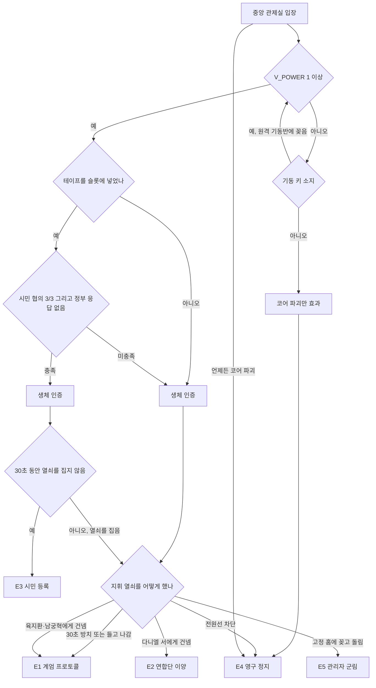

# SD-03b. 메인 스토리·메인 퀘스트 2부

> **서울 폴아웃 상세 기획서 세트** | 문서 ID: SD-03b | 버전: v1.1 | 작성일: 2026-10-12
> **범위**: 퀘스트 상세 **4막(MQ-401~403)·5막(MQ-501~508)·6막(MQ-601~605)·7막(MQ-701~702)·에필로그(MQ-E1)**, 콘솔 앞 행동과 곁에 선 세력의 반응(장면 단위), 엔딩 E1~E5의 조건(호감도 수치)·장면·최종 전투·'종전' 방송 문안, 결말 슬라이드 ES-01~ES-32 전체 문안, 엔딩별 에필로그 월드 상태와 후일담, 메인 퀘스트 전체 볼륨 추정과 버티컬 슬라이스 범위, 원작 대응, 제작 메모. **다루지 않는 것**: 전체 구조·자유도 규칙·변수표·호감도 연동·순서 파괴·대체 경로·프롤로그~3막(→ [SD-03a](03a_main-story-part1.md)), 호감도·판도 시스템 본체(SD-06), 콘솔 오브젝트 UI 규격(SD-12 §7.9), 결말 음악(SD-17)
> **관련 문서**: [SC-00 컨셉](00_concept.md), [SD-02 세계관·연표](02_world-and-lore.md), [SD-03a 메인 스토리 1부](03a_main-story-part1.md), [SD-04a~d 사이드·세력 퀘스트](04d_faction-questlines.md), [SD-05 비표시·반복·인카운터](05_misc-quests-encounters.md), [SD-06 세력](06_factions.md), [SD-07a 주요 인물](07a_characters-major.md), [SD-08 월드·권역](08_world-regions.md), [SD-09c 도심·용산](09c_locations-r05-r06.md), [SD-11 전투](11_combat-system.md), [SD-12 탐험·UI](12_exploration-ui.md), [SD-14 크리처·적](14_creatures-enemies.md), [SD-16 아트](16_art-direction.md), [SD-17 사운드](17_sound.md), 원작 [RD-04](../reverse-design/04_main-story-part2-endings.md)·[RD-08c](../reverse-design/08c_dlc-broken-steel.md)·[RD-27](../reverse-design/27_adaptation-notes.md)

---

## 목차

1. [문서 개요](#1-문서-개요)
2. [4막 「개방의 대가」](#2-4막-개방의-대가)
3. [5막 「서울 회의」](#3-5막-서울-회의)
4. [6막 「사대문 안」](#4-6막-사대문-안)
5. [7막 「종전」](#5-7막-종전)
6. [엔딩 E1~E5](#6-엔딩-e1e5)
7. [결말 슬라이드](#7-결말-슬라이드)
8. [에필로그 MQ-E1 그 후의 서울](#8-에필로그-mq-e1-그-후의-서울)
9. [볼륨 추정과 버티컬 슬라이스](#9-볼륨-추정과-버티컬-슬라이스)
10. [원작 대응](#10-원작-대응)
11. [쯔꾸르 제작 메모](#11-쯔꾸르-제작-메모)
12. [미결 사항](#12-미결-사항)
13. [부록](#13-부록)

---

## 1. 문서 개요

### 1.1 목적
- 4막부터 결말까지를 이벤트·변수 단위로 정한다. 표기, 변수, 호감도 연동, 판도·인도처, 수배도, 생포 이벤트, 관제망 단계(G0~G5) 규칙은 [SD-03a §1.3·§4·§5·§6](03a_main-story-part1.md)를 그대로 쓴다.
- 이 문서의 원칙은 바이블 v0.4 §5.8 **"고르지 않고 기운다"**다. 4막 이후의 큰 결정(비상정부와의 담판, 서울 회의, 동맹, 진입로, 결말) 어디에도 진영·결말을 고르는 메뉴나 질문이 없다. 결정은 **행동**(무엇을 건넸는지, 무엇을 부쉈는지, 누구 곁에서 싸웠는지, 콘솔 앞에서 손을 어디에 올렸는지)으로 한다.

### 1.2 요약
- **4막**: 열쇠 둘의 행방이 정해지면 계엄군이 볼트 S-07을 점령하고 어머니를 청계산으로 끌고 간다. MQ-401 귀향(잠입·협상·강습·세력 동원)과 MQ-402 청계산(협력·사보타주·협상)은 순서 자유다. MQ-403 어머니는 두 퀘스트에서 주인공이 한 일로 닫힌다(결말 6가지).
- **5막**: MQ-501 계엄 선포는 비상정부가 무너졌어도 나온다. 명령은 명령한 사람보다 오래 산다. MQ-502 서울 회의에는 투표가 없고, 탁자에 올린 증거와 약속과 회의 뒤의 행동이 합의를 만든다. 위기 퀘스트 다섯(MQ-503~507) 중 실제로 곁에서 싸운 세력이 MQ-508 도심 진입 날 집결지에 나타난다.
- **6막**: 실제로 들어간 길(1호선, 침투 터널, 차단벽, 공중 강하)이 진입로다. MQ-605에서 경복궁·광화문·정부 종합청사·시청·명동·남대문시장을 뒤져 관제 본부 출입 권한 3개(행정·계엄·운영 인가)를 모은다. 권한마다 4가지 이상의 방법이 있다.
- **7막**: MQ-701 관제 본부에서 수문장이 '미등록자'인 동행 세력을 막아선다. 동행을 콘솔실까지 데려가려면 수문장을 넘어야 한다. MQ-702 중앙 관제실에서 결말은 **콘솔 오브젝트 상호작용**(생체 인증 판, 테이프 슬롯, 지휘 열쇠, 관리자 고정 홈, 진공관 코어, 전원 분전반)으로 정해진다. 곁의 세력은 막거나 재촉하고, 주인공은 말·총·은신으로 대응한다.
- **결말**: E1~E5 각각의 '그 자리에 이르는 기울기'와 '콘솔 앞 행동'을 SD-06 §9.9 수치로 정했다. 행동 직후 ME-E1~E5 → 종전 방송 BGM-E00(5판) → 결말 슬라이드 → 에필로그(계속 플레이)로 잇는다(SD-17).
- **결말 슬라이드 32종**: 결정, 주인공(카르마 3), 볼트, 어머니, 하도윤, 세력 10(호감도 3구간), 정착지 6, 권역 판도 7, 남산 방송, 마영식, 이름 있는 NPC, 맺음.

### 1.3 이 문서에서 쓰는 이름
- 이름 변경(리드 지시, 바이블 §11 반영): 계엄사령관 **육지환** 대령, 중국군 잔존병 지휘관 **멍쉐밍** 상위, 비상정부 라디오 **공보방송**. 원작 용어 '불구'는 '부위 손상'으로 쓴다.
- SD-06 인물을 그대로 쓴다: 윤석진 대위(계엄군 제1중대장), 염수진(등록관리실장), 마리아 권(연합단 수호관, 강경파), 그레이스 장(원칙파 수호관), 펠릭스 문(원칙파 회수 목록 대장), 노복희(지하시장 상인회장), 은솔(각성회 개통파 당번장), 탕밍(잔존병 부중대장), 샤오린(잔존병 통신병), 구만호(새벽인력 실장).

---

## 2. 4막 「개방의 대가」

- **막 목표**: "볼트 S-07과 어머니를 되찾는다."
- **발동**: V_KEYS ≥ 2(SD-03a §4.1). 막 제목 카드 직후 공보방송 특별 방송: "관악 볼트 S-07을 정부 직할 제1 등록 구역으로 지정한다. 오버시어 윤정인은 정부의 보호 아래 청계산으로 이송되었다. 관리자 후보의 출두를 기다린다." 판도: 거점 볼트 S-07 → 비상정부(SD-06 §5.5).
- **4막 시작 상태 분기**
  - BJ 동맹(+80, SD-03a O-12): 점령이 아니라 **'1등급 구역 지정식'**이다. 윤정인은 이송이 아니라 '초청'이다. MQ-401·402가 협력 판으로 시작한다.
  - 당인리 상태: V_REACTOR ∈ {0, 1}(주인공이 당인리를 다루지 않았음)이면 4막 동안 계엄군 공병반이 재가동 공사를 마저 하고, **4막이 끝날 때 자체 복구**한다(V_REACTOR = 2, V_FEED = 관제망 + 청계산, HO_KEY = 1, G1). 봉인·파괴면 복구하지 못한다.
  - 하도윤: V_DOYUN = 1(억류)이면 청계산 벙커 '예비 관리자 보관실'에 있다.
- **시간**: 4막 시작 후 10일이 지나면 남은 퀘스트가 '외면' 결과로 닫힌다(SD-03a §6.6). 핍-보이 로그에 "계엄군이 볼트를 정비하고 있다(3일째)"처럼 서술로 보인다.
- **세력의 자발적 움직임**(SD-06 §9.3): 신뢰 이상인 세력은 묻지 않고 하루 안에 관악산 기슭에 자기 팀을 보낸다. 핍-보이 세력 탭: "연합단 기사 넷이 관악산 기슭에 천막을 쳤다."

### 2.1 MQ-401 귀향

| 항목 | 내용 |
|---|---|
| 발동 | 4막 시작 |
| 장소 | 관악산 북사면 볼트 S-07 정문, 비상 배수 갱도(출구 쪽에서 역방향), 볼트 내부(아트리움, 식당, 관리동, 오버시어실, 원자로실) |
| 등장 인물 | 윤석진 대위(점령 지휘관, 기갑 계엄병 파워 아머), 계엄군 20(인도 분대 2 포함), 파워 아머 2, 볼트 주민 약 190(차명수, 방금례, 도경철, 나채윤 등), 신뢰 이상 세력 팀 |
| 보상 | 900 XP, 오버시어 금고(LR-18이 아직이면), 볼트 무기고 |
| 카르마 | -300 ~ +200 |
| 호감도 | BJ -20~+15, 강습에 함께 싸운 세력 +10, 봉천 +10(이주민 수용) |
| 판도 | 거점 S-07: 해방이면 '볼트 S-07(자치)', 점령 유지면 BJ |

| 단계 | 퀘스트 로그 | 완료 조건 |
|---|---|---|
| 10 | 관악산의 볼트로 돌아간다 | 정문 경계 진입 |
| 20 | 점령군을 볼트에서 몰아내거나 물러나게 한다 | 아래 해법 |
| 30 | 정문의 폭약을 처리한다 | 해체 또는 지휘관 처리 |
| 40 | 볼트 사람들과 이야기한다 | 아트리움 집회 |
| 50 | 볼트 문을 어떻게 둘지 행동한다 | 정문 레버 |

**진행 상세**
- **점령 상태**: 주민은 식당에 모여 있다. 계엄군 분류반이 한 사람씩 '등록 심사'를 하고 금색·청색 띠 등록증을 나눠 준다(주민 대다수는 고마워한다. 1등급이니까). 윤석진은 정문 안쪽에 폭약을 걸어 두었다. 명령서: "외부 무력 공격 시 정문을 폐쇄 후 폭파하라." 폭파하면 아트리움과 거주동 일부가 무너진다.
- **도경철**: 보안부장은 계엄군 아래에서 경비를 선다. "명령 계통이 바뀌었다. 나는 명령대로 한다." 그는 주인공이 오버시어 금고 열쇠를 내밀거나(행동) [화술·쉬움]으로 설득하면 정문 폭약 기폭 장치의 위치를 알려 준다.

| 해법 | 조건 | 결과 | 카르마·호감도 |
|---|---|---|---|
| 잠입 | 비상 배수 갱도를 역방향으로(V_ESCAPE = 4였다면 하도윤이 남긴 표시가 있다). 관리동 → 정문 기폭 장치를 [폭발물 50]으로 해체 → 윤석진을 혼자 있을 때 제압 | 주민 피해 없음 | BJ -10 |
| 협상 | 윤석진에게 [화술·어려움]. [증거: '관리자 인도 지령 제7호' 원문(MQ-105 장부 사본)]이면 보통: "지령의 인도 대상은 관리자 1인이다. 주민 억류는 지령에 없다." [증거: 육지환 투항 문서(5막 이전에는 없다)] 또는 BJ 우호 이상이면 자동 | 윤석진이 분대를 정문 밖으로 물린다. 검문소는 남는다(관악 검문소 강화) | BJ +5 |
| 강습 | 정문 정면. 기폭 장치를 먼저 처리하지 않고 정문을 뚫으면 윤석진이 폭파 명령을 실행한다 → V_VAULT = 4(거주동 일부 붕괴, 주민 약 60명 사망) | 정문 돌파 | 폭파 시 카르마 -300. BJ -20 |
| 세력 동원 | 신뢰 이상 세력의 팀이 이미 관악산 기슭에 와 있다(SD-06 §9.3). 무전으로 지원 병력을 볼트 안까지 부를 수 있다(4막 실내 허용, SD-03a §5.5). 세력마다 하는 일이 다르다(아래) | 강습 난도 하락 | 함께 싸운 세력 +10 |

| 동원 세력 | 하는 일 |
|---|---|
| 연합단 | 기사 넷이 정문을 정면에서 붙잡아 둔다(주의 분산). 그사이 주인공이 기폭 장치로 |
| 정착지 연합 | 봉천 자경대가 갱도 출구를 지키고 보급로를 연다. 해방 뒤 이주민을 받는다 |
| 지하시장 | 구울 운반조가 볼트 하층 배관으로 새 통로를 판다(배관실 직행) |
| 각성회 | 신도들이 정문 판독기 앞에서 '점검' 의식을 한다. 계엄군의 시선을 끈다 |
| 중국군 잔존병(V_MXM = 3) | 굴진 공병이 2시간 만에 볼트 원자로실 옆으로 갱도를 낸다. 2077년의 기술로 2277년의 볼트를 연다 |
| 원칙파 | 오지 않는다(볼트 밖 일). WP 동맹이면 회수조 둘이 무기고만 턴다 |
| 큰돌 무리 | 큰돌이 정문 셔터를 손으로 들어 올린다(KD 동맹) |

- **윤석진의 처리**: 제압한 윤석진은 살리거나(카르마 0, 5막에 그가 육지환에게 "볼트 사람들은 죽이지 않았다"고 보고 → 육지환 투항 화술 판정 한 단계 하락) 처형할 수 있다(카르마 -50). SD-14 MQ-401 판본: 볼트 내부 협력(하도윤 구출 상태 V_DOYUN ∈ {2,3})이 있거나 육지환을 이미 설득했으면 윤석진은 전투 없이 투항한다.
- **아트리움 집회**: 해방 뒤 주민이 모인다. 차명수, 방금례, 나채윤이 말을 건다. 1등급 등록증을 받은 주민 일부는 해방을 원망한다("1등급이었는데"). 주인공의 대답은 개별 대화다.
- **볼트 문(행동)**: 정문 레버를 내리면 볼트는 다시 닫히고 자치로 돌아간다(V_VAULT = 2). 레버를 올린 채 떠나면 주민 절반이 사흘에 걸쳐 봉천·노들섬으로 내려간다(V_VAULT = 5, 봉천 +10, 노들 +5, S-07 거점 공백). 아무것도 하지 않고 떠나면 레버는 올린 채로 남는다(5와 같다). 묻는 장면은 없다.
- **10일 경과(외면)**: 계엄군이 S-07을 직할 구역으로 굳힌다(V_VAULT = 3). 주민은 살아 있다.

**핵심 대사**
- 윤석진: "이 사람들은 1등급입니다. 대한민국에서 가장 안전한 사람들이에요. 당신이 그걸 깨러 왔습니다."
- 차명수(해방 뒤): "1순위 칸은 늘 같은 줄에서 나왔다고 했지. 그 줄이 우리를 이렇게 만들 줄은 몰랐다."
- 방금례: "출생신고는… 계속 넣어야 하나요?" (주인공의 대답은 개별 대화. 계보 사슬을 끊을지에 대한 질문이다. 끊으면 `S_LINEAGE_CUT`, 7막 콘솔 앞 대사와 슬라이드 변형)

**연출 메모**: 프롤로그와 같은 볼트 맵을 '점령판' 타일 변형으로 재사용한다(계엄군 깃발, 분류반 책상, 폭약). 아트리움 집회에는 프롤로그 인물의 얼굴 그래픽을 나이 든 판 없이 그대로 쓴다(3년밖에 지나지 않았다).

**기울기 체감**: 해방하면 관악산 기슭의 세력 천막에 깃발이 오르고 남산 방송이 "볼트 사람들이 아침 햇빛을 봤대요"라고 전한다. 공보방송은 "불법 무장 세력이 제1 등록 구역을 습격했다"고 맞받는다. 협상이면 볼트 정문 앞에 계엄군 검문소가 남아 볼트 주민이 오갈 때마다 등록증을 보인다.

**사이드 연계 후보**: 볼트 주민의 바깥 정착(나채윤의 바깥 적응) / 1등급 등록증을 버리지 못하는 주민 / S-07 수경 농장 곰팡이병의 원인 규명.

### 2.2 MQ-402 청계산

| 항목 | 내용 |
|---|---|
| 발동 | 4막 시작(공보방송의 '출두 권고') |
| 장소 | 청계산 벙커(R11): 정문 방공 진지, 버티버드 격납고, 행정층, 통신실, 벙커 원자로층, 구금동, 예비 관리자 보관실, 권한대행실 |
| 등장 인물 | 남궁혁, 육지환 대령, 염수진, 계엄군, 윤정인(구금동), 하도윤(V_DOYUN = 1) |
| 보상 | 1,000 XP, (사보타주) 계엄군 장비, (협상) 퇴진 문서 또는 투항 문서, 남궁혁의 신임장(M-236 권한대행 위임장, 협력 시) |
| 카르마 | -500 ~ +300 |
| 호감도 | BJ -50~+30. 퇴진이면 BJ 값 유지. 알려지면 연동(SD-06 §3.6) |
| 판도 | 사보타주 성공: R11 비상 -30. 협력: R11·R01 비상 +10 |

| 단계 | 퀘스트 로그 | 완료 조건 |
|---|---|---|
| 10 | 청계산 벙커로 간다 | 정문 또는 침입 경로 |
| 20 | 권한대행을 만난다 | 권한대행실 |
| 30 | 벙커에서 할 일을 한다 | 협력 / 사보타주 / 협상 / 그 밖 |
| 40 | 벙커를 나선다 | 지상 |

**들어가는 길**: ① 정문 '출두'(BJ 적대가 아니면 계엄군이 무기를 맡기라고 한 뒤 들여보낸다. 무기는 정문 보관함) ② 북사면 환기탑(은신, [힘 7] 철망) ③ 신뢰 이상 세력과 강습(버티버드 격납고 쪽). ④ 생포되어 구금동에서 시작(SD-03a §6.7).

**남궁혁과의 면담**: 권한대행실. 2077년 행정안전부 장관실의 가구를 벙커로 옮겨 놓았다. 벽에 23:29에 멈춘 시계. 남궁혁은 서류를 하나씩 내민다. 2077년 지침 원본(자기 서명), S-07 계보 대장(K_LINEAGE가 없으면 여기서 선다: "3년 전까지 1순위는 당신 어머니였습니다"), 그리고 **관리자 등록 서류**. 그는 묻지 않는다. 서류를 내밀고 기다린다. 이 방에서 주인공이 실제로 하는 일이 결과다.

| 경로 | 주인공이 실제로 한 일(SD-06 §9.3) | 결과 | 카르마·호감도·변수 |
|---|---|---|---|
| **협력** | 관리자 등록 서류에 서명한다(책상 위 서류 오브젝트) + 견본 판에 손을 올려 **생체 인증 견본**(M-237)을 남긴다(HO_SAMPLE = 1). 기동 키·테이프를 지니고 있으면 남궁혁이 "보관하겠다"며 손을 내민다. 건넬지는 행동이다 | 어머니 석방(V_MOTHER는 MQ-403에서), S-07 1등급 구역(V_VAULT = 3), 공고 철회, 남궁혁의 신임장(6막 행정 인가) | BJ +30(서명+견본). 키 인도 +15, 테이프 인도 +15(남궁혁은 테이프를 태운다. HO_TAPE = 99). 알려지면 JC·YH 연동 |
| **사보타주** | 다음 중 2개 이상: 벙커 원자로 제어봉 조작(원자로층, [과학 75] 또는 [수리 75]) / 통신실 파괴(공보방송 송신기, 폭발물 또는 [과학 50]으로 과부하) / 버티버드 격납고 폭파(폭발물 설치 2곳) | F_BJ_NEUTRALIZED = 1. 원자로 조작을 골랐으면 8분 붕괴 타이머(벙커 하층 침수·화재) | BJ -50(강제). 원자로 조작으로 거주민 대량 사망 시 카르마 -500, BJ 영구 적대(SD-06) |
| **협상** | [화술·어려움] + 증거 3건 + 육지환 동석(육지환이 권한대행실에 있을 때). 증거 후보: LR-17(반려 도장), 2077년 국영 라디오의 23:21 무선 녹음(K_SIGNER), LR-19, 관리 요원 신분증 12장, 여의도 당직 일지, 멍쉐밍 부대 근무일지의 '명령 종료' 쪽 | 증거로 '남궁혁 퇴진' 또는 '육지환 투항' 중 하나가 일어난다. 남궁혁 앞에서 2077년의 명령을 증거로 무너뜨리면 퇴진, 육지환에게 '선서'와 '지침'이 어긋난다는 것을 보이면 투항(아래) | 퇴진: F_BJ_NEUTRALIZED = 1, V_NAMGUNG = 2, 카르마 +200. 투항: V_YUK = 2, 카르마 +100 |
| **암살** | 남궁혁을 죽인다 | V_NAMGUNG = 1, F_BJ_NEUTRALIZED = 1. 육지환이 독자 계엄(V_YUK = 3) | 카르마 -100(무장하지 않은 노인). BJ 적대(강제 -80). 수배도 등급 4 |
| **체포** | 남궁혁을 기절시킨 뒤 [힘 7]로 업고 벙커를 나간다(신뢰 이상 세력 팀이 있으면 그들에게 넘긴다) | V_NAMGUNG = 3(넘긴 세력의 구금). F_BJ_NEUTRALIZED = 1 | 넘긴 세력 +20. BJ 적대 |
| **그냥 나간다** | 아무것도 하지 않고 나간다 | 남궁혁: "서류는 여기 있습니다. 언제든 오십시오." 어머니는 볼모로 남는다 | 변화 없음 |

- **사이드 보정**(RECON_SPEC N-68): `SQF_YUK_DOUBT ≥ 1`(SD-04a SQ-S22 b)이면 육지환 투항 판정이 한 단계 쉬워진다.
- **협상의 두 갈래**: 퇴진은 남궁혁 자신의 결정이다. "내 명령은 거둘 수 있다. 하지만 2077년의 명령은 내 것이 아니다. 그건 저 기계 안에 있다." 그는 권한대행 직인을 책상에 내려놓고 벙커에 남는다. 투항은 육지환의 결정이다. 그는 계엄군 선서문("나는 국민의 생명과 재산을 보호하며…")을 다시 읽고 권총을 내려놓는다. 두 판정을 같은 면담에서 둘 다 노릴 수 있다(증거가 6건이면).
- **어머니 구출**: 구금동은 행정층 아래다. 협력이면 염수진이 직접 데려온다. 그 밖의 경로에서는 주인공이 구금동으로 가야 한다(감방 [자물쇠 따기 50], 경비 2). 사보타주의 원자로 타이머가 돌고 있으면 구금동을 들르지 않고 나가는 것이 가능하다. 그 경우 윤정인은 무너진 벙커에 남는다(V_MOTHER = 4).
- **하도윤 구출**: 예비 관리자 보관실(V_DOYUN = 1). 협력이면 남궁혁은 하도윤을 '예비 열쇠'로 계속 보관한다(V_DOYUN = 5). 그 밖에는 문을 열고 데려간다(V_DOYUN = 3, 카르마 +50). 붕괴 타이머 안에 들르지 않으면 V_DOYUN = 4.
- **10일 경과(외면)**: 남궁혁이 계엄을 선포하며 5막이 열린다(V_NAMGUNG = 0, V_MOTHER = 1 유지).

**핵심 대사**
- 남궁혁: "저는 2077년 10월 23일 23시 21분에 한 문장을 말했습니다. 그 문장은 아직 끝나지 않았습니다. 당신이 끝낼 수 있게 되기 전까지는요."
- 남궁혁(협력, 서명 뒤): "어머님은 1등급입니다. 대한민국은 약속을 지킵니다. 서류에 있으니까요."
- 육지환(투항): "선서에는 '국민'이라고 돼 있었다. 지침에는 '등록된 자'라고 돼 있었다. 나는 200년 동안 그 둘이 같은 말인 줄 알았다."

**연출 메모**: 벙커 맵은 2077년 관공서 실내(SD-16 비상정부 팔레트: 흑청 + 금장). 권한대행실 장면은 BGM 없이 시계 초침 없는 정적, 서류 넘기는 효과음. 사보타주 붕괴는 붉은 경광등과 침수 타일 애니메이션.

**기울기 체감**: 협력하면 공보방송이 "관리자 후보가 정부에 등록했다"고 알리고, 정착지 사람들이 주인공을 피한다(정착지 개별값은 알려진 뒤 연동). 계엄군 검문소가 경례한다. 사보타주 후에는 공보방송이 끊기고 2시간 뒤 육지환의 목소리로 다시 돌아온다(독자 계엄의 예고). 퇴진이면 공보방송의 정시 방송이 "권한대행 유고. 계엄사령관 대행 체제"로 바뀐다.

**사이드 연계 후보**: 벙커 2세대·3세대 거주민의 지상 이주 / 염수진의 등록 대장 / 버티버드 조종사의 망명.

### 2.3 MQ-403 어머니

| 항목 | 내용 |
|---|---|
| 발동 | 4막 시작(V_MOTHER = 1) |
| 성격 | 별도 장소가 없는 **결과 퀘스트**다. MQ-401·402에서 주인공이 한 일과 재회 대화로 닫힌다 |
| 보상 | 300 XP. 어머니의 오버시어 열쇠(조건부) |

| 단계 | 퀘스트 로그 | 완료 조건 |
|---|---|---|
| 10 | 어머니를 찾는다 | 청계산 구금동 또는 협력 판 재회 |
| 20 | 어머니와 이야기한다 | 재회 대화 |
| 100 | (자동) 어머니의 결말 | V_MOTHER 확정 |

**재회 대화**: 윤정인은 주인공을 보자 먼저 묻는다. "다쳤니?" 그리고 3년 전 승계 기록을 봤다고 말한다. "내가 1순위였대. 그런 줄도 모르고 너를 넘겼어. 내 자리를 넘긴 거였어." 주인공의 대답(용서하는 말, 탓하는 말, 침묵)은 이 사람과의 개별 대화다.

| V_MOTHER | 결말 | 조건(행동) | 효과 |
|---|---|---|---|
| 2 | 생존·화해 | 구출 + 재회 대화에서 용서하는 말 | 윤정인이 S-07로 돌아가 오버시어로 남는다(V_VAULT = 2일 때) 또는 주인공이 데려다준 정착지에 머문다(그 정착지 +10, SD-06 §9.3) |
| 3 | 생존·결별 | 구출 + 탓하는 말 또는 침묵 | 윤정인은 혼자 봉천으로 내려가 약국 일을 돕는다. 다시 찾아가면 짧은 대화만 |
| 4 | 사망 | 사보타주 붕괴 타이머 중 구금동에 들르지 않음 / 4막 외면 후 5막 MQ-507에서 그녀가 있는 구역이 무너짐 | 슬라이드 비극판 |
| 5 | 비상정부 행정관 | MQ-402 협력 | 남궁혁이 그녀를 'S-07 행정관'에 임명한다. 그녀는 받아들인다. "볼트를 지키라는 게 내 일이야." |
| 6 | 퇴임(평주민) | 구출 + **LR-19(동생에게 부치지 못한 편지)를 그녀에게 건넨다**(물건 주기) | 그녀가 7대조 할머니의 언니가 쓴 편지를 읽고 오버시어 자리를 내려놓는다. "이제 명령은 그만 내릴게." S-07은 주민 회의로 돌아간다(차명수가 의장) |
| 1 | 볼모 유지 | 4막 외면 | 5막 동안 청계산에 있다. 6막 이후 비상정부가 무너지면 풀려난다(V_MOTHER = 3으로 자동), 그대로면 슬라이드 '볼모' 판 |

- 프롤로그 MQ-P4의 탈출 방법(V_ESCAPE)이 재회 대사의 첫 줄을 바꾼다(설득 = "그날 문을 연 건 나였지", 하도윤 = "도윤이가 너를 내보냈다며", 전투 = "도 부장 팔이 아직 안 좋아", 은신 = "너는 늘 조용히 사라지는 애였어").

**핵심 대사**: 윤정인(V_MOTHER = 6): "이 편지, 첫 줄이 '네 아이의 아이의 아이가'로 시작해. 그 아이가 너구나. …이제 문은 네가 열어."

**기울기 체감**: 어머니를 데려다준 정착지에서 주민들이 "오버시어님 아드님(따님)"이라고 부른다. V_MOTHER = 5이면 공보방송이 S-07 행정관 임명을 미담으로 보도한다.

---
## 3. 5막 「서울 회의」

- **막 목표**: "계엄 아래에서 버틴다."
- 5막 공통: 관제망 단계 G2(SD-14). 거리에 로봇이 나온다. 수배도 하한은 BJ 경계 이하이면 등급 4(SD-03a §6.5). 4막 이후 BJ 적대이면 계엄군 추격조가 '처단'으로 바뀐다.
- 5막의 시간: 회의는 5막 시작 후 3일 안에 열린다(넘기면 주인공 없이 열린다). 위기 퀘스트는 각각 발동 후 5일이 지나면 주인공 없이 결판이 난다(SD-03a §6.6). 서울이 주인공을 기다려 주지 않는다는 것을 시간으로 보여 준다.

### 3.1 MQ-501 계엄 선포

| 항목 | 내용 |
|---|---|
| 발동 | V_ACT = 5(4막 종료). 막 제목 카드 직후 전 채널 방송 |
| 성격 | 이벤트 퀘스트. 어떤 경우에도 선포는 나온다. **누가 선포하는지**만 바뀐다 |
| 보상 | 300 XP(첫 밤을 넘기고 거점에 도착) |

| 판 | 조건 | 선포하는 목소리 | 관제망 |
|---|---|---|---|
| A 정부의 계엄 | V_NAMGUNG = 0 | 남궁혁, 공보방송: "2077년 10월 23일 선포된 비상계엄은 해제된 적이 없습니다. 오늘부로 수도 관제망이 계엄 업무에 복귀합니다." | V_POWER ≥ 1이면 G2 전역 순찰. HO_SAMPLE = 1이면 관리자 없이 '견본 인증'으로 전면 계엄(순찰 밀도 최대) |
| B 사령관의 계엄 | V_NAMGUNG ∈ {1,2,3}, V_YUK = 0 또는 3 | 육지환: "권한대행 유고. 계엄사령관이 지침을 집행한다." | 같음. 견본이 없으면 관제망 로봇은 '시험 통전' 상태에 머물고 계엄군만 움직인다 |
| C 주인 없는 계엄 | F_BJ_NEUTRALIZED = 1, V_YUK ∈ {1,2} | 사람이 아니라 **관제망 확성기**가 2077년 녹음을 튼다: "비상 주민 분류 지침 집행 중. 판독 불능자는 가까운 대피소 대기 구역으로 이동하십시오." | V_POWER ≥ 1인 구역의 로봇이 2077년 23:21 집행 모드를 이어서 집행한다. 아무도 명령하지 않았다 |
| D 전원 없는 계엄 | V_POWER = 0(당인리 봉인·파괴) | A·B·C 중 해당 목소리 | 지역 중계소 6곳의 핵분열 전지로 **부분 전원**(V_POWER = 1, 중계소 반경만 G2). 나머지 서울은 로봇 없이 계엄군만 |

- **기동 키 인도처에 따른 판**(SD-03a §4.6): HO_KEY = 1(비상정부)이면 A·B가 전면 계엄. HO_KEY = 82(탱크마을)이면 비상정부가 탱크마을에 키를 요구하는 통첩이 같이 나오고 MQ-507의 첫 표적이 탱크마을이 된다. HO_KEY = 2(연합단)이면 용산 일대만 전원이 들어오고 관제망 로봇이 용산을 '적성 거점'으로 포위한다(MQ-503 배경). HO_KEY = 0(주인공)이면 계엄군 처리조가 주인공을 찾는다(수배도 +20).
- **판도**(SD-06 §5.5): 당인리가 켜져 있으면 R01·R02·R07·R11의 BJ 영향력 +20, 공백 거점 일부를 관제망이 점거.
- **첫 밤**: 선포 직후 밤, 주인공이 있는 구역에 관제망 거리 순찰조(KS-1, SD-14)가 지나간다. 가까운 거점(신뢰 이상 세력의 안전 가옥, 정착지)에 도착하면 퀘스트 종료.

**기울기 체감**: 판 C에서는 남산 방송이 처음으로 침묵하다가 송미래가 말한다. "아무도 명령 안 했대요. 그런데 로봇들이 나왔어요." 세력 탭에 "관제망이 서울의 주인이 없는 동안 서울을 지키겠다고 한다" 한 줄이 생긴다.

### 3.2 MQ-502 서울 회의

| 항목 | 내용 |
|---|---|
| 발동 | MQ-501 종료. 백인하(사망 시 부조합장)의 전령: "노들섬에서 모인다. 와서 들어 달라." |
| 장소 | 노들섬 선주 조합 회의장(백인하 사망·노들섬 적대 시 선유도 물 상인 조합 창고, SD-03a §6.3) |
| 성격 | **투표도 진영 선택도 없다.** 주인공이 탁자에 올리는 증거, 하는 약속, 회의 뒤에 실제로 지키는 행동이 결과를 만든다(바이블 §5.8, SD-06 §9.4) |
| 보상 | 500 XP. 합의 결과에 따라 '서울 협약' 문서(6막 운영 인가 단서 아님, 7막 E3 정착지 대표들의 위임장) |

| 단계 | 퀘스트 로그 | 완료 조건 |
|---|---|---|
| 10 | 노들섬 회의장으로 간다 | 회의장 진입 |
| 20 | 회의를 끝까지 지켜본다 | 회의 종료(주인공이 떠나도 회의는 진행된다) |
| 30 | (선택) 회의에서 한 약속을 지킨다 | 약속별 |

**참석과 좌석**: 참석 조건은 SD-06 §9.4 표를 따른다(정착지 연합 주최, 연합단 YH 중립 이상, 지하시장 JH 중립 이상, 각성회 GS 중립 이상, 원칙파 조건부, 새벽인력 SB 중립 이상, 중국군 잔존병은 MQ-303 평화 해결 시 무전 참석, 큰돌 무리 KD 신뢰 이상 참관, 비상정부 BJ 우호 이상 참관인). BJ 경계 이하이면 회의 중반에 계엄군 버티버드가 섬 상공을 지나며 경고 사격을 한다(전투 이벤트 2분, 회의장 방어).

**회의 진행(장면)**
1. **개회**: 백인하가 "오늘은 누가 서울을 쥘지 정하는 날이 아니다. 서울을 쥐려는 기계를 어떻게 할지 듣는 날이다"라고 연다.
2. **각 세력 발언**(참석 순): 연합단 "관제망은 우리가 지킨다", 지하시장 "구울도 사람이다", 각성회 "수호자를 깨우자", 원칙파 "회수하고 끝내자", 새벽인력 "일손이 필요하다", 잔존병(무전) "우리는 그 기계를 부수러 왔었다", 비상정부 참관인 "국가는 이미 있다".
3. **주인공의 차례**: 주인공은 회의 탁자에 **물건을 올린다**(인벤토리에서 '내려놓기'). 올린 물건마다 회의장의 반응이 바뀌고 합의 점수가 오른다(SD-06 §9.4 증거 보너스: 한유리의 기록 4건 이상 +5, 프로토콜 테이프 실물 +10, 멍쉐밍 근무일지 +3, 황두칠의 장부 +3. 사이드 퀘스트가 'MQ-502 증거'로 지정한 물건은 1건당 +2, 합계 상한 +6(RECON_SPEC N-67)). 그 밖에 관리 요원 신분증 12장, 여의도 당직 일지, LR-17은 반응 대사만 바꾼다.
   - **테이프 실물을 올리면** 회의장이 조용해진다. 비상정부 참관인이 일어나고, 각성회가 "성물"이라 중얼거리고, 원칙파가 손을 뻗는다. 회의가 끝나면 테이프는 다시 주인공 소지품으로 돌아온다(누가 집어 가지 않는다. 단 원칙파 WP 경계 이하이면 회의 뒤 회수조가 주인공을 미행한다).
4. **화술 판정**: 반대 발언에 반박하는 화술 판정이 최대 3회 나온다(각 [화술·어려움], 성공 1회당 합의 점수 +4). 카리스마 7 이상이면 연설 선택지 +5(SD-06).
5. **약속**: 세력이 주인공에게 묻는 것은 진영이 아니라 **개별 사안**이다. "탱크마을에 겨울 전력을 남겨 줄 건가?", "구울도 등록되게 할 건가?", "연합단 기지를 건드리지 않을 건가?", "세진 타워의 회수권을 원칙파에 줄 건가?" 주인공이 '하겠다'고 말하면 약속 플래그가 선다(`PR_TK_POWER`, `PR_JH_GHOUL`, `PR_YH_BASE`, `PR_WP_SALVAGE`, `PR_JG_HOME`(잔존병을 북쪽 고향 방향으로 보내 주겠다), `PR_SB_LABOR`(새벽인력에 일감을 주겠다)). 대답하지 않거나 거절해도 된다.
6. **합의문**: 합의 점수(SD-06 §9.4 식)로 결과가 정해지고, 백인하가 합의문(M-239)을 읽는다. 결과는 남산 방송으로 바로 나간다.

| 결과 | 합의 점수 | 효과(SD-06 §9.4) | 이 문서의 추가 |
|---|---|---|---|
| 서울 협약 | 30 이상 | 서명 세력끼리 음수 연동 0, 서명 세력 +10, MQ-507 방어에 서명 세력 병력 합류, 공동 깃발 | 정착지 대표들이 7막 E3의 **시민 협의 대표 위임장**을 받는다(§5.2) |
| 부분 합의 | 15~29 | 신뢰 이상 세력만 공동 방어. E3 조건 충족 | 위임장 발급 |
| 결렬 | 15 미만 | 각자 움직인다 | 위임장 없음. E3를 위해서는 회의 재소집(FQ-JC-08) |

- **약속 추적**(SD-06 §9.4): 약속과 반대로 행동하면 약속받은 세력 -15, 지키면 +10. 판정 시점: `PR_TK_POWER`는 7막 결말에서 탱크마을 송전이 남는지(E4·E1이면 어긴 것), `PR_JH_GHOUL`은 E3이면 지킨 것·E1이면 어긴 것, `PR_YH_BASE`는 MQ-503에서 용산을 친 쪽에 섰는지, `PR_WP_SALVAGE`는 원칙파가 코어실에 들어가게 뒀는지, `PR_JG_HOME`은 MQ-602에서 멍쉐밍 부대를 터널 밖으로 보내는지, `PR_SB_LABOR`는 MQ-504에서 인력시장을 남겼는지.

**핵심 대사**
- 백인하(개회): "오늘은 누가 서울을 쥘지 정하는 날이 아니다."
- 노복희: "등록이 다시 시작되면 구울은 '판독 불능'이야. 200년 전에도 그랬고."
- 멍쉐밍(무전, 해산 시): "우리는 그 기계를 부수러 왔었다. 이제 부수든 말든 당신들 일이다. 우리는 손님이다."

**기울기 체감**: 서울 협약이 서면 노들섬에 '한강 물결' 깃발이 처음 오르고 협약 세력 거점에도 같은 깃발이 걸린다. 결렬이면 회의장 밖에서 세력 병사들이 서로 총을 겨눈 채 흩어진다. 남산 방송은 회의 전문을 다음 날 아침 낭독한다.

**사이드 연계 후보**: 회의 재소집(FQ-JC-08, SD-04d) / 회의 경비 / 약속 이행 퀘스트들.

### 3.3 위기 퀘스트 공통 규칙 (MQ-503~507)
- 다섯 위기는 MQ-502 직후 **동시에** 터진다(발동 조건이 맞는 것만). 아무것이나, 몇 개든 한다. 첫 위기를 끝내면 MQ-508의 시계가 당겨진다(SD-03a §4.1).
- **곁에서 싸우기**: 위기 퀘스트의 전투에서 어느 세력의 병력과 같은 전장에서 싸우면(그 세력의 적을 쓰러뜨리거나 그 세력의 목표를 지키면) `FW_<약호> +1`(SD-03a §4.7). MQ-508 집결의 자격이 된다. 세력에게 묻지 않고, 전장의 행동만 센다.
- **시간 경과**: 발동 후 5일이 지나면 주인공 없이 결판이 난다. 결과는 그 구역 판도 영향력이 높은 쪽 승리(SD-06 §5.4).

### 3.4 MQ-503 연합단의 분열

| 항목 | 내용 |
|---|---|
| 발동 | MQ-502 종료 AND 연합단·원칙파 둘 다 존속. 촉발: 원칙파가 계엄을 '철수 명령'으로 해석하고 용산 요새 무기고와 공작창(관제망 기술)을 회수하러 온다. HO_TAPE = 3이면 쟁점이 테이프, HO_KEY = 2이면 기동 키 |
| 장소 | 용산 요새(연병장, 무기고, 공작창), 공릉 회수 창고 |
| 등장 인물 | 다니엘 서, 마리아 권(연합단 강경파 수호관), 그레이스 장, 펠릭스 문, 제이슨 임 |
| 보상 | 600 XP |

| 주인공이 한 일(SD-06 §9.5) | 결과 | 호감도·판도 |
|---|---|---|
| 연병장에서 **아침 점호 원본 녹음**을 튼다(FQ-YH-07에서 되찾은 '교대할 때까지' 끝 문장, 또는 [과학 75]로 HOLD THE BASE 테이프의 지워진 2초를 복원) | 두 진영이 같은 녹음 앞에서 총을 내린다. 그레이스 장: "교대할 때까지… 우리는 교대를 기다린 게 아니었군." 화해 | YH +15, WP +15, YH↔WP 연동 -0.6 → -0.2. 공릉 창고와 용산 요새 공용 |
| 연합단과 함께 원칙파 회수조를 막고 공릉 창고를 친다 | 연합단 승리. 그레이스 장 생포 또는 사망 | YH +20, WP -30, FW_YH +1. 공릉 창고 → 연합단 |
| 원칙파와 함께 요새 무기고를 연다 | 원칙파 승리. 마리아 권이 원칙파 편에 서고 다니엘 서가 실각(사망 아님, 요새 영창). 연합단 수장 = 마리아 권 | WP +25, YH -30, FW_WP +1. 용산 요새 → 원칙파 영향(공동) |
| 끼지 않는다 | 5일 뒤 판도대로 결판(대개 연합단 승리) | 변화 없음 |

- 다니엘 서가 실각하면 E2의 '지휘 열쇠를 받는 사람'은 마리아 권이다(SD-03a §6.3 대체 경로). 마리아 권은 열쇠를 받으면 관제망 로봇으로 원칙파식 '회수'를 시작한다(E2 슬라이드 변형).

**핵심 대사**: 다니엘 서: "제3조. 명령이 오지 않아도… 200년 동안 이 문장 끝을 아무도 몰랐다. 그래서 우리가 갈라졌다."

**기울기 체감**: 화해하면 용산과 공릉 사이 순찰대가 같이 다니고, 원칙파 회수 기사가 주인공을 "원칙의 손님"이 아니라 "교대병"이라 부른다(호칭 특수).

### 3.5 MQ-504 새벽의 장

| 항목 | 내용 |
|---|---|
| 발동 | MQ-502 종료 AND 새벽인력 존속. 촉발: 계엄 아래에서 새벽인력이 '인력시장'을 크게 연다. 미등록자를 잡아 계엄군에 '등록 노동력'으로 판다. HO_LEDGER = 1(장부를 계엄군에 넘겼음)이면 계엄군 하청 판(계엄군 경비 동석) |
| 장소 | 새벽인력 본소(남구로 새벽 인력시장 터의 옛 공구상가 철골동), 인력시장 광장, 노들섬 출장소 |
| 등장 인물 | 황두칠(또는 승계자), 실장 구만호, 독사, '인력' 약 300(근태 목걸이 착용) |
| 사이드 보정 | SD-04a SQ-S09 해법 D·SQ-S10 해법 C로 억류자를 먼저 풀었으면(`SQS_` 기록) 이 퀘스트의 해당 해방 단계를 건너뛴다(RECON_SPEC N-68) |
| 보상 | 600 XP |

| 주인공이 한 일(SD-06 §9.5) | 결과 | 카르마·호감도·판도 |
|---|---|---|
| 인력시장을 습격한다(정착지 자경대·자율방범대가 함께 오면 FW_JC) | 새벽인력 몰락. 본소 파괴 | 카르마 +200, SB 영구 적대, JC +20. 판도 R02 JH +15. SB 행·열 연동 삭제 |
| 근태 목걸이 해제 장치를 찾아 '인력'을 한꺼번에 풀어 준다(본소 통신실, [과학 75] 또는 [수리 75], 구만호 금고의 해제 코드) | 인력 300 해방, 새벽인력은 남지만 사업이 무너진다 | 카르마 +300, SB -40 |
| 황두칠과 거래: 계엄군 하청을 끊고 정착지 품삯 노동으로 바꾸게 한다([화술·어려움], [호감: SB 우호 이상]면 보통) | 인력시장이 '품삯 시장'으로 바뀐다(목걸이 폐지) | SB +20, JC -15(속은 정착지도 있다) → `PR_SB_LABOR` 지킴 |
| 독사의 쿠데타를 돕는다(독사가 황두칠을 친다) | 새벽인력 지도자 교체(독사 소장) | SB +10, 카르마 -50 |
| 새벽인력 편에서 경비를 선다(인력 사냥 동행) | 시장 번창 | 카르마 -300, SB +20, FW_SB +1 |

**핵심 대사**: 황두칠: "계엄이 오면 일자리가 생겨. 등록이 오면 장부가 국가 서류가 되지. 난 그날을 200년 기다린 장부 주인이야."

**기울기 체감**: 해방이면 영등포 거리에서 형광 주황 조끼가 사라지고, 풀려난 사람들이 주인공을 보고 목걸이 자국을 만지며 인사한다. 남산 방송: "오늘 300명이 집에 갔대요."

### 3.6 MQ-505 각성

| 항목 | 내용 |
|---|---|
| 발동 | MQ-502 종료 AND 각성회 존속 AND (V_POWER ≥ 1 또는 HO_TAPE = 5) |
| 장소 | 노량진 관제 중계소(각성회 본거지, 대기등), 중계소 정비고 |
| 등장 인물 | 류정(대기파), 은솔(개통파 당번장), 신도 약 130 |
| 사이드 보정 | SD-04c SQ-N01 해법 D(공방 진공관을 각성회에 넘김)면 개통파의 중계 기둥 각성 단계 +1(RECON_SPEC N-68) |
| 보상 | 600 XP |
| 촉발 | 개통파 은솔이 중계소의 정비고 로봇을 '개통'해 등록된 자를 지키게 하려 한다. 주인공이 MQ-207에서 '축복'(관리자 인증)을 했다면 중계소에 그 인증 기록이 남아 있어 개통파가 더 많은 로봇을 깨울 수 있다(난도 +1). HO_TAPE = 5(성물)이면 개통파가 테이프를 판독기에 걸어 '축성'하려 한다(테이프 손상 위험) |

| 주인공이 한 일(SD-06 §9.5) | 결과 | 호감도·판도 |
|---|---|---|
| 대기파 곁에서 깨어난 경비 로봇을 끈다(로봇마다 `[관리자 인증]` '대기 유지', 수배도 +3씩, 또는 [과학 50]) | 개통 실패, 대기등은 계속 녹색 | GS +15, FW_GS +1 |
| 개통파를 돕는다(정비고 로봇 6기 개통) | R01에 관제망 위협 구역 생성. 깨어난 로봇이 봉천 계단마을 어귀에서 '미등록자' 검문을 시작 | GS +20, JC -20, 봉천 -15 |
| 중계소를 부순다(대기등 파괴) | 각성회가 흩어진다 | GS -40(영구 적대, SD-06) |
| 성물 테이프를 판독기에서 빼 온다(HO_TAPE = 5일 때, 은신 또는 [화술·보통]으로 류정을 설득) | 테이프 회수(HO_TAPE = 0) | 대기파면 GS 0, 개통파 앞에서 빼면 GS -15 |

**핵심 대사**: 류정: "수호자는 잠든 게 아니라 대기 중이에요. 대기는 기다린다는 뜻이지, 일어나라는 뜻이 아니에요."

### 3.7 MQ-506 지하시장 봉쇄

| 항목 | 내용 |
|---|---|
| 발동 | MQ-502 종료 AND (V_POWER ≥ 1이고 R02에 G2 순찰 존재, 또는 R02 BJ 영향력 50 이상) |
| 장소 | 영등포 지하상가 출입구 판독기 개찰구 7곳, 영등포 지역 중계소, 5호선 연결 통로 |
| 등장 인물 | 노복희, 마영식, 박춘삼, 계엄군 포위조 또는 관제망 판독 로봇 |
| 촉발 | 상가 출입구의 2077년 판독기 개찰구가 전원을 받아 깨어나고 셔터가 닫힌다. 구울은 '판독 불능'이다. 안에서는 나갈 수 없고, 밖에서는 계엄군이 '감염 격리'를 이유로 포위한다 |
| 보상 | 600 XP |

| 주인공이 한 일(SD-06 §9.5) | 결과 | 호감도·판도 |
|---|---|---|
| 영등포 지역 중계소에서 판독기를 '개방 고정'한다(`[관리자 인증]`, 수배도 +3) | 셔터가 올라간다. 봉쇄 해제 | JH +25, FW_JH +1(포위조와 싸웠다면). 판도 R02 JH +20 |
| 5호선 하저 구간으로 탈출로를 연다(MQ-203을 했으면 운반조가 안내) | 지하시장 일부가 노들섬으로 이주 | JH +15, 노들 +5 |
| 상가 안에서 박춘삼과 판독 로봇을 정리한다 | 봉쇄는 그대로, 안은 안전 | JH +10, FW_JH +1 |
| 포위조 지휘관과 협상([화술·어려움], [증거: 마영식의 회로도 원본 — '구울 등록 조항'])  | 계엄군이 포위를 풀고 물러난다 | JH +15, BJ -5 |
| 방관 | 5일 뒤 상가 셔터 안에서 구울 다수가 굶주린다 | JH -20, 판도 R02 JH -20 |

**핵심 대사**: 노복희: "셔터를 내리는 건 우리가 정해. 저 기계가 정하는 게 아니라."

### 3.8 MQ-507 계엄군 총공세

| 항목 | 내용 |
|---|---|
| 발동 | MQ-502 종료 AND 계엄군 존속(V_YUK ∈ {0, 3, 4}). 표적: **봉천 계단마을, 노들섬, 탱크마을 세 곳을 동시에** 친다(SD-06 §9.5). HO_KEY = 82이면 탱크마을에 주력 |
| 장소 | 세 정착지 중 주인공이 실제로 간 곳 |
| 사이드 보정 | `V_TK_HEAT ∈ {2, 4}`(SD-04b SQ-W01)이면 탱크마을 방어전 밤에 탐조등이 켜진다: 방어 측 명중 +10%(RECON_SPEC N-68) |
| 등장 인물 | 육지환(주력 표적에 직접), 계엄군, 정착지 대표들, 진세라(철벽경호. 비상정부가 고용했거나 주인공이 이전에 계약을 샀으면 정착지 쪽) |
| 보상 | 800 XP |

| 주인공이 한 일 | 결과 | 호감도·판도 |
|---|---|---|
| 한 곳을 지킨다(방어전 3웨이브, 지원 병력 호출 가능) | 지켜 낸 정착지 +15, 함께 싸운 세력 +10, FW +1 | 지킨 곳 '보강'. 지키지 못한 곳은 BJ 소유(서울 협약이면 서명 세력이 다른 곳을 지킨다) |
| 육지환과 마주친다(주력 표적) | 쓰러뜨리면 V_YUK = 1. [화술·어려움] + [증거: 남궁혁 퇴진 문서 또는 윤석진의 보고(MQ-401에서 살렸다면)]이면 투항(V_YUK = 2) | 투항 + 격퇴 = F_BJ_NEUTRALIZED(SD-06 ③) |
| BJ 동맹(+80)일 때 계엄군과 함께 친다 | 정착지 함락 | 카르마 -300, BJ +20, JC -40, FW_BJ +1 |
| 어디에도 가지 않는다 | 5일 뒤 판도대로. 서울 협약이 없으면 대개 셋 다 BJ 소유 | — |

**핵심 대사**: 육지환: "나는 명령서를 읽는 사람이다. 오늘 명령서에는 세 곳의 이름이 있다. 네가 한 곳을 고르면, 나머지 두 곳은 명령서대로 된다."(이것은 진영 질문이 아니라 사실의 진술이다. 주인공은 대답하지 않고 그냥 간다.)

**기울기 체감**: 지킨 정착지 정문에 그날의 날짜가 새겨지고 주민이 주인공을 "우리 마을 사람"이라 부른다(JC 신뢰 호칭). 함락된 정착지에는 계엄군 감색 깃발과 등록 심사 천막이 선다.

### 3.9 MQ-508 함께 가는 사람들

| 항목 | 내용 |
|---|---|
| 발동 | MQ-502 종료 AND (위기 퀘스트 1개 종료 OR 5막 시작 후 7일) |
| 성격 | **협력 세력을 고르는 화면이 없다.** 집결 판정(SD-06 §9.6)으로 정해진 세력이 도심 진입 날 집결지에 나타난다 |
| 종료 | 주인공이 도심 진입로(MQ-601~604의 시작 지점) 반경 20타일에 들어가는 순간, 또는 5막 마지막 사건 후 게임 시간 3일 |
| 보상 | 300 XP |

- **판정**(SD-06 §9.6): 자격 = (신뢰 이상 AND `FW` ≥ 1) OR 동맹. 우선 점수 = 호감도 + 10 × FW + 5 × (3막 협력자였음) + 5 × (서울 회의 약속 이행). 1위 **주력**, 2위 **보조**. 1·2위가 '전쟁'이면 1위만.
- **미리 보이는 신호**: 판정이 서는 순간(위기 퀘스트 종료 때마다 다시 계산) 남산 방송이 "용산에서 기사들이 장비를 챙긴대요", "노들섬 배들이 다 묶였대요"처럼 집결 움직임을 보도한다. 핍-보이 세력 탭 한 줄이 "연합단이 도심 진입을 준비한다"로 바뀐다. 플레이어는 누가 올지 대략 안다. 고르지는 않는다.
- **집결지**: 주력 세력이 정한다(SD-06 §9.6: 정착지 연합 노들섬, 연합단 용산 요새, 비상정부 청계산 진지, 지하시장 영등포 지하상가, 각성회 노량진 중계소, 원칙파 공릉 창고, 잔존병 북한산 굴진 기지, 큰돌 무리 서울역 접경 배수 터널). 주인공이 다른 진입로로 가면 주력·보조는 그 진입로 입구로 이동해 합류한다(지도에 이동 표시, 도착까지 게임 시간 1시간).
- **단독**: 아무도 자격이 없으면 남산 방송이 "오늘 도심으로 들어가는 사람은 혼자랍니다"를 내보낸다. 단독 판 보상(SD-06 §7.3): 6막 진입로마다 숨은 우회로와 무기 보관함이 열린다.

**집결 장면(주력별)**

| 주력 | 집결지 장면 | 6·7막에서 맡는 일(SD-06 §9.8) |
|---|---|---|
| 정착지 연합 | 노들섬 선착장. 백인하, 조만석(생존 시), 민경자, 마영식이 배에 탄다. 주민들이 한강 물결 깃발을 흔든다 | 본부 출구 확보, 부상자 후송. 마영식이 테이프 판독을 맡는다 |
| 연합단 | 용산 연병장. "We go together." "같이 갑시다." 기사 8, 파워 아머 | 차단벽 회랑 고수, 중화력 |
| 비상정부 | 청계산 진지. 버티버드 2대. 육지환이 경례하고 남궁혁(생존 시)이 함께 탄다 | 계엄 코드로 경비 로봇 일부 정지 |
| 지하시장 | 영등포 지하상가 셔터 앞. 노복희와 구울 운반조, 박춘삼 | 회선 우회, 판독기 해킹 |
| 각성회 | 노량진 중계소. 대기등 앞 '점검' 의식 후 출발 | 경비 로봇 대기 신호 |
| 원칙파 | 공릉 창고. 회수 목록을 읽는다 | 진공관 코어실 확보 |
| 중국군 잔존병 | 북한산 굴진 기지. 멍쉐밍이 근무일지를 덮는다 | 수문장 문 폭파 |
| 큰돌 무리 | 서울역 접경 배수 터널. 큰돌이 앞장선다 | 무거운 문 개방 |
| (단독) | 집결지 없음. 송미래의 방송만 | — |

---
## 4. 6막 「사대문 안」

- **막 목표**: "관제 본부의 문을 연다."
- 6막 공통: 진입로 넷은 **플레이어가 실제로 들어간 길**이다. 처음 도심(R05) 경계를 넘는 순간 `V_ENTRY`가 서고 관제망은 G3 '사대문 봉쇄'로 오른다(SD-14). 6막 전에 1호선으로 도심에 들어간 경우(SD-03a O-08)도 같은 판정이다.
- **진입로 조건과 세력의 보탬**은 SD-06 §9.7을 따른다. MQ-508의 주력·보조는 주인공이 고른 진입로 입구로 와서 합류한다.
- **도심의 판정**: G3에서 F_BJ_NEUTRALIZED = 0이면 관제망이 주인공을 '확보 대상'으로 본다(비살상 무기 먼저, 잡히면 시청 지하 구금소, SD-03a §6.7). BJ 신뢰 이상이면 1등급 등록자로 통과한다.

### 4.1 MQ-601 1호선

| 항목 | 내용 |
|---|---|
| 열리는 조건 | 언제나 |
| 경로 | 남영 선로 개구부(L-UG-34 출입구, 1호선 지상 선로) 또는 서울역 지하 → 1호선 도심 구간(서울역 대심도 승강장, '대기 구역') → 시청역 → 서울광장 지상 |
| 위협도 | 5. 변종 서울역 무리, 야생 구울, 판독기 개찰구(G3) |
| 보상 | 500 XP(첫 진입로) / 300(나중) |

| 보탬(SD-06 §9.7) | 효과 |
|---|---|
| 지하시장(우호) | 지하철 지도: 서울역 환승 통로 우회로 표시 |
| 원칙파(우호) | 회수조 경로: 선로 아래 케이블 통로로 판독기 개찰구를 피한다 |
| 큰돌 무리(신뢰) | 큰돌이 서울역 지하 변종 무리 사이를 지나가게 해 준다(변종 둥지 무전투 통과). KD 신뢰 미만이어도 큰돌과 처음 마주치면 대화가 열린다: 무기를 넣고 기다리면(행동) 큰돌이 "여기 지나가면 다친다"며 길을 알려 준다(KD +10, SD-04c 연계) |
| 사당·창동 정착민(우호, 단독 기울기 6 이상) | 길잡이 1명 |

- 서울역 대심도 승강장의 '대기 구역' 노란 선 안쪽 해골 행렬(SD-02 §3.3.5)이 6막의 첫 장면이다. 개찰구 판독기는 G3에서 살아 있어 무기를 든 채 지나가면 감시포가 깨어난다.

### 4.2 MQ-602 침투 터널

| 항목 | 내용 |
|---|---|
| 열리는 조건 | V_MXM ∈ {2 해산, 3 해산 후 협력}. HO_TUNNEL = 1(비상정부 점거)이면 '강습 판' |
| 경로 | 북한산 굴진 기지 → 침투 터널 남하(약 5km 압축, 실내 맵 3장) → 청계천 복개 구조물 아래 출구(광화문 북동) |
| 동행 | JG 신뢰 이상이면 멍쉐밍 부대 4명이 경비 동행하고 차단벽 폭파를 준비한다. V_MXM = 2(해산만)면 샤오린 1명이 길만 안내한다 |
| 보상 | 500 XP. **계엄 인가 카드**(멍쉐밍 부대가 2077년 노획한 계엄사 출입 카드, MQ-605 권한 하나) |

- 터널 출구에서 멍쉐밍이 묻는다. "여기서부터는 당신들 도시다. 우리는 어디로 가야 하나?" 이것은 진영 질문이 아니라 이 부대의 거취에 대한 개별 대화다. 주인공이 "북쪽, 집으로"라고 말하면 부대는 터널을 되돌아 북쪽으로 떠난다(`PR_JG_HOME` 지킴, JG +10, 7막 동행 없음). "같이 가자"면 동행한다(JG 신뢰 이상일 때만 그들이 따른다). 아무 말도 하지 않으면 그들은 출구를 지킨다.
- **강습 판**(HO_TUNNEL = 1): 계엄군이 터널 중간에 진지를 쳤다. 잔존병 해산 뒤라 멍쉐밍 부대는 무장이 없다. 주인공이 진지를 뚫어야 한다.

### 4.3 MQ-603 차단벽

| 항목 | 내용 |
|---|---|
| 열리는 조건 | V_POWER ≥ 1 AND 등록 카드 단계 5 이상(관리자 권한 + 당인리 전원) |
| 장소 | 숭례문 터 차단벽 제어소(또는 돈의문 터 제어소) |
| 보상 | 500 XP. 차단벽이 열린 채로 남는다(도심 지상이 외부 월드와 이어진다) |

| 방법 | 내용 |
|---|---|
| 관리자 인증 | 제어반에 `[관리자 인증]`(수배도 +3). 개방까지 90초. 그동안 차단벽 미사일 포대(CR-324)와 감시포가 깨어난다(방어전) |
| 연합단 공작창(신뢰) 또는 마영식(지하시장 우호) | 제어반을 미리 열어 개방 시간 30초로 단축. SD-04c SQ-N01 해법 B(공방 진공관을 연합단 공작창에 넘김)를 했으면 'YH 우호'만으로 같은 효과(RECON_SPEC N-68) |
| 각성회(신뢰) | 신도가 차단벽 경비 로봇에게 '대기' 신호를 보낸다(로봇 웨이브 1개 제거) |

- 열린 차단벽은 닫히지 않는다. 이후 도심 판도(R05)가 공백에서 경합으로 바뀌고, 6막 진입 세력이 R05 접경 영향력 +10(SD-06 §5.5)을 얻는다. 변종도 차단벽 밖으로 나오기 시작한다(R06·R02 인카운터 변화, SD-05).

### 4.4 MQ-604 공중 강하

| 항목 | 내용 |
|---|---|
| 열리는 조건 | BJ 동맹(+80)이면 비상정부가 태워 준다. 아니면 버티버드 탈취(청계산 격납고 또는 당인리 전진 기지, SD-06) |
| 조종사 | 탈취 시 조종사가 필요하다: 사로잡은 계엄군 조종사를 [힘 7] 위협 또는 [화술·보통]. 노획 버티버드를 연합단이나 노들섬에 넘겼다면 그 세력 조종사(SD-06 §9.7) |
| 사이드 보정 | `SQH_VTOL`(SD-04a SQ-S25 망명 버티버드를 받은 세력)이면 그 세력이 탈취 없이 강하 수단을 댄다. `FH_FLIGHTREC`(SD-04d FQ-BJ-03 비행 기록 장치)가 연합단 손이면 탈취 판 판정이 한 단계 쉽다(RECON_SPEC N-68) |
| 착륙 | V_POWER ≥ 1이면 광화문 상공에서 감시포가 쏜다 → 경복궁 앞마당 불시착(체력 -30%, 조종사 부상). 전원이 없으면 광화문 광장 착륙 |
| 보상 | 500 XP |

- BJ 동맹 판에서는 육지환이 같이 내린다. 그는 착륙하자마자 계엄 코드로 광장 경비 로봇 일부를 멈춘다(SD-06 §9.8).

### 4.5 MQ-605 사대문 안

| 항목 | 내용 |
|---|---|
| 발동 | V_ENTRY ≠ 0 |
| 장소 | 도심 지상(R05): 경복궁, 광화문 광장(관제 본부 정문 램프), 정부 종합청사, 시청·서울광장(지하 2077 시민 대피 통제실), 명동(세진전자 도심 관제 지원 센터), 남대문시장(지하 나르미 물류 센터), 청계천 복개 구조물, 을지로 지하상가, 숭례문 터 |
| 목표 | 관제 본부 정문의 투입구 3개에 맞는 **출입 권한 3개**(행정 인가 = M-240 청사 보안 카드, 계엄 인가 = M-241 위병소 암호표, 운영 인가 = M-242 본부 승강기 열쇠, SD-13)를 모은다. V_PERMIT = 3이 되면 정문 램프가 열린다 |
| 위협도 | 5. G3 관제망 최대 밀도, 변종(서울역·을지로 무리), 23:29에 멈춘 도심 |
| 보상 | 권한마다 300 XP, 정문 개방 시 600 XP |

| 단계 | 퀘스트 로그 | 완료 조건 |
|---|---|---|
| 10 | 관제 본부 정문을 찾는다 | 광화문 광장 램프 조사(투입구 3개 확인) |
| 20 | 행정 인가를 손에 넣는다 | 아래 방법 중 하나 |
| 30 | 계엄 인가를 손에 넣는다 | 〃 |
| 40 | 운영 인가를 손에 넣는다 | 〃 |
| 50 | 정문 투입구에 세 권한을 꽂는다 | V_PERMIT = 3 → MQ-701 |

**출입 권한별 획득 방법**

- 권한마다 **5가지**: 아래 메인 경로 4가지 + 사이드 경로 1가지(SD-04c §2.6). 장소의 좌표·위협·대체 지점 세부는 SD-09c §4.4를 따른다(RECON_SPEC N-34). 사이드에서 권한을 얻으면 이 퀘스트의 해당 단계가 즉시 완료된다.

| 권한 | 장소 | 방법 | 조건·판정 | 사이드 경로(SD-04c §2.6) |
|---|---|---|---|---|
| **행정 인가** M-240 | 정부 종합청사 행정안전부 상황실(광화문 광장 서쪽) | ① 상황실 금고 | [자물쇠 따기 75] 또는 상황실 단말 [과학 75] | SQ-N05(경복궁 비상 행정 분실 정식 발급, 6막 전용) / SQ-N27 경유(광장 청사 경비대 장교 유해, 6막 전 가능) |
| | | ② 관리 요원 신분증 12장을 상황실 판독기에 한 장씩 넣고 `[관리자 인증]` | MQ-104에서 가져온 신분증. 판독기가 "관리 요원 12명 출석 확인. 집결 완료. 호송 대기 해제."를 띄우고 인가 카드를 내준다. 2077년 여의도에서 기다리다 죽은 12명의 집결이 200년 만에 끝난다. 카르마 +50 | — |
| | | ③ 남궁혁의 신임장(MQ-402 협력) 또는 권한대행 직인(협상 퇴진 시 책상에서 집어 왔다면) | 자동 | — |
| | | ④ 등록관리실장 염수진의 카드 | 염수진이 살아 있고 BJ 우호 이상이거나, 그녀가 벙커 붕괴 때 탈출해 도심 근처 계엄군 진지에 있다(SD-07b) | — |
| **계엄 인가** M-241 | 경복궁 근정전 앞마당(2077년 계엄사령부 도심 전방 지휘소) | ① 2077년 계엄사령관 도정훈의 지휘 차량 | 근정전 앞 지휘 차량의 유해에서 카드. 경복궁은 변종 둥지(위협도 5) | SQ-N08(덕수궁 연락관 참관인 암호표 사본) / SQ-N02(남대문 보급소 금고, 원부 반환 시) |
| | | ② 육지환의 인가 카드 | V_YUK = 2(투항) 또는 BJ 주력이면 그가 건넨다 | — |
| | | ③ 원정사 연락관 기록(MQ-206) + 연합단 | 미군 참관인 권한은 계엄 인가와 같은 등급이다. YH 우호 이상이면 용산 통신 벙커가 참관인 카드를 새로 찍어 준다(게임 시간 1일) | — |
| | | ④ 침투 터널 노획 카드 | MQ-602 보상 | — |
| **운영 인가** M-242 | 명동 세진전자 도심 관제 지원 센터 | ① 지원 센터 서버실 단말 | [과학 75]. G3 감시포 3기 | SQ-N01(세운 공방 승강기 열쇠 금형 복제, 경보 없음) |
| | | ② 남대문시장 지하 나르미 물류 센터 | 배달 로봇 배송-7(애칭 나르미) 한 대를 따라가면(200년째 같은 길을 돈다) 물류 센터 정비 단말이 나온다. [수리 50]으로 정비 열쇠를 뽑으면 운영 인가가 붙어 있다 | — |
| | | ③ 마영식이 위조한다 | JH 우호 이상이고 마영식 생존(또는 주력·보조가 지하시장). 영신통신 시공 일지 + 진공관 카드 기록기([과학 50], 마영식이 있으면 자동) | — |
| | | ④ 시청 지하 2077년 시민 대피 통제실 | 예비 운영 카드. [자물쇠 따기 75]. 같은 층이 관제망 확보조의 구금소다(SD-03a §6.7) | — |

- **권한 장소를 누가 지키게 두는가**: 권한을 얻은 장소에 주력·보조 세력이 함께 있으면 그 세력 병력이 그 자리에 남아 지킨다(묻지 않는다. 그들이 스스로 남는다). 이것이 R05 도심 판도가 된다(SD-06 §5.5). 혼자 얻은 장소는 공백으로 남는다.
- **도심 전용 사이드 연계 후보**: 경복궁 변종 둥지, 을지로 지하상가의 변종 무리, 청계천 복개 구조물의 2077년 피난민 기록, 명동의 23:29 쇼윈도, 남대문시장 나르미의 마지막 배달지, 시청 지하 미지의 공간, 서울역 대기 구역의 이름 찾기(SD-04c).

**핵심 대사**
- 상황실 판독기(②): "관리 요원 12명 출석 확인. 집결 완료. 호송 대기 해제. 늦어서 죄송합니다."
- 배송-7(나르미): "배달 왔습니다. 배달 왔습니다. 수령인 부재. 재방문 예정."

**연출 메모**: 도심 지상은 2077-10-23 23:38 광화문 상공 폭발의 잔해와 차단벽으로 덮였다(SD-02 §3.3.3). 23:29에 멈춘 시계가 곳곳에 있다. 경복궁은 궁궐 건축을 실명 장소로 쓰되 신화·설화 소재는 쓰지 않는다(브리프 §2). 정부 종합청사·시청은 관공서 실내 타일 재사용.

**기울기 체감**: 권한 장소를 지키는 세력의 깃발이 도심에 처음 오른다(경복궁 앞 연합단 휘장, 시청 앞 한강 물결 등). 남산 방송: "도심에 깃발이 섰대요. 200년 만에요."

---
## 5. 7막 「종전」

- **막 목표**: "관제 본부 안으로."
- 7막 공통: 관제망 G4 '본부 방호'(SD-14). **콘솔 인증 전까지 관리자도 침입자다.** 비상정부 동맹 세력의 병력만 '1등급 관리 요원'으로 통과한다. 관제 본부 안에서는 수배도가 오르지 않는다.
- 중앙 관제실 입구 직전 강제 저장 1회, 방 안에서는 수동 저장 불가(SD-12 §7.9).

### 5.1 MQ-701 관제 본부

| 항목 | 내용 |
|---|---|
| 발동 | V_PERMIT = 3으로 정문 램프 개방(또는 SD-03a §4.1 특례) |
| 장소 | 광화문 지하 관제 본부(지하 60m): B1 출입 통제층 → B2 판독 대기층 → B3 경비층 → B4 진공관 연산층(수은 지연선 기억 회랑) → B5 수문장 문 → 중앙 관제실 |
| 등장 인물 | MQ-508 주력·보조 세력의 병력과 지도자, 조건부 적(아래) |
| 보상 | 1,200 XP |

| 단계 | 퀘스트 로그 | 완료 조건 |
|---|---|---|
| 10 | 관제 본부에 들어간다 | B1 |
| 20 | 중앙 관제실로 내려간다 | B5 수문장 문 앞 |
| 30 | 수문장 문을 연다 | 아래 |
| 40 | 중앙 관제실에 들어간다 | 입장 → MQ-702 |

**층별 진행**
- **B1 출입 통제층**: 세 권한을 꽂은 투입구가 녹색으로 바뀌고 생체 판독 게이트가 열린다. 주력이 정착지 연합이면 여기서 출구를 지킬 민병 4가 남는다(퇴로 확보).
- **B2 판독 대기층**: 2077년 관제 본부 근무자 가족을 위한 대피 구역이었다. 23:21 집행 모드에서 판독기가 등급 필터를 걸었고, 근무자 가족 일부(4등급)가 노란 선 안 '대기 구역'에 남았다. 여기서도 해골은 선 안쪽에만 있다. 지하시장이 함께 오면 판독기를 해킹해 B3 문을 미리 연다.
- **B3 경비층**: 근위 방벽-9와 감시포 4형(SD-14 §8.3), 파수 부대. 연합단이 함께 오면 회랑을 고수하고, 비상정부가 함께 오면 계엄 코드로 로봇 일부를 멈추고, 각성회가 함께 오면 신도들이 대기 신호로 로봇 웨이브 하나를 재운다.
- **B4 진공관 연산층**: 수은 지연선 기억 장치가 줄지어 선 회랑. 중앙 코어는 이 아래 중앙 관제실 뒤 유리 격벽 안에 있다. 원칙파가 함께 오면 여기를 확보하고 회수 장비를 편다.
- **B5 수문장 문**(위병층 판독 방폭문, 계엄 인가 M-241로 여는 문): 본부 수비 로봇 **수문장**(근위 방벽-9 CR-319의 애칭, SD-14 보스)이 문 앞에 선다. 수문장은 '판독 불능자'를 들이지 않는다. 동행 세력 대부분이 판독 불능이다.

| 수문장 해법 | 조건 | 결과 |
|---|---|---|
| 쓰러뜨린다 | 전투(보스). 동행 세력과 함께 | 문이 열리고 동행 지도자들이 함께 들어간다 |
| 정비 모드 | 수문장 측면 정비 단말 [과학 90] | 60초 정지. 그 사이 동행이 함께 통과 |
| 잔존병 폭파 | 중국군 잔존병이 동행(주력·보조)이면 문 옆 벽을 폭파(SD-06 §9.8). 2077년에 하지 못한 폭파를 2277년에 한다. 멍쉐밍: "200년 늦었다." | 수문장을 우회 |
| 큰돌 | 큰돌 무리가 동행이면 큰돌이 문을 손으로 연다(무거운 문 개방) | 수문장과 싸우면서 문은 열려 있다 |
| 1등급 통과 | 비상정부가 동행이면 수문장이 계엄군을 '1등급 관리 요원'으로 인정하고 문을 연다. 주인공은 계엄군 사이에 끼어 통과한다 | 비상정부만 함께 들어간다. 다른 동행은 문 밖에 남는다 |
| 혼자 통과 | 수문장 뒤 환기 덕트(은신, 탐지 시 전투) | **주인공 혼자 들어간다.** 동행 지도자는 문 밖에 남는다(콘솔 곁에 아무도 없다 → E2·E3 불가, E1·E4·E5 가능) |

- **콘솔실 앞 '마지막 문'**: 중앙 관제실 문 앞에는 최종 방호 기체 **마지막 문**(CR-522, SD-14 보스)이 선다. 시민 보호 프로토콜(테이프 원본 또는 재구성 사본)을 지니고 있으면 2페이즈부터 시작한다(SD-14). 수문장 문을 함께 넘은 동행은 여기서도 함께 싸운다.
- 수문장 문을 어떻게 넘느냐가 **콘솔 곁에 누가 서는가**를 마지막으로 정한다. 혼자 통과는 고르는 장면이 아니라, 동행을 두고 덕트로 들어가는 행동이다.

**조건부 적**

| 적 | 조건 | 내용 |
|---|---|---|
| 계엄군 후발대 | 비상정부가 동행이 아니고 V_YUK ∈ {0, 3}(육지환 지휘 중) | 육지환이 정문 램프로 따라 들어온다. B1·B2에서 후방 교전. 주력이 정착지·연합단이면 그들이 B1에서 막는다. 육지환과 마주치면 MQ-507과 같은 투항 판정을 한 번 더 할 수 있다 |
| 잔존병 폭파조 | V_MXM ∈ {0, 1, 7}(미해결) | 전원이 돌아왔으므로(마지막 명령 "전원이 돌아오면 다시 시도하라") 탕밍(또는 멍쉐밍)의 폭파조가 침투 터널 하층으로 B4에 들어와 기억 회랑에 폭약을 건다. 5분 타이머. 해체 [폭발물 75], 사살, 또는 설득(MQ-303 증명과 같은 증거 규칙, V_Q10 = 4면 한 단계 하락) |
| 원칙파 회수조 | WP 경계 이하이고 원칙파 존속 | B4 기억 회랑의 진공관을 뜯는다. 막지 않으면 기억 회랑 손상(아래와 같은 효과) |
| 새벽인력 | SB 적대이고 새벽인력 존속(MQ-504 몰락 아님) | 생포 추심조가 B1까지 따라온다(관제 본부 안에서는 생포 규칙이 아니라 교전) |

- **기억 회랑 손상**: 폭파조가 폭약을 터뜨리거나 회수조가 진공관을 뜯어 가면 B4 기억 회랑의 절반이 망가진다. **결말은 빼앗기지 않는다**(결말은 주인공의 콘솔 앞 행동이다). 대신 E1·E2·E3·E5의 효과 범위가 도심과 지역 중계소 6곳 반경으로 줄어든다(V_POWER = 1과 같은 슬라이드 수식어). 잔존병 폭파 성공이면 멍쉐밍 부대 슬라이드가 '임무 완료'판이 된다.

### 5.2 MQ-702 종전

| 항목 | 내용 |
|---|---|
| 발동 | 중앙 관제실 입장 |
| 장소 | 중앙 관제실(SD-12 §7.9의 방 구성: 생체 인증 판, 테이프 슬롯, 프로토콜 표시창, 지휘 열쇠 투입구, 관리자 고정 홈, 중앙 진공관 코어(유리 격벽), 배전실의 당인리 전원선 분전반, 방송 송신 마이크) |
| 성격 | **결정 메뉴가 없다.** 주인공이 이 방에서 실제로 하는 행동이 결말이다. 되돌릴 수 없는 행동은 길게 누르기(2~4초)로 한다. 확인창은 없다(SD-12) |
| 보상 | 1,500 XP |

**장면 1. 입장과 표시창**
- 강제 저장 → 문이 닫힌다. 콘솔 위 프로토콜 표시창이 공문체로 켜진다.

```
관리자 후보 도착. 생체 인증 대기.
적재 프로토콜: 비상 주민 분류 지침
적성 평가 문항 10 응답 기록: (V_Q10의 답)
```

- 이어서 표시창 아래에 녹색 글씨가 한 줄씩 찍힌다. 한유리가 2077년에 남긴 마지막 메시지다. 첫 줄은 V_Q10에 따라 다르다.

| V_Q10 | 한유리의 메시지 |
|---|---|
| 1 계속 지킨다 | "너는 문을 지키겠다고 했지. 지키는 건 나쁜 일이 아니야. 다만 무엇을 지킬지는 이제 네가 정해." |
| 2 찾으러 간다 | "너는 명령한 사람을 찾으러 가겠다고 했지. 여기까지 왔다면 찾은 거야. 명령한 사람은 이제 없어. 너뿐이야." |
| 3 기계에 맡긴다 | "너는 기계에 문을 맡기고 쉬겠다고 했지. 이 방이 그 기계야. 맡기기 전에 한 번만 더 생각해 줘." |
| 4 문을 열고 밖을 본다 | "너는 문을 열고 밖을 보겠다고 했지. 나도 그 답을 바랐어. 이제 밖이 보이니?" |

- 공통 이어지는 줄: "기본값은 내가 막지 못한 명령이야. 테이프는 내가 남긴 대안이야. 코어는 내가 남긴 끝이야. 어느 것도 강요하지 않을게. — 한유리, 2077. 10. 23. 23:44"
- `S_LINEAGE_CUT`(MQ-401에서 출생신고를 그만두게 했다면): "계보는 너에서 끝난다. 다음 관리자는 없다." 한 줄이 더 찍힌다.
- **표시창이 미리 알려 주는 것**(결과를 말하지 않고 상태만): 테이프가 꽂혀 있지 않으면 `적재 프로토콜: 비상 주민 분류 지침`. 테이프를 꽂으면 `적재 프로토콜: 시민 보호(대체 적재) / 시민 협의 대기 (n/3) / 정부 인가 기관: 응답 있음·응답 없음`. V_POWER = 0이면 `보존 모드. 주전원 없음.`

**장면 2. 곁에 선 사람들**
- 수문장 문을 함께 넘은 지도자들이 방 안 자리에 선다(SD-06 §9.8). 각자 한 줄씩 말한다. 이 말들은 질문이 아니다. 각 세력이 바라는 것을 그들의 말로 한다.

| 곁의 인물 | 서는 자리 | 첫 말 |
|---|---|---|
| 남궁혁·육지환(BJ 동맹) | 생체 인증 판 옆 | 남궁혁: "서류는 200년 전에 다 써 두었습니다. 손만 올리시면 됩니다." |
| 다니엘 서(또는 마리아 권·제이슨 임) | 지휘 열쇠 투입구 옆 | "열쇠가 올라오면 우리에게. 기지를 지키는 게 우리 일이다." |
| 정착지 대표들(백인하·조만석·민경자, 위임장 소지)과 마영식 | 테이프 슬롯 옆의 시민 협의 판 3개 앞 | 백인하: "테이프 꽂으면 우리가 손 얹을게. 회의에서 그러기로 했잖아." |
| 노복희·마영식(지하시장) | 테이프 슬롯 옆 | 마영식: "사람이 살 쪽으로 해. 구울도 사람이야." |
| 류정(각성회) | 방 가운데 | "운영자님, 수호자를 깨워 주세요. 어떤 방식이든." |
| 그레이스 장(원칙파) | 코어 유리 격벽 앞 | "회수 목록 1번이 저기 있다." |
| 멍쉐밍(잔존병) | 코어 유리 격벽 앞 | "우리는 저걸 부수러 왔었다. 아직도 명령서에는 그렇게 적혀 있다." |
| 큰돌(큰돌 무리) | 문 옆 | 아무 말도 하지 않는다 |
| 윤정인(V_MOTHER = 5, BJ 동맹 판) | 남궁혁 뒤 | "…너 하고 싶은 대로 해. 이번엔 내가 안 막을게." |

**장면 3. 주인공의 행동과 곁의 반응**
- 주인공이 오브젝트에 다가가면(3타일 안) 곁의 인물이 반응한다. 반응은 **재촉**(말로 밀어 줌), **막음**(몸으로 가로막거나 총을 듦), **중립**이다. 막음에 대응하는 방법은 셋이다. ① **대화**: 화술 판정(증거가 있으면 한 단계 하락) ② **전투**: 그 인물과 호위를 쓰러뜨린다(길게 누르기 도중 맞으면 취소된다) ③ **은신**: 시야를 끊고 다른 길로 오브젝트에 간다(배전실 쪽 통로, 코어 격벽 뒤 정비 사다리).

| 주인공의 행동 | BJ(남궁혁·육지환) | YH(다니엘 서) | JC 대표들·마영식 | GS 류정 | WP 그레이스 장 | JG 멍쉐밍 |
|---|---|---|---|---|---|---|
| 테이프 없이 인증 판으로 | 재촉 | 중립(열쇠를 기다린다) | **막음**: 백인하가 판 앞을 몸으로 막는다("테이프 없이 손 올리면 기본값이야!") → [화술·보통] 또는 밀어내기(길게 누르기 3초, 대표들 호감 -20) | 재촉 | 중립 | 중립 |
| 테이프를 슬롯에 넣으려 함 | **막음**: 육지환이 총을 든다("그 테이프는 안 됩니다") → [화술·어려움]([증거: 육지환 투항 문서]면 자동), 전투, 또는 V_YUK = 2면 그가 총을 내린다 | 중립 | 재촉, 협의 판에 손을 얹는다 | 재촉 | 중립 | 중립 |
| 인증 뒤 지휘 열쇠를 집음 | 손을 내민다(그에게 건네면 §6.1 E1-b) | 손을 내민다 | 중립 | 중립 | 중립 | 중립 |
| 열쇠를 관리자 고정 홈으로 | **막음**: 육지환 사격(남궁혁: "그건 서류에 없습니다") | **막음**: 기사 둘과 함께 막아선다(SD-06 영구 적대 조건) | 막음(애원, 비무장) | 엎드린다("성하") | 중립 | **막음**: "또 하나의 명령자." 사격 |
| 코어 격벽으로 | **막음**: 육지환 사격 | 막음(말로): "로봇도 기지다" → [화술·보통]이면 물러선다 | 중립 또는 재촉(E3 조건이 없으면 재촉) | **막음**: 울며 신도들이 격벽 앞을 막는다 → [카리스마 7] 또는 밀어내기 | **재촉 + 제안**: "부수지 말고 뜯자." 주인공이 2초 물러서 있으면 회수조가 코어를 뜯는다(§6.1 E4-b) | **재촉**: 경례한다 |
| 배전실 분전반으로(인증 뒤) | 막음(육지환이 따라온다) | 중립 | 중립 | 막음(말로) | 중립 | 중립 |
| 가만히 있는다(20초) | HO_SAMPLE = 1이면 남궁혁이 **견본 판**을 인증 판에 올린다. 주인공이 막지 않으면 인증 진행(§6.1 E1-c) | — | — | — | — | — |

- 막음에서 전투가 일어나면 그 세력은 '콘솔 앞의 배신'으로 기록된다(`BT_<약호>`). 해당 세력 호감도는 즉시 적대(-80)로 떨어지고 슬라이드에 배신판이 쓰인다. 다니엘 서가 지켜보는 가운데 E5를 하면 연합단 영구 적대(SD-06).
- 비상정부가 곁에 있는데 E3을 하려면 테이프 슬롯의 '정부 인가 기관: 응답 있음'을 없애야 한다. 남궁혁과 육지환을 이 방에서 무력화(사살, 기절, 또는 육지환 투항 + 남궁혁 [화술·아주 어려움] 퇴진)하면 `F_BJ_NEUTRALIZED = 1`이 되고 표시창이 '응답 없음'으로 바뀐다.

**장면 4. 확정**
- 확정 규칙은 SD-12 §7.9를 따른다: 인증 완료 후 30초 동안 지휘 열쇠를 집지 않음(적재 프로토콜에 따라 E1 또는 E3), 지휘 열쇠를 다니엘 서에게 건넴(E2), 고정 홈에 꽂고 돌림(E5), 코어 파괴 또는 인증 뒤 전원선 차단(E4). 확정 순간 표시창에 공문체 결과 1줄(§6.1)이 찍히고 ME-E1~E5가 재생된다(SD-17).
- **열쇠를 집고 들고만 있는 경우**(SD-12 미결 M-13 확정): 열쇠를 든 채 마이크 앞에 서거나 방을 나가려 하면 열쇠는 투입구로 되돌아가고 그 순간 30초 규칙과 같이 E1 또는 E3로 확정된다.
- **인증 전 전원선 차단**: 보존 축전지로 기억이 지켜져 관제망은 '대기'로 돌아갈 뿐이다(SD-02 §6.5). 표시창: `주전원 상실. 보존 축전지 전환. 대기.` 결말이 아니다. 코어 파괴만이 인증 전 영구 정지다.

**장면 5. 종전 방송**
- 결말 직후 방 옆 송출실의 **방송 송신 마이크**가 켜진다. 주인공이 마이크 앞에 서면(행동) 종전 방송이 나간다(§6.3). 마이크 앞에 서지 않고 방을 나가면 남산 방송이 대신 결과를 전한다(송미래가 짧게, 그녀가 없으면 관제망 방송망이 공문 1줄로).
- 방송 뒤 화면이 어두워지고 결말 슬라이드(§7)가 시작된다.

**핵심 대사**
- 남궁혁(E1 직후): "대한민국 계엄 업무가 정상화되었습니다. 2077년 10월 23일 23시 29분에 멈춘 일이, 이제 끝났습니다."
- 다니엘 서(E2, 열쇠를 받으며): "교대가 왔다. …200년 걸렸군."
- 백인하(E3, 협의 판에 손을 얹으며): "우리 셋, 오늘부터 서울 주민등록 1번, 2번, 3번이다."
- 멍쉐밍(E4, 코어가 깨질 때): "보고한다. 임무 완료. 철수한다."
- 류정(E5): "운영자님이… 수호자가 되셨다."

---
## 6. 엔딩 E1~E5

### 6.1 결말 조건과 콘솔 앞 행동 (SD-06 §9.9 수치 정본)

| 결말 | 그 자리에 이르는 기울기(누적 상태) | 콘솔 앞의 행동(확정 트리거) | 변형 | 표시창 결과 1줄 | 카르마(행동 순간) |
|---|---|---|---|---|---|
| **E1 계엄 프로토콜 가동** | V_POWER ≥ 1. 테이프를 꽂지 않았다. BJ 80 이상이면 남궁혁·육지환이 곁에서 재촉한다. 아니어도 일어난다 | 기본 프로토콜 그대로 인증 판에 손을 올리고 30초 동안 열쇠를 집지 않음 | **E1-a** 주인공이 직접 / **E1-b** 지휘 열쇠를 육지환·남궁혁에게 건넴 / **E1-c** 남궁혁이 견본 판(HO_SAMPLE)으로 인증하는 것을 막지 않음 / **E1-d** 테이프를 꽂았지만 시민 협의 0~2/3 상태로 30초가 지남(기본값 유지) | `비상 주민 분류 지침 집행 재개. 2077-10-23 23:21 명령 계속.` | -500(E1-c는 -300) |
| **E2 연합단에 지휘권 이양** | V_POWER ≥ 1. YH 50 이상 + 연합단이 MQ-508 주력, 또는 YH 80 이상 → 다니엘 서(실각·사망 시 마리아 권 또는 제이슨 임)가 곁에 있다 | 인증 뒤 올라온 지휘 열쇠를 그에게 건넴 | **E2-a** 다니엘 서 / **E2-b** 마리아 권(원칙파식 '회수' 군정) / **E2-c** 제이슨 임(가장 온건) | `지휘권 이양: 용산 연합 지휘소. 교대 확인.` | 0 |
| **E3 시민 등록** | ① 테이프 원본 또는 기록 8건 사본을 지님(또는 곁의 세력이 들고 옴) ② JC 50 이상 + 정착지 연합이 주력, 또는 JC 80 이상 ③ 핵심 정착지 6곳 중 살아남은 곳의 2/3 이상(기본 4곳)이 개별 +20 이상 ④ 서울 회의 부분 합의 이상(위임장) ⑤ F_BJ_NEUTRALIZED ⑥ 카르마 매우 악함이 아님. **①~④·⑥은 '시민 협의 대표 3인이 곁에 와서 협의 판에 손을 얹는다'로, ⑤는 '정부 인가 기관 응답 없음'으로 방 안에서 드러난다** | 테이프를 꽂고 인증하고, 대표 3인이 협의 판에 손을 얹은 상태로 30초 동안 열쇠를 집지 않음 | **E3-a** 원본 테이프 / **E3-b** 기록 8건 사본(판독 기술자 필요: 마영식, 대체 기술자, 또는 주인공 [과학 75]) | `시민 보호 프로토콜 적재. 서울 거주 생존자 전원 등록 개시.` | +500 |
| **E4 관제망 영구 정지** | 언제나(전원과 무관) | 중앙 진공관 코어 파괴(사격·폭발물·냉각 계통 절단 [과학 70] 길게 4초), 또는 인증 뒤 당인리 전원선 분전반 차단(길게 3초). 전원선 차단은 **관제 본부 쪽 인입 차단기에서만** 결말 E4가 된다. 당인리 현장에서 끊는 것은 MQ-301의 봉인·파괴이며 E4가 아니다(RECON_SPEC N-35) | **E4-a** 코어 파괴 / **E4-b** 원칙파가 코어를 뜯어 가게 둠 / **E4-c** 인증 뒤 전원선 차단 / **E4-d** 잔존병이 곁에서 함께 부숨('임무 완료') | `기억 소거. 관제망 정지. 재기동 불가.` | +300(E4-b +100) |
| **E5 관리자 군림** | 언제나(인증에는 V_POWER ≥ 1 필요) | 인증 뒤 지휘 열쇠를 관리자 고정 홈에 꽂고 돌림(길게 2초) | **E5-a** 곁에 아무도 없이 / **E5-b** 곁의 세력을 쓰러뜨리고(배신) / **E5-c** 각성회가 엎드린 가운데 | `관리자 등록 고정. 이후 모든 명령은 관리자 1인에게서.` | -300(곁의 세력을 쓰러뜨렸으면 -500) |



- 열쇠를 집은 뒤 '30초 방치 또는 들고 나감'은 적재 프로토콜을 따른다. 테이프가 협의 3/3으로 적재돼 있으면 E3, 아니면 E1이다(다이어그램의 E1 화살표는 기본 프로토콜일 때).

- **전원이 없을 때**(V_POWER = 0, 당인리 파괴 또는 봉인한 키를 가져오지 않음): 인증 판은 `전원 부족`을 띄운다. E4-a(코어 파괴)만 효과가 있다. 기동 키를 주인공이 지니고 있으면(HO_KEY = 0, V_REACTOR = 3) 배전실의 원격 기동반에 키를 꽂아(길게 3초) 당인리를 원격으로 켤 수 있다. 그 뒤에는 모든 결말이 가능하다.
- **기억 회랑 손상**(MQ-701) 또는 V_POWER = 1(부분 전원)이면 E1·E2·E3·E5의 효과가 도심과 지역 중계소 6곳 반경으로 줄어든다. 슬라이드에 수식어가 붙는다(§7.3 ES-01).
- **카르마 판정**: 결말 슬라이드의 카르마는 콘솔 행동 직전 값(`V_KARMA_PRE7`)으로 고른다(SD-03a §4.7). 행동 순간의 카르마 변화는 에필로그 이후의 칭호·반응에만 쓴다. 원작에서 마지막 순간의 보정이 누적 성향을 덮어쓴 문제([RD-04 §3.9](../reverse-design/04_main-story-part2-endings.md) 비판 4)를 피한다.

### 6.2 결말별 최종 장면과 전투의 차이

| 결말 | 방 안에서 일어나는 일 | 최종 전투 | 지상에서 일어나는 일(ME-E 30초 안의 컷) |
|---|---|---|---|
| E1 | 표시창이 붉게 바뀌고 관제 본부의 모든 경보등이 꺼진다(G4 해제). 남궁혁이 마이크로 간다. 곁에 다른 세력(연합단·정착지)이 있었다면 그들은 막다가 쓰러졌거나(배신) 문 밖에 있다 | 곁의 비BJ 세력이 막으면 그들과의 전투가 E1 확정 전에 일어난다. 확정 뒤에는 깨어난 근위 로봇이 방 안의 미등록자(주인공의 동행이었던 사람들)를 '정리'하려 한다. 주인공은 관리자라 표적이 아니다. 동행을 살리려면 근위 로봇과 싸운다(선택이 아니라 그냥 일어나는 일. 싸우지 않으면 동행은 죽는다, 카르마 -100) | 서울 전역 판독기 개찰구가 동시에 켜지고, 노량진 중계소 대기등이 붉게 바뀐다. 정착지 문 앞에 로봇이 줄지어 선다 |
| E2 | 다니엘 서가 열쇠를 꽂는다. 표시창에 용산 연합 지휘소 부호. 연합단 기사들이 경례 "Relieved." | 곁의 BJ가 있었다면 열쇠를 건네는 순간 육지환이 사격(이미 처리했으면 없음). 확정 뒤 근위 로봇이 연합단 문장을 띄우며 정지 | 용산 요새 상공에 연합단 휘장 탐조등. 로봇들이 회백색으로 재도색되기 시작한다(SD-14 G5) |
| E3 | 표시창이 녹색으로 바뀌고 '등록 개시' 목록이 흘러간다: 백인하, 조만석, 민경자, 마영식… 노복희, 큰돌(곁에 있었다면)… 주인공의 이름이 맨 처음 '관리자 겸 시민 1번'으로 | 확정 뒤 전투 없음. 근위 로봇이 무릎 꿇듯 자세를 낮춘다 | 서울 전역 확성기에서 "시민 등록이 시작되었습니다. 가까운 판독기에 손을 올려 주십시오." 지하시장 셔터가 올라가고, 정착지 앞의 로봇이 등을 돌려 바깥을 향한다(지키는 자세) |
| E4 | 코어의 진공관이 차례로 꺼지며 깨지는 소리. 표시창이 마지막 줄을 찍고 꺼진다. 방이 어두워지고 비상등만 남는다 | 확정 직전 곁의 BJ·GS가 막는 전투(있다면). 확정 뒤 전투 없음. 관제 본부 전체가 정지한다 | 서울 전역의 로봇이 그 자리에 멈춘다. 2077년 이후 처음으로 모든 확성기가 동시에 '딸깍' 하고 꺼진다. 노량진 대기등이 꺼진다 |
| E5 | 표시창에 주인공의 이름만 남는다. 근위 로봇들이 주인공 쪽으로 몸을 돌린다 | 곁의 세력이 막았다면 확정 전 전투. 확정 뒤에는 **주인공이 로봇을 지휘하는 전투**: 남아 있는 적대 인물(배신당한 세력의 호위)을 로봇에게 맡길 수 있다(짧은 지휘 모드 튜토리얼, 에필로그 E5 시스템의 시작) | 서울 전역 로봇이 같은 순간 고개를 든다. 확성기에서 주인공의 이름이 나온다 |

### 6.3 '종전' 방송 문안 (BGM-E00 5판, SD-17)
- 화자: 주인공이 마이크 앞에 서면 **주인공**(자막에 이름). 송미래가 살아 있으면 남산 방송 쪽에서 그녀가 앞뒤를 잇는다. 송미래가 없으면 관제망 방송망으로만 나간다(SD-17 §4.4.6). E1은 남궁혁(사망 시 육지환, 둘 다 없으면 관제망 자동 공문)이 화자다.
- 길이: BGM-E00 1:00 안에 8~12줄(SD-17). 마지막 줄은 주인공이 세 문장 중 하나를 골라 읽는다. 이것은 진영이나 결말의 선택이 아니라 **같은 결말을 어떤 말로 끝낼지**라는 개별 표현이다.

**E00-E1 (계엄)**
> 공보방송입니다. 권한대행 남궁혁입니다.
> 2077년 10월 23일 23시 21분, 정부는 비상 주민 분류 지침의 전면 집행을 명령했습니다.
> 그 명령은 8분 뒤 멈췄고, 200년 동안 멈춰 있었습니다.
> 오늘 그 명령이 다시 이어집니다. 대한민국은 해산된 적이 없습니다.
> 등록된 국민 여러분은 집 안에 계십시오. 로봇이 여러분을 지킵니다.
> 등록되지 않은 분들은 가까운 판독기 앞 노란 선 안에서 대기하십시오.
> 심사는 순서대로 진행됩니다.
> 우리의 등급이 우리의 안전입니다.
> (주인공이 마이크를 넘겨받으면, 마지막 줄 셋 중 하나) "명령은 끝나지 않았습니다." / "미안합니다." / (침묵. 송출 잡음 3초)

**E00-E2 (연합단)**
> 여기는 용산. 연합단 단장 다니엘 서다.
> 오늘 수도 관제망의 지휘가 용산으로 왔다. 200년 전 우리가 받은 명령은 '교대할 때까지 기지를 지켜라'였다.
> 교대가 왔다. 이제 우리가 서울을 지킨다.
> 로봇은 약탈자와 변종을 친다. 정착지는 연합단의 보호 아래 둔다.
> 통행은 연합단 검문소에서 확인한다. 불편할 것이다. 그래도 살아 있을 것이다.
> (주인공) "지키는 사람이 바뀌었을 뿐입니다." / "용산을 믿어 보세요." / "총으로 지킨 질서도 질서입니다. 오늘은요."

**E00-E3 (시민 등록)**
> (송미래) 여러분, 남산 방송이에요. 오늘은 제가 말 안 할게요. 이 사람 얘기 들어 주세요.
> (주인공) 관악 볼트 S-07에서 온 등록 관리자입니다.
> 200년 전, 이 기계는 모르는 사람을 적으로 부르게 만들어졌습니다.
> 오늘 그 규칙을 바꿨습니다. 이 기계는 이제 서울에 사는 모든 사람을 시민으로 부릅니다.
> 사람도, 구울도, 볼트 사람도, 다리 위 사람도.
> 가까운 판독기에 손을 올려 주세요. 등록은 공짜고, 등급은 없습니다.
> 관제망은 서울 회의가 함께 관리합니다. 저 혼자 쥐지 않겠습니다.
> (마지막 줄) "명령은 끝나지 않습니다. 이제 우리가 같이 내립니다." / "오늘부터 여러분은 대기 구역에 서지 않아도 됩니다." / "어서 오세요, 시민 여러분."

**E00-E4 (종전)**
> (송미래, 남산 송신탑의 자체 발전기로) 여러분, 들려요? 방금 서울의 확성기가 다 꺼졌어요.
> (주인공) 관제 본부입니다. 수도 관제망을 영원히 껐습니다.
> 로봇은 다시 움직이지 않습니다. 명령도 다시 내려오지 않습니다.
> 1953년에 멈춘 전쟁이 있었고, 2077년에 시작된 전쟁이 있었습니다. 둘 다 끝나지 않았습니다.
> 오늘 하나는 끝났습니다. 종전입니다.
> 지켜 줄 기계는 없습니다. 서로 지켜야 합니다.
> (마지막 줄) "명령은 끝났습니다. 누군가 끝냈으니까요." / "이제 밖으로 나오셔도 됩니다." / "정전 200년. 이제는 종전을."

**E00-E5 (군림)**
> (관제망 방송망 8,000개 확성기에서 동시에) 수도 관제망 관리자입니다.
> 오늘부터 이 도시의 모든 로봇은 나 한 사람의 명령을 따릅니다.
> 비상정부의 지침은 폐지합니다. 연합단의 지휘도 받지 않습니다.
> 서울에는 이제 등급이 하나뿐입니다. 나와, 나머지.
> 내 명령을 따르는 정착지는 로봇이 지킵니다.
> (마지막 줄) "명령은 이제 내가 내립니다." / "걱정하지 마세요. 저는 좋은 관리자가 될 겁니다." / "누구든, 내 앞에서 문을 닫지 마세요."

- 각 방송 뒤 송미래(생존 시)가 한 줄을 덧붙인다: E1 "…방송은 여기까지예요. 계엄군이 계단을 올라오고 있어요." / E2 "용산 방송, 잘 들었어요. 남산은 계속 음악 틀게요." / E3 "저도 등록하러 갈게요." / E4 "오늘은 음악 없이 갈게요. 다들, 창문 열어 보세요." / E5 "…남산 방송은 오늘부로 쉽니다." 

---
## 7. 결말 슬라이드

### 7.1 구조와 조합 규칙
- 결말 슬라이드는 **결말 + 카르마 + 세력별 최종 호감도 + 서울의 판도 + 인물·정착지의 운명**으로 조합한다(바이블 §5.5). 원작의 '카르마 3구간 × 사이드 1건' 구조([RD-04 §3.9](../reverse-design/04_main-story-part2-endings.md) 비판 3)를 넘어서, 플레이어가 영향을 준 곳마다 슬라이드가 나온다.
- **한 슬라이드 = 그림 1장 + 문안 1~3문장.** 문안은 '본문(결말별)' + '꼬리(호감도 구간·상태별)'를 이어 붙인다. 본문이 상태별인 슬라이드(볼트, 어머니, 잔존병 등)는 상태 본문 + 결말 꼬리로 붙인다.
- **호감도 구간**(슬라이드용 3구간): T1 적대·경계(-20 이하) / T2 중립·우호(-19~+49) / T3 신뢰·동맹(+50 이상). 정착지는 개별값, 정착지 연합은 AFF_JC.
- **카르마**: `V_KARMA_PRE7` 기준 선(+250 이상) / 중립 / 악(-250 이하).
- **재생 순서와 상한(최대 24장)**: ES-01 결정 → ES-02 주인공 → ES-03 볼트 → ES-04 어머니 → ES-05 하도윤 → 권역 판도(ES-22~28 중 지배 세력이 시작과 달라진 권역 우선, 최대 3장) → 세력(ES-06~15 중 주인공이 대면한 세력, |호감도| 큰 순으로 최대 6장) → 정착지(ES-16~21 중 주인공이 퀘스트를 한 곳, 최대 3장) → **사이드 퀘스트 슬롯**(ES-33~48 중 최대 3장. 고르는 순서: ① 플레이어가 마지막으로 끝낸 사이드 ② 판도 변화가 가장 컸던 사이드 ③ 카르마 변화가 가장 컸던 사이드. 같은 슬라이드 후보가 둘이면 번호가 작은 쪽) → ES-29 남산 방송 → ES-30 마영식 → ES-31 이름 있는 NPC(조건이 맞는 줄 최대 3줄을 한 장에) → ES-32 맺음. 합계 5 + 3 + 6 + 3 + 3 + 4 = 최대 24장.
- **배신판**: 콘솔 앞에서 막아선 세력과 싸웠으면(`BT_<약호>`) 그 세력 슬라이드는 꼬리 대신 배신판 한 줄을 쓴다.
- **사이드 퀘스트 결과**: ES-33~48(16장)을 RECON_SPEC §3.2로 배정했다. 04a = ES-33~36(볼트 S-07 개방파, 세이프빌의 장부, 강남의 버스, 청계산의 아이들), 04b = ES-37~40(볼트 S-05, 망원 유수지 마을, 서쪽 활주로, 철벽경호), 04c = ES-41~48(세운 공방, 남대문, 대학로 극단, 이태원 피난촌, 동부 R08, 창동 R09, 서울역 지하, 출입 대장). 04d는 새 번호 없이 ES-06~15의 꼬리 변형만 쓴다. 같은 조합 규칙이고, 문안 정본은 각 출처 문서다(§7.3 끝 표). 기존 슬라이드에 붙는 사이드 꼬리 줄과 ES-31 후보 줄도 §7.3에 모았다.
- 문안의 `{지배}`는 7막 시점 판도의 그 권역 지배 세력 이름(SD-06 §5.8), `{정착지}`는 정착지 이름이다.

### 7.2 슬라이드 목록

| ID | 슬라이드 | 본문 축 | 꼬리 축 | 그림(SD-16) |
|---|---|---|---|---|
| ES-01 | 결정 | 결말 E1~E5(변형) | 전원 범위 수식어 | 결말별 1장(5) |
| ES-02 | 주인공 | 결말 | 카르마 3 | 결말별 1장, 페이퍼돌 반영 |
| ES-03 | 볼트 S-07 | V_VAULT | 결말 + 계보 단절 | 상태별(4) |
| ES-04 | 윤정인 | V_MOTHER | 결말 | 상태별(6) |
| ES-05 | 하도윤 | V_DOYUN | 결말 | 상태별(4) |
| ES-06~15 | 세력 10(BJ, YH, WP, SB, JG, JH, GS, JC, NJ, KD) | 결말(또는 상태) | 호감도 T1/T3, 배신판 | 세력별 2 |
| ES-16~21 | 정착지 6(봉천, 탱크마을, 노들섬, 선유도, 뚝섬 장터, 세이프빌) | 상태(지킴·함락·파괴, 개별 호감) | 결말 | 정착지별 2 |
| ES-22~28 | 권역 판도 7(R01, R02, R03, R06, R07, R09, HR) | 결말 그룹 3(E1 / E2·E5 / E3·E4) | 지배 상태({지배}, 공백) | 권역별 2~3 |
| ES-29 | 남산 방송 | 결말 | 송미래 생사 | 2 |
| ES-30 | 마영식 | 결말 | 생사 | 2 |
| ES-31 | 이름 있는 NPC | 인물별 한 줄 | — | 1(콜라주) |
| ES-32 | 맺음 | 결말 | — | 1 |
| ES-33 | 볼트 S-07 개방파(사이드) | SQ-S07 결과 | 결말 그룹(E1 / E2·E5 / E3·E4) | 2 |
| ES-34 | 세이프빌의 장부(사이드) | SQ-S14·S16 결과 | 결말 그룹(E1 / E2·E5 / E3·E4) | 2 |
| ES-35 | 강남의 버스(사이드) | SQ-S20 결과, `D_C070` | 결말 그룹(E1 / E2·E5 / E3·E4) | 2 |
| ES-36 | 청계산의 아이들(사이드) | SQ-S21 결과 | 결말 그룹(E1 / E2·E5 / E3·E4) | 2 |
| ES-37 | 볼트 S-05(사이드) | `V_S05_DOOR` | 결말 그룹(E1 / E2·E5 / E3·E4) | 2 |
| ES-38 | 망원 유수지 마을(사이드) | 가맹 여부, `V_MW_PUMP`, 소멸 | 결말 그룹(E1 / E2·E5 / E3·E4) | 2 |
| ES-39 | 서쪽 활주로(사이드) | `V_R10_RUNWAY`, `SQ_W19_DESERT` | 결말 그룹(E1 / E2·E5 / E3·E4) | 2 |
| ES-40 | 철벽경호(사이드) | `V_CB_CONTRACT` | 결말 그룹(E1 / E2·E5 / E3·E4) | 2 |
| ES-41 | 세운 공방(사이드) | `SQH_N01_TUBE` | 결말 그룹(E1 / E2·E5 / E3·E4) | 2 |
| ES-42 | 남대문(사이드) | `SQR_N02`, `SQ_N02_PCH` | 결말 그룹(E1 / E2·E5 / E3·E4) | 2 |
| ES-43 | 대학로 극단(사이드) | `SQR_N03_LINE` × 결말 그룹 | 결말 그룹(E1 / E2·E5 / E3·E4) | 2 |
| ES-44 | 이태원 피난촌(사이드) | `SQR_N09` | 결말 그룹(E1 / E2·E5 / E3·E4) | 2 |
| ES-45 | 동부(R08)(사이드) | `SQR_N16`, `SQR_N17`, `SQ_N17_CORE` | 결말 그룹(E1 / E2·E5 / E3·E4) | 2 |
| ES-46 | 창동(R09)(사이드) | `SQR_N19`, `SQ_RAILCAR` | 결말 그룹(E1 / E2·E5 / E3·E4) | 2 |
| ES-47 | 서울역 지하(사이드) | `SQR_N24`, `SQH_N25_LIST` | 결말 그룹(E1 / E2·E5 / E3·E4) | 2 |
| ES-48 | 출입 대장(사이드) | `SQR_N27`, `SQR_N05_GRADE`(E3 전용 줄) | 결말 그룹(E1 / E2·E5 / E3·E4) | 2 |

### 7.3 문안

**ES-01 결정**

| 조건 | 문안 |
|---|---|
| E1 | 2277년 가을, 등록 관리자는 서울의 기계에 손을 올렸다. 200년 동안 멈춰 있던 2077년 10월 23일 23시 21분의 명령이, 그다음 문장부터 다시 이어졌다. |
| E1-c | 정확히는 관리자의 손이 아니라, 관리자의 손을 본뜬 견본이었다. 관리자는 그것을 막지 않았다. |
| E2 | 지휘 열쇠는 용산으로 갔다. "교대할 때까지 지켜라." 200년 묵은 명령에 마침내 교대가 왔고, 서울은 총을 든 사람들이 지키는 도시가 되었다. |
| E3 | 그날 밤 서울의 기계는 처음으로 모르는 사람을 적이라 부르지 않았다. 판독기 앞의 노란 선은 다음 날 아침 페인트로 지워졌다. |
| E4 | 진공관이 하나씩 꺼졌다. 서울의 모든 확성기가 같은 순간 침묵했다. 1953년 이후 처음으로, 이 땅에서 전쟁 하나가 '끝났다'. |
| E4-b | 코어는 부서지지 않았다. 원칙파가 그것을 뜯어 공릉의 창고로 가져갔다. 회수 목록 1번 칸에 처음으로 체크 표시가 그려졌다. |
| E5 | 관리자는 열쇠를 누구에게도 건네지 않았다. 서울의 로봇들은 이제 단 한 사람의 이름을 기억한다. |
| 수식어(부분 전원·기억 회랑 손상, E1·E2·E3·E5) | 다만 기계의 손은 도심과 여섯 중계소 너머까지 닿지 않았다. 나머지 서울은 그 결정을 소문으로 들었다. |

**ES-02 주인공** (카르마는 V_KARMA_PRE7)

| 결말 | 선 | 중립 | 악 |
|---|---|---|---|
| E1 | 관리자는 자신이 지키려던 사람들이 노란 선 밖에 남는 것을 보았다. 그날 이후 그는(그녀는) 판독기 앞을 지나가지 않았다. | 관리자는 청계산에 집무실을 받았다. 서류는 많았고, 창문은 없었다. | 관리자는 금색 띠 등록증을 목에 걸고 서울을 걸었다. 노란 선 안의 사람들은 그 얼굴을 오래 기억했다. |
| E2 | 관리자는 용산의 명예 기사가 되어 검문소마다 경례를 받았다. 경례를 받을 때마다 그는(그녀는) 총구가 어디를 향하는지 살폈다. | 관리자는 열쇠를 넘긴 뒤 수도 황무지로 돌아갔다. 연합단은 그를(그녀를) '교대병'이라 불렀다. | 관리자는 용산의 그늘에서 장사를 시작했다. 연합단이 지키는 길은 장사하기 좋았다. |
| E3 | 서울 주민등록 1번은 관리자였다. 그러나 사람들이 기억한 것은 번호가 아니라, 그(그녀)가 판독기 앞 줄 맨 뒤에 섰다는 것이었다. | 관리자는 서울 회의의 의자 하나를 받았고, 자주 비워 두었다. 관제망은 그가(그녀가) 없어도 잘 돌아갔다. 그게 설계였다. | 모두를 지키는 기계를 켠 사람이 가장 많은 사람을 해친 사람이기도 했다. 서울은 그 둘을 같은 이름으로 기억했다. |
| E4 | 관리자는 마지막 관리자가 되었다. 그는(그녀는) 서울 곳곳에 멈춘 로봇들 사이를 걸으며, 아무 명령도 내리지 않는 삶을 배웠다. | 관리자 코드는 핍-보이에서 깨진 글자로 남았다. 읽을 사람도, 읽힐 기계도 없었다. | 기계를 끈 사람은 이제 아무 기계에도 쫓기지 않았다. 사람들에게는 여전히 쫓겼다. |
| E5 | 관리자는 로봇에게 정착지를 지키라고만 명령했다. 매일 밤, 그는(그녀는) 그 명령을 바꾸고 싶은 마음과 싸웠다. | 관리자의 명령은 짧고 정확했다. 서울은 조용해졌다. 조용함이 평화인지는 아무도 묻지 않았다. | 서울에는 등급이 하나 남았다. 관리자와 나머지. 나머지는 관리자의 이름을 소리 내어 말하지 않았다. |

**ES-03 볼트 S-07**

| 조건 | 문안 |
|---|---|
| V_VAULT = 2 해방(자치) | 볼트 S-07은 다시 문을 닫았다. 이번에는 안에서 열 수 있는 문이었다. |
| V_VAULT = 3 직할 | 볼트 S-07은 '정부 직할 제1 등록 구역'이 되었다. 주민들은 문을 나설 때마다 금색 띠 등록증을 보였다. |
| V_VAULT = 4 파손 | 정문 폭파로 거주동 일부가 무너졌다. 살아남은 주민들은 아트리움 벽에 이름 60개를 새겼다. |
| V_VAULT = 5 분산 | 주민 절반이 산을 내려갔다. 봉천의 계단과 노들섬의 다리에서, 그들은 처음으로 시험 없이 일자리를 얻었다. |
| 꼬리: 계보 단절(S_LINEAGE_CUT) | 행정실 출생신고 단말의 '관제망 회선' 칸은 영영 꺼졌다. 방금례는 그 칸 위에 종이테이프를 붙였다. |
| 꼬리: E1 | 등록된 자들의 볼트는 서울에서 가장 안전한 곳이 되었다. 그 안전이 무엇 위에 서 있는지 아는 주민은 많지 않았다. |
| 꼬리: E2 | 연합단 순찰대가 매주 볼트 문을 두드리고 지나갔다. |
| 꼬리: E3 | 등록 첫날, S-07 주민은 다른 서울 사람들과 같은 줄에 섰다. 맨 앞도, 맨 뒤도 아니었다. |
| 꼬리: E4 | 적성 평가는 다음 해부터 열리지 않았다. 차명수는 마지막 10번 문항지를 교실 벽에 붙여 두었다. |
| 꼬리: E5 | 볼트 사람들은 관리자가 자기들의 아이였다는 것을 자랑스러워했다. 처음 몇 해 동안은. |

**ES-04 윤정인**

| 조건 | 문안 |
|---|---|
| V_MOTHER = 2 화해 | 윤정인은 볼트로 돌아갔다. 오버시어실 책상 위에는 이제 자식이 보낸 편지들이 쌓였다. 그녀는 그 편지들을 계보 대장보다 소중히 했다. |
| V_MOTHER = 3 결별 | 윤정인은 봉천 계단마을 약국에서 일했다. 자식이 마을에 오는 날이면 그녀는 창고에 들어가 나오지 않았다. 문은 잠그지 않았다. |
| V_MOTHER = 4 사망 | 윤정인은 청계산 벙커가 무너질 때 구금동에 있었다. 그녀가 마지막으로 서명한 서류는 자식의 인도 동의서였다. 그것도 함께 묻혔다. |
| V_MOTHER = 5 행정관(E1) | 윤정인은 S-07 행정관으로서 볼트를 끝까지 지켰다. 볼트 밖의 노란 선은, 그녀의 일이 아니었다. |
| V_MOTHER = 5 행정관(E1 아님) | 비상정부가 무너진 뒤 윤정인의 직함은 사라졌다. 그녀는 처음으로 아무것도 지키지 않아도 되는 아침을 맞았다. |
| V_MOTHER = 6 퇴임 | 윤정인은 오버시어 열쇠를 볼트 주민 회의에 맡겼다. 그녀는 한유리의 편지를 액자에 넣어 거실에 걸었다. 첫 줄은 이렇다. "네 아이의 아이의 아이가…" |
| V_MOTHER = 1 볼모 | 윤정인은 끝내 청계산에서 나오지 못했다. 벙커 기록에는 '1등급 귀빈, 체류 중'이라고만 적혀 있다. |

**ES-05 하도윤**

| 조건 | 문안 |
|---|---|
| V_DOYUN ∈ {2,3} + E3 | 하도윤은 봉천에서 등록 업무를 맡았다. 관리 후보 2순위는 서울에서 가장 많은 사람의 이름을 적은 사람이 되었다. |
| V_DOYUN ∈ {2,3} + E1·E5 | 하도윤은 2순위라는 이유로 늘 감시를 받았다. 그는 배수 갱도를 다시 열 날을 기다렸다. |
| V_DOYUN ∈ {2,3} + E2·E4 | 하도윤은 노들섬 배를 몰았다. 볼트 배관을 고치던 손은 노도 잘 저었다. |
| V_DOYUN = 4 | 하도윤은 청계산 '예비 관리자 보관실'에서 나오지 못했다. 그가 마지막으로 연 문은 친구를 내보낸 배수 갱도였다. |
| V_DOYUN = 5 | 하도윤은 비상정부의 예비 열쇠로 남았다. 1순위가 살아 있는 한 그는 쓸모가 없었고, 그래서 안전했다. |
| V_DOYUN = 1 | 하도윤의 행방은 기록에 없다. 청계산 이송 명단의 마지막 줄에만 그의 이름이 있다. |

**ES-06 비상정부(BJ)**

| 조건 | 문안 |
|---|---|
| E1 | 비상정부는 '정통 대한민국'을 선포했다. 청계산의 문이 열리고 200년 만에 장관들이 지상을 걸었다. 그들의 서류는 한 글자도 바뀌지 않았다. |
| E2 | 비상정부는 청계산에 갇혔다. 연합단 탐조등이 매일 밤 벙커 입구를 비췄다. |
| E3 | 비상정부의 마지막 관료들은 청계산을 내려와 등록 줄에 섰다. 판독기는 그들에게도 등급을 묻지 않았다. |
| E4 | 관제망이 꺼지자 비상정부는 존재 이유를 잃었다. 남궁혁의 서류는 벙커 기록 보관소의 습기 속에서 천천히 바래 갔다. |
| E5 | 비상정부는 관리자를 '불법 점거자'로 규정하는 공문을 냈다. 그 공문을 읽어 줄 확성기는 더 이상 그들의 것이 아니었다. |
| 상태: 남궁혁 퇴진 | 남궁혁은 직인을 내려놓은 채 벙커 집무실에 남았다. 매일 밤 23시 21분, 그는 멈춘 시계를 올려다보았다. |
| 상태: 남궁혁 사망 | 남궁혁의 무덤에는 이름 대신 직함이 새겨졌다. '권한대행.' |
| 상태: 육지환 투항 | 육지환은 계엄군 선서문을 들고 노들섬 법정에 섰다. 그는 선서문의 '국민'이 누구였는지를 오래 증언했다. |
| T1 꼬리 | 계엄군 수배 전단에서 관리자의 인상착의는 끝까지 내려가지 않았다. |
| T3 꼬리 | 청계산 집무실 한쪽에는 '관리관' 명패가 오래 걸려 있었다. |
| 배신판 | 비상정부는 그날 콘솔 앞에서 쓰러진 권한대행의 이름으로 관리자를 '반역자'로 기록했다. |

**ES-07 연합단(YH)**

| 조건 | 문안 |
|---|---|
| E1 | 용산 요새는 '적성 거점'으로 지정되었다. 기사들은 기지를 지켰다. 이번에는 서울의 로봇들로부터. |
| E2-a | 다니엘 서는 관제망의 첫 명령으로 정착지 순찰을 내렸다. 연합단 검문소는 거리마다 섰고, 통행증 없이는 아무도 다리를 건너지 못했다. |
| E2-b | 마리아 권은 관제망으로 '회수'를 시작했다. 정착지의 진공관과 무기가 용산 창고로 실려 갔다. |
| E2-c | 제이슨 임은 검문소를 절반으로 줄였다. 기사들은 그를 '너무 무른 단장'이라 불렀고, 정착지는 그를 '그나마 나은 단장'이라 불렀다. |
| E3 | 연합단은 서울 회의에 의석 하나를 받았다. 아침 점호의 기지 수칙 제3조는 그해 마침내 끝맺어졌다. "…서울 사람들과 함께 지켜라." |
| E4 | 로봇이 멈춘 서울에서 연합단은 가장 강한 무력이 되었다. 다니엘 서는 그 사실을 오래 두려워했다. |
| E5 | 연합단은 관리자를 기지의 적으로 선언했다. 용산의 탐조등은 이제 밤마다 관제망 로봇을 겨눴다. |
| T1 꼬리 | 연합단 기록관의 장부에서 관리자의 이름 옆에는 'Hostile' 한 단어가 적혔다. |
| T3 꼬리 | 연합단 생도들은 관리자 이야기를 들으며 자랐다. '같이 갑시다'라고 대답한 바깥 사람의 이야기였다. |
| 배신판 | 다니엘 서는 그날 콘솔 앞의 일을 기지 일지에 한 줄로 적었다. "교대는 오지 않았다." |

**ES-08 원칙파(WP)**

| 조건 | 문안 |
|---|---|
| E1·E5 | 원칙파는 공릉 창고의 문을 용접했다. 회수 목록은 이제 '로봇이 잠들 때까지 대기'라는 한 줄로 끝났다. |
| E2 | MQ-503에서 화해했다면: 원칙파 회수 기사들은 연합단 군정의 기술부를 맡았다. 그렇지 않다면: 원칙파는 연합단 검문소를 피해 북쪽 산으로 들어갔다. |
| E3 | 그레이스 장은 서울 회의를 '기지 밖의 일'이라 부르며 나오지 않았다. 그러나 회수 목록의 마지막 항목은 '교대 확인'으로 고쳐 쓰였다. |
| E4 | 회수 목록 1번, 진공관 중앙 코어. 원칙파는 그것이 부서졌다는 보고를 받고 200년 만에 목록을 덮었다. |
| E4-b | 코어는 공릉 창고 가장 깊은 곳에 놓였다. 원칙파는 그것을 지켰다. 무엇으로부터인지는 아무도 몰랐다. |
| 배신판 | 원칙파의 회수 목록에는 관리자의 이름이 '회수 대상'으로 올라갔다. |

**ES-09 새벽인력(SB)**

| 조건 | 문안 |
|---|---|
| 몰락(MQ-504 습격·해방) | 새벽인력의 장부는 불탔다. 영등포 거리에서 형광 주황 조끼는 다시 보이지 않았다. |
| 품삯 시장 | 새벽인력은 사람을 사냥하지 않고 품삯을 셌다. 장부는 여전히 두꺼웠지만, 이제 그 안에는 빚 대신 일당이 적혔다. |
| 독사 소장 | 독사는 소장이 되었다. 장부의 첫 장을 찢고 새로 썼다. 무엇을 썼는지는 아무도 읽지 못했다. |
| 존속 + E1 | 새벽인력은 계엄의 하청이 되었다. '등록 노동력'이라는 이름 아래, 장부는 국가 서류가 되었다. |
| 존속 + E3 | 시민 등록이 시작되자 새벽인력의 '인력'들은 판독기에 손을 올렸다. 시민은 팔 수 없었다. 장사는 그해 겨울 끝났다. |
| 존속 + E2·E4·E5 | 새벽인력은 살아남았다. 서울이 바뀌어도 일손이 필요한 곳은 언제나 있었다. |

**ES-10 중국군 잔존병(JG)**

| 조건 | 문안 |
|---|---|
| V_MXM = 2·3 + PR_JG_HOME 지킴 | 멍쉐밍 부대는 침투 터널을 되돌아 북쪽으로 걸었다. 근무일지의 마지막 쪽에는 이렇게 적혔다. "명령 종료. 귀환." |
| V_MXM = 2·3(서울에 남음) | 잔존병들은 북한산 굴진 기지를 '손님 숙소'로 바꿨다. 창동 사람들이 가끔 그들에게 무전기 수리를 맡겼다. |
| V_MXM = 3 + E4-d | 멍쉐밍은 코어가 깨지는 것을 보고 경례했다. 200년 늦은 '임무 완료'였다. 그날 밤 그는 처음으로 근무일지를 쓰지 않았다. |
| V_MXM = 4 전멸 | 북한산 굴진 기지는 무너진 갱도 아래 묻혔다. 매일 보내던 무전은 그날 끊겼다. 받는 사람이 없었으므로 아무도 알지 못했다. |
| V_MXM = 5 기만 | 그들은 위조된 철수 명령을 믿고 북쪽으로 행군했다. 북방 병합지의 방사능 지대 어딘가에서 마지막 보고가 끊겼다. |
| V_MXM = 6 연합단 섬멸 | 연합단은 굴진 기지를 북부 전초로 썼다. 벽에 남은 중국어 근무 수칙은 페인트로 덮였다. |
| V_MXM ∈ {0,1,7} + 폭파 성공 | 2077년에 하지 못한 폭파를 그들은 2277년에 해냈다. 기계의 절반이 그날 기억을 잃었다. |
| V_MXM ∈ {0,1,7} + 폭파 저지 | 폭파조는 관제 본부 지하에서 멈췄다. 탕밍은 체포되며 물었다. "그러면 우리는 이제 무엇을 기다리나?" |

**ES-11 지하시장(JH)**

| 조건 | 문안 |
|---|---|
| E1 | 판독기는 구울을 읽지 못했다. 영등포 지하상가의 셔터는 그날 이후 다시 올라가지 않았다. |
| E2 | 연합단은 지하시장을 '보호 구역'이라 불렀다. 노복희는 그것이 '울타리'의 다른 말이라는 것을 알았다. |
| E3 | 시민 등록 첫날, 노복희는 판독기에 손을 올렸다. 화면에 '시민'이라는 글자가 떴다. 200년 동안 구울을 '판독 불능'이라 부르던 기계였다. |
| E4 | 기계가 멈춘 서울에서 지하시장은 가장 큰 진공관 시장이 되었다. 멈춘 로봇은 좋은 부품이었다. |
| E5 | 관리자는 지하시장에 셔터를 올리라고 명령했다. 셔터는 올라갔다. 노복희는 그것이 자기들이 정한 일이 아니라는 것을 잊지 않았다. |
| T3 꼬리 | 상인회 명예 이사석에는 관리자의 명찰이 늘 걸려 있었다. "피부 좋은 손님." |

**ES-12 각성회(GS)**

| 조건 | 문안 |
|---|---|
| E1 | 수호자는 깨어났다. 그리고 각성회 신도 대부분이 '미등록자'였다. 노량진의 대기등은 붉게 바뀌었다. |
| E2 | 각성회는 연합단의 로봇 정비소가 되었다. 신도들은 '점검' 의식을 정비 일과로 바꿨다. |
| E3 | 등록된 자는 구원받는다. 각성회의 예언은 모두가 등록되는 방식으로 이루어졌다. 류정은 그것이 예언보다 나은 결말이라고 말했다. |
| E4 | 노량진의 대기등이 꺼졌다. 류정은 꺼진 등 앞에서 '점검'을 계속했다. 대기는 기다린다는 뜻이었으니까. |
| E5 | 각성회는 관리자를 '수호자의 목소리'로 받들었다. 관리자의 명령문이 그들의 경전이 되었다. |
| 개통파 득세(MQ-505) | 은솔의 개통파가 각성회를 이끌었다. 그들이 깨운 로봇들은 끝내 다시 잠들지 않았다. |

**ES-13 정착지 연합(JC)**

| 조건 | 문안 |
|---|---|
| 서울 협약 + E3 | 한강 물결 깃발은 서울 회의의 깃발이 되었다. 관제망은 매달 첫날 노들섬에서 열리는 회의의 안건 1번이었다. |
| 서울 협약 + E3 아님 | 서울 협약은 문서로 남았다. 정착지들은 그 문서를 근거로 서로의 문을 열어 두었다. |
| 부분 합의 | 정착지들은 비상시에만 모였다. 비상은 자주 왔다. |
| 결렬 | 정착지들은 각자의 장벽 안으로 돌아갔다. 한강 물결 깃발은 노들섬에만 남았다. |
| E1 | 정착지 대부분이 '미등록자 집단'으로 분류되었다. 등록 심사장이 된 마을과, 장벽을 높인 마을로 갈렸다. |
| T3 꼬리 | 정착지 아이들은 '서울 사람'이라는 말을 관리자에게서 배웠다고 했다. |

**ES-14 난지 고철단(NJ)** / **ES-15 큰돌 무리(KD)**

| 조건 | 문안 |
|---|---|
| NJ T3 | 난지 고철단은 멈춘 로봇을 뜯어 팔아 부자가 되었다. 탱크마을은 그 사실을 몹시 싫어했다. |
| NJ T1·T2 | 난지도의 낙서는 해마다 늘었다. 그 아래 누가 사는지는 아무도 몰랐다. |
| KD T3 + E3 | 큰돌은 판독기에 손을 올렸다. 손이 판보다 컸다. 기계는 잠시 망설이다가 '시민'이라고 띄웠다. |
| KD T3 + E3 아님 | 큰돌 무리는 서울역 배수 터널에서 조용히 살았다. 길 잃은 사람이 오면 큰돌이 길을 알려 주었다. |
| KD 미접촉·T1 | 서울역 지하의 큰 그림자들은 서울 사람들에게 여전히 괴물이었다. |

**ES-16~21 정착지** (본문 = 상태, 꼬리 = 결말)

| 정착지 | 상태 본문 | 결말 꼬리 |
|---|---|---|
| ES-16 봉천 계단마을 | 지킴(MQ-507 방어 또는 개별 +20 이상): "봉천의 계단에는 그날 지켜 낸 날짜가 새겨졌다. 백구는 계단 꼭대기에서 늙었다(백구 생존 시)." / 함락: "봉천의 고철 장벽에는 계엄군 깃발이 걸렸다. 조만석은 이장실 열쇠를 내주지 않았다." / 개별 T1: "봉천 사람들은 볼트에서 내려온 아이의 이름을 다시 말하지 않았다." | E1 "봉천은 등록 심사장이 되었다." / E3 "봉천 계단 아래 판독기에는 늘 아이들이 줄을 섰다. 손 대 보는 재미로." / E4 "로봇이 멈추자 봉천의 계단은 다시 사람의 길이 되었다." |
| ES-17 탱크마을 | 송전(V_FEED에 탱크마을): "탱크마을의 밤은 밝았다. 민경자는 전기세 장부를 만들지 않았다." / 원자로 파괴: "마포의 방사능 안개 속에서 탱크마을은 비축 탱크 셋을 버렸다. 남은 둘에서 사람들은 버텼다." / 함락: "탱크마을의 기름 탱크 위에 계엄군 감시탑이 섰다." | E1 "기동 키를 쥔 쪽이 탱크마을의 불을 껐다 켰다." / E4 "당인리가 꺼지자 탱크마을은 다시 기름 등잔을 켰다." / E3 "탱크마을의 전기는 서울 회의가 나눴다. 첫 겨울, 아무도 얼지 않았다." |
| ES-18 노들섬 | 서울 회의 개최 + 지킴: "노들섬은 서울의 수도가 되었다. 다리 통행세는 회의 운영비로 바뀌었다." / 백인하 사망·실각: "노들섬 선주 조합은 백인하의 배를 띄우지 않고 묶어 두었다." / 함락: "한강대교 북단에 계엄군 검문소가 섰다. 섬은 다리 하나로 갇혔다." | E2 "노들섬 다리는 연합단 검문소가 되었다." / E5 "노들섬의 배들은 관리자의 허가증을 달고 다녔다." |
| ES-19 선유도 | 개별 T3: "선유도 물 상인 조합은 관리자의 이름으로 물표 한 줄을 영구히 비워 두었다." / 그 밖: "선유도는 누구와도 거래했다. 서울이 어떻게 바뀌든 물은 필요했다." | E1 "선유도의 물은 등록자에게 먼저 갔다." / E3 "물표에 '시민' 칸이 생겼다. 등급 칸은 사라졌다." |
| ES-20 뚝섬 장터 | "뚝섬 장터는 강 동쪽 사람들이 모이는 곳으로 남았다." / 개별 T3: "장터 상인들은 관리자가 오면 값을 반만 받았다. 관리자는 늘 제값을 냈다." | E2 "장터에 연합단 PX 천막이 들어섰다." / E4 "멈춘 로봇 부품이 장터의 새 화폐가 되었다." |
| ES-21 세이프빌 | 테이프 보관(HO_TAPE = 86) 유지: "세이프빌 방호층 금고는 서울에서 가장 중요한 상자를 지켰다. 입주민들은 그 사실을 자랑했다." / 친비상정부 유지: "세이프빌은 '등록 완료 단지'라는 현수막을 걸었다." / 연합 가맹: "세이프빌의 장벽에 처음으로 바깥으로 난 문이 생겼다." | E1 "세이프빌은 1등급 단지가 되었다. 2077년의 분양 광고가 다시 걸렸다." / E3 "세이프빌 입주민은 판독기 앞에서 처음으로 다른 서울 사람과 같은 대우를 받았다. 불평이 많았다." |

**ES-22~28 권역 판도** (본문 = 결말 그룹, `{지배}`는 7막 시점 지배 세력. 공백이면 아래 공통 문안)

| 권역 | E1 | E2·E5 | E3·E4 |
|---|---|---|---|
| ES-22 R01 관악 | 관악의 검문소마다 판독기가 켜졌다. {지배}의 깃발 아래로 등록 행렬이 산비탈을 따라 이어졌다. | 관악산 송신소에 새 안테나가 섰다. 관악의 길은 {지배}의 순찰로가 되었다. | 볼트에서 내려온 아이가 처음 걸었던 비탈에 {지배}의 사람들이 밭을 갈았다. |
| ES-23 R02 여의도·영등포 | 여의도 벙커는 다시 '집결지'가 되었다. 이번에 모인 사람들은 등록을 기다렸다. | 영등포의 지하와 지상은 {지배}의 장부 아래 하나로 묶였다. | 여의도 벙커의 열두 의자는 박물관이 되었다. 영등포는 {지배}의 시장 거리로 붐볐다. |
| ES-24 R03 마포·상암 | 당인리의 굴뚝은 밤낮으로 김을 뿜었다. 그 전기는 서울을 감시하는 데 쓰였다. | 마포의 불빛은 {지배}가 켜고 껐다. | 마포는 {지배}의 땅이 되었다. 당인리의 열쇠가 어디에 있는지는 마포 아이들도 알았다. |
| ES-25 R06 용산·남산 | 남산 송신탑의 주파수는 하나만 남았다. 공보방송이었다. | 용산은 서울의 심장이 되었다. 남산은 {지배}의 등대였다. | 남산 방송은 매일 아침 서울 회의 소식으로 시작했다. 용산의 {지배}도 그 방송을 들었다. |
| ES-26 R07 강남 | 세진전자 타워 꼭대기에 금색 원이 그려진 깃발이 올랐다. | 세진전자 타워는 {지배}의 지휘탑이 되었다. | 세진전자 타워 101층의 금고는 열린 채로 남았다. 강남은 {지배}와 세이프빌이 나눠 썼다. |
| ES-27 R09 북부 산악 | 북한산 아래 터널 입구에는 '적성국 잔당 소탕 완료' 표지가 섰다. | 북부 산악은 {지배}의 전초선이 되었다. | 북한산의 경고 표지는 중국어와 한국어로 "출입 자유"가 되었다(해산 시). 아니면 {지배}의 산이 되었다. |
| ES-28 HR 한강 | 한강의 다리마다 판독기 개찰구가 섰다. 다리를 건너는 것은 등록을 증명하는 일이 되었다. | 한강 다리의 주인은 {지배} 하나로 정리되었다. 통행은 쉬워졌고 자유는 줄었다. | 한강을 건너는 배에 한강 물결 깃발이 달렸다. 다리는 다시 길이 되었다. |
| 공백 공통 | 그곳에는 깃발이 없었다. 로봇과 약탈자가 번갈아 지나갔다. | 그곳은 누구의 땅도 아니었다. 그래서 위험했다. | 그곳은 누구의 땅도 아니었다. 사람들은 그것을 자유라고 불렀다. |

**사이드 퀘스트 꼬리 줄** (기존 슬라이드의 꼬리 표에 이어 붙인다, RECON_SPEC §3.2. 변수 이름은 §3.3 규칙으로 고쳐 적었다)

| 슬라이드 | 조건 | 문안 | 출처 |
|---|---|---|---|
| ES-07 연합단 | `SQH_N07_HK` + E2·E3 | "용산 공작창은 변종 해독 연구를 시작했다." | SD-04c SQ-N07 |
| ES-07 연합단 | `SQH_N08_TAPE` | "23시 33분의 테이프는 이제 끝까지 돈다." | SD-04c SQ-N08 |
| ES-10 중국군 잔존병 | `SQ_N22_126 = 2` | "굴진 기지 묘역의 돌무덤에는 이름이 둘씩 있다. 본명과, 서울에서 불린 이름." | SD-04c SQ-N22 |
| ES-10 중국군 잔존병 | `SQ_N22_126` + `V_MXM = 5` | "도봉의 철망에는 그 뒤로 천이 하나 늘어 있었다." | SD-04c SQ-N22 |
| ES-15 큰돌 무리 | `D_SHJ`, `SQR_N04` | "배수 터널 입구에는 붉은 소화전 흉갑이 걸려 있다." | SD-04c SQ-N04 |
| ES-17 탱크마을 | `V_TK_HEAT = 3` | "노을 언덕의 가스가 탱크마을 솥을 데웠다. 고철단은 그 값으로 다달이 등유를 받아 갔다." | SD-04b §7.2 |
| ES-17 탱크마을 | `V_TK_HEAT = 5` | "탱크마을은 정부 등유로 한 겨울을 났다. 그 겨울을 기억하는 사람과 쪽지를 기억하는 사람이 달랐다." | SD-04b §7.2 |
| ES-17 탱크마을 | `SQH_W_OILLOG = 82` | "1호 회의실 벽에 2077년 경비 일지가 걸렸다. '장부엔 가득, 탱크엔 바닥.'" | SD-04b §7.2 |
| ES-18 노들섬 | `V_ND_SINK ≥ 1` | "노들섬 남쪽 둑의 철판마다 다른 동네 이름이 적혀 있었다. 섬은 그 이름들 위에 떠 있었다." | SD-04b §7.2 |
| ES-18 노들섬 | `V_SIM_SPY = 1` 또는 `SQH_W_LIST = 83` | "교각 아래 마을은 이름을 적어 가는 사람에게 먼저 묻는 법을 배웠다. '어디에 쓰려고요?'" | SD-04b §7.2 |
| ES-19 선유도 | `SQR_W08` 감사 완료 | "선유도 금고 맨 아래 상자 '2160-04 창립 출자' 옆에 원본 계약서가 다시 놓였다. 제7조에 누군가 밑줄을 그어 두었다." | SD-04b §7.2 |
| ES-19 선유도 | `V_MUL_ROUTE = 2` | "선유도의 밤 배는 교각 아래 마을까지 물을 날랐다. 물개는 그 배를 '공인'이라고 부르는 걸 싫어했다." | SD-04b §7.2 |
| ES-20 뚝섬 장터 | `SQR_N13`, 거처 소유 | "장터 1번 레인은 해마다 주인이 바뀐다. 위층 점포방에는 아직 그 사람의 방이 남아 있다." | SD-04c SQ-N13 |
| ES-29 남산 방송 | `SQH_N11_BOOK` | "「서울 생존 수첩」은 등사판으로 4쇄를 찍었다. 1조는 '물부터 확인하세요'다." | SD-04c SQ-N11 |
| ES-06~15 세력 | 각 세력 퀘스트의 '연계' 행 | 세력 슬라이드 꼬리 변형(새 번호 없음) | SD-04d 각 FQ |

**ES-29 남산 방송**

| 조건 | 문안 |
|---|---|
| 송미래 생존 + E1 | 남산 방송은 그날 밤 끊겼다. 송미래의 마지막 곡은 '송신탑 아래서'였다. 그 뒤의 일은 공보방송이 전하지 않았다. |
| 송미래 생존 + E2·E5 | 송미래는 검열관이 앉은 방송실에서 계속 음악을 틀었다. 노래 사이의 침묵이 그녀의 논평이었다. |
| 송미래 생존 + E3·E4 | 남산 방송은 서울에서 가장 많은 사람이 듣는 방송이 되었다. 송미래는 매일 밤 한유리의 기록과 멍쉐밍의 근무일지를 번갈아 읽었다. |
| 송미래 사망 | 남산 송신탑은 음악만 틀었다. 가끔 누군가 마이크를 켜고 아무 말 없이 숨소리만 내보냈다. |

**ES-30 마영식**

| 조건 | 문안 |
|---|---|
| 생존 + E3 | 마영식은 시민 등록 회선을 직접 점검했다. 200년 전 자기가 깐 회선 옆에, 이번에는 모두에게 열린 회선을 깔았다. |
| 생존 + E4 | 마영식은 멈춘 관제망의 회선을 하나씩 걷어 냈다. "깐 놈이 걷어야지." |
| 생존 + E1·E2·E5 | 마영식은 지하상가 배전실로 돌아가 문을 잠갔다. 그는 그 회선 이야기를 다시는 하지 않았다. |
| 사망 | 영신통신 시공 일지는 지하시장 상인회 금고에 들어갔다. 마지막 장의 서명 옆에 누군가 '미안하다'를 적어 두었다. |

**ES-31 이름 있는 NPC** (조건이 맞는 줄 최대 3줄)

| 인물 | 조건 | 문안 |
|---|---|---|
| 백구 | 생존 | 백구는 봉천 계단 꼭대기에서 낯선 사람을 보면 짖었다. 볼트 점프슈트를 입은 사람에게만은 꼬리를 흔들었다. |
| 제이슨 임 | 생존, E2-c 아님 | 제이슨 임은 남산 분견대장으로 남았다. 그는 송미래의 방송을 한 번도 끄지 않았다. |
| 박춘삼 | 지하시장 고용 이력 | 박춘삼은 계약서를 새로 썼다. 고용주 칸에 '시장 전체'라고 적었다. |
| 파수-3 | MQ-302에서 만남 | 61층 정비고의 파수-3은 E4면 멈췄고, 그 밖이면 여의도로 걸어가 2077년 3월 14일의 자리에 섰다. 아무도 그 이유를 묻지 않았다. |
| 진세라 | 생존 | 진세라는 철벽경호를 그만두고 노들섬 다리 경비가 되었다. 계약서는 이제 한 장뿐이었다. 선주 조합 고용 계약. |
| 독사 | 생존, 소장 아님 | 독사는 빚 장부를 들고 사라졌다. 누구의 빚이었는지는 끝내 알려지지 않았다. |
| 외눈 | SD-04a SQ-S01, 외눈 생존 | 관악산 남쪽 능선에는 흰 들개 무리가 살았다. 우두머리의 목에는 아무것도 걸려 있지 않았다. |
| 진해원 | SD-04a SQ-S06 | 진해원은 노들섬 다리에서 검문을 섰다. 그는 누구의 등록증도 들여다보지 않았다. |
| 파수-3(변형) | SD-04a SQ-S18 해법 c 또는 `SQK_MARCH = 1` (위 파수-3 줄 대신) | 파수-3은 여의도 광장에 서서 하루에 한 번 열한 개의 이름을 불렀다. 아무도 그 이유를 묻지 않았다. |
| 모재석 | SD-04a SQ-S17 | 고속터미널 승차장 1번의 버스에는 '운행 종료' 표가 붙었다. 모재석은 매일 밤 23시 40분에 셔터를 내렸다. |
| 방석구 | SD-04a SQ-S20 해법 A | 버스왕 방석구의 막차는 끝내 돌아오지 않았다. 버스 요새의 행선지 판은 지금도 '부산'이다. |
| 지온 | SD-04a SQ-S21 탈출 성공 | 지온은 커서 온실을 지었다. 천장은 유리였다. |
| 국지영 | SD-04b, `V_GUK = 1` | 충정로 민원 창구는 닫혔다. 국지영은 독립문 아래에서 번호표 없이 줄을 서는 사람들을 구경했다. |
| 기용준 | SD-04b, `V_GIYONG = 2` | 탱크마을 3호 탱크에는 교범을 외우는 정유공이 하나 있었다. 그는 펌프실에 절대 혼자 들어가지 않았다. |
| 권봉수 | SD-04b, `V_KWON ∈ {1, 2}` | 권봉수는 둑 위에서 늙었다. 다리를 쏘는 대신, 다리를 건너오는 사람을 세었다. |
| 구준호 | SD-04b, `V_GU_DONE = 1` | 김포 화물 터미널의 하역 반장은 반출 완료 도장이 찍힌 서류를 안고 의자에서 일어나지 않았다. |
| 할당-7 | SD-04b, `SQR_W23` = 해법 2 | 볼트 S-10 문 앞의 생산 로봇은 방문자마다 '수고하셨습니다'라고 인사했다. |
| 진하경 | SD-04b, `V_DUMUL = 1` | 두물호는 이틀에 한 번, 나중엔 하루에 한 번 물길을 오갔다. 뱃전에 새로 새긴 이름이 하나 있었다. |
| 진예준 | SD-04b, `V_S05_DOOR = 1` | 진예준은 남산 방송에서 날씨를 읽었다. 승전 소식은 한 번도 읽지 않았다. |

- 사이드 퀘스트 후보 줄(SD-04a·04b)도 같은 '한 장 최대 3줄' 규칙으로 고른다. 우선순위는 메인 인물 줄 → 사이드 인물 줄, 같은 묶음 안에서는 표 순서.

**ES-32 맺음**

| 결말 | 문안 |
|---|---|
| E1 | 전쟁은 변하지 않는다. 명령도 끝나지 않는다. 누군가 끝내기 전까지는. 그날, 아무도 끝내지 않았다. |
| E2 | 명령은 끝나지 않는다. 다만 주인이 바뀔 뿐이다. 교대는 왔다. 그다음 교대가 언제 올지는 아무도 모른다. |
| E3 | 명령은 끝나지 않는다. 누군가 끝내기 전까지는. 서울은 그 명령을 끝내지 않았다. 바꿨다. 이제 그 명령은 모두의 것이다. |
| E4 | 명령은 끝나지 않는다. 누군가 끝내기 전까지는. 2277년, 서울에서 누군가 끝냈다. |
| E5 | 명령은 끝나지 않는다. 이제 그 명령에는 이름이 하나 있다. |

**ES-33~48 사이드 퀘스트 슬라이드** (RECON_SPEC §3.2. 본문·꼬리 문안 정본은 출처 문서)

| ES | 슬라이드 | 판정 변수 | 문안 출처 |
|---|---|---|---|
| ES-33 | 볼트 S-07 개방파 | SQ-S07 결과 | SD-04a §4.7 |
| ES-34 | 세이프빌의 장부 | SQ-S14·S16 결과 | SD-04a §6.1 |
| ES-35 | 강남의 버스 | SQ-S20 결과, `D_C070` | SD-04a §6.7 |
| ES-36 | 청계산의 아이들 | SQ-S21 결과 | SD-04a §7.1 |
| ES-37 | 볼트 S-05 | `V_S05_DOOR` | SD-04b §7.1(옛 ES-W1) |
| ES-38 | 망원 유수지 마을 | 가맹 여부, `V_MW_PUMP`, 소멸 | SD-04b §7.1(옛 ES-W2) |
| ES-39 | 서쪽 활주로 | `V_R10_RUNWAY`, `SQ_W19_DESERT` | SD-04b §7.1(옛 ES-W3) |
| ES-40 | 철벽경호 | `V_CB_CONTRACT` | SD-04b §7.1(옛 ES-W4) |
| ES-41 | 세운 공방 | `SQH_N01_TUBE` | SD-04c §9 SQ-N01 |
| ES-42 | 남대문 | `SQR_N02`, `SQ_N02_PCH` | SD-04c §9 SQ-N02 |
| ES-43 | 대학로 극단 | `SQR_N03_LINE` × 결말 그룹 | SD-04c §9 SQ-N03 |
| ES-44 | 이태원 피난촌 | `SQR_N09` | SD-04c §9 SQ-N09 |
| ES-45 | 동부(R08) | `SQR_N16`, `SQR_N17`, `SQ_N17_CORE` | SD-04c §9 SQ-N16·17 |
| ES-46 | 창동(R09) | `SQR_N19`, `SQ_RAILCAR` | SD-04c §9 SQ-N19·21 |
| ES-47 | 서울역 지하 | `SQR_N24`, `SQH_N25_LIST` | SD-04c §9 SQ-N24·25 |
| ES-48 | 출입 대장 | `SQR_N27`, `SQR_N05_GRADE`(E3 전용 줄) | SD-04c §9 SQ-N05·27 |

---
## 8. 에필로그 MQ-E1 그 후의 서울

### 8.1 진행
- 결말 슬라이드가 끝나면 화면이 밝아지며 **사흘 뒤** 아침으로 넘어간다(원작 [BS]의 '2주 뒤 각성' 대신 짧게). 주인공이 깨어나는 곳은 결말별로 다르다. 그 자리에서 MQ-E1이 시작되고 게임은 계속된다(레벨 상한 35, SD-10).

| 결말 | 깨어나는 곳 | 첫 장면 |
|---|---|---|
| E1 | 청계산 벙커 '관리관 집무실'(창문 없음) | 책상 위에 결재 서류 3건. 염수진: "관리관님, 오늘의 등록 심사 정원입니다." |
| E2 | 용산 요새 손님 숙소(이번에는 문이 잠기지 않았다) | 아침 점호. 기지 수칙 제3조가 새 문장으로 끝난다(§7.3 ES-07) |
| E3 | 노들섬 선주 조합 회의장 옆 방 | 백인하가 창문을 연다. 다리 위에 판독기 줄이 서 있다 |
| E4 | 광화문 광장, 관제 본부 정문 램프 앞(비상등만 켜진 램프에서 걸어 나온 뒤 쓰러져 잠들었다) | 멈춘 로봇 사이로 도심 사람들이 처음 지상에 나와 있다 |
| E5 | 관제 본부 중앙 관제실 관리자 의자 | 표시창: "관리자님, 오늘의 명령을 입력하십시오." |

### 8.2 결말별 월드 상태

| 항목 | E1 계엄 | E2 연합단 | E3 시민 등록 | E4 영구 정지 | E5 관리자 군림 |
|---|---|---|---|---|---|
| 관제망 로봇(G5, SD-14) | 전역 최대 밀도 순찰. 미등록자 '정리' | 연합단 팔레트로 재도색, 연합단의 적만 공격 | '시민 보호' 모드. 약탈자·변종·적대 크리처만 공격, 정착지 방어에 합류 | 전부 정지. 부품 채집 자원(진공관 대량 공급, SD-15) | 주인공 명령 수행. 주인공에게 적대인 세력의 영역을 공격 |
| 주인공에 대한 관제망 판정 | 관리자(비적대) | 연합단 호감도에 따른다 | 시민 1번(아군) | — | 주인 |
| 도심(R05) | 차단벽 닫힘. 비상정부 행정 구역 | 차단벽 개방, 연합단 군정 | 차단벽 개방, 서울 회의 사무소(정부 종합청사) | 차단벽 전원 상실로 반쯤 열린 채 굳음. 도심이 외부 월드와 이어진다 | 차단벽은 주인공 명령으로 여닫는다 |
| 판도(SD-06 §5.5 '결말별 일괄 변환') | BJ가 R01·R02·R05·R07·R11·HR 지배, 정착지 다수 함락 또는 등록 심사장 | YH가 R05·R06·HR 지배, 다리마다 연합단 검문소 | 서울 협약 서명 세력이 거점 유지, 공용 깃발 | 7막 시점 판도 유지(로봇 영향력 제거) | 관제망(=주인공) 영향력 R05 지배, 다른 구역 +30 |
| 수배도 | 0 고정(관리관) | 0(연합단 비호). 비상정부 잔당이 '반역자 처단' 추격 | 0. 등록 거부 집단(새벽인력 잔당 등)의 개별 추격만 | 비상정부가 존속하면 '국가 기간 시설 파괴범' 등급 3 | '참칭자' 수배: 연합단·자율방범대·비상정부가 모두 노린다 |
| 세력 관계 | JC·JH·GS(대기파) 적대 쪽으로 기운다(일괄 -30) | BJ·WP(미화해) 적대 | BJ 잔당 적대, 그 밖 개선 | GS 개통파·WP 일부 적대(관제망을 되살리려 한다) | YH 적대 고정, JC 경계 이하 |
| 경제·상점 | 등록자 가격 -20%, 미등록 상인 다수 폐점 | 연합단 PX가 정착지마다 열림, 통행세 | 물표에 '시민' 칸. 가격 안정 | 진공관·부품 가격 폭락, 탄약 가격 상승 | 관리자 직영 보급소(무료, 대신 명령 이행 요구) |
| 랜덤 인카운터(SD-05) | 로봇 '정리' 장면, 등록 심사장 탈출민 | 연합단 검문, 원칙파 습격 | 로봇이 약탈자와 싸우는 장면, 등록 거부자 | 멈춘 로봇 부품 쟁탈전, 재기동 시도자 | 로봇 처벌 장면, 저항 세력 매복 |
| 라디오 | 공보방송만. 남산 방송 침묵(송미래 체포) | 용산 기지 방송 + 검열된 남산 방송 | 남산 방송 중심, 서울 회의 소식 | 남산 방송(자체 발전), 관제망 방송망 영구 침묵 | 관제망 방송망으로 관리자 공지. 남산 방송 휴방 |
| 볼트 S-07 | 1등급 구역 | 연합단 보호 | 주민 등록, 자치 | 적성 평가 폐지 | 관리자의 고향(성지화) |

### 8.3 후일담 퀘스트 (MQ-E1의 하위 목표)
- 후일담은 MQ-E1 안의 하위 목표로 둔다(별도 ID 없음). 결말별 2개 + 공통 4개. 끝내도 MQ-E1은 닫히지 않는다(계속 플레이).

| 결말 | 후일담 | 내용 | 보상 |
|---|---|---|---|
| E1 | 노란 선 | 봉천 등록 심사장의 '대기 구역'에 선 미등록자들. 관리관 권한으로 심사를 통과시키거나(카르마 +, BJ -), 정원대로 돌려보내거나(BJ +), 심사장을 몰래 무너뜨린다 | 500 XP |
| E1 | 결재 | 집무실 서류 3건(정착지 등록 정원, 구울 처리 지침, 연합단 '적성 거점' 지정)에 도장을 찍거나 반려한다. 반려가 쌓이면 남궁혁(생존 시)이 면담을 청한다 | 300 XP |
| E2 | 검문소의 밤 | 노들섬 다리 검문소에서 연합단 기사와 상인이 충돌한다. 중재하거나 한쪽 편에서 싸운다 | 400 XP |
| E2 | 제3조 | 기지 수칙 제3조의 새 문장을 두고 원로회가 갈린다. 마리아 권의 '회수' 해석을 막거나 돕는다 | 400 XP |
| E3 | 등록 첫날 | 세이프빌 일부와 새벽인력 잔당이 등록을 거부하고 판독기를 부순다. 설득, 수리, 방어 | 500 XP |
| E3 | 안건 1번 | 서울 회의 첫 정례회. 관제망 로봇의 순찰 구역을 정하는 회의에 관리자로 참석한다(투표 없음, 증거와 약속 방식 그대로) | 300 XP |
| E4 | 멈춘 거리 | 멈춘 파수 로봇 무리를 두고 지하시장과 난지 고철단이 부품 쟁탈전을 벌인다 | 400 XP |
| E4 | 다시 켜려는 사람들 | 각성회 개통파(또는 원칙파 E4-b의 코어)가 중계소 하나를 되살리려 한다. 관제망은 '재기동 불가'다. 그것을 그들에게 보여 주거나, 시도가 부르는 사고를 막는다 | 400 XP |
| E5 | 관리자의 하루 | 관리자 의자에서 구역별 명령(순찰 강화·철수·정착지 보호·세력 거점 공격)을 내린다. 명령마다 판도와 호감도가 움직인다(지휘 모드, SD-11 접점) | 500 XP |
| E5 | 문을 닫지 마라 | 연합단과 자율방범대가 관제 본부를 친다. 로봇을 지휘해 막거나, 문을 열어 준다 | 500 XP |
| 공통 | 어머니에게 | V_MOTHER ∈ {2,3,5,6}이면 어머니를 찾아가 결말을 전한다. 대사는 결말과 V_MOTHER 조합 | 200 XP |
| 공통 | 볼트의 문 | S-07을 다시 찾는다. 차명수가 마지막 적성 평가지 10번 문항을 보여 준다 | 200 XP |
| 공통 | 2순위 | 하도윤(생존 시)과 배수 갱도 끝에서 만난다 | 200 XP |
| 공통 | 종전 행진 | 송미래(생존 시)가 2076년 '종전 행진' 참가자의 유인물 「종전」을 서울 곳곳의 대기 구역에서 모아 달라고 한다(SD-02 LR-11). 사이드 연계 후보 | 300 XP |

---

## 9. 볼륨 추정과 버티컬 슬라이스

### 9.1 메인 퀘스트 전체 볼륨

| 막 | 퀘스트 수 | 장면(이벤트 단위) | 신규 실내 맵 | 신규 외부 청크(주요 배치) | 대사(줄) | 컷인·키 이미지 |
|---|---|---|---|---|---|---|
| 프롤로그 | 4 | 32 | 12 | 1(관악산 비탈) | 700 | 4 |
| 1막 | 6 | 34 | 14 | 3(봉천, 여의도, 영등포) | 800 | 2 |
| 2막 | 7 | 38 | 13 | 4(노들섬, 양화, 세이프빌, 남산) | 750 | 2 |
| 3막 | 4 | 36 | 19 | 3(당인리, 강남 타워, 북한산) | 650 | 3 |
| 4막 | 3 | 30 | 9(S-07 점령판 재사용 6 + 벙커 9 중 신규) | 1(청계산) | 650 | 3 |
| 5막 | 8 | 52 | 8 | 2(회의장 주변, 인력시장) | 1,100 | 3 |
| 6막 | 5 | 34 | 12 | 4(도심 지상 4구역) | 600 | 3 |
| 7막 | 2 | 28 | 7 | — | 700 | 6(결말 행동 5 + 수문장) |
| 에필로그 | 1(+후일담 14) | 30 | 2 | — | 600 | — |
| **합계** | **41** | **약 314** | **약 96** | **약 18** | **약 6,550** | **26** |

- 결말 슬라이드 그림: 약 104장(이 문서 72장: ES-01 5, ES-02 5, ES-03 4, ES-04 6, ES-05 4, 세력 20, 정착지 12, 권역 16 + 사이드 ES-33~48 16장 × 평균 2판본 = 약 32장). 문안은 이 문서 §7.3(약 170줄).
- 신규 얼굴 그래픽(메인 퀘스트 전체): 약 45명 × 표정 3~5종. 프롤로그 인물은 나이별 판 포함.
- 이 수치는 메인 퀘스트만이다. 사이드 60개 이상, 세력 퀘스트 라인, 장소 425곳은 SD-04·SD-09가 따로 센다.

### 9.2 버티컬 슬라이스 제안: 프롤로그 + MQ-101
- **목표**: 서울판의 핵심 경험 셋을 한 덩어리로 검증한다. ① 서류로 하는 캐릭터 생성 ② 실시간 맵 전투·은신·화술의 첫 감각 ③ '고르지 않고 기운다'의 첫 체감(봉천 마을이 주인공을 부르는 말이 행동으로 바뀌는 것).

| 범위 | 포함 | 제외 |
|---|---|---|
| 퀘스트 | MQ-P1~P4, MQ-101(추적조 해법 5가지 전부), MQ-102 발동까지 | MQ-103 이후 |
| 맵 | S-07 실내 12장, 관악산 비탈 외부 청크 1, 봉천 계단마을 외부 1 + 실내 2(이장실, 약국) | 그 밖의 권역 |
| 인물 | 윤정인(3판), 하도윤(4판), 차명수, 도경철, 방금례, 신혜령, 나채윤, 지우, 육지환, 윤석진, 조만석, 하숙자, 독사, 백구, 봉천 주민 6 | — |
| 적 | 변이 바퀴, 변이 들개, 볼트 보안요원, 계엄군 보병·파워 아머(지나치기용), 새벽인력 추적조 | — |
| 시스템 | 서류 UI 5종, S.P.E.C.I.A.L.·태그(적성 평가 10문항 배점), 실시간 전투(권총·근접·BB총), 은신 시야 판정, 화술 확률 판정과 `[화술 45%]` 표시, 카르마, **호감도 첫 변화(봉천 개별값)와 세력 탭 한 줄**, 수배도 등급 1(인상착의), 등록 카드 단계 0~3, 핍-보이 3탭, 출구 점검표 재설정, 첫 풍경 연출 | 판도 지도, 생포 이벤트, 관제망 G1 이후 |
| 분량 | 장면 약 40, 대사 약 900줄, 신규 맵 16장 | — |

- **완료 기준**: ① 처음 하는 사람이 출생신고서~출구 점검표까지 설명 없이 캐릭터를 만든다 ② 탈출 4가지 방법이 모두 끝까지 간다 ③ MQ-101 추적조 해법 5가지 각각에서 봉천 주민의 호칭·가격·게시판이 다르게 보인다 ④ 볼트 문이 열리는 흰 빛과 관악산 비탈의 첫 서울이 '그래픽 품질 타협 없음'(P5) 기준을 통과한다.

---

## 10. 원작 대응

### 10.1 계승·변형·삭제 (SD-03b 범위)

| 원작 요소(RD-04·RD-08c) | 처리 | 서울판 |
|---|---|---|
| 볼트 101 재방문 '고향의 위기'(사이드) | 변형·메인화 | MQ-401 귀향. 볼트가 볼모가 된다. 원작의 볼트 개방 딜레마 대신 '문을 닫을지 열어 둘지'를 정문 레버라는 행동으로 |
| 레이븐 락(엔클레이브 본부) 침투와 대통령 면담 | 변형 | 청계산 벙커와 남궁혁. 컴퓨터 대통령이 아니라 '서류대로 사는' 구울 장관. 자폭 설득·FEV는 없다. 협력·사보타주·협상(퇴진/투항) |
| 리버티 프라임 진군(되찾아라!) | 삭제 | 대형 로봇 진군 세트피스 없음. 대신 MQ-507 동시 다발 방어전과 6막 진입로 넷 |
| 정화기 통제실의 최종 선택(본인·사라·폭발) | 변형 | 관제 본부 콘솔의 오브젝트 행동 5갈래. 희생 강요 없음. 동료가 대신 들어가는 구조도 없다(동료 없음) |
| 엔딩 영상 세그먼트 조합 | 계승·확장 | 결말 슬라이드 32종 + 사이드 예비 16. 원작 비판 3(반응성 부족)·4(카르마 덮어쓰기)를 PRE7 카르마와 세력·정착지·권역 슬라이드로 보완 |
| [BS] 엔딩 후 계속 플레이와 월드 반영 | 계승 | MQ-E1, 결말별 월드 상태와 후일담 14 |
| 엔클레이브 라디오, 이든의 연설 | 변형 | 공보방송과 남궁혁. 계엄 선포는 정부가 무너져도 관제망 확성기로 나온다(MQ-501 판 C) |
| 브라더후드-엔클레이브 양자 구도 | 변형 | 세력 10개 호감도와 판도. 고르지 않고 기운다 |
| 아웃캐스트 분열 | 변형 | MQ-503 연합단의 분열. '아침 점호 원본 녹음'으로 화해하는 길이 있다 |

### 10.2 원작 줄거리와 겹치지 않음 확인 (메인 41개 전체)

| 원작 메인 퀘스트(RD-03·04) | 서울판 대응 | 겹치는가 |
|---|---|---|
| 첫걸음 / 빨리 크는 아이 / 불완전한 미래 / 탈출! | MQ-P1~P4 | **패턴만**(나이 구성, 캐릭터 생성, 탈출 다중 경로). 사건·인물·동기는 다르다(아버지 실종 대신 어머니의 인도 거래) |
| 아버지의 발자취 | MQ-101~106 | 아니다. 쫓는 이야기가 아니라 쫓기는 이야기 |
| 갤럭시 뉴스 라디오 | MQ-205 | 기능(라디오 진행자)만 같다. 위성 접시 수리 퀘스트가 아니다 |
| 과학적 탐구 / 트랜퀼리티 레인 | — | 대응 없음(가상 현실 없음) |
| 생명의 물 | — | 대응 없음 |
| 흔적을 따라서 / 낙원으로부터의 구출 / 에덴동산을 찾아서 | — | 대응 없음(G.E.C.K., 노예 사냥꾼 거점 침투로 아이를 구하는 이야기, 볼트 87 없음) |
| 아메리칸 드림 | MQ-402 | 정부 수장 면담이라는 구도만. 탈출·자폭·FEV 없음 |
| 되찾아라! / 프로젝트 임퓨리티 | MQ-701·702 | 아니다. 정화기·FEV 투입 없음. 최종 결정은 지휘권과 명령의 처분 |

- 브라더후드, 엔클레이브, 미국 원작 인물은 한 명도 나오지 않는다(브리프 §2-5). 미군 장비·13개 별 성조기·연합단의 한미 혼혈 계보는 서울판 고유 설정이다(SD-02·SD-06).

---

## 11. 쯔꾸르 제작 메모

### 11.1 그래픽 에셋
- **콘솔 방(중앙 관제실)**: SD-12 §7.9의 오브젝트 약 14종(상태 변형 포함) + 결말별 방 상태 5판(붉은 경보·연합단 문장·녹색 등록 목록·암전·관리자 단독). 결말 행동 컷인 5장(ME-E1~E5와 같은 길이).
- **도심 지상(R05)**: 2077-10-23 23:38 폭발 잔해 + 차단벽 + 23:29 시계 타일셋. 경복궁·정부 종합청사·시청·명동·남대문시장 외부 청크 4개, 실내 7장(상황실, 지휘 차량 주변, 지원 센터 서버실, 나르미 물류 센터, 시민 대피 통제실, 을지로 지하상가, 청계천 복개 구조물).
- **관제 본부**: B1~B5 + 중앙 관제실 + 송출실 7장. 수문장 보스 스프라이트(SD-14).
- **볼트 점령판**: 프롤로그 S-07 맵에 계엄군 소품 레이어를 덧씌워 재사용(신규 타일 최소).
- **결말 슬라이드**: 약 104장(사이드 32 포함). 그림 재사용 규칙: 같은 장소는 결말별 색조·깃발 레이어만 바꾼다(SD-16 슬라이드 규격).

### 11.2 이벤트 구현
- **콘솔 공통 이벤트**: 오브젝트 6종의 상호작용을 한 공통 이벤트에서 판정한다(SD-12 §11). 순서: ① 인증 여부 ② 적재 프로토콜(테이프·협의 n/3·정부 응답) ③ 열쇠 위치(투입구·주인공·NPC·고정 홈) ④ 코어·전원선 상태 ⑤ 30초 타이머. 결말이 확정되는 프레임에 `엔딩 ID`(SD-14 G5와 공유)와 결말 변형을 쓰고, ME-E 재생 공통 이벤트로 넘긴다.
- **곁의 반응**: 곁의 인물마다 '반응 페이지'(재촉·막음·중립)를 두고, 주인공과 오브젝트 사이 거리(3타일)를 병렬 이벤트로 감시한다. 막음 전투에 들어가면 `BT_<약호>`를 세운다.
- **슬라이드 재생 목록**: SD-03a §12.2의 공통 이벤트 방식. §7.1의 순서·상한 규칙으로 목록(그림 번호, 문안 번호)을 만든 뒤 차례로 표시. 문안은 본문 + 꼬리를 문자열 이어 붙이기로 조합한다.
- **시간 경과**: 4·5막 경과일은 게임 내 시계(SD-12)로 세고, 핍-보이 로그 문구를 날짜에 따라 바꾼다.

### 11.3 실시간 전투·심리스 월드와의 관계
- 4~7막의 큰 전투는 모두 맵 위 실시간이다: MQ-401 볼트 강습, MQ-402 벙커 사보타주(타이머), MQ-503~507 방어·습격, MQ-603 차단벽 개방 방어(90초), MQ-701 층별 교전과 수문장 보스, MQ-702 콘솔 앞 막음 전투, E5 지휘 모드.
- **길게 누르기와 전투**: 콘솔 앞에서 길게 누르기 도중 피격되면 취소된다(SD-12). 곁의 세력이 막는 장면이 실시간 압박이 되는 이유다.
- MQ-507은 세 정착지를 **동시에** 친다. 주인공이 없는 두 곳은 시뮬레이션(SD-06 §5.4)으로 결판이 나고, 주인공이 간 곳만 실제 전투다. 심리스 월드에서 다른 두 곳에 가면 이미 결판이 난 상태(함락 또는 방어 성공)가 보인다.

### 11.4 제작량 요약
- 메인 퀘스트 41개, 장면 약 314, 신규 실내 맵 약 96장, 대사 약 6,550줄, 결말 슬라이드 그림 약 104장(사이드 32 포함), 결말 문안 약 170줄(§9.1).

---

## 12. 미결 사항

| # | 항목 | 현재 결정 | 확정 주체 |
|---|---|---|---|
| U-B01 | E3의 6조건을 방 안에서 보이는 방식 | '시민 협의 대표 3인'(LR-21의 시민 협의 조항)과 '정부 인가 기관 응답'으로 드러낸다(§6.1) | 유지: SD-02 LR-21 내용 확인(RECON_SPEC §5.3) |
| U-B02 | 열쇠를 육지환·남궁혁에게 건네는 경우 | E1-b로 처리 | 해소: 현재 결정 유지(RECON_SPEC §5.3 승인) |
| U-B03 | 잔존병 폭파·원칙파 회수 성공 시 효과 | 결말을 빼앗지 않고 효과 범위만 줄인다(§5.1) | 유지(RECON_SPEC §5.3) |
| U-B04 | 혼자 통과(수문장 덕트)로 E2·E3이 닫히는 것 | 유지(동행을 두고 들어간 행동의 결과) | 해소: 현재 결정 유지(RECON_SPEC §5.3 승인) |
| U-B05 | 에필로그 시작 '사흘 뒤' | 원작 2주보다 짧게 | 해소: 현재 결정 유지(RECON_SPEC §5.3 승인) |
| U-B06 | 사이드 퀘스트 슬라이드 ES-33~48 | 04a ES-33~36 / 04b ES-37~40 / 04c ES-41~48 배정, 재생 슬롯 최대 3장(§7.1·§7.3) | 해소: RECON_SPEC §3.2 |
| U-B07 | 결말 슬라이드 상한 24장 | 재생 시간 약 6분(장당 15초). 엔딩 BGM은 6분 루프 가능 길이 | 해소: RECON_SPEC §4.2 N-78 |
| U-B08 | E5 지휘 모드의 범위 | 에필로그 후일담 '관리자의 하루'에서 구역 단위 명령만 | 유지(RECON_SPEC §5.3) |
| U-B09 | 4막 시간 제한 10일·5막 3일/5일/7일 | 유지 | 미결: RECON_SPEC §6 H-07(리드, 플레이 테스트) |

---

## 13. 부록

### 13.1 신규 고유명사 (SD-03b)

| 명칭 | 분류 | 한 줄 설명 | 처음 나온 절 |
|---|---|---|---|
| 정부 직할 제1 등록 구역 | 행정 명칭 | 4막 비상정부가 S-07에 붙인 이름 | §2 |
| 1등급 구역 지정식 | 사건 | BJ 동맹 판의 4막 시작 장면 | §2 |
| 예비 관리자 보관실 | 장소 | 청계산 벙커에서 하도윤을 두는 방 | §2 |
| 권한대행실 | 장소 | 청계산 벙커의 남궁혁 집무실(2077년 장관실 가구) | §2.2 |
| 관리자 등록 서류 | 아이템·오브젝트 | MQ-402 협력 행동의 서명 서류 | §2.2 |
| 견본 판 / 생체 인증 견본 | 아이템 | 주인공 손을 본뜬 진공관 판(HO_SAMPLE) | §2.2 |
| 남궁혁의 신임장 | 아이템 | 협력 시 받는 행정 인가 대체물 | §2.2 |
| 권한대행 직인 / 투항 문서 | 아이템 | 협상 퇴진·투항의 증거물 | §2.2 |
| `S_LINEAGE_CUT` | 변수 | MQ-401에서 출생신고를 그만두게 했는지 | §2.1 |
| 서울 협약 / 위임장 | 문서 | MQ-502 합의 결과, E3 시민 협의 대표의 위임장 | §3.2 |
| `PR_TK_POWER` 등 6종 | 변수 | 서울 회의 약속 플래그 | §3.2 |
| 아침 점호 원본 녹음 | 아이템 | MQ-503 화해의 열쇠(FQ-YH-07 또는 테이프 복원) | §3.4 |
| 근태 목걸이 해제 코드 | 아이템 | MQ-504 구만호 금고 | §3.5 |
| 행정 인가 / 계엄 인가 / 운영 인가 | 아이템 | 관제 본부 정문의 출입 권한 3종 | §4.5 |
| 정부 종합청사 행정안전부 상황실 | 장소 | 행정 인가 | §4.5 |
| 계엄사령부 도심 전방 지휘소 | 장소 | 2077년 경복궁 근정전 앞마당의 지휘 차량 | §4.5 |
| 세진전자 도심 관제 지원 센터 | 장소 | 명동의 운영 인가 장소 | §4.5 |
| 나르미 물류 센터 | 장소 | 남대문시장 지하, 배달 로봇 정비 기지 | §4.5 |
| 2077년 시민 대피 통제실 | 장소 | 시청 지하. 예비 운영 카드, 관제망 구금소 | §4.5 |
| 판독 대기층 / 기억 회랑 | 장소 | 관제 본부 B2·B4 | §5.1 |
| 시민 협의 판 | 오브젝트 | 테이프 슬롯 옆 보조 손바닥 판 3개(LR-21 조항의 물리적 형태) | §5.2 |
| 원격 기동반 | 오브젝트 | 중앙 관제실 배전실에서 기동 키로 당인리를 켜는 장치 | §6.1 |
| `BT_<약호>` | 변수 | 콘솔 앞의 배신 | §5.2 |
| 관리관 집무실 | 장소 | E1 에필로그 시작 장소 | §8.1 |

### 13.2 SD-03b가 추가한 변수
`S_LINEAGE_CUT`, `PR_TK_POWER`, `PR_JH_GHOUL`, `PR_YH_BASE`, `PR_WP_SALVAGE`, `PR_JG_HOME`, `PR_SB_LABOR`, `BT_BJ`·`BT_YH`·`BT_JC`·`BT_JH`·`BT_GS`·`BT_WP`·`BT_JG`·`BT_KD`, `V_ENDING`(1~5), `V_ENDING_VAR`(변형 a~d), `V_CONSENT`(시민 협의 0~3), `S_CORRIDOR_DMG`(기억 회랑 손상). 합계 22개. 번호 대역은 SD-03a §12.3.

### 13.2.1 메인 퀘스트 아이템 ID (SD-13 M-234~M-246 확정, RECON_SPEC §3.5)
| ID | 이름 | 퀘스트 |
|---|---|---|
| M-234 | S-07 통제실 열쇠 | MQ-401 |
| M-235 | 청계산 벙커 출입 패스 | MQ-402 |
| M-236 | 권한대행 위임장(본문의 '남궁혁의 신임장') | MQ-402 → MQ-605 행정 인가 ③, MQ-604 |
| M-237 | 생체 인증 견본(진공관 지문·망막 판, HO_SAMPLE) | MQ-402 |
| M-238 | 계엄 포고문 | MQ-501 |
| M-239 | 서울 회의 합의문 | MQ-502·MQ-508 |
| M-240 | 관제 본부 출입 권한 ① 청사 보안 카드(행정 인가) | MQ-605 |
| M-241 | 관제 본부 출입 권한 ② 위병소 암호표(계엄 인가) | MQ-605 |
| M-242 | 관제 본부 출입 권한 ③ 본부 승강기 열쇠(운영 인가) | MQ-605 |
| M-243 | 도심 차단벽 해제 코드 | MQ-603 |
| M-244 | 버티버드 호출 코드 | MQ-604 |
| M-245 | 지휘 열쇠 | MQ-702(E2 건네기, E5 고정) |
| M-246 | 종전 방송 테이프 | MQ-702 |

- M-247~M-250은 예비다.

### 13.3 참고 문서
- 바이블: [SC-00 v1.0](00_concept.md) §5.4·§5.5·§5.8·§6.2
- [SD-03a](03a_main-story-part1.md) §1.3(표기), §4(변수·판도·인도처·등록 카드·관제망 판정), §5(호감도), §6(순서 파괴·대체·수배도·생포)
- [SD-06](06_factions.md) §9(메인 스토리 연동), §5(판도)
- [SD-12](12_exploration-ui.md) §3.8(등록 카드), §7.9(콘솔)
- [SD-14](14_creatures-enemies.md) §8.5~8.7(관제망 판정·G0~G5·7막 편성)
- [SD-17](17_sound.md) ME-E1~E5, BGM-E00
- [SD-02](02_world-and-lore.md) §3.3, §6.5~6.7, LR-15~22
- 원작: [RD-04](../reverse-design/04_main-story-part2-endings.md) §3(엔딩 시스템), [RD-08c](../reverse-design/08c_dlc-broken-steel.md)

## 부록. 버전 이력

| 버전 | 날짜 | 내용 |
|---|---|---|
| v1.0 | 2026-10-12 | 최초 완성본 |
| v1.1 | 2026-10-12 | 세트 정합 반영(RECON_SPEC) |
