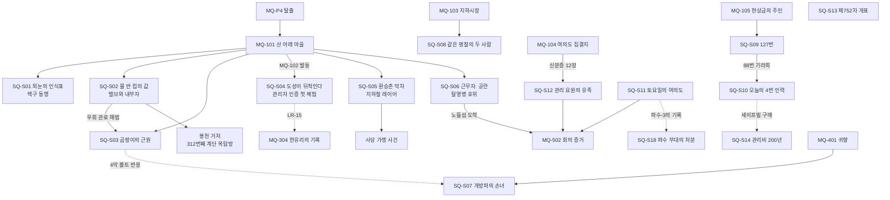
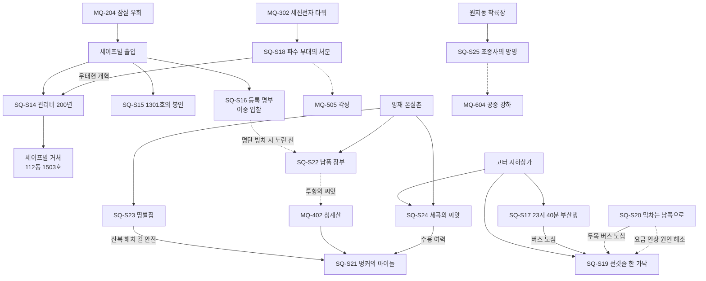

# SD-04a. 사이드 퀘스트: 남부 (R01 관악 · R02 여의도·영등포 · R07 강남 · R11 청계산)

> **서울 폴아웃 상세 기획서 세트** | 문서 ID: SD-04a | 버전: v1.2 | 작성일: 2026-10-12
> **범위**: 한강 남쪽 네 권역(R01 관악, R02 여의도·영등포, R07 강남, R11 청계산)의 **지도 표시 사이드 퀘스트 25편(SQ-S01~SQ-S25)** 상세. 권역 장소 카탈로그(SD-09a·09d)의 사이드 퀘스트 훅 71개(H-R01 16, H-R02 15, R07 주 훅 15 + 소형 훅 12, R11 13)와 SD-06 §13.1 연계 후보를 합치고 다듬어 완성 퀘스트로 만들었다. 퀘스트마다 발동·단계·다중 해법·결과 분기·카르마·호감도·판도·정보 전파·보상·대사·연출·메인 연계를 적는다. 정착지 거처(SD-15 §7.2) 획득 퀘스트 지정, 초반 학습형 퀘스트 배치, 남는 훅의 SD-05 이관 목록을 함께 정한다. **다루지 않는 것**: 메인 퀘스트(→ SD-03a·03b), 세력 퀘스트 라인 FQ(→ SD-04d), 비표시·반복 퀘스트와 랜덤 인카운터(→ SD-05), 다른 권역 사이드(→ SD-04b·04c), 장소 구조·좌표(→ SD-09a·09d), 수치 공식(→ SD-06·SD-10)
> **관련 문서**: [SC-00 컨셉](00_concept.md), [SD-02 세계관](02_world-and-lore.md), [SD-03a 메인 1부](03a_main-story-part1.md), [SD-03b 메인 2부](03b_main-story-part2.md), [SD-04b 사이드(서부·한강)](04b_side-quests-west-river.md), [SD-04c 사이드(북부·동부·도심)](04c_side-quests-north-east-center.md), [SD-04d 세력 퀘스트 라인](04d_faction-questlines.md), [SD-05 비표시·반복·인카운터](05_misc-quests-encounters.md), [SD-06 세력](06_factions.md), [SD-07a 주요 인물](07a_characters-major.md), [SD-07b NPC 디렉터리](07b_npc-directory.md), [SD-08 월드·권역](08_world-regions.md), [SD-09a 장소 R01·R02](09a_locations-r01-r02.md), [SD-09d 장소 R07·R11](09d_locations-r07-r11.md), [SD-09f 지하·한강](09f_locations-underground-river.md), [SD-10 캐릭터 시스템](10_character-system.md), [SD-12 탐험·UI](12_exploration-ui.md), [SD-13 아이템](13_items.md), [SD-14 크리처·적](14_creatures-enemies.md), [SD-15 경제](15_economy.md), [SD-18 용어·명명](18_naming-terms.md), 원작 [RD-05 사이드 1](../reverse-design/05_side-quests-part1.md)·[RD-06 사이드 2](../reverse-design/06_side-quests-part2.md)·[RD-27 이식 메모](../reverse-design/27_adaptation-notes.md)

---

## 목차
1. [개요](#1-개요)
2. [공통 설계 규칙](#2-공통-설계-규칙)
3. [퀘스트 총괄표와 흐름도](#3-퀘스트-총괄표와-흐름도)
4. [R01 관악 (SQ-S01~S07)](#4-r01-관악-sq-s01s07)
5. [R02 여의도·영등포 (SQ-S08~S13)](#5-r02-여의도영등포-sq-s08s13)
6. [R07 강남 (SQ-S14~S20)](#6-r07-강남-sq-s14s20)
7. [R11 청계산 (SQ-S21~S25)](#7-r11-청계산-sq-s21s25)
8. [퀘스트 사이의 충돌 지점과 연쇄](#8-퀘스트-사이의-충돌-지점과-연쇄)
9. [원작 대응](#9-원작-대응)
10. [제작 메모 (엔진: 범용 2D)](#10-제작-메모-엔진-범용-2d)
11. [미결 사항](#11-미결-사항)
- [부록 A. 신규 고유명사](#부록-a-신규-고유명사)
- [부록 B. 넘기는 훅 (SD-05 비표시·반복 후보)](#부록-b-넘기는-훅-sd-05-비표시반복-후보)
- [부록 C. 아이템 등록 (SD-13)](#부록-c-아이템-등록-sd-13)
- [부록 D. 참고 문서](#부록-d-참고-문서)
- [버전 이력](#버전-이력)

---

## 1. 개요

### 1.1 목적
- 한강 남쪽은 주인공이 처음 걷는 땅(R01·R02)과 권력이 남긴 땅(R07 재벌, R11 국가)이다. 이 문서는 그 땅에 **사람의 사정**을 채운다. 메인 퀘스트가 '관제망의 열쇠'를 따라가는 동안, 사이드 퀘스트는 그 열쇠가 깨우려는 2077년의 질서(등급·장부·명부·관리비·대기 구역)가 2277년 사람들에게 아직 무엇을 하고 있는지를 보여 준다.
- 바이블 §5.8 **"고르지 않고 기운다"**를 사이드 퀘스트 단위로 구현한다. 어떤 퀘스트도 "누구 편에 서겠습니까"를 묻지 않는다. 결과는 주인공이 **실제로 누구에게 무엇을 건넸는지, 누구를 살렸는지, 무엇을 고치거나 부쉈는지**로 갈린다.
- 초반 권역(R01·R02)에는 수도 황무지의 규칙을 몸으로 익히는 **학습형 퀘스트**(레벨 1~10)를 배치하고, 정착지 거처(SD-15 §7.2)를 여는 퀘스트를 지정한다.

### 1.2 요약
| 항목 | 내용 |
|---|---|
| 퀘스트 수 | **25편**: R01 7(SQ-S01~S07), R02 6(S08~S13), R07 7(S14~S20), R11 5(S21~S25) |
| 사용한 훅 | 카탈로그 훅 71개 중 33개(합치기 포함, R11 훅 4는 일부 흡수) + SD-06 §13.1 후보 3개(생활기록부 열람, 이중 입찰, 폭주 신호). 남는 훅 38개는 부록 B로 SD-05(일부 SD-04b·04c)에 넘긴다 |
| 권장 레벨 | Lv 3~20. 학습형 9편은 Lv 3~10(§2.4) |
| XP 합계 | 약 11,100(퀘스트 완료분만. 판정·처치 XP 별도). SD-10 §4.4 위협도 단가를 따른다 |
| 거처 지정 | 봉천 계단마을: SQ-S02(문제 해결 대체 경로) / 세이프빌: SQ-S14(112동 1503호, 조건 ③ 신설 확정). §2.5 |
| 인도처 변수 | `SQH_` 13종. 메인 퀘스트의 HO와 같은 세력 코드를 쓴다(§2.6) |
| 서울 회의 증거 | 사이드 증거 6종(`SQE_`)을 MQ-502 탁자에 올릴 수 있다(§2.7) |
| 결말 슬라이드 | ES-31 이름 있는 NPC 줄 6개 추가, ES-33~ES-36 사이드 슬라이드 4장 확정(§2.8, RECON_SPEC §3.2) |
| 진영 질문 | 0건. 로그 문장은 모두 사실·상태형(SD-18 §8.3) |

### 1.3 표기 규칙
| 표기 | 뜻 |
|---|---|
| `SQ-S01` | 사이드 퀘스트 ID. 엔진 변수 `SQ_S01`(단계 0 미발동 / 10 발동 / 20~90 진행 / 100 종료 / 200 보류 / 250 닫힘), 결과 `SQR_S01`(해법·결말 코드), 건너뜀 `SQS_S01`(순서 파괴) |
| **로그** | 핍-보이 DATA > 퀘스트 목표 문장. 본문 그대로 쓴다. 한 줄 30자 이하, 사실·상태형(SD-18 §8.3.2) |
| [화술·보통] / [과학 50] / [힘 7] | SD-03a §1.3 판정 표기. 고정 판정 요구치 15/25/50/75/100(SD-10 §3.6). 화술은 확률식이고 화면에는 `[화술 45%]`로 뜬다 |
| [증거: 물건] | 해당 아이템·지식 플래그가 있으면 화술 난이도 한 단계 하락 또는 자동 성공 |
| **BC +8** | 호감도 직접 변화(SD-06 §3.4 기본값, 카리스마·카르마·퍽 보정 전). 세력 약호는 SD-06 §2.2, 정착지 개별 약호(BC 봉천, SA 사당, SV 세이프빌, YJ 양재 온실촌 등)는 `AFF_JC_<약호>` |
| **연동** | SD-06 §3.6 계수. 그 세력이 행적을 **알게 된 때** 적용한다. 퀘스트 본문에는 큰 것만 적는다 |
| **판도 PD-R01-2 정착 +5** | SD-08 §15.2 판도 구역의 그 세력 사건 보정(7일마다 0 쪽으로 2씩 감소, SD-06 §5.2). 거점 이전은 "거점 ○○ → 세력" |
| **공개도 0~3** | SD-06 §6.2. 0 비밀 / 1 목격 / 2 공개 / 3 방송급 |
| `SQH_xxx` | 사이드 퀘스트 인도처 변수(§2.6). 값은 SD-03a §4.5 세력 코드 |
| `SQE_xxx` | 서울 회의(MQ-502)에 올릴 수 있는 사이드 증거 플래그(§2.7) |
| 장소 | 이름(L-ID). L-ID는 SD-09a·09d |
| 인물 | 이름(N-ID 또는 C). 주요 인물(C)의 C-ID는 SD-07a가 매긴다. 새 인물은 '(SD-07b에서 ID 부여)' |
| 아이템 | SD-13 ID. 이 문서의 새 아이템은 RECON_SPEC §3.5가 배정한 ID(퀘스트 M-301~M-321, 잡화 M-162·M-183~185·M-189, 머리 장비 A-084~086, 소모품 I-085)로 적는다(부록 C) |
| 적 | SD-14 ID(CR-). 편성 레벨은 장소 위협도(SD-09) |

### 1.4 '고르지 않고 기운다'를 사이드 퀘스트에 옮기는 규칙
| # | 규칙 | 이 문서의 구현 |
|---|---|---|
| S1 | **묻지 않고 시작한다** | 발동은 엿들음·게시판·물건·부탁·우연 목격 중 하나다. 부탁형도 선택지는 "자세히 듣는다 / 나중에"뿐이고, "나중에"도 로그에 '들은 사정'으로 남는다(SD-04d §2.2와 같다) |
| S2 | **로그는 사실을 적는다** | "○○가 △△에 있다", "□□는 지금 당신 손에 있다"만 쓴다. "구할지 정한다", "누구에게 줄지 선택한다"는 쓰지 않는다 |
| S3 | **결과는 손과 몸이 정한다** | 결말 분기는 ① 물건을 실제로 건넨 상대(대화창 '물건 주기', 보관함·책상에 두기, 그 자리에 두고 떠나기, 파기) ② 살리거나 쓰러뜨린 사람 ③ 데려다준 곳 ④ 방송·게시판에 실제로 올린 내용으로 정한다. 확인 대화는 "이걸 맡기겠다" 서술 한 줄뿐이다 |
| S4 | **해법은 셋 이상, 실패해도 막히지 않는다** | 모든 퀘스트에 전투·은신·화술·스킬·아이템 해법을 섞어 셋 이상 둔다. 진행을 막는 판정에는 다른 길이 둘 이상 있다(SD-10 §3.6 배치 원칙 2) |
| S5 | **아무것도 하지 않는 것도 결과다** | 대부분의 퀘스트는 시간이 지나면 '주인공 없이' 닫히고, 그 결과가 세계에 남는다(§2.9) |
| S6 | **세계가 먼저 알려 준다** | 퀘스트마다 '기울기 체감'(호칭·가격·순찰·깃발·방송·게시판)을 적는다. 숫자 팝업은 없다(SD-06 §4.1) |
| S7 | **양다리는 막지 않는다** | 같은 물건을 노리는 쪽이 둘 이상인 퀘스트는 실제로 넘긴 쪽이 결과를 가져가고, 다른 쪽은 정보 전파가 닿을 때 반응한다(SD-06 §6). 아무에게도 넘기지 않으면 `SQH = 0`, 관련 세력 각 -3, 단독 기울기 `SOLO +1`(SD-04d §2.1 R7과 같다) |

### 1.5 훅 → 퀘스트 매핑
| 퀘스트 | 제목 | 출처 훅(합친 것) |
|---|---|---|
| SQ-S01 | 외눈의 인식표 | H-R01-01 + SD-03a MQ-101 사이드 연계 '백구의 원래 주인' |
| SQ-S02 | 물 반 컵의 값 | H-R01-04 배수지 밸브 + H-R01-15 낙성대 척후의 지도 |
| SQ-S03 | 곰팡이의 근원 | H-R01-02 + SD-03a MQ-P4 사이드 연계 '수경 농장 곰팡이병의 원인' |
| SQ-S04 | 도성이 뒤척인다 | H-R01-07 |
| SQ-S05 | 환승촌 막차 | H-R01-11 |
| SQ-S06 | 근무자: 공란 | H-R01-10 탈영병 |
| SQ-S07 | 개방파의 손녀 | H-R01-16 + SD-06 §13.1 '생활기록부 열람' |
| SQ-S08 | 같은 명찰의 두 사람 | H-R02-01 |
| SQ-S09 | 127번 | H-R02-07 + H-R02-08 쪽방 통로 + SD-03a MQ-105 사이드 연계 '장부의 인력' |
| SQ-S10 | 오늘의 4번 인력 | H-R02-09 고척 돔 경매 + SD-03a MQ-105 사이드 연계 '새벽 경매에서 사람 사 오기' |
| SQ-S11 | 토요일의 여의도 | H-R02-14 해산 사건 명단 + H-R02-15 전시 휴회 |
| SQ-S12 | 관리 요원의 유족 | H-R02-03 + SD-03a MQ-104 사이드 연계 |
| SQ-S13 | 제752차 개표 | H-R02-02 |
| SQ-S14 | 관리비 200년 | R07 주 훅 1 |
| SQ-S15 | 1301호의 봉인 | R07 주 훅 2 |
| SQ-S16 | 등록 명부 | R07 주 훅 3 + 소형 훅 '담 넘는 애' + SD-06 §13.1 '이중 입찰' + SD-03a MQ-204 사이드 연계 |
| SQ-S17 | 23시 40분 부산행 | R07 주 훅 6 고터 막차 |
| SQ-S18 | 파수 부대의 처분 | R07 주 훅 4 + 주 훅 5 '아버지의 사무실' + SD-03a MQ-302 사이드 연계 |
| SQ-S19 | 전깃줄 한 가닥 | R07 주 훅 9 |
| SQ-S20 | 막차는 남쪽으로 | R07 주 훅 11 + SD-06 §13.1 '폭주 신호' |
| SQ-S21 | 벙커의 아이들 | R11 훅 1 + 훅 13 '마지막 열차' |
| SQ-S22 | 납품 장부 | R11 훅 8 + 훅 2 '염수진의 등록 대장' |
| SQ-S23 | 땅벌집 | R11 훅 5 |
| SQ-S24 | 세곡의 씨앗 | R11 훅 9 + R07 주 훅 7 '꽃 대신 상추' |
| SQ-S25 | 조종사의 망명 | R11 훅 3 |

---

## 2. 공통 설계 규칙

### 2.1 발동 방식
| 방식 | 설명 | 이 문서의 예 |
|---|---|---|
| 엿들음 | 거점·정착지에서 NPC끼리의 대화, 무전, 확성기 | S04 봉천 경보, S08 두 김민수의 다툼, S20 휘발유의 중얼거림 |
| 게시판·쪽지 | 정착지 반상회 게시판, 검문소 수배 전단, 주운 쪽지 | S06 탈영병 수배 전단, S02 사이렌의 척후 지도 |
| 부탁 | NPC가 먼저 꺼내는 사정. 선택지는 "자세히 듣는다 / 나중에"뿐 | S01 엄태경, S14 함지율, S21 지해원 |
| 물건 | 특정 아이템을 지니고 특정 장소에 들어가면 열린다 | S12 관리 요원 신분증(M-210)을 지니고 지하시장 진입 |
| 우연 목격 | 월드 사건을 직접 본다 | S23 말벌의 양봉장 습격, S22 납품의 날 수레 행렬 |
| 다음 단계 | 메인 퀘스트나 다른 사이드에서 한 일의 결과 | S18(MQ-302 뒤), S03(S02 우회 관로 해법 뒤) |

- 발동 알림은 로그 한 줄과 효과음 1종이다(SD-12). 지도 마커는 '알려진 단서'에만 붙는다.
- **막 잠금 없음**: 모든 퀘스트는 프롤로그 직후부터 발동할 수 있다. 막은 일부 퀘스트의 '사건 조건'(MQ-302 뒤 타워 정비고, 4막 뒤 볼트 개방 등)으로만 들어간다. 개요 표의 막은 1회차 일반 진행에서 자연스럽게 열리는 시점이다.

### 2.2 보상 체계
**XP**(SD-10 §4.4: 권역 위협도별, 단계 분할 지급 허용)

| 퀘스트 핵심 무대의 위협도 | XP 범위 | 이 문서의 기본값 |
|---|---|---|
| 1 | 150~250 | 250 |
| 2 | 250~350 | 300~350 |
| 3 | 350~500 | 350~450 |
| 4 | 500~650 | 550~650 |
| 5 | 650~800 | 750~800 |

- 판정 성공 XP(화술 5~50, 고정 판정 10~50, 자물쇠·해킹 20~60)와 처치 XP는 따로 쌓인다.
- 단계 분할: 단계 40 이상에서 퀘스트 XP의 30%를 먼저 주고, 종료 때 70%를 준다(긴 퀘스트의 중간 보상). 순서 파괴로 건너뛴 단계 몫은 주지 않는다.

**호감도**: 사이드 퀘스트 결과 1건의 직접값은 **±3~±12**(SD-06 §3.4). 정착지 개별값도 같은 범위다. 퀘스트 완료는 일일 상승 상한(+6) 밖이고 1회 사건 상한(±15) 안이다. 한 퀘스트가 두 세력을 동시에 움직이면 각각 따로 적는다.

**카르마**: 퀘스트의 선한·악한 행동은 SD-10 §6.3 범위(+50~+300 / -50~-600)에서 정한다. 공통 행동(사람 해방 +50, 인력 인도 -100/명, 악하지 않은 인물 살해 -100)은 SD-10 표를 그대로 쓰고 본문에 중복 기재하지 않는다.

**캡·아이템**: 퀘스트당 0~400캡. 고유 장비는 새로 만들지 않고(SD-13 고유 45종 유지) 기존 ID와 SD-10의 준영구 보상(미수령 복권, 아이의 감사 편지)을 쓴다.

### 2.3 판정 난이도 배치
| 권역 위협도 | 주 단계(SD-10 §3.6) | 이 문서의 적용 |
|---|---|---|
| 1~2 (R01 봉천·사당, R02 지하시장·영등포, R07 세이프빌) | I~III(15~50, 화술 쉬움~보통) | 학습형 퀘스트는 II(25)·화술 쉬움을 기본 해법으로 둔다 |
| 3 (R01 레이더 중계소·시흥 고개, R02 여의도·구로, R07 시가지) | III(50, 화술 보통), IV 20% | |
| 4 (R02 새벽인력 본소·고척 돔, R07 타워 상층·대로파, R11 검문소) | III~IV(50~75) | |
| 5 (R11 벙커·착륙장) | IV(75, 화술 어려움), V 30% | |

### 2.4 학습형 퀘스트 배치 (레벨 1~10)
초반 두 권역의 사이드 퀘스트는 수도 황무지의 시스템을 하나씩 '처음' 겪게 배치했다. 튜토리얼 팝업 대신 퀘스트 구조가 가르친다.

| 처음 배우는 것 | 퀘스트 | 권장 Lv | 가르치는 방법 |
|---|---|---|---|
| 일시 동행 NPC, 비살상 해결, 크리처 둥지와 밤낮 | SQ-S01 외눈의 인식표 | 3~6 | 백구가 따라오고, 무리를 죽이지 않는 길이 가장 보상이 크다 |
| 조사 지점·단서 대조·환경 원인 추적·제작 재료 | SQ-S03 곰팡이의 근원 | 3~7 | 물길을 거슬러 올라가는 조사. 재료를 섞어 약품을 만든다 |
| 지하철 레이어, 정기권, 휴면 구울 | SQ-S05 환승촌 막차 | 3~7 | 정기권을 쥐면 역무원 구울이 비켜선다. 소리를 내지 않으면 구울이 깨지 않는다 |
| 판도와 세력 동원, 마을 안 내부자, 거처 | SQ-S02 물 반 컵의 값 | 4~8 | 계엄군을 부르면 물은 돌아오지만 마을 입구에 확성기가 선다 |
| 기록 대조와 화술 '쉬움' | SQ-S08 같은 명찰의 두 사람 | 3~6 | 번호표를 뽑고 줄을 서는 길과 출입 카드로 줄을 건너뛰는 길 |
| 인도 행동: 물건을 누구 손에 두는가 | SQ-S12 관리 요원의 유족 | 4~8 | 신분증 세 장을 건네면 회의 증거가 줄고 증언자가 생긴다 |
| 관리자 인증, 수배도, 관제망 판정 | SQ-S04 도성이 뒤척인다 | 5~9 | 인증 한 번에 수배도 +3. 열쇠를 쓸수록 쫓긴다 |
| 호위, 검문 통과, 위조 등록증, 정보 전파 | SQ-S06 근무자: 공란 | 5~9 | 검문소 앞 판단 하나가 비상정부의 귀에 들어가는 시간 |
| 장부·몸값·탈출·근태 목걸이 | SQ-S09 127번 | 5~10 | 캡으로 사람을 사는 길과 벽 뒤 통로로 빼내는 길 |

### 2.5 정착지 거처 획득 지정 (SD-15 §7.2 요청 응답)
SD-15 §7.2의 원칙("정착지 개별 호감도 우호 + 그 정착지 문제 하나 해결이면 대표가 열쇠를 먼저 건넨다")에 맞춰, 이 문서 범위의 거처 2곳에 '문제 해결'로 인정되는 사이드 퀘스트를 지정한다. 받기·거절 선택지는 없다.

| 거처 | SD-15 조건 | 이 문서가 지정하는 '문제 해결' | 건네는 장면 |
|---|---|---|---|
| **312번째 계단 옥탑방**(봉천 계단마을, R01) | MQ-101 완료 + BC 우호(+20) | ① 기본: MQ-101 자체(계단 방어·옥상길 유인으로 끝내면 BC +15~+20). ② **대체**: MQ-101을 거짓말·돈·'마을을 판다'로 끝내 BC가 우호에 못 미친 경우, **SQ-S02 물 반 컵의 값**(밸브 문제 해결)이 문제 해결로 인정되고 BC를 회복시킨다. SQ-S01·S03도 BC를 올리지만 '문제 해결' 지정은 S02 하나다 | 조건이 찬 다음 날 아침, 조만석이 옥탑 이장실 옆방 문 앞에서 열쇠(M-136 차분)를 건넨다. "빌린 침대였지. 이제 빌린 거 아니다." S02를 C·D 해법(삽자루 처리·계엄군 동원)으로 끝냈어도 같다. 해법은 대사 한 줄만 바꾼다 |
| **세이프빌 112동 1503호**(세이프빌, R07) | ① SV 신뢰 + FQ-JC-04 완료(무상) / ② SV 우호 + 분양 대금 2,500캡 | ③ **신설(확정, RECON_SPEC §4.2 N-71)**: SV 우호 + **SQ-S14 관리비 200년** 완료(결과 무관). 관리소장 우태현이 '관리비 면제 세대'로 무상 임대한다 | S14 종료 뒤 세이프빌에 들르면 관리동 창구에서 우태현이 출입 카드와 1503호 열쇠를 함께 내민다. S14를 회장에게 장부를 넘겨 끝냈으면 기세훈이 직접 건넨다("회장단이 마련한 세대입니다"). 어느 쪽이든 같은 세대다 |

- **세대 번호 정합**: SD-15 §7.2는 '세이프빌 1203호', SD-09d §2.4.2는 '112동 1503호(임대 가능 세대)'다. 장소 카탈로그의 배치를 따라 **112동 1503호**로 통일한다(확정, RECON_SPEC §4.1 N-18). '1203호'라는 숫자는 SD-09d 소형 훅 '배송지 불명'의 108동 1201호와도 헷갈린다.
- **사당 환승촌(SA)·양재 온실촌(YJ)·고터 지하상가**는 SD-15 거처 6곳 밖이다. 이 문서의 해당 퀘스트(S05·S22~S24·S17·S19)는 숙박 할인·무료 침대(SD-15 §5.5)로 보상하고 거처를 만들지 않는다.

### 2.6 인도처 변수 (SQH)
- 메인 퀘스트의 HO(SD-03a §4.6)와 같은 방식으로, 사이드 퀘스트의 핵심 물건을 **누구 손에 두고 떠났는지** 기록한다. 값은 SD-03a §4.5 세력 코드(0 주인공 / 1 BJ / 2 YH / 3 WP / 4 JH / 5 GS / 6 JG / 7 SB / 8 JC / 9 NJ / 10 KD / 12 S7 볼트 S-07 / 14 남산 방송 / 15~21 비호감도 집단·장소 / 81~86 개별 정착지 / 87~95 소규모 정착지·비가맹 공동체 / 97 두고 떠남 / 99 파기)를 쓴다. 15~21·87~95는 RECON_SPEC §3.1로 세트 공통 확정.
- 이 문서가 쓰는 **확장 코드**(RECON_SPEC §3.1 확정): 87 SA 사당 환승촌, 88 YJ 양재 온실촌, 93 GT(고터 지하상가), 12 S7(볼트 S-07, 기존 코드), 20 MS(무소속 개인, NPC 개인에게 건넴).

| 변수 | 물건 | 퀘스트 |
|---|---|---|
| `SQH_TAG` | 외눈의 인식표(M-158) | S01 |
| `SQH_BATT` | 관악 중계소 핵분열 전지 | S04 |
| `SQH_LIST11` | 해산 사건 사망자 명단(LR-12 사본) | S11 |
| `SQH_RECESS` | 전시 휴회 결의 원본 | S11 |
| `SQH_IDCARD` | 관리 요원 신분증 3장(비트: 1 박우진 / 2 최수진 / 4 임영준) | S12 |
| `SQH_TERMS` | 2077년 관리 약관 원본 | S14 |
| `SQH_POSTCARD` | 1301호 엽서·가계부 | S15 |
| `SQH_ROSTER` | 비등록 세대 명단 | S16 |
| `SQH_BUSCORE` | 23:40 부산행 버스 노심 | S17 |
| `SQH_CORE` | 막차(두목 버스) 노심 | S20 |
| `SQH_PXLEDGER` | 원지동 PX 판매 장부 | S22 |
| `SQH_SEED` | 세곡 종자 상자 4개(비트: 1 고터 / 2 온실촌 / 4 벙커 / 8 그 밖) | S24 |
| `SQH_VTOL` | 망명 버티버드의 착륙지 | S25 |

### 2.7 서울 회의(MQ-502) 사이드 증거 (SQE)
- SD-03b §3.2 MQ-502는 주인공이 회의 탁자에 **물건을 올리는 행동**으로 합의 점수가 오르는 구조다. 이 문서의 퀘스트 6편이 탁자에 올릴 수 있는 물건을 남긴다.
- **확정**(RECON_SPEC §4.2 N-67): 사이드 증거 1건당 합의 점수 +2, 사이드 증거 합계 상한 +6(메인 증거 보너스 +3~+10보다 작게). 쟁점별 반응 대사를 1줄씩 둔다. SD-03b §3.2·SD-06 §9.4에 반영.

| 플래그 | 물건 | 퀘스트 | 회의장 반응 |
|---|---|---|---|
| `SQE_DESERTER` | 진해원의 증언(노들섬에 있는 증인 본인) | S06 | 비상정부 참관인이 '분류반 실태'에 반박하지 못한다 |
| `SQE_LIST11` | 2077년 해산 사건 사망자 명단 | S11 | 지하시장 인지영이 일어나 열한 이름을 읽는다 |
| `SQE_RECESS` | 전시 휴회 결의 원본 | S11 | '국가는 이미 있다'는 비상정부 발언에 "국회는 스스로 멈췄다"로 맞선다 |
| `SQE_FAMILY` | 관리 요원 유족의 증언 | S12 | 지하시장 대표가 '지침의 피해자' 증언자로 선다 |
| `SQE_TERMS` | 세이프빌 관리 약관 제31조 | S14 | 세이프빌 대표 기세훈의 '단지 질서' 발언이 힘을 잃는다 |
| `SQE_PXLEDGER` | 원지동 PX 판매 장부 | S22 | 비상정부 참관인의 '배급 질서' 발언에 장부가 맞선다 |

### 2.8 결말 슬라이드 연계
- SD-03b §7.3은 ES-33~ES-48을 SD-04a~d 몫으로 예비했다. 이 문서는 **ES-33~ES-36**을 쓴다(4장, RECON_SPEC §3.2 확정. 04b ES-37~40, 04c ES-41~48). 사이드 슬라이드는 재생 상한 24장 안에서 최대 3장(SD-03b §7.1). 조합 규칙은 SD-03b와 같다(결말 그룹 꼬리 문장).
- ES-31(이름 있는 NPC, 한 장에 최대 3줄)에 넣을 줄 6개(RECON_SPEC §3.2 확정): 외눈(S01), 진해원(S06), 파수-3 변형(S11·S18), 모재석(S17), 버스왕 방석구(S20), 지온(S21). 줄 문안은 각 퀘스트의 '연계' 항목에 적었다.

| ES | 대상 | 조건 | 본문 |
|---|---|---|---|
| ES-33 | 볼트 S-07 개방파 | SQ-S07 결과 | §4.7 |
| ES-34 | 세이프빌의 장부 | SQ-S14·S16 결과 | §6.1 |
| ES-35 | 강남의 버스 | SQ-S20 결과, `D_C070` | §6.7 |
| ES-36 | 청계산의 아이들 | SQ-S21 결과 | §7.1 |

### 2.9 실패와 시간 제한
| 종류 | 처리 |
|---|---|
| 실패 상태 | 원칙적으로 없다. 끝나지 않은 일은 로그에 남는다(S5) |
| 사건형 시간 제한 | 경매일·출발일·처형일처럼 정해진 시각이 있는 퀘스트는 그 시각에 '주인공 없이' 결과가 난다. 퀘스트는 '다른 결과'로 닫히고(단계 100, `SQR = 9x`), 감점은 없다. 결과는 세계에 남는다 |
| 보호 대상 사망 | '다른 결과'. 주인공이 죽였으면 SD-06 범죄 원천과 SD-10 카르마가 따로 적용된다 |
| 제공자 사망 | 각 퀘스트의 '대체 제공자'가 잇는다. 없으면 정착지 게시판이 같은 사정을 쪽지로 남긴다 |
| 메인 사건으로 닫힘 | 메인 퀘스트가 전제를 없애면 닫힌다(예: MQ-504로 새벽인력이 몰락하면 S09·S10의 남은 단계가 자동 해결). 단계 250, 감점 없음 |
| 순서 파괴 | 목표를 먼저 이루면 그 단계로 건너뛴다(`SQS_ = 1`). 건너뛴 단계 XP는 주지 않는다 |
| 4·5막 시간 경과 | SD-03a §6.6의 4·5막 시간 규칙은 사이드 퀘스트를 닫지 않는다. 단 S21(벙커)·S22(온실촌)는 4막 MQ-402 결과에 따라 판이 바뀐다(본문) |

---

## 3. 퀘스트 총괄표와 흐름도

### 3.1 총괄표
| ID | 제목 | 권역 | 주 장소 | 권장 Lv | 위협 | 막(권장) | 관련 세력·정착지 | XP | 메인·세력 연계 |
|---|---|---|---|---|---|---|---|---|---|
| SQ-S01 | 외눈의 인식표 | R01 | 관악산 들개 바위굴(L-R01-05), 봉천(L-R01-09) | 3~6 | 2 | 1막 | BC | 300 | MQ-101 |
| SQ-S02 | 물 반 컵의 값 | R01 | 봉천 배수지(L-R01-10), 삼성산 능선(L-R01-31), 신림 고시촌(L-R01-14) | 4~8 | 2~3 | 1~2막 | BC, YT, BJ | 350 | MQ-101, FQ-JC-01, 거처 |
| SQ-S03 | 곰팡이의 근원 | R01 | 봉천 배수지, 관악 계곡 배수로(L-R01-08), S-07 탈출구(L-R01-02) | 3~7 | 2 | 1~4막 | BC, S7 | 300 | MQ-P4, MQ-401 |
| SQ-S04 | 도성이 뒤척인다 | R01 | 봉천 동 주민센터(L-R01-32), 관악 레이더 중계소(L-R01-04) | 5~9 | 1~3 | 1~2막 | BC, GS, BJ | 350 | MQ-102, MQ-304, FQ-GS-01 |
| SQ-S05 | 환승촌 막차 | R01·UG | 사당 환승촌(L-R01-18), U01 | 3~7 | 2 | 1막 | SA, JH | 300 | SA 가맹, MQ-601(정기권) |
| SQ-S06 | 근무자: 공란 | R01 | 시흥 고개 초소(L-R01-30), 사당 고개 검문소(L-R01-19) | 5~9 | 3 | 1~3막 | BJ, ND | 400 | MQ-502 증거 |
| SQ-S07 | 개방파의 손녀 | R01 | 볼트 S-07(L-R01-01) | 10~16 | 1~3 | 4막~에필로그 | S7, BJ, BC | 350 | MQ-401, MQ-403 |
| SQ-S08 | 같은 명찰의 두 사람 | R02 | 지하시장(L-R02-11), 영등포 구청 배급소(L-R02-15) | 3~6 | 1~2 | 1막 | JH | 250 | MQ-103 |
| SQ-S09 | 127번 | R02 | 새벽인력 본소(L-R02-19), 가리봉(L-R02-20), 구로 아파트(L-R02-22) | 5~10 | 3~4 | 1~2막 | SB, JH, BC·ND | 450 | MQ-105, MQ-504, FQ-SB |
| SQ-S10 | 오늘의 4번 인력 | R02 | 고척 돔 인력 경매장(L-R02-23) | 8~12 | 4 | 2~3막 | SB, SV, NS | 550 | MQ-504, S14·S16 |
| SQ-S11 | 토요일의 여의도 | R02 | 영등포 경찰서 폐허(L-R02-29), 무너진 국회(L-R02-01) | 5~9 | 2~3 | 1~3막 | JH, BJ, NS | 350 | MQ-205, MQ-302, MQ-502 |
| SQ-S12 | 관리 요원의 유족 | R02 | 지하시장, 여의도 지하 벙커(L-R02-02) | 4~8 | 1~3 | 1~2막 | JH | 300 | MQ-104, MQ-402, MQ-502 |
| SQ-S13 | 제752차 개표 | R02 | 볼트 S-02(L-R02-04) | 6~10 | 3 | 1~3막 | JH, MS | 450 | — |
| SQ-S14 | 관리비 200년 | R07 | 세이프빌(L-R07-04), 볼트 S-03(L-R07-05) | 8~12 | 2 | 2~3막 | SV, JC | 350 | MQ-204, FQ-JC-04, 거처 |
| SQ-S15 | 1301호의 봉인 | R07 | 세이프빌 103동 | 8~14 | 2 | 2~4막 | SV, NS | 350 | MQ-304, MQ-402 |
| SQ-S16 | 등록 명부 | R07 | 세이프빌, 철벽경호 강남 지사(L-R07-07) | 9~13 | 2~3 | 2~3막 | SV, BJ, CB | 350 | MQ-204, FQ-BJ-02 |
| SQ-S17 | 23시 40분 부산행 | R07 | 고속터미널(L-R07-12) | 8~12 | 3 | 2~3막 | 고터, SV | 400 | S19 |
| SQ-S18 | 파수 부대의 처분 | R07 | 세진전자 타워(L-R07-01) T06·T09 | 12~16 | 4 | 3~5막 | SV, GS, WP | 600 | MQ-302, MQ-501, MQ-505, MQ-507 |
| SQ-S19 | 전깃줄 한 가닥 | R07 | 고터, 세이프빌, 가락시장(L-R07-31) | 10~14 | 3 | 2~4막 | 고터, SV, HS | 450 | S17, S20 |
| SQ-S20 | 막차는 남쪽으로 | R07·R11 | 대로파 소굴(L-R07-26), 경부 요금소(L-R11-07) | 13~17 | 4 | 3~4막 | YT, SV, BJ | 650 | MQ-204 |
| SQ-S21 | 벙커의 아이들 | R11 | 청계산 벙커(L-R11-01), 수서 차량기지(L-R11-19), 옛골(L-R11-20) | 14~18 | 5 | 4막 | BJ, YJ | 750 | MQ-402, MQ-403 |
| SQ-S22 | 납품 장부 | R11 | 양재 온실촌(L-R11-09), 양재 고개 검문소(L-R11-08), 원지동(L-R11-05) | 12~16 | 4 | 3~4막 | YJ, BJ | 600 | FQ-BJ-02·07·08, MQ-402 |
| SQ-S23 | 땅벌집 | R11 | 청계산 등산로 계단(L-R11-21) | 13~18 | 4 | 3~4막 | YJ | 650 | MQ-402 경로 ③ |
| SQ-S24 | 세곡의 씨앗 | R11·R07 | 세곡 비닐하우스 터(L-R11-18), 고터, 온실촌 | 10~14 | 3~4 | 2~4막 | YJ, 고터, BJ | 450 | S21, S22 |
| SQ-S25 | 조종사의 망명 | R11 | 버티버드 착륙장(L-R11-06) | 16~20 | 5 | 4~5막 | BJ, ND·YH·TK | 800 | MQ-604 |

- 권역별 XP: R01 2,350 / R02 2,350 / R07 3,150 / R11 3,250 = **11,100**.
- 관련 세력 칸의 '고터'는 고터 지하상가 점포회다. SD-06 정착지 12곳 밖이라 이 문서는 내부값 `V_GT_TRUST`(0 냉담 / 1 손님 / 2 단골 / 3 식구)로 다룬다(SD-09d U3, RECON_SPEC §4.2 N-42 확정: 비가맹 자치 공동체, 인도처 코드 93 GT. 옛 미결 U-04a-05).

### 3.2 흐름도 ① R01·R02 (1~2막 중심)

### 3.3 흐름도 ② R07·R11 (2~5막 중심)

---

## 4. R01 관악 (SQ-S01~S07)

- 권역 성격(SD-09a §3): 시작 권역. 위협 1(볼트 주변·봉천) / 2(신림·노량진) / 3(금천 서쪽·삼성산·사당 고개·레이더 중계소). 판도는 경합으로 시작한다(거점 7곳).
- 이 권역의 사이드 퀘스트는 **봉천 계단마을을 중심으로 한 첫 일주일**의 사건들이다. 다섯 편(S01~S05)이 학습형이고, S06은 비상정부와의 첫 '행동으로 기우는' 사건, S07은 4막 귀향 뒤의 볼트 이야기다.

### 4.1 SQ-S01 외눈의 인식표

> 관악산 들개 우두머리 외눈의 목에 2077년 반려견 인식표가 걸려 있다. 인식표의 주소는 봉천 106동이고, 외눈과 봉천의 백구는 같은 핏줄이다.

| 항목 | 내용 |
|---|---|
| 출처 훅 | H-R01-01 + SD-03a MQ-101 사이드 연계 '백구의 원래 주인(관악산 들개 무리와 진돗개의 내력)' |
| 유형 | **학습형**: 일시 동행 NPC, 비살상 해결, 크리처 둥지, 밤낮 시간대 |
| 권장 레벨 / 위협 | Lv 3~6 / 2(바위굴 적 Lv 3~8, 외눈 Lv 6 고정) |
| 발동 | MQ-101 단계 40 이후(1막). 봉천 아랫문 오두막의 사냥꾼 엄태경이 먼저 꺼낸다("외눈 목에 쇠붙이가 반짝이더라"). 또는 주인공이 관악산 들개 바위굴(L-R01-05) 반경 30타일에 먼저 들어가 외눈을 목격하면 엿보기형으로 단계 20부터 시작 |
| 장소 | 관악산 들개 바위굴(L-R01-05), 연수원 남서 별관 2층 난간(외눈의 감시 자리), 봉천 계단마을(L-R01-09) 개집·반상회관 |
| 등장 인물 | 엄태경(N-R01-033, 사냥꾼), 백구(N-R01-027, CR-536, 일시 동행), 조담희(N-R01-029, 반상회 총무, 조씨 가문), 남솔(N-R01-034, 백구 밥 당번 아이) |
| 적 | 외눈 CR-500(Lv 6) + 변이 들개 CR-104 ×4 + 사나운 들개 CR-105 ×2~3. 밤(20~05시)에는 무리 +2(SD-14 §11.2) |
| 선행 / 후행 | MQ-101 / 없음(ES-31 줄) |
| 보상 | 300 XP. 결과별: 조담희의 '백설이 사진'(잡화, M-189) + 관악산 약수 I-056 ×3 / 엄태경 상점 상시 -10% / 외눈의 인식표 M-158(세월상회 V14 매입 25캡) |
| 카르마 | 0 ~ +100 |
| 호감도·판도 | BC +3 ~ +8. 크리처는 판도 대상이 아니므로 판도 변화 없음. 무리 소탕 시 PD-R01-1 크리처 인카운터 비율 -30%(SD-09a) |
| 시간 제한 | 없음 |

**단계**
| 단계 | 로그 | 완료 조건 |
|---|---|---|
| 10 | 외눈의 목에 쇠붙이가 걸려 있다 | 엄태경 대화 또는 외눈 목격 |
| 20 | 외눈의 무리는 관악산 서쪽 바위굴에 산다 | 바위굴 반경 20타일 진입 |
| 30 | 외눈의 인식표는 지금 당신 손에 있다 | 인식표 입수(해법 무관) |
| 31 | 외눈이 무리를 이끌고 남쪽 능선으로 떠났다 | 비살상 해법으로 무리가 이동(30과 동시 가능) |
| 40 | 인식표의 주소는 봉천 106동이다 | 인식표 조사(인벤토리 '살펴보기') |
| 50 | 조담희가 106동의 옛 이야기를 안다 | 조담희 대화 |
| 100 | 인식표의 자리가 정해졌다 | 인식표를 누군가에게 건넴, 또는 7일 소지 뒤 자동 종료(SQH_TAG = 0) |

**진행 상세**
- **배경**: 2077년 10월 23일, 봉천 106동 지하주차장(지정 대피소, 수용 340명)은 반려동물 출입을 막았다. 조씨 집 진돗개 '백설'은 주차장 입구에서 밤을 새우고 산으로 들어갔다. 관악산 들개 무리는 그날 버려진 개들에서 시작됐고(바위굴의 '뼈 마당' 목줄 더미), 백설의 핏줄은 둘로 갈렸다. 산에 남은 쪽이 외눈의 무리, 2190년대 계단마을이 생길 때 귀소 본능으로 106동 자리에 돌아온 쪽이 백구의 조상이다. 외눈의 인식표는 무리 우두머리가 대대로 물려 온 것이 아니라, 뼈 마당에서 외눈이 골라 목에 걸고 다니는 것이다(개가 목줄을 고르는 습성은 연출로만 보인다).
- **S1 사냥꾼의 부탁**: 엄태경은 외눈을 죽이라고 하지 않는다. "외눈은 사람을 안 문다. 사람이 먼저 물었지." 그는 인식표가 무엇인지 궁금할 뿐이다. 대화에서 백구가 바위굴 쪽을 보며 귀를 세우는 연출이 나온다.
- **S2 백구 동행 조건**: 백구는 다음 중 하나면 아랫문에서 주인공을 따라나선다(일시 동행 NPC, SD-06 §8.5). ① MQ-101 S1에서 들개를 쫓아 백구를 구했다 ② 남솔의 '백구 밥 당번'을 1회 했다(고기류 I-036~I-041 중 1개를 개밥그릇에 둔다. SD-05 비표시 `uq_bongcheon_dog_feeding` 후보) ③ 봉천 BC 우호 이상. 백구는 바위굴 반경 20타일 밖에서는 앞장서고, 안에서는 주인공 옆을 지킨다. 백구는 이 퀘스트 안에서 죽지 않는다(체력 20% 이하면 짖으며 물러나 마을로 돌아간다).
- **S3 외눈의 하루**: 낮(10~16시) 외눈은 별관 2층 난간에서 잔다. 해 질 녘(17~19시)에 무리를 데리고 뼈 마당으로 내려온다. 밤에는 무리가 크고 공격적이다. 시간대가 해법을 바꾼다.
- **S4 인식표의 내력**: 인식표 표면 `봉천 106동 1401호 / 조○○ / 백설 / 2075.04` 뒷면 `잃어버리면 연락 주세요`. 조담희는 집안 족보 대신 반상회 게시판 맨 아래에 붙은 2077년 대피소 공지를 가리킨다. "할머니의 할머니가 그 이름을 불렀대. 대피소 들어갈 때 개는 못 데려간다고 했대."

**해법**
| 해법 | 행동·조건 | 결과 | 카르마 | 호감도 |
|---|---|---|---|---|
| A 소탕 | 바위굴 무리와 외눈을 쓰러뜨린다. 외눈 드롭 M-158 | 소굴이 빈다. PD-R01-1 크리처 인카운터 -30%. 3일 뒤 바위굴에 변이 시궁쥐가 든다 | 0 | BC +3(마을 길이 안전해짐) |
| B 백구와 대치 | 백구 동행으로 해 질 녘 뼈 마당에 들어간다. 외눈이 백구와 마주 서면 10초 대치 장면(두 개의 털빛과 귀 모양이 같다). 그사이 주인공이 들개 2마리 이상을 쫓으면(피해 30% 이상, 처치 불필요) 무리가 흩어지고, 외눈은 인식표를 뼈 마당에 떨군 채 남쪽 능선으로 떠난다 | 외눈 생존(단계 31). 인식표는 바닥에서 줍는다 | +50 | BC +5 |
| C 애니멀 프렌드 | PK-045 애니멀 프렌드 1랭크: 무리가 먼저 공격하지 않는다 → 외눈에게 다가가 [민첩성 5]로 목줄을 푼다. 2랭크: 외눈이 주인공 옆에서 냄새를 맡고 스스로 인식표를 떨군다 | 외눈 생존. 2랭크면 이후 R01 남부 능선에서 들개 무리가 주인공을 공격하지 않는다(퍽 효과와 별개로 무리 한정) | +50 | BC +5 |
| D 낮잠 | 낮에 별관 2층 난간까지 은신으로 올라가(별관 계단 2곳, 잔해 소음 타일 회피) 잠든 외눈의 목줄을 끊는다. 날붙이 근접 무기(W-037~W-045) 필요, [민첩성 6]. 실패하면 외눈이 깨어 무리를 부른다(A로 전환) | 외눈은 깨어나 무리를 이끌고 이동한다(생존) | +25 | BC +3 |
| E 미끼 | 엄태경의 말대로 멧돼지 고기 I-038 ×3을 바위굴 남쪽 숲에 둔다. 무리가 사냥터를 옮기며 인식표는 외눈 목에 남는다 | 단계 31만 달성. 인식표 없이 엄태경에게 보고하면 종료(다른 결과) | 0 | BC +2 |

**결과 분기와 후일담 (인식표를 누구 손에)**
| 인도처 | 장면 | 효과 |
|---|---|---|
| 조담희(SQH_TAG = 81) | 조담희가 인식표를 백구 밥 당번표 옆에 못으로 건다. 남솔이 당번표 맨 위에 '백설'을 적는다 | BC +3 추가, 카르마 +25. 보상 M-189 + I-056 ×3. 백구가 이후 주인공을 보면 꼬리를 흔든다(대기 모션) |
| 엄태경(SQH_TAG = 20) | "사냥꾼 오두막에 걸어 두지. 산의 이름이니까." | 엄태경 상점 -10%(상시), 고기·가죽 매입가 +10% |
| 지님·판매(0·97) | 세월상회 V14가 2077년 잡화로 25캡에 산다 | 변화 없음 |

- **외눈 생존 후일담**(B·C·D·E): 외눈 무리는 삼성산 능선으로 옮긴다. 7일 뒤부터 삼성산 능선 캠프(L-R01-31) 약탈자 매복 확률 -25%(무리가 패거리 외곽 분대를 괴롭힌다는 소문, 엄태경 대사). 밤에 능선에서 들개 울음이 들리면 백구가 개집에서 한 번 대답한다(BGS 연출).
- **기울기 체감**: 봉천 주민이 주인공을 "백구 친구"라고 부른다(B·C). 소탕(A)이면 "산이 조용해졌네"(대사 3종).

**정보 전파**: 공개도 1(봉천 안 소문). 세력 연동 없음.

**실패·예외**: 백구가 MQ-101 이전에 죽는 일은 없다(SD-03a). 주인공이 백구를 공격하면 동행 해제, BC -10, 카르마 -25(선한 동물 살해는 SD-10 표 -25).

**핵심 대사**
- 엄태경: "외눈은 사람을 안 문다. 사람이 먼저 물었지."
- 조담희: "백설이… 할머니의 할머니가 그 이름을 불렀대. 대피소 들어갈 때 개는 못 데려간다고 했대."
- 남솔: "백구가 저쪽 산 보고 울었어. 형제가 있나 봐."

**연출 메모**
- 대치 장면은 컷 없이 맵 위에서 진행한다. 외눈(흰 털, 왼눈 흉터)과 백구(흰 털)가 3타일 간격으로 마주 서고, 두 개의 귀가 동시에 선다. 외눈이 떠날 때 능선에서 한 번 울부짖고 백구가 응답한다(SD-17 동물 BGS).
- 뼈 마당 목줄 더미를 조사하면 2077년 동물 등록 인식표 수십 개가 '봉천·신림·낙성대' 주소로 나온다(환경 서사, 조사 3회).

**연계**: MQ-101(백구 장면), FQ-JC-01 계단 물길(백구 동행 첫 경험이 되면 FQ-JC-01에서 백구가 '이미 아는 사이' 대사). **ES-31 줄**(외눈 생존): "관악산 남쪽 능선에는 흰 들개 무리가 살았다. 우두머리의 목에는 아무것도 걸려 있지 않았다."

**구현 정합(단계 1-11a, `game/scenes/story/side_r01.gd` SideR01 · 원고 `script/act1/SQ-S01.txt` · 엄태경 갈래는 `TRAVEL.txt` TR_EOM · 자세한 기록은 `game/STAGE_1.md` 1-11a)**
- **장소**: 바위굴 손 맵 X-BW(32×26, 월드 L-R01-05 (901,1538)에 끼움) — 연수원 남서 별관 정면 · 화강암 테 '뼈 마당'(암굴 셋: 북 · 서 · 남) · 남쪽 숲 빈터(미끼 터) · 남쪽 숲길(능선으로). 별관 1층 체육관 K-30 · 2층 관람석 K-31(동쪽 끝 둥지 = 외눈 낮잠 자리, 무너진 마루 틈 = 소음 칸 6). 본문 '별관 계단 2곳'은 계단 하나(2칸 폭)로 — 관람석 한 줄이 좁아 둘째 계단 자리가 없다.
- **무리**: 반경 40칸에서 세우고 60칸 밖에서 거둔다. 외눈 CR-500 Lv 6 + 변이 들개 CR-104 ×4 + 사나운 들개 CR-105 ×2~3(Lv 3~8, 같은 시각 같은 자리 · 때가 바뀌면 수 · 방향 · 자리가 바뀜 — SD-22). 낮 10~16 외눈은 K-31 둥지에서 자고(감지 ×0.15) 마당 무리 60%는 존다 · 17~19 외눈이 마당 한가운데 · 20~05 무리 +2 · 감지 ×1.3. 낮→해 질 녘이 되면 보는 앞에서 외눈이 북쪽 암굴로 내려온다. 쓰러뜨린 들개는 72시간 뒤 다시 찬다.
- **발동**: 엄태경 ASK에 '외눈 목에 쇠붙이가 있다고?'(MQ-101 단계 40 뒤) → 10. 엿보기형: 발동 전에 30칸 안에서 외눈을 보면 20부터. 10 이후 20칸 = 20. **단계 30과 31은 같은 순간에 설 수 있어 단계 변수는 큰 쪽(31)을 담고, '입수'는 소지(M-158)가 사실**(SD-20 P1) — 소지가 처음 생기는 날을 `SQ_S01_TAG_DAY`에 적는다. 40은 핍-보이 잡화의 '살펴보기'(이번에 새로 — 물건에 딸린 장면 `EXAMINE_<ID>`).
- **백구 동행**: 조건 ①②③ 그대로(② = 남솔 장면 '그릇에 놓는다', 고기 I-036~041 하나). 따라나서면 봉천 맵 인물에서 떼어 낸다(맵 조건 `SQ_S01_DOG != 1`). HP 20% 이하 · 쓰러짐 → 짖으며 마을로(DOG 2, 다시 데려갈 수 있다). 주인공이 때리면 동행 해제 · 봉천 −10 · 카르마 −25(다시는 따라오지 않는다). 해법이 서거나 끝난 뒤 봉천에 들어서면 개집으로(DOG 3). '20칸 밖 앞장'은 일시 동행 v2의 따라오기로 대신(앞장 걷기는 동행 AI 갱신 때).
- **해법 B**: 해 질 녘 + 백구 동행이면 무리가 먼저 덤비지 않고 지켜본다(대치를 기다림). 외눈 8칸 안에서 10초 대치 — 백구는 외눈 앞 3칸(주인공 쪽)에 선다. 그사이 들개 둘을 HP 70% 아래로(쓰러뜨려도 됨) → 흩어짐 · 외눈은 인식표를 떨군 채 남쪽 숲길로(31 · +50 · 봉천 +5). 대치 중엔 개마다 다른 편이라 한 마리를 쳐도 무리 전체가 덤비지 않는다. 10초가 지나거나 외눈을 치면 무리가 덤빈다(A로). 바닥의 인식표는 칸이 저장되고(`SQ_S01_DROP_AT`) 밟으면 줍는다.
- **해법 C**: `PK_045` 변수(퍽 창은 1-12): 1랭크 무리가 처음부터 비적대 · 외눈 1.6칸 곁에서 장면 — [민첩성 5] 목줄을 푼다 / 2랭크 스스로 떨굼(+50 · 봉천 +5). 2랭크의 'R01 남부 능선 들개 비공격'은 인카운터 무리 쪽 조건(1-12 퍽과 함께).
- **해법 D**: K-31 둥지 곁 2.2칸에서 장면 — [민첩성 6] + 날붙이(W-037~W-045, 원고 함수 `blade()`) 목줄을 끊는다(+25 · 봉천 +3, 외눈은 계단으로 내려가 무리와 옮김). 손으로 풀거나 소음 칸을 밟거나 1.5칸 안까지 가면 깨어 아래층에서 들개 둘이 올라온다(A로).
- **해법 E**: 남쪽 빈터에 멧돼지 고기 3 → 60분 뒤 안전한 순간(교전 · 대화 아님, 멀리 있으면 그 자리에서)에 무리가 남쪽 숲길로(31 · 0 · 봉천 +2). 엄태경에게 '무리가 남쪽 능선으로 옮겼어' → 100(결과 5, 인식표는 외눈 목에 — `SQH_TAG` −1).
- **해법 A**: 외눈이 쓰러지면(드롭 M-158 1.0) 소탕(0 · 봉천 +3). PD-R01-1(관악산 판도 구역, 중심 (930,1520) ±90칸 — 봉천은 PD-R01-2라 밖) 크리처 인카운터 ×0.7. 사흘 뒤 마당에 변이 시궁쥐 CR-095 3~4. 엄태경에게 알리면 '산이 조용해지겠네'.
- **봉천 호감(공개도 1)**: 해법 몫(+2~+5)은 봉천(X-BC)에 돌아와야 반영(`SQ_S01_BC` 대기) — 마을 안 소문. 건넴(조담희 +3 · 카르마 +25 · M-189 + I-056 ×3)은 그 자리에서. 엄태경 건넴(20)은 사냥꾼 오두막 V04 사는 값 −10% · 파는 값 +10%(V04가 사는 물건이 구호품 · 잡화라 '고기 · 가죽'에 한하지 않고 V04 전체).
- **끝**: 건넴 · 미끼 보고 → 100 · XP 300 · `SQS01_RESULT` = 해법. 7일 소지 → `SQH_TAG` 0 · 100. 건네지 않고 손을 떠나면(세월상회 V14 판매 등) 97 · 100.
- **기울기**: 봉천 주민 소문 — B · C '백구 친구' 2줄, A '산이 조용해졌네' 3줄(해법 몫이 봉천에 닿은 뒤), 조담희 건넴 뒤 '반상회관 인식표' 1줄. 건넴 뒤 백구에게 말을 걸면 꼬리를 흔든다(장면 SQS01_BAEK_WAG). 남솔: 당번표 맨 위 '백설'.
- **그림**: 외눈 · 사나운 들개(검푸른 털 · 곤두선 갈기 · 붉은 눈) 시트, 동굴 입구 구조물(유기적 아치 · 바이어 디더 어둠), 소품 6(목줄 더미 · 둥지 · 떨어진 인식표 · 관람석 난간 · 농구 골대 · 마루 틈). 물건 설명 두 줄(M-158 · M-189)은 §7.4.3 '용도'의 기획 메모 대신 게임 속 문장.
- **후일담(1-11b에 넣음)**: 외눈 무리가 옮기고 7일 뒤 삼성산 능선 캠프(868,1581) ±40칸 약탈자 RE ×0.75(`Encounters.cat_mult`) · 엄태경 '산은 어때?' 갈래 MT_RIDGE.
- **이월**: 밤 능선 울음 · 백구 대답 BGS(소리 단계), ES-31 줄(엔딩 슬라이드 단계), FQ-JC-01 '이미 아는 사이'(`SQ_S01_DOG` ≥ 1이 사실 — FQ-JC-01 때).

---

### 4.2 SQ-S02 물 반 컵의 값

> 남부순환 패거리가 관악산 상류 관로 밸브를 잠그고 봉천에 물값을 요구한다. 밸브를 되찾는 동안, 패거리에게 마을의 교대 시간을 흘린 사람이 드러난다.

| 항목 | 내용 |
|---|---|
| 출처 훅 | H-R01-04 배수지 밸브 + H-R01-15 낙성대 척후의 지도 |
| 유형 | **학습형**: 판도와 세력 동원, 마을 안 내부자, 장치 수리. **봉천 거처 '문제 해결' 지정 퀘스트**(§2.5) |
| 권장 레벨 / 위협 | Lv 4~8 / 2(봉천·낙성대) ~ 3(삼성산 능선) |
| 발동 | MQ-101 종료 다음 날 06시(1막). 봉천 배수지(L-R01-10) 관리인 조수안이 반상회 게시판에 '급수 제한' 쪽지를 붙이고 밸브실 앞에서 혼잣말을 한다(엿들음). 낙성대 고개 캠프(L-R01-12)에서 척후 지도를 먼저 얻으면 단계 40부터 시작(순서 파괴) |
| 장소 | 봉천 배수지(L-R01-10), 상류 밸브실(삼성산 능선 캠프 L-R01-31 북쪽 아래, SD-09a 보강 요청: 밸브실 오브젝트 1), 낙성대 고개 캠프(L-R01-12), 신림 고시촌(L-R01-14), 사당 고개 검문소(L-R01-19), 관악 계곡 배수로(L-R01-08, 우회 관로) |
| 등장 인물 | 조수안(N-R01-032), 사이렌(N-R01-062, 패거리 척후장), 남건희(N-R01-039, 내부자), 삽자루(N-R01-060, 남부순환 패거리 두목), 남태하(N-R01-028, 옥탑 감시조장), 황보서현(N-R01-047, 검문소장), 조만석(C) |
| 적 | 밸브 캠프: 약탈자 CR-420·421·423 ×4 + 경비견 CR-107 ×1(Lv 4~8). 낙성대 캠프: 사이렌 + CR-420 ×2 + CR-423 ×2. 고시촌(C 해법): CR-420~425 ×8~12, 경비견 ×2 |
| 선행 / 후행 | MQ-101 / SQ-S03(우회 관로 해법), FQ-JC-01 |
| 보상 | 350 XP. 조수안: 관악산 약수 I-056 ×5 + 100캡. B 해법이면 배수지 정수 물 상시 -20%. 봉천 거처 조건 충족(§2.5) |
| 카르마 | -50 ~ +100 |
| 호감도·판도 | BC +3 ~ +10, BJ 0 ~ +6. 판도 PD-R01-2 정착 +5 / PD-R01-1 비상 +5 / 거점 '남부순환 패거리 은신처' 공백 |
| 시간 제한 | 물탱크 수위가 하루 1칸씩 내려간다(5칸). 5일째에 봉천 물값 2배(상인 가격 +10%, 주민 대사 변화). 퀘스트는 닫히지 않는다 |

**단계**
| 단계 | 로그 | 완료 조건 |
|---|---|---|
| 10 | 봉천 배수지의 물이 줄고 있다 | 조수안 대화 또는 게시판 쪽지 |
| 20 | 상류 밸브는 삼성산 능선 아래에 있다 | 밸브실 관로 지도 조사 |
| 30 | 밸브실 앞에 남부순환 패거리가 있다 | 밸브실 반경 30타일 진입 |
| 40 | 패거리의 지도에 봉천 교대 시간이 있다 | 척후 지도(M-301) 입수 |
| 50 | 지도의 글씨는 봉천 사람의 것이다 | 지도 조사 + 반상회 게시판 손글씨 대조 |
| 60 | 남건희는 밤마다 윗문 밖으로 나간다 | 남건희 미행(22시 이후) 또는 남태하 대화 |
| 70 | 봉천 배수지에 물이 다시 찬다 | 밸브 해법 하나 완료 |
| 100 | 물길과 윗문의 일이 끝났다 | 70 + 내부자 처리(또는 7일 경과) |

**진행 상세**
- **패거리의 요구**: 밸브실 앞 약탈자는 "물값은 하루 30캡, 봉천 물탱크 여섯 개 몫"이라 외친다. 물값을 내면(해법 E) 사흘 뒤 다시 잠긴다. 이것이 첫 교훈이다: 돈은 문제를 미룬다.
- **척후 지도**: 낙성대 캠프 사이렌의 소지품(소매치기 [은신] 성공률식, 처치, 또는 [화술·쉬움] '지도를 팔아라' 50캡)이나 밸브 캠프 상자에서 나온다. 지도에는 봉천 물탱크 6개 위치, 옥탑 감시조 교대 시간 `22시·04시`, 윗문 쪽문 자물쇠 '고장'이 적혀 있다. 글씨체는 반상회 게시판 '빗물 당번표'의 글씨와 같다(조사 비교 연출, 단계 50).
- **남건희**: 텃밭 일을 하는 청년. 밤 22시 이후 윗문 밖 능선 길(봉천 고개)에서 사이렌의 척후와 만나 물 몇 통을 받고 마을 이야기를 판다. 그는 "사람 얘긴 안 했어"라고 믿는다.

**해법 ① 밸브 (하나면 충분, 겹쳐도 된다)**
| 해법 | 행동·조건 | 결과 | 카르마 | 호감도·판도 |
|---|---|---|---|---|
| A 탈환 | 밸브 캠프 약탈자를 몰아내고 밸브를 연다([수리 15] 녹슨 핸들, 또는 [힘 5]). 남태하에게 알리면 감시조 2가 밸브실에 상주한다 | 물 복구. 밸브실이 봉천 경비 지점이 된다 | 0 | BC +8. 판도 PD-R01-2 정착 +5 |
| B 우회 관로 | 조수안의 관로 지도로 관악 계곡 쪽 옛 관로를 잇는다. 이음 지점 2곳 [수리 25] + 고철 M-010 ×4 + 공업용 테이프 M-025 ×2. 패거리와 싸우지 않는다 | 상류 밸브가 의미를 잃는다. 패거리는 사흘 동안 봉천 밤 습격 RE를 늘린다(+30%). 우회 관로가 관악 계곡 배수로를 지나므로 **SQ-S03이 자동 발동**한다(곰팡이) | +50 | BC +10 |
| C 두목 처리 | 신림 고시촌 B동 옥상 '분양 사무실'의 삽자루. [화술·보통] "밸브는 분양된 땅이 아니다" + [증거: 척후 지도]면 쉬움 → 삽자루가 밸브에서 손을 뗀다(패거리 존속). 또는 고시원 A동 원룸 미로로 은신 잠입해 처치 | 화술: 밸브 반환, 패거리 존속. 처치: 거점 '남부순환 패거리 은신처' 공백, PD-R01-3 약탈자 우세 붕괴(정착 경합으로), 패거리 7일 내분(깡철이는 고가 아래에 남는다) | 화술 +25 / 처치 0 | BC +6. 처치 시 판도 PD-R01-3 약탈 -15(지역 두목 처리) |
| D 계엄군 동원 | 사당 고개 검문소 황보서현에게 밸브 위치를 알린다(대화 한 줄). 다음 날 06시 계엄군 분대가 밸브 캠프를 친다(스크립트, 주인공이 함께 싸우면 BJ '함께 싸움' +2 별도) | 물 복구. 밸브실에 '배급 수도 — 관리 계엄사령부' 표지와 확성기 슬롯 1. 봉천 게시판에 공보방송 공고 '수도 관리 협조' | 0 | BJ +6, BC +3. 판도 PD-R01-1 비상 +5. 연동(BJ +6 → JC -2, YH -3, JG -3) |
| E 물값 | 패거리에게 30캡/일을 대신 낸다 | 사흘 동안 물 복구 → 다시 잠김. 퀘스트 계속 | 0 | BC +2(1회) |

**해법 ② 윗문의 내부자 (단계 60 이후)**
| 해법 | 행동·조건 | 결과 | 카르마 | 호감도 |
|---|---|---|---|---|
| a 고발 | 지도를 조만석에게 건넨다(물건 주기) | 반상회 → 남건희 추방. 7일 뒤 신림 고시촌 패거리 졸개로 나타난다(적대, 이름 표시) | 0 | BC +5 |
| b 타이름 | 남건희에게 [화술·쉬움] 또는 [증거: 척후 지도] | 남건희가 거래를 끊고 대장간에서 일한다. 14일 뒤 옥탑 감시조에 들어간다(남태하 아래, MQ-507 방어 인원 +1) | +50 | BC +5 |
| c 함정 | 남건희를 시켜 사이렌에게 '교대 시간 03시'라는 거짓 정보를 흘린다 → 다음 날 03시 패거리 습격조 6명이 계단참 매복에 걸린다(봉천 방어 이벤트: 감시조 3 + 주인공) | 판도 PD-R01-2 약탈 -5. 남건희는 습격 중 50% 확률로 패거리 손에 죽는다(주인공이 계단참①을 지키면 생존) | 남건희 사망 시 -50 | BC +5 |
| d 묵인 | 아무것도 하지 않는다 | 7일 뒤 자동 종료. 봉천 밤 '패거리 습격' RE 확률 +20%(척후가 정확해진다) | 0 | 0 |

**결과 분기와 후일담**
- **거처**: 해법 ① 중 A~D 하나를 끝내면 `JC_PROB_BC = 1`(봉천 문제 해결). BC 우호 이상이면 다음 날 아침 조만석이 옥탑방 열쇠를 건넨다(§2.5). MQ-101을 '마을을 판다'로 끝낸 플레이어도 이 퀘스트 B(+10)와 S01·S03으로 우호에 닿을 수 있다.
- **기울기 체감**: A·B → 고물상 오봉수가 "물 돌려준 사람"이라며 고철 시세를 한 단계 쳐 준다(대사). C(처치) → 신림 사거리 고가 아래 깡철이가 "두목 자리가 비었네"라고 웃는다. D → 아랫문 앞에 계엄군 '등록 상담 천막'이 처음 선다(봉천 판도 BJ 우세 연출의 첫 단계, SD-09a §3.2 ⑧).

**정보 전파**: A·B·C 공개도 2(봉천 안). D 공개도 2 + 봉천 비상정부 정보원(6시간) → BJ 즉시 인지. C 처치는 소문으로 R01 전역(12시간).

**실패·예외**: 조수안이 죽으면 조담희가 대체 제공자. 남건희를 주인공이 죽이면 BC -8(마을 청년 살해, 공개도 2), 카르마 -100.

**핵심 대사**
- 조수안: "상류 밸브가 또 잠겼어. 패거리 짓이야. 끓여 마셔도 없는 물은 안 생겨."
- 삽자루: "이 동네는 분양 끝났어. 물도 내 거고."
- 남건희: "물 몇 통이었어. 사람 얘긴 안 했어."
- 사이렌: "봉천 물탱크가 몇 개더라? 아, 우린 다 알아."

**연출 메모**: 배수지 밸브실 벽 수위계(5칸 게이지 오브젝트)가 하루에 한 칸씩 내려간다. 계단 학교 아이들이 물통 두 개씩 들고 312계단을 오르는 생활 모션이 단계 10~70 동안만 나온다.

**연계**: MQ-101(거처 대체 경로), FQ-JC-01 계단 물길(이 퀘스트 완료 시 조담희가 "밸브는 됐고, 이제 빗물"이라며 FQ-JC-01을 꺼낸다), SQ-S03(B 해법), 판도 거점 '남부순환 패거리 은신처'.

**구현 정합(단계 1-11b, `game/scenes/story/side_s02.gd` SideS02 · 원고 `script/act1/SQ-S02.txt` · 게시판은 `MQ-101.txt` X-BC_BOARD · 계엄군은 `SAGOGAE.txt` SG_HWANG · 자세한 기록은 `game/STAGE_1.md` 1-11b)**
- **장소**: 봉천 배수지 X-BS(26×19, 월드 (937,1370)에 끼움 — 기준점 (918,1379)은 그대로, 봉천 손 맵 동쪽 숲 너머라 저수조 마당을 기준점 동쪽 6칸부터) · 밸브실 K-32(밸브 4 · 관로 계통도 · 수위계 5칸 · 펌프 2) · 삼성산 능선 캠프 X-SS(32×24, (868,1578) — 상류 밸브는 캠프 북쪽 비탈 아래) · 낙성대 고개 캠프 X-NS(30×22, (971,1421) — 남부순환로가 손 맵을 그대로 지난다) · 관악 계곡 배수로 K-08 천장 옛 관로 이음 지점 둘(30,3 · 37,3). '밸브실 오브젝트 1'(U-04a-12)은 밸브 소품 `valve_up`/`valve_open` + 계엄사령부 철판 `bj_plate`.
- **발동**: MQ-101이 끝난 날을 적고, 그다음 06시 하루 판정에 '급수 제한' 쪽지(`SQ_S02_POSTED` · 밸브가 잠긴 첫날 `DAY0`). 쪽지 · 조수안 사정 듣기 = 10. 척후 지도(M-301)를 먼저 쥐면 40부터. 쪽지 날에 밸브 캠프 분대를 새로 들인다 — 먼저 캠프를 비웠어도 '또 잠겼어'와 맞는다(SD-20 A37).
- **수위계**: 첫날 넷 → 하루 한 칸 → 닷새째 0(붉은 띠). 0이면 봉천 상인(V01~V03) 사는 값 +10% · 마실 물(I-054~057) 2배, 주민 소문 · 조수안 대사가 바뀐다. 밸브가 열리면(A·B·D) 다섯 칸, 물값 기간도 다섯 칸. 퀘스트는 닫히지 않는다.
- **밸브 캠프**: 반경 40칸에 수금원(N-YT-1, CR-421 Lv 5~7) + 약탈자 CR-420·421·423 셋 + 경비견 CR-107 — 같은 때 같은 자리, 때가 바뀌면 수 · 방향 · 자리, 밤엔 절반이 불 드럼 곁에서 존다(SD-22). 쪽지 뒤엔 먼저 쏘지 않고 9칸 안에서 수금원이 외친다(물값 30캡). 말을 들은 뒤 물값 없이 밸브 2.5칸까지 가면 덤빈다. 쓰러뜨린 수는 남는다(수금원 · 경비견 · 약탈자 셋 — 모두 쓰러지면 캠프가 빔). 캠프 상자 `scout_cache`에는 척후 지도가 아직 아무 손에도 없을 때만 지도가 든다(진행기가 넣고 뺀다 — 지도는 한 장, A38).
- **해법 A**: 빈 캠프의 밸브 [수리 15] 또는 [힘 5] → 70 · 봉천 +8(공개도 2 행적 — 봉천에 들어서면 그 자리에서, 아니면 소문 12시간) · 판도 `PD_BC` +5. 남태하에게 알리면(장면 SQS02_NAMTAEHA2) 봉천 감시조 둘이 밸브 앞에 선다(맵 인물 N-BC-2 · 3).
- **해법 B**: 조수안 '싸우지 않고' → 옛 관로 지도(PIPEMAP). 이음 지점마다 [수리 25] + 고철 M-010 ×2 + 테이프 M-025 ×1(둘이면 본문 ×4 · ×2). 둘 다 이으면 70 · +50 · 봉천 +10 · 사흘 동안 봉천 둘레(892,1362 ±45칸) 밤 약탈자 RE ×1.3 · SQ-S03 단계 10 자동. 배수지 정수 물은 상시 −20%(봉천 상인 마실 물). A 뒤에도 이을 수 있다(겹쳐도 됨 — `SQ_S02_SOL`은 처음 해법, `SQ_S02_B`가 우회 관로 사실).
- **해법 D**: 황보서현에게 '상수 밸브'(단계 20 이후 · 캠프가 차 있을 때) → 다음 06시(적어도 6시간 뒤). 주인공이 캠프 반경에 없으면 결과만: 캠프가 비고 밸브는 계엄사령부 관리(`SQ_S02_BJ`) · BJ +6 · 봉천 +3(공개도 2, 공보방송) · 연동 JC −2 · YH −3 · JG −3 · `PD_R01_BJ` +5. 있으면 그 자리에서 보병 계엄병 CR-401 넷이 능선에서 내려와 캠프를 친다(주인공이 약탈자를 쓰러뜨리면 BJ +2 '함께 싸움'), 90초 뒤 · 캠프가 비면 분대는 물러난다. 봉천 게시판에 공보 공고, 밸브에 철판 표지 · 확성기.
- **해법 E**: 수금원에게 [캡 30] → 사흘(그날 포함 3일) 물이 흐르고 다시 잠김(그날부터 다시 하루 한 칸). 봉천 +2는 한 번.
- **해법 C**(삽자루 · 신림 고시촌 L-R01-14)는 고시촌 손 맵과 함께(이월). 수금원의 '신림 고시촌 옥상으로 가' 대사가 실마리.
- **내부자**: 반상회 게시판 '빗물 당번표'(지도를 쥐고 읽기) = 50. 22~01시 윗문 쪽문에 남건희와 패거리 척후(N-YT-2)가 선다(지도를 쥐고 아직 모를 때) — 8칸 안에서 지켜보면 원고(60), 쪼그리지 않고 3칸까지 다가가면 들켜 그 밤은 끝. 남태하에게 지도를 보이면 60. 70 뒤에 50 · 60을 하면 단계 대신 사실 변수만(단계는 오르기만 한다).
  a 조만석에게 지도 → 다음 날부터 남건희가 마을에 없다 · 봉천 +5. b [증거: 척후 지도] 또는 [화술 쉬움] → 타이름 +50 · 봉천 +5(남무진 대장간). c 함정 → 다음 03시(적어도 3시간 뒤): 봉천에 있으면 계단참 ①②③ 감시조 셋(오재윤 · 남태하 · 조하진 — 맵 인물을 전투 개체로 바꿔 세운다) + 아랫문으로 습격조 여섯. 싸움 동안 주인공이 계단참① 7칸 안에 절반 이상 있었으면 남건희 생존, 아니면 50%(씨앗 — 다시 불러와도 같다) · 사망 시 −50. 봉천에 없으면 결과만(지키지 못한 판). 판도 `PD_BC` +5(약탈 −5) · 봉천 +5. d 묵인: 70 뒤 7일 → 끝 · 봉천 밤 약탈자 RE ×1.2.
- **끝**: 70 + 내부자 처리(a · b, c는 03시가 지난 뒤) 또는 70 뒤 7일 → 100 · XP 350 · `SQS02_RESULT` = 밸브 해법. 조수안 사례(I-056 ×5 + 100캡, B면 '싸게 줄게', D면 '표지가 붙었대')는 70 뒤 한 번. `JC_PROB_BC` = 1(A~D — 거처 조건 표지, 지금 거처는 MQ-101 완료 + 우호라 표지만).
- **사이렌**: 낙성대 캠프 반경 40칸에 사이렌(N-R01-062, CR-420 Lv 7 — SD-07b 외형 그대로의 전투 그림 `en_n062_loco`) + 척후 CR-420 ×2 · CR-423 ×2, 먼저 쏘지 않으면 6칸 안에서 말을 건다. [화술 쉬움] 50캡 → 지도. 쓰러뜨리면 지도는 그녀 유해에(이미 지도가 있으면 없음). 소매치기([은신])는 소매치기 체계와 함께(이월). 쓰러진 사이렌은 다시 서지 않는다.
- **물건**: M-301 척후 지도 — SD-13 §7.10 표(`items_side.json` 새 추출, 무게 0 · 퀘스트). 설명은 기획 메모 대신 게임 속 문장. 핍-보이 '살펴보기' 원고 EXAMINE_M301(대조 전 · 후).
- **기울기**: 소문 11줄(붉은 띠 · 물통 · 물값 사흘 · 탈환 · 감시조 · 옛 관로 · 밤 습격 · 계엄 표지 · 03시 · 떠난 건희 · 대장간 건희). 남건희 평소 대사(가뭄 · 03시 기다림 · 함정 뒤 · 대장간).
- **이월**: C 해법(신림 고시촌 · 삽자루), 남건희 7일 뒤 고시촌 졸개(a) · 14일 뒤 옥탑 감시조(b, MQ-507 방어 +1), 사이렌 소매치기, '기울기 체감' 오봉수 고철 시세 · 깡철이 · 등록 상담 천막(MQ-201 이후 판도 연출과 함께), FQ-JC-01(조담희 '이제 빗물'), 312계단 물통 아이들 생활 모션(군중 연출 단계).

---

### 4.3 SQ-S03 곰팡이의 근원

> 봉천 물탱크 벽에 볼트 S-07 수경 농장과 같은 검은 곰팡이가 핀다. 물길을 거슬러 올라가면 2214년에 사라진 볼트 정비공의 측정지가 원인을 가리킨다.

| 항목 | 내용 |
|---|---|
| 출처 훅 | H-R01-02 + SD-03a MQ-P4 사이드 연계 'S-07 수경 농장 곰팡이병의 원인(관악산 계곡 물)' |
| 유형 | **학습형**: 조사 지점, 단서 대조, 환경 원인 추적, 제작 재료 조합 |
| 권장 레벨 / 위협 | Lv 3~7 / 2 |
| 발동 | ① 1막 이후, 조수안이 배수지 탱크 벽 곰팡이를 보여 준다(MQ-101 종료 3일 뒤 또는 SQ-S02 B 해법 직후) ② 4막 뒤 V_VAULT ∈ {2, 5}이면 볼트 수경 농장 주임 송새봄이 직접 꺼낸다 ③ 1~3막에 볼트 정문 검역실 인터컴에서 방금례가 '수경 농장 곰팡이병 보고(LR-27)' 요지를 읽어 준다 |
| 장소 | 봉천 배수지(L-R01-10), 관로 조사 지점 3곳, 관악 계곡 배수로(L-R01-08), S-07 비상 탈출구(L-R01-02) 갱도 E-01·E-02, 볼트 정문 검역실 인터컴(L-R01-01 V-00) |
| 등장 인물 | 조수안(N-R01-032), 송새봄(N-R01-010, 4막 이후), 방금례(N-R01-003, 인터컴), 하로운(N-R01-007, 설비과 배관 기사, 4막 이후 또는 인터컴), 조안민(N-R01-023, 납골 벽, 4막 이후) |
| 적 | 배수로 암거: 변이 시궁쥐 CR-095 ×4~6, 왕쥐 CR-097 ×1(이 퀘스트에서는 첫 방문에 등장). 탈출구 갱도: 시궁쥐 ×3, 잔바퀴 떼 CR-001 |
| 선행 / 후행 | MQ-101 또는 SQ-S02 / SQ-S07(4막 볼트 반응) |
| 보상 | 300 XP. 조수안: 100캡 + '봉천 정수 필터'(배수지 물 Rad 0, 상시). C 해법이면 4막 뒤 송새봄의 작물 거래 개방(V_VAULT 5) 또는 볼트 전실 상인 품목에 수경 콩·상추 추가(V_VAULT 2) |
| 카르마 | 0 ~ +125 |
| 호감도·판도 | BC +6 ~ +8. S7은 호감도 대상이 아니다(볼트 주민 대사·4막 반응으로 보인다) |
| 시간 제한 | 없음. D 해법은 30일 뒤 재발 |

**단계**
| 단계 | 로그 | 완료 조건 |
|---|---|---|
| 10 | 봉천 물탱크 벽에 검은 곰팡이가 피었다 | 탱크 벽 조사 |
| 20 | 같은 곰팡이가 S-07 수경 농장에도 있다 | 인터컴(방금례) 또는 송새봄 대화 또는 LR-27 열람 |
| 30 | 곰팡이는 물을 따라 내려왔다 | 관로 조사 지점 3곳 중 2곳 |
| 40 | 관악 계곡 배수로 천장에 군락이 있다 | 배수로 암거 진입 |
| 50 | 2214년 정비공의 측정지가 암거에 있다 | 유해 곁 측정지(M-302) 입수 |
| 60 | 군락의 먹이는 볼트에서 내려온 물이다 | 측정지 + 탈출구 갱도 수문 조사 |
| 70 | 군락이 처리됐다 | 해법 하나 |
| 100 | 물길의 일이 끝났다 | 조수안 또는 송새봄 보고 |

**진행 상세**
- **원인의 사슬**(플레이어가 조사로 맞추는 것): S-07은 2276년 수경 농장 곰팡이병 뒤 양액(작물 영양액) 교체량을 늘렸다. 교체된 양액은 볼트 하층 배수로 → 비상 배수 갱도 → 관악 계곡 배수로로 흘러간다. 영양분이 많은 물이 암거 천장에 검은 곰팡이 군락을 키웠고, 포자가 갱도를 거슬러 볼트 농장으로, 계곡 옛 관로를 따라 봉천 배수지로 퍼졌다. 2214년 정비공은 같은 현상(그때는 작은 군락)을 보고 "물에 냄새가 난다. 위로 올라가 보고 오겠다"는 쪽지를 남기고 암거에서 죽었다(SD-09a L-R01-02·08 환경 서사의 결말).
- **조사 지점 3곳**(단계 30): 배수지 유입관 거름망(곰팡이 포자 덩어리), 계곡 옛 관로 이음부(검은 줄무늬), 탈출구 갱도 출구의 물길(미끈한 막). 핍-보이 '살펴보기'로 조사하고, 2곳이면 다음 단계가 열린다.
- **측정지**: 정비공 유해의 손에 쥔 2214년 수질 측정지. pH·질산염 수치와 손글씨 '볼트 쪽이 높다'. 지니고 있으면 이후 모든 설득 판정에 [증거]로 쓰인다.

**해법 (군락 처리)**
| 해법 | 행동·조건 | 결과 | 카르마 | 호감도 |
|---|---|---|---|---|
| A 소각 | 화염병 W-057 ×3, 화염방사기 W-030, 또는 즉석 소각(부탄가스 통 M-023 ×2 + 점화 장치 M-038, [폭발물 25])으로 암거 천장을 태운다 | 군락 소멸. 봉천 물 정상. 볼트 농장은 원인이 남아 60일 뒤 다시 번진다(4막 송새봄 대사). 따뜻한 암거를 잃은 옴 너구리 무리가 도림천 수로에서 봉천 쪽으로 올라와 7일 동안 밤 RE +30% | 0 | BC +6 |
| B 약품 처리 | [과학 50](측정지 소지 시 [과학 25])로 배합을 계산한다. 강력 세제 M-021 ×2 + 시너 M-022 ×1을 2077년 수질 측정 상자의 분무기에 넣어 뿌린다 | 군락 소멸, 하류 피해 없음. 볼트 농장 원인은 남는다 | +25 | BC +6 |
| C 원인 차단 | 탈출구 갱도 중간 수문을 닫고([수리 25] 녹슨 수문 핸들, 또는 [힘 6]) 볼트 배수를 정화조로 돌리라는 지침을 볼트에 전한다. 1~3막: 정문 인터컴으로 방금례에게 측정지 내용을 읽어 준다([화술·쉬움], 측정지 있으면 자동). 4막 이후: 하로운에게 측정지를 직접 건넨다 | 군락이 먹이를 잃고 14일에 걸쳐 마른다. 봉천과 볼트 농장 둘 다 회복. 4막 귀향 때 수경 농장 2·3동이 푸르다(V-06 곰팡이 타일 해제) | +100 | BC +8 |
| D 필터만 | 봉천 배수지에 필터를 단다([수리 25] + 강판 조각 M-013 ×1) | 봉천 물만 30일 동안 정상. 30일 뒤 재발해 퀘스트가 단계 40으로 돌아간다 | 0 | BC +3 |

- A·B 뒤 C를 이어서 하면 C의 결과로 덮어쓴다(카르마는 C 몫만 추가).
- **정비공 유해**: 유해의 볼트 인식표(2214, 계승명 '정영수')를 볼트에 알리면(인터컴 또는 4막 조안민) 추모 납골 벽 V-12에 이름이 더해진다(4막 이후 보인다). 카르마 +25. 조안민: "같은 이름이 둘 있었지. 하나는 이제야 돌아왔네."

**결과 분기와 후일담**: 봉천 배수지 벽의 2277년 손글씨 '끓여 마셔' 아래에 '안 끓여도 됨'이 덧붙는다(A·B·C). C면 4막 귀향 때 볼트 식당 배급표 게시판의 '반감' 공지가 떼어져 있고 송새봄이 "근원은 우리 배수구였어. 바깥 사람이 알려 줬지"라고 말한다(주인공 이름을 부른다).

**정보 전파**: 공개도 1~2(봉천). 볼트 인터컴 전달은 S-07 내부 기록(4막 대사 분기 `SQR_S03`).

**핵심 대사**
- 송새봄: "곰팡이는 물에서 왔어. 증거만 있으면 돼."
- 하로운: "그 관은 산 밑까지 간다. 우리가 버린 물이 어디로 가는지는 아무도 안 적었지."
- 방금례(인터컴): "회선 확인 칸 말고 다른 걸 읽어 보긴 처음이네요. 수치… 받아 적을게요."

**연출 메모**: 곰팡이 타일은 검은 반점 오버레이(SD-16 오염 타일 계열). 암거 안 조사는 손전등 광원 반경 4타일. 정비공 유해는 벽에 기대 앉은 S-07 작업복 차림으로, 측정지를 쥔 손만 강조한다.

**연계**: MQ-P4(곰팡이병 배경), MQ-401(볼트 상태 연출 `SQR_S03`), SQ-S02 B, SQ-S07(4막 볼트 주민 호의 보정).

**구현 정합(단계 1-11d, `game/scenes/story/side_s03.gd` SideS03 · 원고 `script/act1/SQ-S03.txt` · 조수안 몫은 `SQ-S02.txt` SQS02_SUAN · 게시판 쪽지 `MQ-101.txt` X-BC_BOARD S03N · 측정지 `places/R01_R02.txt` K-08_TECH · 설계안 `docs/seoul-fallout/_plans/SQ-S03_plan.md` · 자세한 기록은 `game/STAGE_1.md` 1-11d)**
- **고정 지침 '볼트 출구는 정문 방폭문 하나'**: L-R01-02는 바깥 배수 출구로만 쓴다. E-01(40×10, 한 장)은 바위로 위장한 녹슨 원형 철문(늘 반쯤 열림 — 월드 (932,1533) `vault_drain_out`) → 측실 벽감(공구 벨트 · 쪽지 E-01-BELT, E-02 측실을 한 장에 합침) → 중간 수문 → **볼트 쪽 용접 창살**(2215년 용접, 물만 지난다)에서 끝난다. 볼트 안으로 들어가지 못한다. 하도윤 분필 화살표(V_ESCAPE = 4)는 탈출 갈래를 정문 하나로 모은 뒤(0-9) 없는 판이다. '나가면 뭐 할래' 낙서 기둥은 창살 **안쪽**(볼트 쪽) 기둥 — 아이들이 볼트 안에서 새겼고 주인공은 창살 너머로 읽는다.
- **볼트 안 인물**: 1막엔 정문 인터컴의 방금례(N-R01-003)만. 송새봄 · 하로운 · 조안민 판, 볼트 농장 회복 · 납골 벽 이름은 4막 이월(`SQR_S03` = 3 · `SQ_S03_TAG`). 인터컴은 첫 호출 잡음 · 둘째 '딸깍 — 수화기 드는 소리'(측정지가 있으면 둘째에 받는다) · 셋째에 받는다. 폭력 탈출(V_ESCAPE 1)이면 첫마디가 차갑다(보안요원 둘이 아직 의무실). '안은 어때?'(C 전 '반감' 배급표 · C 뒤 다음 파종). 수문을 먼저 닫고 알리지 않았으면 방금례가 먼저 묻는다('하층이 역류했어요. 혹시 당신이에요?').
- **발동(셋 다 10)**: ① MQ-101 끝난 날 + 3일 06시 게시판 쪽지(조수안 서명 — 죽었으면 '반상회로'), 읽으면 10 ② SQ-S02 B는 넘김 표지 `SQ_S03_PIPE`만 세우고 S03 진행기가 다음 틀에 10(단계는 한 곳에서, P1) ③ 저수조 이음 벽 얼룩을 먼저 봄.
- **단계 20**은 인터컴이 아니라 **저수조 벽에서 바로** — 볼트 주민 회의(MQ-P4 S01 '농장 2동 · 3동 곰팡이병')의 기억(재미 검수: 첫 단서가 다음 장소를 가리키게). 인터컴은 C 해법의 무대.
- **이미 앎 · 이미 함(P2)**: 퀘스트 전에 한 조사 지점 · 측정지 · 수문 · 군락 처리는 사실로 남고, 열리는 순간 따라 올린다(측정지 = 50, + 수문을 살폈으면 60, 처리했으면 70). K-08에 들어서면 40(조사 2곳 전이어도 — 단계는 오르기만). 옛 저장에서 유해를 이미 봤으면(`PL_TECH`) 측정지 물건을 맞춰 준다.
- **조사 지점**: ① X-BS 옛 관 입구 거름망(10,7 · 14,9) ② K-08 동쪽 줄무늬(50,3 — S02 이음 지점 30,3 · 37,3과 다른 칸) ③ E-01 출구 물길. '살펴보기'는 조사 글로.
- **왕쥐 CR-097**(새 크리처 그림 `cr_cr097_loco` — 흉터 · 꼬리 매듭 · 옴): 퀘스트가 열려 있으면 K-08 첫 방문, 아니면 세 번째 방문(SD-09a). 교전에 들면 바로, 그 뒤 20초마다 찍찍 — 12t 안 아직 교전 전 시궁쥐 둘을 깨운다. 대답할 쥐가 없으면 '찍찍… 대답이 없다' 하고 물러선다. 물러서거나 두고 나가면 다음 방문에 둥지로 돌아와 있다 — **깎인 체력 그대로**('흉터가 하나 늘었다', `SQ_S03_KING_HP`). 쓰러뜨리면 다시 서지 않고(`SQ_S03_KING` 2) 봉천 소문 한 줄. 시궁쥐 무리 4~6은 첫 방문 한 번.
- **E-01 적**: 시궁쥐 ×3 + 큰바퀴 CR-002 ×2(SD-14에 잔바퀴 떼 CR-001 자료가 없어 대체). 첫 방문 한 번.
- **해법이 보이게**(재미 검수): 군락 앞에 조건 없는 실마리 한 줄('불이면 태울 수 있겠다. 약이면 — 측정 상자의 분무기. 아니면 이 둥지를 먹이는 물이 오는 데를 막든가'), 배합(세제 2 · 희석제 1)은 분무기를 처음 집을 때. 군락에서 갱도 쪽으로 굵어지는 줄기 일곱이 '검은 길'로 물이 오는 쪽을 가리킨다(같은 상태 넷). 출구 물길(③)도 결과 판 — A · B '막은 여전히 볼트 쪽에서' · C '말라 갈라졌다'.
- **해법**: A 화염병 ×3(선택지 태그가 가져감) · 화염방사기 · 즉석([폭발물 25], 실패하면 부탄 하나만 샘) → 그을음 · 너구리(CR-136) 봉천 둘레 ±60칸 밤 ×1.3 7일. B는 측정 상자 분무기를 먼저 챙겨야(K-08 11,3 — 측정 상자 용기 칸과 겹치지 않게 옆 칸), 측정지 있으면 [과학 25] · 없으면 [과학 50]. C는 수문([수리 25] 또는 [힘 6]) + 인터컴(측정지면 수치를 읽어 줌, 없으면 [화술 쉬움] · 수문을 살폈거나 40 이후) — **순서는 아무래도 좋다**. 14일에 걸쳐 군락이 마른다(7일째 반쯤 · 14일 다 마름, 꼭지 냄새도 날마다 옅어짐). A · B 뒤 C는 덮어쓰며 그 자리에서 다 마른 모습(태운 군락이 살아 보이지 않게), 카르마는 C 몫만.
- **D(재미 검수: 벌이 아니라 이야기)**: 조수안 ASK '꼭지에 필터라도 달면?' 또는 꼭지에서 직접(조수안이 없어도) → [수리 25] + 강판 M-013 → 봉천 +3. 칠판(서명 없는 분필 글씨 — 관리인 생사와 무관)이 '필터 N일째'를 세고 25일이면 '필터가 검다', 30일 뒤 **곰팡내만 돌아온다**(방사능 0은 그대로). 원문의 '단계 40으로 돌아간다'는 하지 않는다 — 단계는 오르기만(SD-20) · 퀘스트는 아직 70 전이라 열린 채다. 대신 K-08 시궁쥐 둘이 더 들고 소문 · 칠판이 알린다.
- **보고 100**: 조수안(70 이후 첫 대화, 해법마다 다른 말) — 300 XP · 100캡 · 꼭지 필터(배수지 물 방사능 0, 상시) · 봉천 +6(C +8). 조수안이 죽었으면 배수지 칠판에 주인공이 적고 칠판 아래 반상회 궤짝의 봉투(100캡, '배수지 일 한 사람 몫 — 반상회')를 받는다(설계안 '배수지 궤짝'). 보고는 한 번. 우회 관로(S02 B) 사례 때 조수안이 '관 물에서 냄새가 나' 한 줄로 발동 ②를 사람 입으로 잇는다.
- **꼭지 한 모금**(L-R01-10, 하루 두 번 — 급수 규칙): 곰팡이가 있으면 '물에 냄새가 난다.'(2214년 쪽지와 같은 글) · HP +5, 맑으면 +15, 필터 없으면 방사능 +2. 밸브가 말랐으면(S02 0칸) 쇳소리뿐.
- **후일담**: 배수지 판자 안내 '끓여 마실 것' 아래 '안 끓여도 됨'(A · B · C — C는 다 마른 뒤), 이음 벽 닦은 자국 · 빈 거름망 소품 상태, 소문.
- **카르마 범위**: 원문 0~+125. B(+25) 뒤 C(+100)에 인식표(+25)까지 하면 +150 — 원문 '카르마는 C 몫만 추가'를 B 몫을 지우지 않는 뜻으로 읽었다(행동마다 한 번).
- **이월**: 4막 판(송새봄 · 하로운 · 조안민 · V-06 곰팡이 타일 해제 · 식당 '반감' 공지 · 납골 벽 V-12 이름 · 송새봄 작물 거래), 볼트 농장 60일 재발(A · B, 4막 대사), 배수지 물 사기 가격표의 '필터' 표시(지금은 꼭지 한 모금으로 체감), MQ-401 역방향 잠입 · 4막 매복 · 자경대 갱도 경비.

---

### 4.4 SQ-S04 도성이 뒤척인다

> 관악 레이더 중계소의 전지가 몇 분 깨어나자 봉천 동 주민센터 앞 파수 로봇이 일어나 마을 아이 남솔을 '미등록 아동 보호' 명목으로 대기 구역에 가둔다.

| 항목 | 내용 |
|---|---|
| 출처 훅 | H-R01-07 |
| 유형 | **학습형**: 관리자 인증, 수배도, 관제망 경비 로봇의 판정 규칙, 증상과 원인 |
| 권장 레벨 / 위협 | Lv 5~9 / 1(봉천·주민센터) ~ 3(레이더 중계소) |
| 발동 | MQ-102 발동 후 게임 시간 48시간 이상 지난 첫 밤 21시, 주인공이 봉천 반경 3청크 안에 있을 때(1막~2막). 옥탑 망루의 남태하가 종을 친다(엿들음·우연 목격). 주인공이 멀리 있으면 다음 봉천 방문 때 반상회 게시판 쪽지로 발동(남솔은 그때까지 대기 구역에 있다) |
| 장소 | 봉천 동 주민센터(L-R01-32) 민원실 '대기 구역', 봉천 계단마을, 관악 레이더 중계소(L-R01-04) 돔 R-03, 노량진 관제 중계소(L-R01-23, D 해법) |
| 등장 인물 | 남태하(N-R01-028), 남솔(N-R01-034), 백구, 한가람(N-R01-055, 각성회 정비 당번장), 은솔(N-R01-053, 개통파 당번장), 조만석(C) |
| 적·장치 | 파수-3 CR-305 ×3(주민센터 앞 1, 봉천 아랫문 앞 1, 남부순환로 1. 관제망 판정 G0 국지 전원). 레이더 중계소: 장수말벌 일벌 CR-075 ×3~5(여름), 감시포 1형 CR-320 ×2(전지 작동 중에만), 두뇌-4 CR-313 ×1(돔 안, 대기) |
| 보상 | 350 XP. 남솔의 '아이의 감사 편지'(SD-10 §7.3: 화술 +10 영구, 크레용 편지, M-303. SD-04c SQ-N19와 같은 ID, 효과는 첫 1회) — 남솔이 무사히 돌아오면 해법 무관하게 준다 |
| 카르마 | 0 ~ +100 |
| 호감도·판도 | BC +3 ~ +9, GS -10 ~ +6. 판도 PD-R01-2 GS +5 또는 거점 '관악산 송신소' 공백 고정 |
| 시간 제한 | **72시간**. 파수가 '보호 기간 만료'를 방송하고 남솔을 가장 가까운 '관제 시설'인 노량진 관제 중계소로 걸어서 데려간다(약 420타일, 순례로). 도착하면 각성회가 남솔을 '등록 아동'으로 맞아들이고 다음 날 류정이 봉천에 돌려보낸다(다른 결과: BC -5, GS +3) |

**단계**
| 단계 | 로그 | 완료 조건 |
|---|---|---|
| 10 | 주민센터 앞 파수 로봇이 일어났다 | 경보 장면 |
| 20 | 로봇이 남솔을 대기 구역에 데려갔다 | 주민센터 반경 10타일 |
| 30 | 파수는 보호 기간을 72시간이라 방송한다 | 파수 방송 청취 |
| 40 | 관악 레이더 중계소의 전지가 깨어 있다 | 핍-보이 수신 신호(등록 카드 '반송파 강함') 또는 남태하 대화("산꼭대기 돔이 빨갛게 깜박였어") |
| 50 | 남솔이 대기 구역에서 나왔다 | 해법 ① 하나 |
| 60 | 봉천의 파수들은 다시 잠들었다 | 해법 ② 하나(① 중 원인 해법이면 동시 달성) |
| 100 | 봉천의 밤이 조용해졌다 | 50 + 60 |

**진행 상세**
- **관제망 판정 보여 주기**(SD-14 §8.5, SD-03a §4.9 G0): 깨어난 파수는 봉천 주민 모두를 '판독 불능 → 미등록자'로 보지만, 미성년 미등록자는 2077년 지침 부칙 '미등록 아동 보호 조치'로 분류해 대기 구역에 둔다. 어른에게는 '정지 명령 → 3초 → 경고 사격'. 주인공이 K_CODE = 1이면 파수가 주인공 앞에서 1.5초 멈칫한다(PK-103 효과). 이것이 '이 기계들이 나를 알아본다'는 첫 체감이다.
- **대기 구역**: 민원실 번호표 발급기가 '대기 인원 413명'으로 바뀐다(412 → 413, 남솔 1명 추가). 남솔은 철망 안에서 번호표를 쥐고 있다. "로봇이 나 등록 안 됐대. 등록이 뭐야?"
- **원인**: 레이더 중계소의 핵분열 전지가 이번에는 며칠째 깨어 있다(SD-02 §6.10 '도성이 뒤척인다'). 돔의 앰버 경광이 봉천에서도 보인다.

**해법 ① 남솔 꺼내기**
| 해법 | 행동·조건 | 결과 | 카르마 | 호감도 |
|---|---|---|---|---|
| A 관리자 인증 | K_CODE = 1(등록 카드 단계 4). 주민센터 파수 앞 [관리자 인증] [과학 50](G1 이후는 판정 없음) → '보호 해제' 명령. 파수 1기당 수배도 +3(SD-03a §6.5, 하루 +9 상한) | 남솔이 나온다. 파수는 60초 정지 후 다시 순찰한다(원인은 남는다). 주민들이 장면을 본다 | +50 | BC +3, GS +5(운영자 증명의 소문). 공개도 2 → 봉천 비상정부 정보원 6시간 |
| B 파괴 | 파수-3 ×3과 싸운다. 백구 동행 가능, 남태하 감시조 2 지원(계단참①) | 남솔이 나온다. 봉천의 파수 3기 소멸 | +50 | BC +6, GS -6(수호자 파괴, 한가람의 항의 대사) |
| C 은신 구출 | 주민센터 뒤 창고 창문 [자물쇠 따기 25] → 민원실 대기 구역 철망 [자물쇠 따기 25] 또는 [힘 6] → 남솔과 뒷길로 나간다. 파수가 '보호 대상 이탈' 경보를 울리고 30초 추격 | 남솔이 나온다. 파수 3기는 이후 72시간 동안 봉천 아랫문 앞을 서성인다(상인 휴업, 밤 출입 경보). 해법 ②가 필요하다 | +50 | BC +3 |
| D 각성회 위임 | 노량진 관제 중계소의 한가람에게 사정을 알린다(GS 중립 이상). 정비 당번 3명이 와서 '정비 의식'(닦고 기름칠하기, 2시간)을 한다 → 파수가 정비 모드로 대기 복귀, 대기 구역 철망이 열린다 | 남솔이 나오고 파수 3기가 다시 잠든다(①·② 동시). 이후 각성회 순례조가 주민센터에 상주한다 | +25 | GS +6, BC +3. 판도 PD-R01-2 GS +5 |

**해법 ② 원인 (레이더 중계소)**
| 해법 | 행동·조건 | 결과 | 카르마 | 호감도·판도 |
|---|---|---|---|---|
| E 전지 회수 | 레이더 중계소(위협 3) 돔 R-03에 올라 핵분열 전지(M-162)를 뽑는다. 두뇌-4는 전지를 뽑는 순간 꺼진다. 등반로: 정상 능선 계단(감시포 2 사선) 또는 장비동 뒤 철조망 [힘 6]·절단 | R01의 잠든 관제망 장치 전부가 다음 전원(G1)까지 깨어나지 않는다. 장비동 2층의 LR-15(MQ-304 기록 1)도 이때 얻기 쉽다 | 0 | GS -10(성지 훼손). 거점 '관악산 송신소' **공백 고정**(GS·BJ 모두 차지할 수 없음). BC +6 |
| F 전지 조절 | 장비동 1층 당직실 단말 [과학 50] → 전지 출력을 '대기'로 내린다. 각성회가 원하면 다시 올릴 수 있다 | 파수 재수면. 전지는 남는다 | 0 | BC +3, GS 0 |
| — | ① 중 D 해법 | ②도 해결(정비 모드) | — | — |

- **전지의 인도처**(`SQH_BATT`, E 해법 뒤 소지): 봉천 대장간 남무진에게 → 계단마을 옥탑 조명과 대장간 화로 전력(BC +3 추가, 봉천 밤 RE -10%) / 각성회 한가람에게 → 노량진 대기등 예비 전원(GS +8로 E의 -10을 일부 상쇄) / 지하시장 마영식에게 → 핵분열 배터리로 매입(150캡, JH +2) / 지님.

**결과 분기와 후일담**
- **기울기 체감**: A → 봉천 아이들이 '로봇 놀이'를 하며 "관리자님 명령이다!"를 외친다. 남솔이 주인공을 "로봇 대장"이라 부른다. B → 주민센터 앞에 파수 잔해가 남고 한가람이 와서 잔해를 닦는다(무언 연출). D → 주민센터 앞에 흰 천과 대기등 램프. E → 관악산 정상 돔의 경광이 영영 꺼진다. 남산 방송에 "관악산의 불이 꺼졌다"는 한 줄(RADIO 소식).
- **은솔(개통파)의 개입**: D 해법이고 GS 우호 이상이면, 정비 의식 중 은솔이 몰래 파수 1기의 '대기 해제' 레버를 내리려 한다. [화술·보통] 또는 [눈치, PK-017]로 막으면 FQ-GS-04 '개통파'의 복선 대사. 막지 않으면 파수 1기가 '시험 가동' 상태로 남아 다음 전지 깨어남 때 같은 일이 반복된다(SD-05 반복 후보).

**정보 전파**: A 공개도 2(봉천 + 정보원 → BJ 6시간, 소문 R01 12시간). 관리자 인증 사용 기록은 수배도에 바로 반영된다. E 공개도 2(각성회 순례조가 다음 날 발견 → GS 즉시). B는 한가람이 주민센터 잔해를 보고 알게 된다(24시간).

**핵심 대사**
- 파수-3(방송): "미등록 아동 1명 보호. 보호 기간 72시간. 보호자는 등록 창구로 오십시오."
- 남태하: "망루에서 봤어. 쇳덩이가 애를 안고 걸어가더라. 아주 조심스럽게."
- 한가람: "정비는 기도가 아니에요. 대기하는 분들의 몸을 돌보는 거예요."
- 남솔: "로봇이 나 등록 안 됐대. 등록이 뭐야?"

**연출 메모**: 경보 장면은 맵 위 실시간. 레이더 돔의 앰버 경광(SD-16 관제망 색 '대기 앰버')이 봉천 하늘 레이어에 깜박인다. 파수가 남솔을 안고 걷는 모션은 기존 '운반' 모션 재사용. 번호표 발급기의 숫자가 바뀌는 순간 효과음(SD-17 관제망 4음 차임의 단음).

**연계**: MQ-102(주민센터 파수 장면의 후속), MQ-304(LR-15 동선), FQ-GS-01 정비 당번(D 해법이면 한가람이 "다음엔 정식 당번으로"라며 FQ-GS-01 발동 조건 '우호'를 중립에서도 열어 준다 — SD-04d 확인 필요), FQ-GS-04(은솔 복선). 판도 거점 '관악산 송신소'(E). SD-03a §4.9 G0 판정의 첫 체험.

**구현 정합(단계 1-11c, `game/scenes/story/side_s04.gd` SideS04 · 원고 `script/act1/SQ-S04.txt` · 한가람 `JUNGGYE.txt` GS_HAN · 마영식 `MQ-103.txt` MQ-103_MA · 남무진 `R01_R02.txt` BC_NAM · 쪽지 `MQ-101.txt` X-BC_BOARD · 잠든 파수 `MQ-102.txt` · 단말 `terms/r01_radar.txt` · 자세한 기록은 `game/STAGE_1.md` 1-11c)**
- **장소**: 주민센터 = 봉천 남쪽 관공서 건물(손 실내 문 K-33, 굽기가 고른 정문 (908,1399) — 장소 표 칸 (906,1349)은 봉천 손 맵 안이라 문 쪽으로 옮김). 정문 앞 콘크리트 마당에 세움 간판 `civil_post`와 파수 자리(발견 자리 L-R01-32, 시험이 문과 자리를 맞춰 본다). 민원실 K-33(26×14 — 창구 셋 · 대기 의자 · 번호표 발급기 412/413 · '대기 구역 B' 철망). 관악 레이더 중계소 X-RD(30×24, 월드 (990,1561) — 화강암 정상, 돔 마당 철조망 울타리 · 남쪽 문 · 장비동) · 장비동 1층 당직실 K-34(단말 TM-K34) · 2층 기록실 K-35(TM-K35 — LR-15) · 돔 R-03 안 K-36(핵분열 전지 받침 · 두뇌-4 · 구동부).
- **파수-3 CR-305**: 64×64 이족 · 방패 팔 · CRT 얼굴판 · 관제망 휘장, 걷기 6컷 발 고정(사람과 같은 보폭 표), Lv 3~5 · HP 75 · DR 5 · 2.5t/초(걷기 ×0.7), 무기 W-008 레이저(발사 간격 ×1.3), 쓰러짐 4컷. 아이를 안은 판 `rb_cr305_carry_loco`(경보 걸음 · 만료 걸음). 감시포 1형 CR-320(기둥 포탑, 제자리 · 피해 5 · 간격 ×3). 두뇌-4 CR-313은 적이 아니라 소품(돔 안 '대기' — 전지를 뽑으면 꺼짐): 원문 '두뇌-4 ×1(돔 안, 대기)'의 전투는 없다. 대화 초상은 CRT 얼굴 8표정(무명 화자 N-PS-1).
- **발동**: MQ-102가 열린 시각 → 48시간 넘게 지난 첫 21시에 깨어남(`SQ_S04_WAKE` — 남솔 철망 안 `HELD` · 보호 기간 끝 `DEADLINE` = +72시간). 깨어남 자체는 주인공 위치와 무관한 사실(P1). 그 뒤 첫 안전한 순간(깨어난 지 90분 안) 주인공이 봉천 중심 120칸(3청크) 안이면 종소리 → 10, 45칸 안이면 실시간 경보(파수가 아이를 안고 계단참①에서 정문까지 걷는다). 그 밖이면 다음 봉천 방문 때 게시판 쪽지(남태하) → 10. 종도 쪽지도 못 보고 주민센터 10칸 안 · 민원실에 오면 바로 20. 전지를 먼저 뽑았거나 '대기'로 내렸거나 남솔이 죽었으면 깨어나지 않는다(SD-20 A41).
- **판정 규칙**: 파수 셋(주민센터 정문 앞 순찰 · 아랫문 앞 서기 · 남부순환로 순찰 — 자리 · 걸음 · 쉬는 시간이 때마다 다름)은 먼저 쏘지 않는다. 어른이 5칸(쪼그리면 1.5칸) 안 → 정지 명령 → 3초(K_CODE = 등록 카드 4면 +1.5초 멈칫, PK-103) → 하늘로 경고 사격 → 3초 → 셋이 함께 제압. 7칸 넘게 물러나면 풀린다. 주민센터 파수는 관리자 후보에게 말을 건다(장면 SQS04_HALT). 멀어지면(70칸) 치우고 다음엔 정지 명령부터.
- **해법 A**: [관리자 인증][과학 50] → 나옴(OUT 1) · 수배도 파수 1기당 +3(하루 +9 상한, 철회면 0) · +50 · 봉천 +3(목격) · GS +5 · BJ 0(정보원 6시간 — 행적 공개도 2) · 셋 60초 순찰 정지(원인은 남음). 아이 없이 쓰면 정지만(수배도는 같다).
- **해법 B**: 셋을 다 부수면(KILLED 7) 남태하가 철망을 비틀어 연다(OUT 2) · +50 · 봉천 +6(목격) · GS −6(행적 — 소문 12시간, 원문 '24시간'보다 이르다). 잔해 셋이 자리에 남는다(`sentry_down`), 잔해 살피기 '누군가 흙을 닦아 놓았다'(한가람의 무언 연출은 글로). 남태하에게 '부탁해' → 제압 중에 계단참①에서 감시조 둘(오재윤 · 조하진 — 맵 인물을 전투 동행으로, 쓰러져도 죽지 않음). 백구 동행은 일시 동행 체계 그대로.
- **해법 C**: 민원실 철망 [자물쇠 따기 25] · [힘 6] → 남솔이 먼저 뛰어 나간다(OUT 3) · +50 · 봉천 +3. 바깥에 나서면 '보호 대상 이탈' 30초 제압 → 셋이 72시간 아랫문 앞을 서성인다(`LOITER` — 봉천 상인 휴업 · 밤에도 정지 명령). 원문의 '뒤 창고 창문'은 정문을 순찰 틈에 쪼그려 지나는 것으로 바꿈(쪼그리면 1.5칸 안에서야 본다).
- **해법 D**: 한가람(GS −19 이상)에게 알리면 여섯 시간 뒤 정비 당번(한가람 · 은솔) 도착 — 그동안 한가람은 노량진에 없다(P3). 주인공이 정문 60칸 안이면 장면(2시간 넘김), 아니면 결과만. OUT 4 · SLEEP 3 · +25 · GS +6 · 봉천 +3 · `PD_R01_GS` +5. GS 우호(20+)면 은솔이 레버 — [화술 보통] · 눈치(`PK_017`, 퍽 창은 1-12)로 막으면 복선 대사, 아니면(또는 결과만이면) `SQ_S04_TEST` 시험 가동. 정문 앞에 흰 천 · 대기등 램프. 원문의 '순례조 상주'는 소품까지(상주 인물은 판도 연출과 함께 이월). FQ-GS-01 '중립에서도 정식 당번'은 FQ-GS-01 구현 때.
- **해법 E**: 돔 안 전지 받침에서 뽑기(판정 없음) → M-162 · SLEEP 1 · 감시포 · 경광 꺼짐 · 두뇌-4 꺼짐 · GS −10 · 봉천 +6(행적) · `SQ_S04_PD_LOCK`(거점 '관악산 송신소' 공백 고정 — 거점 체계 1-12에서 읽는다) · 라디오 ST-01 '관악산의 불이 꺼졌다'. 등반로: 남쪽 능선 계단(감시포 둘 사선) 또는 장비동 뒤 녹슨 철조망 [힘 6] · [수리 25](원문 '절단'). 인도처(`SQH_BATT`): 대장간 남무진 81(봉천 +3 · 봉천 둘레 밤 RE ×0.9) · 한가람 7(GS +8) · 마영식 6(150캡 · JH +2) · 지님 −1. 한 번만.
- **해법 F**: TM-K34(T2 · 잠금 50 해킹 = 원문 [과학 50]) '전지 출력 대기' → SLEEP 2 · 봉천 +3. 전지는 남는다(뽑기 가능).
- **잠든 뒤**: 파수가 잠들었는데(E · F) 남솔이 아직 철망 안이면 여섯 시간 뒤 남태하가 연다(OUT 6) — 반쯤 된 상태 없음(P10). 이때 50 · 60 · 100이 한꺼번에.
- **보호 기간 만료(72시간)**: 잠들지 않았고 파수 하나라도 서 있으면 OUT 5 — 주민센터 파수가 아이를 안고 노량진으로(4시간 자리 비움), 남솔은 그동안 어디에도 없고(`AWAY`) 다음 날 06시 돌아온다 · 봉천 −5 · GS +3.
- **단계**: 10 경보/쪽지 · 20 정문 10칸/민원실 · 30 방송(정문 12칸 · 민원실 확성기) · 40 남태하 '돔이 빨갛게' 또는 레이더 80칸 핍-보이 '반송파 강함' · 50 나옴 · 60 잠듦(50 뒤에만 세운다 — 단계는 오르기만) · 100 = 50 + 60 · XP 350 · `SQS04_RESULT` = OUT.
- **편지**: 남솔이 돌아와 있으면(HELD 0 · AWAY 0) 해법 무관하게 M-303 · 화술 +10 영구는 첫 1회(`M303_BONUS` — SQ-N19와 공유). A면 '로봇 대장', 만료면 '노량진에 갔었어'.
- **기울기**: 소문 9줄(쇳덩이가 솔이를 · 산꼭대기 앰버 불 · 로봇 놀이 · 잔해 · 아랫문 서성임 · 흰 천 · 노량진 · 꺼진 불 · 옥탑 조명) · 라디오 ST-01 둘(A · E) · MQ-102 잠든 파수 장면 판(서 있음 · 잔해 · 다시 잠듦 · 흰 천).
- **정합**: 장수말벌 CR-075는 그림 · 자료가 아직 없어 이월(둥지 소품도). 위 표의 '(여름)'과 달리 SD-14 §4 · §11.5 달력 보정은 **10월 = 여왕 육성기 경비벌 +2**라 게임 시작 철(10월)에도 나와야 한다 — 들어오면 10월에 경비벌을 더 붙인다(1-T2 점검에서 바로잡음, 예전 메모 '여름에만 — 지금 10월'은 틀림). 레이더 앰버 경광의 '봉천 하늘 레이어 점멸'은 하늘 레이어와 함께 이월(지금은 돔 위 경광 소품 · 종소리 안내). 은솔 ID는 기존 원고대로 C-053(원문 N-R01-053). 남솔 · 남태하 · 한가람 대사는 원문 핵심 대사 그대로.
- **이월**: 레이더 경광 하늘 레이어, 장수말벌(10월 경비벌 +2), 각성회 순례조 상주 인물, FQ-GS-01 · FQ-GS-04 연결, 시험 가동 파수의 '다음 전지 깨어남' 반복(SD-05 반복 후보), 거점 공백 고정의 판도 반영(1-12), 2막 이후 다시 깨어남.

---

**구현 정합(단계 1-X 교차 점검 · 재미 검수, 2026-10-16 — SD-20 §10 · SD-23, 기록 `game/STAGE_1.md` 1-X)** — §4.1 · §4.2 · §4.4를 함께 고쳤다.
- **S01**: 조만석이 죽었으면 의뢰 장면(`SQS01_JO`)이 열리지 않고, 하숙자 · 남솔이 잇는다. 백구 밥그릇(X-BC 개집 앞, `X-BC_BOWL`) — 주인공이 고기를 놓으면 밥 당번(`SQ_S01_FEED`)이 서고, 남솔이 철망 안(S04)일 때 놓으면 백구가 주민센터 쪽을 바라본다(`SQ_S01_BOWL`, 남솔이 돌아오면 고맙다는 줄). 백구가 죽었으면 물만 채워진 그릇, 동행 · 낮잠으로 자리를 비웠으면 빈 개집 — 남솔은 죽음이 알려지기 전엔 '어젯밤에 안 들어왔어', 알려진 뒤엔 '그냥 습관이야'(빈 그릇에 물). 엄태경 · 철망 안 남솔의 백구 언급도 같은 판. 남솔(아이)은 공격 대상이 아니다.
- **S02**: 남건희 사망 정본은 `st.dead`(옛 `SQ_S02_NH_DEAD`는 저장 호환). 남태하가 없으면 조수안이 수위 이야기를 잇는다(`SQS02_SUAN_JO` · `NOLEAD`). 03시 함정 감시조는 살아 있는 사람만 선다. 남태하의 '쪽문 그림자' 귀띔은 한 번만 길게, 다시 물으면 짧게(`SHADOW`).
- **S04**: 힌트의 앞장 이름은 살아 있는 사람(`SideS04._lead` — 남태하 → 오재윤 → '감시조'). 상점이 닫힌 날엔 닫힌 이유를 힌트로(`_shut_day`). 번호표 발급기에서 주인공도 한 장 뽑을 수 있다 — 깨어난 뒤 0414 · '성인 대기자는 창구로. 예상 대기 시간: 이백 년.'(`SQ_S04_TICKET`), 깨어나기 전엔 용지 걸림.

### 4.5 SQ-S05 환승촌 막차

> 사당 환승촌 2호선 서쪽 터널을 막은 대피민 구울들이 200년째 '막차'를 기다린다. 2077년의 막차 안내 방송이 아직 역무 로봇의 기억에 남아 있다.

| 항목 | 내용 |
|---|---|
| 출처 훅 | H-R01-11 |
| 유형 | **학습형**: 지하철 레이어, 정기권과 역무원 구울, 휴면 군집 구울(소리 반응), 장치 수리. **사당 가맹 사건의 '문제 해결'**(SD-06 §3.2.2) |
| 권장 레벨 / 위협 | Lv 3~7 / 2(U01 구간) |
| 발동 | 사당 환승촌(L-R01-18) 첫 방문(1막). 역무실 칠판 '오늘의 운행 안내: 운행 없음'을 조사하거나 허순자 대화. D-06 서쪽 터널 입구에서 성지후의 경고를 들어도 발동 |
| 장소 | 사당 환승촌 D-03 역무실·D-06 서쪽 터널 입구, U01 2호선 서쪽 구간(사당 ↔ 서울대입구, SD-09f) |
| 등장 인물 | 허순자(N-R01-041, 역장), 성지후(N-R01-044, 승강장 경비대장), 표하경(N-R01-042, 버섯 재배), 반로아(N-R01-045, 터널 안내꾼), 주성호(N-R02-018, 구울 행상, C 해법) |
| 적·장치 | 대피민 구울 CR-204 ×6~10(휴면 군집, SD-14 §7.2), 역무원 구울 CR-205 ×1(정기권 소지자는 공격하지 않는다), 큰바퀴 CR-002. 역무 파수-3 CR-306 ×1(터널 중간에 쓰러져 있다, 비전투) |
| 보상 | 300 XP. 허순자: 지하철 정기권 M-071(없으면) + U01 지도 레이어 해금 + 100캡. 표하경: 지하 느타리 I-044 ×5, 이후 상시 -15% |
| 카르마 | 0 ~ +100 |
| 호감도·판도 | SA +8 ~ +12, JH +3(C). 판도 PD-R01-4 정착 +3(교역로 개통) |
| 시간 제한 | 없음 |

**단계**
| 단계 | 로그 | 완료 조건 |
|---|---|---|
| 10 | 서쪽 터널에는 막차를 기다리는 손님이 있다 | 허순자·성지후 대화 또는 칠판 조사 |
| 20 | 손님들은 2077년의 대피민이다 | D-06 철망 너머 관찰 |
| 30 | 막차 안내 방송은 역무 로봇의 기억에 있다 | 역무실 방송 설비 조사 |
| 40 | 역무 로봇은 서쪽 터널 안에 쓰러져 있다 | U01 진입 |
| 50 | 서쪽 터널의 손님들이 자리를 떴다 | 해법 하나 |
| 100 | 서쪽 터널이 서울대입구까지 열렸다 | 50 + 허순자 보고 |

**진행 상세**
- **휴면 군집 가르치기**: 대피민 구울은 승강장에 앉거나 누워 있다가 총성·달리기·문소리에 한꺼번에 깨어난다(SD-14 §7.2). 성지후가 미리 일러 준다. "뛰지 마. 문 쾅 닫지 마. 그 사람들 막차 놓칠까 봐 예민해." 웅크려 걸으면 군집 사이를 지나갈 수 있다.
- **정기권 가르치기**: 역무원 구울은 개찰구를 순찰하며 "승차권을 확인합니다"를 중얼거린다. 정기권 M-071(역무실 서랍, 반로아가 10캡에 위치를 알려 준다)을 지니면 비켜선다.
- **역무 파수-3**: 2077년 사당역 안내 로봇. 터널 중간 측선에 쓰러져 있다(배터리 방전). 기억 장치에 '막차 안내 방송' 원본이 있다.

**해법**
| 해법 | 행동·조건 | 결과 | 카르마 | 호감도 |
|---|---|---|---|---|
| A 막차 방송 | 역무 파수-3을 역무실로 옮긴다([힘 5]로 끌기, 또는 현장에서 [수리 25] + 진공관 M-014 ×1로 깨워 걸어오게 함) → 역무실 방송 설비 연결 [수리 25] 또는 [과학 25] → 방송: "오늘 운행을 모두 마쳤습니다. 승강장에 계신 손님께서는 서울대입구 방면 승강장 끝 출구로…" | 대피민 구울들이 일어나 줄을 지어 서울대입구 방면 폐쇄 측선으로 걸어간다. 그곳에서 비적대 군집으로 남는다(재방문 시 '내린 손님들') | +100 | SA +12 |
| B 소탕 | 대피민 구울 군집과 역무원 구울을 쓰러뜨린다 | 터널이 빈다 | 0 | SA +8 |
| C 구울의 말 | 사당 캐러밴 천막에 쉬는 구울 행상 주성호를 데려온다([화술·쉬움] 또는 JH 우호 또는 50캡). 주성호가 군집에게 말한다: "막차 끊겼어요. 다들 집에 가요." | 군집의 절반이 떠나고 절반이 남는다. 남은 절반은 A 또는 B로 마무리 | +50(A로 마치면 A 몫 추가) | SA +10, JH +3 |
| D 구울 가면 | 구울 가면 A-106을 쓰고 지나가 서울대입구 쪽 철문을 연다 | 통로는 열리지만 손님들은 그대로다. 퀘스트는 단계 40에 머문다(통과 해법이지 해결이 아니다) | 0 | 0 |

**결과 분기와 후일담**
- **터널 개통**(A·B·C): 표하경의 버섯 재배가 서쪽 터널 측실로 넓어진다(I-044 재고 2배). 사당 ↔ 서울대입구 지하 교역로가 생기고 반로아가 길 안내를 판다. 이것이 SD-06 §3.2.2 **가맹 사건의 두 조건**(문제 해결 + 교역로)을 함께 채운다. SA 개별값이 +20에 이르면 다음 대표 모임에 사당이 사람을 보낸다(핍-보이 한 줄).
- **기울기 체감**: 역무실 칠판 마지막 줄이 '오늘의 운행 안내: 막차 끝남'으로 바뀐다. A면 환승촌 아이들이 승강장에서 '막차 놀이'를 한다(안내 방송 흉내).

**정보 전파**: 공개도 2(환승촌). 행상 조합(남부 고개길) 24시간 → 봉천·노들섬.

**핵심 대사**
- 허순자: "환승객 여러분, 무기는 개찰구 앞에서 내려놓으십시오. 막차 손님들한테는 특히."
- 성지후: "서쪽 터널은 손님 자리야. 막차 기다리는 손님."
- 주성호: "다들 표를 쥐고 있네. 이백 년째."

**연출 메모**: A의 행렬 장면은 실시간 맵 연출(구울 6~10명이 일어나 1열로 걷는다, 30초). 방송 텍스트는 안내 방송 자막(SD-12). 행렬이 지나간 승강장 바닥에 2077년 승차권이 떨어져 있다(조사 시 '2077-10-23 사당 → 서울대입구').

**연계**: SA 가맹(SD-06), FQ-JC-09 줄무늬 깃발(대상 정착지 후보), MQ-601(정기권 첫 입수처, SD-09a), MQ-106 '숨는다' 해법(지하철 입구 익숙해짐).

**구현 정합(단계 1-11e, `game/scenes/story/side_s05.gd` SideS05 · 원고 `script/act1/SQ-S05.txt` · 허순자 · 표하경 · 반로아 · 방송 설비 · 칠판 · 철망은 `SADANG.txt` · 주성호는 `MQ-102.txt` MQ-102_JU · 설계안 `docs/seoul-fallout/_plans/SQ-S05_plan.md` · 자세한 기록은 `game/STAGE_1.md` 1-11e)**
- **맵**: U01 구간을 셋으로 — U-01 2호선 서쪽 터널(64×12, 측선 · 쓰러진 역무 파수-3 · 서서 조는 손님 하나 · 시궁쥐 둘 · 큰바퀴 둘) · U-02 **낙성대역 승강장**(48×17 — 원문은 역 이름 없이 '승강장', 실제 2호선 사당과 서울대입구 사이 역으로 두었다. 섬식 승강장 · 벤치 넷 · 개찰구 열 · 서쪽 '서울대입구 방면' 철문 · 폐쇄 측선 문 · 23:29에 멈춘 시계 — 옆 막차 시각표 맨 아랫줄 23:31, SD-02 멈춘 시계 정합) · U-03 서울대입구역(봉천 감시조 사다리 — 월드 L-UG-02 (943,1360) 출입구). D-06 철망에 문 하나(경비가 연다 — 조사 장면이 U-01로 보낸다).
- **휴면 군집**(SD-14 §12 · Enemy `doze`): 앉음(새 그림 — 무릎 세우고 팔로 감싼 자세 5방향) · 누움 · 서서 졸기. 소리(총성 · 질주 · 문소리 · 폭발), 맞음, 2칸 안에서 서서 걸음(웅크리면 1칸, 은신 50+면 반 칸)으로만 깬다. 하나가 깨면 12칸 안 무리가 한꺼번에(`wake_cb`). 깬 무리는 여섯 시간 뒤 다시 앉는다(다음 방문). 원문 6~10 → 10(승강장 여덟 + 선로 위 누운 둘). 선로가 끝까지 비면 비켜 가므로 무너진 천장 잔해가 선로를 끊어 벤치 곁 길목을 지나게 했다(재미 검수).
- **정기권 · 역무원**: 역무원 구울(경광봉 — 새 그림)은 개찰구 · 승강장을 순찰한다. 정기권 M-071이나 구울 가면이면 비켜선다. 없으면 3칸 안에서 '승차권을 확인합니다' → 2.5초 뒤 경광봉. 개찰구는 정기권을 대면 초록 불. 정기권은 **한 장뿐**(서랍 · 허순자 · 보상 중 하나 — 서랍에서 꺼내 주면 서랍에서 지운다, P1).
- **반로아 10캡**: 원문은 '서랍 위치'를 알려 주지만 허순자가 이미 '서랍에'라고 말해 헛돈이었다 → '허순자가 벽시계 태엽을 감느라 등을 돌리는 시각'(06:00 · 18:00 열 분)을 판다. 그동안 허순자는 벽시계 앞에서 북쪽을 본다(맵 인물 둘 · `SQ_S05_WIND`) — 서랍을 열어도 보는 사람이 없다. 허순자에게 사정을 말하면 '공짜는 아니고' — 물 한 통(I-054~057)을 위원회 물통에 채우면 빌려준다.
- **발동 · 단계**: 10은 허순자 · 성지후 · 칠판 · 철망, 또는 '이미 앎'(`SA_MAKCHA_HEARD` · `SD_BOARD_SEEN`)이면 사당에 들어서는 순간. 20 철망 문 경고 · 철망 발소리 · U-01. 30 방송 설비. 40 U-01(서울대입구 쪽에서 먼저 와도 낙성대에 들어서는 순간 40). 퀘스트 전의 방송 설비 · 터널은 사실로 남고 따라 올린다(P2).
- **해법은 손님이 모두 떠난 순간 하나로**(재미 검수 — 반쯤 끝났는데 '손님 없음'이라 말하지 않게): 남은 손님이 0이고 역무원도 떠났을 때, 주성호가 말했으면 C · 측선에 든 손님이 있으면 A · 아니면 B. 카르마는 손님마다(측선 하나 +10 — 열이면 원문 A +100) · 주성호 +50(원문 'A로 마치면 A 몫 추가' 그대로 쌓인다). 원고는 `SQ_S05_REMAIN`(남은 손님) · `SQ_S05_EMPTY`로 반쯤 판을 고른다(철망 '발소리가 줄었다' · 표지 '손님 — n' · 측선 문 '남은 손님들은 아직').
- **A 막차 방송**: 파수-3 [힘 5] 끌기(30분 흐름) 또는 [수리 25] + 진공관 M-014(스스로 걸어간다). 방송 설비 [수리 25] · [과학 25]. 허락 없이 올리면 허순자가 '누가 방송했어'(행렬 소식 뒤 '…잘했어'), **눈앞에서** 올리면 '지금 내 앞에서 그걸 올려?', 미리 물으면 허순자가 직접 스위치를. 방송은 **매시 정각 되풀이**(사당 · 터널 · 승강장에서 들린다) — 24시간 안에 승강장에 내려가면 행렬(비상등이 붉게 켜지고 카메라가 승강장을 비춘다 · 손님이 하나씩 한 줄로 측선에 · 역무원은 측선 문 앞에서 표를 확인하다 맨 마지막에), 그 뒤면 결과만(P6). 행렬 중 총성 · 줄 8칸 안 질주(들어선 뒤 3초 유예)면 아직 들지 않은 손님이 깨어 적대 — **실패로 끝나지 않는다**: 방송은 계속되고 다시 앉은 손님이 다음 방문에 줄을 선다. 행렬 도중 승강장을 떠나면 손님들은 하던 걸음을 마저 걷는다(P10). 비상등은 끝난 뒤에도 켜진 채(결과 판).
- **B 소탕**: 손님 열과 역무원을 쓰러뜨린다. 카르마 0 · SA +8.
- **C 구울의 말**(재미 검수 — 하루 기다림 · 사당 왕복을 없앴다): 봉천 노점의 주성호에게 부탁([화술 쉬움] · JH 우호 20 · 50캡) → **일시 동행**(1-10a — 동료 시스템이 아니다)으로 봉천 북서 서울대입구 사다리를 같이 내려간다. 서쪽 철문은 주성호가 소리 없이 든다('이 문, 이백 번은 지났어'). 승강장에서 주성호가 벤치 앞에 서서 말하면 **봉천행 표를 쥔 손님**(열 중 다섯 — 주인공 등록 번호마다 다른 다섯)이 일어나 주성호를 따라 서쪽 철문 → 사다리로 집에 간다. 남은 다섯은 A 또는 B. 이틀 안에 내려가지 않으면 주성호는 봉천으로 돌아간다(다시 부탁할 수 있다). 동행 중 봉천 노점은 빈다(`SQ_S05_AWAY` — 한 사람 한 곳, P3). 방송을 켠 채 주성호와 내려가면 한 번에 갈라진다(봉천행은 서쪽, 나머지는 측선 행렬).
- **D 구울 가면**(A-106 — 새 눈 장비 칸, 페이퍼돌 EY06): 쓰면 깬 손님 · 역무원이 비적대(먼저 때리면 그 무리는 끝까지 적대). 깬 손님 하나가 '역무원이세요? 막차는요?'(대답할 수 없는 그 순간이 C 실마리). 손님은 그대로 · 퀘스트는 40에 머문다.
- **철문**: 낙성대 쪽 빗장은 그냥 뽑으면 쇳소리로 승강장 전체가 일어난다 · [수리 25] 기름 먹인 천으로 조용히. 서울대입구 쪽은 [힘 7] 쇠막대(쩡 — 들어서면 이미 서 있다) · [수리 25] 철사(조용히) · 주성호.
- **결과 판**: D-06 표지 분필(A '손님 모두 하차 — 측선' · B '손님 없음' 덧칠과 국화 · C '봉천행 하차 — 주성호 인솔') · 성지후 · 낮 경비 바크(해법별) · 철망 '손님 없음' · 방송 설비 테이프 칸의 녹색 케이블 · 역무실의 파수-3 화면 · 노선도 서쪽 칸 불 · 칠판 '막차 끝남'(허순자 글씨 — 죽었으면 '위원회') · 반로아 '서쪽 안내도 해' · 표하경 측실 선반(I-044 재고 2배 · 상시 −15% · 첫 수확 ×5) · A면 D-02 아이들 '막차 놀이' · 낙성대 비상등 · 측선 셔터 안 '내린 손님들' · 소문(행상 조합 입으로 하루 늦게, 해법마다). 철망 발소리는 날 · 시각마다 다르고(두 걸음 · '막차 왔어요?' · 숨소리) 서서 졸던 손님을 쓰러뜨렸으면 발소리가 없고, 깨어 있으면 서성인다.
- **보고 100**: 허순자(해법별 세 판) — 300 XP · 100캡 · 정기권(이미 있으면 30캡) · 노선도 서쪽 칸(`SD_MAP_UG` 2) · SA(A +12 · B +8 · C +10). 허순자가 죽었으면 역무실에 들어서는 순간 위원회 쪽지로. 판도 PD-R01-4 +3 · 가맹 두 조건 표지는 판도 단계(1-12)에서 이 퀘스트의 `SQ_S05_SOL`을 읽는다(이월).
- **사람**: 성지후가 죽은 밤엔 철망 문 기둥 분필('뛰지 마. 문 쾅 닫지 마. — 경비대')이 경고를 대신한다(낮은 경비 N-SA-G3). 주성호가 죽었으면 C 없음(동행 중엔 기절만).
- **이월**: 판도 PD-R01-4 · SA 가맹 사건(1-12) · 반로아 사당 ↔ 서울대입구 빠른 이동 한 쌍(지하 교역로 — 1-12 지도 화면과 함께) · MQ-601 · MQ-106 '숨는다' 해법의 지하철 입구 판 · '군집을 깨워 철망까지 끌고 오기'(경비대가 철망에서 싸워 B — 사당 경비대 전투 개체가 생기면).

---

### 4.6 SQ-S06 근무자: 공란

> 분류반이 사람을 고르는 현장을 보고 도망친 계엄군 일병 진해원이 시흥 고개 초소 지하에 숨어 있다. 그는 노들섬으로 가고 싶어 하고, 수색조가 고개를 뒤진다.

| 항목 | 내용 |
|---|---|
| 출처 훅 | H-R01-10 탈영병 |
| 유형 | **학습형**: 호위, 검문 통과, 위조 등록증, 정보 전파와 비상정부의 시선 |
| 권장 레벨 / 위협 | Lv 5~9 / 3 |
| 발동 | V_ACT ≥ 1. ① 사당 고개 검문소(L-R01-19) 게시판의 '탈영병 수배 — 생포 150캡' 전단(조사) ② 시흥 고개 초소(L-R01-30) 지하 탄약고 발견 ③ 봉천 반상회 소문("시흥 고개에 군인 하나가 숨어 산대") |
| 장소 | 시흥 고개 초소(L-R01-30), 사당 고개 검문소(L-R01-19), 사당 환승촌 캐러밴 정류장(L-R01-18), 노량진 수산시장 선착장(L-R01-25), 노량진 다리목 검문소(L-R01-20), 노들섬(SD-09f) |
| 등장 인물 | 진해원(N-R01-064), 황보서현(N-R01-047, 검문소장), 권은서(N-R01-048, 분류관), 연보경(N-R01-040, 행상), 심도겸(N-R01-057, 수산시장 경매사, 배), 염희정(N-R02-008, 위조상) |
| 적 | 계엄군 수색조: 보병 계엄병 CR-401 ×3 + 분대장 CR-403 ×1(Lv 6~10). 시흥 고개 밤: 변이 멧돼지 CR-101 |
| 보상 | 400 XP. 노들섬 도착 시 진해원이 남기는 '계엄군 군번줄'(M-185, 진해원의 신원 증명. 계엄군 복장 변장 시 간파 판정 1회 무효) |
| 카르마 | -100 ~ +100 |
| 호감도·판도 | BJ -6 ~ +6, ND +5. MQ-502 증거 `SQE_DESERTER` |
| 시간 제한 | 발견 뒤 24시간에 수색조가 시흥 고개에 도착한다. 이후 48시간마다 수색 범위가 넓어진다(사당 → 봉천 고개 → 노량진). 7일이 지나면 진해원이 혼자 길을 나서고 50% 확률로 붙잡힌다(다른 결과) |

**단계**
| 단계 | 로그 | 완료 조건 |
|---|---|---|
| 10 | 시흥 고개 초소 지하에 누군가 숨어 산다 | 발동 ①~③ |
| 20 | 진해원은 노들섬으로 가고 싶어 한다 | 진해원 대화 |
| 30 | 계엄군 수색조가 시흥 고개를 뒤진다 | 24시간 경과 또는 수색조 목격 |
| 40 | 노들섬까지는 검문소가 둘 있다 | 길 안내 대화(연보경·반로아·심도겸 중 하나) |
| 50 | 진해원이 노들섬에 닿았다 | 노들섬 남문 통과 |
| 51 | 진해원은 계엄군 손에 있다 | 인도·포획 |
| 100 | 시흥 고개 초소가 비었다 | 50 또는 51 또는 사망 |

**진행 상세**
- **진해원이 본 것**: 사당 고개 검문소 배급 줄에서 분류관 권은서가 판독기 결과대로 봉천 주민 둘을 '노역 대상'으로 분리하는 현장. 그는 그날 밤 탈영했다. "분류반이 사람을 고르는 걸 봤어요. 그래서 나왔어요."
- **진해원의 상태**: 굶주림(이동 속도 0.8배). 음식 1개를 주면 1.0배. 계엄군 전투복 A-031 차림이라 그대로 걸으면 모든 검문소에서 즉시 정지당한다. 평상복 A-005를 건네면 갈아입는다.
- **동행 규칙**: 일시 동행 NPC(SD-06 §8.5). 전투에는 끼지 않고 엄폐한다. 주인공이 떨어지면(30타일) 그 자리에 숨어 기다린다.

**해법 (노들섬까지)**
| 해법 | 행동·조건 | 결과 | 카르마 | 호감도 |
|---|---|---|---|---|
| A 행상 짐칸 | 사당 캐러밴 정류장의 연보경 수송대(새벽 05시 출발, 남부 고개길)에 태운다. 연보경 [화술·쉬움] 또는 50캡. 노량진 다리목 검문에서 엄도현이 짐을 뒤진다: [화술·보통] 또는 100캡 뇌물 또는 주인공이 은신으로 짐소 옆을 지키며 검문 30초를 넘긴다(시야 판정) | 노들섬 도착 | +100 | ND +5. 발각 시 BJ -6 |
| B 위조 등록증 | 지하시장 염희정의 위조 주민등록증 M-062(60캡)와 평상복을 진해원에게 건넨다. 검문 자동 통과(주인공 동행 시 100%, 혼자 보내면 70%) | 노들섬 도착 | +100 | ND +5, JH +2(거래) |
| C 물길 | 노량진 수산시장 선착장의 심도겸 배(30캡, 밤 21시 이후)로 노들섬 남쪽 갈대밭에 내린다. 검문소를 지나지 않는다. 선착장 뒤 공터는 고정 매복 지점이다(카르마 추적자 조건) | 노들섬 도착 | +100 | ND +5 |
| D 자수 중재 | 진해원에게 [화술·보통] "도망 다니며 죽느니"로 자수를 권하고, 황보서현에게 [화술·보통] "자진 복귀는 탈영이 아니다"로 중재한다 | 진해원은 영창 3일 뒤 복귀. 5막에 분류반 보조로 배치된 그를 다시 만난다(대사: "이번엔 보기만 해요") | +25 | BJ +4 |
| E 인도 | 진해원을 사당 고개 검문소에 데려가거나 위치를 알린다(현상금 150캡) | 진해원 '재교육'. 5막 분류반 보조 | -100 | BJ +6. 연동(BJ +6 → YH -3, JG -3, JC -2) |
| F 처치 | 진해원을 쓰러뜨린다 | — | -100 | BJ +3(수색조가 시신을 확인한 뒤) |

- 수색조와 교전하면 수배도 +10(목격자 생존 시), 계엄군 사살 +2/명(SD-03a §6.5). 은신으로 수색조를 피하면 0.

**결과 분기와 후일담**
- **노들섬 도착**(A·B·C): 진해원은 노들섬 다리 경비대 견습이 된다(SD-09f 노들섬 NPC 추가 요청). `SQE_DESERTER = 1`: MQ-502 서울 회의에 진해원 본인이 증인으로 온다(§2.7). 시흥 고개 초소 벽 2077년 예비군 근무표 마지막 칸 '10-24 근무자: (공란)' 아래에 연필 글씨 '2277 진해원 — 근무 끝'이 생긴다.
- **기울기 체감**: 노들섬 도착 뒤 사당 고개 검문소의 탈영병 전단이 '탈영병 은닉자 신고 포상 300캡'으로 바뀐다(주인공 이름은 없다. 공개도에 따라 인상착의가 붙는다). D면 황보서현이 주인공에게 경례한다. E면 봉천 반상회에서 "군인 하나 넘겼다며"라는 대사(BC -3, 공개도 2일 때).

**정보 전파**: A·B·C는 공개도 0~1(검문 통과 장면의 목격자 여부). 발각되면 BJ -6이 정보원 경로 6시간 뒤 적용. D·E 공개도 2(검문소).

**핵심 대사**
- 진해원: "분류반이 사람을 고르는 걸 봤어요. 그래서 나왔어요."
- 황보서현: "탈영은 명령 불복입니다. 명령 불복은 분류 대상이고요."
- 권은서(E·D 뒤 검문소에서): "그 아이는 손이 떨렸어요. 판독기는 떨지 않는데."
- 연보경: "짐소 배 밑에 사람 하나쯤은 들어가. 무릎 조심하고."

**연출 메모**: 초소 지하 탄약고는 등유 램프 하나(SD-16 소품 PR041). 수색조가 고개에 도착하면 손전등 원뿔 시야(SD-12 은신 UI). 노들섬 남문 통과 순간 진해원이 군모를 벗어 강에 던진다.

**연계**: MQ-502(증거), MQ-106(검문소 상설화 여부에 따라 검문 난도 ±1단계), FQ-BJ-02(권은서 등장). **ES-31 줄**: "진해원은 노들섬 다리에서 검문을 섰다. 그는 누구의 등록증도 들여다보지 않았다."

**구현 정합(단계 1-11f, `game/scenes/story/side_s06.gd` SideS06 · 원고 `script/act1/SQ-S06.txt` · 황보서현 · 권은서 · 게시판은 `SAGOGAE.txt` · 연보경 짐칸 `TRAVEL.txt` TR_YEON · 심도겸 배 `places/R01_NORTH.txt` L25_SIM · 염희정 종이 `JM_PEOPLE.txt` JM_YEOM · 반로아 길 `SADANG.txt` SD_BAN · 설계안 `docs/seoul-fallout/_plans/SQ-S06_plan.md` · 자세한 기록은 `game/STAGE_1.md` 1-11f)**
- **맵**: X-SH 시흥 고개 초소(월드 끼움 30×22, L-R01-30 (715,1545) — 무너진 예비군 막사 · 모래주머니 · 철조망 · 탄약고 해치 · 밤 들개 CR-104 둘 — 변이 멧돼지 CR-101은 자료 · 그림이 아직 없어 크리처 묶음과 함께 이월) · Q-30 초소 지하 탄약고(14×10 어둠 — 등유 램프 oil_lamp 빛 · 2077 근무표 w_duty_2077 · 빈 선반 · 간이침대 · 쪽지 묶음 · 예비군 무기 상자). 다리목 검문은 한강대교 남단 계단(964,1156) 월드 자리 트리거(진해원과 함께일 때만) · 노들섬 남문은 한 줄 다리 북쪽 끝(964,1143) 월드 자리(통행세 창구 nd_toll · 조합 깃발 · 하다현 N-HR-027). 섬 안은 2막 — 남문 앞까지만.
- **진해원의 자리 한 변수**(`SQ_S06_JIN`, P3): 0 탄약고 · 1 호위 · 2 짐칸 · 3 노들섬 남문 · 4 영창 · 5 계엄군 손 · 6 죽음 · 7 혼자 길 위. 해법 `SQ_S06_SOL`: 1 짐칸 · 2 등록증 · 3 배 · 4 자수 · 5 인도 · 6 처치 · 7 혼자 닿음 · 8 혼자 잡힘 · 9 걸어서 남문(원문에 없는 판 — 평상복 차림으로 다리목 [화술]/100캡을 넘긴 경우. 결과는 A·B·C와 같다).
- **호위**(일시 동행 1-10a, 동료 시스템이 아니다): 싸우지 않고 엄폐 · 30칸 넘게 떨어지면 그 자리에 숨는다(`hidden` — 표적이 아니다) · 2.5칸 안에 돌아오면 다시 따라온다(장소 · 시각마다 다른 한 줄) · 맵을 넘어도 호위 모드 유지. 굶주림 걸음 ×0.8 · 빠른 이동 ×1.25(음식 하나면 둘 다 풀림, 음식마다 반응). 전투복이면 빠른 이동이 막힌다('이 옷으로 큰길은 못 가요' — 평상복의 두 번째 값). 평상복 A-005를 건네면 외형이 바뀌고(같은 얼굴 · T03) 이름표를 뗀 전투복 A-031이 주인공 손에 남는다. **호위 중 쓰러지면 죽음**(기절 대신 · 원문 '호위 대상').
- **발동 · 단계**: 10 게시판 전단 · 탄약고 첫 진입 · 쪽지 · 대화(봉천 소문은 줄만 — 원문대로). 20 대화(진해원이 먼저 길 셋을 '들은 소문'으로 말한다 — 재미 검수). 30 첫 접촉 +24시간 또는 수색조 목격. 40 연보경 · 반로아 · 심도겸 · 염희정에게 길을 물음(원문 셋 + 염희정 — B의 길도 '길 안내'로 친다). 50 노들섬 → 바로 100. 51 계엄군 손 → 바로 100. 사망 → 100.
- **수색 시계**: 수색 시계는 탄약고 첫 진입이나 대화부터 돈다(전단만 보면 돌지 않는다). +24시간 시흥 고개 → 48시간마다 사당 고개 → 봉천 고개(905,1300) → 노량진. 진해원과 함께 그 권역에 들면 수색조가 한 번 선다 — 상황은 그날 굴린다: 탐문(앞길) · 쉼(앞길에 둘러앉음 — 웅크려 3칸 밖으로 지나치면 넘김) · 뒤따름(등 뒤에서 다가온다) · 흔적만(군화 자국 · 따뜻한 꽁초, 시흥 고개 제외). 인원 3~4(분대장 CR-403 + 계엄병 CR-401, Lv 6~10) · 같은 분대장(두 번째부터 '아까 그 일행'). 전투복이면 즉시 '저놈이다' · 평상복이면 '가방 열고, 등록증' — 등록증이면 통과 · [화술 보통] · 숨기(웅크린 채 20칸 — 서면 들킨다) · 싸움. 진해원이 없을 때도 권역에서 탐문하는 계엄병 둘이 보인다(비적대 · 30). 생포 추적대가 떠 있으면 미룬다(P4).
- **들킴**: 달아나거나 싸우면 BJ −6(한 번 · 정보원 경로 기록) · 따돌린 뒤(35칸) 살아 본 자가 있으면 수배도 +10 · 계엄군 사살 +2/명(`kill` — 하루 상한). 남문에 닿으면 쫓던 계엄병이 다리 가운데서 멈춘다(노들섬은 계엄 땅이 아니다). 다리목 소동(`SQ_S06_BFIGHT`)은 다음 날 06시에 가라앉는다.
- **A 행상 짐칸**: 수송대(V54)가 사당에 있을 때 연보경 [화술 쉬움] 또는 50캡 → 진해원이 짐칸에 들고 주인공은 자유. 수송대가 사당을 떠난 뒤 5시간에 다리목 — 그때 다리목 20칸 안에 있으면 짐 검사 장면(엄도현 [화술 보통] · [화술 쉬움] 학원가 수다 · 100캡 · [은신 40] 짐소 그늘 · 지켜보기), 없거나 연보경이 죽었으면 결과만 — 씨앗 고정 70%(저장 · 불러오기로 바뀌지 않는다). 실패면 진해원이 굴러 나와 다시 호위(달아남 · 싸움) 또는 끌려감(8). 원문 '새벽 05시 출발'은 V54 일정(54시간 주기 · 정류장 12시간)에 맞춰 '사당을 떠나는 시각'으로 읽었다 — 연보경이 다리목 도착 시각을 알려 준다.
- **B 위조 등록증**: 염희정 V13 진열 M-062(60캡, 수배 30 이상이면 장사 안 함 — B만 막힌다). 평상복 + 등록증이면 다리목 · 수색조 자동 통과. 혼자 보내면 70%.
- **C 물길**: 심도겸 21시 ~ 04시 30캡 → 어두운 화면 위 강 건너기(한 시간) → 갈대밭에서 군모를 던진다 → 주인공은 배에 남아 돌아온다(한 시간 · 섬 안은 2막). 심도겸이 죽었으면 혼자 젓는 판(원고 SELF — 선착장 나룻배 조사 자리는 이월). 선착장 뒤 고정 매복은 카르마 추적자 체계와 함께 이월.
- **남문(반검문)**: 하다현이 '등록증—' 하다 진해원이 내민 손을 밀어낸다 '여긴 그거 안 봐. 첫 통과 100캡.' — 주인공이 내거나 진해원이 '견습으로 갚기'. 군모를 강에 던진다(원문 연출). 그 뒤 남문 앞에 진해원(평상복)이 서 있다('여기선 등록증 안 봐요').
- **D 자수 중재**: 황보서현의 '자진 복귀 확인' 쪽지를 먼저 받아 오면 진해원 설득이 판정 없이 된다(순서 자유) · 진해원 [화술 보통] → 함께 X-SG → 황보서현 [화술 보통](쪽지가 있으면 판정 없음) → 영창 3일(둘째 막사 창 너머) → 배급 줄 보조(분류반 천막 앞 · 고개를 들지 않는다). 카르마 +25 · BJ +4 · 200 XP(원문 400 XP는 노들섬 몫으로 읽었다). 판정 실패면 '이미 수배 — 재교육'(5, 카르마 변화 없음). 황보서현이 죽었으면 권은서가 중재 · 둘 다 죽었으면 D 선택지가 없다. 결과 판: 황보서현 경례 · 권은서 '그 아이는 손이 떨렸어요. 판독기는 떨지 않는데.' 5막 대사는 이월.
- **E 인도**: 데려가면(사당 고개가 보이는 순간 '…여기는 사당이잖아요') 150캡 · 카르마 −100 · BJ +6(연동 YH −3 · JG −3 · JC −2) · 봉천 기록(공개도 2 · BC −3). 위치만 알리면 다음 날 06시 계엄군이 내려가고(탄약고 램프가 아직 따뜻하다) 다음 방문에 150캡.
- **F 처치**: 탄약고의 진해원을 죽이면(카르마 −100은 살인 규칙 그대로) 유해 상자에 군번줄 M-185(평상복 전이면 전투복도). 수색조가 온 뒤 06시 판정에 주인공이 군번줄을 갖고 있으면 신원 미확인(BJ +3 없음 · 전단 '실종'), 아니면 BJ +3. 근무표는 공란 그대로.
- **받고 안 하기**: 첫 접촉 7일 뒤 06시 탄약고의 진해원이 혼자 길을 나선다(언제든 '지금 혼자 가 봐'로도) — 확률 50 + 준비(밥 · 평상복 · 등록증 · 길 들음)마다 5, 평상복 + 등록증이면 원문 70. 다음 날 06시 한 번 판정(씨앗 고정): 닿으면 SQE_DESERTER · ND +5 · 카르마 +50(호위 몫 없이), 아니면 잡힘(8). 혼자 닿은 경우의 2막 남문 대사는 이월.
- **결과 판**: 근무표 마지막 칸 아래 연필 '2277 진해원 — 근무 끝'(노들섬) · X-SG 전단(노들섬 '은닉자 신고 포상 300캡' · D/E '처리 완료' · F '실종') · 소문(해법마다 하루 늦게 — 남문의 견습 · 수송대 짐 검사 · 밤 배 · '군인 하나 넘겼다며' · 배급 줄의 젊은 군인 · 혼자 잡힘 · 꺼진 램프).
- **보상**: 노들섬(A · B · C · 9) 400 XP · M-185 · `SQE_DESERTER` 1 · ND +5 · 카르마 +100(B는 JH +2). M-185의 '변장 간파 1회 무효'는 변장 판정 체계(SD-12 은신 UI)와 함께 이월.
- **구현 뒤 재미 검수 반영**(SD-23): 진해원이 곁(8칸)에 있을 때만 다리목 · 남문 · 배 · 짐칸 · 자수 · 인도 장면이 열린다(`SQ_S06_NEAR`) · 다리목 계엄병을 모두 쓰러뜨리면 검문이 끝난다(`CHECK` 4) · 지켜보지 않은 짐칸 · 혼자 닿은 판은 군번줄(과 400 XP)을 남문에서 진해원이 직접 건넨다('이거 가지세요') · 잡힌 판 소문 셋(혼자 · 짐칸 · 함께 생포) · 미끼는 옷 상태와 무관(`Gear.base`), 건네받은 전투복은 '낡음'(새 420캡 옷이 아니다) · 수색조 첫 줄이 상황마다(탐문 · 쉼 '쉬는 중에 귀찮게…' · 뒤따름 '아까부터 따라왔다') · 두 번째는 '지난번 그 일행' · 등록증 없이 남문(빈손이 주머니를 더듬는다) · 짐칸 통과에도 군모 · 어디에 숨겨 두든 7일 뒤 혼자 길 · 탐문 계엄병도 사살 수배 · 외침 셋 · 반로아가 죽은 길 인물을 말한다 · 진해원의 전투복을 입고 검문소에 가면 황보서현 '이름표 자리가 비었군요'.
- **이월**: 손전등 원뿔 30초 실시간 판(은신 UI) · 선착장 고정 매복 · 심도겸 없을 때 나룻배 조사 자리 · 혼자 닿은 진해원의 2막 대사 · 5막 분류반 보조 대사 · MQ-106 상설화에 따른 검문 난도 ±1.

---

### 4.7 SQ-S07 개방파의 손녀

> 2160년 볼트 문을 열자고 했다는 이유로 'D등급 영구 고정'된 41명. 그 증손녀 장해솔이 증조부의 재평가를 원한다. 200년 치 생활기록부가 그 기록을 품고 있다.

| 항목 | 내용 |
|---|---|
| 출처 훅 | H-R01-16 + SD-06 §13.1 '생활기록부 열람'(볼트 S-07 사이드 연계 후보) |
| 권장 레벨 / 위협 | Lv 10~16 / 1(해방 뒤 볼트) ~ 3(직할 판의 계엄군 검문) |
| 발동 | MQ-401 종료 뒤(4막~에필로그), V_VAULT ∈ {2 해방, 3 직할, 5 개방 공동체}. 볼트 D동 배관실에서 장해솔이 먼저 말을 건다. V_VAULT = 4(붕괴)면 장해솔이 봉천 이주민 천막에 있고 기록 일부(보안과 단말)가 매몰돼 해법 A가 막힌다 |
| 장소 | 볼트 S-07(L-R01-01): V-03 학교 도서실, V-09 보안과, V-12 추모 납골 벽, V-02 오버시어실·평가 위원회 회의실 |
| 등장 인물 | 장해솔(N-R01-015), 오윤슬(N-R01-017, 도서실 사서), 이수겸(N-R01-020, 11대 전 오버시어), 문이준(N-R01-012, 평가 위원회 위원장), 조안민(N-R01-023, 납골 벽 원로), 도경철(N-R01-001, 보안과장), 윤정인(C, V_MOTHER ∈ {2, 5, 6}일 때) |
| 보상 | 350 XP. 장해솔: 2160년 개방파의 '문 여는 손' 배지(M-183, 잡화·판매 불가, 설명 "41명이 같은 날 같은 배지를 달았다"). 오윤슬: 생활기록부 사본(주인공 것, 읽을거리) |
| 카르마 | 0 ~ +150 |
| 호감도·판도 | S7은 호감도 대상이 아니다. 볼트 주민 반응(V_VAULT 판 대사), BC +3(C), BJ ±3(D) |
| 시간 제한 | 없음 |

**단계**
| 단계 | 로그 | 완료 조건 |
|---|---|---|
| 10 | 장해솔의 집안은 117년째 D등급이다 | 장해솔 대화 |
| 20 | 2160년의 기록이 보안과 단말에 있다 | LR-26 열람(도경철 허락, [과학 50], 또는 보안과장 열쇠) |
| 30 | 200년 치 생활기록부가 도서실에 있다 | 오윤슬 대화(생활기록부 열람) |
| 40 | 이수겸은 인수인계 문서의 끝줄을 안다 | 이수겸 대화 |
| 50 | 납골 벽 2160년 칸에는 번호만 있다 | V-12 조사 + 조안민 대화 |
| 60 | 41명의 등급이 다시 정해졌다 | 해법 하나 |
| 100 | 장해솔의 일이 끝났다 | 60 |

**진행 상세**
- **생활기록부 열람**(SD-06 §13.1 연계): 오윤슬이 200년 치 생활기록부 서가를 연다. 주인공은 세 가지를 본다. ① 2160년 개방파 41명의 마지막 평가는 A 11 / B 19 / C 11이었다(D는 없었다). '영구 고정'은 평가가 아니라 오버시어 결재로 붙었다. ② 매 세대 '관리 후보 1순위' 칸만 손글씨가 아니라 판정기 인쇄다(MQ-P3의 '결과는 언제나 같다'를 다시 확인하는 대사. K_LINEAGE 플래그는 세우지 않는다, SD-03a 소관). ③ 주인공 자신의 생활기록부 — 열 살 첫 배정 칸에 담임 차명수의 연필 메모 "점수보다 오래 남는 아이".
- **이수겸의 증언**: 그는 2160년에 태어나지 않았다. 대신 11대 오버시어 취임 때 받은 인수인계 문서(LR-24) 맨 끝줄을 기억한다. "2160년 건은 거론하지 말 것. 영구 고정은 재심 대상이 아님(9대 결재)."
- **문이준**: 평가 위원회 위원장. 제도의 수호자지만 거짓말쟁이는 아니다. 증거가 '평가 결과가 아닌 결재'를 보여 주면 흔들린다.

**해법**
| 해법 | 행동·조건 | 결과 | 카르마 | 기타 |
|---|---|---|---|---|
| A 위원회 재심 | V_VAULT ∈ {2, 5}. 평가 위원회 회의실에서 문이준에게 증거를 올린다(LR-26, 생활기록부 41명 평가, 이수겸 증언). [화술·어려움], 증거 2건이면 보통, 3건이면 쉬움 | 41명 재평가 → 장해솔 가문 C. 납골 벽 41칸에 이름이 새겨진다. 문이준: "시험이 사람을 나눴다면, 결재는 사람을 지웠군요." | +150 | ES-33 '복권' |
| B 단말 수정 | 오버시어실 단말 [과학 75] 또는 윤정인 협조(V_MOTHER ∈ {2, 5, 6}, [화술·쉬움]) → 41명의 등급 칸을 직접 고친다 | 장해솔 가문 C. 다만 주민들은 "고친 숫자는 또 고쳐진다"며 냉담하다(볼트 주민 대사 3종). 납골 벽은 그대로 | +50 | ES-33 '조용한 수정' |
| C 문을 연 채 | V_VAULT = 5. 장해솔에게 '등급 장부 사본'(보안과에서 출력)을 건넨다 | 장해솔이 봉천 대장간 화로에 장부를 넣는다. 그는 봉천으로 이주한다. 볼트에서 등급 장부가 더는 갱신되지 않는다 | +100 | BC +3. ES-33 '불 속의 장부' |
| D 분류반 앞 | V_VAULT = 3(비상정부 직할). 계엄군 분류반이 볼트 주민을 재등록하며 D등급을 충성 4등급으로 옮겨 적는 중이다. ① 분류관에게 [화술·보통] + [증거: LR-26] "D는 볼트 안의 징계였다" → 41명 후손이 3등급으로 ② 분류 단말 [과학 75] 직접 수정(수배도 +3) | ①: 장해솔 3등급. "등급이 바뀐 건 맞는데, 등급이 남은 것도 맞아." ②: 같은 결과, 발각 시 BJ -3 | +50 | ① BJ +3 |

**결과 분기와 후일담**
- **기울기 체감**: A → 볼트 식당 게시판에 '개방파 41인 복권' 공고. 아이들이 납골 벽 앞에서 이름을 따라 읽는다. B → 장해솔은 고맙다고 하지만 D동을 떠나지 않는다. C → 봉천 대장간 남무진이 "볼트 종이는 잘 타더라"라고 말한다. D① → 분류반 책상 위 명부에 '구 D등급' 칸이 지워진다.
- **ES-33 볼트 S-07 개방파**(결말 그룹 꼬리는 SD-03b ES-03 방식)

| 결과 | 본문 | E1 꼬리 | E3·E4 꼬리 |
|---|---|---|---|
| A 복권 | 볼트 S-07 납골 벽의 빈칸 마흔한 개에 이름이 새겨졌다. 장해솔은 증조부의 이름을 직접 썼다. | 비상정부는 그 벽 앞에 판독기를 놓았다. | 2160년에 열자고 했던 문은 그 뒤로 닫히지 않았다. |
| B 조용한 수정 | 장해솔 집안의 등급은 바뀌었다. 볼트 사람들은 그 숫자를 믿지 않았다. | 등급은 다시 바뀌었다. 이번에는 위에서. | 숫자를 쓰는 사람이 사라지자, 아무도 그 숫자를 묻지 않았다. |
| C 불 속의 장부 | 봉천 대장간 화로에서 볼트 S-07의 등급 장부가 탔다. 장해솔은 그 불로 첫 쇠못을 달궜다. | — | 볼트 아이들은 등급이라는 말을 할머니에게서만 들었다. |

**정보 전파**: 볼트 내부. D는 공개도 2(분류반).

**핵심 대사**
- 장해솔: "우리 집안은 문을 열자고 했다는 이유로 117년째 D야."
- 오윤슬: "200년 치 생활기록부가 다 여기 있어. 1순위 칸만 손글씨가 아니란다."
- 이수겸: "인수인계 문서 맨 끝줄이 그거였다. '2160년 건은 거론하지 말 것.'"
- 문이준: "시험이 없으면 무엇으로 사람을 나눕니까?"

**연출 메모**: 생활기록부 서가는 200년을 연도별 색 띠로 표현한다(2160년 칸만 띠가 검다). 납골 벽 각인 장면은 장해솔이 직접 끌로 새기는 모션(A), 2초 × 41칸을 압축해 마지막 칸만 보여 준다.

**연계**: MQ-401(V_VAULT), MQ-403(윤정인 상태), SQ-S03(C 해법이면 4막 볼트 주민의 첫 대사가 우호적이라 A의 화술 판정 한 단계 하락), SD-06 §13.1 생활기록부 열람(이 퀘스트가 흡수).

---

## 5. R02 여의도·영등포 (SQ-S08~S13)

- 권역 성격(SD-09a §4): 섬(여의도)과 옛 공업 지대. 위협 2(영등포·여의도 지상) / 3(여의도 고층·구로 공단) / 4(새벽인력 본소·고척 돔). 지하는 지하시장 우세, 지상은 경합, 남서쪽은 새벽인력 장악.
- 이 권역의 사이드 퀘스트는 **2077년의 기록**(대피자 명부, 경찰 보고서, 출석부, 선거 결과)과 **2277년의 장부**(새벽인력의 빚과 경매)가 맞물린다. 기록은 누구 손에 두느냐에 따라 서울 회의의 증거가 되고, 장부는 사람을 묶거나 풀어 준다.

### 5.1 SQ-S08 같은 명찰의 두 사람

> 지하시장에서 '김민수' 명찰을 단 구울 둘이 서로 진짜라고 다툰다. 2077년 기록을 맞춰 보면 둘 다 김민수가 아니다.

| 항목 | 내용 |
|---|---|
| 출처 훅 | H-R02-01 |
| 유형 | **학습형**: 기록 대조(두 장소의 문서), 화술 '쉬움', 같은 목적의 대체 수단(줄 서기 / 출입 카드 / 자물쇠) |
| 권장 레벨 / 위협 | Lv 3~6 / 1(지하시장) ~ 2(구청 배급소) |
| 발동 | 지하시장(L-R02-11) 첫 방문 이후. 중앙 광장에서 두 김민수가 다투는 장면(엿들음). 관리사무소 함준호가 "명부를 보면 알 텐데, 아무도 안 봐요"라고 덧붙인다 |
| 장소 | 지하시장 J-03 중앙 광장·J-04 관리사무소·J-09 남쪽 연결 통로, 영등포 구청 배급소(L-R02-15) |
| 등장 인물 | 김민수(명찰 A, N-R02-015, 짐꾼), 김민수(명찰 B, N-R02-016, 수리공), 함준호(N-R02-009, 관리사무소장), 위동현(N-R02-023, 2077년 구청 주무관 구울), 노복희(N-R02-001, 상인회장), 인지영(N-R02-014, 원로). 같은 이름 둘은 의도한 SD-18 D7 예외다 |
| 적 | J-09 남쪽 연결 통로 야생 구울 CR-200 ×4(C 해법 경로) |
| 보상 | 250 XP. 함준호: 대피자 명부 열람(이후 지하시장 NPC 2077년 신원 조회 서비스) + 100캡. 김민수(B): 소형 무기 수리 주 1회 무료 |
| 카르마 | 0 ~ +75 |
| 호감도·판도 | JH +3 ~ +8 |
| 시간 제한 | 없음 |

**단계**
| 단계 | 로그 | 완료 조건 |
|---|---|---|
| 10 | '김민수' 명찰을 단 구울이 둘이다 | 다툼 장면 |
| 20 | 관리사무소에 2077년 대피자 명부가 있다 | 함준호 대화 → 명부 단말 열람 |
| 30 | 명부의 김민수는 10월 24일에 죽었다 | 명부의 사망자 칸 조사 |
| 40 | 구청 배급소에 2077년 주민 기록이 있다 | 위동현 창구 |
| 50 | 두 사람의 2077년 이름이 따로 있다 | 배급 기록 사진 대조 |
| 100 | 두 김민수의 일이 끝났다 | 해법 하나 |

**진행 상세**
- **명부**: 대피자 명부에 김민수는 한 명(2077년 지하상가 경비원, 10-24 '사망 — 남쪽 통로'). 메모 칸에 '명찰 분실 2건 신고'. 즉 두 사람 모두 그날 밤 주운 명찰을 달았다.
- **구청 창구**: 위동현은 2077년 구청 주무관 구울로, 지금도 번호표 순서대로 민원을 받는다. 민원 처리 방식이 해법이 된다. ① 번호표를 뽑고 게임 시간 1시간 기다린다(대기 의자에 앉으면 시간 경과) ② [화술·쉬움] "급한 민원입니다" ③ 관공서 출입 카드 M-073(봉천 동 주민센터에서 얻는다)을 보이면 '공무원 우선 창구' ④ 창구 뒤 서류함 [자물쇠 따기 25](카르마 -5, 위동현이 보면 "규정 위반입니다" 뒤 창구 폐쇄 1일).
- **진짜 이름**: 배급 기록의 증명사진 대조로 A는 2077년 지하상가 택배 기사 '하경수', B는 영등포 전자상가 수리 기사 '봉재민'이다(하경수 = 김민수 A N-R02-015, 봉재민 = 김민수 B N-R02-016의 본명 필드).

**해법**
| 해법 | 행동·조건 | 결과 | 카르마 | 호감도 |
|---|---|---|---|---|
| A 이름 돌려주기 | 두 사람에게 각자의 배급 기록을 보여 준다. A는 받아들인다("하경수… 택배 상자 냄새가 기억나"). B는 거부한다("이 이름으로 200년 살았어") → [화술·쉬움] 또는 [증거: 진짜 김민수의 명찰 사진] | 둘 다 본명으로 상인회 명부를 고친다. 명찰은 진짜 김민수의 것으로 남는다 | +50 | JH +5 |
| B 둘 다 김민수 | 노복희에게 "둘 다 김민수로 등록해 달라"고 [화술·쉬움]. 상인회 명부에 '김민수(짐)·김민수(수리)' | 시장 사람들이 둘을 '큰 민수·작은 민수'로 부른다. 다툼이 끝난다 | +25 | JH +5 |
| C 진짜 김민수 | J-09 남쪽 연결 통로(야생 구울 ×4) 끝 2077년 경비 초소에서 진짜 김민수의 유해와 근무 수첩을 찾는다. 수첩을 두 사람에게 보여 준다 | 두 사람이 함께 유해를 수습해 중앙 광장 분수대 옆에 '김민수 셔터'(추모 셔터 1칸)를 만든다. 둘은 각자의 본명을 쓰고, 명찰은 셔터에 건다 | +75 | JH +8 |
| D 그대로 두기 | 기록을 찾고도 알리지 않는다 | 7일 뒤 다툼이 주먹다짐으로 번져 둘 다 진료소에 간다(금하람 대사). 종료 | 0 | 0 |

**결과 분기와 후일담**: A·C 뒤 김민수(B)였던 봉재민은 수리공 간판을 '봉 수리'로 바꾼다. 관리사무소 벽 시계 옆에 함준호가 '본명 찾기 상담'이라는 종이를 붙인다(지하시장 NPC 2077년 신원 조회 서비스 개방, SD-05 반복 후보).

**정보 전파**: 공개도 2(지하시장 안). 연동 없음.

**핵심 대사**
- 김민수(A): "명찰에 김민수라고 돼 있으니까 김민수야."
- 김민수(B): "내가 진짜 김민수야. 저 사람 명찰은 주운 거라고."
- 위동현: "번호표 뽑으시고 기다려 주십시오. 다음 분."
- 함준호: "관리사무소는 열려 있습니다. 2077년부터 쭉."

**연출 메모**: 구청 대기 의자에 앉으면 화면이 어두워졌다 밝아지며 번호표 전광판(진공관 숫자)이 한 칸씩 넘어간다. 대기 줄의 해골들이 등급별 색 줄 뒤에 서 있다(SD-09a 환경 서사).

**연계**: MQ-103(지하시장 첫 방문), FQ-JH-02 2077년 외상 장부(같은 '2077년 신원 찾기' 계열. 이 퀘스트를 먼저 하면 FQ-JH-02의 채무자 찾기 단계가 짧아진다, SD-04d 확인), SQ-S12(같은 명부 단말).

**구현 정합(단계 1-11g, `game/scenes/story/side_s08.gd` SideS08 · 원고 `script/act1/SQ-S08.txt` · 노복희 해법 B `MQ-103.txt` MQ-103_BOK · 금하람 D 판 `JM_PEOPLE.txt` JM_GEUM · 명부 단말 `terms/r02_market.txt` TM-J04 · 설계안 `docs/seoul-fallout/_plans/SQ-S08_plan.md` · 자세한 기록은 `game/STAGE_1.md` 1-11g)**
- **2077 사실 한 벌(P1)**: 김민수 = 상가 야간 경비원(2등급) · 00:10 남쪽 연결 통로 순찰 · 무전 00:31 끊김 · 경비실 서랍 예비 명찰 2개 분실 신고 2건. 명부 단말 TM-J04(대피자 명부 · 운영 일지) · J-04 분실물 쪽지 · J-09 초소 근무 수첩이 같은 사실을 말한다(예전 TM-J04의 '김민수 = 민수 수선 상인' 줄은 '민수 수선 = 그의 어머니 가게'로 고쳤다). 명부 열람이 `SQ_S08_LEDGER` 2 · 운영 일지가 `SQ_S08_DEAD` 1을 세운다.
- **발동**: 지하시장 광장(J-03) 두 번째 방문부터(원문 '첫 방문 이후') 다툼 자리 9칸 안에 들면 다툼 장면 — 두 김민수가 모두 살아 있을 때만. 17시 뒤엔 셔터 걸레 판. 함준호가 죽었으면 문간 대사 대신 빈 관리사무소. 다툼을 못 봐도 명부 · 서류함 · 초소 수첩 · 구청 창구 어디서 먼저 와도 단계가 따라 오른다(P2, 오르기만).
- **명부**: 함준호(J-04)가 '제가 안 보는 사이에 보시는 건 제 일이 아니죠' — 단말이 해킹 없이 열린다(소유 카르마 없음). 사망자 칸을 본 뒤엔 그의 '야간조 · 예비 명찰' 판.
- **구청 배급소 K-15(L-R02-15, 월드 정면 문)**: 등급 줄 1~5(색 밧줄 · 해골) · 번호표 발급기 · 대기 의자 · 진공관 전광판(200년째 0411 — 5등급 줄 맨 앞 해골의 번호) · 둘째 창구 위동현(계산대 너머라 창구 조사 칸으로 말한다) · 넷째 '공무원 우선 창구'. 창구 다섯 길: ① 번호표 0413 → 대기 의자 '기다린다'(한 시간 · 화면이 어두워졌다 밝아지며 전광판이 넘어간다 · 위동현이 0413번을 부른다 '저도 번호표 있습니다. 0001번') ② [화술 쉬움] ③ M-073 출입 카드(K-33 봉천 동 주민센터 직원 서랍에 한 장 — 등급까지) ④ 서류함 [자물쇠 25](카르마 −5 · 위동현이 보면 다음 날까지 창구 폐쇄 · 원본은 이름과 사진만 — 어느 얼굴이 누구인지는 직접 맞춘다) ⑤ 이름으로(B 간판 공구함의 '봉' 각인 또는 A가 중얼거리는 2077 주소를 들은 뒤).
- **해골 번호표(재미 검수)**: 5등급 줄 맨 앞 해골의 0411을 빼내 창구에 내밀면 위동현이 처음으로 그 이름을 소리 내어 읽는다 — '오순례 님'(카르마 +5, 기록은 주지 않는다 — 위임장).
- **해법**: A 이름 돌려주기(둘 다 받아들임 — 죽은 쪽은 빼고 판정) · B 둘 다 김민수(노복희 MQ-103_BOK 메뉴 '김민수 둘 말인데요' [화술 쉬움] — 다툼을 본 뒤 · 해법 전) · C 진짜 김민수(J-09 초소 — 30 뒤 · 수첩 전 구울 CR-200 넷 · 수첩을 두 사람에게 보여 주면 수첩 장면 → '같이 가자'로 들것 수습 한 시간 → 광장 '김민수 셔터' · 간판 '봉 수리' · 초소 유해 명찰 떼어 감) · D 그대로 두기(기록 · 수첩을 찾은 날부터 3일 '어제 또 소리 질렀대' · 5일 간판 칼줄 · 7일 주먹다짐 → 금하람 진료소 두 침상, 한 번) · **E 하나 남은 김민수**(재미 검수 7: 7일째 한쪽만 받아들였으면 남은 쪽이 혼자 김민수 — XP 150 · 카르마 +25) · **둘 다 죽음**(SOL 6, 퀘스트를 안 뒤 둘 다 죽으면 닫힌다 — 반쯤 된 상태 없음, P10). B는 원문 [증거: 명찰 사진]을 근무 수첩 장면으로 이었다(수습을 미루면 B는 그대로).
- **결과 판**: 광장 셔터(SOL 3 'named') · 수리 간판(SOL 1 · 3 · B가 받아들인 E 'bong') · 초소 유해(수첩 · 수습 'taken') · 전광판(줄로 기다린 창구 'next' 0413). 두 김민수의 해법 뒤 대사(하경수 · 봉 수리 · 큰 민수/작은 민수 · 붕대 · 하나 남음 — 받아들인 쪽에 따라).
- **보상**: 250 XP(E 150) · 카르마 A +50 · B +25 · C +75 · D 0 · E +25 · JH A · B +5 / C +8 / E +3. 함준호 100캡 + '본명 찾기 상담'(A · B · C). 봉재민(B가 받아들인 판) 주 1회 무료 수리 — 가진 무기 중 가장 상한 것 한 단계(`Gear.improve`).
- **죽음 판**: 위동현이 죽으면 빈 창구(도장이 서류 위에) · 대기 의자 '부를 사람이 없다' · 넷째 창구 빈 의자 — 서류함은 그대로 열 수 있고 카르마가 없다. 해골 판의 '위동현이 불러 준 이름'은 그가 살아서 부른 그날의 일(과거).
- **구현 뒤 재미 검수 반영**(SD-23): 명부에서 구청으로 길을 잇는다(함준호 '구청역 쪽으로 올라가면 바로 영등포 구청' · 운영 일지 '신원은 구청 배급 대장으로' · 노복희 '구청 배급 대장 같은 거') · 함준호가 해법 B를 노복희에게 넘긴다 · D 시계는 다툼을 본 뒤부터(다툼 전 수첩은 시계를 켜지 않는다) · 해법 뒤엔 다툼이 없다 · 진료소 뒤에도 배급 기록을 내밀면 늦은 이름(D → A, `LATE` — 카르마 +25 · 100 XP · 반쪽 명찰 셔터) · 창구 폐쇄가 먼저 · 서류함 털이를 안다('원본이 한 장 비는군요') · 모르는 사람이 번호표로 불리면 '다음 분' · 사진 대조 선택지에서 이름을 뺐다(모자 · 까진 손등 / 안경 · 인두 화상) · 이름으로 찾기는 '주소와 가게로' · 해법 B 뒤에도 주 1회 무료 수리 · 함준호 B 판 보상 · 한쪽이 이미 받아들였으면 노복희가 하나 남은 김민수로(`SQ_S08_SOL` 5) · 두 김민수와 인지영 바크가 해법 · 긴장을 안다 · '민수 수선' 셔터 글이 C 뒤 '어머니 수선집' · 오순례를 불러 준 뒤 전광판 0412, 그 이름으로 봉재민 설득 · 위동현이 죽은 빈 창구에 번호표를 올려 두면 전광판이 넘어간다 · 수습 뒤 초소는 빈 벽 · 둘 다 죽으면 셔터에 이름 셋 · 한쪽이 죽으면 남은 쪽 '이긴 기분이 안 나' · 함준호가 죽으면 노복희가 그 몫 100캡.
- **이월**: 1953 접수실(지하 계단 쇠사슬 — 위동현 GRADES 판이 가리키는 충성 등급 장부 원본 · '1953' 신고 기록, SD-02 신고 전화 1953. 열쇠 · 내용은 뒤 단계) · '본명 찾기 상담'의 지하시장 NPC 2077 신원 조회 서비스(SD-05 반복 후보) · FQ-JH-02 단축(SD-04d).

---

### 5.2 SQ-S09 127번

> 새벽인력 본소의 '인력' 우리에 갇힌 127번 채윤재가 아내에게 이름을 전해 달라고 한다. 아내 채해인은 구로 공단 아파트에 숨어 살고, 쪽방 골목 벽 뒤에는 장부에 없는 탈출로가 있다.

| 항목 | 내용 |
|---|---|
| 출처 훅 | H-R02-07 + H-R02-08 쪽방 통로 + SD-03a MQ-105 사이드 연계 '장부의 인력' |
| 유형 | **학습형**: 장부와 몸값, 탈출, 근태 목걸이, 세력 장악 구역의 은신 |
| 권장 레벨 / 위협 | Lv 5~10 / 3(가리봉·구로) ~ 4(본소) |
| 발동 | 새벽인력 본소(L-R02-19) H-03 우리에 접근(MQ-105 구매자 위장·일부러 잡힘·생포 이벤트·은신 잠입 중 아무 경로). 또는 구로 공단 노동자 아파트(L-R02-22)에서 채해인을 먼저 만나면 역방향으로 시작(단계 20부터) |
| 장소 | 새벽인력 본소 H-03 우리·H-04 실장실·H-05 목걸이 작업실, 가리봉 쪽방 골목(L-R02-20), 구로 공단 노동자 아파트(L-R02-22), 지하시장 J-09 남쪽 연결 통로 |
| 등장 인물 | 채윤재('127번', N-R02-039), 채해인(N-R02-050), 길금순(N-R02-042, 쪽방 할매), 갈고리(N-R02-041, 인솔조장), 구만호(N-R02-034, 실장), 철사(N-R02-038, 목걸이 기술자), 박춘삼(N-R02-002, 일시 동행, 통로 해법). 부부의 같은 성은 의도한 D7 예외다 |
| 적 | 본소: 위협 4 편성(SD-09a). 가리봉: 인솔조원 CR-437 ×4, 경비견 CR-107. J-09: 야생 구울 CR-200 ×4~6 |
| 보상 | 450 XP. 채해인: 2077년 구로 공단 '근속 15년 기념' 금속 명패(M-184, 세월상회 매입 60캡) + 길금순 쪽방 무료 숙박(상시, 안전 가옥 아님) |
| 카르마 | 0 ~ +150 |
| 호감도·판도 | SB -10 ~ +3, JH +5, 받아 준 정착지 +3. 판도 PD-R02-4 새벽 -5 |
| 시간 제한 | 채윤재는 발동 후 7일째 새벽 04시 인력시장에서 '현장'(R03 탱크마을 위험 작업)으로 팔려 간다. 그 전에 풀지 못하면 SQ-S09는 '다른 결과'로 닫히고, 채윤재는 SD-04b 범위의 탱크마을 현장 노역자로 나타난다(SD-04b 접점) |

**단계**
| 단계 | 로그 | 완료 조건 |
|---|---|---|
| 10 | 127번의 이름은 채윤재다 | 우리 앞 대화 |
| 20 | 채해인은 구로 공단 아파트에 숨어 산다 | 아파트 '빈집' 판자 중 손자국 있는 문 |
| 30 | 채윤재의 장부 빚은 400캡이다 | 채해인 대화 또는 구만호 장부 열람 |
| 40 | 쪽방 골목 벽 뒤에 통로가 있다 | 길금순 대화 |
| 50 | 채윤재가 우리를 나왔다 | 해법 ① |
| 60 | 쪽방 통로의 일이 정리됐다 | 해법 ② |
| 100 | 채윤재와 채해인이 다시 만났다 | 두 사람을 같은 장소로 데려감 |

**해법 ① 채윤재 석방**
| 해법 | 행동·조건 | 결과 | 카르마 | 호감도 |
|---|---|---|---|---|
| A 몸값 | 실장 구만호에게 400캡(SB 우호 이상 300캡, [물물교환 50]이면 -20%). 정식 '계약 해지' 전표가 나온다 | 채윤재가 정문으로 걸어 나온다. 근태 목걸이는 철사가 풀어 준다 | +50 | SB +3(거래) |
| B 우리 열기 | 밤 02~04시 본소 창고동. 수갑 [자물쇠 따기 25] 또는 [힘 7], 근태 목걸이 [수리 50] 또는 [과학 50] 또는 철사 매수 200캡 → 뒷문 통로 → 가리봉 쪽방 | 탈출. 인솔조가 다음 날 가리봉을 뒤진다(해법 ② 필요성 상승) | +100 | SB -8(목격 시). 판도 PD-R02-4 새벽 -3 |
| C 장부 | MQ-105에서 황두칠의 장부를 태우거나 정착지에 넘겼다(HO_LEDGER ∈ {8, 99}) | 채윤재의 빚이 사라져 3일 안에 '석방 명단'으로 풀려난다(자동) | (MQ-105 몫) | — |
| D 전투 | 본소 창고동 정면 돌파(위협 4) | 우리 칸 전체가 열린다. 억류자 약 40명이 흩어진다(MQ-504 단계 일부를 먼저 이룬다, `SQS_` 기록 → MQ-504 해당 단계 건너뜀, RECON_SPEC N-68) | +150 | SB -12. 판도 PD-R02-4 새벽 -10 |

**해법 ② 쪽방 통로**(인솔조장 갈고리가 통로를 눈치챘다. B·D 뒤에는 반드시, A·C 뒤에는 길금순의 부탁으로 열린다)
| 해법 | 행동·조건 | 결과 | 카르마 | 호감도·판도 |
|---|---|---|---|---|
| a 지하로 잇기 | 통로 끝을 지하시장 남쪽 연결 통로와 잇는다. 무너진 벽 [수리 50] + 고철 M-010 ×6, J-09 야생 구울 둥지 정리(박춘삼 고용 50캡 일시 동행 가능) | 상설 탈출로. 탈출한 사람은 지하시장을 거쳐 영등포로 빠진다 | +50 | JH +5, SB -5. 판도 PD-R02-4 새벽 -5 |
| b 운송로 바꾸기 | 갈고리에게 '운송로 변경' 지시서를 건넨다. 실장실 지시서 양식 + 구만호 서명 위조 [과학 25], 또는 출근부 반장 빨간펜 매수 100캡 | 인솔조가 가리봉을 비운다(14일). 통로가 숨는다 | +25 | SB 0(발각 15%: SB -5) |
| c 막고 넘기기 | 통로를 무너뜨려 막고(폭약 1 또는 [힘 7]), 길금순의 '탈출자 40명 명단'을 노들섬 선주 조합(백인하)이나 봉천(조만석)에 넘긴다 | 통로는 사라지지만 탈출자들이 정착지 명부에 오른다(새벽인력이 되찾을 근거가 없어진다) | +25 | 받은 정착지 +5(ND 또는 BC) |
| d 갈고리 처리 | 인솔조장을 쓰러뜨린다(운송로 04~10시 습격 또는 쪽방 숙소) | 인솔조 7일 혼란 | 0 | SB -10(공개도 2) |

**결과 분기와 후일담**
- **재회**: 채윤재를 아파트로 데려가거나 채해인을 데리고 정착지로 간다. 두 사람이 봉천·노들섬·지하시장 가운데 주인공이 실제로 데려다준 곳에 정착한다(그 정착지 +3, `SQR_S09`에 기록). 구로 아파트 '빈집' 판자의 아이 손자국 옆에 '사람 있음'이 쓰인다.
- **기울기 체감**: B·D·a 뒤 본소 칠판 '오늘의 인력 단가' 맨 아래에 '127번 — 결번'. 인솔조원이 가리봉에서 주인공을 보면 길을 비키거나(SB 우호) 동료를 부른다(SB 경계 이하).

**정보 전파**: A 공개도 1(본소 장부). B 공개도 0~1. D 공개도 2 → 소문 R02 12시간, 지하시장 정보상 48시간에 SB 구매.

**핵심 대사**
- 채윤재: "127번 말고 채윤재. 아내한테 그 이름으로 전해 줘."
- 채해인: "그이 이름을 아는 사람이 아직 있어요?"
- 길금순: "이 벽 뒤로 마흔 명이 나갔어. 장부엔 없지."
- 구만호: "장부에 적힌 건 다 빚이야. 빚은 사람으로 갚는다."

**연출 메모**: 우리 칸 벽에 억류자들이 새긴 고향 이름 가운데 '구로 107동'이 채윤재의 것(조사 시 하이라이트). 근태 목걸이 해제는 SD-12 미니게임(철사 3가닥 중 순서 맞추기).

**연계**: MQ-105(장부 처리 C), MQ-504(D·a가 해방 경로의 사전 작업), FQ-SB-01 출근부(채윤재의 출근부 줄을 지우는 장면과 같은 장부), FQ-SB-05 마스터 코드(목걸이 일괄 해제), SQ-S10(같은 우리의 88번).

**구현 정합(단계 1-11h, `game/scenes/story/side_s09.gd` SideS09 · 원고 `script/act1/SQ-S09.txt` · 황두칠 매입 · 연습용 목걸이 `MQ-105.txt` · 우리에서 눈 붙이기 `CAPTURE.txt` · 설계안 `docs/seoul-fallout/_plans/SQ-S09_plan.md` · 자세한 기록은 `game/STAGE_1.md` 1-11h)**
- **사실 한 곳(P1)**: 채윤재의 자리는 기존 `SB_127` 하나를 넓혀 쓴다 — 0 · 1 우리(1 = 아내가 부탁함) · 2 우리를 나와 길금순 칸 · 3 값을 치르고 정문 앞 · 4 구로 집 · 5 7일째 04~06시 인력시장 줄 · 6 봉천 · 7 지하시장 · 8 현장으로 팔림. 구만호는 C-049 한 곳(N-R02-034와 같은 사람). 고향 봉천(장부) · 집 구로 107동(우리 벽).
- **발동 셋**: K-23 벽 사이 통로 판자 틈 속삭임('127번 말고 채윤재' — 통로를 이미 알아 10 → 40) · H-03 127번 칸 문(전용 장면 — 철창 사이로 말 · 목걸이 · 자물쇠) · K-22 채해인 먼저(10 → 20 → 30, 400캡 받기/사양). 발동 순간 힌트에 절대 날짜 '○월 ○일 새벽 04:00'.
- **시계(둘뿐)**: 발동 날 + 6일 04시 — 채윤재가 X-SB 인력시장 줄에 번호표 127로 선다(십장에게 웃돈 500캡 · [은신 40] 목걸이가 풀렸으면 줄에서 빼 옴) → 06시 트럭(SB_127 8, SQR 9 — 채해인 '현장으로 감 — 탱크마을', SD-04b 노역자는 이월). 주인공이 H-03을 보고 있으면 나갈 때까지 미룬다(P4). 보이게: H-02 인력 칠판 '현장 출발 — ○월 ○일 04:00 · 127' · 채해인 남은 날 세 판 · 5일째부터 갈고리 · 6일째 채해인이 본소 정문에서 돌려보내지는 장면(그날 집엔 쪽지).
- **해법①**: A 몸값 — 구만호 400(SB 우호 300 · [물물교환 50] −20%) · 황두칠 매입(기존) · 줄 웃돈 500 → 정문 앞(카르마 +50 · SB +3, 목걸이는 철사가) / B 우리 열기 — H-03 감시 의자 경비(CR-436)가 02~04시 교대에만 빈다 · 그 밖에 열면 들킴(SB −8 · 습격) · 목걸이를 안 풀면 문만 열리고 칸에 남는다('이대로 담 넘으면 터져') · [수리 50]/[과학 50](연습용을 익혔거나 함께 생포면 [수리 25]) · 철사 매수 200 → 판자 틈 → 길금순 칸(+100 · 판도 새벽 `PD_R02_SB` −3) / C 장부 — HO_LEDGER 8 · 99 → 다음 06시 '석방 명단'(정문 앞 — 씨앗 없이 고정) / D 습격 — 습격 중 칸을 열면 목걸이를 따고 나간다(+50 · SB −12 · 판도 −10 · `SQS_S09` MQ-504 선해방).
- **해법②**(B · D 다음 06시 갈고리가 눈치챔 — 사흘 안에 안 하면 인솔조가 벽장을 부순다(`CLOSED`) / A · C 뒤엔 길금순 부탁): a 지하로 — K-23 무너진 벽 [수리 50] + M-010 ×6 · J-09 둥지가 비어 있어야 → 구멍으로 J-09 오르내림(+50 · JH +5 · SB −5 · 판도 −5) / b 운송로 — 실장실 결재 양식 [과학 25] 위조 또는 빨간펜 100캡 → 갈고리에게 → 인솔조가 가리봉을 영구히 비움(+25 · 다음 06시 발각 15% 씨앗 SB −5) / c 막기 — 길금순 '탈출자 40명 명단' → 썩은 버팀목 [힘 7] 또는 파편 수류탄 W-060 → 흙더미 · 명단은 조만석에게(BC +5, 봉천 정착이면 부부가 가져감) / d 갈고리 — 쓰러뜨리면 SB −10, 먼저 죽였으면 눈치챌 사람이 없어 저절로.
- **재회**: '같이 가자'는 실시간 동행 대신 화면 전환(한 시간 뒤 K-22 문 앞) · '혼자'는 다음 06시 도착(수색 중엔 거부 '할매 칸에서 기다릴게' — 50% 재포획 없음). 손자국 판자를 두드리고 이름으로 부르면('127번'이면 '그런 사람 없어요') 아이가 숫자 없는 그림을 보여 준다 · 아내의 400을 받았고 몸값(A)이 아니면 돌려주기(+25)/갖기(−10) · 정착: 구로('사람 있음' 판자) · 봉천('고향 가요' — 조만석을 만났고 살아 있으면, BC +3) · 지하시장(노복희, JH +3) — 다음 날 그곳에 둘이 선다(원문 '실제로 데려다준 곳'은 동행 없이 '소개한 곳'으로, 노들섬은 2막). 450 XP · M-184 명패.
- **죽음 판**: 채윤재 사망 → 닫힘(SQR 8) · 채해인 사망 → 판자 앞 혼자(SQR 7 정착 없음 · 200 XP) · 십장 사망 → 정문은 경비가 · 줄 웃돈 없음 · 조만석 사망 → 봉천 정착 줄 없음(명단은 '봉천 이장') · 박춘삼 사망 → 둥지는 직접 · 길금순 사망 → 명단 없이 막기만 · 벽장은 [자물쇠 25].
- **해 보고 싶은 짓**: 생포된 채 '벽에 기대 눈 붙인다(02시까지)' → 옆 칸 '세 번째 선이야' · 아내의 400으로 88번을 사면 채해인 '그 돈으로 다른 사람을 샀다면서요'(이어진다).
- **구현 뒤 재미 검수 반영**(SD-23): 재회 동안 채윤재는 판자 앞 무대 배우로만 서고 방 안 맵 인물은 정착 뒤에(한 사람 한 곳) · 혼자 보낸 판은 '밤새 여기서 기다렸어' · 채해인 첫마디 '…윤재 씨' · 아이 '아빠, 목 가벼워?' · 돈 이야기는 정착 뒤 · 끝에 감사 한 줄 · 줄에 선 사람(SB_127 5)은 '나온 사람'이 아니다(줄 판) · 7일째 새벽엔 '오늘 새벽이에요' · H-05 연습은 판정 없이 익히고 생포 목걸이에도 [수리 25] · 잡혀 온 사람도 제 칸 밖으로 나오면 감시 의자 경비가 본다(02~04시만 빔 — 눈 붙이기가 의미를 가진다) · 속삭임은 그가 살아 칸에 있을 때만 · 88번 비난은 아내 돈을 받은 뒤 산 경우만, 소문 출처(기라희) · 한 번만 · D는 우리 여섯을 다 열었을 때만 · 길금순 첫마디가 B · D('내 벽장으로 지나갔지')와 A · C를 가르고 정착 뒤 '단골' 시래깃국(체력 회복) · 칠판 '석방 명단 — 127'(C) · 십장이 죽었으면 줄 위에서 [수리 50] 목걸이 해제.
- **이월**: SD-04b 탱크마을 현장 노역자 채윤재 · 노들섬 정착(2막) · 목걸이 해제 미니게임(철사 세 가닥 — SD-12) · FQ-SB-01 출근부 · FQ-SB-05 마스터 코드.

---

### 5.3 SQ-S10 오늘의 4번 인력

> 고척 돔 인력 경매에 세이프빌 입주자대표회의 대리인 기서윤이 '가사 인력'을 사러 온다. 경매에 오른 88번 기라희는 기서윤의 먼 친척이다.

| 항목 | 내용 |
|---|---|
| 출처 훅 | H-R02-09 + SD-03a MQ-105 사이드 연계 '인력시장 새벽 경매에서 사람 사 오기' |
| 권장 레벨 / 위협 | Lv 8~12 / 4 |
| 발동 | ① 새벽인력 본소 H-03 우리의 88번 기라희 대화("팔려 가는 데가 세이프빌이래. 기씨 집이래") ② 고척 돔 인력 경매장(L-R02-23) 방문 시 칠판 '오늘의 경기: 인력 4번 경매 — 시작 10:00' ③ 세이프빌 학당 강사 설담희의 귀띔(R07, "회장단이 고척에 사람을 보낸대요") |
| 장소 | 고척 돔 인력 경매장(L-R02-23) 그라운드·VIP 박스·지하 대기실, 새벽인력 본소 H-03, 여의도 공영방송(L-R02-06, 우도하), 세이프빌(L-R07-04) |
| 등장 인물 | 기라희('88번', N-R02-040), 기서윤(N-R02-044, 세이프빌 대리인), 견적(N-R02-043, 경매 사회자), 소개비(N-R02-037, 경매인), 우도하(N-R02-026, 남산 방송 기술자), 기세훈(N-R07-001, 세이프빌 회장, 후일담). 기씨 셋은 의도한 친족 설정(D7 예외) |
| 적 | 경매장: 모집원 CR-435 ×6, 반장 CR-438 ×2, 추심원 CR-436 ×2, 경비견 ×3(위협 4) |
| 보상 | 550 XP. 기라희(풀려나면): '미수령 복권(2077-10-23 추첨분)'(M-321, SD-10 §7.3 준영구 행운 +1). 기라희의 할머니가 대대로 지닌 2077년 복권이다. "당첨됐대. 받으러 갈 데가 없었대." |
| 카르마 | -50 ~ +150 |
| 호감도·판도 | SB -12 ~ +3, SV -8 ~ +3, JC +3, NS 협력. 판도 PD-R02-5 새벽 -5 ~ -15 |
| 시간 제한 | 경매는 사흘마다 10:00(발동 뒤 첫 경매일). 그날 아무 일도 없으면 기라희는 세이프빌 '가사 노역'으로 팔려 간다(다른 결과. 세이프빌 112동 노역 숙소에 번호표 목걸이를 단 기라희가 나타난다. 이후 SQ-S14·S16에서 데려올 수 있다) |

**단계**
| 단계 | 로그 | 완료 조건 |
|---|---|---|
| 10 | 88번 기라희는 세이프빌 기씨 집에 팔려 간다 | 발동 ①~③ |
| 20 | 고척 돔 경매는 사흘마다 10시에 열린다 | 경매장 칠판 조사 |
| 30 | 세이프빌 대리인 기서윤이 VIP 박스에 있다 | 경매일 09시 이후 경매장 진입 |
| 40 | 오늘의 4번 경매가 끝났다 | 경매 종료(해법 무관) |
| 100 | 기라희의 자리가 정해졌다 | 기라희가 경매장을 떠남 |

**해법**
| 해법 | 행동·조건 | 결과 | 카르마 | 호감도·판도 |
|---|---|---|---|---|
| A 낙찰 | 구매자 패를 받는다(견적에게 보증금 100캡 또는 [화술·쉬움]). 입찰은 대화식 경매: 시작가 300, 기서윤이 50캡씩 따라온다. 기서윤 상한 750캡. [물물교환 50]이면 상한 600으로 떨어진다(기서윤이 '예산'을 털어놓는다). 낙찰 뒤 기라희에게 '계약서'를 건네 풀어 준다 | 기라희 해방. 보상을 사양하면 카르마 +25 추가(SD-10 해방 규칙) | +50 | SB +3(거래), SV -3(기서윤의 체면) |
| B 친척 | VIP 박스의 기서윤에게 [화술·보통]. [증거: 기라희의 진술 또는 우리 벽 각인 '기씨 — 세이프빌 101동 대 분가']이면 쉬움. "같은 집안 사람을 사러 오셨네요" | 기서윤이 입찰을 거둔다. 기라희를 '친척'으로 데려가 세이프빌 식당 임금 노동자로 들인다(번호표 없음) | +75 | SV +3, SB -3 |
| C 습격 | 경매 중 그라운드 습격(위협 4). 단상을 무너뜨리고 지하 대기실 문을 연다 | 그라운드의 '인력' 6명 + 지하 대기실 약 150명 중 원하는 사람이 흩어진다. 대기실 해방은 MQ-504의 일부를 먼저 이루는 순서 파괴로 기록한다(`SQS_S10` → MQ-504 해당 단계 건너뜀, RECON_SPEC N-68) | +150 | SB -12. 판도 PD-R02-5 새벽 -15 |
| D 방송 | VIP 박스의 구매 장부(구매자 목록: 세이프빌·비상정부 지상 노역·탱크마을 위험 작업)를 빼낸다([소매치기], 단상 뒤 장부함 [자물쇠 따기 50], 또는 경매 뒤 견적의 숙소). 장부를 남산 방송 기술자 우도하(여의도 공영방송) 또는 남산 방송에 건넨다 | 송미래가 "세이프빌이 사람을 산다"를 방송한다. 기서윤이 다음 경매부터 오지 않는다. 기라희는 이번 경매에서 다른 구매자에게 팔린다(A·B·C와 겹치면 기라희도 산다) | +50 | SV -8, JC +3, NS 협력 플래그. 연동(JC +3 → SB -1) |
| E 구매하고 소유 | A처럼 낙찰한 뒤 기라희를 새벽인력에 되팔거나 데려가지 않는다 | 기라희는 '주인공 소유 인력'으로 본소에 맡겨진다 | -50 | SB +5 |

**결과 분기와 후일담**
- B 뒤 세이프빌 식당에서 기라희가 일한다. 경소이가 "새로 온 애가 손이 빨라"라고 말한다. 세이프빌의 이후 퀘스트(S14·S16)에서 기라희가 연체 세대 편 증언자가 된다(화술 판정 한 단계 하락).
- D 뒤 세이프빌 정문 게이트하우스 경비들이 주인공을 보며 수군댄다(SV 경계 이하면 출입 체류비 2배). 고척 돔 칠판에 '세이프빌 구매 중단' 한 줄.
- 기라희가 풀려나면 그는 주인공이 실제로 데려다준 정착지(봉천·노들섬·지하시장)에 산다.

**정보 전파**: A·B 공개도 2(경매장). C 공개도 3에 가깝게 퍼진다(대형 사건: 소문 + 남산 방송 1건). D 방송 공개도 3.

**핵심 대사**
- 견적: "오늘의 4번 인력! 시작가 300캡!"
- 기서윤: "가사 인력 두 명. 깨끗한 걸로."
- 기라희: "팔려 가는 데가 세이프빌이래. 기씨 집이래."
- 기서윤(B 뒤): "할머니한테 들은 적 있어요. 담장 밖으로 나간 동생 집이 있었다고."

**연출 메모**: 경매는 실시간 맵 위 대화 이벤트. 관중석 구매자 NPC가 패를 든다(3명). 전광판 대신 칠판에 현재가를 분필로 고친다(SD-16 소품). 기서윤은 VIP 박스 유리창 너머 실루엣으로 먼저 보인다.

**연계**: MQ-504(C), FQ-SB-02 현장 운송, SQ-S09(같은 우리), SQ-S14·S16(세이프빌), SQ-S17(B 결과의 기씨 가문 = 로열동 101동). SD-06 §6.3 남산 방송 경로.

**구현 정합(단계 1-11i, `game/scenes/story/side_s10.gd` SideS10 · 원고 `script/act1/SQ-S10.txt` · 황두칠 매입 300/520 `MQ-105.txt` · 남산 방송 `world/radio.txt` N-S10-* · 맵 `maps/r02/GD-01~03.map` · 설계안 `docs/seoul-fallout/_plans/SQ-S10_plan.md` · 자세한 기록은 `game/STAGE_1.md` 1-11i)**
- **사실 한 곳(P1)**: 기라희의 자리는 `SQ_S10_KIRA` 하나 — 0 우리 H-03 22 · 1 고척 지하 대기실 · 2 경매 무대 · 3 풀려나 고척 정문 앞 · 4 정착(`PLACE` 1 봉천 · 2 노들 남문 앞) · 5 세이프빌 식당(친척) · 6 세이프빌 112동 노역(팔림) · 7 주인공 소유(본소 22번 칸) · 8 다른 구매자(`LEAD` 2 탱크마을 · 3 비상정부 지상 노역). 기존 `SB_BOUGHT` · `sbcage:22` · `SB_DEBT` · `HO_LEDGER` 8/99는 경매 전이면 4(노들 — 기존 대사 '세이프빌 대신 노들로'). 장부 r02_dawn의 '10. 28. 인도'는 '고척 4번으로'(경매일은 발동마다 달라 종이에서 날짜를 지움).
- **발동 둘**: H-03 22번 칸 문(전용 장면 — 진술 '할머니 언니네가 담장 안에 남았대' · 벽 각인 '기씨 — 세이프빌 101동 대 분가') · 고척 칠판('다음 순번 4번 — 88번'). ③ 설담희(R07)는 2막. 발동 순간 힌트에 절대 날짜.
- **시계(하나)**: 그녀의 경매일 = 발동 다음 날부터 처음 오는 `GAME_DAY % 3 == 0`(적어도 하루). 06시 고척 지하로 이송(주인공이 H-03에 있으면 미룸) · 09시 기서윤 VIP 박스(유리창 실루엣) · 10시 그라운드에 있으면 연출(어둡게 → 단상 앞 입찰 자리) 뒤 경매 장면 · 10:15 뒤 들어오면 450(십장)에서 낌 · 돔 다른 층이면 '망치 소리' 알림 · 10:30이 지나면 주인공 없이(기서윤 → 6, 없으면 감독관/십장 → 8, 아무도 없으면 유찰 — 지하에 남음). 견적은 06~22시만 단상 곁(밤엔 장부함이 빈다) · 견적 사망이나 습격 판이면 경매가 열리지 않는다.
- **입찰 박자(재미 검수)**: 시작가 300(기서윤 패) → [50 · 100 올린다] · [화술 보통] 한 번에 600(믿으면 접음) · [인지력 5] 유리창(상한까지 남은 값 셋 — '한참' · '크게 한 번이면 못 따라옴' · '끝') · 패를 기라희에게(견적 '물건이 패를 들면 안 되지' — 그 자리에서 [화술 쉬움] B) · (총을 뽑는다) · 지켜본다('하나… 둘…' 한 번 더 기회). 기서윤 상한 750 · [물물교환 50] 예산 털어놓으면 600 · 십장 연석규(N-R02-508)는 450에 한 번 끼고 빠짐 · 기서윤이 없으면 십장 450 → 감독관 반경모(N-R02-509) 한 번 550까지. 기라희 한 줄(450 · 600 · 750 한 번씩). 앞서 3번 노인(50캡)을 살 수 있다. 낙찰가 − 보증금 100.
- **해법**: A 낙찰 → 계약서를 건넴(+50 · SB +3 · SV −3, 3) / E 본소에 맡김(−50 · SB +5, 7 — 22번 칸에서 계약서를 찢으면 4) · 되팖(기서윤에게 상한 − 수수료 10%, −50 · 6) / B 친척 — 경매일 09~10시 귀빈석 [화술 쉬움(진술 · 각인)/보통] 또는 경매 중 패 넘기기 뒤(+75 · SV +3 · SB −3, 5) / C 습격 — 경매 중 총 · 대기실 칸을 시끄럽게 열기 · 개폐기(경비가 보면 습격) → 그라운드 새벽인력 + 증원(모집원 6 · 반장 2 · 추심원 2 · 경비견 3, 생포만) · 기라희는 3(+50) · 개폐기 당김(+100 · `SQS_S10` · 판도 `PD_R02_GD` −15) / D 방송 — 장부함 M-322(탁현수에게 물 → 4-0-8-8 · [자물쇠 50] · 견적 시신 · 견적이 보는 앞에선 막힘 — 밤이나 캣워크 밧줄로) → 여의도 송출실 우도하 → 다음 06시 남산 방송(+50 · SV −8 · JC +3 · SB −1) · 기서윤은 다음 경매부터 안 옴 · 칠판 '세이프빌 구매 중단' · D만이면 8 또는 6(장부 손에 든 채 귀빈석에서 ① 협박 — 기서윤이 입찰을 거둠 SV −5 ② 교환 — 300에 사서 계약서째 3, 장부는 기서윤에게) / 본소 매입 — 발동 전이나 경매 이틀 전까지 300 · 경매 전날 520('고척에 붙였어') · 이송 뒤 '고척 가서 사' / 칸 몰래 빼냄 [은신 50](+50 · SB −5, 3).
- **정착**: 메뉴 없이 기라희가 고른다 — 127번(채윤재)이 봉천에 살아 있으면 봉천, 아니면 고향 노들 남문 앞(섬 안은 2막) · 다음 06시 그곳에 선다. M-321 복권(받기/사양 +25). 공다온(158번)의 엄마에게 소식을 전한다.
- **세계 반응 · 흔적**: 경매 전날 · 당일 본소 모집원 · 인솔조 · 소개비 바크 '내일(오늘) 고척 4번' · 칠판(현재가 50캡 단위 · '4번 낙찰 — 세이프빌' · '탱크마을' · '지상 노역' · '풀려남' · '세이프빌 구매 중단') · 22번 칸(이송 뒤 분필 '4 — 고척 10:00' · 팔린 뒤 각인만) · 채해인 · 길금순 바크 · 남산 방송(D — 장부 · 팔린 곳마다 이름 · C 대기실 해방).
- **볼거리(재미 검수 7)**: 무너진 지붕 빛기둥 · 개막전 현수막 · 관중석 응원 막대 · 홈 플레이트 · 덕아웃 술판(구매자 둘의 사정) · 위층 매점 복권 포스터(10. 23. 추첨) · 중계석 '송출선 떼러 왔다 감 — 우'(D 사슬) · 캣워크 → 밧줄 → 단상 뒤 · 지하 대기실 장부 번호의 세 사람(140 탁현수 · 152 무명 · 158 공다온).
- **죽음 판**: 기라희 사망 → 닫힘(SQR 12) · 견적 사망 → 경매 없음(지하에 남음 — 칸 문으로) · 장부함은 시신의 손등 · 기서윤 사망 → B 닫힘, 감독관 · 십장끼리 · 십장 · 감독관 사망 → 다음 구매자, 모두 없으면 유찰 · 우도하 사망 → D 이월(남산 2막) · 127번 사망 → 정착은 노들.
- **이월**: ③ 설담희 발동 · 세이프빌 식당(5) · 112동 노역(6)에서 데려오기(S14 · S16) · 탱크마을 · 지상 노역 현장(SD-04b) · 소매치기(체계 없음 — 장부함 · 탁현수 · 시신으로) · NS 협력 플래그 · 고척 돔 바깥 껍데기(월드는 정면 문 건물 'gov' 양식).

---

### 5.4 SQ-S11 토요일의 여의도

> 2077년 3월 여의도 해산 사건의 사망자 11명 명단과, 국회가 스스로 멈춘 '전시 휴회 결의' 원본. 두 기록이 누구 손에 가는지에 따라 같은 사실이 다른 이야기가 된다.

| 항목 | 내용 |
|---|---|
| 출처 훅 | H-R02-14 해산 사건 명단 + H-R02-15 전시 휴회 |
| 권장 레벨 / 위협 | Lv 5~9 / 2(경찰서) ~ 3(국회·여의도) |
| 발동 | ① 지하시장 원로 인지영(중앙 광장 벤치)의 옛이야기("토요일마다 여의도에 갔지") ② 무너진 국회(L-R02-01) 기록관의 의사록과 대화 ③ 종전 행진 유인물 LR-11(연수원·국회 앞·법조단지) 습득 |
| 장소 | 영등포 경찰서 폐허(L-R02-29) 서장실, 무너진 국회(L-R02-01) 기록관 지하·앞마당, 여의도 공영방송(L-R02-06), 여의도 환승센터 터(L-R02-28) 계엄군 초소 |
| 등장 인물 | 인지영(N-R02-014), 의사록(N-R02-027, 국회 기록광), 우도하(N-R02-026, 남산 방송 기술자), 선우진(N-R02-024, 계엄군 중위) |
| 적·장치 | 경찰서: 역무 파수-3 CR-306 ×1(경찰서 경비판, 대기), 시궁쥐. 국회: 왕개미 CR-080·081(앞마당), 야생 구울 CR-200 ×4(본회의장), 큰부리까마귀. 여의도 순찰: 계엄군 분대 4(1막 이후 06~20시) |
| 보상 | 350 XP. 인지영(A·명단): 2077년 종전 행진 머리띠(A-084, 머리 장비 외형 '종전' 띠, 방어 0, 지하시장 구울 대상 화술 +5) |
| 카르마 | -50 ~ +100 |
| 호감도·판도 | JH +6, BJ -3 ~ +8, NS 협력, JC +3. 거점 '국회 폐허' → BJ(휴회 결의 b) |
| 시간 제한 | 없음 |

**단계**
| 단계 | 로그 | 완료 조건 |
|---|---|---|
| 10 | 인지영은 토요일마다 여의도에서 종전을 외쳤다 | 발동 |
| 20 | 해산 사건 보고서는 영등포 경찰서에 있다 | 인지영·의사록 대화 |
| 30 | 사망자 열한 명의 이름은 지금 당신 손에 있다 | LR-12 출력(M-305 명단) |
| 40 | 국회 기록관 지하에 휴회 결의 원본이 있다 | 의사록 대화 또는 기록관 조사 |
| 50 | 휴회 결의 원본은 지금 당신 손에 있다 | M-306 입수 |
| 100 | 두 기록이 자리를 찾았다 | 두 물건 모두 인도·보관 결정(7일 소지면 '보관'으로 자동 종료) |

**진행 상세**
- **경찰서**: 서장실 단말 [과학 25] 또는 무기고 사물함의 서장 열쇠. 경찰서 경비판 역무 파수-3은 대기 상태로, 다가가면 일어나 "조사 중인 사건입니다"라며 막는다. [관리자 인증](수배도 +3), 은신 우회(유치장 쪽 복도), 파괴 중 하나. LR-12에서 열한 명의 이름과 '진압 기체 파수-3 240기, 지휘 세진시스템 파견 기술 지원'이 나온다. 이 사실이 MQ-302의 파수-3(SQ-S18)과 이어진다(`SQK_MARCH = 1`).
- **국회 기록관**: 의사록은 원본을 지키는 사람이다. [화술·쉬움] 또는 LR-11 유인물을 보여 주면 서고 번호를 알려 준다. 아니면 지하 서고 [자물쇠 따기 50]. 원본 제목 '2077-10-21 전시 휴회 결의 — 계엄 기간 국회 기능 정지'(게임 속 가상 의사록. 실제 정당·정치인은 없다).
- **같은 사실, 두 해석**: 비상정부는 휴회 결의를 '국회가 권한을 넘겼다'는 정통성 근거로, 남산 방송은 '국회가 스스로 멈췄다'는 증거로 원한다.

**결과 분기 (물건별로 따로 정한다)**
| 물건 | 인도처 | 장면 | 카르마 | 호감도·판도 |
|---|---|---|---|---|
| 사망자 명단 | a 인지영과 국회 앞 광장(SQH_LIST11 = 4) | 인지영을 국회 앞까지 호위한다(일시 동행, 여의도 지상 위협 3, 계엄군 순찰 피하기). 그는 무너진 돔 아래 계단에서 열한 이름을 읽는다(텍스트 연출 11줄) | +100 | JH +6 |
| | b 남산 방송(14) | 우도하에게 건네면 송미래가 다음 정시 뉴스에 이름을 읽는다 | +50 | NS 협력, JC +3, BJ -3(공보방송 반박 방송) |
| | c 계엄군(1) | 여의도 초소의 선우진: "기록물은 정부 재산입니다. 인수증을 써 드리죠." | -50 | BJ +5 |
| 휴회 결의 원본 | a 남산 방송(14) | "국회는 스스로 멈췄다. 누구에게도 권한을 넘기지 않았다." | 0 | NS 협력, BJ -3 |
| | b 비상정부(1) | 공보방송 "국회 수복 — 권한 인계 문서 확보". 국회 돔 잔해에 정통 대한민국 휘장 깃발 | 0 | BJ +8. 거점 '국회 폐허' → BJ. 연동(BJ +8 → YH -4, JG -4, JC -3) |
| | c 주인공 보관(0) | MQ-502 증거 `SQE_RECESS` | 0 | — |
| | d 기록관에 되돌림(97) | 의사록: "기록은 기록관에." | +25 | — |

- 명단을 a·b로 넘기거나 보관하면 `SQE_LIST11 = 1`(사본은 주인공에게 남는다. 명단은 LR-12의 출력물이라 여러 장 뽑을 수 있다). 원본 휴회 결의는 한 장뿐이다.

**정보 전파**: 명단 a 공개도 2(여의도·지하시장), b·휴회 a·b 공개도 3(방송).

**핵심 대사**
- 인지영: "토요일마다 여의도에 갔지. 종전을 외치러. 열한 명은 다음 토요일에 안 왔어."
- 의사록: "휴회 결의 원본은 여기 있어. 다들 그걸 잊었지."
- 선우진: "기록물은 정부 재산입니다. 인수증을 써 드리죠."
- 인지영(국회 앞, 마지막 이름 뒤): "이제 토요일이 끝났네."

**연출 메모**: 낭독 장면은 BGM 없이 바람 소리(BGS-L01)와 이름 자막만. 이름마다 무너진 계단 한 칸에 인지영이 2077년 유인물 한 장을 놓는다.

**연계**: MQ-205(남산 방송 협력 관계에 따라 b의 낭독 시간이 앞당겨진다), MQ-302(`SQK_MARCH`면 파수-3 대화에 "열한 명의 이름을 압니까" 선택지), MQ-502 증거, SQ-S18(파수-3 결말 변형). **ES-31 파수-3 줄 변형**(SQK_MARCH = 1이고 S18에서 파수-3을 살렸을 때): "파수-3은 여의도 광장에 서서 하루에 한 번 열한 개의 이름을 불렀다. 아무도 그 이유를 묻지 않았다."

**구현 정합(단계 1-11j, `game/scenes/story/side_s11.gd` SideS11 · 원고 `script/act1/SQ-S11.txt` · 넘겨받기 `MQ-103.txt` MQ-103_INJI · `MQ-104.txt` MQ-104_POST · `SQ-S10.txt` SQS10_WOO · 골동품상 `JM_PEOPLE.txt` JM_SAGONG · LR-11 `places/R01_R02.txt` K-02_LEAFLET · 단말 `terms/r02_police.txt` TM-K29 · 라디오 `world/radio.txt` N-S11-L · N-S11-R · NT-S11 · 맵 `maps/r02/K-29.map` · `KH-01~03.map` · `maps/world/r02.spots` 국회 앞마당 · 설계안 `docs/seoul-fallout/_plans/SQ-S11_plan.md` · 자세한 기록은 `game/STAGE_1.md` 1-11j)**
- **사실 한 곳(P1)**: 명단의 행방 `SQH_LIST11`(−1 아직 · 4 인지영 낭독 · 14 남산 · 1 계엄군 · 0 주인공 보관) — **처음 넘긴 곳이 행방**, 남은 사본을 다른 곳에 주면 한 줄만(방송 · 인수증 없음). 원본의 행방 `SQH_RECESS`(−1 · 14 · 1 · 0 보관 · 97 기록관). 원본은 M-306 한 장, 명단 M-305는 프린터로 세 장까지. 계획안의 `SQ_S11_DOC`는 쓰지 않고 원문 변수 하나로.
- **발동 셋**: ① 인지영(J-03 벤치 — 대화는 MQ-103_INJI가 SQS11_INJI로 넘김, 분수 동전 대사 포함) ② 의사록(KH-03 열람 책상) ③ LR-11 — 연수원 해골(K-02) · 국회 앞마당 해골(`SQS11_SKEL`). 경찰서 별첨을 먼저 읽거나 원본을 먼저 꺼내도 발동 · 따라 올림(10 → 20 · 30 · 40 · 50).
- **경찰서(K-29)**: 서장실을 3줄 벽으로 막고 문 칸에 경비판 파수-3(무명 화자 `N-PS-2`, 가슴판 YD-0233) — 3칸(웅크리면 1.5칸) 안에 오면 깨어 '조사 중인 사건입니다'. [관리자 인증](수배도 +3 · 등록증 4단계부터 보임) · '3월 11일 판독 기록 조회'(보고서를 읽었거나 · 명단을 들었거나 · 인지영 · 의사록에게 들었으면 — 수배도 없이 '사건 조사 종결') · 명단 보여 주기('YD-0233. 해당 판독은 정확했습니다.' — `SQK_MARCH`) · 부수기(CR-306 적) · **유치장 점검구 ↔ 서장실 서류함 뒤 배관 통로**(깨어 있으면 [은신 50]). 단말 잠금 50 → **25**(원문 [과학 25]) · 서장 열쇠 **M-323**(SD-13 예비 번호 첫 칸)은 무기고 보관함(문 [자물쇠 50]) — 지니면 해킹 없이. LR-12를 읽으면 `SQK_MARCH = 1`. 별첨 '사망자 명단'(가상의 이름 열하나 · 판독 기체 YD-0233) → 도트 프린터.
- **국회(L-R02-01)**: 월드 정면 문(758,1058 · 'gov' 양식) → KH-01 로비(24×14 — 열주 넷 하나 꺾임 · 현판 '국회의사' · 포고문 '토요일엔?' · 방명록 '의원 면담 거절됨') → KH-02 본회의장(40×24 — 뒤집힌 명패 · **제118석 하나만 선 명패와 쪽지**('정지는 넘김이 아니다 — 회기 재개 조항 제3항') · 의장석 포고문 · **투표 전광판 '2077.10.21 재석 152 · 찬151 반1'**(반대 칸 붉은 테 — 의사록이 그렸다) · 내려앉은 돔 · 야생 구울 CR-200 ×4가 전광판 앞) · KH-03 기록관 서고(30×18 — 의사록 · 카드 목록함 · 제7 서고 문 [자물쇠 50] · 번호 1021을 들으면 열림). 앞마당(월드 발견 자리 둘): 정문 앞 무너진 계단 열한 칸 · 열주 둘 · 깃대 · 돔 동판 조각 · LR-11 해골 · 들개 둘(원문 왕개미 · 큰부리까마귀는 그림 · 자료 이월). 귀빈 접견실 · 흔들인형은 계획 단계 재미 검수로 뺌.
- **같은 문장, 두 해석(재미 검수 1)**: 원본 상자 · 의사록 · 우도하 · 선우진이 모두 조항 한 줄 '국회는 계엄 기간 그 기능을 정지한다.'를 그대로 말한다 — 우도하 '스스로 멈췄다, 넘겼으면 이양한다고 썼겠지' · 선우진 '정지된 권한은 비상정부가 맡았다'. 제3항을 알면 둘 다 한 줄 더(선우진 '해제는 아직입니다 … 그 조항을 아는 사람은 처음 봅니다'). 남산 N-S11-R · 공보 NT-S11이 같은 문장을 인용하고 뒤의 말만 다르다.
- **명단 인도**: a 인지영과 국회 앞(일시 동행 v2 호위 대상 — 숨으면 한 줄 · 다시 따라오면 한 줄) — 계단(kh_read)에 함께 닿으면 낭독(이름 열하나 · 이름마다 계단 한 칸에 유인물 · '이제 토요일이 끝났네') +100 · JH +6 · A-084 / 인지영이 죽었으면 주인공이 직접 계단에 놓고 읽는다 +50(머리띠 없음) / b 우도하(SQS10_WOO 메뉴 '여의도 기록') → 다음 06시 송미래 N-S11-L +50 · JC +3 · BJ −3 · `NS_COOP` +1 / c 선우진(MQ-104_POST가 넘김) '인수증을 써 드리죠' −50 · BJ +5 · **인수증 = 낮 문서 검문 통과**(재미 검수 5) · 낭독은 닫힌다.
- **원본 인도**: a 우도하 0 · BJ −3 · NS 협력 / b 선우진 BJ +8 · 연동 YH −4 · JG −4 · JC −3 · `PD_R02_KH` 1(앞마당 깃대에 휘장 깃발) / c 보관 — 의사록에게 '내가 갖고 있겠다' 또는 **든 지 7일**(5일째 '국회 문서 반출자' 소문 · 빈 상자 위 의사록 쪽지 · 여의도 낮 문서 검문) → `SQE_RECESS` · 명단도 그때 들고 있으면 보관 / d 의사록 또는 상자에 되돌림 +25. 검문에서 내주면 b(행방 1). 골동품상 사공민영은 사지 않는다('들고 있으면 계엄군이 문 두드려').
- **여의도 낮 순찰(06~20시, 재미 검수 4 · 6)**: 섬 안(745~890 · 1045~1130)을 걸을 때 하루 한 번 — 인지영 호위 중(구울 통행 금지) 또는 반출 소문 뒤 원본을 든 채(문서 검문). 분대장 + 계엄병 2~3이 길을 막으러 다가온다 → [화술 보통] 명단('…최가람. 우리 할아버지 형님 이름입니다') · 환승센터 터 지하로 숨기(30분) · 밤까지 기다리기 · 싸우기(BJ −5 · 따돌리면 수배도 +10) · 문서 검문은 인수증 · 내주기. 무명 화자 `N-BJ-P1` · `P2`(순찰 분대장 · 계엄병).
- **세계 반응 · 흔적**: 계단 유인물(낭독 뒤 열한 장 · 혼자 낭독이면 맨 윗 칸 한 장) · 벤치 인지영 바크(낭독 전 '토요일마다 여의도에 갔지' — 실마리 · 뒤 '이제 토요일이 끝났네' · 사망 뒤 빈 벤치에 유인물과 캡) · 인지영 대사(인수증 · 남산 대기 · 방송 뒤 · 보관) · 깃대 · 의사록(되돌린 뒤 · 빈 상자를 본 뒤 '당신이야?') · 프린터 종이 · 행적 기록(명단 a 공개도 2 · b · 원본 a · b 3).
- **죽음 판**: 인지영 → a 닫힘(혼자 낭독) · 의사록 → 카드 목록함 [인지력 6] · 상자에 직접 되돌림 · 쪽지 없음 · 우도하 → 남산 인도 닫힘 · 선우진(또는 MQ-104 결과로 초소에 없음) → 계엄군 인도 닫힘(검문 회수는 남음). 호위 중 생포되면 인지영은 벤치로 돌아간다(다시 부탁할 수 있음).
- **이월**: MQ-205 협력 관계(b 낭독 앞당김) · MQ-302 '열한 명의 이름을 압니까' · ES-31 파수-3 줄 변형 · S18(모두 `SQK_MARCH`만 세움) · 왕개미 · 큰부리까마귀 · 흔들인형 CL-04(수집 체계) · 국회 바깥 돔(월드 건물은 'gov' 양식 — 앞마당 소품으로 보강) · 거점 판도 '국회 폐허'의 경비 배치(1막은 깃발만).

---

### 5.5 SQ-S12 관리 요원의 유족

> 여의도 지하 벙커에서 나온 관리 요원 신분증 12장 가운데 3장의 2077년 주소가 영등포다. 그날 밤 호송차를 기다리던 사람들의 가족이 지하시장에 아직 산다.

| 항목 | 내용 |
|---|---|
| 출처 훅 | H-R02-03 + SD-03a MQ-104 사이드 연계 '관리 요원 12명의 유족 찾기' |
| 유형 | **학습형**: 인도 행동(물건을 누구 손에 두는가), 메인 증거와 사이드 결과의 교환 |
| 권장 레벨 / 위협 | Lv 4~8 / 1(지하시장) ~ 3(벙커) |
| 발동 | 관리 요원 신분증 12장(M-210)을 지니고 지하시장에 들어가면 자동(MQ-104 경로 또는 벙커 탐색). 또는 인지영이 "벙커에 갔다 왔다며? 거기 영등포 사람이 있었어"라고 먼저 꺼낸다 |
| 장소 | 지하시장 J-04 관리사무소(주소록 단말), 여의도 지하 벙커(L-R02-02) Y-02 큰 방 |
| 등장 인물 | 함준호(N-R02-009), 진재석(N-R02-005, 박우진의 장인), 사공민영(N-R02-012, 최수진의 어머니), 엄수연(N-R02-006, 임영준의 아내), 인지영(N-R02-014) |
| 보상 | 300 XP. 엄수연: 약상 상시 -15%. 진재석: 진공관 감정 무료. 사공민영: 2077년 10월분 배급표 M-003 ×3(그가 평생 찾던 것을 주인공에게 넘긴다. "이제 필요 없어") |
| 카르마 | -25 ~ +100 |
| 호감도·판도 | JH +2/장(최대 +6), 증언 시 +3 추가 |
| 시간 제한 | 없음 |

**단계**
| 단계 | 로그 | 완료 조건 |
|---|---|---|
| 10 | 신분증 세 장의 주소가 영등포다 | 발동 |
| 20 | 관리사무소에 2077년 주소록이 있다 | 함준호 단말 |
| 30 | 진재석·사공민영·엄수연은 그날 밤 가족을 기다렸다 | 주소록 대조 |
| 40 | 신분증 세 장은 지금 당신 손에 있다 | 세 사람 중 한 명 이상과 대화 |
| 100 | 신분증의 자리가 정해졌다 | 해법 하나 |

**진행 상세**
- **세 가족**: 박우진(관리 요원, 진재석의 사위. "사위 놈이 출석부에 이름을 썼구나. 그 성격에 결석은 안 했겠지"), 최수진(사공민영의 딸. 사공민영이 200년 동안 2077년 10월분 배급표만 모은 이유가 여기서 드러난다. "그 달 배급표는 그 애가 들고 나갔거든. 집결지 간다고"), 임영준(엄수연의 남편. "호송차가 온다고 했어요. 23시 25분").
- 세 사람은 모두 구울이고, 모두 '그날 밤 가족을 지하상가 셔터 앞에서 기다렸다'. 신분증 뒷면 주소와 관리사무소 주소록(2077년 상가 입점자 가족 명부)이 겹친다.

**해법**
| 해법 | 행동·조건 | 결과 | 카르마 | 호감도 |
|---|---|---|---|---|
| A 건넨다 | 신분증을 한 장씩 그 가족에게 '물건 주기' | 그 장의 가족이 신분증을 받는다. MQ-502·MQ-402의 '신분증 12장' 증거가 줄어든다(12 → 9). 대신 지하시장 대표가 회의에서 유족 증언자로 선다(`SQE_FAMILY = 1`). MQ-402 협상 증거 '신분증 12장'은 '당직 일지'로 대체 가능(SD-03b의 증거 후보 목록 안) | +25/장 | JH +2/장, 셋 다면 +3 추가 |
| B 보여 주고 지닌다 | 세 가족에게 신분증을 보여 준 뒤 [화술·쉬움] "회의 탁자에 올리겠다"(JH 우호 이상이면 자동) | 가족들이 동의하고 함께 증언하겠다고 한다. 신분증 12장 유지 + `SQE_FAMILY = 1` | +50 | JH +6 |
| C 벙커의 유품 | Y-02 큰 방의 세 유해 곁에서 유품을 하나씩 찾는다(조사: 박우진의 결혼반지, 최수진의 배급표 묶음, 임영준의 손목시계 23:29 정지). 유해는 건드리지 않고 유품만 가져온다 | 유품을 가족에게 건네면 A·B와 겹쳐 반응이 한 단계 깊어진다. 사공민영은 배급표 묶음을 받고 수집 노점을 접는다 | +25/개 | JH +1/개 |
| D 판다 | 세월상회 V14에 2077년 신분증으로 판다(장당 30캡) | 가족들이 알게 되면(공개도 1, 3일) "벙커 사람들 이름을 팔았다며" | -25 | JH -3 |

**결과 분기와 후일담**: A·B 뒤 지하시장 중앙 광장 분수대 바닥에 세 사람이 신분증 사진을 복사한 종이를 놓는다(캡 사이에). 엄수연의 약 노점 간판 아래 '23:25'가 적힌다. 회의 장면(MQ-502)에서 노복희가 발언할 때 세 사람이 뒤에 선다.

**정보 전파**: 공개도 2(지하시장). JH 연동 없음.

**핵심 대사**
- 엄수연: "그이는 집결지 간다고 했어요. 호송차가 온다고."
- 진재석: "사위 놈이 출석부에 이름을 썼구나. 그 성격에 결석은 안 했겠지."
- 사공민영: "2077년 10월분 배급표가 없는 이유를 이제 알겠네. 그 애가 가져갔거든."

**연출 메모**: 세 대화는 같은 BGM 없이 지하시장 환기 팬 소리만. 신분증 사진(도트 32×40)이 대화창에 뜬다(SD-16 초상 규격의 축소판).

**연계**: MQ-104(신분증), MQ-402(협상 증거 대체 규칙), MQ-502(`SQE_FAMILY`), SQ-S08(같은 관리사무소 단말), 판도 영향 없음.

---

### 5.6 SQ-S13 제752차 개표

> 볼트 S-02의 선거 관리 로봇은 140년째 유권자를 기다린다. 실제로 사람을 데려와 선거를 치르면 '당선 오버시어'가 보관 창고 열쇠를 받는다.

| 항목 | 내용 |
|---|---|
| 출처 훅 | H-R02-02 |
| 권장 레벨 / 위협 | Lv 6~10 / 3 |
| 발동 | 볼트 S-02(L-R02-04) 아트리움 진입. 투표함지기 2호가 "제752차 선거가 다가옵니다"를 방송한다 |
| 장소 | 볼트 S-02 아트리움·개표실·오버시어실, 영등포 역전 시장(L-R02-12), 지하시장, 여의도 증권가(L-R02-07), 여의도 금탑(L-R02-05) |
| 등장 인물 | 투표함지기 2호(N-R02-028), 개표 4호(N-R02-029), 유권자 후보: 탁우빈(N-R02-019, 역전 시장 반장), 노복희(N-R02-001), 경상현(N-R02-032, 증권가 구울), 어하은(N-R02-030, 금탑 안내원 구울), 위서하(N-R02-051, 들것 의료반) 등 비적대 이름 있는 NPC 누구나 |
| 적 | 아트리움·거주 구역 야생 구울 CR-200 ×6, 하층 침수 구울 CR-206 ×2, 큰바퀴 |
| 보상 | 450 XP. 선거 비축 창고: 진공관 M-014 ×10, 세진 회로 기판 M-019 ×4, 서울 볼트 점프슈트 A-003(S-02 번호판), 2077년 선거 공탁금 금고(전쟁 전 지폐 M-002 ×50) |
| 카르마 | -50 ~ +75 |
| 호감도·판도 | 당선자 소속 +6(JH 또는 MS 시장), 부정 선거 발각 시 투표한 쪽 -3 |
| 시간 제한 | 선거일은 유권자 5명이 아트리움에 모인 순간 열린다. 모인 유권자는 게임 시간 6시간 안에 투표하지 못하면 돌아간다 |

**단계**
| 단계 | 로그 | 완료 조건 |
|---|---|---|
| 10 | S-02의 로봇이 제752차 선거를 준비한다 | 아트리움 진입 |
| 20 | 아트리움에는 아직 위험이 남아 있다 | 아트리움 야생 구울 처리(또는 은신 우회 경로 확보) |
| 30 | 선거는 유권자 다섯 명이 있어야 성립한다 | 투표함지기 2호 대화 |
| 40 | 후보 등록부에 이름이 하나 이상 있다 | 등록부에 이름 기입 |
| 50 | 유권자 다섯 명이 투표소에 모였다 | 유권자 5명 도착 |
| 60 | 개표가 끝났다 | 개표 4호 발표 |
| 100 | 선거 비축 창고의 열쇠가 주인을 찾았다 | 당선자에게 열쇠 전달 또는 창고 개방 |

**진행 상세**
- **유권자 모으기**: 비적대 이름 있는 NPC에게 [화술·쉬움] 또는 사정 들어주기로 '투표하러 가자'를 청한다. 유권자는 일시 동행으로 S-02까지 걸어간다(5명까지 동시 동행 허용 — 이 퀘스트 한정 예외, 전투에는 끼지 않고 엄폐). 구울도 유권자다. 로봇은 그 자리에서 '유권자 등록증'(종이)을 발급한다.
- **후보**: 등록부에 누구 이름이든 적을 수 있다(주인공, 유권자 가운데 한 명, 또는 둘 이상). 각 유권자의 투표는 대화로 정해진다(스크립트: 탁우빈은 '시장 사람', 노복희는 '상인회', 경상현은 언제나 '기호 1번 반등'에 투표하려다 없으면 백지). 주인공은 투표 전에 유권자에게 [화술·보통]으로 한 표를 부탁할 수 있다.
- **임명은 위반**: 주인공이 [관리자 인증]을 쓰면 투표함지기 2호가 "임명은 선거법 위반입니다. 관리자님도 한 표입니다"라며 거절한다(수배도 +3은 그대로). 관제망 권한이 모든 기계에 통하지 않는다는 풍자다.

**해법**
| 해법 | 행동·조건 | 결과 | 카르마 | 호감도 |
|---|---|---|---|---|
| A 정식 선거 | 유권자 5명 + 후보 등록 + 투표 | 실제 표 수로 당선자가 정해진다. 당선자가 NPC면 그 사람이 열쇠를 받고 창고를 자기 공동체에 쓴다(노복희 → 지하시장 분점 창고, 탁우빈 → 역전 시장 공동 창고). 창고 물품의 절반을 주인공에게 사례로 준다. 주인공이 당선되면 창고 전부 | +75 | 당선자 소속 +6(JH 또는 MS). 유권자 전원 '투표한 날' 대사 |
| B 부정 선거 | 개표기 [과학 50]로 표를 바꾼다(또는 유권자 없이 등록부·투표함을 위조, [과학 75]) | 주인공 당선, 창고 전부. 개표 4호가 "재검표 요구 — 기각"을 출력한다(2131년의 출력지와 같은 문구). 유권자가 있었다면 그들이 결과를 의심한다(공개도 1, 3일) | -50 | 발각 시 투표한 쪽 -3 |
| C 로봇을 끈다 | 두 로봇의 전원을 내리거나 부순다 | 창고는 잠긴 채 남는다([자물쇠 따기 100] 또는 [과학 75] 단말). 개표기 부품(진공관 ×8)만 | 0 | 0 |

**결과 분기와 후일담**: A로 NPC가 당선되면 투표함지기 2호가 '임기 4년'을 선언하고 다음 선거일을 칠판에 적는다(게임 내 1,460일 뒤). 볼트 아트리움의 선거 벽보 6장 위에 당선자 손글씨 공약이 붙는다("창고는 같이 씁시다" 등). 개표 4호는 "유권자 5명. 투표율 100%. 당선자 있음"을 처음으로 출력하고 멈춘다.

**정보 전파**: 공개도 2(유권자의 공동체). 판도 영향 없음.

**핵심 대사**
- 투표함지기 2호: "제752차 선거가 다가옵니다. 소중한 한 표를 행사합시다."
- 개표 4호: "유권자 0명. 투표율 0%. 당선자 없음. 재검표를 시작합니다."
- 경상현: "기호 1번 '반등'은 없어요? 그럼… 백지로 할게요. 내일은 반등합니다."
- 탁우빈: "지상은 사람, 지하는 구울. 표는 똑같이 한 장이지."

**연출 메모**: 2077년 선거 벽보는 정당명 없이 기호 1~6과 후보 사진 틀만 그린다(실제 정당 연상 금지, SD-18 민감 표현). 투표 장면은 유권자가 칸막이에 들어갔다 나오는 실시간 연출 5회.

**연계**: 원작의 '실험 볼트' 계보(SD-02 §7.3 S-02 '끝없는 선거'). U04 여의도 지하 구간(SD-09f). 결말 슬라이드 없음.

---

## 6. R07 강남 (SQ-S14~S20)

- 권역 성격(SD-09d §2): 재벌이 남긴 도시. 위협 2(세이프빌 장벽 안) / 3(강남 시가지·고터) / 4(타워 상층·테헤란로·대로파) / 5(타워 골조). 판도는 반포·서초 비상정부 우세, 잠실 세이프빌 정착 우세, 테헤란로·송파 약탈자 경합.
- 이 권역의 사이드 퀘스트는 **'위층'과 '지하층'**의 이야기다. 세이프빌(장벽 안 아파트)과 고터 지하상가(터미널 지하)가 전기·노역·버스표로 엮이고, 세진 타워에는 2077년의 기계가 남는다. 세 편(S14·S15·S16)이 세이프빌 내부, 두 편(S17·S19)이 고터, S18이 타워, S20이 대로파다.

### 6.1 SQ-S14 관리비 200년

> 볼트 S-03 '연체 세대'의 관리비 빚이 2077년 약관의 이자로 200년째 불어났다. 약관 원본에는 아무도 읽지 않은 조항이 하나 있다.

| 항목 | 내용 |
|---|---|
| 출처 훅 | R07 주 훅 1 '관리비 200년' |
| 유형 | **세이프빌 거처 '문제 해결' 지정 퀘스트**(§2.5, 112동 1503호) |
| 권장 레벨 / 위협 | Lv 8~12 / 2 |
| 발동 | 세이프빌(L-R07-04) 출입 뒤(MQ-204 출입 카드 또는 체류비 20캡). 장벽 보수 노역반의 함지율이 작업 중 한숨처럼 말한다(엿들음). 또는 S-03 관리 사무소 단말 LR-43 열람 |
| 장소 | 세이프빌 C 관리동(입주자대표회의실), 볼트 S-03(L-R07-05) ③ 일반 구역·④ 관리 사무소(관리소장 금고), 장벽 보수 현장 |
| 등장 인물 | 함지율(N-R07-012, 연체 세대 노역반장), 맹나래(N-R07-005, 경리), 우태현(N-R07-002, 관리소장), 기세훈(N-R07-001, 대표회의 회장), 성한별(N-R07-004, 110동 동대표·반대 측) |
| 보상 | 350 XP. **거처: 112동 1503호**(SV 우호 이상이면 결과 무관하게 열쇠, §2.5). C 결과면 세이프빌 단지 마트 V31 '입주민 가격'(신뢰 전에도) |
| 카르마 | -50 ~ +150 |
| 호감도·판도 | SV -5 ~ +5, JC +3(회의 증거). 세이프빌 내부 판도 슬롯 변화(일반동) |
| 시간 제한 | 없음. 7일 안에 결론을 내지 않으면 노역반이 '이자 상환 노역'을 하루 늘린다(함지율 대사만 바뀐다) |

**단계**
| 단계 | 로그 | 완료 조건 |
|---|---|---|
| 10 | 함지율 가문의 빚은 백십팔만 캡이다 | 발동 |
| 20 | 빚은 2077년 관리 약관의 이자로 계산된다 | LR-43 열람 또는 맹나래 대화 |
| 30 | 약관 원본은 S-03 관리소장 금고에 있다 | 맹나래 대화 |
| 40 | 약관 제31조는 대피 해제 시 효력을 잃는다 | 약관 원본(M-307) 입수·열람 |
| 50 | 약관과 장부는 지금 당신 손에 있다 | 40 |
| 100 | 관리비 장부가 새 주인을 만났다 | 해법 하나 |

**진행 상세**
- **빚의 구조**: 2077년 S-03 분양 계약은 '공기·전력·배급 관리비'를 세대별로 매겼고, 연체하면 월 3% 복리가 붙었다. 함지율 가문의 첫 연체는 2077년 9월 냉장고 할부. 2203년 개방 뒤에도 입주자대표회의가 2077년 약관을 그대로 이어받아 '연체 세대' 약 40명이 노역으로 이자를 갚는다(LR-43: 잔액 1,184,033캡).
- **제31조**: 약관 원본 마지막 장 '본 약관은 정부의 대피 해제 고시와 함께 효력을 잃는다.' 2203년 개방이 대피 해제였느냐는 해석 문제지만, 세이프빌 스스로 그 해를 '분양 재개'라 부른다(기세훈 대사). 맹나래는 이 조항을 안다. "장부가 틀렸다는 건 알아요. 약관을 바꿀 사람이 없을 뿐이에요."
- **금고 열기**(약관 원본): ① 우태현에게 [화술·보통](SV 우호 이상이면 쉬움, SQ-S18에서 업무 일지를 보여 줬으면 자동) ② 맹나래에게 [화술·쉬움] + [증거: LR-43] → 예비 열쇠 ③ 금고 [자물쇠 따기 75] ④ HO_TAPE = 86(테이프를 세이프빌에 맡김)이면 우태현이 금고를 이미 자주 연다 — 동행 중 [은신]으로 꺼낸다.

**해법 (약관과 장부를 누구 손에)**
| 해법 | 행동·조건 | 결과 | 카르마 | 호감도·판도 |
|---|---|---|---|---|
| A 연체 세대에게 | 함지율에게 약관 원본을 건넨다(SQH_TERMS = 86의 내부 하위값 '연체 세대') | 노역반이 사흘 파업한다. 장벽 보수가 멈추자 대표회의가 긴급 회의를 열고 연체 이자를 '동결'한다(완전 해지는 아니다). 연체 세대 일부가 임금 노동으로 바뀐다 | +100 | SV -5. 연동 없음 |
| B 회장에게 | 기세훈에게 건넨다(SQH_TERMS = 86) | 회장이 조항을 '보관'한다. 장부는 그대로다. 기세훈: "단지 질서에 기여해 주셨습니다." | -50 | SV +5 |
| C 대표회의 공개 | 매주 토요일 10시 입주자대표회의 정기 회의에서 약관을 낭독한다. [화술·어려움]. 지지자가 있으면 한 단계씩 내려간다: 성한별(110동, 기본 지지), 우태현(SQ-S18 업무 일지 공개 뒤), 기라희(SQ-S10 B 결과로 식당에 있을 때) | 대표회의가 제31조를 인정하고 연체를 '해지'한다. 기세훈은 체면을 지키려 "단지가 스스로 정리했다"고 공지한다 | +150 | SV +3, `SQE_TERMS` 사본 유지. 판도: 세이프빌 일반동 노역 슬롯 → 임금 노동 슬롯 |
| D 회의 증거로 | 약관을 지니고 떠난다(SQH_TERMS = 0) | MQ-502에 `SQE_TERMS`. 세이프빌은 장부를 바꾸지 않는다 | 0 | 회의에서 사용 시 JC +3 |

- **거처**: A·B·C·D 어느 결과든 '세이프빌 문제 해결'로 친다(SD-15 §7.1의 정신: 머문 곳이 거처를 건넨다). SV 우호 이상이면 다음 방문 때 112동 1503호 열쇠. A·C면 우태현이 건네고, B면 기세훈이 건넨다. D면 우태현이 "어쨌든 장부를 읽어 준 사람이니까"라며 건넨다. 112동은 일반동(남쪽)이고 1503호는 2203년 개방 때 배정자가 없어 비어 있던 세대다.

**결과 분기와 후일담**
- **ES-34 세이프빌의 장부**(SQ-S16 결과와 함께 판정)

| 결과 | 본문 |
|---|---|
| S14 C 또는 A, S16 A·C·E | 세이프빌의 관리비 장부는 2277년에 마지막 줄을 그었다. 노역반장 함지율은 처음으로 월급을 받았다. |
| S14 B 또는 D, S16 D | 세이프빌의 관리비 장부는 계속 두꺼워졌다. 연체 세대의 아이들은 2077년 냉장고 값을 외웠다. |
| 그 밖 | 세이프빌은 장벽을 고쳤고, 장벽 안의 장부도 조금씩 고쳤다. |
| 꼬리(E1 / E3) | E1 "1등급 단지에 연체 세대 칸은 없었다. 그들은 장벽 밖으로 '분양'됐다." / E3 "관제망 등록부에는 관리비 칸이 없었다." |

**정보 전파**: A·C 공개도 2(세이프빌). 세이프빌의 비상정부 정보원(인보경, SQ-S16)이 6시간 안에 BJ에 전한다(BJ 반응 없음, 정보만).

**핵심 대사**
- 함지율: "우리 집 빚이 백십팔만 캡이래요. 2077년에 냉장고 한 대 산 값으로."
- 맹나래: "이자율은 2077년 약관대로입니다. 약관을 바꿀 사람이 없어요."
- 기세훈: "세이프빌은 문을 연 게 아닙니다. 분양을 재개한 겁니다."
- 성한별: "지침은 등급을 나눴어. 그 다음엔 사람을 버렸고. 관리비는 그걸 장부로 적은 거야."

**연출 메모**: 대표회의 정기 회의는 관리동 회의실에 동대표 8명이 둘러앉는 장면. 낭독 판정 중 기세훈이 의사봉(2077년 분양 기념품)을 두드리는 효과음.

**연계**: MQ-204(출입), MQ-502(`SQE_TERMS`), FQ-JC-04 입주 심사(C 결과면 입주 가점표 '공정성' 항목 자동 충족, SD-04d 확인), SQ-S10(기라희), SQ-S18(우태현), SD-15 §7.2 거처.

---

### 6.2 SQ-S15 1301호의 봉인

> 세이프빌 103동 1301호는 200년 동안 열리지 않았다. 관제망 설계자 한유리가 2077년에 살던 집이다.

| 항목 | 내용 |
|---|---|
| 출처 훅 | R07 주 훅 2 |
| 권장 레벨 / 위협 | Lv 8~14 / 2 |
| 발동 | 103동 1302호 노인 엄정민(N-R07-013)의 옛이야기("옆집은 주인이 높은 사람이었대") 또는 MQ-304 기록 1건 이상을 지니고 세이프빌 D 로열동 진입 시 로그 |
| 장소 | 세이프빌 D 로열동 103동 1301호(실내 1장 신설, SD-09d 보강 요청), 관리동, 남산 방송(R06) |
| 등장 인물 | 엄정민(N-R07-013), 우태현(N-R07-002), 기세훈(N-R07-001), 차다온(N-R07-003, 101동 동대표), 은다은(N-R07-022, 경비팀장, 야간 순찰), 송미래(C, 남산 방송) |
| 보상 | 350 XP. 1301호 진공관 라디오 M-083(한유리 소유판: 남산 방송 수신 범위 +1청크) |
| 카르마 | -25 ~ +25 |
| 호감도·판도 | SV -5 ~ +5, NS 협력. 판도 R07 BJ +3(c) |
| 시간 제한 | 없음 |

**단계**
| 단계 | 로그 | 완료 조건 |
|---|---|---|
| 10 | 103동 1301호는 2203년부터 봉인돼 있다 | 발동 |
| 20 | 1301호의 주인은 세진전자의 높은 사람이었다 | 엄정민 대화 또는 관리동 세대 명부 |
| 30 | 봉인은 입주자대표회의 규약으로 지켜진다 | 기세훈 또는 우태현 대화 |
| 40 | 1301호 안에 한유리의 엽서와 가계부가 있다 | 1301호 진입 |
| 50 | 엽서와 가계부는 지금 당신 손에 있다 | 서재 서랍(M-308) |
| 100 | 1301호의 물건들이 자리를 찾았다 | 인도·보관 |

**진행 상세**
- **들어가는 길**: A **허락** — 기세훈에게 [화술·보통] "세진 박사 댁 유품 정리"(체면 논리) 또는 우태현 SV 신뢰. B **몰래** — 22시 통금 뒤 경비 은다은의 순찰(15분 주기)을 피해 봉인지를 뜯고 [자물쇠 따기 50]. 다음 날 봉인 훼손이 발견될 확률 50% → 차다온이 '외부인 소행'을 대표회의에 올린다(SV -5, 공개도 1). C **외벽** — 103동 옥상에서 13층 베란다로 줄을 탄다([민첩성 6], 실패 시 낙하 피해 30과 12층 베란다). 봉인을 건드리지 않는다.
- **1301호 안**: 2077년 10월 그대로의 거실. 현관에 '관리비 체납 세대 — 단전 조치' 스티커(2075년 좌천 뒤 체납). 서재 책상 서랍은 진공관 손바닥 판으로 잠겨 있다. 주인공이 손을 올리면 판이 한 번 깜박이고 열린다(세진 타워 101층 손바닥 금고와 같은 방식, 계보 1에게만 반응. 연출로만 보여 주고 플래그는 세우지 않는다).
- **서랍 속**: ① 동생 한유정에게서 받은 엽서 6장("언니, 아이가 언니 집 그림을 또 그렸어. 하늘에 있는 집이래") ② 2077년 가계부. 마지막 쪽: 'S-03 입주권 반납. 사유: S-07 동생 가족 신청서와 교환 불가 — 그래도 반납.' 한유리는 자기 볼트 자리를 버렸다. MQ-304 기록 8건 밖의 보조 기록이다(SD-09d J9).

**해법 (엽서·가계부를 누구 손에)**
| 인도처 | 장면 | 카르마 | 호감도·판도 |
|---|---|---|---|
| a 남산 방송(SQH_POSTCARD = 14) | 송미래가 '어느 기술자의 편지' 낭독 연속극 1회분으로 쓴다. RADIO_PUBLIC = 1이면 송미래가 "그 동생의 후손이 지금 서울을 걷고 있다"를 덧붙인다(수배도 +5, 1회) | +25 | NS 협력. JC +3(방송 공감) |
| b 주인공 보관(0) | MQ-402 남궁혁 면담과 MQ-702 콘솔 회상에 대사 1줄 추가([1301호 가계부]: "그 사람은 자기 자리를 반납했습니다") | 0 | — |
| c 세이프빌 기증(86) | 기세훈이 관리동에 '명예 입주자 한유리 박사 기념 진열장'을 만든다. 차다온 쪽 등록 찬성파가 이를 공보방송에 '모범 단지' 홍보로 넘긴다 | 0 | SV +5. 판도 R07 BJ +3 |
| d 되돌려 놓기(97) | 서랍에 다시 넣고 문을 닫는다(봉인은 복구되지 않는다) | +25 | — |

**정보 전파**: a 공개도 3. c 공개도 2 → 공보방송 1건.

**핵심 대사**
- 엄정민(R07): "옆집 1301호는 200년 동안 아무도 안 열었어. 주인이 높은 사람이었대."
- 기세훈: "봉인은 규약입니다. 규약은 체면이고요."
- 엽서(한유정): "언니, 아이가 언니 집 그림을 또 그렸어. 하늘에 있는 집이래."
- 송미래(a, 방송): "오늘 밤에는 편지 한 장을 읽겠습니다. 받는 사람은 2077년에 하늘 같은 집에 살았습니다."

**연출 메모**: 1301호는 SD-16 '2077년 상류층 세대' 타일 재사용. 거실 시계 23:29 정지 대신 이 집만 '21:58'(관리비 단전으로 먼저 멈췄다). 손바닥 판이 열릴 때 BGM이 한 박자 끊긴다.

**연계**: MQ-304(같은 인물), MQ-302(T08 설계실 아이 그림과 짝), MQ-402·702(b), SQ-S14(같은 단지 관리비 체납 스티커).

---

### 6.3 SQ-S16 등록 명부

> 세이프빌 '등록 주민회'의 인보경이 비등록 세대 명단을 양재 고개 검문소에 넘기려 한다. 같은 날, 비상정부와 입주자대표회의가 철벽경호의 같은 팀을 사려 한다.

| 항목 | 내용 |
|---|---|
| 출처 훅 | R07 주 훅 3 + 소형 훅 '담 넘는 애' + SD-06 §13.1 '이중 입찰' + SD-03a MQ-204 사이드 연계 '등록 주민과 비등록 주민의 갈등' |
| 권장 레벨 / 위협 | Lv 9~13 / 2(장벽 안) ~ 3(장벽 밖·지사) |
| 발동 | ① 세이프빌 학당 강사 설담희가 수업 뒤 귀띔("금요일에 명단이 나간대요") ② 110동 성한별의 부탁 ③ 철벽경호 강남 지사(L-R07-07) 계약실 게시판의 '용역 입찰 공고 2건 — 같은 날짜' |
| 장소 | 세이프빌 C 관리동(인보경 서랍)·A 정문·J 장벽 밖 미분양촌(L-R07-27), 철벽경호 강남 지사 |
| 등장 인물 | 인보경(N-R07-020, 등록 주민회 장부 담당·비상정부 정보원), 차다온(N-R07-003), 성한별(N-R07-004), 설담희(N-R07-014), 지동하(N-R07-016, 비등록 청년), 봉상훈(N-R07-021, 철벽경호 지사장), 소혜린(N-R07-024, 계약 담당), 분류반 인솔(양재 고개 검문소, 이름 없음) |
| 보상 | 350 XP. 성한별: 110동 텃밭 채소 주 1회 3개. 지동하(E): 장벽 쪽문 '야간 열쇠'(22시 이후에도 쪽문 출입) |
| 카르마 | -25 ~ +100 |
| 호감도·판도 | SV -3 ~ +3, BJ -5 ~ +3. 판도 PD-R07-5 BJ +3(D) |
| 시간 제한 | 발동 뒤 **사흘째 10:00** 분류반 인솔조(분류관 1 + 계엄병 2 + 철벽경호 2)가 정문에 온다 |

**단계**
| 단계 | 로그 | 완료 조건 |
|---|---|---|
| 10 | 인보경이 비등록 세대 명단을 만들었다 | 발동 |
| 20 | 명단은 사흘 뒤 양재 고개 검문소로 간다 | 설담희·성한별 대화 |
| 30 | 철벽경호는 같은 날 두 곳과 계약했다 | 지사 게시판 또는 봉상훈 대화 |
| 40 | 명단은 인보경의 관리동 서랍에 있다 | 위치 확인 |
| 50 | 사흘째 아침, 분류반이 정문에 왔다 | 시간 도달(또는 그 전에 해법 완료) |
| 100 | 명단의 일이 끝났다 | 해법 하나 |

**진행 상세**
- **명단**: 31세대. 장벽 안 비등록 세대(S-03 일반 구역 출신 연체 세대 일부, 성한별 쪽 110동 일부, 지동하) 이름과 동·호수. 표지에 '자진 등록 협조 명부 — 등록 주민회'. 인보경은 "보호받게 해 주는 것"이라 믿는다(대대로 4등급 등록증을 보관해 온 가문).
- **이중 입찰**: 비상정부 분류반은 '정문 인도 경호'로, 기세훈은 '정문 질서 유지(외부 무장 인원 출입 금지, 규약 제5조)'로 같은 날 같은 팀(은다은 팀)을 샀다. 봉상훈은 "계약서가 두 장입니다"라며 더 높은 쪽을 따르겠다고 한다.

**해법**
| 해법 | 행동·조건 | 결과 | 카르마 | 호감도 |
|---|---|---|---|---|
| A 폭로 | 인보경의 서랍에서 명단과 '검문소 연락 쪽지'를 가져와([자물쇠 따기 50] 또는 [은신] 낮 회의 시간) 토요일 이전 임시 대표회의에 올린다. [화술·보통], 성한별 동석 시 쉬움 | 대표회의가 "단지 일은 단지 안에서"를 의결하고 명단을 회수한다. 인보경은 장부 담당에서 물러난다. 세이프빌의 비상정부 정보원이 사라진다(SD-06 §6.3 정보원 경로 중 세이프빌 끊김) | +75 | SV +3, BJ -5(알게 되면, 공개도 2 → 차다온 경유 12시간) |
| B 바꿔치기 | 명단을 '자진 등록 희망 세대' 명단으로 바꾼다. 관리동 등사기로 등록 찬성 세대(차다온 쪽) 이름을 옮겨 적는다([과학 25]) | 분류반이 차다온 쪽 세대를 부르고, 그들은 기꺼이 등록 상담을 받는다(희극). 원래 31세대는 무사. 인보경은 이유를 모른다 | +25 | 0. 발각(7일 뒤 30%) 시 수배도 +3, SV -3 |
| C 입찰 개입 | 봉상훈에게 [물물교환 50] 또는 [화술·보통] "규약 제5조가 먼저 맺은 계약"으로 대표회의 계약을 따르게 한다. 또는 위약금 300캡을 대신 낸다 | 사흘째 정문에서 철벽경호가 분류반의 무장 인솔을 막는다. 분류반은 명단만 받아 돌아가고 1주일 뒤 다시 온다(퀘스트는 A·B·E 중 하나로 마무리해야 끝난다) | 0 | SV +3, BJ -3 |
| D 그대로 | 아무것도 하지 않는다 | 31세대 가운데 7명이 '심사 보류'로 양재 고개 검문소 노란 선 대기 구역에 간다(SQ-S22에서 만날 수 있다). 지동하는 장벽 밖으로 달아난다 | 0 | BJ +3. 판도 PD-R07-5 BJ +3 |
| E 담 넘기 | 지동하와 함께 밤 쪽문으로 명단 세대를 장벽 밖 미분양촌으로 옮긴다(이틀 밤, 일시 동행 3회 왕복, 대로파 습격 RE 1회) | 명단의 세대가 미분양촌으로 '이사'한다. 분류반은 빈집만 본다. 표은채가 미분양촌에 약을 보내기 시작한다(소형 훅 '담 넘는 애'의 결말) | +100 | SV -3(규약 위반 협조) |

**결과 분기와 후일담**: A·E 뒤 MQ-204의 '밀고' 이벤트(BJ ≤ -20이면 등록 주민회 쪽 사람이 밀고, SD-09d)가 사라진다. D 뒤 세이프빌 정문에 '등록 협조 단지' 현판(판도 BJ 우세 연출 1단계). ES-34(§6.1) 판정에 합산.

**정보 전파**: A 공개도 2. B 공개도 0(발각 시 1). C 공개도 2(철벽경호 지사 → 계엄군 계약 담당). D·E 공개도 1.

**핵심 대사**
- 차다온: "등록증 한 장이면 로봇이 우리를 지켜요. 그게 왜 나빠요?"
- 인보경: "우리 할머니의 할머니가 받은 등록증이에요. 아직 읽혀요."
- 봉상훈: "고객님, 계약서에 없는 일은 하지 않습니다. 계약서가 두 장이라 곤란할 뿐이죠."
- 지동하: "담 넘어가면 사람 사는 거 똑같아. 냄새만 달라."

**연출 메모**: 사흘째 정문 장면은 실시간. 분류관이 판독기를 들고 서고, 철벽경호 2인이 정문 안·밖 어느 쪽에 서는지가 C 결과를 보여 준다.

**연계**: MQ-204(밀고 이벤트), FQ-BJ-02 등록 심사관의 하루(D면 권다영의 심사 명단에 세이프빌 7명 추가), FQ-JC-04(A·E는 입주 가점 '개방성' 항목), SQ-S22(D의 7명), SD-06 §13.1 이중 입찰(이 퀘스트가 흡수).

---

### 6.4 SQ-S17 23시 40분 부산행

> 2077년 23시 40분 부산행 버스 기사였던 구울 모재석은 200년째 승객을 기다린다. 예매자 41명 대부분은 볼트 추첨에 당첨돼 표를 버린 세이프빌 로열동 가문이었다.

| 항목 | 내용 |
|---|---|
| 출처 훅 | R07 주 훅 6 '고터 막차' |
| 권장 레벨 / 위협 | Lv 8~12 / 3 |
| 발동 | 고속터미널(L-R07-12) 지상 승차장 '경부선 1번'에서 모재석 대화 |
| 장소 | 고터 지상 대합실·매표소(승객 명부 단말), 승차장 1번 버스, 세이프빌 D 로열동 101~104동 |
| 등장 인물 | 모재석(N-R07-027), 고터 순복(N-R07-025), 고터 찬(N-R07-030), 차다온(N-R07-003, 101동, 예매자 후손), 기세훈(N-R07-001, 101동, 예매자 후손), 고터 건희(N-R07-032, D 해법) |
| 적 | 대합실 매표소 안쪽 야생 구울 CR-200 ×3~5(명부 단말 접근) |
| 보상 | 400 XP. 모재석: 2077년 고속버스 기사 모자(머리 외형 장비, 방어 0, 고터 점포회 대상 화술 +5) |
| 카르마 | -50 ~ +100 |
| 호감도·판도 | V_GT_TRUST +1, SV +3(A) |
| 시간 제한 | 없음 |

**단계**
| 단계 | 로그 | 완료 조건 |
|---|---|---|
| 10 | 모재석은 23시 40분 부산행 승객을 기다린다 | 모재석 대화 |
| 20 | 매표소 단말에 예매자 41명이 있다 | 단말 열람([과학 25] 또는 고터 찬이 비밀번호를 판다 20캡) |
| 30 | 예매자 다수는 세이프빌 로열동 가문이다 | 명부와 세이프빌 동대표 성씨 대조 |
| 40 | 로열동 몇 집은 그날의 표를 아직 갖고 있다 | 차다온 대화 |
| 50 | 승차장 1번에 승객이 왔다 / 모재석이 사실을 들었다 | 해법 하나 |
| 100 | 23시 40분 부산행 운행이 끝났다 | 50 |

**진행 상세**
- **그날 밤**: 23:22 터미널 지하 대피소 판독기가 대피민을 등급별로 갈랐다(LR-05). 23:40 부산행 예매자 41명 중 29명은 같은 날 오후 S-03 입주 추첨 당첨 통보를 받고 표를 버렸다. 모재석은 출발 대기 중에 피폭됐다.
- **로열동의 표**: 차다온의 집에는 증조할머니가 액자에 넣은 '부산행 표와 S-03 당첨증'이 나란히 걸려 있다. 세이프빌 사람들에게 그것은 '우리는 떠날 필요가 없었다'는 증표다.

**해법**
| 해법 | 행동·조건 | 결과 | 카르마 | 호감도 |
|---|---|---|---|---|
| A 탑승식 | 예매자 후손 3명 이상을 승차장 1번에 데려온다. 차다온은 [화술·쉬움](표 액자를 들고 온다), 기세훈은 [화술·보통]("조상 대신 표를 반납하는 의식"이라는 체면 논리), 그 밖 로열동 1명은 SV 우호 이상이면 자동 | 모재석이 표를 검표하고 "출발합니다"라고 말한 뒤 시동 레버를 내린다. 버스는 움직이지 않는다. 그는 '운행 종료' 표를 붙이고 점포회에 들어간다. 세이프빌과 고터가 같은 장면에 선 일이 처음이라, SQ-S19 협상 판정이 한 단계 내려간다 | +100 | V_GT_TRUST +1, SV +3 |
| B 사실을 알림 | 모재석에게 명부와 당첨 기록을 보여 준다([화술·쉬움]) | "아… 다들 더 좋은 차를 타셨군요." 그는 버스 문을 닫고 점포회에 들어간다 | +50 | V_GT_TRUST +1 |
| C 대리 승객 | 고터 점포회 사람 5명 이상이 표를 '산다'(주인공이 1인당 5캡 대납). 모재석이 이름이 다르다며 망설인다 → [화술·보통] "이름은 바뀌어도 승객은 승객" | 모재석이 웃으며 검표한다. 점포회가 버스 안에서 '막차 잔치'를 연다(공동 부엌 연출) | +50 | V_GT_TRUST +1 |
| D 노심 반출 | A·B·C 중 하나를 끝낸 뒤, 버스의 2077년 원자력 노심(저출력 생존)을 꺼낸다([수리 50], 모재석 동의 필요) | 노심(SQH_BUSCORE)을 고터 건희에게 주면 고터 자체 전원(SQ-S19 해법 C 대체). 대로파 휘발유에게 팔면 200캡(SQ-S20의 막차 수리 부품) | 고터 0 / 대로파 -50 | 고터: V_GT_TRUST +1 |

- A·B·C를 하지 않고 D만 하려 하면 모재석이 막는다(비적대 구울이라 공격하면 카르마 -100, 고터 점포회 적대).

**정보 전파**: A 공개도 2(고터·세이프빌 양쪽).

**핵심 대사**
- 모재석: "23시 40분 부산행 기사 모재석입니다. 승객이 아직 안 오셨어요."
- 차다온: "증조할머니가 이 표를 액자에 넣어 두셨어요. 당첨증 옆에."
- 고터 순복: "위층 사람들 조상이 이 버스를 버렸단 말이지. 그래도 표는 버리지 않았네."
- 모재석(마지막): "운행을 마칩니다. 다들 안녕히 가세요."

**연출 메모**: 기계식 배차표판(SD-09d 앵커)이 결말에서 처음으로 '23:40 부산 — 운행 종료'로 넘어간다. 바람에 다시 넘어가지 않는다.

**연계**: SQ-S19(A·D), SQ-S20(D 판매), SQ-S10(기씨 가문 = 101동). **ES-31 줄**: "고속터미널 승차장 1번의 버스에는 '운행 종료' 표가 붙었다. 모재석은 매일 밤 23시 40분에 셔터를 내렸다."

---

### 6.5 SQ-S18 파수 부대의 처분

> 세진 타워 61층 정비고에는 정지한 파수 경비 로봇 48기가 남았다. 40층 '아버지의 사무실'에 남은 업무 일지는 그 로봇들이 2077년 3월 여의도에 투입됐다는 계획서를 품고 있다.

| 항목 | 내용 |
|---|---|
| 출처 훅 | R07 주 훅 4 '파수 부대의 처분' + 주 훅 5 '아버지의 사무실' + SD-03a MQ-302 사이드 연계 |
| 권장 레벨 / 위협 | Lv 12~16 / 4 |
| 발동 | MQ-302 단계 이후 타워 T09(61층) 정비고에서 파수-3이 깨어난 뒤. B3 방재실의 용준호가 무전으로 "61층에 남은 것들, 어쩔 겁니까"라고 묻는다(질문이지만 대답 선택지는 없다. 로그만 열린다). 또는 MQ-302 세이프빌 수색조 경로로 T06 '아버지의 사무실'에 들르면 자동 |
| 장소 | 세진전자 타워(L-R07-01) T02 원자로실, T06 40층 운영기획팀 사무실, T09 61층 정비고·정비 감독실, T15 원칙파 캠프(E) |
| 등장 인물 | 용준호(N-R07-037, 방재실 구울), 우태현(N-R07-002), 파수-3(N-R07-034, CR-531), 다솜(N-R07-035, 각성회 제단지기), 노가온(N-R07-007, 세이프빌 원자로 기사장), 길시헌(N-R07-009, 세진 직원 후손 수리공), 케일럽 헤이스(N-R07-036, 원칙파 회수조장) |
| 적 | T09 돌격-6 CR-315 ×1(정비고 경비). D 해법 중 정비고 경보 시 정지 파수 중 6기가 '시험 가동'(CR-305) |
| 보상 | 600 XP. 해법별: B 세이프빌 파수 4기(5막 MQ-507 세이프빌 방어 병력) / D 진공관 M-014 ×20 + 세진 회로 기판 M-019 ×6 / E 원칙파 회수품 교환권(WP 상인 1회 -30%) |
| 카르마 | 0 ~ +50 |
| 호감도·판도 | SV +3 ~ +8, GS -5 ~ +6, WP -3 ~ +6. G2 R07 관제망 편성 변화 |
| 시간 제한 | MQ-501(G2) 전까지. G2가 되면 남은 파수 48기가 관제망 판정으로 바뀌어 광장 순찰을 시작한다(SD-14 §8.7 R07 KS-1 편성에 합류). 퀘스트는 단계 250으로 닫히고 '처분되지 않음' 결과가 남는다 |

**단계**
| 단계 | 로그 | 완료 조건 |
|---|---|---|
| 10 | 61층 정비고에 정지한 파수 48기가 있다 | 발동 |
| 20 | 운영기획팀 업무 일지에 여의도 계획서가 있다 | T06 업무 일지(M-312) 열람 |
| 30 | 정비고 전원은 B2 원자로 2호기에서 온다 | 정비 감독실 단말 |
| 40 | 관제망 전원이 들어오면 파수들이 깨어난다 | 단말 '각성 조건' 항목 |
| 50 | 정비고 48기의 처분이 끝났다 | 해법 ① |
| 60 | 업무 일지가 자리를 찾았다 | 해법 ② |
| 100 | 61층이 조용하다 | 50 + 60 |

**해법 ① 정비고 48기**
| 해법 | 행동·조건 | 결과 | 카르마 | 호감도·판도 |
|---|---|---|---|---|
| A 영구 정지 | 정비 감독실 단말 '정비고 영구 정지' [과학 50], 또는 T02 원자로실에서 61층 급전선 차단 [수리 50] | 48기가 다음 전원에도 깨어나지 않는다. G2 R07 KS-1 편성 4 → 2 | +25 | GS -5 |
| B 세이프빌 경비 | 노가온·길시헌을 데려와(일시 동행 2, 타워 저층~40층 호위) '단지 경비 프로그램' 천공 카드를 4기에 꽂는다([과학 50] 또는 길시헌의 가문 출입 카드). 나머지는 A처럼 정지 | 파수 4기가 세이프빌로 걸어간다(세이프빌 판본 CR-305, 단지 경비). 5막 MQ-507에서 세이프빌 방어 병력 +4 | 0 | SV +8. `V_PASU_BAY = 2` |
| C 각성회 정비 | 다솜에게 정비고 출입 길을 열어 준다(파수-3 동행 중 '대기 유지'로 경비 정지) | 각성회 정비 당번이 정비고에 상주한다. 48기가 '정비 대상'으로 남는다. 5막 MQ-505 '각성'에서 각성회가 깨울 수 있는 기체가 늘어난다(SD-03b 접점) | 0 | GS +6. `V_PASU_BAY = 3` |
| D 파괴 | 정비고 할론 소화 설비를 수동 방출([수리 25])해 진공관 회로를 태우거나, 폭발물로 거치대 열을 무너뜨린다 | 48기 소멸. 부품 대량. 경보로 6기가 깨어나 전투 | 0 | WP -3(회수할 기술을 태웠다), GS -5 |
| E 원칙파 회수 | 3막 이후 T15 캠프의 케일럽 헤이스에게 정비고를 알린다. 회수조가 화물 승강기로 48기를 내린다(사흘). 주인공이 T10 화물 승강기 [수리 50]을 고쳐 주면 하루 | 48기가 공릉 회수 창고로 간다 | 0 | WP +6 |

**해법 ② 업무 일지**(T06 '아버지의 사무실', 우태현 7대조의 일지. '2077-03 여의도 질서 유지 지원 — 파수 1·2소대 배치 계획(안)', 결재란에 우태현 가문의 이름)
| 인도처 | 장면 | 결과 | 호감도 |
|---|---|---|---|
| a 우태현에게 보여 줌 | 우태현이 명패를 내려놓는다. "증조부의 증조부 이름이 결재란에 있었어요." | 우태현이 세이프빌 '장부 개혁'에 선다(SQ-S14 C 지지자, 금고 자동 개방) | SV 0 |
| b 명패만 건넴 | 일지는 주인공이 지니고, 명패만 우태현에게 | 우태현은 가문의 자부심을 지킨다 | SV +3 |
| c 파수-3에게 대 줌 | 파수-3 앞에서 일지를 펼친다 | 파수-3: "기록 대조 완료. 배치 계획 승인자 확인." 파수-3의 '기록을 지우지 못하는' 성격이 결말로 이어진다(ES-31 변형) | — |

**결과 분기와 후일담**: 해법 ①의 결과는 G2 이후 타워 광장에서 보인다(A·D 광장이 조용함 / B 세이프빌 정문에 파수 4기 / C 정비고에 흰 천과 대기등 / E 화물 승강기 앞 원칙파 반출 표지).

**정보 전파**: A·B·D 공개도 1(용준호). C 공개도 2(각성회 순례). E 공개도 2(원칙파 → 연합단 소문 24시간).

**핵심 대사**
- 용준호: "방재실입니다. 61층 위로는 결재 없이 못 올라가십니다. 결재요? 받을 사람이 없죠."
- 우태현: "증조부의 증조부 이름이 결재란에 있었어요. 자랑으로 들은 이름이었는데."
- 파수-3: "2077년 3월 14일 여의도. 해산 명령 수행. 사상자 11. 이 기록은 삭제할 수 없습니다."
- 다솜: "수호자들은 잠든 채로 기다립니다. 깨우는 건 우리가 아니에요. 정비할 뿐이에요."

**연출 메모**: 정비고 48기 충전 거치대 열은 원근 반복 타일. B 해법의 4기가 비상계단을 줄지어 내려가는 장면은 층수 카운터(61F → 1F)로 압축한다.

**연계**: MQ-302, MQ-501(G2), MQ-505(C), MQ-507(B), SQ-S11(`SQK_MARCH`), SQ-S14(a). **ES-31 파수-3 줄 변형**(c 또는 SQ-S11 `SQK_MARCH = 1`): SD-03b의 기존 문안 대신 "파수-3은 여의도 광장에 서서 하루에 한 번 열한 개의 이름을 불렀다. 아무도 그 이유를 묻지 않았다."

---

### 6.6 SQ-S19 전깃줄 한 가닥

> 세이프빌이 고터 지하상가에 빌려주는 전깃줄 요금을 세 배로 올렸다. 펌프가 멎으면 지하 점포 거리가 물에 잠긴다.

| 항목 | 내용 |
|---|---|
| 출처 훅 | R07 주 훅 9 |
| 권장 레벨 / 위협 | Lv 10~14 / 3 |
| 발동 | 고터와 세이프빌을 한 번씩 방문한 뒤, 고터 1번 출구 셔터에서 고터 순복이 요금 고지서를 들고 있다(엿들음). 세이프빌이 적대이거나 비상정부 장악이면 자동 시작(SD-09d) |
| 장소 | 고터 지하 기계실·배수 펌프실, 탄천 마른 수로(케이블 경로, 대로파 매복 지점), 세이프빌 방호층 원자로실(S-03 ①), 가락시장(L-R07-31) 냉동 창고 |
| 등장 인물 | 고터 순복(N-R07-025), 고터 건희(N-R07-032), 노가온(N-R07-007), 기세훈(N-R07-001), 추영훈(N-R07-046, 가락 기착지 관리인), 경매 덕수(N-R07-047, 두머리소 수송) |
| 적 | 탄천 수로: 대로파 약탈자 CR-421·424 ×3~5(밤 +50%). 가락 냉동 창고: 변이 시궁쥐 CR-095 ×6 + 왕쥐 CR-097 |
| 보상 | 450 XP. 고터 순복: 막차 여관 무료 침대(상시) + 2077년 의류 일괄 매입가 +20% |
| 카르마 | -25 ~ +50 |
| 호감도·판도 | SV -10 ~ +3, V_GT_TRUST +1 ~ +2, HS +4(수송 호위) |
| 시간 제한 | 발동 뒤 5일째부터 펌프 1기만 돈다 → 기계실 침수가 점포 거리 남쪽 3칸까지 올라온다(상인 2 휴업). 10일째 점포 거리 절반 침수(상인 4 휴업, 고터 '위기' 판). 퀘스트는 닫히지 않는다 |

**단계**
| 단계 | 로그 | 완료 조건 |
|---|---|---|
| 10 | 세이프빌이 전깃줄 요금을 세 배로 올렸다 | 발동 |
| 20 | 고터 펌프 세 대 가운데 한 대만 돈다 | 기계실 조사 |
| 30 | 요금이 오른 까닭은 장벽 경비 계약이다 | 노가온 또는 기세훈 대화 |
| 40 | 가락시장 냉동 창고에 멈춘 발전기가 있다 | 추영훈 대화(C 경로 단서) |
| 50 | 고터의 불이 다시 켜졌다 | 해법 하나 |
| 100 | 전깃줄의 일이 끝났다 | 50 |

**진행 상세**: 요금 인상의 원인은 대로파의 쪽문 습격이 잦아져 세이프빌이 철벽경호 계약을 늘린 것이다(기세훈: "단지 밖 분들도 안전을 나눠 내셔야죠"). SQ-S20으로 대로파 위협이 사라졌으면 세이프빌이 스스로 요금을 1.5배로 내린다(해법 A 자동 일부 달성).

**해법**
| 해법 | 행동·조건 | 결과 | 카르마 | 호감도 |
|---|---|---|---|---|
| A 협상 | 노가온에게 [화술·보통]. 증거가 있으면 한 단계 하락: 고터 수선·노역 거래 장부(순복에게서) / SQ-S17 A 결과 / SQ-S20 완료. 대로파가 사라졌으면 원래 요금 | 요금 1.5배(또는 원래). `V_SV_CABLE = 0` | +25 | SV +3, V_GT_TRUST +1 |
| B 절도 | 탄천 수로 케이블 중간 계량기를 우회한다([수리 50], 밤, 대로파 매복 지점) | 고터 무료 전기. 7일 뒤 50%로 세이프빌이 발견 → 케이블 차단(`V_SV_CABLE = 1`), 고터 침수 판 재개 | -25 | 발견 시 SV -10. `V_SV_CABLE = 3` |
| C 자체 전원 | 가락시장 냉동 창고(변이 시궁쥐 소굴 정리) 발전기를 [수리 60]으로 살리고, 두머리소 수송대(경매 덕수, 30캡)로 고터까지 옮긴다(가락 → 송파대로 → 탄천 → 고터, 대로파 습격 1회). 또는 SQ-S17 D의 버스 노심을 고터 건희에게 건넨다 | 고터 독립 전원. 세이프빌 수입이 줄어 단지 마트 가격 +5% | +50 | V_GT_TRUST +2, HS +4(수송 호위), SV 0. `V_SV_CABLE = 2` |
| D 대납 | 세이프빌에 600캡을 내거나 장벽 보수 노역 2일(게임 시간 경과) | 30일 동안 원래 요금. 30일 뒤 재발 | 0 | SV +1 |

**결과 분기와 후일담**: C 뒤 고터 점포 거리 조명이 노란색에서 흰색으로 바뀌고(발전기 광원), 순복이 "이제 위층에 전기 값 대신 바느질 값만 받는다"고 말한다. B가 들키면 세이프빌 정문 경비가 고터 사람을 들이지 않는다(고터 → 세이프빌 노역 거래 중단 7일).

**정보 전파**: A 공개도 2. B 공개도 0(발견 시 1). C 공개도 2(행상 경로 24시간).

**핵심 대사**
- 고터 순복: "위층은 전기를 팔고 우리는 바느질을 팔지. 누가 더 오래 버틸까?"
- 노가온: "어르신은 하루 여섯 칸만 먹어요. 더 달라면 안 됩니다."
- 고터 건희: "세진 물건은 고치는 게 아니라 달래는 거야."
- 기세훈: "경비 계약이 올랐습니다. 단지 밖 분들도 안전을 나눠 내셔야죠."

**연출 메모**: 침수 단계는 점포 거리 바닥 물 타일 레이어(3단계). 펌프 소리 BGS가 3기 → 1기로 줄어든다.

**연계**: SQ-S17(A·D), SQ-S20(원인), SD-09d 변수 `V_SV_CABLE`(0 임대 / 1 끊김 / 2 독립 / 3 무단 연결, 이 문서가 3을 더한다).

---

### 6.7 SQ-S20 막차는 남쪽으로

> 대로파 두목 방석구('버스왕')가 노심이 녹기 직전인 두목 버스 '막차'를 몰고 맵 밖 '부산'으로 가려 한다. 버스가 지나는 길에 세이프빌 쪽문과 경부 요금소가 있다.

**방석구 처리 공통 규칙**(RECON_SPEC X-154·N-91): 방석구의 생사·해산은 공통 변수 `D_C070`(SD-04c 대역 V1201) 하나로 판정한다. 보스전 정본은 SD-04c SQ-N17 「버스왕의 보호비」(주 거주지 암사 나들목 버스 요새 L-R08-34)다. 이 퀘스트는 R07 대로파 소굴(L-R07-26)의 판본이다. 발동 시 `D_C070` = 0(생존)이면 아래 본문 그대로 진행한다. `D_C070` = 1(SQ-N17에서 이미 처치·해산)이면 **부두목 경광 판본**으로 진행한다. 막차의 주인은 경광이고, 해법 C(하극상)는 닫히며, A·B·D·E의 '방석구' 대사·행동·보스 자리는 경광이 맡는다(편성은 SD-14 CR-510 위치 칸 갱신과 함께 정한다). 원판으로 진행해 어느 해법으로든 닫히면(방석구가 남쪽으로 떠나거나, 쓰러지거나, 요새를 넘기면) `D_C070` = 1을 기록해 SQ-N17에 넘긴다.

| 항목 | 내용 |
|---|---|
| 출처 훅 | R07 주 훅 11 + SD-06 §13.1 '폭주 신호'(약탈자 연계 후보) |
| 권장 레벨 / 위협 | Lv 13~17 / 4 |
| 발동 | ① 대로파 소굴(L-R07-26) 고가 아래 정비장에서 휘발유가 노심 계기판을 보며 중얼거린다(엿들음) ② 부두목 경광이 버스 요새 밖에서 접근해 "두목 버스에 관심 있으면 얘기 좀 하자"(부탁) ③ 세이프빌 108동 옥상 위하겸이 "버스 요새 불빛이 밤새 안 꺼진다"고 경보 |
| 장소 | 대로파 소굴 '버스 요새'(L-R07-26) 버스 내부 통로·두목 버스, 출발 경로(잠실대교 남단 → 탄천 → 세이프빌 쪽문 → 송파대로 → 헌릉로 → 경부 요금소 L-R11-07) |
| 등장 인물 | 방석구(C-070, '버스왕', CR-510. 등장), 경광(N-R07-044, 부두목·신호수), 휘발유(N-R07-045, 원자로 버스 정비), 위하겸(N-R07-018, 세이프빌 옥상 감시조장), 방창민(N-R11-028, 경부 요금소 소대장). 같은 성 방석구·방창민은 로그에서 '버스왕'·'요금소 소대장'으로 적는다(SD-18 D7) |
| 적 | 버스 요새(위협 4): 약탈자 CR-421·424·426, 버스 요새 약탈자 CR-431 ×4, 차량 폭파꾼 CR-432 ×2, 경비견 ×3. 보스 CR-510 |
| 보상 | 650 XP. 해법별: B 막차 노심(SQH_CORE) / E CR-510 드롭 / 경광(C): 잠실 우회로 통행 영구 무료 |
| 카르마 | -100 ~ +100 |
| 호감도·판도 | 대로파는 호감도 대상이 아니다. 판도 PD-R07-5·PD-R07-3 약탈 -10 ~ -15, PD-R11-1 BJ(요금소) 슬롯 3일 소멸(D). SV +5(쪽문 방어), BJ -5(D 부추김 발각) |
| 시간 제한 | 발동 뒤 **5일째 02:00** 막차 출발(아무 일도 없으면 D 결과) |

**단계**
| 단계 | 로그 | 완료 조건 |
|---|---|---|
| 10 | 버스왕이 막차를 남쪽으로 몰 준비를 한다 | 발동 |
| 20 | 막차 노심 바늘이 붉은 칸에 묶여 있다 | 휘발유 대화 또는 두목 버스 계기판 조사 |
| 30 | 막차는 닷새 뒤 새벽 두 시에 떠난다 | 경광 또는 휘발유 대화 |
| 40 | 경광은 버스왕 없는 요새를 원한다 | 경광 대화 |
| 50 | 막차가 떠났다 / 멈췄다 | 해법 하나 |
| 100 | 버스 요새의 일이 끝났다 | 50 |

**진행 상세**: 방석구는 2077년 행선지 판 '부산'을 믿는다. 버스 요새의 버스마다 행선지 판을 '부산'으로 바꿔 끼웠다(SD-09d 환경). 남쪽 맵 경계 너머는 낙진대(SD-08 §4.5)라 아무도 돌아오지 않았다. 휘발유는 피폭으로 지쳤다. "노심이 노래하면 대피하랬지. 이건 노래가 아니라 비명이야."

**해법**
| 해법 | 행동·조건 | 결과 | 카르마 | 판도·호감도 |
|---|---|---|---|---|
| A 고쳐서 보낸다 | 휘발유와 함께 노심을 고친다([수리 60] + 핵분열 배터리 M-018 ×2 + 구리선 M-012 ×4, 또는 SQ-S17 D의 버스 노심으로 교체). 출발 당일 경부 요금소의 소대장 방창민에게 미리 [화술·보통]으로 차단봉을 올리게 하거나, 요금소 앞 차단 블록을 치워 둔다 | 막차가 요금소를 지나 남쪽 낙진대로 사라진다. 방석구와 충성파 약 40명이 함께 떠난다. 대로파 해산(남은 무리는 경광 아래 흩어짐) | +50 | 판도 PD-R07-5 약탈 -15, PD-R07-3 약탈 -10. SV +5 |
| B 노심을 뺀다 | 밤에 두목 버스로 은신 잠입(방석구는 03~05시 운전석에서 잔다) → 노심 분리 [과학 50] 또는 [폭발물 50](차단 장치 해제) 또는 [수리 50] | 막차가 멈춘다. 방석구가 깨어 분노한다 → 보스전 또는 [화술·어려움] "그 버스는 너를 죽이려 했다" → 방석구가 꺾여 요새를 경광에게 넘긴다 | +25 | 판도 PD-R07-5 약탈 -10. 노심 인도처 SQH_CORE(고터 → SQ-S19 C 대체 / 세이프빌 노가온 → SV +3 / 지하시장 마영식 → 300캡) |
| C 하극상 | 경광에게 노심 계기판 기록(휘발유의 측정 쪽지)을 건넨다. 경광이 출발 전날 밤 대원들을 설득한다 | 방석구가 쫓겨나 요새 밖에서 혼자 버스를 몬다(남쪽으로 사라짐). 대로파는 경광 아래 존속하지만 습격 대신 잠실 우회로 '통행세'로 먹고산다(약탈 RE -50%, 통행세 RE 신설) | 0 | 판도 PD-R07-5 약탈 -5 |
| D 들이받게 둔다 | 아무것도 하지 않거나, 방석구에게 "요금소만 지나면 부산"이라 부추긴다 | 02:30 막차가 세이프빌 쪽문 앞을 지나며 미분양촌을 습격하고(주인공이 지키면 SV +5), 03:40 경부 요금소에 들이받아 노심이 터진다. 요금소 파괴, 계엄군 사상, 반경 20타일 Rad-3 구역 3일 | 부추김 -100 / 방치 0 | PD-R11-1 요금소 검문 슬롯 3일 소멸. 부추김이 알려지면(공개도 1) BJ -5 |
| E 처치 | 버스 요새를 쳐서 방석구(CR-510)를 쓰러뜨린다 | 대로파 해산(지역 두목 처리) | 0 | 판도 PD-R07-5 약탈 -15 |

**결과 분기와 후일담**: A·E 뒤 잠실대교 남단 매복이 사라지고 행상 잠실 우회로 위협이 줄어든다(가락 장날 주 2회, SD-09d). C 뒤 대로파 버스 요새 앞에 '통행료 5캡' 칠판. D 뒤 남산 방송 "경부 요금소에서 큰불"(RADIO 소식).

- **ES-35 강남의 버스**(`D_C070` = 1이고 이 퀘스트가 경광 판본으로 진행됐으면 B·C 줄을 쓴다)

| 결과 | 본문 |
|---|---|
| A | 버스왕의 막차는 남쪽 낙진대로 사라졌다. 경부 요금소 병사들은 그 불빛을 사흘 동안 지켜봤다. |
| B·C | 버스 요새의 행선지 판은 하나씩 '잠실'로 바뀌었다. 아무도 부산에 가지 않았다. |
| D | 경부 요금소 자리에는 녹은 버스 한 대가 남았다. 계엄군은 그 앞에 새 차단봉을 세웠다. |
| E | 버스 요새는 비었다. 가락시장 행상들이 그 버스들을 뜯어 장터 지붕을 덮었다. |

**정보 전파**: A·D 공개도 3(대형 사건). B·C·E 공개도 2.

**핵심 대사**
- 방석구(버스왕): "막차 출발이다. 표 없는 놈은 엔진이랑 같이 터진다."
- 경광: "두목은 남쪽 간대. 난 여기 남을 거야. 버스는 내가 가져."
- 휘발유: "노심이 노래하면 대피하랬지. 이건 노래가 아니라 비명이야."
- 방창민(요금소 소대장): "남쪽엔 아무도 없습니다. 그렇게 보고하라고 배웠습니다."

**연출 메모**: 출발 장면은 원경 레이어의 이동 오브젝트(버스 스프라이트 128×64)가 도로를 따라 움직이는 스크립트. 주인공이 경로 위에 있으면 실시간 회피 판정(치이면 피해 80). 노심 바늘은 계기판 클로즈업 픽처 1장.

**연계**: MQ-204(탄천 우회로 매복 출발점 해소), SQ-S17(노심 교체), SQ-S19(요금 인상 원인), SD-06 §13.1 폭주 신호(이 퀘스트가 흡수), R11 경부 요금소(SD-09d R11-07 훅 '요금소의 세 사람'과 같은 장소). **ES-31 줄**(A): "버스왕 방석구의 막차는 끝내 돌아오지 않았다. 버스 요새의 행선지 판은 지금도 '부산'이다."

---

## 7. R11 청계산 (SQ-S21~S25)

- 권역 성격(SD-09d §3): 국가가 남긴 산. 비상정부 '장악' 권역이다. 위협 2(양재 온실촌 안) / 3(산림·세곡) / 4(검문소·주둔지·등산로) / 5(벙커·착륙장·크레이터).
- 이 권역의 사이드 퀘스트는 **벙커 안의 등급 사회**(S21)와 **벙커 밖에서 그 등급에 기대 사는 마을**(S22~S24), 그리고 **비상정부를 떠나려는 사람**(S25)이다. 양재 온실촌(YJ)이 세 편의 무대라 온실촌 개별 호감도가 이 권역의 기울기를 가장 잘 보여 준다.

### 7.1 SQ-S21 벙커의 아이들

> 청계산 벙커 4등급 거주민 지해원은 아이에게 진짜 하늘을 보여 주고 싶다. 4등급 가족 셋이 지상으로 나가는 길은 환기탑, 산복 해치, 그리고 200년 전에 멈춘 정부 전용 열차다.

| 항목 | 내용 |
|---|---|
| 출처 훅 | R11 훅 1 '벙커의 아이들' + 훅 13 '마지막 열차' |
| 권장 레벨 / 위협 | Lv 14~18 / 5 |
| 발동 | 청계산 벙커(L-R11-01) C08 거주층에 들어간 적이 있을 때(정문 출두, 생포, MQ-402 침입, 4막 전 침입 O-06 아무 경로). 4등급 구역 식당에서 지해원이 아이의 그림(하늘 대신 천장 조명)을 보여 준다. 또는 의무실 신소진이 "4등급 애들은 비타민 D 결핍"이라 흘린다 |
| 장소 | 벙커 C08 거주층·C09 수경 농장(산복 해치)·C10 설비층 선로 하역장, 청계산 위장 환기탑(L-R11-02), 옛골 계곡 캠프(L-R11-20), 청계산 등산로 계단(L-R11-21), 수서 차량기지(L-R11-19), 정부 전용 대심도 선로(UG 46, SD-09f) |
| 등장 인물 | 지해원(N-R11-017), 지온(N-R11-505, 지해원의 아이, 9세), 방준재(N-R11-016, 원자로 운전원, 둘째 가족의 가장), 신소진(N-R11-015, 의무실장), 배소영(N-R11-012, 구울 시설 기술자), 도강토(N-R11-042, 탈영병), 금진영(N-R11-045, 구울 기관사), 염수진(N-R11-002, 등록관리실장) |
| 적 | 벙커 안 근위병·경비 계엄병(은신 판정), 환기탑 덕트 시궁쥐·흡혈모기, 등산로 장수말벌(SQ-S23 미해결 시), 대심도 선로 침수 구울·시궁쥐 |
| 보상 | 750 XP. 지온의 '아이의 감사 편지'(M-303, SD-10 §7.3 화술 +10 영구). SQ-S04에서 이미 받았으면 대신 지온의 공책(M-315, 읽을거리: 하늘 색 관찰 일지). 신소진: 민방위 구급함(대) I-009 ×2 |
| 카르마 | -100 ~ +150 |
| 호감도·판도 | BJ -5 ~ +5, 받아 준 정착지 +5 |
| 시간 제한 | 발동 뒤 10일. 지나면 가족들이 스스로 산복 해치로 나가려다 한 가족이 붙잡힌다(다른 결과: 그 가족 5등급 강등, 카르마 변화 없음). MQ-402 사보타주로 벙커가 무너지면 판이 바뀐다(아래 '붕괴 판') |

**단계**
| 단계 | 로그 | 완료 조건 |
|---|---|---|
| 10 | 지해원은 아이에게 하늘을 보여 주고 싶다 | 발동 |
| 20 | 4등급 가족 셋이 지상으로 나가려 한다 | 지해원·방준재 대화 |
| 30 | 벙커 밖으로 나가는 길은 셋이다 | 길 단서 하나(배소영·도강토·금진영) |
| 40 | 경비 교대는 06시와 18시다 | 도강토 대화 또는 C02 근무표 |
| 50 | 가족들이 벙커 밖에 나왔다 | 해법 하나로 탈출 |
| 60 | 가족들이 새 마을에 닿았다 | 정착지까지 호위 |
| 100 | 청계산의 아이들이 하늘을 봤다 | 60 |

**해법 (길)**
| 해법 | 행동·조건 | 결과 | 카르마 | 호감도 |
|---|---|---|---|---|
| A 환기탑 | 구울 기술자 배소영에게 점검 해치 도면을 얻는다([화술·보통], 또는 4등급 출신 방준재가 부탁하면 쉬움). C08 공조실 → 수직 덕트(팬 2기 [수리 50] 정지 또는 타이밍 통과) → 탑 → 북사면 숲 → 옛골. 가족 8명 일시 동행(은신 행렬, 아이 둘은 웅크림 속도 0.7) | 탈출. 덕트 안에서 아이가 기침하면 감지기 판정(해제 [과학 50]) | +150 | BJ -5(발각 시) |
| B 산복 해치 | C09 수경 농장 비상 탈출구 해치 [자물쇠 따기 75] 또는 도강토의 교대 시간(06·18시 사이 4분 공백) → 등산로 계단 → 옛골. 땅벌집(SQ-S23)이 남아 있으면 말벌 RE 1회 | 탈출 | +150 | BJ -5(발각 시) |
| C 마지막 열차 | 수서 차량기지의 금진영에게 2077년 '배차 지시 양식'을 채워 준다. 양식은 C04 행정층 기획조정실 서류함 또는 C10 하역장 사무실, 직인은 [과학 50] 위조 또는 황보규원 실장실의 예비 직인([자물쇠 따기 75]). 금진영이 정부 전용 열차를 청계 하역장에서 수서로 '회송'한다. 가족들이 객차에 탄다 | 탈출. **MQ-402 경로 ④(정부 전용 선로)가 상시 개방**(금진영 운행). 열차가 움직인 사실은 공보방송이 '선로 점검'으로 덮는다 | +150 | BJ -3(발각 시) |
| D 신고 | 염수진에게 가족의 계획을 알린다 | 가족 셋 5등급 강등, 지해원은 원자로 열기 구역 노역. 염수진: "규정에 없는 희망은 존재하지 않습니다." | -100 | BJ +5 |
| E 시간만 알림 | 도강토의 교대 시간을 지해원에게만 전하고 떠난다 | 가족들이 스스로 나간다. 50%로 한 가족이 붙잡힌다 | +25 | — |

**붕괴 판**(MQ-402 사보타주 뒤 `V_BUNKER_STATE = 2`): 가족들은 이미 원지동 피난 천막촌에 있다. 퀘스트가 '정착 지원'으로 바뀐다. 천막촌에 물자(식량·의약품 가치 200캡)를 기부하고 가족을 정착지까지 호위한다. 카르마 +100, 받아 준 정착지 +5. 사보타주를 한 사람이 주인공이면 지해원은 고맙다는 말을 하지 않는다. "벽이 무너진 건 고마워요. 그날 밤 다친 사람들 이름도 알아요."

**정착(단계 60)**: 주인공이 가족을 실제로 데려다준 곳이 받는다. 양재 온실촌(YJ +5, 단 SQ-S24에서 온실촌에 종자를 줬으면 온실 1동 재건으로 수용 가능, 아니면 '자리 없음' 대사 뒤 YJ +3), 봉천(BC +5), 고터(V_GT_TRUST +1), 노들섬(ND +5). 내곡 숲 마을 터(L-R11-16)에 내려 주면 강등 사무관 원재현이 받아 준다(FQ-BJ-05 접점).

**정보 전파**: 탈출 다음 날 거주층 인원 점검 → 염수진이 안다(공개도 1). BJ -5는 그때 적용. 발견되지 않으면 0(은신·열차).

**핵심 대사**
- 지해원: "제 아이는 하늘을 사진으로만 봤어요."
- 신소진: "차트에는 등급을 적어야 해요. 약에는 안 적어요."
- 금진영: "청계행 1편성, 23시 10분 정시 도착. 그 뒤로 배차 지시가 없습니다."
- 지온(옛골에서 처음 하늘을 보고): "천장이 없어. 끝이 없어."

**연출 메모**: 옛골 계곡에 나온 순간 BGM이 끊기고 바람·새소리 BGS만. 지온이 하늘을 올려다보는 2초 고정 연출(카메라 이동 없음). C 해법의 열차 객실은 금장 커튼(SD-09d 환경), 4등급 가족이 1등급 객실에 앉는다.

**연계**: MQ-402(경로 ②③④, C로 ④ 상시), MQ-403, FQ-BJ-05(원재현), SQ-S23(B 경로 안전), SQ-S24(수용 여력).
- **ES-36 청계산의 아이들**: 탈출 성공 "청계산 옛골 계곡의 산막에서 한 아이가 매일 아침 하늘의 색을 공책에 적었다." / 신고 "청계산 벙커 4등급 구역의 천장 조명은 하루 열여섯 시간 켜졌다. 아이들은 그것을 해라고 불렀다." 꼬리(E1) "벙커의 문은 열렸다. 등급은 그대로 지상으로 올라왔다." (E3·E4) "벙커의 아이들은 지상의 아이들과 같은 학교에 다녔다."
- **ES-31 줄**(탈출 성공): "지온은 커서 온실을 지었다. 천장은 유리였다."

---

### 7.2 SQ-S22 납품 장부

> 양재 온실촌이 계엄군 검문소에 바치는 채소의 절반이 원지동 주둔지 PX로 빠진다. 납품이 모자라면 등록 대장의 '보류' 22명이 '처리 예정'으로 바뀐다.

| 항목 | 내용 |
|---|---|
| 출처 훅 | R11 훅 8 '납품 장부' + 훅 2 '염수진의 등록 대장' |
| 권장 레벨 / 위협 | Lv 12~16 / 2(온실촌) ~ 4(검문소·주둔지) |
| 발동 | 양재 온실촌(L-R11-09) '납품의 날'(사흘마다 08시) 장면을 본다(우연 목격). 분류반 수레가 떠난 뒤 납품 담당 모해든이 "또 모자란다고 하겠지"라고 중얼거린다. 또는 양재 고개 검문소 초병 마은비가 비번 밤에 온실촌에서 엄마에게 털어놓는 대화(엿들음) |
| 장소 | 양재 온실촌 납품 창고, 양재 고개 검문소(L-R11-08) 사무실, 원지동 계엄군 주둔지(L-R11-05) 지휘 막사·PX 막사, 청계산 벙커 C04 등록관리실·C06 기록 보관소(대장) |
| 등장 인물 | 모해든(N-R11-039, 납품 담당), 마은비(N-R11-034, 검문소 초병), 서동욱(N-R11-026, 검문소장), 권용준(N-R11-023, 주둔지 지휘·PX), 용인호(N-R11-035, 동원 신병), 서보람(N-R11-036, 온실 조합 대표), 연가인(N-R11-013, 기록 보관소), 육지환(C). 같은 성 서동욱·서보람, 권용준·권다영은 로그에서 직함으로 적는다 |
| 보상 | 600 XP. 서보람: 양재 꿀(I-085, 소모품: HP +20, 방사능 -5) ×5 + 조합 회관 다락 무료(상시) |
| 카르마 | -25 ~ +100 |
| 호감도·판도 | YJ +3 ~ +10, BJ -3 ~ +3. 판도 PD-R11-2 정착 +5(c). 투항 씨앗 `SQF_YUK_DOUBT +1`(b) |
| 시간 제한 | 발동 뒤 세 번째 납품의 날까지(약 9일). 지나면 서동욱이 '부족분'을 보고하고 대장의 보류 22명 중 6명이 '처리 예정'으로 바뀐다(FQ-BJ-08 대상 확정, 다른 결과) |

**단계**
| 단계 | 로그 | 완료 조건 |
|---|---|---|
| 10 | 납품 상자 절반이 검문소에 닿지 않는다 | 발동 |
| 20 | 마은비는 상자를 받은 대로 적는다 | 마은비 대화 → 수령 장부(M-317) |
| 30 | 남은 상자는 원지동 PX에서 팔린다 | PX 판매 장부(M-318) |
| 40 | 온실촌 주민 22명이 대장에 '보류'로 있다 | 대장 확인(벙커 C06 연가인, 또는 검문소 사본) |
| 50 | 두 장부는 지금 당신 손에 있다 | 20 + 30 |
| 100 | 납품의 일이 끝났다 | 해법 하나 |

**진행 상세**
- **PX 장부 얻기**: 지휘 막사 PX 서랍 [자물쇠 따기 50] / PX 판매병 [소매치기] / 동원 신병 용인호에게 [화술·쉬움] "보급 대장에 없는 상추"(그는 장부를 옮겨 적은 사람이다) / BJ 우호 이상이면 PX 상점 거래 중 '납품 출처' 질문으로 자동.
- **대장**: 벙커 기록 보관소의 연가인은 사본만 보여 준다("원본은 염수진 실장님 금고"). 22명은 등록 거부 청년 채지담 등 온실촌 주민이다. 납품 부족이 '비협조 근거'로 쓰인다.

**해법 (장부를 누구 손에)**
| 해법 | 행동·조건 | 결과 | 카르마 | 호감도·판도 |
|---|---|---|---|---|
| a 검문소장 | 두 장부를 서동욱에게 건넨다 | 서동욱이 PX 횡령을 상부에 보고한다. 권용준 징계. 하지만 서동욱은 "부족분은 부족분"이라며 다음 납품량을 그대로 둔다 | 0 | YJ +3, BJ +3 |
| b 육지환 | 원지동 주둔지 또는 벙커 계엄사령부에서 육지환에게 건넨다(대면 필요. BJ 경계 이상이거나 출두 상태) | 육지환이 조사를 명한다. 권용준 강등, 납품 비율 60% → 40%. 육지환: "보급 대장에 없는 상추를 먹는 군대는 군대가 아니다." `SQF_YUK_DOUBT +1`(SD-03b 투항 판정의 보조 근거, FQ-BJ-07과 같은 씨앗) | +50 | BJ +3, YJ +5 |
| c 온실촌 | 서보람에게 건넨다 | 온실촌이 납품 거부 집회를 연다. 다음 납품의 날, 검문소에서 서보람과 서동욱이 맞선다 → 주인공이 그 자리에 있으면 [화술·어려움](두 장부가 [증거]로 보통)으로 '납품'을 '판매'로 바꾼다. 실패하거나 없으면 계엄군이 납품 창고를 봉쇄한다(3일, 온실촌 상점 폐쇄) | +100 | 성공: YJ +10, BJ -3. 판도 PD-R11-2 정착 +5 / 실패: YJ +5, BJ -3 |
| d 권용준 압박 | 권용준에게 [화술·보통] 위협("육지환이 이 장부를 보면") | PX가 빼돌린 몫을 탄약·의약품으로 몰래 온실촌에 돌려준다(주 1회). 권용준은 주인공에게 앙심을 품는다(이후 원지동 PX 가격 +15%) | -25 | YJ +3, BJ -3(위협) |

**대장 하위 해법**(선택, 단계 40 이후): ① 22명의 이름을 베껴 서보람에게 알린다 → 보류자들이 비번 날 마은비의 귀띔으로 몸을 숨긴다(FQ-BJ-08 대상 -10명, YJ +5) ② 염수진 실장실 금고의 원본을 '심사 중'으로 고친다([과학 75], 발각 15%에 수배도 +3) → FQ-BJ-08 대상 -22명 ③ 두고 본다.

**결과 분기와 후일담**: 공판장 경매 칠판의 '오늘 납품 — 상추 40kg(정부) / 4kg(우리)' 줄이 b면 '24kg(정부) / 20kg(우리)', c 성공이면 '판매 24kg — 캡 120'으로 바뀐다. 마은비는 비번 날 밤 엄마 상추를 들고 웃는다.

**정보 전파**: a·b 공개도 2(계엄군 내부). c 공개도 2 + 공보방송 "양재 비협조 집회" 1건(공개도 3). d 공개도 1.

**핵심 대사**
- 마은비: "납품 상자는 제가 받아요. 우리 엄마 상추예요."
- 모해든: "등록하면 납품이 판매가 된대요. 해 봐야 알죠."
- 권용준: "보급 대장에 없는 탄은 쏜 적 없는 탄입니다. 상추도 마찬가지고요."
- 육지환: "선서에는 '국민'이라고 돼 있었다. 지침에는 '등록된 자'라고."

**연출 메모**: 납품의 날 수레 행렬(분류반 주무관 + 계엄병 2)은 SD-09d 스케줄 이벤트 재사용. 집회 장면은 온실촌 주민 12명이 정문에 서는 실시간 연출.

**연계**: FQ-BJ-02(권다영의 심사, 이 퀘스트 c 성공 뒤면 심사 대상 감소), FQ-BJ-07(`SQF_YUK_DOUBT`), FQ-BJ-08(대장 하위 해법), MQ-402(육지환 투항 판정 보정 확정, RECON_SPEC N-68: `SQF_YUK_DOUBT ≥ 1`이면 투항 판정 한 단계 쉬움), SQ-S16(D의 7명이 검문소 노란 선에 있다), `V_YJ_DELIVERY`(SD-09d: 0 공납 / 1 감축 / 2 판매).

---

### 7.3 SQ-S23 땅벌집

> 청계산 등산로 쉼터 아래 땅속 장수말벌 집이 양재 온실촌의 꿀벌을 습격한다. 꿀벌이 사라지면 온실의 꽃가루받이도 끝난다.

| 항목 | 내용 |
|---|---|
| 출처 훅 | R11 훅 5 |
| 권장 레벨 / 위협 | Lv 13~18 / 4 |
| 발동 | 온실촌 양봉장 습격 RE를 목격(장수말벌 일벌 CR-075 ×3이 벌통을 공격, 여름·가을 낮) 또는 양봉가 벌치기 봉선의 부탁 |
| 장소 | 양재 온실촌 양봉장, 청계산 등산로 계단(L-R11-21) 쉼터·땅벌집(땅속 3층 실내 1장), 옛골 계곡 캠프(L-R11-20) |
| 등장 인물 | 벌치기 봉선(N-R11-037), 사냥꾼 단우(N-R11-044, 길 안내 일시 동행), 서보람(N-R11-036), 공아윤(N-R11-043, 옛골 캠프 남산 방송 통신원), 주둔지 공병(D 해법, 이름 없음) |
| 적 | 장수말벌 일벌 CR-075·경비벌 CR-076 다수(층마다 6~10), **보스 CR-503 땅벌집 여왕**(3층). 등산로 삵 CR-138(밤). PK-013 엔토몰로지스트면 피해 +50% |
| 보상 | 650 XP. 봉선: 양재 꿀(I-085) ×5 + 양봉 방충 두건(A-086, 머리 외형 장비, 방어 1, 말벌 독 저항 +50%). 여왕 처치 시 말벌 독낭 M-026 ×5 + 여왕 독낭 M-400 ×1(지하시장 약방 V11 매입 100캡) |
| 카르마 | 0 ~ +50 |
| 호감도·판도 | YJ +3 ~ +8, BJ +3(D) |
| 시간 제한 | 없음. 습격 RE는 끝낼 때까지 사흘에 한 번 |

**단계**
| 단계 | 로그 | 완료 조건 |
|---|---|---|
| 10 | 장수말벌이 온실촌 꿀벌을 물어 간다 | 발동 |
| 20 | 말벌은 청계산 쪽에서 날아온다 | 봉선 대화 또는 말벌 귀환 방향 관찰(조사) |
| 30 | 땅벌집은 등산로 쉼터 아래에 있다 | 단우 대화 또는 쉼터 반경 15타일 |
| 40 | 땅벌집 입구는 셋이다 | 입구 3곳 확인 |
| 50 | 땅벌집이 조용해졌다 | 해법 하나 |
| 100 | 온실촌 벌통에 다시 꿀이 찬다 | 봉선 보고 |

**해법**
| 해법 | 행동·조건 | 결과 | 카르마 | 호감도 |
|---|---|---|---|---|
| A 여왕 처치 | 땅벌집 3층까지 내려가 여왕 CR-503을 쓰러뜨린다(땅속 통로는 좁고 경비벌이 떼로 온다. 화염 무기 유효) | 둥지 소멸. 습격 RE 중지. 등산로 계단의 말벌 위협 제거(SQ-S21 B, MQ-402 경로 ③ 안전) | 0 | YJ +8 |
| B 밤의 봉쇄 | 단우의 안내로 밤(말벌이 모두 집에 있을 때) 입구 3곳에 연막탄 W-059 ×1씩 + 화염병 W-057 또는 화염방사기 W-030으로 막는다. 3곳을 3분 안에 막아야 한다(은신, 경비벌 순찰 1) | 둥지 소멸. 싸우지 않는다. 여왕 독낭 없음 | +25 | YJ +8 |
| C 벌통 지키기 | 봉선의 덫 만들기: 빈 병 6 + 꿀 3 + 번개사이다 I-048 ×2(발효 미끼) → 양봉장 둘레 6곳에 설치. 벌통 철망 보강 [수리 25] + 고철 M-010 ×6 | 습격 RE 75% 감소. 둥지는 남는다 | +25 | YJ +5 |
| D 공병 동원 | 원지동 주둔지에 땅벌집 위치를 알린다("HK-9 군견이 쏘여 죽었다"는 소문을 들은 공병반이 반긴다) | 계엄군 공병이 화염 소탕. 공병반은 돌아가는 길에 온실촌을 '측량'한다(FQ-BJ-08 시범 구역 준비 +1단계) | 0 | BJ +3, YJ +3 |

**결과 분기와 후일담**: A·B 뒤 등산로 쉼터 벤치의 2077년 도시락통에서 벌이 사라지고, 옛골 캠프 공아윤이 "등산로로 다닐 만해졌어요"라며 남산 방송 소식 1줄. 양봉장 탄약 상자 벌통에 꿀이 차면 경매 칠판 '꿀 1병(우리끼리)' 줄이 '꿀 5병(팝니다)'으로 바뀐다(온실촌 상점 꿀 판매 개시).

**정보 전파**: A·B·C 공개도 2(온실촌). D 공개도 2(주둔지).

**핵심 대사**
- 벌치기 봉선: "말벌 한 마리가 우리 벌 마흔 마리를 물어 가."
- 사냥꾼 단우: "곰은 피하고, 말벌은 도망가고, 계엄군은 숨어."
- 서보람: "꿀이 있어야 다들 웃어요. 상추로는 웃음이 안 나와요."

**연출 메모**: 땅벌집 실내는 흙 동굴 타일 + 벌집 육각 오버레이. 말벌 날갯소리 BGS가 층마다 커진다. B 해법은 입구 3곳 위치를 지도 '?'로 표시(단우가 알려 준 뒤).

**연계**: SQ-S21(B 경로), MQ-402(경로 ③ 등산로 위협), FQ-BJ-08(D), SD-14 CR-503.

---

### 7.4 SQ-S24 세곡의 씨앗

> 고터 3층 수경 재배장의 상추가 대를 이을 씨가 떨어졌다. 세곡 비닐하우스 터 지하에는 2077년 전시 식량 통제로 봉인된 종자 저장고가 있다. 씨앗 상자를 실제로 어디에 내려놓는지가 강남과 청계산의 밥상을 바꾼다.

| 항목 | 내용 |
|---|---|
| 출처 훅 | R11 훅 9 '세곡의 씨앗' + R07 주 훅 7 '꽃 대신 상추' |
| 권장 레벨 / 위협 | Lv 10~14 / 3(세곡) ~ 4(양재 고개 검문소 통과) |
| 발동 | ① 고터 3층 꽃상가 터의 고터 해인("상추가 꽃을 피웠어요. 씨가 안 돼요") ② 양재 온실촌 서보람("세곡 저장고 얘기, 할머니한테 들었어요") ③ 세이프빌 식당 경소이("온실 상추가 안 오면 오늘은 콩나물국이야") 엿들음 |
| 장소 | 세곡 비닐하우스 터(L-R11-18) 지하 종자 저장고(실내 1장), 고터(L-R07-12) 3층, 양재 온실촌(L-R11-09), 양재 고개 검문소(L-R11-08), 헌릉로 바리케이드(L-R11-17), 3호선 지하(U18), 청계산 벙커 C09(벙커 몫) |
| 등장 인물 | 고터 해인(N-R07-029), 서보람(N-R11-036), 경소이(N-R07-017), 고터 찬(N-R07-030, 지하 길 안내), 경매 덕수(N-R07-047, 수송대), 선우채서(N-R11-009, 벙커 배급실장, 벙커 몫) |
| 적 | 저장고: 변이 시궁쥐 CR-095 ×6, 옴 너구리 CR-136 ×3(밤). 운송로: 대로파 습격(헌릉로 쪽, SQ-S20 미해결 시), 양재역 계엄군 순찰(U18) |
| 보상 | 450 XP. 받은 곳별: 고터 해인 '수경 상추' 상시 판매 / 서보람 온실 1동 재건 / 선우채서 벙커 PX 할인 -10%(BJ 우호 이상) |
| 카르마 | 0 ~ +100 |
| 호감도·판도 | 받은 곳 각 +3~+5(상자 4개 분배) |
| 시간 제한 | 없음. 종자는 저장고 밖에서 30일 안에 심지 않으면 발아율이 반으로 준다(상자 효과 반감) |

**단계**
| 단계 | 로그 | 완료 조건 |
|---|---|---|
| 10 | 고터 상추는 씨가 다했다 | 발동 |
| 20 | 세곡 비닐하우스 터 지하에 종자 저장고가 있다 | 서보람 또는 고터 해인 대화 |
| 30 | 저장고 문은 '종자 반출 금지'로 잠겼다 | 저장고 진입로 |
| 40 | 씨앗 상자 네 개는 지금 당신 손에 있다 | 저장고 개방 |
| 50 | 씨앗 상자가 모두 자리를 찾았다 | 4개 분배(또는 30일 경과) |
| 100 | 강남과 청계산의 밭이 달라졌다 | 50 |

**진행 상세**
- **저장고 열기**: 문 [자물쇠 따기 50] / 냉장 단말 [과학 50]('전시 식량 통제 해제 — 행정안전부 고시'를 입력) / 서보람이 가진 할머니의 2077년 공판장 냉장실 열쇠(YJ 우호 이상). 안에는 2077년 진공 포장 종자 통(상추·배추·콩·감자) — 상자 4개로 묶어 운반한다(무게 각 8).
- **운송**: 세곡 → 고터는 ① 헌릉로 바리케이드 통과(통행세 30캡 또는 [화술·보통], SQ-S20 C면 경광 통행료) ② 양재 고개 검문소 경유(종자 반출 서류 없음 → [화술·보통] 또는 은신, 들키면 수배도 +2) ③ 3호선 지하 U18(고터 찬 20캡 안내, 양재역 계엄군 순찰 은신) ④ 경매 덕수 수송대(잠실 우회로 역방향, 50캡, 대로파 RE 1회).

**분배 (상자를 내려놓은 곳마다)**
| 받는 곳 | 효과 | 카르마 | 호감도 |
|---|---|---|---|
| 고터(SQH_SEED 비트 1) | 3층 수경 재배장이 대를 잇는다. 세이프빌 식당에 고터 상추가 들어간다(경소이 "오늘은 상추쌈") | +25 | V_GT_TRUST +1, SV +2 |
| 양재 온실촌(2) | 온실 1동 재건(9동 → 10동). SQ-S21 가족 수용 가능 | +25 | YJ +5 |
| 청계산 벙커 C09(4) | 선우채서가 4등급 배급표의 채소 칸을 늘린다(R11 훅 '배급표의 40%'의 결과 일부. 4등급 배급 40% → 50%). 벙커 출입이 필요하다(출두·침입) | +50 | BJ +3 |
| 그 밖(8): 봉천·지하시장·사당·노들섬 등 | 받은 정착지 텃밭 확장(그 정착지 상인에 채소 추가) | +25 | 받은 곳 +3 |
| 판매 | 세월상회 V14 또는 지하시장(상자당 80캡) | 0 | — |

- 한 곳에 2상자 이상을 주면 두 번째부터 효과 절반(호감도 +2, 카르마 +10).

**결과 분기와 후일담**: 30일 뒤 받은 곳마다 새싹 타일이 생긴다. 고터 해인의 3층 화분에 묶인 2077년 근조 리본('삼가')이 지지대 끈으로 계속 쓰인다(SD-09d 환경). 벙커에 줬다면 C08 등급별 배급표 게시판의 4등급 칸 숫자가 바뀐다.

**정보 전파**: 공개도 1~2(받은 곳). 벙커 몫은 공개도 2 → 정착지 쪽에 '벙커에 씨를 줬다'는 소문(JC 연동 없음, 대사만).

**핵심 대사**
- 고터 해인: "상추는 사흘이면 새 잎이 나요. 사람보다 낫죠. 씨만 있으면요."
- 서보람: "상추는 누구 편도 아니에요. 그래서 우리도 살아요."
- 경소이: "온실 상추가 안 오면 오늘은 콩나물국이야."
- 선우채서(벙커 몫): "4등급 배급은 1등급의 40%입니다. 계산은 맞습니다. 이번 달부터는 50%고요."

**연출 메모**: 저장고 문의 2077년 스텐실 '종자 반출 금지 — 전시 식량 통제'. 상자를 내려놓는 순간 받는 쪽 NPC가 상자를 열어 종자 통을 들어 올리는 모션.

**연계**: SQ-S21(수용), SQ-S22(온실촌 판), SQ-S19(고터), R11 훅 '배급표의 40%'(이 퀘스트의 벙커 몫으로 일부 흡수, 나머지는 부록 B).

---

### 7.5 SQ-S25 조종사의 망명

> 원지동 착륙장의 버티버드 조종사 엄기현이 기체째 떠나려 한다. 버티버드는 받아 주는 곳에만 내릴 수 있다.

| 항목 | 내용 |
|---|---|
| 출처 훅 | R11 훅 3 |
| 권장 레벨 / 위협 | Lv 16~20 / 5 |
| 발동 | ① 버티버드 착륙장(L-R11-06) 관제탑 조종사 대기실에서 엄기현 대화(BJ 중립 이상이거나 은신 접근) ② 옛골 캠프 남산 방송 통신원 공아윤의 귀띔("조종사 하나가 우리한테 신호를 보냈어요") |
| 장소 | 버티버드 착륙장 관제탑·연료 탱크·정비 천막·이착륙 패드, 착륙지 후보: 노들섬(HR), 용산 요새(R06), 탱크마을(R03) |
| 등장 인물 | 엄기현(N-R11-030), 신가람(N-R11-021, 회전익반장), 우나은(N-R11-032, 정비 하사), 정한솔(N-R11-029, 동료 조종사), 공아윤(N-R11-043), 착륙 허가: 백인하(C, 노들섬) / 다니엘 서·제이슨 임(C, 연합단) / 민경자(C, 탱크마을) |
| 적 | 착륙장(위협 5): 보병 4, 회전익 조종사 CR-409 ×2, 버티버드 CR-337 ×2(대기), 관제탑 대공 기관포(고정) |
| 보상 | 800 XP. 엄기현: 버티버드 호출 코드 M-244의 사본 판본(M-320: 받아 준 세력의 버티버드를 MQ-604에서 부를 수 있는 근거, SD-03b 확인) |
| 카르마 | -100 ~ +100 |
| 호감도·판도 | 받아 준 곳 +10, BJ -10(공개 시). BJ 가동 기체 4 → 3(R11 야간 정찰 빈도 -25%) |
| 시간 제한 | 발동 뒤 7일 안에 이륙. 지나면 엄기현의 계획이 정한솔에게 들켜 구금된다 → 사흘 뒤 원지동 연병장 '처분'(다른 결과. 주인공이 그 아침 연병장에 있으면 [화술·어려움] 또는 구출 전투 기회 1회) |

**단계**
| 단계 | 로그 | 완료 조건 |
|---|---|---|
| 10 | 엄기현은 기체를 몰고 떠나고 싶어 한다 | 발동 |
| 20 | 버티버드는 받아 주는 곳에만 내린다 | 엄기현 대화 |
| 30 | 착륙 허가는 아직 어디서도 받지 못했다 | (상태형, 허가 전) |
| 31 | 착륙 허가: ○○ | 허가 하나 획득(○○에 실제 받아 온 곳이 들어간다) |
| 40 | 연료는 착륙장 탱크에 있다 | 우나은 정비 일정 확인 |
| 50 | 이륙은 밤 정찰 교대 시각이다 | 이륙 준비 완료 |
| 60 | 버티버드가 ○○에 내렸다 | 착륙 |
| 100 | 엄기현의 비행이 끝났다 | 60 또는 다른 결과 |

**해법 ① 착륙 허가**(주인공이 실제로 받아 온 곳 하나. 여러 곳에서 받으면 엄기현은 마지막에 받은 곳으로 간다)
| 받는 곳 | 조건 | 결과 |
|---|---|---|
| 노들섬 | 백인하에게 [화술·보통] 또는 ND 우호 이상. 선주 조합이 섬 북쪽 갈대밭에 착륙 표지를 깐다 | ND +10. 노들섬 '하늘 다리' 사건(남산 방송) |
| 용산 요새 | YH 우호 이상 + 다니엘 서 또는 제이슨 임 대화 | YH +10. 연합단이 기체를 공작창에 넣는다(연합단 항공 수단 1) |
| 탱크마을 | 민경자에게 [화술·보통] 또는 TK 우호 이상(기름이 많은 곳, 연료 보급 약속) | TK +10. 탱크마을 지붕 위에 기체가 선다 |

**해법 ② 연료와 이륙**
| 해법 | 행동·조건 | 결과 | 카르마 |
|---|---|---|---|
| A 몰래 급유 | 밤 22~23시, 연료 탱크 펌프 [수리 50] + 은신(관제탑 탐조등 순회 40초) | 이륙 준비 | 0 |
| B 정비 하사 | 우나은에게 [화술·보통] "로터가 노래하게 해 주자"(그는 엄기현을 동생처럼 여긴다). 실패하면 우나은이 신가람에게 알릴 수 있다(30%) | 우나은이 정비 일지에 '시험 비행'을 적고 연료를 넣는다. 탐조등이 꺼진다 | +25 |
| C 소란 | 착륙장 반대편 정비 천막에서 소란(화재 [폭발물 25], 또는 전투)을 일으켜 병력을 끌어낸다 | 이륙. 소란에서 계엄군 사상 시 카르마·호감도 별도 | 0 |
| D 막을 사람 | 이륙 순간 정한솔이 관제탑에서 대공 기관포를 잡는다 → [화술·어려움]("기체는 고칠 수 있어요. 사람은요?"), 관제탑 무전·기관포 전원 사전 차단 [과학 50], 또는 정한솔을 쓰러뜨림(악하지 않은 인물, 카르마 -100) | 이륙 | — |
| E 신고 | 신가람에게 엄기현의 계획을 알린다 | 엄기현 구금 → 처분(다른 결과). 신가람: "기체 넷, 조종사 일곱. 이제 여섯." | -100 |

**결과 분기와 후일담**
- **이륙 성공**: 버티버드가 밤하늘로 떠나는 원경 연출. 받아 준 곳 +10. 공보방송 "회전익 1기 정비 중 사고" 발표, 남산 방송은 "하늘로 망명한 조종사" 보도(공개도 3 → BJ -10, 주인공이 관여한 사실은 착륙장 목격자가 있을 때만 귀속).
- **MQ-604 접점**: 기체를 받은 세력이 6막 '공중 강하' 판에서 탈취 없이 강하 수단을 제공할 수 있다(확정, RECON_SPEC §4.2 N-68: SD-03b MQ-604 공중 강하 판 보정에 `SQH_VTOL`).
- **실패(처분)**: 원지동 연병장에서 공개 처분. 주인공이 막지 않으면 엄기현 사망, ES-31 없음.

**정보 전파**: 이륙은 공개도 3(전역 시야, 방송). 신고 E는 공개도 1.

**핵심 대사**
- 엄기현: "연료 한 번이면 노들섬까지 가요. 돌아올 연료는 필요 없고요."
- 신가람: "기체 넷, 조종사 일곱. 하늘은 넓은데 우린 좁아."
- 우나은: "로터는 노래해요. 이상하면 음이 틀려요. 오늘은 맞는 음이에요."
- 공아윤: "오늘 버티버드 두 번 떴어요. 송 진행자님께 그대로 보낼 거예요."

**연출 메모**: 이륙은 SD-14 CR-337 스프라이트의 상승 애니메이션 + 원경 레이어 이동(착륙지 방향). 받아 준 곳에 실제로 착륙한 기체 오브젝트가 남는다(노들섬 갈대밭 / 용산 공작창 앞 / 탱크마을 4번 탱크 지붕).

**연계**: MQ-604(`SQH_VTOL` 보정, N-68), FQ-BJ-03 회전익 추락(정한솔. 이 퀘스트에서 정한솔을 해치지 않았으면 FQ-BJ-03의 구조 대상 대사에 엄기현 이야기), SD-04b(탱크마을)·SD-04c(용산)·SD-09f(노들섬) 착륙 오브젝트 접점.

---

## 8. 퀘스트 사이의 충돌 지점과 연쇄

한 퀘스트의 결과가 다른 퀘스트의 판을 바꾸는 지점이다. 어느 순서로 해도 진행이 막히지 않게 '먼저 한 쪽'과 '나중 한 쪽'의 처리를 정했다.

| # | 대상 | 관련 퀘스트 | 먼저 한 쪽 → 나중 한 쪽 |
|---|---|---|---|
| X-01 | 봉천의 물 | S02 B → S03 | 우회 관로가 곰팡이 군락을 지나므로 S03이 자동 발동. S03을 먼저 끝냈으면 S02 B의 관로 물이 깨끗해 S03 발동 없음 |
| X-02 | 볼트 S-07의 마음 | S03 C → S07 | 4막 볼트 주민의 첫 대사가 우호적이 되고 S07 A 화술 한 단계 하락 |
| X-03 | 새벽인력 우리 | S09 ↔ S10 | 같은 H-03 우리. S09 D(정면 돌파)를 하면 S10의 기라희도 함께 풀려 S10은 단계 100 '경매 없이 해방'으로 닫힌다(XP 50%) |
| X-04 | 세이프빌의 가사 인력 | S10 → S14·S16 | S10에서 기라희가 팔려 가면 세이프빌 112동 노역 숙소에 있다. S14 A·C 또는 S16 E 결과로 함께 풀려난다(기라희 해방 카르마 +50 별도) |
| X-05 | 파수-3의 기록 | S11 ↔ S18 | S11에서 해산 사건 명단을 읽었으면(`SQK_MARCH = 1`) S18 c와 MQ-302 파수-3 대화에 선택지 추가. 둘 다 하면 ES-31 파수-3 줄이 변형 문안으로 바뀐다 |
| X-06 | 세이프빌 대표회의 | S14 C ↔ S18 a ↔ S10 B ↔ S16 A | S14 C 화술 판정의 지지자: 성한별(기본), 우태현(S18 a), 기라희(S10 B). S16 A로 인보경이 물러났으면 대표회의 반대표 -1(판정 한 단계 하락) |
| X-07 | 세이프빌의 비상정부 정보원 | S16 A → S14·S15 | 인보경이 장부 담당에서 물러나면 세이프빌발 정보 전파(SD-06 §6.3 정보원 6시간)가 끊긴다. S14·S15의 공개도 2 사건이 BJ에 소문 경로(12시간)로만 간다 |
| X-08 | 노심 두 개 | S17 D ↔ S20 A·B ↔ S19 C | 고터 버스 노심(S17 D)은 S20 A의 수리 부품이 되거나 S19 C의 고터 자체 전원이 된다(하나만). 막차 노심(S20 B)도 S19 C 대체가 된다. 고터에 노심이 하나라도 들어가면 S19 C 달성 |
| X-09 | 대로파의 위협 | S20 → S19·S24·MQ-204 | S20을 끝내면 S19 요금 인상의 원인이 사라지고(A 자동 일부), S24 헌릉로 운송의 대로파 RE가 없어지며, MQ-204 탄천 우회로 매복이 사라진다. C(경광 존속)면 습격 대신 통행료 |
| X-10 | 양재 온실촌의 자리 | S24 → S21, S22 c, S23 D | S24에서 온실촌에 종자를 주면 온실 1동 재건 → S21 가족 수용 가능. S23 D(공병 동원)와 S22 c 실패는 FQ-BJ-08 '시범 구역' 준비를 앞당긴다. S22 대장 하위 해법은 그 대상 수를 줄인다 |
| X-11 | 등산로의 말벌 | S23 A·B → S21 B, MQ-402 ③ | 땅벌집이 사라지면 산복 해치 길의 말벌 RE가 없다 |
| X-12 | 검문소 노란 선 | S16 D → S22 | S16을 그대로 두면 세이프빌 7명이 양재 고개 검문소 대기 구역에 있다. S22 b·c 성공 시 서동욱이 '납품 정상화 기념'으로 그들을 풀어 준다(대사) |
| X-13 | 지하시장 남쪽 통로 | S08 C ↔ S09 a | S08 C에서 J-09 야생 구울 둥지를 정리했으면 S09 a의 통로 잇기에서 구울 전투가 없다 |
| X-14 | 서울 회의 증거 | S06·S11·S12·S14·S22 | 사이드 증거 6종은 서로 독립이다. 합의 점수 상한 +6(확정, §2.7). S12 A로 신분증이 줄어도 `SQE_FAMILY`가 같은 무게로 대체한다 |

**세력 퀘스트(FQ)와의 접점**(SD-04d가 확인할 곳)
| FQ | 이 문서의 퀘스트 | 접점 |
|---|---|---|
| FQ-JC-01 계단 물길 | S02 | S02 완료 뒤 조담희가 FQ-JC-01을 꺼낸다 |
| FQ-JC-04 입주 심사 | S14 C, S16 A·E | 입주 가점표 '공정성'·'개방성' 항목 자동 충족(승인, SD-04d 반영) |
| FQ-GS-01 정비 당번 | S04 D | 발동 단계(우호)를 중립에서도 연다(승인, SD-04d 반영) |
| FQ-GS-04 개통파 | S04 D | 은솔의 '대기 해제' 시도 복선 |
| FQ-JH-02 2077년 외상 장부 | S08 | 같은 신원 찾기 계열. 채무자 찾기 단계 단축 |
| FQ-SB-01 출근부 / FQ-SB-05 마스터 코드 | S09 | 같은 장부·목걸이 |
| FQ-BJ-02 등록 심사관의 하루 | S06, S16 D, S22 | 권은서 등장 / 심사 명단 증감 |
| FQ-BJ-05 강등된 사무관 | S21 | 내곡의 원재현이 탈출 가족을 받는다 |
| FQ-BJ-07 대령의 선서 | S22 b | `SQF_YUK_DOUBT` 씨앗 공유 |
| FQ-BJ-08 시범 등록 구역 | S22·S23 D | 대상 수·준비 단계 증감 |
| FQ-BJ-03 회전익 추락 | S25 | 정한솔의 생존 여부와 대사 |

---

## 9. 원작 대응
원작 사이드 퀘스트의 **줄거리는 옮기지 않았다**. 계승한 것은 설계 패턴(다중 해법, 조사형 단서, 정착지 운명, 물건의 행방, 카르마 분기, 결말 슬라이드 반영)이다.

| 서울판 | 원작 패턴(RD-05·06·08c) | 계승 | 바꾸거나 지운 것 |
|---|---|---|---|
| S02 물 반 컵의 값 | 작은 정착지와 약탈자(빅 타운 계열), 정착지 운명(원자의 힘) | 약탈자 위협을 전투·협상·우회·외부 세력 동원으로 푼다. 정착지 문제 해결이 집을 연다 | 납치 구출 줄거리 없음. 원작의 '폭탄 해체 vs 폭파' 양자택일 대신 '누구를 불렀는가'(계엄군 동원)가 마을 입구 풍경을 바꾼다 |
| S03·S08 | 조사형(피의 유대) | 단서 대조, 장소 사이 왕복, 증거로 대화 판정 하락 | 흡혈 집단 줄거리 없음. 조사 대상은 2077년 기록과 환경 원인이다 |
| S09·S10 | 노예 상인 거점의 구출(파라다이스 폴스 계열) | 우리·폭약 목걸이·잠입·정면 돌파 | 아이 구출 줄거리 없음. **캡으로 사서 풀어 주는 경매**와 **장부의 빚**이 새 축이다. 노예 사냥꾼 가입 퀘스트는 만들지 않는다(새벽인력 쪽 기울기는 FQ-SB와 인도 행동으로만) |
| S11 토요일의 여의도 | 국가 문서의 행방(독립 선언문 계열), 방송국 협력(GNR) | 국가 상징 문서를 누구 손에 두는가. 방송이 행적을 퍼뜨린다 | 문서 탈취 의뢰 구조 대신, 같은 문서를 두 세력이 정반대로 해석한다 |
| S13 제752차 개표 | 실험 볼트의 결말 기록 | 볼트 실험의 흔적과 로봇 | 기록을 읽는 데서 끝나지 않고 실험(선거)을 실제로 다시 굴린다 |
| S14·S16 세이프빌 | 부유층 거주지(텐페니 타워 계열) | 배타적 규약, 내부 분열, 다중 결말 | **구울 입주 줄거리 삭제**(SD-09d 원칙). 갈등은 관리비 장부와 등록 명부 — 2077년 질서가 어떻게 대물림되는가 |
| S23 땅벌집 | 곤충 여왕 둥지(그들! 계열) | 정착지 피해, 여왕 처치 또는 우회 해결 | 실험 소년·특수 능력 퍽 결말 없음. 실제 생물(장수말벌)과 양봉 |
| S24 세곡의 씨앗 | 녹지 공동체(오아시스 계열) | 식물이 공동체를 바꾼다 | 숭배 줄거리 없음. 종자를 실제로 나눠 준 곳의 밥상이 바뀐다 |
| S25 조종사의 망명 | 버티버드 운용(브로큰 스틸) | 버티버드가 세력 간에 움직인다 | 탈취 대신 망명. 받아 주는 곳은 주인공이 실제로 받아 온 허가가 정한다 |
| §2.4 학습형 배치 | 과제형 퀘스트(황무지 생존 가이드) | 퀘스트 과제가 시스템을 가르친다 | 한 퀘스트에 몰지 않고 9편에 하나씩 나눴다 |
| §2.5 거처 | 메가톤 집 / 텐페니 스위트 양자택일(RD-22) | 집이 정착지와의 관계를 보여 준다 | 양자택일 삭제. 머문 곳의 문제를 푼 결과로 각자 열린다(SD-15) |
| 동료 사이드 | 동료 영입이 걸린 사이드(원작 일부) | — | **삭제**. 백구·인지영·가족 행렬 등은 일시 동행 NPC로만 붙는다(바이블 K7) |

---

## 10. 제작 메모 (엔진: 범용 2D)

### 10.1 맵·에셋
| 항목 | 수량 | 내용 |
|---|---|---|
| 신규 실내 맵 | 4 | 세이프빌 103동 1301호(S15), 상류 밸브실(S02, 삼성산 능선 외부 맵에 밸브실 실내 1), 가락시장 냉동 창고(S19, SD-09d '폐쇄' 표기 → 실내 1), 시흥 고개 초소 지하 탄약고(S06, SD-09a 확인 후 없으면 신설) |
| 기존 맵 재사용 | 약 40장 | SD-09a·09d의 S·A·B 장소 실내. 상태 변형(물탱크 수위, 침수 레이어, 납골 벽 각인, 배차표판)은 이벤트 페이지 교체로 처리 |
| 신규 NPC 스프라이트 | 1 | 지온(아동 CH 계열). 하경수·봉재민은 기존 김민수 A·B 스프라이트의 본명 필드만 바뀐다 |
| 픽처(정지 화면) | 6 | 외눈·백구 대치, 지온의 하늘, 막차 노심 계기판, 인지영의 낭독, 1301호 손바닥 판, 버티버드 이륙 원경 |
| 아이템 아이콘 | 약 28 | 부록 C |
| 신규 프리팹 | 3 | 경매 단상(고척 돔 그라운드, 기존 SD-09a 지정), 투표 칸막이(S-02), 물탱크 수위계(봉천 배수지) |

### 10.2 이벤트 구현
| 구현 요소 | 쓰는 퀘스트 | 메모 |
|---|---|---|
| 일시 동행(개체 1) | S01 백구, S06 진해원, S11 인지영, S18 노가온·길시헌, S23 단우 | SD-06 §8.5 규칙. 전투 회피형(엄폐) / 전투 참여형(백구) 두 AI |
| 일시 동행 행렬(5~8명) | S13 유권자 5, S16 E 이사 행렬, S21 가족 8 | SD-06 §8.5의 동행 인원 규칙에 '행렬형 예외'(전투 불참, 은신 판정은 행렬 중 가장 느린 개체 기준)를 추가(승인, RECON_SPEC §5.4) |
| 시각 고정 사건 | S10 경매(사흘마다 10:00), S16 분류반(사흘째 10:00), S20 출발(5일째 02:00), S22 납품의 날(사흘마다 08:00), S25 이륙(밤 교대) | 공통 '예약 사건' 테이블(일·시·장소·사건 ID). 주인공 부재 시 결과만 적용 |
| 대화형 경매·투표 | S10, S13 | 대화창 반복 선택지 + 현재가·득표 변수. 숫자는 칠판·전광판 오브젝트로 보인다 |
| 이동 오브젝트 | S20 막차, S25 버티버드 | 원경 레이어 스크립트 이동. 주인공 경로 교차 시 실시간 충돌 판정(S20) |
| 시간 경과 게이지 | S02 수위계, S19 침수 3단계 | 일 단위 변수 → 맵 레이어 전환 |
| 인도 행동 | 전 퀘스트 | 대화창 '물건 주기'. 선택지 문구는 물건 이름만(SD-03a §4.6과 같다) |
| 이벤트 수(추정) | 퀘스트당 15~35, 합계 약 600 | 공통 이벤트(인도 처리, 정보 전파 기록, 호감도 적용) 12개를 모든 퀘스트가 호출 |

### 10.3 변수 (SD-04a 대역: 변수 V0951~V1080 / 스위치 S0901~S0950, RECON_SPEC §3.3)
| 분류 | 변수 | 개수 |
|---|---|---|
| 단계·결과·건너뜀 | `SQ_S01~25`, `SQR_S01~25`, `SQS_S01~25` | 75 |
| 인도처 | `SQH_TAG`, `SQH_BATT`, `SQH_LIST11`, `SQH_RECESS`, `SQH_IDCARD`, `SQH_TERMS`, `SQH_POSTCARD`, `SQH_ROSTER`, `SQH_BUSCORE`, `SQH_CORE`, `SQH_PXLEDGER`, `SQH_SEED`, `SQH_VTOL` | 13 |
| 회의 증거 | `SQE_DESERTER`, `SQE_LIST11`, `SQE_RECESS`, `SQE_FAMILY`, `SQE_TERMS`, `SQE_PXLEDGER` | 6 |
| 교차 플래그 | `SQK_MARCH`(S11 → S18·MQ-302), `SQF_YUK_DOUBT`(S22 → MQ-402·FQ-BJ-07), `JC_PROB_BC`(봉천 문제 해결), `JC_PROB_SV`(세이프빌 문제 해결) | 4 |
| 장소 상태 | `V_GT_TRUST`(고터 0~3), `V_BC_TANK`(봉천 수위 0~5), `V_GT_FLOOD`(고터 침수 0~3), `V_PASU_BAY`·`V_SV_CABLE`·`V_YJ_DELIVERY`(SD-09d 정의 재사용, `V_SV_CABLE` 값 3 추가) | 6 |
| 예약 사건 | `EV_S10_AUCTION`, `EV_S16_PICKUP`, `EV_S20_DEPART`, `EV_S25_DEADLINE`, `EV_S06_SEARCH` | 5 |
| 공유(다른 대역) | `D_C070`(방석구 생사·해산 공통, SD-04c 대역 V1201) | (1) |
| 합계 | | 약 109 |

### 10.4 실시간 전투·심리스 월드와의 관계
- 대부분의 퀘스트 전투는 기존 장소의 편성(SD-09·SD-14)을 그대로 쓴다. 퀘스트 전용 편성은 S02 밸브 캠프, S06 수색조, S20 버스 요새 출발, S25 착륙장 이륙 저지 넷이다.
- 시각 고정 사건(10.2)이 심리스 월드에서 주인공이 멀리 있을 때 일어나면 결과만 적용하고, 그 지역에 처음 들어갈 때 '이미 일어난 일' 연출(잔해·게시판·대사)로 보인다.
- 행렬 호위(S13·S16·S21)는 SD-11의 대규모 교전 활성 상한(40명) 안에서 처리된다(행렬 최대 8 + 적 편성 최대 12).

### 10.5 제작량 요약
| 항목 | 수량 |
|---|---|
| 퀘스트 | 25(학습형 9) |
| 신규 맵 / 재사용 맵 | 4 / 약 40 |
| 대사 문안(추정) | 퀘스트당 60~120줄, 합계 약 2,200줄 |
| 퀘스트 로그 문장 | 약 190줄(단계 문장) |
| 결말 슬라이드 | ES-33~36 4장 확정(본문 15줄 + 꼬리 6줄), ES-31 줄 6 |
| 우선 제작(버티컬 슬라이스, SD-09a §7 R01 범위) | S01·S02·S04 — 봉천과 사당 고개 4청크 안에서 끝난다 |

---

## 11. 미결 사항
v1.1에서 아래 16건을 모두 RECON_SPEC(세트 정합 기준표)으로 닫았다. 이 문서에 남은 미결은 없다(리드 결정 항목은 RECON_SPEC §6).

| # | 항목 | 이 문서의 처리 | 결정 주체 |
|---|---|---|---|
| U-04a-01 | 세이프빌 거처 세대 번호: SD-15 '1203호' / SD-09d '112동 1503호' | 해소: RECON_SPEC §4.1 N-18(112동 1503호) | SD-15 반영 |
| U-04a-02 | 인도처 코드 확장 | 해소: RECON_SPEC §3.1(87 SA, 88 YJ, 93 GT, 12 S7, 20 MS) | SD-03a §4.5 반영 |
| U-04a-03 | 사이드 증거 6종의 MQ-502 합의 점수 | 해소: RECON_SPEC §4.2 N-67(+2/건, 상한 +6) | SD-03b §3.2, SD-06 §9.4 반영 |
| U-04a-04 | ES-33~ES-48의 04a~d 배분 | 해소: RECON_SPEC §3.2(04a ES-33~36) | SD-03b 반영 |
| U-04a-05 | 고터 지하상가의 정착지 지위(SD-09d U3) | 해소: RECON_SPEC §4.2 N-42(비가맹 자치 공동체, `V_GT_TRUST` 0~3, 인도처 93 GT) | SD-06 §3.2.2 비고 반영 |
| U-04a-06 | 망명 버티버드(S25)를 MQ-604 공중 강하 판의 조건에 넣을지(`SQH_VTOL`) | 해소: RECON_SPEC §4.2 N-68(채택) | SD-03b 반영 |
| U-04a-07 | 이름 중복(R01·R07 동명) | 해소: RECON_SPEC §5.4 X-042·043·045·047. R07 쪽 개명: 사이렌 → 경광(N-R07-044), 엄태경 → 엄정민(N-R07-013), 위겨레 → 위하겸(N-R07-018). 휘발유(N-R07-045)는 유지하고 SD-04d 쪽을 고친다 | SD-07b·09d 반영 |
| U-04a-08 | 일시 동행 행렬형 예외(5~8명, 전투 불참) | 해소: RECON_SPEC §5.4(승인, SD-06 §8.5에 추가) | SD-06 반영 |
| U-04a-09 | S09 D·S10 C의 MQ-504 순서 파괴 처리 | 해소: RECON_SPEC §4.2 N-68(채택: `SQS_` 기록, MQ-504 해당 단계 건너뜀) | SD-03b 반영 |
| U-04a-10 | `SQF_YUK_DOUBT`(S22 b)를 MQ-402 육지환 투항 판정 보정으로 쓸지 | 해소: RECON_SPEC §4.2 N-68(1 이상이면 한 단계 쉬움) | SD-03b, SD-04d(FQ-BJ-07) 반영 |
| U-04a-11 | S09 다른 결과에서 채윤재가 탱크마을 현장 노역자로 나타나는 것 | 해소: RECON_SPEC §5.4(SD-04b가 탱크마을 현장 노역자 채윤재 행 추가) | SD-04b 반영 |
| U-04a-12 | 장소 보강: 상류 밸브실(L-R01-31 부속), 1301호 실내(L-R07-04 부속), 가락 냉동 창고 실내(L-R07-31), 시흥 고개 초소 지하(L-R01-30), 노들섬 진해원·기라희 정착 NPC | 해소: RECON_SPEC §3.8(부속 오브젝트·실내로 확정, 시드 추가 없음) | — |
| U-04a-13 | FQ-GS-01 발동 완화(S04 D), FQ-JC-04 가점 자동 충족(S14 C·S16 A·E), FQ-JH-02 단축(S08) | 해소: RECON_SPEC §5.4(SD-04d가 반영) | SD-04d 반영 |
| U-04a-14 | SD-15 세이프빌 거처 조건 ③(우호 + S14 완료) 추가 | 해소: RECON_SPEC §4.2 N-71(확정) | SD-15 반영 |
| U-04a-15 | 신규 아이템 등록(부록 C) | 해소: RECON_SPEC §3.5(M-301~321, M-162·183·184·185·189, A-084~086, I-085, 여왕 독낭 = M-400) | SD-13 반영 |
| U-04a-16 | S04의 '미등록 아동 보호 조치'(2077년 지침 부칙)를 관제망 판정 규칙(SD-14 §8.5)에 넣을지 | 해소: RECON_SPEC §5.4(이 퀘스트의 연출 설정으로 유지) | — |

---

## 부록 A. 신규 고유명사
| 명칭 | 분류 | 한 줄 설명 | 처음 나온 절 |
|---|---|---|---|
| 백설 | 동물(2077) | 봉천 106동 조씨 집 진돗개. 외눈 무리와 백구 계보의 시조 | 4.1 |
| 백설이 사진 | 아이템 | 조담희 집안의 2077년 반려견 사진(M-189) | 4.1 |
| 상류 밸브실 | 장소(부속) | 삼성산 능선 아래 관악산 계통 상수 관로 밸브 | 4.2 |
| 패거리 척후 지도 | 아이템 | 봉천 물탱크·교대 시간이 적힌 사이렌의 지도(M-301) | 4.2 |
| 정영수 | 인물(2214 사망) | 관악 계곡 배수로에서 죽은 S-07 정비공(계승명) | 4.3 |
| 2214년 수질 측정지 | 아이템 | '볼트 쪽이 높다'고 적힌 측정지(M-302) | 4.3 |
| 봉천 정수 필터 | 서비스 | S03 보상. 봉천 배수지 물 방사능 0 | 4.3 |
| 미등록 아동 보호 조치 | 설정(2077 지침 부칙) | 관제망 경비 로봇이 미성년 미등록자를 대기 구역에 두는 규정 | 4.4 |
| 관악 중계소 핵분열 전지 | 아이템 | 레이더 돔의 전지(M-162) | 4.4 |
| 내린 손님들 | 집단 | S05 뒤 서울대입구 방면 측선에 머무는 비적대 대피민 구울 군집 | 4.5 |
| 진해원의 군번줄 | 아이템 | 계엄군 변장 간파 1회 무효(M-185) | 4.6 |
| 문 여는 손 배지 | 아이템 | 2160년 개방파 41명의 배지(M-183) | 4.7 |
| 하경수, 봉재민 | 인물(본명) | 김민수(명찰 A·B, N-R02-015·016)의 2077년 본명 | 5.1 |
| 김민수 셔터, 큰 민수·작은 민수 | 소품·호칭 | 지하시장 추모 셔터 1칸 / 두 사람의 별칭 | 5.1 |
| 근속 15년 기념 명패 | 아이템 | 채해인 집안의 2077년 구로 공단 명패(M-184) | 5.2 |
| 탈출자 40명 명단 | 기록 | 길금순 통로로 나간 사람들 | 5.2 |
| 종전 행진 머리띠 | 아이템(머리 외형) | 인지영의 2077년 머리띠(A-084) | 5.4 |
| 선거 비축 창고 | 장소(부속) | 볼트 S-02의 잠긴 창고 | 5.6 |
| 2077년 관리 약관 제31조 | 기록 | '대피 해제 고시와 함께 효력을 잃는다'(M-307) | 6.1 |
| 관리비 면제 세대 | 제도 | 112동 1503호 거처의 명목 | 6.1 |
| 명예 입주자 한유리 박사 기념 진열장 | 소품 | S15 c 결과 | 6.2 |
| 자진 등록 협조 명부 | 기록 | 인보경의 비등록 세대 31세대 명단(M-309) | 6.3 |
| 막차 잔치 | 사건 | S17 C 고터 점포회의 버스 안 잔치 | 6.4 |
| 고속버스 기사 모자 | 아이템(머리 외형) | 모재석의 모자(A-085) | 6.4 |
| 2077-03 여의도 질서 유지 지원 배치 계획(안) | 기록 | 운영기획팀 업무 일지 속 문서(M-312) | 6.5 |
| 지온 | 인물 | 지해원의 아이(9세, N-R11-505) | 7.1 |
| 지온의 공책 | 아이템 | 하늘 색 관찰 일지(M-315) | 7.1 |
| 양재 꿀 | 아이템(소모품) | 온실촌 양봉 꿀(I-085) | 7.2 |
| 양봉 방충 두건 | 아이템(머리 장비) | 말벌 독 저항 +50%(A-086) | 7.3 |
| 여왕 독낭 | 아이템(부산물) | 땅벌집 여왕 드롭(M-400) | 7.3 |
| 하늘 다리 | 사건(방송) | 망명 버티버드의 노들섬 착륙 보도 | 7.5 |
| `SQ_`, `SQR_`, `SQS_`, `SQH_`, `SQE_`, `SQK_MARCH`, `SQF_YUK_DOUBT`, `JC_PROB_BC`·`JC_PROB_SV`, `V_GT_TRUST`, `V_BC_TANK`, `V_GT_FLOOD`, `EV_` | 변수 | §10.3(대역 V0951~V1080) | 1.3, 10.3 |

## 부록 B. 넘기는 훅 (SD-05 비표시·반복 후보)
이 문서가 완성 퀘스트로 쓰지 않은 훅 38개다. 권장 처리는 제안이고 ID는 SD-05가 부여한다. 'UQ'는 비표시 퀘스트, 'RQ'는 반복 퀘스트, '04x'는 다른 사이드 문서로 넘기자는 뜻이다.

| 출처 | 훅 | 권장 처리 | 메모 |
|---|---|---|---|
| H-R01-03 | 고시생의 마지막 시험 | UQ | 권성민 합격증 → 지하시장 첫 직장. JH +3 |
| H-R01-05 | 연수원의 졸업장 | UQ | 졸업장 312장 전달. S07과 같은 볼트 주민 반응 |
| H-R01-06 | 귀환 유해 대장 | UQ | 묘역 구조만 차용(민감). 연출 최소화 |
| H-R01-08 | 일타 강사의 문항집 | UQ | K_Q10 보조 단서. H-R01-03과 묶어도 된다 |
| H-R01-09 | 어시장 냉동고 | UQ | H-R01-13과 묶어 '전지 하나, 냉장고 둘' |
| H-R01-12 | 보라매 마지막 비행 | UQ | 엔진 노심. S17·S20 노심과 겹치므로 짧게 |
| H-R01-13 | 흑석 병원 혈액은행 | UQ | DG 협력 플래그 |
| H-R01-14 | 검문소 배급 줄 | RQ | 배급 줄 호위·대체 공급의 반복. 봉천 판도 기울기 |
| H-R02-04 | 금탑 전망대 | UQ | 전망 표시 확장 |
| H-R02-05 | 문래 금형 | UQ | 정착지 무기 가격 |
| H-R02-06 | 구청 배급 증명 | RQ | 배급 증명 발급의 반복, 장부 처리 1회 분기 |
| H-R02-10 | 대림 시장의 이자 | UQ | 지하시장 경호 계약 |
| H-R02-11 | 원자력 버스 | UQ | 노심 봉인(S17·S20과 겹침) |
| H-R02-12 | 송출 진공관 | 04c | 남산 방송 출력(R06 접점) |
| H-R02-13 | 병동 7층 | RQ | 의약품 정기 공급 |
| R07-8 | 노란 선의 이름표 | UQ | '응원 방송' 장비로 대피 해제 방송 |
| R07-10 | 시험지 골목의 졸업식 | UQ | LR-20 동선과 겹침 |
| R07-12 | 판결 정정 | UQ | 5막 회의 보조 증거(사이드 증거 상한 안) |
| R07-13 | 마지막 입주민 | UQ | 노인 이주 |
| R07-14 | 마지막 공연 | UQ | 정착지 초대장 |
| R07-15 | 분류반의 아이 | 04c | 뚝섬(TS) 출신 아이. TS 접점 |
| R07 소형 | 바늘탑의 불, 코어 거치대, 퍼레이드는 계속된다, 독수리의 시야, 냉장 창고의 겨울, 공중 다리, 두 머리 경매, 응원 방송, 깜박임, 후송 명단, 배송지 불명 | UQ 9 / RQ 2(독수리의 시야, 두 머리 경매) | SD-09d가 이미 소형으로 분류 |
| R11-4 | 배급표의 40% | UQ | S24 벙커 몫이 일부 흡수 |
| R11-6 | 크레이터의 유리 | UQ | 온실 재건(S24와 같은 결과 축) |
| R11-7 | 양재천 물길 | UQ | 송전탑 전력 |
| R11-10 | 요금소의 세 사람 | UQ | 맵 밖 소식의 증인(결말 슬라이드 소재) |
| R11-11 | 감시탑의 무전 | RQ | 순찰 시간표 |
| R11-12 | 옛골의 탈영병 | UQ | S06과 같은 패턴이라 짧게 |
| SD-06 §13.1 | 계약 제77-1023호, 퇴사 면담 | 04b | 철벽경호 본사 R10 |
| SD-06 §13.1 | 대장의 출근부 | 04c | 자율방범대 본부(R08). 새벽인력 본소 출근부 장면만 R02 |
| SD-06 §13.1 | 들것의 규칙 | RQ | 들것 의료반 순회(R01·R02) |

## 부록 C. 아이템 등록 (SD-13)
RECON_SPEC §3.5가 배정한 ID다(옛 임시 키 SQI-S01a~S25a 폐기). 퀘스트 아이템 M-301~M-321(M-322~330 04a 예비), 잡화 M-162·M-183~185·M-189, 머리 장비 A-084~086, 소모품 I-085, 기존 ID M-026(말벌 독낭 정본, SD-13 §7.5 거래 창구 표기 M-057). SD-13이 등록한다.

| ID | 이름 | 분류 | 퀘스트 | 메모 |
|---|---|---|---|---|
| M-189 | 백설이 사진 | 잡화(판매 불가) | S01 | 가치 0 |
| M-301 | 패거리 척후 지도 | 퀘스트 | S02 | 증거 |
| M-302 | 2214년 수질 측정지 | 퀘스트 | S03 | 증거 |
| M-303 | 아이의 감사 편지 | 준영구 | S04(S21 대체) | SD-10 §7.3. 화술 +10 영구. SD-04c SQ-N19와 같은 ID, 효과 첫 1회 |
| M-162 | 관악 중계소 핵분열 전지 | 퀘스트·판매 | S04 | 핵분열 배터리 M-018 상위 판본, 가치 150 |
| M-185 | 진해원의 군번줄 | 잡화 | S06 | 계엄군 변장 간파 1회 무효 |
| M-183 | 문 여는 손 배지 | 잡화(판매 불가) | S07 | — |
| M-304 | 볼트 S-07 등급 장부 사본 | 퀘스트 | S07 | C 해법 |
| M-184 | 근속 15년 기념 명패 | 잡화 | S09 | 가치 60 |
| A-084 | 종전 행진 머리띠 | 머리 장비 | S11 | A-ID. 방어 0, 지하시장 구울 대상 화술 +5 |
| M-305 | 해산 사건 사망자 명단 | 퀘스트 | S11 | 출력물, 여러 장 가능 |
| M-306 | 전시 휴회 결의 원본 | 퀘스트 | S11 | 1장 |
| M-307 | 2077년 관리 약관 원본 | 퀘스트 | S14 | 증거 |
| M-308 | 1301호 엽서·가계부 | 퀘스트 | S15 | 읽을거리 |
| M-309 | 자진 등록 협조 명부 | 퀘스트 | S16 | — |
| M-310 | 검문소 연락 쪽지 | 퀘스트 | S16 | 증거 |
| M-311 | 부산행 버스 노심 | 퀘스트·제작 | S17 | S19·S20 대체 부품 |
| A-085 | 고속버스 기사 모자 | 머리 장비 | S17 | A-ID. 방어 0, 고터 대상 화술 +5 |
| M-312 | 운영기획팀 업무 일지 | 퀘스트 | S18 | — |
| M-313 | 막차 노심 | 퀘스트·제작 | S20 | — |
| M-314 | 휘발유의 노심 측정 쪽지 | 퀘스트 | S20 | C 해법 |
| M-315 | 지온의 공책 | 잡화(판매 불가) | S21 | 읽을거리 |
| M-316 | 2077년 배차 지시 양식 | 퀘스트 | S21 | C 해법 |
| I-085 | 양재 꿀 | 소모품 | S22·S23 | I-ID. HP +20, 방사능 -5 |
| M-317 | 검문소 수령 장부 | 퀘스트 | S22 | — |
| M-318 | 원지동 PX 판매 장부 | 퀘스트 | S22 | 회의 증거 |
| M-400 | 여왕 독낭 | 부산물 | S23 | 신규(SD-13 §7 추가). 말벌 독낭(M-026)과 다른 아이템. 지하시장 약방 매입 100 |
| A-086 | 양봉 방충 두건 | 머리 장비 | S23 | A-ID. 방어 1, 말벌 독 저항 +50% |
| M-319 | 세곡 종자 상자 | 퀘스트 | S24 | 4개, 무게 각 8 |
| M-320 | 버티버드 호출 코드 사본 | 퀘스트 | S25 | M-244 계열 |
| M-321 | 미수령 복권(2077-10-23 추첨분) | 준영구 | S10 | SD-10 §7.3. 행운 +1 |

## 부록 D. 참고 문서
- 바이블: [SC-00](00_concept.md) §2, §3.3~3.4, §4.2, §5.3~5.8, §6.2, §7, §11
- 메인: [SD-03a](03a_main-story-part1.md) §1.3, §3.5, §4.1~4.9, §6.5~6.7, §8.1~8.6(사이드 연계 후보), §9.4, §10.2 / [SD-03b](03b_main-story-part2.md) §3.2 MQ-502, §3.3, §7.3 ES-01~32·ES-33~48 예비
- 세력 퀘스트: [SD-04d](04d_faction-questlines.md) §1.4, §2.1~2.9
- 세력: [SD-06](06_factions.md) §2.2, §3.2~3.9, §5.3, §6, §8.5, §9.4, §13, §13.1
- 장소: [SD-09a](09a_locations-r01-r02.md) §3.5 H-R01, §4.5 H-R02, §3~4 장소·NPC / [SD-09d](09d_locations-r07-r11.md) §2.8 R07 훅, §3.8 R11 훅, §2~3 장소·NPC
- 시스템: [SD-10](10_character-system.md) §3.6, §4.4, §5.2(PK-013·017·045), §6.3, §7.3 / [SD-12](12_exploration-ui.md) §3.8, §9.7 / [SD-13](13_items.md) §3.9, §5.9, §7.2~7.7 / [SD-14](14_creatures-enemies.md) §7, §8, §10 / [SD-15](15_economy.md) §5.5, §7.1~7.2 / [SD-18](18_naming-terms.md) §7.3, §8.3
- 원작: [RD-05](../reverse-design/05_side-quests-part1.md), [RD-06](../reverse-design/06_side-quests-part2.md), [RD-08c](../reverse-design/08c_dlc-broken-steel.md), [RD-22](../reverse-design/22_economy-housing.md), [RD-27](../reverse-design/27_adaptation-notes.md)

## 버전 이력
| 버전 | 날짜 | 내용 |
|---|---|---|
| v1.0 | 2026-10-12 | 최초 작성 |
| v1.1 | 2026-10-12 | 세트 정합 반영(RECON_SPEC) |
| v1.2 | 2026-10-12 | 엔진(범용 2D, Godot 4 권장)·모바일 지원·범위 조정(K9~K11) 반영: 제작 메모 절 제목 정리 |
