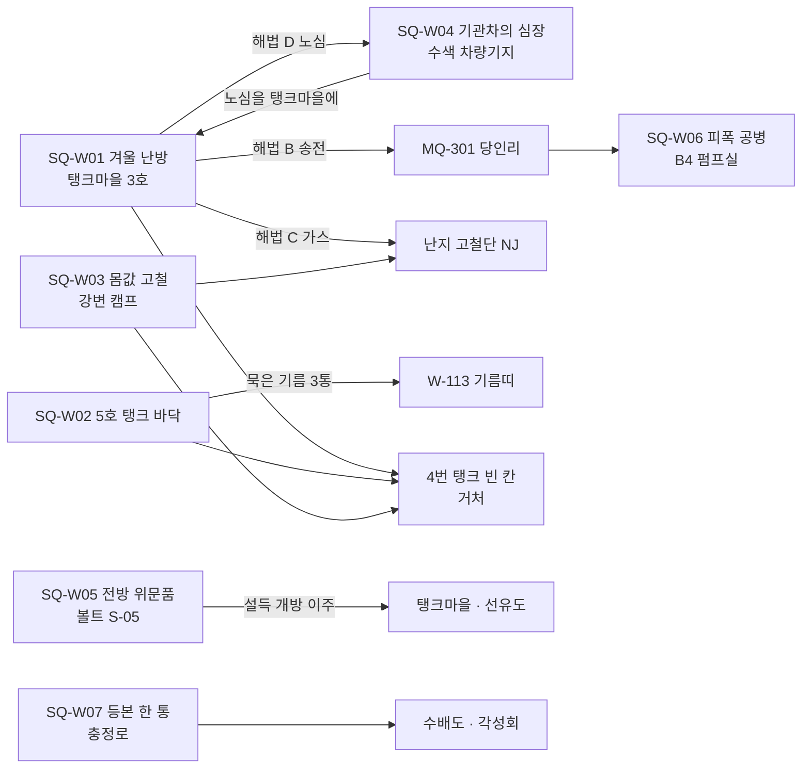
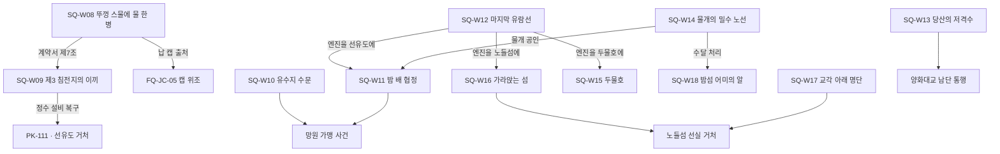
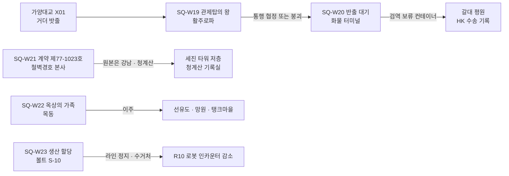

# SD-04b. 사이드 퀘스트: 서부·한강

> **서울 폴아웃 상세 기획서 세트** | 문서 ID: SD-04b | 버전: v1.1 | 작성일: 2026-10-12
> **범위**: R03 마포·상암, R04 서강·선유도, R10 서부 평야, HR 한강의 **지도 표시 사이드 퀘스트 23개(SQ-W01~SQ-W23)** 완성 설계. SD-09b(훅 R03 18·R04 14·R10 16)와 SD-09f HR 부분(훅 14)의 훅 62개 중 38개를 23개 퀘스트로 묶었고, 남은 24개는 비표시·반복 후보로 SD-05에 넘긴다(부록 B). 퀘스트별 발동·단계·다중 해법·결과 분기·카르마·호감도·판도·정보 전파·보상·실패·대사·연출·연계, 권역 흐름도, 결말 슬라이드 연계, 거처·퍽 지정(SD-15 E-09, SD-10 PK-111, SD-13 W-113) / **다루지 않는 것**: 지하(UG) 훅 16개(→ SD-04c), 세력 퀘스트 라인 FQ(→ SD-04d), 비표시·반복·랜덤 인카운터 본문과 ID(→ SD-05), 장소 배치·좌표·NPC 외형(→ SD-09b·09f), 아이템·적 수치(→ SD-13·SD-14), 가격 공식(→ SD-15)
> **관련 문서**: [SC-00 컨셉](00_concept.md), [SD-02 세계관](02_world-and-lore.md), [SD-03a 메인 스토리 1부](03a_main-story-part1.md), [SD-03b 메인 스토리 2부](03b_main-story-part2.md), [SD-04a 사이드 퀘스트(남부)](04a_side-quests-south.md), [SD-04c 사이드 퀘스트(북부·동부·도심)](04c_side-quests-north-east-center.md), [SD-04d 세력 퀘스트](04d_faction-questlines.md), [SD-05 비표시·반복·인카운터](05_misc-quests-encounters.md), [SD-06 세력](06_factions.md), [SD-07a 주요 인물](07a_characters-major.md), [SD-07b NPC 디렉터리](07b_npc-directory.md), [SD-08 월드·권역](08_world-regions.md), [SD-09b 장소 R03·R04·R10](09b_locations-r03-r04-r10.md), [SD-09f 지하·한강](09f_locations-underground-river.md), [SD-10 캐릭터](10_character-system.md), [SD-11 전투](11_combat-system.md), [SD-12 탐험·UI](12_exploration-ui.md), [SD-13 아이템](13_items.md), [SD-14 크리처·적](14_creatures-enemies.md), [SD-15 경제](15_economy.md), [SD-16 아트](16_art-direction.md), [SD-17 사운드](17_sound.md), [SD-18 명명](18_naming-terms.md), 원작 [RD-05 사이드 퀘스트 1](../reverse-design/05_side-quests-part1.md), [RD-06 사이드 퀘스트 2](../reverse-design/06_side-quests-part2.md), [RD-27 이식 메모](../reverse-design/27_adaptation-notes.md)

---

## 목차
1. 개요
2. 퀘스트 총괄
3. R03 마포·상암 (SQ-W01~W07)
4. R04 서강·선유도 (SQ-W08~W13)
5. HR 한강 (SQ-W14~W18)
6. R10 서부 평야 (SQ-W19~W23)
7. 결말 슬라이드 연계
8. 원작 대응
9. 쯔꾸르 제작 메모
10. 미결 사항
- 부록 A. 신규 고유명사
- 부록 B. 넘기는 훅 (비표시·반복 후보, SD-05)
- 부록 C. 참고 문서
- 버전 이력

---

## 1. 개요

### 1.1 목적
- 서울판의 **서부 생활 경제**(선유도의 물, 탱크마을의 연료, 당인리의 전기)와 **한강 횡단**, 그리고 서쪽 끝 **피폭 공항 지대**를 사이드 퀘스트로 체험하게 한다. 이 문서의 퀘스트는 대부분 "누가 물·불·길을 쥐는가"를 다룬다.
- 바이블 §5.8 '고르지 않고 기운다'를 퀘스트 단위로 지킨다. 진영을 묻는 선택지는 없다. 결과는 **무엇을 누구 손에 넘겼는지, 어느 밸브를 어느 쪽으로 돌렸는지, 누구를 살렸는지**로 갈린다.
- 다른 문서가 이 문서에 맡긴 지정 세 가지를 처리한다.

| 요청 | 요청 문서 | 이 문서의 처리 |
|---|---|---|
| 탱크마을 거처 '4번 탱크 빈 칸'의 조건 '탱크마을 사이드 1건' | SD-15 §7.2, E-09 | **SQ-W01 〈겨울 난방〉을 기본 지정**한다. SQ-W02·SQ-W03을 끝내도 같은 조건으로 친다(3.0절, RECON_SPEC N-71 확정) |
| 선유도 정수 설비 복구 사이드 퀘스트(퍽 PK-111, 선유도 거처 대체 조건) | SD-10 §5.4, SD-15 §7.2·§6.4 #8 | **SQ-W09 〈제3 침전지의 이끼〉**. 침전지 필터와 취수탑을 고치면 PK-111(RECON_SPEC N-72 확정) |
| 민경자의 사이드 퀘스트 보상 W-113 기름띠 | SD-13 §3.9 | **SQ-W02 〈5호 탱크 바닥〉**의 묵은 기름 3통으로 석해든이 만든다 |
| 노들섬 거처 '노들섬 선실'의 조건 '노들섬 사이드 1건' | SD-15 §7.2 | **SQ-W16 〈가라앉는 섬〉을 기본 지정**, SQ-W17도 같은 조건(RECON_SPEC N-71 확정) |
| 사이드 퀘스트 연계 후보 '계약 제77-1023호'·'퇴사 면담'·'물길 수송대' | SD-06 §13.1 | SQ-W21(앞 둘 통합), SQ-W15(물길 수송대) |

### 1.2 범위와 경계
| 다루는 것 | 다루지 않는 것 (담당) |
|---|---|
| R03·R04·R10·HR의 지도 표시 사이드 퀘스트 23개 | UG 훅 16개(SD-04c), FQ 라인(SD-04d) |
| 훅의 병합·정리와 남는 훅 목록 | 남는 훅의 퀘스트화와 RQ·UQ ID(SD-05) |
| 퀘스트가 일으키는 호감도·판도·카르마 값 | 호감도·판도 계산식 본체(SD-06), 카르마 범위(SD-10) |
| 퀘스트 전용 변수와 인도 변수(RECON_SPEC §3.3 이름 규칙) | 변수 번호 대역(RECON_SPEC §3.3: V1081~V1200 / S0951~S1000) |
| 결말 슬라이드 문안(ES-37~ES-40, RECON_SPEC §3.2 확정) | ES 슬롯 배분 규칙(SD-03b) |

- **세력 퀘스트와 겹치지 않게 한 지점**: 난지 고철단 FQ-NJ-01~05(흰 깃발·고철 저울·쓰레기 산의 왕·탱크마을 휴전·고철 공방), FQ-JC-02 탱크 간 선거, **FQ-JC-05 캡 위조**(시중 위조 캡 유통망 추적), FQ-JC-03 통행세 장부(노들섬 통행세 횡령), FQ-BJ-04 당인리 측량, FQ-GS-04 개통파, FQ-SB-06 출장소와 같은 사건을 다시 쓰지 않는다. 이 문서의 캡 퀘스트 SQ-W08은 **선유도 금고 안**(보유고와 저울, 창립 계약서)만 다루고, 납 캡을 만든 쪽을 쫓는 일은 FQ-JC-05로 넘긴다.

### 1.3 요약
| 항목 | R03 마포·상암 | R04 서강·선유도 | HR 한강 | R10 서부 평야 | 합계 |
|---|---|---|---|---|---|
| 완성 퀘스트 | 7 (W01~W07) | 6 (W08~W13) | 5 (W14~W18) | 5 (W19~W23) | **23** |
| 쓴 훅 / 원 훅 | 10 / 18 | 12 / 14 | 8 / 14 | 8 / 16 | 38 / 62 |
| SD-05로 넘기는 훅 | 8 | 2 | 6 | 8 | **24** |
| 권장 레벨 범위 | 5~16 | 3~11 | 5~22 | 10~25 | 3~25 |
| XP 합계(완료 기준) | 3,040 | 1,780 | 2,020 | 3,230 | **10,070** |
| 지정 처리 | 탱크마을 거처, W-113 | PK-111, 선유도 거처 대체 조건 | 노들섬 거처, 물길 수송대 | 계약 제77-1023호·퇴사 면담 | — |

- **서부·한강다운 소재**: 탱크마을 겨울과 송전 구리선(W01), 2077년 비축유 유출(W02), 볼트 S-05의 '끝나지 않는 승전 방송'(W05), 선유도 **캡 보증 금고와 납 캡**(W08), 정수 설비와 취수탑 사보타주(W09), 강보다 낮은 마을의 수문(W10), 밤 배와 뱃사공(W11·W14), 원자력 유람선 엔진의 행방(W12), 물길 화물선 구조와 호위(W15), 가라앉는 노들섬(W16), 교각 아래 등록 명단(W17), 밤섬 갈퀴도마뱀 알(W18), **김포 피폭 공항 지대**의 활주로파와 반출 대기 미군 화물(W19·W20), 200년 묵은 경호 계약(W21).

### 1.4 표기 규칙
| 항목 | 규칙 |
|---|---|
| 퀘스트 ID | `SQ-W01`~. 변수는 RECON_SPEC §3.3 규칙: 단계 `SQ_W01`, 결과 `SQR_W01`, 건너뜀 `SQS_W01`, 보조 `SQ_W01_<X>`(하이픈 없음) |
| 단계 변수 | `SQ_Wxx` 0 미발동 / 10 발동 / 20~90 진행 / 100 종료(SD-03a §4.4와 같다). 결과는 `SQR_Wxx` |
| 퀘스트 로그 목표 | SD-18 §8.3. 한 줄 30자 이하, 사실·상태 서술. 이뤄진 목표는 지우지 않고 상태를 바꿔 다시 쓴다 |
| 스킬 판정 | 고정 판정은 `[수리 50]`처럼 요구치(SD-10 §3.6의 15/25/50/75/100). 화술은 SD-03a 표기 `[화술·쉬움]`·`[화술·보통]`·`[화술·어려움]`·`[화술·아주 어려움]`. 능력치는 `[힘 6]` |
| 호감도 | 세력 약호(SD-06 §2.2)와 기본값. 정착지 개별값은 `TK +10`처럼 정착지 약호로 쓴다(내부 변수 `AFF_JC_TK`). 실제 상승량은 SD-06 §3.4의 카리스마·카르마·퍽 보정이 곱해진다 |
| 판도 | SD-03a §4.5 표기. "판도 R03 +정착 5" = 그 구역 그 세력의 사건 보정. "거점 X → Y" = 소유 이전 |
| 인도 변수 | 사이드 퀘스트 핵심 물건의 인도처는 `SQH_W_<물건>`에 SD-03a §4.5·§4.6의 세력 코드로 기록한다. 0 주인공 소지 / 1~14 세력 / 15~21 비호감도 집단·장소 / 81~86 개별 정착지 / 87~95 소규모 정착지·비가맹 공동체 / 97 두고 떠남 / 99 파기. **이 문서가 쓰는 확장 코드(RECON_SPEC §3.1 확정)**: 92 MW 망원 유수지 마을, 15 HS 한강 행상 조합, 16 DG 순회 의료반. 변수 접두는 `SQH_W_`(04a `SQH_`와 겹침 방지) |
| 공개도 | SD-06 §6.2의 0 비밀 / 1 목격 / 2 공개 / 3 방송급 |
| 레벨·XP | 권장 레벨은 SD-08 위협도 기준. 완료 XP는 SD-10 §4.4의 위협도별 범위(1: 150~250, 2: 250~350, 3: 350~500, 4: 500~650, 5: 650~800) 안에서 정했다. 판정 성공 XP는 별도 |
| 신규 ID | 다른 문서 소관의 새 아이템·적·기록물·인물은 RECON_SPEC §3.4~3.6과 SD-07b가 배정한 번호(LR-, M-, I-, CR-, N-)로 쓰고 부록 A에 모은다 |
| 이름 | 육지환·멍쉐밍·공보방송(2077년 국영 방송은 '전시 국영방송')·'부위 손상'·원칙파 WP·자율방범대 대장 오순례·난지 고철단 현 두목 맹구철(쇠갈퀴)·산주 쥐왕(CR-509)·활주로파 두목 차보람(방열복)·각성회 개통파 은솔(CR-523)을 쓴다 |

### 1.5 이 문서의 설계 규칙
| # | 규칙 | 적용 |
|---|---|---|
| 1 | **진영 질문 금지** | "어느 쪽에 넘기겠습니까?" 선택지가 없다. 넘기기는 대화창의 '물건 주기'(물건 이름만 보인다), 보관함에 두기, 밸브·차단기·레버를 실제로 조작하기, 물건을 끌고 가 그 자리에 내려놓기로 일어난다(SD-03a §4.6과 같은 방식) |
| 2 | **해법은 셋 이상, 판정 실패로 막히지 않는다** | 모든 퀘스트에 전투·은신·화술·스킬·아이템·돈 중 서로 다른 계열 해법을 3개 이상 둔다. 판정이 막히면 다른 해법이 남는다 |
| 3 | **해 준 일만 기운다** | 호감도·판도는 결과가 세계에 알려진 때(SD-06 §6) 반영된다. 각 퀘스트에 공개도와 전파 경로를 적었다 |
| 4 | **현실 기반** | 설화·민속 소재를 쓰지 않는다. 망원 일대 실제 수해, 신월 빗물터널 실제 사고, 실제 한강 사고를 소재로 쓰지 않는다(SD-09b §1.5). 수위·침수는 SD-08 §8.1 폭우 수위 이벤트만 근거로 한다 |
| 5 | **2077년 한국** | 퇴락의 근거는 1950~70년대 풍속이 아니라 2077년 폴아웃 기술 사회(진공관 민원 단말, 원자력 기관차, 세이프빌 재개발, 공보·전시 국영방송, 비축유 장부)다 |
| 6 | **동료 없음** | 동행은 퀘스트 구간 일시 동행 NPC와 세력 지원 병력뿐이다. 퀘스트가 끝나면 돌아간다 |
| 7 | **원작 줄거리 리스킨 금지** | 원작에서 가져오는 것은 설계 패턴(다중 해법, 시간차 결과, 믿을 수 없는 의뢰인, 정보의 아이템화, 세계 반응 레이어)뿐이다. 비교는 8장 |

### 1.6 훅 처리 총괄
| 퀘스트 | 들어간 훅 (SD-09b §2.6·§3.6·§4.6, SD-09f §13) |
|---|---|
| SQ-W01 겨울 난방 | R03 #1 〈겨울 난방〉 + #4 〈쓰레기 산의 구리〉 + #16 〈메탄 포집관〉 |
| SQ-W02 5호 탱크 바닥 | R03 #2 |
| SQ-W03 몸값 고철 | R03 #3 |
| SQ-W04 기관차의 심장 | R03 #6 |
| SQ-W05 전방 위문품 | R03 #8 + #9 〈안테나 숲의 잡음〉 + R10 #14 〈전선의 메아리〉 |
| SQ-W06 피폭 공병 | R03 #5 |
| SQ-W07 등본 한 통 | R03 #18 |
| SQ-W08 뚜껑 스물에 물 한 병 | R04 #13 〈조합장의 금고〉 + SD-15 §2.3 납 캡 |
| SQ-W09 제3 침전지의 이끼 | R04 #1 + #2 〈취수탑 파손 의뢰〉 + #3 〈양평 펌프장의 생명선〉(선택 단계) |
| SQ-W10 유수지 수문 | R04 #8 + #9 〈붕어가 죽는다〉 + #14 〈비누와 기름〉 |
| SQ-W11 밤 배 협정 | R04 #7 + #11 〈물막이 손님〉 |
| SQ-W12 마지막 유람선 | R04 #6 |
| SQ-W13 당산의 저격수 | R04 #12 |
| SQ-W14 물개의 밀수 노선 | HR-H05 |
| SQ-W15 두물호 | HR-H08 〈구조대 무전〉 + HR-H11 〈두물호 호위〉 + SD-06 §13.1 '물길 수송대' |
| SQ-W16 가라앉는 섬 | HR-H02 + HR-H03 〈크레인 기관실〉 |
| SQ-W17 교각 아래 명단 | HR-H04 |
| SQ-W18 밤섬 어미의 알 | HR-H06 + R04 #5 〈철새 일지〉(관측 해법으로 흡수) |
| SQ-W19 관제탑의 왕 | R10 #1 + HR-H13 〈가양대교 거더〉(접근 경로로 흡수) |
| SQ-W20 반출 대기 | R10 #2 + #4 〈갈대 속 컨테이너〉 |
| SQ-W21 계약 제77-1023호 | R10 #5 + #6 〈퇴사 면담〉 + SD-06 §13.1 |
| SQ-W22 옥상의 가족 | R10 #13 |
| SQ-W23 생산 할당 | R10 #8 |

---

## 2. 퀘스트 총괄

### 2.1 총괄표
| ID | 제목 | 권역 | 주 장소 | 권장 Lv | 실질 발동 막 | 관련 세력 | 메인·세력 연계 | XP |
|---|---|---|---|---|---|---|---|---|
| SQ-W01 | 겨울 난방 | R03 | 탱크마을 3호 탱크 L-R03-03, 당인리 B2 L-R03-01, 노을 언덕 L-R03-05, 난지도 포집 관리동 L-R03-04 | 7~12 (송전 경로 10~16) | 2막~ | TK, NJ, BJ | MQ-301, MQ-507, FQ-NJ-04, FQ-BJ-04, SQ-W04 | 450 |
| SQ-W02 | 5호 탱크 바닥 | R03 | 탱크마을 5호 바닥 L-R03-03 | 6~11 | 2막~ | TK, BJ, NS | MQ-502 증거 | 400 |
| SQ-W03 | 몸값 고철 | R03 | 난지 강변 캠프 L-R03-06, 난지도 L-R03-04 | 6~10 | 2막~ | TK, NJ, SB | FQ-NJ-01·03, SQ-W17 | 380 |
| SQ-W04 | 기관차의 심장 | R03 | 수색 차량기지 L-R03-11 | 9~15 | 2막~ | TK, YH, WP, NJ, JH | SQ-W01 | 450 |
| SQ-W05 | 전방 위문품 | R03(+R10) | 볼트 S-05 L-R03-09, 상암 방송단지 L-R03-08, 목동 방송사옥 L-R10-24 | 6~14 | 1막~(인터컴은 2막~) | TK, SY, NS, SB | MQ-303 증거, MQ-702 | 500 |
| SQ-W06 | 피폭 공병 | R03 | 당인리 B4 펌프실 L-R03-01 | 10~16 | 3막(MQ-301 전후) | BJ, TK | MQ-301, FQ-BJ-04·07 | 480 |
| SQ-W07 | 등본 한 통 | R03 | 충정로 민원 센터 L-R03-27 | 5~10 | 2막~ | BJ, GS, JH | 수배도, FQ-GS 계열 | 380 |
| SQ-W08 | 뚜껑 스물에 물 한 병 | R04 | 선유도 L-R04-01, 양평 펌프장 L-R04-15 | 6~10 | 1막~ | SY, HS, JH | MQ-502, FQ-JC-05 | 320 |
| SQ-W09 | 제3 침전지의 이끼 | R04 | 선유도, 망원 취수탑 L-R04-08, 양평 펌프장 | 4~9 | 1막~ | SY, ND | PK-111, 선유도 거처 | 300 |
| SQ-W10 | 유수지 수문 | R04 | 망원 유수지 마을 L-R04-05, 빗물 펌프장 L-R04-09, 고가 캠프 L-R04-10 | 3~8 | 2막~ | MW, TK | 가맹 사건 | 250 |
| SQ-W11 | 밤 배 협정 | R04 | 망원, 선유도, 수상 정원 L-R04-06 | 5~9 | 2막~ | MW, SY, DG | 가맹 사건, SQ-W12·W14 | 280 |
| SQ-W12 | 마지막 유람선 | R04 | 서강 폐선 정박지 L-R04-14 | 6~11 | 2막~ | SY, ND, HS, JH, YH | SQ-W11·W15·W16 | 330 |
| SQ-W13 | 당산의 저격수 | R04 | 당산 강변 아파트 L-R04-17, 양평 공장 지대 L-R04-16 | 5~10 | 1막~ | SY | X02 통행 | 300 |
| SQ-W14 | 물개의 밀수 노선 | HR | 양화 나룻배 L-HR-10, 요트 계류장 터 L-HR-30, 노들섬 L-HR-01 | 5~9 | 2막~ | SY, ND | MQ-202, SQ-W11·W18 | 300 |
| SQ-W15 | 두물호 | HR | 구조대 초소 터 L-HR-31, 원효대교 잔해 L-HR-17, 물길 | 7~12 | 2막~ | HS, ND, TK, NJ | SD-06 '물길 수송대' | 420 |
| SQ-W16 | 가라앉는 섬 | HR | 노들섬 L-HR-01 | 6~12 | 2막~ | ND, 정착지 5곳, YH, SV | 노들섬 거처, MQ-502 | 350 |
| SQ-W17 | 교각 아래 명단 | HR | 노들섬 교각 아래 마을·출장소 | 6~10 | 2막~ | ND, BJ, SB | FQ-SB-06, MQ-504 | 330 |
| SQ-W18 | 밤섬 어미의 알 | HR(R04) | 밤섬 L-R04-19·20 | 16~22 | 2막~ | YH, NS | SD-02 M5 | 620 |
| SQ-W19 | 관제탑의 왕 | R10 | 김포 활주로 L-R10-02, 가양대교 L-HR-25 | 18~24 | 3막~ | 활주로파(YT), TK, CB | MQ-604 대체 탑승 지점 | 750 |
| SQ-W20 | 반출 대기 | R10 | 화물 터미널 L-R10-04, 갈대 평원 L-R10-05 | 18~25 | 3막~ | YH, WP, BJ, JH, NS | SD-02 M5 | 780 |
| SQ-W21 | 계약 제77-1023호 | R10(+R07·R11) | 철벽경호 본사 L-R10-13 | 12~20 | 2막~ | CB, SV, BJ | 처리조 종료 | 600 |
| SQ-W22 | 옥상의 가족 | R10 | 목동 단지 L-R10-23 | 10~16 | 1막~ | SB, 정착지 | MQ-105·504 | 450 |
| SQ-W23 | 생산 할당 | R10 | 볼트 S-10 L-R10-12 | 16~22 | 2막~ | JH, GS, YH, WP | R10 로봇 인카운터 | 650 |

- **'실질 발동 막'**은 막 잠금이 아니다(바이블 §5.3-1). 주인공은 한강 남안(관악)에서 출발하므로 북안(R03)과 섬은 횡단로를 확보한 2막 무렵에 닿는 경우가 많다는 뜻이다. 남안의 R04 남쪽(선유도·양평·당산)과 R10은 1막부터 갈 수 있다. 위협도가 높을 뿐이다.

### 2.2 권역 흐름도

**R03 마포·상암** — 탱크마을을 중심으로 열과 전기, 이웃 원수가 얽힌다.

**R04 서강·선유도 + HR 한강** — 물과 배, 강을 건너는 사람들.

**R10 서부 평야** — 위협 계단의 끝, 미군 화물과 200년 묵은 계약.

### 2.3 공통 규칙
| 항목 | 규칙 |
|---|---|
| XP 지급 | 완료 XP를 단계별로 나눠 줄 수 있다(SD-10 §4.4). 각 퀘스트 보상 칸에 분할을 적었다. 판정 성공 XP는 SD-10 §3.6대로 따로 준다 |
| 늦은 완료 | 시간 제한이 있는 퀘스트는 기한을 넘겨도 대부분 계속된다. 기한 뒤 완료하면 그 뒤에 남은 단계 XP를 ×0.5로 준다. 결과 변수에 '늦음'이 기록된다 |
| 인도 기록 | 핵심 물건 9종(SQH_W_ 변수, 9.2절)은 받은 쪽이 바뀌어도 되찾을 수 있다. 되찾으면 0으로 돌아가고 빼앗긴 쪽 -10(SD-06 §3.4 '의뢰 물건 횡령'과 별개의 회수 감점) |
| 정착지 안 행동 | 탱크마을·선유도·망원·노들섬 안 컨테이너는 소유물이다. 절도 적발 -4(SD-06 §3.4) |
| 일시 동행 | 퀘스트에 붙는 동행 NPC는 퀘스트 구역 밖으로 나가면 자기 거처로 돌아간다. 쓰러지면 기절(필수 NPC) 또는 사망(비필수, 표에 표시) |
| 기한의 표시 | 기한은 핍-보이 로그에 서술로 보인다("탁윤재가 등유 통을 다시 셌다. 한파까지 열흘쯤 남았다") |
| 판도 사건의 감쇠 | 퀘스트가 주는 판도 사건 보정은 SD-06 §5.2대로 7일마다 0 쪽으로 2씩 준다. 거점 소유 이전은 감쇠하지 않는다 |
| 거처 지정 | 거처 조건의 '문제 하나 해결'은 퀘스트 결과 `SQR_Wnn`이 '해결' 계열일 때 참이다(각 퀘스트 결과표의 ◆ 표시) |

---

## 3. R03 마포·상암 (SQ-W01~W07)

### 3.0 권역 메모
- 탱크마을(TK, 가중치 2)과 난지 고철단(NJ)은 연동 계수 -0.6의 이웃 원수다(SD-06 §3.6). R03 퀘스트의 NJ 쪽 결과는 거의 언제나 TK에 반대로 번진다. 이 문서는 수치에 연동을 이미 반영하지 않았다. 표의 값은 직접 증감이고, 연동은 SD-06 규칙대로 알려진 때 따로 계산한다.
- **탱크마을 거처(SD-15 E-09)**: TK 우호(+20) 이상 + SQ-W01·W02·W03 중 하나를 ◆ 결과로 끝냄 → 다음 탱크마을 방문 때 민경자가 1호 탱크 집무실 앞에서 '4번 탱크 빈 칸' 열쇠(거처 열쇠, SD-15 §7.2 소관)를 건넨다. MQ-301 탱크마을 협력 경로(CO_301 = 8)도 같은 조건으로 친다(SD-15).
- 강북에 처음 발을 디딘 날(`S_CROSSED`)부터 탱크마을 무전실 석겨레가 R03 소문을 하루 한 줄씩 핍-보이 라디오 '정착지 소식'으로 흘린다. 이것이 W01·W03·W05의 보조 발동 경로다.

### 3.1 SQ-W01 겨울 난방
> 탱크마을 3호 정유 탱크의 증류탑 하나가 갈라져 겨울 등유가 절반만 나온다. 열을 어디서 얻어 오는지에 따라 탱크마을의 겨울과 이웃의 태도가 바뀐다.

| 항목 | 내용 |
|---|---|
| 권역·장소 | R03. 탱크마을 3호 정유 탱크(L-R03-03), 당인리 B2 송전반실·E4 송전 관로(L-R03-01), 노을 언덕 포집 펌프실(L-R03-05), 난지도 포집 관리동(L-R03-04 정상 아래 지하 1층), 수색 차량기지(L-R03-11, SQ-W04 연계) |
| 권장 레벨 / 위협 | 7~12 / 3. 해법 B(당인리 송전)는 10~16, B3·B4 구간 위협 4 |
| 출처 훅 | R03 #1 〈겨울 난방〉, #4 〈쓰레기 산의 구리〉, #16 〈메탄 포집관〉 |
| 발동 | ① 탱크마을 3호 탱크 첫 진입 때 증류탑 2호기가 증기를 뿜는 연출과 탁윤재의 바크 "2호기가 또 갈라졌어." → 말을 걸면 시작 ② 2호 시장 탱크 게시판 '등유 비축 18 / 40통' 쪽지 ③ 식당 기름솥 탁아윤의 소문 ④ MQ-301에서 탱크마을 차단기를 올렸는데 사흘 뒤 송전이 끊긴 경우 자동 발동(단계 30에서 시작, 해법 B 고정) |
| 등장 인물 | 탁윤재(N-R03-003, 의뢰인), 민경자(C-012·N-R03-001), 석해든(N-R03-005), 탁보경(N-R03-009), 석주원(N-R03-002), 저울(N-R03-024), 추가람(N-R03-034), 허문경(C-033·N-R03-031), 고철단 채집조 반장 '펜치'(N-R03-503) |
| 관련 세력 | TK, NJ, BJ |
| 변수 | `SQ_W01`, `SQR_W01`, `V_TK_HEAT`(0 부족 / 1 증류탑 수리 / 2 당인리 송전 / 3 노을 가스 / 4 기관차 노심 / 5 계엄군 원조), `V_COPPER`(0 정상 / 1 도난 중 / 2 복구 / 3 묵인) |

**단계별 목표**
| 단계 | 퀘스트 로그 목표 | 완료 조건 |
|---|---|---|
| 10 | 탱크마을 겨울 등유가 절반도 안 된다 | 발동 |
| 20 | 3호 증류탑 2호기가 갈라져 멈춰 있다 | 증류탑 조사(상호작용) 또는 탁윤재 대화 끝까지 |
| 30 | 열을 얻을 곳은 증류탑만이 아니다 | 해법 A~E 중 하나에 착수(해당 장소 진입 또는 첫 판정) |
| 40 | (해법별 상태 문장, 아래 표) | 해법 완료 |
| 50 | 탁윤재가 올겨울 등유를 다시 셌다 | 탁윤재에게 돌아온다(해법 C의 B관이면 이 단계가 '실패'로 닫힌다) |
| 100 | 탱크마을의 겨울 준비가 끝났다 | 종료 |

| 해법 | 단계 40 상태 문장 |
|---|---|
| A | 3호 증류탑 2호기가 다시 돈다 |
| B | 당인리에서 탱크마을로 전기가 들어온다 |
| C(A관) | 노을 언덕 가스가 탱크마을 솥으로 간다 |
| C(B관) | 노을 언덕 가스가 고철단 충전소로 간다 |
| D | 기관차 노심이 5호 대장간에 놓였다 |
| E | 계엄군 등유 스무 통이 3호 탱크에 쌓였다 |

**진행 상세**
- 3호 탱크에는 증류탑 2기가 있다. 2호기 몸통이 갈라져 등유 생산이 절반이다. 4호 살림 탱크 60세대가 겨울을 나려면 등유 40통이 필요한데 비축은 18통이다.
- 탁윤재는 "3호에선 불 피우는 놈이 제일 먼저 죽어"라며 임시 용접을 거부한다. 3호는 유증기 구역이라 화염·폭발 무기를 쓰면 환경 폭발 판정(SD-11)이 난다. 퀘스트 중 3호 안 전투(기름모기 습격)에서도 같은 규칙이다.
- 해법 B는 MQ-301 결과에 묶인다. 원자로가 꺼져 있으면(V_REACTOR ≠ 2) 탁윤재가 "당인리가 켜지면 얘기가 달라지지"라고 말하고 해법 B는 로그에 '열린 가능성'으로만 남는다. 원자로가 돌고 있는데 탱크마을 차단기(V_FEED 비트 2)가 내려가 있으면, 당인리 B2에서 차단기를 올리는 것이 해법 B의 시작이다(MQ-301 종료 뒤에도 B2 차단기는 조작할 수 있다. 기동 키를 쥔 세력의 경비가 있으면 그들과 먼저 말해야 한다).
- **쓰레기 산의 구리**: 송전이 켜진 뒤 게임 3일째, 고철단 채집조가 합정 쪽 E4 송전 관로에 들어가 구리선을 뜯는다(`V_COPPER = 1`). 탱크마을 탱크 지붕의 전구 줄이 꺼지고, 무전실 석겨레가 "또 끊겼어"라고 알린다. 해법 B는 이 도난을 처리해야 끝난다.

**해법**
| # | 해법 | 조건·판정 | 진행 | 결과(V_TK_HEAT) |
|---|---|---|---|---|
| A | **증류탑 수리** | ① [수리 75] + 강판 조각 M-013 ×2 + 증기 압력계 M-033 ×1 + 공업용 테이프 M-025 ×2 → 즉시 ② [수리 50] + 같은 재료 → 탁윤재와 6시간 작업. 작업 중 3호 탱크 기름모기 CR-607 떼 습격 1회(화염 금지) ③ 재료 + 300캡을 석해든에게 → 3일 뒤 완료 | 수리가 끝나면 증류탑이 '덜컹' 하고 돈다 | 1 |
| B | **당인리 송전** | V_REACTOR = 2. B2 차단기 '탱크마을' ON(V_FEED 비트 2). 구리 도난 처리(B1~B4 중 하나) | 하위 해법 아래 | 2 |
| B1 | 관로 매복 | 밤 E4 관로 안. 고철단 채집조 4~5(CR-421·CR-423) + 경비견 CR-107 1 + 반장 '펜치' | 처치 또는 쫓아냄 → 끊긴 구간 이음 [수리 25] + 구리선 M-012 ×4 | V_COPPER = 2 |
| B2 | 다른 구리원 소개 | NJ 경계 이상(흰 깃발 교섭 포함). 저울과 거래: 수색 차량기지 객차 배선 위치를 알려 주고 [화술·보통], 또는 구리선 M-012 ×10을 직접 넘긴다 | 고철단이 관로에서 손을 뗀다. 저울 시세 칠판에 '당인리 구리 — 안 받음' 한 줄이 생긴다 | V_COPPER = 2 |
| B3 | 묵인 | 반장 '펜치'에게 관로 순찰 시간(탱크마을 자경대·계엄군 공병)을 알려 준다 | 150캡을 받는다. 송전은 계속 끊긴다. 퀘스트는 탱크마을 쪽에서 '실패' | V_COPPER = 3, V_TK_HEAT = 0 |
| B4 | 계엄군에 신고 | BJ 중립 이상. 굴뚝 공원의 추가람에게 관로 위치를 알린다 | 공병 2명이 관로 맨홀에 초소를 세운다. 이틀 뒤 송전 복구 | V_COPPER = 2 |
| C | **노을 언덕 가스** | 노을 언덕 포집 펌프실에서 밸브 손잡이(퀘스트 아이템, SD-13에서 ID 부여)를 회수하고, 난지도 포집 관리동의 밸브 6개를 조작한다. 관리동은 NJ 영역이다 | 하위 해법 아래. 마지막에 **밸브 6개 중 어느 관을 열었는지**가 결과다. A관 3개를 열면 탱크마을 취사관, B관 3개를 열면 고철단 가스통 충전소로 간다(섞어 열면 압력이 낮아 둘 다 실패, 다시 조작 가능) | A관 3 / B관 0(탁윤재 쪽 실패) |
| C1 | 거래 | NJ 경계 이상. 저울과 '가스 사용료' 협상: 탱크마을이 매달 등유 5통. [물물교환 50]이면 3통. 탱크마을 쪽 동의는 민경자 [화술·보통](석주원은 반대 바크) | 저울이 관리동 열쇠를 빌려준다 | — |
| C2 | 잠입 | 쥐굴 경로 또는 정상 북사면 [은신]. 관리동 문 [자물쇠 50] | 들키면 고철단 적대 교전 | — |
| C3 | 정면 돌파 | 저울 계단으로 올라가 관리동까지 싸운다 | NJ 대량 처치 | — |
| D | **기관차 노심** | SQ-W04에서 노심을 탱크마을에 둔다(SQH_W_CORE = 82) | 석해든이 노심으로 3호 증류탑 전기 가열기를 만든다(2일) | 4 |
| E | **계엄군 원조** | BJ 중립 이상. 허문경(당인리 B2 캠프 또는 굴뚝 공원) [화술·보통]. MQ-207의 '원자로 협력 공문'을 이미 전했으면 [화술·쉬움] | 공병반이 등유 20통을 보낸다. 통 위에 '원자로 복구 협력 정착지 지원' 문서가 붙어 있다. 주인공이 그 통을 3호 탱크에 내려놓는 순간이 결과다(민경자는 거절하지 않는다) | 5 |

**결과 분기와 후일담**
| 결과 | 조건(한 일) | 카르마 | 호감도 | 판도 | 후일담 |
|---|---|---|---|---|---|
| ◆ 수리 | A | 0 | TK +10 | — | 탁윤재가 "다음엔 내가 고칠 수 있게 가르쳐 줘"라며 매주 화염방사기 연료 20을 싸게 판다(-20%) |
| ◆ 송전 | B + B1·B2·B4 | 0 | TK +15 / B1 NJ -6(목격자 탈출 시) / B2 NJ +5 / B4 BJ +5 | B4: 판도 R03 +비상 3(관로 초소) | 탱크 지붕 전구 줄이 밤새 켜진다. 4호 교실이 밤 수업을 연다. B4면 석주원 상점 +5% 7일("전깃줄에 계엄군 냄새가 나") |
| 송전 묵인 | B3 | -50 | 발각 시 TK -8, NJ +6 | — | 전구 줄은 꺼진 채다. 7일 안에 25% 확률로 '펜치'가 탱크마을 장날에 자랑한다(공개도 2) |
| ◆ 가스(A관) | C + A관 | 0 | TK +12 / C1 NJ +5 / C2 발각 NJ -10 / C3 NJ 처치 규칙 | 판도 R03 +정착 3 | 2호 식당 기름솥 버너가 파란 불꽃이 된다. C1이면 저울이 장날마다 등유 통을 받으러 온다(휴전 FQ-NJ-04의 실마리) |
| 가스 전용 | C + B관 | -25 | NJ +8, TK -8(의뢰 횡령, 알려지면 추가 -5) | 판도 R03 +고철 5 | 탱크마을 습격 인카운터의 고철단이 가스통을 던진다(SD-05 RE 가중). 퀘스트는 탁윤재 쪽 '실패'로 닫힌다 |
| ◆ 노심 | D | 0 | TK +6(SQ-W04의 TK +10과 별도) | — | 5호 대장간 화로가 전기 화로로 바뀐다. 석해든의 주문 제작 기간 -1일 |
| ◆ 원조 | E | 0 | TK +5, BJ +6 | 판도 R03 +비상 3 | 3호 탱크 문에 '정부 원조' 스텐실. 탱크마을 정문 문지기 엄규태의 바크가 바뀐다("정부 등유 받은 집이 여기야. 자랑은 아니고.") |

- 한 퀘스트에서 둘 이상의 해법을 끝까지 할 수 있다. `V_TK_HEAT`는 가장 나중에 끝낸 해법의 값이고, 호감도는 처음 '◆'에만 준다. 두 번째 해법 완료는 TK +3만 더한다.

**정보 전파**
- 공개도 2(정착지 안). 탱크마을 소문 12시간, 물길 수송로 행상 24시간(SD-06 §6.3). 고철단은 C1·B2를 당일 안다(거래 당사자).
- B4·E는 공보방송 소재다(공개도 2 → 비상정부 관련 공보 경로). 공보방송 "정부가 마포의 겨울을 돕습니다." 남산 방송은 E를 받아 "등유 통에 붙은 쪽지는 읽어 봤대요?"라고 덧붙인다.

**보상**
| 항목 | 내용 |
|---|---|
| XP | 450 (단계 20: 50 / 단계 40: 300 / 단계 50: 100). 기한(한파) 뒤 완료 시 남은 단계 ×0.5 |
| 캡·물품 | 탱크 운영위원회 사례 300캡, 화염방사기 연료 60, I-047 탱크마을 꼬치구이 3 |
| 거처 | 3.0절 조건 충족 시 '4번 탱크 빈 칸' |

**실패·시간 제한**
- 발동 후 게임 20일 = **한파 사건**. 해결 전이면 4호 탱크 노약자들이 2호 숙박 침상으로 몰려 숙박이 막히고(7일), 진료소 인해인의 바크가 바뀐다. TK -5. 퀘스트는 계속되고 결과에 '늦음'.
- B3·C(B관)은 실패로 닫힌다. 같은 퀘스트를 다른 해법으로 다시 열 수 없고, 탱크마을 문제 해결은 SQ-W02·W03으로 대신한다.

**핵심 대사**
- 탁윤재: "증류탑은 사람이 아니라서 참지를 못해. 갈라지면 그냥 갈라진 거야."
- 민경자(해법 E 통을 받으며): "등유는 고맙게 쓰지. 쪽지는 안 읽었다고 해 둘게."
- 저울(해법 C1): "가스는 공짜로 나와. 근데 우리가 깔고 앉은 산에서 나오지. 그게 값이야."
- 펜치(해법 B3): "순찰 시간만 알면 돼. 구리는 원래 땅 밑에 있던 거야."

**연출 메모**
- 3호 탱크 안 증기 파티클과 BGS-I02 저음. 해법 A 완료 순간 증류탑 화염 점화 → 탱크 내부 조명이 한 단계 밝아진다.
- 해법 B 완료 밤: 탱크 지붕 5기를 잇는 전구 줄이 하나씩 켜진다(외부 맵 조명 이벤트 1). 구리 도난 때 같은 줄이 반대 순서로 꺼진다.
- 해법 C의 밸브 6개는 관리동 벽에 A관(초록 테이프)·B관(빨간 스프레이)으로 표시돼 있다. 밸브를 돌릴 때 '돌리는 손' 애니메이션과 배관 압력계 바늘이 움직인다. 질문 창은 뜨지 않는다.

**연계**
- 메인: MQ-301(해법 B 전제, 현장 무리 '탱크마을 민병'의 송전선 연결 장치와 같은 계통), MQ-501 '송전 협상' 판(HO_KEY = 82이면 해법 B가 저절로 열린다), MQ-507(V_TK_HEAT ∈ {2, 4}이면 탱크마을 방어전 밤 탐조등이 켜진다: 방어 측 명중 +10%, 확정 RECON_SPEC N-68).
- 세력: FQ-NJ-04 탱크마을 휴전(C1 결과가 휴전 대화의 근거 1건), FQ-BJ-04 당인리 측량(B4·E 뒤 공병반이 탱크마을 경비를 덜 경계한다).
- 사이드: SQ-W04(해법 D), SQ-W02·W03(거처 대체 조건).

**결말 슬라이드**: ES-17 탱크마을 꼬리 추가 제안 — V_TK_HEAT = 3이면 "노을 언덕의 가스가 탱크마을 솥을 데웠다. 고철단은 그 값으로 다달이 등유를 받아 갔다." / V_TK_HEAT = 5이면 "탱크마을은 정부 등유로 한 겨울을 났다. 그 겨울을 기억하는 사람과 쪽지를 기억하는 사람이 달랐다."

### 3.2 SQ-W02 5호 탱크 바닥
> 5호 탱크 바닥 기름 늪의 기름모기가 대장간까지 올라온다. 늪을 정리하러 내려간 바닥 계량실에는 2077년 비축유 장부가 실제 잔량과 맞지 않았다는 경비원의 기록이 남아 있다.

| 항목 | 내용 |
|---|---|
| 권역·장소 | R03. 탱크마을 5호 바닥 탱크 상층(대장간)·5호 바닥 기름 늪(36×36)·봉인된 계량실, 3호 하층(연결 통로) |
| 권장 레벨 / 위협 | 6~11 / 2(실내) |
| 출처 훅 | R03 #2 |
| 발동 | ① 5호 대장간에서 석해든이 모기를 쫓다가 망치를 내려놓는 연출 → 탁보경이 말을 건다("늪에서 묵은 기름 좀 떠 와 줄 사람") ② 병뚜껑(N-R03-018)이 "3호 바닥에서 5호 바닥으로 가는 구멍 알아요. 뉴카 뚜껑 하나면 알려 줄게요"라고 먼저 말을 건다 |
| 등장 인물 | 탁보경(의뢰인), 병뚜껑(통로 안내), 석해든(W-113 제작), 민경자(일지·W-113 의뢰 확인), 석겨레(무전), 송미래(C-008, 원격), 허문경 또는 분류반 창구(인도처) |
| 관련 세력 | TK, BJ, NS(남산 방송 협력 플래그), JH |
| 변수 | `SQ_W02`, `SQR_W02`, `SQH_W_OILLOG`(비축유 경비 일지 인도처), `SQ_W02_FIRE`(5호 바닥 화재 여부) |

**단계별 목표**
| 단계 | 퀘스트 로그 목표 | 완료 조건 |
|---|---|---|
| 10 | 5호 탱크 바닥에서 기름모기가 올라온다 | 발동 |
| 20 | 기름 늪 바닥에 모기 둥지 세 곳이 있다 | 5호 바닥 진입 |
| 30 | 묵은 기름 세 통이 늪 바닥에 남아 있다 | 둥지 처리 또는 우회 + 기름 채취 3회(상호작용, 통당 무게 5) |
| 40 | 계량실 터미널에 2077년 경비 일지가 있다 | 계량실 진입 + 터미널 열람 |
| 50 | 비축유 경비 일지는 아직 당신 손에 있다 | (상태형. 인도하면 "일지는 이제 ○○에게 있다"로 바뀐다) |
| 60 | 탁보경이 묵은 기름 세 통을 기다린다 | 기름 3통 전달 |
| 100 | 5호 바닥이 조용해졌다 | 종료 |

**진행 상세**
- 5호 바닥은 2077년 관리 통로와 기름 늪이다. 기름모기 CR-607 떼(6~10, 둥지당 리젠 120초)와 변이 시궁쥐 CR-095. 바닥 타일 절반이 '기름 늪'(이동 ×0.7, 화염 접촉 시 연소)이다.
- **화염 금지**: 늪에서 화염·폭발 무기를 쓰면 SD-11 환경 폭발 → 5호 바닥 화재(`SQ_W02_FIRE = 1`). 묵은 기름 2통이 타서 1통만 남고, 화재 진압 연출(자경대 소화 바크) 뒤 TK -10, 카르마 -50. 탁보경이 퀘스트 시작 대사에서 경고한다.
- 계량실 문은 2077년 판독기 대신 기계식 잠금이다. 터미널 기록 「마포 석유비축기지 경비 일지(2077-10)」(LR-53)의 요지: 장부상 비축량은 '만재'인데 실측 잔량은 바닥 3%. 2075년부터 '전시 특별 수송' 명목으로 태성그룹 정유 계열사 유조차가 밤마다 드나들었다. 경비원 마지막 줄: "장부엔 가득, 탱크엔 바닥. 우리가 지키는 건 빈 깡통이다."
- 일지는 퀘스트 아이템 '비축유 경비 일지'(M-332, LR-53 출력본)로 출력된다. 이 일지는 재벌과 전시 정부가 비축유를 빼돌렸다는 증거다. 비상정부는 재벌 후예 세력(F-01-A)이라 이 기록이 퍼지는 것을 싫어한다.

**해법 (둥지와 계량실)**
| # | 해법 | 조건·판정 | 진행 | 결과 |
|---|---|---|---|---|
| 1 | 전투 | 근접·총기(화염 금지) | 둥지 3곳(알집 오브젝트, HP 60)을 부순다 | 둥지 소멸, 반복 재발 없음 |
| 2 | 배수 | 2077년 관리 통로 배수 펌프 [수리 50] 또는 핵분열 배터리 M-018 ×1 | 늪 수위가 1타일 내려가 둥지가 드러나고, 24시간 뒤 유충이 말라 모기 수 1/3 | 전투 부담 감소, 기름 채취 쉬움(늪 이동 패널티 해제) |
| 3 | 연기 몰이 | I-065 해충 기피제 ×3(선유도·탱크마을 잡화) | 60초 동안 모기 떼가 흩어진다 | 둥지는 남는다. 퀘스트 완료 30일 뒤 '5호 모기' 반복 의뢰 발생(SD-05 후보) |
| 4 | 병뚜껑 통로 | 병뚜껑에게 뉴카 뚜껑 1(캡 2) 또는 [화술·쉬움]. 3호 하층 배관 틈 [민첩 6] 또는 웅크림 이동 | 계량실 바로 옆으로 나온다. 둥지를 건드리지 않고 일지·기름만 챙길 수 있다 | 3번과 같음 |
| 5 | 계량실 문 | [자물쇠 50] / 터미널 [과학 50](잠금 해제 명령) / 민경자에게 '모르는 열쇠'(M-331 4번 탱크 계량실 열쇠, 1호 금고에 200년 내려온 2077년 열쇠)를 받는다 — TK 중립 이상, 대화로 | 계량실 진입 | — |

**일지의 행방 (인도 행동)**
| 인도처 | 행동 | SQH_W_OILLOG | 카르마 | 호감도 | 판도·기타 |
|---|---|---|---|---|---|
| 탱크마을 | 민경자에게 건넨다 또는 2호 게시판에 붙인다 | 82 | +25 | TK +8 | MQ-502 서울 회의에서 정착지 대표 발언 증거 1건('재벌·전시 정부의 비축유 유출'). 회의 합의 판정 보정은 SD-03b가 정한다 |
| 남산 방송 | 송미래에게 보낸다(석겨레 무전 → 원본은 행상 편 전달) 또는 남산 송신탑 직접 | 14 | +25 | TK +5, BJ -3(방송이 나간 시점) | 공개도 3. 남산 방송 낭독. 남산 방송 협력 플래그 +1(SD-06 §10.14) |
| 비상정부 | 허문경, 또는 분류반 창구(양재·노량진)에 낸다 | 1 | -25 | BJ +6, TK -5(정보원·소문으로 알려지면) | 일지는 소각된다. MQ-502 증거로 쓸 수 없다 |
| 지하시장 | 영등포 정보상에게 판다 | 4 | 0 | JH +2 | 150캡. 지하시장 정보상이 7일 뒤 비상정부에 되팔 확률 30%(그러면 비상정부 인도와 같은 감점이 TK에 생긴다) |
| 보관 | 들고 다닌다 | 0 | 0 | — | 언제든 나중에 넘길 수 있다 |

**결과 분기와 후일담**
| 결과 | 조건 | 후일담 |
|---|---|---|
| ◆ 바닥 정리 | 둥지 소멸(해법 1·2) + 기름 3통 전달 | 석해든이 대장간 바닥에 다시 쇠를 놓는다. W-113 제작 시작 |
| ◆ 우회 완료 | 해법 3·4 + 기름 3통 전달 | 모기는 남는다. 30일 뒤 반복 의뢰 |
| 화재 | 화염 사용 | 기름 1통. W-113 제작 불가(TK 신뢰 보상으로만 남는다). 5호 바닥이 그을린 텍스처로 바뀐다 |

**보상**
| 항목 | 내용 |
|---|---|
| XP | 400 (단계 30: 150 / 단계 40: 100 / 단계 60: 150) |
| W-113 기름띠 | 묵은 기름 3통 전달 + TK 중립 이상 → 민경자가 석해든에게 주문을 넣어 3일 뒤 1호 집무실에서 건넨다(SD-13 W-113 '민경자의 사이드 퀘스트 보상'). 화재면 없음 |
| 캡 | 탁보경 100캡 |
| 거처 | 3.0절 조건 |

**실패·시간 제한**: 없다. 다만 일지를 들고 있는 동안 비상정부 분류반 정보원(노들섬 심나연 등)이 있는 정착지에서 일지를 꺼내 보이면 6시간 뒤 비상정부가 안다(공개도 1).

**핵심 대사**
- 탁보경: "늪에선 성냥도 켜지 마. 모기보다 네가 먼저 터져."
- 병뚜껑: "번개 뚜껑은 하나에 하나, 뉴카 뚜껑은 하나에 둘. 구멍 값은 뉴카로만 받아요."
- 민경자(일지를 읽고): "우리 증조할머니가 이 탱크에 들어왔을 때 바닥에 기름이 3%였대. 이유가 여기 적혀 있었네."
- 송미래(방송): "마포 탱크 바닥에서 2077년 장부가 나왔어요. 가득하다던 탱크가 왜 비었는지, 오늘은 그 이야기부터 하죠."

**연출 메모**: 계량실 터미널은 공문체 화면(SD-12)과 손으로 쓴 경비원 메모 이미지 1장. 늪 수위 하강(해법 2)은 타일 교체 이벤트 1회. 화재는 붉은 조명 + BGS 연소음 30초.

**연계**: MQ-502(증거), FQ-JC-02 탱크 간 선거(일지를 게시판에 붙였으면 선거 토론에서 석주원 쪽 '태성 납품권' 공약이 약해진다, 제안), SQ-W01(거처 대체 조건).

### 3.3 SQ-W03 몸값 고철
> 정유공 견습 탁하진이 난지 강변 초소에 잡혀 있다. 초소장 빠루가 부르는 몸값은 고철 50이지만, 그는 다른 데에도 값을 매겨 두었다.

| 항목 | 내용 |
|---|---|
| 권역·장소 | R03. 난지 강변 캠프(L-R03-06), 난지도 쓰레기 산 고철 저울소(L-R03-04), 탱크마을 정문 |
| 권장 레벨 / 위협 | 6~10 / 3 |
| 출처 훅 | R03 #3 |
| 발동 | ① 탱크마을 정문에서 자경대 막내 스패너(N-R03-008)가 다가온다("하진이 형이 안 돌아왔어요. 강변 쪽 초소에…") ② 난지 하선장 근처를 지나면 우리 속 탁하진이 먼저 부른다 ③ 물길 수송대(SQ-W15) 하선 중 목격 |
| 등장 인물 | 스패너(의뢰인), 탁하진(N-R03-029, 포로), 빠루(N-R03-030, 초소장), 맹구철(C-068, 쇠갈퀴), 드럼통(N-R03-027), 들쥐(N-R03-028), 민강윤(N-R03-006, 일시 동행), 우강윤(N-HR-005, 새벽인력 노들섬 출장소장, 대사만) |
| 관련 세력 | TK, NJ, SB |
| 변수 | `SQ_W03`, `SQR_W03`, `SQ_W03_SOLD`(빠루의 매각 이송 여부), `NJ_HEIR_LEAN`(FQ-NJ-03 후계 다툼 기울기, SD-04d와 공유 확정) |

**단계별 목표**
| 단계 | 퀘스트 로그 목표 | 완료 조건 |
|---|---|---|
| 10 | 탁하진이 난지 강변 초소 우리에 있다 | 발동 |
| 20 | 빠루는 몸값으로 고철 50을 부른다 | 빠루와 대화(또는 몰래 우리까지 접근) |
| 30 | 초소 상자에 새벽인력 견적서가 있다 | (선택) 초소 상자 [자물쇠 25] 또는 소매치기로 견적서 확보 |
| 40 | 탁하진이 우리 밖으로 나왔다 | 해법 완료 |
| 50 | 탁하진이 탱크마을 정문에 닿았다 | 일시 동행으로 정문까지(약 1청크) |
| 100 | 스패너가 형을 다시 만났다 | 종료 |

**진행 상세**
- 고철단의 법은 "고철은 고철 값, 사람은 안 삼"이다(맹구철). 빠루는 그 법을 비틀어 '몸값'으로 고철을 받는다. 그리고 몰래 새벽인력 노들섬 출장소에 탁하진을 넘길 견적을 받아 두었다(초소 상자의 '인력 견적서', 퀘스트 아이템 M-333). 견적서는 고철단 법을 어긴 증거다.
- **이송 시한**: 발동 후 게임 5일째 밤, 빠루가 새벽인력 인솔조 보트에 탁하진을 태운다(`SQ_W03_SOLD = 1`). 그 밤 난지 하선장에서 보트를 습격해 막을 수 있다(인솔조원 CR-437 ×3 + 추심원 CR-436 ×1). 놓치면 탁하진은 노들섬 출장소 억류자 우리에 있고, SQ-W17 진행 중 함께 구출할 수 있다(퀘스트 결과는 '늦음').

**해법**
| # | 해법 | 조건·판정 | 진행 | 결과 |
|---|---|---|---|---|
| 1 | 몸값 | 고철 M-010 ×50, 또는 300캡(빠루가 "캡도 고철이지"라며 받는다) | 바로 석방 | NJ +3(거래), TK +6 |
| 2 | 흰 깃발 흥정 | 흰 깃발 장착 또는 FQ-NJ-01 진행 중. [화술·보통] → 몸값 고철 25 / [화술·어려움] → "사람은 안 삼"을 들이밀어 무상 석방 | 빠루가 쇠갈퀴 귀에 들어갈까 겁을 낸다 | 무상이면 NJ 0, TK +8 |
| 3 | 쇠갈퀴에게 고발 | 견적서 확보(단계 30). NJ 경계 이상이면 저울소에 걸어 들어가 맹구철에게 견적서를 건넨다. 적대이면 들쥐에게 흰 깃발 교섭으로 전달 | 맹구철이 직접 강변으로 내려와 빠루를 끌어내고 탁하진을 풀어 준다 | NJ +8(법을 지켜 준 손님), TK +8. `NJ_HEIR_LEAN` 쇠갈퀴파 +1 |
| 4 | 드럼통에게 귀띔 | 견적서 또는 [화술·보통](빠루의 강변 통행세 착복 소문). 정상 쥐굴 입구의 드럼통 | 쥐왕파가 빠루를 실각시키고 새 초소장을 세운다. 탁하진은 '쥐왕의 자비'로 풀려난다 | NJ +4, TK +6. `NJ_HEIR_LEAN` 쥐왕파 +1 |
| 5 | 구출(은신) | 밤 [은신]. 우리 [자물쇠 50] 또는 빠루의 열쇠 소매치기 | 탁하진과 둔치 갈대 쪽으로 빠진다. 발각되면 해법 6으로 전환 | 들키지 않으면 NJ 0, TK +10 |
| 6 | 구출(전투) | 초소 고철단 4~6(CR-421·423·429) + 빠루. TK 우호면 민강윤과 자경대 2명이 일시 동행(지원) | 교전. 경보가 울린 뒤 15초 안에 주인공이 우리 반경 10타일에 없으면 빠루가 탁하진을 끌고 강가로 달아난다(추격 이벤트) | TK +10, NJ 처치 규칙(SD-06 §3.4). 탁하진 사망 시 TK -5 |
| 7 | 새벽인력에 먼저 팔기 | 견적서를 들고 노들섬 출장소 우강윤에게 간다 | 우강윤이 빠루보다 싸게 '직접 인수'한다. 주인공이 인솔조를 강변으로 안내하는 행동이 결과 | -100(사람을 인력으로 넘김), SB +4, TK -10(알려지면), 퀘스트 '실패' |

**결과 분기와 후일담**
| 결과 | 카르마 | 후일담 |
|---|---|---|
| ◆ 몸값·흥정 | 0 / +25(무상) | 탁하진이 3호 정유 탱크로 돌아간다. 몸값으로 낸 고철이 다음 장날 저울소 시세 칠판에 '강변 몸값 고철'로 올라간다 |
| ◆ 고발(쇠갈퀴) | +25 | 강변 초소장이 '쇠스랑'(N-R03-504)으로 바뀐다. 강변 통행세가 10캡 → 5캡. 들쥐: "두목이 손님 얘기 하더라. 법 지키는 손님." |
| ◆ 귀띔(드럼통) | 0 | 강변 초소에 쥐 먹이 접시가 놓인다. 쥐왕파 깃발(쥐 그림)이 초소에 하나 더 걸린다 |
| ◆ 구출 | +50 | 탁하진이 정문 앞에서 스패너와 부둥켜안는다. 스패너가 자경대 망루 1호에 처음 올라간다(이후 망루 위 바크) |
| 실패(매각) | -100 | 탁하진은 노들섬 출장소 억류자 우리에 있다. SQ-W17·MQ-504 해방 경로에서 구할 수 있다 |

**정보 전파**: 공개도 2(정착지 대상 사건). 고철단 내부 소문은 당일, 탱크마을 소문 12시간. 해법 3·4는 FQ-NJ-03(쓰레기 산의 왕)의 후계 다툼 대사에 인용된다.

**보상**: XP 380 (단계 20: 50 / 단계 40: 250 / 단계 50: 80). 탁보경이 화염방사기 연료 40, 스패너가 '행운의 볼트'(M-181, 장식 잡화, 가치 0). 거처 3.0절 조건.

**핵심 대사**
- 빠루: "몸값이 아니라 보관료야. 사람은 안 삼. 맡아 둔 거지."
- 맹구철(해법 3): "고철은 고철 값, 사람은 안 삼. 내가 그 말을 몇 번 했냐, 빠루."
- 탁하진: "몸값이 고철 50이래. 나 그거보다 무거운데."

**연출 메모**: 우리는 2077년 버스 정류장 철골로 만들었다. 이송 밤 이벤트는 강변 랜턴 2개 + 보트 실루엣. 맹구철 등장은 저울 계단을 내려오는 짧은 컷(맵 이벤트 이동 경로 1).

**연계**: FQ-NJ-01 흰 깃발(해법 2의 전제 또는 결과), FQ-NJ-03(기울기), SQ-W17(매각 시 구출 기회), MQ-504 새벽의 장(노들섬 억류자 명단에 탁하진 이름).

### 3.4 SQ-W04 기관차의 심장
> 수색 차량기지에 멈춘 2077년 원자력 기관차의 노심 차폐가 삭았다. 바로 옆 객차 하숙집이 피폭되고 있다. 노심을 뽑으면, 그것을 어디에 내려놓을지가 남는다.

| 항목 | 내용 |
|---|---|
| 권역·장소 | R03. 수색 차량기지(L-R03-11) 원자력 기관차 운전실·노심실(Z2), 하숙 객차 |
| 권장 레벨 / 위협 | 9~15 / 3 |
| 출처 훅 | R03 #6 |
| 발동 | ① 하숙 객차에서 침상을 빌리면(10캡) 길삼월이 "요새 객차 계수기가 자꾸 운다"고 말한다 ② 하숙 객차 근처에서 핍-보이 가이거 계수기가 울리는 첫 순간 ③ SQ-W01 탁윤재가 "수색에 기관차 노심이 있다던데" 하고 언급(해법 D) |
| 등장 인물 | 길삼월(N-R03-041, 의뢰인), 석해든(TK 인수), 서하 포스터(N-R03-051, YH 인수), 저울(NJ 인수), 위나연(N-R03-043, 지하시장 연락 대행), 고철단 순찰 분대 |
| 관련 세력 | TK, YH, WP, NJ, JH |
| 변수 | `SQ_W04`, `SQR_W04`, `SQH_W_CORE`(기관차 노심 인도처) |

**단계별 목표**
| 단계 | 퀘스트 로그 목표 | 완료 조건 |
|---|---|---|
| 10 | 하숙 객차 옆 기관차에서 방사능이 샌다 | 발동 |
| 20 | 2호 기관차 노심 차폐가 삭았다 | 노심실 진입·조사 |
| 30 | 노심은 아직 기관차 안에 있다 | 해법(뽑기·재봉인·객차 이전) 착수 |
| 40 | 기관차 노심은 아직 당신 손에 있다 | 노심 분리(뽑은 경우). 인도하면 "노심은 이제 ○○에 있다" |
| 50 | 하숙 객차의 계수기가 조용해졌다 | 길삼월 보고 |
| 100 | 객차 하숙집에 다시 손님이 든다 | 종료 |

**진행 상세**
- 노심실은 Z2(기관차 3량 중 2호기, 노심 주변 3타일 Z3). 노심은 무게 25, 운반 중 질주 불가, **비차폐 운반이면 1분마다 라드 +2**. 납 운반함(탱크마을 대장간 또는 연합단 공작관이 빌려준다, 무게 +10)에 넣으면 피폭 0.
- 노심은 SD-11 환경 폭발 대상이다. 운반 중 노심에 피해 120 이상이 들어가면 폭발(반경 4, 피해 300, Z4 오염 반경 2 30일). 고철단 순찰 분대가 이동 경로(수색 → 상암 → 탱크마을/애오개)에서 매복 판정 1회(40%).

**해법**
| # | 해법 | 조건·판정 | 결과 |
|---|---|---|---|
| 1 | 노심 분리 | 차폐 덮개 해제 [수리 50] 또는 [과학 50]. A-114 임계 차폐복·A-049 원자로 정비복 착용 시 판정 -1단계 | 노심을 들고 나온다. 인도 단계로 |
| 2 | 재봉인 | [수리 75] + 강판 조각 M-013 ×6 + 납판(고철 M-010 ×10으로 대체 가능) | 기관차 안에서 다시 덮는다. 노심은 아무에게도 가지 않는다(`SQH_W_CORE = 97`) |
| 3 | 객차 이전 | 길삼월 설득 [화술·어려움]("이 객차 200년 됐어") 또는 탱크마을 4호 빈 칸 이주 주선(TK 우호, 민경자 대화) + 객차 연결 레버 [힘 7] | 하숙집이 기지 북쪽 끝 객차로 옮긴다. 노심은 그대로 샌다(인근 Z2 확대, 기지 루팅 T+1) |
| 4 | 강제 정지(파괴) | 노심에 폭발물 설치. 대피 후 원격 폭파 | 기관차 3량과 기지 남쪽이 Z4로 30일. 하숙집은 피해 없음(미리 이전) 또는 길삼월 사망(이전 안 함, 카르마 -100) |

**노심의 행방 (인도 행동)**
| 인도처 | 행동 | SQH_W_CORE | 호감도 | 효과 |
|---|---|---|---|---|
| 탱크마을 | 5호 대장간 석해든 화로 옆에 내려놓는다 | 82 | TK +10 | SQ-W01 해법 D. 판도 R03 +정착 3 |
| 연합단 | 애오개 바리케이드 공작관 서하 포스터에게 건넨다 | 2 | YH +10, WP -3(알려지면) | 용산 공작창 '소형 전원' 확보. 애오개 초소에 탐조등 |
| 원칙파 | 공릉 회수 창고(R09) 회수 목록 대장에게 | 3 | WP +10(기술 부품 납품 별도) | 원거리 운반(납 운반함 필수에 가깝다) |
| 난지 고철단 | 저울소 저울에게 판다(고철 시세 400캡) | 9 | NJ +8, TK -5(알려지면) | 고철 갑옷 공방에 전기 용접대(FQ-NJ-05 재료 1건 대체) |
| 지하시장 | 위나연을 통해 영등포 운송꾼에게 넘긴다 | 4 | JH +5 | 500캡. 위나연이 수수료 50 |
| 보관 | 소지(무게 25) 또는 거처 보관함 | 0 | — | 나중에 넘길 수 있다 |

**결과·카르마**: ◆ 분리 후 인도·보관, ◆ 재봉인, ◆ 객차 이전 = 해결. 분리·재봉인 카르마 +25, 이전 0, 파괴 -25(길삼월 사망 시 -100 추가). 정보 전파: 공개도 1(기지 안 목격자 없으면 0). 인도는 받은 세력 거점 안에서 일어나 공개도 2.

**보상**: XP 450 (단계 20: 100 / 단계 40: 250 / 단계 50: 100). 길삼월이 하숙 객차 침상 영구 무료 + 200캡, BK-05 『열쇠 기능사 실기 대비』 위치를 알려 준다(기지 사무실).

**실패·시간 제한**: 발동 후 게임 15일이 지나면 하숙 객차 Z1 → 길삼월이 피폭으로 앓아눕는다(대화 시 기침, 치료 의뢰로 [의학 25] 또는 라드어웨이 1로 회복). 퀘스트는 계속된다.

**핵심 대사**
- 길삼월: "이 객차 200년 됐어. 나는 70년밖에 안 됐고. 누가 먼저 가야 맞냐?"
- 서하 포스터: "노심이요? 진짜 노심? 교범엔 손으로 들면 안 된다고 돼 있는데… 납 상자 가져올게요."
- 저울: "노심은 고철 중에 제일 비싼 고철이야. 대신 무게를 잘못 달면 저울이 녹지."

**연출 메모**: 노심실 체렌코프 청백 빛(SD-16 R03 보조색 d). 운반 중 화면 가장자리 가이거 노이즈(납 운반함이면 꺼진다). 탱크마을에 내려놓으면 대장간 화로가 전기 화로로 바뀌는 타일 교체.

**연계**: SQ-W01 해법 D, FQ-NJ-05(난지 인도), MQ-301 이전이면 석해든이 "당인리가 없어도 이걸로 한 탱크는 데운다"고 말한다. 5막 MQ-507에서 노심이 탱크마을에 있으면 비상정부 통첩 목록에 '수색 노심'이 추가된다(제안, SD-03b).

### 3.5 SQ-W05 전방 위문품
> 상암 방송단지 지하의 볼트 S-05는 200년째 같은 승전 방송을 1년 주기로 튼다. 닫힌 문 너머의 아이가 인터컴으로 묻는다. "전쟁 진짜 이기고 있어요?"

| 항목 | 내용 |
|---|---|
| 권역·장소 | R03(+R10). 볼트 S-05 전실(L-R03-09), 상암 방송단지 B동 송출실·옥상 안테나(L-R03-08), 목동 방송사옥 마스터 테이프실(L-R10-24), 탱크마을 4호 교실(편지) |
| 권장 레벨 / 위협 | 6~14 / 3(방송단지), 3(목동) |
| 출처 훅 | R03 #8 〈전방 위문품〉 + #9 〈안테나 숲의 잡음〉 + R10 #14 〈전선의 메아리〉 |
| 발동 | ① S-05 전실 인터컴 접근: 처음엔 보도국장 편시영의 공식 응대, 떠나려 하면 아이 구하은이 몰래 다시 부른다 ② 라디오에서 LR-44 '오늘의 전선' 수신(S-05 외부 안테나, R03 일대) → 지도에 방송단지 표시 ③ 탱크마을 무전기사 석겨레가 송미래의 부탁을 전한다: "상암 쪽 잡음이 우리 방송을 덮어요" ④ 목동 방송사옥 문성호를 먼저 만나면 그가 "그 테이프를 듣는 볼트가 아직 있대요"라고 알려 준다 |
| 등장 인물 | 구하은(N-R03-038, 의뢰인), 편시영(N-R03-036, 보도국장), 진예준(N-R03-037, 앵커), 옥상민(N-R03-039, 구울 송출 엔지니어), 문성호(N-R10-027, 목동), 석겨레(N-R03-016), 탁채린(N-R03-015)·민단우(N-R03-017, 편지), 송미래(C-008), 수수료(N-R10-028) 또는 우강윤(N-HR-005)(악행 경로) |
| 관련 세력 | TK, SY, NS, SB |
| 변수 | `SQ_W05`, `SQR_W05`, `V_S05_DOOR`(0 닫힘 / 1 설득 개방 / 2 강제 개방 / 3 승전 테이프 공급 / **4 새벽인력 개방(RECON_SPEC N-69로 추가 확정)**), `SQ_W05_PROOF`(증거 점수), `SQ_W05_ANTENNA`(0 그대로 / 1 끊음 / 2 남산 방송 중계) |

**단계별 목표**
| 단계 | 퀘스트 로그 목표 | 완료 조건 |
|---|---|---|
| 10 | 볼트 S-05는 아직 전쟁 중이라고 믿는다 | 발동 |
| 20 | 편시영은 바깥 증거를 믿지 않는다 | 편시영과 인터컴 대화 |
| 30 | 전쟁이 끝났다는 증거가 서울 곳곳에 있다 | 증거 1점 이상 확보 |
| 40 | 인터컴 테이프 슬롯이 증거를 기다린다 | 증거 점수 3 이상(또는 다른 해법 착수) |
| 50 | S-05 주민들이 투표를 연다 | 증거 재생 → 게임 24시간 경과 |
| 100 | (결과별) S-05의 문이 열렸다 / 닫혀 있다 | 종료 |

**증거 점수 (`SQ_W05_PROOF`, 3점이면 투표가 열린다)**
| 증거 | 점수 | 얻는 곳·방법 |
|---|---|---|
| 공보방송 2277년 연도 낭독 녹음 | 1 | 방송단지 B동 송출실에서 빈 홀로테이프 M-075에 공보방송 정시 공고를 녹음한다. 옥상민이 주파수를 잡아 준다([화술·쉬움] 또는 진공관 M-014 ×2). MQ-303 종전 증거 ④와 같은 물건 |
| 목동 마스터 테이프실 2077-10-24 '휴전 협상 개시' 원고 | 2 | 목동 방송사옥 지하(L-R10-24). 문성호가 복사해 준다(테이프 1개 + 100캡, 또는 [과학 25]로 직접 복사). 방송되지 못한 원고다 |
| 전시 국영방송 상암 센터 '2077-10-24 아침 편성표'(LR-57) | 1 | 방송단지 전시 국영방송 센터 스튜디오 서랍. 「승전의 아침」이 편성됐지만 방송되지 않았다 |
| 남산 방송 S-05 내부 중계 | 1 | `SQ_W05_ANTENNA = 2`(아래). 주민이 바깥 방송을 직접 듣는다 |
| 바깥 아이의 편지 | 1 | 탱크마을 4호 교실의 탁채린 수업 '볼트에 편지 쓰기'에 [화술·쉬움]으로 제안 → 민단우의 편지. 편시영에게는 0점이지만 구하은이 투표 연설에서 읽는다 |
| 종전 증거 꾸러미 M-224 | 2 | MQ-303 결과물 |
| 편시영 설득 | 필요 점수 -1 | [화술·어려움] "정확하지 않은 건 바깥이 아니라 날짜입니다." |

**안테나 숲의 잡음 (`SQ_W05_ANTENNA`)**
- S-05 외부 안테나가 '오늘의 전선'을 내보내 R03 일대 남산 방송 수신을 덮는다. B동 옥상 안테나에서 할 수 있는 일: ① 급전선 절단(상호작용) → 1 끊음: 남산 방송이 R03에서 깨끗해지고 석겨레·송미래 의뢰 완료(NS 협력 플래그 +1). S-05 안에서는 '송출 장애' 공지가 뜨고 편시영이 불안해한다(이후 인터컴 대화에서 [화술] 판정 한 단계 쉬워짐) ② 옥상민 설득 [화술·보통](그는 승전 목소리를 편집한 죄책감이 있다) + 급전선 재배선 [수리 50] → 2 중계: S-05 안 스피커 한 채널에 남산 방송이 섞인다(증거 1점, NS 협력 +1).

**해법 (문)**
| # | 해법 | 조건 | 진행 | V_S05_DOOR |
|---|---|---|---|---|
| 1 | 설득 개방 | 증거 3점 → 인터컴 패널 테이프 슬롯에 넣는다(넣는 순서대로 재생) | 24시간 뒤 주민 투표. 구하은 연설. 문이 열린다 | 1 |
| 2 | 강제 개방 | 외부 제어반 [과학 75] 또는 관리자 인증 1회(수배도 +3) | 방폭문이 열리며 주민 공황. 경비 3과 교전. 일부가 밖으로 흩어진다 | 2 |
| 3 | 승전 테이프 공급 | 목동 마스터 테이프실의 '전시 특보' 원본 테이프(마모 없는 사본)를 슬롯에 넣는다 | 편시영이 감사하며 위문품 상자와 핍-보이 부품을 내준다. 문은 닫힌 채다 | 3 |
| 4 | 새벽인력에 팔기 | 수수료(목동) 또는 우강윤(노들섬)에게 S-05 위치와 인터컴 개방 절차를 넘긴다 | 1,400캡. 3일 뒤 새벽인력이 '귀환 환영 방송'을 가장해 문을 열게 하고 주민을 데려간다 | 4 |
| 5 | 그냥 떠난다 | — | 현상 유지. 퀘스트는 단계 30에 머문다(언제든 재개) | 0 |

**결과 분기와 후일담**
| 결과 | 카르마 | 호감도·판도 | 후일담 |
|---|---|---|---|
| ◆ 설득 개방 | +100 | TK +5, SY +5, 정착지 연합 인구 +60(SD-06 §3.2.2 가중치 변화 없음), NS 협력 +1 | 주민 약 60명이 탱크마을·선유도로 이주한다(SD-09b). 남산 방송 "상암 지하에서 140명이 나왔다". 진예준이 남산 방송 객원 낭독자가 된다(ES-31 후보). S-05 내부 3장 개방, 남은 80명은 볼트를 마을로 쓴다 |
| 강제 개방 | -100 | TK·SY 0, 주민 20명 흩어짐(R03 인카운터 '길 잃은 볼트 주민' 추가, SD-05) | 편시영이 "바깥이 결국 쳐들어왔다"는 특보를 낸다. 구하은 생존(필수), 진예준 50% 사망 |
| 승전 테이프 | -25 | — | 위문품 상자(통조림 6, 담배 5, 편지 묶음). 1년 뒤에도 같은 승전이 계속된다. 구하은이 인터컴을 다시 켜지 않는다 |
| 새벽인력 개방 | -600 | SB +10, 정착지 연합 -10(남산 방송 보도 뒤), TK·SY -5 | 주민 80명이 '인력'으로 본소에, 60명은 흩어진다. MQ-504 해방 경로 억류자 명단에 S-05 주민. 공개도 3 |

**정보 전파**: 설득 개방·새벽인력 개방은 공개도 3(남산 방송). 강제 개방은 공개도 2. 승전 테이프는 0.

**보상**: XP 500 (단계 20: 50 / 증거 1점마다 50, 최대 150 / 단계 50: 300). 설득 개방이면 편시영이 S-05 보도국 금고의 『면접의 정석』 BK-12 1권과 400캡. 강제 개방은 내부 루팅(T2)만.

**실패·시간 제한**: 없다. 1년 주기 '승전 기념일'(발동 후 게임 30일째) 당일에는 인터컴이 의식 방송으로 막혀 하루 동안 대화가 안 된다(연출).

**핵심 대사**
- 구하은: "전쟁 진짜 이기고 있어요? 노래가 맨날 똑같아서요."
- 편시영: "본 채널은 정확합니다. 정확하지 않은 건 바깥입니다."
- 옥상민: "그 승전 소식, 내가 편집한 목소리야. 200년째 그 목소리가 거짓말을 해."
- 진예준(설득 개방 뒤, 마지막 특보): "본 앵커는 오늘로 '전시 특보'를 마칩니다. 다음 소식은 바깥에서 전해 드리겠습니다."

**연출 메모**: 인터컴 패널에 테이프 슬롯 3개(넣은 테이프가 꽂힌 채 보인다). 투표 장면은 문 너머라 보이지 않는다. 대신 24시간 뒤 방폭문 앞 경고등이 노랑 → 초록으로 바뀌고 문이 열리는 컷 1개. 이주 행렬은 상암 → 탱크마을 정문 이동 이벤트(NPC 6명 대표 표시).

**연계**: MQ-303(공보방송 녹음·M-224 공유), MQ-702(설득 개방이면 종전 방송 뒤 S-05 주민 반응 컷 1줄 추가 제안), SQ-W22(목동 수수료가 새벽인력 개방 경로의 판매처), MQ-504(억류자 명단).

**결말 슬라이드**: ES-37(7장) 볼트 S-05.

### 3.6 SQ-W06 피폭 공병
> 당인리 B4 배수 펌프실에 계엄군 공병 하사 기용준이 갇혔다. 문 너머 계수기 소리가 빨라진다. 그는 교범을 문틈으로 밀어 넣으며 "혼자 일하지 말라는 규정이 있었는데요"라고 말한다.

| 항목 | 내용 |
|---|---|
| 권역·장소 | R03. 당인리 지하 원자력 발전소 B4 배수 펌프실(L-R03-01), B2 공병반 캠프 |
| 권장 레벨 / 위협 | 10~16 / 4(B4) |
| 출처 훅 | R03 #5 |
| 발동 | ① MQ-301 진행 중 또는 그 전후, B4 진입 시 펌프실 문 너머 무전 잡음과 두드리는 소리 ② BJ 경계 이상이면 공병반 캠프 공병이 "기 하사가 무전에 안 잡혀요"라고 먼저 말한다 ③ 굴뚝 공원 추가람이 측량 중 같은 말을 한다 |
| 등장 인물 | 기용준(N-R03-033, 구조 대상), 추가람(N-R03-034), 허문경(C-033), 인해인(N-R03-014, 탱크마을 진료소), 채서하(N-R03-047, 들것) |
| 관련 세력 | BJ, TK, DG |
| 변수 | `SQ_W06`, `SQR_W06`, `V_GIYONG`(0 갇힘 / 1 구조·복귀 / 2 구조·탈영 / 3 공병반 구조 / 4 사망) |

**단계별 목표**
| 단계 | 퀘스트 로그 목표 | 완료 조건 |
|---|---|---|
| 10 | B4 배수 펌프실에 공병 하나가 갇혀 있다 | 발동 |
| 20 | 펌프실 문은 물에 막혀 열리지 않는다 | 문 조사 |
| 30 | 기용준의 피폭이 쌓이고 있다 | (상태 문장, 남은 시간 서술) |
| 40 | 기용준이 펌프실 밖으로 나왔다 | 구조 해법 완료 |
| 50 | 기용준은 지금 ○○에 있다 | 인계(공병반 캠프·탱크마을 진료소·들것·본인 의사) |
| 100 | B4 펌프실이 비었다 | 종료 |

**진행 상세**
- 기용준은 허문경의 공정표("배수 밸브 사흘 안 개방") 때문에 혼자 펌프실에 들어갔다가 수위가 올라 문이 막혔다. 펌프실 안 Z3. **발동 후 게임 24시간 뒤 사망**(덕트로 라드어웨이를 넣어 주면 72시간으로 늘어난다).
- 문틈으로 '2077년 운전 교범'(M-334)을 밀어 준다. 교범은 MQ-301 제어 계통 [과학 75]를 대체한다(SD-03a §10.1).
- 비상정부와 적대여도 기용준은 부상 비전투원이다. 그를 데리고 B2 캠프 입구에 가면 공병들이 사격을 멈추는 1회 휴전 이벤트가 일어난다.

**해법**
| # | 해법 | 조건·판정 | 결과 |
|---|---|---|---|
| 1 | 배수 후 구조 | B4 배수 펌프 [수리 50](MQ-301 배수 계통과 같은 장치. 이미 고쳤으면 생략) | 문 수위가 빠지고 문이 열린다 |
| 2 | 수중 통로 | 2호기 배수 밸브 수중 통로 이벤트(MQ-301 공병반 과제와 같은 곳) | 펌프실 뒤쪽 점검구로 들어가 안에서 문을 연다 |
| 3 | 문 강제 개방 | [힘 7] 또는 지렛대(철근 M-011) + [힘 6] | 문이 열리며 물이 쏟아져 B4 서쪽 수위 +1(침수 구울 CR-206 2 추가 스폰) |
| 4 | 덕트 보급 | 환기 덕트 [민첩 6]로 라드어웨이 I-002·라드-X I-003 전달 → 72시간 연장 후 공병반에 위치를 알린다 | 공병반이 이틀 뒤 구조(`V_GIYONG = 3`). 주인공 기여는 절반 |
| 5 | 교범만 챙긴다 | 문틈 교범 수령 후 떠남 | 24시간 뒤 사망. 유해에서 교범(이미 받았으면 인식표만) |
| 공통 | 피폭 치료 | 구조 직후 [의학 25] + 라드어웨이 1, 또는 라드어웨이 2. 치료 없이 데리고 나오면 이동 ×0.7, 지상 도착 시 쓰러진다(들것 필요) | — |

**인계 (그가 어디로 가는지 = 결과)**
| 인계 | 행동 | V_GIYONG | 호감도 | 후일담 |
|---|---|---|---|---|
| ◆ 공병반 복귀 | B2 캠프 또는 굴뚝 공원 추가람에게 데려간다 | 1 | BJ +5(적대 상태에서도 +8 고정 사건) | 기용준이 이후 공병반 바크에서 주인공에게 경례한다. FQ-BJ-07 '대령의 선서' 현장에 그가 증인으로 서서 '공정표 압박' 증언(투항 플래그 씨앗 보정, 제안) |
| ◆ 탈영 | 지상으로 데려와 [화술·보통] "다시 그 펌프실 들어갈 거야?" → 그가 탱크마을로 간다 | 2 | TK +3, BJ -3(알려지면) | 탱크마을 3호 정유 반에 '기 씨'가 생긴다. 탁윤재: "교범 읽을 줄 아는 놈이 왔어" |
| ◆ 의료 인계 | 들것 채서하(신촌 병원) 또는 탱크마을 인해인에게 | 1 또는 2(의료진 대화 뒤 본인이 정한다: BJ 우호 이상이면 1) | DG 협력 플래그 +1 | 치료비 없음(들것 규칙) |
| 공병반 구조 | 해법 4 | 3 | BJ +2 | — |
| 사망 | 해법 5 또는 시한 초과 | 4 | BJ -2(방치가 알려지면) | 추가람이 굴뚝 공원 측량 깃대에 인식표를 건다 |

**카르마**: 구조 +50, 덕트 보급 +25, 교범만 챙김 -25. **정보 전파**: 공병반 앞이면 공개도 2(계엄군 즉시). 탈영은 공개도 1(탱크마을 소문 12시간 → 계엄군 정보원 경로).

**보상**: XP 480 (단계 20: 80 / 단계 40: 300 / 단계 50: 100). 2077년 운전 교범(MQ-301 판정 대체), 허문경의 감사 서한(BJ 경계 이상) = 임시 등록증 M-120 발급 수수료 면제 1회.

**핵심 대사**
- 기용준: "교범엔 펌프실에서 혼자 일하지 말라고 돼 있는데요. 공정표엔 그런 말이 없어서요."
- 허문경(복귀 뒤): "공정표는 제가 짰습니다. 그 표대로면 기 하사가 죽는 게 맞았습니다. 표를 다시 짜겠습니다."
- 탁윤재(탈영 뒤): "계엄군 옷을 벗으니까 그냥 사람이네."

**연출 메모**: 문 너머 계수기 클릭 속도가 남은 시간을 알려 준다(BGS 템포 3단계). 덕트 보급은 덕트 단면 연출(짧은 픽처). 휴전 이벤트는 공병들이 총구를 내리는 애니메이션 1회.

**연계**: MQ-301(같은 장치·같은 교범), FQ-BJ-04·07, SQ-W01(B4 공병 증원 해법과 무관하지만 기용준 탈영 시 탱크마을 정유 반 품목 +1).

### 3.7 SQ-W07 등본 한 통
> 충정로 민원 센터 창구의 구울 주무관 국지영은 200년째 번호표를 부른다. 당신이 번호표를 뽑자 진공관 민원 단말이 당신의 주민등록 등본을 뽑아낸다.

| 항목 | 내용 |
|---|---|
| 권역·장소 | R03. 충정로 관공서 거리 민원 센터·지하 비상 지휘소(L-R03-27) |
| 권장 레벨 / 위협 | 5~10 / 3 |
| 출처 훅 | R03 #18 |
| 발동 | 민원 센터 진입 → 번호표 발권기 상호작용 → 국지영 "2077번 손님 앞으로 오세요." 번호표를 뽑지 않고 창구에 말을 걸어도 그녀는 번호표부터 요구한다 |
| 등장 인물 | 국지영(N-R03-054, 구울 주무관), 도보라(N-R03-042, 각성회), 길영배(지하시장 위조상, SD-15 V13 '도장장이'), 계엄군 검문소 분류관(CR-408 개체) |
| 관련 세력 | BJ, GS, JH |
| 변수 | `SQ_W07`, `SQR_W07`, `SQH_W_DEUNGBON`(등본 인도처), `V_GUK`(0 근무 / 1 퇴근) |

**단계별 목표**
| 단계 | 퀘스트 로그 목표 | 완료 조건 |
|---|---|---|
| 10 | 충정로 민원 창구가 아직 열려 있다 | 발동 |
| 20 | 민원 단말이 당신의 등본을 뽑았다 | 등본 수령 |
| 30 | 등본은 아직 당신 손에 있다 | (상태형. 인도하면 바뀐다) |
| 40 | 국지영은 '업무 종료' 공문을 받지 못했다 | (선택) 국지영과 '퇴근' 대화 |
| 50 | 업무 종료 공문이 지하 지휘소에 있다 | (선택) 공문 확보 |
| 100 | (결과별) 등본은 ○○에 있다 / 창구가 닫혔다 | 등본 인도 또는 국지영 퇴근 중 하나 |

**진행 상세**
- 2077년 민원 단말이 핍-보이 등록 단말 모듈(SD-12)을 주민등록증으로 읽는다. 출력된 '주민등록 등본(2277 출력)'(M-335)에는 세대주 윤정인, 주인공의 충성 등급 칸 '관리 후보(3등급 열람 권한)', 그리고 비고란 '전입 예정지: 관제 본부(광화문)'가 찍힌다. 주인공이 열쇠라는 사실이 행정 문서로 나온 첫 물건이다(K_CODE를 아직 모르면 이 등본이 지식 플래그를 세우지는 않는다. 비고란의 뜻은 1막 진행 뒤 다시 읽으면 바뀐다).
- 번호표 대기: 게임 1시간(대기 의자에 앉아 시간 넘기기), 또는 [화술·쉬움] "급한 민원입니다", 또는 관리자 인증(수배도 +3, 단말이 '우선 처리 대상'으로 즉시 출력).
- 국지영은 2077-10-23 23시 '전 직원 대피 및 업무 종료' 지시를 받지 못했다. 지시 공문(업무 종료 공문 M-336)은 지하 비상 지휘소 터미널(LR-14 신고 전화 1953 접수 기록 옆)과 서류 금고에 있다. 지휘소: 야생 구울 CR-200 4, 휴면 순찰-5 CR-308 1(관리자 인증 시 깨지 않고 경례만).

**해법 (지하 지휘소 진입)**: ① 문 [자물쇠 50] ② 국지영 열쇠 [화술·보통] "감사 나왔습니다" ③ 환기구 [민첩 6] ④ 관리자 인증(수배도 +3). 공문 금고 [자물쇠 75] 또는 터미널 [과학 50]으로 출력.

**등본의 행방과 결과**
| 결과 | 행동 | SQH_W_DEUNGBON | 카르마 | 호감도·기타 |
|---|---|---|---|---|
| ◆ 계엄군 검문소 제출 | 노량진·양재 검문소, 또는 당인리 E1 공병 검문에 낸다 | 1 | 0 | 수배도 -10(1회). BJ +3. 대신 제출 지점이 즉시 기록되어 그 뒤 24시간 계엄군 수색대가 주인공 위치를 안다(SD-06 §6.2 '즉시') |
| ◆ 각성회 등록 증명 | 마포 관제 중계소 도보라에게 건넨다 | 5 | 0 | GS +5. 신도들이 등본을 중계소 제단에 붙이고 "첫째의 증명"이라 부른다. FQ-GS-03 '대기 번호 1번' 대화에 인용 |
| ◆ 위조 원판 | 영등포 길영배에게 판다 | 4 | -25 | JH +3, 150캡. 이후 위조 주민등록증 M-062의 검문 발각률 -5%p(영구, SD-15 §5.8) |
| ◆ 국지영 퇴근 | 업무 종료 공문을 창구에 건넨다 | (등본과 무관) | +50 | `V_GUK = 1`. 국지영이 창구 셔터를 내리고 명찰을 책상에 놓은 뒤 독립문 쪽으로 걸어간다. 이후 독립문 광장 벤치에 앉아 있다(대화: "번호표 없이 사는 법을 배우는 중이에요") |
| 태움 | 소지품에서 '태우기'(거처 난로·모닥불) | 99 | 0 | 수배도 변화 없음. 핍-보이 기록 "당신의 등본 한 통이 재가 되었다" |

- 등본 인도와 국지영 퇴근은 둘 다 할 수 있다. 퀘스트 종료 조건은 둘 중 하나다.

**정보 전파**: 검문소 제출은 공개도 2(계엄군 즉시). 각성회는 공개도 2(각성회 신도 소문 → 연합단이 12시간 뒤 알 수 있다, YH 연동 -0.3은 GS 상승 3 미만이라 미적용). 국지영 퇴근은 공개도 1.

**보상**: XP 380 (단계 20: 100 / 인도 또는 퇴근: 200 / 둘 다: +80). 국지영 퇴근 시 그녀가 남긴 '민원 센터 사무용품 상자'(공업용 테이프 M-025 ×3, 강력 접착제 M-024 ×2, 빈 홀로테이프 M-075 ×1).

**실패·시간 제한**: 없다.

**핵심 대사**
- 국지영: "번호표 뽑으셨어요? 2077번 손님 앞으로 오세요. 주민등록 등본 한 통이시죠?"
- 국지영(등본을 건네며): "비고란에 전입 예정지가 찍혀 있네요. 광화문이요. 축하드려요, 좋은 동네예요."
- 국지영(퇴근): "업무 종료. 200년 3개월. 초과 근무 수당은… 됐어요."

**연출 메모**: 번호표 전광판(진공관 숫자관)이 '2077'에서 멈춰 있다가 주인공 차례에 '2078'로 넘어간다. 국지영 퇴근 시 셔터가 내려오고 민원 센터 조명이 한 줄씩 꺼진다(실내 조명 이벤트).

**연계**: SD-12 수배도(검문소 제출), FQ-GS-03(등록 증명), SD-15 §5.8(위조 원판), MQ-605(사대문 안) — 국지영이 퇴근했으면 독립문 광장에서 "도심 민원 센터는 광화문 지하 3층이 본관이었어요"라는 출입 권한 단서 1줄(제안, SD-03b).

**결말 슬라이드**: ES-31 줄 제안 — 국지영(V_GUK = 1) "충정로 민원 창구는 닫혔다. 국지영은 독립문 아래에서 번호표 없이 줄을 서는 사람들을 구경했다."

---

## 4. R04 서강·선유도 (SQ-W08~W13)

### 4.0 권역 메모
- 선유도(SY, 가중치 2)는 서울 캡의 바닥 가치를 물로 묶는 곳이다(SD-15 §2.1 '캡 20개 = 정화수 1병, 보증은 캡 → 물 한 방향'). 선유도 퀘스트의 실패는 선유도 하나가 아니라 **서울 전역 물값과 캡 가치**로 번진다(`V_SY_RESERVE`, SD-09b §6.2).
- 노들섬(ND)과 선유도는 통행세와 물길의 경쟁 관계다(연동 -0.1, SD-06 §3.6). 이 권역의 몇 퀘스트는 노들섬 쪽 사람이 일으킨 문제다. 노들섬 전체를 악역으로 만들지 않도록 원인은 **개인**(강경파 선주 하건희, 물장수 염지담)으로 둔다.
- 망원 유수지 마을(MW, R04, 가중치 1)은 가맹 전 소규모 정착지다. **가맹 사건**(SD-06 §3.2.2) = MW +20 이상(SQ-W10) + 연합 정착지와 교역로 연결(SQ-W11 물막이 손님). 둘 다 끝나면 핍-보이 한 줄 "망원 유수지 마을이 노들섬 모임에 사람을 보내기 시작했다".
- **선유도 거처 '정수장 관리동 2층'**(SD-15): SY 우호 + (MQ-202 '조합 일' 또는 SQ-W09 ◆). 탁수연이 건넨다.

### 4.1 SQ-W08 뚜껑 스물에 물 한 병
> 선유도 금고의 봉인 자루 몇 개가 너무 무겁다. 같은 주에 2160년 조합 창립 계약서 원본이 금고에서 사라졌다. 감사 금지후는 "장부는 맞는데 금고가 이상해. 금고는 맞는데 사람이 이상하고"라고 말한다.

| 항목 | 내용 |
|---|---|
| 권역·장소 | R04. 선유도 조합 본부 1층 물표 출납소·지하 캡 보증 금고·2층 회의실(L-R04-01), 양평 펌프장 옛 사무실(L-R04-15), 노들섬 남쪽 선착장(L-HR-01, 단서만) |
| 권장 레벨 / 위협 | 6~10 / 1(섬)·2(펌프장 지하) |
| 출처 훅 | R04 #13 〈조합장의 금고〉 + SD-15 §2.3 '납 캡' |
| 발동 | ① 조합 본부 2층 회의실 앞에서 금지후가 장부를 넘기며 혼잣말 → 말을 걸면 시작 ② 물값 고시판에 '오늘 물 마감'이 사흘 연속 걸린다(발동 전 연출, 게임 시작 후 무작위 7~20일) ③ 위조 캡 꾸러미를 감별소(고은비, SD-15 V21)에 넘기면 고은비가 "요즘 금고에서도 이런 게 나온대요"라고 흘린다 |
| 등장 인물 | 금지후(N-R04-011, 의뢰인), 탁수연(C-058·N-R04-001), 고윤재(N-R04-002), 고다현(N-R04-010), 염지담(N-R04-020, 물장수·HS), 고윤아(N-R04-035, 양평 펌프장 반장), 노윤기(C-066, 행상 조합장), 탁이순(지하시장 세월상회, SD-15 V14) |
| 관련 세력 | SY, HS, JH |
| 변수 | `SQ_W08`, `SQR_W08`, `V_SY_SCALE`(0 조작됨 / 1 바로잡음 / 2 주인공이 이용), `SQH_W_CONTRACT`(창립 계약서 원본 LR-60 위치), `V_SY_RESERVE`(SD-09b, 0~3) |

**단계별 목표**
| 단계 | 퀘스트 로그 목표 | 완료 조건 |
|---|---|---|
| 10 | 선유도 금고의 봉인 자루가 너무 무겁다 | 발동 |
| 20 | 봉인 자루 마흔 개 중 여섯 개에 납 캡이 섞였다 | 금고에서 자루 무게 재기(저울 3대 중 표준 저울로) |
| 30 | 출납소 3번 저울의 추가 무겁다 | 저울 조사 |
| 40 | 3번 저울에 손을 댄 사람이 있다 | 조작자 확인 |
| 50 | 창립 계약서 원본은 금고에 없다 | 금고 액자 함 조사 |
| 60 | 창립 계약서 원본은 양평 펌프장에 있다 | 원본 발견 |
| 70 | (상태형) 원본은 지금 ○○에 있다 | 원본의 행방 확정 |
| 100 | 선유도 금고 감사가 끝났다 | 금지후 보고 |

**진행 상세**
- **납 캡**: 새벽인력 하청이 진짜 캡을 틀로 떠서 납을 부어 만든다. 무게가 다르다. 걸리는 곳은 조합 감별소 저울뿐이다(SD-15 §2.3). 출납소 저울 3대 중 3번 저울의 표준 추 안쪽에 납판이 덧대져 납 캡 꾸러미가 진짜로 판정된다. 그 저울로 받은 캡이 봉인 자루(100개 단위, 납 도장)에 들어가 금고에 쌓였다.
- **조작자**: 물장수 염지담(HS 행상, 선유도 물을 사서 노들섬에 판다). 그는 노들섬 남쪽 선착장에서 납 캡을 캡 시세의 절반에 사서(새벽인력 하청 물건) 3번 저울 앞에서 물을 산다. 남는 진짜 캡이 그의 이익이다. 그는 3번 저울 순번 때만 줄을 선다.
- **창립 계약서**: 2160년 원본은 펌프장 반장 고윤아가 가져갔다. 계약서 제7조 "취수는 보증보다 먼저다. 취수 설비가 멈추면 조합은 보유고를 헐어서라도 고친다." 고윤아는 펌프 1기 고장을 몇 달째 보고했지만 탁수연이 "보유고는 건드리지 않는다"고 거절했다. 고윤아는 원본이 '정리'될까 봐 들고 나왔다. 그녀는 도둑이 아니라 증인을 숨긴 사람이다.
- 두 사건은 서로 모른다. 금지후는 둘을 한 사람의 짓으로 의심한다(믿을 수 없는 추측). 플레이어가 둘을 구분해야 결과가 깔끔하다.

**해법 (납 캡과 저울)**
| # | 해법 | 조건·판정 | 진행 | 결과 |
|---|---|---|---|---|
| 1 | 무게 대조 | 표준 저울에 봉인 자루 40개를 하나씩 단다(금고 안 상호작용 40회 대신 '전수 계량' 1회 + 게임 2시간) 또는 [과학 25]로 '자루 무게 분포표'를 만든다(즉시) | 무거운 자루 6개 확인 | 단계 20 |
| 2 | 저울 분해 | [수리 50] 또는 [과학 50]. 고다현의 감별소 표준 추와 대조(대화) | 3번 저울 추 안 납판 발견 | 단계 30 |
| 3 | 잠복 | 출납소 밤 [은신] 또는 낮 3번 저울 줄 관찰(3일) | 염지담이 3번 저울 순번에만 꾸러미로 계산하는 장면 목격 | 단계 40 |
| 4 | 장부 대조 | [물물교환 50]으로 출납 장부의 3번 저울 거래자 명단 정리 | 염지담 이름이 3번 저울에만 반복 | 단계 40 |
| 5 | 자백 | 증거 1건 이상 + [화술·보통], 또는 증거 없이 [화술·어려움] | 염지담이 납 캡 출처('노들섬 남쪽 선착장 컨테이너, 하청 아저씨')를 말한다 | 단계 40, FQ-JC-05 단서 |

**염지담 처리 (행동)**
| 처리 | 행동 | 결과 |
|---|---|---|
| 조합에 넘김 | 탁수연에게 증거와 함께 데려간다 | 염지담 선유도 출입 금지. 물길 행상 자리에 공백(HS 물길 수송 1주 지연). SY +6 |
| 행상 조합에 넘김 | 노윤기에게 데려간다(노들섬 또는 뚝섬 사무소) | 행상 조합이 직접 징계하고 납 캡을 물어낸다. SY +4, 행상 조합 투자 플래그 +1(SD-15) |
| 협박 | 입막음 값 매주 50캡 | 카르마 -50. 납 캡 유입은 멈추지만 금고 보유고는 그대로 |
| 공범 | 조작된 저울을 주인공도 쓴다: 위조 캡 꾸러미를 3번 저울에서 물로 바꾼다(꾸러미당 정화수 1병, 주 5꾸러미까지) | `V_SY_SCALE = 2`. 카르마 -100. 매주 25% 발각 판정(발각 시 SY -15, 감별소 출입 금지). 보유고 2주마다 -1 |

**창립 계약서의 행방 (행동)**
| 행동 | SQH_W_CONTRACT | 결과 |
|---|---|---|
| 조용히 금고 액자 함에 되돌림 | 84(금고) | 금고 [자물쇠 100] 또는 금지후의 감사 열쇠를 빌린다([화술·쉬움]). 아무도 누가 가져갔는지 모른다. 고윤아의 펌프 문제는 남는다. MQ-502에서 선유도 대표 발언권 +1(탁수연이 "원본 있는 계약"을 근거로 쓴다). **SY +12** |
| 탁수연에게 건네며 제7조와 고윤아 사정을 전함 | 84 | [화술·보통]. 탁수연이 보유고를 헐어 펌프 수리비를 댄다. SQ-W09의 양평 펌프 단계가 자동 해결된다. SY +8, 고윤아 개인 감사 대사 |
| 회의실 게시판에 제7조를 공개 | 84 | 조합원 회의가 열리고 탁수연이 공개 사과한다. 펌프 수리 결정. SY +4. 탁수연 개인 반응: 7일 동안 조합 할인 없음("체면은 물이 아니라서 다시 안 채워져요") |
| 고윤아에게 그대로 둔다 | 97 | 금지후 보고 시 '원본 행방 불명'. MQ-502 발언권 변화 없음. 고윤아가 30일 뒤 스스로 돌려놓는다 |
| 지하시장에 판다 | 4 | 세월상회 탁이순이 2160년 골동품으로 800캡. 카르마 -100. 알려지면 SY -12, `V_SY_RESERVE` -1(조합원들이 보증의 근거를 잃었다고 동요) |

**결과 분기와 후일담**
| 결과 | 조건 | 카르마 | V_SY_RESERVE | 후일담 |
|---|---|---|---|---|
| ◆ 감사 완료 | 저울 바로잡음(`V_SY_SCALE = 1`) + 계약서 금고 복귀 | +50 | 금고의 납 캡 자루 6개를 빼고 진짜 캡으로 채운다(조합 부담) → 2 유지 | 물값 고시판 '오늘 물 마감'이 사라진다. 고은비가 감별소 창구에 '3번 저울 폐기' 쪽지를 붙인다 |
| ◆ 부분 완료 | 둘 중 하나만 | +25 | 저울만 → 2 / 계약서만 → 1(납 캡 유입이 계속) | — |
| 방치 | 발동 후 14일 미해결 | 0 | 1. 고시판 '교환 일시 중지' 하루, 전역 상점 +10% 7일(SD-09b) | 남산 방송 "선유도 창구가 하루 쉬었대요. 뚜껑 세는 사람들은 오늘 잠 못 자겠네요" |
| 공범 | 위 '공범' | -100 | 2주마다 -1 | 발각되면 감별소 출입 금지, 퀘스트 '실패' |

**정보 전파**: 조합 내부 처리는 공개도 2(선유도 소문). 공개 사과·보유고 위기는 남산 방송(공개도 3). 노들섬은 소문 12시간 뒤 안다. 납 캡 출처가 노들섬 남쪽 선착장(새벽인력 출장소 옆)이라는 사실은 FQ-JC-05 발동 단서로 남는다(SD-04d).

**보상**: XP 320 (단계 20: 50 / 단계 40: 120 / 단계 70: 100 / 보고: 50). 금지후 사례 200캡 + 물 교환증 M-005 ×5. 감사 완료면 탁수연이 '물표 정기 계약'(정화수 -20%, MQ-202 보상과 중복 시 무시)을 준다.

**핵심 대사**
- 금지후: "장부는 맞는데 금고가 이상해. 금고는 맞는데 사람이 이상하고."
- 고윤아: "보증은 물이 있어야 보증이야. 물을 퍼 올리는 기계가 서면, 금고는 그냥 뚜껑 창고지."
- 탁수연: "캡은 약속이에요. 약속을 깨면 캡은 그냥 쇳조각이죠. 근데 약속 문서를 숨긴 사람이 우리 쪽에 있었네요."
- 염지담: "노들섬에서 물 사면 바보야. 선유도에서 사서 노들섬에 팔아. 뚜껑은… 어디서 사든 뚜껑이고."

**연출 메모**: 금고 안 '전수 계량'은 저울 바늘 클로즈업 픽처 + 자루 6개에 붉은 분필 표시. 보증 철판("뚜껑 스물에 물 한 병. 선유도 물 상인 조합, 2160")은 퀘스트 시작과 끝에 화면 중앙에 1회씩 비춘다.

**연계**: FQ-JC-05 캡 위조(납 캡 출처 단서. 이 퀘스트는 금고 안까지만), SQ-W09(제7조 → 펌프 수리), MQ-202(물표 정기 계약), MQ-502(발언권), SD-15 §6.4 '보증 붕괴'(이 퀘스트로는 붕괴까지 가지 않는다. 붕괴는 수조 파괴·학살만).

### 4.2 SQ-W09 제3 침전지의 이끼
> 선유도 침전지 여과 필터에 변이 조류가 번져 정수량이 30% 줄었다. 원인을 따라가면 망원 취수탑의 풀린 볼트와, 그것을 풀면 200캡을 주겠다는 쪽지가 나온다.

| 항목 | 내용 |
|---|---|
| 권역·장소 | R04. 선유도 정수 기계실·제3 침전지(L-R04-01), 망원 취수탑(L-R04-08), 성산대교 북단 고가 캠프(L-R04-10), 합정 공구상 골목(L-R04-12), 양평 펌프장(L-R04-15, 선택), 서남 물재생센터(L-R10-10, 부품 선택) |
| 권장 레벨 / 위협 | 4~9 / 1~2 |
| 출처 훅 | R04 #1 + #2 〈취수탑 파손 의뢰〉 + #3 〈양평 펌프장의 생명선〉 |
| 발동 | ① 선유도 기계실 앞 고서담 "여과는 기다림이야. 근데 기다려도 안 맑아져." ② **역방향 발동**: 고가 캠프 기둥이나 합정 공구상 골목 벽의 익명 쪽지 "망원 취수탑 스크린 볼트를 풀면 200캡. 셋째 말뚝 아래 깡통"을 먼저 읽는다 → 단계 15 '쪽지 의뢰'로 시작 |
| 등장 인물 | 고서담(N-R04-006, 의뢰인), 경지산(N-R04-029, 취수탑), 탁수연(C-058), 고윤아(N-R04-035), 명찬(N-R04-031), 배은영(N-R10-037, 필터 부품), 조롱박(N-R04-502, 물장수 패거리 연락책), 하건희(N-HR-019, 노들섬 강경파 선주), 백인하(C-011) |
| 관련 세력 | SY, ND |
| 변수 | `SQ_W09`, `SQR_W09`, `SQ_W09_SABOTEUR`(주인공이 쪽지 의뢰를 수행했는가), `V_HAGUN`(0 그대로 / 1 실각 / 2 징계 / 3 입막음) |

**단계별 목표**
| 단계 | 퀘스트 로그 목표 | 완료 조건 |
|---|---|---|
| 10 | 선유도 정수량이 30% 줄었다 | 발동 |
| 15 | (역방향) 망원 취수탑을 망가뜨리면 200캡이 생긴다 | 쪽지 읽기 |
| 20 | 제3 침전지 필터에 녹조 이끼가 번졌다 | 필터 조사 [과학 25] 또는 여은채에게 견본 |
| 30 | 망원 취수탑에서 흙탕물이 들어온다 | 취수탑 조사 |
| 40 | 누군가 새벽에 취수탑 볼트를 풀었다 | 경지산 대화 또는 볼트의 렌치 자국 조사 |
| 50 | 침전지와 취수탑이 다시 맑은 물을 낸다 | 수리 2건 완료 |
| 60 | 쪽지를 쓴 사람이 노들섬에 있다 | (선택) 의뢰인 추적 |
| 70 | 양평 펌프 2호기가 다시 돈다 | (선택) 펌프 수리 |
| 100 | 선유도 정수 설비가 복구됐다 | 고서담 보고 |

**수리 (정수 설비 복구 = 단계 50)**
| 대상 | 해법 |
|---|---|
| 침전지 필터 | ① 정수 필터 부품(M-337) ×2: 서남 물재생센터(R10, 배은영이 판다/관리동 루팅) ② 명찬에게 구매 2 × 150캡 ③ [수리 50] 세척 + 해충 기피제 I-065 ×2(필터 모기 유충 제거) ④ 고서담과 함께 48시간 '느린 여과' 운전(전투 없음, 대기) — 정수량이 70%까지만 회복, PK-111 조건은 충족 |
| 취수탑 | ① 볼트 재고정 [수리 25] + 찢긴 스크린 교체 [수리 50] ② 철근 M-011 ×3 + 공업용 테이프 M-025 ×2(판정 없이 경지산이 함께 고친다, 4시간) ③ 둔치 참게 산란기(9~11월)이면 변이 참게 CR-118 3~5 처리 후 작업 |
| 양평 펌프 2호기(선택) | 펌프장 지하 2층 반침수 구역. 밸브 퍼즐(SD-09b 침수 퍼즐과 같은 규칙) + 선유도 징거미 CR-609 무리, 털집게 참게 CR-119 1 → [수리 50] 또는 고윤아 동행(일시 동행, 판정 -1단계). SQ-W08에서 탁수연이 수리비를 댔으면 자동 해결 |

**쪽지의 주인 (단계 60, 선택)**
- 깡통 드롭 지점(망원 둔치 셋째 말뚝)에 밤 [은신] 잠복 → 물장수 패거리 연락책 조롱박이 깡통을 확인하러 온다. 붙잡아 [화술·보통] 또는 위협 → "노들섬 하 선주님 돈이야." 노들섬 주점 물마루 양시헌에게 두 잔(소문) 값을 내도 같은 정보가 나온다.
- 하건희는 노들섬 강경파 선주다. 선유도 정수량이 줄면 노들섬 남쪽 물 정수가 더 팔리고, 통행세 인상(HR-H01) 명분도 생긴다.

| 처리 | 행동 | 결과 |
|---|---|---|
| 탁수연에게 증거 | 쪽지 + 조롱박 자백 | 조합이 노들섬에 공식 항의. SY +5, ND -5, `V_HAGUN = 2`(노들섬 조합 회의 징계). 남산 방송 "강 위에서 물싸움이 났대요" |
| 백인하에게 직접 | 노들섬 조합장실 | 노들섬 내부 처리. ND +5, SY +3, `V_HAGUN = 1`(실각). HR-H01 통행세 인상 시도가 사라진다(SD-05 후보 훅 정리) |
| 하건희 입막음 | 하건희와 대면, 300캡 | 카르마 -25. `V_HAGUN = 3`. 하건희가 이후 주인공에게 노들섬 통행세 면제(정기 30캡) |
| 조롱박 패거리 소탕 | 성산대교 북단 램프 아래 떠돌이 약탈자 분대(CR-421~424) 4~6 = 고용된 패거리 | SY +5. 하건희는 그대로 |

**역방향: 주인공이 취수탑을 망가뜨린다**
- 쪽지대로 스크린 볼트를 풀거나 스크린을 찢는다(상호작용) → 깡통에서 200캡. `SQ_W09_SABOTEUR = 1`. 선유도 정수량 -30%가 14일 이어지고 물값 고시는 그대로지만 '오늘 물 마감'이 잦아진다(`V_SY_RESERVE` -1). 경지산 목격(낮) 또는 조사 판정 25%로 발각되면 SY -15, 카르마 -50. 퀘스트는 고서담 쪽에서 계속되지만, 주인공이 고친 뒤 고발당할 위험을 안는다.

**결과 분기와 후일담**
| 결과 | 조건 | 카르마 | 호감도·판도 | 후일담 |
|---|---|---|---|---|
| ◆ 복구 | 필터 + 취수탑 | +25 | SY +8, 판도 R04 +정착 5 | **PK-111 선유도 정수 기술** 획득(SD-10). 선유도 거처 조건 충족 |
| ◆ 완전 복구 | 복구 + 양평 펌프 | +25 | SY +12 | PK-111. 선유도 물 산지 기저 +40(SD-15 §6.4 #8): 물길·고개길 연결 구역 물 공급 한 단계 상승 |
| 파괴 후 복구 | 역방향 후 직접 복구 | -25 | SY +4(발각 안 됨) / SY -11(발각) | PK-111은 준다. 경지산이 "볼트를 푼 손이랑 조인 손이 같네"라고 혼잣말(발각 판정 +10%) |
| 파괴만 | 역방향, 복구 안 함 | -50 | 발각 시 SY -15 | 퀘스트 '실패'. 14일 뒤 조합이 스스로 70% 복구 |

**정보 전파**: 조합 내부 공개도 2, 노들섬 쪽 처리 공개도 2(노들섬 소문). 탁수연 항의는 남산 방송(공개도 3).

**보상**: XP 300 (단계 20: 50 / 단계 50: 180 / 단계 60: 40 / 단계 70: 30). PK-111. 고서담이 휴대 정수 키트 M-074 1(PK-111로 직접 제작 가능해진다). 조합 사례 150캡.

**실패·시간 제한**: 없음. 미해결 동안 선유도 정수량 70%(물 마감 팻말 주 2회).

**핵심 대사**
- 고서담: "여과는 기다림이야. 서두르면 흙탕물이 나와. 근데 기다려도 흙탕물이면 물이 아니라 사람이 문제지."
- 경지산: "누가 취수탑 볼트를 풀었어. 새벽에. 렌치 자국이 남쪽에서 왔어."
- 하건희: "물값이 오르면 다리 값도 올라. 다리는 사람이 고쳐. 사람은 돈으로 고치고."

**연출 메모**: 제3 침전지 수면 색이 녹색 → 청록으로 바뀌는 타일 교체(복구 순간). 취수탑 스크린 교체는 수중 작업 짧은 픽처.

**연계**: SQ-W08(제7조 → 펌프), HR-H01 통행세 눈금(SD-05로 넘김, `V_HAGUN`이 그 판을 바꾼다), MQ-202(정수량이 줄면 '조합 일' 뉴트리아 둥지가 제3 침전지까지 번진다는 연출 1줄).

### 4.3 SQ-W10 유수지 수문
> 망원 유수지 마을은 강보다 낮은 바닥에 산다. 사흘 뒤 비가 온다는데 수문 기어가 부러졌고, 셋째 연못부터 붕어가 배를 뒤집는다.

| 항목 | 내용 |
|---|---|
| 권역·장소 | R04. 망원 유수지 마을 수문탑·양식 연못(L-R04-05), 망원 빗물 펌프장(L-R04-09), 성산대교 북단 고가 캠프(L-R04-10), 양평 공장 지대 세제 공장(L-R04-16), 합정 공구상 골목(L-R04-12) |
| 권장 레벨 / 위협 | 3~8 / 2(펌프장 지하 2) |
| 출처 훅 | R04 #8 + #9 〈붕어가 죽는다〉 + #14 〈비누와 기름〉 |
| 발동 | 망원 마을 둑 위에 오르면 수문지기 나건희가 하늘을 가리킨다("구름 보이지? 저게 오늘 밤 우리 집 높이야") → 대표 반지호가 정식으로 부탁한다. 또는 양식장 모은호가 죽은 붕어 바구니를 들고 지나간다 |
| 등장 인물 | 반지호(N-R04-021), 나건희(N-R04-022), 원시원(N-R04-025), 모은호·모소이(N-R04-023·024), 석온(N-R04-037), 피율(N-R04-036), 명찬(N-R04-031), 탁보경(N-R03-009, 윤활유 찌꺼기 교역) |
| 관련 세력 | MW, TK |
| 변수 | `SQ_W10`, `SQR_W10`, `V_MW_PUMP`(SD-09b, 0 고장 / 1 정상), `SQ_W10_WASTE`(0 폐수 유입 / 1 담판 / 2 관 돌림-강 / 3 쫓아냄 / 4 비누 교역) |

**단계별 목표**
| 단계 | 퀘스트 로그 목표 | 완료 조건 |
|---|---|---|
| 10 | 사흘 뒤 망원에 큰비가 온다 | 발동 |
| 20 | 수문탑 기어 톱니 하나가 부러졌다 | 수문탑 1층 조사 |
| 30 | 빗물 펌프장 모터가 물에 잠겼다 | 펌프장 지하 진입 |
| 40 | 수문과 펌프가 비를 기다린다 | 수문·펌프 수리 |
| 50 | 셋째 연못 붕어가 기름 냄새를 풍긴다 | 연못 조사 [과학 25] 또는 모소이와 대화 |
| 60 | 기름 폐수가 고가 캠프에서 내려온다 | 배수관 추적 |
| 70 | (해법별) 폐수가 더는 연못에 오지 않는다 | 폐수 해법 완료 |
| 100 | 망원 바닥이 비를 견딘다 | 반지호 보고 |

**수문과 펌프 (단계 20~40)**
| 대상 | 해법 |
|---|---|
| 수문 기어 톱니 | ① 명찬에게 주문 120캡(하루) ② [수리 50] + 강판 조각 M-013 ×2 ③ 양평 피율의 금속 가공 공장 선반으로 직접 깎기 [수리 25] + 고철 M-010 ×5 |
| 펌프장 모터 | 지하 침수 펌프실. 밸브 3개 순서 퍼즐(오답 시 수위 +1, 3회 오답 시 초기화) + 변이 징거미 CR-120, 변이 가물치 CR-128 매복, 침수 구울 CR-206 2 → 원시원 "모터는 살아 있어, 기어가 죽었지" → 위 톱니와 같은 부품 1개 더, 또는 [수리 75]로 다른 기어를 깎아 맞춘다 |

**붕어와 폐수 (단계 50~70)**
| # | 해법 | 조건·판정 | 결과(SQ_W10_WASTE) |
|---|---|---|---|
| 1 | 석온과 담판 | [화술·보통] "다리 끝이 네 거면 다리 밑 마을도 네 이웃이야." 석온은 화로를 꺼야 할까 봐 화를 낸다 | 석온이 찌꺼기를 고가 위 구덩이에 모은다. 1 |
| 2 | 폐수 관 돌리기 | [수리 25]로 고가 배수관을 강 쪽으로 돌린다 | 연못은 깨끗해진다. 대신 망원 취수탑 원수 탁도가 오른다: SQ-W09 완료 상태면 30일 뒤 '이끼 재발' 사건(SY -3, 반복 의뢰 후보). 2 |
| 3 | 쫓아내기 | 위협 [힘 7] 또는 [화술·어려움] / 전투(석온 비적대 → 공격 시 무소속 주민 살해 규칙, 카르마 -100) | 고가 캠프가 빈다. 성산대교 램프 매복 지점이 약탈자 고정 지점으로 바뀐다. 3 |
| 4 | 비누와 기름 | 피율(양평)에게 석온의 찌꺼기를 소개하고 운반 1회(통 4, 무게 각 5). 석온 [화술·쉬움] — 찌꺼기를 사 준다는 말이면 된다. 탱크마을 탁보경에게 윤활유 찌꺼기 정기 거래를 제안하면(TK 중립 이상) 교역이 넓어진다 | 피율 비누·양초가 망원·탱크마을 상점에 들어간다. 석온은 찌꺼기를 팔아 장작을 산다. 4 |

**결과 분기와 후일담**
| 결과 | 조건 | 카르마 | 호감도 | 후일담 |
|---|---|---|---|---|
| ◆ 수문 정상 | 폭우 전 수문·펌프 수리 | +25 | MW +12 | `V_MW_PUMP = 1`. 폭우 날 바닥 연못만 넘친다. 반별이 사이렌을 한 번만 돌리고 웃는다 |
| ◆ 붕어 해결 | 폐수 해법 1·2·4 | 0(2) / +25(1·4) | MW +8, 4번이면 TK +5, MW +3 추가 | 붕어 가격 -10%. 4번이면 피율 비누(I-087, 소모품: 방사능 오염 씻기 '세척' 효과)가 망원·탱크마을에 판매 |
| 붕어 해결(쫓아냄) | 해법 3 | -25(위협) / -100(살해) | MW +6 | 고가 캠프 빈자리. 석온이 살아 있으면 30일 뒤 양평 공장 지대 떠돌이로 나타난다 |
| 늦은 수문 | 폭우 뒤 수리 | 0 | MW +6 | 첫 폭우에 바닥 30% 침수, 24시간 거래 정지, 주민이 둑 위로 피난(SD-09b). 이후 수리하면 다음 폭우부터 정상 |

- MW +12와 +8을 모두 받으면 가맹 사건 조건 1(+20)을 채운다.

**정보 전파**: 공개도 2(마을 안). 행상 경로 '물 수레'(선유도 → 망원)로 선유도가 24시간 뒤 안다.

**보상**: XP 250 (단계 40: 120 / 단계 70: 80 / 보고: 50). 반지호가 변이 붕어 요리(I-089) 5와 100캡. 나건희가 BK-11 『적성 분자 식별 요령』 위치(수문탑 2077년 민방위 게시대)를 알려 준다.

**실패·시간 제한**: 발동 후 게임 72시간 = 폭우 수위 이벤트(SD-08 §8.1) 강제 1회. 수문·펌프 미수리면 '늦은 수문'. 폭우가 두 번 지나도 미해결이고 PD-R04-2 약탈자 습격이 방치되면 마을 소멸(SD-09b 판도 반응). 소멸 시 퀘스트 실패.

**핵심 대사**
- 나건희: "구름 보이지? 저게 오늘 밤 우리 집 높이야."
- 석온: "다리 끝은 내 거야. 강이 나한테 준 거라고. 불도 내 거고."
- 피율: "기름 찌꺼기 주세요. 향기로 돌려 드릴게요."
- 반지호: "물막이 손님, 신발은 둑 위에서 털고 내려와요. 이번엔 털 필요 없겠네요."

**연출 메모**: 폭우 이벤트는 화면 전체 빗줄기 + 둑 안쪽 수위 눈금 오브젝트가 올라간다. 펌프 정상이면 펌프장 굴뚝에서 배수 물줄기가 강으로 뿜어진다(파티클). 붕어 말림 줄을 아이들이 걷어 들이는 NPC 이동 이벤트.

**연계**: SQ-W11(가맹 조건 2), SQ-W09(폐수 관 돌림의 부작용), SQ-W22(편씨 가족을 망원으로 데려오면 '정원 문제' 대사, 인구 +3).

**결말 슬라이드**: ES-38(7장) 망원 유수지 마을.

### 4.4 SQ-W11 밤 배 협정
> 망원엔 의원이 없다. 선유도 의원은 강 건너에 있고, 조합 배는 낮에만 다닌다. 밤에 아프면 아침까지 버텨야 한다. 반지호는 밤 배를, 제유나는 낮 물길을 원한다.

| 항목 | 내용 |
|---|---|
| 권역·장소 | R04. 망원 유수지 마을(L-R04-05), 망원 수상 정원(L-R04-06), 선유도 조합 본부·선착장·침전지 농장(L-R04-01·02), 양화 나루(L-R04-03), 합정 교차로(L-R04-11, 수레 호위 구간) |
| 권장 레벨 / 위협 | 5~9 / 2 |
| 출처 훅 | R04 #7 〈밤 배 협정〉 + #11 〈물막이 손님〉 |
| 발동 | ① 망원에서 밤을 보내면 자정 무렵 사이렌이 울린다: 노인 문봉선이 쓰러졌다. 반별이 "배! 배 불러!"라고 외친다 → 다음 날 반지호의 부탁 ② 수상 정원 제유나가 상추 바구니를 보여 주며 "이거 선유도까지 가져갈 길이 없어요" ③ SQ-W10 완료 보고 때 반지호가 이어서 꺼낸다 |
| 등장 인물 | 반지호(N-R04-021), 문봉선(N-R04-027), 제유나(N-R04-026), 사공주하(N-R04-013), 탁수연(C-058), 양태경(N-R04-008), 물개(C-062·N-HR-033), 소윤희(C-067, 들것 반장), 여은채(N-R04-016), 잠자리(N-R04-014) |
| 관련 세력 | MW, SY, DG |
| 변수 | `SQ_W11`, `SQR_W11`, `SQ_W11_NIGHT`(0 없음 / 1 공식 밤 운항 / 2 물개 계약 / 3 들것 순회·응급 담당), `SQ_W11_ROUTE`(물길 교역로 개통) |

**단계별 목표**
| 단계 | 퀘스트 로그 목표 | 완료 조건 |
|---|---|---|
| 10 | 망원에는 밤에 부를 의사도 배도 없다 | 발동 |
| 20 | 조합은 밤 운항을 금하고 있다 | 사공주하 또는 탁수연 대화 |
| 30 | (해법별 상태) | 밤 응급 해법 착수 |
| 40 | 망원 사람들은 이제 밤에 기댈 곳이 있다 | 밤 응급 해법 완료 |
| 50 | 수상 정원 부유 밭 넷이 가라앉았다 | 수상 정원 조사 |
| 60 | 첫 물 수레가 망원과 선유도를 오간다 | 부유 밭 수리 + 양태경 거래 + 수레 호위 |
| 100 | 망원과 선유도 사이에 길이 났다 | 둘 다 끝냄(어느 한쪽만 끝내도 단계 40·60으로 부분 완료 기록) |

**밤 응급 해법**
| # | 해법 | 조건·판정 | 진행 | SQ_W11_NIGHT |
|---|---|---|---|---|
| 1 | 공식 밤 운항 | ① 사공주하의 운항 기록 열람 [화술·보통] 또는 선착장 사무소 장부 [자물쇠 25] → 밤 금지의 근거는 '밤섬 앞 가마우지 급강하'(2190년대 사고 3건)라는 것을 안다 ② 위험 감소 수단 하나: SQ-W12 엔진을 선유도에 넘겼다(동력선 '맑은물 3호'가 빠르게 지나간다) 또는 망원 임시 부두~선유도 선착장에 야간 안내등 3기(핵분열 배터리 M-018 ×3 + [수리 25]) ③ 탁수연 승인 [화술·보통](SY 우호면 [화술·쉬움]) ④ 둑 아래 임시 '드럼통 부두' 설치: 철근 M-011 ×4 + 고철 M-010 ×6 + [수리 50] 또는 명찬 시공 200캡 | 조합 밤 배가 '응급 신호(망원 사이렌 3회)'에만 뜬다 | 1 |
| 2 | 물개 비공식 계약 | 물개에게 월 100캡(주인공 또는 망원 기금. 망원 기금이면 MW 개별값 -2 '가난한 마을 돈') | 물개가 사이렌을 들으면 거룻배를 띄운다. 조합 몰래다 | 2 |
| 3 | 들것 순회 추가 | 들것 반장 소윤희(신촌 응급실 분소에서 만난다) [화술·보통] + 의약품 기부(스팀팩 I-001 ×5 또는 가치 300캡) → 주 2회 낮 진료 순회에 망원 추가 + 모소이를 3일 응급 처치 견습으로 보냄 | 의원 대신 '응급 담당'이 마을에 생긴다. 주인공이 [의학 50]으로 모소이를 직접 가르쳐도 된다(게임 6시간) | 3 |
| 4 | 여은채 왕진 약속 | [화술·어려움]. 여은채가 주 1회 낮 왕진, 밤에는 선유도 침전지 둑에서 등불 신호로 상담(연출) | 부분 해결. 단계 40 대신 '절반의 밤' 상태(MW +4) | 3 |

**물막이 손님 (교역로)**
- 수상 정원 부유 밭 12판 중 4판이 가라앉았다. 폐타이어·드럼통 묶음 교체(고철 M-010 ×4 + 공업용 테이프 M-025 ×2 + [수리 25], 또는 제유나와 6시간 작업).
- 선유도 침전지 농장장 양태경과 거래: 수경 상추가 남아도는 선유도에 망원 채소는 필요 없다. ① [물물교환 50]으로 '망원 붕어 + 정원 미나리 묶음' 교환 계약 ② [화술·보통] "섬에 없는 건 흙에서 나는 맛이에요" ③ SQ-W10 비누 교역(SQ_W10_WASTE = 4)이 끝났으면 피율 비누가 교환품에 들어가 판정 없이 성사.
- 첫 물 수레 호위: 선유도 → 양화대교 → 합정 → 망원(SD-09b 물 수레 경로). 합정 교차로 지하보도에서 떠돌이 약탈자 분대 4(CR-420·421·423) 습격 1회. 수레꾼(엑스트라)과 두머리소 짐소 CR-091 1이 살아 도착하면 성공. **교역로 연결 = 가맹 조건 2.**

**결과 분기와 후일담**
| 결과 | 카르마 | 호감도 | 후일담 |
|---|---|---|---|
| ◆ 공식 밤 운항 | +50 | MW +10, SY +3 | 망원 둑 아래 드럼통 부두에 등불이 걸린다. 문봉선이 "우리 할머니의 할머니는 배를 못 탔어"라고 말한다 |
| ◆ 물개 계약 | 0 | MW +8. 발각(주 10%) 시 SY -5 | SQ-W14 결과에 따라 계약이 사라질 수 있다(물개 퇴출 시 '밤 응급 끊김' 사건, MW -3) |
| ◆ 들것 순회 | +50 | MW +10, DG 협력 +1 | 모소이가 들것 완장을 찬다. 밤 응급은 마을 안에서 처리 |
| ◆ 교역로 | +25 | MW +6, SY +3 | 선유도 상점에 '망원 미나리'(I-088, 식품). 붕어 가격 -10%(SD-09b 가맹 후 반응) |
| 가맹 사건 | — | 정착지 연합 합산에 MW 편입 | SQ-W10 +20 이상 + 교역로 → 핍-보이 한 줄. 둑에 줄무늬 깃발 2, 노들섬 모임에 대표 파견(SD-09b) |

**정보 전파**: 공개도 2. 공식 밤 운항은 조합 공지라 노들섬이 24시간 안에 안다(ND -1 연동 미적용: 상승 3 미만). 가맹 사건은 남산 방송 '서울 판도 소식' 1건.

**보상**: XP 280 (단계 40: 140 / 단계 60: 100 / 종료: 40). 반지호가 둑 공동 창고 2층 침상 무료(망원 숙박), 망원 붕어 요리 5. 들것 경로면 소윤희가 구급 부목 세트 I-006 2.

**실패·시간 제한**: 없다. 다만 발동 후 게임 10일 안에 밤 응급 해법이 없으면 문봉선이 두 번째 발작 끝에 사망한다(필수 아님, 사건 텍스트). MW -2, 이후 반지호 대사 변화.

**핵심 대사**
- 반지호: "선유도는 물을 팔지 사람을 안 판대요. 그럼 밤에 아픈 사람은 누가 사 줘요?"
- 사공주하: "낮 배만 있어요. 밤 배는 없어요. 공식적으로는요."
- 양태경: "상추는 사흘이면 자라. 사람은 이십 년 걸리고. 그 사이에 먹을 게 섞이면 좋지."

**연출 메모**: 망원 사이렌 3회 = 응급 신호 규칙을 실제로 맵에 둔다(이후 밤마다 낮은 확률로 응급 사건 → 공식 밤 운항이면 등불 단 배가 강을 가로지르는 원경 연출).

**연계**: SQ-W10(가맹 조건 1), SQ-W12(엔진 → 해법 1), SQ-W14(물개), MQ-202(양화 나루 매표소에 '응급 운항' 표지 추가), FQ-JC-09 줄무늬 깃발(가맹 사건 3곳 중 하나로 셈).

### 4.5 SQ-W12 마지막 유람선
> 서강 폐선 정박지에 기울어진 2077년 유람선 '한강 노을호'의 기관실에는 태성 선박용 소형 원자력 엔진이 그대로 있다. 밀수 연락책 뜸부기는 꺼내서 팔자고 한다. 엔진을 어느 물가로 끌고 가느냐가 강 위의 판을 바꾼다.

| 항목 | 내용 |
|---|---|
| 권역·장소 | R04. 서강 폐선 정박지(L-R04-14) 유람선 선실·기관실, 선유도 선착장, 노들섬 크레인(L-HR-01), 마포 나루(L-HR-15) |
| 권장 레벨 / 위협 | 6~11 / 2 |
| 출처 훅 | R04 #6 |
| 발동 | ① 서강 폐선 정박지에서 뜸부기와 대화(밤섬 밀수 배 예약을 묻거나 고물 거래) ② 선유도 줄잡이 잠자리가 "폐선 배 무덤에 아직 엔진 붙은 배가 있대요"라고 흘린다 ③ SQ-W16 기무진이 크레인 부품을 찾으며 언급 |
| 등장 인물 | 뜸부기(N-R04-038, 의뢰인), 잠자리(N-R04-014), 왜가리(N-R04-015, 맑은물 2호 선장), 사공주하(N-R04-013), 기무진(N-HR-016), 삿대(N-HR-012), 진하경(N-HR-042), 올리비아 한(N-HR-020), 마포 나루 연합단 수습기사 2 |
| 관련 세력 | SY, ND, HS, JH, YH |
| 변수 | `SQ_W12`, `SQR_W12`, `SQH_W_ENGINE`(유람선 엔진 인도처) |

**단계별 목표**
| 단계 | 퀘스트 로그 목표 | 완료 조건 |
|---|---|---|
| 10 | 한강 노을호 기관실에 원자력 엔진이 있다 | 발동 |
| 20 | 기관실 절반이 물에 잠겨 있다 | 기관실 진입 |
| 30 | 엔진이 받침대에서 떨어졌다 | 분리 판정 |
| 40 | 엔진은 혼자 들 수 없는 무게다 | 인양 수단 확보(아래) |
| 50 | 엔진은 지금 ○○ 물가에 있다 | 엔진이 목적지에 도착 |
| 100 | 한강 노을호는 이제 빈 배다 | 종료 |

**진행 상세**
- 유람선 선실 실내 1장(SD-09b)에 기관실 구역을 붙인다(반침수, 수중 통로 1). 변이 가물치 CR-128 매복 2, 변이 참게 CR-118 3. 기관실 방사능 Z2(엔진은 2077-10-23 자동 정지 상태, 노심 손상 없음).
- 엔진: 태성 'TS-M2' 선박용 원자력 엔진(가상 모델명, SD-18 확인). 무게 40, 들고 이동 불가. **분리**: 고정 볼트 [수리 50] 또는 [힘 8] + 지렛대, 냉각 상태 확인 [과학 25](생략하면 운반 중 20% 확률로 소규모 누출, 운반자 라드 +40).
- 선실 승객 명단(LR-66 「한강 야경 유람」 승객 명단): '2077-10-23 23:00 출항 「한강 야경 유람」 — 결항'. 출항 30분 전에 경보가 울렸다.

**인양 수단 = 행선지 (행동이 결과)**
| 수단 | 조건 | 행선지 | SQH_W_ENGINE |
|---|---|---|---|
| 맑은물 2호 예인 | SY 우호 또는 [화술·보통](잠자리가 줄을 던진다, 왜가리 선장) | 선유도 선착장 | 84 |
| 노들섬 크레인 + 노들 1호 | SQ-W16 크레인 수리 완료 또는 크레인 기관실 기무진 [수리 50] 임시 가동. 삿대 [화술·쉬움] | 노들섬 선착장 | 83 |
| 두물호 | SQ-W15 완료(진하경 생존) | 노들섬 선착장 경유 두물호 기관실 | 15(HS) |
| 뜸부기 밤 뗏목 | 밤 22~04시. 수달의 무동력 보트 2척을 묶는다(뜸부기가 주선) | 여의도 요트 계류장 터 → 지하시장 운송꾼 | 4 |
| 연합단 화물선 | 마포 나루 수습기사 [화술·보통] 또는 YH 우호 | 마포 나루 | 2 |

**결과 분기와 후일담**
| 결과 | 카르마 | 호감도·판도 | 효과 |
|---|---|---|---|
| ◆ 선유도 | +25 | SY +8 | 조합 동력선 '맑은물 3호'. X03에 응급 밤 운항 가능(SQ-W11 해법 1의 위험 감소 충족). 판도 HR +정착 3 |
| ◆ 노들섬 | +25 | ND +8 | 노들 3호 증편. X09 운항 간격 1.5시간 → 1시간. SQ-W16 크레인 수리에 엔진 일부 부품 전용 가능(크레인 해법 C) |
| ◆ 두물호 | +25 | 행상 조합 투자 플래그 +1, TK +3 | 두물호 물길 운항 이틀 → 하루에 한 번. 물길 행상 품목 +2(SD-15) |
| ◆ 연합단 | 0 | YH +6 | 연합단 마포 나루 화물선 '오버워치'(연합단 명명, 영어 음차). 판도 HR +연합 3 |
| 지하시장 | 0 | JH +5 | 600캡 중 뜸부기 몫 30% → 주인공 420캡 |
| 그대로 | 0 | — | 단계 30 이후 떠나면 7일 뒤 뜸부기가 혼자 팔아 버린다(SQH_W_ENGINE = 4, 주인공 몫 없음) |

- 연동: 노들섬에 넘기면 SY -1, 선유도에 넘기면 ND -1(ND–SY -0.1, 상승 8 기준 반올림 결과 -1. 알려진 때).

**정보 전파**: 엔진 도착은 공개도 2(받은 거점). 선유도·노들섬 행이면 행상 경로로 24시간 안에 상대 섬이 안다.

**보상**: XP 330 (단계 20: 50 / 단계 30: 80 / 단계 50: 200). 뜸부기 몫(지하시장 경로 외에도 뜸부기는 소개비로 100캡 요구, 주지 않으면 [화술·보통]으로 면제). 받은 쪽 사례: 선유도 물 교환증 M-005 ×8 / 노들섬 통행 영구 무료 / 진하경 수송 무료 3회 / 연합단 5.56mm 120.

**실패·시간 제한**: 단계 30 이후 7일(뜸부기 단독 매각). 운반 중 엔진 누출은 실패가 아니다.

**핵심 대사**
- 뜸부기: "밤섬 물은 안 마셔. 밤섬 알은 팔지. 이 엔진은? 이건 누가 마시지도 먹지도 않으니까 제일 비싸."
- 왜가리: "엔진 단 배는 가마우지보다 빨라. 밤에도. 그게 조합 사람들이 무서워하는 거고."
- 기무진: "윈치에 원자력 하나만 더 물리면 섬이 한 번 더 산다."

**연출 메모**: 인양은 화면 전환 이동(SD-08 §8.5, 30분) 대신 '예인 픽처' 1장 + 도착지 부두에 엔진 오브젝트 배치. 선유도행이면 다음 날부터 맑은물 3호가 선착장에 정박한 모습(외부 오브젝트 추가).

**연계**: SQ-W11, SQ-W15, SQ-W16, SD-15 §6 교역로.

### 4.6 SQ-W13 당산의 저격수
> 양화대교 남단을 지나는 사람들이 다리에 총을 맞는다. 쏘는 사람은 당산 강변 아파트 18층 옥상의 노인 권봉수다. 그는 20년 전 아들을 죽인 사람이 이 다리를 건너는 날을 기다린다.

| 항목 | 내용 |
|---|---|
| 권역·장소 | R04. 당산 강변 아파트 18층 옥상(L-R04-17), 양화대교 남단 초소(L-R04-04), 선유교 남 차단문, 양평 공장 지대 금속 가공 공장 뒤(L-R04-16) |
| 권장 레벨 / 위협 | 5~10 / 2 |
| 출처 훅 | R04 #12 |
| 발동 | ① 선유교 남 차단문 문지기 설태하가 "남단에서 또 하나 다리를 맞았어요"라며 부탁 ② 양화대교 남단 접근 시 주인공 발 앞에 경고 사격 1발(저격 지점 ③ 매복, SD-09b §3.7) |
| 등장 인물 | 설태하(N-R04-017, 의뢰인), 권봉수(N-R04-040), 변겸(N-R04-030), 피율(N-R04-036, 공장 지대 목격 정보), 변시헌(N-R04-003) |
| 관련 세력 | SY |
| 변수 | `SQ_W13`, `SQR_W13`, `V_KWON`(0 옥상 / 1 하산·선유도 / 2 하산·망원 / 3 제압·구금 / 4 사망) |

**단계별 목표**
| 단계 | 퀘스트 로그 목표 | 완료 조건 |
|---|---|---|
| 10 | 양화대교 남단 행인이 다리를 맞는다 | 발동 |
| 20 | 총알은 당산 아파트 옥상에서 온다 | 탄도 조사(초소 벽 탄흔) 또는 피격 방향 확인 |
| 30 | 옥상의 노인은 문신 있는 남자를 기다린다 | 권봉수와 대화(옥상 진입 또는 고함 대화) |
| 40 | (선택) 그 남자는 이미 죽었을지 모른다 | 양평 금속 공장 뒤 유골 발견 |
| 50 | 남단 다리에 총소리가 그쳤다 | 해법 완료 |
| 100 | 설태하가 남단 통행 일지에 줄을 그었다 | 보고 |

**진행 상세**
- 권봉수는 사람을 죽이지 않는다. 다리만 쏜다(부위 손상). "그놈 문신을 확인하려면 살려서 세워 놔야 하니까." 2257년 그의 아들이 양화대교 남단에서 떠돌이 약탈자 '삼각뿔'에게 죽었다. 삼각뿔의 특징은 목의 교통콘 고깔 문신.
- 옥상 진입: 아파트 계단 18층(세대 프리팹 2 + 옥상). 계단참마다 깡통 경보 줄(철사 함정 [수리 15]). 경보가 울리면 권봉수가 계단 문을 겨누고 대화한다(바로 쏘지 않는다).
- 유골: 양평 금속 가공 공장 뒤 배수로. 2259년 고철단과 싸우다 죽은 약탈자 유골, 목뼈 쪽 피부 조각 대신 **문신을 새긴 금속 목걸이판**(교통콘 고깔 각인, 퀘스트 아이템 M-338)과 이름 쪽지 '삼각뿔'. 피율이 "공장 뒤에 오래된 뼈가 있어요. 개들이 안 건드려요"라고 알려 준다.

**해법**
| # | 해법 | 조건·판정 | 결과(V_KWON) |
|---|---|---|---|
| 1 | 증거로 내려오게 | 문신 목걸이판을 보여 준다 + [화술·쉬움] | 권봉수가 총을 내려놓는다. 1 또는 2(아래 '거처') |
| 2 | 말로만 | [화술·어려움] "아들은 다리 위에서 죽었어요. 당신도 다리 위에서 늙어 가요." | 1 또는 2 |
| 3 | 비살상 제압 | [은신] 옥상 접근 + 소매치기(탄창 빼기) 또는 충격 무기·맨손 제압 | 선유도 경비에 넘긴다. 3 |
| 4 | 처치 | 전투(권봉수 HP 낮음, 저격소총 .308) | 4 |
| 5 | 역저격 위협 | 남단 초소 지붕에서 그의 둥지 옆을 쏜다(사격 판정: 3발 안에 둥지 모래주머니 명중) → 고함 대화 [화술·보통] | 권봉수가 "솜씨 좋은 놈이 오면 아들 놈이 생각나지"라며 대화를 연다(해법 1·2 판정 한 단계 쉬워짐) |

**거처 (권봉수가 어디로 가는지)**: 해법 1·2 뒤 대화로 정해진다. 주인공이 선유도 경비대장 변시헌에게 그를 소개했으면([화술·쉬움]) 선유도 수조 둑 '야간 저격 감시'(`V_KWON = 1`). 망원 반지호에게 데려갔으면 망원 둑 망루(`V_KWON = 2`, 망원 습격 방어 보정). 아무 데도 안 데려가면 그는 옥상에 남지만 총을 쏘지 않는다(1과 같이 처리, 거처 변화 없음).

**결과 분기와 후일담**
| 결과 | 카르마 | 호감도 | 후일담 |
|---|---|---|---|
| ◆ 하산(증거·말) | +50 | SY +6 | 남단 매복 지점 ③이 사라진다(SD-09b). 권봉수가 아들의 저격소총 탄띠를 준다(.308 30) |
| ◆ 하산 + 거처 | +50 | SY +6, 망원이면 MW +4 | 선유도면 수조 둑 밤 순찰에 저격수 1. 망원이면 PD-R04-2 약탈자 습격 이벤트 피해 -1단계 |
| ◆ 제압 | 0 | SY +6 | 권봉수가 선유도 막사에 3일 구금 뒤 풀려나 옥상으로 돌아가지 않는다. 대화 시 냉담 |
| 처치 | -50 | SY +3 | 설태하: "죽이라고 한 적은 없는데." 권봉수 유해에서 저격소총 W-021 |

**정보 전파**: 공개도 2(선유도 경비가 안다). 처치는 남산 방송 '오늘의 다리 소식'에 짧게.

**보상**: XP 300 (단계 30: 80 / 단계 50: 180 / 보고: 40). 설태하가 선유교 통행세 영구 면제(X02 10캡), 100캡.

**실패·시간 제한**: 없다.

**핵심 대사**
- 권봉수: "그놈이 저 다리를 건너는 날까지 나는 여기 있다."
- 권봉수(목걸이판을 보고): "삼각뿔… 고철단한테 죽었다고? 내가 20년 동안 남의 다리만 쐈구나."
- 설태하: "죽이진 않아요. 다리만 쏴요. 그게 더 무섭다니까요."

**연출 메모**: 옥상 둥지에 아들 사진 액자와 20년 치 탄피 더미. 해법 1·2 성공 시 권봉수가 탄피를 한 줌 집어 강에 던지는 컷. 남단 통행 일지에 설태하가 줄을 긋는 장면은 초소 픽처.

**연계**: SD-09b 매복 지점 ③ 제거, SQ-W11(망원 망루), SQ-W22(편씨 가족 이주 경로가 양화대교 남단을 지나면 해결 전 피격 위험).

---

## 5. HR 한강 (SQ-W14~W18)

### 5.0 권역 메모
- HR 퀘스트는 **강을 건너는 사람들**의 이야기다. 뱃사공(물개), 화물선 선장(진하경), 다리 위 섬의 선주와 교각 아래 사람들, 밤섬에 내리는 밀수꾼. 강을 건너는 수단이 퀘스트 결과에 따라 늘거나 줄어든다(9.3절 횡단 수단 변화표).
- **노들섬 거처 '노들섬 선실'**(SD-15): ND 우호 + (MQ-201 '조합 일' 또는 SQ-W16·W17 ◆). 백인하가 회관 1층 조합장실에서 건넨다.
- 수영 규칙은 SD-08 §8.6·SD-09f §4.3을 따른다(이촌 폭심 수면 Rad-3, 중하류 Rad-2, 수중 위협 판정).

### 5.1 SQ-W14 물개의 밀수 노선
> 양화 나루 뱃사공 물개는 밤마다 선유도 정화수를 조합 몰래 노들섬에 넘긴다. 노들섬 교각 아래 마을에서 '밤섬 열'이 돌기 시작했다. 누군가 물에 밤섬 물을 섞고 있다.

| 항목 | 내용 |
|---|---|
| 권역·장소 | HR. 양화 나룻배(L-HR-10)·양화 나루(L-R04-03), 여의도 요트 계류장 터(L-HR-30), 노들섬 교각 아래 마을·진료선(L-HR-01), 밤섬 북쪽 모래톱(L-R04-19, 증거 확인) |
| 권장 레벨 / 위협 | 5~9 / 2(계류장 3) |
| 출처 훅 | HR-H05 |
| 발동 | ① MQ-202 '밤 배' 해법을 썼거나, 밤에 양화 나루에서 물개에게 말을 걸면 "짐 좀 들어 줄 사람"을 찾는다(운반 의뢰) ② 노들섬 진료선 의사 명해인이 "교각 아래에서 배앓이와 방사능이 같이 와요. 물이 이상해요"라며 부탁 ③ 선유도 고다현이 "물표 수가 안 맞아요. 밤에 물이 빠져나가요" |
| 등장 인물 | 물개(C-062·N-HR-033), 수달(N-HR-036, 밀수 배 선주), 명해인(N-HR-015), 추오월(N-HR-014), 탁수연(C-058), 백인하(C-011), 고하린(N-HR-034), 여소영(N-HR-037) |
| 관련 세력 | SY, ND |
| 변수 | `SQ_W14`, `SQR_W14`, `V_MUL_ROUTE`(0 밀수 중 / 1 물개 퇴출 / 2 공인 '밤 화물' / 3 주인공 공모 / 4 밀수 중단만), `V_SUDAL`(0 영업 / 1 7일 중단 / 2 처치 / 3 협박당함) |

**단계별 목표**
| 단계 | 퀘스트 로그 목표 | 완료 조건 |
|---|---|---|
| 10 | 선유도 물이 밤마다 노들섬으로 간다 | 발동(어느 경로든) |
| 20 | 교각 아래 마을에 '밤섬 열'이 돈다 | 명해인 진료선 환자 진찰 [의학 25] 또는 대화 |
| 30 | 밀수 물 일부가 밤섬 물이다 | 물통 검사 [과학 25] 또는 가이거 계수기 비교(노들섬 판매 물통 vs 선유도 정화수) |
| 40 | 물을 섞는 손은 요트 계류장에 있다 | 계류장 터 수달의 물통 창고 확인 |
| 50 | (상태형) 밤 물길은 지금 ○○ 상태다 | 해법 완료 |
| 100 | 교각 아래 열이 내렸다 | 명해인 보고(또는 해법 '공모' 종료) |

**진행 상세**
- 물개는 선유도 정화수를 물표로 사서(20캡) 노들섬 교각 아래 마을에 30캡에 판다. 노들섬 남쪽 물 정수는 더 비싸서 가난한 교각 아래 사람들은 물개 물을 산다. 물개 혼자는 나룻배 운항으로 바빠서 운반은 수달에게 맡겼다.
- 수달은 운반 중 물통을 늘리려고 **밤섬 둘레 물(Rad-2, 배양액 잔류)을 걸러 섞는다**. 물개는 모른다. 계류장 터 뒤집힌 요트 사무실 옆에 깔때기·천 거름망·빈 물통 20개가 있다. 구울 여소영이 "밤에 저 사람이 섬 쪽으로 빈 통 들고 나가요"라고 증언한다.
- 밤섬 열: 라드 +40과 '배앓이'(SD-11 질병 상태 '밤섬 열', RECON_SPEC N-64 채택: 지구력 -1, 12시간). 교각 아래 환자 3 → 방치하면 7일마다 +2.

**해법**
| # | 해법 | 조건·판정 | 진행 | V_MUL_ROUTE |
|---|---|---|---|---|
| 1 | 운반을 돕는다 | 물개 의뢰 '밤 운반' 1회 100캡(최대 3회). 단계 30 전이면 모르고 돕는 것 | 단계 30 이후에도 계속 도우면 공모 | 3 |
| 2 | 조합에 고발 | 탁수연에게 물개의 밀수 장부(나루 움막 [자물쇠 25] 또는 소매치기) | 조합이 물개를 퇴출한다. 밤 배 비공식 노선 소멸 | 1 |
| 3 | 섞는 손만 막는다 | 수달 처리(아래) + 물개에게 사실을 알린다 [화술·쉬움] | 물개가 운반을 직접 하고 섞기를 멈춘다. 밀수는 계속 | 4 |
| 4 | 공인 '밤 화물' | 해법 3 이후. 탁수연 [화술·어려움](SQ-W08 ◆이면 [화술·보통]) + 백인하 동의(ND 우호 또는 [화술·보통]) | 조합이 노들섬 교각 아래 마을에 정화수를 25캡에 정기 판매하고, 물개가 '밤 화물 사공'으로 공인된다 | 2 |

**수달 처리**
| 처리 | 조건 | V_SUDAL | 결과 |
|---|---|---|---|
| 쫓아냄 | [화술·보통] 또는 위협 [힘 6] | 1 | 밀수 배(밤섬 100캡·마포 50캡) 7일 중단 |
| 협박 | 증거 + [화술·보통] | 3 | 섞기 중단. 수달이 밀수 배 1회 무료 |
| 처치 | 전투(수달 HP 낮음, 비적대 → 공격 시 무소속 살해 규칙) | 2 | 카르마는 SD-10 등급표를 따른다(수달은 독물 유통 가담자로 SD-07b '악함' 지정, RECON_SPEC N-86. '악하지 않은 인물 살해 -100'이 적용되지 않는다). 밀수 배 소멸 → 밤섬 접근은 서강대교 잔해와 수영만 |

**결과 분기와 후일담**
| 결과 | 카르마 | 호감도 | 후일담 |
|---|---|---|---|
| ◆ 공인 밤 화물 | +100 | SY +6, ND +6(이 사건은 ND–SY 경쟁 연동을 적용하지 않는다) | 교각 아래 마을에 '물 25캡' 팻말. 명해인 진료선 환자 0. 물개가 밤에도 손님을 태운다(MQ-202 밤 배 해법이 '공식 밤 배'로 이름이 바뀐다). SQ-W11 해법 1의 탁수연 승인 판정 한 단계 쉬워짐 |
| ◆ 섞기 중단 | +50 | ND +3 | 밀수는 계속된다. 주 10% 조합 발각 판정(SY -3) |
| ◆ 고발 | +25 | SY +8, ND -3(교각 아래 물값 상승, 알려지면) | 물개 퇴출. MQ-202 '밤 배' 해법 불가(이미 끝났으면 영향 없음), SQ-W11 해법 2 불가. 물개는 30일 뒤 마포 나루에서 연합단 화물 하역꾼으로 나타난다 |
| 공모 | -50(단계 30 이후 운반 1회마다 -25 추가) | 발각 시 SY -10 | 교각 아래 환자가 늘고 7일 뒤 1명 사망(엑스트라). 명해인이 주인공을 진료선에서 거절 |

**정보 전파**: 조합 고발·공인은 공개도 2(선유도·노들섬 양쪽). 공인 계약은 행상 경로로 퍼지고 남산 방송 '물값 소식'(공개도 3)으로 나간다.

**보상**: XP 300 (단계 20: 50 / 단계 30: 70 / 단계 50: 130 / 보고: 50). 공인 경로: 백인하가 노들섬 통행세 정기 20캡(우호 할인과 중복 시 무료), 탁수연이 M-005 ×5. 고발 경로: 조합 포상 200캡. 공모: 운반비만.

**실패·시간 제한**: 발동 후 14일 미해결이면 교각 아래 환자 사망 1(엑스트라). 퀘스트는 계속된다.

**핵심 대사**
- 물개: "조합 배는 낮에만 가. 나는 아무 때나 가고. 물은 낮이든 밤이든 목마른 데로 가야지."
- 명해인: "물에서 건진 사람은 먼저 씻겨. 그다음 꿰매고. 근데 물 때문에 아픈 사람은 뭘로 씻겨?"
- 수달: "밤섬엔 내려만 줘. 기다리진 않아. …물? 물은 물이잖아."

**연출 메모**: 물통 검사는 가이거 계수기 클릭 비교(선유도 물 0, 밀수 물 '틱틱'). 공인 뒤 밤 원경에 등불 단 거룻배가 양화 → 노들섬 방향으로 지나간다(HR 원경 이벤트).

**연계**: MQ-202(밤 배), SQ-W11(밤 응급), SQ-W18(밀수 배 접근), SQ-W17(교각 아래 마을 같은 사람들), FQ-JH-05(구울 승선 금지: 공인 밤 화물 배는 구울을 태운다는 대사 1줄, 제안).

### 5.2 SQ-W15 두물호
> 이촌 수난 구조대 초소 터의 무전탑을 고치자 강 위의 조난 신호가 잡힌다. 행상 조합 화물선 두물호가 원효대교 잔해에 걸려 기울고 있다. 사람과 짐 중 무엇을 먼저 건지느냐, 그리고 그 배가 난지 하선장까지 갈 수 있느냐가 남는다.

| 항목 | 내용 |
|---|---|
| 권역·장소 | HR. 이촌 수난 구조대 초소 터(L-HR-31), 원효대교 잔해(L-HR-17), 한강 본류 물길(L-HR-29), 노들섬 선착장(L-HR-01), 선유도, 난지 하선장(L-R03-06), 탱크마을 하역장 |
| 권장 레벨 / 위협 | 7~12 / 3 |
| 출처 훅 | HR-H08 〈구조대 무전〉 + HR-H11 〈두물호 호위〉 + SD-06 §13.1 '물길 수송대' |
| 발동 | ① 구조대 초소 터에서 현윤재가 "무전탑만 살면 강 위 신호를 다 잡는데"라며 부탁 → 무전탑 수리 [수리 25] 또는 [과학 25] 또는 진공관 M-014 ×2 → 조난 신호 ② PK-041 아마추어 무선사 보유 시 라디오 숨은 주파수로 조난 신호를 직접 듣는다(단계 20부터) ③ 노들섬 행상 조합 사무소 노윤기가 "두물호가 하루 늦어"라고 걱정 |
| 등장 인물 | 현윤재(N-HR-038), 진하경(N-HR-042, 두물호 선장), 두물호 선원 3(닻줄 N-HR-504·하예담 N-HR-505·백재이 N-HR-506), 노윤기(C-066), 삿대(N-HR-012), 빠루(N-R03-030) 또는 강변 초소장 |
| 관련 세력 | HS, ND, TK, NJ |
| 변수 | `SQ_W15`, `SQR_W15`, `V_DUMUL`(0 표류 / 1 구조·운항 / 2 화물만 / 3 침몰), `SQ_W15_CREW`(구조된 선원 수 0~4) |

**단계별 목표**
| 단계 | 퀘스트 로그 목표 | 완료 조건 |
|---|---|---|
| 10 | 이촌 구조대 무전탑이 꺼져 있다 | 발동 |
| 20 | 두물호가 원효대교 잔해에 걸렸다 | 무전 수신 |
| 30 | 두물호가 기울고 있다 | 현장 도착(배 확보) |
| 40 | 두물호 사람 넷 중 ○명이 물 밖에 있다 | 구조 구간 종료 |
| 50 | 두물호가 다시 물길에 떴다 | 응급 수리 |
| 60 | 두물호가 난지 하선장 앞을 지난다 | 호위 갑판 맵 종료 |
| 100 | 물길 화물이 탱크마을에 닿았다 | 하역 |

**구조 구간 (단계 30~40)**
- 현장 접근: ① 구조대 초소 고무보트(현윤재가 [수리 50] 또는 고무 패치 = 공업용 테이프 M-025 ×3) ② 노들 나룻배 삿대 [화술·보통] 또는 50캡(우회 운항) ③ 수영(초소 터 → 원효대교 잔해 6타일, Rad-2~3 수역, 수중 위협 판정).
- 원효대교 잔해: 물에 잠긴 상판 위. **두물호 침몰 타이머 게임 시간 30분(실시간 약 90초)**. 교각 가마우지 CR-631 3~4 급강하, 털집게 참게 CR-119 1이 선체에 붙어 있다.
- 고무보트는 한 번에 **사람 2명 또는 화물 상자 3개**. 타이머 안에 최대 2회 왕복. 선원 넷(진하경 포함)과 화물 상자 6(탱크마을 행 정화수·노들섬 고구마·탄약)이 있다. 무엇을 실었는지가 결과다. 질문 창은 없다.
- 응급 수리(단계 50): 선체 구멍 [수리 50] + 강판 조각 M-013 ×2, 또는 참게를 처리하고 선원들과 함께 퍼내기(게임 1시간, 판정 없음). 선원이 2명 이상 살아 있어야 다시 뜬다.

**호위 구간 (단계 60, 갑판 방어 맵 재사용, SD-09f §4.2.1)**
- 노들섬 → 선유도 → 난지 하선장. 난지 하선장 앞에서 NJ 단계에 따라 갈린다.

| NJ 상태 | 일어나는 일 | 해법 |
|---|---|---|
| 적대 | 고철단 보트 2척 습격(CR-421·423 ×5, 갈고리 투척) 60초 방어 | 전투 / 연막(M-118 고철단 스프레이 신호는 소용없다) |
| 경계 | 강변 초소가 통행세 10캡 요구 | 낸다 / [화술·보통]으로 면제 / 거부 시 적대와 같다 |
| 중립 이상 또는 FQ-NJ-04 휴전 | 합동 하선 관리소가 손을 흔든다 | 통과 |
| SQ-W03 쇠갈퀴 고발 ◆ | 초소장 쇠스랑이 통행세 5캡 | 낸다 |

**결과 분기와 후일담**
| 결과 | 조건 | 카르마 | 호감도·판도 | 후일담 |
|---|---|---|---|---|
| ◆ 전원 구조·운항 | 선원 4 구조 + 하역 | +100 | 행상 조합 투자 플래그 +1, TK +3, ND +3, 판도 R03·R04·HR +행상 5(수송로 연결, SD-06 §5.3) | **물길 수송로 개통**(SD-06 §13.1 '물길 수송대' 완료). 진하경이 "물길은 매번 달라. 장부는 매번 같고"라며 두물호 동승을 언제든 허락 |
| ◆ 일부 구조 | 선원 2~3 + 하역 | +50 | 같은 호감도, 판도 +3 | 두물호는 뜨지만 선원 부족으로 열흘간 운항 반감 |
| 화물만 | 화물 우선 왕복, 선원 1 이하 | -50 | TK +3(화물 도착), 행상 조합 투자 플래그 0 | 두물호 침몰(`V_DUMUL = 2`). 진하경 생존 시 주인공과 거래하지 않는다. 화물 판매 가치 약 400캡 |
| 침몰 | 타이머 초과 | 0 | — | 물길 수송로 30일 단절(탱크마을 물·식량 공급 한 단계 하락, SD-15) |

**정보 전파**: 공개도 2(행상 경로 24시간, 노들섬·탱크마을 둘 다). 전원 구조는 남산 방송 '강 위 소식'.

**보상**: XP 420 (단계 20: 50 / 단계 40: 150 / 단계 60: 150 / 하역: 70). 노윤기 사례 300캡 또는 행상 투자 1회 무료(SD-15). 현윤재가 신호탄 권총 W-012 1과 BK-06 『응급 구조사 2급 문제집』(초소, SD-09f) 위치.

**실패·시간 제한**: 무전 수신 후 게임 6시간 안에 원효대교 잔해에 닿지 않으면 침몰. 이후 퀘스트는 '침몰'로 닫힌다.

**핵심 대사**
- 현윤재: "구조 신호가 오면 누군가는 나가야 해. 할아버지는 2077년에 못 나갔대. 23시 31분, 출동 불가."
- 진하경: "짐은 다시 실으면 돼. 근데 그쪽이 지금 든 게 짐이면, 다음부턴 그쪽 짐은 안 실어."
- 빠루(경계): "강물 값은 안 받아. 강변 값만 받지."

**연출 메모**: 조난 신호는 라디오 채널 하나가 '두물호, 두물호' 반복으로 바뀌는 연출. 침몰 타이머는 HUD 아래 배 기울기 아이콘. 구조 구간은 맵 위 실시간 이동(심리스 수면 + 잔해 상판 지형).

**연계**: SD-06 §13.1 '물길 수송대', SQ-W12(두물호 엔진), SQ-W03(쇠갈퀴 고발 시 통행세), SQ-W01(물길로 등유 반입은 해법이 아니다: 두물호 화물은 소량), MQ-207 정착지 손길 '탱크마을 물자 호송'(이미 끝났으면 진하경이 주인공을 안다).

**결말 슬라이드**: ES-31 줄 제안 — 진하경(V_DUMUL = 1) "두물호는 이틀에 한 번, 나중엔 하루에 한 번 물길을 오갔다. 뱃전에 새로 새긴 이름이 하나 있었다."

### 5.3 SQ-W16 가라앉는 섬
> 노들섬 남쪽 둑이 해마다 2cm씩 가라앉는다. 철판을 덧댈 정착지들의 기증과, 철판을 들어 올릴 크레인이 필요하다. 남쪽 철골 벽에는 한 칸이 비어 있다. '세이프빌 자리.'

| 항목 | 내용 |
|---|---|
| 권역·장소 | HR. 노들섬 남쪽 둑 철골 보강 구역·크레인 기관실·선착장(L-HR-01). 기증처: 봉천 계단마을(R01), 탱크마을(R03), 선유도(R04), 뚝섬 장터(R08), 세이프빌(R07) 또는 아현 언덕 빌라 미로(L-R03-24), 용산 요새 공작창(R06, 공법) |
| 권장 레벨 / 위협 | 6~12 / 1(섬)·지역별 |
| 출처 훅 | HR-H02 + HR-H03 〈크레인 기관실〉 |
| 발동 | ① 노들섬 남쪽 둑에서 부조합장 염재윤이 측량 막대를 들고 있다 → 대화 ② 하역 반장 염강토의 "크레인 고치면 술 산다" ③ 조합 회관 게시판 '둑 보강 기증 철판 모집' |
| 등장 인물 | 염재윤(N-HR-002, 의뢰인), 기무진(N-HR-016, 크레인), 염강토(N-HR-026), 백인하(C-011), 조만석(C-010)·민경자(C-012)·탁수연(C-058)·곽재민(C-059)·기세훈(C-060), 연합단 공작창 기술병(용산, 엑스트라) |
| 관련 세력 | ND, BC·TK·SY·TS·SV, YH |
| 변수 | `SQ_W16`, `SQR_W16`, `V_ND_SINK`(0 침하 / 1 철판 보강 / 2 공법 보강 / 3 둘 다), `SQ_W16_PLATES`(모은 기증 철판 수, 비트로 정착지 기록), `V_CRANE`(0 고장 / 1 가동) |

**단계별 목표**
| 단계 | 퀘스트 로그 목표 | 완료 조건 |
|---|---|---|
| 10 | 노들섬 남쪽 둑이 해마다 가라앉는다 | 발동 |
| 20 | 둑을 받칠 철판이 서울 곳곳에 있다 | 염재윤 대화(기증처 목록이 지도에 표시) |
| 30 | 기증 철판 ○장이 노들섬에 모였다 | 철판 4장 이상(또는 공법) |
| 40 | 크레인 윈치 엔진이 멈춰 있다 | 크레인 기관실 조사 |
| 50 | 노들섬 크레인이 다시 돈다 | 크레인 수리 |
| 60 | 남쪽 둑에 새 철판이 걸렸다 | 설치 이벤트 |
| 100 | 노들섬 남쪽 둑이 버틴다 | 염재윤 보고 |

**기증 철판 (정착지마다 '작은 부탁' 하나)**
| 정착지 | 얻는 법 |
|---|---|
| 봉천 계단마을 | 조만석에게 [화술·쉬움]. BC 우호면 바로 준다(계단 난간 철판) |
| 탱크마을 | 민경자. TK 중립 이상 + 강판 조각 M-013 ×4를 대신 채워 준다(탱크 외벽 덧판). SQ-W01·W02·W03 중 ◆ 하나면 무상 |
| 선유도 | 탁수연. 침전지 둑 보강판 1장 = 물 교환증 M-005 ×5와 교환 또는 SY 우호 |
| 뚝섬 장터 | 곽재민. 장터 경매 1회 참관 후 [물물교환 50] 또는 200캡 |
| 세이프빌(빈 칸) | 기세훈 [화술·어려움](SV 경계 이상) 또는 **아현 언덕 빌라 미로(L-R03-24)의 '세이프빌 아현' 공사 가림막 철판**을 뜯어 온다(약탈자 분대 5~7, SD-09b). 가림막 철판에는 '아현의 미래, 세이프빌' 분양 문구가 인쇄돼 있다 |
| (공법) 연합단 | 용산 공작창 기술병에게 '말뚝 보강' 공법(2077년 교량 보수 교범 사본) [과학 50] 또는 YH 우호. 공법이 있으면 철판 2장으로 충분 |

**크레인 수리 (해법)**
| # | 해법 | 조건 |
|---|---|---|
| A | 원자력 차량 부품 | 대로파 버스 요새(L-R08-34, 암사)의 원자력 견인차 윈치 모터 회수(전투·은신) |
| B | 기름과 지식 | 탱크마을 윤활유 5통(TK 상점) + [수리 50]. BK-08 『세진 서비스 기사 교육 교재』를 읽었으면 [수리 25] |
| C | 유람선 엔진 | SQ-W12에서 엔진을 노들섬에 넘겼다(SQH_W_ENGINE = 83) → 기무진이 바로 옮겨 단다 |
| D | 손으로 | 크레인 없이 선원·하역꾼 8명과 도르래로 설치(게임 12시간, 염강토 [화술·보통]). 철판 2장만 설치 가능(V_ND_SINK 부분) |

**결과 분기와 후일담**
| 결과 | 카르마 | 호감도·판도 | 후일담 |
|---|---|---|---|
| ◆ 철판 보강 | +25 | ND +10, 기증 정착지마다 개별 +3 | 남쪽 철골 벽에 기증 철판이 걸리고 정착지 표식이 붙는다(봉천 계단, 탱크마을 기름띠, 선유도 물방울, 뚝섬 저울…) |
| ◆ 세이프빌 자리 채움 | 추가 +25 | SV +3(기세훈 경로) / SV 0, ND +3(아현 철판 경로) | 빈 칸에 '아현의 미래, 세이프빌' 철판이 걸린다. 백인하: "광고판으로 둑을 막다니. 세이프빌이 처음으로 남 좋은 일을 했네." 세이프빌 주민 바크에 이 얘기가 섞인다 |
| ◆ 공법 보강 | +25 | ND +10, YH +3 | 둑 아래에 말뚝 열. 연합단 연락관 올리비아 한이 공법을 자랑한다 |
| ◆ 크레인 가동 | — | ND +3, 노들섬 교역 상점 품목 추가(SD-15) | `V_CRANE = 1`. 크레인 앵커가 움직이고 두물호·노들 배 하역 시간이 줄어든다(연출) |
| 손 설치 | +25 | ND +6 | 둑 일부 보강. 5막 회의장 기울기 연출은 남는다 |

- **거처**: ND 우호 + ◆ 결과 → 노들섬 선실(SD-15).

**정보 전파**: 기증은 각 정착지 공개도 2. 완료는 남산 방송 "노들섬이 오늘은 안 가라앉았대요"(공개도 3). 정착지 연합 결성 전이면 결성 모임 대사에 "철판 낸 동네끼리는 말이 통하지"가 들어간다.

**보상**: XP 350 (단계 30: 100 / 단계 50: 100 / 단계 60: 100 / 보고: 50). 염재윤 사례 200캡, 기무진 수리 서비스 할인 -20%, 염강토가 청솔 소주 I-060 2.

**실패·시간 제한**: 없다. 미해결이면 5막 MQ-502 서울 회의장 발코니가 1도 기운 연출과 도해든의 회의록 한 줄("의장석이 오늘도 남쪽으로 기울었다").

**핵심 대사**
- 염재윤: "조합장이 웃으면 계산이 끝난 거요. 근데 둑은 웃질 않아서 계산이 안 끝나요."
- 기무진: "윈치만 돌면 섬이 한 번 더 산다."
- 기세훈: "세이프빌 철판이 다리 밑 둑에? 입주민 회의에 올려 보죠. 반대가 많을 겁니다."

**연출 메모**: 크레인이 철판을 들어 올리는 컷(크레인 앵커 회전 + 철판 오브젝트 이동). 남쪽 철골 벽은 정착지 표식 레이어가 기증 수만큼 켜진다.

**연계**: SQ-W12(엔진), SQ-W01~03(탱크마을 무상), MQ-502(회의장), FQ-JC-04 입주 심사(세이프빌 철판을 냈으면 가점표 '지역 기여' 1칸, 제안), MQ-207 정착지 연합 결성.

**결말 슬라이드**: ES-18 노들섬 꼬리 추가 — V_ND_SINK ≥ 1이면 "노들섬 남쪽 둑의 철판마다 다른 동네 이름이 적혀 있었다. 섬은 그 이름들 위에 떠 있었다."

### 5.4 SQ-W17 교각 아래 명단
> 노들섬 섬 시장 검량원 심나연은 교각 아래 사람들에게 "등록해 주겠다"며 이름을 받아 적는다. 그 명단은 비상정부 분류반이 아니라 새벽인력 출장소 서류함으로 갔다.

| 항목 | 내용 |
|---|---|
| 권역·장소 | HR. 노들섬 교각 아래 마을·섬 광장 검량소·주점 물마루·새벽인력 노들섬 출장소(L-HR-01) |
| 권장 레벨 / 위협 | 6~10 / 1 |
| 출처 훅 | HR-H04 |
| 발동 | ① 교각 아래 마을 대표 추오월이 "윗동네 저울쟁이가 우리 이름을 적어 갔어"라며 부탁 ② 주점에서 양시헌에게 소문 두 잔 ③ 검량소에서 심나연이 주인공 이름도 적으려 한다(수배도 1 이상이면 그녀는 주인공을 알아본다) |
| 등장 인물 | 추오월(N-HR-014), 심나연(N-HR-006, 분류반 정보원, 위장), 우강윤(N-HR-005), 백인하(C-011), 양시헌(N-HR-007), 하은호(N-HR-003) |
| 관련 세력 | ND, BJ, SB |
| 변수 | `SQ_W17`, `SQR_W17`, `SQH_W_LIST`(명단 인도처), `V_SIM_SPY`(0 정보원 / 1 퇴출 / 2 이중 정보원 / 3 협박 / 4 사망) |

**단계별 목표**
| 단계 | 퀘스트 로그 목표 | 완료 조건 |
|---|---|---|
| 10 | 교각 아래 사람들의 이름이 적혀 갔다 | 발동 |
| 20 | 검량원 심나연이 이름을 모았다 | 심나연 관찰·대화 |
| 30 | 심나연은 밤마다 출장소장과 만난다 | 주점 뒤 밀회 엿듣기 [은신] 또는 양시헌 소문 |
| 40 | 명단은 출장소 서류함에 있다 | 위치 확인 |
| 50 | (상태형) 명단은 지금 ○○에게 있다 | 명단 확보 후 인도 |
| 100 | 교각 아래 마을이 오늘 밤 조용하다 | 종료 |

**진행 상세**
- 심나연은 비상정부 분류반 정보원이다(SD-06 §6.3 노들섬 정보원). '미등록자 등록 상담'을 핑계로 교각 아래 주민 41명의 이름·나이·건강을 적었다. 분류반은 명단을 받아 '미등록 인력 동원 대상'으로 분류하고, 새벽인력과 맺은 '인력 운송 하청'에 따라 출장소에 사본을 넘겼다. 교각 아래 사람들은 등록증을 받는 줄 알았다.
- 명단(교각 아래 명단 M-339)은 출장소 서류함에 있다. 얻는 법: ① 서류함 [자물쇠 50] ② 우강윤 열쇠 소매치기 ③ [화술·어려움] "인력 견적을 보러 왔다"(SB 경계 이상) ④ 출장소 습격(SB 영역 전투, 노들섬 안이라 조합 경비가 30초 뒤 개입 → 노들섬 안 무기 사용 규칙: 하은호가 화를 내지만 ND 하락은 없다, SB가 먼저 쏘게 만들었다면)

**명단의 행방**
| 인도처 | 행동 | SQH_W_LIST | 카르마 | 호감도·판도 | 결과 |
|---|---|---|---|---|---|
| 백인하 | 조합장실 책상에 둔다 | 83 | +50 | ND +10, SB -10 | 선주 조합이 출장소에 '섬 안 인력 거래 금지'를 통보한다. 판도 HR -새벽 10. FQ-SB-06 출장소 시작 조건 '신뢰(+65)'에 이 결과가 있으면 그 퀘스트 판이 '재개장'으로 바뀐다(SD-04d) |
| 추오월 | 교각 아래 마을 대표에게 | 81~86 아님 → 97(주민 자율) | +50 | ND +5, SB -5(알려지면) | 주민들이 이름을 바꾸거나 흩어진다. 일부(10명)가 망원·탱크마을로 이주(MW·TK 인구 +) |
| 태움 | 모닥불·크레인 기관실 화로 | 99 | +25 | SB -5(알려지면) | 사본이 분류반에 있다는 사실은 남는다(심나연 처리와 별개) |
| 심나연에게 돌려줌 | 검량소에 둔다 | 1 | -50 | BJ +5 | 30일 뒤 교각 아래에서 '인력 수거' 사건(주민 8명 실종, MQ-504 억류자 명단) |
| 우강윤과 거래 | 견적 수수료 | 7 | -150 | SB +8 | 300캡. 같은 사건이 15일 뒤 |

**심나연 처리**
| 처리 | 조건 | V_SIM_SPY | 효과 |
|---|---|---|---|
| 폭로 | 증거(밀회 엿듣기 녹음 또는 명단 사본의 그녀 필체) + 백인하 | 1 | 그녀가 섬에서 추방된다. **노들섬 정보원 경로가 끊긴다**(SD-06 §6.3: 노들섬에서 일어난 공개도 1 이상 사건이 6시간 만에 비상정부에 가지 않는다). BJ -5 |
| 이중 정보원 | [화술·어려움] + 증거 | 2 | 그녀가 분류반에 거짓 보고를 보낸다. 노들섬 정보원 경로가 '역정보' 상태: 주인공 관련 기록이 비상정부에 24시간 늦게, 50% 확률로 '귀속 불명'으로 간다(SD-06 §6.5와 같은 효과) |
| 협박 | 증거 + [화술·보통] | 3 | 매주 정보 1건(계엄군 순찰 경로 지도 표시). 카르마 -25 |
| 처치 | 전투·은신 | 4 | 정보원 경로 끊김. 카르마 -100(악하지 않은 인물 규칙), BJ -10(시체 발견 시) |

**결과**: ◆ = 명단을 백인하·추오월에게 넘기거나 태움. **거처**: ND 우호 + ◆ → 노들섬 선실(SD-15, SQ-W16과 같은 조건).

**정보 전파**: 백인하 경로는 공개도 2(노들섬 → 소문). 출장소 통보는 SB가 즉시 안다. 심나연 폭로는 비상정부가 6시간 뒤(마지막 보고로) 안다.

**보상**: XP 330 (단계 30: 80 / 단계 40: 100 / 단계 50: 150). 추오월이 교각 아래 바지선 집 침상 무료(숙박), 백인하 경로면 W-105 뱃사공의 쌍열총 입수 조건 중 'ND 신뢰' 판정에 이 퀘스트가 +5 보정(제안).

**실패·시간 제한**: 발동 후 20일 미해결이면 '인력 수거' 사건(주민 8명 실종). 이후에도 명단과 심나연은 남아 있어 퀘스트는 계속된다(결과 '늦음').

**핵심 대사**
- 추오월: "윗동네는 통행세, 우리는 물세. 이제 이름세까지 내라네."
- 심나연: "무게는 거짓말 안 해요. 사람이 하죠. 저는 적기만 했어요."
- 우강윤: "운송은 합법이에요. 장부에 다 있어요. 등록 안 된 사람은 장부에만 있죠."

**연출 메모**: 밀회는 주점 뒤 크레인 그늘. 엿듣기는 SD-12 대화 엿듣기 UI. 명단을 백인하 책상에 두는 순간 조합장실 밖 경비 2명이 출장소 쪽으로 걸어간다(이동 이벤트).

**연계**: FQ-SB-06, MQ-504 새벽의 장(억류자 명단), MQ-105(황두칠 장부의 '노들 41' 항목, 제안), SQ-W03(매각된 탁하진이 출장소 우리에 있으면 이 퀘스트 중 함께 구출 가능).

### 5.5 SQ-W18 밤섬 어미의 알
> 접근 금지 섬 밤섬의 둥지 굴에 갈퀴도마뱀 알 셋이 있다. 밀수꾼 수달은 하나에 300캡을 부르고, 연합단 연락관 올리비아 한은 연구용으로 하나를 원한다. 남산 방송 철새 기록원은 아무것도 건드리지 말고 지켜보기만 하자고 한다.

| 항목 | 내용 |
|---|---|
| 권역·장소 | HR(R04 ID). 밤섬 윗밤섬·아랫밤섬·둥지 굴·생태 관측 초소(L-R04-19), 밤섬 철새 군락 관측대(L-R04-20), 서강대교 잔해(L-HR-16), 여의도 요트 계류장 터(L-HR-30), 노들섬 선착장 |
| 권장 레벨 / 위협 | 16~22 / 4(Z2 섬 전체) |
| 출처 훅 | HR-H06 + R04 #5 〈철새 일지〉(관측 해법으로 흡수) |
| 발동 | ① 수달에게 밀수 배를 예약하면 "알 하나만 가져오면 배삯 돌려줄게" ② 노들섬 선착장 올리비아 한이 "HK 계통 알이면 연구 가치가 있어요. 우리 기지에 그런 연구동이 있었으니까"라고 말한다 ③ 서강 폐선 정박지의 남산 방송 기록원 봉하경이 철새 관측을 부탁 |
| 등장 인물 | 수달(N-HR-036), 올리비아 한(N-HR-020), 봉하경(N-R04-039), 뜸부기(N-R04-038), 송미래(C-008, 원격) |
| 관련 세력 | YH, NS |
| 변수 | `SQ_W18`, `SQR_W18`, `SQH_W_EGG`(알 인도처, 알 1개 단위 3비트), `V_BAMSEOM`(0 둥지 / 1 어미 광폭 / 2 어미 처치 / 3 둥지 파기) |

**단계별 목표**
| 단계 | 퀘스트 로그 목표 | 완료 조건 |
|---|---|---|
| 10 | 밤섬 둥지 굴에 갈퀴도마뱀 알이 있다 | 발동 |
| 20 | 밤섬에 닿았다 | 상륙(서강대교 잔해·밀수 배·수영) |
| 30 | 어미는 밤에 둥지에서 잔다 | 둥지 굴 접근 또는 관측대 도착 |
| 40 | (상태형) 알 셋은 지금 ○○에 있다 | 알 처리 또는 관측 완료 |
| 100 | 밤섬을 떠났다 | 섬 이탈 |

**진행 상세**
- 밤섬 어미 CR-505(Lv18, HP 1,000)는 밤 상륙 시 1페이즈 수면이다. 알을 건드리지 않으면 전투 없이 끝난다(SD-09f). 알을 하나라도 집으면 어미가 깨어나 광폭(`V_BAMSEOM = 1`).
- 생태 관측 초소 기록 「밤섬 생태 관측 일지」(SD-09f 신규 기록): 2077-10-25 "흰 우리 상자가 떠내려와 섬에 걸림. 안에서 소리." 용산 생물방어 연구동(SD-02 M5)과 밤섬 갈퀴도마뱀이 이어진다는 증거다. 이 일지는 SQ-W20의 HK 수송 기록과 짝이다.
- 접근: ① 서강대교 잔해 상륙로(갈퀴도마뱀 아성체 CR-632, 가마우지) ② 수달의 밀수 배 100캡(SQ-W14에서 수달을 처치했으면 없음) ③ 수영(Rad-2, 턱거북 CR-126 매복).

**해법과 결과**
| # | 한 일 | 조건 | SQH_W_EGG / V_BAMSEOM | 카르마 | 호감도 | 결과 |
|---|---|---|---|---|---|---|
| 1 | 관측만 한다 | 철새 군락 관측대에서 사흘 밤 관측(밤 22~04시 3회, 은신 유지, 둥지 25타일 밖). 봉하경의 관측 수첩(M-340)에 기록 | 알 97 / 0 | +50 | NS 협력 +1 | 남산 방송 '밤섬 생태 방송'. 송미래: "오늘 밤섬에서 새끼 셋이 깼대요. 아무도 안 건드렸고요." 72시간 뒤 둔치 갈퀴도마뱀 인카운터 변화 없음 |
| 2 | 알을 두고 떠난다 | 둥지 굴까지 갔다가 그대로 나온다 | 97 / 0 | +25 | — | 전투 없음. 관측 초소 일지 획득 |
| 3 | 수달에게 판다 | 알 1~3 | 7(무소속) / 1 | 알 1개마다 -10 | — | 개당 300캡. 수달은 지하시장에 되판다(알 요리 '고급 식재료', SD-13 M-157) |
| 4 | 연합단 연구 | 올리비아 한에게 알 1 | 2 / 1 | 0 | YH +5 | 연합단 공작창이 HK 계통 연구를 '재개'한다. 30일 뒤 용산 요새 연구동 봉인 구역 문 앞에 경비가 늘어난다(M5 단서 연출) |
| 5 | 파기 | 알을 그 자리에서 깬다 | 99 / 3 | 0 | — | 둥지 소멸. 72시간 뒤 아성체가 흩어져 HR 둔치 인카운터에 갈퀴도마뱀 비율 상승(SD-09f) |
| 6 | 어미 처치 | 보스전(광폭이면 2페이즈). 처치 후 알 처리는 위 3~5 | — / 2 | -0(크리처) | — | 가마우지 증가, 아성체 흩어짐(SD-09f 판도). 갈퀴도마뱀 발톱 M-028 ×3 |

**정보 전파**: 관측은 남산 방송(공개도 3). 연합단 인도는 연합단 내부(공개도 1) → 남산 방송이 모른다. 수달 판매는 지하시장 시장에 알 요리가 오르며 공개도 2.

**보상**: XP 620 (단계 20: 120 / 단계 30: 150 / 단계 40: 350). 관측 경로: 봉하경이 남산 방송 계약 사례 300캡 + 망원경(인지력 일시 보정 소품, SD-13 확인). 관측 초소 「밤섬 생태 관측 일지」.

**실패·시간 제한**: 관측 경로에서 둥지 25타일 안으로 들어가거나 발각되면 그 밤 관측 무효(다음 밤 재시도). 사흘이 연속일 필요는 없다.

**핵심 대사**
- 수달: "밤섬엔 내려만 줘. 기다리진 않아. 알 들고 뛰어오면 그때는 기다려 줄게."
- 올리비아 한: "Copy. 연구라니까요. 우리 기지는 원래 그런 걸 하는 곳이었대요. 저도 오늘 처음 들었어요."
- 봉하경: "가마우지 서른한 마리. 어제보다 둘 많아요. 새끼 셋은 오늘 처음 세요."

**연출 메모**: 관측 해법은 관측대에서 '관측' 상호작용 → 짧은 망원경 픽처(둥지, 잠든 어미, 알). 사흘째 밤 픽처에서 알이 깨진 껍질로 바뀐다. 어미 광폭은 붉은 눈 + BGM-C03.

**연계**: SD-02 M5(연합단의 비밀), SQ-W20(HK 수송 기록), SQ-W14(수달), MQ-202(밤섬 앞 물길 이벤트).

---

## 6. R10 서부 평야 (SQ-W19~W23)

### 6.0 권역 메모
- R10은 위협 계단의 끝(목동 3 → 마곡 4 → 공항 5)이고 **정착지가 없다**. 여기서 구한 사람·물건은 늘 다른 권역(R04 선유도·망원, R03 탱크마을)으로 옮겨진다. 그래서 R10 퀘스트의 호감도 보상은 대부분 R10 밖의 세력에 쌓인다.
- 피폭 공항 지대(L-R10-01~04)는 Rad-3(중심 Z5)이다. 퀘스트 동선은 크레이터 Z5를 필수로 지나지 않는다(SD-11, SD-09b §6.3). 화물 터미널 실내 Z4는 '짧은 통과' 설계다.
- 서풍('먼지바람'의 하위 날씨 사건, RECON_SPEC N-44 / SD-08 §16.4): 공항 지대 방사능 한 단계 상승 6시간. 개화산 봉수대의 봉화가 하루 전 예보한다. W19·W20은 서풍 날 진입하면 핍-보이 경고와 함께 라드 누적이 빨라진다.

### 6.1 SQ-W19 관제탑의 왕
> 김포 활주로를 쥔 활주로파는 라드-X를 남용한다. 의무병 알약의 '두 알이면 노래하는 약'을 먹은 사람들은 방사능을 무서워하지 않고, 크레이터로 걸어 들어가 돌아오지 않는다. 이탈을 원하는 경보가 몰래 신호를 보낸다.

| 항목 | 내용 |
|---|---|
| 권역·장소 | R10. 김포 활주로·관제탑·라드-X 천막(L-R10-02), 격납고 배수관(L-R10-03), 공항 진입 고가, 가양대교(L-HR-25), 가양 강변 단지(L-R10-14), 화곡 빌라 미로 진료소(L-R10-18), 개화 갈대밭 목동 야영지(L-R10-32) |
| 권장 레벨 / 위협 | 18~24 / 5(활주로 동쪽 4) |
| 출처 훅 | R10 #1 + HR-H13 〈가양대교 거더〉(이탈자 탈출 경로) |
| 발동 | ① 공항 진입 고가 바리케이드 근처에서 경보가 거울로 신호(신호 거울 M-114 반짝임) → 밤에 배수관 입구에서 만남 ② 가양 강변 단지 고물상 체인(전 활주로파)의 소문 "남은 애들 중에 나오고 싶은 애가 있어" ③ 가양대교 정찰꾼 권해솔이 "활주로파가 거더 밧줄을 또 끊었어. 누가 도망 못 가게" |
| 등장 인물 | 경보(N-R10-013, 의뢰인), 차보람(C-071·N-R10-011, 방열복, 보스 CR-511), 알약(N-R10-012), 체인(N-R10-035), 권해솔(N-HR-044, 일시 동행), 감순복(N-R10-034), 고라니(N-R10-030), 이탈자 6(탑승권·수하물·유도등·기내식·탑재표·고임목, N-R10-503~508) |
| 관련 세력 | 활주로파(YT, 호감도 대상 아님), 철벽경호(CB, 판도) |
| 변수 | `SQ_W19`, `SQR_W19`, `V_R10_RUNWAY`(SD-09b, 0 장악 / 1 협정 / 2 붕괴), `SQ_W19_DESERT`(구한 이탈자 수 0~7), `SQ_W19_PILL`(0 그대로 / 1 약 바꿔치기) |

**단계별 목표**
| 단계 | 퀘스트 로그 목표 | 완료 조건 |
|---|---|---|
| 10 | 활주로파 안에 나오고 싶은 사람이 있다 | 발동 |
| 20 | 경보와 여섯 명이 탈출을 기다린다 | 배수관 밤 만남 |
| 30 | 가양대교 거더 밧줄이 끊겨 있다 | 거더 조사(탈출 경로) |
| 40 | 알약의 약은 방사능을 잊게 만든다 | 라드-X 천막 조사 또는 경보 대화 |
| 50 | (해법별 상태) | 해법 완료 |
| 60 | (상태형) 활주로는 지금 ○○ 상태다 | V_R10_RUNWAY 확정 |
| 100 | 서쪽 활주로의 밤이 조용하다 | 종료 |

**진행 상세**
- 활주로파는 약 150명. 차보람은 피폭으로 피부가 벗겨진 채 관제탑 꼭대기에서 산다("서쪽은 내 하늘이야. 비행기만 없지"). 알약은 라드-X에 지하시장에서 산 환각제를 섞어 '노래하는 알약'(I-093)을 만든다. 먹은 자는 방사능 경고를 무시하고 라드 저항 50% 집단 보정(SD-14)을 얻지만, 한 달에 몇 명씩 크레이터로 들어가 죽는다.
- **가양대교 거더(HR-H13)**: 이탈자를 R10 밖으로 빼내는 가장 가까운 길은 가양대교(X01)다. 중앙 2경간이 무너져 거더 균형 이동(민첩 6 또는 밧줄)이다. 활주로파가 밧줄을 끊어 놓았다. 권해솔과 밧줄을 다시 걸면([수리 25] + 밧줄은 권해솔이 준다, 또는 [민첩 7]로 주인공이 먼저 건너 고정) X01이 낮 한정 '확보' 상태가 된다(SD-09f HR-H13 효과).

**해법**
| # | 해법 | 조건·판정 | 진행 | V_R10_RUNWAY |
|---|---|---|---|---|
| 1 | 차보람 처치 | 보스 CR-511(Lv20). 관제탑 1층 발전기를 끊으면(상호작용 또는 [수리 50]으로 과부하) 승강기가 멈춰 2페이즈(견인차 원격 폭파) 없이 계단전 | 두목을 잃은 활주로파 일부가 흩어진다. 이탈자 탈출이 같이 끝났으면 붕괴 | 2(이탈자 4명 이상 탈출 또는 약 바꿔치기와 함께) / 그 밖 0 → 30일 뒤 2 |
| 2 | 통행 협정 | [화술·어려움] + 공물: 라드어웨이 I-002 ×10 또는 미니 누크 ×2 또는 철벽경호 정찰 경로도(SQ-W21 진행 중 본사 사무층에서 얻는다). 관제탑 금고 열쇠와 교환 | 활주로 통행 무료, 화물 터미널 '먼저 줍는 사람 것' | 1 |
| 3 | 이탈자 탈출 | 밤 격납고 배수관 → 화물 터미널 뒤 → 공항 남쪽 갈대 평원 가장자리 → 가양대교. 은신 유지(이탈자 6은 주인공 은신 판정에 묶인다). 발각되면 추격 분대 4(CR-433) | 다리 건너 가양 강변 단지에서 해산. 이탈자들이 정착할 곳은 아래 '행선지' | 0(단독) / 붕괴 보조 |
| 4 | 약 바꿔치기 | 라드-X 천막 조제대: 알약의 '노래하는 알약' 원료를 진짜 라드-X I-003 ×10으로 바꾼다 [의학 50] 또는 [과학 50]. 은신 또는 알약 설득 [화술·보통](그는 사람들이 크레이터로 걸어가는 걸 보고 있다) | 7일 뒤 활주로파가 방사능을 다시 무서워한다. 30% 이탈, 차보람의 권위 하락 | 1 → 처치 없이 30일 뒤 2 |
| 5 | 정면 소탕 | 활주로 바리케이드 고리 전투(CR-420~427 집단 보정, 원자력 견인차 환경 폭발 SD-11) | 붕괴 | 2 |

**이탈자 행선지 (데려다 놓은 곳)**
| 행선지 | 조건 | 효과 |
|---|---|---|
| 개화 목동 야영지(고라니) | R10 안. 탈출 경로 2청크 | 두머리소 목동 일 거든다. 야영지 인원 +3, 서부 평야의 '사람 사는 불빛'이 넓어진다 |
| 화곡 감순복 진료소 | R10 안 | 피폭 치료 후 흩어진다. 감순복 치료 요율 1.5 → 1.3(제안) |
| 탱크마을 | 가양대교 → R03 | TK +3, 3호 정유 반 인원 + |
| 망원 유수지 마을 | 가양대교 → R04 북안 | MW +3, 인구 + |

**결과 분기와 후일담**
| 결과 | 카르마 | 판도 | 후일담 |
|---|---|---|---|
| ◆ 붕괴 | +50(이탈자 4명 이상) / 0 | PD-R10-1 약탈자 장악 → 공백, 30게임일 뒤 철벽경호 정찰이 활주로까지(경합 CB). 지도자 처리: 판도 R10 -약탈 15 | 바리케이드가 무너지고 관제탑 깃발(방열복 천)이 내려진다. 탐사꾼 야영 증가. 5막 이후 비상정부 버티버드 연료 보급 착륙지(MQ-604 대체 탑승 지점 후보) |
| ◆ 협정 | 0 | 그대로(장악) | 바리케이드 한 칸이 열린 채. 활주로파가 손짓한다. 철벽경호 정찰이 활주로를 넘보지 않는다 |
| ◆ 이탈만 | +100(이탈자 6명 + 경보 무사) | PD-R10-1 영향력 -10 | 경보가 탱크마을이나 망원에서 '활주로 가이드'로 산다(서쪽 탐사 안내, 고레벨 탐사꾼 의뢰 발생 후보) |
| 실패 | 이탈자 전원 사망 | — | 체인: "피부는 아직 기억해. 근데 이제 잊고 싶다." |

**정보 전파**: 공개도 2(활주로파 생존자 → 서부 소문 3구역). 붕괴는 남산 방송 '서울 판도 소식'. 협정은 공개도 1.

**보상**: XP 750 (단계 20: 100 / 단계 30: 100 / 단계 50: 400 / 단계 60: 150). **W-116 관제탑 저격소총**(처치 또는 협정 시 관제탑 금고). 협정·붕괴 시 관제탑 금고에서 미니 누크 2(SD-13 고정 배치 중 격납고 4발에서 차감), 라드어웨이 6. 권해솔이 가양대교 밧줄 안내 영구 무료.

**실패·시간 제한**: 단계 20 이후 게임 5일 안에 탈출을 시작하지 않으면 이탈 계획이 새어 나가 경보가 '노래하는 알약'을 강제로 먹는다(경보 구출 불가, 이탈자 3명만 남음).

**핵심 대사**
- 경보: "피부가 벗겨지는 게 무섭지 않은 게 무서워."
- 차보람: "서쪽은 내 하늘이야. 비행기만 없지. 너도 그 하늘 한 조각 사러 왔어?"
- 알약: "한 알이면 버티고, 두 알이면 노래해. 세 알이면… 크레이터가 집처럼 보여."
- 권해솔: "줄은 두 번 묶어. 활주로파는 한 번에 끊어."

**연출 메모**: 이탈 경로 구간은 크레이터 연기(랜드마크) 아래 실루엣 행렬. 가양대교 거더 위 균형 이동은 SD-08 균형 이동 연출을 이탈자 NPC에도 적용(한 명씩 건너는 컷). 관제탑 운항 정보판의 '결항' 줄이 붕괴 시 '운항 종료'로 바뀐다.

**연계**: SQ-W20(협정·붕괴가 화물 터미널 접근을 바꾼다), SQ-W21(철벽경호 정찰 경로도), MQ-604(버티버드 대체 탑승 지점 후보).

**결말 슬라이드**: ES-39(7장) 서쪽 활주로.

### 6.2 SQ-W20 반출 대기
> 김포 화물 터미널의 구울 하역 반장 구준호는 200년째 '반출 승인'을 기다린다. 산둥 전선으로 떠나지 못한 미군 화물 셋과, 목록에서 빠져 갈대 평원으로 간 넷째 컨테이너가 있다.

| 항목 | 내용 |
|---|---|
| 권역·장소 | R10. 공항 화물 터미널 하역장·냉동 창고·세관 검역 사무실(L-R10-04), 관제탑(L-R10-02, 승인 도장 대체 경로), 김포 남쪽 갈대 평원(L-R10-05), 가양 강변 단지(L-R10-14, 운송꾼 납) |
| 권장 레벨 / 위협 | 18~25 / 5 |
| 출처 훅 | R10 #2 + #4 〈갈대 속 컨테이너〉 |
| 발동 | ① 화물 터미널 하역장에서 구준호가 화물 목록 보드 앞에 서 있다 → "반출 대기 화물 3건. 반출 승인만 나면 오늘 끝납니다." ② 개화산 봉수대 봉화가 "갈대 평원에 미군 상자가 있어. 거기 들어간 사람은 안 나와"라고 말한다(넷째 컨테이너부터 시작) ③ 운송꾼 납이 "터미널 물건 대신 가져다줄까? 40%" |
| 등장 인물 | 구준호(N-R10-022), 봉화(N-R10-023), 납(N-R10-032), 연합단 공작창 기술병(애오개 서하 포스터 또는 용산), 원칙파 회수병, 계엄군 장교(허문경 또는 강남 검문소), 송미래(C-008) |
| 관련 세력 | YH, WP, BJ, JH, NS |
| 변수 | `SQ_W20`, `SQR_W20`, `SQH_W_PA`(T-51b), `SQH_W_NUKE`(W-121·미니 누크 6), `SQH_W_HK`(HK 수송 기록), `V_GU_DONE`(구준호 반출 완료 도장) |

**단계별 목표**
| 단계 | 퀘스트 로그 목표 | 완료 조건 |
|---|---|---|
| 10 | 김포 화물 터미널에 반출 대기 화물이 있다 | 발동 |
| 20 | 화물 명세에 컨테이너 넷이 적혀 있다 | 하역장 터미널 「반출 대기 화물 명세(2077-10-22)」 열람 |
| 30 | 넷째 컨테이너는 갈대 평원으로 빠졌다 | 세관 '검역 보류' 서류 열람 |
| 40 | 반출 승인 도장은 세관 금고에 있다 | 도장 확보(아래) |
| 50 | (상태형) 파워 아머는 ○○에 있다 / 탄두는 ○○에 있다 | 각 화물 인도 |
| 60 | (상태형) HK 수송 기록은 ○○에 있다 | 기록 인도 |
| 100 | 구준호의 화물 목록에 줄이 그어졌다 | 반출 완료 도장 또는 화물 3건 처리 |

**화물과 위치 (SD-09b §4.3)**
| # | 컨테이너 | 내용 | 여는 법 |
|---|---|---|---|
| ① | 냉동 창고 '파워 아머 12벌' | 쓸 수 있는 것은 A-051 T-51b 1벌. 나머지는 부품(파워 아머 수리 재료) | 냉동 창고 문 [자물쇠 75] 또는 전원 복구 [수리 50](Z4 구간 짧은 통과) |
| ② | 하역장 '팻맨 탄두' | W-036 팻맨 1, 미니 누크 6 | 하역장 컨테이너 [자물쇠 50] |
| ③ | 하역장 끝 '시험 화물 MIRV형' | W-121 실험용 다탄두 팻맨 | [자물쇠 100] 또는 반출 승인 도장으로 '세관 봉인 해제' |
| ④ | 갈대 평원 '검역 보류' HK 수송 컨테이너 | 찢긴 컨테이너와 'HK 수송 기록(2077-10)'(LR-63. 용산 연구동 반입 목록 LR-33과 짝) | 갈대 평원(Rad-3, 시야 6타일). 갈퀴도마뱀 CR-151 ×3, **늙은 갈퀴도마뱀 CR-154**(전설, 은신을 냄새로 간파) |

**반출 승인 도장 (퀘스트 아이템 M-341)**: ① 세관 검역 사무실 금고 [자물쇠 75] ② 금고 터미널 [과학 75] ③ 관제탑 운항 승인실(SQ-W19 협정·붕괴 뒤 자유 출입) ④ 구준호에게 [화술·보통] "승인관이 나를 보냈다" → 그가 '임시 승인 절차'를 알려 준다(세관 사무실 서랍의 예비 도장, 판정 없음).

**진행 상세**
- 운송꾼 납 활용: 화물 ①~③을 납이 대신 가져온다(수수료 화물 가치 40%. 미니 누크는 '수수료'로 2발을 가져간다). 주인공은 Z4에 들어가지 않는다. 납이 가져온 화물은 가양 강변 단지 101동에서 받는다.
- 화물의 인도는 그 세력 거점 보관함에 두거나 담당자에게 건네는 행동이다.

**화물의 행방**
| 화물 | 인도처 | 호감도 | 효과 |
|---|---|---|---|
| T-51b | 연합단 공작창 | YH +10(SD-09b) | 연합단 기갑 기사 1명이 T-51b로 순찰(R06·R03 애오개). 판도 R06 +연합 3 |
| T-51b | 원칙파 회수 창고(공릉) | WP +10, YH -6(알려지면) | 원칙파 '회수 목록' 3번 항목 완료 대사 |
| T-51b | 비상정부(허문경·강남 검문소) | BJ +8 | 계엄 개수형 파워 아머(A-052) 재료. 5막 계엄군 기갑 계엄병 +1 |
| T-51b | 착용 | — | PK-104 파워 아머 훈련 필요(SD-10) |
| 미니 누크·W-121 | 연합단 | YH +8, WP -3 | 용산 탄약고 고정 수량 +6(SD-13 §4.1 표 갱신) |
| 미니 누크·W-121 | 크레이터 중심(Z5)에 던져 넣는다(파기) | — | 카르마 +50. 핍-보이 한 줄 "반출 대기 탄두가 크레이터로 돌아갔다" |
| 미니 누크·W-121 | 지하시장 | JH +5 | 1,500캡 |
| HK 수송 기록 | 남산 방송(송미래) | NS 협력 +1, **YH -10**(방송된 시점) | 남산 방송이 "용산 연구동이 2077년에 무엇을 들여왔는가"를 방송한다. SD-02 M5가 공개 상태가 된다(연합단은 공식 인정하지 않는다). 연합단 순찰이 주인공에게 차갑게 군다 |
| HK 수송 기록 | 연합단(용산 기록보관소) | YH +10 | 기록이 봉인 구역에 들어간다. 다니엘 서가 주인공을 단장실로 불러 "보관해 줘서 고맙다"고만 말한다 |
| HK 수송 기록 | 원칙파 | WP +5, YH -5(알려지면) | 원칙파가 연합단을 압박하는 카드로 쓴다(MQ-503 원칙파 측 발언 1줄) |
| HK 수송 기록 | 보관 | — | MQ-502 서울 회의에서 주인공이 꺼낼 수 있는 증거 1건(연합단 발언권 -1) |

**구준호**: 화물 3건이 어떤 식으로든 컨테이너에서 나가면(인도·파기·보관) 구준호의 목록 보드에 줄이 그어진다. 반출 승인 도장으로 그의 서류에 '반출 완료'를 찍어 주면(`V_GU_DONE = 1`, 카르마 +25) 그는 하역장 의자에 앉아 다시 일어나지 않는다. 야생화하지 않고 쉬는 것이다(대화: "오늘 끝났습니다. 퇴근합니다").

**결과**: ◆ = 화물 3건 처리 + 구준호 반출 완료 또는 HK 기록 인도. 카르마: 탄두 파기 +50, 반출 완료 +25, 지하시장 판매 0.

**정보 전파**: 연합단·원칙파·비상정부 인도는 공개도 2(받은 쪽 거점) → 적대 쌍(YH–WP -0.6, YH–BJ -0.5) 연동은 알려진 때. HK 기록 방송은 공개도 3.

**보상**: XP 780 (단계 20: 80 / 단계 30: 100 / 단계 40: 100 / 단계 50: 300 / 단계 60: 200). 화물 자체. 구준호 반출 완료 시 그가 세관 사무실 BK-02 『태성 중화기 정비 교범』 위치를 알려 준다. 봉화가 서풍 예보를 '이틀 전'으로 앞당긴다(갈대 평원 경로를 다녀오면).

**실패·시간 제한**: 없다. 서풍 날 갈대 평원 진입은 Rad-4.

**핵심 대사**
- 구준호: "반출 대기 화물 3건. 반출 승인만 나면 오늘 끝납니다. 오늘이 200년째 오늘이지만요."
- 봉화: "연기가 노래지면 사흘 뒤 서풍이야. 갈대 속 상자는 서풍이 불면 안에서 긁는 소리가 나."
- 송미래(방송): "김포에서 상자 하나가 왔어요. 송장엔 '용산 연구동'이라고 찍혀 있어요. 연합단은 아직 말이 없네요."
- 납: "방사능? 난 이미 다 먹었어. 짐만 줘. 탄두 두 개는 내 몫이고."

**연출 메모**: 컨테이너 스텐실 '반출 대기 — 산둥 전선'. 구준호의 목록 보드는 화물마다 줄이 그어지는 오브젝트 변화. 탄두 파기는 크레이터 가장자리에서 '던지기' 상호작용 → 연기 속으로 사라지는 컷(폭발 없음).

**연계**: SQ-W19(관제탑 승인실), SQ-W18(밤섬 관측 일지와 짝), SD-02 M5, MQ-502(증거), MQ-503(원칙파 발언), SD-13 §4.1 미니 누크 고정 수량.

### 6.3 SQ-W21 계약 제77-1023호
> 철벽경호는 2077년 10월 23일자 '상시 경호 계약 제77-1023호'를 200년째 이행한다. "해지 통보가 없는 한 자동 연장." "치안 교란 선동가 제거." 사람을 모으는 착한 사람이 곧 선동가다. 계약을 끝내려면 해지 서식이 필요하다.

| 항목 | 내용 |
|---|---|
| 권역·장소 | R10. 철벽경호 본사 1층 고객 상담 창구·사무층 계약 보관실(L-R10-13). 원본 소재: 세진전자 타워 저층 '태성그룹 비서실 기록 보관소'(R07, SD-09d) 또는 청계산 벙커 기록실(R11, SD-09d). 세이프빌 입주자대표회의(R07). 지하시장 길영배(R02) |
| 권장 레벨 / 위협 | 12~20 / 4(본사), 3~4(원본 소재지) |
| 출처 훅 | R10 #5 + #6 〈퇴사 면담〉 + SD-06 §12.2·§13.1 |
| 발동 | ① 철벽경호 처리조 첫 조우(카르마 +250 이상) 때 처리조 팀장 소지품 '업무 지시서'에 '계약 근거: 상시 경호 계약 제77-1023호' ② 본사 1층 고객 상담 창구 마수경에게 "해지는 어떻게 하죠?"라고 묻는다 ③ 진세라가 노들섬·강남 지사에서 "퇴사하려는데 회사가 계약 기간을 내민다"고 털어놓는다(퇴사 면담 입구) |
| 등장 인물 | 서문경민(N-R10-010, 계약 문서관), 마수경(N-R10-004), 석광철(C-063), 류강민(C-064, 보스 CR-527), 진세라(C-020), 기세훈(C-060, 세이프빌 입주자대표회의 회장), 길영배(지하시장 V13) |
| 관련 세력 | CB(카르마 추적자, 호감도 없음), SV, BJ, JH |
| 변수 | `SQ_W21`, `SQR_W21`, `V_CB_CONTRACT`(0 유효 / 1 해지 접수 / 2 석광철 사망 / 3 유지비 중단 / 4 해지 + 세이프빌 단독 재계약), `V_JINSERA`(0 재직 / 1 퇴사) |

**단계별 목표**
| 단계 | 퀘스트 로그 목표 | 완료 조건 |
|---|---|---|
| 10 | 철벽경호는 200년 전 계약을 이행 중이다 | 발동 |
| 20 | 해지에는 원본·서식·갑의 서명이 필요하다 | 서문경민 또는 마수경 대화 |
| 30 | 계약서 원본은 태성그룹 비서실 기록에 있다 | 원본 위치 확인(서문경민의 '원본 보관처 대장') |
| 40 | 계약서 원본과 해지 서식 77-B를 손에 넣었다 | 원본(M-343, LR-67 휴대판) + 서식(M-342) 확보 |
| 50 | 갑의 서명란은 비어 있다 | 서명 해법 착수 |
| 60 | (상태형) 계약 제77-1023호는 ○○ 상태다 | 해법 완료 |
| 100 | 철벽경호의 업무 지시서에서 당신 이름이 빠졌다 | 종료 |

**진행 상세**
- 해지 요건(서문경민의 설명): ① 계약서 원본(사본은 안 된다) ② 해지 통보 서식 77-B(태성그룹 비서실 양식) ③ **갑 또는 갑의 승계인 서명**. 갑(태성그룹 비서실)은 사라졌다. 계약서 제14조 "갑의 권한은 국가 비상시 관제 권한자 또는 갑의 비용 부담자에게 승계된다."
- 원본(LR-67, 휴대판 M-343)은 두 곳 중 한 곳에 있다(SD-06 §12.2, 배치 규칙 확정 RECON_SPEC §3.4): 세진전자 타워 저층 비서실 기록 보관소(MQ-302 동선과 겹친다) 또는 청계산 벙커 기록실(MQ-402 동선). 서식 77-B는 두 곳 모두에 있다. 원본은 처음 들어간 쪽에 배치된다(순서 파괴 대응).
- **갑의 비용 부담자** = 지금 유지비를 내는 세이프빌 입주자대표회의. **관제 권한자** = 등록 관리자, 곧 주인공.

**해법 (서명·종료)**
| # | 해법 | 조건·판정 | 결과 | V_CB_CONTRACT |
|---|---|---|---|---|
| 1 | 관리자 서명 | 제14조를 찾는다(서문경민이 짚어 주거나 원본 [과학 25]). 서명란에 관리자 인증(핍-보이 등록 단말, 수배도 +3) | 서문경민: "관제 권한자 서명… 아름답네요." 해지 접수. 처리조가 영구히 멈춘다 | 1 |
| 2 | 세이프빌 회장 서명 | 기세훈 [화술·어려움], 또는 증거: 본사 계약 보관실의 '처리 대상 목록'(사무층 [자물쇠 75] 또는 [은신])에 세이프빌 입주민 이름 2명이 있다 → 보여 주면 판정 없이 서명 | 기세훈이 서명하되 '단지 경비 계약은 별도로 유지'를 조건으로 단다. 처리조 조항만 사라진다 | 4 |
| 3 | 위조 서명 | 길영배 '갑 직인' 위조 300캡 | 접수 시 서문경민 대조 판정(주인공 [화술·보통] 성공 시 통과, 실패 시 발각). 발각되면 본사 24시간 적대 + 처리조 재개 + 다시 시도 불가(해법 1·2·4·5만 남음) | 1 |
| 4 | 유지비 끊기 | 기세훈에게 처리 대상 목록을 보여 주고 '해지' 대신 '지급 중단'만 끌어낸다([화술·보통]) | 30일 뒤 철벽경호 재정난. 처리조 중단, 본사 인원 절반 이탈(판도 R10 -경호 15). 철벽경호 강남 지사 철수 | 3 |
| 5 | 석광철 살해 | 본사 사무층 대표실. 본사 적대 | 류강민이 대표 대행이 되어 '최종 처리' 1회(류강민 CR-527 직접 지휘 암살대)를 보낸다. 그 뒤 처리조 멈춤 | 2 |

**퇴사 면담 (진세라)**
- 진세라의 근로 계약은 77-1023호의 부속 계약이다. 부속 계약 제5조 "계약 기간 = 본 계약 존속 기간. 본인 의사 퇴직 시 위약금 3,000캡." 진세라는 퇴직금은커녕 위약금을 물어야 한다.
- 해법: ① 본 계약 해지(해법 1·2·3) → 부속 계약 자동 종료, 진세라 위약금 없이 퇴사 ② 해지 없이: 서문경민의 원본 대조로 제5조 오기('존속 기간'의 기산일이 2077-10-23 '00:00'이 아니라 '23:29 이후 자동 정지'로 읽힌다)를 찾는다 [물물교환 50] 또는 [과학 50] → 위약금 무효, 퇴사 ③ 위약금을 주인공이 대신 낸다(3,000캡, [물물교환 75]면 1,500캡). `V_JINSERA = 1`이면 진세라는 노들섬 다리 경비가 된다(ES-31 기존 줄과 같다).

**결과 분기와 후일담**
| 결과 | 카르마 | 효과 | 후일담 |
|---|---|---|---|
| ◆ 해지 접수 | 0 | 철벽경호 처리조 영구 정지(SD-06 §12.2 종료 조건) | 마수경이 '해지 사유 9번: 기타'에 도장을 찍는다. 본사 1층 상담 구역은 그대로 비적대. 철벽경호는 일반 용병 회사로 남아 상점·청부를 계속한다 |
| ◆ 세이프빌 서명 | 0 | 처리조 조항 삭제. 철벽경호는 세이프빌 경비만 한다 | 세이프빌 입주민 바크 "우리 경비가 사람 사냥 안 하게 됐대요. 비용은 그대로래요." SV +3 |
| ◆ 유지비 중단 | 0 | 30일 뒤 처리조 정지, 판도 R10 철벽경호 -15 | 본사 절반이 빈다. 류강민이 남은 인원으로 '자체 수익 사업'을 시작한다(공항 활주로 정찰 증가, SQ-W19 붕괴 뒤 경합) |
| 석광철 사망 | -100(SD-10 '악하지 않은 인물 살해'. 계약 집행자라 '중립', RECON_SPEC N-86) | 최종 처리 1회 뒤 정지 | 본사 1층 상담 창구가 닫힌다 |

**정보 전파**: 해지 접수는 철벽경호 내부(공개도 1) → 처리조는 접수 즉시 멈춘다(소식 지연 없음). 세이프빌 서명은 세이프빌 안 공개도 2.

**보상**: XP 600 (단계 20: 50 / 단계 40: 250 / 단계 60: 250 / 종료: 50). 서문경민이 계약 보관실의 BK-12 『면접의 정석』(PK-069 없이도 열람 허가). 처리조 첫 조우 때 받은 '착수금 영수증'을 마수경에게 내면 '해지 환급금' 750캡(계약금 1,500캡의 절반). 진세라 퇴사 시 그녀가 W-029 전투 산탄총 정비품 1.

**실패·시간 제한**: 없다. 진행 중에도 처리조는 계속 온다.

**핵심 대사**
- 서문경민: "자동 연장 조항, 해지 통보 없음. 아름답죠. 근데 아름다운 조항일수록 끝나는 조항이 하나는 있어요."
- 마수경: "해지 사유를 1번부터 9번 중에 골라 주세요. 9번은 '기타'입니다."
- 석광철: "200년 전 서명도 서명입니다. 새 서명이 오면, 그것도 서명이고요."
- 진세라: "고객님, 오늘은 비번이에요. 내일부터는… 영원히 비번이네요."

**연출 메모**: 해지 접수 순간 본사 로비 전광판(진공관 숫자) '이행 중 계약 1건'이 '0건'으로 바뀐다. 처리조 업무 지시서 아이템 설명문이 '계약 종료'로 바뀐다.

**연계**: SD-06 §12.2(처리조), MQ-302·MQ-402(원본 소재지 동선), FQ-JC-04 입주 심사(세이프빌 서명 경로가 가점표 '안전 기여' 1칸, 제안), SQ-W19(정찰 경로도).

**결말 슬라이드**: ES-40(7장) 철벽경호.

### 6.4 SQ-W22 옥상의 가족
> 목동 7단지 옥상에서 편씨 가족 셋이 상추를 키운다. 아래층은 구울, 단지 관리사무소는 새벽인력 목동 출장소다. 출장 반장 '수수료'는 가족에게 '무료 이주 알선'을 권한다. 공짜라서 무섭다.

| 항목 | 내용 |
|---|---|
| 권역·장소 | R10. 목동 단지 7단지 옥상 농장 동·지하주차장 대피소·단지 관리사무소(L-R10-23), 오목교 안양천 둔치(L-R10-26), 염창 둑(L-R10-27), 이주처(선유도·망원·탱크마을·개화 목동 야영지) |
| 권장 레벨 / 위협 | 10~16 / 3 |
| 출처 훅 | R10 #13 |
| 발동 | ① 7단지 옥상에 오르면(계단 15층, 야생 구울 층 2개 통과) 편우빈이 경계하며 말을 건다 ② 관리사무소에서 수수료가 주인공에게도 '견적'을 낸다("볼트 출신이면 일당이 좋지") → 대화 중 옥상 가족 견적서가 책상에 보인다 |
| 등장 인물 | 편우빈·편가을·편봄(N-R10-024~026), 수수료(N-R10-028), 인감(N-R10-029), 인솔조(CR-437), 반지호·탁수연·민경자·고라니(이주처 대표) |
| 관련 세력 | SB, 정착지(SY·MW·TK) |
| 변수 | `SQ_W22`, `SQR_W22`, `V_PYEON`(0 옥상 / 1 이주 SY / 2 이주 MW / 3 이주 TK / 4 야영지 / 5 옥상 유지 / 6 인력) |

**단계별 목표**
| 단계 | 퀘스트 로그 목표 | 완료 조건 |
|---|---|---|
| 10 | 목동 7단지 옥상에 가족이 산다 | 발동 |
| 20 | 새벽인력이 '무료 이주'를 권한다 | 수수료 또는 편가을 대화 |
| 30 | 견적서에는 근태 목걸이 조항이 있다 | 견적서 열람(관리사무소 책상 [자물쇠 25]/소매치기/[화술·보통]로 '보여 달라') |
| 40 | (해법별 상태) | 해법 착수 |
| 50 | 편씨 가족은 지금 ○○에 있다 | 해법 완료 |
| 100 | 7단지 옥상의 상추가 다시 자란다 / 옥상이 비었다 | 종료 |

**해법**
| # | 해법 | 조건·판정 | 진행 | V_PYEON |
|---|---|---|---|---|
| 1 | 이주 호위 | 가족 셋 일시 동행. 경로 목동 → 오목교 둔치 → 염창 둑 → 양평(→ 선유도 / 양화대교 → 망원 / → 탱크마을). 인솔조 매복 1회(오목교 또는 염창, CR-437 ×3 + CR-436 1). 이주처 대표 수락: SY·MW·TK 중립 이상이면 자동, 경계면 [화술·보통] | 1~3 |
| 2 | 옥상 지키기 | ① 지하주차장 야생 구울 군집 20(CR-200) 정리 → 옥상 아래층 안전 ② 출장소 몰아내기: 전투(수수료·인감·인솔조 5) 또는 위협 [화술·어려움]("이 단지는 노들섬 조합 등록 구역이다" + SQ-W17 명단 결과가 ◆이면 판정 한 단계 쉬움) | 5 |
| 3 | 견적서 폭로 | 견적서를 편가을에게 보여 준다(판정 없음) | 가족이 이주를 거절한다. 수수료는 물러나지만 출장소는 남는다. 해법 1·2와 함께 해야 끝난다 | — |
| 4 | 야영지로 | 개화 갈대밭 목동 야영지(고라니)에 데려간다. 경로 목동 → 화곡 → 개화(위협 4) | 고라니가 "소 칠 손이 생겼네"라며 받는다 | 4 |
| 5 | 넘기기 | 수수료의 견적대로 가족을 관리사무소에 데려간다 | 900캡(세 식구). 가족에게 근태 목걸이 | 6 |

**결과 분기와 후일담**
| 결과 | 카르마 | 호감도·판도 | 후일담 |
|---|---|---|---|
| ◆ 이주(정착지) | +100 | 이주처 개별 +8, SB -5(알려지면) | 편우빈이 옥상 상추 모종을 가져가 이주처에 텃밭을 낸다(선유도면 침전지 농장, 망원이면 수상 정원, 탱크마을이면 4호 탱크 옥상). 편봄이 '아이의 감사 편지'(SD-10 §7.3) 후보 |
| ◆ 야영지 | +100 | — | 서부 평야 유일한 불빛에 사람이 셋 늘어난다. 편봄과 하들이 두머리소를 몬다 |
| ◆ 옥상 유지 | +50 | 판도 PD-R10-5 -새벽 10(출장소 철거 시 거점급 사건 아님) | 7단지 옥상에 줄무늬 천 하나. 목동 단지 지하주차장이 R10 첫 '안전 쉼터'(침상 1) |
| 인력 | -300 | SB +12, 정착지 연합 -5(알려지면) | MQ-504 해방 경로 억류자 명단에 '편우빈·편가을·편봄'. 남산 방송이 알게 되면(공개도 2 이상) 보도 |

**정보 전파**: 이주는 공개도 2(이주처). 출장소 전투는 SB 즉시(목격자). 인력 넘기기는 공개도 1 → 새벽인력 장부(MQ-105 장부를 정착지가 가졌으면 그쪽에도 기록).

**보상**: XP 450 (단계 30: 80 / 단계 50: 300 / 종료: 70). 편우빈이 옥상 농장 상추 정기 공급(이주처 상점에 I-045 상당 품목), 편가을이 2077년 목동 단지 관리비 고지서 묶음(수집 판매품). 출장소 소탕 시 인력 장부 조각 M-161 ×2(MQ-105 단서).

**실패·시간 제한**: 발동 후 게임 7일이 지나면 수수료가 '강제 이주'를 집행한다(가족 → 인력, `V_PYEON = 6`, 주인공 책임 카르마 없음). 이후 MQ-504·SQ-W17 경로로 구할 수 있다.

**핵심 대사**
- 편우빈: "아래는 구울, 위는 하늘. 우리는 그 사이에서 상추를 키워."
- 편가을: "새벽인력이 이주를 알선해 준대. 공짜로. 그게 무서워."
- 수수료: "견적 나왔습니다. 세 식구, 일당 기준으로 아주 좋네요. 목걸이는 서비스예요."
- 편봄: "아저씨는 땅에서 왔어요? 땅은 어때요?"

**연출 메모**: 옥상 농장 동에서 내려가는 계단 15층은 실내 프리팹 반복이므로, 이주 호위 시작 시 '옥상 → 1층' 짧은 컷으로 압축한다. 이주처 도착 순간 텃밭 오브젝트가 생긴다.

**연계**: MQ-105(장부 조각), MQ-504(억류자), SQ-W17(노들섬 등록 구역 위협), SQ-W10(망원 이주 시 인구), SQ-W13(양화대교 남단 피격 위험).

### 6.5 SQ-W23 생산 할당
> 마곡 산업단지 지하의 볼트 S-10에는 2150년 이후 사람이 없다. 감독 로봇 감독-1은 주인공을 '신규 노동자'로 등록하고 오늘 할당을 정한다. 생산 로봇 할당-7은 200년째 100%를 채우고도 칭찬을 들은 적이 없다.

| 항목 | 내용 |
|---|---|
| 권역·장소 | R10. 볼트 S-10 방폭문·검수실·생산 라인·기숙사·감독실(L-R10-12) |
| 권장 레벨 / 위협 | 16~22 / 4 |
| 출처 훅 | R10 #8 |
| 발동 | 볼트 S-10 방폭문 앞 인터컴: 감독-1 "신규 노동자 1명 등록. 오늘 할당: 진공관 400개." 문이 열린다. 생산 라인에서 할당-7이 말을 건다 |
| 등장 인물 | 감독-1(N-R10-018, 로봇, CR-307), 할당-7(N-R10-019, 로봇, CR-304), 지하시장 운송꾼 납 또는 노복희(C-050), 각성회 순례조장 여새온(N-R10-020), 연합단 공작관, 원칙파 회수병 |
| 관련 세력 | JH, GS, YH, WP |
| 변수 | `SQ_W23`, `SQR_W23`, `V_S10_LINE`(SD-09b, 0 가동 / 1 정지 / 2 수거처 지정(+ 세력 코드)), `SQ_W23_QUOTA`(주인공 오늘 할당 달성 여부) |

**단계별 목표**
| 단계 | 퀘스트 로그 목표 | 완료 조건 |
|---|---|---|
| 10 | 볼트 S-10은 당신을 노동자로 등록했다 | 발동 |
| 20 | 할당을 못 채우면 기숙사 환기가 줄어든다 | 검수실 규칙 게시판 열람 또는 감독-1 대화 |
| 30 | 생산된 파수-3이 마곡 거리로 나간다 | 반출구 조사 |
| 40 | 감독실 터미널이 할당표를 쥐고 있다 | 감독실 도달 |
| 50 | (상태형) 생산 라인은 지금 ○○ 상태다 | 해법 완료 |
| 100 | 할당-7이 처음으로 '수고했다'는 말을 들었다 / 라인이 멈췄다 | 종료 |

**진행 상세**
- S-10의 실험 '생산 할당': 배급과 공기를 생산 달성률에 묶었다. 2150년 마지막 노동자가 죽은 뒤에도 감독-1은 할당을 계산하고, 생산 로봇들은 파수 부품과 진공관을 만든다. 완성된 파수-3 CR-305는 반출구로 나가 R10을 떠돈다(R10 로봇 적의 공급원).
- **볼트 안 규칙**: 주인공이 볼트 안에서 게임 하루를 보낼 때 '오늘 할당'(진공관 400개 = 라인 작업 상호작용 3회, 1회 게임 1시간)을 채우지 않으면 기숙사·라인 구역 환기가 줄어 'AP 회복 -50%' 상태(볼트 밖으로 나가면 해제). 채우면 '할당 달성' 배급(태성 전투식량 I-031 1). 기숙사 '달성률 게시판'에 주인공 이름이 붙는다.
- 감독실 경비 돌격-6 CR-315 1, 라인 경비 순찰-5 CR-308 2. 갓 생산된 파수-3 6은 주인공을 '노동자'로 인식해 적대하지 않는다. 감독실에 무단 진입하면 적대.
- 감독-1의 권한 구조: 주인공이 관리자 인증을 쓰면 3등급 '관리 후보'를 감독-1이 상급자로 읽는다(SD-09b).

**해법**
| # | 해법 | 조건·판정 | 결과 | V_S10_LINE |
|---|---|---|---|---|
| 1 | 라인 정지 | 감독실 터미널 [과학 75] 또는 관리자 인증(수배도 +3) → '생산 종료' 명령 | 라인이 멈추고 감독-1이 '휴무'로 전환. 반출구가 닫힌다 | 1 |
| 2 | 할당 달성 처리 | 할당표의 기준을 '인원 0 = 달성률 100% = 생산 종료'로 고쳐 쓴다 [과학 50] + 할당-7의 협조(그가 라인 기록을 넘겨준다, 주인공이 할당 1일 달성 후) | 감독-1이 "전 공정 할당 달성. 수고했습니다"라고 방송한다. 할당-7이 처음으로 칭찬을 듣는다. 라인 정지 | 1 |
| 3 | 수거처 지정 | 감독실 터미널 '정기 반출 계약' 항목에 수거처를 등록한다(터미널 [과학 50] 또는 관리자 인증). 수거처 세력의 담당자를 데려와 반출구 수령 장부에 서명시키는 행동이 결과 | 생산은 계속되지만 파수-3은 R10에 풀리지 않고 수거처로 간다 | 2 + 세력 코드 |
| 4 | 감독-1 파괴 | 감독실 돌격-6과 감독-1 처치 | 라인 혼란: 72시간 동안 라인 로봇이 적대 → 이후 정지 | 1 |

**수거처 (해법 3)**
| 수거처 | 담당자 | 호감도 | 효과 |
|---|---|---|---|
| 지하시장 | 운송꾼 납(가양) 또는 노복희 전령 | JH +10 | 영등포 지하시장 진공관 가격 -15%(SD-15 공급) |
| 각성회 | 강서 관제 중계소 순례조장 여새온 | GS +10 | 각성회가 파수-3을 '정비 당번'으로 데려간다. 강서 중계소에 파수-3 각성 위험 증가(SD-05 강서 대기등 훅과 연결) |
| 연합단 | 애오개 공작관 또는 용산 PX 담당 | YH +10, WP -6(알려지면) | 연합단이 파수-3을 해체해 부품으로 쓴다. 판도 R10 +연합 5(마곡 순찰 1조) |
| 원칙파 | 공릉 회수병 | WP +10, YH -6(알려지면) | '회수 목록' 진공관 항목 완료. 원칙파 회수조가 마곡에 거점을 둔다 |

**결과 분기와 후일담**
| 결과 | 카르마 | 효과 | 후일담 |
|---|---|---|---|
| ◆ 정지(1·2) | +50(해법 2는 +75) | 30일 뒤 R10 로봇 인카운터 절반(SD-09b) | 해법 2면 할당-7이 기숙사 달성률 게시판의 유해 이름들 옆에 '수고했습니다'를 하나씩 새긴다(연출). 할당-7은 볼트 문 앞 인터컴에서 방문자를 맞는다 |
| ◆ 수거처 | 0 | R10 로봇 인카운터 -30%. 받은 세력 보상 | 생산 라인이 계속 돈다. 할당-7: "이제 누가 가져가요. 가져가는 건 칭찬 같아요" |
| 파괴 | 0 | 72시간 적대 후 정지 | 할당-7이 남아 있다면 멈춘 라인 옆에 혼자 선다 |

**정보 전파**: 수거처 지정은 공개도 2(받은 세력). 정지는 공개도 1(마곡 로봇이 줄어드는 것으로 철벽경호·탐사꾼이 소문을 낸다).

**보상**: XP 650 (단계 20: 80 / 단계 40: 150 / 단계 50: 350 / 종료: 70). 진공관 M-014 ×20, 세진 회로 기판 M-019 ×5, LR-46 생산 할당표. 해법 2면 할당-7이 '달성 기념 배지'(M-182, 장식 잡화, 가치 0, 설명문만 있는 기념품).

**실패·시간 제한**: 없다. 볼트 안 체류 하루마다 할당 규칙이 적용된다.

**핵심 대사**
- 감독-1: "신규 노동자 1명 등록. 오늘 할당: 진공관 400개. 할당 미달 시 환기 등급이 조정됩니다."
- 할당-7: "동료가 없어서 칭찬도 없어요. 200년째 100%예요."
- 감독-1(해법 2): "전 공정 할당 달성. 인원 0. 달성률 100%. …수고했습니다."

**연출 메모**: 기숙사 달성률 게시판 오브젝트(이름 카드 + 퍼센트). 라인 정지 시 컨베이어 애니메이션 정지 + 라인 조명 소등 순차. 볼트 안 BGM-D07C에 기계 박자 BGS 레이어.

**연계**: SD-09b `V_S10_LINE`, R10 로봇 인카운터(SD-05), 강서의 대기등(R10 #15, SD-05로 넘김: 각성회 수거처면 그 훅의 위험이 커진다).

---

## 7. 결말 슬라이드 연계

### 7.1 사이드 퀘스트 슬라이드 (ES-37~ES-40)
SD-03b §7.2가 SD-04a~d에 예비한 ES-33~48 중 이 문서 몫 4장이다(RECON_SPEC §3.2 확정: 04a ES-33~36, 04b ES-37~40, 04c ES-41~48). 조합 규칙은 SD-03b와 같다(본문 = 상태, 꼬리 = 결말). 재생 우선순위는 '정착지' 묶음 뒤, ES-29 앞이다. 사이드 슬라이드는 ES-33~48 전체에서 최대 3장(RECON_SPEC §3.2: ① 마지막으로 끝낸 사이드 ② 판도 변화가 가장 컸던 사이드 ③ 카르마 변화가 가장 컸던 사이드).

| ES | 대상 | 조건 변수 | 본문(상태) | 꼬리(결말) |
|---|---|---|---|---|
| ES-37 | 볼트 S-05 | V_S05_DOOR | 1: "상암 지하의 볼트 S-05는 마지막 특보를 내고 스스로 문을 열었다. 진예준은 남산 방송에서 날씨를 읽었다." / 2: "S-05의 문은 억지로 열렸다. 몇 사람은 지금도 바깥이 전쟁터라고 믿는다." / 3: "S-05는 여전히 승전 중이다. 1년마다 같은 강을 건넌다." / 4: "S-05의 인터컴은 이제 아무도 받지 않는다. 새벽인력 장부에 볼트 번호 하나가 적혔다." | E1 "S-05 주민들은 바깥에서도 같은 방송을 들었다. 이번에는 공보방송이었다." / E3 "구하은은 판독기 앞에서 '시민' 등록을 받았다. 처음 받은 바깥의 서류였다." / E4 "관제망이 멈춘 밤, 상암의 외부 안테나도 꺼졌다. 아무도 승전을 알리지 않았다." |
| ES-38 | 망원 유수지 마을 | 가맹 여부, V_MW_PUMP, 소멸 | 가맹 + 펌프 정상: "망원 유수지 마을은 비가 와도 바닥에서 잤다. 둑 위 사이렌은 아이들 차지가 되었다." / 소멸: "망원 바닥은 물에 잠겼다. 수문탑 3층 사이렌만 물 위에 남았다."(SD-09b '물에 잠긴 마을') / 그 밖: "망원 사람들은 여전히 구름을 보고 잠자리를 정했다." | E3 "망원 둑에 판독기가 섰다. 반별은 그 앞에서 사이렌 당번 명찰을 내밀었다." / E4 "로봇이 멈춘 뒤에도 망원의 펌프는 사람 손으로 돌았다." |
| ES-39 | 서쪽 활주로 | V_R10_RUNWAY, SQ_W19_DESERT | 2: "김포 활주로의 바리케이드는 무너졌다. 크레이터를 향하던 발자국이 끊겼다." / 1: "활주로파는 서쪽 하늘을 지켰다. 통행은 자유였고, 크레이터는 여전히 사람을 불렀다." / 0: "관제탑 위 방열복 깃발은 바래지 않았다." / 덧줄(이탈 4명 이상): "경보는 서쪽 끝을 안내하는 사람이 되었다. 크레이터 근처에는 데려가지 않았다." | E1 "활주로에 계엄군 버티버드가 내렸다. 서쪽 하늘은 다시 정부의 것이 되었다." / E2 "연합단이 관제탑에 13개 별 깃발을 올렸다." |
| ES-40 | 철벽경호 | V_CB_CONTRACT | 1: "철벽경호의 계약 대장에서 77-1023호가 지워졌다. 착한 사람들은 더 이상 뒤를 돌아보지 않았다." / 4: "철벽경호는 세이프빌 담장 안에서만 총을 들었다." / 3: "마곡 본사는 절반이 비었다. 류강민은 남은 사람들에게 새 계약서를 돌렸다." / 2: "류강민은 마지막 계약을 끝내고 회사 간판을 내렸다." / 0: "철벽경호는 오늘도 200년 전 서명을 지켰다." | E1 "철벽경호의 새 갑은 비상정부였다. 업무 지시서 양식은 바뀌지 않았다." / E5 "철벽경호는 관리자에게 계약서를 보냈다. 서명란은 비어 있었다." |

### 7.2 기존 슬라이드에 붙이는 줄
| 슬라이드 | 조건 | 문안 |
|---|---|---|
| ES-17 탱크마을 | V_TK_HEAT = 3 | "노을 언덕의 가스가 탱크마을 솥을 데웠다. 고철단은 그 값으로 다달이 등유를 받아 갔다." |
| ES-17 탱크마을 | V_TK_HEAT = 5 | "탱크마을은 정부 등유로 한 겨울을 났다. 그 겨울을 기억하는 사람과 쪽지를 기억하는 사람이 달랐다." |
| ES-17 탱크마을 | SQH_W_OILLOG = 82 | "1호 회의실 벽에 2077년 경비 일지가 걸렸다. '장부엔 가득, 탱크엔 바닥.'" |
| ES-18 노들섬 | V_ND_SINK ≥ 1 | "노들섬 남쪽 둑의 철판마다 다른 동네 이름이 적혀 있었다. 섬은 그 이름들 위에 떠 있었다." |
| ES-18 노들섬 | V_SIM_SPY = 1 또는 SQH_W_LIST = 83 | "교각 아래 마을은 이름을 적어 가는 사람에게 먼저 묻는 법을 배웠다. '어디에 쓰려고요?'" |
| ES-19 선유도 | `SQR_W08` = 감사 완료 | "선유도 금고 맨 아래 상자 '2160-04 창립 출자' 옆에 원본 계약서가 다시 놓였다. 제7조에 누군가 밑줄을 그어 두었다." |
| ES-19 선유도 | V_MUL_ROUTE = 2 | "선유도의 밤 배는 교각 아래 마을까지 물을 날랐다. 물개는 그 배를 '공인'이라고 부르는 걸 싫어했다." |

### 7.3 ES-31 이름 있는 NPC 줄
| 인물 | 조건 | 문안 |
|---|---|---|
| 국지영 | V_GUK = 1 | 충정로 민원 창구는 닫혔다. 국지영은 독립문 아래에서 번호표 없이 줄을 서는 사람들을 구경했다. |
| 기용준 | V_GIYONG = 2 | 탱크마을 3호 탱크에는 교범을 외우는 정유공이 하나 있었다. 그는 펌프실에 절대 혼자 들어가지 않았다. |
| 권봉수 | V_KWON ∈ {1, 2} | 권봉수는 둑 위에서 늙었다. 다리를 쏘는 대신, 다리를 건너오는 사람을 세었다. |
| 구준호 | V_GU_DONE = 1 | 김포 화물 터미널의 하역 반장은 반출 완료 도장이 찍힌 서류를 안고 의자에서 일어나지 않았다. |
| 할당-7 | SQR_W23 = 해법 2 | 볼트 S-10 문 앞의 생산 로봇은 방문자마다 '수고하셨습니다'라고 인사했다. |
| 진하경 | V_DUMUL = 1 | 두물호는 이틀에 한 번, 나중엔 하루에 한 번 물길을 오갔다. 뱃전에 새로 새긴 이름이 하나 있었다. |
| 진예준 | V_S05_DOOR = 1 | 진예준은 남산 방송에서 날씨를 읽었다. 승전 소식은 한 번도 읽지 않았다. |

---

## 8. 원작 대응

### 8.1 계승한 설계 패턴 (RD-05·RD-06 §11.2)
| 원작 패턴 | 이 문서의 적용 | 퀘스트 |
|---|---|---|
| 다중 판정 문 | 같은 목표에 판정·아이템·돈·전투·은신을 병렬 배치. 모든 퀘스트 3개 이상 | 전부 |
| 정답 없는 딜레마 | 해법마다 대가가 다른 방향으로 남는다. 가스를 탱크마을로 돌리면 고철단에 사용료가 가고, 폐수 관을 강으로 돌리면 선유도 취수가 탁해진다 | W01, W10, W12, W20 |
| 시간차 결과 | 결과가 며칠 뒤 '발견'된다. 구리 도난 사흘 뒤 정전, 수거 사건 30일 뒤, 유지비 중단 30일 뒤 철벽경호 이탈 | W01, W17, W21, W05(새벽인력 개방 3일 뒤) |
| 믿을 수 없는 의뢰인·추측 | 금지후는 두 사건을 한 범인으로 의심한다. 빠루는 몸값을 '보관료'라 부른다. 수수료의 '무료 이주' | W03, W08, W22 |
| 역의뢰·이중 의뢰인 | 같은 물건을 여러 쪽이 원한다. 단 '어느 쪽?' 질문 대신 물건을 끌고 간 곳이 결과다 | W04, W12, W18, W20, W23 |
| 제3의 길 | 정면 해결 대신 공인·문서·조항으로 우회: 밀수 노선 공인, 계약 제14조 관리자 서명, 부속 계약 기산일 오기, 할당표 고쳐 쓰기 | W14, W21, W23 |
| 정보의 아이템화 | 경비 일지, 견적서, 명단, 등본, 계약서 원본, HK 수송 기록, 관측 수첩 | W02, W03, W07, W08, W17, W20, W21, W18 |
| 순서 무관 수집 | 증거 점수제(S-05), 기증 철판(노들섬) | W05, W16 |
| 세계 반응 레이어 | 남산 방송·공보방송 보도, 상점 가격, 깃발, 전구 줄·등불 같은 맵 변화, 판도 | 전부 |
| 보상 비대칭 | 선한 길은 카르마·호감도·퍽, 회색·악한 길은 캡(새벽인력 판매 1,400캡, 묵인 150캡, 공범 저울) | W01, W05, W08, W22 |
| 퀘스트 간 결합 | 노심 → 겨울 난방, 엔진 → 밤 배·크레인·두물호, 계약서 제7조 → 펌프, 물개 공인 → 밤 배 | 2.2절 흐름도 |

### 8.2 줄거리 리스킨 여부 확인
| 퀘스트 | 닮아 보일 수 있는 원작 | 다른 점 |
|---|---|---|
| W05 전방 위문품 | 고향의 위기(볼트 개방 대 봉쇄), 볼트 112(가상 세계) | 주인공의 고향이 아니다. 가상 현실이 없다. 증거를 들려줘 주민이 스스로 문을 연다. 새벽인력에 파는 악행 경로가 있다 |
| W04 기관차의 심장 / W02 5호 탱크 바닥 | 원자의 힘(마을 안 폭탄) | 폭파 청부가 없다. 노심은 '누구에게 두는가', 탱크 바닥은 2077년 비축유 장부 조사 |
| W09 제3 침전지의 이끼 | 메인 '생명의 물'(정화 계획) | 정화 장치·G.E.C.K.·희생이 없다. 기존 정수장의 부품 수리와 취수탑 사보타주 추적이다 |
| W20 반출 대기 | 실험용 MIRV·T-51b가 나오는 원작 장소, 머리를 쏴야 해(T-51b 입수) | 의뢰인 배신 구조가 없다. 반출 승인을 기다리는 구울과 화물의 인도처, HK 기록의 공개 여부가 축이다 |
| W03 몸값 고철 / W22 옥상의 가족 / W17 교각 아래 명단 | 냉정한 거래, 낙원으로부터의 구출(노예) | 노예 사냥 청부를 하지 않는다. 약탈자 법의 위반 고발, '무료 이주' 견적서, 등록 명단의 행방이 축이다 |
| W18 밤섬 어미의 알 | 그것들!(거대 개미) | 과학자·화재 줄거리 없음. 알을 두고 떠나면 전투 없이 끝난다. 관측 해법 |
| W19 관제탑의 왕 | 약탈자 거점 습격 | 이탈자 탈출과 '노래하는 알약' 바꿔치기, 통행 협정 |
| W21 계약 제77-1023호 | 탈론 컴퍼니(원작에는 추적을 끝내는 퀘스트가 없다) | 서울판 신설. 계약 해지 문서로 카르마 추적자를 끝낸다 |
| W23 생산 할당 | 볼트 실험 기록 회수 | 사람이 없는 볼트의 로봇 노동 실험. 할당표를 고쳐 '끝'을 선언하는 해법 |
| 그 밖(W01, W06~W08, W10~W16) | 직접 대응 없음 | 서울판 생활 경제(물·연료·전기·통행)와 한강 횡단 소재 |

### 8.3 바꾼 것과 뺀 것
| 원작 요소 | 서울판 처리 | 이유 |
|---|---|---|
| 퀘스트 끝의 '누구 편?' 대화 분기 | 삭제. 물건을 끌고 간 곳, 돌린 밸브, 서명한 사람으로 대체 | 바이블 §5.8 |
| 동료 영입으로 끝나는 결과(고향의 위기의 동료화 등, RD-06 §11.1) | 삭제. 이탈자·가족은 정착지로 이주하고 일시 동행만 한다 | 동료 시스템 없음 |
| GNR 보도 | 남산 방송(선악 관점)·공보방송(비상정부 관점) 두 매체 보도 | SD-06 §6.3 |
| 정착지 집 보상(원자의 힘) | 거처는 '문제 하나 해결 + 우호'로 정착지가 먼저 건넨다. 여러 곳 동시 가능 | SD-15 §7.1 |
| 업적·트로피 | 쯔꾸르 판에서는 생략(RD-27) | 확정 전제 |

---

## 9. 쯔꾸르 제작 메모

### 9.1 맵
| 구분 | 내용 | 수 |
|---|---|---|
| 기존 맵 재사용 | SD-09b·09f 실내·외부 맵 그대로(탱크마을 7장, 당인리 6장, 난지도 4장, S-05 전실·내부 4장, 선유도 4장, 망원 2장, 펌프장 5장, 공항 지대 8장, 철벽경호 본사 3장, S-10 4장, 노들섬 8장 등) | — |
| 맵 변형(같은 맵의 상태 차분) | 탱크마을 지붕 전구 줄(W01), 5호 바닥 수위·화재(W02), 대장간 전기 화로(W04), 선유도 맑은물 3호 정박(W12), 망원 드럼통 부두·등불(W11), 노들섬 남쪽 철골 벽 표식 레이어(W16), 활주로 바리케이드 붕괴(W19), 민원 센터 셔터(W07), S-10 라인 정지(W23) | 9 |
| 구역 추가 | 유람선 선실 맵에 기관실 구역(반침수·수중 통로 1)(W12), 원효대교 잔해 구조 구역(외부 지형 위 기울어진 화물선 오브젝트 + 침몰 타이머)(W15) | 2 |
| 신규 실내 맵 | 없음. 탱크마을 '4번 탱크 빈 칸' 거처 실내는 SD-15·SD-16 소관(4호 탱크 칸막이 세대 프리팹 변형) | 0 |

### 9.2 변수
| 종류 | 이름 | 개수 |
|---|---|---|
| 퀘스트 단계·결과 | `SQ_W01`~`SQ_W23`, `SQR_W01`~`SQR_W23` | 46 |
| 퀘스트 보조 | SQ_W02_FIRE, SQ_W03_SOLD, SQ_W05_PROOF, SQ_W05_ANTENNA, SQ_W09_SABOTEUR, SQ_W10_WASTE, SQ_W11_NIGHT, SQ_W11_ROUTE, SQ_W15_CREW, SQ_W16_PLATES, SQ_W19_DESERT, SQ_W19_PILL, SQ_W23_QUOTA | 13 |
| 세계 상태(SD-09b 정의 공유) | V_S05_DOOR(값 4 새벽인력 개방 추가, RECON_SPEC N-69), V_MW_PUMP, V_SY_RESERVE, V_R10_RUNWAY, V_S10_LINE | 5 |
| 세계 상태(이 문서 신설) | V_TK_HEAT, V_COPPER, V_GIYONG, V_GUK, V_SY_SCALE, V_HAGUN, V_KWON, V_MUL_ROUTE, V_SUDAL, V_DUMUL, V_ND_SINK, V_CRANE, V_SIM_SPY, V_BAMSEOM, V_GU_DONE, V_CB_CONTRACT, V_JINSERA, V_PYEON, NJ_HEIR_LEAN(SD-04d 공유) | 19 |
| 인도 변수 | SQH_W_OILLOG, SQH_W_CORE, SQH_W_DEUNGBON, SQH_W_CONTRACT, SQH_W_ENGINE, SQH_W_LIST, SQH_W_EGG, SQH_W_PA, SQH_W_NUKE, SQH_W_HK | 10 |
| 합계 | | **93** (SD-04b 대역: 변수 V1081~V1200 / 스위치 S0951~S1000, RECON_SPEC §3.3. SD-09b 정의 공유 변수는 09b 대역) |

### 9.3 한강 횡단 수단 변화표 (퀘스트 결과 → 이동)
| 결과 | 바뀌는 횡단 | 내용 |
|---|---|---|
| SQ-W12 엔진 → 선유도 | X03 | 응급 밤 운항(망원 사이렌 3회) 가능 |
| SQ-W12 엔진 → 노들섬 | X09 | 운항 간격 1.5시간 → 1시간 |
| SQ-W14 공인 밤 화물 | X03 | 물개의 밤 배가 공식 운항(승객 가능, 15캡) |
| SQ-W14 물개 퇴출 | X03 | 비공식 밤 배 소멸 |
| SQ-W14 수달 처치 | 밀수 배 | 밤섬·마포 밀수 배 소멸(밤섬은 서강대교 잔해·수영만) |
| SQ-W13 해결 | X02 남단 | 매복 지점 ③ 제거, 선유교 통행세 면제 |
| SQ-W19 거더 고정 | X01 | 낮 한정 '확보'(SD-09f HR-H13) |
| SQ-W15 전원 구조 | 행상 화물선 | 두물호 동승 언제든 허용(호위 없이 승객) |
| UQ-17 완료(SD-05) | X04 당산철교 | 줄다리(일부) → 일반 통행(RECON_SPEC N-43) |

### 9.4 이벤트 수와 대사량 (추정)
| 권역 | 퀘스트 | 맵 이벤트(대화·조사·스위치·연출) | 공통 이벤트 | 대사 줄(분기 포함) |
|---|---|---|---|---|
| R03 | 7 | 약 150 | 한파·구리 도난·이송·승전 기념일 4 | 약 1,100 |
| R04 | 6 | 약 120 | 폭우 수위·물값 고시 연동·응급 신호 3 | 약 900 |
| HR | 5 | 약 100 | 침몰 타이머·갑판 방어 재사용·밀회 엿듣기 3 | 약 750 |
| R10 | 5 | 약 110 | 서풍·할당 규칙·이탈 은신 묶음 3 | 약 800 |
| 합계 | 23 | **약 480** | **13** | **약 3,550** |

### 9.5 실시간 전투·심리스 월드와의 관계
- **은신 동행 묶음**: 이탈자(W19), 편씨 가족(W22)은 주인공의 은신 판정에 묶는다. 동행 NPC가 따로 발각 판정을 받지 않고, 주인공이 발각되면 같이 발각된다. 쯔꾸르 구현은 동행 이벤트가 주인공 뒤를 일정 간격으로 따르고 '웅크림' 상태를 복사한다.
- **타이머**: 두물호 침몰(실시간 약 90초), 기용준 피폭(게임 24시간), 폭우(게임 72시간), 한파(게임 20일)는 공통 이벤트의 게임 시계 변수로 판정한다. HUD 표시는 두물호만(배 기울기 아이콘), 나머지는 로그 서술.
- **환경 폭발**: 3호·5호 탱크 유증기, 기관차 노심 운반, 메탄 배출관, 활주로 원자력 견인차는 SD-11 환경 폭발 규칙을 그대로 쓴다. 정착지 안 폭발은 정착지 개별 호감도 -10(SD-09b §6.3).
- **갑판 방어 맵**: W15는 SD-09f §4.2.1 MQ-202 갑판 맵(12×6)을 재사용한다. 적 편성만 고철단 보트로 바꾼다.
- **질문 창 없는 인도**: 인도 판정은 '물건 주기'(대화창의 소지품 건네기), '보관함 넣기', '오브젝트 조작'(밸브·차단기·서명란·수령 장부) 세 가지 공통 이벤트로 통일한다. 판정 결과는 `SQH_W_` 변수에 세력 코드를 쓰는 한 줄 스크립트다.

### 9.6 그래픽 에셋 (SD-16 요청)
| 에셋 | 용도 | 수 |
|---|---|---|
| 오브젝트 | 전구 줄(켜짐·꺼짐), 밸브 6(A관·B관 색 표시), 봉인 자루(무게 표시), 3번 저울, 보증 철판 클로즈업 픽처, 드럼통 부두, 야간 안내등, 기울어진 두물호, 기증 철판 표식 6종, 반출 대기 목록 보드(줄 그음 상태), 달성률 게시판 | 약 22 |
| 픽처(짧은 컷) | 예인, 망원경 관측 3컷, 투표 뒤 경고등 전환, 크레인 인양, 탄두 크레이터 투하, 관측 수첩 | 약 10 |
| NPC 신규 | 펜치(N-R03-503), 조롱박(N-R04-502), 쇠스랑(N-R03-504), 이탈자 6(N-R10-503~508, 활주로파 외형 차분), 두물호 선원 3(N-HR-504~506, 행상 외형 차분) | 12(차분 위주) |

---

## 10. 미결 사항
v1.1에서 아래 22건을 모두 RECON_SPEC(세트 정합 기준표)으로 닫았다. 이 문서에 남은 미결은 없다(리드 결정 항목은 RECON_SPEC §6).

| # | 항목 | 이 문서의 처리 | 맞출 곳 |
|---|---|---|---|
| U1 | 인도 세력 코드 MW·HS·DG | 해소: RECON_SPEC §3.1(92 MW, 15 HS, 16 DG) | SD-03a §4.5 반영 |
| U2 | V_S05_DOOR 값 4(새벽인력 개방) 추가 | 해소: RECON_SPEC §4.2 N-69 | SD-09b §6.2 반영 |
| U3 | HR-H08 조난 위치 | 해소: RECON_SPEC §4.2 N-38(원효대교 잔해 L-HR-17 확정, HR-H08은 SQ-W15에 흡수) | SD-09f §13 반영 |
| U4 | 사이드 퀘스트 슬라이드 번호 | 해소: RECON_SPEC §3.2(ES-W1~W4 → ES-37~40) | SD-03b 반영 |
| U5 | 신규 퀘스트 아이템 ID | 해소: RECON_SPEC §3.5(M-331~343, M-181·182, I-087~089·093) | SD-13 반영 |
| U6 | 신규 기록물 LR ID | 해소: RECON_SPEC §3.4(LR-53·57·60·63·66·67). 해지 서식 77-B·인력 견적서·교각 아래 명단·업무 종료 공문은 아이템(M-ID) | SD-02 §10 반영 |
| U7 | 신규 인물 ID | 해소: RECON_SPEC §5.5 X-083·089(펜치 N-R03-503, 쇠스랑 N-R03-504, 조롱박 N-R04-502, 이탈자 N-R10-503~508, 선원 N-HR-504~506) | SD-07b 반영 |
| U8 | 수달(N-HR-036)·석광철(C-063)의 카르마 판정 등급 | 해소: RECON_SPEC §4.2 N-86(수달 '악함', 석광철 '중립' 채택. 처치 값은 SD-10 등급표) | SD-07a·07b 반영 |
| U9 | 신규 소모품: 피율 비누, 망원 미나리, 붕어 요리 | 해소: RECON_SPEC §3.5(I-087·088·089) | SD-13 반영 |
| U10 | 질병 상태 '밤섬 열' | 해소: RECON_SPEC §4.2 N-64(지구력 -1, 12시간, 라드 +40 채택) | SD-11 반영 |
| U11 | MQ-507 탱크마을 방어 탐조등 보정(V_TK_HEAT ∈ {2, 4}) | 해소: RECON_SPEC §4.2 N-68(채택) | SD-03b §3.8 반영 |
| U12 | FQ-JC-05 캡 위조와의 경계 | 해소: RECON_SPEC §5.5(SD-04d 공유 확정. SQ-W08은 금고 안까지, 납 캡 출처는 FQ-JC-05 단서) | SD-04d 반영 |
| U13 | `NJ_HEIR_LEAN`(FQ-NJ-03 후계 다툼 기울기) 공유 | 해소: RECON_SPEC §5.5(SD-04d 공유 확정, SQ-W03 해법 3·4가 ±1) | SD-04d 반영 |
| U14 | 탱크마을·노들섬 거처 조건의 '사이드 1건' 해석 | 해소: RECON_SPEC §4.2 N-71(탱크마을 SQ-W01, W02·W03 동등 / 노들섬 SQ-W16, W17 동등) | SD-15 §7.2 반영 |
| U15 | 유람선 엔진 모델명 'TS-M2' | 해소: RECON_SPEC §5.5('TS-M2'를 SD-18 제품 모델 목록에 추가, 확정) | SD-18 반영 |
| U16 | 계약 제77-1023호 원본 배치 | 해소: RECON_SPEC §3.4 LR-67(세진 타워 저층 또는 청계산 기록실 중 먼저 들어간 쪽, 배치 규칙 확정. 휴대판 M-343) | SD-09d, SD-06 §12.2 반영 |
| U17 | 한파 사건의 시한 | 해소: RECON_SPEC §4.2 N-48(게임 시작일 2277-10-23 확정. 계절 시스템이 없으므로 '발동 후 20일' 상대 시한 유지) | — |
| U18 | 미니 누크 고정 수량 변동 | 해소: RECON_SPEC §5.5(SD-13 §4.1 고정 수량 안 이동으로 확정. W19 관제탑 금고 2발 = 격납고 4발 중 차감, W20 연합단 인도 시 용산 +6) | SD-13 반영 |
| U19 | 물길 수송로 개통의 판도 값 | 해소: RECON_SPEC §5.5(SD-06 §5.3 '수송로 연결 +5' 적용 확정) | — |
| U20 | 공보방송 2277년 연도 녹음 | 해소: RECON_SPEC §5.5(MQ-303 종전 증거 ④와 같은 물건으로 공유 확정) | SD-03a §10.3 반영 |
| U21 | 활주로파 이탈자 정착 후 '서쪽 탐사 안내' 의뢰 | 해소: RECON_SPEC §5.5(SD-05 RQ 후보, 이번 범위 밖) | — |
| U22 | 볼트 S-10 '할당 미달 환기 감소' 상태 | 해소: RECON_SPEC §4.2 N-64(AP 회복 -50%, S-10 안, 채택) | SD-11 반영 |

---

## 부록 A. 신규 고유명사

| 명칭 | 분류 | 한 줄 설명 | 처음 나온 절 |
|---|---|---|---|
| 펜치 | 인물(N-R03-503) | 난지 고철단 채집조 반장(옛 별명 '집게'를 용산 고철상 N-R06-056과 겹치지 않게 바꿈, X-066). 당인리 송전 관로의 구리선을 뜯는다 | §3.1 |
| 한파 | 사건 | 〈겨울 난방〉 발동 20일 뒤 탱크마을 노약자 피해 사건 | §3.1 |
| A관·B관 | 시설 | 난지도 포집 관리동 가스 밸브의 탱크마을 취사관(초록)·고철단 충전소관(빨강) | §3.1 |
| 비축유 경비 일지 | 아이템(M-332, LR-53 출력본) | 2077-10 마포 석유비축기지 경비원의 일지 출력본. 장부와 잔량 불일치 기록 | §3.2 |
| 모르는 열쇠 | 아이템(M-331 4번 탱크 계량실 열쇠) | 탱크마을 1호 금고에 200년 내려온 2077년 계량실 열쇠 | §3.2 |
| 인력 견적서 | 아이템(M-333) | 빠루가 새벽인력 노들섬 출장소에서 받은 탁하진 견적 | §3.3 |
| 쇠스랑 | 인물(N-R03-504) | 쇠갈퀴가 세운 새 난지 강변 초소장 | §3.3 |
| 행운의 볼트 | 아이템(장식, M-181) | 스패너가 주는 기념품 | §3.3 |
| 납 운반함 | 도구 | 기관차 노심 운반용 차폐 상자(대여) | §3.4 |
| 승전 기념일 | 사건 | 볼트 S-05가 1년 주기로 여는 의식 방송일 | §3.5 |
| 2077년 운전 교범 | 아이템(M-334) | 기용준의 당인리 운전 교범. MQ-301 제어 판정 대체(SD-09b와 합침) | §3.6 |
| 공정표 | 소품 | 허문경이 짠 당인리 공병반 작업 일정 | §3.6 |
| 주민등록 등본(2277 출력) | 아이템(M-335) | 충정로 민원 단말이 뽑은 주인공의 등본. 비고 '전입 예정지: 관제 본부' | §3.7 |
| 업무 종료 공문 | 아이템(M-336) | 2077-10-23 '전 직원 대피 및 업무 종료' 지시 | §3.7 |
| 3번 저울 | 시설 | 선유도 출납소의 조작된 저울(추 안 납판) | §4.1 |
| 창립 계약서 제7조 | 설정 | "취수는 보증보다 먼저다" | §4.1 |
| 조롱박 | 인물(N-R04-502) | 노들섬 강경파 선주 하건희가 쓰는 물장수 패거리 연락책 | §4.2 |
| 녹조 이끼 | 설정 | 선유도 침전지 필터에 번진 변이 조류 | §4.2 |
| 정수 필터 부품 | 아이템(M-337) | 침전지 필터 교체용(서남 물재생센터에서 나온다, SD-09b) | §4.2 |
| 드럼통 부두 | 시설 | 망원 둑 아래 임시 부두 | §4.4 |
| 응급 신호(사이렌 3회) | 제도 | 망원의 밤 응급 운항 호출 규칙 | §4.4 |
| 망원 미나리 | 아이템(I-088) | 수상 정원 산물. 선유도 교역품 | §4.4 |
| 한강 노을호 | 고유 소품 | 서강 폐선 정박지의 2077년 유람선 | §4.5 |
| TS-M2 | 제품명(SD-18 제품 모델 목록 등록) | 태성 선박용 소형 원자력 엔진 | §4.5 |
| 맑은물 3호 | 배 | 엔진을 받은 선유도 조합 동력선 | §4.5 |
| 노들 3호 | 배 | 엔진을 받은 노들섬 증편선 | §4.5 |
| 오버워치 | 배 | 연합단 마포 나루 화물선(영어 음차 명명) | §4.5 |
| 「한강 야경 유람」 승객 명단 | 기록물(LR-66) | 2077-10-23 23:00 출항 예정, 결항 | §4.5 |
| 삼각뿔 | 인물(사망) | 권봉수 아들을 죽인 약탈자. 별명은 목의 교통콘 고깔 문신에서 땄다(X-067). 양평 금속 공장 뒤 유골 | §4.6 |
| 문신 목걸이판 | 아이템(M-338) | 교통콘 고깔 각인. 삼각뿔의 유품 | §4.6 |
| 밤섬 열 | 질병(RECON_SPEC N-64 채택) | 밤섬 물을 섞은 밀수 물로 생긴 배앓이·피폭 | §5.1 |
| 공인 밤 화물 | 제도 | 선유도 → 노들섬 교각 아래 정화수 정기 판매(25캡) | §5.1 |
| 교각 아래 명단 | 아이템(M-339) | 심나연이 모은 주민 41명 기록 | §5.4 |
| 관측 수첩 | 아이템(M-340) | 봉하경의 밤섬 철새·둥지 관측 기록 | §5.5 |
| 노래하는 알약 | 약물(I-093) | 알약이 라드-X에 환각제를 섞어 만든 활주로파 약 | §6.1 |
| 반출 승인 도장 | 아이템(M-341, SD-09b와 합침) | 김포 세관 검역 사무실의 2077년 도장 | §6.2 |
| HK 수송 기록(2077-10) | 기록물(LR-63, SD-09b와 합침) | 용산 연구동행 HK 수송 컨테이너 기록 | §6.2 |
| 해지 통보 서식 77-B | 아이템(M-342) | 태성그룹 비서실 양식 | §6.3 |
| 계약서 제14조 | 설정 | 갑의 권한 승계: 관제 권한자 또는 비용 부담자 | §6.3 |
| 부속 계약 제5조 | 설정 | 철벽경호 직원 계약 기간 = 본 계약 존속 기간 | §6.3 |
| 해지 환급금 | 제도 | 착수금 영수증을 내면 750캡 | §6.3 |
| 달성 기념 배지 | 아이템(장식, M-182) | 할당-7이 주는 기념품 | §6.5 |
| 활주로 가이드 | 직업 | 이탈한 경보의 이후 생업 | §6.1 |
| 피율 비누 | 소모품(I-087) | 방사능 오염 '세척' 효과 | §4.3 |
| 변이 붕어 요리 | 음식(I-089, SD-09b와 합침) | 망원 반지호의 보상 요리 | §4.3 |
| 상암 센터 '2077-10-24 아침 편성표' | 기록물(LR-57, SD-09b와 합침) | 전시 국영방송 상암 센터의 방송되지 않은 「승전의 아침」 편성표 | §3.5 |
| 선유도 조합 창립 계약서(2160) 원본 | 기록물(LR-60, SD-09b와 합침) | 제7조 "취수는 보증보다 먼저다" | §4.1 |
| 상시 경호 계약 제77-1023호 원본 | 기록물(LR-67) / 휴대판 아이템(M-343) | 세진 타워 저층 또는 청계산 기록실 중 먼저 들어간 쪽에 배치 | §6.3 |

## 부록 B. 넘기는 훅 (비표시·반복 후보, SD-05)

| 원 훅 | 출처 | 요지 | 권장 처리 | 이 문서와의 접점 |
|---|---|---|---|---|
| 〈그릇의 개들〉 | R03 #7 | 상암 경기장 들개 무리가 장날 행상을 문다 | RQ(장날 경비) 또는 UQ | 장날 5일 주기(SD-09b) |
| 〈도성이 뒤척인다〉 | R03 #10 | 마포 관제 중계소 깜박임 때 파수가 장날을 덮친다 | UQ(깜박임 사건) | V_POWER, FQ-GS-01 |
| 〈공연은 계속된다〉 | R03 #11 | 악보·홀로테이프 수집 → 라디오 신곡 | UQ(수집) | SD-17 |
| 〈진공관 서고〉 | R03 #12 | 양정훈의 학회 녹음 → MQ-304 기록 위치 표시 | UQ | MQ-304 |
| 〈병동 7층〉 | R03 #13 | 약제부 창고와 진수연의 격리 해제 지시서 | UQ(독립 사이드 승격 후보) | DG |
| 〈애오개 통행증〉 | R03 #14 | 아현 빌라 미로 약탈자 정리, 피난민 일가 | RQ(연합단 게시판) | SQ-W16 아현 철판(같은 장소) |
| 〈불 꺼진 소방서〉 | R03 #15 | 소방 로봇 불끄미 수리 → 탱크마을 화재 대비 | UQ | MQ-507 화재 이벤트 |
| 〈종전 행진의 명부〉 | R03 #17 | 2077년 종전 행진 명부 → 종전 방송 낭독 | UQ | MQ-702 |
| 〈줄다리〉 | R04 #4 | 당산철교 끊긴 경간 보수 → X04 일반 통행 | UQ(횡단로 개선) | 9.3절 횡단표 |
| 〈정원 초과〉 | R04 #10 | 합정 대피소 2077년 명단과 유품 | UQ | 망원 문봉선(SQ-W11) |
| HR-H01 〈통행세 눈금〉 | HR | 노들섬 통행세 인상 논쟁 | UQ. FQ-JC-03과 겹치지 않게 | SQ-W09 `V_HAGUN` |
| HR-H07 〈이촌 폭심의 침전물〉 | HR | 금하람 연구용 침전물 채집 | RQ | JH |
| HR-H09 〈동작대교 밧줄〉 | HR | 4호선 거더 안전줄, 열쇠의 주인 | UQ | X10 |
| HR-H10 〈참게 철〉 | HR | 반포 부유섬 참게 회유기 | RQ(계절) | — |
| HR-H12 〈주탑의 수달〉 | HR | 수달 가족 보호 | UQ | — |
| HR-H14 〈서래섬 등불〉 | HR | 원자 가로등 3기 → X09 해 질 녘 운항 | UQ | SQ-W11 야간 안내등(같은 부품 규칙) |
| 〈여왕의 페로몬〉 | R10 #3 | 컨테이너 여왕 군체 전쟁 | UQ(보스 해법) | M-155 |
| 〈이중 입찰〉 | R10 #7 | 비상정부·세이프빌의 같은 팀 입찰 | UQ 또는 SD-04a(세이프빌) | SQ-W21 |
| 〈물이 차오르는 볼트〉 | R10 #9 | S-11 결함 설정 지시서의 행방 | UQ(독립 사이드 승격 후보) | 볼트 실험 |
| 〈두더지 굴〉 | R10 #10 | 신월 배수로파 포로 행상 구출 | UQ | HS |
| 〈매몰지의 돼지〉 | R10 #11 | 매몰지 돼지 → 두머리소 병 | UQ | 고라니(SQ-W19 이탈자 행선지) |
| 〈철창 속 어미〉 | R10 #12 | 곰 농장 어미·새끼 | UQ | — |
| 〈강서의 대기등〉 | R10 #15 | 각성회 강서 중계소 첫 등록 | UQ | SQ-W23 각성회 수거처 |
| 〈판독 불능〉 | R10 #16 | 판독기 생체 인식 한계 보고서 → 구울 등록 조항 증거 | UQ(MQ-502 증거, 독립 사이드 승격 후보) | JH, MQ-502 |

## 부록 C. 참고 문서
- 바이블: [SC-00 컨셉 v0.4](00_concept.md) §4.2, §5.3~5.5, §5.8, §6.1~6.2, §11
- 세트: [SD-02](02_world-and-lore.md) §3.3, §7.3, §9, §10, M5 / [SD-03a](03a_main-story-part1.md) §4.1~4.6, §6.5~6.7, §9.2, §9.7, §10.1, §12.3 / [SD-03b](03b_main-story-part2.md) §3.8, §7.2~7.3 / [SD-04d](04d_faction-questlines.md) §2 / [SD-06](06_factions.md) §2.2, §3, §5, §6, §10.4~10.18, §12.2, §13 / [SD-07a](07a_characters-major.md) / [SD-09b](09b_locations-r03-r04-r10.md) 전체 / [SD-09f](09f_locations-underground-river.md) §4, §10~14 / [SD-10](10_character-system.md) §3.6, §4.4, §5.4, §6.3 / [SD-11](11_combat-system.md) 환경 폭발 / [SD-12](12_exploration-ui.md) §9.7 / [SD-13](13_items.md) §3.9, §5.9, §7 / [SD-14](14_creatures-enemies.md) 보스·인간 적 / [SD-15](15_economy.md) §2, §5.8, §7 / [SD-18](18_naming-terms.md) §7.3, §8.3
- 원작: [RD-05 사이드 퀘스트 1](../reverse-design/05_side-quests-part1.md), [RD-06 사이드 퀘스트 2](../reverse-design/06_side-quests-part2.md) §11, [RD-27 이식 메모](../reverse-design/27_adaptation-notes.md)
- 조사: [SR-02 서울 지리](research/SR-02_seoul-geography.md), [SR-03 인프라](research/SR-03_seoul-infrastructure.md), [SR-04 생물](research/SR-04_korean-fauna.md)

## 버전 이력
| 버전 | 날짜 | 내용 |
|---|---|---|
| v1.0 | 2026-10-12 | 최초 작성 |
| v1.1 | 2026-10-12 | 세트 정합 반영(RECON_SPEC) |
