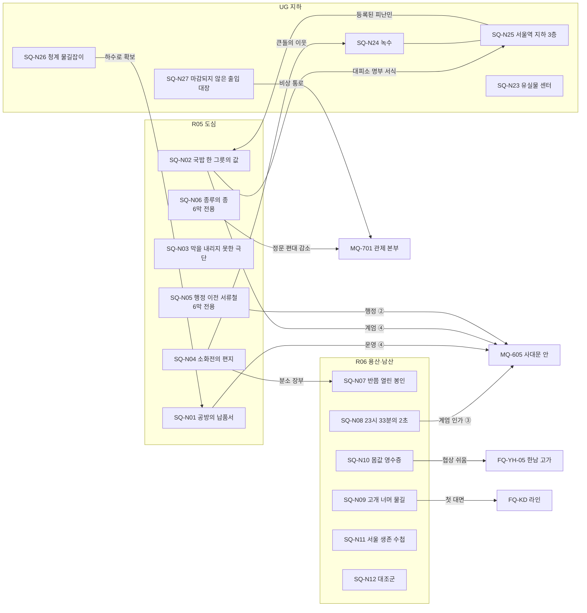
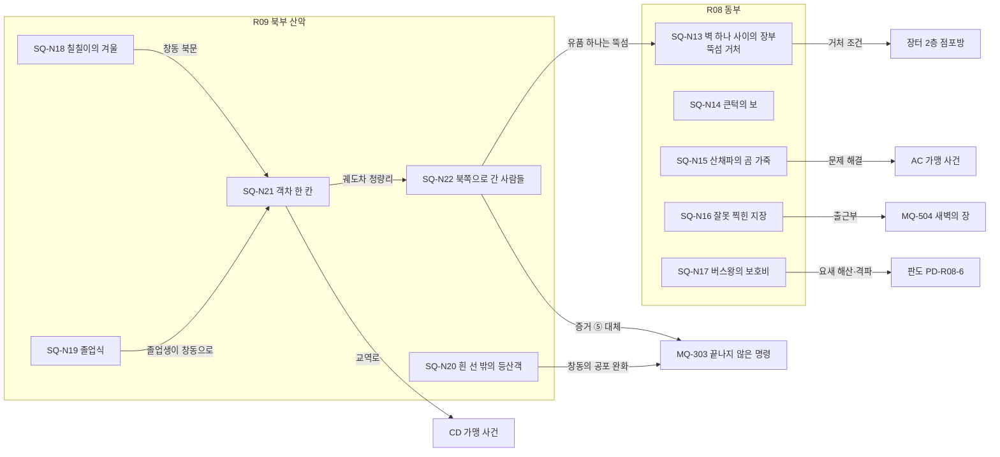
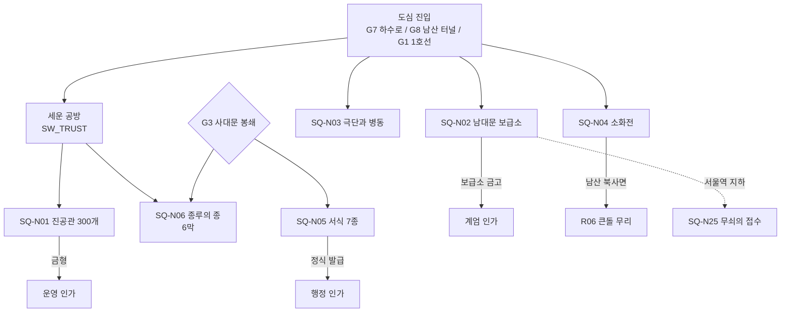
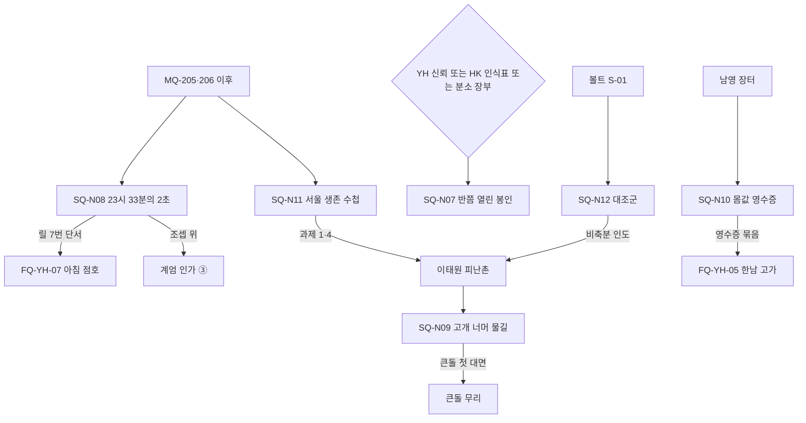
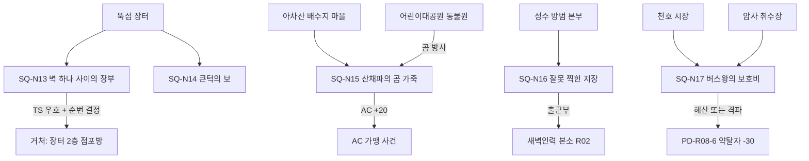

# SD-04c. 사이드 퀘스트: 북부·동부·도심·지하

> **서울 폴아웃 상세 기획서 세트** | 문서 ID: SD-04c | 버전: v1.0 | 작성일: 2026-10-12
> **범위**: 지도 표시 사이드 퀘스트 27편(SQ-N01~SQ-N27). 권역은 R05 도심(밀폐), R06 용산·남산, R08 동부, R09 북부 산악, UG 지하(이 문서 담당 훅만)다. 퀘스트마다 발동·인물·로그·진행·다중 해법·결과·카르마·호감도·판도·정보 전파·보상·실패 조건·대사·연출·연계를 정한다. 6막 도심 전용 퀘스트, 관제 본부 출입 권한(M-240~242)의 사이드 쪽 대체 획득 경로, 뚝섬 장터 거처 획득 퀘스트, PK-110 '생존 수첩' 퀘스트를 이 문서가 맡는다.
> **다루지 않는 것**: 메인 퀘스트 본문(SD-03a·03b), 세력 퀘스트 라인(SD-04d), 비표시·반복 퀘스트와 랜덤 인카운터(SD-05), R01·R02·R07·R11(SD-04a), R03·R04·R10·한강(SD-04b). 09f가 이 문서에 넘긴 한강 훅 HR-H07~09·12는 이번 배정 범위 밖이라 쓰지 않았다(§13 미결 N-01).
> **관련 문서**: [SC-00 컨셉](00_concept.md) §5.3~5.8·§6.2·§11, [SD-02 세계관](02_world-and-lore.md), [SD-03a 메인 1부](03a_main-story-part1.md) §4·§5·§6, [SD-03b 메인 2부](03b_main-story-part2.md) §4·§5·§7, [SD-04a 사이드(남부)](04a_side-quests-south.md), [SD-04b 사이드(서부·한강)](04b_side-quests-west-river.md), [SD-04d 세력 퀘스트](04d_faction-questlines.md), [SD-05 비표시·인카운터](05_misc-quests-encounters.md), [SD-06 세력](06_factions.md) §3~§7·§13, [SD-07a 주요 인물](07a_characters-major.md), [SD-07b NPC 디렉터리](07b_npc-directory.md), [SD-09c 장소 R05·R06](09c_locations-r05-r06.md), [SD-09e 장소 R08·R09](09e_locations-r08-r09.md), [SD-09f 장소 지하·한강](09f_locations-underground-river.md), [SD-10 캐릭터](10_character-system.md) §3.6·§4.4·§5.4·§6.3, [SD-13 아이템](13_items.md), [SD-14 크리처·적](14_creatures-enemies.md), [SD-15 경제](15_economy.md) §7, [SD-18 명명](18_naming-terms.md), 원작 [RD-05 사이드 1](../reverse-design/05_side-quests-part1.md), [RD-06 사이드 2](../reverse-design/06_side-quests-part2.md), [RD-27 이식 메모](../reverse-design/27_adaptation-notes.md)

---

## 목차
1. 개요
2. 공통 설계 규칙
3. 퀘스트 총괄
4. R05 도심 (SQ-N01~N06)
5. R06 용산·남산 (SQ-N07~N12)
6. R08 동부 (SQ-N13~N17)
7. R09 북부 산악 (SQ-N18~N22)
8. UG 지하 (SQ-N23~N27)
9. 결말 슬라이드 연계 총괄
10. 변수·플래그 총괄
11. 원작 대응
12. 쯔꾸르 제작 메모
13. 미결 사항
- 부록 A. 신규 고유명사 · 부록 B. 넘기는 훅(비표시·반복 후보) · 부록 C. 다른 문서에 보내는 등록 요청 · 부록 D. 참고 문서

---

## 1. 개요

### 1.1 목적
- 장소 카탈로그 SD-09c·09e·09f가 남긴 훅 68개(R05 16, R06 15, R08 17, R09 14, UG 6) 가운데 38개와 다른 문서의 요청 3건을 다듬고 합쳐 **완성 사이드 퀘스트 27편**을 만든다. 나머지 훅 30개는 부록 B에 '비표시·반복 후보'로 넘긴다(SD-05가 받는다).
- 이 문서의 퀘스트는 바이블 §5.8 '고르지 않고 기운다'를 따른다. 어떤 퀘스트도 진영을 묻지 않는다. 결과는 주인공이 **무엇을 누구 손에 넘겼는지, 누구를 살렸는지, 무엇을 켜고 껐는지**로 갈린다.
- 이 다섯 권역은 메인 스토리의 끝(6막 사대문 안, 7막 관제 본부)과 가장 많은 세력 거점(용산 요새, 남산 방송, 북한산 굴진 기지, 공릉 회수 창고, 서울역 지하)을 품는다. 사이드 퀘스트는 그 사이의 사람 사는 자리(세운 공방, 남대문 국밥집, 이태원 피난촌, 뚝섬 장터, 아차산 배수지 마을, 창동 차량기지촌)를 채운다.

### 1.2 요약
| 항목 | 내용 |
|---|---|
| 퀘스트 수 | 27편: R05 6(6막 전용 2) · R06 6 · R08 5 · R09 5 · UG 5 |
| 권장 레벨 | 4~26. 저레벨(4~10) 7편, 중레벨(10~16) 9편, 고레벨(16 이상) 11편 |
| 쓴 훅 | 38개(훅 하나짜리 16편 + 훅 둘을 합친 11편) + 다른 문서 요청 3건. 넘긴 훅 30개 |
| 완료 XP 합계 | 16,150(전부 완료, 판정 XP 제외). SD-10 §4.4 사이드 퀘스트 24,000 추정의 약 67%를 이 문서가 맡는다 |
| 지정 퀘스트 | 뚝섬 장터 거처: **SQ-N13**(SD-15 E-09 요청) / PK-110 생존 수첩: **SQ-N11**(SD-10 U11 요청) / 관제 본부 출입 권한 대체 경로: SQ-N01·N02·N05·N08·N27(§2.6) |
| 새로 만든 이름 있는 인물 | 6명(옹재필, 피창호, 석예린, 마루, 감경희, 노지후). 나머지는 SD-07a·09c·09e·09f 인물을 쓴다 |
| 새 퀘스트 아이템 | 27종. 임시 키 `NQ-01~NQ-27`로 적고 SD-13에 `M-3xx` 등록을 요청한다(부록 C) |

### 1.3 이 문서가 결정한 것
| # | 결정 | 근거·접점 |
|---|---|---|
| D-1 | 번호는 권역 순서로 매긴다. R05 = N01~06, R06 = N07~12, R08 = N13~17, R09 = N18~22, UG = N23~27 | SQ_BRIEF 규칙 1 |
| D-2 | 6막 도심 전용 퀘스트는 **SQ-N05 행정 이전 서류철**과 **SQ-N06 종루의 종** 두 편이다. 둘 다 MQ-605의 목표(정문 투입구에 권한 3개를 꽂는다)를 대신하지 않는다. N05는 권한 하나를 '사람이 내주는' 경로이고, N06은 7막 정문 출입구의 경비를 줄이는 준비다(§2.6) | 작성 지시, SD-03b §4.5, SD-09c §4.4·§4.9 |
| D-3 | 출입 권한 대체 경로 다섯을 사이드 퀘스트에 묶는다: 운영 ④ 금형(N01), 계엄 ④ 보급소 금고(N02), 행정 ② 비상 행정 분실(N05), 계엄 ③ 연락관 사본(N08), 행정 ⑤ 장교 유해(N27 경유). SD-03b MQ-605 권한표에 '사이드 경로' 열을 더해 달라고 요청한다 | SD-09c §4.4, SD-03b §4.5 |
| D-4 | **뚝섬 장터 거처('장터 2층 점포방')는 SQ-N13 「벽 하나 사이의 장부」 완료로 조건을 채운다.** 결과 A·B·C 중 어느 것이든 장터 순번이 정해지면 된다. 협약문을 팔아 버린 결과 D는 조건이 아니다 | SD-15 §7.2·E-09 |
| D-5 | PK-110 생존 수첩 퀘스트는 **SQ-N11 「서울 생존 수첩」**이다. 원작 '드림 크러셔'에 해당하는 '집필 포기' 결말은 두지 않는다. 대신 원고를 공보방송에 넘기는 인도 결말(퍽 없음)을 둔다 | SD-10 §5.4 PK-110, §5.6 드림 크러셔 삭제 메모 |
| D-6 | **도심 소문 지연 규칙**: R05 안에서 생긴 공개도 2 사건의 소문은 SD-06 §6.3 기본 지연에 **+24시간**을 더한다. 도심 밖으로 나가는 길이 세운 공방 국건우의 하수로 왕복(3일 주기)과 남산 방송뿐이기 때문이다. SQ-N26으로 하수로가 열리면 +12시간으로 줄어든다 | SD-09c §4.10 행상 경로, SD-06 §6.3 |
| D-7 | 세운 공방은 호감도 대상이 아니므로 퀘스트 지역 신뢰값 `SW_TRUST`(0~100, 시작 20)를 둔다. 09c의 '공방 +N'은 이 값의 증감이다. 40 이상이면 공방 가격 -10%, 70 이상이면 6막 보급소 보급 상자 1개 추가 | SD-09c §4.6 L-R05-22, SD-06 §3.2.1 |
| D-8 | 자율방범대 역시 호감도 대상이 아니다. SQ-N16 결과는 플래그 `JY_TRUST`(0/1)로 남기고, 1이면 악 카르마 출동조 첫 조우에서 대화 한 번이 먼저 열린다 | SD-09e R08-H03, SD-06 §12.3 |
| D-9 | '아이의 감사 편지'(SD-10 §7.3, 화술 +10 영구)는 이 문서에서 **SQ-N19**(창동 전령 채로아 구출)가 준다. 다른 문서가 같은 보상을 주면 처음 받은 1회만 효과가 있고 나머지는 '기념품'이 된다 | SD-10 §7.3 |
| D-10 | 중국군 잔존병이 나오는 퀘스트(N20·N22)는 FQ-JG-01~07과 겹치지 않는 바깥 이야기만 다룬다. 잔존병은 '명령에 갇힌 병사'로 그리고, 원작식 자결 해법을 두지 않는다 | 작성 지시, SD-09e §3.6 |

### 1.4 표기 규칙
| 표기 | 뜻 |
|---|---|
| `SQ-N01` | 사이드 퀘스트 ID. 엔진 변수 `SQ_N01`(단계 0 미발동 / 10 발동 / 20~90 진행 / 100 종료 / 200 보류 / 250 끊김), 결과 `SQR_N01` |
| `SQH_<물건>` | 사이드 퀘스트의 인도처 변수. 값은 SD-03a §4.5 세력 코드(0 주인공 / 1 BJ / 2 YH / 3 WP / 4 JH / 5 GS / 6 JG / 7 SB / 8 JC / 9 NJ / 10 KD / 14 남산 방송 / 81~86 개별 정착지 / 97 두고 떠남 / 99 파기). 이 문서는 개별 정착지·지역 코드 87 세운 공방, 88 자율방범대, 89 이태원 피난촌(IT), 90 아차산 배수지 마을(AC), 91 창동 차량기지촌(CD), 92 남대문 보급소를 더 쓴다(SD-03a §4.5 코드표 추가 요청) |
| **로그** | 핍-보이 퀘스트 로그 문장(SD-12). 사실·상황·소문만 적는다(SD-04d §2.1 R2 동일) |
| [화술·보통] / [과학 50] / [힘 7] | SD-10 §3.5·§3.6 판정 표기. 고정 판정 단계 I~V = 15/25/50/75/100 |
| **TS +8** | 그 세력(또는 정착지 개별) 호감도 직접 변화(SD-06 §3.4 기본값, 보정 전). 정착지 개별은 `AFF_JC_<약호>`, 연합 전체에 같은 값을 주면 '연합 일괄 +N' |
| **연동** | SD-06 §3.6 계수로 계산한 값. 그 세력이 행적을 **알게 된 때** 적용한다. 퀘스트 표에는 큰 값만 적는다 |
| **판도 PD-R08-6 YT -30** | 그 판도 구역의 세력 사건 보정(SD-06 §5.2). 거점 이전은 "거점 ○○ → JC" |
| **공개도 0~3** | SD-06 §6.2. 0 비밀 / 1 목격 / 2 공개 / 3 방송급 |
| `NQ-nn` | 이 문서의 퀘스트 아이템 임시 키. SD-13이 `M-3xx`로 등록한다(부록 C) |
| (SD-02에서 LR 부여) | 새 기록물. 데이터 ID는 SD-02·SD-12가 매긴다 |

---

## 2. 공통 설계 규칙

### 2.1 '고르지 않고 기운다'를 사이드 퀘스트에 옮기는 규칙
SD-04d §2.1의 R1~R7을 그대로 쓰고, 사이드 퀘스트에 맞게 세 가지를 더한다.

| # | 규칙 | 구현 |
|---|---|---|
| S1 | **의뢰인을 고르지 않는다** | 한 물건을 여러 세력이 원해도 "누구에게 주겠습니까?" 메뉴가 없다. 주인공이 그 인물에게 '물건 주기'를 하거나, 그 장소 보관함에 넣거나, 들고 떠나는 행동이 결과다(SQ-N01 진공관, N04 장부, N07 연구 기록, N11 원고, N16 출근부) |
| S2 | **대화는 개별 사안만 묻는다** | 서식의 등급 칸에 무엇을 적을지(N05), 연극의 마지막 줄을 무엇으로 쓸지(N03), 후손에게 조상의 사연을 어디까지 말할지(N22)는 대화 선택지다. 이 선택은 그 사람과 그 장면의 결과만 바꾸고 진영을 정하지 않는다 |
| S3 | **사이드 퀘스트는 사람의 자리를 바꾼다** | 결과마다 '세계가 먼저 알려 주는' 변화 하나 이상을 둔다: 장터가 열린다, 궤도차가 다닌다, 공방 신호등이 밝아진다, 방송 낭독 목록이 바뀐다, 정착지 깃발이 선다 |

### 2.2 발동 방식과 막
- 발동은 SD-04d §2.2의 다섯 방식(게시판, 부탁, 엿듣기, 다음 단계, 우연)을 쓴다. 로그 첫 줄은 언제나 상황 문장이다.
- **막 잠금은 없다.** 권역 위협도가 진입을 막을 뿐이다. 막에 따라 판본이 달라지는 퀘스트는 표의 '막' 칸에 적었다. 6막 전용 두 편(N05·N06)은 관제망 G3('사대문 봉쇄', `V_ENTRY ≠ 0`)이 서야 발동한다. 이유는 퀘스트 안에서 설명한다.
- R05 도심은 6막 전에도 들어갈 수 있다(SD-03a O-08). 6막 전 진입로는 세운 공방 국건우의 하수로 왕복(G7, 50캡), 남산 대피 터널(G8), 1호선(G1), 충정로·독립문(G2·G3)이다. 6막 전 R05 퀘스트는 '들어갈 수는 있지만 살 수 없는 곳'의 긴장(G0~G2)을, 6막 퀘스트는 확보 편대(FD-6B)와 사대문 편대(FD-6A)를 피하는 긴장을 쓴다.

### 2.3 보상 체계
**XP** (SD-10 §4.4: 권역 위협도별 150~800, 단계별 분할 지급 허용)

| 퀘스트의 주 무대 위협도 | 완료 XP | 이 문서의 퀘스트 |
|---|---|---|
| 2 | 300 | N09, N12, N23 |
| 3 | 400~500 | N10, N13, N14, N15, N16, N19, N20, N21, N26 |
| 4 | 550~650 | N01, N02, N03, N07, N08, N17, N18 |
| 5 | 700~800 | N04, N05, N06, N22, N24, N25, N27 |
| 다권역 | 과제별 | N11(과제 10개 각 100 + 완료 500) |

- 분할 지급: 단계 XP는 완료 XP의 20~40%를 앞 단계에 나눠 준다(표에 '단계 XP'로 적은 곳만). 판정 성공 XP(SD-10 §3.6)는 따로 쌓인다.
- **캡**: 편당 0~400캡. 정착지·무소속 의뢰는 캡, 세력 일은 물자·서비스로 준다.
- **호감도**: 사이드 퀘스트 결과 ±3~±12(SD-06 §3.4). 핵심 물건 인도에 준하는 일은 ±15까지. 1회 사건 상한 ±15를 넘기지 않는다.
- **카르마**: SD-10 §6.3. 퀘스트의 선한 행동 +50~+300, 악한 행동 -50~-600. 사람을 구하면 +50~+100, 약탈자 두목 처치는 SD-07a 성향 확인 뒤 +50~+100.

### 2.4 실패와 시간 제한
- 원칙: **실패 상태를 두지 않는다**(SD-04d §2.7). 끝나지 않은 일은 로그에 남는다.
- 예외는 퀘스트 표의 '실패·시간 제한' 칸에 적었다: 호위 대상 사망(N04 소화전, N06 마루), 시한이 있는 사건(N02 피창호 72시간, N17 노심 72시간), 막 사건으로 전제가 사라짐(N16 MQ-504로 새벽인력 몰락 시 출근부 단계 자동 처리).
- 시한은 로그에 '날짜'가 아니라 사실로 적는다(예: "피창호는 사흘 안에 아래층으로 옮겨진다고 한다").

### 2.5 정보 전파 기본값
| 상황 | 기본 공개도 | 주된 경로 |
|---|---|---|
| 정착지 안에서 끝낸 의뢰 | 2 | 소문(같은 구역 12시간), 행상(24시간) |
| R05 도심 안의 일 | 2 | 소문 +24시간(D-6). 세운 공방 사람들이 먼저 안다 |
| 세력 거점 안의 일(용산 요새, 굴진 기지, 공릉 창고) | 2 | 세력 방송(용산 기지 방송 12시간), 세력 순찰대 |
| 남산 방송이 낭독한 일 | 3 | 다음 정시 뉴스(6시간) |
| 은신으로 끝낸 단계, 목격자 없는 처리 | 0 | 없음(시체 발견 판정만, SD-06 §6.4) |

### 2.6 6막 도심 전용 퀘스트와 MQ-605의 경계
| 항목 | MQ-605 사대문 안(메인) | 이 문서의 도심 퀘스트 |
|---|---|---|
| 목표 | 정문 투입구 3개에 권한 3개를 꽂는다(`V_PERMIT = 3`) | 도심 사람들의 일을 푼다. 그 결과로 권한 하나가 '덤으로' 나오거나, 정문 경비가 줄어든다 |
| 완료 판정 | 권한 3개 | 각 퀘스트의 사람·물건 |
| 권한과의 관계 | 권한 획득 방법 표(SD-03b §4.5, SD-09c §4.4) | 사이드 경로 5개가 그 표의 한 칸을 채운다. 사이드에서 권한을 얻으면 MQ-605의 해당 단계가 즉시 완료되고 `MQ605_SKIP`은 서지 않는다(사이드 보상으로 친다) |

**사이드 경로로 얻는 출입 권한**
| 권한 | 사이드 경로 | 퀘스트 | 6막 전 획득 | 특이 사항 |
|---|---|---|---|---|
| 행정 인가 M-240 | ② 비상 행정 분실 정식 발급 | SQ-N05 | 불가(6막 전용) | 정식 발급본이라 외곽 회랑 FD-7A가 '대기'로 시작한다(SD-09c) |
| 행정 인가 M-240 | ⑤ 청사 경비대 장교 유해 | SQ-N27 경유 | 가능 | N27 단계 30에서 같은 유해를 지난다. N27을 하지 않아도 MQ-605로 얻을 수 있다 |
| 계엄 인가 M-241 | ③ 연락관 참관인 암호표 사본 | SQ-N08 | 가능 | 조셉 위가 대가 없이 준다 |
| 계엄 인가 M-241 | ④ 남대문 보급소 금고 | SQ-N02 | 가능 | 원부를 돌려주면 홍경민이 그냥 준다 |
| 운영 인가 M-242 | ④ 세운 공방 금형 복제 | SQ-N01 | 가능 | 복제품은 정품과 같다(경보 없음) |

- 6막 전에 사이드 경로로 권한을 미리 모으면 `V_PERMIT`가 쌓인다(SD-09c §4.3). 세 개가 다 모이면 6막 전에도 정문이 열리는 즉시 7막 특례(SD-03a §4.1)가 적용된다. 경고문과 자동 저장을 먼저 띄운다.

### 2.7 묘사 원칙
| 대상 | 원칙 |
|---|---|
| 중국군 잔존병 | 명령에 갇힌 병사. 침략의 화신도 웃음거리도 아니다. 대사는 교범식 한국어, 한국어가 서툰 병사는 `[중국어] 번역문`. 억양 흉내·외모 조롱 금지. 반중 선전물은 2077년의 광기로 배경에만 둔다. **자결로 끝나는 해법을 두지 않는다**. 멍쉐밍 상위가 모든 판단의 상위 인물이다 |
| 이태원 피난촌 | 피난촌은 이태원로 동쪽 언덕과 옛 시장 골목에 있다. 실제 참사 현장 골목은 '천막 창고 뒤 막힌 길'로 두고, 이 문서의 어떤 퀘스트도 그 골목에서 전투·사망·군중 장면을 만들지 않는다(SQ-N09·N11은 언덕 위와 남산 남사면에서만 진행한다) |
| 북방 병합지와 월경 피란민 | 현실 북한 정권으로 그리지 않는다. 2076년 피란민은 '국경을 넘어온 사람들'로만 그리고, 그들의 후손 이야기(SQ-N22)는 2077년 '국경 이탈자 = 적성 분자' 분류가 남긴 낙인을 다룬다 |
| 변종 | 기본 위협이지만 '사람이었던 것'의 흔적을 남긴다(무쇠의 접수, 소화전의 편지). 큰돌 무리는 이웃으로 그린다 |
| 구울 | 2077년 직함과 말투를 지키는 사람들이다. 야생 구울 '환자'(SQ-N03)는 존엄을 지키는 쪽으로 연출한다 |
| 설화·민속 | 쓰지 않는다. 궁궐·묘역·종루는 장소와 사물로만 쓰고 신앙·귀신 소재를 붙이지 않는다 |

---

## 3. 퀘스트 총괄

### 3.1 총괄표
| ID | 제목 | 권역 | 주 장소 | Lv | 관련 세력 | 막 | 출처 훅 | 연계 |
|---|---|---|---|---|---|---|---|---|
| SQ-N01 | 공방의 납품서 | R05 | 세운 공방 L-R05-22, 을지로 공구 골목 L-R05-23 | 16 | 세운 공방·YH·WP·GS | 전 막 | H05-01 | MQ-605 운영 ④, MQ-603, MQ-505 |
| SQ-N02 | 국밥 한 그릇의 값 | R05·UG | 남대문시장 L-R05-17, 서울역 지하 L-UG-34·35 | 17 | 남대문 구울·HS·JH·GS | 전 막 | H05-08 | MQ-605 계엄 ④, SQ-N25 |
| SQ-N03 | 막을 내리지 못한 극단 | R05 | 대학로 소극장 L-R05-33, 종로 국립대학병원 L-R05-31 | 17 | 무소속 | 전 막 | H05-02, H05-09 | 결말 슬라이드, 남산 방송 낭독 |
| SQ-N04 | 소화전의 편지 | R05·UG·R06 | 동대문 미래관 L-R05-28, 방산동 의무 분소 L-R05-36, 남산 북사면 배수 터널 L-R06-29 | 18 | KD·YH·NS | 전 막 | H05-05, H05-16 | SQ-N07, SQ-N24, FQ-KD |
| SQ-N05 | 행정 이전 서류철 | R05 | 경복궁 L-R05-05 외 7곳 | 18 | (BJ) | **6막 전용** | H05-11 | MQ-605 행정 ② |
| SQ-N06 | 종루의 종 | R05 | 보신각 종루 L-R05-21, 광화문 광장 L-R05-01 | 18 | 세운 공방·HS | **6막 전용** | H05-12, H05-14 | MQ-701 정문 출입구 |
| SQ-N07 | 반쯤 열린 봉인 | R06 | 용산 생물방어 실험동 L-R06-04 | 14 | YH·KD·NS | 2막 이후 권장 | H06-01 (+SD-14 HK 인식표) | MQ-503, SQ-N04 |
| SQ-N08 | 23시 33분의 2초 | R06·R05 | 용산 요새 L-R06-01, 남산 송신 중계소 L-R06-09, 덕수궁 석조전 L-R05-15 | 12 | YH·NS·WP | MQ-206 이후 | H06-02, H05-04 | FQ-YH-07, MQ-605 계엄 ③ |
| SQ-N09 | 고개 너머 물길 | R06 | 이태원 피난촌 L-R06-14, 배수 터널 L-R06-29 | 8 | IT·KD·YH | 전 막 | H06-03 | FQ-KD-01, IT 가맹 |
| SQ-N10 | 몸값 영수증 | R06 | 남영 장터 L-R06-28, 한남 고가파 소굴 L-R06-15 | 9 | HS·YH·약탈자 | 전 막 | H06-06 | FQ-YH-05 |
| SQ-N11 | 서울 생존 수첩 | R06 + 전역 | 남산 방송 L-R06-08 | 6~ | NS·IT·(BJ) | MQ-205 이후 | PK-110, H06-05, H06-14 | PK-110, FQ-YH-03 |
| SQ-N12 | 대조군 | R06 | 볼트 S-01 L-R06-10 | 7 | IT·NS·YH | 전 막 | H06-07 | SD-02 미스터리 M6 |
| SQ-N13 | 벽 하나 사이의 장부 | R08 | 뚝섬 장터 L-R08-01, 볼트 S-09 L-R08-23 | 6~12 | TS·대로파 | 전 막 | R08-H02 | **뚝섬 거처**, FQ-JC-07 |
| SQ-N14 | 큰턱의 보 | R08 | 중랑천 마른 수로 L-R08-18 | 7~12 | TS·HS | 전 막 | R08-H01 | 행상 수송로 |
| SQ-N15 | 산채파의 곰 가죽 | R08 | 아차산 배수지 마을 L-R08-21, 산채파 소굴 L-R08-24, 동물원 L-R08-25 | 7~14 | AC·산채파 | 전 막 | R08-H14, R08-H05 | AC 가맹, FQ-JC-09 |
| SQ-N16 | 잘못 찍힌 지장 | R08·R02 | 성수 방범 본부 L-R08-04, 천호 사거리 시장 L-R08-28, 새벽인력 본소(R02) | 5~14 | 방범대·SB·JC | 전 막 | R08-H03, R08-H04 | MQ-504 |
| SQ-N17 | 버스왕의 보호비 | R08 | 천호 시장 L-R08-28, 암사 취수장 L-R08-29, 버스 요새 L-R08-34 | 10~16 | 대로파·HS·JC | 전 막 | R08-H16, R08-H15 | FQ-JC-07, MQ-507 |
| SQ-N18 | 칠칠이의 겨울 | R09 | 진관 계곡 L-R09-05, 도봉 계곡 곰 굴 L-R09-16 | 14~20 | CD | 전 막 | R09-H01 | SD-05 '귀표 곰' 종료 |
| SQ-N19 | 졸업식 | R09 | 상계 대단지 L-R09-20, 볼트 S-08 L-R09-26 | 6~14 | CD | 전 막 | R09-H02, R09-H13 | CD 가맹, 감사 편지 |
| SQ-N20 | 흰 선 밖의 등산객 | R09 | 우이동 산장 L-R09-14, 수유 고개파 L-R09-13, 평창 저택 L-R09-07 | 8~14 | JG·CD·약탈자 | 전 막 | R09-H04, R09-H12 | MQ-303 평화 경로 |
| SQ-N21 | 객차 한 칸 | R09·R08 | 창동 차량기지촌 L-R09-17 → 청량리 L-R08-14 | 6~12 | CD·SB | 전 막 | R09-H06 | CD 가맹, 궤도차 이동 |
| SQ-N22 | 북쪽으로 간 사람들 | R09·R08 | 도봉 북방 경계 L-R09-34 | 16~24 | JG·JC | 전 막 | R09-H03 | MQ-303 증거 ⑤, V_CW 5 |
| SQ-N23 | 유실물 센터 | UG | 왕십리역 L-UG-47 | 4~10 | JH·ND | 전 막 | UG-H05 | CL-12 |
| SQ-N24 | 녹수 | UG | 볼트 S-12 L-UG-35, 서울역 녹수조 L-UG-63 | 18~26 | KD·BY·YH | 전 막 | UG-H06, UG-H07 | MQ-601, SQ-N04 |
| SQ-N25 | 서울역 지하 3층 | UG·R05 | 서울역 지하 교차역 L-UG-34, 시청역 L-UG-23 | 16~24 | BY·NS | 전 막 | UG-H08 (+SD-03b 대기 구역 이름 찾기) | MQ-601, SQ-N02 |
| SQ-N26 | 청계 물길잡이 | UG·R08·R05 | 청계천 복개 하수로 L-UG-59 | 10~16 | 세운 공방·JC | 전 막 | UG-H13 | 6막 G7 |
| SQ-N27 | 마감되지 않은 출입 대장 | UG·R05 | 광화문역 L-UG-20 | 18+ | (관제망) | 전 막 | UG-H12 | MQ-701 비상 통로 |

### 3.2 전체 연결도

### 3.3 훅 사용 현황
| 권역 | 훅 수 | 퀘스트로 쓴 훅 | 넘긴 훅(부록 B) |
|---|---|---|---|
| R05 | 16 | H05-01·02·04·05·08·09·11·12·14·16 (10) | H05-03·06·07·10·13·15 (6) |
| R06 | 15 | H06-01·02·03·05·06·07·14 (7) | H06-04·08·09·10·11·12·13·15 (8) |
| R08 | 17 | R08-H01·02·03·04·05·14·15·16 (8) | R08-H06·07·08·09·10·11·12·13·17 (9) |
| R09 | 14 | R09-H01·02·03·04·06·12·13 (7) | R09-H05·07·08·09·10·11·14 (7) |
| UG | 6 | UG-H05·06·07·08·12·13 (6) | — |
| 합계 | 68 | 38 + 다른 문서 요청 3건(SD-10 PK-110, SD-14 HK 인식표, SD-03b 대기 구역 이름 찾기) | 30 |

---

## 4. R05 도심 (SQ-N01~N06)

### 4.1 권역 개요와 흐름
- **권역 축**: 6막 전 도심은 '들어갈 수는 있지만 살 수 없는 곳'이다. 사람 사는 자리는 세운 공방 하나이고, 나머지는 2077년의 일을 아직 하는 구울과 로봇이다. 도심 퀘스트는 그들의 **200년 늦은 업무를 끝내 주는 일**로 짠다(납품, 배급, 공연, 서류, 타종).
- **위협**: 위협 4~5, 적 레벨 16~35. 6막 G3 뒤 스폰 하한 +2. 도심 퀘스트는 모두 권장 Lv16 이상이다.
- **세운 공방이 허브다**: 퀘스트 6편 중 4편이 공방 인물에게서 시작하거나 공방을 거친다. `SW_TRUST`(D-7)가 공방의 태도를 정한다.

| 퀘스트 | 6막 전 | 6막(G3) | 권한 연계 |
|---|---|---|---|
| SQ-N01 공방의 납품서 | 가능 | 가능(공방이 6막 보급소로 바뀐 판본) | 운영 ④ |
| SQ-N02 국밥 한 그릇의 값 | 가능 | 가능(국밥집이 협력 세력 병사에게 밥을 판다) | 계엄 ④ |
| SQ-N03 막을 내리지 못한 극단 | 가능 | 가능(공연에 KS-4가 다가온다) | — |
| SQ-N04 소화전의 편지 | 가능 | 가능(녹수 거구 CR-176 추가) | — |
| SQ-N05 행정 이전 서류철 | 불가 | 전용 | 행정 ② |
| SQ-N06 종루의 종 | 불가 | 전용 | 7막 정문 편대 -50% |

### 4.2 SQ-N01 공방의 납품서
| 항목 | 내용 |
|---|---|
| 개요 | 2077년 10월 24일 관제 본부에 납품하지 못한 진공관 300개를 을지로 창고에서 찾아, 누구 손에 넘길지를 행동으로 정한다 |
| 출처 | H05-01 |
| 권장 레벨 | 16 (위협 4, 지하 회랑 구간 5) |
| 발동 | 세운 공방 3층 작업장에서 염태식과 처음 대화하면 그가 벽의 납품 달력을 가리킨다(부탁형). 막 무관. 6막 G3면 공방이 '6막 보급소'로 바뀐 판본 대사 |
| 등장 인물 | 염태식 N-R05-001(공방장), 한새롬 '연두' N-R05-009(일시 동행), 엄태호 N-R05-013(공구상·창고 주인), 맹수빈 N-R05-014(고철 수집, 순찰 간격 정보), 에반 그랜트 N-R05-011(원칙파 이탈자), 레이철 공 C-043(연합단 수석 공작관), 편누리 N-R05-022(각성회 사대문 순례조장), 애런 헤이스 N-UG-022(원칙파 충정로 회수조장) |
| 변수 | `SQ_N01`, `SQR_N01`, `SQH_N01_TUBE`(87 공방 / 2 YH / 3 WP / 5 GS / 0 보관) |

**단계별 목표(로그)**
| 단계 | 로그 | 완료 조건 |
|---|---|---|
| 10 | 염태식은 2077년 10월 24일 관제 본부에 납품하지 못한 진공관 300개를 아직 기다린다. | 발동 |
| 20 | 납품 상자는 을지로 공구 골목 엄태호의 창고 지하에 있다고 한다. | 엄태호 대화 또는 창고 진입 |
| 30 | 창고 지하 납품 칸이 을지로 지하 회랑 쪽으로 무너져 있다. 변종이 그 틈으로 드나든다. | 지하 2층 진입 |
| 40 | 진공관 상자 여섯 개가 창고 지하에 있다. 한 상자에 쉰 개씩이다. | 상자 발견 |
| 50 | 상자를 옮길 길이 있다. 화물 승강기는 멈춰 있고 등짐으로는 세 번을 오가야 한다. | 운반 방법 실행 |
| 60 | 진공관 상자가 창고 밖으로 나왔다. | 상자 6개 지상 이동 |
| 100 | 진공관 300개가 누군가의 손에 들어갔다. | 인도 행동 |

**진행 상세**
- 상자는 개당 무게 15(6개 = 90). 화물 승강기(L-UG-27 을지로3가역과 이어진 공구 골목 승강기)를 고치면 한 번에 지상 창고로 올라온다.
- 한새롬은 발동 직후 "통풍구 지름길을 안다"며 따라온다(일시 동행). 쓰러지면 부상 퇴장(사망 없음)하고 공방으로 돌아간다. 동행 중 통풍구 지름길(지하 1층 → 2층, 변종 순찰 회피)이 열린다.
- 창고 지하 2층에 2077년 납품서(NQ-01 「관제 본부 납품서 2077-10-24」)가 상자 위에 붙어 있다. 수령인 칸 '관제 본부 운영과'는 비었다. 이 종이가 인도 장면의 소품이다.

**해법**
| # | 해법 | 조건·판정 | 결과 |
|---|---|---|---|
| ① | 전투 | 지하 회랑 쪽 변종 CR-170 ×3 + CR-171 ×1, 6막이면 +CR-172 | 상자 칸 확보. 공개도 1(공방 사람들이 소리를 듣는다) |
| ② | 은신 | 맹수빈 정보: 입소조는 정각마다 90초 동안 회랑 서쪽으로 빠진다. [은신 50]이면 틈에 상자 2개씩 | 전투 없음. 판정 XP |
| ③ | 창고 주인과 거래 | 엄태호가 '200년 치 보관료'를 내민다. 200캡, 또는 [물물교환 50]으로 100캡, 또는 [화술·보통]으로 "납품이 끝나면 공방이 공구를 산다"는 약속(이후 공방이 엄태호 공구를 정기 구매) | 화물 승강기 사용 허가 + 승강기 열쇠 |
| ④ | 승강기 수리 | [수리 50] 또는 진공관 2 + 수리 키트 I-067 | 운반 1회로 끝. ③ 없이 고치면 엄태호가 "남의 승강기"라며 보관료를 두 배로 부른다(대화 1회) |
| ⑤ | 몰래 가져가기 | 보관료 없이 등짐 3회 | 엄태호 물건 훔치기 판정(카르마 -5, 적발 시 엄태호 상점 가격 +20%) |

**결과 분기(인도)**
| 결과 | 행동 | 월드 변화 | 후일담 |
|---|---|---|---|
| A 공방 납품 | 납품서와 상자를 염태식 작업대 옆 납품 칸에 둔다 | 염태식이 납품 달력에 '완료' 도장을 찍는다. 옥상 진공관 신호등이 한 단계 밝아진다. 염태식이 2077년 세운상가 열쇠 가게 금형으로 **M-242 본부 승강기 열쇠**를 복제해 준다(운영 ④) | 공방 수리 서비스 상한이 '양호'에서 '새것'으로 오른다(공방 진공관 재고). 에필로그 E3·E4에서 공방이 지상 장터를 연다 |
| B 연합단 공작창 | 상자를 레이철 공에게 건넨다(용산 요새 공작창까지 운반, 또는 공방 보관 뒤 연합단 회수조 호출) | 공작창이 차단벽 제어반 예열관을 확보한다. **MQ-603 개방 시간 90초 → 30초**(SD-03b 표의 '연합단 공작창(신뢰)' 조건을 YH 우호로 낮춘다) | 염태식: "납기는 넘겼군." 공방 수리 상한 그대로. 운영 ④ 경로 닫힘(금형 복제는 진공관이 있어야 한다) |
| C 원칙파 | 애런 헤이스(충정로 회수 칠판) 또는 공릉 회수 창고 교환창에 넣는다 | 원칙파 회수 목록의 '관제 본부 납품 진공관' 항목이 지워진다. 원칙파 교환창 재고에 고급 진공관 | 에반 그랜트가 공방을 떠나 남영 장터로 옮긴다("형 말이 맞았나 보네"). 운영 ④ 닫힘 |
| D 각성회 | 편누리(시청 순례조) 또는 노량진 중계소 은솔에게 건넨다 | 각성회가 진공관을 중계 기둥의 '대기등'에 끼운다. **MQ-505 각성에서 개통파의 중계 기둥 각성 단계 +1**(SD-03b 확인) | 공방 사람들이 각성회 순례조에게 셔터를 닫는다(바크). 운영 ④ 닫힘 |
| E 보관 | 아무에게도 넘기지 않는다 | 진공관을 낱개 판매 가능(개당 4캡, 상인 보유 캡 한도) | 7일 뒤 염태식이 "납기는 아직 남았소"라며 한 번 더 묻는다. 그 뒤 로그 '보관 중' |

**카르마·호감도·판도**
| 결과 | 카르마 | 호감도(직접) | 연동(알게 된 때) | 판도·지역값 |
|---|---|---|---|---|
| A | +50 | — | — | `SW_TRUST +20` |
| B | 0 | YH +8 | WP -4, BJ -4, JG -3 | `SW_TRUST -10` |
| C | 0 | WP +8 | YH -4, GS -2 | `SW_TRUST -10` |
| D | 0 | GS +8 | YH -2, WP -2, JG -3 | `SW_TRUST -15` |
| 몰래 가져가기(⑤) 추가 | -5 | — | — | 엄태호 가격 +20%(적발 시) |

**정보 전파**: 공개도 2. 도심 소문 지연 +24시간(D-6). B·C·D는 받은 세력이 소문 대신 직접 퍼뜨린다(용산 기지 방송 / 원칙파 회수조 / 각성회 순례조, 12시간).

**보상**: 600 XP(단계 40에서 150 선지급). A: M-242 복제품, 공방 수리 상한 상향. B: 공작창 수리 1회 무료. C: 원칙파 교환창 고급 진공관 3. D: 대기자 천공 카드 갱신(각성회 상점 -10%, 7일). 엄태호와 정기 구매 약속(③)을 했으면 엄태호 상점 -10%.

**실패·시간 제한**: 없음. 6막 G3에 들어서면 지하 회랑 변종이 +1 늘고 KS-4가 공구 골목을 지난다.

**핵심 대사**
- 염태식: "세운 3층 진공관 수리점 염태식입니다. 납기는 지킵니다. 200년 늦었지만."
- 한새롬: "이게 2077년 진공관이에요? 아직 따뜻해요… 아, 내 손이 따뜻한 거구나."
- 엄태호: "보관료는 200년 치예요. 깎아 드리죠. 199년 치로."
- 레이철 공(B): "이걸로 차단벽 예열관을 전부 갈 수 있어. 부수는 건 원칙파가 해. 우리는 고쳐."

**연출 메모**: 납품 장면은 염태식이 납품서 수령인 칸에 자기 이름을 쓰고 지우는 컷(쓰고 지운 자국이 남는다). 공방 옥상 신호등 밝기는 SW_TRUST 단계(20/40/70)마다 한 칸씩 오른다. 낙산 성곽 전망대(L-R05-34)에서 보인다.

**연계**: MQ-605 운영 ④(A), MQ-603(B), MQ-505(D), FQ-WP 회수 목록(C), SQ-N26(하수로가 열리면 운반 뒤 공방 귀환 경로가 짧아진다). 결말 슬라이드: 세운 공방 한 줄(§9).

### 4.3 SQ-N02 국밥 한 그릇의 값
| 항목 | 내용 |
|---|---|
| 개요 | 남대문 계엄 보급소를 여는 배급표 원부를 찾아 서울역 지하로 내려간다. 원부를 들고 간 행상 피창호를 살릴 수 있는 시간은 사흘이다 |
| 출처 | H05-08 |
| 권장 레벨 | 17 (남대문 위협 4, 서울역 지하 B1 위협 4, B2 이하 5) |
| 발동 | 남대문시장 '순덕네' 다락에서 국밥을 주문하면 어순덕이 배급표 이야기를 한다. 또는 지하 보급소 앞에서 홍경민에게 말을 건다 |
| 등장 인물 | 어순덕 N-R05-029, 홍경민 N-R05-030, **피창호**(신규, 남 40대 인간, 도심 비공식 행상), 국건우 N-R05-005(피창호의 하수로 동행인), 무쇠 N-UG-032(조건부), 사공경택 N-R05-039(원부 복사 의뢰처), 탁이순 '세월상회'(SD-15 V14, 원부 수집가) |
| 변수 | `SQ_N02`, `SQR_N02`, `SQH_N02_LEDGER`(92 남대문 보급소 / 4 JH / 5 GS / 0), `SQ_N02_PCH`(피창호 0 생존 미확인 / 1 구출 / 2 사망) |

**단계별 목표(로그)**
| 단계 | 로그 | 완료 조건 |
|---|---|---|
| 10 | 남대문시장 지하 계엄 보급소는 배급표 원부가 없어 닫혀 있다. | 발동 |
| 20 | 원부는 충무로 인쇄소로 복사를 맡기러 가던 행상 피창호가 가지고 있었다. 피창호는 서울역 무리 입소조에 끌려갔다. | 어순덕·국건우 대화 |
| 30 | 입소조가 끌고 간 사람들의 짐은 서울역 지하 대합실 '접수 통로'에 쌓인다고 한다. 사람은 사흘 뒤 아래층으로 옮겨진다고 한다. | 서울역 지하 진입 |
| 40 | 피창호의 가방이 접수 통로 짐 더미에 있다. 피창호는 아래층 볼트 S-12 입주 대기 홀 우리에 있다. | B1 짐 더미 조사 |
| 50 | 원부를 찾았다. | 원부 습득 |
| 60 | 원부가 홍경민의 보급소 책상에 놓였다. | 인도 A |
| 100 | 남대문 계엄 보급소가 200년 만에 문을 열었다. | 홍경민 개방 장면 |

**진행 상세**
- 원부(NQ-02 「청솔 남대문 배급소 배급표 원부」)는 비닐로 세 번 싼 장부다. 피창호는 원부가 바스러지기 전에 충무로 인쇄소 사공경택에게 사본을 맡기려 했다.
- **피창호 시한**: 단계 30이 열린 때부터 게임 시간 72시간. 그 안에 S-12 입주 대기 홀 우리(우리 6개 중 4번)에 닿으면 산 채로 구한다. 지나면 녹수조로 옮겨지고 `SQ_N02_PCH = 2`. 원부는 B1 짐 더미에 그대로 남는다(진행은 막히지 않는다).
- 서울역 지하 진입로 셋은 SD-09f §6.2를 따른다: 광장 지하도(정면), 고가 보행로 화물 승강기 축(은신, 낙하 피해 10), 남영 선로 개구부(은신). KD 신뢰면 배수 터널(큰돌의 길)도 된다.

**해법**
| # | 해법 | 조건·판정 | 결과 |
|---|---|---|---|
| ① | 전투 | B1 변종 CR-170 ×3 + CR-171, 20% 입소관 CR-173 | 짐 더미·우리까지 소탕. 공개도 0(목격자 없음) |
| ② | 은신 | 화물 승강기 축 → B1 천장 배관층 → 접수 통로 위. [은신 60]이면 B4 화물 승강로까지 | 전투 없이 원부. 피창호 구출은 우리 [자물쇠 50] |
| ③ | 무쇠의 접수 | SQ-N25 완료(`BY_TRUCE_SEOULSTN = 1`) 상태에서 무쇠에게 "그 사람은 내 가족이다"라고 말한다 [화술·보통] | 무쇠: "가족… 동반. 접수." 피창호를 우리에서 꺼내 준다. 전투 없음 |
| ④ | 원부 없이 열기 | 홍경민의 보급소 단말에 핵분열 전지 1을 넣고 [과학 75]로 2077년 보급 전산 기록에서 사본을 뽑는다. 홍경민은 "사본은 원부가 아닙니다"라며 거부한다. [화술·어려움](어순덕 국밥 3그릇을 먹은 손님이면 보통) | 보급소 개방(결과 C). 피창호 일은 별도로 남는다 |
| ⑤ | 금고 열쇠 소매치기 | 홍경민 [은신 60] 소매치기 | M-241만 얻는다. 보급소는 닫힌 채(결과 D). 적발 시 남대문 상주 구울 적대 |

**결과 분기**
| 결과 | 조건 | 월드 변화 | 후일담 |
|---|---|---|---|
| A 원부 반환 + 피창호 구출 | 원부를 홍경민 책상에 두고, 피창호가 산다 | 보급소 개방: 홍경민이 **M-241 위병소 암호표**(계엄 ④)를 그냥 준다. 식량 상자(I-031 ×5, I-026 ×5). 어순덕이 '순덕네 장날'을 연다(6막 전 주 1회, 6막 뒤 상설 소형 장터) | 피창호가 국건우와 하수로 행상을 같이 다닌다(R05 행상 2명, 도심 소문 지연 -6시간) |
| B 원부 반환, 피창호 사망 | 시한 초과 | 보급소 개방, M-241 지급. 어순덕이 피창호 몫의 국밥을 빈자리에 놓는다(연출) | 장날은 열리지만 하수로 행상은 국건우 혼자 |
| C 사본으로 개방 | 해법 ④ | 보급소 개방, M-241 지급. 홍경민 대사가 '원부 없음' 판본 | 원부를 나중에 찾아 오면 홍경민이 "이제야 장부가 맞습니다"(XP 100 추가) |
| D 소매치기 | 해법 ⑤만 | 보급소 닫힘. M-241은 얻는다 | 어순덕이 "배급표 없는 사람은 이야기라도 하는데"라며 주인공에게 국밥을 팔지 않는다(적발 시) |
| E 원부를 다른 손에 | 원부를 세월상회(탁이순)에 팔거나(300캡) 각성회 '등록 명부'로 건넨다 | 보급소는 영영 닫힌다. 남대문 구울이 6막 보급을 받지 못한다 | 어순덕 국밥 값 두 배. 홍경민은 매일 "원부만 찾아 주세요"를 반복한다 |

**카르마·호감도·판도**
| 결과 | 카르마 | 호감도 | 기타 |
|---|---|---|---|
| A | +100(구출) +25(배급) | 연합 일괄 +2(행상 소식) | HS 투자 플래그 +1 |
| B·C | +25 | — | — |
| D | -5(적발 시 추가 -6 판정) | — | 남대문 구울 적대(적발 시) |
| E | -50 | JH +3(판매) 또는 GS +5(명부) | — |

**정보 전파**: 공개도 2(남대문 안). 무쇠의 접수(③)는 공개도 0. E는 받은 세력에서 공개도 1.

**보상**: 650 XP(단계 50에서 200). A·B·C: M-241, 식량 상자. 원부를 충무로 인쇄소에 먼저 맡겨 사본을 떠 두면(사공경택, 30캡) 결과 A·B에서 '배급표 원부 사본'(NQ-03)이 남아 SQ-N25의 '대피소 명부 서식' 대체물로 쓸 수 있다.

**실패·시간 제한**: 피창호 72시간(위). 6막 G3이면 남대문 서쪽 길목에 KS-4가 더해진다.

**핵심 대사**
- 어순덕: "국밥 한 그릇 배급표 한 장. 없으면 이야기 한 자락."
- 홍경민: "원부가 없으면 배급할 수 없습니다. 원부만 찾아 주세요."
- 피창호: "원부요? 가방 안쪽 주머니… 비닐로 세 번 쌌어요. 그거 젖으면 저 진짜 죽어요."
- 무쇠(③): "가족… 동반. 접수."

**연출 메모**: 보급소 개방 장면은 홍경민이 원부를 펼치고 첫 줄부터 이름을 읽는 컷. 대부분 사망자라 그는 이름마다 '수령 불가'를 적는다. 마지막 줄 '어순덕'에 이르러 처음으로 '수령'을 적는다.

**연계**: MQ-605 계엄 ④, SQ-N25(서식·무쇠), SQ-N24(녹수조로 옮겨진 뒤의 피창호는 우리 기록에만 남는다), 6막 보급소 2호(A).

### 4.4 SQ-N03 막을 내리지 못한 극단
| 항목 | 내용 |
|---|---|
| 개요 | 200년째 3장까지만 공연하는 구울 극단에게 마지막 장 대본을 찾아 준다. 대본은 격리 병동의 '환자'가 된 2077년 주연 배우에게 있다 |
| 출처 | H05-02 + H05-09(병동 회진) |
| 권장 레벨 | 17 (대학로 위협 4, 병원 격리 병동·방사선 치료동 4~5) |
| 발동 | ① 대학로 소극장 밤 20시 공연(30캡)을 보고 분장실에서 현준서와 대화 ② 종로 국립대학병원 응급실에서 도하은과 대화(회진부터 시작, 대본 단계는 병동에서 이름표를 보면 열린다) |
| 등장 인물 | 현준서 N-R05-017(단장), 연다은 N-R05-018(배우), 위민영 N-R05-019(조명), 도하은 N-R05-015(구울 의사), 3병동 N-R05-016(간호 로봇), **석예린**(신규, 2077년 주연 배우, 지금 야생 구울 '14호 환자') |
| 변수 | `SQ_N03`, `SQR_N03`(회진 결과 1 진정 / 2 치료 시도 / 3 끝냄 / 4 은신 통과), `SQR_N03_LINE`(마지막 줄 1 종전 선언 / 2 계속 / 3 침묵 / 0 미작성) |

**단계별 목표(로그)**
| 단계 | 로그 | 완료 조건 |
|---|---|---|
| 10 | 대학로 소극장 극단은 「종전 전야」 마지막 장을 200년째 공연하지 못한다. | 발동 |
| 20 | 마지막 장 대본은 주연 배우 석예린이 2077년 10월 23일 병원으로 실려 가며 가지고 갔다. | 현준서 대화 |
| 30 | 종로 국립대학병원 격리 병동에 석예린의 이름표가 붙은 침대가 있다. | 병동 이름표 조사 |
| 40 | 격리 병동 환자 열네 명은 침대에 묶여 있다. 의사 도하은은 회진을 도울 사람을 찾는다. | 도하은 대화 |
| 50 | 격리 병동 회진이 끝났다. | 회진 해법 하나 |
| 60 | 석예린의 사물함에서 마지막 장 대본을 찾았다. 대본 마지막 쪽은 비어 있다. | 사물함 |
| 70 | 마지막 쪽이 채워졌다. | 작성 |
| 100 | 「종전 전야」의 막이 내렸다. | 특별 공연 |

**진행 상세**
- 3병동은 보호자 없는 환자에게는 어떤 처치도 하지 않는다. 주인공이 병동 단말에 **보호자 서명**을 하면(행동, 대화 선택지 아님) 진정·치료·끝냄이 모두 열린다.
- 대본 마지막 쪽이 빈 이유는 2077년 작가가 "전쟁이 끝날지 몰라서" 끝을 쓰지 못했기 때문이다(대본 여백 메모). 극단은 그 사실을 모른다.
- 마지막 쪽 작성: [화술 60]이면 주인공이 직접 쓴다. 판정이 안 되면 **세계에서 끝을 가져올 수 있다**([증거]: 판정 한 단계 하향 또는 자동 성공): LR-11 종전 행진 유인물 「종전」(대학로 원본), MQ-303 해산 뒤 멍쉐밍 근무일지의 마지막 줄 '명령 종료'(HO_LOG 소지), 한유리 기록 1건, SQ-N08의 복원된 2초.

**해법(회진)**
| # | 해법 | 조건·판정 | 결과 |
|---|---|---|---|
| ① | 진정 | 병원 약제실 재료 + [의학 50] → 진정제 4회분(병동 환자 14명 = 회진 4구역) | 환자들이 잠든다. 사물함까지 안전. `SQR_N03 = 1` |
| ② | 치료 시도 | 방사선 치료동 지하 라드어웨이 조제기 [수리 75]. 빛나는 구울 CR-202 1과 야생 구울 다수 | 조제기가 돈다. 이성은 돌아오지 않지만 묶인 환자들이 조용해진다. 석예린이 「종전 전야」 3장 노래를 흥얼거린다(연출). `= 2` |
| ③ | 끝냄 | 도하은의 부탁("끝내 주세요")을 들은 뒤, 보호자 서명 상태에서 | 14명을 끝낸다. 도하은이 이름표를 하나씩 떼어 상자에 넣는다. `= 3` |
| ④ | 은신 통과 | 서명 없이 [은신 50]. 소음이 나면 30초 뒤 쇠사슬이 풀린다 | 대본만 가져온다. 도하은이 "회진은 다음에"라며 실망한다. `= 4` |

**결과 분기**
| 결과 | 조건 | 월드 변화 | 후일담 |
|---|---|---|---|
| A 막이 내림 | 대본 + 마지막 쪽 작성 | 특별 공연 1회(밤 20시). 세운 공방 사람들(SW_TRUST 40 이상), 망원경 할배, 금동환이 객석에 온다. 이후 상시 공연이 4장까지 간다 | 남산 방송 협력 플래그면 송미래가 공연 녹음을 낭독 목록에 올린다. 공연 관람 상태 효과 '막간'이 **'커튼콜'**(카리스마 +1, 화술 +5, 8시간)로 바뀐다 |
| B 끝 없는 4장 | 대본만, 마지막 쪽 미작성 | 극단이 4장을 공연하다 빈 쪽에서 멈춘다 | 현준서: "끝은 당신이 가져올 거죠?" 단계 70 대기(언제든 이어서 완료) |
| 회진 후일담 | `SQR_N03` | 1: 도하은이 주 1회 진정제를 산다(상인 판매처 생김) / 2: 3병동이 조제기를 돌려 병원이 라드어웨이 판매처가 된다 / 3: 격리 병동이 비고 도하은이 세운 공방 진료실로 옮긴다 / 4: 변화 없음 | — |

**카르마·호감도**: A +50. 회진 ① +25, ② +50, ③ 0(야생 구울은 크리처 판정, 도하은의 부탁), ④ 0. 호감도 변화 없음(무소속). 남산 방송 낭독 시 공개도 3.

**보상**: 650 XP(회진 완료 200 선지급). 현준서가 극단 소품 '전령의 망토'(NQ-04, 의복, 카리스마 +1)를 준다. 회진 ②면 도하은이 라드어웨이 I-002 ×5.

**실패·시간 제한**: 없음. 6막 G3에는 공연 소리에 KS-4가 골목까지 온다(공연 중 1회 교전 이벤트, 극단은 무대 뒤로 숨는다).

**핵심 대사**
- 현준서: "막을 내리려면 마지막 장이 필요해. 2077년엔 그걸 못 썼지."
- 도하은: "회진 시간이에요. 200년째 같은 환자들이지만."
- 3병동: "보호자가 없으면 당신이 보호자입니다. 서명해 주세요."
- 연다은: "전령, 무대로! 대사는 한 줄이야. '전쟁이…' 그다음은 네가 정해."

**연출 메모**: 마지막 쪽 작성은 대화창이 아니라 대본 오브젝트에 세 문장 중 하나를 쓰는 연출이다(종전 선언 "전쟁은 오늘 밤 끝났다" / 계속 "내일도 전령은 달린다" / 침묵 빈 쪽 그대로 조명 소등). 특별 공연에서 주인공이 '전령' 역으로 무대에 오르는 컷인 1장(연다은 권유를 받아들였을 때).

**연계**: 결말 슬라이드 '대학로 극단' 한 줄(`SQR_N03_LINE` × 결말 그룹, §9). SQ-N05(신원 보증인으로 현준서 서명 가능).

### 4.5 SQ-N04 소화전의 편지
| 항목 | 내용 |
|---|---|
| 개요 | 을지로 무리를 떠나려는 변종 소화전과 함께 그가 '만들어진' 방산동 의무 분소의 녹수 2호를 처리하고, 그를 남산 큰돌 무리까지 데려간다 |
| 출처 | H05-05 + H05-16 |
| 권장 레벨 | 18 (미래관 위협 5, 분소 5, 지하 이동 5, 남산 2) |
| 발동 | ① 동대문 미래관 곡면 지붕에서 소화전을 만나면 그가 2077년 소화전 점검표 뒷면에 크레용으로 쓴 '편지'를 떨어뜨린다(우연) ② 도하은·국건우에게서 '말하는 변종' 소문 |
| 등장 인물 | 소화전 N-R05-041(일시 동행, 사망 가능), 큰돌 C-016, 벽돌 N-R06-046, 도하은 N-R05-015, 맷돌 N-UG-029(FQ-KD-03 완료 시 회현역 대신 배수 터널에서 맞는다), 클레어 한 N-UG-056(남산 대피 터널 남쪽 입구 경비), 헨리 오 C-040, 송미래 C-008 |
| 변수 | `SQ_N04`, `SQR_N04`(분소 1 배수·봉인 / 2 폭파 / 3 미처리), `SQH_N04_BOOK`(2 YH / 14 남산 방송 / 10 KD / 0), `D_SHJ`(소화전 생사) |

**단계별 목표(로그)**
| 단계 | 로그 | 완료 조건 |
|---|---|---|
| 10 | 동대문 미래관 지붕 위에 을지로 무리를 떠나려는 변종이 있다. 그는 자신을 소화전이라고 부른다. | 발동 |
| 20 | 소화전은 '입소'를 멈추기 전에는 떠나지 않겠다고 한다. 입소는 청계 고가 아래 셔터 뒤에서 한다고 한다. | 소화전 대화(무기를 넣은 상태) |
| 30 | 방산동 의무 분소 지하에 녹수 2호 배양조가 있다. | 분소 진입 |
| 40 | 녹수 2호가 처리되었다. | 해법 |
| 50 | 「분소 시료 장부」를 찾았다. | 분소 사무실 |
| 60 | 소화전은 남산으로 가는 지하 길을 따라간다. | 출발 |
| 80 | 소화전이 남산 북사면 배수 터널에 닿았다. | 도착 |
| 100 | 소화전이 큰돌 무리와 함께 산다. | 큰돌 장면 |

**진행 상세**
- **분소 단계**: 소화전이 앞장서면 실패체가 그를 공격하지 않는다(같은 냄새). 주인공이 소화전보다 6타일 넘게 앞서면 실패체가 주인공을 본다.
- **길 선택**(행동으로 정한다. 지도에서 소화전이 따라온다)

| 길 | 경로 | 위험 | 조건 |
|---|---|---|---|
| 서울역 길 | 동대문역사문화공원역 L-UG-32 → 을지로 지하 회랑 L-UG-61 → 명동 지하상가 L-UG-62 → 회현역 L-UG-30 → 서울역 지하 B3 → 서울역 접경 배수 터널 → 배수 터널 L-R06-29 | 위협 5. 서울역 무리가 소화전을 '재입소'하려 한다. 미래관 입소관 CR-173이 살아 있으면 을지로 회랑 중간에서 따라붙는다 | 언제나 |
| 남산 터널 길 | 명동 지하상가 → 명동역 L-UG-29 → 남산 대피 터널 L-UG-60 → S-01 설비 통로 → 남산 방송 → 북사면 | 위협 3. 연합단 남산 분견대가 남쪽 입구를 지킨다. 변종을 보면 쏜다 | G8 명동 출구 철문이 이미 열려 있어야 한다(SD-09c §5.4. 철문은 터널 쪽에서만 연다). 클레어 한 앞에서 [화술·보통] 또는 YH 우호, 또는 KD 신뢰면 측갱 ②로 우회 |

**해법(분소)**
| # | 해법 | 조건·판정 | 결과 |
|---|---|---|---|
| ① | 배수·봉인 | 배양실 배수 밸브 [수리 75] + 입구 철판 용접 [수리 50](고철 5) | 을지로 무리의 입소가 멈춘다. 협곡 방사능 그대로. `SQR_N04 = 1` |
| ② | 폭파 | [폭발물 50] + 폭약 2, 또는 미니 누크 1 | 즉시 효과. 청계 협곡 동쪽 Rad-2 영구. 세운 공방 하수로 출구가 오염돼 옥나경 진료 수요가 는다(바크). `= 2` |
| ③ | 전투 | 실패체 CR-175 ×3 + 덩치 CR-171(6막이면 녹수 거구 CR-176 1 추가) | 처리는 ①·②와 같이 따로 해야 한다 |
| ④ | 미처리 | 장부만 들고 나온다 | 소화전이 "입소… 아직…"이라며 따라오지 않는다. 단계 40에서 멈춤 |

**결과 분기**
| 결과 | 조건 | 월드 변화 | 후일담 |
|---|---|---|---|
| A 도착 | 소화전이 배수 터널에 닿는다 | 큰돌 무리가 13명이 된다. 소화전이 무리의 '불 끄기 담당'이 된다(배수 터널 입구 소화전 흉갑 깃발) | FQ-KD-04 '명찰'에서 소화전의 2077년 이름을 찾을 수 있다(SD-04d에 추가 대상 제안) |
| B 소화전 사망 | 호위 중 사망 | 장부 인도는 그대로 가능 | 큰돌이 터널 입구에 소화전 흉갑을 걸어 둔다 |
| 장부 → 연합단 | 헨리 오 또는 에밀리 차에게 건넨다 | '비교 시료 3병, 용산 연구동에서 분할' 기록이 연합단 기록보관소에 들어간다. **SQ-N07 원로회 단계에서 헨리 오가 찬성으로 기운다** | 마리아 권이 장부를 '내부 문서'로 봉인하라고 요구한다(대사) |
| 장부 → 남산 방송 | 송미래에게 건넨다 | 다음 정시 뉴스가 '을지로 변종의 기원'을 보도(공개도 3) | 연합단 원로회 강경파가 남산 분견대 철수를 거론(바크, MQ-503 기울기 +1) |
| 장부 → 큰돌 무리 | 큰돌에게 읽어 준다 | 큰돌이 "우리… 어디서… 왔어"를 처음 안다 | FQ-KD-05 '대피소 명부'의 단서 하나가 미리 채워진다 |

**카르마·호감도·판도**
| 항목 | 값 |
|---|---|
| 분소 ① | 카르마 +100, 판도 PD-R05-3 BY -20(장악 → 우세) |
| 분소 ② | 카르마 +25, 판도 PD-R05-3 BY -20, `SW_TRUST -5` |
| 미래관 입소관 처치 | 판도 PD-R05-3 BY -15 추가 |
| 소화전 도착 | KD +12, 카르마 +100 |
| 장부 인도 | YH +8(연동 WP -4, BJ -4) / 연합 일괄 +3, YH -5(강경파 반응) / KD +8 |

**정보 전파**: 분소 처리 공개도 1(을지로 무리 행동 변화로 퍼진다). 남산 터널 길로 소화전을 데려가면 분견대 목격 공개도 2 → 용산 기지 방송 "변종을 데리고 다니는 볼트 사람"(YH 대사 1회, 호감도 변화 없음).

**보상**: 750 XP(분소 처리 300 선지급). 「분소 시료 장부」(NQ-05, 기록물 겸용, SD-02에서 LR 부여). 큰돌 무리 물물교환 품목 +3. 소화전이 미래관 지붕에 숨겨 둔 '반짝이는 것' 상자(2077 잡동사니, 번개사이다 섬광 I-050 1).

**실패·시간 제한**: 소화전 사망 시 결과 B. 호위 중 주인공이 소화전보다 40타일 이상 멀어지면 그는 가까운 은신처(명동 지하상가 매대 밑, 서울역 B3 대피 측실)에서 기다린다.

**핵심 대사**
- 소화전: "입소… 싫어. 큰 사람들… 남산에… 있어?"
- 소화전(분소에서): "여기서… 이름… 없어졌어."
- 클레어 한: "방송국 손님이면 통과. 그 뒤에 그건… 손님이야?"
- 큰돌: "작은… 빨간 사람. 대피소는… 여기."

**연출 메모**: 편지는 2077년 '소화전 점검표' 뒷면에 크레용으로 그린 그림(산 위의 큰 사람들, 화살표). 도착 장면은 큰돌 무리가 손으로 다시 칠한 '대피소는 이쪽입니다' 표지 아래에서 소화전이 흉갑을 벗는 컷.

**연계**: SQ-N07(장부 → 연합단), SQ-N24(녹수조 = 1세대 기원, 분소 = 을지로 무리 기원), FQ-KD-03·04·05, MQ-601(을지로 무리 입소가 멈추면 6막 지하 이동 위협 -1).

### 4.6 SQ-N05 행정 이전 서류철 〔6막 전용〕
| 항목 | 내용 |
|---|---|
| 개요 | 사대문이 봉쇄되자 경복궁 '비상 행정 임시 분실'이 200년 만에 접수를 재개한다. 2077년 서식 7종을 갖춰 행정 인가를 정식으로 발급받는다 |
| 출처 | H05-11 |
| 권장 레벨 | 18 (6막 위협 5) |
| 발동 | G3(`V_ENTRY ≠ 0`) 직후 근정전 회랑 분실 입구에 황보지훈이 손글씨 공고 "비상 행정 접수 재개(사대문 봉쇄 발령에 따름)"를 붙인다. 6막 전에는 그가 서류만 정리하고 "접수 개시는 '사대문 봉쇄' 발령 후입니다"라고 답한다(2075년 비상 행정 지침이 그렇게 정했다) |
| 등장 인물 | 황보지훈 N-R05-038, 바른이 N-R05-036(시청 민원 로봇), 추미령 N-R05-043(사직 언덕 양봉가, 2077년 주민센터 직원), 정동 1호 N-R05-045(공관 안내 로봇), 조셉 위 N-R05-037, 도하은 N-R05-015 또는 맹건우 N-UG-031, 미소 N-R05-028(명동 안내 로봇) |
| 변수 | `SQ_N05`, `SQR_N05_GRADE`(등급 칸 1 '1등급' / 2 '전원 1등급' / 3 '적성 분자' / 4 기타), `SQ_N05_FORMS`(0~7) |

**단계별 목표(로그)**
| 단계 | 로그 | 완료 조건 |
|---|---|---|
| 10 | 경복궁 근정전 회랑의 비상 행정 분실이 접수를 다시 받는다. | 발동 |
| 20 | 행정 인가 발급에는 2077년 서식 일곱 가지가 필요하다. 서식은 도심 곳곳에 흩어져 있다. | 황보지훈 대화 |
| 30 | 서식 ○/7을 갖췄다. | 서식마다 갱신 |
| 40 | 충성 등급 확인서의 등급 칸이 비어 있다. | 서식 ③ 획득 |
| 50 | 서식 일곱 가지가 분실 접수대에 올라갔다. | 제출 |
| 100 | 행정 인가가 정식으로 발급되었다. | M-240 수령 |

**서식 7종과 출처**
| # | 서식 | 출처 | 얻는 법 |
|---|---|---|---|
| ① | 주민등록 등본 | 사직 언덕 주민센터(L-R05-12) 추미령 | 대화. 수수료로 꿀 한 병을 사 준다(15캡) |
| ② | 계엄 통행 신청서 | 서울시청 로비 바른이 | 번호표를 뽑고 '대기'한다(게임 시간 1시간, 그동안 FD-6B 확보 편대가 광장을 돈다). [과학 50]이면 즉시 발급하지만 로그가 남아 확보 편대가 시청으로 온다 |
| ③ | 충성 등급 확인서 | 정부 종합청사 지하 1층 기록실 | 빈 서식. 등급 칸은 주인공이 채운다(단계 40) |
| ④ | 비상 출입 사유서 | 정동 공관 정동 1호 | 사유서에 '연락 사무소 확인' 직인이 필요하다 → 덕수궁 석조전 조셉 위. SQ-N08을 끝냈으면 바로 찍어 준다. 아니면 그의 보고서 송신을 한 번 도와준다([과학 25] 무선기 조정) |
| ⑤ | 신원 보증서 | 도심의 이름 있는 사람 2명의 서명 | 염태식, 어순덕, 도하은, 현준서, 금동환, 망원경 할배 중 2명. 그 사람의 퀘스트를 하나 끝냈으면 자동, 아니면 [화술·쉬움] |
| ⑥ | 방사능 피폭 검진표 | 종로 국립대학병원 도하은 또는 혜화역 맹건우 | 검진(20캡). 라드 300 이상이면 '부적격' 도장이 찍혀 [화술·보통] 또는 라드어웨이로 낮춘 뒤 재검 |
| ⑦ | 청사 출입 사진 | 명동 미소의 '오늘의 행운 쿠폰' 사진 촬영 또는 전쟁 전 사진기 M-054 + 필름 M-055 | 미소 앞에서 쿠폰을 받으면 즉석 사진이 나온다(하루 1회) |

**해법**
| # | 해법 | 조건·판정 | 결과 |
|---|---|---|---|
| ① | 정석 | 7종 수집 | 정식 발급 |
| ② | 사본 접수 | 서식 1~2종을 사본(세운 공방 염태식, 30캡)으로 대신하고 황보지훈 앞에서 [화술·어려움](사본 2종이면 아주 어려움) | 정식 발급(사본 표기). 실패하면 그 서식을 원본으로 가져와야 한다 |
| ③ | 비상정부 동행 | BJ 신뢰 이상이고 6막 주력·보조가 비상정부면 윤석진 대위(C-031)가 서식 묶음 5종을 꺼낸다 | 나머지 2종만 모은다. BJ +3 |
| ④ | 은신 | 서식 출처 중 시청·청사는 G3 순찰 고리(P05-1) 안이다. [은신 60]으로 KS-4를 피한다 | — |

**결과 분기**
| 결과 | 조건 | 월드 변화 | 후일담 |
|---|---|---|---|
| A 정식 발급 | 제출 | **M-240 청사 보안 카드(정식)**: 정문 외곽 회랑 FD-7A가 '대기'로 시작한다(SD-09c §4.4.1) | 황보지훈이 분실 문을 닫고 처음으로 의자에 앉는다. "이걸로 국가가 한 번 더 돌아갔습니다." |
| 등급 칸 '전원 1등급' | 대본 선택 | 황보지훈이 처음 웃는다. 그는 '주민등록 등본 서식 묶음'(NQ-06)을 덤으로 준다 | **E3 에필로그**: 서울 회의가 시민 등록 첫 서식으로 이 묶음을 쓴다(슬라이드 한 줄) |
| 등급 칸 '적성 분자' | 대본 선택 | "…접수는 됩니다. 규정상." 발급은 같다 | 황보지훈이 그 서식만 따로 보관한다(대사) |
| 등급 칸 '1등급'(자기만) | 대본 선택 | 그대로 발급 | — |

**카르마·호감도**: '전원 1등급' +50. ③ BJ +3(연동 YH -1, JC -1). 그 밖 변화 없음.

**정보 전파**: 공개도 1(분실 안). ② 바른이 해킹 로그는 관제망 내부 사건(호감도 전파 없음, 확보 편대만 반응).

**보상**: 700 XP(서식마다 30, 7종 210 선지급). M-240. MQ-605 단계 20 즉시 완료.

**실패·시간 제한**: 7막 MQ-701에 들어가면 분실이 다시 닫힌다(퀘스트 '끊김', 감점 없음).

**핵심 대사**
- 황보지훈: "구비 서류는 일곱 가지입니다. 하나라도 빠지면 접수 불가. 이게 국가입니다."
- 바른이: "대기 인원 0명. 예상 대기 시간은 200년입니다. 번호표를 뽑아 주세요."
- 추미령: "등본이요? 그 공고 붙인 게 저예요. 뗀 것도 저고요. 발급은 해 드리죠. 수수료는 꿀 한 병."
- 황보지훈('전원 1등급'): "…전원 1등급. 서식상 하자는 없군요."

**연출 메모**: 분실 회랑 기둥마다 붙은 200년 치 번호표(같은 글씨)가 퀘스트 완료 뒤 한 장씩 떨어지는 연출. 발급 도장 소리(SFX 1종). 6막 확성기가 근정전 앞에서 '도심 출입 통제' 공고를 반복하는 동안 황보지훈만 다른 공고를 읽는다.

**연계**: MQ-605 행정 ②, SQ-N08(직인), SQ-N03·N01·N02(보증인), E3 슬라이드.

### 4.7 SQ-N06 종루의 종 〔6막 전용〕
| 항목 | 내용 |
|---|---|
| 개요 | 광장 거인의 등 우리에 갇힌 행상 조합 수송대원을 구하고, 보신각 종으로 도심 변종을 관제 본부 정문 쪽 편대와 맞붙게 만든다 |
| 출처 | H05-12 + H05-14 |
| 권장 레벨 | 18 (위협 5, 거인 CR-174b Lv18) |
| 발동 | G3 뒤 세운 공방에 들르면 경비대장 제소영이 "6막 보급을 지고 하수로로 들어온 마루가 거인에게 잡혔다"고 알린다. 국건우가 종루 계획을 꺼낸다 |
| 등장 인물 | 제소영 N-R05-007, 국건우 N-R05-005, **마루**(신규, 남 20대, 한강 행상 조합 수송대 경비), 6막 주력 세력 지휘관(있을 때) |
| 변수 | `SQ_N06`, `SQR_N06`(1 종 루어 / 2 거인 처치 / 3 은신 구출), `SQ_N06_BELL`(타종 횟수 0~3), `SQ_N06_SEWER`(하수로 덮개 0~3) |

**단계별 목표(로그)**
| 단계 | 로그 | 완료 조건 |
|---|---|---|
| 10 | 광장 거인의 등 우리에 한강 행상 조합 수송대원 마루가 갇혀 있다. | 발동 |
| 20 | 국건우는 보신각 종으로 도심 변종을 한곳으로 몰 수 있다고 한다. 먼저 세운 공방 쪽 하수로 덮개를 닫아야 한다고 한다. | 국건우 대화 |
| 30 | 하수로 덮개 세 곳 중 ○곳이 닫혔다. | 덮개마다 |
| 40 | 밤이면 거인은 광장 지하 주차장 입구 앞에서 잔다. 우리는 그 옆에 내려놓는다. | 관찰 또는 망원경 할배 정보 |
| 50 | 종이 울렸다. 변종이 종로 쪽으로 몰린다. | 타종 |
| 60 | 마루가 우리에서 풀려났다. | 우리 열기 |
| 100 | 마루가 세운 공방에 닿았다. | 호위 완료 |

**진행 상세**
- **덮개**: 청계 협곡·을지로 공구 골목·세운 공방 지하에 하나씩. [수리 25] 또는 [힘 6]. 덮개를 다 닫지 않고 종을 치면 변종 일부가 하수로를 타고 공방으로 간다 → **공방 습격 이벤트**(3웨이브 방어, 경비 구울 6 + 똑딱이 지원).
- **타종 판**: 종루 2층(층 2)에서 친다. 정각에 치면 사대문 편대 FD-6A 교대 시각과 겹쳐 효과가 크다.

| 타종 | 몰리는 것 | 효과 |
|---|---|---|
| 1회 | 광장 거인만 깬다. 거인이 종루로 걸어온다(우리는 주차장 입구에 남는다) | 우리 열기 가능 |
| 2회 | 거인 + 을지로 무리 지상 순찰 2조 | 우리 열기 + 종로 대로 교전(변종 vs KS-4) |
| 3회(정각) | 거인 + 을지로 무리 본대 일부가 세종대로–종로 교차로에서 FD-6A와 맞붙는다 | **7막 정문 출입구 일대 편대 -50%(1회)**. 종루 쪽으로도 몰려오므로 종루 탈출이 필요하다(청계 협곡으로 뛰어내리기, 낙하 피해 20) |

**해법**
| # | 해법 | 조건·판정 | 결과 |
|---|---|---|---|
| ① | 종 루어 | 덮개 → 밤 타종 → 거인이 떠난 사이 우리 [자물쇠 75] 또는 쇠사슬 [힘 7] | 거인과 싸우지 않는다. `SQR_N06 = 1` |
| ② | 거인 처치 | CR-174b(Lv18, HP 1,250, 가로등 휘두르기 110). 광장은 엄폐물이 적다. 6막 주력 세력 병력이 광장 북단 임시 지휘소에 있으면 3명이 합류 | 거인 업적(4체 중 1). `= 2` |
| ③ | 은신 구출 | 타종 없이 밤에 [은신 75]로 잠든 거인 옆 우리까지 | 편대 감소 효과 없음. `= 3` |

**결과 분기**: 마루 생존 → 세운 공방에 6막 보급 상자 1개가 추가로 도착한다(마루가 진 짐) / 마루 사망 → 짐만 회수(보급 상자는 같다), 제소영이 하수로 입구에 이름을 새긴다 / 공방 습격 실패 → 공방 구울 사상(6막 보급소 기능 상실, `SW_TRUST -20`).

**카르마·호감도·판도**: 구출 카르마 +100. 연합 일괄 +2(행상 소식), HS 투자 플래그 +1. `SW_TRUST +10`. 거인 처치 시 판도 PD-R05-1 관제망 영향력 변화 없음(거인은 변종 무리 밖 개체).

**정보 전파**: 공개도 2(6막이라 협력 세력이 목격). 남산 방송: "광화문에서 종이 울렸대요. 200년 만에요."(6시간 뒤 정시 뉴스)

**보상**: 800 XP(마루 구출 300 선지급). 마루가 행상 조합 '수송대 호루라기'(NQ-07)를 준다: 한강 행상 수송대가 주인공을 보면 무료 거래 1회(조합 단골 등록).

**실패·시간 제한**: 마루는 우리에서 사흘(게임 시간 72시간) 버틴다. 지나면 거인이 우리를 내던져 사망. 7막 진입으로 끊김.

**핵심 대사**
- 국건우: "냄새는 참아. 덮개만 닫으면 종소리는 우리 집 말고 저쪽으로 간다."
- 제소영: "마루는 우리 물건을 지고 들어왔어. 이번엔 우리가 갚을 차례야."
- 마루: "거인 등은… 생각보다 따뜻해. 그게 제일 무서웠어."

**연출 메모**: 종에 매단 2077년 소원 쪽지('내년엔 종전')가 타종 때 흩날린다. 3회 정각 타종이면 짧은 원경 컷(종로 대로를 따라 변종 무리가 광화문 쪽으로 흐르고 앰버 경광등이 그쪽으로 돈다).

**연계**: MQ-701(정문 출입구 편대 감소), SQ-N26(하수로를 이미 정리했으면 덮개 단계 면제), SD-09c H05-14 거인 업적.

---

## 5. R06 용산·남산 (SQ-N07~N12)

### 5.1 권역 개요와 흐름
- **권역 축**: 연합단의 의례와 계급이 공간을 지배하고, 그 둘레에 남산 방송(목소리), 이태원 피난촌(보호받는 사람들), 한남 고가파(통행세), 큰돌 무리(숨은 이웃)가 기대어 산다. 사이드 퀘스트는 **연합단 안쪽의 기억(봉인, 2초)**과 **연합단 바깥 사람들의 생활(물, 몸값, 수첩, 창고)**을 나눠 맡는다.
- **위협**: 2~4(생물방어 실험동 봉인 구역 5). 저레벨 퀘스트(N09·N10·N11·N12)가 몰려 있어 2막 강을 건넌 직후의 플레이어가 기댈 곳이다.
- **SD-04d와의 경계**: FQ-YH(연합단 라인)는 연합단의 '안'에서 계급을 쌓는 이야기다. 이 문서의 R06 퀘스트는 연합단 호감도를 움직이지만 계급 증표를 주지 않는다. FQ-YH-05(한남 고가)·FQ-YH-07(아침 점호)·FQ-KD-01(대피소는 이쪽)과 맞물리는 지점은 각 퀘스트의 '연계'에 적었다.

### 5.2 SQ-N07 반쯤 열린 봉인
| 항목 | 내용 |
|---|---|
| 개요 | 연합단이 200년째 지키는 생물방어 실험동 봉인 문을 연다. 원형 0호를 어떻게 하고 「HK 계획 연구 기록」을 누구 손에 두는지가 연합단 원로회를 기울인다 |
| 출처 | H06-01 + SD-14 HK 군견 인식표(CR-156·157 드롭) |
| 권장 레벨 | 14 (지하 1·2층 위협 4, 봉인 구역 5, 보스 CR-506 Lv22) |
| 발동 | 셋 중 하나: ① YH 신뢰 이상에서 공작창 레이철 공이 '변종 해독' 연구를 꺼낸다(부탁) ② HK 군견 인식표 3개 이상을 지니고 연합단 의무관 클레어 맹에게 보이면 "그 번호 체계는 봉인 문 안쪽 것"(다음 단계) ③ SQ-N04 장부를 연합단에 넘기면 헨리 오가 원로회를 연다 |
| 등장 인물 | 레이철 공 C-043, 헨리 오 C-040, 마리아 권 C-038, 다니엘 서 C-005, 클레어 맹 N-R06-025, 큰돌 C-016(조건부) |
| 변수 | `SQ_N07`, `SQR_N07`(원형 1 진정·재봉인 / 2 처치 / 3 도주), `SQH_N07_HK`(2 YH / 14 남산 방송 / 10 KD / 0), `SQ_N07_VOTE`(원로회 찬성 수 0~3), `SQ_HKTAG`(인식표 수 0~10) |

**단계별 목표(로그)**
| 단계 | 로그 | 완료 조건 |
|---|---|---|
| 10 | 용산 요새 남쪽 생물방어 실험동의 봉인 문을 열어야 한다는 말이 공작창에서 나온다. 수호관 마리아 권은 반대한다. | 발동 |
| 20 | 봉인 문은 단장 열쇠로 열린다. 원로회 세 수호관의 뜻이 갈려 있다. | 원로회 엿듣기 또는 헨리 오 대화 |
| 30 | 봉인 문이 열렸다. | 진입 |
| 40 | 지하 2층 배양실의 녹색 얼룩이 배수로 쪽으로 이어진다. | 지하 2층 |
| 50 | 지하 3층 원형 격리실에 무언가가 살아 있다. | 봉인 구역 |
| 60 | 원형 0호 일이 정해졌다. | 해법 |
| 70 | 「HK 계획 연구 기록」을 찾았다. | 단말 또는 드롭 |
| 100 | 연구 기록이 누군가의 손에 들어갔다. | 인도 |

**원로회(대화가 아니라 증거가 움직인다)**: 마리아 권은 반대, 레이철 공의 편을 드는 토머스 백은 찬성, 헨리 오가 열쇠다. 주인공이 헨리 오에게 다음 중 하나를 보여 주면 그가 찬성으로 기운다: HK 인식표 5개 / 「분소 시료 장부」(SQ-N04) / LR-34 사고 보고 단서(국방 청사 공작창 단말 [과학 50]). 찬성 2가 되면 다니엘 서가 단장 열쇠를 연병장 지도 탁자에 둔다(가져가면 된다).

**해법**
| # | 해법 | 조건·판정 | 결과 |
|---|---|---|---|
| ① | 정식 개봉 | 원로회 찬성 2 | 레이철 공·헨리 오 일시 동행(사망 가능 아님, 부상 퇴장). 연합단 지원 병력 호출 가능(실내) |
| ② | 잠입 | 봉인 문 [자물쇠 90](경비 기사 2 은신 회피) 또는 남쪽 배수구(수영 12타일 + 철창 [힘 8]) | 동행 없음. 발각되면 YH -15('봉인 침입'), 공개도 2 |
| ③ | 원형 진정 | 지하 3층 단말 [과학 75] 진정 가스 → 1페이즈 생략 → 격리실 문 재봉인 [수리 50] | 원형이 산 채로 다시 잠든다. `SQR_N07 = 1` |
| ④ | 원형 처치 | CR-506(우리 사이 도약 → 전극 과부하 방전 → HP 30% 배수구 탈출 시도) | 「HK 계획 연구 기록」 드롭. 남산 남사면 HK-9 야간 출현 2배 해제. `= 2` |
| ⑤ | 도주 허용 | 3페이즈에 배수구로 놓친다 | R06·HR 둔치에 '도주한 원형' 인카운터(SD-05). 기록은 단말에서 [과학 75]로 출력. `= 3` |

**결과 분기(인도)**
| 결과 | 행동 | 월드 변화 |
|---|---|---|
| 연합단 | 레이철 공 공작창 작업대에 둔다 | 공작창이 '변종 해독' 연구를 시작한다(에필로그 E2·E3 슬라이드 한 줄). 클레어 맹이 변종 혈액 샘플 M-056 매입가를 두 배로 |
| 남산 방송 | 송미래에게 건넨다 | 다음 정시 뉴스(공개도 3): "용산 기지 아래에 무엇이 있었는지". 마리아 권이 MQ-503에서 강경파 쪽으로 더 기운다 |
| 큰돌 무리 | 큰돌에게 이야기한다(기록을 읽어 준다) | 큰돌이 자기들의 2077년을 안다. FQ-KD-05 단서 1 |
| 보관 | 아무에게도 | 기록은 핍-보이 기록물로 남는다 |

**카르마·호감도·판도**
| 항목 | 값 |
|---|---|
| 원형 진정·재봉인 | 카르마 +50 |
| 원형 도주 | 카르마 -50(둔치 주민 위험) |
| 정식 개봉 | 마리아 권 개인 반응 -(대사), 원로회 기울기 기록 `YH_HARD +1`(MQ-503 판정 보조, SD-03b) |
| 인도: 연합단 | YH +8(연동 WP -4, BJ -4) |
| 인도: 남산 방송 | 연합 일괄 +5, YH -10 |
| 인도: 큰돌 | KD +10 |
| 인식표 반납 | 클레어 맹에게 1개당 20캡·XP 10. 10개 전부면 YH +3 |

**정보 전파**: 정식 개봉은 용산 기지 방송(12시간, 공개도 2). 잠입은 0(발각 시 2).

**보상**: 650 XP(봉인 구역 진입 200 선지급). 원형의 갈퀴(고유 근접 무기 재료, SD-13), BK-06·BK-09(실험동 배치분), 미니 누크 2(경비 무기고).

**실패·시간 제한**: 없음. 발동 ②의 인식표는 HK-9이 R06·R09·R11에 퍼져 있어 수집에 시간이 든다(10개 상한).

**핵심 대사**
- 레이철 공: "부수는 건 원칙파가 해. 우리는 고쳐. 고치려면 먼저 열어 봐야지."
- 마리아 권: "열쇠는 금고에 넣는 거다. 열쇠한테 의견을 묻는 게 아니라."
- 헨리 오: "저 문 뒤에도 교대 못 한 사람들이 있다면, 그건 장례 문제지."

**연출 메모**: 봉인 문 안쪽에 대대 단장 7명의 서명과 "열지 마라". 다니엘 서가 열쇠를 지도 탁자에 두고 등을 돌리는 컷(주는 장면이 아니라 '두고 가는' 장면).

**연계**: SQ-N04(장부), SQ-N24(배양액 → 녹수조), MQ-503(원로회 기울기), FQ-KD-05.

### 5.3 SQ-N08 23시 33분의 2초
| 항목 | 내용 |
|---|---|
| 개요 | 연합단 성물 'HOLD THE BASE' 테이프의 지워진 2초를 세 군데 사본으로 복원하고, 덕수궁의 구울 연락 장교가 200년째 보내지 못한 보고서를 용산에 '수신'시킨다 |
| 출처 | H06-02 + H05-04 |
| 권장 레벨 | 12 (용산·남산 위협 2, 덕수궁 R05 위협 4) |
| 발동 | MQ-206 이후 용산 요새 기록보관소에서 에밀리 차와 대화하면 23:33 의례 이야기가 나온다(부탁). 또는 덕수궁 석조전에서 조셉 위를 먼저 만나면 그의 보고서 단계부터 열린다 |
| 등장 인물 | 에밀리 차 C-041, 마이클 그랜트 N-R06-030(성물실 지기), 에이미 노 C-042(통신병), 어현수 N-R06-031·채유경 N-R06-032(남산 방송), 조셉 위 N-R05-037, 에반 그랜트 N-R05-011(조건부) |
| 변수 | `SQ_N08`, `SQ_N08_COPY`(사본 비트 1 남산 / 2 덕수궁 / 4 통신 벙커), `SQH_N08_TAPE`(2 YH / 14 남산 방송 / 3 WP / 0) |

**단계별 목표(로그)**
| 단계 | 로그 | 완료 조건 |
|---|---|---|
| 10 | HOLD THE BASE 테이프에는 끝에서 2초가 지워져 있다. 연합단은 23시 33분마다 그 테이프를 튼다. | 발동 |
| 20 | 그 무전을 받은 곳이 셋 있다: 남산 송신 중계소 감청 기록, 덕수궁 석조전의 연락 장교, 용산 통신 벙커의 기지 방송 원본 릴. | 에밀리 차 대화 |
| 30 | 사본 ○/3을 모았다. | 사본마다 |
| 40 | 덕수궁 석조전의 연락 장교 조셉 위는 2077년부터 보고서를 송신하지 못하고 있다. | 조셉 위 대화 |
| 50 | 지워진 2초가 복원되었다. | 사본 2개 이상 + 대조 |
| 60 | 조셉 위의 보고서가 용산 기록보관소에 닿았다. | 보고서 전달 |
| 100 | 2초와 보고서 일이 끝났다. | 수신증을 조셉 위에게 |

**진행 상세**
- 사본 셋: ① 남산: 송신 진공관실 감청 일지 릴(채유경 허락, 또는 어현수 [과학 25] 재생) ② 덕수궁: 조셉 위가 2077-10-23 23:33에 받아 적은 수첩(그는 보고서를 '수신 확인'해 주면 수첩을 보여 준다) ③ 용산 통신 벙커: 에이미 노가 지키는 2077 기지 방송 원본 릴(YH 우호면 열람, 아니면 [화술·보통]).
- 대조: 사본 2개 + [과학 50](통신 벙커 대조 장비) 또는 에이미 노 도움(YH 우호). 사본 3개면 판정 없음.
- **복원된 2초**의 내용: "…Rule Three stands. See reel seven." 기지 수칙 3조는 유효하고, 원문은 '7번 릴'에 있다는 뜻이다. 3조의 끝 문장 자체는 들어 있지 않다(FQ-YH-07 몫). 에밀리 차가 "7번 릴은 통신 벙커 금고에 있어야 하는데…"라고 말하며 FQ-YH-07의 실마리가 선다(`K_REEL7 = 1`).
- **조셉 위의 보고서**: 송신 실패 37회. 그는 보고서가 "수신되었다"는 기록이 있어야 근무를 마칠 수 있다. 보고서를 용산 기록보관소에 건네면 에밀리 차가 'RECEIVED 2277' 도장을 찍은 수신증(NQ-08)을 써 준다. 수신증을 조셉 위에게 가져가면 끝난다.

**해법**
| # | 해법 | 조건·판정 | 결과 |
|---|---|---|---|
| ① | 정석 | 사본 3곳 + 보고서 왕복 | 판정 없이 완료 |
| ② | 덕수궁 우회 | 덕수궁 없이 사본 2개(남산·벙커) + [과학 50] | 2초 복원. 조셉 위 단계는 별도로 남는다 |
| ③ | 무선 송신 | 조셉 위의 무선기를 [과학 75]로 고쳐 용산 통신 벙커와 직접 잇는다(에이미 노가 받는다) | 보고서 '38번째 송신 성공'. 수신증 왕복 생략 |
| ④ | 덕수궁 진입 | 6막 전 덕수궁(D4)은 위협 4다. 서대문역(G2) 또는 1호선(G1)으로 들어가 시청 구청사 B3 통과 | — |

**결과 분기**
| 결과 | 조건 | 월드 변화 |
|---|---|---|
| 2초 → 연합단 | 복원 녹음(NQ-09)을 에밀리 차에게 | 23:33 의례에 2초가 붙는다. 마이클 그랜트가 성물실 녹음 순서를 바꾼다. FQ-YH-07 발동 조건 하나 충족 |
| 2초 → 남산 방송 | 송미래에게 | 남산 방송이 '200년 만의 2초'를 내보낸다(공개도 3). 연합단 원로회가 성물 공개에 반발(대사) |
| 2초 → 원칙파 | 공릉 회수 창고 루카스 문에게 | 원칙파가 "기지란 용산뿐"의 근거로 쓴다(대사). MQ-503 화해 판정에는 영향 없음 |
| 조셉 위 근무 종료 | 수신증 또는 ③ | 조셉 위가 무선기를 끄고 연락 사무소 의자에 앉아 잠든다. 그 전에 **계엄 인가 ③ 참관인 암호표 사본(M-241)**을 대가 없이 준다 |

**카르마·호감도**
| 항목 | 값 |
|---|---|
| 2초 → 연합단 | YH +6(연동 WP -3, BJ -3) |
| 2초 → 남산 방송 | 연합 일괄 +2, YH -3 |
| 2초 → 원칙파 | WP +6(연동 YH -3) |
| 조셉 위 근무 종료 | 카르마 +50, YH +3(연합단 기록보관소가 2077 연락관 기록을 받음) |
| 형제 전갈(선택) | 마이클 그랜트에게 에반 이야기를 꺼내면 그가 쪽지를 쓴다. 쪽지를 세운 공방 에반에게 전하면 카르마 +25, 에반이 공방 3층에서 에너지 무기 부품 가격 -10% |

**정보 전파**: 연합단 쪽은 용산 기지 방송(12시간). 덕수궁 일은 도심 소문 지연(+24시간).

**보상**: 600 XP(2초 복원 250 선지급). M-241(조셉 위). 에밀리 차가 기록물 매입가 +20%(서비스 갱신).

**실패·시간 제한**: 없음.

**핵심 대사**
- 에밀리 차: "테이프는 늘어나도 거짓말은 안 해요. 다만 2초가 비어 있죠."
- 조셉 위: "Liaison officer Joseph Wi. 보고서 서른일곱 번째 송신 실패. 서른여덟 번째를 시도합니다."
- 마이클 그랜트: "23시 33분에는 숨도 크게 쉬지 마."
- 에이미 노: "Good evening, Yongsan. 우리가 200년 동안 숨 참은 그 2초야."

**연출 메모**: 복원 장면은 23:33 의례 중에 이뤄진다. 연병장 확성기에서 HOLD THE BASE가 끝난 뒤 처음으로 2초가 이어진다. 기사들이 경례를 풀지 못하고 서 있는 컷.

**연계**: FQ-YH-07(`K_REEL7`), MQ-605 계엄 ③, SQ-N05(조셉 위 직인), SQ-N03(마지막 쪽 [증거]).

### 5.4 SQ-N09 고개 너머 물길
| 항목 | 내용 |
|---|---|
| 개요 | 물이 모자란 이태원 피난촌에 관을 놓는다. 맑은 지하수는 큰돌 무리의 거처를 지난다 |
| 출처 | H06-03 |
| 권장 레벨 | 8 (위협 2) |
| 발동 | 이태원 피난촌 급식소 물 배급 줄에서 엄순화가 "오늘은 반 잔"이라고 외친다(우연). 반장회 사무실 아미나 조가 사정을 말한다 |
| 등장 인물 | 아미나 조 N-R06-038, 용석규 N-R06-039, 엄순화 N-R06-041, 철판 N-R06-047, 벽돌 N-R06-046, 큰돌 C-016, 주명옥 N-R06-034(대안 수원), 케빈 임 N-R06-008 |
| 변수 | `SQ_N09`, `SQR_N09`(1 교환 / 2 몰래 / 3 쫓아냄 / 4 S-01 수원) |

**단계별 목표(로그)**
| 단계 | 로그 | 완료 조건 |
|---|---|---|
| 10 | 이태원 피난촌의 빗물 드럼이 바닥을 보인다. 급식소는 물을 반 잔씩 나눈다. | 발동 |
| 20 | 남산 북사면 배수 터널에 맑은 지하수가 흐른다고 한다. 그 터널에는 사람이 아닌 것들이 산다는 소문이 있다. | 아미나 조 대화 |
| 30 | 관을 놓을 자재가 필요하다. 고철 10과 배관 이음쇠 3이다. | 자재 |
| 40 | 배수 터널의 물길이 정해졌다. | 해법 |
| 50 | 관이 이태원 고개를 넘었다. | 설치 |
| 100 | 피난촌 급식소에 물이 들어왔다. | 급식소 장면 |

**해법**
| # | 해법 | 조건·판정 | 결과 |
|---|---|---|---|
| ① | 물물교환 | 배수 터널 입구 '대피소는 이쪽입니다' 표지 앞에서 무기를 넣고 기다린다(FQ-KD-01을 안 했으면 이것이 큰돌과의 첫 대면이 된다). 철판에게 반짝이는 2077 잡동사니 5개 | 큰돌: "물… 같이." 무리가 관 놓을 자리를 내준다. `= 1` |
| ② | 몰래 관 | 밤에 [은신 40] + [수리 25] | 사흘 안에 벽돌이 관을 찾을 확률 50%. 찾으면 무리가 관을 끊지는 않지만 주인공을 피한다. `= 2` |
| ③ | 연합단에 알림 | 용석규나 케빈 임에게 '터널의 변종'을 말한다 | 연합단 순찰이 터널을 소탕하러 간다. 큰돌 무리는 싸우지 않고 떠난다(KD 영구 이탈: FQ-KD 끊김, MQ-601·701의 KD 보탬 사라짐). `= 3` |
| ④ | S-01 수원 | 볼트 S-01 발전실 물탱크(3,000명분 정수 설비)에서 관을 끈다. 주명옥 허락 + [수리 50] + 관 120타일(남산 순환로 밤 HK-9 위험) | 무리와 무관하게 해결. 남산 방송 직원 숙소 물도 좋아진다. `= 4` |

**결과·카르마·호감도**
| 결과 | 카르마 | 호감도 | 월드 변화 |
|---|---|---|---|
| ① 교환 | +50 | KD +8, IT +10 | 배수 터널 입구에 '물' 표시. 피난촌 아이들이 터널 입구에 그림을 놓고 온다(바크) |
| ② 몰래 | 0 | IT +10 / 들키면 KD -10 | — |
| ③ 쫓아냄 | -100 | YH +3, IT +10, KD 영구 이탈 | 배수 터널이 빈다. 판도 거점 남산 북사면 배수 터널(KD 1) → 공백 |
| ④ S-01 | +25 | IT +10, 남산 방송 협력 +1 | 남산 방송 침대 무료(중립에서도) |
| 공통 | — | 급식소 잔치(카르마 선이면 IT +5 추가) | IT 개별값이 +20을 넘으면 가맹 사건 '문제 해결' 조건 충족(교역로는 따로) |

**정보 전파**: 피난촌 안 공개도 2 → 용산 기지 방송(12시간). ③은 공개도 2로 큰돌 무리 쪽에서 즉시(무리가 떠난다).

**보상**: 300 XP. 아미나 조가 150캡과 허다올의 BK-13 『태권도 품새 교본』을 '반장회 선물'로 준다(소유물 해제). 엄순화 급식소 식사 무료(IT 우호 이전에도).

**실패·시간 제한**: 없음. 관을 놓기 전에 7일이 지나면 피난촌 주민 몇이 남영 장터로 물을 사러 다니기 시작한다(바크).

**핵심 대사**
- 아미나 조: "여기선 먼저 온 순서대로 먹어요. 물도요. 문제는 물이 먼저 떨어진다는 거죠."
- 철판: "반짝… 이거… 바꿔."
- 큰돌: "물… 아래로 가. 사람도… 아래."
- 용석규: "기사들이 떠나면 우리가 서야지. 물도 우리가 이어야 하고."

**연출 메모**: 관이 고개를 넘는 장면은 이태원 고개 초소(L-R06-30) 앞을 지나는 원경 컷. 피난촌 중심(언덕 위)에서만 진행하고 옛 이태원역 인근 골목은 지나지 않는다(§2.7).

**연계**: FQ-KD-01(첫 대면 대체), IT 가맹 사건, MQ-507(피난촌이 방어 대상이 되면 물 공급이 방어 성공 판정 +1 보조).

### 5.5 SQ-N10 몸값 영수증
| 항목 | 내용 |
|---|---|
| 개요 | 한남 고가파에 잡힌 행상 조합장의 손자를 몸값으로, 구출로, 또는 통행세 계약으로 데려온다. 고가파가 써 준 영수증 묶음이 그들의 장사를 드러낸다 |
| 출처 | H06-06 (SD-06 §13.1 '몸값 영수증') |
| 권장 레벨 | 9 (위협 3) |
| 발동 | 남영 장터 관리소 의뢰판: "행상 조합 노지후 몸값 400캡 전달 대행 구함 — 연가희". 또는 뚝섬·노들섬에서 노윤기에게 직접 |
| 등장 인물 | 연가희 N-R06-051, 노윤기 C-066, **노지후**(신규, 남 20대, 노윤기의 손자, 한강 북로 수송대원), 난간 N-R06-049, 교각 N-R06-050, 레일 N-R06-052 |
| 변수 | `SQ_N10`, `SQR_N10`(1 전달 / 2 구출 / 3 계약 / 4 횡령 후 구출), `SQ_N10_RECEIPT`(영수증 묶음 소지) |

**단계별 목표(로그)**
| 단계 | 로그 | 완료 조건 |
|---|---|---|
| 10 | 한강 행상 조합 수송대원 노지후가 한남 고가파에 잡혀 있다. 조합장 노윤기가 몸값 400캡을 맡겼다. | 의뢰 수락(캡 400 수령) |
| 20 | 몸값 창구는 고가 램프 통행세 초소의 부두목 교각이 맡는다. | 고가 접근 |
| 30 | 노지후는 램프 아래 교각 속 방 옆 칸에 있다. 두머리소 '먹구름'도 고가 아래 우리에 있다. | 확인 |
| 40 | 노지후가 풀려났다. | 해법 |
| 50 | 노지후가 남영 장터에 닿았다. | 호위 |
| 100 | 몸값 일이 끝났다. | 연가희 보고 |

**해법**
| # | 해법 | 조건·판정 | 결과 |
|---|---|---|---|
| ① | 전달 | 교각에게 400캡 | 교각이 영수증을 써 준다. 노지후 석방. `= 1` |
| ② | 구출 | 교각 정비 사다리 → 램프 아래 [은신 50] → 칸막이 [자물쇠 50]. 또는 정면 전투(약탈자 8~12, 경비견) | 400캡은 그대로. 연가희에게 돌려주거나(카르마 +25) 가진다(`= 4`, 카르마 -50, 노윤기가 알면 HS 투자 플래그 -1) |
| ③ | 통행세 계약 | 난간과 [화술·어려움] 또는 [물물교환 75]: "행상 1회 20캡, 대신 수송대를 털지 않는다" | 노지후 석방 + 한강 북로 행상로 개통. `= 3` |
| ④ | 영수증 묶음 | 난간의 방 서랍(구출·전투 중 [탐색]) | 지난 몸값 41건의 이름·금액. 노윤기·연가희에게 건네면 조합이 '몸값 불지급' 원칙을 세운다(고가파 수입 감소) |

**결과·카르마·호감도**
| 결과 | 카르마 | 호감도·판도 | 월드 변화 |
|---|---|---|---|
| ① 전달 | 0 | HS 투자 +1 | 고가파는 장사를 계속한다(한강 북로 습격 빈도 그대로) |
| ② 구출 | +50 | YH +5(연합단이 고가파 약화를 반긴다), HS 투자 +1 | **FQ-YH-05**: 고가파 경계 +1, 대신 협상 판정이 어려움 → 보통(SD-04d §4.7) |
| ③ 계약 | -25 | HS 투자 +2, 판도 PD-R06-4 YT +5(약탈자 합법화) | 한강 북로 수송대 습격 중단. FQ-YH-05가 협상 철수로 끝나면 계약은 무효 |
| ④ 영수증 인도 | +25 | 연합 일괄 +2 | 고가파 몸값 수입 끊김 → 7일 뒤 고가파 습격 빈도 일시 +1(돈줄이 막힌 반발) |
| 먹구름 구출(선택) | +25 | — | 노지후가 두머리소를 몰고 간다. 노윤기가 '수송대 호루라기'(NQ-07)를 준다(SQ-N06과 같은 물건, 이미 있으면 캡 100) |

**정보 전파**: 공개도 2(남영 장터, 행상 수송로 24시간). 구출 전투는 '고가 아래' 세력 교전 후보와 같은 판도 사건으로 처리.

**보상**: 400 XP. 노윤기가 수송대 투자 1단계 비용 -50%(SD-15 행상 투자). 노지후가 이후 남영 장터 ↔ 뚝섬 수송대에 붙어 R06 소식을 전한다(정보 바크).

**실패·시간 제한**: 노지후는 의뢰 후 7일 동안 칸에 있다. 지나면 교각이 그를 새벽인력 노들섬 출장소에 넘긴다(SB 운송, 구출하려면 FQ-SB·RE '인력 운송' 판정. 로그 "노지후는 노들섬 쪽으로 옮겨졌다고 한다").

**핵심 대사**
- 연가희: "물건은 사고, 사람은 안 팝니다. 그런데 사람 값을 치러야 할 때가 있네요."
- 난간: "고가는 길이고 길은 내 거야. 통행세는 오늘만 이 가격!"
- 교각: "영수증 줄게. 우린 정직한 약탈자야."
- 노지후: "할아버지가 400캡 냈어요? …저 그 정도 아니에요. 300이면 돼요."

**연출 메모**: 영수증 41장은 고가파가 2077년 분양 전단 뒷면에 쓴 것이다. 램프 난간의 거꾸로 매단 '한남대교 — 강남 방면' 표지 아래가 몸값 창구다.

**연계**: FQ-YH-05(협상 난도), 한강 북로 수송로(SD-06 §10.17), SQ-N06·N10 공통 보상 NQ-07.

### 5.6 SQ-N11 서울 생존 수첩
| 항목 | 내용 |
|---|---|
| 개요 | 남산 방송 송미래가 공보방송의 '등록자 생존 수칙'에 맞서 누구나 쓸 수 있는 생존 안내서를 만든다. 볼트에서 막 나온 주인공의 눈으로 서울을 재고, 줍고, 기록하는 과제 10개 |
| 출처 | SD-10 PK-110 요청 + H06-05(송신탑 까마귀) + H06-14(반짝이는 흙) + SD-06 §13.1 '송신탑 정비' + SD-07a C-008 '방송실 경비 의뢰' |
| 권장 레벨 | 6~ (과제마다 위협 1~5. 저위협 과제부터 할 수 있다) |
| 발동 | MQ-205 종료 뒤 남산 방송 방송실에서 송미래와 대화(부탁). 그녀는 방송 코너 「서울 생존 수첩」과 등사판 소책자를 함께 만든다. 공보방송이 '국민 생존 수칙(등록자 우선)'을 내보낸 직후라는 설정이다 |
| 등장 인물 | 송미래 C-008, 어현수 N-R06-031, 올리비아 안 N-R06-013, 도빛찬 N-R06-042·구나윤 N-R06-043(피난촌), 채유경 N-R06-032, 차민규 C-035(인도 결말 조건부) |
| 변수 | `SQ_N11`, `SQ_N11_TASK`(비트 10개), `SQ_N11_TYPE`(답변 유형 누적: 기본·지식·체력·수완·냉소), `SQH_N11_BOOK`(14 남산 방송 / 1 BJ / 0) |

**구성**: 3장 10과제. 과제는 순서 없이 한다. 과제를 하나 끝낼 때마다 송미래가 녹음 부스에서 짧은 질문을 하고, 주인공의 답이 수첩 문장이 된다. 답변 유형(SD-10 §5.4)은 능력치 7 이상에서 열리고(일시 보정 가능), 마지막 선택지는 언제나 '냉소형'이다.

| 장 | # | 과제 | 장소(위협) | 하는 일 | 판정·조건 | 곁가지 결과 |
|---|---|---|---|---|---|---|
| 1장 몸 | 1 | 반짝이는 흙 | 남산 남사면 비산 구역 L-R06-11 (3) | 숲 바닥 3지점의 방사능을 핍-보이로 잰다. 피난촌 아이들이 모아 둔 흙병 9개를 회수한다 | [과학 25]면 지점마다 오차 표시 | 흙을 매립하고 경고 표지 2개를 세우면 IT +8, 카르마 +50. 각성회 순례조에게 '성토'로 팔게 두면 GS +5, 캡 90(수첩에는 "팔았다"고 적힌다) |
| | 2 | 물값 표 | 어디서든 (1) | 한강 물 I-054, 빗물 I-055, 정화수 I-057 또는 지하시장 정수 I-059를 마시고 방사능 증가를 기록한다 | — | 수첩 부록 '물 세 잔의 차이' |
| | 3 | 유통기한 없는 것들 | 번개24 폐점포 어디든 (1~3) | 2077년 청솔 식품 3종을 먹고 기록한다(I-022~I-035 중) | — | — |
| 2장 이웃 | 4 | 송신탑 까마귀 | 남산 방송 탑 꼭대기 (2) | 까마귀 CR-612가 물어 간 안테나 진공관 3개를 찾는다. 둥지를 털거나(올리비아 안 저격 지원), 반짝이는 미끼(과제 1의 흙병 또는 깨진 거울)로 둥지를 아래 비계로 옮긴다 | [수리 25] 진공관 교체 | **남산 방송 수신 범위 +2청크**(SD-09c H06-05). 둥지를 옮기면 카르마 +25 |
| | 5 | 쏘지 말아야 할 이웃 | R08 암사·성내천 또는 HR 동부 (2~3) | 한강 수달(CR-113) 가족을 6타일 밖에서 60초 관찰한다 | 새끼 굴 6타일 안에 들어가면 수달이 적대(과제 실패 아님, 다시 관찰) | 수달을 죽이면 이 과제는 "쏘았다"로 적히고 TS -2 |
| | 6 | 줄을 세우는 것들 | 서울역 고가 보행로 L-R06-25 (4) | 고가 위에서 서울역 무리 입소조의 '피난 가방 줄 세우기'를 들키지 않고 지켜본다 | [은신 40], 역전 거인 CR-174a 시야 회피 | 수첩: "변종은 줄을 세운다. 줄에 서지 마라" |
| 3장 기록 | 7 | 수용 인원 표지 | 보광 빌라·둔촌·시청·광화문 주차장·길음 중 3곳 (2~5) | 대피소 '수용 ○○명' 표지를 사진기로 찍는다(송미래가 방송국 사진기 M-054를 빌려준다) | — | 사진 3장이 소책자 표지가 된다 |
| | 8 | 30타일의 법칙 | 구파발 검문소·성문 차단벽 경고 지점 (4) | G1 이후: 감시포 경고음이 울리는 거리까지 다가가 표시한다. G1 이전: 잠든 파수-3 앞에서 '대기 문구'를 녹음한다 | 경고음 뒤 3초 안에 물러나지 않으면 사격 | — |
| | 9 | 캡의 무게 | 뚝섬 장터·남영 장터·청량리 또는 노들섬 (1~2) | 세 장터의 정화수 1병 값을 적는다 | [물물교환 50]이면 상인이 '내일 값'도 알려 준다 | — |
| | 10 | 첫날 | 남산 방송 녹음 부스 (2) | 볼트에서 나온 첫날 무엇이 가장 무서웠는지 녹음한다 | 과제 5개 이상을 끝낸 뒤 열린다 | 녹음이 소책자 마지막 쪽이 된다 |

**단계별 목표(로그)**
| 단계 | 로그 |
|---|---|
| 10 | 송미래는 누구나 쓸 수 있는 서울 생존 안내서를 만들고 있다. 공보방송의 생존 수칙은 등록자만 위한 것이다. |
| 20 | 수첩 과제 ○/10을 끝냈다. |
| 30 | 송미래가 녹음 부스에서 마지막 질문을 준비했다. |
| 40 | 원고가 다 모였다. |
| 100 | 「서울 생존 수첩」이 방송되고 소책자로 찍혔다. |

**방송실 경비(조건부 단계)**: 퀘스트 진행 중 R06 BJ 영향력이 40 이상이면 수첩 방송 첫 회에 공보방송 방해 전파가 덮친다. 단계 35 "방해 전파 때문에 수첩 방송이 끊긴다. 계엄군 '협조 공문' 전달조가 방송국으로 올라온다." → ① 볼트 S-01 발전실 비상 송출기로 수동 전환 [수리 50] ② 전달조(계엄군 분대 4) 막기(방어) ③ 송미래와 함께 녹음 테이프를 들고 전망층 관측실 예비 송출기로 옮기기(호위). 방해 송신기 자체를 찾는 일은 FQ-YH-03·FQ-BJ-06 몫이라 이 퀘스트에서는 다루지 않는다.

**결과 분기**
| 결과 | 조건 | 효과 |
|---|---|---|
| A 발행 | 원고(NQ-10 「수첩 원고」)를 송미래에게 건넨다 | **PK-110 생존 수첩** 획득. 등급은 끝낸 과제 수(5 미만 초보 생존자 / 5~8 생존 전문가 / 10 서울 생존왕), 유형은 가장 많이 고른 답변 유형(SD-10 §5.4 표). 남산 방송 주간 코너 「서울 생존 수첩」 시작. 정착지 상인 몇이 소책자를 판다(잡화, 10캡) |
| B 공보방송에 넘김 | 원고를 차민규(청계산 벙커 공보실) 또는 계엄군 검문소 공보 전달조에 건넨다(소문으로 300캡 제안이 온다) | 퍽 없음. 공보방송이 원고를 '등록자 생존 수칙 개정판'으로 짜깁기해 방송한다. 송미래와 대화 1회 냉담, NS 협력 끊김(7일) |
| C 보관 | 원고를 지닌 채 7일 | 송미래가 "원고는 언제든요"라며 기다린다(단계 40 유지). 퍽은 건넬 때 정해진다 |

- **원작 '드림 크러셔' 대응**: 송미래를 낙담시켜 수첩을 포기하게 만드는 경로와 그 보상 퍽은 두지 않는다(SD-10 삭제 결정). 주인공이 냉소형 답을 계속 고르면 수첩은 냉소적인 책이 될 뿐 발행은 된다.

**카르마·호감도**
| 항목 | 값 |
|---|---|
| A 발행 | 카르마 +50, 연합 일괄 +3(소책자가 정착지에 퍼진다), RADIO 낭독 공개도 3 |
| B 공보방송 | 카르마 -50, BJ +5(연동 JC -2, YH -2) |
| 과제 1·4·5 곁가지 | 표 참조 |
| 방송실 경비 성공 | 남산 방송 협력 +1, YH +3(분견대와 함께 싸웠을 때) |

**정보 전파**: 발행은 공개도 3(방송). 송미래 보도 규칙(RADIO_PUBLIC)에 따라 주인공 이름이 표지에 실리거나 '이름 모를 청취자'로 실린다.

**보상**: 과제당 100 XP(10개 1,000) + 발행 500 XP. PK-110. 방송국 사진기 M-054는 돌려주지 않아도 된다(송미래: "그 사진기, 원래 우리 할머니 거예요. 계속 찍어 줘요").

**실패·시간 제한**: 없음. 송미래 사망(`D_SMR`) 시 남산 방송 기술자(SD-07b)가 이어받고 퍽은 그대로 주지만 방송 코너는 '자동 송출 테이프'로만 나간다.

**핵심 대사**
- 송미래: "공보방송 수칙 1조가 '등록증을 지참하십시오'래요. 우리 1조는 '물부터 확인하세요'로 할 거예요."
- 송미래(과제 질문): "반짝이는 흙, 아이들한테 뭐라고 말해 줄까요?"
- 어현수: "출력 3퍼센트만 더 올리면 관악산에서도 들려. 까마귀가 진공관만 안 가져가면."
- 올리비아 안: "까마귀 셋. 하나는 내가 맞힐 수 있어. 나머지 둘은 네 몫."

**연출 메모**: 과제를 끝낼 때마다 녹음 부스 문에 짧은 메모가 붙는다(10장). 발행 장면은 등사판 인쇄 소리와 함께 소책자 표지(과제 7 사진 3장)가 화면에 뜨는 컷.

**연계**: PK-110, IT(과제 1), FQ-YH-03(방해 송신기는 그쪽), SD-17 남산 방송 코너 추가 요청.

### 5.7 SQ-N12 대조군
| 항목 | 내용 |
|---|---|
| 개요 | 실험이 없었던 유일한 서울 볼트 S-01의 봉인 창고를 연다. 43명은 왜 3,000명분 비축 가운데 이 창고만 열지 않았나 |
| 출처 | H06-07 |
| 권장 레벨 | 7 (위협 2) |
| 발동 | 볼트 S-01 발전실에서 주명옥과 대화(부탁). 또는 견학 3호의 'VIP 코스' 안내를 끝까지 듣는다(우연) |
| 등장 인물 | 주명옥 N-R06-034, 견학 3호 N-R06-062, 반정애 N-R06-036, 아미나 조 N-R06-038, 빅터 설 C-044 |
| 변수 | `SQ_N12`, `SQH_N12_STORE`(89 이태원 피난촌 / 14 남산 방송 / 2 YH / 0 매각) |

**단계별 목표(로그)**
| 단계 | 로그 | 완료 조건 |
|---|---|---|
| 10 | 볼트 S-01 발전실 뒤에 2121년 문을 연 뒤에도 열지 않은 창고가 있다. | 발동 |
| 20 | 오버시어 단말에 볼트 S-01의 기록이 남아 있다. '처치 없음. 관찰만.' | 오버시어 단말 |
| 30 | 볼트-텍 면허 계약서 '사회 보존 협력 조항' 사본에 봉인 창고의 이름이 있다. '외부 생존자 구호 예비분'. | 사본 |
| 40 | 봉인 창고는 '구호 담당관'의 서명으로만 열린다. 43명 중 담당관은 없었다. | 창고 문 조사 |
| 50 | 봉인 창고가 열렸다. | 해법 |
| 100 | 구호 예비분이 누군가에게 갔다. | 인도 |

**해법(창고 열기)**
| # | 해법 | 조건·판정 | 결과 |
|---|---|---|---|
| ① | 담당관 서명 | 창고 판독기에 [관리자 인증](수배도 +3) | 판독기가 주인공을 '구호 담당관(관리 후보 겸임)'으로 받는다. 단말에 '외부 구호 개시 2277' 기록 |
| ② | 자물쇠 | [자물쇠 75] | 문은 열리지만 단말 기록은 '무단 개방' |
| ③ | 견학 VIP 코스 | 견학 3호에게 [화술·쉬움]: 견학 동선을 '설비 견학'으로 바꾸게 한다 | 견학 3호가 정비 통로로 안내(변이 시궁쥐 떼·왕지네 통과) |

**결과 분기(인도)**: 창고에는 2077년 비축 식량·의약품(일부 상함)이 '구호 꾸러미' 40상자로 남아 있다. 반출 증서(NQ-11)를 건네거나, 수령자를 데려와 상자를 실어 가게 하는 행동이 인도다.
| 결과 | 행동 | 월드 변화 |
|---|---|---|
| 이태원 피난촌 | 아미나 조에게 반출 증서 | 피난촌 급식소가 일주일 '두 그릇' 배식. 의약품으로 진료 천막(구나윤) 서비스 품목 +3 |
| 남산 방송 | 반정애에게 | 방송국 식당 무료(직원과 손님 모두). 직원 숙소 침대 무료 |
| 연합단 | 빅터 설(PX)에게 | PX 재고에 2077 의약품. 연합단이 피난촌에 나눠 줄지는 연합단 판도에 따른다(YH 판도 우세면 나눈다는 바크) |
| 매각 | 남영 장터 상인에게 | 캡 600. 주명옥: "할머니의 할머니들은 이걸 팔지 않았어요." |

**카르마·호감도**: 피난촌 카르마 +100, IT +8(연합 일괄 +3) / 남산 방송 카르마 +50, NS 협력 +1 / 연합단 카르마 +25, YH +8(연동 WP -4) / 매각 카르마 -50.

**정보 전파**: 공개도 2. 남산 방송이 볼트 S-01 이야기를 한 번 내보낸다(인도처가 남산 방송이 아니어도).

**보상**: 300 XP. 사회 보존 협력 조항 사본(기록물, SD-02 미스터리 M6 실마리 — 조항이 무엇을 '보존'하려 했는지는 답하지 않는다). 주명옥이 S-01 숙소 침대를 무료로 내준다.

**실패·시간 제한**: 없음.

**핵심 대사**
- 주명옥: "우리 할머니의 할머니가 '방송은 계속됩니다'라고 했대요. 창고 얘기는 안 했고요."
- 견학 3호: "여기서부터 여러분의 200년이 시작됩니다! 질문은 견학 후에."
- 오버시어 단말: "S-01 비교 대상. 처치 없음. 관찰만."

**연출 메모**: 3,000개 침대 중 43개만 쓴 흔적 위로 견학 동선 노란 화살표가 이어진다. 창고 문에 2121년 누군가 분필로 쓴 글: "담당관이 오면 열 것".

**연계**: SD-02 미스터리 M6, SQ-N09(피난촌 물과 식량), MQ-507(피난촌이 방어 대상일 때 비축 식량이 버티는 시간 +1일).

---

## 6. R08 동부 (SQ-N13~N17)

### 6.1 권역 개요와 흐름
- **권역 축**: 사람이 모이는 장터와 물(상류 취수장)의 권역, 메인 퀘스트가 거의 지나가지 않는 '사이드의 바다'다(SD-09e). 판도는 '장터의 물건이 어디까지 안전하게 가는가'로 읽힌다. 다섯 편은 각각 장터 안(N13), 장터의 길(N14), 산마을(N15), 장터의 치안(N16), 강동의 약탈자(N17)를 맡는다.
- **위협**: 1~4. 2막 잠실 우회(MQ-204)로 강을 건넌 플레이어가 처음 만나는 권역이라 N13·N14·N16은 Lv5~12에서 끝낼 수 있게 짰다.

### 6.2 SQ-N13 벽 하나 사이의 장부 〔뚝섬 장터 거처 지정〕
| 항목 | 내용 |
|---|---|
| 개요 | 장날 첫 자리를 두고 다투는 볼트 S-09의 A계·B계 두 집안. 근거는 2131년 통합 협약문 원본이고, 원본은 대로파가 창고로 쓰는 B구역 벽 통로 안에 있다 |
| 출처 | R08-H02 |
| 권장 레벨 | 6~12 (장터 위협 1, 볼트 S-09 위협 3) |
| 발동 | 장터 천막 골목에서 구담희와 변무진이 '1번 레인' 자리로 다투는 장면(우연). 번영회 회관 장날 게시판의 공지 "순번 다툼 중재 구함 — 곽재민" |
| 등장 인물 | 구담희 N-R08-010(옷감, A계), 변무진 N-R08-011(고철, B계), 곽재민 C-059(번영회장), 관리인 아저씨 N-R08-048(S-09 A구역 살림-2), 사이렌 N-R08-049(대로파 창고 분대장), 나봉선 N-R08-009(소문) |
| 변수 | `SQ_N13`, `SQR_N13`(A 공개 낭독 / B 구담희 먼저 / C 변무진 먼저 / D 매각), `SQH_N13_ACCORD`(85 TS / 4 JH / 0) |

**단계별 목표(로그)**
| 단계 | 로그 | 완료 조건 |
|---|---|---|
| 10 | 뚝섬 장터에서 구담희와 변무진의 집안이 장날 첫 자리를 두고 다툰다. | 발동 |
| 20 | 곽재민은 2131년 통합 협약문 원본이 있어야 순번을 정할 수 있다고 한다. 장터를 세운 열한 가구가 그 협약을 지켰다고 한다. | 곽재민 대화 |
| 30 | 협약문 원본은 볼트 S-09 공용 벽에 뚫린 통로 안 금속함에 있다. B구역은 대로파 창고다. | S-09 도착 |
| 40 | 협약문 원본을 찾았다. "물은 한 줄로 흐른다. 앞도 뒤도 없다." | 금속함 |
| 50 | 협약문은 주인공이 가지고 있다. 장날이 다가온다. | 장터 귀환 |
| 100 | 장터의 순번이 정해졌다. | 결과 A·B·C |

**해법(협약문 확보)**
| # | 해법 | 조건·판정 | 결과 |
|---|---|---|---|
| ① | B문 강습 | 대로파 6~8 + 경비견 2, 사이렌 | B 창고 확보. 판도 PD-R08-5 정착지 +3, 버스 요새 경계 +1(SD-09e) |
| ② | A구역으로 들어가기 | 볼트 점프슈트(S-07)를 입고 A문 앞에 서면 관리인 아저씨가 "A구역 입주민님, 어서 오세요"라며 문을 연다. 다른 옷이면 [과학 75] 해킹 | 깨끗한 A구역을 지나 공용 벽 A쪽 입구로. 대로파와 싸우지 않는다 |
| ③ | 사이렌과 거래 | [화술 50] 또는 100캡 또는 원자력 엔진 부품 1 | 사이렌이 "10분만"이라며 B 창고 문을 열어 준다 |
| ④ | 은신 | B 창고 [은신 50] | — |

**결과 분기(누구 손에 먼저 보여 주는가)**
| 결과 | 행동 | 월드 변화 | 후일담 |
|---|---|---|---|
| A 공개 낭독 | 장날 수영장 광장 무대에서 협약문을 읽는다([화술·쉬움], 실패해도 읽기는 된다. 성공하면 박수 연출) | 협약의 '나눌 것이 생기면 A·B를 번갈아 앞에 세운다' 조항대로 첫 자리가 해마다 번갈아 돈다. 두 집안 모두 가격 -5% | 둔치 지하주차장 '화해의 기둥'에 협약문 사본이 걸린다 |
| B 구담희 먼저 | 협약문을 구담희에게 건넨다 | 구담희가 "앞도 뒤도 없다"를 읽고 올해 첫 자리를 변무진에게 내준다. 구담희 가격 -10% | 구담희가 할머니의 할머니 이야기를 처음 꺼낸다(대사 2줄) |
| C 변무진 먼저 | 협약문을 변무진에게 건넨다 | 변무진이 협약을 근거로 '200년 치 물값'을 요구하려 한다. [화술·보통]으로 달래면 결과 A와 같아진다. 실패하면 장날에 공개 망신 장면, 구담희가 7일간 남영 장터로 떠난다 | 7일 뒤 구담희가 돌아온다. 두 집안 가격 변화 없음 |
| D 매각 | 지하시장 수집가(세월상회) 300캡 또는 사이렌(대로파가 장터를 흔드는 데 쓴다) 150캡 | 다툼이 계속된다. 장날 첫 자리가 비어 있다 | 대로파에 넘기면 7일 뒤 대로파가 장터 동문에 협약문 사본을 붙이고 "B계는 우리 편" 선동(바크) |

**카르마·호감도·판도**
| 결과 | 카르마 | 호감도 |
|---|---|---|
| A | +50 | TS +10 |
| B | +50 | TS +8 |
| C(달램 성공) | +25 | TS +8 |
| C(실패) | 0 | TS +5 |
| D | -25 | TS -10, (세월상회) JH +2 |
| B 창고 대로파 처리 | — | 판도 PD-R08-5 정착지 +3 |

**거처 연결(SD-15 §7.2 '장터 2층 점포방')**: 결과 A·B·C 중 하나로 끝나고 `AFF_JC_TS ≥ +20`(우호)이면, 주인공이 다음에 번영회 회관에 들어설 때 곽재민이 먼저 열쇠를 건넨다. 묻지 않는다. 장면: "1번 레인 위층 방이 비었소. 거기 살던 집안이 협약 덕에 아래층으로 내려가겠다네." 다툼에서 1번 레인을 내준 집안의 옛 점포방이 비는 것이다(B면 구담희, A·C면 변무진 집안). 위탁 판매대가 기본으로 딸려 있다. TS가 아직 우호가 아니면 열쇠는 TS 우호에 이른 다음 방문 때 건넨다.

**정보 전파**: 공개도 2(장터). 행상 수송로를 타고 노들섬까지 24시간. A면 남산 방송 '장터 소식' 1건.

**보상**: 450 XP. 번영회 수고비 100캡. 장날 노점 자리 1칸(주인공이 잡동사니를 놓고 팔 수 있다: 위탁 판매대와 같은 규칙, 장날만).

**실패·시간 제한**: 없음. 장날(게임 내 5일 주기)에 맞춰 장면이 열리고, 장날이 지나면 다음 장날을 기다린다.

**핵심 대사**
- 구담희: "A구역? 그건 할머니의 할머니 얘기예요."
- 변무진: "벽 하나 뚫는 데 우리 집안은 이백 년 걸렸소."
- 관리인 아저씨: "A구역 입주민님, 어서 오세요. B구역 소음은 곧 처리됩니다."
- 곽재민: "장사는 길이 열려야 하는 거요. 순번도 길이오."

**연출 메모**: 마른 수영장 레인 번호 1~8 위에 장날 노점이 깔리는 장면. 결과 A의 낭독은 7번 레인 '수영 금지 — 대피 시설 공사 중' 표지 앞 무대에서 한다.

**연계**: SD-15 거처(장터 2층 점포방), FQ-JC-07 장날(같은 장날 주기, 경비 의뢰와 같은 날 겹치면 낭독 뒤 대로파 습격 판본), SQ-N22(유품 하나가 뚝섬으로 온다).

### 6.3 SQ-N14 큰턱의 보
| 항목 | 내용 |
|---|---|
| 개요 | 중랑천 징검다리에서 행상이 사라진다. 군자교 아래 거북 소굴의 우두머리 큰턱을 처치하거나, 물을 빼거나, 상류로 '이사'시킨다 |
| 출처 | R08-H01 |
| 권장 레벨 | 7~12 (위협 2, 소굴 3, 보스 CR-504 Lv12) |
| 발동 | 뚝섬 장터 장날 게시판 "중랑천 징검다리 행상 실종 2건 — 번영회·행상 조합". 또는 노윤기 C-066 |
| 등장 인물 | 곽재민 C-059, 노윤기 C-066, 허강 N-R08-038(수문지기), 실종 행상 1명 생존(이름 없음, 동부간선도로 고가 잔해 위) |
| 변수 | `SQ_N14`, `SQR_N14`(1 처치 / 2 물 빼기 후 처치 / 3 이사) |

**단계별 목표(로그)**
| 단계 | 로그 | 완료 조건 |
|---|---|---|
| 10 | 중랑천 징검다리를 건너던 행상 둘이 돌아오지 않았다. | 발동 |
| 20 | 징검다리 상류 군자교 아래 웅덩이에 거북 소굴이 있다. 우두머리는 큰턱이라 불린다. | 징검다리 조사 |
| 30 | 한 사람은 동부간선도로 고가 잔해 위에서 이틀째 내려오지 못하고 있다. | 고가 잔해 |
| 40 | 상류 보의 수문지기 허강은 수문을 여는 데 조건을 단다. | 허강 대화 |
| 50 | 큰턱의 소굴이 정리되었다. | 해법 |
| 100 | 징검다리 길이 다시 열렸다. | 노윤기 보고 |

**해법**
| # | 해법 | 조건·판정 | 결과 |
|---|---|---|---|
| ① | 처치 | CR-504(혀 미끼 → 진흙 분사 → 뭍 돌진), 거북 대군 CR-616 최대 12, 자라 매복 | 큰턱의 등딱지 조각(고급 방어구 재료), 반려 거북 인식 칩 '꼬북이, 2061년생'(수집품) |
| ② | 물 빼기 | 허강의 조건: 녹슨 수문 기어를 고친다 [수리 50](또는 고철 5 + 수리 키트) 그리고 24시간 안에 다시 닫는다 | 웅덩이가 빠져 큰턱의 2페이즈(진흙 분사)가 사라진다. 닫지 않으면 장터 부두 화물선이 하루 멈춘다(TS -3) |
| ③ | 이사 | 소굴 가장자리의 알 둥지(알 6개, 무게 1)를 상류 보 위 저수 웅덩이로 옮기고, 미끼 고기 3개(I-038 멧돼지 고기 등)를 길에 놓는다 | 큰턱이 알을 따라 상류로 옮긴다. 징검다리가 안전해진다. 큰턱은 상류에서 지나는 사람을 공격하지 않는 '중립 둥지'가 된다 |

**결과·카르마·호감도·판도**
| 항목 | 값 |
|---|---|
| 공통(길 열림) | TS +8, 판도 PD-R08-3 정착지 +5(수송로 확보), HS 투자 플래그 +1 |
| 생존 행상 구출 | 카르마 +50 |
| ③ 이사 | 카르마 +50 |
| 실종 행상의 짐 | 잠긴 화물 상자(자물쇠 보통)를 노윤기에게 돌려주면 카르마 +25, 가지면 -5(절도) |

**정보 전파**: 공개도 2(장터 게시판 의뢰). 행상 수송로 24시간.

**보상**: 400 XP. 번영회 150캡. 허강이 이후 수문 개방 서비스를 무료로 해 준다(중랑천 거북 대군 인카운터 지점의 수위를 낮춘다).

**실패·시간 제한**: 생존 행상은 고가 잔해 위에서 사흘 버틴다. 지나면 사망(로그 "고가 잔해 위의 행상은 더 버티지 못했다").

**핵심 대사**
- 허강: "수문은 내가 연다. 언제 닫을지는 강이 정하고."
- 곽재민: "물건 잃는 건 참아도 사람 잃는 건 장부에 못 적소."
- 생존 행상: "거북이 다리를 물어. 다리를 문 채로 기다려. 그게 제일 무서웠어요."

**연출 메모**: 웅덩이 바닥 2077년 '반려동물 유기 금지 — 외래 거북 방류 과태료' 표지가 물이 빠지면 드러난다. 허강 오두막 벽의 200년 치 수위 눈금 막대에 주인공이 새 눈금을 하나 긋는 컷(② 결과).

**연계**: 행상 수송로 '한강 북로' 북쪽 지선, SD-05 중랑천 거북 인카운터(③이면 큰턱 개체 제외).

### 6.4 SQ-N15 산채파의 곰 가죽
| 항목 | 내용 |
|---|---|
| 개요 | 산채파에 잡혀 간 아차산 마을 약초꾼을 구한다. 어린이대공원의 구울 사육사가 곰을 숲으로 풀어 주면, 곰 가죽을 노리는 산채파가 소굴을 비운다 |
| 출처 | R08-H14 + R08-H05 |
| 권장 레벨 | 7~14 (마을 위협 1, 동물원 3, 산채파 소굴 3) |
| 발동 | ① 아차산 배수지 마을 저수조 지붕에서 위겨레가 "엄마는 약초 캐러 갔어요. 사흘째요."(우연) ② 동물원 관리동에서 정은영이 사료 창고가 비었다고 말한다(부탁). 둘 중 먼저 연 쪽이 시작이고, 다른 쪽은 단계 35로 합류한다 |
| 등장 인물 | 위겨레 N-R08-046, 위서담 N-R08-043(포로), 맹산 N-R08-044(경비대장), 도길수 N-R08-041, 정은영 N-R08-052(구울 사육사), 곰발 N-R08-050(두목), 살쾡이 N-R08-051(부두목) |
| 변수 | `SQ_N15`, `SQR_N15`(1 강습 / 2 잠입 / 3 두목 교체 / 4 곰 방사 유인), `SQ_N15_BEAR`(0 미방사 / 1 방사 / 2 곰 사망) |

**단계별 목표(로그)**
| 단계 | 로그 | 완료 조건 |
|---|---|---|
| 10 | 아차산 배수지 마을 약초꾼 위서담이 사흘째 돌아오지 않는다. | 발동 ① |
| 20 | 맹산은 산채파가 약초꾼을 잡아 갔다고 본다. 산채파 소굴은 용마산 꼭대기 방공 진지다. | 맹산 대화 |
| 30 | 위서담은 소굴 대피 동굴의 포로 우리에 있다. | 정찰(아차산 보루 전망 또는 근접) |
| 35 | 어린이대공원 사육사 정은영은 곰들을 아차산 숲으로 보내려 한다. 산채파는 곰 가죽을 노린다. | 발동 ② 또는 맹산 대사 |
| 40 | 산채파 소굴의 경비가 바뀌었다. | 해법 실행 |
| 50 | 위서담이 우리에서 풀려났다. | 구출 |
| 60 | 위서담이 마을에 닿았다. | 호위 |
| 100 | 아차산 산채파 일이 끝났다. | 마을 회의 장면 |

**해법**
| # | 해법 | 조건·판정 | 결과 |
|---|---|---|---|
| ① | 강습 | 약탈자 10~14, 덫(곰덫·줄 덫), 경비견 | 소굴 함락. 곰발 처치 |
| ② | 잠입 | 동굴 뒤 환기 구멍 [민첩 6] → 포로 우리 [자물쇠 50] | 전투 없이 구출. 공개도 0 |
| ③ | 두목 교체 | 살쾡이를 [화술 60] + 300캡으로 매수 | 살쾡이가 곰발을 넘기고 산채파를 이끌고 산 너머로 물러난다. 위서담을 넘겨준다 |
| ④ | 곰 방사 유인 | 정은영의 부탁: 새끼 곰 사료(곰 고기를 뺀 고기 3 또는 꿀 2) → 곰사 문을 연다 → 곰 3마리가 아차산 숲으로 간다 → 다음 날 밤 산채파 사냥조(약탈자 6, 곰발 포함 50%)가 소굴을 비운다 | 소굴 경비 절반. 사냥조와 곰이 숲에서 맞붙는다(외부 전장) |

- ④에서 주인공이 사냥조를 막아 곰을 지키면 곰들은 아차산 능선에 자리 잡는다(능선 인카운터 '아차산 곰 가족', 비적대). 곰이 모두 죽으면 `SQ_N15_BEAR = 2`, 정은영이 동물원을 떠나지 않는다.

**결과·카르마·호감도·판도**
| 항목 | 값 |
|---|---|
| 위서담 구출(모든 해법) | 카르마 +100, **AC +20**(가맹 사건의 '문제 해결'로 인정, SD-06 §3.2.2) |
| 소굴 함락(①) | 판도 PD-R08-5 YT -15, 거점 아차산 산채 → 공백 |
| 두목 교체(③) | 판도 PD-R08-5 YT -15(산채파가 산 너머로), 곰발 생존 시 7일 뒤 곰발 혼자 능선 매복(복수 인카운터 1회) |
| 잠입(②) | 판도 변화 없음(산채파가 남는다. 능선 인카운터 2배 유지) |
| 곰 방사 + 곰 생존 | 카르마 +50, 정은영이 아차산 마을로 옮겨 사냥 자문을 한다(마을 상점 고기 품목 +2) |
| 주인공이 곰을 죽임 | 정은영 대화 단절(적대 아님) |

**정보 전파**: 공개도 2(마을). 행상 없이 소문만(아차산은 수송로 밖): 장터까지 24시간.

**보상**: 500 XP. 도길수가 '산마을 물표'(AC 우호 증표, SD-13 M-125 계열)를 다음 방문 때 건넨다. 곰 가죽 망토(SD-13에서 ID 부여, 산채파 소굴 루팅).

**실패·시간 제한**: 위서담은 발동 후 5일 버틴다. 지나면 산채파가 그녀를 새벽인력 운송 지선에 넘긴다(구출하려면 R08 '인력 운송' 인카운터에서). 로그 "위서담은 청량리 쪽으로 옮겨졌다고 한다".

**핵심 대사**
- 위겨레: "엄마는 약초 캐러 갔어요. 사흘째요."
- 곰발: "산에 들어왔으면 산의 법을 따라. 산의 법은 나야."
- 살쾡이: "곰은 크기만 하지. 산은 날랜 놈 거야."
- 정은영: "곰 7대손이에요. 아직 제 휘파람을 알아들어요."

**연출 메모**: 마을 회의(100단계)는 펌프실 2077년 밸브 핸들을 돌려 시작하고 돌려 끝낸다. 위서담이 회의장에 들어오면 도길수가 핸들을 반 바퀴 덜 돌린다(회의를 끝내지 않고 잔치로 넘어간다).

**연계**: AC 가맹 사건(교역로는 FQ-JC-09 또는 약초 수송 호위로 따로), SD-09e 사육 일지(LR), FQ-JC-07 장날(아차산에서 도둑맞은 소 판본과 같은 마을).

### 6.5 SQ-N16 잘못 찍힌 지장
| 항목 | 내용 |
|---|---|
| 개요 | 자율방범대 처단 명단에 죽은 사람의 지장이 올라왔다. 지장은 새벽인력 출근부에서 나왔고, 그 출근부에는 방범대장 오순례의 이름도 '도주 인력'으로 남아 있다 |
| 출처 | R08-H03 + R08-H04 (SD-06 §13.1 자율방범대 후보 둘) |
| 권장 레벨 | 5~14 (성수 위협 2, 천호 3, 새벽인력 본소 R02 3) |
| 발동 | 성수 방범 본부 2층 기록실에서 방소이가 지장 카드를 들고 모윤재를 다그친다(엿듣기). 카르마가 '악함' 이하면 방소이가 말을 걸지 않는다. 그때는 본부 1층에서 자수(SD-06 §12.3 속죄 노역 1회)를 하거나, 지장 카드 벽의 빨간 X 카드를 조사하면 연다 |
| 등장 인물 | 방소이 N-R08-019, 모윤재 N-R08-020(일시 동행), 공도겸 N-R08-018, 오순례 C-065(일시 동행, 부상 퇴장), **옹재필**(신규, 남 40대, 천호 사거리 시장 통장 보좌, 방범대 협조자), 허담 N-R08-055, 황두칠 C-013, 구만호 C-049 |
| 변수 | `SQ_N16`, `SQR_N16`(A 소각 / B 방범대 보관 / C 새벽인력 반환·판매 / D 덮음), `SQH_N16_ROSTER`(99 소각 / 88 방범대 / 7 SB / 0), `JY_TRUST` |

**단계별 목표(로그)**
| 단계 | 로그 | 완료 조건 |
|---|---|---|
| 10 | 신참 대원 모윤재가 받아 온 지장 카드의 주인은 열흘 전에 죽은 사람이다. | 발동 |
| 20 | 최근 석 달 동안 처단 명단에 오른 사람 넷이 같은 협조자에게서 나온 카드로 올라갔다. | 기록실 대조 |
| 30 | 그 협조자는 천호 사거리 시장의 통장 보좌 옹재필이다. | 협조자망 연락부 조사 또는 모윤재 기억 |
| 40 | 옹재필이 낸 카드의 지장은 새벽인력 출근부의 지장과 같다. | 증거 확보 |
| 50 | 새벽인력 출근부에는 오순례의 이름도 '도주 인력'으로 남아 있다. | 옹재필 자백 또는 미행 |
| 60 | 출근부는 남구로 새벽인력 본소 장부실에 있다. | — |
| 70 | 출근부의 행방이 정해졌다. | 인도·파기 |
| 100 | 지장 일이 끝났다. | 오순례 보고 |

**진행 상세**
- 새벽인력은 출근부(날마다 엄지 지장을 찍는 근태 장부)에서 '도주 인력'의 지장을 떠서 옹재필에게 넘긴다. 옹재필은 그 지장을 '범죄 목격 신고' 카드에 찍어 방범대에 낸다. 방범대 출동조가 도망친 사람들을 대신 처리해 주는 셈이다. 옹재필은 1장에 50캡을 받는다.
- 방범대는 호감도 대상이 아니다. 결과는 `JY_TRUST`와 오순례의 MQ-504 태도로 남는다(D-8).

**해법(협조자 밝히기)**
| # | 해법 | 조건·판정 | 결과 |
|---|---|---|---|
| ① | 지문 대조 | 방소이 장비로 [과학 25] | 카드 넷의 지장이 '현재 생존자'가 아님을 증명 |
| ② | 자백 | 옹재필에게 [화술·보통](①의 결과를 [증거]로 내밀면 쉬움) 또는 [힘 7] 위협 | 출근부 이야기를 털어놓는다 |
| ③ | 미행 | 04:00 청량리 외곽 새벽인력 운송 지선에서 옹재필이 인솔조에게 카드 값을 받는다 [은신 50] | 거래 현장 목격(증거 '거래 장부 쪽지' NQ-12) |
| ④ | 매수 수락 | 옹재필이 200캡을 내민다 | 결과 D(덮음) |

**해법(출근부)**
| # | 해법 | 조건·판정 | 결과 |
|---|---|---|---|
| ① | 훔치기 | 본소 장부실 [자물쇠 75] 또는 [은신 60] | 출근부(NQ-13) 확보 |
| ② | 오순례와 함께 | 오순례 일시 동행으로 본소에 간다. 황두칠이 "그 줄은 지워 주지. 대신 방범대가 우리 일도 좀 봐 주면"이라고 말한다. 오순례가 거절하고 자기 줄이 있는 쪽을 찢는다. [화술·어려움]이면 황두칠이 출근부 전부를 '정리 대상'으로 내준다 | 오순례가 황두칠과 대면(`OS_MET_HDC = 1`): **MQ-504 해방 경로에서 방범대 협력 강도 최대** |
| ③ | 구만호와 거래 | 300캡 | 출근부 확보. SB +3 |
| ④ | MQ-504로 새벽인력 몰락 | — | 출근부가 본소 잔해에 남는다. 단계 60 자동 통과 |

**결과 분기(출근부의 행방)**
| 결과 | 행동 | 월드 변화 |
|---|---|---|
| A 소각 | 본소 소각로나 방범대 본부 난로에 넣는다 | 출근부에 남은 '도주 인력' 87명의 기록이 사라진다. 오순례의 줄도 사라진다. 옹재필은 방범대 유치장(속죄 노역) |
| B 방범대 보관 | 오순례에게 건넨다 | 방범대가 명단 속 사람들을 '보호 대상'으로 돌린다. 출동조가 그들을 찾아가 새벽인력 추심조를 막는다(R08·R02 인카운터 변화). 오순례가 명단 첫 장에 자기 이름을 남겨 둔다("잊지 않으려고") |
| C 새벽인력에 돌려주거나 판매 | 구만호에게 | 새벽인력 '정리'가 계속된다. 7일 뒤 방범대가 출근부가 어디로 갔는지 안다(소문) |
| D 덮음 | 옹재필 매수 수락 | 방범대는 계속 이용당한다. 결말 슬라이드에 "성수 방범대 명단에는 그 뒤로도 죽은 사람들의 지장이 올라왔다" |

**카르마·호감도**
| 결과 | 카르마 | 호감도·플래그 |
|---|---|---|
| 협조자 체포(A·B 공통) | +100 | `JY_TRUST = 1`, TS +3 |
| A | +100 추가 | SB -10(알게 되면, 연동 JC +3) |
| B | +50 추가 | SB -15, 연합 일괄 +3 |
| C | -50 | SB +6(연동 JC -3, YH -1) |
| D | -100 | 매수 200캡 |

**정보 전파**: 체포는 공개도 2(성수·천호). 출근부 인도는 SB 쪽에 공개도 1(본소 목격자) → 48시간 지하시장 정보상 경로로 BJ도 안다.

**보상**: 450 XP(협조자 밝히기 150 선지급). 공도겸이 방범대 야간 순찰 동행권(밤에 장터·성수 외곽 인카운터 1회를 방범대가 대신 막는다, 7일). B면 오순례가 W-119 방범대장의 리볼버를 '빌려준다'(오순례 생존 동안 사용, 처치하면 원래 드롭).

**실패·시간 제한**: 옹재필은 발동 7일 뒤 낌새를 채고 노들섬 출장소로 달아난다(이후 그를 잡으려면 노들섬에서. 로그 "옹재필은 천호를 떠났다고 한다"). MQ-504가 먼저 끝나면 출근부 해법 ④.

**핵심 대사**
- 방소이: "이 지문, 이 카드에 찍힌 지 사흘이 안 됐어요. 그런데 사람은 열흘 전에 죽었다고요?"
- 모윤재: "제가 찍어 온 지장이 틀렸으면… 저 쫓겨나요?"
- 옹재필: "지장은 거짓말 안 해요. 출근부에서 왔으니까."
- 오순례: "방범대에서 나왔습니다. …이번엔 내 이름이 명단에 있네요."

**연출 메모**: 지장 카드 벽(엄지 지문 수백 개)의 빨간 X가 3장에서 7장으로 늘어나는 연출(무고 판정 추가). 오순례가 출근부의 자기 줄을 찢는 컷인 1장.

**연계**: MQ-504(오순례 대면 보너스), SD-06 §12.3 출동조, FQ-SB-01 '출근부'(같은 물건의 다른 쪽 이야기. FQ-SB-01에서 이미 봉천 주민 이름을 지웠으면 출근부 설명문이 한 줄 바뀐다).

### 6.6 SQ-N17 버스왕의 보호비
| 항목 | 내용 |
|---|---|
| 개요 | 대로파 두목 방석구가 천호 시장 보호비를 두 배로 올렸다. '하남'으로 나갈 원자력 버스를 굴리려고 암사 취수장 펌프 노심을 노린다. 노심은 이미 녹기 직전이다 |
| 출처 | R08-H16 + R08-H15 (SD-06 §13.1 '폭주 신호') |
| 권장 레벨 | 10~16 (위협 3, 보스 CR-510 Lv14) |
| 발동 | ① 천호 시장 통장 사무실 허담(부탁) ② 암사 취수장 우건우(부탁) ③ FQ-JC-07 장날 대로파 습격 뒤 곽재민의 대사 |
| 등장 인물 | 허담 N-R08-055, 전봇대 N-R08-056(수금원), 우건우 N-R08-057(취수장 구울 기사), 방석구 C-070(N-R08-061), 신호등 N-R08-062, 경적 N-R08-063(엔진 정비공, 내부 협력자), 채아윤 N-HR-041(광진교 통행소장), 노윤기 C-066 |
| 변수 | `SQ_N17`, `SQR_N17`(A 해산 / B 격파 / C 장부만), `SQ_N17_CORE`(0 취수장 / 1 요새 / 2 되돌림 / 3 냉각 정지 / 4 녹음), `SQ_N17_T`(노심 시한) |

**단계별 목표(로그)**
| 단계 | 로그 | 완료 조건 |
|---|---|---|
| 10 | 천호 사거리 시장의 보호비가 두 배가 되었다. | 발동 |
| 20 | 대로파는 원자력 버스를 굴릴 노심을 찾고 있다. 암사 취수장의 원자력 펌프 노심을 노린다. | 허담·우건우 대화 |
| 30 | 우건우가 취수장 펌프실을 지키고 있다. 대로파가 이틀 안에 올 거라고 한다. | 취수장 도착 |
| 40 | 버스 요새 정비 차고의 엔진 노심은 녹기 직전이다. 정비공 경적이 그것을 안다. | 경적 접촉 |
| 50 | 노심 일이 처리되었다. | 노심 해법 |
| 60 | 방석구와 마주 설 자리가 생겼다. | 요새 진입 |
| 100 | 강동의 보호비 일이 끝났다. | 결과 |

**노심 시한**: 단계 20 + 48시간이 지나면 대로파가 취수장을 친다(주인공이 있으면 방어 1웨이브, 약탈자 6 + 차량 바리케이드). 노심을 빼앗기면 요새 정비 차고로 옮겨지고 **72시간 시한**이 걸린다. 시한이 끝나면 노심이 녹아 요새 반경 2청크가 Rad-2 영구 구역이 되고, 반경 안의 암사 취수장이 오염돼 강동 정화수 판매가 끊긴다(천호 시장 상인 2명이 뚝섬으로 옮긴다).

**해법(노심)**
| # | 해법 | 조건·판정 | 결과 |
|---|---|---|---|
| ① | 되돌려 놓기 | 요새 뒤 배수로 은신 → 정비 차고 → [수리 60]으로 노심 분리(무게 30) → 취수장 재설치 [수리 50](우건우와 함께면 판정 없음) | `CORE = 2`. 취수장 정상. 강동 물 유지 |
| ② | 냉각 정지 | 경적과 함께 [과학 75] '냉각 정지' 절차 | `CORE = 3`. 노심이 식어 무해해진다. 취수장 펌프는 노심이 없어 멈춘다(강동 물 Rad 1 강물 그대로) |
| ③ | 요새 비우기 | 경적 + 신호등 [화술·어려움]: "노심이 노래하고 있다" | 대로파가 요새를 떠난다. 노심은 녹는다(`CORE = 4`), 사람은 죽지 않는다 |
| ④ | 취수장 방어 | 48시간 안에 취수장에서 기다린다 | 노심을 빼앗기지 않는다(`CORE = 0` 유지). 대로파는 보호비를 더 올린다 |

**해법(대로파)**
| # | 해법 | 조건·판정 | 결과 |
|---|---|---|---|
| ① | 거래 | 왕좌 버스에서 방석구와 [화술 70]. '대로파 장부'의 '하남에서 들여온 물건' 목록이 강일 고가 끝 트럭에서 나왔다는 [증거](강일 경계 고가 L-R08-33 화물칸 조사)를 내밀면 화술 판정 한 단계 하향 | 하남이 없다는 것이 패거리 앞에서 드러난다. 방석구가 요새를 넘기고 떠난다(결과 A) |
| ② | 강습 | 대로파 12~16, 보스 CR-510(버스 지붕 사격·화염병 → 원자력 버스 기폭 카운트다운 10초, [수리 60] 해제 → 소방 도끼 근접) | 결과 B. 고덕 재건축 단지 크레인 꼭대기에서 요새 경비를 미리 보면 지도에 배치가 '표시'된다 |
| ③ | 장부를 행상 조합에 | 허담의 보호비 장부 + 대로파 장부(요새 창고 버스)를 광진교 통행소 채아윤 또는 노윤기에게 | 행상 조합이 광진교 쪽 장사길을 다시 연다. 대로파가 남아도 천호 시장이 행상 조합 보호를 받는다(결과 C) |

**결과·카르마·호감도·판도**
| 결과 | 카르마 | 판도·호감도 | 월드 변화 |
|---|---|---|---|
| A 해산 | +100 | 판도 PD-R08-6 YT -30(우세 → 경합), 연합 일괄 +5 | 보호비 소멸. 방석구는 강일 고가 끝으로 걸어간다(이후 등장하지 않는다). 천호 시장 보호비 천막이 '장터 연락소'가 된다 |
| B 격파 | +50(SD-07a 성향 확인) | 판도 PD-R08-6 YT -30, 연합 일괄 +5 | 같은 변화 + 업적. 잔당이 한 달 동안 올림픽대로 매복(인카운터 가중치 일시 +) |
| C 장부만 | +25 | HS 투자 +2, 판도 PD-R08-6 정착지 +10 | 대로파는 남는다. 5막 이후 공보방송 "대로파와 통행세 협정" 뉴스(SD-09e) 판본이 '협정 실패'로 바뀐다 |
| 노심 ① | +50 | — | 우건우가 취수장 정화수를 장터에 싸게 보낸다(TS 정화수 가격 -10%) |
| 노심 녹음(시한 초과) | 0(방치) | 판도 PD-R08-6 공백 쪽으로 | Rad-2 영구 구역. 결말 슬라이드 '강동' 한 줄 |

**정보 전파**: 요새 일은 공개도 2(약탈자 패거리, 천호 시장). A·B는 남산 방송 '서울 판도 소식'에 실린다(공개도 3 취급).

**보상**: 650 XP(노심 처리 200 선지급). 허담 200캡. B면 방석구의 왕좌 버스 '안전 운전 무사고 2,000일' 패널(잡동사니, 수집가 매입). BK-02(창고 버스).

**실패·시간 제한**: 노심 72시간(위). 다른 문서(SD-04a 세이프빌 쪽 사이드)가 방석구를 먼저 처리하면 단계 60이 '신호등이 패거리를 이끈다'로 바뀌고 해법 ①의 상대가 신호등이 된다(화술 60).

**핵심 대사**
- 허담: "보호비요? 우리를 뭐로부터 보호하는지 물어본 적 있어요?"
- 경적: "노심이 노래를 해. 그 노래 들으면 다들 머리가 빠지지."
- 방석구: "이 버스 하나 터지면 강동 반이 날아가. 그러니까 내가 왕이지."
- 방석구(해산): "하남 3킬로. 걸어가면 되겠지."

**연출 메모**: 버스 앞 행선판 '천호 → 하남 공영차고지' 열 개. 해산 장면은 방석구가 왕좌 버스 운전석 패널을 떼어 주인공 앞에 두고 내리는 컷(A면 주는 것이 아니라 두고 간다).

**연계**: FQ-JC-07(장날 습격의 출처), MQ-204(탄천·잠실철교 매복 패거리), MQ-507(강동이 공백이면 장터 방어 웨이브 1 약화), SD-04a 세이프빌 사이드의 방석구 연계(§13 N-06).
