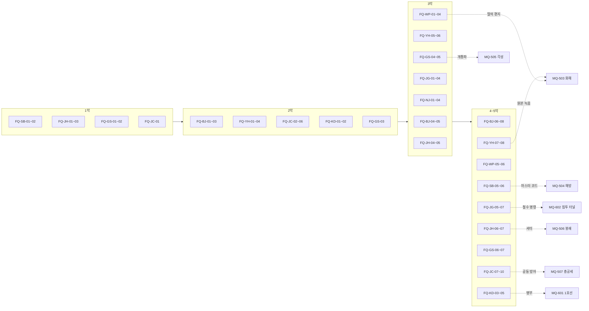

# SD-04d. 세력 퀘스트 라인

> **서울 폴아웃 상세 기획서 세트** | 문서 ID: SD-04d | 버전: v1.0 | 작성일: 2026-10-12
> **범위**: 호감도 대상 10개 세력(BJ 비상정부, YH 연합단, WP 원칙파, SB 새벽인력, JG 중국군 잔존병, JH 지하시장, GS 각성회, JC 정착지 연합, NJ 난지 고철단, KD 큰돌 무리)의 **세력 퀘스트 69편(FQ-BJ-01~FQ-KD-05) 상세 설계**. 라인별 주제·단계 배치·메인 막 연동·라인 끝 결과·흐름도, 퀘스트별 발동 조건·제공자·장소·단계별 목표(퀘스트 로그 문구)·다중 해법·결과 분기·호감도(직접값과 연동값)·판도·카르마·XP와 보상(아이템 ID)·정보 전파·실패와 시간 제한·핵심 대사·메인과 사이드 연계, 경쟁 세력 퀘스트가 같은 물건·같은 거점에서 부딪치는 지점의 처리('누구에게 실제로 넘기는가'), 세력 간 교차표, 속죄 의뢰와 화해. / 다루지 않는 것: 호감도·판도·정보 전파 시스템 본체(SD-06), 메인 퀘스트 진행(SD-03a·03b), 사이드 퀘스트(SD-04a~c), 반복·비표시 퀘스트와 랜덤 인카운터 ID(SD-05), 인물 프로필과 C·N-ID(SD-07a·07b), 장소 상세와 좌표 보정(SD-09a~f), 아이템·적 수치(SD-13·SD-14).
> **관련 문서**: [SC-00 컨셉 v0.4](00_concept.md), [SD-02 세계관·연표](02_world-and-lore.md), [SD-03a 메인 스토리 1](03a_main-story-part1.md), [SD-03b 메인 스토리 2](03b_main-story-part2.md), [SD-04a 사이드(남부)](04a_side-quests-south.md), [SD-04b 사이드(서부·한강)](04b_side-quests-west-river.md), [SD-04c 사이드(북부·동부·도심)](04c_side-quests-north-east-center.md), [SD-05 비표시·반복·인카운터](05_misc-quests-encounters.md), [SD-06 세력](06_factions.md), [SD-07a 주요 인물](07a_characters-major.md), [SD-07b NPC 디렉터리](07b_npc-directory.md), [SD-08 월드·권역](08_world-regions.md), [SD-09a 장소 R01·R02](09a_locations-r01-r02.md), [SD-09b 장소 R03·R04·R10](09b_locations-r03-r04-r10.md), [SD-09d 장소 R07·R11](09d_locations-r07-r11.md), [SD-09e 장소 R08·R09](09e_locations-r08-r09.md), [SD-10 캐릭터 시스템](10_character-system.md), [SD-11 전투](11_combat-system.md), [SD-12 탐험·UI](12_exploration-ui.md), [SD-13 아이템](13_items.md), [SD-14 크리처·적](14_creatures-enemies.md), [SD-15 경제](15_economy.md), [SD-17 사운드](17_sound.md), [SD-18 용어·명명](18_naming-terms.md), 원작 [RD-05 사이드 퀘스트 1](../reverse-design/05_side-quests-part1.md), [RD-06 사이드 퀘스트 2](../reverse-design/06_side-quests-part2.md), [RD-09 팩션](../reverse-design/09_factions.md), [RD-27 이식 시사점](../reverse-design/27_adaptation-notes.md)

---

## 목차
1. 개요
2. 공통 설계 규칙
3. BJ 비상정부 라인 (FQ-BJ-01~08)
4. YH 연합단 라인 (FQ-YH-01~08)
5. WP 원칙파 라인 (FQ-WP-01~06)
6. SB 새벽인력 라인 (FQ-SB-01~06)
7. JG 중국군 잔존병 라인 (FQ-JG-01~07)
8. JH 지하시장 라인 (FQ-JH-01~07)
9. GS 각성회 라인 (FQ-GS-01~07)
10. JC 정착지 연합 라인 (FQ-JC-01~10)
11. NJ 난지 고철단 라인 (FQ-NJ-01~05)
12. KD 큰돌 무리 라인 (FQ-KD-01~05)
13. 세력 간 교차표
14. 양다리 충돌 지점 총괄
15. 속죄 의뢰와 화해
16. 원작 대응
17. 쯔꾸르 제작 메모
18. 미결 사항
- 부록 A. 신규 고유명사 / 부록 B. 변수 목록 / 부록 C. 참고 문서

---

## 1. 개요

### 1.1 목적
- SD-06 §13이 정한 **세력 퀘스트 69편의 골격**(제목·요지·시작 단계·호감도 보상)을 이벤트·변수 단위로 바로 만들 수 있게 상세화한다. 골격의 ID·번호·순서는 그대로 쓴다. 바꾼 곳은 해당 퀘스트의 '변경 사유' 행에 적었다.
- 바이블 §5.8 **"고르지 않고 기운다"**를 세력 퀘스트에서 구현한다. 세력 퀘스트는 가입 절차가 아니다. 한 세력의 부탁을 실제로 들어준 결과가 쌓여 그 세력이 계급장과 비기를 먼저 건네고, 경쟁 세력은 소문·방송·목격자로 그 행적을 알게 되어 반응한다.
- 메인 퀘스트(SD-03a·03b)의 경로 퀘스트, 3막 열쇠 현장, 5막 위기 퀘스트와 세력 퀘스트가 겹치는 지점을 정해, 어느 순서로 해도 진행이 막히지 않게 한다.

### 1.2 범위
| 주제 | SD-04d | 정본 문서 |
|---|---|---|
| FQ 69편의 진행·해법·결과·대사·보상 | **정본** | — |
| 세력 퀘스트가 일으키는 호감도 직접값 | 정본(SD-06 §13 기본값 안에서 결과별로 나눈다) | 증감 규칙·보정식·상한은 SD-06 §3 |
| 연동값(적대 세력 하락) | 계산 결과를 예시로 적는다 | 계수·적용 조건은 SD-06 §3.6 |
| 판도 변화 | FQ가 일으키는 사건 보정과 거점 이전 | 데이터 구조·틱은 SD-06 §5, 공간 단위는 SD-08 §15 |
| 정보 전파 | FQ별 공개도와 주된 경로 | 경로·지연 규칙은 SD-06 §6 |
| 계급 증표·호출 수단·세력 장비 수여 시점 | FQ별로 적는다 | 아이템 데이터는 SD-13 §5.10·§7.4 |
| 세력 비기 | 라인 끝 장면 | 효과는 SD-10 §5.5 |
| 인물 | 이름과 역할(신규 인물은 부록 A) | C·N-ID는 SD-07a·07b |
| 장소 | 이름 + L-ID(SD-08 §11 시드 순서) + tx·ty | 상세는 SD-09a~f |

### 1.3 요약
1. **69편**: BJ 8, YH 8, WP 6, SB 6, JG 7, JH 7, GS 7, JC 10, NJ 5, KD 5. SD-06 골격을 모두 상세화했고, 번호·순서·시작 단계는 바꾸지 않았다. 골격을 고친 곳은 7편이다(§1.5).
2. **묻지 않고 시작한다**: 게시판 의뢰, 인물의 부탁, 엿들은 사정, 이미 한 일의 다음 단계 중 하나로 열린다. 퀘스트 로그(핍-보이 '부탁받은 일')의 목표 문장은 모두 **사실·상황 문장**이다("양재 온실촌에 분류반 심사가 예정되어 있다"). "누구 편에 서겠습니까", "의뢰를 받아들이겠습니까" 같은 문장은 없다.
3. **결과는 손에서 정해진다**: 퀘스트 끝의 분기는 물건을 실제로 누구에게 건넸는지, 누구를 살렸는지, 어디에 두고 떠났는지로 정해진다. 경쟁 세력의 퀘스트가 같은 물건·같은 거점을 노리는 **충돌 지점 14곳**을 두었고, 각 지점의 결과는 인도처 변수(`FH_`)로 기록해 정보 전파로 다른 세력에 닿게 했다(§14).
4. **라인 끝 = 동맹 문턱**: 라인을 끝까지 하면 그 세력의 호감도가 대략 동맹 문턱(+80)에 닿도록 보상을 배분했다(연합단 0 → +83, 각성회 +25 → +94). 시작값이 낮은 세력(비상정부 -30, 중국군 잔존병 -40, 난지 고철단 -70)은 메인 퀘스트의 결정적 행동이 더해져야 동맹(또는 신뢰 상한)에 닿는다. 마지막 편이 끝나면 그 세력의 인물이 비기(PK-112~119)를 가르치는 장면이 붙는다.
5. **세계가 먼저 알려 준다**: 각 퀘스트는 끝날 때 바뀌는 호칭·가격·순찰·방송·깃발을 '기울기 체감'으로 적었다. 숫자 팝업은 없다.
6. **막 잠금 없음**: 모든 라인은 프롤로그 직후부터 열 수 있다. 막은 일부 편의 '사건 조건'(당인리 재가동, 서울 회의 결렬, 계엄 선포 등)으로만 들어간다. 권장 시점은 개요 표에 적었다.
7. **XP와 보상**: 편당 250~550 XP, 마지막 편 ×1.5(SD-10 §4.4). 라인 69편 전체 약 30,900 XP. 계급 증표·호출 수단·세력 장비는 SD-13 §5.10의 ID로 지급 시점을 정했다.

### 1.4 표기 규칙
| 표기 | 뜻 |
|---|---|
| `FQ-BJ-01` | 세력 퀘스트 ID(SD-06 §2.2 약호). 엔진 변수 `FQ_BJ_01`(단계 0 미발동 / 10 발동 / 20~90 진행 / 100 종료 / 200 보류 / 250 끊김), 결과 `FQR_BJ_01` |
| **발동** | 퀘스트가 월드에 나타나는 조건. 호감도는 내부값(`AFF_BJ ≥ -59` 등)과 단계 이름을 같이 적는다. 막은 `V_ACT`, 메인 변수는 SD-03a §4.7 이름을 쓴다(`V_KANG`, `V_CW` 같은 기존 변수 이름은 인물 이름이 바뀌어도 그대로 둔다) |
| **로그** | 핍-보이 DATA > 퀘스트 > '부탁받은 일'(SD-12 §3.12)에 뜨는 목표 문장. 본문 그대로 쓴다 |
| [화술·보통] / [과학 50] / [힘 7] | SD-03a §1.3 판정 표기. 스킬 고정 판정 요구치와 XP는 SD-10 §3.6의 I~V(15/25/50/75/100) |
| [호감: YH 우호+] | 호감도 단계 조건 선택지 |
| **BJ +8** | 그 세력 호감도의 **직접 변화**(SD-06 §3.4 기본값. 카리스마·카르마 성향·퍽 보정 전) |
| **연동** | SD-06 §3.6 계수로 계산한 연동값(0 쪽으로 버림). 그 세력이 행적을 **알게 된 때** 적용한다. 예: "BJ +8 → 연동 YH -4, JG -4, JC -3, JH -2, WP -1" |
| **판도 PD-R11-2 BJ +5** | SD-08 §15.2 판도 구역의 그 세력 사건 보정 +5(SD-06 §5.2. 7일마다 0 쪽으로 2씩 준다). 판도 거점 이전은 "거점 ○○ → YH"로 적는다 |
| **공개도 0~3** | SD-06 §6.2. 0 비밀 / 1 목격 / 2 공개 / 3 방송급 |
| `FH_xxx` | 세력 퀘스트의 인도처 변수. 값은 SD-03a §4.5의 세력 코드와 같다(0 주인공 / 1 BJ / 2 YH / 3 WP / 4 JH / 5 GS / 6 JG / 7 SB / 8 JC / 9 NJ / 10 KD / 14 남산 방송 / 81~86 개별 정착지 / 97 두고 떠남 / 99 파기) |
| 장소 | 이름(L-ID, tx·ty). L-ID는 SD-08 §11 시드 순서로 SD-09가 매기는 값이다. 시드에 없는 곳은 '(SD-09에서 ID 부여)' |
| 아이템 | SD-13 ID(W-·A-·I-·M-). ID가 없는 새 물건은 '(SD-13에서 ID 부여)' |
| 적 | SD-14 ID(CR-). 편성은 SD-14 §9 템플릿 |
| **XP** | 퀘스트 완료 XP. 판정 성공 XP(SD-10 §3.6)는 따로 쌓인다 |

### 1.5 골격 변경 목록
| ID | SD-06 골격 | 이 문서 | 변경 사유 |
|---|---|---|---|
| FQ-BJ-06 | 차민규의 송신 중계기를 고친다 | 고칠 중계기가 **남산 방송을 막는 방해 송신기**와 같은 물건이다 | FQ-YH-03의 '방해 송신기'와 같은 물건으로 묶어 경쟁 세력 퀘스트의 충돌 지점을 만든다(§14 C-01). 요지는 그대로 |
| FQ-WP-05 | 사양서를 도심 외곽에서 찾는다 | 장소를 홍릉 연구 단지(R08)로 정했다 | '도심 외곽'에 해당하는 시드 가운데 세진 협력 연구소가 들어갈 수 있는 곳 |
| FQ-JG-07 | 2077년 암호표로 철수 명령 문서를 갖춘다 | 암호표가 **연합단 용산 통신 벙커**에 있다 | 연합단과 잔존병은 거울 세력이다. 철수 명령을 갖추려면 연합단의 노획 문서가 필요하게 해 충돌 지점을 만든다(§14 C-08) |
| FQ-GS-05 | 보상 '말하면 -10 뒤 류정 사건 +15 / 숨기면 +8' | 같은 값에 '은솔에게 건넴'(+12, 개통파 기울기) 분기를 더했다 | 증거를 누구 손에 두는가가 결과가 되게 한다. 상한 ±15 안 |
| FQ-NJ-03 | 쇠갈퀴의 후계 다툼 | 늙은 산주 **쥐왕**의 왕좌와 쇠갈퀴의 부두목 자리가 함께 비는 다툼(휘발유 대 드럼통) | SD-09b가 정한 인물 구성(두목 맹구철 '쇠갈퀴', 산주 쥐왕 CR-509, 부두목 후보 휘발유·드럼통)을 따른다 |
| FQ-KD-02 | 그림책을 찾는다 | 같은 그림책이 두 권 있다(안전한 사본 / 서울역 대피소의 원본) | 쉬운 해법과 위험한 해법을 나누고, 원본이 FQ-KD-05의 단서가 되게 한다 |
| FQ-JC-08 | 결렬된 서울 회의를 다시 모은다 | 회의 결렬뿐 아니라 '부분 합의 미만으로 열리지 못함'(백인하·노들섬 상실)도 발동 조건에 넣었다 | SD-03a §6.3의 회의 장소 대체 규칙과 맞춘다 |

---

## 2. 공통 설계 규칙

### 2.1 '고르지 않고 기운다'를 세력 퀘스트에 옮기는 규칙
| # | 규칙 | 구현 |
|---|---|---|
| R1 | **가입 장면이 없다** | 어떤 FQ도 "우리 쪽에 들어오겠나"로 시작하거나 끝나지 않는다. 계급 증표는 조건이 채워진 뒤 거점에 들르면 세력 인물이 먼저 건넨다(SD-06 §4.4). 받기를 거절하는 선택지도 없다. 입을지는 플레이어가 장비 화면에서 정한다 |
| R2 | **로그는 사실을 적는다** | 목표 문장은 상황·사실·소문이다. 허용: "○○가 △△를 찾고 있다", "△△는 □□에 있다고 한다", "□□의 일이 끝났다". 금지: "○○를 도울지 정한다", "어느 쪽 편에 설지 고른다", "제안을 수락한다" |
| R3 | **결말은 물건과 몸이 정한다** | 분기는 ① 물건을 실제로 건넨 상대(대화창 '물건 주기', 보관함에 넣기, 그 자리에 두기, 파기) ② 살리거나 죽인 사람 ③ 그 자리에 함께 있던 세력 ④ 방송·게시판에 실제로 올린 내용으로 정한다. 확인 대화는 "이걸 맡기겠다" 서술 한 줄뿐이다 |
| R4 | **대화 선택지는 개별 사안만** | 값을 깎을지, 진실을 말할지, 이 사람을 보내 줄지 같은 사안만 묻는다. 사안의 결과가 쌓여 기울 뿐 대화 한 번으로 진영이 정해지지 않는다 |
| R5 | **맡지 않아도 된다** | 의뢰를 무시해도 감점이 없다. 맡았다가 끝내지 않으면 보고하지 않는 한 0이다(SD-06 §3.4 '포기'). 맡은 물건을 남에게 넘기면 '횡령'(-8)과 받은 쪽 인도 효과가 함께 생긴다 |
| R6 | **양다리는 막지 않는다** | 경쟁 세력의 퀘스트를 동시에 진행할 수 있다. 같은 물건·같은 거점에서 부딪치면 실제로 넘긴 쪽이 결과를 가져가고, 다른 쪽은 정보가 닿는 순간 반응한다(§14). 7일 안에 전쟁 관계 두 세력을 각각 크게 도우면 SD-06 §7.2의 이중 거래 의혹이 따라온다 |
| R7 | **아무에게도 넘기지 않는 것도 결과다** | 충돌 물건을 끝까지 지니면 `FH_ = 0`. 두 세력 모두 조금씩 실망(각 -3)하고, 단독 기울기 `SOLO +1`(충돌 지점당, 최대 +3)을 얻는다. 단독 기울기의 '핵심 물건' 규칙(SD-06 §7.3)과 별개로 센다 |

### 2.2 발동 방식
| 방식 | 설명 | 예 |
|---|---|---|
| 게시판 | 세력 거점 게시판의 의뢰문. 호감도 단계가 맞을 때만 붙는다 | 용산 요새 PX 게시판(FQ-YH-01) |
| 부탁 | 세력 인물이 대화 중 꺼내는 사정. 대화 선택지는 "자세히 듣는다 / 나중에"뿐이다. "나중에"를 골라도 퀘스트는 로그에 '들은 사정'으로 남는다 | 노복희의 외상 장부(FQ-JH-02) |
| 엿듣기 | 거점에서 엿들은 대화·주운 쪽지·무전 | 독사와 구만호의 대화(FQ-SB-03) |
| 다음 단계 | 앞 편이나 메인 퀘스트에서 한 일의 결과로 이어진다 | 당인리 재가동 뒤 북한산의 소란(FQ-JG-05) |
| 우연 | 월드 사건을 목격하고 끼어든다 | 버티버드 추락(FQ-BJ-03) |

- 발동 알림은 토스트가 아니라 로그 한 줄과 효과음 1종이다(SD-12). 지도 마커는 '알려진 단서'에만 붙는다(SD-03a §3.3 F2).
- 같은 세력의 다음 편은 앞 편 종료 후 **게임 시간 12시간** 뒤부터 열린다(라인이 한꺼번에 쏟아지지 않게). 메인 퀘스트 사건으로 열리는 편은 예외다.

### 2.3 단계 조건과 진행 중 변화
| 상황 | 처리 |
|---|---|
| 발동 단계 미달 | 의뢰가 게시판에 붙지 않고, 인물도 꺼내지 않는다. 엿듣기·우연형은 사건을 보여 주되 로그에 "○○는 아직 당신에게 이 일을 맡기지 않는다"를 남긴다 |
| 대면 전 상한(+49, SD-06 §3.3) | 지도자·본거지를 만나기 전에는 신뢰 단계 편이 열리지 않는다. 각 라인의 첫 대면 사건을 개요 표에 적었다 |
| 진행 중 호감도가 발동 단계 아래로(히스테리시스 기준) 떨어짐 | 단계 `200 보류`. 로그: "○○는 당분간 당신에게 일을 맡기지 않는다." 단계가 돌아오면 이어서 진행한다. 이미 받은 물건은 그대로 |
| 영구 적대(SD-06 §3.8) | 남은 FQ 전부 `250 끊김`. 감점 없음. 계급 증표는 회수 사건(SD-06 §4.4) |
| 제공자 사망 | 개요 표의 대체 제공자가 이어받는다(SD-03a §6.3과 같은 원칙). 대체자도 없으면 같은 세력의 게시판이 의뢰를 낸다 |
| 순서 파괴 | 목표를 다른 경로로 먼저 이루면 그 단계로 건너뛴다(`FQR_ SKIP`). 건너뛴 단계의 XP는 주지 않는다 |

### 2.4 보상 체계
**호감도**: SD-06 §13의 기본값을 결과별로 나눴다. 퀘스트 완료는 일일 상한(+6) 밖이고 1회 사건 상한(±15) 안이다. 결과 분기에 따라 기본값보다 낮게 주는 경우가 있다(예: 의뢰는 끝냈지만 제공자가 원한 방식이 아님).

**XP** (SD-10 §4.4: 편당 200~600, 마지막 ×1.5)

| 위치 | XP | 비고 |
|---|---|---|
| 경계·중립 시작 편 | 250 | 위협도 4 이상 권역이면 300 |
| 우호 시작 편 | 350 | 위협도 4 이상 400 |
| 신뢰 시작 편 | 450 | 위협도 4 이상 500~550 |
| 라인의 마지막 편 | 기본 600 × 1.5 = **900** | NJ·KD의 마지막 편은 기본 450 × 1.5 = 675 |

**캡**: 편당 0~400캡(세력 경제 성격에 따라 다르다. 원칙파는 캡 대신 부품, 큰돌 무리는 2077년 잡동사니).

**계급 증표·호출 수단·장비**(SD-06 §4.4, SD-13 §5.10): 조건(호감도 + 해당 FQ 완료)이 채워진 뒤 **그 세력 거점에 다음 번 들렀을 때** 세력 인물이 건넨다. FQ 종료 장면에서 바로 주지 않는 이유는 '승급 장면'을 그 세력의 일상 공간(점호, 반상회, 출근부)에서 보여 주기 위해서다.

**세력 비기**(SD-10 §5.5): 동맹(+80)에 이른 뒤 마지막 편이 끝났거나, 마지막 편을 끝낸 뒤 동맹에 이르면 비기 장면이 자동으로 붙는다. 마지막 편을 하지 않고 동맹에 이르면 동맹 도달 직후 자동 장면으로 준다(비기 획득이 퀘스트에 묶여 막히지 않게).

### 2.5 연동과 정보 전파 적용
- 각 퀘스트 표의 '전파' 행에 **기본 공개도**와 **주된 경로**를 적는다. 세력 의뢰 완료는 기본 공개도 2(SD-06 §6.2)다. 은신으로 끝낸 단계, 목격자 없는 처리, 매수한 목격자는 공개도를 낮춘다.
- 연동값은 퀘스트 완료 직접값에 SD-06 §3.6 계수를 곱한 값이다. **그 세력이 알게 된 시점**에 적용한다. 표에는 기본 공개도로 퍼졌을 때 알게 되는 세력과 대략의 도착 시간을 적었다.
- 공개도 2 사건의 소문은 같은 구역 12시간, 인접 구역마다 +12시간, 3구역까지 간다. 연합단은 용산 기지 방송(12시간), 비상정부는 정보원(봉천·노들섬·세이프빌·양재 온실촌, 6시간)과 지하시장 정보상(48시간)으로 더 넓게 안다.

### 2.6 충돌 지점 처리
- 경쟁 세력 퀘스트가 같은 물건·같은 사람·같은 거점을 노리면 그 대상에 인도처 변수 `FH_<물건>`을 둔다. 각 퀘스트는 대상이 **실제로 자기 세력 손에 들어갔을 때만** 완료 보상을 준다. 다른 세력 손에 들어가면 그 퀘스트는 '다른 결과'로 닫힌다(감점은 SD-06 §3.4 '의뢰 물건 횡령' -8, 받은 쪽은 해당 퀘스트의 보상과 인도 효과).
- 닫힌 퀘스트의 세력은 정보가 닿은 순간 반응한다. 반응 대사는 따지는 말이지 진영 질문이 아니다("해방촌 중계기를 용산이 가져갔다더군. 당신 손을 거쳤다고들 하고.").
- 충돌 지점 14곳의 대상·관련 퀘스트·결과는 §14에 모았다.

### 2.7 실패와 시간 제한
- 세력 퀘스트는 원칙적으로 **실패 상태가 없다**. 끝나지 않은 일은 로그에 남는다. 다만 다음은 시간·조건으로 닫힌다.

| 종류 | 처리 |
|---|---|
| 사건형 시간 제한 | 호위·방어·운송처럼 사건 안의 시간 제한. 놓치면 그 단계가 나쁜 결과로 닫히고 퀘스트는 '다른 결과'로 끝난다(예: FQ-JH-03 낮 2시간) |
| 막 사건으로 닫힘 | 메인 사건이 퀘스트의 전제를 없애면 닫힌다(예: MQ-504 해방으로 새벽인력이 몰락하면 FQ-SB 남은 편 '끊김'). 감점 없음 |
| 대상 사망 | 보호·구출 대상이 죽으면 '다른 결과'. 주인공이 죽였으면 범죄 원천이 따로 적용된다 |

### 2.8 메인 막 진행과의 연동 총괄
막 열의 '권장'은 1회차 일반 진행에서 그 편이 자연스럽게 열리는 시점이다. 잠금이 아니다.

| 라인 | 첫 편이 열리는 가장 빠른 때 | 권장 시작 | 첫 대면 사건(대면 전 상한 해제) | 메인과 겹치는 지점 | 라인 끝 |
|---|---|---|---|---|---|
| BJ | 프롤로그 직후 양재 고개 검문소 방문 | 2막(MQ-207 손길) | 육지환 대면(MQ-106) 또는 청계산 벙커 방문 | MQ-106, 207, 301(측량), 402, 501, 507 | 3~5막. PK-112 |
| YH | 이태원 고개 초소 방문 | 2막(MQ-206 뒤) | 다니엘 서 대면(MQ-206) | MQ-206, 301(기술진), 302(관절 부품), 303, 503, 601·603 | 4~5막. PK-113 |
| WP | 공릉 회수 창고 정문 교환창 | 2~3막 | 그레이스 장 대면(공릉 창고 내부) | MQ-302(회수조), 503, 601, 701 | 4~5막. PK-114 |
| SB | 1막 MQ-105 무렵 본소 접근 | 1~2막 | 황두칠 대면(MQ-105) | MQ-101, 105, 201, 401, 504 | 3~5막. PK-118 |
| JG | 북한산 흰 선 접근(R09) | 3막(MQ-303 전후) | 멍쉐밍 대면(MQ-303 또는 FQ-JG-01) | MQ-301(전원), 303, 502(무전), 602, 701 | 4~6막. PK-117 |
| JH | 1막 지하시장 방문 | 1막(MQ-103 전후) | 노복희 대면(지하시장 상인회) | MQ-103, 302(정보), 506, 603, 701 | 3~5막. PK-115 |
| GS | 프롤로그 직후(대기자 천공 카드가 우편으로 와 있다) | 1~2막 | 류정 대면(노량진 관제 중계소) | MQ-207(축복), 302, 301(개통파), 505, 603 | 3~5막. PK-116 |
| JC | 1막 MQ-101 봉천 | 1막~ | 조만석·백인하 대면 | MQ-101, 201~204, 207, 301, 502, 507 | 5막. PK-119 |
| NJ | 난지도 계단에 흰 깃발을 들고 오름 | 2~3막 | 쇠갈퀴 대면(FQ-NJ-01) | MQ-301(지상 엄호) | 3~4막. 비기 없음 |
| KD | 남산 북사면에서 안내 방송을 들음 | 2막 | 큰돌 대면(FQ-KD-01) | MQ-601(서울역 우회), 701 | 4~6막. 비기 없음 |

### 2.9 전체 흐름: 라인과 막

---
