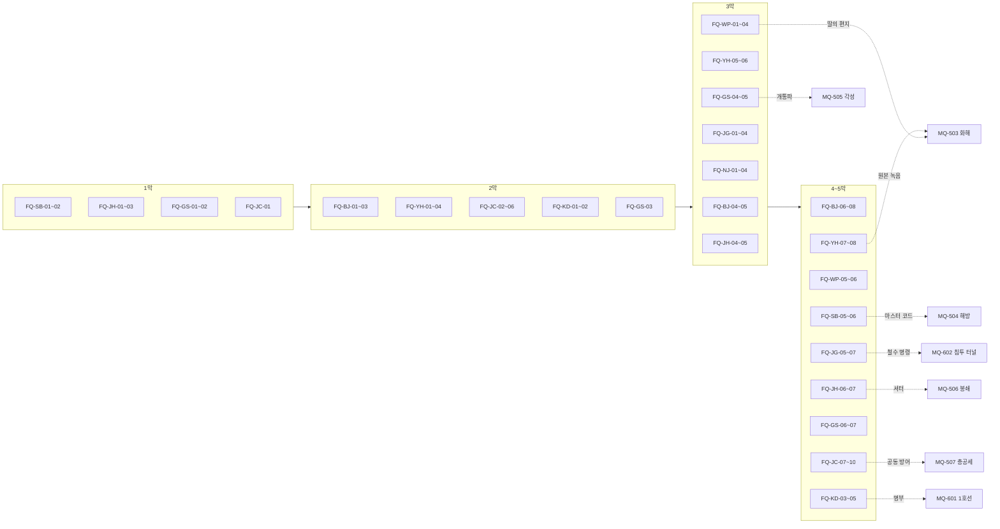
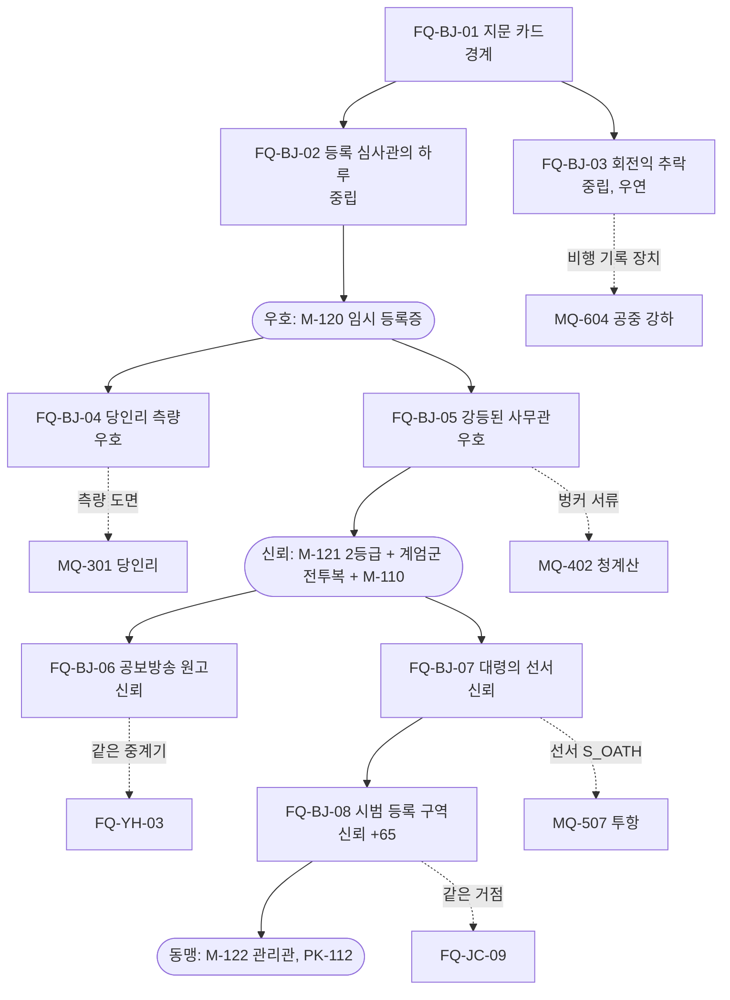
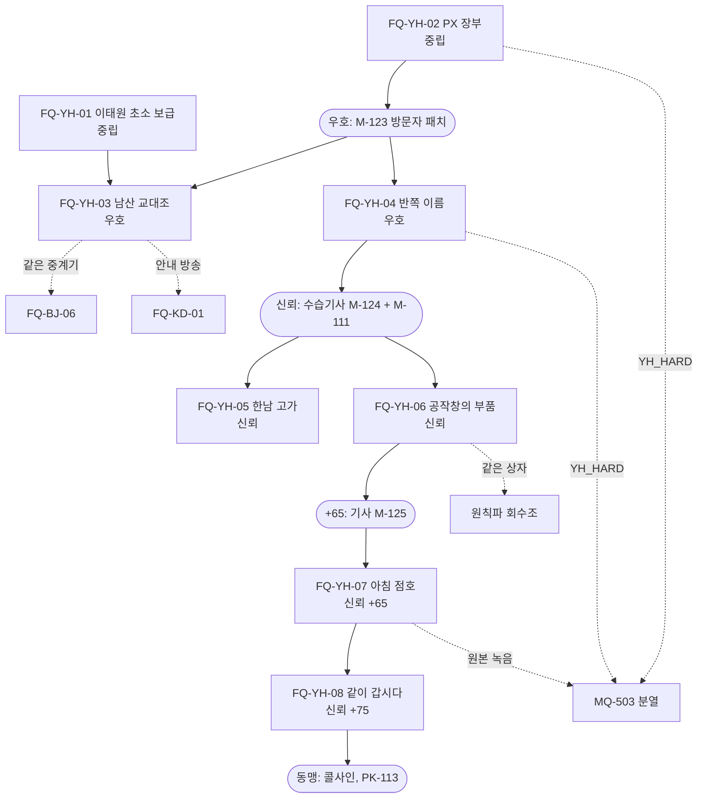

# SD-04d. 세력 퀘스트 라인

> **서울 폴아웃 상세 기획서 세트** | 문서 ID: SD-04d | 버전: v1.0 | 작성일: 2026-10-12
> **범위**: 호감도 대상 10개 세력(BJ 비상정부, YH 연합단, WP 원칙파, SB 새벽인력, JG 중국군 잔존병, JH 지하시장, GS 각성회, JC 정착지 연합, NJ 난지 고철단, KD 큰돌 무리)의 **세력 퀘스트 69편(FQ-BJ-01~FQ-KD-05) 상세 설계**. 라인별 주제·단계 배치·메인 막 연동·라인 끝 결과·흐름도, 퀘스트별 발동 조건·제공자·장소·단계별 목표(퀘스트 로그 문구)·다중 해법·결과 분기·호감도(직접값과 연동값)·판도·카르마·XP와 보상(아이템 ID)·정보 전파·실패와 시간 제한·핵심 대사·메인과 사이드 연계, 경쟁 세력 퀘스트가 같은 물건·같은 거점에서 부딪치는 지점의 처리('누구에게 실제로 넘기는가'), 세력 간 교차표, 속죄 의뢰와 화해. / 다루지 않는 것: 호감도·판도·정보 전파 시스템 본체(SD-06), 메인 퀘스트 진행(SD-03a·03b), 사이드 퀘스트(SD-04a~c), 반복·비표시 퀘스트와 랜덤 인카운터 ID(SD-05), 인물 프로필과 C·N-ID(SD-07a·07b), 장소 상세와 좌표 보정(SD-09a~f), 아이템·적 수치(SD-13·SD-14).
> **관련 문서**: [SC-00 컨셉 v0.4](00_concept.md), [SD-02 세계관·연표](02_world-and-lore.md), [SD-03a 메인 스토리 1](03a_main-story-part1.md), [SD-03b 메인 스토리 2](03b_main-story-part2.md), [SD-04a 사이드(남부)](04a_side-quests-south.md), [SD-04b 사이드(서부·한강)](04b_side-quests-west-river.md), [SD-04c 사이드(북부·동부·도심)](04c_side-quests-north-east-center.md), [SD-05 비표시·반복·인카운터](05_misc-quests-encounters.md), [SD-06 세력](06_factions.md), [SD-07a 주요 인물](07a_characters-major.md), [SD-07b NPC 디렉터리](07b_npc-directory.md), [SD-08 월드·권역](08_world-regions.md), [SD-09a 장소 R01·R02](09a_locations-r01-r02.md), [SD-09b 장소 R03·R04·R10](09b_locations-r03-r04-r10.md), [SD-09d 장소 R07·R11](09d_locations-r07-r11.md), [SD-09e 장소 R08·R09](09e_locations-r08-r09.md), [SD-10 캐릭터 시스템](10_character-system.md), [SD-11 전투](11_combat-system.md), [SD-12 탐험·UI](12_exploration-ui.md), [SD-13 아이템](13_items.md), [SD-14 크리처·적](14_creatures-enemies.md), [SD-15 경제](15_economy.md), [SD-17 사운드](17_sound.md), [SD-18 용어·명명](18_naming-terms.md), 원작 [RD-05 사이드 퀘스트 1](../reverse-design/05_side-quests-part1.md), [RD-06 사이드 퀘스트 2](../reverse-design/06_side-quests-part2.md), [RD-09 팩션](../reverse-design/09_factions.md), [RD-27 이식 시사점](../reverse-design/27_adaptation-notes.md)

---

## 목차
1. 개요
2. 공통 설계 규칙
3. BJ 비상정부 라인 (FQ-BJ-01~08)
4. YH 연합단 라인 (FQ-YH-01~08)
5. WP 원칙파 라인 (FQ-WP-01~06)
6. SB 새벽인력 라인 (FQ-SB-01~06)
7. JG 중국군 잔존병 라인 (FQ-JG-01~07)
8. JH 지하시장 라인 (FQ-JH-01~07)
9. GS 각성회 라인 (FQ-GS-01~07)
10. JC 정착지 연합 라인 (FQ-JC-01~10)
11. NJ 난지 고철단 라인 (FQ-NJ-01~05)
12. KD 큰돌 무리 라인 (FQ-KD-01~05)
13. 세력 간 교차표
14. 양다리 충돌 지점 총괄
15. 속죄 의뢰와 화해
16. 원작 대응
17. 쯔꾸르 제작 메모
18. 미결 사항
- 부록 A. 신규 고유명사 / 부록 B. 변수 목록 / 부록 C. 참고 문서

---

## 1. 개요

### 1.1 목적
- SD-06 §13이 정한 **세력 퀘스트 69편의 골격**(제목·요지·시작 단계·호감도 보상)을 이벤트·변수 단위로 바로 만들 수 있게 상세화한다. 골격의 ID·번호·순서는 그대로 쓴다. 바꾼 곳은 해당 퀘스트의 '변경 사유' 행에 적었다.
- 바이블 §5.8 **"고르지 않고 기운다"**를 세력 퀘스트에서 구현한다. 세력 퀘스트는 가입 절차가 아니다. 한 세력의 부탁을 실제로 들어준 결과가 쌓여 그 세력이 계급장과 비기를 먼저 건네고, 경쟁 세력은 소문·방송·목격자로 그 행적을 알게 되어 반응한다.
- 메인 퀘스트(SD-03a·03b)의 경로 퀘스트, 3막 열쇠 현장, 5막 위기 퀘스트와 세력 퀘스트가 겹치는 지점을 정해, 어느 순서로 해도 진행이 막히지 않게 한다.

### 1.2 범위
| 주제 | SD-04d | 정본 문서 |
|---|---|---|
| FQ 69편의 진행·해법·결과·대사·보상 | **정본** | — |
| 세력 퀘스트가 일으키는 호감도 직접값 | 정본(SD-06 §13 기본값 안에서 결과별로 나눈다) | 증감 규칙·보정식·상한은 SD-06 §3 |
| 연동값(적대 세력 하락) | 계산 결과를 예시로 적는다 | 계수·적용 조건은 SD-06 §3.6 |
| 판도 변화 | FQ가 일으키는 사건 보정과 거점 이전 | 데이터 구조·틱은 SD-06 §5, 공간 단위는 SD-08 §15 |
| 정보 전파 | FQ별 공개도와 주된 경로 | 경로·지연 규칙은 SD-06 §6 |
| 계급 증표·호출 수단·세력 장비 수여 시점 | FQ별로 적는다 | 아이템 데이터는 SD-13 §5.10·§7.4 |
| 세력 비기 | 라인 끝 장면 | 효과는 SD-10 §5.5 |
| 인물 | 이름과 역할(신규 인물은 부록 A) | C·N-ID는 SD-07a·07b |
| 장소 | 이름 + L-ID(SD-08 §11 시드 순서) + tx·ty | 상세는 SD-09a~f |

### 1.3 요약
1. **69편**: BJ 8, YH 8, WP 6, SB 6, JG 7, JH 7, GS 7, JC 10, NJ 5, KD 5. SD-06 골격을 모두 상세화했고, 번호·순서·시작 단계는 바꾸지 않았다. 골격을 고친 곳은 7편이다(§1.5).
2. **묻지 않고 시작한다**: 게시판 의뢰, 인물의 부탁, 엿들은 사정, 이미 한 일의 다음 단계 중 하나로 열린다. 퀘스트 로그(핍-보이 '부탁받은 일')의 목표 문장은 모두 **사실·상황 문장**이다("양재 온실촌에 분류반 심사가 예정되어 있다"). "누구 편에 서겠습니까", "의뢰를 받아들이겠습니까" 같은 문장은 없다.
3. **결과는 손에서 정해진다**: 퀘스트 끝의 분기는 물건을 실제로 누구에게 건넸는지, 누구를 살렸는지, 어디에 두고 떠났는지로 정해진다. 경쟁 세력의 퀘스트가 같은 물건·같은 거점을 노리는 **충돌 지점 14곳**을 두었고, 각 지점의 결과는 인도처 변수(`FH_`)로 기록해 정보 전파로 다른 세력에 닿게 했다(§14).
4. **라인 끝 = 동맹 문턱**: 라인을 끝까지 하면 그 세력의 호감도가 대략 동맹 문턱(+80)에 닿도록 보상을 배분했다(연합단 0 → +83, 각성회 +25 → +94). 시작값이 낮은 세력(비상정부 -30, 중국군 잔존병 -40, 난지 고철단 -70)은 메인 퀘스트의 결정적 행동이 더해져야 동맹(또는 신뢰 상한)에 닿는다. 마지막 편이 끝나면 그 세력의 인물이 비기(PK-112~119)를 가르치는 장면이 붙는다.
5. **세계가 먼저 알려 준다**: 각 퀘스트는 끝날 때 바뀌는 호칭·가격·순찰·방송·깃발을 '기울기 체감'으로 적었다. 숫자 팝업은 없다.
6. **막 잠금 없음**: 모든 라인은 프롤로그 직후부터 열 수 있다. 막은 일부 편의 '사건 조건'(당인리 재가동, 서울 회의 결렬, 계엄 선포 등)으로만 들어간다. 권장 시점은 개요 표에 적었다.
7. **XP와 보상**: 편당 250~550 XP, 마지막 편 ×1.5(SD-10 §4.4). 라인 69편 전체 약 30,900 XP. 계급 증표·호출 수단·세력 장비는 SD-13 §5.10의 ID로 지급 시점을 정했다.

### 1.4 표기 규칙
| 표기 | 뜻 |
|---|---|
| `FQ-BJ-01` | 세력 퀘스트 ID(SD-06 §2.2 약호). 엔진 변수 `FQ_BJ_01`(단계 0 미발동 / 10 발동 / 20~90 진행 / 100 종료 / 200 보류 / 250 끊김), 결과 `FQR_BJ_01` |
| **발동** | 퀘스트가 월드에 나타나는 조건. 호감도는 내부값(`AFF_BJ ≥ -59` 등)과 단계 이름을 같이 적는다. 막은 `V_ACT`, 메인 변수는 SD-03a §4.7 이름을 쓴다(`V_KANG`, `V_CW` 같은 기존 변수 이름은 인물 이름이 바뀌어도 그대로 둔다) |
| **로그** | 핍-보이 DATA > 퀘스트 > '부탁받은 일'(SD-12 §3.12)에 뜨는 목표 문장. 본문 그대로 쓴다 |
| [화술·보통] / [과학 50] / [힘 7] | SD-03a §1.3 판정 표기. 스킬 고정 판정 요구치와 XP는 SD-10 §3.6의 I~V(15/25/50/75/100) |
| [호감: YH 우호+] | 호감도 단계 조건 선택지 |
| **BJ +8** | 그 세력 호감도의 **직접 변화**(SD-06 §3.4 기본값. 카리스마·카르마 성향·퍽 보정 전) |
| **연동** | SD-06 §3.6 계수로 계산한 연동값(0 쪽으로 버림). 그 세력이 행적을 **알게 된 때** 적용한다. 예: "BJ +8 → 연동 YH -4, JG -4, JC -3, JH -2, WP -1" |
| **판도 PD-R11-2 BJ +5** | SD-08 §15.2 판도 구역의 그 세력 사건 보정 +5(SD-06 §5.2. 7일마다 0 쪽으로 2씩 준다). 판도 거점 이전은 "거점 ○○ → YH"로 적는다 |
| **공개도 0~3** | SD-06 §6.2. 0 비밀 / 1 목격 / 2 공개 / 3 방송급 |
| `FH_xxx` | 세력 퀘스트의 인도처 변수. 값은 SD-03a §4.5의 세력 코드와 같다(0 주인공 / 1 BJ / 2 YH / 3 WP / 4 JH / 5 GS / 6 JG / 7 SB / 8 JC / 9 NJ / 10 KD / 14 남산 방송 / 81~86 개별 정착지 / 97 두고 떠남 / 99 파기) |
| 장소 | 이름(L-ID, tx·ty). L-ID는 SD-08 §11 시드 순서로 SD-09가 매기는 값이다. 시드에 없는 곳은 '(SD-09에서 ID 부여)' |
| 아이템 | SD-13 ID(W-·A-·I-·M-). ID가 없는 새 물건은 '(SD-13에서 ID 부여)' |
| 적 | SD-14 ID(CR-). 편성은 SD-14 §9 템플릿 |
| **XP** | 퀘스트 완료 XP. 판정 성공 XP(SD-10 §3.6)는 따로 쌓인다 |

### 1.5 골격 변경 목록
| ID | SD-06 골격 | 이 문서 | 변경 사유 |
|---|---|---|---|
| FQ-BJ-06 | 차민규의 송신 중계기를 고친다 | 고칠 중계기가 **남산 방송을 막는 방해 송신기**와 같은 물건이다 | FQ-YH-03의 '방해 송신기'와 같은 물건으로 묶어 경쟁 세력 퀘스트의 충돌 지점을 만든다(§14 C-01). 요지는 그대로 |
| FQ-WP-05 | 사양서를 도심 외곽에서 찾는다 | 장소를 홍릉 연구 단지(R08)로 정했다 | '도심 외곽'에 해당하는 시드 가운데 세진 협력 연구소가 들어갈 수 있는 곳 |
| FQ-JG-07 | 2077년 암호표로 철수 명령 문서를 갖춘다 | 암호표가 **연합단 용산 통신 벙커**에 있다 | 연합단과 잔존병은 거울 세력이다. 철수 명령을 갖추려면 연합단의 노획 문서가 필요하게 해 충돌 지점을 만든다(§14 C-08) |
| FQ-GS-05 | 보상 '말하면 -10 뒤 류정 사건 +15 / 숨기면 +8' | 같은 값에 '은솔에게 건넴'(+12, 개통파 기울기) 분기를 더했다 | 증거를 누구 손에 두는가가 결과가 되게 한다. 상한 ±15 안 |
| FQ-NJ-03 | 쇠갈퀴의 후계 다툼 | 늙은 산주 **쥐왕**의 왕좌와 쇠갈퀴의 부두목 자리가 함께 비는 다툼(휘발유 대 드럼통) | SD-09b가 정한 인물 구성(두목 맹구철 '쇠갈퀴', 산주 쥐왕 CR-509, 부두목 후보 휘발유·드럼통)을 따른다 |
| FQ-KD-02 | 그림책을 찾는다 | 같은 그림책이 두 권 있다(안전한 사본 / 서울역 대피소의 원본) | 쉬운 해법과 위험한 해법을 나누고, 원본이 FQ-KD-05의 단서가 되게 한다 |
| FQ-JC-08 | 결렬된 서울 회의를 다시 모은다 | 회의 결렬뿐 아니라 '부분 합의 미만으로 열리지 못함'(백인하·노들섬 상실)도 발동 조건에 넣었다 | SD-03a §6.3의 회의 장소 대체 규칙과 맞춘다 |

---

## 2. 공통 설계 규칙

### 2.1 '고르지 않고 기운다'를 세력 퀘스트에 옮기는 규칙
| # | 규칙 | 구현 |
|---|---|---|
| R1 | **가입 장면이 없다** | 어떤 FQ도 "우리 쪽에 들어오겠나"로 시작하거나 끝나지 않는다. 계급 증표는 조건이 채워진 뒤 거점에 들르면 세력 인물이 먼저 건넨다(SD-06 §4.4). 받기를 거절하는 선택지도 없다. 입을지는 플레이어가 장비 화면에서 정한다 |
| R2 | **로그는 사실을 적는다** | 목표 문장은 상황·사실·소문이다. 허용: "○○가 △△를 찾고 있다", "△△는 □□에 있다고 한다", "□□의 일이 끝났다". 금지: "○○를 도울지 정한다", "어느 쪽 편에 설지 고른다", "제안을 수락한다" |
| R3 | **결말은 물건과 몸이 정한다** | 분기는 ① 물건을 실제로 건넨 상대(대화창 '물건 주기', 보관함에 넣기, 그 자리에 두기, 파기) ② 살리거나 죽인 사람 ③ 그 자리에 함께 있던 세력 ④ 방송·게시판에 실제로 올린 내용으로 정한다. 확인 대화는 "이걸 맡기겠다" 서술 한 줄뿐이다 |
| R4 | **대화 선택지는 개별 사안만** | 값을 깎을지, 진실을 말할지, 이 사람을 보내 줄지 같은 사안만 묻는다. 사안의 결과가 쌓여 기울 뿐 대화 한 번으로 진영이 정해지지 않는다 |
| R5 | **맡지 않아도 된다** | 의뢰를 무시해도 감점이 없다. 맡았다가 끝내지 않으면 보고하지 않는 한 0이다(SD-06 §3.4 '포기'). 맡은 물건을 남에게 넘기면 '횡령'(-8)과 받은 쪽 인도 효과가 함께 생긴다 |
| R6 | **양다리는 막지 않는다** | 경쟁 세력의 퀘스트를 동시에 진행할 수 있다. 같은 물건·같은 거점에서 부딪치면 실제로 넘긴 쪽이 결과를 가져가고, 다른 쪽은 정보가 닿는 순간 반응한다(§14). 7일 안에 전쟁 관계 두 세력을 각각 크게 도우면 SD-06 §7.2의 이중 거래 의혹이 따라온다 |
| R7 | **아무에게도 넘기지 않는 것도 결과다** | 충돌 물건을 끝까지 지니면 `FH_ = 0`. 두 세력 모두 조금씩 실망(각 -3)하고, 단독 기울기 `SOLO +1`(충돌 지점당, 최대 +3)을 얻는다. 단독 기울기의 '핵심 물건' 규칙(SD-06 §7.3)과 별개로 센다 |

### 2.2 발동 방식
| 방식 | 설명 | 예 |
|---|---|---|
| 게시판 | 세력 거점 게시판의 의뢰문. 호감도 단계가 맞을 때만 붙는다 | 용산 요새 PX 게시판(FQ-YH-01) |
| 부탁 | 세력 인물이 대화 중 꺼내는 사정. 대화 선택지는 "자세히 듣는다 / 나중에"뿐이다. "나중에"를 골라도 퀘스트는 로그에 '들은 사정'으로 남는다 | 노복희의 외상 장부(FQ-JH-02) |
| 엿듣기 | 거점에서 엿들은 대화·주운 쪽지·무전 | 독사와 구만호의 대화(FQ-SB-03) |
| 다음 단계 | 앞 편이나 메인 퀘스트에서 한 일의 결과로 이어진다 | 당인리 재가동 뒤 북한산의 소란(FQ-JG-05) |
| 우연 | 월드 사건을 목격하고 끼어든다 | 버티버드 추락(FQ-BJ-03) |

- 발동 알림은 토스트가 아니라 로그 한 줄과 효과음 1종이다(SD-12). 지도 마커는 '알려진 단서'에만 붙는다(SD-03a §3.3 F2).
- 같은 세력의 다음 편은 앞 편 종료 후 **게임 시간 12시간** 뒤부터 열린다(라인이 한꺼번에 쏟아지지 않게). 메인 퀘스트 사건으로 열리는 편은 예외다.

### 2.3 단계 조건과 진행 중 변화
| 상황 | 처리 |
|---|---|
| 발동 단계 미달 | 의뢰가 게시판에 붙지 않고, 인물도 꺼내지 않는다. 엿듣기·우연형은 사건을 보여 주되 로그에 "○○는 아직 당신에게 이 일을 맡기지 않는다"를 남긴다 |
| 대면 전 상한(+49, SD-06 §3.3) | 지도자·본거지를 만나기 전에는 신뢰 단계 편이 열리지 않는다. 각 라인의 첫 대면 사건을 개요 표에 적었다 |
| 진행 중 호감도가 발동 단계 아래로(히스테리시스 기준) 떨어짐 | 단계 `200 보류`. 로그: "○○는 당분간 당신에게 일을 맡기지 않는다." 단계가 돌아오면 이어서 진행한다. 이미 받은 물건은 그대로 |
| 영구 적대(SD-06 §3.8) | 남은 FQ 전부 `250 끊김`. 감점 없음. 계급 증표는 회수 사건(SD-06 §4.4) |
| 제공자 사망 | 개요 표의 대체 제공자가 이어받는다(SD-03a §6.3과 같은 원칙). 대체자도 없으면 같은 세력의 게시판이 의뢰를 낸다 |
| 순서 파괴 | 목표를 다른 경로로 먼저 이루면 그 단계로 건너뛴다(`FQR_ SKIP`). 건너뛴 단계의 XP는 주지 않는다 |

### 2.4 보상 체계
**호감도**: SD-06 §13의 기본값을 결과별로 나눴다. 퀘스트 완료는 일일 상한(+6) 밖이고 1회 사건 상한(±15) 안이다. 결과 분기에 따라 기본값보다 낮게 주는 경우가 있다(예: 의뢰는 끝냈지만 제공자가 원한 방식이 아님).

**XP** (SD-10 §4.4: 편당 200~600, 마지막 ×1.5)

| 위치 | XP | 비고 |
|---|---|---|
| 경계·중립 시작 편 | 250 | 위협도 4 이상 권역이면 300 |
| 우호 시작 편 | 350 | 위협도 4 이상 400 |
| 신뢰 시작 편 | 450 | 위협도 4 이상 500~550 |
| 라인의 마지막 편 | 기본 600 × 1.5 = **900** | NJ·KD의 마지막 편은 기본 450 × 1.5 = 675 |

**캡**: 편당 0~400캡(세력 경제 성격에 따라 다르다. 원칙파는 캡 대신 부품, 큰돌 무리는 2077년 잡동사니).

**계급 증표·호출 수단·장비**(SD-06 §4.4, SD-13 §5.10): 조건(호감도 + 해당 FQ 완료)이 채워진 뒤 **그 세력 거점에 다음 번 들렀을 때** 세력 인물이 건넨다. FQ 종료 장면에서 바로 주지 않는 이유는 '승급 장면'을 그 세력의 일상 공간(점호, 반상회, 출근부)에서 보여 주기 위해서다.

**세력 비기**(SD-10 §5.5): 동맹(+80)에 이른 뒤 마지막 편이 끝났거나, 마지막 편을 끝낸 뒤 동맹에 이르면 비기 장면이 자동으로 붙는다. 마지막 편을 하지 않고 동맹에 이르면 동맹 도달 직후 자동 장면으로 준다(비기 획득이 퀘스트에 묶여 막히지 않게).

### 2.5 연동과 정보 전파 적용
- 각 퀘스트 표의 '전파' 행에 **기본 공개도**와 **주된 경로**를 적는다. 세력 의뢰 완료는 기본 공개도 2(SD-06 §6.2)다. 은신으로 끝낸 단계, 목격자 없는 처리, 매수한 목격자는 공개도를 낮춘다.
- 연동값은 퀘스트 완료 직접값에 SD-06 §3.6 계수를 곱한 값이다. **그 세력이 알게 된 시점**에 적용한다. 표에는 기본 공개도로 퍼졌을 때 알게 되는 세력과 대략의 도착 시간을 적었다.
- 공개도 2 사건의 소문은 같은 구역 12시간, 인접 구역마다 +12시간, 3구역까지 간다. 연합단은 용산 기지 방송(12시간), 비상정부는 정보원(봉천·노들섬·세이프빌·양재 온실촌, 6시간)과 지하시장 정보상(48시간)으로 더 넓게 안다.

### 2.6 충돌 지점 처리
- 경쟁 세력 퀘스트가 같은 물건·같은 사람·같은 거점을 노리면 그 대상에 인도처 변수 `FH_<물건>`을 둔다. 각 퀘스트는 대상이 **실제로 자기 세력 손에 들어갔을 때만** 완료 보상을 준다. 다른 세력 손에 들어가면 그 퀘스트는 '다른 결과'로 닫힌다(감점은 SD-06 §3.4 '의뢰 물건 횡령' -8, 받은 쪽은 해당 퀘스트의 보상과 인도 효과).
- 닫힌 퀘스트의 세력은 정보가 닿은 순간 반응한다. 반응 대사는 따지는 말이지 진영 질문이 아니다("해방촌 중계기를 용산이 가져갔다더군. 당신 손을 거쳤다고들 하고.").
- 충돌 지점 14곳의 대상·관련 퀘스트·결과는 §14에 모았다.

### 2.7 실패와 시간 제한
- 세력 퀘스트는 원칙적으로 **실패 상태가 없다**. 끝나지 않은 일은 로그에 남는다. 다만 다음은 시간·조건으로 닫힌다.

| 종류 | 처리 |
|---|---|
| 사건형 시간 제한 | 호위·방어·운송처럼 사건 안의 시간 제한. 놓치면 그 단계가 나쁜 결과로 닫히고 퀘스트는 '다른 결과'로 끝난다(예: FQ-JH-03 낮 2시간) |
| 막 사건으로 닫힘 | 메인 사건이 퀘스트의 전제를 없애면 닫힌다(예: MQ-504 해방으로 새벽인력이 몰락하면 FQ-SB 남은 편 '끊김'). 감점 없음 |
| 대상 사망 | 보호·구출 대상이 죽으면 '다른 결과'. 주인공이 죽였으면 범죄 원천이 따로 적용된다 |

### 2.8 메인 막 진행과의 연동 총괄
막 열의 '권장'은 1회차 일반 진행에서 그 편이 자연스럽게 열리는 시점이다. 잠금이 아니다.

| 라인 | 첫 편이 열리는 가장 빠른 때 | 권장 시작 | 첫 대면 사건(대면 전 상한 해제) | 메인과 겹치는 지점 | 라인 끝 |
|---|---|---|---|---|---|
| BJ | 프롤로그 직후 양재 고개 검문소 방문 | 2막(MQ-207 손길) | 육지환 대면(MQ-106) 또는 청계산 벙커 방문 | MQ-106, 207, 301(측량), 402, 501, 507 | 3~5막. PK-112 |
| YH | 이태원 고개 초소 방문 | 2막(MQ-206 뒤) | 다니엘 서 대면(MQ-206) | MQ-206, 301(기술진), 302(관절 부품), 303, 503, 601·603 | 4~5막. PK-113 |
| WP | 공릉 회수 창고 정문 교환창 | 2~3막 | 그레이스 장 대면(공릉 창고 내부) | MQ-302(회수조), 503, 601, 701 | 4~5막. PK-114 |
| SB | 1막 MQ-105 무렵 본소 접근 | 1~2막 | 황두칠 대면(MQ-105) | MQ-101, 105, 201, 401, 504 | 3~5막. PK-118 |
| JG | 북한산 흰 선 접근(R09) | 3막(MQ-303 전후) | 멍쉐밍 대면(MQ-303 또는 FQ-JG-01) | MQ-301(전원), 303, 502(무전), 602, 701 | 4~6막. PK-117 |
| JH | 1막 지하시장 방문 | 1막(MQ-103 전후) | 노복희 대면(지하시장 상인회) | MQ-103, 302(정보), 506, 603, 701 | 3~5막. PK-115 |
| GS | 프롤로그 직후(대기자 천공 카드가 우편으로 와 있다) | 1~2막 | 류정 대면(노량진 관제 중계소) | MQ-207(축복), 302, 301(개통파), 505, 603 | 3~5막. PK-116 |
| JC | 1막 MQ-101 봉천 | 1막~ | 조만석·백인하 대면 | MQ-101, 201~204, 207, 301, 502, 507 | 5막. PK-119 |
| NJ | 난지도 계단에 흰 깃발을 들고 오름 | 2~3막 | 쇠갈퀴 대면(FQ-NJ-01) | MQ-301(지상 엄호) | 3~4막. 비기 없음 |
| KD | 남산 북사면에서 안내 방송을 들음 | 2막 | 큰돌 대면(FQ-KD-01) | MQ-601(서울역 우회), 701 | 4~6막. 비기 없음 |

### 2.9 전체 흐름: 라인과 막

---
## 3. BJ 비상정부 라인 (FQ-BJ-01~08)

### 3.1 라인 개요
| 항목 | 내용 |
|---|---|
| 주제 | **등록은 시민권인가, 목줄인가.** 서류 한 장(지문 카드)에서 시작해 현장 심사, 군의 일, 기반 시설, 국가 안의 균열(강등된 사무관), 선전(방송 원고), 장교의 양심(대령의 선서)을 거쳐 '정책 집행'(시범 등록 구역)에 이른다. 비상정부의 일은 대개 깔끔하게 끝나고 보상도 확실하다. 그 대가는 남의 등록 심사 줄과 정착지의 표정으로 보인다 |
| 제공자 | 등록관리실장 염수진(서면 공문), 분류반 창구 주무관 구태희, 분류반 심사관 배선영, 공병반장 허문경 소령, 공보관 차민규, 계엄사령관 육지환 대령, 국무위원 오정훈 |
| 대체 제공자 | 염수진 사망 → 구태희가 공문을 낸다 / 육지환 사망·투항 → 허문경 소령(계엄사령관 대행, SD-03a §6.3) / 차민규 사망 → 공보방송 공보실 게시판 |
| 거점 | 양재 고개 검문소(L-R11-08, 1355·1458, 'SD-06의 강남 검문소(양재)'), 원지동 계엄군 주둔지(L-R11-05), 청계산 벙커(L-R11-01) |
| 첫 대면 | MQ-106 육지환 대면(1막 필수 사건) 또는 청계산 벙커 출입. 그 전에는 대면 전 상한 +49 |
| 단계 배치 | 경계: 01 / 중립: 02, 03 / 우호: 04, 05 / 신뢰: 06, 07 / 신뢰(+65): 08 |
| 호감도 예산 | 시작 -30(MQ-P4 보정 -25~-20) + 라인 합계 최대 +83 = 약 +53. **동맹(+80)에는 메인의 결정적 협력이 더해져야 닿는다**(MQ-207 손길 +10~15, MQ-301 기동 키 인도 +20, MQ-402 협력 +30). 비상정부 동맹이 '쉽게 미끄러지는 길'이 아니라 '선택이 쌓인 결과'가 되게 했다 |
| 메인 연동 | MQ-106(육지환의 첫인상), MQ-207(BJ 손길 = FQ-BJ-01의 입구), MQ-301(FQ-BJ-04 측량이 공병반 협조 판을 연다), MQ-402(FQ-BJ-05 서류·FQ-BJ-07 선서가 협상 증거), MQ-501(FQ-BJ-08 시범 구역이 G2 판정을 바꾼다), MQ-507(선서 → 투항), MQ-604(FQ-BJ-03 비행 기록 장치) |
| 라인 끝 | 동맹이면 염수진이 M-122 '충성 1등급' 금색 띠 등록증과 명예 직함 '관리관', A-052 계엄 개수형 파워 아머 + A-057을 공문 봉투와 함께 건넨다. 육지환이 W-110 계엄사령관의 권총, 남궁혁이 A-103을 준다(SD-13 §5.10). 원지동 주둔지에서 윤석진 대위가 **PK-112 행정 우선권**을 가르친다. 판도: 양재 온실촌 거점 → BJ(FQ-BJ-08 집행 시), PD-R11-2 BJ 장악 |
| 정보 전파 특성 | 비상정부는 **자기 성과를 공보방송으로 알린다.** FQ-BJ 편이 공개도 2로 끝나면 공보방송이 다음 정시 공고에 싣는다(공개도 3으로 오른다). 그래서 비상정부 일을 하면 다른 세력이 빨리, 넓게 안다. FQ-BJ-06에서 원고를 바꾸면 이 성질이 바뀐다 |

### 3.2 라인 흐름도

### 3.3 FQ-BJ-01 지문 카드
| 항목 | 내용 |
|---|---|
| 발동 | `AFF_BJ ≥ -59`(경계 이상). 양재 고개 검문소 창구 게시판의 '등록 상담 창구' 공고를 읽거나, MQ-207 비상정부 손길(중립: 등록 상담 창구 공고)을 받거나, 공보방송 "관리 후보의 자진 출석을 권고합니다"를 들은 뒤 검문소 반경 20타일에 들어간다. 프롤로그 직후에도 열린다 |
| 제공자 | 분류반 창구 주무관 구태희(창구 담당) / 지시: 등록관리실장 염수진(회신 공문) |
| 장소 | 양재 고개 검문소(L-R11-08, 1355·1458, 위협 4) 창구 가건물. 판도 PD-R11-2 |
| 로그 | 10 강남 검문소(양재)에 '등록 상담 창구'가 열려 있다. 20 창구는 진공관 판독용 지문 카드를 받는다. 빈 카드는 창구 옆 서식함에 있다. 30 지문 카드가 분류반으로 넘어갔다. 회신은 하루 뒤 같은 창구로 온다고 한다. 100 회신 봉투가 도착했다. |
| 해법 | ① **정식 제출**: 서식함의 빈 카드에 지문을 찍어 창구 투입구에 넣는다(상호작용 2회). ② **남의 지문**: 계엄병·분류관 시신의 손으로 찍는다 → 판독 불일치. 회신은 오지 않고 창구가 하루 닫힌다(분류반 위조 기록 생성, 발각 확률 30% → BJ -5). ③ **위조 카드**: 지하시장 위조상(M-062 위조 주민등록증 판매처)에게 [화술·보통] 또는 150캡 → 가짜 신원으로 회신을 받는다. 사진은 오지만 회신 문구가 '해당 신원의 가족 없음'이다. ④ **창구 단말 열람**: [과학 75] 해킹. 카드를 내지 않고 S-07 관련 분류 기록을 직접 읽는다(어머니 근황 사진 대신 '모친 처우 등급: 볼모 관리 대상 예정' 문서). BJ 변화 없음 |
| 결과 분기 | ① 정식 제출: 회신 봉투(어머니 윤정인이 S-07 정문 앞에서 계엄 연락관과 서 있는 사진 + 염수진의 공문). `S_FINGERPRINT = 1`: 이후 관제망 단말·판독기에서 `[관리자 인증]`을 쓸 때마다 계엄군 수색대가 위치를 **즉시** 안다(평소 6시간 지연). ②·③: 사진 없음 또는 가짜 회신. ④: 처우 등급 문서(MQ-401·402에서 [증거] — 볼모 계획을 미리 안다) |
| 호감도 | ① BJ +8 → 연동(알게 되면) YH -4, JG -4, JC -3, JH -2, WP -1 / ② 발각 시 BJ -5 / ③ BJ 0 / ④ BJ 0(해킹 발각 15% → -4) |
| 판도 | ① PD-R11-2 BJ +2(창구 이용 실적이 공보에 실린다) |
| 카르마 | 0 |
| XP·보상 | 300 XP(위협 4 권역). 수배도 -10(①만). 어머니 근황 사진(기념품, SD-13에서 ID 부여). 윤정인 대사 플래그 `S_PHOTO` |
| 전파 | 공개도 1(창구 앞 목격) → 공보방송이 공고에 싣는다: "관리 후보가 등록 상담 창구를 방문했습니다"(공개도 3, 다음 정시) → 모든 세력이 안다. ③·④는 공개도 0 |
| 실패·시간 | 없음. 회신은 게임 시간 24시간 뒤. 위조 발각 시 창구 24시간 폐쇄 |
| 핵심 대사 | 구태희: "본 창구는 등록 상담만 합니다. 등록 여부는 심사가 정합니다." 염수진(회신 공문): "귀하의 모친은 건강하며 국가의 보호 아래 있습니다. 귀하의 출석은 모친의 처우 개선에 반영될 수 있습니다." |
| 연계 | MQ-207(비상정부 손길, 이 퀘스트가 그 손길의 실체다), MQ-401·403(사진·문서가 있으면 윤정인 대사 추가), SD-06 §3.8 중재자 '분류반 창구'(같은 창구. 중재자 효과는 경계 단계에서 따로 한 번) |
| 체감 | 검문소 수배 전단 위에 '상담 완료' 도장이 찍힌다. 공보방송 호칭이 "도주 관리자"에서 "관리자 후보, 출두 바람"으로 바뀐다 |

### 3.4 FQ-BJ-02 등록 심사관의 하루
| 항목 | 내용 |
|---|---|
| 발동 | `AFF_BJ ≥ -19`(중립), FQ-BJ-01 종료 12시간 뒤 회신 봉투에 동봉된 '심사 출장 호위 요청서'. 또는 양재 검문소 게시판 |
| 제공자 | 분류반 심사관 배선영 사무관(일시 동행, 비전투, 사망 가능) |
| 장소 | 양재 고개 검문소(L-R11-08) → 양재 숲(L-R11-11, 1340·1434, 위협 3) → 양재 온실촌(L-R11-09, 1326·1488, 위협 2). PD-R11-2 |
| 로그 | 10 분류반 심사관 배선영이 양재 온실촌 심사에 나선다. 호위가 한 명 비어 있다. 20 심사관이 양재 숲길을 지난다. 30 양재 온실촌 주민 일곱 가구가 심사 줄에 섰다. 40 심사가 끝났다. 심사표는 심사관의 서류철에 있다. 100 심사관이 검문소로 돌아왔다. |
| 해법 | **숲길**: 대로파 척후 3(CR-421·423)이 매복한다. 전투 / 송전탑 길(L-R11-13 방향) 우회 은신 / [화술·쉬움] 통행세 30캡. **심사 현장**(주인공이 심사관 옆에서 하는 말과 행동이 판정에 들어간다): ① 온실 조합 대표 서보람의 아들 서지훈 — 2077년 등록 혈통 없음으로 탈락 예정. [화술·보통] 또는 [증거: 온실 납품 장부](온실 창고 서랍)로 '납품 실적 가점'을 받게 한다. ② 노부부 — 고령 '노동 불능' 탈락 예정. [의학 50]으로 건강 소견을 적어 준다. ③ 온실 창고에 숨은 남자 오태호 — 근태 목걸이 자국이 있는 새벽인력 탈주자. 심사관이 창고를 열면(50%) '적성 분자'로 압송된다. 은신으로 뒷문으로 내보내거나, 창고 앞을 막고 서 있거나(심사관이 열지 않는다), 직접 신고한다 |
| 결과 분기 | 통과 가구 수 = 기본 4 + ①·② 성공 수. ③ 탈주자: 숨김 / 신고 / 발견됨(방치) |
| 호감도 | 심사가 절차대로 끝나면 BJ +10 → 연동 YH -5, JG -5, JC -4, JH -3, WP -2, SB +1(양재 온실촌은 BJ 연동 계수 0) / 심사관에게 한 거짓말이 뒤에 드러나면(③을 숨긴 채 "창고는 비었다"고 말했고 발각 20%) BJ +5로 줄고 -5 / 양재 온실촌(YJ) 개별: 통과시킨 가구당 +2(최대 +8), 탈주자 숨김 +5, 신고 -15 / 탈주자 신고 시 SB +4(인력 회수) |
| 판도 | 통과 가구 5 이상: PD-R11-2 BJ +3(등록 구역 확대 서류), 탈주자 신고 시 PD-R11-2 JC -3 |
| 카르마 | 탈주자 숨김 +50 / 신고 -100(SD-10 '사람을 넘김') / ①·② 성공 각 +10 |
| XP·보상 | 250 XP. 출장비 100캡. 우호 도달 + 이 퀘스트 완료 → 다음 검문소 방문 때 **M-120 임시 등록증 '충성 4등급'**(SD-06 §4.4) |
| 전파 | 공개도 2(정착지 안). 비상정부 정보원(양재 온실촌 1명)은 이미 BJ다. 소문: R11 12시간, R07·R01 24시간 → 정착지 연합 개별 정착지들이 안다. 공보방송: "양재 온실촌 등록 심사, 관리 후보 입회"(공개도 3) |
| 실패·시간 | 배선영이 숲길에서 죽으면 심사는 열리지 않고 '다른 결과'(BJ -3, 배선영 유해의 서류철로 심사표만 가져가면 BJ +4) |
| 핵심 대사 | 배선영: "저는 심사표에 있는 칸만 봅니다. 칸에 없는 건 제가 볼 수 없어요." 서보람: "검문소에 상추 대는 게 몇 년인데, 그게 칸에 없대요." |
| 연계 | FQ-BJ-08(같은 장소, 배선영과 맺은 관계가 [화술] 난이도를 한 단계 낮춘다), FQ-JC-09(양재 가맹: 이 퀘스트의 통과 가구 수가 YJ 개별값에 들어간다), FQ-SB(탈주자 오태호는 FQ-SB-02의 '인력' 명부에 있다) |
| 체감 | 통과 가구 집 앞에 '등록 4등급' 번호판이 붙는다. 탈락 가구는 온실 문을 닫고 주인공에게 물을 팔지 않는다(YJ 개별) |

### 3.5 FQ-BJ-03 회전익 추락
| 항목 | 내용 |
|---|---|
| 발동 | `V_ACT ≥ 2` 이후 첫 번째로 주인공이 R06·R08·R09에 있는 낮. 북쪽 하늘에서 연기를 끄는 버티버드가 정릉 골짜기로 떨어진다(원경 연출). 동시에 공보방송: "회전익 1기 교신 두절. 발견 시 가까운 검문소에 신고 바랍니다." `AFF_BJ ≥ -19`이면 비상정부 퀘스트로 로그에 들어간다. 그 아래면 '추락 현장' 장소 사건으로만 남는다(보상 없음, 현장 약탈 가능) |
| 제공자 | 우연(공보방송) / 현장 생존자 회전익 조종사 하윤슬 중위(CR-409 판본) |
| 장소 | 정릉 골짜기(L-R09-10, 1169·588, 위협 3). PD-R09-3(공백, 잔존병 경합). 북한산 잔존병 영역 가장자리 |
| 로그 | 10 북쪽 산골짜기에 비상정부 회전익 한 대가 떨어졌다. 20 추락 현장에 생존자가 있다. 30 기체에는 부품과 비행 기록 장치가 남아 있다. 40 계엄군 구조조가 현장으로 오고 있다. 100 추락 현장의 일이 끝났다. |
| 현장의 다른 손 | 잔존병 야간 정찰조 2(CR-448, 해 질 녘 도착: 적기 승무원은 2077년 교범상 포로), 수유 고개파 약탈자 4(2시간 뒤, 고철 노림), 원칙파 회수조 2(`AFF_WP ≥ -19`일 때, 기록 장치는 회수 목록 밖이지만 부품을 노린다), 계엄 구조조(6시간 뒤, 분대장 1 + 계엄병 3) |
| 해법 | **생존자**: 하윤슬 출혈(2시간 안 치료 없으면 사망). [의학 50] 또는 스팀팩 1. 들고 이동하면 이동 -40%. **부품**: [수리 50] 회전 날개 구동부 분리(무게 12). **비행 기록 장치**: [과학 50] 또는 [수리 75] 분리(무게 2). **잔존병 정찰조**: `AFF_JG ≥ -19`이면 [화술·보통] "포로는 민간인 손에 있다"로 물러난다(성공 시 JG 대사 "민간인의 포로라면 우리 소관이 아니다"). 그 아래면 교전(정찰조는 스텔스 접근) 또는 은신으로 조종사를 업고 남쪽 계곡길로 빠진다 |
| 결과 분기 | 조종사: 계엄 구조조에 인계 / 사망 / 잔존병에 포로로 넘김. 비행 기록 장치 `FH_FLIGHTREC`: BJ(1) 반납 / YH(2) 용산 공작창 / JG(6) 멍쉐밍 / 0 지님 / 99 파기 |
| 호감도 | 조종사 산 채 인계 BJ +8, 기록 장치 반납 +2(합계 +10 → 연동 YH -5, JG -5, JC -4, JH -3, WP -2, SB +1) / 조종사 사망 + 부품·장치 반납 BJ +6 / 기록 장치 → YH: YH +8(정보 인도), BJ 퀘스트 진행 중이면 횡령 -8 / → JG: JG +6, 조종사를 포로로 넘겼다면 JG +4 추가, BJ -15(알게 되면) / 잔존병과 교전해 조종사를 지킴: JG -8(공격 목격), 정찰조 사살 시 -20 |
| 판도 | 구조조 인계: PD-R09-3 BJ +3(구조조가 그 자리에 임시 초소를 세운다, 7일). 기록 장치 → YH: 이후 MQ-604 탈취 경로에서 격납고 경비 교대표가 열린다 |
| 카르마 | 조종사 구조 +25 / 포로로 넘김 -50 |
| XP·보상 | 250 XP. 구조 사례 150캡(계엄 구조조). 회전 날개 구동부(판매 400캡 상당, 원칙파 납품 +2) |
| 전파 | 공개도 2(세력 인원 여럿). 구조 성공은 공보방송(공개도 3). 기록 장치를 다른 세력에 넘긴 일은 공개도 1 → 지하시장 정보상 경로(48시간, 30%)로 비상정부에 닿는다 |
| 실패·시간 | 조종사 2시간 출혈. 구조조 6시간. 구조조가 오기 전 떠나면 '인계' 결과는 없다(조종사를 직접 양재 검문소까지 데려가면 인계로 친다) |
| 핵심 대사 | 하윤슬: "청계에서는 하늘이 제일 넓은 곳이라고 배웠는데, 떨어질 땐 제일 좁더군요." 잔존병 정찰조장: "적기 승무원 1명. 교범 제14조, 포로로 처리한다. …민간인, 비켜라." |
| 연계 | MQ-604(`FH_FLIGHTREC`가 1이 아니면 탈취 판 보정), FQ-JG-03(2277년 날짜가 찍힌 비행 기록은 '연도' 보조 증거: 샤오린 설득 [화술] 한 단계 쉬움), MQ-402(하윤슬 생존 시 청계산 격납고 문 [화술] 한 단계 쉬움), C-04 |
| 체감 | 구조 성공 시 청계산 버티버드가 주인공 머리 위를 지날 때 날개를 한 번 흔든다(연출). 잔존병 쪽으로 넘기면 북한산 흰 선의 돌무더기에 계엄군 비행모가 걸린다 |

### 3.6 FQ-BJ-04 당인리 측량
| 항목 | 내용 |
|---|---|
| 발동 | `AFF_BJ ≥ +20`(우호), `V_REACTOR ≤ 1`. 염수진 공문 또는 양재 게시판 '공병반 외곽 측량 호위'. `V_REACTOR ≥ 2`이면 같은 구조의 '송전선 측량' 판으로 열린다(굴뚝 공원 → 마포 관제 중계소 L-R03-13 송전 경로) |
| 제공자 | 공병반장 허문경 소령(N-R03-031), 공병 하사 기용준(N-R03-033) |
| 장소 | 당인리 굴뚝 공원(L-R03-02, 792·977, 위협 3), 당인리 지하 원자력 발전소(L-R03-01) B1 외곽 배수구. PD-R03-3(공백, BJ·YH·JC 경합). 동쪽 탱크마을(L-R03-03) 망루에서 보인다 |
| 로그 | 10 계엄군 공병반이 당인리 외곽 측량을 한다. 호위가 필요하다고 한다. 20 측량 기준점 네 곳이 당인리 지상 공원에 있다. 30 탱크마을 자경대가 측량조를 지켜보고 있다. 40 B1 외곽 배수구의 수위를 재야 한다. 100 측량 도면이 공병반에 넘어갔다. |
| 해법 | 기준점 4곳마다 변이 하루살이 떼(CR-010)·야생 구울 2(B1). 기준점 설치 상호작용(공병이 하는 동안 30초 방어). B1 수위 측정: 주인공이 수위계를 읽는다([과학 25] 또는 수위계 손으로 내리기). **탱크마을 자경대장 민강윤**이 세 번째 기준점에서 막아선다: [화술·보통] "측량은 공사가 아니다" / 도면 사본을 준다는 말 / 무시(자경대가 따라온다) |
| 결과 분기 | `FH_SURVEY`(측량 도면 원본은 반드시 공병반이 가진다. 갈리는 것은 **사본**과 **정확도**): ① 정확히 측량해 넘김 ② 사본을 민강윤에게 건넴(82) ③ 기준점 하나를 틀리게 찍음([과학 50] 또는 [수리 50], 허문경 검산 발각 15%) |
| 호감도 | ① BJ +8 → 연동 YH -4, JG -4, JC -3, JH -2, WP -1 / 탱크마을 직접 -5(이웃 공포, 목격) / ② BJ +8(모르면), TK +6, 사본 건넨 일이 알려지면 BJ -8 / ③ BJ +8, 발각 시 -10, TK에 알려 주면 TK +3 |
| 판도 | ①: SD-08 §15.7의 '당인리 외곽 전진 기지' 검문 슬롯이 MQ-301 전에도 켜진다. PD-R03-3 BJ +5. ②: 같은 효과 + PD-R03-3 TK +5(자경대가 공사를 방해한다, 경합 유지). ③: 전진 기지 슬롯이 7일 늦게 켜지고 첫 주에 B4 침수로 무너진다(PD-R03-3 BJ +0) |
| 카르마 | 0 |
| XP·보상 | 400 XP(당인리 위협 4 구역 포함). 150캡. 공병 측량 교범(판매 80캡, [과학] 판정 한 번 +10 보정) |
| 전파 | 공개도 2. 탱크마을은 직접 목격(즉시). 공보방송: "당인리 정상화 측량 완료"(3). 사본을 넘긴 일은 공개도 1(민강윤만 안다) |
| 실패·시간 | 공병이 전멸하면 '다른 결과'(BJ +3). 시간 제한 없음 |
| 핵심 대사 | 허문경: "측량은 공사의 첫 삽입니다. 저는 첫 삽 담당이고요." 민강윤: "당인리에 불 들어오면 우리 탱크에 먼저 들어와야 돼. 그 도면에 그 선은 있어?" |
| 연계 | **MQ-301**: 측량을 했으면 현장 공병반이 주인공을 알아본다("측량 때 그 사람") → 공병반 과제(B4 배수 밸브) 판정 한 단계 하향, `AFF_BJ ≥ -59`이면 협조. ③이면 공병반 과제가 침수로 한 단계 어려워지고 허문경 무리가 B4에서 발이 묶인다(다른 무리의 과제를 하기 쉽다). FQ-GS-04(같은 발전소의 차단기, C-03), FQ-JC-02(탱크마을 5호 탱크 강경파), SD-09b 〈피폭 공병〉 |
| 체감 | 굴뚝 공원에 붉은 측량 말뚝 네 개가 남는다. 탱크마을 망루에서 쌍안경이 주인공을 따라 움직인다 |

### 3.7 FQ-BJ-05 강등된 사무관
| 항목 | 내용 |
|---|---|
| 발동 | `AFF_BJ ≥ +20`. 염수진 공문 "분류 등급 하향 인원 소재 파악 요청" 또는 고속터미널 지하상가의 소문("벙커에서 양복 입은 사람이 내려왔다") |
| 제공자 | 염수진(공문) / 대상: 전 등록관리실 사무관 문서진(2등급 → 4등급 강등, 지상 추방) |
| 장소 | 고속터미널 지하상가(L-UG-39, 1192·1219, 위협 3, 지하상가 공동체 정착지). PD-R07-1 |
| 배경 | 문서진은 S-07 '관리자 인도' 서류를 정리하다가 지침 제9조의 집행 근거가 2077년 서명 하나(남궁혁)뿐이라는 메모를 남겼고 강등됐다. 그는 '등급 재산정 대장' 한 묶음을 몰래 들고 나왔다. 벙커에는 2등급인 딸 문하린이 있다 |
| 로그 | 10 청계산 벙커에서 사무관 한 명이 4등급으로 강등돼 지상으로 내려왔다. 20 강등된 사무관 문서진은 고속터미널 지하상가에 숨어 있다고 한다. 30 문서진을 찾았다. 그는 벙커 서류 한 묶음을 지니고 있다. 40 문서진은 지하상가에 남을지, 벙커로 돌아갈지 아직 말하지 않는다. 100 문서진의 일이 끝났다. |
| 해법 | 지하상가 출입: 공동체 경비 [화술·쉬움] 또는 물물교환 20캡. 문서진의 뜻은 주인공이 보여 주는 것과 하는 일로 기운다. ① 염수진의 **복귀 조건 공문**(서류 반납 + 경위서)을 보여 준다 → 딸 때문에 돌아간다. ② 지하상가 대표에게 [화술·보통]으로 문서진의 자리(장부 담당)를 만들어 준다 → 남는다. 감사로 서류를 주인공에게 맡긴다. ③ 기절 무기 또는 [힘 7] 위협으로 끌고 간다. ④ 노들섬 선주 조합에 사람(장부 담당)이 필요하다는 이야기를 전한다 → 노들섬으로 간다 |
| 결과 분기 | `FH_DOSSIER`(등급 재산정 대장): ① BJ(1, 서류와 함께 복귀) / ② 0(주인공) / ③ BJ(1) / ④ 문서진이 지닌 채 노들섬(83). 주인공은 ②·④에서 대장을 남산 방송(14)이나 연합단(2)에 넘길 수 있다 |
| 호감도 | ① BJ +10 → 연동 YH -5, JG -5, JC -4, JH -3, WP -2, SB +1 / ② BJ 0(염수진에게 "찾지 못했다"고 보고하면 0, 거짓이 드러나면 -5), 지하상가 공동체 우호 / ③ BJ +10 / ④ ND +5, BJ 0 / 대장 → 남산 방송: BJ -10(알게 되면), 가맹 정착지 일괄 +3(방송) / → 연합단: YH +5 |
| 판도 | ① PD-R07-1 BJ +2 / 대장 공개 방송: PD-R07-1 BJ -5 |
| 카르마 | ③ -50 / ② +25 |
| XP·보상 | 350 XP. ①·③ 200캡. 신뢰 도달 + 이 퀘스트 완료 → 다음 검문소 방문 때 **M-121 '충성 2등급' 청색 띠 등록증, A-031 계엄군 전투복 + A-063 헬멧, M-110 계엄군 호출 코드 송신기**, PK-104 경로 ② 자격(SD-13 §5.10). ②의 대장은 MQ-402 협상 [증거] 1건, MQ-502 회의 반응 대사 |
| 전파 | ①·③ 공개도 2 → 공보방송 "자진 복귀한 사무관"(3). ② 공개도 1(지하상가 주민). 대장 방송은 공개도 3 |
| 실패·시간 | 공문을 받고 7일 안에 찾지 않으면 계엄 수색조가 먼저 찾아 끌고 간다(③과 같은 결과, 주인공 보상 없음) |
| 핵심 대사 | 문서진: "벙커에서는 4등급 아래가 없어요. 그래서 4등급이 되면 내려오는 겁니다. 여기는 등급이 없더군요. 처음엔 그게 무서웠어요." |
| 연계 | MQ-402(대장 = 협상 증거, K_SIGNER 보조), MQ-502 증거, FQ-BJ-06(대장 내용을 원고에 넣을 수 있다) |
| 체감 | ①이면 공보방송이 문서진의 '경위서'를 낭독한다. ②이면 지하상가 게시판에 문서진의 손글씨 장부 공고가 붙는다 |

### 3.8 FQ-BJ-06 공보방송 원고
| 항목 | 내용 |
|---|---|
| 발동 | `AFF_BJ ≥ +50`(신뢰). 차민규가 원지동 주둔지에서 부른다("남쪽 송출이 끊겼다") |
| 제공자 | 공보관 차민규 |
| 장소 | 해방촌 언덕(L-R06-13, 1102·996, 위협 3) 꼭대기의 공보방송 남부 송신 중계기(2077년 관제 방송망 중계 마스트를 개조한 것). 예비 진공관은 상암 방송단지(L-R03-08, 644·774). PD-R06-2(남산, YH·BJ 경합) |
| 배경 | 이 중계기는 공보방송을 남쪽에 다시 쏘면서 같은 주파수대로 **남산 방송을 방해한다**(SD-06 §10.14 'R06 BJ 영향력 40 이상' 방해의 실체). 연합단 남산 분견대는 같은 중계기를 '방해 송신기'로 찾고 있다(FQ-YH-03) |
| 로그 | 10 공보방송 남부 송신 중계기가 해방촌 언덕에서 멈췄다. 20 중계기 진공관 세 개가 깨졌다. 예비 진공관은 상암 방송단지에 있다고 한다. 30 차민규가 보낸 원고 테이프에 당신 이야기가 들어 있다. 40 중계기는 수리할 수 있는 상태다. 100 해방촌 중계기의 일이 끝났다. |
| 해법 | 진공관: 상암 방송단지 송출실(위협 3, 변이 들개·잠든 경비 로봇) 또는 [수리 75]로 깨진 관 2개 재생. 수리: [수리 50]. 해방촌 언덕은 연합단 순찰 경로다. `AFF_YH ≥ +20`이면 순찰조가 "뭘 고치냐"고 묻고 지나간다. 경계 이하이면 교전 또는 은신(언덕 빌라 지붕길) |
| 결과 분기 | `FH_JAMMER`와 **송출 테이프**: ① 수리 + 차민규의 원고 테이프 → 공보방송이 '관리관의 국가 귀환' 서사를 남부에 송출 ② 수리 + 주인공이 직접 녹음한 테이프(빈 홀로테이프 M-075, 중계기 녹음기) → 원고와 다른 내용 송출 ③ 중계기를 분해해 연합단 남산 분견대에 넘김(2) ④ 파괴(99) ⑤ 손대지 않고 떠남 |
| 호감도 | ① BJ +12 → 연동 YH -6, JG -6, JC -4, JH -3, WP -2, SB +1. 가맹 정착지 일괄 -3(방송이 주인공을 '국가 관리관'이라 부른다) / ② BJ +6(차민규: "이건 내 책임이 아니게 됐군"). 녹음 내용이 진실 증언이면 가맹 정착지 일괄 +3, BJ 추가 -3 / ③ YH +10(FQ-YH-03 완료 조건), BJ 퀘스트는 다른 결과(-8 횡령) / ④ YH +5, BJ -8(알게 되면) |
| 판도 | ①·②: PD-R06-2 BJ +10, 남산 방송 정시 뉴스 잡음 30%(SD-17). ③·④: PD-R06-2 YH +10, 방해 영구 해제 |
| 카르마 | ① -25(선전 송출) / ② 진실이면 +25 |
| XP·보상 | 450 XP. ① 300캡 / ② 150캡. 공보방송 원고 원본(기록물, SD-02에서 LR-ID 부여) |
| 전파 | 공개도 3(방송 그 자체). ③·④는 공개도 2 → 용산 기지 방송·남산 방송("남산 송출이 다시 깨끗해졌습니다") |
| 실패·시간 | 없음. ⑤이면 7일 뒤 계엄 공병이 직접 고친다(① 결과가 주인공 없이 일어난다, BJ 변화 없음) |
| 핵심 대사 | 차민규: "원고는 내가 쓰지만 믿는 건 듣는 사람 몫이지. 고칠 데 있으면 고쳐. 어차피 아무도 끝까지 안 들어." |
| 연계 | **FQ-YH-03과 같은 물건(C-01)**. MQ-205 `HO_BROADCAST`(공보방송이 짜깁기를 하려면 이 중계기가 살아 있어야 한다. ③·④면 짜깁기 방송의 남부 송출이 막혀 정착지 연합 -10이 -5로 준다), MQ-702 종전 방송(남산 송신탑 경로) |
| 체감 | ①: 봉천·사당의 관제망 확성기에서 주인공 이름이 들린다. ③·④: 남산 방송 송미래가 "오늘은 잡음 없이 들리시죠?"로 방송을 연다 |

### 3.9 FQ-BJ-07 대령의 선서
| 항목 | 내용 |
|---|---|
| 발동 | `AFF_BJ ≥ +50`, `V_KANG = 0`(육지환 지휘 중), FQ-BJ-05 완료. MQ-402 전이 권장(MQ-402 뒤 육지환이 투항했으면 '다른 결과'로 닫히고 같은 장면이 MQ-507 전 대화로 옮겨 간다) |
| 제공자 | 계엄사령관 육지환 대령(직접 동행, 이 퀘스트 안에서는 쓰러지면 '부상 퇴장') |
| 장소 | 원지동 계엄군 주둔지(L-R11-05, 1421·1506) → 반포대교 남단 검문소(L-R07-14) → 방배 서래 마을(L-R07-15, 1159·1260, 위협 2) → 서초 법조단지(L-R07-16, 1202·1290). PD-R07-1 |
| 로그 | 10 육지환 대령이 지상 순찰에 나선다. 동행 자리가 하나 있다. 20 순찰조가 반포대교 남단 검문소를 지난다. 30 방배 서래 마을 언덕에서 미등록 가족 다섯 명이 발견됐다. 40 지침 제9조는 이들을 '적성 분자'로 분류한다. 50 육지환이 서초 법조단지에 들른다. 100 순찰이 끝났다. |
| 해법 | 서래 마을의 가족(부모, 아이 셋). 순찰 분대장이 연행 절차를 시작한다. 주인공의 행동: ① 아무것도 하지 않는다 → 육지환이 지침을 읽고 연행. ② [화술·어려움] 계엄군 선서문 인용("국민의 생명을 보호한다") / [증거: LR-17 지침 연동 반대 의견서] 또는 [증거: 등급 재산정 대장(FQ-BJ-05)]이면 보통 → 육지환이 '판독 오류'로 기록하고 보낸다. ③ 순찰조가 법조단지에 들어간 사이 가족을 몰래 언덕 뒤 골목으로 보낸다(은신 경로, 분대장 시야) ④ 계엄병과 교전. **법조단지**: 육지환이 2077년 '적성 분자 재판 기록'을 읽는다. 주인공이 판사 한 명의 '기각 의견서'(서고 3층, [자물쇠 50])를 찾아 건네면 대사가 바뀌고 ②의 판정이 한 단계 쉬워진다(순서가 뒤여도 같은 효과로 소급하지 않는다) |
| 결과 분기 | `FQR_BJ_07`: 1 연행 / 2 판독 오류 기록 / 3 몰래 보냄 / 4 교전. 2이면 `S_OATH = 1` |
| 호감도 | 1: BJ +10 → 연동 YH -5, JG -5, JC -4, JH -3, WP -2, SB +1. 가맹 정착지 일괄 -2(연행이 알려지면) / 2: BJ +10(육지환 개인의 신뢰. 공개도가 낮아 연동은 거의 없다) / 3: 발각되지 않으면 BJ +6, 발각(분대장 30%) BJ -10 / 4: BJ -20, 원한 플래그 |
| 판도 | 1: PD-R07-1 BJ +3 / 2·3: 없음 |
| 카르마 | 1 -100 / 2 +50 / 3 +50 |
| XP·보상 | 450 XP. 보상 캡 없음(육지환은 돈을 주지 않는다). 2이면 육지환이 2077년 장교 선서 카드(잡화, SD-13에서 ID 부여)를 준다 |
| 전파 | 1: 공개도 2 → 공보방송 "방배 일대 미등록 가구 정리"(3). 2: 공개도 1(육지환이 침묵한다). 3: 0~1 |
| 실패·시간 | 없음 |
| 핵심 대사 | 육지환: "나는 명령서를 읽는 사람이다. 그런데 이 명령서는 200년 전에 쓰였고, 쓴 사람은 이 아이를 본 적이 없다." (2 이후) "기록은 '판독 오류'다. 오류는 내 서명으로 남는다. 그게 내가 할 수 있는 전부다." |
| 연계 | **MQ-402** 협상의 '육지환 동석' 조건이 `S_OATH = 1`이면 자동으로 선다. **MQ-507** 육지환 투항 [화술·어려움]이 보통으로 내려간다. SD-06 §3.8 중재자 '육지환'의 조건(협상 또는 투항 플래그)에 `S_OATH`를 더한다(§18 미결). 7막 콘솔 앞에서 E4를 시도할 때 육지환이 총을 드는 장면이 `S_OATH = 1`이면 "…내리겠다"로 끝난다 |
| 체감 | 2이면 이후 계엄 검문소에서 분대장이 주인공에게만 들리게 "대령님 순찰 때 그분"이라고 말한다. 1이면 방배 언덕에 빈 집이 하나 늘고 남산 방송이 그 집을 이야기한다 |

### 3.10 FQ-BJ-08 시범 등록 구역
| 항목 | 내용 |
|---|---|
| 발동 | `AFF_BJ ≥ +65`, FQ-BJ-07 완료. 양재 온실촌이 존속하고 `F_BJ_NEUTRALIZED = 0`. 공문: "양재 온실촌 국토 정상화 시범 구역 지정 통보"(염수진·오정훈 공동 명의) |
| 제공자 | 등록관리실장 염수진, 국무위원 오정훈(현장 시찰), 심사관 배선영 |
| 장소 | 양재 온실촌(L-R11-09, 1326·1488). PD-R11-2. 판도 거점 양재 온실촌(YJ, 가중치 1) |
| 로그 | 10 양재 온실촌이 '국토 정상화 시범 구역'으로 지정됐다. 20 온실촌 주민 70명의 등록 심사가 하루 안에 열린다. 30 심사를 통과하지 못한 주민은 '이주 대상'으로 분류된다. 40 분류반이 이주 대상자 명단을 들고 있다. 계엄군 트럭 두 대가 정문 밖에 섰다. 100 시범 구역 지정 절차가 끝났다. |
| 해법 | 명단은 22명이다. ① **집행 경비**: 트럭 승차 구역을 지킨다. 저항하는 주민 3명은 기절 무기로 제압한다(살상하면 학살 판정 위험). ② **명단 고치기**: 분류반 단말 [과학 75] 또는 배선영 설득 [화술·어려움](FQ-BJ-02에서 배선영과 함께 끝까지 갔으면 보통) → 이주 대상 0명, 서류상 '전원 통과'. 오정훈의 감사 25%로 발각. ③ **밤에 빼내기**: 주민 22명을 밤 사이 우면산 능선(L-R11-12)을 넘어 사당 환승촌 또는 노들섬으로 보낸다(호위 사건, 계엄 순찰 2회). ④ 계엄군과 교전 |
| 결과 분기 | `FQR_BJ_08`: 1 집행 / 2 서류상 전원 통과 / 3 밤에 빼냄 / 4 교전. `FH_YJNODE`(양재 온실촌 거점의 주인): 1이면 BJ, 2면 YJ 유지(BJ '시범 구역' 간판만), 3이면 YJ '분산 이주'(거점 공백), 4면 경합 |
| 호감도 | 1: BJ +15 → 연동 YH -7, JG -7, JC -6, JH -4, WP -3, SB +1. 직접: 가맹 정착지 일괄 -10, YJ -40(가맹 해제) / 2: BJ +12, YJ +15. 발각 시 BJ -15 / 3: BJ -20(알게 되면), YJ +20, 사당 또는 노들섬 +5 / 4: BJ -30, 원한 |
| 판도 | 1: 거점 양재 온실촌 → BJ, PD-R11-2 BJ +15, SD-08 §15.7 확성기 슬롯이 양재에서 MQ-501 전에 켜진다 / 2: PD-R11-2 BJ +5 / 3: 거점 공백, PD-R11-2 BJ +5 / 4: 경합 |
| 카르마 | 1 -300 / 2 +100 / 3 +150 |
| XP·보상 | 900 XP(라인 마지막 편). 1: 400캡, 2: 200캡. 동맹에 이르면 §3.1 '라인 끝' 보상 |
| 전파 | 1: 공개도 3(공보방송 대대적 보도 "첫 시범 구역 100% 정상화"). 남산 방송이 같은 날 이주 트럭을 보도한다. 2: 공개도 3(공보방송은 '전원 통과'를 자랑한다). 3: 공개도 2 |
| 실패·시간 | 지정 통보 후 게임 시간 48시간 안에 양재에 가지 않으면 주인공 없이 집행된다(1의 결과, 주인공 BJ 변화 없음, 카르마 변화 없음) |
| 핵심 대사 | 오정훈: "정상화는 숫자로 증명됩니다. 첫 구역이 100%면 다음 구역은 저절로 줄을 섭니다." 서보람: "상추를 30년 댔어요. 등록은 상추로 안 되나 봐요." |
| 연계 | MQ-501(1·2면 G2 관제망이 양재를 '등록 구역'으로 판정해 주민이 통과된다. 3이면 빈 온실을 로봇이 순찰한다), FQ-JC-09(1이면 양재 가맹 불가, C-14), E1 슬라이드(양재 문안), 9.9 E3 조건 ③(양재는 핵심 6곳이 아니라 직접 영향은 없다) |
| 체감 | 1: 양재 정문에 감색 깃발과 '모범 등록 구역' 현판, 주인공 사진이 든 포스터. 2: 같은 현판 아래 주민들이 주인공에게만 상추 한 단을 내민다 |

---
## 4. YH 연합단 라인 (FQ-YH-01~08)

### 4.1 라인 개요
| 항목 | 내용 |
|---|---|
| 주제 | **기지란 어디까지인가.** 다니엘 서의 해석 "기지란 서울이다"와 원로회 강경파(수호관 마리아 권)의 "기지는 기지다"가 라인 전체에서 부딪친다. 초소 보급(기지의 가장자리) → PX 장부(기지 안의 구멍) → 남산(기지 밖의 목소리) → 반쪽 이름(누가 기지 사람인가) → 한남 고가(기지를 넓힘) → 공작창 부품(기지의 힘) → 아침 점호(기지 수칙의 끝 문장) → 같이 갑시다(지휘관과 단둘이) |
| 제공자 | 단장 다니엘 서, 기사 제이슨 임, PX 관리관 빅터 설, 수석 공작관 레이철 공, 기록관 오웬 진, 남산 분견대장 케빈 남 하사, 이태원 피난촌 반장 아미나 조 |
| 대체 제공자 | 다니엘 서 실각·사망 → 마리아 권(FQ-YH-08은 '다른 결과'로 닫히고 콜사인은 마리아 권이 준다) / 제이슨 임 → 남산 분견대원 / 오웬 진 → 기지 일지 게시판 |
| 거점 | 용산 요새(L-R06-01, 1097·1026), 용산 국방 청사·공작창(L-R06-02), 이태원 피난촌(L-R06-14) 고개 초소, 남산 방송(L-R06-08) 분견대 |
| 첫 대면 | MQ-206 다니엘 서 대면. 그 전에는 01·02만(이태원 피난촌 게시판과 정문 대기선 PX 노점) |
| 내부 변수 | `YH_HARD`(원로회 강경파의 힘, 시작 0, -3~+3). FQ-YH-02·04·07이 움직이고 MQ-503에서 마리아 권의 태도를 정한다: +2 이상이면 원칙파 편 경로에서 마리아 권이 원칙파와 손잡는 확률이 높아지고, -2 이하이면 마리아 권이 화해 장면에서 먼저 총을 내린다 |
| 호감도 예산 | 시작 0 + 라인 최대 +83 → 동맹 문턱. 연합단은 라인만으로 동맹에 닿는 유일한 대세력이다(대신 원칙파·비상정부·잔존병 연동이 크다) |
| 메인 연동 | MQ-206(01·02가 정문 심사를 쉽게), MQ-301(기술진 협력), MQ-302(06의 B2 지도), MQ-303(08의 거울 장면), MQ-503(04·07의 `YH_HARD`와 원본 녹음), MQ-601·603 |
| 라인 끝 | 신뢰 + FQ-YH-04: M-124 수습기사 계급장, A-035 + A-064, M-111 연합단 신호탄, PK-104 경로 ①(카르마 -249 이상). +65 + FQ-YH-06: M-125 기사 계급장, A-053 기사 파워 아머 + A-058. FQ-YH-08 + 동맹: M-126 명예 기사장 계급장과 **콜사인**(SD-06 §4.4 규칙), W-106 용산 수호자, A-104 연합단 근위 파워 아머, 제이슨 임이 **PK-113 기지 정비 교리**를 가르친다. 판도: 한남 고가 거점 → YH, PD-R06-4 장악 |

### 4.2 라인 흐름도

### 4.3 FQ-YH-01 이태원 초소 보급
| 항목 | 내용 |
|---|---|
| 발동 | `AFF_YH ≥ -19`. 이태원 피난촌 게시판(아미나 조의 쪽지) 또는 용산 요새 PX 게시판. MQ-206 전에도 열린다 |
| 제공·장소 | 초소장 브라이언 곽 하사. 용산 요새 보급창(L-R06-01) → 이태원 피난촌(L-R06-14, 1140·1041) 고개 초소. PD-R06-4 |
| 로그 | 10 이태원 고개 초소에 탄약과 물이 떨어져 간다. 20 보급 상자 두 개가 용산 요새 보급창 앞에 있다. 30 한남 고가파 척후가 보급로를 보고 있다. 100 고개 초소가 보급을 받았다. |
| 해법 | 상자 2개(각 무게 15, 과적 주의). 한남 고가파 척후 3(CR-421·423) 매복: 전투 / 해방촌 언덕(L-R06-13) 골목 우회 은신 / [화술·쉬움] 통행세 30캡. 대안: 아미나 조의 손수레를 빌린다([화술·쉬움], 무게 무시, 피난촌 아이 2명 호위) |
| 결과 | 둘 다 초소로: YH +6(→ 연동 BJ -3, WP -3, SB -2, JG -2, GS -1, NJ -1, IT +1) / 물 상자를 피난촌에 나눠 줌: YH +3, IT +6, 카르마 +25 |
| 보상·전파 | 250 XP, 50캡. 공개도 2. `AFF_YH ≥ +20`이 되면 용산 기지 방송: "볼트에서 온 친구가 이태원 초소를 도왔습니다" |
| 시간·대사 | 없음. 브라이언 곽: "Copy. 물이 탄약보다 먼저 떨어지는 동네야, 여긴." |
| 연계 | MQ-206(정문 심사 [화술] 한 단계 하향), FQ-YH-05(한남 고가파), FQ-JC-09(이태원 가맹) |

### 4.4 FQ-YH-02 PX 장부
| 항목 | 내용 |
|---|---|
| 발동 | `AFF_YH ≥ -19`, 요새 정문 대기선 진입. PX 관리관 빅터 설이 정문 노점까지 나와 부탁한다 |
| 제공·장소 | 빅터 설. 용산 요새 PX·야간 출입 기록실, 공작창(L-R06-02), 이태원 피난촌 |
| 로그 | 10 PX 장부와 실제 재고가 맞지 않는다. 석 달 동안 탄약 400발과 통조림 60개가 비었다. 20 PX 야간 출입 기록에 두 이름이 있다. 공작관 에단 표, 수습기사 샘 하. 30 샘 하는 공릉 쪽 원칙파와 무전을 주고받았다. 40 에단 표는 밤마다 이태원 피난촌에 내려간다. 50 빈 물자가 어디로 갔는지 알아냈다. 100 PX 장부 조사가 끝났다. 보고는 빅터 설의 책상 위에 올라간다. |
| 해법 | 샘 하의 무전 메모: 수습기사 숙소 사물함 [자물쇠 25] 또는 소매치기. 에단 표: 밤에 따라가 피난촌 배급 명단을 본다(은신). 진실: 샘 하는 어머니의 약값으로 탄약을 원칙파 회수조에 팔았고, 에단 표는 통조림을 피난촌 아이들에게 나눴다. **보고 = 빅터 설 책상에 실제로 올린 증거** |
| 결과 | 샘 하 증거만: YH +8, WP -5(보급선이 끊긴 걸 알면), `YH_HARD +1` / 에단 표 증거만: YH +8, IT -10, `YH_HARD +1` / 둘 다: YH +8, WP -5, IT -10, `YH_HARD +2` / 아무것도 올리지 않고 [과학 50]으로 장부를 '집계 오류'로 맞춤: YH +4, 에단 계속(IT +5), 샘 계속(WP 납품선 유지, 알게 되면 WP +3) / 샘 하를 밤에 정문 밖으로 내보냄: WP +8, YH -10(알게 되면, 공개도 1) |
| 보상·전파 | 250 XP, 100캡. 우호 + 이 퀘스트 → M-123 방문자 패치, A-036 연합단 예복 구매 해금. 공개도 2(요새 안) → 원칙파는 소문 36시간 |
| 시간·대사 | 7일 안에 보고가 없으면 빅터 설이 둘 다 영창에 넣는다(`YH_HARD +1`, 주인공 보상 없음). 빅터 설: "장부는 거짓말을 안 해. 거짓말은 장부 바깥에서 하지." 에단 표: "기지란 서울이다, 단장님이 그러셨잖아요. 서울엔 애들이 있고요." |
| 연계 | MQ-503(`YH_HARD`), FQ-WP-01(샘 하가 원칙파로 갔으면 공릉 교환창에서 7번 의뢰를 그가 건넨다) |

### 4.5 FQ-YH-03 남산 교대조
| 항목 | 내용 |
|---|---|
| 발동 | `AFF_YH ≥ +20`. 용산 PX 게시판 '남산 분견대 교대 호위' |
| 제공·장소 | 남산 분견대장 케빈 남 하사. 용산 요새 → 남산 순환로(L-R06-12) → 남산 방송(L-R06-08, 1112·941) → 해방촌 언덕(L-R06-13) 중계기. PD-R06-2 |
| 로그 | 10 남산 분견대 교대조 넷이 남산 순환로로 올라간다. 20 남산 순환로에서 교대조가 습격을 받았다. 30 남산 방송 정시 뉴스에 잡음이 섞인다. 방해 전파는 남쪽 언덕에서 나온다고 한다. 40 방해 전파의 출처는 해방촌 언덕 꼭대기의 중계기다. 100 남산 분견대 교대가 끝났다. |
| 해법 | 순환로 습격: 변이 멧돼지 2(CR-100), `AFF_BJ ≤ -20`이면 계엄 정찰조 3 추가. 방해원 추적: 핍-보이 라디오 [과학 25] 또는 송미래의 귀띔. 중계기: 분해 [수리 50](무게 8)해 분견대로 가져감 / 폭발물·근접 파괴 / 손대지 않음 |
| 결과 | `FH_JAMMER`(C-01): 분견대(2) YH +10, PD-R06-2 YH +10, 남산 방송 방해 해제, 송미래 협력 플래그 +1 / 파괴(99) YH +8, 방해 해제 / 교대만 호위 YH +5 / FQ-BJ-06이 진행 중이면 BJ 퀘스트는 다른 결과(BJ -8). BJ +0 진행 중이 아니면 BJ 연동만(-5) |
| 보상·전파 | 350 XP, 100캡. 공개도 2 → 용산 기지 방송과 남산 방송(3): "남산 송출이 다시 깨끗해졌습니다" |
| 시간·대사 | 없음. 케빈 남: "남산은 높아서 다 보여. 문제는 남들도 우릴 다 본다는 거지." 송미래: "잡음이 사라지면 제 목소리가 좀 더 무서워지겠네요. 듣기 좋게요." |
| 연계 | **FQ-BJ-06(C-01)**, MQ-205, **FQ-KD-01**: 순환로에서 북사면 배수 터널의 안내 방송 소리가 들린다(KD 라인 발동 단서) |

### 4.6 FQ-YH-04 반쪽 이름
| 항목 | 내용 |
|---|---|
| 발동 | `AFF_YH ≥ +20`, 요새 출입. 연병장에서 생도 주하늘이 말을 건다 |
| 제공·장소 | 생도 주하늘(11세), 기록관 오웬 진. 요새 기록보관소, 이태원 피난촌 텐트 반장회 기록 상자, 용산 국립박물관(L-R06-18, 1075·1105, 위협 3) 수장고의 '2077년 용산 기지 출입 명부' |
| 배경 | 연합단은 영어 이름을 2077년 기지 명부의 조상 줄에서 물려받는다. 하늘은 2263년 이태원 피난촌에서 요새로 들어온 고아라 계보가 없다. 마리아 권은 이를 이유로 수습기사 승급을 막는다 |
| 로그 | 10 생도 주하늘에게는 영어 이름이 없다. 계보 기록이 없기 때문이다. 20 하늘은 2263년 이태원 피난촌에서 요새로 왔다. 30 피난촌 텐트 반장회의 옛 기록에 하늘의 부모 이름이 있다. 40 하늘의 증조부의 증조부는 2077년 용산 기지 출입 명부에 있다. 군인이 아니라 PX 납품 운전기사였다. 50 기록을 기록관에게 가져갈 수 있다. 100 하늘의 서임식이 열렸다. |
| 해법 | 반장회 기록: 아미나 조 [화술·쉬움]. 박물관 수장고: 잠든 경비 로봇 2, [자물쇠 50]. 명부 원본(무게 1). **누구에게 무엇을 건네는가**: ① 원본 그대로 오웬 진에게 ② [과학 50] 또는 기록보관소 타자기로 '군인'으로 고쳐서 ③ 마리아 권에게 ④ 기록 없이 다니엘 서에게 [화술·보통] "기지란 서울이다" |
| 결과 | ① 다니엘 서가 명부의 'JOO, SAMUEL (CIV. DRIVER)'에서 이름을 준다(사무엘 주): YH +10, `YH_HARD -1`, IT +5 / ② 서임 진행 YH +10, 마리아 권 검증 20% 발각 시 YH -5·서임 취소·`YH_HARD +1` / ③ 서임 보류 YH +4, `YH_HARD +1`, IT -5 / ④ 다니엘의 결정으로 서임 YH +8, `YH_HARD +1`(원로회 반발) / 연동(+10 기준) BJ -5, WP -6, SB -4, JG -4, GS -2, NJ -2, JC +1, IT +3 |
| 보상·전파 | 350 XP. 하늘의 생도 배지(잡화). 신뢰 도달 + 이 퀘스트 → 아침 점호 직후 수습기사 계급장 등(§4.1). 공개도 2 → 용산 기지 방송 "생도 사무엘 주, 서임" |
| 시간·대사 | 없음. 하늘: "영어 이름 없으면 콜사인도 못 받아요. 콜사인 없으면 무전에서 저를 뭐라고 불러요?" 다니엘 서: "We go together. 같이 가는 데 이름이 몇 개인지는 안 따진다." |
| 연계 | MQ-503(`YH_HARD`), FQ-YH-07(오웬 진의 신뢰가 발동 조건), E2 슬라이드(서임된 피난촌 출신 기사 문안) |

### 4.7 FQ-YH-05 한남 고가
| 항목 | 내용 |
|---|---|
| 발동 | `AFF_YH ≥ +50`. 다니엘 서의 작전 브리핑(연병장 지도 탁자) |
| 제공·장소 | 다니엘 서 / 현장 지휘 제이슨 임(일시 동행, 사망 가능 `D_JL`) + 수습기사 2. 한남 고가파 소굴(L-R06-15, 1207·1068, 위협 3), 한남 언덕 저택가(L-R06-16). PD-R06-4 |
| 로그 | 10 한남 고가파가 고가 위에서 통행세를 걷는다. 한강 북로 행상 수송대가 세 번 털렸다. 20 연합단 랜스 하나가 한남 고가로 출동한다. 30 고가 위 바리케이드 세 곳이 막혀 있다. 40 두목 난간이 고가 끝 버스 잔해에 있다. 잡혀 온 행상 두 명도 있다. 50 고가에 초소를 세울 자리가 비었다. 100 한남 고가에 연합단 초소가 섰다. |
| 해법 | 정면 돌파(바리케이드 3, 약탈자 12, 중화기 2) / 교각 정비 사다리로 버스 잔해 뒤를 친다(은신) / [화술·어려움] 난간과 협상(행상 몸값 영수증 사이드를 끝냈으면 보통): 고가를 비우고 떠난다. 행상 2명 구출은 별도 목표 |
| 결과 | 소탕 + 초소: YH +12, 거점 한남 고가 → YH, PD-R06-4 YH +15, 한강 북로 수송로 안전(HS 투자 플래그), 가맹 정착지 일괄 +2 / 협상 철수: YH +8, 카르마 +50, 고가파가 R08 대로파에 합류(PD-R08-6 YT +5) / 행상 구출 +카르마 50 / 연동(+12) BJ -6, WP -7, SB -4, JG -4, GS -2, NJ -2, JC +1 |
| 보상·전파 | 450 XP, 200캡, 난간의 고가 통행세 금고(150캡). 공개도 2 → 용산 기지 방송, 남산 '서울 판도 소식' |
| 시간·대사 | 출동 뒤 24시간 안에 합류하지 않으면 랜스가 혼자 친다(성공 60%, 주인공 보상 없음). 난간: "고가는 원래 차 다니는 데야. 차가 안 다니니까 우리가 다니는 거고." 제이슨 임: "Clear! 다리 하나 넘으면 서울이 하나 더 넓어진다." |
| 연계 | SD-06 §13.1 '몸값 영수증'(SD-04c), 수송로 한강 북로, MQ-508(판도 R06 영향력) |

### 4.8 FQ-YH-06 공작창의 부품
| 항목 | 내용 |
|---|---|
| 발동 | `AFF_YH ≥ +50`. 수석 공작관 레이철 공(공작창) |
| 제공·장소 | 레이철 공. 세진전자 타워(L-R07-01, 1657·1172) B2 보관 창고. 입구는 철벽경호 하층 경비 용역(SD-06 §10.6). 우회로: 잠실역(L-UG-43) 지하층 연결 통로. PD-R07-5 |
| 로그 | 10 공작창 파워 아머 34벌 가운데 9벌이 관절 구동부가 없어 서 있다. 20 세진전자 타워 B2 보관 창고에 2077년 관절 구동부 상자가 있다는 기록이 있다. 30 타워 저층 입구는 철벽경호가 지킨다. 40 B2 창고에 상자가 두 개 있다. 원칙파 회수조도 같은 상자를 찾고 있다. 100 관절 구동부 상자의 일이 끝났다. |
| 해법 | 입구: [화술·보통](용역 계약서의 '세진 시설 출입 제한' 조항 해석) / 200캡 / 잠실역 통로 은신 / 전투(철벽경호 적대). B2: 살림-2 2, 파수-3 1(CR-300·305). 상자 2개(각 무게 15). 원칙파 회수조 3(로건 백 휘하)이 나중에 들어온다: `AFF_WP ≥ -19`이면 대치 대화, 그 아래면 교전 |
| 결과 | `FH_JOINT`(C-02): 두 상자 모두 공작창(2): YH +12, R06 YH +5(기사 아머 순찰 비율 증가), WP -5(목록 12번 상실을 알면) / 원칙파(3): WP +10, YH 퀘스트 다른 결과 -8 / 그 자리에서 한 상자씩 나눔([화술·어려움]): YH +6, WP +5. **같은 자리에서 양쪽이 보는 앞에서 나눈 것은 이중 거래 의혹(SD-06 §7.2)을 일으키지 않는다** / 철벽경호에 팖(300캡): YH -8, WP -5(알게 되면) |
| 보상·전파 | 500 XP(타워 위협 3~4). 레이철 공의 파워 아머 수리 키트(SD-13에서 ID 부여). +65 + 이 퀘스트 → 기사 계급장 등(§4.1). 공개도 2 |
| 시간·대사 | 회수조는 주인공이 B2에 들어간 뒤 게임 시간 30분 후 도착. 레이철 공: "기사 아머는 서 있는 것만으로도 위협이 돼. 무릎이 없으면 그냥 조각상이지." 로건 백: "회수 목록 12번. 2077년에 회수했어야 할 물건이다. 200년 늦었지만." |
| 연계 | MQ-302(B2 지도와 지하 통로를 먼저 안다: 단계 10 이전 동선 선점), PK-104, C-02 |

### 4.9 FQ-YH-07 아침 점호
| 항목 | 내용 |
|---|---|
| 발동 | `AFF_YH ≥ +65`, FQ-YH-04 완료. 기록관 오웬 진이 기록보관소에서 'HOLD THE BASE' 테이프(LR-32)를 보여 준다 |
| 제공·장소 | 오웬 진. 용산 관제 중계소(L-R06-07, 1135·1062, 위협 3) — 연합단이 200년 봉인한 관제망 시설. 녹음 드럼실. PD-R06-1 |
| 배경 | LR-32 테이프는 끝 2초가 지워져 있다. 2077년 군 무선은 관제 방송망이 모두 녹음했다. 원본이 봉인된 중계소 드럼에 남아 있다. 기지 수칙은 관제망 시설 출입을 금한다 |
| 로그 | 10 기지 수칙 원본 녹음의 끝 2초는 200년 동안 비어 있다. 20 2077년 군 무선은 관제망 방송망이 모두 녹음했다고 한다. 30 용산 관제 중계소는 연합단이 200년 동안 봉인한 곳이다. 40 중계소 녹음 드럼에 10월 23일 23시 33분 기록이 있다. 50 원본 녹음을 옮긴 테이프가 손에 있다. 100 원본 녹음이 재생됐다. |
| 해법 | 봉인 문: 다니엘 서 허가 [화술·어려움] / [자물쇠 75] 몰래 / 원로회 열쇠 소매치기. 판독기 문: `[관리자 인증]`(수배도 +3) / [과학 75] / 파수-3 2기 전투. 드럼 재생 [과학 50], 빈 홀로테이프(M-075) 필요. 원본의 끝: "…제3조. 명령이 오지 않아도, 교대할 때까지. 교대는 너희가 지킨 사람들 가운데서 올 것이다(Relief will come from those you protect)." |
| 결과 | `FH_HOLDTAPE`(**어디서 틀었는가**): 연병장 아침 점호(06:00)에서 재생: YH +15, `YH_HARD -2` / 공릉 창고에서 그레이스 장에게 먼저: WP +10, YH +8(알게 되면). 연합단·원칙파는 '적대'라 이중 거래 의혹이 생기지 않는다 / 남산 방송에 넘김(14): YH +10, WP +5, 가맹 정착지 일괄 +3, `YH_HARD +1`(원로회는 내부 성물이 방송된 것에 반발) / 지님(0): MQ-503에서 주인공이 직접 튼다 / 몰래 들어간 것이 들키면 YH -10 |
| 보상·전파 | 500 XP. 테이프 사본(SD-13에서 ID 부여, MQ-503 [증거]). 연병장 재생은 공개도 2, 방송은 3 |
| 시간·대사 | 없음. 오웬 진: "기록관은 200년 동안 문장 하나를 반만 읽었습니다. 나머지 반은 매일 아침 침묵으로 읽었고요." 다니엘 서: "교대는 시민이다… 우리가 기다린 건 바다 건너 배가 아니었군." |
| 연계 | **MQ-503 화해**(03b §3.4의 '원본 녹음' 조건을 이 테이프가 채운다), FQ-WP-04·06, E3 슬라이드(기지 수칙 3조가 끝맺어진다) |

### 4.10 FQ-YH-08 같이 갑시다
| 항목 | 내용 |
|---|---|
| 발동 | `AFF_YH ≥ +75`, FQ-YH-07 완료, 다니엘 서 생존·재임. 아침 점호 뒤 다니엘 서: "오늘은 둘이 나간다." |
| 제공·장소 | 다니엘 서(일시 동행, 이 퀘스트에서는 쓰러지면 부상 퇴장). 용산 요새 → 서울역 고가 보행로(L-R06-25) → 독립문 광장(L-R03-23) → 안산 봉수대(L-R03-22, 901·795, 전망 지점). PD-R06-3 → PD-R03-6 |
| 로그 | 10 다니엘 서가 북쪽 정찰에 나선다. 동행은 한 명이다. 20 서울역 고가를 지난다. 30 독립문 광장에서 도심 차단벽이 보인다. 40 안산 봉수대에 해가 진다. 50 다니엘 서가 요새로 돌아가는 길에 오른다. 100 정찰이 끝났다. |
| 해법 | 서울역 고가: 변종 순찰 3(서울역 무리). 독립문: 관제망 확성기탑의 2077년 방송 조각. 봉수대: 다니엘 서가 관제 본부 쪽과 북한산 쪽을 번갈아 본다. **대화는 결말을 묻지 않는다.** 다니엘이 자기 의심을 말하고, 주인공의 응답은 "듣는다 / 2077년 이야기를 한다([증거: 한유리의 기록 4건 이상]) / 아무 말도 하지 않는다" 중 하나. 7막에서 다니엘 서의 콘솔 앞 대사만 바뀐다(`V_DS_TALK`). **거울 장면**: `AFF_JG ≥ +20`이고 FQ-JG-04 완료면 맞은편 능선에 멍쉐밍의 정찰조가 나타난다. 다니엘 서가 신호 거울에 경례로 답한다(`S_MIRROR = 1`). 조건이 안 되면 잔존병 정찰조와 원거리 교전 |
| 결과 | YH +10(→ 연동 BJ -5, WP -6, SB -4, JG -4, GS -2, NJ -2, JC +1). `S_MIRROR = 1`이면 JG +5, 연합단–잔존병 관계 '전쟁 → 적대'(MQ-303 평화 해결과 같은 효과를 미리), 7.1 공존 천장 재계산 |
| 보상·전파 | 900 XP(라인 마지막 편). 돌아온 다음 날 아침 점호에서 콜사인 수여(SD-06 §4.4 규칙: 은신 처치 비율 → Ghost 등). 동맹이면 §4.1 라인 끝 보상과 PK-113. 공개도 2 → 용산 기지 방송 "{콜사인}이 함께합니다" |
| 시간·대사 | 없음. 다니엘 서: "200년 동안 우리는 기지 밖을 정찰했다. 기지 안을 정찰한 사람은 없었지." / "We go together." "같이 갑시다." |
| 연계 | MQ-508(연합단 주력이면 집결 장면에 콜사인 호명), MQ-702(다니엘 서 대사), FQ-JG-04·07, E2 슬라이드 |

---
