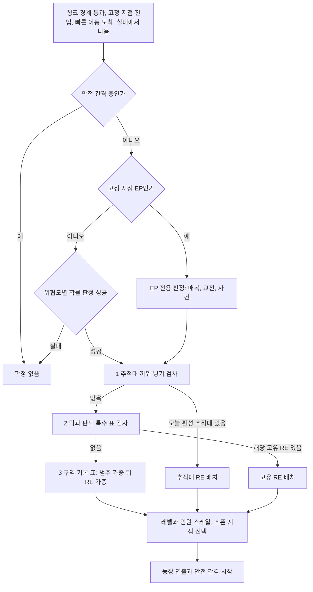

# SD-05. 비표시·반복 퀘스트와 랜덤 인카운터

> **서울 폴아웃 상세 기획서 세트** | 문서 ID: SD-05 | 버전: v1.2 | 작성일: 2026-10-12
> **범위**: 핍-보이 퀘스트 목록에 뜨지 않는 **비표시 퀘스트 UQ-01~UQ-124**(13개 구역, 상세 61 + 사이드 문서가 넘긴 훅 압축 63), 같은 일을 되풀이하는 **반복 퀘스트 RQ-01~RQ-55**(SD-15 후보 8, SD-13 반복 거래 12, SD-04d 속죄 의뢰 10 포함), **랜덤 인카운터 RE-001~RE-157**(157종: 적대·상인·사건·세력 순찰·세력 교전·추적대·판도 연동·막 진행 반응·날씨와 밤·특수·관제망 G0~G3·에필로그 결말별), **인카운터 지점 EP 64곳**과 스폰 규칙(밀도, 쿨다운, 고정 지점과 무작위, 판도·막에 따른 표 교체, 실시간 맵 전투 등장 연출, 추적대 빈도 정본).
> **관련 문서**: [SC-00 컨셉](00_concept.md)(v0.4 §5.8·§6.2), [SD-03a 메인 1부](03a_main-story-part1.md), [SD-03b 메인 2부](03b_main-story-part2.md), [SD-04a 사이드(남부)](04a_side-quests-south.md), [SD-04b 사이드(서부·한강)](04b_side-quests-west-river.md), [SD-04c 사이드(북부·동부·도심)](04c_side-quests-north-east-center.md), [SD-04d 세력 퀘스트](04d_faction-questlines.md), [SD-06 세력](06_factions.md), [SD-07a 주요 인물](07a_characters-major.md), [SD-07b NPC 디렉터리](07b_npc-directory.md), [SD-08 월드·권역](08_world-regions.md), [SD-09a](09a_locations-r01-r02.md)·[09b](09b_locations-r03-r04-r10.md)·[09c](09c_locations-r05-r06.md)·[09d](09d_locations-r07-r11.md)·[09e](09e_locations-r08-r09.md)·[09f](09f_locations-underground-river.md) 장소 카탈로그, [SD-10 캐릭터](10_character-system.md), [SD-11 전투](11_combat-system.md), [SD-12 탐험·UI](12_exploration-ui.md), [SD-13 아이템](13_items.md), [SD-14 크리처·적](14_creatures-enemies.md), [SD-15 경제](15_economy.md), [SD-17 사운드](17_sound.md)
> **원작 근거**: [RD-07 비표시·반복 퀘스트와 랜덤 인카운터](../reverse-design/07_misc-quests-encounters.md), [RD-22 경제·주거](../reverse-design/22_economy-housing.md), [RD-24 크리처](../reverse-design/24_bestiary.md), [RD-27 쯔꾸르 이식 시사점](../reverse-design/27_adaptation-notes.md)

---

## 목차
1. 개요
2. 공통 설계 규칙
3. 비표시 퀘스트 (UQ-01~UQ-124)
4. 반복 퀘스트 (RQ-01~RQ-55)
5. 랜덤 인카운터 목록 (RE-001~RE-157)
6. 인카운터 스폰 규칙
7. 원작 대응
8. 제작 메모 (엔진: 범용 2D)
9. 미결 사항
- 부록 A. 신규 고유명사
- 부록 B. 사용한 훅 목록과 출처
- 부록 C. 참고 문서
- 버전 이력

---

## 1. 개요

### 1.1 목적
- 메인·사이드·세력 퀘스트 사이의 빈 공간을 채우는 **월드 충전재** 세 가지를 한 문서에서 설계한다. 원작 RD-07의 분석대로 이 세 요소는 '발견의 기쁨', '잡동사니의 의미', '월드가 플레이어를 기억한다는 감각'을 맡는다.
- 서울판에서는 여기에 한 가지 일을 더 맡긴다. **기울기를 체감시키는 일**이다(바이블 §5.8 원칙 3 '세계가 먼저 알려 준다'). 비표시 퀘스트는 작은 행동으로 호감도와 판도를 천천히 움직이고, 반복 퀘스트는 '누구를 위해 되풀이하는가'로 기울기를 만들며, 랜덤 인카운터는 그 기울기를 길 위의 장면으로 돌려준다.
- 제작자가 바로 데이터로 옮길 수 있도록 발동 조건, 장소(L-ID), NPC(C-·N-ID), 해법, 결과 수치, 보상, 구성(CR-ID·편성 코드), 확률을 적는다.

### 1.2 범위와 경계

| 주제 | SD-05 | 정본 문서 |
|---|---|---|
| 비표시 퀘스트(UQ) | **정본**: ID, 발동, 해법, 결과, 보상 | 장소 L-ID·좌표는 SD-09, NPC 프로필은 SD-07a·07b |
| 반복 퀘스트(RQ) | **정본**: ID, 의뢰처, 주기, 주간 한도, 보상 곡선 | 고정 매입 단가는 SD-13 §7.5·SD-15 §8.1을 그대로 따른다 |
| 랜덤 인카운터(RE) | **정본**: ID, 발동 조건, 구성, 연출, 결과, 출현 빈도 | 적 수치·편성 단위는 SD-14, 세력의 출현 권역 원칙은 SD-06 §14 |
| 인카운터 지점(EP) | **정본**: 고정 지점 ID와 배치 원칙 | 좌표 청크는 SD-08·SD-09 |
| 추적대 빈도 | **정본**(SD-14 §9.13이 위임) | 추적대 편성은 SD-14 §9.13, 수배도 규칙은 SD-12 §9.7·SD-03a §6.5 |
| 이동 중 판정 주기와 확률 | SD-08 §13.3 값을 그대로 쓴다 | SD-08 |
| 호감도 증감의 기본값·상한 | SD-06 §3.4·§3.5를 따른다. 이 문서는 개별 값만 정한다 | SD-06 |
| 사이드 퀘스트(SQ)·세력 퀘스트(FQ) | 다루지 않는다. 겹치는 훅은 남겨 두었다(부록 B) | SD-04a~d |

### 1.3 요약
1. **비표시 퀘스트 124개**를 13개 구역에 4~14개씩 배치했다. 61개는 카탈로그 NPC 표의 작은 사정과 SD-09d 소형 훅으로 새로 만들어 상세 설계했고, 63개는 사이드 문서 3개(SD-04a·04b·04c)가 부록 B로 넘긴 훅을 압축 설계했다. 사이드 문서가 쓴 훅은 다시 쓰지 않았다. 진영을 고르는 장면은 하나도 없다. 결과는 **무엇을 누구 손에 두고 왔는지, 무엇을 고치거나 부쉈는지**로 갈린다.
2. **반복 퀘스트 55개**: SD-15 §8.2 후보 8개(RQ-01~08), SD-13 §7.5 반복 거래 12개(RQ-09~20), 세력 출구(RQ-21~30), **SD-04d §15 속죄 의뢰 10종(RQ-31~40)**, 카탈로그·사이드 문서가 넘긴 반복 후보(RQ-41~55). 호감도 대상 10개 세력 모두에게 평시 출구와 속죄 출구가 있다.
3. **반복의 기울기 규칙**: 회당 호감도 +2(SD-06 일일 상한 안), **5회째마다 '단골 의뢰' 보너스 +3**(공개도 2, 연동 적용), 행동형 10회째마다 그 세력 구역 판도 사건 보정 +2. 주간 한도와 체감 보상 곡선(1~3회 100%, 4~5회 75%, 6회부터 50%), 주간 RQ 캡 연성 상한 1,200으로 캡 과잉을 막는다.
4. **랜덤 인카운터 157종**: 적대 30, 중립 상인·행상 10, 사건 20, 세력 순찰 10, 세력 교전 10, 추적대 15, 판도 연동 8, 막 진행 반응 16, 날씨·밤 8, 특수·희귀 10, 관제망 G0~G3 10, 에필로그 결말별 10(고유 25, 반복 132). 사이드·세력 퀘스트의 결과 변수(`SQH_`·`SHO_`·`FH_`)로 켜는 변형을 두었다(6.8).
5. **스폰 규칙**: 이동 판정은 SD-08 §13.3(청크 경계, 위협도별 주기·확률)을 따른다. 판정에 성공하면 ① 추적대 끼워 넣기 ② 막·판도 특수 표 ③ 구역 기본 표 순서로 고른다. 기본 표의 세력 비율은 판도 상태가 정한다(지배·우세 60/25/15, 공백은 크리처 70·약탈자 30).
6. **인카운터 지점 EP 64곳**을 확정했다. 카르마 추적자 고정 매복 지점 10곳은 SD-06 §12.3의 제안을 받되 '성산대교 남단'을 SD-09b 제안대로 '공덕 오거리 고가'로 옮겼다.
7. **추적대 빈도 정본**: 호감도 적대 추적대는 SD-06 §4.5의 '하루 1회 판정' 값, 수배 추격조는 SD-12 §9.7의 등급별 확률(0/5/10/15/20%), 카르마 추적자는 '3게임일마다 50%'로 정했다.
8. 실시간 맵 전투 등장 연출: 화면 밖 12타일 이상, 모퉁이 뒤 스폰, 방위 링 예고, 첫 분대 비적대 접근(원작 계승), 활성 상한 SD-14 §11.7(평시 12·16, 추적대 5).

### 1.4 표기 규칙
- **ID**: 비표시 퀘스트 `UQ-01~`, 반복 퀘스트 `RQ-01~`, 랜덤 인카운터 `RE-001~`(세 자리), 인카운터 지점 `EP-<구역>-nn`(이 문서 신설, 예: `EP-R01-03`).
- **구역**: R01~R11, UG(지하), HR(한강). 장소는 SD-09의 L-ID, 인물은 SD-07a의 C-ID 또는 SD-09 NPC 표의 N-ID를 쓴다. 이 문서가 새로 만든 인물은 `(SD-07b에서 ID 부여)`라고 적고 부록 A에 모았다.
- **세력 약호**: SD-06 §2.2. BJ 비상정부, YH 연합단, WP 원칙파, SB 새벽인력, JG 중국군 잔존병, JH 지하시장, GS 각성회, JC 정착지 연합(정착지 개별은 BC 봉천·TK 탱크마을·ND 노들섬·SY 선유도·TS 뚝섬 장터·SV 세이프빌·SA 사당·MW 망원·IT 이태원·YJ 양재·AC 아차산·CD 창동), NJ 난지 고철단, KD 큰돌 무리. 비대상은 YT 약탈자, BY 변종, CB 철벽경호, JY 자율방범대, HS 한강 행상 조합, DG 들것 의료반, NS 남산 방송.
- **수치 표기**: `BC +4` = 봉천 개별 호감도 기본값 +4(SD-06 §3.4의 카리스마·성향·퍽 보정을 곱한다). `카르마 +25`. `판도 R03 TK +3` = 그 구역 TK 사건 보정 +3(SD-06 §5.3). `수배 -5` = 수배도.
- **공개도**: SD-06 §6.2의 0 비밀 / 1 목격 / 2 공개 / 3 방송급. UQ·RQ의 기본 공개도를 적는다. 연동(SD-06 §3.6)은 공개도와 전파 도착을 거쳐 적용된다.
- **유형**(UQ): 원작 RD-07 §7.1 분류를 쓴다. 도덕 시험 / 환경 서사·추적 / 정착지 생활 / 경제·해금 / 퍼즐·내기 / 메인 확장(후일담) / 구출. 서울판에서 **'인도형'**(물건을 누구 손에 두는지로 결과가 갈림)을 추가했다.
- **시간**: '게임일' = 게임 시간 24시간. **주간** = 게임 시작일 06:00부터 7게임일 단위(리셋 시각 06:00). 핍-보이 날짜는 SD-12 달력을 쓴다.
- **레벨 구간**(SD-14 §9.13): Ⅰ Lv1~7 / Ⅱ Lv8~14 / Ⅲ Lv15~21 / Ⅳ Lv22+.

### 1.5 설계 원칙

| # | 원칙 | 이 문서의 규칙 |
|---|---|---|
| 1 | 묻지 않는다 | UQ·RQ·RE 어디에도 "어느 편에 서겠습니까?", "이 제안을 받아들이겠습니까?" 같은 진영 질문을 두지 않는다. 의뢰는 사정이고, 결과는 주인공이 실제로 한 일이다 |
| 2 | 작은 것은 천천히 | UQ 1개의 세력 변동은 ±2~±8, RQ 1회는 +2다. 큰 기울기는 메인·세력 퀘스트에 맡긴다(SD-06 §3.5 1회 사건 상한 ±15 안) |
| 3 | 되풀이가 기울기를 만든다 | RQ는 세력마다 출구가 있다. 같은 관제망 식별 태그도 연합단에 팔면 연합단 쪽으로, 각성회에 돌려주면 각성회 쪽으로 기운다. 5회째마다 '단골 의뢰' 보너스가 공개 기록을 남겨 다른 세력도 알게 된다 |
| 4 | 길 위에서 돌려준다 | 막 진행·판도·호감도·카르마·수배가 바뀌면 RE 표가 바뀐다. 주인공이 한 일의 후일담이 길 위에서 나타난다(원작 '후일담 배달' 계승) |
| 5 | 놓쳐도 막히지 않는다 | UQ는 놓칠 수 있다(원작처럼 조건부 소멸). 단 어떤 UQ도 메인·사이드 진행의 필수 조건이 아니다 |
| 6 | 현실의 서울 | 크리처는 SD-14의 실제 생물 변이, 인물은 2077년 한국의 직업과 생활에서 온다. 설화·요괴·민속 귀신은 쓰지 않는다 |
| 7 | 동료 없음 | 동행은 퀘스트 중 일시 동행 NPC(구간 한정)뿐이다. 인카운터에서 만난 NPC가 따라오지 않는다 |

---

## 2. 공통 설계 규칙

### 2.1 세 콘텐츠의 역할 분담

| 콘텐츠 | 핍-보이 표시 | 시작 방식 | 주된 일 | 기울기에 하는 일 |
|---|---|---|---|---|
| 비표시 퀘스트(UQ) | 퀘스트 목록에 없음(SD-12 §3.12). 진행 중이면 '기타' 묶음에 사실 줄 1개만 뜬다(아래 2.6) | NPC 대화·엿듣기 44, 장소·신호·사건·사물 17(UQ-01~61 기준) | 정착지 생활, 도덕 시험, 환경 서사, 상점 해금 | 정착지 개별 호감도와 작은 세력 변동. '누구 손에 두었는가' 연습 |
| 반복 퀘스트(RQ) | '기타' 묶음에 의뢰처와 이번 주 횟수 | 의뢰처 대화, 게시판 | 잡동사니에 값 매기기, 캡·XP 공급, 반복 소비처와 짝 | 회당 +2, 5회째 +3, 10회째 판도 +2. 세력 출구가 곧 방향 |
| 랜덤 인카운터(RE) | 없음 | 청크 경계 판정, 고정 지점, 막·판도 사건 | 이동 리듬, 위치 힌트, 후일담 배달, 추적 | 판도·호감도의 결과를 장면으로 보여 준다. 일부(세력 교전, 구조)는 직접 기울기를 만든다 |

### 2.2 '고르지 않고 기운다'를 UQ·RQ·RE에 옮기는 규칙

| 상황 | 금지하는 형식 | 대신 쓰는 형식 |
|---|---|---|
| 물건을 두고 둘 이상이 원한다 | "누구에게 주겠습니까?" 메뉴 | 물건을 들고 있는 채로 각 인물에게 가서 '건네기' 상호작용을 하면 그때 결과가 정해진다. 확인 대사는 "이걸 맡기겠다" 한 줄뿐(SD-06 §3.9) |
| 두 세력 순찰이 싸운다(세력 교전) | "어느 편을 들겠습니까?" | 주인공이 실제로 총을 쏜 대상, 쓰러진 쪽에 스팀팩을 쓴 행동이 편든 것으로 기록된다. 아무것도 안 하고 지나가면 기록 없음 |
| 반복 의뢰의 의뢰처가 여럿이다 | "어느 조직의 일을 맡겠습니까?" | 같은 물건(태그·주민등록증 등)을 가져갈 수 있는 창구가 여럿 있고, 주인공이 어느 창구에 내놓는지가 행동이다 |
| 도덕 시험 | 선/악 버튼 | 대화 선택지는 개별 사안("돈은 내가 갚겠다", "목걸이를 끊어 주겠다")만 다룬다. 진영은 묻지 않는다(바이블 §5.8 원칙 5) |
| 퀘스트 기록 문장 | "○○ 편을 들어라" | 사실 문장: "철사의 돋보기 렌즈는 아직 당신 가방에 있다." |

### 2.3 보상 기준

| 항목 | UQ | RQ | RE | 근거 |
|---|---|---|---|---|
| XP | 50~200(위협도 1: 50~80 / 2: 80~110 / 3: 110~140 / 4: 140~170 / 5: 170~200) | 회당 10~50, **RQ별 누적 상한 500**(넘으면 캡·물건만) | 사건형 25~75, 구조형 50~100, 고유 희귀 100~150. 전투 XP는 처치분 별도 | SD-10 §4.4 |
| 캡 | 0~400. 구간 Ⅰ(Lv1~6)에서 시작하는 UQ는 300캡 이하 | 회당 50~200(고정 시세 거래는 SD-13 단가) | 상인·보상형만 | SD-15 §9.1 |
| 호감도 | 세력 ±2~±8, 정착지 개별 ±2~±10 | 회당 +2, 5회째 +3 보너스 | 세력 교전 개입 +2(처치 원천), 구조 +2 | SD-06 §3.4 |
| 카르마 | ±10~±100(인력 해방 +50/+75, 무고한 살해 -100) | 기부형 10캡당 +1, 증표형 ±10/개 | 구조 +25, 약탈 -5~-25 | SD-10 §6.3 |
| 판도 | 사건 보정 ±1~±5 | 10회째마다 +2 | 세력 교전 결과 ±3(SD-06 §14.3) | SD-06 §5.3 |
| 물건 | SD-13 기존 ID. 고유 물건은 `(SD-13에서 ID 부여)` | — | 위치 힌트·은닉처 | SD-13 |

- **놓침 보상 없음**: 소멸한 UQ는 아무것도 남기지 않는다. 대신 바크(지나가는 대사) 1줄로 결과를 들려준다(예: "석라희네 금전등록기는 결국 고철로 팔렸대").
- **일시 동행**: UQ의 일시 동행 NPC는 SD-11 일시 동행 규칙(HP 회복, 전투 종료 처리)을 따르고, 해당 단계가 끝나면 그 자리에서 헤어진다.

### 2.4 정보 전파와 공개도 기본값

| 콘텐츠 | 기본 공개도 | 예외 |
|---|---|---|
| UQ 정착지 안 해결 | 2 공개 | 은신·몰래 해법은 0, 목격자가 남으면 1 |
| UQ 야외 해결 | 1 목격(관련 NPC가 살아 있으면) | NPC가 없거나 죽었으면 0 |
| RQ 1회 완료 | 0 비밀(대가를 주고받는 사적 거래) | 5회째 '단골 의뢰' 보너스 사건은 2 공개 |
| RE 세력 교전 개입 | 1 목격(살아남은 쪽 세력) | 양쪽을 모두 쓰러뜨리면 0 |
| RE 구조·해방 | 2 공개(구조된 사람이 정착지로 가서 말한다) | — |

- 공개도 2 이상이면 SD-06 §6.3 소문 경로(같은 구역 12시간, 인접 구역 +12시간)로 퍼지고, 그때 연동(SD-06 §3.6)이 적용된다. 연동은 1회 상승량 3 이상에만 걸리므로 RQ 회당 +2는 연동이 없다. **단골 의뢰 보너스(+3)가 연동을 일으키는 유일한 RQ 원천이다.**

### 2.5 퀘스트 실패·횡령·포기
- SD-06 §3.4를 따른다. 맡은 일을 실패하고 보고하면 의뢰 세력 -3, 포기만 하고 보고하지 않으면 0, 맡은 물건을 다른 데 넘기면 -8(받은 쪽은 SD-06 §3.9 인도 효과가 없는 '일반 거래'로 처리).
- UQ에는 '실패'가 드물다. 대부분은 결과가 여러 갈래일 뿐이다. 실패가 있는 UQ(시간 제한 구출 등)는 개별 항목에 적었다.

### 2.6 비표시의 표시 방식
- UQ는 퀘스트 목록에 제목이 없다. 대신 **진행 중인 UQ는 핍-보이 '기타' 묶음 아래 '메모' 칸에 사실 줄 1개**를 남긴다(예: `- 철사의 돋보기 렌즈는 아직 당신 가방에 있다.`). 끝나면 줄이 흐려지고 7게임일 뒤 사라진다. 원작의 '노트·지도 마커만 남기는' 방식을 서울판 퀘스트 기록 규칙(SD-12 §3.12 '사실 문장')에 맞춘 것이다.
- 지도 마커는 위치가 꼭 필요한 UQ에만 1개 붙인다(표에 `마커` 표시).
- UQ 완료 알림은 띄우지 않는다. XP 획득 알림만 뜬다(원작과 같다).

### 2.7 변수 체계 (확정)
- SD-03a §12.3은 0301~를 SD-05·SD-06·SD-04에 순서대로 배정하라고 했다. 이 문서는 **변수 V0301~V0680, 스위치 S0301~S0750**을 쓴다(RECON_SPEC §3.3에서 확정, 9장 M-01 해소).

| 대역 | 용도 | 수 |
|---|---|---|
| V0301~V0424 | `UQ_nn` UQ 상태(0 미발견 / 1 발견 / 2~8 단계 / 9 끝남 / 10 소멸) | 124 |
| V0425~V0548 | `UQ_nn_R` UQ 결과 코드(해법 번호) | 124 |
| V0549~V0603 | `RQ_nn_W` RQ 이번 주 횟수 | 55 |
| V0604~V0658 | `RQ_nn_T` RQ 누적 횟수(단골 단계·XP 상한 판정) | 55 |
| V0659~V0680 | 인카운터 공용: `RE_LAST_DAY`, `RE_SAFE_CNT`, `RE_UNIQ_USED`, 주간 RQ 캡 합계, 추적대 오늘 활성 비트(16), 예비 | 22 |
| S0301~S0457 | RE 사용·쿨다운 표시(RE-ID 번호 대응) | 157 |
| S0461~S0524 | EP 지점 1회성 소모(64곳) | 64 |
| S0525~S0750 | UQ 보조 플래그, 예비 | 226 |

---
## 3. 비표시 퀘스트 (UQ-01~UQ-124)

### 3.1 총람표
- `유형` 약어: 도덕 = 도덕 시험, 환경 = 환경 서사·추적, 생활 = 정착지 생활, 해금 = 경제·해금, 퍼즐 = 퍼즐·내기, 확장 = 메인 확장, 구출, 인도.
- `시작`: 대화 = NPC가 말을 건다 / 엿듣기 / 사물(시체·쪽지·단말·물건) / 신호(ST-14 조난 신호 등) / 장소 진입.
- `출처`: 장소 카탈로그의 소형 훅(`09d 소형`), 사이드 문서가 부록 B로 넘긴 훅(`04x 부록 B`), 또는 카탈로그 NPC 표의 인물·장소에서 이 문서가 새로 만든 것(`신규`). 사이드 문서가 쓴 훅은 다시 쓰지 않았다(부록 B). 이 표는 상세 설계한 UQ-01~61이고, 압축 설계한 UQ-62~124는 3.16이다.

| ID | 제목 | 구역 | 장소 | 시작 NPC·사물 | 시작 | 유형 | Lv | 출처 |
|---|---|---|---|---|---|---|---|---|
| UQ-01 | 24시 | R01 | L-R01-11 | 석라희(N-R01-038) | 대화 | 해금 | 1~4 | 신규 |
| UQ-02 | 백구의 밥그릇 | R01 | L-R01-09 | 남솔(N-R01-034) | 엿듣기 | 생활 | 1~4 | 신규 |
| UQ-03 | 다리목 하사의 배급표 | R01 | L-R01-20 → L-R01-27 | 엄도현(N-R01-050) | 대화 | 도덕 | 2~6 | 신규 |
| UQ-04 | 7호 냉동 창고 | R01 | L-R01-29 | 관리인 홀로테이프 | 사물 | 인도 | 3~7 | 신규 |
| UQ-05 | 누렁이 | R01 | L-R01-30 | 연보경(N-R01-040)의 짐소 | 장소 | 생활 | 1~5 | 신규 |
| UQ-06 | 마지막 시세 | R02 | L-R02-07 → L-R02-08 | 경상현(N-R02-032) | 대화 | 환경 | 4~8 | 신규 |
| UQ-07 | 견습생의 첫 납땜 | R02 | L-R02-11 | 공하경(N-R02-017) | 엿듣기 | 생활 | 2~6 | 신규 |
| UQ-08 | 철사의 돋보기 | R02 | L-R02-19 | 철사(N-R02-038) | 대화 | 도덕 | 6~10 | 신규 |
| UQ-09 | 탁한 물 | R02·UG | L-R02-11 | 도민지(N-R02-010) | 대화 | 해금 | 3~7 | 신규(SD-14 CR-501 연계) |
| UQ-10 | 저울추 | R02 | L-R02-12 | 탁우빈(N-R02-019) | 엿듣기 | 도덕 | 2~6 | 신규 |
| UQ-11 | 캡 도감 | R03 | L-R03-03 | 병뚜껑(N-R03-018) | 대화 | 해금 | 4~10 | 신규 |
| UQ-12 | 연희동의 차 한 잔 | R03 | L-R03-20 | 노덕수(N-R03-052)·꽃분(N-R03-053) | 장소 | 도덕 | 5~9 | 신규 |
| UQ-13 | 정문의 밤 교대 | R03 | L-R03-03 | 엄규태(N-R03-019) | 엿듣기 | 도덕 | 6~10 | 신규 |
| UQ-14 | 땜장이의 교재 | R03 | L-R03-15 | 어상구(N-R03-044) | 대화 | 해금 | 5~9 | 신규 |
| UQ-15 | 수습기사의 순찰 일지 | R03 | L-R03-25 → L-R03-24 | 케빈 문(N-R03-050) | 대화 | 인도 | 6~10 | 신규 |
| UQ-16 | 누룩 | R04 | L-R04-01 | 고옥분(N-R04-012) | 대화 | 생활 | 3~7 | 신규 |
| UQ-17 | 줄다리 | R04 | L-R04-18 | 연건(N-R04-033) | 대화 | 해금 | 5~10 | 04b 부록 B(R04 #4) |
| UQ-18 | 수상 정원의 가마우지 | R04 | L-R04-06 | 제유나(N-R04-026) | 대화 | 해금 | 4~8 | 신규(SD-09b 반복 후보 연계) |
| UQ-19 | 교관의 대련 | R04 | L-R04-01 | 양무진(N-R04-005) | 대화 | 퍼즐 | 4~10 | 신규 |
| UQ-20 | 온실의 마지막 씨앗 | R05 | L-R05-32 | 금동환(N-R05-020) | 대화 | 인도 | 15~19 | 04c 부록 B(H05-03) |
| UQ-21 | 사직 언덕의 벌통 | R05 | L-R05-12 | 추미령(N-R05-043) | 대화 | 생활 | 15~18 | 신규 |
| UQ-22 | 미아 안내 방송 | R05·UG | L-R05-16 → L-UG-62 | 미소(N-R05-028) | 장소 | 환경 | 15~19 | 신규 |
| UQ-23 | 맞춤 외투 | R05 | L-R05-29 | 인수진(N-R05-040) | 대화 | 해금 | 15~19 | 신규 |
| UQ-24 | 생도 망토 | R06 | L-R06-14 → L-R06-03 | 곽시원(N-R06-040) | 대화 | 인도 | 6~10 | 신규 |
| UQ-25 | 옥상의 거울 | R06 | L-R06-13 | 고사리 할매(N-R06-058) | 장소 | 생활 | 6~10 | 신규 |
| UQ-26 | 큰 놈 | R06·HR | L-R06-17 | 기상우(N-R06-061) | 대화 | 생활 | 7~11 | 신규 |
| UQ-27 | 소식꾼의 원고 | R06 | L-R06-26 | 지태웅(N-R06-035) | 신호 | 구출 | 8~12 | 신규 |
| UQ-28 | 연체 도서 | R06·전역 | L-R06-26 | 엄유진(N-R06-059) | 대화 | 인도 | 6~16 | 신규 |
| UQ-29 | 바늘탑의 불 | R07 | L-R07-01 T15 | 연서하(N-R07-010) | 대화 | 인도 | 12~16 | 09d 소형 |
| UQ-30 | 코어 거치대 | R07 | L-R07-01 T13 | 케일럽 헤이스(N-R07-036) | 대화 | 인도 | 12~16 | 09d 소형 |
| UQ-31 | 퍼레이드는 계속된다 | R07 | L-R07-02·03 | 원자 토끼 퐁이(N-R07-053) | 장소 | 퍼즐 | 9~13 | 09d 소형 |
| UQ-32 | 공중 다리 | R07 | L-R07-23 | 위겨레(N-R07-018) | 대화 | 생활 | 10~14 | 09d 소형 |
| UQ-33 | 응원 방송 | R07 | L-R07-25 | 배은지(N-R07-058) | 대화 | 해금 | 9~13 | 09d 소형 |
| UQ-34 | 후송 명단 | R07 | L-R07-29 | 국은영(N-R07-051) | 대화 | 인도 | 9~13 | 09d 소형 |
| UQ-35 | 배송지 불명 | R07 | L-R07-32 → L-R07-04 | 번개 3호(N-R07-059) | 장소 | 환경 | 9~13 | 09d 소형 |
| UQ-36 | 약탕 | R08 | L-R08-15 | 어민결(N-R08-036) | 대화 | 구출 | 5~10 | 신규 |
| UQ-37 | 움막의 선사 | R08 | L-R08-30 | 봉상구(N-R08-058) | 장소 | 해금 | 6~10 | 신규 |
| UQ-38 | 강안개의 손님 | R08 | L-R08-01 | 임라희(N-R08-016) | 대화 | 도덕 | 5~12 | 신규 |
| UQ-39 | 보루의 주파수 | R08 | L-R08-22 | 맹율(N-R08-015) | 신호 | 환경 | 6~11 | 신규 |
| UQ-40 | 두 머리 송아지 | R08 | L-R08-01 우시장 | 마금순(N-R08-004) | 엿듣기 | 생활 | 5~9 | 신규 |
| UQ-41 | 창동 국수 | R09 | L-R09-17 → L-R09-27 | 진옥분(N-R09-025) | 대화 | 생활 | 10~14 | 신규 |
| UQ-42 | 의원칸의 수혈 | R09 | L-R09-17 | 채수안(N-R09-027) | 사건 | 구출 | 10~14 | 신규 |
| UQ-43 | 순례 지도 | R09 | L-R09-19 → L-R09-33 | 별하(N-R09-028) | 대화 | 인도 | 10~16 | 신규 |
| UQ-44 | 교환창의 만화책 | R09 | L-R09-24 | 에반 카터(N-R09-036) | 엿듣기 | 도덕 | 10~14 | 신규 |
| UQ-45 | 백운대 조난 신호 | R09 | L-R09-03 | ST-14 신호 | 신호 | 환경 | 12~18 | 신규 |
| UQ-46 | 하류 수질 일지 | R10 | L-R10-10 | 배은영(N-R10-037) | 대화 | 인도 | 16~20 | 신규 |
| UQ-47 | 5호선 기관사 | R10·UG | L-R10-22 | 유태호(N-R10-036) | 대화 | 해금 | 16~20 | 신규 |
| UQ-48 | 고물 지도 | R10 | L-R10-14 | 체인(N-R10-035) | 대화 | 퍼즐 | 16~22 | 신규 |
| UQ-49 | 빌라 의원의 가방 | R10 | L-R10-18 | 감순복(N-R10-034) | 대화 | 해금 | 16~20 | 신규 |
| UQ-50 | 통신원의 렌즈 | R11 | L-R11-20 | 공아윤(N-R11-043) | 대화 | 인도 | 14~18 | 신규 |
| UQ-51 | 정비 하사의 부품 장부 | R11 | L-R11-06 | 우나은(N-R11-032) | 엿듣기 | 도덕 | 14~18 | 신규 |
| UQ-52 | 약초 길수의 처방 | R11 | L-R11-09 → L-R11-21 | 약초 길수(N-R11-041) | 대화 | 생활 | 14~18 | 신규 |
| UQ-53 | 덫에 걸린 수색견 | R11 | L-R11-20 인근 | 사냥꾼 단우(N-R11-044) | 사건 | 도덕 | 14~18 | 신규 |
| UQ-54 | 환승 미로 지도 | UG | L-UG-11 | 공덕 해든(N-UG-015) | 대화 | 해금 | 4~8 | 신규 |
| UQ-55 | 환풍실의 탈출자 | UG | L-UG-12 | 예소이(N-UG-017) | 장소 | 도덕 | 6~10 | 신규 |
| UQ-56 | 신설동 막차 | UG | L-UG-48 | 신설동 봉수(N-UG-048) | 장소 | 해금 | 8~12 | 신규 |
| UQ-57 | 의대생의 실습 | UG·R05 | L-UG-33 → L-R05-31 | 맹건우(N-UG-031) | 대화 | 인도 | 12~18 | 신규 |
| UQ-58 | 닮은 사람 | HR | L-HR-01 | 철새(N-HR-022) | 대화 | 도덕 | 6~14 | 신규(수배 인상착의 연계) |
| UQ-59 | 선주 원로의 유언장 | HR | L-HR-01 | 염귀순(N-HR-018) | 대화 | 도덕 | 5~10 | 신규 |
| UQ-60 | 진료선의 붕대 | HR | L-HR-01 | 명해인(N-HR-015) | 대화 | 생활 | 5~10 | 신규 |
| UQ-61 | 밤섬까지 헤엄 | HR | L-HR-01 → L-R04-19 | 백로아(N-HR-017) | 사건 | 구출 | 8~14 | 신규 |

### 3.2 분포와 구성
- 아래 표는 상세 설계한 UQ-01~61의 분포다. 압축 설계 UQ-62~124를 더한 전체 분포는 3.16 끝에 적었다.

| 구역 | 수 | 유형 구성 | 비고 |
|---|---|---|---|
| R01 관악 | 5 | 해금 1, 생활 2, 도덕 1, 인도 1 | 시작 권역. 카르마·호감도·인도의 첫 연습 |
| R02 여의도·영등포 | 5 | 환경 1, 생활 1, 도덕 2, 해금 1 | 지하시장과 새벽인력의 그늘 |
| R03 마포·상암 | 5 | 해금 2, 도덕 2, 인도 1 | 탱크마을 생활 |
| R04 서강·선유도 | 4 | 생활 1, 해금 2, 퍼즐 1 | 물 경제와 횡단로 개선 |
| R05 도심 | 4 | 인도 1, 생활 1, 환경 1, 해금 1 | 6막 전후. Lv15 이상 |
| R06 용산·남산 | 5 | 생활 2, 인도 2, 구출 1 | 피난촌과 남산 방송 |
| R07 강남 | 7 | 인도 3, 퍼즐 1, 생활 1, 해금 1, 환경 1 | SD-09d 소형 훅 |
| R08 동부 | 5 | 구출 1, 해금 1, 도덕 1, 환경 1, 생활 1 | 장터 생활 |
| R09 북부 산악 | 5 | 생활 1, 구출 1, 인도 1, 도덕 1, 환경 1 | 잔존병 라인(FQ-JG)과 겹치지 않게 잔존병 인물은 쓰지 않았다 |
| R10 서부 평야 | 4 | 인도 1, 해금 2, 퍼즐 1 | 고레벨 외곽 |
| R11 청계산 | 4 | 인도 1, 도덕 2, 생활 1 | 계엄군 개인의 얼굴 |
| UG 지하 | 4 | 해금 2, 도덕 1, 인도 1 | 지하철 정착민 |
| HR 한강 | 4 | 도덕 2, 생활 1, 구출 1 | 노들섬 생활과 수영 |
| **합계** | **61** | 생활 12, 해금 13, 도덕 12, 인도 12, 환경 5, 구출 4, 퍼즐 3(퀘스트마다 주 유형 1개) | 시작: 대화 38, 엿듣기 7, 장소 9, 신호 3, 사건 3, 사물 1 |

- **메인 확장형**은 UQ로 따로 두지 않았다. 메인의 결과는 RE '막 진행 반응'(5.9)이 후일담으로 배달한다. 원작의 메인 확장형(U07 쓰리독 은닉처)은 서울판에서 남산 방송 협력 보상이 맡는다.
- 원작 U16(셰런 고용)처럼 동료를 주는 UQ는 없다(바이블 K7).

### 3.3 R01 관악

#### UQ-01 24시
| 항목 | 내용 |
|---|---|
| 발동 | 봉천 번개24(L-R01-11)에서 석라희(N-R01-038)와 두 번째 대화. 상시 |
| 요지 | 석라희는 200년 전 점주 이름 '24시'를 물려받았지만 진공관 금전등록기와 냉장 진열대가 잠겨 있다. 등록기는 2077년 청솔식품 본사 '점포 코드'로만 풀린다. 노량진 번개24(V24, 로봇 점원 24-117호 외 2대)의 로봇 점원은 아직 본사 회선을 기억한다 |
| 해법 | ① 노량진 번개24 로봇 점원에게 '점포 이관 신청'을 한다: 대화 [화술 30] 또는 세진전자 사원증(M-072) 제시 → '점포 코드 카드'를 받는다 ② 등록기 기판을 직접 고친다 [수리 45] + 진공관(M-014) 1 ③ 등록기를 뜯어 안의 것을 챙긴다(밤, 석라희가 자는 동안) |
| 결과 | ①② 석라희 상점 재고 단계 +1, 아이스 번개사이다(I-049) 진열 시작, BC +4, 카르마 +25 / ③ 만 원권(M-002) 40장 + 전시 배급표(M-003) 6장, 카르마 -25, 다음 날 석라희가 알면(목격 판정 40%) BC -6, 석라희 상점 가격 +10% |
| 보상 | 60 XP. ①② 석라희가 '첫 손님 할인'으로 번개24 삼각김밥(I-024) 3 |
| 비고 | 공개도: ①② 2, ③ 0 또는 1. 등록기를 고치면 RE-031(번개24 배송 로봇) 출현 확률이 R01에서 2배가 된다(점포 코드가 살아난 신호) |

#### UQ-02 백구의 밥그릇
| 항목 | 내용 |
|---|---|
| 발동 | 봉천 계단마을(L-R01-09)에서 남솔(N-R01-034)과 조담희(N-R01-029)의 대화를 엿듣는다("백구가 사흘째 밥을 남겨"). MQ-101 이후 |
| 요지 | 백구(C-015)가 밥을 남기는 이유는 밤마다 마을 아래 배수지 뒤에서 변이 들개 새끼 한 마리(어미를 잃었다)에게 밥을 물어다 주기 때문이다. 남솔은 알고 있었다 |
| 해법 | ① 밤 22시 이후 백구를 몰래 따라간다(은신, 백구가 뒤돌아보면 멈춤) → 새끼 발견 ② 남솔에게 [화술 20]으로 사실을 듣는다 ③ 백구의 발을 살핀다 [의학 25](헛짚음: 발은 멀쩡하다는 것만 안다) |
| 결과 | 새끼를 발견한 뒤 주인공의 행동: 마을로 데려와 조담희에게 맡긴다(옴 너구리 퇴치용 '마을 강아지'가 된다. BC +5, 카르마 +25) / 관악산 쪽으로 돌려보낸다(카르마 +10, 백구가 사흘간 주인공을 따라 마을 입구까지 배웅) / 죽인다(카르마 -25, 남솔이 목격하면 BC -8, 백구가 주인공을 보면 짖는다 7일) |
| 보상 | 50 XP. 데려오면 7일 뒤 남솔이 '강아지 이름표'를 보여 준다(이름은 플레이어 입력, 바크에 쓰인다) |
| 비고 | SD-04a SQ-S01 〈외눈의 인식표〉와 독립이다(밥 당번표는 S01의 소품을 함께 쓴다). 백구는 동료가 아니다. 이 UQ로 백구가 주인공을 따라오지 않는다. 마을 강아지는 NPC 개(CR-108 판본)로 마을 안에만 있다 |

#### UQ-03 다리목 하사의 배급표
| 항목 | 내용 |
|---|---|
| 발동 | 노량진 다리목 검문소(L-R01-20)에서 분대장 엄도현(N-R01-050)과 대화(BJ 경계 이상, 검문 통과 뒤). 1막 이후 |
| 요지 | 엄도현의 어머니 엄옥순(N-R01-507)은 상도 언덕 빌라촌(L-R01-27)에 사는 미등록자다. 계엄병은 미등록자와 물자를 나누면 안 된다. 그는 자기 몫 전시 배급표 10장과 태성 전투식량(I-031) 2를 어머니에게 몰래 전해 달라고 한다. 대가는 "다음에 다리목을 지날 때 내 분대는 당신 가방을 안 연다" |
| 해법 | ① 상도 빌라촌에 전한다(골목의 새벽인력 생포 추적대 매복 지점 EP-R01-06을 지난다) ② 검문소장 황보서현 소위(N-R01-047)에게 이 사실을 알린다 ③ 물건을 그냥 갖는다 |
| 결과 | ① 카르마 +25. 엄옥순이 답례로 2077년 아들 사진(잡화)을 준다. 사진을 엄도현에게 전하면 그 뒤 노량진 다리목 검문은 수배 2등급 이하에서 그냥 통과(수배도와 무관한 개별 플래그, 엄도현 생존 시) / ② BJ +3(공개도 1), 엄도현은 강등되어 7일 뒤 사라진다. 21일 뒤 RE-104(탈영병 무리)에 엄도현이 섞여 나온다 / ③ 카르마 -10, 엄도현 대사 냉담(검문 시 "가방 열어") |
| 보상 | 70 XP |
| 비고 | 진영 선택이 아니다. 계엄병 한 사람의 사정이다. BJ 적대이거나 수배 4등급이면 발동하지 않는다. 엄도현 사망 시 소멸 |

#### UQ-04 7호 냉동 창고
| 항목 | 내용 |
|---|---|
| 발동 | 독산 육가공 단지(L-R01-29) 관리동에서 홀로테이프 「냉동 창고 7호 관리 일지(2077-10-22)」를 줍는다. 상시. `마커` |
| 요지 | 2077년 전시 비축육 창고 7호는 원자력 냉동기로 200년 동안 얼어 있다. 안에는 청솔 런천미트(I-027) 상자와 꽁치 통조림(I-035), 그리고 굴쥐(CR-096)·왕쥐(CR-097) 굴이 벽 너머에 있다. 문 암호는 일지 끝의 날짜 '1022' |
| 해법 | 창고를 연 뒤(쥐 소굴 정리 또는 은신으로 냉동기 제어반까지) 주인공이 실제로 하는 일: ① 봉천 조만석(C-010)에게 창고 위치와 암호를 알려 준다 ② 사당 환승촌 허순자(N-R01-041)에게 알려 준다 ③ 지하시장 함준호(N-R02-009)에게 위치를 판다(200캡) ④ 직접 실어 나른다(런천미트 20, 통조림 20, 무게 30) |
| 결과 | ① BC +6, 봉천 식량 공급 점수 +10(SD-15 §6.3, 30일) / ② SA +6, 사당 공급 +10 / ③ 캡 200, JH +2, 봉천·사당 주민이 나중에 알면(소문, 공개도 1) BC -3 / ④ 판매 차익. 냉동기는 30일 뒤 멈춘다 |
| 보상 | 80 XP |
| 비고 | 어느 쪽에 알렸는지가 '판도 R01'의 작은 사건 보정이 된다(①② +2). 한 곳에만 알릴 수 있는 것이 아니다. 둘 다 알리면 30일 뒤 봉천과 사당이 창고를 두고 다툰다(RE-045 '창고 다툼') |

#### UQ-05 누렁이
| 항목 | 내용 |
|---|---|
| 발동 | 시흥 고개 초소(L-R01-30) 근처에서 짐을 진 채 풀을 뜯는 짐소(CR-091 판본 '누렁이')를 발견한다. 행상 연보경(N-R01-040)의 대열이 RE-033(남부 고개길 수송대)으로 지나간 뒤 1회 |
| 요지 | 누렁이는 남부순환 패거리 척후에 놀라 대열에서 떨어졌다. 등에는 연보경의 짐(잡화 가치 120)이 있다. 시흥 고개에는 들개 무리가 돈다 |
| 해법 | ① 고삐를 잡고 사당 환승촌 캐러밴 정류장(위강윤, N-R01-043)까지 끌고 간다(짐소는 걷기 속도 3.0, 들개 무리 1회 습격) ② 짐만 챙기고 소는 둔다 ③ 소를 잡아 고기로 판다(사냥꾼 엄태경 N-R01-033이 사 준다 80캡) |
| 결과 | ① 카르마 +25, 연보경 상점 가격 -10% 영구, HS 행적 '도움' 1회(공개도 2: 정착지 연합 +1) / ② 짐을 연보경에게 돌려주면 ①과 같되 상점 할인 없음, 갖으면 카르마 -10 / ③ 카르마 -25(가축 살해), 연보경이 알면(위강윤 목격 시) 그 수송대는 주인공에게 3일간 거래 거부 |
| 보상 | 60 XP. ① 연보경이 짐 중 방독면 정화통(I-066) 2를 준다 |

### 3.4 R02 여의도·영등포

#### UQ-06 마지막 시세
| 항목 | 내용 |
|---|---|
| 발동 | 여의도 증권가(L-R02-07) 객장에서 구울 경상현(N-R02-032)과 대화. 상시 |
| 장소 | 여의도 증권가(L-R02-07) 객장 · 여의도 유리탑 3동(L-R02-08) 18층 시세 송출실(1-D9 구현에서 더한 마커 줄) |
| 요지 | 경상현은 2077-10-23 장 마감 시세가 들어오지 않아 '장이 끝나지 않았다'고 믿는다. 시세 테이프는 유리탑 3동(L-R02-08) 18층 시세 송출실에 있고, 그 층에는 왕개미(국회 왕개미 CR-603 판본)가 산다 |
| 해법 | ① 시세 테이프를 가져와 객장 전광판 단말에 넣는다 ② [화술 50] "장은 오래전에 끝났습니다" — 그는 듣지만 믿지 않는다(대사만 바뀌고 진행 없음) ③ 전광판에 아무 숫자나 직접 입력한다 [과학 40](가짜 마감) |
| 결과 | ① 마감 종이 울리고 경상현은 객장을 떠나 지하시장으로 간다(7일 뒤 지하시장에서 '장부 정리' 일을 한다는 바크). 2077 주식 증서 다발(잡화 M-080~099 판본 가치 60)을 준다 → 세월상회(V14)에 가치 ×1.5. 카르마 +25 / ③ 그도 떠나지만, 진짜 마감가가 아니라는 것을 7일 뒤 알아채고 객장으로 돌아온다(대사: "숫자가 너무 예뻤어요") |
| 보상 | 100 XP |
| 비고 | 원작 환경 서사형 계승. 테이프 앞부분은 대전쟁 2시간 전 증시 폭락 실황(공개 기록, SD-02의 2077년 분위기) |

| 단계 | 로그 | 완료 조건 |
|---|---|---|
| 10 | 증권가 객장 구울은 장이 아직 안 끝났다고 믿는다 | 경상현 첫 대화 |
| 20 | 마감 테이프는 유리탑 3동 18층 송출실에 있다 | 경상현에게 들음 · 또는 테이프를 손에 넣음 |
| 100 | 10월 23일의 장이 정리됐다 | 테이프를 전광판에(①) · 공영방송에 넘김(②) · 가짜 마감(③) |

> **구현 정합(단계 1-D9, 1-D 계획 §15.7)**: 2077-10-23 전시 연장장은 23:00 마감 · 23:10 송출 예정이었으나 회선이 관제망 우선(전시 통신 통제 — 22:40 국영방송 심야 뉴스 뒤 방송 회선 우선, 1-12d X8 고침: 옛 '09:47 경계경보'는 미 동부 시각이라 KST 23:47 — 원인이 결과보다 늦었다)이라 막혔고, 2동 서기 남기범이 22:40 3동 임시 카드를 받아 테이프를 손으로 나르기로 했다가 23:21 집행 모드(판독기 등급 필터 · 승강기 정지, SD-02 L167)에 막혔다 — 당번 도미란은 18층 판독 홀 앞에서 기다리다 죽었다. 테이프 라벨 '송출 후 자동 소거' — 한 번 틀면 끝(M-404 → M-405). ② 원문 '진행 없음'인 [화술 50]은 대사만 바꾸고, **테이프의 둘째 쓰임**으로 공영방송 송출실 우도하(N-R02-026, SQ-S10 D와 같은 길 — 다음 06:00 남산 방송)에게 넘기는 길을 더했다: 남산 방송 한 꼭지에 폭락 실황 · 송미래 한 줄 · 경상현은 숫자 없이 남고 다음 아침 대사가 바뀐다 · 80캡 + 50 XP. ①이면 거리 진공관 시세판이 마감가로 바뀌고(월드 문 앞 글) 경상현은 7일 뒤 지하시장. ③은 원문대로(7일 안 진짜 테이프면 ①로 바뀜). 원고 `script/act1/YT.txt` · 진행기 `Yt` · 시험 `test_yt`.
> **구현 정합(1-D9 재미 반영 D9f)**: 18층 로봇은 카드 주인의 '마지막 기록'과 대조한다(알리바이) — 남기범 카드는 올라온 길(1층 승강기 · 계단 판독)이 그 카드일 때만 통과, 아니면 '두 곳에' 질문 · 하보람은 '2동 퇴실 기록 없음 — 어떻게 올라왔나'(정답 비상 계단, 카드 뒷면 '승강기 서서') · 불일치 둘이면 격리. 비상 전지를 올리면 서기가 제 카드로 승강기를 타고 18층 도미란 곁으로 간다(경상현에게 '도미란 대리 옆에 갔어' 답). ②는 우도하가 넘기기 전에 '객장 몫은 없어진다'고 말해 주고 도로 넣을 수 있다 · 18층 송출 단말에 '전달 요청 2건(객장 · 보도국 사본)'. 원문 ① 보상 '2077 주식 증서 다발'은 장부 D-246.

#### UQ-07 견습생의 첫 납땜
| 항목 | 내용 |
|---|---|
| 발동 | 지하시장(L-R02-11) 배전실 작업장 앞에서 공하경(N-R02-017)이 혼잣말하는 것을 듣는다("진공관 세 개만 있으면…"). JH 중립 이상 |
| 요지 | 공하경은 마영식(C-006) 몰래 시장 아이에게 장난감 배송 로봇(태엽 장난감 자동차 M-041 개조)을 고쳐 주고 싶다. 마영식에게 들키면 '부품 횡령'이 된다 |
| 해법 | ① 진공관(M-014) 3을 준다 ② 마영식에게 사정을 먼저 말한다 [화술 25] ③ 직접 고쳐서 공하경에게 준다 [수리 40] |
| 결과 | ① 공하경이 장난감을 고친다. JH +2, 카르마 +10 / ② 마영식이 웃으며 부품을 내준다. JH +3, 마영식 대사 1줄 추가("손이 빠른 애야") / ③ 공하경이 실망한다(카르마 +5, JH 0). 아이는 기뻐한다 |
| 보상 | 50 XP. ①② 뒤 공하경의 소형 수리 요금 -20% |

| 단계 | 로그 | 완료 조건 |
|---|---|---|
| 10 | 공하경이 진공관 셋을 구한다 | 배전실 혼잣말 엿듣기 |
| 20 | 고친 배송 로봇을 광장 아이에게 | ③ 직접 고쳐 내가 갖다주기로 함 |
| 100 | 광장 아이가 배송 로봇을 갖게 된다 | 진공관을 줌(①) · 마영식에게 먼저 말함(②) · 직접 고침(③) |

> **구현 정합(1-12h)**: 원문의 '시장 아이'는 인물 표에 없어 광장 아이 N-JM-K1(사람 · 여덟 살 · 지상 출신 — 밤엔 상가 숙소, 맡은 어른 공하경)을 J-03에 낮(08~18)만 세웠다. 퀘스트 전부터 빈 깡통 상자를 끌며 '배송이요' — 짐꾼 김민수(명찰 A)가 짐을 들면 주소를 중얼거리는 것을 흉내 낸다. 장난감은 새 물건 M-431 태엽 배송 로봇(M-041 개조). 엿듣기는 J-06 **둘째 입장부터**(해독 · 고백 방문과 겹치지 않게) · 공하경 3칸 · JH 중립 이상. 로봇은 마영식 작업대가 아니라 공하경 의자 옆 담요 밑. ① 진공관은 `[물건:M-014 3]` — 마영식 부품 상자에서 훔친 관이면 '훔친 판'(공하경이 꼬리표를 알아봄 · JH 0 · 할인 없음 · 다음 날 마영식 '손이 빠르긴 하지'). ② [화술 25] = 쉬움 — 실패하면 '하경이가 직접 말하라 해'(②만 닫힘). ③ [수리 40]은 문턱(SD-10 — 실패 갈래 없음): 관 없이 태엽 축에 이어 불 대신 종이 울림 · 공하경에게 건넴(원문 — '제가 고쳤다고 할게요', 아이는 그렇게 믿음) 또는 내가 아이에게 갖다줌(M-431 · 단계 20). ①②의 '소형 수리 −20%'는 마영식 V09 정비 요율 ×0.8(공하경이 살아 있을 때 — 상점 없는 인물의 할인은 스승 가게 값 한 곳). 로봇은 다음 06:00 아이 손 — 아이 뒤를 1칸 떨어져 따라오는 배우(퀘스트 전엔 끈 달린 깡통 상자 · 뒤엔 배송 1호, 바퀴는 거리만큼 구름 — 진행기가 띄워 공격 대상 아님) · 시간대 바크 셋 · 아이가 고친 사람을 알면 다음 낮 배송 1호가 발치까지 굴러와 크레용 쪽지 한 번. **구현 뒤 재미 검수 반영**: ② 실패 뒤 '선생님한테 얘기해 봤는데' → 다음 아침 공하경이 직접 말함(RES 4 · JH +1 · 할인 · 마영식 '그게 맞아') · ③ 로봇을 아이에게 안 주고 잃으면(팔기 · 버리기 · 털림) 06:00에 알고 사흘 뒤 공하경이 새로 만듦(보상 없음 — 반쯤 된 상태로 굳지 않게) · 마영식이 죽은 뒤 그의 상자 관이면 '이제 주인도 없는데'. 원고 `script/act1/UQ-07.txt` · MQ-103.txt(MQ-103_KONG U7 · MQ-103_MA U7MA) · 진행기 `UqR02` · 시험 `test_uq_r02`.

#### UQ-08 철사의 돋보기
| 항목 | 내용 |
|---|---|
| 발동 | 새벽인력 본소(L-R02-19) 목걸이 공방에서 철사(N-R02-038)와 대화. SB 경계 이상 또는 변장 성공 상태 |
| 요지 | 근태 목걸이 기술자 철사는 눈이 멀어 가고 있다. 기폭 회로를 잘못 납땜하면 목걸이가 아무 때나 터진다. 그는 세진 광학 부품 '정밀 돋보기 렌즈'를 구해 달라고 한다. 렌즈는 여의도 대학병원(L-R02-09) 안과 수술실에 있다 |
| 해법 | ① 렌즈를 그대로 준다 ② 렌즈를 주면서 그의 공구함에 손을 댄다 [과학 60]: 새로 만드는 목걸이의 기폭 회로가 '원격 해제 시 무조건 열림'으로 바뀐다 ③ 렌즈를 주지 않는다 |
| 결과 | ① SB +4, 철사의 목걸이 해제 요금(SB 우호 이상 200캡) -50%. 카르마 0 / ② SB +4, 카르마 +50. 이후 RE-073(인력 운송)·RE-087(새벽인력 추적대)에서 포로 목걸이가 폭발하지 않는다. 공구함 조작은 30일마다 10% 확률로 발각(SB -8, 철사 실종) / ③ 30일 뒤 바크: "본소에서 목걸이가 또 터졌대." 카르마 0 |
| 보상 | 80 XP. ①② 철사가 '해제 열쇠 원형'(M-164)을 준다. MQ-105 '일부러 잡힌다' 경로의 목걸이 해제 판정 1단계 쉬움 |
| 비고 | 도덕 시험형. ②는 정답이 아니라 위험을 더한 선택이다 |

| 단계 | 로그 | 완료 조건 |
|---|---|---|
| 10 | 철사의 눈 — 세진 광학 정밀 렌즈가 있으면 된다 | 철사에게 '눈이 왜 그래요?' |
| 20 | 여의도 대학병원 2층 수술 현미경의 렌즈를 손에 넣었다 | 렌즈(M-432)를 뺌(사정을 들은 뒤) · 렌즈를 들고 철사를 처음 만남 |
| 100 | 철사의 렌즈 일이 매듭지어졌다 | 그대로 줌(①) · 건네며 공구함 견본을 바꿈(②) · 안 줌(③) |
| 90 | (소멸) 철사가 없다 | 결말 전 철사 사망 · 본소 습격 |

> **구현 정합(1-12h h2)**: 렌즈 자리는 새 맵 **HP-04 여의도 대학병원 2층 안과 외래 · 수술실**(24×14 — HP-01 응급실 북벽 동쪽 끝 새 계단 · 계단 옆 판자 '2층 안과 ↑' · 차임 밖 조용한 층 · 야생 구울 둘 N-HP-F6 외래 간호사 · F7 레지던트). 렌즈는 새 물건 M-432 — 수술 현미경 대물렌즈를 [수리 30] 나사 풀기(조용) 또는 비틀어 뽑기(유리 소리 — 이 층 구울이 다가옴)로 뺀다. 렌즈를 먼저 가져와도 된다(철사 '그거 어디서 났어' — 사정 단계를 건너뜀). 쪽지 사슬: 철사 작업대 밑 '세진 광학 납품 전표 — 여의도 대학병원 안과 2층'(읽으면 철사 '그 전표 봤구나') · 조립대의 두 번 지진 땜 · 벽 그을음 '시험 중 오작동'. 발동은 철사 장면(SQS09_WIRE) 머리 — 늘 고글 너머 찡그림 한 줄 · 'SB 경계 이상'은 AFF_SB > −60, '변장 성공'은 SB_PASS ≥ 1. ② [과학 60]은 건넨 뒤 철사가 '불빛에 대 볼게' 등을 돌린 틈의 선택지(문턱 — SD-10). **해제 요금**(09a '우호 이상 200캡')은 127번 · 내 목걸이(생포 · SB 우호 이상) 같은 값 한 곳 — 렌즈를 건넨 뒤 반값 [캡 100]: 철사 눈엔 ①②가 같은 건넴이라(P2 — 그는 견본이 바뀐 걸 모른다) 반값도 둘 다다(계획 §8b S1을 서사 대조로 고침). ②의 '원격 해제 시 무조건 열림'은 `UQ08_SAFE`(+ 그 시각 하루 뒤 감긴 목걸이부터) 한 값을 세 자리가 읽는다: 생포 목걸이가 담 밖 기폭 신호에 '삑, 삑, 딸깍' 열림(피해 없음 · 깰 때 '낯익은 땜 자국') · FQ-SB-02 원격기 해제에 목걸이가 두 쪽으로 벌어짐(갈고리 '…철사.') · RE-073 · RE-087 표가 생기면 그 자리(D-320). 원문 '30일마다 10% 발각'은 **실장 검수** — 전날 칠판 '목걸이 검수 — 내일 09:00 · 실장' · 철사 '요즘 땜이 곧으니까 괜찮겠지' · 그 날 09시 전 조립대 '검수 견본'을 [과학 60]으로 되돌려 두면 그 회차 통과 · 확률은 10% + 남이 본 열린 목걸이(UQ08_HEAT)마다 10%(씨앗 = 회차). 발각되면 SB −8 · 철사 실종(빈 의자 · 고글 · 칠판 '철사 — 결근' · 구만호가 직접 풂 · 화로 인부 소문). ③(또는 사정을 듣고 둠) 30일 뒤 마당 오작동 — 칠판 '389번 — 결번(오작동)' · 철사 '내 땜이야' · 인부 소문 · 본소 안이면 '퍽'. ③은 되돌릴 수 있다(렌즈를 들고 다시 오면 ①②). 렌즈를 잃으면(06:00 — 어디든 가진 수 0) 마영식 랙으로 흘러가 [캡 120]에 되산다(철사가 그리로 보냄). M-164 '1단계 쉬움'은 [수리 50] 대신 [수리 25] — 생포 공구 상자 · 127번 목걸이 · FQ-SB-02 오태수(원격기가 없을 때). 바이스로 내 목걸이를 풀면 철사 '내 바이스 쓰고 공짜야?'. 원고 `script/act1/UQ-08.txt` · SQ-S09.txt(SQS09_WIRE U8_ · 칠판 · 구만호 BUY_M) · CAPTURE.txt · MQ-105.txt(바이스 · 화로) · FQ-SB-02.txt(FREE_S · KEY · HAND_RS) · MQ-103.txt(U8MA) · 진행기 `UqR02` · act1_paths `_sb_collar` · 시험 `test_uq_r02` · 봇 `jm_bot uq08`.
> **구현 뒤 재미 검수(3.4) · 서사 대조(상 2 · 중 8 · 하 18) 반영(1-12h h2)**: 철사는 본소 감시를 서지 않는다(눈이 멀어 가고, 렌즈 뒤엔 그것을 준 사람 — 한 번 '…너구나. 표찰은 좀 달고 다녀') · 검수 날 09시에 작업실에 있으면 눈앞에서(문 밖 구만호 목소리 '철사, 견본.') 판정 — 발각이면 철사가 사라지는 건 주인공이 나간 뒤(P4) · 통과하면 철사 '실장이 곧네 하더라. 렌즈 덕이야' · **발각 뒤 다시 감은 목걸이(UQ08_WIRE_AT 뒤)는 장부대로 터진다** — ②의 위험이 내 탈출로에도 닿는다(견본 되돌리기가 나도 지킨다) · SB −8의 출처는 구만호 '철사가 그러더군요. 렌즈 갖다준 손님이 공구함 앞에 서 있었다고'(한 번) · 철사 · 실장이 죽거나 습격이면 검수 예고 전체가 닫힘(UQ08_INSPECT 0) · 구만호는 손님 앞에서 '마스터 코드'를 말하지 않는다(FQ-SB-05 비밀 — '제가 직접 풀어 두죠. 어떻게 푸는지는 장부 밖 얘기고요') · 십장 LINE_BUY '작업실 데려가서 목걸이 따'(철사가 없으면 '실장실에서') · 오작동 번호는 **389번**(다른 원고의 0412와 겹치지 않게) — '출근부 빚으로 번호 찬 지 열흘 된 사람' · 마영식 389번 소문(손님 출처 · 14일 안) · 상점에 판 렌즈는 잃은 것(진열에서 빠져 마영식 랙 — 마영식에게 직접 팔았으면 '네가 팔고 간 렌즈') · 운송 줄 넷은 전날 밤 새 목걸이(FQ-SB-02 GO_NEW) · 철사 견본은 실장이 봉해 둔 것이라 그가 열어 보지 않는다(P2 근거) · 그을음 · 빈 의자 고글 소품. 사정만 듣고 둔 판은 오작동 뒤에도 열어 둔다(비표시 — 렌즈를 가져오면 아직 ①②).

#### UQ-09 탁한 물
| 항목 | 내용 |
|---|---|
| 발동 | 지하시장 정수 노점 도민지(N-R02-010)에게서 지하시장 정수(I-059)를 산 뒤 대화. JH 중립 이상 |
| 요지 | 정수 물에 방사능이 섞이기 시작했다. 원인은 지하상가 외곽 배수구(UG)의 알집바퀴 군락이다. 군락 어미 배수구 어미(CR-501)가 필터 저수조 옆에 알을 깔았다 |
| 해법 | ① 배수구로 들어가 배수구 어미를 처치하고 알집 3곳을 태운다 ② 필터 저수조 흡입관을 다른 관로로 돌린다 [수리 50](어미는 남는다) |
| 결과 | ① JH +4, 도민지 정수 라드 0 회복. **RQ-22 '배수구 청소'(지하시장 해충 구제 반복)가 열린다** / ② JH +2, 라드 회복. 어미가 남아 14일 뒤 다시 오염(UQ-09 재발동 1회) |
| 보상 | 90 XP, 정수 5 |
| 비고 | SD-14 §10.2가 CR-501을 '지하시장 반복 퀘스트 해충 구제'로 넘긴 것을 UQ(첫 처치)와 RQ(재발생 정리)로 나눴다 |

| 단계 | 로그 | 완료 조건 |
|---|---|---|
| 10 | 도민지 정수가 탁하다 — 외곽 배수구 저수조 | 정수를 산 뒤 도민지 사정 |
| 20 | 외곽 배수구로 내려갔다 | J-10 입장(점검구 · 철창) |
| 30 | 도민지에게 밑에서 한 일을 말한다 | 어미 + 알집 셋(①) · 흡입관을 상인회 관으로(②) |
| 100 | 도민지 정수가 맑아졌다 | 도민지에게 말함(물은 다음 06:00) |
| 90 | (소멸) 도민지가 없다 | 결말 전 도민지 사망 |

> **구현 정합(1-12h h3)**: 물 한 값 `UQ09_CLEAN` — I-059의 자료값 라드 +1을 '오염'으로 읽고 해결하면 0(원문 '라드 0 회복' — 계획 H9의 +3은 버림). 맑아지는 건 일을 끝낸 **다음 06:00**(물이 저수조를 한 바퀴, P6). '산 뒤 대화'는 VJ10 거래 창이 열린 동안 I-059가 늘었을 때(노점 상자 루팅 제외). 오염 동안 도민지 바크 · 인사 '오늘 물 반값. …묻지 마' · VJ10 정수 ×0.5(trade_mult 한 곳) · 마실 때 '끝맛이 쇠 같다. 핍보이가 틱'. 사정(사람 손님이 첫 신고자 — '구울 손님들은 오히려 달다더라') 뒤 노점 옆 **정수 흡입관 점검구**(J-02 45,3 — 그 전엔 웅크려 [자물쇠 따기 50], 서서 따면 JH −1)를 열어 주고 **등유 셋**(새 M-436). 새 맵 **J-10 외곽 배수구**(40×20 — 동쪽 사다리 · 낮은 저수 바닥과 물길 · 동서 높은 턱 · 2077 관리원 대피 칸(근무 일지 '하수 2-117' · 물 안 닿는 선반 보관 자리) · 2194 상인회 당번 4조 유해(안에서 사슬을 감고 못 나옴 — 쪽지 · 열쇠 → J-09 철창 지름길) · 도민지 분필 '여기까지' · 허물 길). **CR-501 배수구 어미**(Lv5 · HP300 · DR10): ① 물길 위 천장에 붙어 있음(잠복 — 웅크리면 밑을 지나감) · 서 있는 사람에게 붉은 원 자리로 알 셋(맞으면 피해 · 피하면 큰바퀴) ② 내려와 돌진 물기 · 15초마다 큰바퀴 셋 ③ HP 30% 배가 터져 **CR-001 잔바퀴 떼**(새 자료 · 그림 — 발밑 1/0.5초 · 화염 ×2) 셋. 처치 드롭 M-437 대형 바퀴 알집(분식 변상민이 40캡 — 값표 '바퀴알 떡볶이 — 한정'). 알집 셋(저수조 옆 · 물길 건너 · 서쪽 턱 천장 관 밑) — 등유 · 화염병으로 태움. **배수 밸브**(관리 번호 또는 [과학 50]) = 7초 뒤 저수 바닥이 허리까지 참(높은 턱 밖이면 피해 · 라드) — 어미 · 바닥 알집 둘 익사 · 천장 관 밑 알집은 남음 · 드롭은 떠내려감. 엉뚱한 짓: 물길에 등유 → 물 위 불 띠(어미가 열기에 떨어짐) · 다음 날 하루 '굴뚝 맛'. ② [수리 50] 흡입관을 **상인회 공용 관**으로 → 정수 14캡('관세 포함') · 어미는 남음 · 14일 뒤 재오염(재발동 1회) · 두 번째 ②면 어미가 더 깊이(허물 길 끝 '더 아래로'). ② 뒤 어미를 잡으면 ①로 올라감. 결과는 도민지에게 말해야 매듭(① JH +4 · RQ22_OPEN · 노복희 '청소 일감' / ② JH +2 · 공통 90 XP · 정수 5 한 번). 어미 없이 알집이 남으면 사흘 뒤 큰바퀴가 다시 붐. '처리했어' 거짓말은 다음 아침 바늘이 그대로면 들킴(JH −1). 노복희는 2194 철창 사연을 안다(P2). RQ-22 반복은 D-238. 원고 `script/act1/UQ-09.txt` · JM_PEOPLE.txt(JM_DO U9_ · JM_BYEON) · MQ-103.txt(U9B · U9RQ) · 진행기 `UqR02` · 시험 `test_uq_r02` · 봇 `jm_bot uq09`.
> **구현 뒤 재미 검수(3.3) · 서사 대조(상 2 · 중 9 · 하 16) 반영(1-12h h3)**: **2194 사연 한 사실** — 당번 4조(당번표 1~4조, 4조 칸 빔 · SQ-S12 '3조'와 겹치지 않게)가 점검구로 내려갔는데 바퀴가 사다리 쪽을 차지해 노복희가 위에서 점검구를 잠갔고(열쇠는 흡입관 맡은 정수 노점), 4조는 서쪽 J-09 철창을 안에서 감고 서쪽 턱에서 죽었다(쪽지 '사다리 쪽은 놈들 차지다 … 밖에서 열지 마시오'). 도민지는 2194년을 기억하지만(당번 넷이 안 돌아온 해) 안에서 잠근 일은 노복희만 안다(P2) — 처음 보는 손님에겐 '닫았소 · 안 올라왔지'까지. 점검구는 여든 해 만에 도민지가 처음 열었다. ② 보고 전에 어미까지 잡으면 ①로 올라감(READY 한 값) · ② → ① 매듭이면 흡입관을 저수조로 되물림(관 값 끝) · 재오염 뒤 ①이면 '또 서' 없음. 맑아지기 전 매듭이면 다섯 병은 '내일 아침 거 맡아 둘게'(GIFT). 사정 전 반값은 정직한 단서('구울 손님 값이야. 사람이면 끓여 마셔'). 먼저 내려간 사람에겐 '내 점검구 딴 게 너였구나'. 두 번째 ②는 공용 관 이음새에 막이 따라와 하수 본관 아래 깊은 관으로 · 어미가 알집을 데려가 빈 막. 어미를 살려 둔 채 4조 철창을 열면(둥지를 비운 J-09) 큰바퀴가 올라오고 노복희가 운반조에게 듣는다(JH −1 — 알 만한 판만) · 어미를 잡은 뒤면 '4조도 이제 쉬겠구먼'. 도민지가 결말 전에 죽어도 일을 끝냈으면 노복희가 매듭을 받는다(RQ-22). 노복희가 관 값 둘을 받는다(T7). 물길 불은 막을 타고 건너편 알집까지 · 관을 돌린 판엔 굴뚝 맛 없음. 밸브 단말은 저수 바닥 한가운데(17,6) · 6초.

#### UQ-10 저울추
| 항목 | 내용 |
|---|---|
| 발동 | 영등포 역전 시장(L-R02-12)에서 노점 상인 둘이 "반장 저울이 가벼워"라고 수군거리는 것을 듣는다 |
| 요지 | 시장 반장 탁우빈(N-R02-019)은 자릿세를 고철 무게로 받는데, 저울 받침에 쇠판을 덧대 무게를 늘린다. 덤으로 받은 고철은 남부순환 패거리 대방 분대에 '보호비'로 넘긴다 |
| 해법 | ① 저울을 몰래 확인한다 [수리 25] 또는 [인지력 6] ② 상인들 앞에서 증거를 보인다 ③ 탁우빈과 둘이 담판한다 [화술 50] — 그는 보호비를 내지 않으면 패거리가 시장을 털 거라 말한다 ④ 증거로 그를 협박해 캡을 뜯는다 |
| 결과 | ② 상인들이 저울을 바꾼다. 탁우빈은 반장에서 밀려나고, 7일 안에 RE-012(남부순환 패거리 대방 분대)의 역전 시장 습격 1회(주인공이 그 구역에 있으면 실제 전투). 카르마 +25, 시장 상인 가격 -5% / ③ 탁우빈이 저울을 고치고 보호비를 대신 내 달라고 한다(주 1회 50캡, 주인공이 대방 분대를 처리하면 해소). 카르마 +10 / ④ 캡 150, 카르마 -25, 갈취 기록(SD-10) |
| 보상 | 70 XP |
| 비고 | 대방 분대장 배수관(N-R02-048)을 처치하면 결과 ②③의 습격이 사라진다 |

| 단계 | 로그 | 완료 조건 |
|---|---|---|
| 10 | 역전 시장 반장 저울이 가볍다 | 노점 둘의 수군댐 |
| 20 | 저울 받침 밑에 쇠판이 있다 | 낮 · 밤 저울 · 화약 저울 대조 · 2층 장부 가운데 하나 |
| 100 | 반장 저울의 일이 정해졌다 | 상인들 앞 공개(②) · 담판(③) · 협박(④) |

> **구현 정합(1-12h)**: 원문 '노점 상인 둘'은 인물 표에 없어 국밥 장수 N-YM-1 · 부품 장수 N-YM-2(무명, 낮 노점 뒤 — 상점 VR12F · VR12P)를 세웠다. 발동은 낮 시장 칸 안 수군댐(한 번). ① [수리 25] · [인지력 6]은 문턱(SD-10 — 실패가 없다)이라 원문 '몰래'의 위험을 **들킴**으로 옮겼다: 낮에 탁우빈 눈앞에서 웅크리지 않고 보면 그가 눈치채 사흘 쇠판을 뗀다(증거는 얻었지만 그동안 저울을 들춰 보일 수 없음 · 상인 '요즘 저울이 정직하네?'). 증거 길을 넷으로 늘렸다 — 밤 저울(판정 없음 · 쇠판 떼기 M-433 / 고철 쪽으로 옮겨 붙이기 · 날 씨앗 30% 위층 창으로 봄) · 표강윤 화약 저울 대조(고철 하나) · 시장 동쪽 상가 2층 반장 방 K-38의 자릿세 장부 뒷장(M-434, 낮엔 빈 방 · 밤엔 탁우빈이 깬다 — 쇠판 상자의 새 쇠판 M-435는 못 구멍이 없어 증거가 아니고, 털면 탁우빈이 안다). ② 공개는 국밥 장수 앞(증거 없이 말로는 거절 · SQ-S13 투표 약속~찍음 동안은 '투표 끝나고') — 탁우빈 반론 '그 덤이 너희 노점 지켰어' · 다음 06:00 상인 회의(반장 표강윤 / 죽었으면 돌아가며) · 탁우빈 구석 노점 · 습격 날 = **덤이 끊긴 뒤 첫 목요일**(대방 수거 날 — 달력 동그라미 · 장부 '대방 — 목' · 분필이 가리킨다, Clock.weekday) — 전날(수) 어귀에 대방 정찰 둘(예고 출처 · 약탈자라 쏴도 주민 살해가 아님 — 쏘면 본대가 그날로 당겨 옴) · 그날 08~12시 시장 40칸 안이면 RE-012 실전(아치 바깥 북쪽에서 걸어 들어옴 · 다 쓰러뜨리면 막음 · 놓치면 털림) · 아니면 정오에 결과만(표 반장이면 반반 — 그날 오후 털린 노점 흔적). '시장 상인 가격 −5%'는 VR12 · VR12F · VR12P ×0.95. ③ 담판 [화술 어려움](원문 50) — UQ-71 엿듣기를 했으면 [화술 보통] '보호비를 세금으로'. 대납은 탁우빈에게 주 50캡 또는 넉 주 200캡(수거는 목요일 — 금요일 아침에 셈) · 못 낸 주마다 노점 하나 털림 · 세 번이면 깨짐(다시 쇠판) · 대방 분대가 흩어지면(UQ71_SQ 9) 끝 · 남은 선불을 돌려줌. 분대가 먼저 흩어졌으면 '덤은 내 주머니로' 판. ④ 150캡 · 카르마 −25 · 한 번 — 갈취 기록 장부는 아직 없어 결과 값(RES 4)만(D-317) · 뒤엔 상인 '요즘 저울이 더 가볍다'. 결판 전 탁우빈이 죽으면 90(소멸). 원고 `script/act1/UQ-10.txt` · SQ-S13.txt(KEY_T_OUT · A13_ASK_T/P chain · A13_SUSP_T OUSTED) · 진행기 `UqR02` · 시험 `test_uq_r02` · 봇 `jm_bot uq10`.

### 3.5 R03 마포·상암

#### UQ-11 캡 도감
| 항목 | 내용 |
|---|---|
| 발동 | 탱크마을(L-R03-03) 2호 골목에서 아이 병뚜껑(N-R03-018)의 '캡 교환 놀이'에 낀다 |
| 요지 | 병뚜껑은 병뚜껑 도감을 만든다. 빈칸은 7종: 번개사이다 '섬광' 뚜껑, 뉴카-콜라 퀀텀 뚜껑, 위조 납 캡(새벽인력 장부 캡), 청솔 맥주 '거품' 금색 뚜껑, 2077 수입 뉴카-콜라 기념 뚜껑, 선유도 보증 각인 캡, 녹슨 미군 PX 뚜껑 |
| 해법 | 7종을 모아 준다. 섬광(I-050)과 퀀텀(I-052)은 마시고 남은 뚜껑으로 인정한다(마시면 자동 획득 잡화). 위조 납 캡은 새벽인력 조직원 드롭(SD-15 §9.2 5%), 각인 캡은 선유도 출납소 고다현(N-R04-010)에게 [물물교환 40] 또는 10캡, PX 뚜껑은 용산 전자상가 집게(N-R06-056) |
| 결과 | 병뚜껑이 '캡 도감'(M-163)을 그려 준다. 소지하면 인벤토리에서 **위조 캡 꾸러미가 '위조'로 표시**되고, 거래 때 위조 캡을 받을 확률(SD-15 §2.3)이 0이 된다. TK +3, 카르마 +10 |
| 보상 | 120 XP |
| 비고 | 4종까지만 모아 줘도 도감은 받는다(위조 표시 기능은 납 캡을 줘야 켜진다) |

#### UQ-12 연희동의 차 한 잔
| 항목 | 내용 |
|---|---|
| 발동 | 연희 고급 주택가(L-R03-20) 저택에 들어간다. 집사 로봇 꽃분(N-R03-053)이 차를 내온다 |
| 요지 | 은둔 노인 노덕수(N-R03-052)는 이 집 2077년 가족의 손자인 척하며 30년째 꽃분의 시중을 받는다. 꽃분의 '가족 인식 점검'이 사흘 뒤다. 점검에 걸리면 꽃분은 그를 '침입자'로 처리한다(살림-2 방범 모드: 전기 충격) |
| 해법 | ① 꽃분의 가족 명부를 고쳐 노덕수를 등록한다 [과학 50] ② 꽃분에게 진실을 말하고 노덕수를 '새 가족'으로 받아 달라고 설득한다 [화술 60] — 꽃분은 2077년 집주인이 남긴 '이 집을 지켜 줄 사람' 메모를 근거로 받아들인다 ③ 노덕수를 데리고 나가 다른 거처를 찾아 준다(탱크마을 길삼월의 하숙 객차 N-R03-041, 30캡) ④ 아무것도 안 한다 |
| 결과 | ① 노덕수 생존, 카르마 +10 / ② 노덕수 생존, 꽃분이 가족 명부에 주인공도 '손님'으로 올린다(저택 침대 사용 가능, 숙면 효과), 카르마 +25 / ③ 노덕수 생존, 꽃분은 빈집을 계속 지킨다, 카르마 +10 / ④ 사흘 뒤 노덕수 부상(사망 아님), 이후 저택 앞에서 산다 |
| 보상 | 80 XP. ② 꽃분이 2077년 홍차(잡화, 가치 15) 3을 준다 |

#### UQ-13 정문의 밤 교대
| 항목 | 내용 |
|---|---|
| 발동 | 탱크마을 정문(밤 0~4시)에서 문지기 엄규태(N-R03-019)가 고철단 정찰 소년 들쥐(N-R03-028)와 쪽지를 주고받는 것을 본다(인지력 판정 또는 은신 상태로 30타일 안) |
| 요지 | 엄규태는 탱크마을 자경대 교대표를 진통제(메드-X I-013)와 바꿔 왔다. 허리를 다친 뒤 약 없이는 서 있지 못한다 |
| 해법 | ① 자경대장 민강윤(N-R03-006)에게 알린다 ② 엄규태를 진료소 인해인(N-R03-014)에게 데려가 치료를 받게 한다(주인공이 치료비 70캡 또는 [의학 50]으로 직접 처방) ③ 엄규태를 시켜 가짜 교대표를 넘기게 한다: 다음 날 밤 고철단 채집조가 빈 문으로 오다가 매복에 걸린다 ④ 모른 척한다 |
| 결과 | ① TK +4, 엄규태 추방(바크). 공개도 2 / ② TK +2, 카르마 +25, 엄규태가 그 뒤 정문에서 주인공에게 문을 먼저 열어 준다 / ③ RE-018(고철단 채집조)이 정문 앞에 1회 고정 출현, 주인공이 자경대와 함께 싸우면 TK +6, NJ -5(알면). 엄규태는 그대로 문지기 / ④ 14일 안에 고철단의 탱크마을 야간 절도 사건 1회(TK 공급 점수 -5) |
| 보상 | 90 XP |
| 비고 | NJ 신뢰 이상이면 들쥐가 먼저 주인공에게 "그 아저씨 약 대 주는 거 우리 일 아냐"라고 털어놓는다(③ 불가, 대신 쇠갈퀴에게 말해 거래를 끊게 할 수 있다: NJ +2, TK +2) |

#### UQ-14 땜장이의 교재
| 항목 | 내용 |
|---|---|
| 발동 | 연남 철길 캠프(L-R03-15) 땜장이 어상구(N-R03-044)에게 수리를 맡긴다(수리 상한 60%라는 말을 듣는다) |
| 요지 | 어상구는 2077년 세진 서비스 교재 『세진 서비스 기술 교본』의 앞 절반만 봤다. 뒷 절반이 있으면 상한을 올릴 수 있다고 한다. 교본 사본은 홍대 앞 공연 골목(L-R03-16) 지하 공연장 음향실과 서강 언덕 캠퍼스(L-R03-17) 연구동에 한 권씩 있다 |
| 해법 | 사본 한 권을 가져다준다. 스킬북을 주인공이 먼저 읽으면(수리 스킬 상승) 책은 '읽은 책'이 되어 어상구에게는 쓸모가 없다(어상구: "밑줄이 너무 많네"). 읽지 않은 사본만 인정한다 |
| 결과 | 어상구의 수리 상한 60% → 80%, 수리 요금 그대로. 위나연(N-R03-043) 행상 대열이 캠프에 들르는 주기 3일 → 2일. 카르마 +10 |
| 보상 | 80 XP. 어상구가 수리 키트(I-067) 2 |
| 비고 | 스킬북을 내줄지 읽을지의 작은 갈림. SD-10 §7.2 배치 규칙상 같은 장소에 같은 종 2권이 없으므로 두 장소의 사본은 서로 다른 판본으로 그린다 |

#### UQ-15 수습기사의 순찰 일지
| 항목 | 내용 |
|---|---|
| 발동 | 애오개 바리케이드(L-R03-25)에서 수습기사 케빈 문(N-R03-050)이 말을 건다. YH 중립 이상 |
| 요지 | 케빈 문은 아현 빌라 미로(L-R03-24) 순찰 중 일지를 떨어뜨렸다. 일지에는 애오개 초소의 교대 시각과 약탈자 동선이 적혀 있다. 잃어버린 것이 알려지면 초소장 레베카 오(N-R03-049)에게 강등당한다 |
| 해법 | 미로에서 일지를 찾는다(약탈자 3~5, 미로 2층 빈집). 찾은 뒤 주인공이 하는 일: ① 케빈 문에게 돌려준다 ② 레베카 오에게 직접 건넨다 ③ 일지를 읽고 갖는다 ④ 탱크마을 자경대장 민강윤에게 약탈자 동선 페이지만 찢어 준다 |
| 결과 | ① YH +3, 케빈 문이 그 뒤 애오개 통과 때 통행증 없이 들여보낸다 / ② YH +3, 케빈 문 강등(바크), 레베카 오가 주인공에게 다음 의뢰를 먼저 준다(H-R03-14 '애오개 통행증' 대화 1단계 단축 — SD-04b 접점) / ③ 애오개 초소의 교대 시각을 안다(은신 통과 쉬움). 7일 뒤 케빈 문이 주인공을 의심하는 바크 / ④ TK +3, 판도 R03 TK +1, 일지 나머지는 ①~③으로 처리 가능 |
| 보상 | 90 XP |

### 3.6 R04 서강·선유도

#### UQ-16 누룩
| 항목 | 내용 |
|---|---|
| 발동 | 선유도(L-R04-01) 양조장 고옥분(N-R04-012)에게서 선유도 막걸리(I-061)를 사려 한다. "다 떨어졌어" |
| 요지 | 누룩 독이 변이 곰팡이에 먹혔다. 새 누룩을 띄우려면 깨끗한 밀기울과 2077년 청솔식품 '발효 종균' 앰플이 필요하다. 종균은 마포 농수산 시장 터(L-R03-12) 냉장 창고 또는 노량진 번개24 창고에 있다 |
| 해법 | ① 종균 앰플 1 + 밀기울(멧돼지 사료 자루로 대체, 탱크마을 꼬치 노점 모금동 N-R03-012에게 10캡) ② 관악산 약수(I-056) 5로 곰팡이 독을 씻는 방법을 알려 준다 [과학 35](종균 없이 반쪽 성공: 막걸리 공급 절반) |
| 결과 | 막걸리 공급 회복, SY +3, 카르마 +10. 선유도 막걸리 가격 -10%(30일) |
| 보상 | 70 XP, 막걸리 5 |

#### UQ-17 줄다리
| 항목 | 내용 |
|---|---|
| 발동 | 당산철교 정비소(L-R04-18)에서 정비소장 연건(N-R04-033)과 대화, 또는 줄다리 구간(X04)을 처음 건넌 뒤 줄다리꾼 거미(N-R04-034)의 귀띔 |
| 요지 | 당산철교(X04)는 끊긴 1경간을 줄다리로 건넌다(SD-08 §8.2, 질주·과적 불가, 사격 불가). 연건은 경간을 강판으로 이어 일반 통행으로 바꾸고 싶다. 강판 조각(M-013) 6, 구리선(M-012) 대신 쓸 강철 케이블 2(양평 공장 지대 L-R04-16 크레인), `[수리 60]` 또는 거미의 일시 동행(밧줄 작업) |
| 해법 | ① 재료를 모아 직접 잇는다 ② 재료만 정비소에 넘긴다(3일 뒤 연건이 잇는다) ③ 케이블을 성산대교 북단 고가 캠프 석온(N-R04-037)에게서 산다(60캡) |
| 결과 | X04가 '일부(줄다리)'에서 일반 통행으로 바뀐다(SD-12 §5.7 횡단로 상태 갱신, 과적·질주 제한 해제). SY +6, 카르마 +10. 거미는 줄다리꾼 일을 잃고 정비소 잡역으로 옮긴다(바크). SD-04b §9.3 횡단 수단 변화표에 이 결과를 넣어야 한다(접점) |
| 보상 | 100 XP |
| 비고 | 출처: SD-09b R04 훅 4 〈줄다리〉(SD-04b 부록 B가 UQ로 넘김) |

#### UQ-18 수상 정원의 가마우지
| 항목 | 내용 |
|---|---|
| 발동 | 망원 수상 정원(L-R04-06)의 제유나(N-R04-026)와 대화 |
| 요지 | 교각 가마우지(CR-631) 떼가 부유 밭 채소를 뜯고 백화(배설물)로 밭을 죽인다(SD-14 CR-ENV-04). 둥지는 망원 취수탑(L-R04-08) 꼭대기다 |
| 해법 | ① 취수탑 둥지를 턴다(가마우지 4~6, 둥지 5) ② 확성기 허수아비를 세운다: 자경대 확성기(M-117) 또는 진공관 라디오(M-083)를 정원 기둥에 매단다 [수리 30](30일마다 배터리) ③ 정원을 다른 위치로 옮긴다(제유나와 함께 밧줄 작업, 일시 동행 1단계) |
| 결과 | ①② MW +4, 정원 생산 회복. ③ MW +6, 카르마 +10. 공통: RQ-42 '수상 정원 보수'의 해금 조건 하나가 된다 |
| 보상 | 80 XP |
| 비고 | SD-04b SQ-W11 〈밤 배 협정〉의 부유 밭 침몰(단계 50)과 별개 사건이다. 가마우지는 채소를 뜯고, 침몰은 폭우 탓이다 |

#### UQ-19 교관의 대련
| 항목 | 내용 |
|---|---|
| 발동 | 선유도 경비 훈련장에서 교관 양무진(N-R04-005)이 비무장 대련을 권한다("손님, 맨손 좀 써요?") |
| 요지 | 3판 대련. 실시간 비무장 전투(SD-11)로 상대 HP를 30% 아래로 떨어뜨리면 1판 승. 상대는 매 판 전술이 바뀐다(1판 정면 돌격, 2판 반격 대기, 3판 경비대원 2명과 차례로) |
| 해법 | 3판 중 2판 이기면 끝. 지면 다음 날 다시 도전. 3판째에 [화술 40] "교대로 붙는 건 반칙이죠"로 1:1로 바꿀 수 있다 |
| 결과 | 선유도 경비가 주인공을 '선생'이라 부른다(호칭 변화). SY +3. 내기를 걸었으면(최대 50캡) 2배 |
| 보상 | 90 XP. 2판 전승이면 양무진의 '대련 장갑'(W-131, 비무장 무기 고유: 놀이용 손싸개를 고쳐 만든 것, 피해 낮음·기절 누적 높음) |

### 3.7 R05 도심

#### UQ-20 온실의 마지막 씨앗
| 항목 | 내용 |
|---|---|
| 발동 | 창경궁 온실(L-R05-32)에서 정원사 금동환(N-R05-020)과 대화. 도심에 들어온 뒤 언제든 |
| 요지 | 온실 종자 금고에 2077년 '변이 없는' 벼·콩 종자가 있다. 금고 냉각기가 꺼지기 직전이다. 냉각기 부품(냉매 코일·계전기 M-015)은 동대문 의류 상가(L-R05-29) 기계실과 종로 국립대학병원(L-R05-31) 약제부 냉장실에 있다 |
| 해법 | ① 부품을 구해 냉각기를 살린다 `[수리 50]` ② 종자를 바로 꺼내 들고 나온다(냉각기는 포기, 종자 절반 발아 불가) |
| 결과 | 살린 종자를 주인공이 실제로 가져간 정착지: 선유도 / 양재 온실촌 / 봉천 / 그 밖 가맹 정착지 → 받은 곳 +15(SD-06 1회 상한), JC +3, 그 정착지 식량 공급 +10(30일). ②는 +8. 두 곳에 나누면 각 +8. 금동환은 ①이면 온실에 남아 '종자 받으러 오는 사람'을 기다린다 |
| 보상 | 150 XP |
| 비고 | 출처: SD-09c H05-03(SD-04c 부록 B가 UQ로 넘김). SD-04a SQ-S24 〈세곡의 씨앗〉과 같은 결과 축이지만 다른 종자 금고다 |
#### UQ-21 사직 언덕의 벌통
| 항목 | 내용 |
|---|---|
| 발동 | 사직 언덕(L-R05-12)에서 양봉가 추미령(N-R05-043)과 대화. 2077년 주민센터 직원이었던 구울이다 |
| 요지 | 광화문 녹수 비둘기(CR-610) 떼가 벌통을 쪼아 벌이 줄었다. 그녀의 꿀은 방사능이 없다(언덕 위 깨끗한 꽃밭). 비둘기는 녹수를 묻혀 와 벌통을 오염시킨다 |
| 해법 | ① 비둘기 떼 정리(경복궁 쪽 횃대 2곳, 떼 PW-N) ② 벌통 위에 철망 덮개를 씌운다(고철 5 + 공업용 테이프 M-025 2, [수리 30]) ③ 벌통을 사직 언덕 안쪽 옛 주민센터 옥상으로 옮긴다(벌에 쏘이는 피해) |
| 결과 | 추미령이 사직 꿀(I-086, 소모품: HP 소량·방사능 -5)을 7일마다 3병 판다. 카르마 +10. ② 철망이면 6막 관제망 순찰에도 벌통이 버틴다 |
| 보상 | 120 XP, 꿀 3 |

#### UQ-22 미아 안내 방송
| 항목 | 내용 |
|---|---|
| 발동 | 명동 거리(L-R05-16)에서 상가 안내 로봇 미소(N-R05-028)의 반복 방송을 듣는다: "김하나 어린이를 찾습니다. 노란 우비를 입은 일곱 살…" |
| 요지 | 2077-10-23 명동 지하상가(L-UG-62) 대피소로 내려간 김하나와 어머니의 행방. 지하상가 대피소 출입 대장(벽 단말)에 두 사람의 입장 기록이 있고, 퇴장 기록은 없다. 대피소 안쪽 '가족 칸'에 노란 우비 조각과 엄마가 남긴 쪽지 |
| 해법 | ① 쪽지를 미소에게 보여 준다 ② 미소에게 '찾음' 처리를 입력한다 [과학 40](사실을 말하지 않고 방송만 멈춘다) |
| 결과 | ① 미소가 방송을 "김하나 어린이는 어머니와 함께 있습니다"로 바꾼 뒤 멈춘다. 카르마 +25 / ② 방송이 멈춘다. 카르마 0. 미소는 다음 날부터 '찾은 아이 목록'을 방송한다(대사 1줄) |
| 보상 | 110 XP. 미소가 명동 상가 '분실물 보관함' 열쇠를 준다(T3 컨테이너 1) |
| 비고 | 환경 서사형. 쪽지 문안은 슬픔을 과장하지 않는다(2줄) |

#### UQ-23 맞춤 외투
| 항목 | 내용 |
|---|---|
| 발동 | 동대문 의류 상가(L-R05-29) 원단상 인수진(N-R05-040)과 대화. 수배 2등급 이상이면 인수진이 먼저 "그 옷, 전단에 나온 옷이죠"라고 말을 건다 |
| 요지 | 인수진은 원단만 있으면 '사람 눈에 안 띄는 옷'을 짓는다. 원단 창고는 상가 4층, 야생 구울 무리(CR-200 6~8)와 무너진 계단 |
| 해법 | ① 4층 창고에서 2077년 '방염 원단' 두루마리 2를 가져온다 ② 원단 대신 캡 300 |
| 결과 | 맞춤 외투(A-087, 의복)를 받는다. 착용하면 수배 공고의 인상착의와 항상 다르게 판정된다(SD-12 §9.7 '무명 NPC 알아보기 확률 절반'을 착용 내내 적용). 방어력은 낮다(DR 3). 카르마 0 |
| 보상 | 120 XP |
| 비고 | 수배 인상착의 장치(SD-12 §9.7, 페이퍼돌 P9)를 플레이에 쓰는 UQ. 공고는 계엄군이 다시 목격하면 '맞춤 외투 차림'으로 갱신되므로 영구 면죄부는 아니다 |

### 3.8 R06 용산·남산

#### UQ-24 생도 망토
| 항목 | 내용 |
|---|---|
| 발동 | 이태원 피난촌(L-R06-14) 수선공 곽시원(N-R06-040, 연합단 잡역)과 대화 |
| 요지 | 곽시원은 연합단 생도들의 겨울 망토를 짓는다. 천이 모자라 생도 절반이 망토 없이 야간 점호에 선다. 2077년 군용 방수천 두루마리는 용산 기지 남문(L-R06-03) 옛 피복 창고에 있다. 창고 안쪽은 시궁쥐 굴과 무너진 선반 |
| 해법 | ① 방수천 2두루마리를 가져다준다 ② 피난촌 고물 교환상 변도엽(N-R06-044)에게 천 대신 2077년 커튼 다발을 산다(40캡, 품질 낮음) ③ 천을 남영 장터에 판다(두루마리당 50캡) |
| 결과 | ① IT +3, YH +2(생도 대사: "망토 생겼다!"), 카르마 +10 / ② IT +2, YH +1 / ③ 캡, 변화 없음. 곽시원 바크 "누가 우리 천을 장터에 팔았대" |
| 보상 | 80 XP |

#### UQ-25 옥상의 거울
| 항목 | 내용 |
|---|---|
| 발동 | 해방촌 언덕(L-R06-13) 옥상 텃밭에 올라간다. 고사리 할매(N-R06-058)가 깨진 거울 조각을 들고 있다 |
| 요지 | 할매는 한남 고가파가 움직이면 신호 거울(M-114)로 이태원 고개 초소에 빛을 쏘아 왔다. 거울이 깨져 이틀째 신호를 못 보냈다 |
| 해법 | ① 신호 거울을 준다(남영 장터 심영란 N-R06-053, 15캡) ② 차 백미러를 떼어 와 고쳐 준다(고철 2, [수리 20]) ③ 초소 오스틴 임(N-R06-016)에게 할매의 신호를 대신 볼 망원경을 설치하자고 말한다(진공관 망원경 부품, [과학 40]) |
| 결과 | 신호가 돌아온다. IT +4, YH +2(초소가 덕을 본다, 공개도 1). RE-096 습격이 오면 연합단 순찰조가 30초 일찍 온다. ③이면 YH +3 |
| 보상 | 60 XP, 할매의 고사리 나물(음식 3) |

#### UQ-26 큰 놈
| 항목 | 내용 |
|---|---|
| 발동 | 보광 언덕 빌라(L-R06-17) 낚시꾼 기상우(N-R06-061)와 대화 |
| 요지 | 기상우는 한남대교 잔해(L-HR-18) 아래에서 '큰 놈'(변이 메기 CR-130 대형 개체)을 잡으려 한다. 밤 낚시 동안 둔치의 가물치(CR-128)·황소개구리(CR-129)·자라(CR-124)를 막아 달라고 한다 |
| 해법 | 밤 21~03시 둔치 방어(웨이브 3, 수면 매복 텔레그래프 '물결'). 3웨이브 뒤 '큰 놈'이 낚싯줄을 끊고 물 위로 뛰어오른다: 직접 잡거나(HP 200, 수면) 놓친다 |
| 결과 | 잡으면 기상우가 고기 반을 준다(메기 고기 10, RQ-05 '고기 납품' 2회분). 카르마 +10. 기상우는 이후 남영 장터에 생선을 낸다(남영 장터 상점 품목 추가) |
| 보상 | 100 XP |

#### UQ-27 소식꾼의 원고
| 항목 | 내용 |
|---|---|
| 발동 | 남산 방송 뉴스가 "외근 소식꾼 지태웅이 사흘째 돌아오지 않았다"고 전한다(남산 방송 수신 시). 또는 남산 방송(L-R06-08)의 심부름꾼 안테나(N-R06-037)가 직접 부탁 |
| 요지 | 지태웅(N-R06-035)은 서울역 광장 취재를 마치고 청파 언덕 캠퍼스(L-R06-26) 본관 옥상에 숨었다. 번식기 큰부리까마귀(CR-133) 떼가 옥상 출입구를 막고, 아래에는 서울역 무리 정찰 변종 2가 있다 |
| 해법 | ① 변종을 처리하고 옥상까지 올라가 까마귀를 쫓는다 ② 까마귀를 건드리지 않고 반짝이는 미끼(깡통 M-046 + 폭죽 M-045)로 둥지 반대편에 유인한다 [과학 25] ③ 지태웅에게 무전으로 길을 알려 준다(PK-041 아마추어 무선사 또는 남산 방송 협력 플래그) |
| 결과 | 구출. 카르마 +50. 지태웅의 원고에 주인공의 구출이 들어가 다음 정시 뉴스로 나간다(공개도 3 '구조' 행적. 정착지 첫인상 보정이 아직 남은 정착지는 보정 ×2, SD-06 §3.7) / ③은 MQ-205 '숨기기'(보도 자제)였으면 이름 없이 보도 |
| 보상 | 120 XP, 지태웅의 '서울역 광장 스케치'(지도 표시: 서울역 무리 입소조 경로가 점선으로 뜬다) |

#### UQ-28 연체 도서
| 항목 | 내용 |
|---|---|
| 발동 | 청파 언덕 캠퍼스(L-R06-26) 도서관 사서 엄유진(N-R06-059)과 대화. 그녀는 2077년 대출 장부의 미반납 도서 5권을 아직 기다린다 |
| 요지 | 미반납 5권은 서울 곳곳의 전쟁 전 서적(M-050) 가운데 '청파대학교 도서관' 장서인이 찍힌 판본이다(위치: 신촌 대학가 L-R03-18, 노량진 학원가 L-R01-24, 대치 학원가 L-R07-22, 한양 언덕 캠퍼스 L-R08-11, 중계 학원가 L-R09-35). 전쟁 전 서적은 RQ-09로 연합단 기록관이 80캡에 산다 |
| 해법 | 장서인 책을 찾을 때마다 주인공이 실제로 내놓는 곳: 엄유진(반납) / 연합단 기록관 에밀리 차(C-041, 판매) |
| 결과 | 엄유진에게 1권마다 카르마 +10과 '열람 허가' 1회(도서관 열람실에서 1시간 대기 → 무작위 스킬 +1, 같은 스킬 중복 없음, 최대 5회). 연합단에 1권마다 RQ-09 단가와 YH +1. 5권 모두 반납하면 엄유진이 '청파 도서관 명예 이용증'(M-176, 도서관 침대·보관함 사용)을 준다 |
| 보상 | 권마다 20 XP, 5권 완료 시 100 XP 추가 |
| 비고 | 같은 물건이 두 창구로 갈 수 있는 인도형의 축소판. 진영이 아니라 '책을 돌려줄 것인가 팔 것인가'다. 스킬 +1 총량은 SD-10 §3.8 스킬 상승 총량 표에 '열람 허가 최대 5'로 등록 요청(9장) |

### 3.9 R07 강남
- SD-09d §2.8이 'SD-05 비표시·반복 후보'로 넘긴 소형 훅 12개 가운데 7개를 UQ-29~35로, 1개를 UQ-77(3.16)로, 2개를 RQ로(RQ-44 독수리의 시야, RQ-45 두 머리 경매), 1개를 RE로(RE-139 송파 대기소 깜박임) 썼다. '담 넘는 애'는 SD-04a SQ-S16 〈등록 명부〉가 흡수해 쓰지 않았다(부록 B).

#### UQ-29 바늘탑의 불
| 항목 | 내용 |
|---|---|
| 발동 | 세이프빌(L-R07-04) 108동 옥상에서 망원경 지기 아이 연서하(N-R07-010)와 대화. 세진전자 타워 첨탑 경광이 밤마다 깜박이는 것을 보고 "도성이 뒤척인다"는 소문이 단지에 돈다 |
| 요지 | 첨탑(L-R07-01 T15) 경광등은 타워 자체 전원으로 깜박인다. 주민은 겁을 먹고, 각성회 신도들은 '대기등'이라며 반긴다 |
| 해법 | 첨탑 경광 제어반(T15)에 올라가 주인공이 실제로 한 일: ① 끈다 [과학 40] ② 켜 둔다(아무것도 안 함) ③ 경광 깜박임을 2077년 '항공 장애등' 정규 주기로 바꾼다 [과학 60](깜박이지만 규칙적이다) |
| 결과 | ① SV +3, GS -3(알면, 송파 대기소 신도가 다음 만남에서 따진다) / ② GS +3(대기소에 소식이 닿으면), 세이프빌 주민 불안 바크 / ③ SV +2, GS +1. 연서하가 "이제 그냥 등대 같아"라고 말한다 |
| 보상 | 100 XP |
| 비고 | MQ-302 이후에는 T15 접근이 쉬워진다. 타워 상층 위협도 4~5라 은신 접근을 권한다 |

#### UQ-30 코어 거치대
| 항목 | 내용 |
|---|---|
| 발동 | MQ-302 이후 세진전자 타워 T13에서 원칙파 회수조장 케일럽 헤이스(N-R07-036)를 만난다(3막 이후 T15 캠프로 옮겨 간다) |
| 요지 | T13 거치대에 2077년 관제망 중계 코어가 걸려 있고, 그 위에 원칙파의 반출 장비(케이블 윈치)가 걸려 있다. 원칙파는 5막 전에 코어를 내려 공릉으로 가져가려 하고, 각성회는 코어를 '기도 자리'로 여긴다 |
| 해법 | 주인공이 실제로 하는 일: ① 코어를 거치대에서 내린다 [수리 50] — 원칙파가 가져간다 ② 반출 장비의 윈치 케이블을 끊는다 — 코어는 그 자리에 남는다 ③ 둘 다 하지 않는다 |
| 결과 | ① WP +5, GS -3(알면). 5막 MQ-505 '각성'에서 송파 대기소의 로봇 각성 속도가 느려진다(코어 없음) / ② GS +3, WP -5(알면, 케일럽이 "회수 목록을 방해했다"고 기록) / ③ 5막 직전에 원칙파가 스스로 코어를 내린다(WP 판도 R07 +1) |
| 보상 | 110 XP |
| 비고 | 진영 선택 장면 없음. 코어를 '누구에게 주는' 것이 아니라 주인공의 손이 무엇을 했는지로 갈린다 |

#### UQ-31 퍼레이드는 계속된다
| 항목 | 내용 |
|---|---|
| 발동 | 원자랜드(L-R07-02) 15:00. 마스코트 퍼레이드 로봇 원자 토끼 퐁이(N-R07-053)가 석촌호수(L-R07-03) 쪽으로 걸어가 물에 빠진다. 다음 날 다시 걷는다 |
| 요지 | 퍼레이드 경로 단말의 경로 표가 고장 나 매일 퍼레이드가 석촌호수 외래 거북 떼(CR-123) 소굴로 들어간다. 로봇은 물에서 기어 나와 다음 날 또 간다. 퍼레이드에는 놀이 기구 정비 로봇 3기가 따라간다 |
| 해법 | ① 경로 단말 수리 [과학 45] + 계전기(M-015) 1 ② 석촌호수 거북 소굴 정리(거북 떼 8~12) ③ 퍼레이드 로봇을 꺼 버린다(카르마 0, 아이들 바크 실망) |
| 결과 | ① 퍼레이드가 원자랜드 안을 한 바퀴 돌고 끝난다. 이후 15:00 원자랜드에 가면 퍼레이드 BGM과 함께 '행운' 보정 +1(1시간, 1일 1회) / ② 퍼레이드는 계속 호수로 가지만 무사히 돌아온다 / 공통 카르마 +10 |
| 보상 | 90 XP |

#### UQ-32 공중 다리
| 항목 | 내용 |
|---|---|
| 발동 | 세이프빌 옥상 감시조장 위겨레(N-R07-018)와 대화 |
| 요지 | 도곡 주상복합 3탑(L-R07-23) A·B탑을 잇는 공중 다리 위에 대로파 망루가 섰다. 망루의 저격수가 세이프빌 옥상 감시조를 쏜다 |
| 해법 | ① 망루 정리(대로파 CR-431 판본 2 + 저격수 1, 공중 다리 위 엄폐 적음) ② 공중 다리 연결부를 폭파해 망루째 떨어뜨린다 [폭발물 50](A탑 쪽 이동로가 사라진다) ③ 위겨레에게 망루의 교대 시간만 알려 준다(감시조가 피한다) |
| 결과 | ①② SV +3, 판도 PD-R07 대로파 -5. 세이프빌 옥상 감시 범위가 넓어져 R07의 RE-005(대로파 도로 매복) 출현 확률 -30% / ③ SV +1 |
| 보상 | 110 XP |

#### UQ-33 응원 방송
| 항목 | 내용 |
|---|---|
| 발동 | 잠실 종합경기장(L-R07-25) 방송실에서 2077년 장내 아나운서 구울 배은지(N-R07-058)와 대화 |
| 요지 | 배은지는 방송 설비를 고치면 '대피 해제' 방송을 할 수 있다고 한다. 2077년 경기장 대피 훈련 방송이 녹음돼 있다. 이 방송은 고속터미널 대피 구역 구울에게도 통한다(SD-09d 주 훅 8 '노란 선의 이름표'의 방송 해법 장비 입수처) |
| 해법 | 방송실 진공관 증폭기 수리 [수리 50] + 진공관 2. 경기장 관중석 야생 구울 무리 정리 또는 은신 |
| 결과 | '대피 해제 방송 테이프'(M-391)를 얻는다. 카르마 +10. 배은지가 경기장을 떠나 고속터미널 점포회로 간다(7일 뒤 바크) |
| 보상 | 100 XP |
| 비고 | 이 UQ를 하지 않아도 주 훅 8은 다른 해법(소탕)으로 끝난다 |

#### UQ-34 후송 명단
| 항목 | 내용 |
|---|---|
| 발동 | 송파 대학병원(L-R07-29) 응급실에서 2077년 후송 병동 간호사 구울 국은영(N-R07-051)과 대화 |
| 요지 | 국은영은 2077년 원정군 후송 환자 명단을 지켰다. 명단의 영어 이름 37명은 용산 기지 소속이다. 그녀는 이 이름들이 "누군가의 집에 가야 한다"고 말한다 |
| 해법 | 명단을 들고 주인공이 실제로 가져가는 곳: ① 용산 요새 기록보관소 에밀리 차(C-041) ② 남산 방송 아카이브 채유경(N-R06-032) ③ 아무 데도(지닌다) |
| 결과 | ① YH +3, 연합단 계보 기록 3줄 보강(SD-04d FQ-YH-04 '반쪽 이름'의 명부 해법과 무관한 보조 증거: 피난촌 출신 생도 1명이 이름을 받는 바크) / ② 남산 방송이 '돌아오지 못한 이름들'을 낭독(라디오 연속 코너 1회), 카르마 +10, YH 0 / ③ 아무 일 없음. 국은영 대사 "그래도 누가 들고는 있네요" |
| 보상 | 90 XP |

#### UQ-35 배송지 불명
| 항목 | 내용 |
|---|---|
| 발동 | 문정 물류 창고(L-R07-32) 앞에서 배송 로봇 '번개 3호'(N-R07-059)가 같은 길을 오가는 것을 본다. 말을 걸면 "세이프빌 108동 1201호. 수령인 부재" |
| 요지 | 200년째 배송 중인 상자. 세이프빌 정문 판독기가 로봇을 들여보내지 않는다(배송 출입증 만료) |
| 해법 | ① 상자를 대신 받아 세이프빌 108동 1201호에 가져간다(SV 출입 필요: 우호, 위조 등록증, 변장, 또는 정문 관리인 사공재윤 N-R07-015에게 [화술 40]) ② 번개 3호의 출입증을 갱신해 함께 들어간다 [과학 50] |
| 결과 | 1201호에는 수령인의 7대 후손이 산다. 상자 안은 2077년 생일 선물(태엽 장난감 자동차 M-041 + 생일 카드). SV +2, 카르마 +25. ②면 번개 3호가 '배송 완료' 소리를 내고 창고로 돌아가 멈춘다(정지 로봇 상태, 부품 획득 가능하지만 대사: "배송 완료. 감사합니다") |
| 보상 | 90 XP |

### 3.10 R08 동부

#### UQ-36 약탕
| 항목 | 내용 |
|---|---|
| 발동 | 경동 약재 시장(L-R08-15)에서 약탕 견습 어민결(N-R08-036)이 울고 있다 |
| 요지 | 어민결이 약재를 잘못 섞어 손님(뚝섬 장터 짐꾼, 이름 없는 주민)이 중독됐다. 약재상 심정훈(N-R08-035)은 아차산에 약초를 캐러 가 없다. 해독에는 태성 해독 앰플(I-007) 1, 또는 지네 독샘(M-048) 1 + 아차산 약초(I-095) 2로 달인 약이 필요하다. **게임 시간 6시간 안** |
| 해법 | ① 해독 앰플을 준다 ② 재료를 구해 와 [의학 40]으로 달인다(아차산 배수지 마을 L-R08-21 도분이 V39에게 약초) ③ 손님을 뚝섬 장터 의원에게 데려간다(들것 운반: 이동 속도 −30%) |
| 결과 | 성공: 카르마 +25, TS +3, 어민결이 해독 앰플 조제법을 알려 준다(아차산 약초 2 + 지네 독샘 1 → 해독 앰플, 작업대 제작 해금). 실패(6시간 경과): 손님 사망, 어민결이 시장을 떠난다(바크) |
| 보상 | 90 XP |

#### UQ-37 움막의 선사
| 항목 | 내용 |
|---|---|
| 발동 | 비표시 장소 암사 움막터(L-R08-30)에 들어간다. 은둔자 봉상구(N-R08-058)가 불 피우는 법을 묻는다 |
| 요지 | 봉상구는 2077년 암사동 선사유적 전시관 해설사였던 구울이다. 전시관 움집 복원물 9채를 '집'으로 쓰며 200년을 살았다. 점화 장치가 망가졌다 |
| 해법 | ① 점화 장치(M-038) 1을 준다 ② 부싯돌 대신 핵분열 배터리(M-018)로 전기 점화기를 만들어 준다 [수리 40] |
| 결과 | 봉상구가 '강변 사냥 지도'(M-175, 지도 마커 3: 고라니·멧돼지·뉴트리아 무리가 자주 오는 둔치)를 그려 준다. 카르마 +10. 이후 움막터에서 숙박 가능(무료, 숙면 효과 없음) |
| 보상 | 80 XP |
| 비고 | 설화가 아니다. 2077년 공공 전시관의 해설사가 전시물 속에서 살아남은 이야기다 |

#### UQ-38 강안개의 손님
| 항목 | 내용 |
|---|---|
| 발동 | 뚝섬 장터(L-R08-01) 여관 '강안개' 주인 임라희(N-R08-016)와 대화. 레벨 5 이상, 카르마가 선함 이상 또는 악함 이하일 때만 |
| 요지 | 사흘 전 숙박비를 안 내고 사라진 손님이 잠긴 서류 가방을 두고 갔다. 임라희는 열어 달라고 한다(자물쇠 50) |
| 해법 | 가방을 연다. 카르마 선함 이상이면 안에 철벽경호 '업무 지시서: 처리 대상 {주인공 이름}'과 사진, 장터 주변 정찰 지도가 있다. 악함 이하면 자율방범대 '수배 전단: {주인공 이름}'과 정찰 지도가 있다. 그 뒤 주인공이 하는 일: ① 가방을 그대로 두고 손님이 돌아오기를 기다린다(다음 날 밤 손님이 온다) ② 지도를 읽고 가방을 태운다 ③ 임라희에게 사정을 말한다 |
| 결과 | ① 손님은 처리조(또는 출동조) 정찰원이다. 여관 안에서 대면: 철벽경호면 위약금 협상(SD-06 §12.2, 600캡·[화술 75] 300캡)을 여기서 할 수 있다 / 방범대면 '자수'를 여기서 할 수 있다. 싸우면 정찰원 1명뿐(약한 전투) / ② 그 추적대의 다음 출현이 고정 매복 지점 EP-R08-02(뚝섬 유원지역)가 아니라 다른 지점으로 바뀐다(정찰 정보 무효) / ③ 임라희가 숙박비 대신 여관 방 1주일 무료, TS +2 |
| 보상 | 80 XP |
| 비고 | 카르마 추적자(SD-06 §12)를 미리 알려 주는 UQ. 중립 카르마면 발동하지 않는다(가방 안이 그냥 행상 장부다) |

#### UQ-39 보루의 주파수
| 항목 | 내용 |
|---|---|
| 발동 | 뚝섬 장터 진공관·라디오 수리공 맹율(N-R08-015)에게 라디오를 맡기거나 대화하면 "밤마다 이상한 숫자가 들려"라고 한다. 또는 아차산 보루(L-R08-22) 반경 4청크 안에서 ST-14 형식 신호를 직접 잡는다 |
| 요지 | 2077년 아차산 방공 관측소의 자동 송신기가 '비상 보급함 좌표'를 숫자로 반복한다. 좌표는 보루 아래 암벽 틈의 민방위 보급함 2개 |
| 해법 | ① 숫자를 받아 적어 지도에 대입한다(핍-보이 지도에 좌표 입력 퍼즐, 답 2곳) ② 맹율에게 맡기면 하루 뒤 해독해 준다(20캡) |
| 결과 | 보급함 2: 민방위 구급함(대)(I-009) 1, 스팀팩 3, 라드-X 2, 10mm 탄 40, 신호탄. 송신기를 끄면 산채파 정찰이 보루에 오지 않는다(그들도 신호를 쫓아왔다: R08 RE-009 산채파 능선 매복 확률 -20%). 맹율이 핍-보이 라디오를 손봐 준다(국지 신호 수신 반경 +1청크) |
| 보상 | 90 XP |

#### UQ-40 두 머리 송아지
| 항목 | 내용 |
|---|---|
| 발동 | 뚝섬 장터 우시장에서 밤(20~24시) 거간꾼 마금순(N-R08-004)이 "오늘 밤 나온다"며 서성이는 것을 듣는다 |
| 요지 | 두머리소(CR-090) 암소가 새끼를 낳는다. 난산이다. 같은 밤 대로파 소도둑 3명이 우시장 울타리를 노린다 |
| 해법 | ① 출산을 돕는다 [의학 30] 또는 수술용 튜브(M-029)와 힘(근력 6) ② 울타리에서 소도둑을 막는다(대로파 CR-420·423 판본 3) ③ 둘 다(소도둑이 오기 전 20분 안에 출산을 끝내야 한다) |
| 결과 | 송아지 생존: TS +4, 카르마 +25. 마금순이 송아지 이름을 묻는다(이름 입력, 바크에 쓰인다). 30일 뒤 그 송아지가 한강 행상 조합 수송대의 짐소로 RE-032·033에 등장한다(이름표가 보인다) / 도둑을 못 막으면 성체 1마리 도난, TS -2 |
| 보상 | 80 XP |

### 3.11 R09 북부 산악
- 잔존병 인물이 나오는 UQ는 두지 않았다. 잔존병의 편지·인식표·귀향 지도·철수 명령은 FQ-JG 몫이고(SD-09e §3.6), 잔존병과의 첫 접촉은 '흰 선'(FQ-JG-01)의 무게를 지켜야 한다.

#### UQ-41 창동 국수
| 항목 | 내용 |
|---|---|
| 발동 | 창동 차량기지촌(L-R09-17) 식당칸 '창동 할머니' 진옥분(N-R09-025)과 대화 |
| 요지 | 국수 밀가루가 떨어졌다. 태릉 숲(L-R09-27) 안쪽 2077년 '군 비축 창고'(가상 시설, 녹슨 컨테이너 6)에 밀가루 포대가 있다는 말이 있다. 숲에는 멧돼지(CR-101)와 엄니멧돼지(CR-102) 무리 |
| 해법 | 밀가루 포대 3(무게 각 5)을 가져온다. 근력 5 이하면 두 번 오간다. 창고 문은 [자물쇠 40] 또는 정문 경비 진훈(N-R09-026)의 '창고 열쇠 꾸러미'(빌린다, [화술 25]) |
| 결과 | 창동 국수(I-090: HP 회복, 30분 근력 +1)를 진옥분이 하루 3그릇 판다. CD +3, 카르마 +10 |
| 보상 | 110 XP |

#### UQ-42 의원칸의 수혈
| 항목 | 내용 |
|---|---|
| 발동 | 창동 차량기지촌에 있을 때(게임 시간 아무 때, 1회) 자치회 서기 진나연(N-R09-022)이 석계 철로에서 군견 혈통 들개(CR-604)에게 물려 의원칸으로 실려 온다. 의사 채수안(N-R09-027)이 "수혈 팩이 없어" |
| 요지 | 수혈 팩(I-004)이 1개 필요하다. **게임 시간 3시간** 안. 없으면 촌민 중 맞는 피를 찾아야 한다(2077년 혈액형 카드는 자치회 대표 함명수 N-R09-020이 보관하는 주민 명부에 있다) |
| 해법 | ① 수혈 팩을 준다 ② 명부에서 같은 혈액형 주민 3명을 찾아 [화술 30]씩 설득 ③ 주인공 자신의 피를 뽑는다(HP 최대치 -30, 24시간, 핍-보이 '수혈' 상태) — 주인공은 볼트 S-07 출생 등록상 혈액형이 맞는다(핍-보이 자동 대조) |
| 결과 | 진나연 생존: CD +5, 카르마 +25(③은 +50). ③이면 채수안이 "볼트 사람 피는 깨끗하네"라고 말하고, 그 뒤 CD 촌민이 주인공을 '피 나눈 사람'으로 부른다(호칭 변화) / 실패: 진나연 사망, 자치회 서기 교체, CD -2 |
| 보상 | 100 XP |
| 비고 | SD-04c SQ-N18 〈칠칠이의 겨울〉의 발동 ①(곰에게 다친 경비)과 겹치지 않게 피해자와 원인을 나눴다. 같은 날 둘 다 발동하지 않는다 |

#### UQ-43 순례 지도
| 항목 | 내용 |
|---|---|
| 발동 | 노원 관제 중계소(L-R09-19)에서 각성회 북부 순례자 별하(N-R09-028, 대기 7709)와 대화. GS 경계 이상 |
| 요지 | 별하는 북부의 관제 중계소를 모두 순례 지도에 올리고 싶다. 은평 관제 중계소(L-R09-33)는 가 본 적이 없다. 그곳은 수유 고개파 정찰로와 들개 무리 사이다 |
| 해법 | ① 은평 중계소까지 별하를 데려간다(일시 동행, 비무장) ② 은평 중계소를 혼자 가서 위치와 상태(정지 로봇 수, 전지 유무)를 적어 온다 ③ 지도에 틀린 위치를 적어 준다 |
| 결과 | ①② GS +4, 북부 순례로가 생긴다(R09에 RE-069 각성회 순례조가 낮에 나오기 시작, 판도 R09 GS 순찰 기반값 +10). 별하가 순례 지도 사본(지도 마커: 북부 중계소 3)을 준다 / ③ 별하는 다음 순례에서 길을 잃는다(14일 뒤 바크: "별하가 돌아오지 않았대"), 카르마 -25. 각성회가 알면 GS -5 |
| 보상 | 120 XP |
| 비고 | 순례로가 생기면 관제망 G2 이후 R09 로봇 각성 확률이 각성회 순례조 근처에서 오른다(SD-06 §14.3 '각성의 순례'). 결과를 묻지 않는다. 주인공이 만든 순례로가 세계를 바꾼다 |

#### UQ-44 교환창의 만화책
| 항목 | 내용 |
|---|---|
| 발동 | 공릉 회수 창고(L-R09-24) 교환창 담당 에반 카터(N-R09-036)의 서랍에서 2077년 만화책 『로봇 경찰 파수맨』 5권이 비치는 것을 본다(인지력 6 또는 교환 창을 3회 이상 쓴 뒤) |
| 요지 | 원칙파는 '기술이 아닌 것'을 모으는 일을 금한다. 에반 카터는 아버지가 남긴 만화책을 숨겨 왔다 |
| 해법 | ① 모른 척한다 ② 에반 카터에게 "봤다"고 말한다(그는 비밀을 지켜 주면 교환 요율을 낮춰 주겠다고 한다) ③ 회수 목록 대장 펠릭스 문(C-047)에게 알린다 ④ 만화책 6권째를 구해 준다(용산 전자상가 선기철 N-R06-055가 가지고 있다, 40캡) |
| 결과 | ② 원칙파 교환 요율 -10%(에반 카터 근무 때) / ③ WP +3, 에반 카터 교환창에서 쫓겨남(공개도 2, 카르마 -10) / ④ 에반 카터가 감격해 원칙파 회수 비컨(M-112) 1과 마이크로퓨전 전지 20을 준다. 카르마 +10. 7일 뒤 에반 카터 대사: "수호관님도 어릴 때 이거 봤대요." |
| 보상 | 90 XP |

#### UQ-45 백운대 조난 신호
| 항목 | 내용 |
|---|---|
| 발동 | 백운대 암봉(L-R09-03) 반경 5청크 안에서 ST-14 조난 신호를 잡는다: "창동 약초꾼 둘. 암벽 아래. 다리 부러짐." 날짜는 12년 전이다 |
| 요지 | 2265년 실종된 창동 약초꾼 부부의 유해와 일지. 일지에는 굴진 기지 정찰조의 교대 시간과 '경고 사격만 하고 쏘지 않는 병사가 있다'는 관찰이 적혀 있다 |
| 해법 | 암벽 아래까지 내려간다(인수봉 암벽 L-R09-04 쪽 바위길, 낙하 피해). 유해에서 일지와 반지를 회수한다 |
| 결과 | 일지: 굴진 기지 북쪽 은신 접근로가 지도에 표시된다(MQ-303 진입 은신 판정 쉬움 1단계). 반지를 창동 진나연에게 가져가면 약초꾼의 손녀에게 전해진다(CD +4, 카르마 +25) |
| 보상 | 130 XP |
| 비고 | 위치 힌트형. JG와 대면하지 않는다. 일지의 '쏘지 않는 병사'는 FQ-JG-01과 이어지는 복선일 뿐 조건이 아니다 |

### 3.12 R10 서부 평야

#### UQ-46 하류 수질 일지
| 항목 | 내용 |
|---|---|
| 발동 | 서남 물재생센터(L-R10-10) 통제실에서 배은영(N-R10-037)과 대화 |
| 요지 | 배은영은 2077년 물재생센터 직원 구울로, 한강 하류 오염을 200년 동안 기록했다. 3곳(가양대교 아래, 김포 방향 하구, 이촌 폭심 하류)의 새 시료가 있으면 '물을 마셔도 되는 구간' 지도를 만든다 |
| 해법 | 시료병 3을 채운다(Rad-2~3 구간, 하구 털집게 참게 CR-624·밤 가물치). 지도를 받은 뒤 주인공이 실제로 내놓는 곳: ① 선유도 조합 탁수연(C-058) ② 노들섬 백인하(C-011) ③ 지하시장 금하람(C-051) |
| 결과 | 공통: 핍-보이 지도에 '강물 등급' 겹치기(한강 물 I-054의 라드가 구간별로 표시). ① SY +5(정화 우선순위 조정, 선유도 정화수 가격 -5% 30일) / ② ND +5(노들섬 물 사건 보정 +10) / ③ JH +4(지하시장 정수 원료 개선). 세 곳 모두 사본을 줄 수 있다(사본은 [과학 30], 두 번째부터 효과 절반) |
| 보상 | 150 XP |

#### UQ-47 5호선 기관사
| 항목 | 내용 |
|---|---|
| 발동 | 신정 차량기지(L-R10-22) 정비 선로에서 2077년 5호선 기관사 구울 유태호(N-R10-036)와 대화 |
| 요지 | 정비 선로의 축전 기관차 1량이 살아 있다. 선로 전원 차단기 2곳과 무너진 선로 받침 1곳만 고치면 신정 차량기지 ↔ 영등포구청역(L-UG-13) 지하 선로를 오갈 수 있다 |
| 해법 | 차단기 2 [수리 50](각각 신정 배전실·까치산 측실, 침수 구울 CR-206), 받침 보수(강판 조각 M-013 4). 배수로파 정찰 1회 |
| 결과 | **지하 지름길 개통**: 신정 차량기지 ↔ 영등포구청역, 화면 전환 이동(게임 시간 20분, 운임 15캡, 하루 4회 운행). R10을 걷지 않고 R02와 오간다. 카르마 +10. 유태호가 "다음 역은 영등포구청" 안내 방송을 한다 |
| 보상 | 140 XP |

#### UQ-48 고물 지도
| 항목 | 내용 |
|---|---|
| 발동 | 가양 강변 단지(L-R10-14) 고물상 체인(N-R10-035)이 '미군 화물 낙하 지점 지도'를 100캡에 판다 |
| 요지 | 지도의 표시 6곳 가운데 4곳은 가짜다(이미 털린 곳, 소굴). 진짜 2곳은 체인이 아직 못 간 곳이다 |
| 해법 | 6곳을 돌아본다. 가짜를 확인한 뒤 체인에게 돌아가서: ① 환불을 받는다 [화술 40] 또는 위협(카르마 -10) ② 진짜 2곳의 내용물을 가져와 "반은 네 몫"이라고 나눈다 ③ 아무 말 하지 않는다 |
| 결과 | 진짜 2곳: 미군 전투식량(I-032) 4, 전자 충전 팩, 레이저 소총 부품. ① 100캡 / ② 체인이 미안해하며 '진짜 지도' 2장을 더 그려 준다(지도 마커 2: R10 은닉처, T4), 카르마 +25 / ③ 체인은 다음 손님에게도 판다(바크) |
| 보상 | 120 XP |

#### UQ-49 빌라 의원의 가방
| 항목 | 내용 |
|---|---|
| 발동 | 화곡 빌라 미로(L-R10-18) 지하 진료소 감순복(N-R10-034)이 치료비를 1.5배 받는 이유를 묻는다 |
| 요지 | 왕진 가방(외과 도구, 소독약)을 신월 배수로파 정찰에게 빼앗겨 매번 새 도구를 사야 한다. 가방은 신월 배수로파 소굴(L-R10-21) 입구 배수 박스 창고에 있다 |
| 해법 | ① 소굴 입구 창고에 몰래 들어가 가방만 가져온다(은신, 배수로파 4) ② 창고를 친다 ③ 같은 도구를 다른 데서 구해 준다(여의도 대학병원 L-R02-09 외과 수술실) |
| 결과 | 감순복 치료비 요율 -0.3(SD-04b SQ-W19 결과의 -0.2와 합산, 하한 ×1.0), 카르마 +25. ② 판도 R10 배수로파 -3 |
| 보상 | 110 XP |

### 3.13 R11 청계산

#### UQ-50 통신원의 렌즈
| 항목 | 내용 |
|---|---|
| 발동 | 옛골 계곡 캠프(L-R11-20) 남산 방송 통신원 공아윤(N-R11-043)과 대화 |
| 요지 | 공아윤은 청계산 벙커를 감시 보도한다. 망원 렌즈가 깨져 버티버드 착륙장(L-R11-06) 일정을 찍을 수 없다. 전쟁 전 사진기(M-054)와 필름(M-055)이 있으면 대신 찍을 수 있다 |
| 해법 | ① 사진기를 빌려준다(돌려받는다) ② 주인공이 우면산 능선(L-R11-12)에 올라 직접 착륙장 일정을 찍는다(필름 1, 계엄군 관측병 국진혁 N-R11-033의 구룡산 감시탑 시야를 피한다) ③ 렌즈 대신 진공관 망원경 부품을 구해 준다(남산 방송 어현수 N-R06-031, [과학 40]) |
| 결과 | 남산 방송이 '버티버드 비행 일정'을 보도한다(공개도 3): 7게임일 동안 R01·R07·R11의 RE-091(버티버드 투하 추적대)과 RE-079(계엄군 강하) 출현 확률 -50%. 비상정부는 보도로 알게 되고, 촬영자가 주인공이면(②) BJ -3. 공아윤이 촬영했으면(①③) BJ 변화 없음, 대신 21일 뒤 공아윤이 수색당한다(바크) |
| 보상 | 120 XP |
| 비고 | 같은 결과에 이르는 길이 셋이고, 누가 위험을 지는지만 다르다 |

#### UQ-51 정비 하사의 부품 장부
| 항목 | 내용 |
|---|---|
| 발동 | 버티버드 착륙장(L-R11-06) 근처에서 정비 하사 우나은(N-R11-032)이 지하시장 운송꾼 납(N-R10-032)과 부품을 주고받는 것을 엿본다(밤, 은신). BJ 적대가 아니고, SD-04a SQ-S25 〈조종사의 망명〉이 끝났거나 아직 발동하지 않았을 때만(진행 중이면 대기) |
| 요지 | 우나은은 착륙장 예비 부품을 빼돌려 지하시장에 판다. 벙커 4등급 가족의 배급이 모자라서다 |
| 해법 | 주인공이 실제로 하는 일: ① 회전익반장 신가람(N-R11-021)에게 알린다 ② 우나은에게 "봤다"고 하고 입막음 값을 받는다(갈취) ③ 우나은의 단골 손님이 된다(부품을 대신 산다) ④ 모른 척한다 |
| 결과 | ① BJ +3(공개도 1), 우나은 원지동 주둔지로 전출(바크). SQ-S25가 아직 발동 전이면 그 퀘스트의 B 해법(정비 하사)이 닫힌다(SD-04a 접점). 21일 뒤 RE-079(계엄군 강하) 버티버드 정비 상태가 좋아져 강하 성공률 +10% / ② 캡 120, 카르마 -25 / ③ 우나은에게서 마이크로퓨전 전지·핵분열 배터리(M-018)를 시세 70%에 산다(주 1회). FQ-BJ-03 '회전익 추락'의 원인 조사에 이 장부가 보조 증거로 쓰인다(SD-04d 접점) / ④ 변화 없음 |
| 보상 | 100 XP |

#### UQ-52 약초 길수의 처방
| 항목 | 내용 |
|---|---|
| 발동 | 양재 온실촌(L-R11-09) 약초 의원 약초 길수(N-R11-041)와 대화 |
| 요지 | 온실촌 아이들이 기침병을 앓는다. 청계산 등산로 계단(L-R11-21) 위 너덜에서 자라는 약초 3포기가 필요하다. 그 길은 장수말벌(CR-075)과 밤의 삵(CR-626) 쌍 |
| 해법 | 약초 3을 캐 온다(낮이면 말벌 경비벌 2, 밤이면 삵 쌍). 땅벌집(SD-09d 주 훅 5)이 정리돼 있으면 낮 말벌이 없다 |
| 결과 | YJ +5, 카르마 +25. 약초 길수가 해독 앰플을 시세 80%에 판다. 아이 하나가 7일 뒤 주인공에게 꽃을 준다(잡화) |
| 보상 | 120 XP |

#### UQ-53 덫에 걸린 수색견
| 항목 | 내용 |
|---|---|
| 발동 | 옛골 계곡(L-R11-20) 근처 RE 판정 대신 고정 1회: 사냥꾼 단우(N-R11-044)의 멧돼지 덫에 계엄 수색견(CR-627)이 걸려 있다. 단우가 "이거 어쩌지" |
| 요지 | 수색견은 진공관 목줄을 단 계엄군 운용견이다. 다리를 다쳤고 낑낑댄다. 주변 30타일 안에 계엄군은 없다 |
| 해법 | ① 덫을 풀고 다리를 치료한다 [의학 30] ② 목줄을 끊고 풀어 준다 [과학 30](목줄의 위치 송신이 끊긴다) ③ 착륙장이나 원지동 주둔지(L-R11-05)에 데려다준다 ④ 죽인다 |
| 결과 | ①+② 수색견이 산으로 간다. 30일 뒤 R11에서 RE-133(목줄 없는 수색견)이 1회 나온다: 주인공을 따라 짖으며 근처의 삵 쌍을 쫓아낸다(한 전투 동안만 돕고 사라진다. 동료가 아니다). 카르마 +25 / ①+③ BJ +2, 카르마 +10 / ① 만 하고 두면 목줄 송신으로 계엄군 수색대가 와서 데려간다(BJ 변화 없음) / ④ 카르마 -25, 단우가 고기를 가져간다 |
| 보상 | 80 XP |

### 3.14 UG 지하

#### UQ-54 환승 미로 지도
| 항목 | 내용 |
|---|---|
| 발동 | 공덕역(L-UG-11) 환승 미로에서 지도 그리는 아이 공덕 해든(N-UG-015)과 대화 |
| 요지 | 해든의 미로 지도에는 빈칸 3곳(6호선 연결 통로, 경의선 내려가는 계단, 5호선 환기 측실)이 있다. 그중 하나는 약탈자 매복 지점(EP-UG-01)이다 |
| 해법 | 빈칸 3곳을 직접 걸어 확인한다. 매복 지점에서는 약탈자 3~5 |
| 결과 | 완성 지도를 받는다: 공덕역 미로 안에서 미니맵이 열리고, 매복 지점 판정 때 '먼저 발견' 확률 +50%. 지도를 주인공이 실제로 넘기는 곳: 지하철 지도 행상 편성호(N-UG-028, 60캡, 해든에게 몫 없음) / 종로3가역 환승 안내 문재석(N-UG-027, 노선도 원본에 반영: 정착민 길잡이가 공덕역 지름길을 쓴다, 카르마 +10) / 해든에게 돌려준다(카르마 +25, 해든이 지도 그리기를 계속한다는 바크) |
| 보상 | 70 XP |

#### UQ-55 환풍실의 탈출자
| 항목 | 내용 |
|---|---|
| 발동 | 구로디지털단지역(L-UG-12) 환풍실 문을 연다. 탈출한 '인력' 예소이(N-UG-017)가 숨어 있다. 근태 목걸이를 차고 있다 |
| 요지 | 인력 대기실 관리 연대보증(N-UG-016)이 그녀를 찾고 있다. 목걸이는 본소 반경 밖으로 나가면 터진다는 소문이 있지만, 이 목걸이는 배터리가 다 됐다(과학 판정으로 알 수 있다) |
| 해법 | ① 목걸이를 푼다 [과학 50] 또는 [수리 50] 또는 철사의 해제 열쇠 원형(UQ-08) ② 예소이를 지하시장 남쪽 통로(L-UG-06)까지 데려간다(일시 동행) 또는 노들섬까지 ③ 연대보증에게 넘긴다 |
| 결과 | ①② 카르마 +50(보상을 거절하면 +75), SB -4(알면, 연대보증이 목격하면 공개도 1), 데려간 곳 JH +2 또는 ND +2 / ③ SB +4, 카르마 -100(인력 넘기기), 정착지가 알면 JC 연동(SD-06 §3.4 '인력 납품') |
| 보상 | 90 XP |

#### UQ-56 신설동 막차
| 항목 | 내용 |
|---|---|
| 발동 | 신설동역(L-UG-48) 폐승강장에 들어간다. 은둔자 신설동 봉수(N-UG-048)가 "막차 아직 안 왔어"라고 한다 |
| 요지 | 2077년에도 쓰지 않던 폐승강장이다. 봉수는 대피 때 이곳으로 잘못 내려와 그대로 남았다. 승강장 끝의 지선 선로는 2호선 성수 방향으로 이어진다(SD-08 §10 연결 그래프에 없는 짧은 지선) |
| 해법 | ① 2077년 '폐승강장 관리 일지'(역무실 금고, [자물쇠 50])를 찾아 봉수에게 보여 준다 ② 지선 선로를 직접 걸어 성수 쪽 출구 셔터를 연다(시궁쥐 떼, 굴쥐) |
| 결과 | ① 봉수가 승강장을 떠나 청량리역 장터로 간다(대사: "막차는 원래 없었구나"). 카르마 +25 / ② **지선 통로 확보**: 신설동역 ↔ 성수 강변 출구 도보 지름길(UG 실내 맵 1장). R08과 도심 동쪽을 잇는다. 둘 다 하면 봉수가 지선 끝까지 배웅한다 |
| 보상 | 100 XP |

#### UQ-57 의대생의 실습
| 항목 | 내용 |
|---|---|
| 발동 | 혜화역(L-UG-33) 응급 대피 진료소의 의대생 구울 맹건우(N-UG-031)와 대화. 6막 이전에도 혜화역은 갈 수 있다 |
| 요지 | 맹건우는 2077년 마지막 실습을 끝내지 못했다. 지도 전공의였던 도하은(N-R05-015)이 종로 국립대학병원(L-R05-31)에 살아 있다는 것을 모른다 |
| 해법 | ① 도하은을 찾아 맹건우 이야기를 전한다(병원 격리 병동 근처, 야생 구울) ② 맹건우에게 『응급 구조사』 스킬북(의학)을 준다(읽지 않은 사본) ③ 두 사람을 만나게 한다(맹건우를 병원까지 데려간다, 일시 동행, 혜화문 차단벽 G1 이후면 우회) |
| 결과 | ① 도하은이 맹건우에게 쪽지를 보낸다. 카르마 +10 / ② 맹건우 진료소 치료비 ×0.7 / ③ 맹건우가 도하은의 병원으로 옮긴다: 종로 국립대학병원에 의사 1명이 늘어 치료비 ×0.8, SD-04c SQ-N03의 '병동 회진' 단계 '치료 시도' 해법 판정 1단계 쉬움. SQ-N05 서식 ⑥ 검진은 병원에서 둘 중 누구에게든 받는다. 카르마 +25 |
| 보상 | 130 XP |

### 3.15 HR 한강

#### UQ-58 닮은 사람
| 항목 | 내용 |
|---|---|
| 발동 | 수배 2등급 이상일 때 노들섬(L-HR-01)에서 현상금 사냥꾼 철새(N-HR-022)가 말을 건다. 그는 주인공을 알아보지 못한다(인상착의가 공고와 다를 때) 또는 알아보지만 "지금은 다른 사냥감"이라고 한다 |
| 요지 | 철새는 볼트 작업복을 주워 입은 피난민 반하율(N-HR-503)을 '관리 후보'로 착각하고 노들섬 교각 아래까지 쫓았다. 반하율은 주인공이 전에 벗어 둔(또는 판) 옷을 입었다. 철새는 함께 잡으면 현상금을 반 나누자고 한다 |
| 해법 | ① 반하율이 아니라는 증거를 보인다: 주인공 자신이 정체를 밝힌다(철새와 즉시 교전, 또는 [화술 70]으로 그가 물러난다) ② 반하율의 옷을 바꿔 입혀 숨긴다(주인공의 다른 몸통 의복 1벌을 준다) ③ 반하율을 데리고 노들섬 경비대장 하은호(N-HR-003)에게 가서 신원을 보증한다 ④ 철새와 함께 반하율을 잡는다 |
| 결과 | ①③ 카르마 +50, ND +3. ①이면 철새가 주인공을 진짜로 쫓기 시작한다(RE-088 현상금 사냥꾼의 첫 출현 확정) / ② 카르마 +25, 반하율이 그 옷을 입고 살아간다(바크) / ④ 철새가 반하율을 공보방송 창구로 넘긴다. 비상정부가 착오를 알게 되고 공보방송이 '가짜 관리 후보 체포' 정정 공고를 낸다: 수배도 +5, 카르마 -100 |
| 보상 | 100 XP |
| 비고 | 수배 인상착의(SD-12 §9.7)가 다른 사람에게 떨어지는 장면이다. 주인공이 판 몸통 의복(볼트 S-07 작업복)이 상점을 거쳐 피난민에게 간 것으로 처리한다(작업복을 판 적이 없어도 발동한다: 반하율이 S-07 하수구 배출물을 주웠다는 대사) |

#### UQ-59 선주 원로의 유언장
| 항목 | 내용 |
|---|---|
| 발동 | 노들섬 선주 원로 염귀순(N-HR-018)과 대화(카르마 중립 이상이면 그녀가 먼저 부탁한다) |
| 요지 | 염귀순은 글을 쓸 수 없다. 낡은 나룻배 '귀순호'를 누구에게 남길지 대필해 달라고 한다. 그녀가 부르는 이름은 교각 아래 마을 대표 추오월(N-HR-014)이다. 증인 서명은 회의장 관리 도해든(N-HR-023)이 한다 |
| 해법 | 대필할 때 주인공이 실제로 적는 이름: ① 추오월 ② 자기 이름 ③ 백인하(선주 조합) |
| 결과 | ① ND +3, 카르마 +25. 염귀순 사망(30일 뒤, 자연사) 후 추오월이 교각 아래 마을에서 나룻배를 띄운다: 노들섬 ↔ 서래섬 사이 무료 나룻배(X09 보조 운항) / ② 30일 뒤 배가 주인공 것이 된다: X09 노들 나룻배 운임 무료. 카르마 -50. 도해든이 대조하면(유언 낭독 때 40%) 발각: ND -8 / ③ 선주 조합 배가 하나 는다(ND +2). 염귀순은 모른다. 카르마 -10 |
| 보상 | 80 XP |

#### UQ-60 진료선의 붕대
| 항목 | 내용 |
|---|---|
| 발동 | 노들섬 진료선 의사 명해인(N-HR-015)과 대화 |
| 요지 | 진료선에 부목·붕대가 떨어졌다. 다리 위 싸움이 잦아 부상자가 많다. 구급 부목 세트(I-006) 3, 수술용 튜브(M-029) 2가 필요하다 |
| 해법 | ① 물건을 준다 ② 한강철교(L-HR-03) 중간 2077년 구급차 잔해에서 민방위 구급함(대)(I-009)을 꺼내 온다(새벽인력 매복조 독촉 N-HR-029의 영역) |
| 결과 | ND +4, 카르마 +25. 명해인의 치료비 -20%. **RQ-41 '구휼 물자'에 진료선 납품처가 추가된다** |
| 보상 | 60 XP |

#### UQ-61 밤섬까지 헤엄
| 항목 | 내용 |
|---|---|
| 발동 | 해 질 녘 노들섬 남쪽 둑에서 아이 백로아(N-HR-017)가 물에 들어가는 것을 본다. 다른 아이들이 "밤섬 알 가져오면 대장"이라고 내기했다 |
| 요지 | 노들섬에서 밤섬(L-R04-19)까지는 하류 방향 수영이다. 밤에는 수중 위협 판정 ×1.5(SD-08 §8.6), 밤섬 주변은 갈퀴도마뱀 아성체(CR-632) 무리 |
| 해법 | ① 따라 헤엄쳐 데려온다(수영 1.6t/s, 5초마다 수중 위협 판정, 아이는 30초마다 체력이 줄어든다: 3분 제한) ② 노들 나룻배 선장 삿대(N-HR-012)를 깨워 배로 쫓는다(화면 전환 없이 갑판 맵, 2분 소요, [화술 25]) ③ 둑에서 [화술 40]으로 외쳐 돌아오게 한다(물에 들어간 지 20초 안에만) |
| 결과 | 구출: ND +5, 카르마 +50, 조합장 백인하(C-011)가 주인공을 '우리 애 살린 사람'으로 부른다(노들섬 상점 가격 -5% 영구). 아이가 밤섬 알을 이미 쥐고 있었으면 알(M-157)을 주인공에게 맡긴다(HR-H06 '밤섬 어미의 알'의 알 판정에 포함: SD-04b 접점) / 실패: 아이 사망, ND 변화 없음, 백인하 대사 1줄. 실패 시 대가를 크게 두지 않는다(아이의 선택이었다) |
| 보상 | 120 XP |

---
### 3.16 사이드 문서가 넘긴 훅 (UQ-62~UQ-124)
- SD-04a 부록 B(38개), SD-04b 부록 B(24개), SD-04c 부록 B(30개)가 "사이드 퀘스트로 쓰지 않았다"며 넘긴 훅 가운데 UQ 권장 63개를 여기 실었다(UQ-20·UQ-17도 넘겨받은 훅이다). RQ 권장 훅은 RQ-43·46~53으로 썼다(4장). 04c 몫 표시(H-R02-12 송출 진공관, R07-15 분류반의 아이, SD-06 §13.1 대장의 출근부)와 04b 몫 표시(계약 제77-1023호, 퇴사 면담), 그리고 SD-04a SQ-S16이 흡수한 〈이중 입찰〉은 쓰지 않았다.
- 훅의 장면·인물·장소는 장소 카탈로그(SD-09a·09b·09d·09f)의 훅 표가 이미 적었다. 이 절은 **UQ로서의 데이터**(발동·해법 요약·결과 수치·보상)만 압축해 적는다. 해법 번호는 행동이고, 진영 선택 장면은 없다.
- 공통: 공개도는 2.4 기본값, XP는 2.3 위협도 기준. `결과` 칸의 방향은 카탈로그 훅 표와 같고, 이 문서가 수치를 정했다.

| ID | 제목 (출처) | 장소 · NPC | 발동 | 요지와 해법 | 결과 | 보상 |
|---|---|---|---|---|---|---|
| UQ-62 | 고시생의 마지막 시험 (H-R01-03) | L-R01-14 ↔ L-R01-24 · 권성민 N-R01-059 | 고시촌에서 대화 | 200년째 행정고시를 기다리는 구울. ① 노량진 학원가 채점기 수리 `[과학 45]` ② 손재석(N-R01-056)에게 출제 부탁 ③ S-07 문서 위조 `[과학 60]` | 합격증을 받은 권성민이 지하시장에서 '첫 직장'(장부 정리)을 얻는다: JH +3, 카르마 +25 | 90 XP |
| UQ-63 | 연수원의 졸업장 (H-R01-05) | L-R01-06 → L-R01-07 → L-R01-01 · 깔끔이 N-R01-065 | 연수원 진입 | 2077년 제33기 졸업장 312장을 서고 명부와 맞춰 S-07 가문에 전한다(1~3막 정문 인터컴 방금례, 4막 뒤 직접) | 4막 집회 주민 대사 우호, 카르마 +25. `V_VAULT` 2 판 슬라이드 문장 1줄 | 80 XP |
| UQ-64 | 귀환 유해 대장 (H-R01-06) | L-R01-22 → L-R01-18·09 · 길덕수 N-R01-052 | 묘지기 대화 | 원정군 귀환 유해 상자 꼬리표의 이름을 사당·봉천 가문 기록과 맞춘다. 연출은 상자와 꼬리표까지만(SD-04a 권고) | SA +4, BC +4. 정착지가 묘역 한 줄을 돌본다(새 자경 근무지) | 70 XP |
| UQ-65 | 일타 강사의 문항집 (H-R01-08) | L-R01-24 · 손재석 N-R01-056 | 학원가 대화 | 2077년 국가 대피 적성 검사 문항집을 함께 푼다(지능 판정 3회). 10번 문항이 없다는 것을 안다(K_Q10 보조 단서). 문항집을 ① S-07 차명수(4막) ② 각성회 ③ 지닌다 | ① S-07 반응 +, 카르마 +10 ② GS +3 ③ 변화 없음. 공통: 지능 판정 보너스 1회 | 80 XP |
| UQ-66 | 전지 하나, 냉장고 둘 (H-R01-09 + H-R01-13) | L-R01-25 ↔ L-R01-23 ↔ L-R01-26 · 심도겸 N-R01-057, 소윤희 C-067, 간호 7호 N-R01-058 | 수산시장 또는 흑석 병원 | 수산시장 냉동고 전지를 각성회가 가져가려 하고, 들것 의료반은 흑석 병원 혈액은행 냉장고가 필요하다. ① 시장 전지를 지킨다 ② 각성회 홀로 옮긴다 ③ 흑석 병원 전지를 구해 둘 다 살린다(간호 7호: 퇴원 서류 위조 `[과학 50]` / 정지 / 병동 정리) | ① 시장 상인 할인 -10% ② GS +4 ③ GS +3, DG 협력 플래그, 카르마 +25. 간호 7호를 살려 두면 들것 순회 정류지 +1 | 120 XP |
| UQ-67 | 보라매 마지막 비행 (H-R01-12) | L-R01-17 → L-R01-09 · 렌치 N-R01-063 | 활주로 공원 | 전투기 잔해의 원자력 시험 엔진 노심이 샌다(SQ-S17·S20 노심과 겹쳐 짧게). ① 남무진과 봉천 발전기로 ② 봉인해 묻는다 ③ 새벽인력 상인에게 판다 | ① BC +5, 판도 R01 BC +2 ② 카르마 +25 ③ 300캡, SB +3 | 90 XP |
| UQ-68 | 금탑 전망대 (H-R02-04) | L-R02-05 · 어하은 N-R02-030 | 금탑 진입 | 22층 왕개미 여왕 처리, 옥상 원자력 발전기 수리 `[수리 50]` → 60층 진공관 망원경 점등 | 밤에 금탑 꼭대기 불(R02 길잡이 랜드마크 B). 지도 '표시' 장소 +4. 계엄군 관측조도 그 불을 쓴다: 판도 R02 BJ +1 | 130 XP |
| UQ-69 | 문래 금형 (H-R02-05) | L-R02-21 → L-R02-14 · 성태경 N-R02-021, 모준서 N-R02-049 | 철공소 대화 | 2077년 태성 총열 금형. 모준서는 '11월 할당' 서류가 와야 내준다(위조 `[과학 50]` / 설득 `[화술 50]` / 강탈). 금형을 ① 문래에 ② 새벽인력에 판다 | ① 정착지 무기 가격 -5%(R02·R01 정착지 상점), JC +3 ② 400캡, SB +4 | 110 XP |
| UQ-70 | 대림 시장의 이자 (H-R02-10) | L-R02-18 · 손지담 N-R02-046, 이자 N-R02-047 | 장터 대화 | 수금원 '이자'가 자릿세를 '사람'으로 받는다. ① 지하시장 경호단과 장터 계약 ② 이자를 몰아낸다 ③ 캡 일괄 청산(300캡) | ① JH +4, SB -3(알면) ② 판도 PD-R02-4 SB -3, 카르마 +25 ③ 카르마 +25 | 100 XP |
| UQ-71 | 원자력 버스 (H-R02-11) | L-R02-17 · 배수관 N-R02-048(엿듣기) | 지하차도 엿듣기 | 침수 버스 노심을 대방 분대가 무기로 쓰려 한다. ① 먼저 꺼내 봉인 ② 문래·지하시장에 판다 ③ 두고 폭발을 피한다(신길 빌라 Rad 상승) | ① 카르마 +25 ② 250캡, JH +2 ③ 신길 빌라 L-R02-16 Rad-1 영구, RE-012 소멸 | 100 XP |
| UQ-72 | 노란 선의 이름표 (R07 주 훅 8) | L-R07-12 대피 구역 · 고터 순복 N-R07-025 | 고터 점포회 | 대피민 구울 소굴. ① UQ-33 '대피 해제 방송 테이프'를 튼다(구울 일부가 걸어 나간다) ② 소탕 | ① 카르마 +50, `V_GT_TRUST` +1 ② `V_GT_TRUST` +1 | 110 XP |
| UQ-73 | 시험지 골목의 졸업식 (R07 주 훅 10) | L-R07-22 · 시험지 N-R07-042, 과외-3 N-R07-041 | 학원가 진입 | 과외-3은 아이들이 졸업해야 시험을 멈춘다. ① 졸업장 양식 + 진공관 인쇄기 수리 `[수리 45]`로 졸업식 ② 로봇 파괴 | ① 카르마 +25, 아이들이 세이프빌 학당으로(SV +3). LR-20 동선과 같은 건물이라 K_Q10 단서 위치가 지도에 뜬다 ② 아이들 흩어짐(바크) | 110 XP |
| UQ-74 | 판결 정정 (R07 주 훅 12) | L-R07-16 · 왕상현 N-R07-052 | 법조단지 | '적성 분자' 판결 388건 정정. 판사석 금고 인가 코드 `[자물쇠 75]` 또는 `[과학 70]` | 정정 기록은 MQ-502 회의 보조 증거 1건(SD-04a 사이드 증거 상한 안): JC +3, BJ -3(알면) | 140 XP |
| UQ-75 | 마지막 입주민 (R07 주 훅 13) | L-R07-06 · 편옥분 N-R07-049 | 압구정 단지 | 장마 전에 노인을 정착지로 옮긴다. 먼저 지하주차장 남편 차의 유품. 데려다준 곳에 정착 | 데려다준 정착지 +5, 카르마 +25 | 100 XP |
| UQ-76 | 마지막 공연 (R07 주 훅 14) | L-R07-17 · 현로아 N-R07-050 | 공연장 | 2077-10-24 예정 공연. 발전기 수리, 악보 2장(보관실·원자랜드), 정착지마다 초대장 전달(초대장을 건넨 정착지가 관객) | 참석 정착지 각 +3, 남산 방송 소식(공개도 3). RE-130 관객 증가 | 140 XP |
| UQ-77 | 냉장 창고의 겨울 (R07 소형) | L-R07-21 무역센터 지하몰 · 기세훈 N-R07-001 | 세이프빌 회장 대화 | 무역센터 지하몰 냉장 창고의 2077년 식품을 세이프빌로 운반(야생 구울 대군). SD-04d FQ-JH-06(지하시장 냉장 창고)과 다른 창고다 | SV +5. 운반분 일부를 고터에 나누면 `V_GT_TRUST` +1, SV +3으로 줄어든다 | 120 XP |
| UQ-78 | 배급표의 40% (R11 훅 4) | L-R11-01 C08 · 선우채서 N-R11-009, 방준재 N-R11-016 | 벙커 출입 시 | 4등급 배급은 1등급의 40%. ① 온실촌 종자로 수경 농장 증산 ② 배급 장부를 공보방송 원고에 끼운다(FQ-BJ-06 접점). SQ-S24가 벙커 몫을 일부 흡수했으므로 그 뒤면 ①만 | ① BJ +3, YJ 교역 +, 카르마 +25 ② BJ -5, 남산 방송 인용 | 150 XP |
| UQ-79 | 크레이터의 유리 (R11 훅 6) | L-R11-10 · 서담 N-R11-038 | 온실촌 | 온실 유리 12장. ① 크레이터 유리화 모래를 가마에서 녹인다(Rad-2) ② 도곡 3탑·타워 골조 유리를 떼 온다(무게) | YJ +5, 온실 1동 재건(SQ-S24와 같은 결과 축: 온실촌 식량 +) | 140 XP |
| UQ-80 | 양재천 물길 (R11 훅 7) | L-R11-11·12·13 · 채지담 N-R11-040 | 온실촌 | 송전탑 전력으로 옛 펌프장을 돌려 계곡물을 끌어온다(송전선·펌프 수리, 오염 수로 차단) | YJ +8. 관제망 간선에서 전력을 빼 오면 BJ -3 | 150 XP |
| UQ-81 | 요금소의 세 사람 (R11 훅 10) | L-R11-07 · 방창민 N-R11-028 | 경부 요금소 | 남쪽 낙진대에서 온 세 사람(맵 밖 소식의 증인). ① 몰래 온실촌행 ② 벙커행 심사에 넘김 ③ 놓아주기 | ① YJ +3, 카르마 +25. 결말 슬라이드 '맵 밖' 문장 1줄 ② BJ +3 ③ 변화 없음 | 140 XP |
| UQ-82 | 옛골의 탈영병 (R11 훅 12) | L-R11-17 → L-R11-20 · 도강토 N-R11-042 | 옛골 캠프 | 동료 탈영병이 아침에 '처리'된다. ① 밤 구출 ② 고형준(N-R11-027) 설득 `[화술 75]` + 2077년 군형법 문서 ③ 교대 시간표와 교환 | ① 카르마 +50, BJ -5(알면) ② 카르마 +25 ③ R11 순찰 시간표 | 150 XP |
| UQ-83 | 도성이 뒤척인다, 마포 (R03 #10) | L-R03-13 · 도보라 N-R03-042 | 장날 + RE-138(R03) | 깜박임 때 깨는 파수 4가 장날을 덮친다. ① 중계소 전지를 뽑는다 ② 순찰 경로를 시장 반대로 `[과학 60]` ③ 각성회 순례를 지킨다 | ① GS -10, TK +5, RE-138(R03) 영구 정지 ② TK +5, GS 0 ③ GS +8, TK -3 | 130 XP |
| UQ-84 | 공연은 계속된다 (R03 #11) | L-R03-16·15 · 소라율 N-R03-045 | 공연 골목 | 악보 3장과 무대 홀로테이프를 모아 그날 밤의 마지막 곡을 완성 | 남산 방송이 그날 밤 공연 이야기를 특집 낭독으로 내보낸다(라디오 텍스트 코너 1편, SD-17. 라디오 수록곡은 만들지 않는다, 바이블 K11), 카르마 +25 | 90 XP |
| UQ-85 | 진공관 서고 (R03 #12) | L-R03-17 · 양정훈 N-R03-046 | 연구동 | 2077년 학회 녹음을 찾는다. MQ-304 기록 2건 위치 표시. 양정훈은 '한 박사가 옳았다'는 말을 남산 방송에 내 달라 한다(녹음을 송미래에게 건네면) | 남산 방송 협력 진행, 지도 마커 2 | 100 XP |
| UQ-86 | 병동 7층, 신촌 (R03 #13) | L-R03-19 · 채서하 N-R03-047, 진수연 N-R03-048 | 대학병원 | 약제부 창고를 ① 의료반에 넘긴다 ② 판다. 7층 진수연에게 원무과 '격리 해제 지시서'를 건네 회진을 끝내 준다 | ① 들것 치료 전역 할인 -10%, 카르마 +50 ② 300캡. 지시서: 카르마 +25 | 130 XP |
| UQ-87 | 불 꺼진 소방서 (R03 #15) | L-R03-28 → L-R03-03 · 은민결 N-R03-013, 불끄미 N-R03-055 | 탱크마을 수리공 | 소방 로봇 불끄미를 고쳐 `[수리 50]` 탱크마을 3호에 둔다 / 부품으로 판다 | 두면 MQ-507 탱크마을 방어전 화재 이벤트 차단, TK +6 / 팔면 150캡 | 100 XP |
| UQ-88 | 종전 행진의 명부 (R03 #17) | L-R03-18 · 오담희 N-R03-004 | 탱크마을 4호 | 조상 이름이 있는 2077년 종전 행진 명부를 찾아 남산 방송 낭독을 맡긴다 | TK +5, MQ-702 종전 방송에 행진 회원 이름이 나온다 | 90 XP |
| UQ-89 | 정원 초과 (R04 #10) | L-R04-13 · 문봉선 N-R04-027 | 망원 노인 | 합정 민방위 대피소 안에서 2077년 대피 명단과 조상의 유품을 찾는다(대피민 구울 휴면 군집) | MW +5, 카르마 +25 | 80 XP |
| UQ-90 | 통행세 눈금 (HR-H01) | L-HR-01·02 · 하건희 N-HR-019, 백인하 C-011 | 노들섬 회의 소문 | 강경파의 통행세 인상. 교각 균열 측정·부교 드럼통 점검으로 실제 상태를 조사해, 조합 회의 탁자에 무엇을 올려놓는지로 인상 폭이 정해진다(FQ-JC-03 '통행세 장부'와 겹치지 않게 '수리비 근거'만 다룬다) | 실측 보고: 인상 없음, ND +3, HS +2 / 과장 보고: 인상, ND +5, HS -3 / 아무것도 안 함: 소폭 인상 | 110 XP |
| UQ-91 | 동작대교 밧줄 (HR-H09) | L-HR-04 · 인겨레 N-HR-030 | 거더 통과 | 거더 안전줄을 새로 건다. 줄 관리 열쇠를 실제로 두고 온 곳: 인겨레 / 북단 연합단 / 남단 계엄 초소 | 열쇠를 가진 쪽이 X10 통행세를 정한다. 연합단 YH +5 / 계엄 BJ +5 / 인겨레 무료 통행, 카르마 +10 | 120 XP |
| UQ-92 | 주탑의 수달 (HR-H12) | L-HR-24 · 망루 N-HR-043 | 올림픽대교 주탑 | 동부 수달 가족을 노리는 뉴트리아 가죽 사냥꾼. 협상 `[화술 50]` 또는 쫓아낸다 | 정착지(R08) +2, 카르마 +25. 수달을 쏘면 -2(SD-14) | 100 XP |
| UQ-93 | 서래섬 등불 (HR-H14) | L-HR-08 · 선담희 N-HR-039 | 나루 | 원자 가로등 3기를 핵분열 배터리(M-018)로 되살린다 | X09 해 질 녘 운항 1회 추가, ND +5. 남단 검문소 감시 +1(BJ 검문 판정) | 80 XP |
| UQ-94 | 여왕의 페로몬 (R10 #3) | L-R10-28 · 지평선 N-R10-033(일시 동행) | 야적장 | 열대불개미 여왕 페로몬(M-155)으로 군체 전쟁을 붙이고 컨테이너 여왕(CR-502)을 친다 | 미군 보급 상자(T5). RE-028 ×0.3 영구 | 200 XP |
| UQ-95 | 물이 차오르는 볼트 (R10 #9) | L-R10-20·19 · S-11 비상 신호 | 신호(ST-14) | 하층 펌프실 '결함 설정 지시서'를 찾는다. 지시서를 ① 남산 방송 ② 비상정부에 넘긴다 | ① 볼트 실험 폭로 방송, 카르마 +25 ② BJ +5('전후 재건 연구반' 기록 회수) | 180 XP |
| UQ-96 | 두더지 굴 (R10 #10) | L-R10-21 · 원결 N-R10-015(물에 띄운 쪽지) | 사물(쪽지) | 포로 행상 구출. ① 갑문 수위로 소굴 침수 ② 두더지와 몸값 흥정(300캡) ③ 강습 | 구출: HS 투자 플래그 +1, 카르마 +50 / 침수는 배수로파 판도 -5 | 180 XP |
| UQ-97 | 매몰지의 돼지 (R10 #11) | L-R10-29·32 · 고라니 N-R10-030 | 목동 대화 | 매몰지 돼지(CR-093)가 두머리소에 병을 옮긴다. ① 침출수 배수관 밸브 ② 무리 처리. 탱크마을·선유도에 '서부 고기 경보'를 전한다 | TK +3, SY +3, 정착지 식품 오염 사건 차단 | 170 XP |
| UQ-98 | 철창 속 어미 (R10 #12) | L-R10-30 · 하들 N-R10-031 | 곰 농장 터 | 어미 곰과 새끼. ① 철창을 열고 먹이로 개화산 숲에 이끈다 ② 웅담(M-150)을 노린다 | ① 카르마 +50 ② 카르마 -50, 웅담 1(RQ 아님, 진막례 100캡) | 170 XP |
| UQ-99 | 강서의 대기등 (R10 #15) | L-R10-16 · 여새온 N-R10-020 | 중계소 | 각성회의 첫 '등록'. 깨어난 순찰-5를 막아 순례조를 지키거나, 중계소 전지를 회수해 실제로 건넨 곳: 연합단 / 원칙파 | 순례조 보호: GS +10 / 전지: YH +8 또는 WP +8, GS -5(알면) | 180 XP |
| UQ-100 | 판독 불능 (R10 #16) | L-R10-11 · 안예진 N-R10-017 | 연구단지 | 판독기 생체 인식 한계 보고서(LR-64). 실제로 건넨 곳: 마영식 / 비상정부 | 마영식: 5막 '구울 등록 조항' 증거, JH +12(SD-06 1회 상한 15 안) / 비상정부: BJ +8 | 190 XP |
| UQ-101 | 포고문을 멈춰라 (H05-06, 6막) | L-R05-19 · 사공경택 N-R05-039 | 6막 G3, 인쇄 골목 진입 | 관제망이 인쇄기를 깨워 '관리 후보 확보 공고'를 뿌린다(공고 구획 확보 편대 탐지 +20%). ① 인쇄기를 끈다 ② 원판을 바꿔 '종전' 전단을 찍는다 ③ 둔다 | ① 탐지 보정 해제 ② R05 벽 표식 슬롯이 협력 세력 휘장으로, 그 세력 +5 ③ BJ +3 | 170 XP |
| UQ-102 | 문지기들의 순서 (H05-13, 6막) | 성문 차단벽 5곳 · 문고리~경첩 N-R05-031~035 | MQ-603으로 문 하나를 연 뒤 | 정비 로봇 다섯의 '개폐 순서표'. 주인공이 실제로 열어 둔 문과 순서가 6막 지원 세력 접근로와 에필로그 지상 문 전환을 정한다(숭례문 = 연합단·서울역, 돈의문 = 마포, 혜화문 = 북부, 흥인지문·광희문 = 동부) | 연 문의 바깥 세력 +5. 모두 닫아 두면 BJ +3 | 180 XP |
| UQ-103 | 망원경의 지도 (H05-15) | L-R05-34 · 망원경 할배 N-R05-021 | 낙산 전망대 | 200년 관찰한 로봇 순찰 시간표의 빈칸(북악 감시 중계소 L-R05-07 시야)을 채운다 | 도심 장소 전부 '표시', FD-6A 순찰 경로 점선. 할배가 에필로그에 세운 공방으로 내려간다 | 170 XP |
| UQ-104 | 부품골목의 저울 (H06-08) | L-R06-06 · 집게 N-R06-056, 선기철 N-R06-055 | 전자상가 | 회수반이 원칙파 붉은 X 부품을 압수하려 하고 밤엔 원칙파 회수조가 같은 재고를 노린다. ① 선기철의 2077년 재고 장부로 진짜 주인을 가린다 ② 한쪽에 실제로 부품을 넘긴다 | ① 카르마 +25, 집게 상점 -10% ② 넘긴 쪽 +5, 반대쪽 -5. 밤이면 RE-075 고정 1회 | 120 XP |
| UQ-105 | 수장고의 문 (H06-09) | L-R06-18 · 남혜련 N-R06-057 | 박물관 | 수장고의 흰왕지네(CR-072) 소굴을 정리하고 문을 다시 봉인한다. 유물은 꺼내지 않는다 | 카르마 +25, 「피난 반출 목록」, 박물관 침대·보관함 사용 | 140 XP |
| UQ-106 | 형제들이 잠든 곳 (H06-10) | L-R06-23 · 헨리 오 C-040 | 요새 원로회 | 연합단 장례 '임무 교대'. S-06 명판 112명을 탁본해 온다(이촌 폭심 Rad-2, 늑대거북) | YH +8, 전쟁기념관 합동 장례 장면(공개도 2, 용산 기지 방송) | 140 XP |
| UQ-107 | 역전 거인의 우리 (H06-11) | L-R06-25 · 양우람 N-R06-054 | 남영 장터 | 거인 CR-174a의 등 우리에 장터 상인 아들. 고가 위 전투 또는 화물 승강기 축 우회 | 카르마 +50, 남영 장터 -10%. 거인 처치는 업적 4체 중 1 | 190 XP |
| UQ-108 | 한남동 금고 (H06-12) | L-R06-16 · 다림이 N-R06-060 | 저택 진입 | 집사 로봇이 기억하는 생일 단서로 지하 금고를 연다. 'VIP 청계 출입증'(M-235 대체 경로, MQ-402) | 출입증을 지니면 MQ-402 정보 보너스 / BJ에 넘기면 BJ +5. 가족이 돌아오지 않는다고 말하는지는 대사만 | 130 XP |
| UQ-109 | 고가 밑 거인 (H06-13) | 삼각지 북쪽 고가 아래 · 윌리엄 서 N-R06-027 | 삼각지 바리케이드 | 생도 잭 서(N-R06-021)가 거인 CR-174d 반경에 갇혔다. 아이 구출이 목표, 처치는 선택(낮은 레벨은 은신) | YH +6, 카르마 +50. 처치 시 업적 | 170 XP |
| UQ-110 | 밸브실의 의사봉 (R08-H06) | L-R08-21 · 도아윤 N-R08-042, 도길수 N-R08-041 | 마을 회의 소문 | 물을 산 아래 팔 것인가. 회의 날 주인공이 들고 오는 것(관로 복구 견적 / 산채파 위협 증거 / 장터 물값 제안서)이 흐름을 바꾼다. 투표 장면 없음 | AC +10~+15(가져온 것마다 +5), 가맹 사건 조건 충족 가능(FQ-JC-09 접점) | 110 XP |
| UQ-111 | 구의 물, 누구의 물 (R08-H07) | L-R08-27 ↔ 21 ↔ 01 · 제서하 N-R08-054 | 취수장 | 펌프는 하루에 한 관로만 잇는다. 어느 관로를 먼저 고치는지(마을/장터) | 먼저 고친 쪽 +10, 둘 다 고치면 각 +5 추가. PD-R08-5 +5. 대로파 취수장 습격 1회(방어) | 130 XP |
| UQ-112 | 가묘의 이름들 (R08-H08) | L-R08-20 · 옥덕수 N-R08-040 | 묘역 | 원정군 가묘 9기의 지워진 이름을 청량리 '환송 명부'와 망우 쉼터 유품함에서 찾는다 | 카르마 +25, TS +3, 남산 방송 사연 낭독(협력 시) | 100 XP |
| UQ-113 | 조교의 졸업 논문 (R08-H09) | L-R08-11 → L-R08-17 · 최성민 N-R08-028 | 공대 언덕 | '진공관 200년 가속 시험'의 마지막 측정값(홍릉 연구 단지 단말, 두뇌-4 연구 7호 N-R08-037)을 가져온다 | 카르마 +25, 최성민이 장터로 이사해 세진 부품 상점 해금 | 110 XP |
| UQ-114 | 정수장의 첫 물 (R08-H10) | L-R08-06 · 인다현 N-R08-023 | 정수장 | 1908년 정수장 펌프 복구: 침수 구간 정리 + 필터 3 | TS +10, SY -5(물값 경쟁, 공개도 2), PD-R08-1 +3. 장터 Rad 0 물 판매 | 100 XP |
| UQ-115 | 막차 여관의 빈 방 (R08-H11) | L-R08-14 · 금연자 N-R08-033 | 여관 | 아들이 새벽 네 시 인솔조에 끌려갔다. 운송로 매복(RE-073 고정 1회) / 몸값 / 근태 목걸이 해제 `[과학 75]` | 카르마 +50, SB -10(알면), 보부상 회 신뢰 | 130 XP |
| UQ-116 | 물새 집의 크레용 편지 (R08-H12) | L-R08-01 · 원은채 N-R08-006, 콩 N-R08-007 | 물새 집 | 화물선에 몰래 탄 아이가 노들섬에서 사라졌다. 데려온다 | TS +8, 카르마 +50. 크레용 편지는 SD-04c가 SQ-N19 보상으로 쓰므로 여기서는 그림 한 장(잡화)만 준다 | 110 XP |
| UQ-117 | 다리지기의 이중 장부 (R08-H13) | L-R08-01 → L-HR-21 · 강윤 N-R08-012 | 장터 엿듣기 | 잠실대교 통행세 일부가 대로파로 샌다. 장부를 곽재민에게 / 강윤과 함께 수금원 매복 | TS +5 또는 강윤 개인 신뢰(잠실대교 통행세 면제), PD-R08-6 -5 | 120 XP |
| UQ-118 | 304동 사람들 (R08-H17) | L-R08-32 · 안귀순 N-R08-059, 열쇠 N-R08-060 | 단지 진입 | 지하주차장 B3 빛나는 구울을 지나 물탱크 밸브를 연다(열쇠의 화살표 길) | 정착지 연합 +3(비가맹 소집단), 카르마 +25, 가족이 장터와 거래 시작 | 130 XP |
| UQ-119 | 난수 신호 받아쓰기 (R09-H07) | L-R09-12 · 채해담 N-R09-041 | 무선사 대화 | ST-12 숫자를 해독한다(날짜·인원·탄약). FQ-JG-03과 겹치지 않게 **응답 송신은 하지 않는다**(SD-04c 권고) | 굴진 기지 위치 '소문 → 표시', MQ-303 진입 단서. 카르마 0 | 110 XP |
| UQ-120 | 태성 일가의 금고 (R09-H08) | L-R09-09 · 집사 N-R09-042 | 별장 | 지하 금고의 2077년 자산 증서와 '청계 입소 명단 사본'. 4막 뒤 비상정부 수색대가 노린다. 먼저 열기 / 수색대에 넘기기 / 집사의 기다림을 끝내 주기 | 넘기면 BJ +10 / 사본 보유 시 MQ-402 정보 보너스 / 기다림 종료 카르마 +25 | 140 XP |
| UQ-121 | 중계동 마지막 모의고사 (R09-H09) | L-R09-35 · 윤수진 N-R09-047 | 학원 원장실 | 10번 문항 정답표가 없어 200년째 채점을 못 한다. 대치동 세진 채점기 지점 원고(LR-20)를 가져오거나, 정답이 없다는 것을 받아들이게 한다 `[화술 60]` | 카르마 +25, 원장실 금고 개방(T3) | 120 XP |
| UQ-122 | 구파발 관문 (R09-H10, G1 뒤) | L-R09-30 → 31 · 주단우 N-R09-046 | G1 이후 | 깨어난 구파발 포탑이 통일로를 막는다. 끄기 / 진관 계곡 우회 산길 / 포탑을 '장 쪽'을 지키게 재설정(`[과학 90]` + 관리자 인증 1회, 수배 +3) | PD-R09-2 정착지 연합 +10 또는 관제망 경비 유지 | 160 XP |
| UQ-123 | 연신내의 장 (R09-H11, 5막) | L-R09-31 · 엄해인 N-R09-045 | 5막 강하 거점 설치 뒤 | 계엄군이 '등록 장터'만 허가한다. 장을 지하(연신내역)로 / 심사관 설득으로 장날만 검문 해제 / 강하 거점 보급 차단 | 지하: CD·JC +3 / 설득: BJ +2, 장 유지 / 차단: 강하 거점 철수, BJ -5, PD-R09-2 판도 이동 | 170 XP |
| UQ-124 | 북악 터널의 소리 (R09-H14) | L-R09-08 · 클레어 브룩스 N-R09-049 | 터널 진입 | 하행 터널 환기 측실 균열로 야생화 병사가 샌다. 막기 `[수리 70]` / 넓히기 `[폭발물 75]`(MQ-602 대체 입구) / 연합단에 보고 | 보고: YH +10, JG -20(알면, `HO_TUNNEL`과 같은 효과) / 막기: 성북 RE 감소 / 넓히기: MQ-602 측면 진입(SD-03b 접점) | 170 XP |

- 위 63개(04a 21, 04b 18, 04c 24)로 UQ는 모두 **124개**다. 구역 분포: R01 11, R02 9, R03 11, R04 5, R05 7, R06 11, R07 13, R08 14, R09 11, R10 11, R11 9, UG 4, HR 8.
- SD-04c 부록 B 가운데 H05-07 〈환전상의 저울〉(FQ-JC-05 흡수 권장), H05-10 〈대기 구역〉(FQ-WP-02와 인물 겹침), R09-H05 〈공릉의 빛〉(FQ-WP-03 흡수 권장)은 쓰지 않았다. H05-03은 UQ-20으로 썼다. H06-04·H06-15는 RQ-54·55로 썼다.

### 3.17 UQ-71 원자력 버스
위 3.16 표 UQ-71 행을 던전(1-D, 대방 지하차도 DB-01 · 던전 표 DG-DB)에 얹어 단계표로 풀었다. 결과 수치는 3.16 표 그대로다. 구현: 단계 1-D1(원고 `script/act1/UQ-71.txt` · 진행기 `UQ71`).

| 항목 | 내용 |
|---|---|
| 장소 | 대방 지하차도(L-R02-17) · 신길 언덕 빌라(L-R02-16) · 영등포 지하시장(L-R02-11) |
| 발동 | ① 지하차도에서 대방 분대(배수관 N-R02-048 + 둘)의 말을 엿듣는다(경사로 뒤쪽 또는 보행로 중간 — 들키지 않았을 때) ② 반쯤 잠긴 버스를 조사한다(초록빛 · 선량계). 먼저 일어난 쪽으로 열리고, 다른 쪽은 '이미 앎'으로 따라 올린다(SD-20 P2) |
| 요지 | 2077-10-23 막차(통근 6번)가 지하차도에서 멈췄고 펌프가 23:29에 섰다. 운전기사는 승객 열한 명을 올려 보내고 펌프실에서 죽었다. 노심 정지 레버는 운전석 밑 물속이다. 대방 분대는 노심을 끌어내 빌라 옥상에 세워 역전 시장을 겁주려 한다 |
| 해법 | ① 봉인: 허리 물에 들어가 정지 레버를 찾아 노심을 재운다 `[과학 45]` 또는 덮개 틈을 강판으로 막는다 `[수리 50]`(강판 M-013 1) ② 꺼내기 `[과학 30]` → 버스 노심(M-392)을 지하시장 상인회장 노복희에게 판다 ③ 두고 떠난다 — 분대가 기한(처음 안 날 +3일)에 끌어내고 다음 날 신길 빌라에서 터진다 ④ 배수관을 쓰러뜨린다 — 분대가 흩어지고 기한이 사라진다(노심은 그대로 남아 ①②가 열려 있다) |
| 결과 | ① 카르마 +25, 버스가 식는다(버스 둘레 Z2 꺼짐) ② 250캡, JH +2, 상인회 배전반에 물린다 ③ 신길 빌라 L-R02-16 둘레 Rad-1 영구, 대방 분대 소멸(배수관 사망 — 소식으로), RE-012 소멸 / 실패 판정 없음: 노심을 들고만 있으면 단계 40에 머문다 |
| 보상 | 100 XP(①②③ 어느 쪽이든) |
| 기한 · 분대 | 기한은 안 날 +3일. 하루 지나면 버스가 경사로 쪽으로 기운다(그림 · 윈치 글). 분대는 낮(06~20시) 배수관 + 그날 인원(2~4, 날짜 씨앗 — 같은 날은 같다), 밤엔 보초 하나. 분대원을 쓰러뜨릴 때마다 +1일, 큰집게(던전 우두머리)를 잡으면 분대가 물에 들어가 기한이 다음 날로. 배수관이 쓰러지면 품에서 협박문 초안(엿듣지 못했어도 단계 20) |
| 정합 | 시간선(P4 · P5 · P6): 분대의 끌어내기 · 폭발은 06:00 하루 판정에서만. 끌어내기 때 주인공이 지하차도 안에 있으면 눈앞에서 보여 준다(싸움 · 대화 중이면 하루 미룸). 폭발은 신길 빌라 30칸 안이면 하루 미룬다 · 노심의 행방은 `UQ71_CORE` 하나(P1: 0 버스 · 1 봉인 · 2 주인공 · 3 팔림 · 4 분대 · 5 터짐 · 6 구로 기관차 7703에 꽂혀 다 탐 — 1-D4, 상인회 판매 닫힘 · 버스는 '빔') · 퀘스트를 받기만 하고 떠나면 ③으로 끝난다(분대가 있을 때) · 분대가 이미 전멸이면 기한이 없다 · 소문은 신길 섬광 뒤 하루 늦게(P7 출처: 섬광을 본 사람) |

| 단계 | 로그 | 완료 조건 |
|---|---|---|
| 10 | 대방 지하차도 버스 노심이 샌다 | 엿듣기 또는 버스 조사 |
| 20 | 대방 분대가 사흘 안에 노심을 끌어내려 한다 | 엿듣기(또는 분대 윈치를 보고 운전기사 메모를 읽음) |
| 30 | 정지 레버는 운전석 밑 물속에 있다 | 펌프실 유해의 설명서 여백 |
| 40 | 버스 노심이 아직 당신 가방에 있다 | 노심 꺼내기 |
| 100 | 노심의 일이 끝났다 | 봉인 · 판매 · 신길 섬광 가운데 하나 |

### 3.18 UQ-04 7호 냉동 창고
위 §2.6 표 UQ-04 행을 던전(1-D3, 독산 육가공 단지 DS-01 · DS-02 · 던전 표 DG-DS)에 얹어 단계표로 풀었다. 결과 수치는 §2.6 표 그대로다. 구현: 단계 1-D3(원고 `script/act1/UQ-04.txt` · 진행기 `UQ04`).

| 단계 | 로그 | 완료 조건 |
|---|---|---|
| 10 | 독산 냉동 창고 7호가 아직 얼어 있다 | 관리동 홀로테이프(일지) |
| 20 | 7호 문이 열렸다 | 번호 자물쇠(일지의 날짜) 또는 [과학 45] |
| 100 | 7호 고기의 행방이 정해졌다 | 봉천 · 사당에 알림 · 함준호에게 팖 · 직접 나름 가운데 하나(처음 것) |

**구현 정합(단계 1-D3)**:
- 원문 어긋남: SD-09a '냉동 창고(원자력 냉동기 고장)'와 이 행 '원자력 냉동기로 200년' → 큰 냉동 창고 동(1~6호) 공용 냉동기는 고장, 7호만 군 납품분이라 따로 단 소형 원자력 냉동기가 돈다(관리 일지).
- '냉동기는 30일 뒤 멈춘다' = 7호 문을 처음 연 날부터 30일(봉인이 깨진 뒤 마지막 힘). 냉기를 굴로 돌리면(UQ04_COLD — 7호 제어반 [수리 50], 굴의 왕쥐 둥지를 얼린다 = 던전 정리) 그날부터 10일로 줄어든다. 멈추는 날 남은 상자는 상한다.
- RE-045 '둘 다 알리면 30일 뒤' = '마지막 상자를 두고' — 문을 연 뒤에야 알릴 수 있으므로 30일 뒤는 늘 냉동기가 멈춘 뒤가 되어 다툴 고기가 없다. 그래서 대치는 두 동네가 다 지게를 지다 **남은 상자가 여덟(이틀 몫) 이하가 된 날**(그날 지게는 멈춤), 또는 그보다 먼저 오는 냉동기 정지일에 연다. 정지일 대치는 끝나야 녹고, 이른 대치는 남은 상자를 나눠 지고 끝난다. 주인공이 7일 안에 오지 않으면 스스로 반씩 나눠 끝난다(P10). (처음엔 정지일 하나로 읽었으나 하루 8상자 운반으로 5일이면 선반이 비어 대치가 거의 열리지 않았다 — 구현 뒤 재미 검수.)
- 순서 꼼수 막기(A109): 알림 보답(BC/SA +6 · 남은 상자 30 미만 +3 · 10 미만 +1)과 함준호 값(상자당 5캡 — 마흔이면 원문 200)이 남은 양을 따른다. 짐꾼이 빈손(감시조 · 7호 왕쥐)이면 함준호가 봉투 절반을 돌려받으려 한다(안 주면 JH −3). 날짜 단서(달력 · 출퇴근 카드 · 2호 낙서)로 테이프 없이도 번호를 추리할 수 있고, 2077 고리 셋을 다 본 사람은 7호 단말 '출고 확인'을 누를 수 있다(XP 25).
- 수량 한 곳: UQ04_GONE(7호에서 나간 상자 — 상자 하나 = 깡통 하나, 런천미트 20 · 꽁치 20). ①② 정착민은 알린 다음 날부터 하루 4상자씩 지고 간다 · ③ 짐꾼은 판 이틀 뒤 비운다(그 전에 정착민이 지키고 있으면 쫓겨난다) · ④ 주인공이 내린 만큼.
- 공급 점수(SD-15 §6.3)는 엔진이 아직 없어 이월(장부 D-195) — 지금은 호감도(BC/SA +6)와 7호 앞에 선 정착민 · 바크로 보인다. ③의 '나중에 알면 BC −3'은 판 뒤 5일(소문이 퍼지는 날).
- ②③은 허순자 SD_HUH · 함준호 SQS08_HAM 메뉴의 선택지(대화 장면은 이름순 첫 참 — 따로 건 장면은 열리지 않는다, SD-20 A106). ①은 조만석 전용 장면(늘 참인 장면이 없다).
- **SD-20 §7 점검(1-D3)**: ① 순서 — 일지 없이도 [과학 45]로 열 수 있고 날짜 버튼은 일지를 들은 뒤에만(P2) · 알리기는 7호를 연 뒤에만. ② 안 하고 지나가기 — 7호를 열지 않으면 냉동기는 멈추지 않는다(200년 그대로) · 소문 '깊은 칸이 아직 얼어 있대'. ③ 겹쳐 — 조만석 · 허순자 · 함준호의 다른 퀘스트 장면과 조건이 겹치면 이름순 첫 장면(조만석은 그 장면이 끝난 뒤 열림) · 7호 앞 정착민은 무명(죽여도 다음 날 다른 사람이 지게를 진다 — 줄 생략 안전망). ④ 끊고 불러오기 — 사실은 변수뿐(가두기 8초는 맵을 떠나면 '7호에 자리 잡음'으로 굳는다 · 냉기 · 대치 결말은 맵을 다시 열어 그린다). ⑤ 사람 — 세 사람 죽음 판(장면이 안 열림 · 성지후 사망 대사 갈래). ⑥ 시간 — 운반 · 짐꾼 · 정지 · 대치는 06:00에만, 독산 안이면 하루 미룸. ⑦ 말 — 정착민 바크 · 소문은 GONE · JH · THAW · FEUD 사실 조건(출처: 지게꾼 · 짐꾼 · 사냥꾼). ⑧ 기록 — 단계 로그 셋(사실형). ⑨ 반응 — ①② 7호 앞 정착민 · 소문 · ③ 짐꾼 · 지하시장 값표 · 빈 선반 짐표 · ④ 빈 칸 · 냉기 서리 · 언 왕쥐 · 녹음 파리. ⑩ 시험 — test_uq04(11 시험): 알리기+팔기+대치(가장 위험한 겹침) · 가두기 · 냉기 · 사망 판.

---

### 3.19 UQ-68 금탑 전망대

| 항목 | 내용 |
|---|---|
| 장소 | 여의도 금탑(L-R02-05) — 22층 여왕방 · 옥상 · 60층 전망대 |
| 발동 | ① 로비 · 지하 펌프실 인터폰으로 어하은(N-R02-030)의 부탁을 듣는다(KT_HOOK) ② 60층에서 그녀를 처음 만난다(KT_MEET). 먼저 일어난 쪽으로 열리고, 그사이 이미 해 둔 일(여왕 · 발전기 · 점등)은 '이미 섬'으로 따라 올린다(SD-20 P2) |
| 요지 | 2077-10-23 대피 방송 뒤 4번 승강기에 정원 15명을 지켜 타지 않은 안내원이 2백 년째 60층에 있다. 진공관 망원경은 옥상 원자력 발전기가 죽어 꺼졌고, 22층 왕개미 여왕 때문에 아무도 오르지 못한다 |
| 해법 | 22층 여왕을 처리한다(총 · 더듬이 광란 · 알을 물고 행렬에 껴 곁까지 · 알 무더기 둘레 냄새 줄을 끊어 생성을 멈춤) + 옥상 발전기 `[수리 50]` → 60층 망원경 점등. 순서는 자유 — 여왕보다 먼저 불을 켜면 발전기 열 · 진동을 따라 개미 줄이 상층까지 올라온다(어하은은 매표소 뒤로 피함). 퀘스트는 여왕을 처리해야 끝난다(불은 켜진 채) |
| 결과 | 밤에 금탑 꼭대기 불(R02 길잡이 랜드마크 B — 월드 그림은 장부 이월) · 망원경으로 지도 '표시' 장소 +4(밤섬 · 당인리 굴뚝 공원 · 노들섬 · 남산 방송) · 계엄군 관측조도 그 불을 쓴다: 판도 R02 BJ +1(알림 없이 · 소문은 하루 늦게) · 어하은이 망원경으로 '제가 보던 것'(2077 그날 밤 강 건너)을 두 줄 얹어 보여 준다 |
| 보상 | 130 XP |
| 정합 | 사실은 KT_* 한 곳(P1 — KT_QUEEN 여왕 · KT_TOP 0 꺼짐 · 1 발전기 · 2 망원경 점등 · KT_HEAT 불을 먼저 켬). 어하은이 죽었으면 부탁 · 대면 없이도 불은 켤 수 있다(망원경 표시는 그대로 · 퀘스트는 열리지 않음). 아이 신발 한 짝(M-393)은 건네면 4번 문 앞에 놓인다(KT_SHOE) — 보상 없음 |

| 단계 | 로그 | 완료 조건 |
|---|---|---|
| 10 | 어하은이 60층 망원경에 다시 불을 켜고 싶어 한다 | 인터폰 부탁 또는 60층 첫 대면 |
| 20 | 22층 여왕 개미가 금탑을 쥐고 있다 | 여왕 처리(발전기 · 점등보다 먼저 해도 된다) |
| 30 | 옥상 원자력 발전기가 죽었다 | 옥상 발전기 [수리 50] |
| 40 | 망원경에 전기가 들어왔다 | 60층 망원경 점등 |
| 50 | 불이 켜졌다 — 열을 따라 개미 줄이 위로 올라온다 | 22층 여왕 처리 |
| 100 | 금탑 꼭대기에 다시 불이 들어왔다 | 여왕 처리 + 망원경 점등(순서 무관) |

### 3.20 UQ-125 털린 은닉처

| 항목 | 내용 |
|---|---|
| 장소 | 어디든 — 주인공이 '내 자리로 삼은' 생성 실내 · 길가 용기(1-L 보관 자리). 범인 자리 = 가까운 조용한 빈집 · 털이 소굴 · 다시 문 연 가게 |
| 발동 | 처음으로 털린 내 은닉처를 열어 흔적을 본 순간(털림 판정이 아니라 발견). 퀘스트 전에 범인 자리에 먼저 들어가 내 물건을 보면 그때 열린다(SD-20 P2) |
| 요지 | 사람 사는 동네 둘레의 빈집은 털린다. 털어 간 사람은 셋 가운데 하나다 — 정착지 둘레 굶은 아이 · 소굴에 자루째 두고 자는 털이꾼 둘셋 · 물건을 받아 파는 장사꾼(장물아비). 흔적(맨발 자국 · 쇠지레 자국 · 끼워 둔 쪽지)이 방위와 거리를 일러 준다 |
| 해법 | 아이: 다 되찾기(카르마 −5) · 먹을 것은 두고 나머지(카르마 +10) · 정착지 사람에게 맡기기(하숙자 · 탁순복 · 인지영 가운데 살아 있고 적대가 아닌 사람 — 카르마 +25 · 아이가 좋아한 물건 하나를 고집해 가져간다) · 겁주기([힘 6] 물건만 두고 달아남). 털이꾼: 싸워 되찾기 · 자는 사이 자루만 들고 나오기(밤 22~06시는 잔다). 장물아비: 반값에 되사기 · [화술 30] 긁힌 자국을 보여 주고 그냥 돌려받기 · 훔쳐 되찾기(절도) |
| 결과 | 방울 줄(M-195) 둘 — 아이는 매는 법을 가르쳐 주며 준다 · 털이꾼 소굴 입구에 걸려 있던 것 · 장사꾼은 '다음엔 이거 달아' 하고 반값에. 되찾은 물건 |
| 보상 | XP 위협 1 70 · 2 90 · 3 110(SD-05 §2.3) |
| 놓침 | 털린 지 7일 — 아이는 먹을 것을 다 먹었다 · 털이꾼은 자루를 장물로 넘긴다 · 14일 — 장물이 팔린다 · 30일 — 행방이 끝난다(소멸 · 바크 한 줄). 고유 물건은 사라지지 않고 가까운 이름 있는 상인 진열에 오른다(장부 이월) |
| 정합 | 사실은 진행기 상태 한 곳(`st.boxes["stash"]` — 내 자리 · 털린 묶음 · 행방, P1) + 장면이 읽는 변수 UQ125_WHO · UQ125_HERE · UQ125_KID · UQ125_GUARD · UQ125_R. 퀘스트 물건은 가져가지 않는다(P10). 살아 있는 묶음은 하나 — 퀘스트가 붙는 것은 처음 하나뿐, 뒤의 털림은 흔적 쪽지 + 장물 재고로. 예상 밖 행동 목록 38항목 · 대응: `_plans/1-L_loot_stash_plan.md` §6 · §9.4. 변수 대역(§2.7 V0301~V0424)은 UQ-124까지라 이름 변수를 쓴다(UQ-68 `KT_*`와 같은 방식) |

| 단계 | 로그 | 완료 조건 |
|---|---|---|
| 10 | 숨겨 둔 자리가 털렸다 — 흔적이 남아 있다 | 털린 내 은닉처를 열어 흔적을 본다 |
| 30 | 털어 간 사람이 있는 곳에 닿았다 | 흔적이 가리킨 빈집 · 소굴 · 가게에 들어선다 |
| 100 | 털린 물건의 행방이 끝났다 | 되찾음 · 나눠 줌 · 맡김 · 되삼 · 놓침 |

**구현 정합(단계 1-L, 2026-10-17 — 기록 `game/STAGE_1.md` 1-L)**: 진행기 `game/scenes/story/stash.gd`(Stash) · 원고 `script/act1/UQ-125.txt`(UQ125_KID · UQ125_KID_NIGHT) · 장물아비 선택지는 다시 문 연 가게 대화 여섯(`script/encounters/TRADERS.txt` MINE).
- **내 자리**: 비운 생성 실내 · 길가 용기만(손 맵 · 바꿈 상자 · 주인 있는 용기 · 장사꾼 자리는 안 됨) · 최대 8곳 · 'C 내 자리로 삼기' — 위험을 세계 말로 한 줄(잠김 · 동네 · 값). 삼은 날부터 3일 유예 · 그날 · 전날 그 맵에 들렀으면 넘어감 · 가진 값 10캡 미만은 안 털림 · 생포 중엔 쉼 · 퀘스트 전 첫 털림은 유예 뒤 하루 +1%p(상한 12%)로 한 번은 온다.
- **털림**: 하루 판정(06:00)에 위협 1 3% · 2 1.8% · 3 0.9% × 잠김(쉬움 0.6 · 보통 0.35 · 어려움 0.15) × 숨긴 상자 0.5 × 무기 · 방어구 · 캡 100 이상 1.4 · 씨앗 고정(같은 날 불러오면 같은 결과). 한 번 털리면 그 자리는 7일 쉼. 가장 값진 것부터 50~80% · 캡 절반 · 퀘스트 물건(태그 퀘스트 · M-2xx · M-3xx)은 안 가져감(P10). 방울 줄은 판정 확률 ×0.3에 그래도 들면 50%로 막음(울리면 풀림 — 다시 매야 · 흔적 글 '방울 소리에 달아났다'). 퀘스트가 붙는 묶음은 처음 하나뿐, 뒤 털림은 흔적 글만.
- **범인 정하기**: 위협 1이면 아이(가까운 조용한 빈집 25~140칸) · 값진 묶음이면 50%로 장물아비(220칸 안 살아 있는 다시 문 연 가게) · 그 밖은 털이꾼(가까운 소굴 20~160칸) · 갈 곳이 없으면 행방 없음(흔적만).
- **원문 어긋남**: ① 장물아비 '[화술 30]'은 결마다 다른 판정 단계로(대화 엔진은 난이도 이름을 쓴다) ② '훔쳐 되찾기(절도)'는 진열이 상자가 아니라 이월(D-222) — 되사기 · 말로 돌려받기 둘 ③ 아이 맡기기는 하숙자 · 탁순복 둘(인지영은 거처가 없어 이월 D-223) ④ 털이꾼 소굴 입구 방울 줄은 자루를 비우면 손에(입구 소품 대신) ⑤ 7일 '털이꾼이 자루를 장물로 넘긴다'는 자루가 가게 진열로 옮겨 간다(장물아비 갈래로 바뀜) · 고유 물건 → 이름 있는 상인은 이월(D-224).
- **잠복**: 내 자리가 있는 실내에서 자면 그 밤 판정이 맞을 때 아이(UQ125_KID 5 — 장면) 또는 털이꾼 둘(싸움)이 새벽에 들어온다. 묶음은 생기지 않고 같은 자리는 7일 쉰다.
- **털이꾼(재미 검수 반영)**: 낮(06~22시) 소굴의 무리는 말이 통한다 — 들어서면 장면 UQ125_CREW([화술 어려움] 말로 · [캡 30] 수고비 · 싸움 · 나감). 먼저 치거나 자루에 손대면 무리 모두 적. 밤엔 잔다(자루만 들고 나옴). 잠복 털이꾼은 이쪽을 못 본 채 들어오고, 지켜보면 털고 나간다(행방 = 소굴 · '내가 본 것' · 단계 10).
- **맡기기의 대가**: 장난감 · 잡동사니가 없으면 아이는 털 때 처음 집은 것(묶음에서 가장 값진 것)을 고집해 가져간다.
- **결과 R**: 1 다 되찾음(아이 −5 · 털이꾼과 싸움) · 2 나눠 줌(+10 · 방울 줄 둘) · 3 맡김(+25 · 아이가 고른 물건 하나 · 하숙자/탁순복 자리 바크) · 4 되삼 · 5 장물아비에게 말로 · 6 겁줌(−2 · 물건 두고 달아남) · 7 자는 사이 자루만 · 8 털이꾼에게 말로 · 9 놓침(30일 — 그 자리에 다시 들르면 한 줄) · 10 수고비 30캡. XP 위협 1 70 · 2 90 · 3 110(놓침 없음). 장물아비 판정은 결마다 다르다(고물상 · 부품 보통 · 옷 · 먹거리 쉬움 · 떠돌이 어려움 · 약초꾼 판정 없이 순순히).

### 3.21 UQ-69 문래 금형
| 항목 | 내용 |
|---|---|
| 장소 | 구로 공단 지식산업센터(L-R02-21) — 1층 화물 로비 · 공장층 · 옥상 / 문래 철공소 골목(L-R02-14) |
| 발동 | ① 문래 성태경(N-R02-021)이 '금형만 있으면 총열을 새로 뽑는다'고 한다 ② 공장층 프레스에 물린 태성 총열 금형을 직접 본다 — 먼저 일어난 쪽으로 열리고, 이미 손에 넣었으면 그 단계부터(P2) |
| 요지 | 2077-10-23 그날 아침 출근한 작업자들은 퇴근 기록 없이 작업대에 엎드렸다. 공장장 구울 모준서(N-R02-049)는 세상이 끝난 걸 안다 — 그는 그들에게 '10월 할당 끝나면 퇴근'을 약속했고, 그래서 200년째 11월 서류를 기다린다. 라인은 아직 4초 박자로 돈다(성형-4 CR-326 · 감시포 CR-320). |
| 해법 | 11월 서류: 품질 관리실 타자기 위조 `[과학 50]`(실패하면 오타 '1030%'가 명령이 된다 — 라인 두 배 박자 · 비상정지 단추) · 본사 전보 조각 셋(옥상 굴뚝 · 경비실 녹화 · 문래 용두식 작업장 — 판정 없이) · 설득 `[화술 50]` "이제 퇴근시켜도 돼요" · 강탈(모준서를 해치면 로봇 · 감시포 전부 적대). 서류에 쓰는 11월 목표가 결과를 가른다 — '금형 협력사 이관 — 문래' · '11월 목표 110%' · '전원 퇴근'. |
| 결과 | ① 성태경: R01 · R02 정착지 무기 가격 −5% · JC +3 · 쇳가루 길에 리어카 바퀴 자국 ② 용두식 중개 → 새벽인력: 400캡 · SB +4 · 성태경 개조가 끊긴다(연시헌 수리만) · 골목에 인솔조 장화 자국 · 철공소가 근태 목걸이 부품을 찍는다 ③ 재가동('110%'): 공장이 계속 돈다 · 문래는 반제품만(개조 1회 할인) · 주에 한 번 반제품. 금형은 크레인(공장층 외벽 화물 데크)으로 하역장에 내려 두면 고른 쪽 수레가 다음 06:00에 가져간다(들고 걸어도 된다). |
| 보상 | 110 XP |
| 정합 | 사실은 UQ69_* 한 곳(P1 — PAPER 서류 목표 0 없음 · 1 이관 · 2 110% · 3 퇴근 · 4 오타 · DIE 금형 0 프레스 · 1 꺼냄 · 2 문래 · 3 새벽인력 · 4 재가동 · 6 하역장 · DEST 수레 행선지). 모준서 · 성태경 · 연시헌 · 용두식은 각자 한 곳(P3). 성태경이 죽으면 연시헌이 철공소를 잇는다(금형 ①은 연시헌이 받는다) · 용두식이 죽으면 ②가 닫힌다. 새벽인력이 기울었으면(소장 · 실장 둘 다 사망) ② 없음. 금형은 팔 수 없지만 버리거나 상자에 넣을 수 있다(그 자리가 금형 자리 — 털이꾼은 안 가져감). 용두식은 FQ-JC-05의 '문래 장인'과 같은 사람(그 퀘스트 구현 때 교차 표). 단계 1-D7 구현 — 1-D 계획 §13.5. |

| 단계 | 로그 | 완료 조건 |
|---|---|---|
| 10 | 구로 공단 공장 프레스에 총열 금형이 물려 있다 | 성태경 대화 또는 공장 프레스 조사 |
| 20 | 모준서는 11월 할당 서류가 와야 금형을 준다 | 모준서 첫 대면 |
| 30 | 11월 목표가 정해졌다 | 서류(위조 · 전보 · 설득) 또는 강탈 |
| 40 | 금형이 공장 밖으로 나왔다 | 금형을 꺼냄(들고 있음 · 하역장) |
| 100 | 금형의 자리가 정해졌다 | 문래(①) · 새벽인력(②) · 공장 재가동(③) |

> **구현 정합(단계 1-D7)**: 위조 판정은 [과학 50](모자라면 잠김) + '어림짐작으로 친다'(과학 50 미만에만 — 그게 오타 1030%). 설득 [화술 보통](하루 한 번). 진짜 서류 = 본사 전보 조각 M-396 셋(옥상 굴뚝 · 경비실 녹화 모니터 · 용두식 책상) — 내용은 08:31 '전 직원 귀가' 통보(모준서는 08:30에 라인을 돌렸다). 금형 M-395 · 하루 일하기 일당 M-197 사내 식권 + M-198 총열 반제품. 수레(리어카 · 손수레)는 하역장 분필로 고르고 다음 06:00 — 리어카는 성태경이 금형 얘기를 해야(HEARD 1), 손수레는 용두식 제안을 들어야(TOLD). 손수레로 간 ②의 400캡은 다음에 용두식이 치른다. 개조 1회 할인(③)은 개조 체계와 함께(D-235). 시험 test_ks.gd 12 · 봇 ks 10/10.

### 3.22 UQ-126 병동 7층
| 항목 | 내용 |
|---|---|
| 장소 | 여의도 대학병원(L-R02-09) — 1층 응급실 · 7층 구울 병동 · 지하 약제부 · 영안실 / 영등포 지하시장(L-R02-11) 진료소 |
| 발동 | 7층 수간호사 반수빈(N-R02-031)과 첫 대화 — 병동 시계(흐림 · 잃음)는 이날부터 돈다(P2: 못 본 일은 일어나지 않았다) |
| 요지 | 2077 지정 병원 7층에 피폭 환자 열둘이 구울이 된 채 산다. 반수빈은 일과(06:30 기상 · 09:00 회진 · 12:00 배식 · 14:00 면회 · 22:00 소등)가 처방이라는 걸 안다 — 일과를 놓친 구울이 먼저 흐려진다. 순회 의료반 들것의 라드어웨이 · 수혈 팩이 끊긴 뒤 병동은 버티는 중이다. 지하 영안실 야생 구울 다섯(옛 직원)은 원내 방송 차임마다 다른 대형을 짠다. |
| 해법 | 약길 셋(H-R02-13): ① 지하시장 교역 — 반수빈 편지를 금하람(C-051)에게 · 금하람이 주마다 수혈 팩 둘을 병동 몫으로 뗀다 · 주인공 운반(RQ-47) ② 들것 정류지 — 소윤희(C-067)가 7일 순회에 병원 하루를 넣는다(정류지는 하나만 더 — 흑석과 여의도 중) ③ 이주 — 떠나겠다는 여덟과 반수빈이 지하시장 빈 상가로 · 창가 셋과 차미영은 남는다. |
| 결과 | ① JH +2 · 진료소 줄에 '수혈 없음 — 이번 주 몫은 7층' 표 · RQ-47 열림 ② DG 협력 · 보급이 저절로 · 흑석 정류지 닫힘(`DG_STOP`) ③ JH +4 · 7층은 넷만의 병동 · 반수빈은 상가 개점 · 폐점 종으로 일과를 잇는다. 어느 쪽이든 병동 시계가 멈춘다. |
| 보상 | 120 XP · 카르마 +10 |
| 정합 | 사실은 HP_* 한 곳(P1 — WAY 약길 · LOST 잃은 환자 0~3 · BLUR 흐림 차트 번호 · DAY0 첫 대화 날). 흐림은 7일 넘기면 잃음 — 1막 안 최대 셋에서 멈춘다(넷째부터는 흐림에서 멈춤, P10). 잃은 환자는 지하 영안실로 내려가 이름표 단 야생 구울이 된다. 반수빈 · 금하람 · 소윤희는 각자 한 곳(P3). 단계 1-D8 구현 — 1-D 계획 §14.7. |

| 단계 | 로그 | 완료 조건 |
|---|---|---|
| 10 | 여의도 대학병원 7층에 구울 병동이 있다 | 반수빈 첫 대화 |
| 20 | 들것이 끊긴 뒤 병동 약이 바닥났다 | 반수빈에게 사정을 들음 · 처치실 빈 봉지 |
| 100 | 병동의 약길이 정해졌다 | 교역(①) · 들것 정류지(②) · 이주(③) |

> **구현 정합(단계 1-D8)**: 원문 '[화술]'은 [화술 보통](금하람 · 이주 — 이주는 면회 한 번 이상이어야 반수빈이 짐을 싼다). ②의 원문 '흑석 병원 냉장고'는 흑석 혈액은행(H-R01-13 · UQ-66) 몫이라 들것 추가 정류지(하나뿐 — `DG_STOP`)로 바꿨다(장부 D-237). RQ-47(L1127)은 반수빈 메뉴 '보급품을 내놓는다' — 주 한 번 · 50캡 + 15 XP · 회차 곡선(1~3 100% · 4~5 75% · 6~ 50%) · XP 누적 500 · 카르마 +10 첫 3회 · ①이면 JH +2 · 약이 들어오면 병동 시계를 다시 잰다. 주간 RQ 캡 · 단골 단계는 RQ 공통 엔진과 함께(D-238). 원고 `script/act1/HP.txt` · 진행기 `Hp` · 시험 `test_hp`.
> **구현 정합(1-D8 재미 검수 반영, 2026-10-18)**: ① 말 없는 여덟의 면회 · 흐림 문장을 침상마다 따로(탁정오 '셔터' · 길순례 '시루떡' · 오재민 '콜' · 하예림 '수능 단어' · 문덕배 '냉동기 열쇠' · 정소라 '금탑 불' · 윤상철 '0.01밀리' · 표경애 '알토') — 흐림이 오면 그 사람이 자기 말을 되풀이한다. ② 7층 회로를 맡기는 믿음은 서로 다른 날 면회 셋 · **한 면회 시간에 서로 다른 침상 셋** · **첫 보급** 중 하나로. ③ 차단기를 몰래 내릴 때 반수빈이 간호사실에 있으면(면회 시간 밖) 그 자리에서 잡힌다(믿음 · 면회 처음부터). 면회 시간(반수빈이 복도 의자 앞)에만 몰래 내릴 수 있고, 들키는 것은 **제때 차임이 7층에 안 울린 뒤** 다시 만났을 때 첫마디(`HP_SEEN`) — 그 전엔 '스피커가 오늘따라 조용하네요'. ④ **가짜 면회**: 방재실에서 면회 차임을 제때 아닐 때 틀면(회로 연결) 7층은 면회로 듣는다(`HP_VON` 2) — 환자들이 일어나 계단을 보지만 아무도 안 오고, 흐린 환자만 창을 보며 '해가 아직 동쪽인데요'(오전) · '해가 벌써 기울었는데요'(오후) · '밖이 깜깜한데요'(밤). 가짜 면회의 곁 앉기는 흐림을 풀지 않고 면회로 세지 않는다 — 반수빈 '가짜 면회는 처방이 아니에요'. ⑤ 보급을 한 주 통째로 거르면 반수빈이 다음 대화 첫머리에 한 번 적어 둔다(`HP_SKIP` 1 → 2, 다음 납품에 0). ⑥ 이름표 구울(잃은 환자 L1~L3)을 쓰러뜨렸다고 말하면(`HP_LTOLD`) 반수빈이 차트 맨 아래에 줄을 긋고, 그 침상 차트에 '끝.'이 남는다 — 말하지 않으면 모른다(P2).

### 3.23 UQ-01 24시
위 §3.3 표 UQ-01 행을 봉천 번개24(손 실내 K-11) · 노량진 번개24(새 장소 L-R01-33, K-37)에 얹어 단계표로 풀었다. 결과 수치는 §3.3 표 그대로다. 구현: 단계 1-12g(원고 `script/act1/UQ-01.txt` · 진행기 `UqR01` · 계획 `_plans/1-12g_UQ-01-02-03-05_plan.md` §3.1 · §8.1).

| 단계 | 로그 | 완료 조건 |
|---|---|---|
| 10 | 번개24 금전등록기가 '점포 코드'를 물으며 잠겼다 | 석라희와 두 번째 대화 또는 등록기 조사 |
| 20 | 봉천점 점포 코드 카드를 받았다 | 노량진 번개24 로봇 창구 '점포 이관 신청'(화술 30 · 세진 사원증 · 업무 일지의 점포 번호) |
| 100 | 봉천 번개24 등록기의 일이 끝났다 | 카드를 꽂음(직접 · 연보경 편) · 직접 수리 · 뜯음 가운데 하나 |

**구현 정합(1-12g)**: 원문 '화술 30'은 기존 판정 등급 [화술 쉬움]으로. V24 거래는 거래 창(캡 전용) 대신 로봇 창구 대화(배급표 · 상품권, 품목 칸마다 주간 수량 — 계획 G3). 석라희는 02~05시 존다(뜯기 · 밤손님 창). 뜯은 다음 날 목격 판정은 씨앗 = 뜯은 날 한 번(40%). 카드를 연보경 편에 보내면 다음 봉천 정류 때 닿는다(연보경이 먼저 죽으면 로봇이 재발급). 로봇이 죽으면 창구 장면은 열리지 않는다. RE-031 이동 판매는 그림이 없어 이월(D-305).

### 3.24 UQ-02 백구의 밥그릇
위 §3.3 표 UQ-02 행. 구현: 단계 1-12g(원고 `script/act1/UQ-02.txt` · 진행기 `UqR01` · 계획 §3.2 · §8.2).

| 단계 | 로그 | 완료 조건 |
|---|---|---|
| 10 | 백구가 사흘째 밥을 남긴다 | 개집 앞 남솔 · 조담희 엿듣기(또는 새끼를 먼저 봄 — '이미 앎') |
| 20 | 백구는 밤마다 배수구 뒤 새끼에게 밥을 물어다 준다 | 밤 나들이를 따라감 · 남솔에게 들음 · 둥지를 찾음 |
| 100 | 새끼 들개의 자리가 정해졌다 | 데려옴 · 돌려보냄 · 죽임 가운데 하나 |

**구현 정합(1-12g)**: 원문 '배수지'는 X-BC 길 건너 개천 배수구(@884,1385 둥지)로(계획 G5). 백구 나들이는 22:30 · 23:30 두 번, 길 셋(씨앗) — 백구 자리 한 값 `UQ02_DOG_OUT`을 X-BC · B-01 백구 줄이 모두 읽는다(P3). 동행 중(MQ-101 · S01 · JC-01)엔 나들이 없음. 들키면 그 나들이만 끝(앉아 꼬리 · 딴청). 새끼를 맡길 사람은 조담희 — 없으면 남솔, 남솔도 없으면 개집 앞 볕에(NOBODY). 이름은 다섯 중 고르기(자유 입력 D-307). 처음 본 뒤 30일 그냥 두면 새끼는 산으로. 데려오면 옥탑방 낮잠(BAEKGU_NAP)이 끝난다.

### 3.25 UQ-03 다리목 하사의 배급표
위 §3.3 표 UQ-03 행. 구현: 단계 1-12g(원고 `script/act1/UQ-03.txt` · 진행기 `UqR01` · 계획 §3.3 · §8.3).

| 단계 | 로그 | 완료 조건 |
|---|---|---|
| 10 | 엄도현 하사가 어머니께 배급표와 식량을 부탁했다 | 다리목 초소 교대 시간(06~08 · 18~20) 부탁 |
| 20 | 엄옥순에게 물건을 전했다 | 상도 빌라촌 반지하 |
| 30 | 엄옥순이 '도현이 줘'라며 사진을 맡겼다 | 전한 뒤 |
| 100 | 배급표의 일이 끝났다 | 사진을 건넴 · 검문소장에게 알림 · 30일 지남(갖기) 가운데 하나 |

**구현 정합(1-12g)**: 부탁은 다리목 교대 시간 06~08 · 18~20에만(엄도현 장면 MQ-105_BJ_IDLE 안 갈래 — 이름순 첫 참 A106). 엄옥순을 먼저 만나면 '어머니를 뵀습니다' 판. 받고 7일 = 냉담만, 30일 = 갖기(카르마 −10, RES 3 — 그 분대는 볼 때마다 '가방 열어', 자기 몫 한 번만 도로). 원문 '2077년 아들 사진'은 302호 군복 소년 사진(M-428)으로. 사진을 건네면 PASS — SQ-S06 수송대 짐 검사 · FQ-JH-03 이동 검문조(혼자일 때)가 가방을 안 엶(엄도현 근무 중 · 수배 60 미만). 알리면 강등(EOM 1) → 7일 뒤 근무지 이탈(EOM 2 — 다리목엔 무명 분대장 N-BJ-C2). '엄도현 없음' 식은 S06 · JH-03 · MQ-105가 모두 `known_dead or UQ03_EOM >= 2`. RE-104는 MQ-106 이후(S1) — 알린 뒤 21일이 지나면 엄도현 판(RE-104E) 한 번. 엄옥순의 죽음이 알려지면 엄도현 '어머니 소식 들었습니다'. PASS의 2막 몫은 MQ-201(D-309).

### 3.26 UQ-05 누렁이
위 §3.3 표 UQ-05 행. 원문 무대 '시흥 고개 초소 · RE-033'은 V54의 길(봉천 → 사당 → 노들섬)에 없어 **낙성대 고개(L-R01-12, 손 맵 X-NS)** 로 옮겼다(SD-15 V54 · SD-09a L-R01-12 '척후가 봉천과 사당 사이 길을 감시'). 구현: 단계 1-12g(원고 `script/act1/UQ-05.txt` · 진행기 `UqR01` · 계획 §1 G6 · §3.4 · §8.4).

| 단계 | 로그 | 완료 조건 |
|---|---|---|
| 10 | 고개길 수송대의 짐소 누렁이가 낙성대 고개에 처졌다 | 소를 봄 · 사당 정류장에서 연보경 · 위강윤에게 들음 |
| 20 | 누렁이를 끌고 간다 | 고삐(또는 먹이)로 끌기 시작 |
| 100 | 누렁이의 일이 끝났다 | 데려다줌 · 짐만 돌려줌 · 잡음 · 사라짐 가운데 하나 |

**구현 정합(1-12g)**: 잃기는 연보경을 만난 뒤 첫 봉천 → 사당 구간 시작(V54 1 → 0) 한 번 — MQ-106 교전 중 · S06 짐칸 해법 구간 · 주인공이 고개 40칸 안이면 다음 바퀴(P4 · P5). 자리 넷 · 까닭 셋(척후 총소리 · 들개 떼 · 순찰 확성기)은 그때 세계에서(척후장 생존 · 시각 · 씨앗). 수송대 짐소 자리는 한 값 `UQ05_ABSENT`(0 누렁이 · 1 없음 — 호위가 짐 · 2 위강윤에게 빌린 소, 잃은 날 + 7일). 위강윤은 수송대가 사당에 닿은 뒤에야 안다(P7). 끌기는 걷기 3.0 동행 — 14칸 넘게 멀어지거나 실내 · 불러오기 · 생포면 그 자리에 놓음(P10), 남부순환로 동쪽에서 들개 한 번, 싸움 중엔 겁먹고 선다. 데려다줌 = 수송대 앞(연보경) · 사당 광장 말뚝(위강윤 · 밤엔 말뚝만) · 둘 다 없으면 허순자. 짐만 돌려주면 사례(카르마 · 정화통) 한 번 — 소까지 데려오면 할인만 더함(P9). 잡으면 고기 꾸러미(M-430 — 엄태경 80캡 한 번)와 짐, 사당 광장 25칸 안 낮이면 위강윤이 보고 3일 거래 거부. 척후가 끌고 가면 꾸러미는 X-NS 버스 안. 원문 'HS 행적 도움'은 행적 체계가 없어 정착지 연합 +1만(D-311).

### 3.27 UQ-70 대림 시장의 이자
원문은 3.16 표 한 줄(H-R02-10). 장소 SD-09a L-R02-18(L1036~1041) · 인물 L1170~1171. 계획 `docs/seoul-fallout/_plans/1-12h_UQ-07-08-09-10-70_plan.md` §3.5 · §4.2d(예상 밖 행동 58~65) · §8d(V1~V12).

| 단계 | 로그 | 완료 조건 |
|---|---|---|
| 10 | 천 씨네 둘째가 수요일 09시에 인력으로 간다 | 손지담(또는 천 씨)에게 사정을 들음 |
| 20 | 이자의 수첩 · 경호단 계약 · 캡 청산 | 수첩을 손에 넣음 · 상인회 도장 · 이자와 마주함 가운데 하나 |
| 30 | 천수호가 본소 창고동으로 끌려갔다 | 기한(수 09시)을 넘김 — 사슬 기둥에서 풀면 장터로 |
| 100 | 대림 장터의 사람 줄이 지워졌다 | ① 경호단 상주 ② 이자 실종 · 쫓겨남 · 사망 ③ 300캡 청산 ④ 대납(주인공이 대신 끌려감) |
| 90 | (소멸) 천수호가 죽었다 | 결말 전 천수호 사망 |

> **구현 정합(1-12h h4)**: 자리 한 값 `UQ70_JA`(0 장터 · 1 쫓겨남(본소에만) · 2 사망 · 3 실종 — 본소가 자기 수금원을 침). '사람으로 받는 자릿세'의 사람은 잡화 노점 **천 씨**(무명 N-DR-1)네 둘째 **천수호**(N-DR-2, 지게꾼 · 목에 '임시' 번호표) — 장터에 처음 든 날 뒤 사흘이 지난 첫 **수요일 09시**(`UQ70_DUE`, 도장 종이 기둥의 붉은 예고 도장 '인력 1 — 수 09' · 창구 셔터 '수 · 토 09시 수금'). 기한을 넘기면 본소 H-03 **사슬 기둥(30,17)**(우리 칸은 이미 사람이 있다 — 피함) · 고유 장면 [자물쇠 따기 25]/[힘 7] → 다음 06:00 장터로(SB_FREED는 우리 여섯 셈이라 더하지 않음). 그다음 주 수요일까지 안 풀리면 천 씨 노점이 장터를 떠난다(`UQ70_STALL_GONE` — 반복 없음, 원문 '다음 주 줄'은 버림). 이자: 수 · 토 09~17 번호표 창구 · 17~19 장터 골목을 지나 본소 쪽으로 · 밤(20~06) 가리봉 인솔조 숙소 K-20 빈 쪽방(머리맡에 수첩). **② 주 길 = 이자의 수첩**(새 M-438 — 장부 밖 '사람 값' 메모): 저녁 골목에서 웅크려 소매치기 [은신 40] · 기절시킨 뒤 · 밤 머리맡(웅크려) · 쓰러뜨려 죽였을 때 품에서. 수첩을 본소 실장 **구만호**에게 내밀면 SB가 자기 수금원을 친다 — 다음 06:00 이자 실종(JA 3) · 판도 PD_R02_SB −3 · 카르마 +25 · SB +2(실장의 장부 정리). 이자에게 직접 [화술 어려움](수첩을 쥐었거나 본소 장부가 넘어간 판(HO_LEDGER 1 · 81 · 99)이면 [화술 보통]) 으름장 → 쫓겨남(JA 1) · 판도 −3 · 카르마 +25. 죽이면 엔진 살해 규칙(카르마 −100 · 목격) + 판도 −3 · '대림 몫은 이자 장부였어요' — SB가 새 수금원을 보내지 않는다(계획 58의 대리 수금원은 버림). **①** 손지담이 상인회 도장(`UQ70_SEAL`)을 찍어 주면 지하시장 경호단장 구학수 '계약서 을 칸'(JM_GU) → 다음 06:00 경호 구울 둘(CR-457)이 창구 앞 천막에(`UQ70_GUARD` 2) · JH +4 · 이자가 다음에 와서 보면 SB −3(`UQ70_GSEEN`) · 사람은 못 데려감('경호단 입회' 도장) · 손지담 '자릿세가 경호비로 이름만 바뀌는 거 아니야?' — ② 전까지 둘 다 냄(바크). **③** 이자에게 [캡 300] → 장부의 사람 줄을 지움 · 카르마 +25 · 이자는 남아 평소 자릿세만. **④ 엉뚱한 짓 '둘째 대신 나를 적어'**: 창구에서 이자 '이빨 다 있어요? …대납 인력 1' → SB 생포 그대로(H-03 목걸이 · 수갑) · 탈출하면 다음 06:00 '대납 인력 탈주' 책임으로 이자 실종(JA 3 · 판도 −3) · 인계(사흘)면 수호만 산다. 수배 중(V_WANTED ≥ 30)이거나 목걸이를 찬 채면 '현상금 붙은 분이 무슨 대납이에요'. 100 XP는 한 번(겹치는 보상은 한 번 — 카르마는 행동마다). 손지담이 죽어도 천 씨가 직접 매달린다(발동 유지). 화요일 밤(20~06) 수호는 장터 사무실 뒤 **폐 태권도장**(K-39 뒤칸)에 숨는다 — '아버지 대신 가겠다 / 도망치겠다' · 이자 수첩 이야기(그가 짐을 져 날라 봤다). 수호의 자리는 결과를 따른다(② 자경 초소 보초 · ① 경호단 심부름꾼 · ③④ 다시 지게). 막다른 골목마다: 지난 번호표 통(이름에 빨간 줄 — H-03 출근부와 같은 표시) · 금요일 들것 정류지 표지 · 천 씨가 둘째 몫 연장을 내놓은 좌판 · 무명 노점 둘의 물물교환. 상점(후하게): 국수 노점 VR18F · 천 씨 잡화 VR18J. **구현 뒤 재미 검수(3.5) · 서사 대조 반영**: 결말 전에 사슬에서 빼내면 '도주 인력' 새 기한(다음 수요일 — `UQ70_FLED`) · 수호는 기한 전날 화요일 밤만 도장 뒤칸에 숨고 '해 볼게' 약속(`PROMISE`)이면 기한 날 10시까지 그 자리(못 막으면 손지담 '열 시 오 분에 제 발로') · 사슬 기둥은 감시 의자 경비(02~04시 교대만 빔 — 들키면 SB −8 · 습격) · 매듭(RES)이 나면 묶인 사람은 다음 06:00 풀려 옴 · 사슬 기둥의 말을 천 씨에게 전하면 새 멜빵 · 구학수는 계약 뒤 '대림 천막' 한 줄 · JH 적대면 거절 · 구만호 수첩 갈래는 출근부 장면(FQSB01_GU)에서 넘김 · 수호 사망(90) · 화자 생사 갈래. 원고 `script/act1/UQ-70.txt` · JM_PEOPLE.txt(JM_GU U70) · SQ-S09.txt(SQS09_GU U70) · 맵 `maps/world/r02.spots`(L-R02-18) · `maps/r02/K-39.map` · K-20 · H-03 · 진행기 `UqR02` · 시험 `test_uq_r02` · 봇 `jm_bot uq70`.

### 3.28 UQ-64 귀환 유해 대장
원문은 3.16 표 한 줄(H-R01-06). 장소 SD-09a L-R01-22(묘지 스팟 — 1-7c) · L-R01-27 상도 빌라(LR-06) · 봉천 X-BC · 사당 D-03 · 계획 `docs/seoul-fallout/_plans/1-12i_UQ-62-67_plan.md` §2 · §2b.

| 단계 | 로그 | 완료 조건 |
|---|---|---|
| 10 | 귀환 유해 꼬리표 다섯 — 이름을 집으로 | 길덕수가 꼬리표를 맡김(죽었으면 선반에서 직접 뗌) |
| 20 | 꼬리표를 대문에 건네는 중 | 첫 대문에서 건넴 |
| 100 | 이름이 집으로 갔다 | 네 집에 다 건넴 · 가방 · 보관함에 꼬리표가 남지 않음(하나 이상 건넴 · 415 놓음 포함) · 기념탑 받침 볼트에 걺 · 하나도 건네지 않고 다 팔거나 버림(`UQ64_LOST` — XP 없음) |

> **구현 정합(1-12i i2)**: 연출은 상자와 꼬리표까지만(유해 · 장례 묘사 없음). 꼬리표 **M-440** ×5(노트 UQ64-TAGS — 412 상병 조민규 · 413 일병 허지훈 · 414 하사 남기태 · 415 상병 ○○○(이름 번짐) · 416 상병 오태식). '가문 기록과 맞춘다' = **대문에서 직접 건넴**(재미 검수 — 창구 왕복 대신): 봉천 3동 조씨 할매 · 312계단 위 4동 남씨네(남태하의 집 — 아랫문 바크) · 오씨네 고물(오봉수 — 옛 문패 '오 · 아랫문', MQ-101 밤엔 없음) · 사당 역장 허순자(역무실 벽시계 내력 — 죽었으면 역무 위원회 기록함). 조담희(반상회 명부)는 어느 집인지 귀띔만 · 게시판 옆 명부 상자로도 같은 정보. 봉천 셋 가운데 둘 이상 BC +4 · 사당 SA +4(한 번씩). **마지막 대문에서 매듭**(100 · 70 XP — 묘지로 되돌아가는 왕복 없음) → 다음 06:00 교대 자경이 묘지에 소식(P7) · 근무지(봉천 자경 · 사당 경비, 낮) · 선반 생화 · 길덕수 '말 안 해도 돼. 꽃 색이 바뀌었잖아'. 415는 상도 빌라 금색 봉투(2076년 '상병 ○○○' 전사 통지) 옆에 놓으면 다음 날 마른 꽃(길덕수가 다녀감) · 길덕수에게 돌려주면 대장에 '302호?'. 엉뚱한 짓: 빈 기념탑 받침 볼트 넷에 남은 꼬리표를 걺 — 다른 매듭(근무지 · 호감 없음 · '탑은 못 세워도 이름은 걸리네'). **구현 뒤 재미 검수(3.5) · 서사 대조 반영**: 대장 주소는 2077년식(412 봉천 산101 106동 902호 · 413 사당동 역전 골목 17 · 414 산102 108동 지하 · 415 상도동 언덕 빌라 302호 · 416 산99 마을버스 종점 옆 — 조담희가 옛 번지를 지금 집으로 이어 준다) · 사당은 역무실 **벽시계 태엽 열쇠 끈**(D-03 — 허순자 '우리 집안 여자들이 대대로 이 시계를 감았어', 죽었으면 역무 위원회 기록함) · 매듭은 대문 · 415 놓기 · 돌려주기 뒤와 하루 판정에서 셈(보관함 포함 — 팔거나 버리면 0) · 길덕수 소식은 근무지 갈래(`UQ64_POST` 1 봉천 · 2 사당 · 3 둘 — 역장이 죽었으면 '기록함에서 찾았대') · 네 집이 안 되면 '반은 가고 반은 남았네' · 한 집만 '한 집이라도' · 받침 '남은 꼬리표가 같이 돌아' · 잃음 '이름을 잃었네'(출처: 아침 교대 자경) · 415 마른 꽃은 길덕수가 살아 있을 때만. 원고 `script/act1/UQ-64.txt` · R01_NORTH(L22_GIL · L27_LR06) · 맵 D-03(UQ64_CLOCK) · X-BC · r01.spots · 진행기 UqR01 · 시험 `test_uq_r01b`.

### 3.29 UQ-65 일타 강사의 문항집
원문은 3.16 표 한 줄(H-R01-08). 장소 SD-09a L-R01-24(K-24 — 1-7c) · 계획 `docs/seoul-fallout/_plans/1-12i_UQ-62-67_plan.md` §1.

| 단계 | 로그 | 완료 조건 |
|---|---|---|
| 10 | 손재석의 마지막 수업 — 문항 세 개 | 손재석과 문항 풀기 시작 |
| 100 | 손재석의 문항집을 받았다 | 수업을 끝내고 문항집(M-439)을 받음 |
| 90 | (소멸) 손재석이 죽었다 | 수업을 끝내기 전 손재석 사망(몰래 집은 문항집은 남음 · 교탁 위 문항집도) |

> **구현 정합(1-12i i1)**: 1-7c의 세 문제 수업(K-24_SON) 위에 얹었다 — 원문 '지능 판정 3회' = 1번 [지능 5] · 2번 [지능 7] · 3번 [지능 6](맞힌 수 `UQ65_READ` — 셋이면 손재석 '나보다 잘 가르치겠네'). 끝에 문항집 **M-439**(손재석 붉은 필기 — 노트 UQ65-BOOK; 1-7c 판의 교재 M-090만 받은 저장은 다시 오면 문항집을 준다). XP 80 = 수업 끝 50 + 문항집 30(한 번). '공통: 지능 판정 보너스 1회' = `UQ65_BONUS` — 다음 [지능 N] 선택지 하나가 1 모자라도 '[지능 N · 문항 해설]'로 열리고 고르면 쓴다(대화 엔진 DialogueRunner 한 곳). 건네기: ② 각성회 — 중계 대기실 GS-02 **천공 카드 벽 끝 빈 핀**에 꽂음(`UQ65_WALL` · 류정이 없어도 됨) → GS +3 · 류정이 문항 아홉을 각성회 **'대기 문안' 아홉 줄**로 읽음('열 번째 줄은 각자 쓴다' — 기도 · 의식이 아님, SD-06 §4.3.7) · FQ-GS-02 채점기 진실(`FQ_GS02_TRUTH`)을 들었으면 '그래도 문항은 참'. ③ 지님 — 변화 없음. ① S-07 차명수는 4막 — 값 자리(`UQ65_TO` 2)만. 팖 · 버림은 하루 판정이 셈(TO 3 — 손재석 '교재는 돌고 도는 거예요'). 손재석이 수업 전에 죽었으면 교탁 위 문항집(필기만 — 판정 · 보너스 · XP 없음). **구현 뒤 재미 검수(3.4) · 서사 대조 반영**: 문항집 뒤 '같이 푸는 수업' — 4~9번을 하루 둘까지(`UQ65_LESSON` · `LTODAY`) 두 답 가운데 고름(틀린 끝말 '집으로 · 뛴다 · 돕는다'는 REBEL) · 9번은 배급표 분실 · 10번 칸(`UQ65_TEN`)은 문항집을 들고 와야 · 카드 벽 소식은 **꽂은 다음 날**에야 손재석에게(순례조 — `UQ65_WALL_DAY`, P7) · 판 문항집은 '교재는 돌고 도는 거예요' 한 번 · 수업 중 몰래 집으면 웅크려야(들키면 '교재는 수업 끝나고').

### 3.30 UQ-66 전지 하나, 냉장고 둘
원문은 3.16 표 한 줄(H-R01-09 + H-R01-13). 장소 SD-09a L-R01-25 수산시장 · L-R01-26 흑석 병원(K-26 · 지하 K-26B) · L-R01-23 중계소 GS-02 · 계획 `docs/seoul-fallout/_plans/1-12i_UQ-62-67_plan.md` §5 · §5b.

| 단계 | 로그 | 완료 조건 |
|---|---|---|
| 10 | 전지 하나, 냉장고 둘 | 시장 전지 이야기(심도겸 · 한가람) · 흑석 지하 철문 · 원무 단말 · 혈액은행 |
| 20 | 흑석 지하 혈액은행이 열렸다 | 철문이 열림(퇴원 · 정지 · 병동 정리 · 따기 · 승인) |
| 100 | 냉장고가 돈다 | 시장 전지의 행방이 정해짐(① 지킴 · ② 각성회로 · ③ 예비 전지로 대신 · 관악 전지로 대신 · 혈액은행으로) 또는 혈액은행 냉장고가 돎 |
| 90 | (소멸) 시장 전지가 사라졌다 | 운반조가 가져가거나 뺀 전지를 잃었고 혈액은행은 아직 꺼짐(뒤에 냉장고를 돌리면 100) |

> **구현 정합(1-12i i3)**: 뜻 — '전지 하나' = 흑석 지하 전지함의 B계통 예비 전지 **M-441**(하나뿐), '냉장고 둘' = 수산시장 원자력 냉동고(전지 **M-442** — 각성회가 대기등 예비 전원으로 원함)와 흑석 지하 혈액은행 냉장고(꺼짐 — 들것 의료반이 원함). M-441을 냉장고에 꽂으면 혈액은행이, 각성회에 주면 시장이 산다(재미 검수 W1). 셋 다 살리려면 전지가 하나 더 — SQ-S04 관악 전지 M-162(인도 전이면 냉장고에 꽂아 `SQH_BATT` 26 · 대기등 받침이면 7). **기한**: 심도겸 · 한가람에게 시장 전지 이야기를 들은 날 + 4, 10~14시 각성회 운반조 둘(무명 N-GS-C1 · C2)과 손수레 · 들은 다음 날부터 냉동고 손잡이에 붉은 천 꼬리표 · 전날 순례조가 바퀴를 고침 · 14시까지 매듭이 없으면 심도겸이 내준다(GS 세력권 — 운반조가 가져감, 90). **①** 한가람 [화술 보통] · 운반조 [화술 어려움] · [힘 7](GS −5) · 운반조를 죽이면 GS −15 → 시장 전지가 남음 · 심도겸 VR25 −10%. **②** 냉동고 들창 [수리 40](심도겸이 보면 들킴 — 웅크림) 또는 운반조와 같이 들어 줌 → 대기등 받침(GS-02 13,6) · GS +4 · 시장 냉동고 멎음(그림 off · VR25 +25% · '소금에 절여'). **③** M-441을 대기등 받침 · 한가람에게 → GS +3 · 카르마 +10 · 시장과 혈액은행이 둘 다 돌면 카르마 +25(한 번). **흑석 지하**: 병동 북동 철문 '병동에 입원 환자가 있는 동안 지하 출입 통제 — 간호 7호 승인' — a) 원무 단말 [과학 50] 퇴원 서류 → 7호가 다섯을 뒤뜰 벤치로(카르마 +10) b) 충전대 [과학 40] 정지(다시 깨울 수 있음) c) 병동 구울 다섯을 다 쓰러뜨림(7호가 기억 — '환자분' · '병상 가동률 0%' · '침상이 많이 비었어요') d) [자물쇠 따기 75]. 혈액은행 냉장고가 돌고 7호가 살아 있으면 로비 문 글 '혈액은행 재개' → 다음 06:00 들것 협력(`UQ66_DG`) · 정류지(`DG_STOP` 0이면 2 — 이레 중 4일째 흑석 로비, `MEDIC_AT` 6 · 여의도를 골랐으면 플래그만, A137). 7호가 없으면 소윤희에게 직접. 엉뚱한 짓 '내 퇴원 서류' → 7호 '입원 기록을 지금 만들어 두었어요' · 붕대 때 '재진이세요'. XP 120 한 번. 원고 `script/act1/UQ-66.txt` · R01_NORTH(L25_SIM · K-26_NURSE) · JUNGGYE(GS_HAN) · TRAVEL(TR_SO) · 맵 K-26 · 새 K-26B · GS-02 · r01.spots L-R01-25 · 진행기 UqR01 · 상점 값 trade_screen(VR25) · 순회 caravans(MEDIC_AT 6) · 시험 `test_uq_r01c`.

### 3.31 UQ-63 연수원의 졸업장
원문은 3.16 표 한 줄(H-R01-05). 장소 SD-09a L-R01-06 연수원 본관(K-01) · L-R01-07 중앙 서고(새 K-03) · L-R01-01 볼트 정문(X-S07) · 계획 `docs/seoul-fallout/_plans/1-12i_UQ-62-67_plan.md` §6 · §6b.

| 단계 | 로그 | 완료 조건 |
|---|---|---|
| 10 | 제33기 졸업식 — 200년째 준비 중 | 깔끔이 · 명부 · 보존함 가운데 하나 |
| 20 | 졸업장을 볼트 정문 투입구에 넣었다 | 서류 투입구에 M-443 |
| 100 | 200년 늦은 졸업식 | 다음 06:00 행정과가 열어 가문별로 나눔 |
| 90 | (소멸) 졸업장 묶음을 잃었다 | 보존함을 연 뒤 묶음이 어디에도 없음(보관함 포함) |

> **구현 정합(1-12i i4)**: 제33기 연수생 **312**명(SD-02 §7.4 입주자 구성)은 11월 2일 졸업식을 열흘 앞두고 볼트에 들어갔다 — 졸업장 **M-443**(312장 묶음 · 무게 4 · 팔 수 없음)은 중앙 서고 보존함에. **깔끔이**(N-R01-065 살림-2 — 졸업 리본 띠 · 먼지떨이 · 접은 의자, 새 시트 `rb_clean_loco`)는 본관 대강의실에서 의자 312개를 200년째 정리('바람이 하나를 밀어요'). 새 손 맵 **K-03** 중앙 서고(열람실 서가 미로 · 어린이 열람 코너(스킬북은 글만, D-028) · 대출 단말 '한유정 미반납' · 보존 서고 — 2076년 연수생 명부(노트 UQ63-ROSTER — 성씨 **30**(SD-18 §P1 v1.1, 09a L420 '24개'는 옛 수) · 입주 확정 ○ 311 · ✕ 1) · 보존함) · 월드 외벽 문 L-R01-07. 명부를 읽었으면 보존함에서 [지능 5] 한 번에 / 30분 대조(`UQ63_MATCH`) · ✕ 한 장을 따로 빼 기숙사 A동 끝 해골(K-02_LEAFLET — 입주 예정자 명단엔 없던 연수생) 손에 둘 수 있다(`UQ63_LEFT`, 재미 검수 U1) · 내 성씨 한 장(`UQ63_MINE` — 엉뚱한 짓) · 빈 양식에 내 등록 번호(`UQ63_SELF`). **전달**: 정문 인터컴(SQS03_INTERCOM — 세 번째 호출부터, SQ-S03 규칙) 방금례 '우리 할머니 기수예요 — 문설주 옆 서류 투입구로' → X-S07 투입구 `UQ63_SLOT`(방폭문은 하나뿐 — 문이 아니다) → 즉시 스피커 '종이 맞죠?' → 다음 06:00 `UQ63_DONE`(1 맞춤 · 2 그냥 — '성씨만 같은 스물세 장') · 카르마 +25 · 80 XP · 인터컴 결과 한 번(311장 · 내 성씨 · 313번째) · 깔끔이는 다음 날 의자를 벽가에 · 리본을 교탁에 · '졸업생 보호자님'(맞춤 판) / '본인님'(MINE). 4막 집회 주민 대사 · `V_VAULT` 2 슬라이드 한 줄은 `UQ63_DONE`을 읽게(D-333). 원고 `script/act1/UQ-63.txt` · R01_R02(K-02_LEAFLET) · SQ-S03(SQS03_INTERCOM U63) · 맵 K-01 · K-03 · X-S07 · 생성기 mapgen_r01(인터컴 장면 유지) · 진행기 UqR01 · 시험 `test_uq_r01d`.

### 3.32 UQ-67 보라매 마지막 비행
원문은 3.16 표 한 줄(H-R01-12). 장소 SD-09a L-R01-17 보라매 활주로 공원(새 월드 스팟) · L-R01-09 봉천 대장간 · L-R02-19 새벽인력 매점 · 계획 `docs/seoul-fallout/_plans/1-12i_UQ-62-67_plan.md` §7 · §7b.

| 단계 | 로그 | 완료 조건 |
|---|---|---|
| 10 | 전투기 심장이 샌다 | 렌치와 말하거나 시험기 엔진 들창을 봄 |
| 20 | 노심을 꺼냈다 | 노심 M-445를 지님(또는 렌치가 안고 쓰러진 자리에서 주움) |
| 100 | 마지막 비행 | 봉인(②) · 봉천 발전기(①) · 새벽인력 매점(③) |
| 90 | (소멸) 노심을 잃었다 | 꺼낸 노심이 어디에도 없음(보관함 포함) |

> **구현 정합(1-12i i5)**: 월드 스팟 L-R01-17(14×9 — 활주로 'SOS' · 안내판 · 전투기 잔해 둘(새 소품 `jet_wreck` — 기본 · core · sealed · empty · plain) · 조종석 홀로테이프 · 렌치의 침낭 · 고철 수레 · 맡김 상자 · 왕개미 일개미 둘 · 길 쪽지(road_notes에서 옮김)). 노심 **M-445**(무게 10 · 지니면 06:00마다 10라드) · 샘 = 잔해 둘레 Rad-1 고리 r3(`rad_zones COND_ZONES` — 꺼내다 실패하면 r6). 꺼내기 [수리 35] · 맨손(실패 — Rad 20 · 들창 반쯤 `LEAK`) · 수레 쇠지레 [힘 6](렌치가 옆에 있으면 '내 쇠지레 — 같이 하는 거야' → 렌치와 같이 꺼내기 `HALF` '반은 내 몫' · 머리카락 얘기 뒤엔 '손 못 대겠다'). **①** 남무진 BC_NAM `[물건:M-445]` → 다음 06:00 봉천 아랫마당 가로등 둘(`streetlamp` on) · BC +5 · 판도 `PD_R01` +2 · `SQH_BATT` 81 판이면 '두 배로 밝겠네' · 렌치 반 몫 150캡은 남무진이 쳐 주고(`HALFPAY` 날 — 렌치 '내일 아침에 봉천 간다') 다음 06:00 렌치가 받으러 떠남(WRENCH 1). **②** 들창을 닫고 콘크리트 판 [수리 40](실패 → 깨짐 `CRACK` → [힘 7]만) → 카르마 +25 · 고리 꺼짐 · 렌치 잠자리 옮김(혼자 꺼낸 뒤도 '식었네' — 옮김). **③** 새벽인력 매점 소개비(새 장면 SB_SOGAEBI — 거래 · 노심 · '본소 뒤 발전기' — 소품은 D-334) 300캡 · SB +3(적대 · 습격 뒤 닫힘) · 사흘 뒤 소문. **렌치**: 렌치와 **말을 섞은 날**(MET 1 — 렌치가 '사흘만 봐'로 미리 말함 · 들창에서 뒤통수만 본 판은 다음 대화부터) + 3 06:00까지 노심이 엔진 안이면 직접 꺼내 봉천으로 → 그 06:00 봉천 아랫문 밖에 쓰러짐(WRENCH 3 · 노심 그 옆 CORE 5 → 주울 수 있음 · 활주로 공원에서 사라짐) · 다음 날 남무진이 살아 있으면 묻어 줌(4 · 소문 · 노심은 돌무덤 옆 그대로) · 머리카락 얘기(`TOLD` — [의학 25] · 조종사 테이프 · 길 쪽지 세 번째 길)를 들으면 잠자리를 옮기고 기한이 사라짐(WRENCH 2) · HALF 뒤 ③이면 다음 06:00 봉천 아랫문 밖에서 '땜장이는 구경도 못 했대. 어디 팔았어? …어디든. 내 반 몫은?'(150캡 주면 카르마 +10 · 떼먹으면 BC −2 · 소문 — 그동안 활주로 공원엔 없음 `ASK`) · HALF 뒤 잃으면 '잃어버렸다고?' 한 줄. XP 90 한 번. 노심을 지닌 채 사당 고개 검문소 초병 '선량계가 왜 이럽니까'(바크). 날짜: 광장 2076 · 시범 비행 2077.10.20 · '72시간 — 사흘째 밤'. 원고 `script/act1/UQ-67.txt` · R01_R02(BC_NAM N67) · 진행기 UqR01 · 시험 `test_uq_r01e`.

### 3.33 UQ-62 고시생의 마지막 시험
원문은 3.16 표 한 줄(H-R01-03). 장소 SD-09a L-R01-14 신림 고시촌(새 월드 블록 X-GC — 실내 다섯) · L-R01-24 노량진 학원가(채점기 · 손재석 · 자습석) · L-R02-11 지하시장(염희정 · 함준호 · 관리사무소) · 계획 `docs/seoul-fallout/_plans/1-12i_UQ-62-67_plan.md` §8 · §8b.

| 단계 | 로그 | 완료 조건 |
|---|---|---|
| 10 | 200년째 시험을 기다린다 | 고시촌 D동 3층 권성민과 대화 |
| 20 | 시험지가 생겼다 | 성적표(채점기) · 시험지(손재석) · 합격증(위조) 가운데 하나를 손에 |
| 100 | 첫 직장 | 권성민이 합격증을 받고 떠남(다음 06:00 지하시장 관리사무소 — 소개가 있으면 JH +3) |
| 90 | (소멸) 시험은 끝나지 않았다 | 권성민 사망 |

> **구현 정합(1-12i i6)**: 신림 고시촌은 월드 블록 **X-GC**(50×40 — 간선 서쪽 center 818·1428 · 고시원 다섯 동 · 패거리 창고 상가 · 초소 둘 · 드럼통 · 판자 다리) + 실내 다섯(A동 원룸 미로 K-40 — 분양 원룸 A-203 맡김 상자 · B동 옥상 분양 사무실 K-41 — 삽자루 · C동 지하 독서실 K-42 — 포로 우리 글 · 『발파 기능사 실기』 폭발물 +2 · D동 3층 K-43 — 권성민 · 진공관 스탠드 · 7동 K-44 — FQ-JC-01 물당번 셋 · FLOW 결과 글). **통행 규칙**(`GC_PASS` 날 · `GC_OWN` 영구): 동쪽 초소 문지기가 6칸 안에서 하루 한 번 외친다 — [캡 50] 상담료 · [화술 쉬움] · [증거:M-301] · 어제 상담 받은 사람은 공짜 · 통행 중 패거리는 calm, 치면 그날 적대(`GC_HOT`). 패거리 CR-420 · 421 · 423 ×8~11 + 경비견 둘은 진행기가 때마다 세움(두목이 죽으면 7일 반). 삽자루 — [캡 200] 원룸 분양(M-451 열쇠) · SQ-S02 C 해법 [화술 보통](척후 지도면 [화술 쉬움]) → `side_s02 boss 1`(SOL 3 · BC +6 · 카르마 +25) · 처치 → `boss 2`(거점 공백 PD_BC +5 · 내분 `GC_FEUD_DAY`). 남건희 추방 7일 뒤 고시촌 드럼통 곁(맵 적 who N-R01-039). 권성민: 2077 카드 M-423을 보이면 '2등급 — 떨어졌어요' · 세 길 — ① 답안 카드 M-446(예비 한 장) → 채점기(`GS02_GRADER` 1 · 2 · 3이면 닫힘) '판독 불능' → [과학 45] 수험 번호 수기 → 성적표 M-448 / 어림짐작(과학 미만) 카드 망침 · ② 손재석(PN_SON 2 뒤) '하룻밤' → 다음 날 시험지 + 봉인 정답지 M-447 → 권성민 책상에서 채점(미리 뜯으면 '무효' 농담 — `PEEK`) → 뒷면 글이 합격증 · ③ 자습석 단말 [과학 60] / 어림짐작(철자 틀림 `BAD` 1 · 카르마 −10) / 염희정 120캡(`BAD` 2) → M-450. 매듭: WAY · DONE · 카르마 ①② +25 · XP 90 · 스탠드 off → 다음 06:00 떠남(`GONE` — 그 시각 블록에 있으면 D동 문에서 동쪽 초소로 걸어 나가는 배우 · 바크) → 소개(`INTRO` — 함준호 SQS08_HAM)면 바로 관리사무소 J-04 책상(JOB 1 · JH +3) 아니면 J-02 복도 사흘(JOB 2) → 벽에 건 종이 `w_exam_cert` 3상태 · 함준호 ③ 한 줄 · 손재석 ② 바크(복사실 컵라면) · 염희정 ③ 바크 · 권성민 '관리 후보 {P_REGNO} 님'. 엉뚱한 짓: 스탠드 진공관 M-014(`TUBE` — 매듭 때 달력을 뗌). 원고 `script/act1/UQ-62.txt` · FQ-GS-02(K-24_GRADER U62 · K24_CARREL U62) · R01_NORTH(K-24_SON U62) · JM_PEOPLE(JM_YEOM U62) · SQ-S08(SQS08_HAM U62) · 맵 `maps/r01/X-GC.map` · K-40~44 · 진행기 UqR01(q62* · _uq62_day · _gc_tick) · 시험 `test_uq_r01f` · 봇 `jm_bot uq62`.

## 4. 반복 퀘스트 (RQ-01~RQ-55)

### 4.1 공통 규칙

**분류**

| 분류 | 정의 | 호감도 천장 | 예 |
|---|---|---|---|
| 납품형 | 물건을 가져다 정해진 값에 넘긴다 | SD-06 §3.4 '기부·거래 천장' +49(우호)까지만 오른다 | 서적, 태그, 고기, 독샘, 고철 |
| 행동형 | 호위·정리·순찰·운반·수리 같은 일을 한다 | 천장 없음(일일 상한 +6만 적용) | 수송대 호위, 순찰 동행, 정착지 경계 |
| 속죄형 | 경계·적대 세력의 관계 회복 | 값을 -19(중립 하한)까지만 올린다(SD-06 §3.8) | RQ-31~40 |

**주기·주간 한도·보상 곡선**
- `주기`: 같은 의뢰처에서 다음 의뢰가 열리기까지의 게임 시간. `주간 한도`: 한 주(1.4) 안에 완료할 수 있는 최대 횟수. 고정 시세 매입품은 SD-15 §8.1의 주간 한도를 그대로 쓴다(태그·인식표 20, 손가락·귀 15, 변종 혈액 10, 섬광 10).
- **회차 보상 곡선**(납품형 고정 시세품 제외, 같은 RQ 기준): 이번 주 1~3회째 100%, 4~5회째 75%, 6회째부터 50%. 캡·XP에만 적용하고 호감도·물건에는 적용하지 않는다.
- **주간 RQ 캡 연성 상한**: 한 주에 모든 RQ에서 받은 캡 합계가 1,200을 넘으면 그 주의 나머지 RQ 캡 보상은 50%다. 의뢰처 대사로 알린다("요즘 일감이 많아서 품삯이 줄었어"). SD-15 §9.3 장치 4(무한 루프 주간 한도)의 보완이다.
- **XP 누적 상한**: RQ별 500(SD-10 §4.4). 넘으면 XP 없이 캡·물건만 준다.

**기울기 규칙 (누구를 위해 되풀이하는가)**

| 규칙 | 값 | 적용 |
|---|---|---|
| 회당 호감도 | 의뢰 세력(또는 정착지 개별) +2 | SD-06 §3.4 '반복 의뢰 1회'. 일일 상한 +6 안. 같은 RQ를 같은 날 두 번째는 ×0.5, 세 번째부터 0(SD-06 §3.4 같은 날 반복 규칙) |
| 단골 의뢰 보너스 | 누적 5·10·15…회째 완료마다 +3 추가 | **공개도 2 행적 기록**을 만든다. 1회 상승 3 이상이므로 SD-06 §3.6 연동이 적용된다(적대 세력이 알게 되면 계수만큼 떨어진다). RQ가 연동을 일으키는 유일한 원천이다 |
| 판도 기여 | 행동형 누적 10회째마다 그 구역 의뢰 세력 사건 보정 +2 | SD-06 §5.3 사건 보정. 7일마다 0 쪽으로 2씩 줄어드는 규칙을 따르므로 계속 해야 유지된다 |
| 단골 단계 | 누적 5회 '단골'(호칭 변화) / 15회 '고정 일꾼'(선물 1회) / 30회 '식구'(고유 보상 1회) | 의뢰처 NPC 대사와 핍-보이 '기타' 줄에 서술로 보인다. 숫자는 옵션에서만 |
| 세력 출구 | 호감도 대상 10개 세력 모두 평시 출구 1개 이상 + 속죄 1개가 있다(4.3) | 아무 세력의 RQ도 하지 않는 것도 기울기다(SOLO에는 영향 없음) |

- **같은 물건, 다른 창구**: 관제망 식별 태그(RQ-10), 충성 등급 주민등록증(RQ-12), 전쟁 전 서적(RQ-09 ↔ UQ-28)은 두 창구가 있다. 주인공이 실제로 어느 창구에 내놓는지가 행동이다. 진영 질문은 없다.
- **실패·횡령**: 맡은 운반·호위를 실패하고 보고하면 -3, 맡은 물건을 다른 데 넘기면 -8(SD-06 §3.4). 정리·순찰형은 실패 개념이 없다(다음 기회).
- **일시 동행**: 호위 대상(수송대, 순찰조, 의뢰인)은 동료가 아니다. 구간이 끝나면 헤어진다.

### 4.2 총람표

| ID | 이름 | 의뢰처(장소) | 내용 | 회당 보상 | 주기 / 주간 | 해금 | 기울기 | 분류 | 출처 |
|---|---|---|---|---|---|---|---|---|---|
| RQ-01 | 물지게 | 고다현(N-R04-010) V21(선유도 조합 창구, L-R04-01) | 공급 '부족' 이하 정착지에 조합이 내준 선유도 정화수(I-057) 10병을 나른다(무게 10) | 물 교환증(M-005) 3 + 15 XP | 정착지별 7일 / 2 | SY 중립 이상 | SY +1, 받은 정착지 +2, 그 구역 물 사건 보정 +10(SD-15 §6.6) | 행동 | SD-15 §8.2 |
| RQ-02 | 수송대 호위 | 노윤기 C-066(노들섬 L-HR-01, 뚝섬 장터 L-R08-01 사무소) | 수송대(V52~V55) 한 구간(정류장 사이)을 함께 걷는다. 구간마다 RE-080 '수송대 습격' 판정 40% | 80~150캡(구간 위협도 × 30 + 50) + 25 XP | 수송대별 3일 / 4 | 없음 | JC +4(SD-06 '수송대 호위'), 7일 안 2회면 그 교역로 '개통' 판정(SD-15 §6.2) | 행동 | SD-15 §8.2 |
| RQ-03 | 게시판 현상금 | 정착지 게시판 8곳(4.4 표) | 공고 대상(약탈자 두목·변이 크리처·인솔조장) 처치, 증거 잡화를 게시판 주인에게 | 100~400캡(대상 위협도 × 100, 상한 400) + 40 XP | 게시판별 7일 1건 / 게시판별 1 | 그 정착지 경계 이상 | 그 정착지 +3, 대상 거점이 비면 판도·공급 상승(SD-15 §6.4) | 행동 | SD-15 §8.2, §5.7.4 |
| RQ-04 | 뚜껑 감별 | 고다현(N-R04-010) V21(선유도 감별소) | 위조 캡 꾸러미를 가져온다 | 15캡/꾸러미 | 상시 / — | 없음 | SY +1/꾸러미(일일 상한 안) | 납품 | SD-15 §8.2 |
| RQ-05 | 고기 납품 | 하복순 V48(노들섬 '하씨네 국밥') | 고기류(I-036~I-043, 메기·가물치 고기) 5점 | 60캡 + 10 XP | 3일 / 2 | 없음 | ND +2, HR 식량 납품 보정 | 납품 | SD-15 §8.2 |
| RQ-06 | 독샘 납품 | 지은자 V11(지하시장 약방) | 지네 독샘(M-048)·말벌 독낭(M-026) 합계 3점 | 50캡 + 해독 앰플(I-007) 1 + 10 XP | 3일 / 2 | JH 중립 이상 | JH +2 | 납품 | SD-15 §8.2 + SD-13 '해독 앰플 조제' 통합 |
| RQ-07 | 장부 검산 | 금지후 N-R04-011(선유도 조합 본부) | `[물물교환 50]` 조합 출납 장부와 물표 발행 대장 대조 | 40캡 + 20 XP | 7일 / 1 | SY 우호 또는 MQ-202 '장부 검산' 경험 | SY +1(+2 기본에 포함) | 행동 | SD-15 §8.2 |
| RQ-08 | 그때 물건 | 탁이순 V14(세월상회) | 이번 주 지정 2077 잡화(M-080~M-099) 3종 | 가치 × 1.5 | 7일 / 1 | 없음 | JH +1 | 납품 | SD-15 §8.2 |
| RQ-09 | 연합단 기록 수집 | 연합단 기록관 에밀리 차(C-041, 용산 요새 L-R06-01) | 전쟁 전 서적(M-050) | 1권 80캡 + 10 XP | 상시 / — | YH 중립 이상(요새 바깥 창구) | YH +1/권 | 납품 | SD-13 §7.5 |
| RQ-10 | 식별 태그 | 빅터 설 C-044(용산 요새 PX) / 하은결 V06(노량진 관제 중계소) | 관제망 식별 태그(M-051) | 연합단 40캡 / 각성회 20캡 + '돌려준 태그' 기도 1줄 | 상시 / 합산 20 | 없음 | 연합단: YH +1, GS -1(알면) / 각성회: GS +1, YH -1(알면) | 납품 | SD-13 §7.5 |
| RQ-11 | 계엄군 인식표 | 빅터 설 C-044 | 계엄군 인식표(M-052) | 30캡 | 상시 / 20 | 없음 | YH +1, BJ -1(인식표를 판 사실이 알려지면) | 납품 | SD-13 §7.5 |
| RQ-12 | 등록 명부 | 하은결 V06(각성회 '등록 명부') / 신하윤 V33(강남 검문소 주민 등록 사무소) | 충성 등급 주민등록증(M-053) | 각성회 10캡 / 비상정부 25캡 | 상시 / — | 비상정부 창구는 BJ 중립 이상 | 각성회: GS +1 / 비상정부: BJ +1, 카르마 -5(주인의 '분류'가 복원된다) | 납품 | SD-13 §7.5 |
| RQ-13 | 서울 기록 사업 | 송미래 C-008(남산 방송 L-R06-08) | 전쟁 전 사진기(M-054)·필름(M-055) | 사진기 80캡 + 20 XP / 필름 20캡 | 상시 / — | MQ-205 이후 | 남산 방송 협력 진행: 누적 10점마다 남산 방송 '서울 기록' 코너 1회(주인공 이름은 보도 자제 플래그를 따른다) | 납품 | SD-13 §7.5 |
| RQ-14 | 변종 연구 | 데이비드 염 V28(용산 요새 의무실) | 변종 혈액 샘플(M-056) | 40캡 + 10 XP | 상시 / 10 | YH 우호(의무실 출입) | YH +1 | 납품 | SD-13 §7.5 |
| RQ-15 | 아이들의 교재 | 오해인 N-R01-031(봉천 계단 학교) | 전쟁 전 문제집(M-058) | 카르마 +10 | 상시 / — | 없음 | BC +1, JC +1(가맹) | 납품 | SD-13 §7.5 |
| RQ-16 | 장터의 아이들 | 원은채 N-R08-006(뚝섬 장터 '물새 집') | 봉제 인형(M-059) | 20캡 | 상시 / — | 없음 | TS +1 | 납품 | SD-13 §7.5 |
| RQ-17 | 방범 포상 | 성수 방범 본부 증표 접수계(L-R08-04) | 퍽 방범 포상(PK-071)의 증표(M-060: 손가락, 순화 옵션 완장) | 5캡(카르마 +750 이상 10캡), 카르마 +10/개 | 상시 / 15 | PK-071 | 호감도 없음. 자율방범대 고정 매복 지점 판정을 막는다(SD-10 §6.4) | 납품 | SD-13 §7.5, SD-10 |
| RQ-18 | 청부 계약 | 서지혁 V34(철벽경호 강남 지사 연락소 L-R07-07) | 퍽 청부 계약(PK-069)의 증표(M-061: 귀, 순화 옵션 신분 인식표) | 10캡(카르마 -750 이하 15캡), 카르마 -10/개 | 상시 / 15 | PK-069 | 호감도 없음. 철벽경호 고정 매복 지점 판정을 막는다 | 납품 | SD-13 §7.5, SD-10 |
| RQ-19 | 계단 보수 | 조만석 C-010(봉천 계단마을) / 오봉수 N-R01-026(봉천 고물상) | 고철(M-010) 1개 | 10캡 + 5 XP 또는 카르마 +10(고른 쪽) | 상시 / 30 | MQ-101 이후 | BC +1(5개마다) | 납품 | SD-13 §7.5 '고철'(원작 월터의 고철) |
| RQ-20 | 회수 목록 납품 | 펠릭스 문 C-047(공릉 회수 창고 교환소 L-R09-24) / 케일럽 오코너(N-R05-024) V25(시청역, 도심) | 기술 부품 10점(진공관·계전기·전도체·센서 모듈·세진 회로 기판·빈 전지·마이크로퓨전 전지) | 교환 묶음 1(5.56mm 탄 60 / 파편 수류탄 3 / 라드어웨이 3 / 스팀팩 3 중 고른다) + 30 XP | 7일 / 2 | WP 중립 이상 | WP +2(특산 납품). 누적 50점이면 펠릭스 문이 교환 요율 -10%(원작 아웃캐스트 수거 대리인의 '신뢰') | 납품 | SD-13 §7.5 '진공관·원칙파 회수' |
| RQ-21 | 전지 보급 | 탄궈량 상사(N-R09-004) V42(북한산 굴진 기지 보급 갱도) | 전지·무전 부품 3(빈 전지 M-031, 핵분열 배터리 M-018, 전도체 M-016, 계전기 M-015) | 2077년 탄 묶음(10mm 30 또는 5.56mm 30) / 신뢰면 스텔스 보이(I-064) 1(주 1회) | 7일 / 2 | AFF_JG ≥ -19, FQ-JG-01 '흰 선' 완료 | JG +2(특산 납품). 연동은 단골 보너스 때만 | 납품 | SD-06 §3.4 특산 납품 |
| RQ-22 | 배수구 청소 | 노복희 C-050(지하시장 상인회) | 지하상가 외곽 배수구(UG)의 알집바퀴(CR-004) 소굴 1~2와 잔바퀴 떼(CR-001) 정리 | 60캡 + 지하시장 정수(I-059) 3 + 25 XP | 7일 / 1 | UQ-09 결과 ① | JH +2 | 행동 | SD-14 CR-501 '해충 구제' |
| RQ-23 | 고철 공물 | 저울 N-R03-024(난지도 쓰레기 산 저울소 L-R03-04) | 고철 20 | 고철단 시세표 할인(7일) + 고철 갑옷 수리 1회 무료 | 7일 / 2 | AFF_NJ ≥ -59(흰 깃발 교섭 뒤) | NJ +2. 단골 보너스 때 TK 연동(-0.6, 9장 참고) | 납품 | SD-06 §3.4 특산 납품 |
| RQ-24 | 식량 바구니 | 조약돌 V30(남산 북사면 배수 터널 L-R06-29) | 식량 가치 50캡어치 | 큰돌 무리 교환품 1(2077년 그림책·노획 탄약·스팀팩 중) | 7일 / 2 | KD 첫 대면(FQ-KD-01 이후) | KD +2 | 납품 | SD-06 §3.4 특산 납품 |
| RQ-25 | 순찰 동행 | 세력 순찰조 지휘자(4.5 표) | 순찰로 한 바퀴를 함께 돈다. 도중 RE 판정 1회 강제(그 구역 적대 표에서) | 30~80캡 또는 세력 보급품 + 20 XP | 구역별 1일 / 4 | 그 세력 우호 이상(정착지 자경대는 중립 이상) | 그 세력 +2, 판도 '주인공 동행 순찰' 하루 +1(SD-06 §5.3), 함께 싸우면 +2(SD-06 '함께 싸움') | 행동 | SD-06 §5.3 |
| RQ-26 | 지도 측량 | 편성호 N-UG-028(지하철 지도 행상, 을지로3가 순회) | 새로 발견한 장소를 보고한다 | 지하철역·지하 장소 25캡, 지상 장소 10캡 | 상시 / — (누적 2,000캡 상한) | 없음 | 무소속. SOLO 플레이의 수입원 | 행동 | 원작 R04 라일리 지형 측량 |
| RQ-27 | 등록 상담 보조 | 구태희(양재 고개 검문소 분류반 창구 L-R11-08, SD-04d 신규) | 창구 앞 대기 줄을 정리하고 임시 등록 신청서 5장을 받아 온다(온실촌·고터 주민) | 50캡 + 전시 배급표 3 + 20 XP | 3일 / 3 | BJ 중립 이상, 임시 등록증(M-120) 소지 | BJ +2, 카르마 -5(분류의 손발). 10회째 판도 R11 BJ +2. 받은 신청서 주민의 정착지가 알면 YJ -1 | 행동 | 신규(BJ 출구) |
| RQ-28 | 일당 전표 | 염판호 V50(새벽인력 노들섬 출장소) | 추심원과 함께 빚 독촉 1건(행상·노점, 비전투) 또는 출장소 짐 운반 1건 | 일당 전표(M-113) 2 + 15 XP | 3일 / 4 | SB 경계 이상. 카르마 선함 이상이면 의뢰를 주지 않는다 | SB +2, 독촉이면 카르마 -10, 독촉당한 사람 정착지가 알면 그 정착지 -1 | 행동 | 신규(SB 출구) |
| RQ-29 | 섬광 수집 | 홍차돌 V37(뚝섬 '번개 수집관') | 번개사이다 '섬광'(I-050) / 뉴카-콜라 퀀텀(I-052) | 섬광 40캡(`[물물교환 III]` 50) / 퀀텀 80캡(고정 12병) | 상시 / 섬광 10 | 없음 | TS +1(5병마다). 누적 30병째 설계도 번개 수류탄(M-101) | 납품 | SD-15 §8.1 |
| RQ-30 | 정착지 야간 경계 | 정착지 자경대장(4.6 표) | 밤 22~04시 정착지 외곽 경계. 정착지별 야간 위협 표에서 1회 습격 | 40~70캡 + 그날 숙박 무료 + 30 XP | 정착지별 3일 / 3 | 그 정착지 중립 이상 | 그 정착지 +2, 10회째 판도 +2 | 행동 | SD-14 §4.3 '정착지 방어 반복 후보' |
| RQ-31~40 | 속죄 의뢰 | 세력별 화해 연락원(4.7) | SD-04d §15 템플릿 10종 | 호감도 회복 + 30~60 XP | 세력별 7일 / 2 | 그 세력 경계·적대(영구 적대 제외) | +10~+20(-19까지) | 속죄 | SD-04d §15, SD-06 §3.8 |
| RQ-41 | 구휼 물자 | 봉천 배급소 조담희 N-R01-029 / 이태원 급식소 엄순화 N-R06-041 / 노들섬 진료선 명해인 N-HR-015(UQ-60 뒤) / 창동 식당칸 진옥분 N-R09-025 | 식량·물·의약품 가치 100캡어치 | 카르마 +10 | 받는 곳별 7일 / 2 | 없음 | 받은 정착지 +2(특산 납품) | 납품 | SD-06 §3.4, SD-10 §6.3 |
| RQ-42 | 수상 정원 보수 | 제유나 N-R04-026(망원 수상 정원 L-R04-06) | 폭우(RE-120) 다음 날 부유 밭 밧줄·드럼통을 고친다 `[수리 30]` + 고철 3 | 40캡 + 채소 3 + 20 XP | 폭우마다 / 1 | UQ-18 완료 | MW +2 | 행동 | SD-09b L-R04-06 '수리 반복 후보' |
| RQ-43 | 배급 줄 | 조담희 N-R01-029(봉천 반상회 총무) / 권은서 N-R01-048(사당 고개 검문소 분류관) | 사당 고개 검문소 '임시 등록하면 배급' 줄. 봉천 쪽 일: 줄 대신 어시장·환승촌 버섯 식량 가치 80을 봉천 배급소에 대 준다 / 검문소 쪽 일: 줄 선 주민을 고개 위 들개·패거리에게서 호위한다 | 봉천 쪽: 카르마 +10, 30캡 / 검문소 쪽: 전투식량 1 + 30캡 | 3일 / 2 | SD-04a가 H-R01-14를 쓰지 않음(부록 B). MQ-101 이후 | 봉천 쪽: BC +2, 판도 R01 BC +1(5회마다) / 검문소 쪽: BJ +2, 판도 R01 BJ +1(5회마다). 같은 줄을 두고 어느 일을 되풀이하느냐가 봉천의 판도다 | 행동 | 04a 부록 B(H-R01-14) |
| RQ-44 | 독수리의 시야 | 독수리 N-R07-057(테헤란로 23층 저격 둥지 L-R07-19) | 정화수 3 + 탄 30(그의 소총 탄)을 가져다준다 | R07 계엄군 순찰 시간표(지도에 순찰 경로 점선 7일) | 3일 / 2 | 독수리와 비적대 협상 | 대로파는 호감도 대상이 아니다. 시간표가 있는 동안 R07 RE-061(계엄군 순찰) 회피 판정 +30% | 납품 | SD-09d 소형 '독수리의 시야' |
| RQ-45 | 두 머리 경매 호위 | 경매 덕수 N-R07-047(가락시장 L-R07-31) | 두머리소 2마리를 양재 온실촌(L-R11-09)까지 몬다. 헌릉로 바리케이드 통행세 협상, 대로파 습격 판정 30% | 70캡 + 25 XP | 7일 / 2 | 없음 | YJ +3, HS 투자 기여(우회로 수송대 공급 +2) | 행동 | SD-09d 소형 '두 머리 경매' |
| RQ-46 | 배급 증명 | 위동현 N-R02-023(영등포 구청 배급소 L-R02-15) | 피난민 3명을 창구에 데려와 2077년식 '배급 증명'을 받게 한다(계엄군 검문소가 신분 증빙으로 받아 준다) | 20 XP, 피난민 정착지 +1 | 7일 / 2 | SD-04a 부록 B(H-R02-06). 1회 분기: 충성 등급 장부를 처음 발견했을 때 주인공이 장부를 그대로 두는지, 태우는지(BJ -3·카르마 +25, 이후 증명 발급이 '등급 없음'으로 바뀐다), 검문소에 넘기는지(BJ +5) | JC +2(데려온 피난민의 정착지). 장부를 넘겼으면 이 RQ는 BJ +1로 바뀐다 | 행동 | 04a 부록 B(H-R02-06) |
| RQ-47 | 병동 7층 보급 | 반수빈 N-R02-031(여의도 대학병원 7층 구울 병동 L-R02-09) | 라드어웨이 3 + 수혈 팩(I-004) 2를 병동에 정기 공급한다. 지하시장 진료소 금하람(C-051)과 교역을 이어 주면(1회) 그 뒤로는 주인공이 운반만 한다 | 50캡 + 15 XP | 7일 / 1 | SD-04a 부록 B(H-R02-13) | JH +2, 카르마 +10(첫 3회). DG 협력 플래그 진행 | 납품 | 04a 부록 B(H-R02-13) |
| RQ-48 | 감시탑의 무전 | 국진혁 N-R11-033(구룡산 감시탑 L-R11-14, 계엄군 관측병) | 200년 된 산불 감시 송신기를 손봐 '이상 없음' 대신 진짜 관측을 보낸다(첫 회 `[수리 40]`). 그 뒤로는 주인공이 3일마다 교대 일지를 들고 와 순찰 시간표를 바꿔 받는다 | R11 계엄군 순찰 시간표(지도 점선 3일) | 3일 / 2 | SD-04a 부록 B(R11 훅 11). BJ 적대가 아닐 것 | BJ 0(국진혁 개인 거래). 들키면(10%) BJ -4. R11 RE-061 회피 판정 +30% | 행동 | 04a 부록 B(R11-11) |
| RQ-49 | 들것의 규칙 | 소윤희 C-067(순회 의료반 들것) | 들것 의료반 천막에 계엄병과 약탈자가 함께 누웠다. 순회 정류지 한 곳에서 '천막 안에서는 총을 들지 않는다'는 규칙을 지켜 준다(싸움 말리기 `[화술 40]` 또는 무장 해제 대기 6시간) | 스팀팩 2 + 20 XP | 정류지별 7일 / 2 | SD-06 §13.1 '들것의 규칙'(SD-04a 부록 B). 카르마 중립 이상 | 호감도 대상 아님. 카르마 +25. 5회째 들것 의료반이 그 권역에서 RE-037 출현 ×1.5. 자율방범대 속죄 노역(RE-095)의 '들것 호위'로도 인정 | 행동 | 04a 부록 B(SD-06 §13.1) |
| RQ-50 | 애오개 통행증 | 레베카 오 N-R03-049(애오개 바리케이드 L-R03-25, 연합단 게시판) | 아현 빌라 미로(L-R03-24) 약탈자 한 무리 정리. 미로에 숨은 피난민 일가가 있으면(30%) 이태원 피난촌까지 데려간다 | 50캡 + 25 XP, 애오개 통행증(7일) | 7일 / 2 | SD-04b 부록 B(R03 #14). YH 중립 이상 | YH +2, 피난민을 데려가면 IT +3. 같은 장소를 쓰는 SQ-W16과 겹치는 날에는 열리지 않는다 | 행동 | 04b 부록 B(R03 #14) |
| RQ-51 | 폭심 침전물 | 녹물 N-HR-031(이촌 폭심 수면 L-HR-05 채집꾼) → 금하람 C-051 | 폭심 수면 3곳에서 침전물 병 3을 채운다(Rad-3, 오염 자라 CR-613) | 80캡 + 30 XP. 3회째 지하시장 진료소에 라드 치료제(I-091) 품목 추가 | 7일 / 1 | SD-04b 부록 B(HR-H07) | JH +2 | 행동 | 04b 부록 B(HR-H07) |
| RQ-52 | 참게 철 | 변찬 N-HR-032(잠수교 참게잡이) / 공성호 N-HR-035(반포 부유섬 주방) | 9~11월 회유기에 반포 부유섬 털집게 참게 둥지 1곳을 정리하고 그물을 친다. 참게 살(I-042) 10을 공성호에게 | 70캡 + '참게 요리' 2 + 20 XP | 달 9~11월, 7일 / 2 | SD-04b 부록 B(HR-H10) | ND +1, TS +1(참게 교역), 그 둔치 RE-020 ×0.5(7일) | 행동 | 04b 부록 B(HR-H10) |
| RQ-53 | 장날 경비 | 석지율 N-R03-020(마포 농수산 시장 터 관리인) | 5일 주기 장날(SD-09b)에 상암 경기장(L-R03-07) 들개 무리가 행상을 문다. 장날 낮 동안 시장 터 외곽을 지킨다. 우두머리를 잡으면 그 장날 끝 | 40캡 + 장날 상점 1일 -10% | 장날마다 / 1 | SD-04b 부록 B(R03 #7 〈그릇의 개들〉) | TK +2, 판도 PD-R03-1 정착지 +1(5회마다) | 행동 | 04b 부록 B(R03 #7) |
| RQ-54 | 연속극 원고 | 위찬희 N-R06-033(남산 방송 낭독자) | 「탐정 고대호의 원자력 사건부」(SD-17) 빠진 회차 원고 1편을 찾아온다. 원고는 2077년 잡지·라디오 대본 잡화로 서울 곳곳(청파 도서관, 해방촌 주민센터, 그 밖 권역 3곳 이상)에 무작위 배치 | 30캡 + 15 XP, 남산 방송 낭독 목록 갱신(라디오 청취 '휴식' 보정 소폭) | 원고마다 / — (전 12편) | MQ-205 이후 | 남산 방송 협력 진행. 12편 모두면 연속극 최종회 방송과 주인공 이름의 '협찬' 자막 | 납품 | 04c 부록 B(H06-04) |
| RQ-55 | 철길 아래 장 | 레일 N-R06-052(원효로 철로 둑 L-R06-27) | 용산역 철도기지(L-R06-05) 수동 손수레 정비 `[수리 30]` + 철로 둑 들개·시궁쥐 정리로 남영 ↔ 이촌 ↔ 노들섬 북문 물자 길을 그 주에 연다 | 50캡 + 20 XP | 7일 / 1 | 04c 부록 B(H06-15) | HS 투자 기여(북로 수송대 공급 +2), PD-R06-3 YH +1(5회마다), 남영 장터 상점 재고 +1단계(그 주) | 행동 | 04c 부록 B(H06-15) |

### 4.3 세력별 반복 출구
누구를 위해 되풀이하느냐가 기울기를 만든다. 아래 표는 각 세력에게 주인공이 '자주 해 줄 수 있는 일'이다. 묻는 장면은 없다. 창구에 가서 일을 하면 그쪽으로 기운다.

| 세력 | 평시 출구 | 속죄 | 같은 물건을 노리는 경쟁 창구 |
|---|---|---|---|
| BJ 비상정부 | RQ-12(비상정부 창구), RQ-25(계엄군 분대 동행), RQ-27, RQ-43(검문소 쪽) | RQ-31 | RQ-12 각성회 창구, RQ-43 봉천 쪽 |
| YH 연합단 | RQ-09, RQ-10(연합단 창구), RQ-11, RQ-14, RQ-25(순찰조), RQ-50 | RQ-32 | RQ-10 각성회 창구, UQ-28 엄유진(서적) |
| WP 원칙파 | RQ-20 | RQ-33 | — |
| SB 새벽인력 | RQ-28 | RQ-34 | — |
| JG 중국군 잔존병 | RQ-21 | RQ-35 | — |
| JH 지하시장 | RQ-06, RQ-08, RQ-22, RQ-47, RQ-51 | RQ-36 | — |
| GS 각성회 | RQ-10(각성회 창구), RQ-12(각성회 창구), RQ-25(순례조 호위) | RQ-37 | RQ-10·12 연합단·비상정부 창구 |
| JC 정착지 연합 | RQ-01, 02, 03, 05, 15, 16, 19, 25(자경대), 30, 41, 42, 43(봉천 쪽), 45, 46, 52, 53, 55 | RQ-38 | RQ-43 검문소 쪽(같은 배급 줄) |
| NJ 난지 고철단 | RQ-23 | RQ-39 | RQ-19(같은 고철을 봉천에) |
| KD 큰돌 무리 | RQ-24 | RQ-40 | — |
| 무소속·비대상 | RQ-04, 07, 13, 17, 18, 26, 29, 44, 48, 49, 54 | — | — |

### 4.4 RQ-03 게시판 현상금 대상 표
- 게시판은 7일마다 1건을 붙인다. 대상은 아래 후보 가운데 아직 살아 있고, 공고 정착지에서 4청크 안팎에 있는 것을 무작위로 고른다. 보스급(CR-500대)은 일회 공고(600~1,000캡)이고 RQ 횟수에 들어가지 않는다.
- 증거 잡화: 약탈자 두목 완장, 새벽인력 인솔조장 클립보드, 크리처는 고유 부산물(엄니·앞니·귀표 등, SD-13 M-151~M-160).

| 게시판(관리 NPC) | 후보 대상(CR) | 보상 | 판도·공급 연결 |
|---|---|---|---|
| 봉천 계단마을(남태하 N-R01-028) | 남부순환 패거리 낙성대 척후조(CR-420~424, 척후장급), 관악산 들개 우두머리(CR-106), 삼성산 능선 캠프 조장 | 100~200 | R01 약탈자 영향력 -5 |
| 사당 환승촌(성지후 N-R01-044) | 2호선 서쪽 터널 왕쥐(CR-097), 남태령 굴쥐 무리 우두머리 | 100~200 | SA 공급 +5 |
| 탱크마을(민강윤 N-R03-006) | 고철단 강변 초소 저격수(CR-430), 탱크 바닥 기름모기 둥지(CR-607), 상암 경기장 들개 우두머리 | 200~300 | R03 NJ 영향력 -3(NJ 우호 이상이면 고철단 대상은 붙지 않는다) |
| 선유도(변시헌 N-R04-003) | 성산대교 고가 캠프 떠돌이 약탈자 조장, 털집게 참게 큰 개체(CR-119), 밤섬 접근 아성체(CR-632) | 200~300 | R04 물길 위협 해소 |
| 노들섬(하은호 N-HR-003) | 한강철교 매복조장 독촉(N-HR-029, 새벽인력), 교각 가마우지 둥지(CR-631), 동작대교 거더 약탈자 | 200~400 | 횡단로 X07·X10 위협 해소 |
| 뚝섬 장터(주건 N-R08-003) | 대로파 천호대로 매복 조장(CR-431), 중랑천 늑대거북(CR-125), 성수 팅커벨 대떼(CR-618) 발생지 | 200~300 | R08 대로파 영향력 -5 |
| 세이프빌(은다은 N-R07-022) | 테헤란로 대로파 망루 조장, 양재천 옴 너구리 무리, 역삼 까마귀 둥지(CR-615) | 200~400(SV 경계면 공고를 보여 주지 않는다) | R07 대로파 -3 |
| 창동 차량기지촌(진훈 N-R09-026) | 수유 고개파 정찰조장(CR-422 판본), 군견 혈통 들개 우두머리(CR-604), 석계 철로 새벽인력 인솔조장 | 300~400 | R09 약탈자 -5 |

### 4.5 RQ-25 순찰 동행 출구

| 세력 | 순찰조 지휘자·출발점 | 순찰로(SD-09 경로) | 조건 | 회당 보상 |
|---|---|---|---|---|
| YH 연합단 | 케빈 임 N-R06-008(용산 요새 동문) | P06-1 연합단 순찰 고리(약 200타일) | YH 우호 | 5.56mm 탄 30 또는 50캡 |
| YH 연합단(북부 원정) | 클레어 브룩스 N-R09-049(북악 터널) | 북악 터널 → 성북 → 미아 | YH 우호, MQ-206 이후 | 마이크로퓨전 전지 15 |
| BJ 계엄군 | 엄도현 N-R01-050(노량진 다리목) / 주대현 N-R11-031(원지동) | R01 남부순환로 고리 / R11 원지동 ↔ 경부 요금소 | BJ 우호, 등록증 | 전투식량 2 + 30캡 |
| BC 봉천 감시조 | 남태하 N-R01-028 | 봉천 아랫문 → 배수지 → 주민센터 | BC 중립 | 40캡 |
| TK 탱크 자경대 | 민강윤 N-R03-006 | 탱크 정문 → 농수산 시장 터 → 경기장 동문 → 정문 | TK 중립 | 50캡 + 등유 1 |
| SY 수조 경비 | 변시헌 N-R04-003 | 선유도 → 양화대교 남단 → 당산철교 정비소 → 양평 펌프장 | SY 중립 | 물 교환증 2 |
| ND 다리 경비 | 하다현 N-HR-027(남문) | X08 남문 ↔ 섬 ↔ 북문 | ND 중립 | 60캡 |
| CD 창동 경비 | 진훈 N-R09-026 | 창동 선로 북문 → 석계 철로 → 북문 | CD 중립 | 60캡 |
| JY 자율방범대 야간 순찰 | 공도겸 N-R08-018(성수 방범 본부) | 뚝섬 장터·성수·건대 외곽 고리(20~04시) | 카르마 중립 이상(악함 이하면 순찰조가 주인공을 수배범으로 본다) | 50캡. 호감도 대상 아님. 대신 정착지 TS +2 |
| GS 각성회 순례 호위 | 순례조장 라온 N-R08-027 / 별하 N-R09-028 / 은솔 계열 당번 | R01 노량진 중계소 순례로, R08 장충 고개 → 중랑 중계소, R09 북부 순례로(UQ-43 뒤) | GS 우호 | 진공관 2 |

### 4.6 RQ-30 정착지 야간 경계 위협 표

| 정착지(자경대장) | 야간 습격 후보(1회, 가중치) |
|---|---|
| 봉천(남태하) | 남부순환 패거리 3~4(50), 들개 무리 4~6(30), 옴 너구리(20) |
| 탱크마을(민강윤) | 고철단 야간 채집조(40, NJ 신뢰면 제외), 난지 메탄쥐 떼(CR-606)(30), 기름모기 떼(30) |
| 망원 유수지 마을(나건희 N-R04-022) | 떠돌이 약탈자 분대(40), 변이 참게 산란 무리(40), 황소개구리(20) |
| 아차산 배수지 마을(맹산 N-R08-044) | 산채파 3~5(40), 농장곰(CR-110, 어린이대공원 곰사 계통)(30), 멧돼지(30) |
| 양재 온실촌(서보람 N-R11-036) | 삵 쌍(CR-626)(40), 떠돌이 약탈자(30), 계엄군 '야간 검문'(30, 전투 아님: 대화로 끝난다. BJ 경계 이하면 수색 사건) |
| 창동 차량기지촌(진훈) | 군견 혈통 들개(40), 수유 고개파 정찰(30), 큰반달곰(20, 칠칠이 계통 제외), 야생 구울(10) |

### 4.7 속죄 의뢰 (RQ-31~RQ-40)
- SD-04d §15의 템플릿 10종에 ID를 붙였다. 경계·적대 단계에서는 세력 퀘스트 라인 편이 열리지 않고 속죄 의뢰만 붙는다. 영구 적대(지도자 살해·학살·결정적 배신)면 없다.
- **공통 수치**(SD-06 §3.8): 1건 +10~+20(아래 '기본'), 세력별 7일에 2건, 값을 -19(중립 하한)까지만 올린다. 퍽 화해의 손(PK-075)으로 열린 `[화해]` 대화를 끝내면 그 세력 속죄 의뢰 1건이 바로 열리고 보상이 1.5배(+15~+30, 상한 -19 유지).
- 속죄 의뢰는 캡을 주지 않는다. XP 30~60. 완료하면 그 세력 추적대(5.7)의 오늘 활성 판정이 다음 날까지 멈춘다.
- 의뢰는 세력 게시판·연락원 대화로 시작한다. 두 템플릿 가운데 아무거나 할 수 있다(둘 다 해도 7일 2건 안).

| ID | 세력 | 연락원 | 템플릿 A | 템플릿 B | 기본 | 비고 |
|---|---|---|---|---|---|---|
| RQ-31 | BJ 비상정부 | 분류반 창구 주무관 구태희(양재 고개 검문소, SD-04d 신규) | 검문소 앞 변이 생물 처리: 양재 고개 북쪽 멧돼지(CR-101) 무리 또는 사당 고개 들개 무리를 치운다 | 분류반 서류 운반: 양재 고개 → 사당 고개 검문소 → 노량진 다리목, 게임 시간 6시간 안. 봉투를 열면(`[자물쇠 25]`) 등록 대기 명단이 보인다. 열어 본 사실은 기록되지 않는다 | +12 | 영구 적대면 속죄 없음, 공보방송 '처단 공고'. 수배 4등급이면 검문소 접근 자체가 교전이라 A만 가능(멀리서 처리하고 무전 보고) |
| RQ-32 | YH 연합단 | 제이슨 임 C-017 | 이태원 고개 초소(L-R06-30) 야간 경계: 22~04시, 한남 고가파 1웨이브(4~6) | 회수반 호위: 회수반 아담 손(N-R06-024)과 용산 전자상가 ↔ 용산역 철도기지, RE-075 '회수 경쟁' 판정 50% | +15 | 제이슨 임 사망 시 연락원은 이태원 초소 오스틴 임(N-R06-016), 효과 +10 |
| RQ-33 | WP 원칙파 | 펠릭스 문 C-047 | 기술 부품 30점 일괄 납품(RQ-20 품목) | 회수조 매복 정리: 공릉 → 석계 → 한성대입구 회수로의 약탈자 매복 1곳(수유 고개파 3~5) | +12 | SD-06 §3.8 중재자(30점 +10, 1회)와 별개. 중재자 효과를 먼저 쓰면 RQ-33 A는 '20점'으로 줄어든다 |
| RQ-34 | SB 새벽인력 | 실장 구만호 C-049 | 합의금 전달: 사과금 300캡을 노들섬 출장소 염판호(V50)를 거쳐 실장에게 | 도망 인력 수거: 도망친 '인력' 1명을 찾아 데려온다. **카르마 악함 이하에서만 제안된다**. 주인공이 데려오면 SB +15, 카르마 -100. 찾아내고 놓아주면 SB 0, 카르마 +50, 의뢰 실패 -3 | +12 / B +15 | SD-06 중재자(합의금 500캡 +15, 14일마다)와 별개. MQ-504에서 새벽인력이 몰락하면 삭제 |
| RQ-35 | JG 중국군 잔존병 | 통신병 샤오린 C-055 | 전쟁 종결 증거 1건을 무전으로 전달: 2277년 날짜가 찍힌 물건(공보방송 녹음, 남산 방송 테이프, FQ-BJ-03 비행 기록 장치 `FH_FLIGHTREC` 사본, 신문 대용 장터 공고문 등) | 야생화 병사 정리: 침투 터널(L-UG-58) 상층의 야생화 병사(CR-450) 3을 정리하고 인식표를 샤오린에게 | +10 | 증거는 같은 종류를 두 번 낼 수 없다(7종). MQ-303 평화 해결 뒤에는 B만 남는다 |
| RQ-36 | JH 지하시장 | 마영식 C-006 또는 상인회(노복희 C-050) | 지하상가 배수구 청소(RQ-22와 같은 작업, 보수 없음) | 상인회 중재금 300캡 | +10 | SD-06 §3.8 상인회 중재(300캡 +10, 30일마다)와 같은 돈이지만 속죄 의뢰는 7일 2건 규칙을 따른다. 둘 중 먼저 쓴 쪽만 그 주에 인정 |
| RQ-37 | GS 각성회 | 안내자 류정 C-014 | '재등록' 의식 참석: 노량진 관제 중계소에서 천공 카드를 새로 찍는다(30분) | 정비 당번 3회: 잠든 경비 로봇 3기의 먼지를 털고 전지를 점검한다 `[수리 20]`(R01·R02·R08 중계소 주변) | +12 | SD-06 중재자 '재등록'(+15, 1회)과 같은 의식이다. 첫 회는 중재자 효과로, 두 번째부터 속죄 의뢰로 친다 |
| RQ-38 | JC 정착지 연합 | 조만석 C-010(봉천), 백인하 C-011(노들섬), 그 밖은 정착지 대표 | 정착지 수리: 그 정착지에 고철 10·강판 조각 2를 내고 `[수리 30]`으로 방벽·물탱크 1곳 보수 | 물자 운반: 그 정착지로 식량·물 가치 150을 나른다 | 지정 정착지 +15 | 정착지 1곳 단위. 연합 평균이 적대일 때는 자율방범대 출동조가 붙어 있으므로(SD-06 §12.3) 출동조와 마주치면 '자수'로 먼저 풀어야 의뢰가 열린다 |
| RQ-39 | NJ 난지 고철단 | 두목 쇠갈퀴(맹구철 C-068) | 고철 50 공물 | 고철단의 적 소탕: 난지 강변의 변이 뉴트리아 굴(CR-115·116) 또는 수색 차량기지 들개 소굴. 탱크마을은 대상이 아니다 | +10 | 쇠갈퀴 사망 시 고철단은 일반 약탈자로 돌아가 속죄가 없다 |
| RQ-40 | KD 큰돌 무리 | 큰돌 C-016 | '이야기 거리' 선물: 2077년 그림책·동화 홀로테이프·장난감 1점 | — | +10 | 큰돌 무리는 적대 대신 떠난다. 경계 단계에서만 쓰인다. 무리가 떠났으면 없다 |

### 4.8 경제 검증
- SD-15 §9.1 구간 Ⅲ(Lv13~20) 수입 구성 목표: 고정 시세 교환·RQ 15%. 구간 Ⅲ 누적 수입 20,000~28,000, 이 구간 플레이 시간을 게임일 약 30일(4주)로 보면 주당 5,000~7,000캡이고, 그 15%는 **주당 750~1,050캡**이다.

| 플레이 성향 | 한 주에 하는 RQ(예) | 캡(곡선·연성 상한 반영) | 판정 |
|---|---|---|---|
| 일반 | 수송대 호위 2(230), 게시판 현상금 2(500), 고기 납품 1(60), 서적 2(160) | 약 950 | 목표 범위 안 |
| 몰아서 반복 | 호위 4, 현상금 4, 태그 20, 인식표 20, 혈액 10, 고철 30, 섬광 10 | 원가 약 3,700 → 연성 상한 뒤 약 2,450 | 목표의 2.3배. 대신 이동·전투 시간이 게임일 7일을 거의 다 쓴다. SD-15 §9.4 반복 소비처(정비·통행세·탄약)로 흡수 |
| SOLO | 지도 측량, 현상금, 뚜껑 감별, 섬광 | 약 700 | 범위 안 |

- 플레이 테스트에서 Lv25에 보유 캡이 10,000을 넘으면(SD-15 §9.4 경고선) 연성 상한 1,200을 900으로 낮추는 것을 1순위로 조정한다.

---
## 5. 랜덤 인카운터 목록 (RE-001~RE-157)

### 5.1 분류와 표기

| 절 | 분류 | ID | 수 | 고유 / 반복 | 주된 일 |
|---|---|---|---|---|---|
| 5.2 | 적대(크리처·약탈자) | RE-001~030 | 30 | 0 / 30 | 이동 리듬, 권역 정체성 |
| 5.3 | 중립 상인·행상 | RE-031~040 | 10 | 0 / 10 | 길 위의 거래, 수송대 |
| 5.4 | 사건 | RE-041~060 | 20 | 3 / 17 | 위치 힌트, 구조, 도덕 시험 |
| 5.5 | 세력 순찰 | RE-061~070 | 10 | 0 / 10 | 호감도 체감(인사·검문·경례) |
| 5.6 | 세력 교전 | RE-071~080 | 10 | 0 / 10 | 판도 경합의 장면, 편드는 행동 |
| 5.7 | 추적대 | RE-081~095 | 15 | 0 / 15 | 호감도 적대·수배·카르마의 압력 |
| 5.8 | 판도 연동 | RE-096~103 | 8 | 0 / 8 | 판도 변화의 장면 |
| 5.9 | 막 진행에 따른 세계 반응 | RE-104~119 | 16 | 11 / 5 | 메인 결과의 후일담 배달 |
| 5.10 | 날씨·밤 | RE-120~127 | 8 | 0 / 8 | 날씨·시간대의 변화 |
| 5.11 | 특수·희귀 | RE-128~137 | 10 | 10 / 0 | 발견의 기쁨, 행운 보상 |
| 5.12 | 관제망 로봇 G0~G3 | RE-138~147 | 10 | 1 / 9 | 관제망 각성 단계의 체감 |
| 5.13 | 에필로그 결말별(G5) | RE-148~157 | 10 | 0 / 10 | 결말 뒤 계속 플레이의 세계 |
| | **합계** | | **157** | **25 / 132** | |

- **형**: `A` = 장면형(스폰 지점 1곳에 머문다. 원작 A 트리거), `B` = 흐름형(순찰로·경유점을 따라 움직인다. 원작 B 트리거). `고` = 고유(한 번만), `반` = 반복.
- **발동 조건 칸 약어**: `위n` 권역·장소 위협도 n 이상, `막n` V_ACT ≥ n, `S`·`G` SD-06 §14.4 월드 단계·SD-14 §8.6 관제망 단계, `판:지배/우세/경합/공백` 구역 판도 상태, `밤` 20~05시, `낮` 06~19시, `달` 달력, `행운` SD-10 행운 가중치 적용(×(0.5 + 행운 × 0.1)).
- **구성**: SD-14 CR-ID와 편성 코드. 레벨은 SD-14 §11.1(장소 범위 안 플레이어 레벨 −2~+3), 인원은 레벨 구간(1.4)마다 +1(SD-11 §10.4). 무리 크기는 계통 최대치 상한.
- **가중**: 그 구역 기본 표 안의 기본 가중치(1~10). 6.3의 판도·막·시간 보정을 곱한다.

### 5.2 적대 (RE-001~RE-030)

| ID | 이름 | 형 | 권역 | 발동 조건 | 구성 | 연출·결과 | 가중 |
|---|---|---|---|---|---|---|---|
| RE-001 | 캠퍼스 들개 무리 | A반 | R01 | 관악산 북사면·서울대 캠퍼스 청크, 밤 가중 ×1.5 | 캠퍼스 들개 CR-600 3~5 + 우두머리 CR-106(Lv5+) | 바위굴 쪽에서 울음 → 원형 포위(AI-03). 외눈(CR-500) 생존 시 우두머리 대신 외눈의 무리 정찰조가 나온다(외눈 본체는 아님) | 8 |
| RE-002 | 고가 아래 패거리 | A반 | R01·R02 | 신림 사거리 고가·삼성산 능선·대방 지하차도 EP, 밤 +50% | 남부순환 패거리 CR-420·423 3~5 + 개몰이꾼 CR-439(들개 3) | 고가 기둥 뒤 매복. 개몰이꾼의 호루라기가 0.8초 먼저 들린다. 삽자루·깡철이를 처리했으면 출현 확률 ×0.5 | 8 |
| RE-003 | 장수말벌 정찰 | B반 | R01·R11 | 관악산·청계산 숲, 달 5~9월(10월 경비벌 +2, 11~4월 ×0.3) | 관악 장수말벌 CR-602 또는 장수말벌 일벌 CR-075 2~4 + 경비벌 CR-076 1 | 그림자 선행 0.5초(AI-09). 땅벌집(CR-503) 정리 뒤 R11 ×0.2 | 6 |
| RE-004 | 시체 뜯는 바퀴 | A반 | 전역 지상(R05 제외) | 밤 20~05시 | 큰바퀴 CR-002 3~6 + 잔바퀴 떼 CR-001 1 | 바닥에 쓰러진 행상·약탈자 시체(루팅 T1~T2) 위에서 바퀴가 흩어진다. SD-14 §3.1이 넘긴 인카운터 | 5 |
| RE-005 | 도로 매복 | A반 | R07·R08 | 천호대로·올림픽대로 강동·논현·탄천 EP, 밤 +50% | 대로파 CR-420~427 4~6 + 버스 요새 약탈자 CR-431(Lv6+) 또는 차량 폭파꾼 CR-432(Lv9+) | 차량 바리케이드. 원자력 차량 잔해를 쏘면 환경 폭발(SD-11 §9). UQ-32 해결 뒤 R07 ×0.7 | 8 |
| RE-006 | 국회 왕개미 | B반 | R02 | 여의도 공원·국회 폐허 반경 3청크 | 국회 왕개미 CR-603 일개미 4 + 병정 2 | 땅바닥 붉은 카펫 섬유 흔적이 먼저 보인다 | 6 |
| RE-007 | 샛강의 밤 | A반 | R02·R04 | 샛강 습지·망원 둔치, 밤 ×2, 달 8~9월 ×2 | 흡혈모기 CR-013 떼 2 + 팅커벨 떼 CR-012(5~6월) | 떼 개체(PW-N) 시야 가림. 해충 기피제(I-065)를 쓰면 즉시 흩어진다 | 5 |
| RE-008 | 지하상가 쥐 | A반 | R02·UG | 지하상가 외곽 배수 통로·영등포시장역 | 지하상가 시궁쥐 CR-605 4~6 + 왕쥐 CR-097(Lv5+) | 어두운 곳 탐지 −30%. RQ-22 진행 중이면 ×0.5 | 5 |
| RE-009 | 산채파 능선 매복 | A반 | R08 | 아차산 능선 EP, 밤. UQ-39 송신기 정지 뒤 ×0.8 | 아차산 산채파 CR-420~425 3~5 + 곰덫·줄 덫 2 | 덫 텔레그래프: 풀이 눌린 자국. 곰 가죽을 걸친 약탈자. R08-H14 해결(두목 교체) 뒤 ×0.5 | 7 |
| RE-010 | 중랑천 거북 대군 | A반 | R08 | 중랑천 전 구간, 자라 매복 밤 ×2 | 중랑천 거북 대군 CR-616 6~12 + 변이 자라 CR-124 1~2 | 느리지만 많다. 측면 공격(AI-06). 큰턱(CR-504) 생존 시 소굴 근처에서 큰턱의 울음 바크 | 6 |
| RE-011 | 멧돼지 내려옴 | A반 | R01(남사면, 밤)·R08(아차산)·R09·R11 | 산 경계 청크 | 아차산 멧돼지 CR-617 또는 변이 멧돼지 CR-101 2 + 새끼 CR-100 2, Lv9+ 엄니멧돼지 CR-102 | 발 긁기·콧김 1.0초(AI-04). 새끼를 먼저 쏘면 성체가 광폭(+20% 피해) | 7 |
| RE-012 | 대방 분대 | B반 | R02 | 대방 지하차도·신길·역전 시장 습격(UQ-10 결과 ②) | 남부순환 패거리 대방 분대 3~5(배수관 N-R02-048 생존 시 지휘) | 역전 시장을 털러 가는 중. UQ-10 ②의 결과면 시장 앞에 고정 1회 | 6 |
| RE-013 | 고가 위 통행세 | A반 | R06 | 한남 고가 램프(층 1), 판 R06-4 약탈자 우세·경합 | 한남 고가파 CR-420~424 3~4 | 비적대로 시작: "고가 지나가려면 20캡." 내면 통과, 거부하면 교전. 연합단 순찰조가 근처면 RE-072로 바뀐다 | 6 |
| RE-014 | 입소조 | B반 | R05·R06·UG | 서울역 광장·명동 간판 협곡·입소조 경로, 밤 ×1.5. 녹수조 처리(UG-H07) 뒤 소멸 | 변종 CR-170 2 + 포로 운반 변종 1(등에 정착민 1) | 포로 운반 변종을 쓰러뜨리면 포로가 풀린다(카르마 +50, 포로 정착지 +2). 포로를 업은 개체는 달아난다(AI 도주) | 6 |
| RE-015 | 남산의 군견 | A반 | R06 | 남산 남사면 숲, 밤 ×2 | HK-9 강화 군견 CR-156 2 + 사냥 우두머리 CR-157(Lv14+) | 소리 없는 접근, 측면 도약(AI-05). 반짝이는 흙 구역 바깥에서만 | 5 |
| RE-016 | 둔치의 일광욕 | A반 | R06·HR | 이촌·여의도·반포·잠실 둔치. 낮이면 갈퀴도마뱀, 밤이면 자라·늑대거북 | 낮: 갈퀴도마뱀 아성체 CR-150 1~2(위4) / 밤: 늑대거북 CR-125 1 + 용산 오염 자라 CR-613 2 | 낮에는 둔치에서 참게를 사냥하는 갈퀴도마뱀(SD-14 §11.6 크리처 간 적대). 멀리서 보고 피할 수 있다(경고 장면) | 5 |
| RE-017 | 쓰레기 산의 쥐 | A반 | R03 | 난지도 반경 3청크, 밤 ×2(굴쥐) | 난지 메탄쥐 CR-606 4~6 + 굴쥐 CR-096 2 | 화염에 맞은 메탄쥐는 폭발한다. 화염방사기를 쓰는 플레이어에게 위험 | 6 |
| RE-018 | 고철단 채집조 | B반 | R03 | 난지 강변 캠프 → 노을 언덕 → 상암 단지 → 수색 차량기지, 낮 1조·밤 2조 | 고철단 CR-420~427 3~4(고철 갑옷 DR +5) + 길든 시궁쥐 떼 | NJ 경계 이상이면 '고물 수집조'(비적대, 고철 교환 창 열림). 적대면 교전. UQ-13 ③ 결과면 탱크마을 정문 앞 고정 1회 | 7 |
| RE-019 | 뉴트리아 굴 | A반 | R03·R04·HR | 강변 갈대·샛강 | 변이 뉴트리아 CR-115 3~5 + 거대 뉴트리아 CR-116(Lv8+) | 굴 입구에서 튀어나온다. 가죽은 뚝섬 무두장이에게 | 5 |
| RE-020 | 참게 산란 | A반 | R04·R10·HR | 둔치 갈대밭. 달 9~11월 하구 ×2·4~6월 상류 ×2 | 변이 참게 CR-118 4~6 + 털집게 참게 CR-119 1(하구 판본 CR-624) | 정면 갑각, 옆·뒤를 쏘아야 한다(AI-06). 참게 살(I-042)은 RQ-05 납품 | 6 |
| RE-021 | 밤 물가 | A반 | R04·HR·R08 | 밤 강변, ×2 | 변이 가물치 CR-128 1~2 + 변이 황소개구리 CR-129 2 | 물결 텔레그래프 0.3~1.0초(AI-07) | 5 |
| RE-022 | 광장의 녹수 비둘기 | A반 | R05 | 광화문·종로·청계천 협곡 | 광화문 녹수 비둘기 CR-610 떼 2 / 청계천 녹등거북 CR-611 3 | 비둘기는 변종 시체를 쪼다 흩어진다. 접촉 방사능 +2 | 6 |
| RE-023 | 역삼 까마귀 | A반 | R07·R06 | 역삼·도곡 고층 가로수, 남산 송신탑 주변. 달 5~7월 영역 반경 ×2, 밤 비활동 | 역삼 까마귀 CR-615 3~5 / 남산 송신탑 까마귀 CR-612 2~3 | 번식기 둥지 근처를 지나면 공중 강습. 둥지에서 반짝이는 잡화(T1) | 5 |
| RE-024 | 고개 털이 | B반 | R09 | 수유 고개·우이천, 밤 +50% | 수유 고개파 CR-420~425 3~5 | 잔존병 영역 가장자리를 턴다. 흰 선 근처면 RE-078 '능선의 총성'으로 바뀔 수 있다(경합 ×3) | 6 |
| RE-025 | 산의 곰 | A반 | R09·R11·R08(동물원 계통) | 진관 계곡·도봉 계곡·대모산·북사면, 밤 주력 | 변이 반달곰 CR-109 1(Lv12+ 큰반달곰 CR-111) / R11은 청계산 삵 쌍 CR-626 | 곰 덮치기 6.5t/s(AI-05). 애니멀 프렌드(PK-045) 1랭크면 먼저 공격하지 않는다 | 5 |
| RE-026 | 북사면의 들개 | B반 | R09 | 북한산 북사면, 밤 | 군견 혈통 들개 CR-604 4~6 | 은신 간파 50%. 잔존병 정찰조와 같은 길을 쓴다 | 6 |
| RE-027 | 견인차 순찰 | B반 | R10 | 활주로 → 공항 진입 고가 → 매몰지 → 격납고(위5) | 활주로 약탈자 CR-433 3 + 관제탑 저격수 CR-434(관제탑 시야 안) + 원자력 견인차 1 | 견인차를 쏘면 환경 폭발(반경 4t). 라드 저항 50% 무리 | 7 |
| RE-028 | 불개미 정찰 | B반 | R10 | 전진 보급 야적장 반경 2청크 | 불개미 일개미 CR-085 4 + 병정 CR-086 2(Lv16+ 전사 CR-087) | 분사 자세 0.5초(AI-10). 다른 군체(독침 불개미 CR-088)와 싸우는 장면이 섞인다(30%) | 6 |
| RE-029 | 습지의 갈퀴도마뱀 | A반 | R10·HR | 강서습지·김포 남쪽 갈대 평원, 낮(위5) | 갈퀴도마뱀 CR-151 1(+아성체 CR-150 1, Lv20+ 늙은 갈퀴도마뱀 CR-154로 교체 25%) | 갈대가 크게 흔들리는 길 텔레그래프. 강서습지 고라니 무리(CR-623)가 먼저 달아나는 것이 경고다 | 5 |
| RE-030 | 배수로 침수 매복 | A반 | R10·UG | 신월 배수 박스·화곡 빌라 골목·우장산 아래 | 신월 배수로파 CR-420~424 3~5 | 물이 허리까지 찬 통로에서 상반신만 보인다. UG-H16 해결 뒤 ×0.5 | 6 |

### 5.3 중립 상인·행상 (RE-031~RE-040)

| ID | 이름 | 형 | 권역 | 발동 조건 | 구성 | 연출·결과 | 가중 |
|---|---|---|---|---|---|---|---|
| RE-031 | 번개24 이동 판매 | B반 | R01·R02·R07 | 낮. UQ-01 ①② 뒤 R01 ×2 | 배송-7 판매형(CR-301 비적대 판본, 애칭 나르미) 1 | "번개24가 찾아갑니다." 청솔 가공식품·번개사이다·캔커피(I-053) 판매. 공격하면 핵분열 배터리 드롭, 카르마 0, 그 구역 번개24 로봇 점원 가격 +20% 7일 | 3 |
| RE-032 | 한강 북로 수송대 | B반 | HR·R06·R08 | 낮, 수송로가 개통·위협 상태 | V52 염소희 + 호위 2 + 짐소 CR-091 1 | 거래(무기·탄약). 함께 걸으면 RQ-02 1구간으로 친다(노윤기 의뢰 없이도, 수송대장이 즉석에서 품삯을 준다) | 4 |
| RE-033 | 남부 고개길 수송대 | B반 | R01·HR | 낮 | V54 오만복(또는 행상 연보경 N-R01-040 대열) + 호위 2 + 짐소 1 | 방어구·의복 거래. UQ-05 발동 근거 | 4 |
| RE-034 | 물길 수송대 정박 | A반 | HR·R04·R03 | 낮, 강변 나루 근처 | V53 고덕배 + 호위 2(배 위) | 물·식량·의약 거래. 정박 중 난지 고철단 습격 판정 20%(NJ 적대일 때) | 3 |
| RE-035 | 잠실 우회로 수송대 | B반 | R07·R08·R11 | 낮 | V55 쇠돌 + 호위 2 + 짐소 1 | 부품·설계도 거래. 헌릉로 통행세 협상 장면이 섞인다(30%) | 3 |
| RE-036 | 떠돌이 고물상 | A반 | 전역(R05 제외) | 위1~4 | V57 템플릿 4종 중 1(짐소 또는 진돗개 잡종 동반) | 잡화·탄약·스팀팩·의복 거래, 수제 계열 정비. SOLO 6 이상이면 -10%. 행운 태그 | 6 |
| RE-037 | 들것 의료반 | B반 | R01·R02·R03·R08 | 순회 요일(SD-09a §3.6) | V56 소윤희 또는 대원 위서하(N-R02-051) + 의료인 2 | 선함 이상이면 무료 치료, 악함 이하면 치료 거절(약 판매). 계엄군 검문소 반경 4청크 안에서는 나오지 않는다 | 3 |
| RE-038 | 지하 운송꾼 | B반 | R10·R02·UG | 밤 22~04시(UG), 낮(R10 지상) | 지하시장 운반조 소민서(N-UG-009) 계열 3 또는 운송꾼 납(N-R10-032) | 비적대. 거래(지하시장 물품). JH 우호면 동행 운반 의뢰(RQ로 치지 않는 1회 품삯 30캡). JH 적대면 RE-090으로 대체 | 3 |
| RE-039 | 산 사냥꾼 | A반 | R01·R09·R11 | 산지 청크, 낮 | 곰배 V04 / 진막례 V43 / 사냥꾼 단우 N-R11-044 중 그 권역 1 | 고기·가죽 매입, 사냥용 소총 탄 판매. 근처 크리처 소굴 한 곳을 알려 준다(지도 마커) | 3 |
| RE-040 | 지하철 지도 행상 | A반 | UG | 역 진입 판정(6.6) | 편성호 N-UG-028 | 지하철 지도 판매(미발견 역 마커 3, 50캡). RQ-26 보고 창구 | 2 |

### 5.4 사건 (RE-041~RE-060)

| ID | 이름 | 형 | 권역 | 발동 조건 | 구성 | 연출·결과 | 가중 |
|---|---|---|---|---|---|---|---|
| RE-041 | 조난 신호 | A반 | 전역 | 국지 신호 ST-14 템플릿. 핍-보이 라디오가 켜져 있으면 ×2. PK-041이면 ×1.5 | 신호 위치에 아래 변형 1: ① 살아 있는 생존자(부상, 크리처 2~4에 포위) ② 시체와 마지막 메모 ③ 미끼(약탈자 매복) | 자막 "살려 주세요, ○○역 2번 출구". ① 구조: 카르마 +25, 생존자 정착지 +2(공개도 2) ② 위치 힌트 ③ 전투. 변형 비율 4:4:2, 행운 높으면 ①② 가중 | 5 |
| RE-042 | 시체와 노트 | A반 | 전역 | 위2+ | 시체 1 + 메모·홀로테이프 1 | 아직 '표시' 안 된 장소 1곳을 지도에 올린다(위치 힌트, 원작 계승). 메모 문안 30종(SD-17·SD-02 기록물 작성 지침) | 6 |
| RE-043 | 물 한 병 | A반 | 정착지 반경 6청크 | 위1~3 | 주민 2(무명, F-16) | 정화수 한 병을 두고 다툰다. 정화수를 주면 카르마 +25(SD-10 정화수 나눔), 둘을 말리면 [화술 30] 카르마 +10. 지나치면 아무 일 없음 | 4 |
| RE-044 | 피난민 가족 | A반 | R01·R02·R06·R08 | 수배 무관. SB 영향력 40 이상 구역 ×1.5 | 피난민 3(무명) + 뒤따르는 새벽인력 인솔조원 CR-437 2(50%) | 가까운 정착지까지 안내(일시 동행, 2~4청크). 도착하면 그 정착지 +2, 카르마 +25. 인솔조원이 오면 교전 또는 [화술 50]으로 돌려보낸다 | 4 |
| RE-045 | 창고 다툼 | A고 | R01 | UQ-04에서 봉천·사당 둘 다에 알렸고 30일 경과 | 봉천 감시조 2 + 사당 승강장 경비 2 | 독산 7호 창고 앞 대치. [화술 50] 나눠 쓰는 순번 제안 → BC +3·SA +3 / 한쪽에 서서 싸움을 말리지 않으면 그쪽 +3, 다른 쪽 -5 | — |
| RE-046 | 쓰러진 세력원 | A반 | 전역 | 그 구역에 세력 순찰이 있을 때 | 세력원 1(그 구역 순찰 세력) + 주변 크리처 2~3 | 스팀팩·의학으로 살리면 그 세력 +2(SD-06 '쓰러진 세력원 구조'). 적대 세력원이어도 살릴 수 있다(그 세력 +2, 카르마 +25) | 4 |
| RE-047 | 200년째 배달 중 | B반 | R01·R02·R03·R07·R08 시가지 | 낮 | 배송-7 배달 로봇(CR-301 판본, 애칭 나르미) 1 | "배달 왔습니다." 200년 전 주소를 찾아 헤맨다(SD-02 §배달 로봇). 따라가면 주소지(폐허)에서 멈추고 화물칸이 열린다(T1~T2 2077 잡화). 주소지가 정착지 안이면 수령인 후손에게 전달(그 정착지 +1) | 3 |
| RE-048 | 소매치기 | A반 | 정착지 시장 반경 2청크 | 정착지 안·장날 | 무명 아이 1 | 주인공 캡 5~30이 빠진다(인지력 판정 실패 시). 쫓아가 잡으면 [화술 20] 돌려받기 / 그냥 준다(카르마 +10) / 때린다(카르마 -25, 정착지 -3) | 3 |
| RE-049 | 전단 붙이는 사람 | A반 | R01·R02·R07·R11·HR | 수배 2+, BJ 신뢰 미만 | 분류반 하급 요원 1 + 계엄병 CR-401 1 | 주인공의 수배 전단을 붙이는 중. 몰래 전단을 떼면 그 구역 3일간 무명 NPC 알아보기 확률 ×0.5. 요원에게 들키면 수배 +3. 맞춤 외투(UQ-23)를 입고 있으면 요원은 주인공을 알아보지 못한다 | 3 |
| RE-050 | 성난 두머리소 | A반 | 정착지 외곽·우시장·R10 | 행운 태그(역방향: 행운 낮을수록 마릿수 증가) | 성난 두머리소 CR-092 1~3 | 원작 '미친 브라민의 난동'. `주사위(0~99) − 5 × 행운`이 25 초과면 +1마리, 50 초과면 +1마리. 애니멀 프렌드면 진정 | 2 |
| RE-051 | 납 캡 손님 | A반 | 정착지 시장 | 위조 캡이 유통 중(FQ-JC-05 미해결) | 행상 1(무명) | 위조 캡으로 주인공 물건을 사려 한다. 캡 도감(UQ-11)이 있으면 바로 안다. 받아 주면 위조 캡 꾸러미 1을 받은 셈(RQ-04로 15캡에 감별 가능), 거절·고발하면 SY +1 | 2 |
| RE-052 | 잔해 아래 | A반 | R02·R05·R06·R07 고층 청크 | 위2+, 비·폭우 날 ×2 | 생존자 1(무명) | 무너진 간판·고가 잔해에 다리가 깔렸다. [근력 7] 또는 지렛대(철근 M-011) 또는 [수리 40] 쐐기. 구하면 카르마 +25, 30초 뒤 소리에 모인 크리처 1무리 | 3 |
| RE-053 | 진돗개 한 마리 | A반 | R01·R08·R09 | 낮 | 정착지 진돗개 CR-108 판본 1(목에 정착지 이름표) | 길 잃은 마을 개. 이름표의 정착지까지 가면 개가 앞장선다(일시 동행 아님: 개가 먼저 달려간다). 도착 시 그 정착지 +2, 카르마 +10 | 2 |
| RE-054 | 남산 방송 통신원 | A반 | R02·R03·R06·R07·R08 | MQ-205 이후, NS 협력 플래그 | 통신원 1(지태웅·공아윤 계열 무명) + 위협 1(크리처 또는 약탈자) | 취재 중 위험. 지키면 다음 정시 뉴스에 그 구역 소식(공개도 2: 구출 행적). 카르마 +25 | 2 |
| RE-055 | 각성회 탁발 | A반 | R01·R02·R07·R08 | GS 경계 이상 | 신도 CR-460 2(비무장 1) | "대기등 기름값을 보태 주십시오." 헌금 10캡당 카르마 +1(SD-10 각성회 헌금, 일일 상한), GS +1(일일 상한 안). 거절해도 감점 없음 | 3 |
| RE-056 | 좋은 자리 있는데 | A반 | R02·R03·R08·HR | SB 경계 이하, 수배 무관 | 새벽인력 모집원 CR-435 1 + 인솔조원 CR-437 2(숨어 있음) | 원작 '첫 분대' 방식. "좋은 자리 있는데, 따라올래?" 따라가면 2청크 뒤 함정(그물탄). 거절하면 모집원이 물러난다. 카르마 악함 이하면 진짜 '일자리'(RQ-28 소개) | 3 |
| RE-057 | 혼자 온 신참 | A반 | R01·R02·R07·R08 | 위1~3 | 약탈자 신참 CR-420 1(무명 소년·소녀) | 원작 '레이더 신고식'. 혼자 주인공을 털어 오라는 시험을 받았다. [화술 30] 돌려보내기(카르마 +25, 그 패거리 영향력 -1) / 싸움 / 캡을 주고 '털린 척'(카르마 +10) | 2 |
| RE-058 | 공습경보 | A고 | R01·R02·R07 | 막1 이후, G0. 확성기탑 근처 | 관제망 확성기탑 1(배경) + 주변 크리처 각성 | 2077년 공습경보 녹음이 갑자기 울린다(SD-17 LM-01 차임). 주민 바크 패닉, 반경 3청크 크리처 무리 1이 깨어나 몰려온다. 확성기탑 전원을 끄면(`[과학 30]`) 멈춘다. 관제망의 존재를 처음 체감하는 장면 | — |
| RE-059 | 지나간 싸움 | A반 | 판:경합 구역 | 판도 틱에서 소유가 바뀐 거점 반경 | 두 세력 시체 4~6 + 남은 탄약 | 전리품(T2). 30초 뒤 이긴 쪽 순찰 2가 와서 주인공을 의심한다(공격은 안 함). `[화술 30]` 해명 또는 그냥 떠난다. 루팅 중 들키면 그 세력 -4(SD-06 절도 적발) | 3 |
| RE-060 | 혼례 행렬 | B고(정착지 쌍마다 1) | R01·R03·R04·R08·HR | 두 정착지 사이 교역로가 '개통'이고 둘 다 JC 가맹 | 신랑·신부 측 주민 6 + 자경대 2 | 정착지 사이 혼례 행렬. 호위하면 두 정착지 +3, 카르마 +25. 혼례 잔치 바크가 다음 날 두 정착지에 돈다. 원작 결혼식(U03)의 길 위 판본 | — |

### 5.5 세력 순찰 (RE-061~RE-070)
- 세력 순찰은 SD-06 §14.2 편성, SD-14 §9 템플릿을 쓴다. **순찰 RE는 호감도 단계를 보여 주는 무대**다. 같은 순찰조가 단계마다 다르게 군다(SD-06 §4.3 반응표). 아래 '반응' 칸은 순찰 RE의 행동 규칙이다.

| ID | 이름 | 형 | 권역 | 발동 조건 | 구성 | 반응(호감도 단계별) | 가중 |
|---|---|---|---|---|---|---|---|
| RE-061 | 계엄군 분대 | B반 | R01·R02·R07·R11(5막부터 전역 BJ 영향력 30+) | 06~20시, BJ 영향력 비율 | 계엄 분대장 CR-403 1 + 보병 계엄병 CR-401 3(5막부터 기갑 CR-405 +1) | 적대: 교전(4막 전 생포, 뒤 사살) / 경계: 생포 시도 / 중립: 검문·동행 요구, 거부하면 경계로 / 우호: 등록증 확인 뒤 통과 / 신뢰: 경례, 함께 교전 / 동맹: 앞서 이동로 정리. 수배 4면 단계와 무관하게 교전 | 6 |
| RE-062 | 연합단 순찰조 | B반 | R03·R04·R06·HR·R09(2막부터) | 상시, 밤 R06 ×2 | 기사 CR-411 1 + 견습병 CR-410 2~3 | 적대: "Halt." 뒤 사격 / 경계: 무기 넣으라고 요구 / 중립: 지나간다 / 우호: 인사, 소식 1줄 / 신뢰: 경례, RQ-25 즉석 동행 제안(바크, 질문 아님) / 동맹: 호칭 'Sir/Ma'am' | 5 |
| RE-063 | 원칙파 회수조 | B반 | R05·R06·R09·UG | 상시 | 원칙파 회수병 CR-416 2 + 기사 CR-417 1 | 적대: 주인공 장비를 노린다(RE-084) / 경계·중립: 무시, 에너지 무기를 들고 있으면 "그거 어디서 났지?" / 우호 이상: 교환 창(소규모) | 4 |
| RE-064 | 인력 검문 | A반 | R02·R10·HR(SB 영향력 40+) | 04~10시 | 새벽인력 반장 CR-438 1 + 인솔조원 CR-437 3 + 경비견 CR-107 | 무장 통행세 30캡(SD-06 §5.6). SB 우호 이상 무료. 수배 2+이고 SB 우호 미만이면 RE-087로 바뀐다 | 4 |
| RE-065 | 방범대 야간 순찰 | B반 | R08 | 20~04시 | 자율방범대원 CR-452~454 3 | 중립 카르마: 인사·소식 / 선함: "고생 많으십니다" / 악함 이하: RE-095 출동조로 바뀐다 | 5 |
| RE-066 | 잔존병 정찰조 | B반 | R09 | 18:00~05:59 | 잔존병 정찰조 CR-448 2~3 | 적대가 아니면 숨어서 지켜보기만 한다(주인공이 인지력 판정 성공 시에만 보인다). 흰 선 안이면 경고 사격 1발(FQ-JG-01). PK-108 정전의 증명이면 고개를 끄덕이고 사라진다 | 4 |
| RE-067 | 정착지 자경대 | B반 | 정착지 반경 4청크 | 상시 | 그 정착지 경비 CR-466~471 2~3 | 개별 호감도 단계로 인사·호칭. 우호 이상이면 RQ-25 동행 가능. 적대면 RE-093 | 5 |
| RE-068 | 다리 경비대 | A반 | HR | 다리 양끝 | 노들섬 선주 조합 경비 CR-468 2 또는 선유도 경비 CR-469 2 | 통행세·통행증 확인(SD-15 §5.4). 확보 횡단로에서는 인사만 | 4 |
| RE-069 | 각성회 순례조 | B반 | R01·R08·R09(UQ-43 뒤)·UG | 08~18시 | 각성회 신도 CR-460 2~3 + 깨움이 CR-461 1(비무장 1~2 포함) | 주인공을 '운영자님'이라 부르며 길을 비킨다(GS 우호 이상). 경계 이하면 기도문을 멈추고 지켜본다. 근처에 정지 로봇이 있으면 RE-076 '각성의 순례'로 바뀐다 | 4 |
| RE-070 | 철벽경호 2인조 | B반 | R07·R10 | 상시 | 철벽경호 요원 CR-440 2 | 카르마 중립·악: 비적대 순찰("고객님, 지나가십시오") / 선함 이상: RE-094 처리조 판정에 끼워 넣는다 | 3 |

### 5.6 세력 교전 (RE-071~RE-080)
- SD-06 §14.3의 10개 후보에 ID를 붙였다. **판도 '경합' 구역에서 가중 ×3**(SD-06 §5.6). 주인공이 그 구역에 있으면 판도 틱(SD-06 §5.4) 대신 확률 ×2(SD-06 §5.4).
- **편드는 행동**: 묻지 않는다. 주인공이 먼저 쏜 대상, 쓰러진 쪽에 쓴 스팀팩이 '편든 것'으로 기록된다(처치 원천 +2, 반대쪽은 목격 시 -8 '세력원 공격 목격'). 양쪽 다 쏘면 둘 다 공격 목격 감점. 지나치면 3분 뒤 결과가 판도 틱으로 계산된다.
- 두 세력이 서로 싸우는 동안 주인공을 노리지 않는다. 주인공이 한쪽을 쏘면 그쪽만 주인공을 노린다.

| ID | 이름 | 권역 | 발동 조건 | 구성 | 결과 |
|---|---|---|---|---|---|
| RE-071 | 다리 위의 검문 | HR | 1막 이후, X08 남문·X10 남단 | 계엄 분대(RE-061 구성) 대 노들섬 다리 경비대 3 | 편든 쪽 +2, 판도 ±3. 계엄군이 이기면 그 다리 남단 검문 슬롯 BJ 유지 3일 |
| RE-072 | 고가 아래 | R06 | 한남 고가 아래, 판 R06-4 경합 | 연합단 순찰조 대 한남 고가파 4~6 | YH +2. 고가파가 이기면 RE-096 확률 +50% 7일 |
| RE-073 | 인력 운송 | R02·R08·R09·R10 | 04:00~10:00, 운송로(SD-09a §4.6 등) | 인솔조원 CR-437 3~4 + 억류자 0~3(목걸이) | 인솔조원을 처치하면 억류자 해방(카르마 +50, 보상 거절 +75), SB -10(알게 되면), 정착지 +3. UQ-08 ② 결과면 목걸이 폭발 없음. 아니면 마지막 인솔조원이 쓰러질 때 원격기 판정 30%(억류자 1 사망) |
| RE-074 | 쓰레기 산 경계 | R03 | 난지도 ↔ 탱크마을 사이, NJ–TK 관계 적대 | 탱크마을 경비 CR-467 3 대 고철단 3~4 | TK 또는 NJ +2. FQ-NJ-04 '탱크마을 휴전' 뒤 소멸 |
| RE-075 | 회수 경쟁 | UG·R06·R09 | 충정로 환승 통로(L-UG-17), 용산역 철도기지·전자상가 밤 | 원칙파 회수조 3 대 연합단 회수반 3 | 편든 쪽 +2, 반대쪽 -3. 잔해(기술 부품 5)는 이긴 쪽이 가져간다. 주인공이 먼저 잔해를 집으면 양쪽 모두 -4(절도) |
| RE-076 | 각성의 순례 | R01·R07·R08·UG | 정지 로봇 반경 순례조 | 각성회 순례조 3 + 정지 경비 로봇 1(파수-3 CR-305) | 막기: GS -3, 정착지 +2 / 지켜보기: 로봇 각성 30%(깨어난 로봇은 미등록자를 '정지 명령'). 개통파(`GS_OPEN`) 우세면 각성 확률 50% |
| RE-077 | 처리조 대 출동조 | 고정 매복 지점 | 철벽경호 처리조와 자율방범대 출동조가 같은 날 활성 | RE-094 구성 + RE-095 구성 | 두 추적자가 서로 먼저 싸운다(원작 계승). 살아남은 쪽이 주인공을 노린다 |
| RE-078 | 능선의 총성 | R09 | 수유 고개 ~ 북한산 동사면, 밤 | 잔존병 정찰조 2~3 대 수유 고개파 4 | JG +2. 잔존병은 주인공을 쏘지 않는다(적대가 아니면). 고개파가 이기면 R09 약탈자 +2 |
| RE-079 | 계엄군 강하 | 5막 이후 BJ 영향력 50+ 구역, 강하 거점 4곳(SD-08 §15.7) | 낮 | 버티버드(CR-337) 1 연출 + 계엄 분대 1(기갑 1 포함) | 수배 판정: 수배 2+이면 분대가 주인공을 수색 대상으로 잡는다. 그 구역의 적(약탈자·변종)과 먼저 싸우는 경우가 많다. UQ-50 보도 뒤 7일 ×0.5 |
| RE-080 | 수송대 습격 | 수송로 4개 습격 지점(SD-09f §14) | 낮, 수송대가 지나갈 때 | 수송대(RE-032~035) 대 그 수송로 위협원 약탈자 4~6 | 수송대를 지키면 HS 투자 플래그 +1(투자 할인 5%, 누적 4회까지), 판도 +1(수송로 양끝 JC). 수송대가 무너지면 그 교역로 '위협'으로 한 단계 악화 |

### 5.7 추적대 (RE-081~RE-095)
- 편성은 SD-14 §9.13(레벨 구간 4단), 출현 권역 원칙은 SD-06 §4.5·§12, 수배 규칙은 SD-12 §9.7·SD-03a §6.5다. **빈도는 이 절이 정본**이다(6.4).
- **공통 연출**: 첫 분대는 비적대로 다가와 말을 건다(원작 계승). 그 뒤에는 처음부터 적대. 추적 중에는 빠른 이동·대기 불가(SD-12 F8). 인지력 판정에 성공하면 HUD 방위 링이 붉게 점멸하고 `추격자가 다가옵니다`. 25타일 넘게 떨어지고 시야가 끊기면 '놓침'(SD-11 §2.5). 활성 상한 5(SD-14 §11.7).
- **스폰 위치**: 빠른 이동 도착 지점(SD-06 §5.6 도착 매복 20%), 도로·다리, 실내에서 밖으로 나오는 문 앞(고정 매복 지점, 6.5).

| ID | 이름 | 조건 | 편성(SD-14 §9.13) | 첫 조우 대사·대응 | 출현 권역 |
|---|---|---|---|---|---|
| RE-081 | 인도 분대 | BJ 호감도 무관, 4막 결과 전. 수배 2+이면 RE-089와 같은 날 하나만 | 인도 분대: Ⅰ 이병 2 + 분대원 2 / Ⅱ 분대원 3 + 분대장 / Ⅲ +HK-9 1 / Ⅳ + 버티버드 투하 | "정지. 신원 확인한다." 생포 우선(그물탄, AI-16). `[화술 50]` 3일 뒤 출두 약속(수배 -5, 약속을 어기면 +10) / 위조 등록증 제시(SD-15 §5.8 발각 판정) | R01·R02·R07·R11, 5막부터 BJ 영향력 30+ 전역 |
| RE-082 | 청계 기동대 소대 | AFF_BJ 적대, 또는 4막 벙커 붕괴·탈출 | Ⅰ 보병 3 / Ⅱ +분대장 / Ⅲ 기갑 1 + 보병 2 + 분대장 / Ⅳ 기갑 2 + 근위병 + 장교 + 통제 갈퀴도마뱀(CR-153) | 공보방송 처단 공고 문안을 읽는다. 대화 없음. 버티버드 투하 50% | 같음 |
| RE-083 | 기사 추격조 | AFF_YH 적대 | Ⅰ 견습병 3 / Ⅱ 기사 + 견습병 2 + 프로텍트론(CR-334) / Ⅲ 선임 기사 + 기사 2 / Ⅳ 기갑 기사 + 선임 기사 + 기사 + 센트리 봇(CR-334) | "연합단 장비를 반납하라." 연합단 지급 장비를 모두 내려놓으면 그 분대는 철수(YH 0). 거부하면 교전 | R03·R04·R06·HR |
| RE-084 | 회수조 | AFF_WP 적대 | Ⅰ 회수병 2 / Ⅱ +원칙파 로봇(CR-335) / Ⅲ 기사 + 중화기병 + 로봇 / Ⅳ 기사 2 + 중화기병 + 로봇 | "그 무기는 회수 목록에 있다." 에너지 무기 1정을 넘기면 철수 | R05 주변 지하철, R09 |
| RE-085 | 추심조 | AFF_SB 적대(현상금 2배) | Ⅰ 모집원 + 추심원 + 추적견 2 / Ⅱ 추심원 2 + 추적견 2 / Ⅲ 추심원 2 + 반장 + 추적견 2 / Ⅳ +인솔조원 2 | "장부에 이름 올라간 사람은 도망 못 가." 그물·마취(AI-16), 생포 시 SD-03a §6.7 새벽인력 판 | 전 권역(R05 제외) |
| RE-086 | 사냥조 | AFF_JG 적대(영역 밖까지 추적) | Ⅰ 병사 2 / Ⅱ +정찰조 / Ⅲ 정찰조 2 + 분대장 / Ⅳ 정찰조 2 + 장교 + 공병 | 대화 없음. 정찰조 은신 접근. 야간만 | R09·R05·UG |
| RE-087 | 생포 추적대(새벽인력) | 수배 2+, AFF_SB 우호 미만. 1막에는 수배와 무관하게 활성(MQ-105 장부 처리 시 해제) | 추심원 1 + 인솔조원 2~3(레벨 구간마다 +1) | "현상금 3,000캡짜리 물건이 걸어 다니네." 주인공에게는 그물·기절 곤봉, 다른 사람에게는 실탄. 독사 매수(SD-15 §5.7.2, 1막)로 1막 추적조 철수 | 전 권역(R05 제외) |
| RE-088 | 현상금 사냥꾼 | 수배 2+. 공고 금액(500/1,500/3,000/5,000)에 따라 인원 | 무명 사냥꾼 1~3(CR-421·422·440 혼성 템플릿). UQ-58 ① 뒤 철새(N-HR-022)가 지휘 | 수배 전단을 펼쳐 대조한다. 인상착의가 다르면 50% 확률로 그냥 지나간다(SD-12 §9.7). 쓰러뜨리면 공고 사본(남산 방송에 넘기면 수배 -5, 1회, SD-15) | 전 권역, 노들섬 근처 ×2 |
| RE-089 | 계엄군 수색대 | 수배 2+, AFF_BJ 신뢰 미만 | 분대장 1 + 계엄병 3(5막부터 기갑 1 추가) | MQ-402 전 생포. AFF_BJ 적대이고 MQ-402 이후면 RE-082로 바뀐다(사살) | R01·R02·R07·R11·HR, 5막부터 전역 |
| RE-090 | 청부조 | AFF_JH 적대 | Ⅰ 청부 구울 1 / Ⅱ 2 / Ⅲ 2 + 계약 경호 구울 / Ⅳ +1 | "빚은 갚아야지." 상인회 중재(300캡)로 즉석 해소 가능(SD-06 §3.8, RQ-36과 같은 효과) | UG, 야간 R02·R03 |
| RE-091 | 버티버드 투하 | 수배 2+. R11 전역 밤, R01·R07 낮. 5막부터 강하 거점 4곳 반경 | 버티버드(CR-337) 연출 + 계엄병 2~4 투하(RE-089 또는 RE-082 편성) | 항적 그림자가 먼저 지나간다(5초). 실내로 들어가면 투하 취소. UQ-50 보도 뒤 7일 ×0.5 | R01·R07·R11 → 5막 전역 |
| RE-092 | 개통파 순례단 | AFF_GS 적대 또는 `GS_OPEN` 개통파 적대 | Ⅰ 신도 3 / Ⅱ 신도 2 + 깨움이 / Ⅲ 각성 호위 + 깨움이 + 신도 2 / Ⅳ 호위 2 + 깨움이 2 | "운영자님은 시험을 피하셨습니다." 정지 로봇 근처 출현 확률 ×2. 깨움이가 근처 정지 로봇을 깨운다(AI-12) | R01·R02(GS 판도 구역) |
| RE-093 | 자경 추격대 | 정착지 1곳 적대(300캡 공고) | Ⅰ 민병 2 + 진돗개 / Ⅱ 경비 2 + 민병 + 진돗개 / Ⅲ 경비 3 + 진돗개 / Ⅳ 경비 3 + 민병 2 + 진돗개 2 | "우리 마을에서 한 짓, 다 알아." 벌금 300 + RQ-38 1건을 약속하면 철수(약속 불이행 시 다음 판정 확률 2배) | 그 정착지 권역 ±1 |
| RE-094 | 철벽경호 처리조 | 카르마 +250 이상, Lv6 이상, 〈계약 제77-1023호〉 미해결 | Ⅱ 요원 R1·R2 2~3 + 경비견 / Ⅲ R2·R3 3 + 경비견 / Ⅳ R3 2 + 특급 요원(매우 선함이면 저격수 +1) | "{이름} 고객님 맞으시죠? 계약 이행 건으로 왔습니다." 위약금 600캡(`[화술 75]` 300캡)이면 그 팀만 철수(SD-06 §12.2). UQ-38로 미리 협상 가능 | 전 권역, 고정 매복 10곳 |
| RE-095 | 자율방범대 출동조 | 카르마 -250 이하, Lv6 이상. 또는 정착지 연합 평균 적대(공동 현상금) | Ⅱ 대원 R1·R2 2~3 + 협조자 / Ⅲ R2·R3 3 + 협조자 / Ⅳ R3 3 + 협조자 2(매우 악함이면 +1) | "방범대에서 나왔습니다. 신고가 많이 들어와서요." **자수**: 성수 방범 본부 연행 → 벌금(악함 500 / 매우 악함 1,000) 또는 속죄 노역 3회(RQ-38 정착지 보수, 수배범 체포 동행, RE-037 들것 호위). 끝내면 카르마 +50, 30일 정지(SD-06 §12.3) | 전 권역, 고정 매복 10곳 |

### 5.8 판도 연동 (RE-096~RE-103)
- 판도 상태(SD-06 §5.2)와 소유 변화가 만드는 장면이다. 판도 수치가 아니라 길 위의 일로 보여 준다(바이블 §5.8 원칙 3).

| ID | 이름 | 형 | 권역 | 발동 조건 | 구성 | 연출·결과 | 가중 |
|---|---|---|---|---|---|---|---|
| RE-096 | 피난촌 습격 | A반 | R06 | PD-R06-4 약탈자 경합이면 주 1회, 연합단 보호 철회(IT–YH 관계 악화) 뒤 주 2회. 밤 | 한남 고가파 4~6(난간 N-R06-049 생존 시 부두목 지휘) | 이태원 고개 동쪽(P06-8)에서 피난촌 울타리로. 막으면 IT +4, 판도 R06 YH +1(연합단 순찰조가 함께 싸웠으면). UQ-25 결과면 연합단 순찰조가 30초 일찍 온다 | — |
| RE-097 | 빈 땅의 무리 | B반 | 판:공백 구역 | 공백 구역 틱마다 약탈자·변종 영향력 +1(SD-06 §5.4) | 공백 구역 표(SD-08 §15.4: 크리처 70 / 약탈자 30)에서 약탈자 무리 5~7 또는 변종 정찰 2~3 | 버려진 검문소 슬롯에서 쉬는 무리. 무리를 비우면 그 구역 공백 상태가 7일간 '안정'(약탈자 영향력 증가 정지) | 4 |
| RE-098 | 깃발 내림 | A반 | 주인공이 직접 바꾼 판도(거점 탈환·지도자 처리) | 판도 전환 규칙 T3(SD-08 §15.6) | 새 소유 세력 2 + 옛 세력 깃발 슬롯 | 찢긴 깃발 → 내림 → 새 깃발 연출(SD-16). 새 소유 세력원이 주인공에게 한 줄 인사. 전투 없음 | — |
| RE-099 | 검문소 철수 | B반 | R01·R02·R07·R11·HR | BJ 영향력이 30 아래로 떨어진 구역(SD-06 §5.6) | 계엄 분대 1(짐 수레) | 철수 중인 분대. 공격하지 않으면 그냥 떠나고, 빈 검문소에 남은 보급 상자(T2)를 루팅할 수 있다. 공격하면 그 구역 BJ -3 추가, 수배 +2 | — |
| RE-100 | 무장 통행세 | A반 | SB 영향력 40+ 구역 | 새벽인력 '인력 검문' 슬롯 | RE-064와 같다(이 RE는 판도로만 켜지는 검문 슬롯 판본) | 통행세 30캡. 슬롯을 치우면(인솔조 처치) SB 영향력 -3, 그 구역 정착지 +2 | 3 |
| RE-101 | 초소 신설 | A반 | YH 영향력 50+ 구역 | 연합단 초소 슬롯이 새로 켜질 때 1회 | 기사 1 + 견습병 2 + 모래주머니 | 모래주머니를 쌓는 중. 주변 크리처 1무리가 온다. 함께 막으면 YH +2('함께 싸움'), 초소가 그 자리에 선다(검문 슬롯) | — |
| RE-102 | 거점 쟁탈 | A반 | 판:경합 구역, 가중치 1 거점 반경 | 판도 틱이 그 거점 소유 이전을 계산하려 할 때 주인공이 같은 구역에 있음(SD-06 §5.4) | 공격 세력 분대 1 대 방어 세력 분대 1 | 틱 대신 실제 전투. 주인공이 편든 쪽이 이기면 거점 소유가 정해진다(편든 세력 +2, 판도 거점 소유 이전 또는 '보강' 3일). 지나치면 틱 계산 | — |
| RE-103 | 장날 길 | B반 | 교역로 '개통' 구간 | 교역로 개통 7일 안 | 정착민 3~5(비무장, 짐) + 행상 1 | 정착지 사이를 오가는 사람들. 위험이 없다는 사실 자체가 판도의 체감이다. 행상과 거래 가능. 30% 확률로 RE-060 혼례 행렬 조건을 점검한다 | 3 |

### 5.9 막 진행에 따른 세계 반응 (RE-104~RE-119)
- 원작 RD-07 §7.2의 '후일담 배달' 13종을 서울판 메인 구조로 옮겼다. 메인 퀘스트의 결과 변수(SD-03a §4.3)와 세력 퀘스트 결과(SD-04d `FQR_`·`FH_`)를 조건으로 읽는다. 대부분 고유다(한 번만).

| ID | 이름 | 형 | 권역 | 발동 조건(변수) | 구성 | 연출·결과 |
|---|---|---|---|---|---|---|
| RE-104 | 탈영병 무리 | A반(최대 3회) | R01·R02·R11 | MQ-106 이후(S1). UQ-03 ② 결과면 21일 뒤 엄도현 포함 | 계엄군 탈영병 2~3(무장 낮음) | 노들섬으로 가려는 탈영병. 길을 알려 주거나 위조 등록증 1을 주면 카르마 +25, 5막 회의에서 '분류반 실태' 증언자 후보(SD-04a SQ-S06 `SQE_DESERTER`와 같은 효과, 둘 중 하나만 증거로 센다). 검문소에 넘기면 BJ +3, 카르마 -25 |
| RE-105 | 전단 놀이 | A고 | 정착지 3곳 | 수배 2 진입 직후 3일 | 무명 아이 3 | 아이들이 수배 전단을 들고 '관리 후보 잡기' 놀이를 한다. 주인공의 현재 옷이 공고 인상착의와 같으면 아이 하나가 "어? 똑같다!" 하고 달아난다(그 정착지 3일 알아보기 확률 ×1.5). 옷이 다르면 놀이만 보인다(SD-12 §9.7 인상착의의 첫 체감) |
| RE-106 | 해방된 사람들 | B고 | R02·R08·HR | MQ-105에서 황두칠의 장부를 정착지 연합에 넘김(`HO_LEDGER` = JC) 또는 MQ-504 해방 결과 | 해방된 '인력' 6~8(목걸이를 푼 자국) + 자경대 1 | 정착지로 가는 행렬. 주인공을 알아보면 고개를 숙인다. 함께 걸으면 정착지 도착 장면, 카르마 +25, JC +2. 장부를 비상정부에 넘겼으면 이 RE 대신 RE-117 ② 판본 |
| RE-107 | 청취자 | A고 | 남산 방송 수신 권역 | MQ-205 결과 `V_STANCE` | 주민 2~3 | 1 공개: "라디오에서 들었어요. 관악산에서 내려온 사람." 물 한 병을 준다 / 2 위장: "방송에서 들은 거랑 다른데…" 의심 바크 / 3 침묵: 아무도 모른다(알아보기 없음) / 4 출두: "자수한다던 그 사람 아니야?" 계엄군 신고 판정 20% |
| RE-108 | 다리의 기억 | A고 | 쓴 횡단로 양끝 | MQ-201~204 횡단 완료, 쓴 횡단로 주인 +5(SD-06 §5.5) | 다리 경비대 2 | 처음 건넌 다리의 경비가 주인공을 기억한다. 노들섬 다리: 통행세 1회 면제 / 양화 나루: 뱃삯 1회 면제 / 잠실 우회: 세이프빌 판독기 통과 1회 / 하저 터널: 변화 없음(아무도 보지 않았다) |
| RE-109 | 세력 전령 | A반(세력별 1회) | 전역 | MQ-207 기간(S_CROSSED 뒤 7일) | 그 세력 전령 1(비무장) | 각 세력의 부탁·의뢰가 쪽지로 온다(SD-03a §9.7). 쪽지는 수락 버튼이 없다. 실제로 그 일을 하러 가면 그 세력 쪽으로 기운다. 전령을 해치면 그 세력 -8 |
| RE-110 | 불빛 | A고 | R03·R06·R07·R11 | MQ-301 재가동, `V_FEED` 비트 | 주민 무리 / 정지 로봇 1 | 2 탱크마을 송전: 그날 밤 탱크마을 가로등이 켜지고 잔치(TK 상점 1일 -10%) / 4 용산 송전: 요새 탐조등이 두 배로 밝다(랜드마크 반경 ×1.5) / 1 관제망 송전: 마포 관제 중계소 정지 로봇이 고개를 든다(RE-140 첫 출현 확정) / 8 청계산 송전: 공보방송 출력 증가 바크 |
| RE-111 | 원자로 피난민 | B고 | R03·R04 | MQ-301 봉인·폭파(`V_REACTOR` 3·4), R03 TK -10(SD-06 §5.5) | 탱크마을·망원 주민 6~10 + 짐소 | 강변북로를 따라 선유도·노들섬으로 가는 행렬. 호위하면 카르마 +25, TK +3. 고철단 습격 판정 30% |
| RE-112 | 흰 완장 | A반(최대 3회) | R09 | MQ-303 평화 해결(`V_MXM` 2·3) | 잔존병 2~3(흰 완장, 무기 내림) | 창동 근처에서 잔존병이 물을 길어 간다. 주인공에게 경례. `V_MXM` 3(해산 후 협력)이면 RE-078 대신 잔존병이 수유 고개파와 싸우고 있다 |
| RE-113 | 볼트 사람들 | B고 | R01 | MQ-401 결과 `V_VAULT` 4·5(분산 이주) | 볼트 S-07 주민 4~6(작업복) + 새벽인력 인솔조원 2(50%) | 정착지로 가는 볼트 주민. 인솔조원이 '수거'하려 한다(SD-06 새벽인력 MQ-401). 지키면 카르마 +50, 주민이 봉천·사당에 정착(BC·SA +3). 하도윤(`V_DOYUN` 2·3)이 있으면 주민이 그의 소식을 전한다 |
| RE-114 | 천막촌 행렬 | B고 | R11 | MQ-402 사보타주 성공, '무너진 벙커'(SD-09d) | 벙커 거주민 8~10(4등급 띠) + 계엄병 2(혼란) | 원지동·내곡 숲 마을 터로 가는 피난 행렬. SD-09d '피난 천막촌'. 물·식량을 나누면 카르마 +25. R11 주 훅 '벙커의 아이들'(SD-04a) 결과가 탈출이면 그 아이들이 행렬 끝에 있다 |
| RE-115 | 계엄 선포의 날 | A고 | 정착지 전부 | MQ-501 직후 24시간 | 주민 무리 | 정착지 문이 닫히고 사재기 바크, 공보방송 확성기. 정착지 상점 재고 -30%(24시간). 관제망 G2 첫 '정지 명령'(RE-142)이 이 날 확정 출현 |
| RE-116 | 원칙파 이탈 기사 | A반(최대 2회) | R06·R09 | MQ-503 결과: 연합단·원칙파 화해 실패 | 원칙파 기사 1(부상) 또는 연합단 기사 1(부상) | 진 쪽 이탈자. 치료하면 그 사람의 세력 +2(진 세력), 이긴 세력이 알면 -3 |
| RE-117 | 새벽 이후 | B반 | R02·R08·R10 | MQ-504 결과 | ① 새벽인력 몰락: 추심원 잔당 2~3(약탈자처럼 행동) ② 새벽인력 승리: 인솔조 대열 ×2(RE-073 확률 ×2) | ①은 잔당 정리로 정착지 +2 / ②는 해방 RE(RE-073)의 무대가 늘어난다 |
| RE-118 | 방어전 뒤 | A고 | 정착지(MQ-507 무대) | MQ-507 결과 | 승리: 잔치·수리 중 주민 / 함락: 피난민 6~8 + 계엄군 등록 심사 줄 | 승리: 그 정착지 상점 1일 -10%, 주민이 주인공 이름으로 건배(공개도 2) / 함락: 피난민을 다른 정착지로 안내(카르마 +25, 받은 정착지 +3) |
| RE-119 | 집결 행렬 | B고 | 집결지(노들섬·용산·청계산 진지) → 도심 접경 | MQ-508. 집결 세력(SD-06 §9.6) | 집결 세력 분대 2~3 | 집결한 세력이 도심 접경으로 걷는다. 주인공이 앞에 서면 그 세력 대사 1줄. **아무도 오지 않았으면(SOLO)**: 빈 집결지에 남산 방송 통신원 1명만 있다("아무 편도 아닌 사람" 특집 녹음, SD-06 §7.3) |

### 5.10 날씨·밤 (RE-120~RE-127)
- SD-08 §16.4 날씨 확률(게임 하루 단위)과 시간대를 쓴다. 날씨 RE는 날씨가 바뀔 때 1회, 그 날씨가 이어지는 동안 6.3의 보정으로 다른 RE 가중을 바꾼다.

| ID | 이름 | 권역 | 발동 조건 | 구성·효과 | 연출·결과 |
|---|---|---|---|---|---|
| RE-120 | 폭우 수위 | HR·R02·R04·R07(잠실)·R10(강서)·UG | 날씨 폭우·뇌우 | 한강 수위 +2타일 24시간(SD-08 §8.1): 잠수교(X11)·하저 터널(X06) 봉쇄, 둔치 절반 침수. 망원 바닥 침수 판정 | SD-04b SQ-W10 결과 `V_MW_PUMP = 1`이면 바닥 연못만 넘치고, 아니면 망원 공급 -5. 다음 날 RQ-42 열림. 침수 둔치에서 RE-021 ×2 |
| RE-121 | 강안개 | HR 4청크 안 | 04~08시 강안개 | 시야 −40%, 수중 위협 −5%p(SD-08 §16.4) | 다리 위에서 '앞이 안 보이는' 장면: 30% 확률로 안개 속에서 행상 1명이 길을 잃어 둔치에 서 있다(안내하면 카르마 +10). 다리 매복(RE-087·088) 첫 탐지 거리 절반 |
| RE-122 | 먼지바람 | R10(Rad-1 가산), 그 밖 시야만 | 날씨 먼지바람 | 시야 감소. R10 방사능 +1단계 | 방독면·정화통(I-066) 착용이면 효과 절반. R10 활주로파가 순찰을 멈추고 격납고에 들어간다(RE-027 ×0.3) |
| RE-123 | 서풍 | R10, 공항 지대 | 먼지바람 날 중 30%, 봉화(N-R10-023)가 하루 전 예보 | 공항 지대 방사능 한 단계 상승 6시간(SD-09b U14 제안 채택) | 봉수대 봉화가 연기를 올린다(예보 연출). 서풍 동안 빛나는 구울(CR-621) ×2 |
| RE-124 | 뇌우의 깜박임 | 관제망 국지 전원 구역 + 확성기탑 반경 | 날씨 뇌우, G0~G1 | 낙뢰가 정지 로봇 1~2를 30초 깨운다(전원 서지) | 깨어난 로봇은 '정지 명령' 1회 후 다시 멈춘다. 각성회 순례조가 있으면 기도 바크. 관제망 체감 장치(G0에서도 로봇이 '살아 있다') |
| RE-125 | 밤의 구울 | 전역 지상(R05 제외), 지하철 출구 반경 | 밤 20~05시 | 떠돌이 구울 CR-201 2~4 / 야생 구울 CR-200 3~5. R10 공항 빛나는 구울 CR-621 ×2 | 지하철 출구에서 올라온다. 빛나는 구울은 다른 구울을 치유(AI-12) |
| RE-126 | 통행금지 | G2 이후 관제망 각성 구역 | 밤 22~05시 | 관제 거리 순찰조 KS-1이 '통행금지' 모드(SD-08 §16.4) | "통행금지 시간입니다. 귀가하십시오." 미등록자는 G2에서 경고 1회 뒤 발포. 정착지 안에 있으면 바깥에서 소리만 들린다 |
| RE-127 | 계절 대발생 | R01·R08·R09 | 달 5~6월 팅커벨(R08 성수 ×2), 6~7월 러브버그(R01 도림천, R09 봉산 CR-620, CR-ENV-05), 7~8월 말매미(CR-ENV-02) | 떼 개체 PW-N / 환경 위험 구역 | 시야 가림·소리 가림(말매미 구역에서 은신 +15, 대화 자막 흐림). 화염·범위 무기에 약하다. 계절 그래픽 없이 달력만으로 '그 계절의 그 생물'을 재현(SD-14 §11.5) |

**구현 정합(단계 1-T2, 2026-10-16 — 리드 지시 '낮밤에 따라 나오는 몹을 다르게')**: RE-001의 '밤 가중 ×1.5'를 **낮 06~20 전용**으로 바꾸고, 밤 들개는 새 RE-X05 '밤 사냥 들개'(R01 · 밤 20~05 · 무리 +2 · 우두머리 60%, SD-14 §11.2 야간 교체)가 맡는다 — 같은 들개가 밤에 더 자주 나오는 대신 밤엔 더 크고 거친 무리로 바뀐다. 전역 들개 RE-X01도 06~20. 밤 짐승 RE-X06 시궁쥐(19~05) · RE-X07 옴 너구리(18~06)를 더했다(ID는 SD-22 1-E의 X 계열 — RE-001~157 번호를 차지하지 않는다). RE-125 밤의 구울 · RE-004 시체 뜯는 바퀴는 원문대로 밤. 시각 판정 = 인카운터 판정 순간의 게임 시각(`ctx.hour`), 밤 = `Clock.is_night`(20~05).

### 5.11 특수·희귀 (RE-128~RE-137)
- 모두 고유다. 판정 순서상 기본 표에서 '행운' 태그로 뽑힌다. 행운 가중치(SD-10)를 크게 받는다.

| ID | 이름 | 권역 | 발동 조건 | 내용 | 결과 |
|---|---|---|---|---|---|
| RE-128 | 소형 핵탄을 안은 해골 | R02·R06·R10 | 위3+, 행운: `주사위 1~10 < 행운`이면 핵탄 판본(원작 '죽은 자와 팻맨' 계승) | 2077년 계엄 공병 해골이 발사기 상자를 껴안고 있다 | 핵탄 판본: 태성 소형 핵탄 발사기(SD-13 기존 무기)와 소형 핵탄 1 / 아니면 탄약 상자(T3) |
| RE-129 | 추락한 수송기 | R10 | Lv16+, 위5 | 2077년 미군 C계열 수송기 꼬리 잔해(김포 남쪽 갈대 평원) | 미군 화물 상자 2(T4): 미군 전투식량, 마이크로퓨전 전지, 레이저 소총 부품. 주변에 갈퀴도마뱀 둥지 판정 30% |
| RE-130 | 떠돌이 피아니스트 | 정착지 3곳 순회 | R07-H14 '마지막 공연'(SD-04a) 완료 전후 무관 | 현로아(N-R07-050)가 정착지 광장에서 연주한다 | 1시간 들으면 '휴식' 보정(SD-12, 다음 6시간 AP 회복 +10%). 공연 완료 뒤면 정착지 주민 관객이 늘어난다 |
| RE-131 | 예복의 구울 | R02·R07·R08 | 위2+ | 2077-10-23 예식장에서 온 구울 부부(예복). 아직 '식이 끝나지 않았다' | 대화하면 예식장(폐허) 위치 힌트. 주인공이 '주례' 대사를 해 주면 카르마 +25, 부부가 예식장으로 돌아가 이후 그곳은 비적대 구울 소굴이 된다 |
| RE-132 | 손 흔드는 그림자 | R06·R05·UG | KD 첫 대면 전 1회 또는 KD 중립 이상 | 남산 북사면 배수 터널 근처에서 커다란 그림자가 손을 흔들고 사라진다 | KD 첫 대면 전이면 큰돌 무리의 존재 단서(지도 '소문' 마커). 중립 이상이면 벽돌(N-R06-046)이 손바닥 표시(M-119)를 남긴다 |
| RE-133 | 목줄 없는 수색견 | R11 | UQ-53 ①+② 결과, 30일 뒤 1회 | 풀어 준 계엄 수색견이 나타나 주변 삵 쌍을 쫓아낸다 | 한 전투 동안 돕고 사라진다(동료 아님). 다시 오지 않는다. 카르마 변화 없음 |
| RE-134 | 미군 정원사 | R06(용산 기지 담장 밖)·R10 | 위2+ | 미 육군 미스터 거스티(CR-332 비적대 판본)가 200년째 잔디를 깎는다 | 말을 걸면 "Sir, 잔디밭에 들어오지 마십시오." 꽃 한 송이(잡화)를 준다. 공격하면 적대 로봇 |
| RE-135 | 진돗개 무리 | R01·R09 | 낮, 위1~3 | 들개가 아닌 진돗개 잡종 3이 주인공을 따라온다(목줄 흔적) | 정착지까지 데려가면 그 정착지 경비견이 늘고(RE-093·RQ-30 경비 +1) 정착지 +2. 동료가 아니다. 정착지에 들어가면 그곳에 남는다 |
| RE-136 | 수학여행 버스 | R02·R07·R08 | 위2+ | 2077년 원자력 수학여행 버스 잔해. 교사 일지('원자랜드 견학, 10월 23일') | 위치 힌트: 원자랜드(L-R07-02). 버스 짐칸에서 학생 가방(T1, 문제집 M-058 1). 카르마 0 |
| RE-137 | 귀표 곰 | R09 | 달 12~2월(겨울), 칠칠이(CR-507) 생존, SD-04c SQ-N18 〈칠칠이의 겨울〉 미해결 | 귀표 KM-77 큰반달곰이 창동 선로 북문 근처까지 내려온다(SD-09e) | 싸우거나 피한다. SQ-N18을 평화 해법으로 끝냈으면 이 RE는 나오지 않고, 대신 먼 능선에서 새끼 둘과 걷는 모습이 보인다(전투 없음, 1회) |

### 5.12 관제망 로봇 G0~G3 (RE-138~RE-147)
- SD-14 §8.6 각성 단계와 §8.7 편성 단위(KS-1~KS-8)를 쓴다. 관제망 로봇은 세력이 아니라 **중립 위협**이다(SD-06 §14.5). 판독 규칙은 SD-14 §8.5. G4(MQ-701 관제 본부 내부)는 실내 고정 배치라 RE가 없다. G5는 5.13.

| ID | 이름 | 단계 | 권역 | 발동 조건 | 구성 | 연출·결과 |
|---|---|---|---|---|---|---|
| RE-138 | 중계소 깜박임 | G0 | R01(관악 레이더 중계소)·R03(마포 관제 중계소)·R10(강서 중계소)·R06(용산 관제 중계소) | 국지 전원 구역 반경 2청크, 1일 1회 판정 20% | 파수-3 CR-305 2~4(R03은 4) / 강서는 순찰-5 CR-308 3 | 정지 로봇이 깨어나 3분간 '대기 경계'. 미등록자에게 '정지 명령'. 관리자 코드 제시(과학 50, PK-103)로 1기 60초 정지. 중계소 전지를 뽑으면 그 중계소 깜박임 영구 정지(각성회가 알면 GS -5) |
| RE-139 | 송파 대기소 깜박임 | G0 | R07 | 송파 관제 중계소(L-R07-30) 반경, 1회. SD-09d 소형 훅 '깜박임' | 파수-3 2 + 각성회 신도(한울 N-R07-039, 이슬 N-R07-040) | 신도들이 깨어난 로봇을 '맞이'하려 한다. 이슬은 '개통'(로봇을 계속 깨워 두기)을 시도한다. 기다리면 로봇이 다시 멈춘다(GS +3) / 이슬을 말리면(`[화술 40]`) GS -3, 한울이 고마워한다(대기파) / 로봇을 부수면 GS -5. MQ-505 '각성'의 전조. `GS_OPEN` +1(개통 시도가 성공하면) |
| RE-140 | 대기 경계 | G1 | R03 당인리 외곽, R05 차단벽, R07 세진 축, R06 남산 송신탑 | G1 전력망 구역 | 정지 로봇 2~3이 회전 감시(움직이지 않음) | 지나가면 분류 스캔 0.8초(AI-13) → "등록 카드를 제시하십시오" 자막. 쏘지 않는다. 공격하면 적성 분자 판정(반경 30타일 공유) |
| RE-141 | 떠다니는 안내 방송 | G1 | G1 전력망 구역 + R01·R02 | G1, 낮 | 살핌-1 CR-312 1 | 2077년 안내 방송을 틀며 떠다닌다("시민 여러분, 가까운 대피소로…"). 따라가면 2077년 지정 대피소(아직 발견하지 않은 장소 1)로 간다(위치 힌트). 경보를 들으면 반경 60타일로 넓힌다 |
| RE-142 | 정지 명령 | G2 | 전역(SD-14 §8.7 권역별 밀도) | MQ-501 이후 | KS-1 거리 순찰조(관제 순찰-5 1 + 관제 파수-3 2 + 살핌-1 1) | "정지. 무기를 내려놓으십시오." 3초 안에 무기를 넣고 멈추면 10초 뒤 '귀가 명령'과 함께 해제(G2까지). BJ 등록증(우호 이상) 또는 계엄군 복장 변장이면 비적대 검문. 관리자는 미등록자 판정(G2) |
| RE-143 | 다리 검문조 | G2 | 한강대교·동작대교 남단, 정착지 입구 | MQ-501 이후, KS-2 슬롯 | KS-2 검문조(관제 순찰-5 2 + 최루 포탑 1) | 정착지 입구 앞 검문. 정착지 경비와 대치 장면(RE-144로 이어질 수 있다). 세이프빌 앞은 검문만(SV 호감도 연동) |
| RE-144 | 로봇 대 약탈자 / 로봇 대 기사 | G2 | 전역 / R06 한강대로 | MQ-501 이후 | KS-1 대 약탈자 무리 4~6 / KS-2 대 연합단 진지 3 | 관제망 로봇은 미등록 생물을 모두 공격한다(SD-14 §11.6). 주인공은 지켜보거나 끼어든다. 연합단 편에서 싸우면 YH +2('함께 싸움'). 로봇을 부수면 관제망 식별 태그(M-051) 드롭(RQ-10) |
| RE-145 | 진압조 출동 | G2 | 경보 발생 지점 반경 | 주인공이 관제망 로봇을 공격한 뒤 90초 | KS-3 진압조(돌격-6 1 + 관제 순찰-5 2). MQ-507과 겹치면 계엄군 분대와 합동 | 진압조의 부양 추진음이 먼저 들린다. 실내로 들어가 문을 닫으면 '놓침' |
| RE-146 | 확보조 | G3 | R05 도심(6막) | MQ-601~604 이후, 관리자 '확보 대상' 지정 | KS-6 확보조 또는 FD-6B 확보 편대(두뇌-4 1 + 순찰-6 2 + 관제 순찰-5 2 + 돌격-6 2) | 비살상(최루·진압 음파·전기) 우선. 최루 포탑 2기를 설치하며 전진. 생포되면 SD-03a §6.7 관제망 판(시청 지하 구금소) |
| RE-147 | 대응조 | G3 | R05 | 도심 경보 발생 뒤 90초 | KS-7 대응조(돌격-6 2 + 순찰-6 2) | 경보 지점으로 날아온다. 근경 편대 2개(로봇 20대) 상한(SD-14 §8.7)을 넘으면 원경 추상 전투로 처리 |

### 5.13 에필로그 결말별 (RE-148~RE-157)
- SD-03b §8.2 '결말별 월드 상태'의 랜덤 인카운터 칸을 구체화했다. MQ-702 뒤(S7, G5)에만 나온다. 결말마다 2종이고, 같은 결말 안에서 반복된다. 결말 G5 로봇 상태는 SD-14 §8.6.

| ID | 결말 | 이름 | 구성 | 연출·결과 |
|---|---|---|---|---|
| RE-148 | E1 계엄 | 정리 | KS-1 2조 + 미등록 주민 3~4 | 로봇이 미등록 주민을 '정리'하려 한다. 주인공은 관리관이라 비적대. 관리관 권한으로 정지 명령(`[관리자]`, 1일 3회) → 카르마 +25, BJ -2 / 지켜보면 아무 변화 없음 |
| RE-149 | E1 계엄 | 등록 심사장 탈출민 | 탈출민 3 + 추적 계엄병 2 | 봉천 등록 심사장에서 도망친 사람들. 숨겨 주면 카르마 +50, BJ -3(알면). 후일담 '노란 선'(SD-03b §8.3)과 이어진다 |
| RE-150 | E2 연합단 | 연합단 검문 | 기사 1 + 견습병 2 + 연합단 도색 관제 순찰-5 1 | 다리마다 군정 검문. YH 신뢰 이상이면 경례, 아니면 통행세와 소지품 검사 |
| RE-151 | E2 연합단 | 원칙파 습격 | 원칙파 기사 2 + 중화기병 1 대 연합단 검문 | 미화해 원칙파(SD-03b)가 로봇을 '회수'하려 한다. 편든 쪽 +2 |
| RE-152 | E3 시민 등록 | 지키는 로봇 | KS-1('시민 보호' 모드) 대 약탈자 무리 | 로봇이 약탈자·변종만 공격한다. 주인공은 '시민 1번'. 로봇이 주인공 곁에서 함께 싸운다(한 전투만, 동료 아님) |
| RE-153 | E3 시민 등록 | 등록 거부자 | 새벽인력 잔당 3 또는 세이프빌 강경파 주민 2 | 판독기를 부수려 한다. 설득(`[화술 50]`) / 수리(판독기, `[수리 40]`) / 방어. 후일담 '등록 첫날'(SD-03b §8.3) 바깥 판본 |
| RE-154 | E4 영구 정지 | 부품 쟁탈전 | 멈춘 파수-3 무리 + 지하시장 운반조 3 대 난지 고철단 3 | 멈춘 로봇의 진공관을 두고 다툰다(SD-15 진공관 가격 폭락의 장면). 편든 쪽 +2. 후일담 '멈춘 거리'의 바깥 판본 |
| RE-155 | E4 영구 정지 | 재기동 시도자 | 각성회 개통파 신도 3 + 원칙파 회수병 1(드물게 함께) | 정지 로봇에 전지를 꽂아 깨우려 한다. 막으면 GS -3·카르마 +10 / 두면 깨어난 로봇 1기가 '등록 정보 없음'으로 아무나 공격 |
| RE-156 | E5 관리자 군림 | 처벌 | KS-3 진압조 대 주인공 적대 세력 분대 | 주인공에게 적대인 세력의 순찰을 로봇이 공격하는 장면. 주인공이 명령으로 멈출 수 있다(`[관리자]`) |
| RE-157 | E5 관리자 군림 | 저항 매복 | 연합단·자율방범대·비상정부 잔당 혼성 4~6 | '참칭자' 수배(SD-03b §8.2). 고정 매복 지점 10곳에서도 발동 |

---

## 6. 인카운터 스폰 규칙

### 6.1 판정 흐름

### 6.2 밀도와 판정 주기
- **이동 판정**은 SD-08 §13.3을 그대로 쓴다. 청크 경계를 넘을 때 판정하고, 같은 청크에서 맴돌면 판정하지 않는다.

| 위협도 | 판정 주기 | 1회 발생 확률 | 평균 간격 | 주된 범주(6.3 가중의 출발점) |
|---|---|---|---|---|
| 1 | 3청크마다 | 12% | 약 4분 | 상인·사건·약한 크리처 |
| 2 | 3청크마다 | 18% | 약 2분 45초 | 약탈자 소규모, 들개, 사건 |
| 3 | 3청크마다 | 24% | 약 2분 | 세력 순찰, 변이 생물, 교전 |
| 4 | 2청크마다 | 28% | 약 1분 10초 | 강적, 세력 충돌, 추적대 |
| 5 | 2청크마다 | 35% | 약 57초 | 생물병기, 변종, 관제망 |

- **안전 간격**: RE가 하나 끝나면(적 전멸·놓침·대화 종료) 다음 2회의 판정 기회를 건너뛴다(`RE_SAFE_CNT`). 원작에서 지점이 소모되며 밀도가 줄던 효과를 시간 기반으로 바꾼 것이다.
- **판정 없음 구역**: 정착지 반경 2청크 안(정착지 RE-043·048 같은 '정착지 반경' RE만 별도 판정), 실내, 메인 스크립트 진행 중인 장소, 추격 중(이미 추적대가 활성).
- **지하(UG)**: 실내라 이동 판정을 하지 않는다. **역 진입 판정**(역 맵에 들어갈 때 1회, 위협도 확률표 사용)과 SD-09f §9의 순찰 경로·방 단위 고정 스폰을 쓴다. UG 기본 표는 RE-008·014·030·038·040·075·086·090·125를 쓴다.
- **한강(HR)**: 다리 위·둔치는 지상과 같다. 배 위에서는 인카운터가 없다(갑판 맵 퀘스트 제외). 수영 중 수중 위협은 SD-08 §8.6의 5초 판정이 따로 돈다.
- **빠른 이동 도착**: 도착 지점이 주인공에게 적대인 세력의 지배 구역이면 매복 판정 20%(SD-06 §5.6). 추적대가 오늘 활성이면 도착 지점이 첫 출현 후보다.

### 6.3 표 선택: 범주 가중과 보정
- 기본 표는 구역(13)마다 하나다. 판정에 성공하면 먼저 **범주**를 고르고, 그 범주 안에서 RE의 '가중'(5장)으로 하나를 고른다. 범주 가중은 SD-08 §15.4의 인카운터 테이블 규칙(우세 세력 60 / 경합 세력 25 / 크리처 15, 공백이면 크리처 70 / 약탈자 30)을 범주로 풀어 쓴 것이다.

| 판도 상태 | 지배 세력 순찰(5.5) | 경쟁 세력 순찰 | 세력 교전(5.6) | 적대 크리처 | 적대 약탈자 | 상인(5.3) | 사건(5.4) | 판도 연동(5.8) |
|---|---|---|---|---|---|---|---|---|
| 지배 | 40 | 5 | 5 | 15 | 5 | 15 | 12 | 3 |
| 우세 | 30 | 10 | 10 | 15 | 7 | 13 | 12 | 3 |
| 경합 | 15 | 15 | **30**(×3 규칙) | 10 | 8 | 7 | 10 | 5 |
| 공백 | — | — | — | 45 | 25 | 5 | 15 | 10(RE-097) |

- 지배·우세 세력이 약탈자(YT)이면 '지배 세력 순찰' 칸이 '적대 약탈자'로 간다. 관제망이 지배하는 구역(R05, G1 이후 세진 축)은 '지배 세력 순찰' 칸이 관제망 RE(5.12)다.

**보정(곱한다)**

| 보정 | 조건 | 효과 |
|---|---|---|
| 위협도 | 위1~2 | 상인 ×1.5, 사건 ×1.3, 강 개체 RE ×0 |
| 위협도 | 위4~5 | 상인 ×0.5, 적대 크리처 ×1.3 |
| 밤 | 20~05시 | '밤' 표시 RE ×1.5~2(5장), 상인 ×0.3, 세력 순찰은 SD-06 §14.1 '밤에 달라지는 것' |
| 날씨 | 비·폭우 | 사건 ×0.7, 물가 RE ×1.5. 먼지바람 R10 순찰 ×0.3 |
| 행운 | '행운' 태그 RE | ×(0.5 + 행운 × 0.1)(SD-10) |
| 카르마 | 매우 선함 | 사건 중 구조형 ×1.2 / 매우 악함: 사건 ×0.7, 상인 ×0.7(일부 정착지 상인이 밤에 문을 닫는다) |
| SOLO | `SOLO` ≥ 6 | 상인 ×1.3(가격 -10%는 SD-15) |
| 주인공 현재 구역 | 판도 틱 대신 교전 | 세력 교전 ×2(SD-06 §5.4) |
| 막 | 5막(MQ-501) 이후 | 관제망 RE 범주 추가(지배 세력 순찰 칸의 절반을 관제망 RE로), 장소 최소 레벨 +2(SD-14 §11.1) |

### 6.4 추적대 빈도 (정본)
- SD-14 §9.13은 빈도를 SD-05에 맡겼다. 세 갈래를 다음처럼 정한다. **판정은 게임 시간 06:00에 '오늘 활성' 플래그를 세우는 방식**이다. 활성인 날, 그 추적대 출현 권역에서 처음 성공한 인카운터 판정(또는 빠른 이동 도착, 고정 매복 지점)에 끼워 넣는다. 한 번 나오면 그날 플래그를 끈다.

| 갈래 | 대상 RE | 하루 활성 확률 | 근거·비고 |
|---|---|---|---|
| 호감도 적대 | RE-082(BJ 30%), RE-083(YH 20%), RE-084(WP 15%), RE-085(SB 30%), RE-086(JG 야간 40%), RE-090(JH 15%), RE-092(GS 10%), RE-093(정착지 1곳 15%, 연합 평균 적대는 RE-095로 25%) | 괄호 값 | SD-06 §4.5 값 채택. 경계로 회복되면 판정 정지(SD-14 §9.13). SD-14의 '3게임일마다 50%'는 이 표로 대체한다 |
| 수배 추격 | RE-087(SB), RE-088(사냥꾼), RE-089(BJ 수색대), RE-091(버티버드) | 수배 등급 0/1/2/3/4 → **인카운터 판정마다** 0/5/10/15/20%로 끼워 넣기(SD-12 §9.7) | 하루 상한: 등급 2 1회, 3 2회, 4 3회. RE-087과 RE-089는 그 판정 구역 판도로 고른다(BJ 영향력 ≥ SB면 수색대). 1막에는 RE-087만(수배 등급 무관, MQ-105 장부 처리 시 해제) |
| 카르마 | RE-094(선), RE-095(악) | **3게임일마다 50%**(06:00 판정, 활성 3일 지속) | Lv6 이상. 고정 매복 지점 10곳은 지점당 1회 별도(6.5). 퍽 청부 계약(PK-069)은 철벽경호 고정 지점을, 방범 포상(PK-071)은 자율방범대 고정 지점을 막는다(SD-10 §6.4) |
| 인도 분대 | RE-081 | 4막 결과 전, **2게임일마다 30%**(호감도 무관) | 수배 2+이면 RE-089와 같은 날 하나만. 비상 신뢰 이상이면 판정 없음 |

- 두 추적대가 같은 날 활성이면 먼저 걸린 쪽이 나오고, 철벽경호와 자율방범대가 같은 날이면 고정 매복 지점에서 RE-077로 합친다.
- **추적대 휴전**: 속죄 의뢰(RQ-31~40) 완료 다음 날까지 그 세력 추적대 정지. 새벽인력 합의금(SD-15 §5.7.2) 7일 정지. 자율방범대 속죄 노역 완료 30일 정지.

### 6.5 고정 지점(EP)과 무작위
- **무작위**: 6.2의 청크 경계 판정. 대부분의 RE는 무작위다.
- **고정 지점 EP**: 장소 카탈로그가 SD-05에 넘긴 매복·순찰 교차·습격·스폰 지점을 `EP`로 확정한다. EP에 들어가면 위협도 확률표 대신 **EP 전용 판정**(아래 확률)을 한다. EP는 1회성(`S0461~S0524`)과 반복(72게임시간 리셋, SD-14 §11.3) 두 종류다.

| EP | 위치(L-ID·청크) | 종류 | 판정·연결 RE |
|---|---|---|---|
| EP-R01-01 | 봉천 고개(L-R01-12 ↔ 윗문 능선) | 카르마 고정 매복 ★ | 1회. RE-094/095, 수배면 RE-087 |
| EP-R01-02 | 노량진 수산시장 터(L-R01-25 뒤 공터) | 카르마 고정 매복 ★ | 1회 |
| EP-R01-03 | 신림 사거리 고가 아래(L-R01-15) | 약탈자 매복(반복) | 40%, 밤 60%. RE-002 |
| EP-R01-04 | 삼성산 능선 등산로(L-R01-31) | 약탈자 매복(반복) | 30%. RE-002 |
| EP-R01-05 | 봉천 동 주민센터(L-R01-32) | 각성의 순례 고정 | GS 중립 이상 낮 30%. RE-076 |
| EP-R01-06 | 상도 언덕 빌라촌 골목(L-R01-27) | 추적대 스폰(반복) | 수배 2+ 50%. RE-087 |
| EP-R02-01 | 여의도 환승센터 터(L-R02-28) | 카르마 고정 매복 ★ | 1회 |
| EP-R02-02 | 신도림 환승 고가(L-R02-24) | 추적대 스폰 | 수배 2+ 40%. RE-087 |
| EP-R02-03 | 대방 지하차도 입구(L-R02-17) | 약탈자 매복 | 밤 50%. RE-012 |
| EP-R02-04 | 새벽인력 운송로(본소 → 노들섬 출장소, 약 520타일) | 세력 교전 흐름(B) | 04~10시 35%. RE-073 |
| EP-R03-01 | 공덕 오거리 고가(L-R03-26) | 카르마 고정 매복 ★(SD-06 '성산대교 남단'을 옮김) | 1회 |
| EP-R03-02 | 성산대교 북단 램프 아래 | 약탈자·추적대 | 30%. RE-018·087 |
| EP-R03-03 | 홍제천 고가 아래(L-R03-21) | 약탈자 매복 | 30% |
| EP-R03-04 | 수색 차량기지 객차 사이(L-R03-11) | 매복 | 30%. RE-017·018 |
| EP-R03-05 | 상암 경기장 서문 지하도(L-R03-07) | 크리처 | 30%. RE-001 들개 무리(상암 판본)·RQ-53 장날 |
| EP-R03-06 | 난지 하선장 | 수송대 습격 | 수송대 통과 시 30%. RE-080 |
| EP-R04-01 | 합정 교차로 지하보도(L-R04-11) | 카르마 고정 매복 ★ | 1회 |
| EP-R04-02 | 당산 강변 아파트 옥상(L-R04-17) | 저격(SQ-W13 해결 전 고정) | 상시 |
| EP-R04-03 | 망원 둔치 갈대밭(L-R04-07) | 크리처(계절) | 가을 50%. RE-020 |
| EP-R05-01 | 세종대로–종로–을지로 고리(P05-1) | 관제망 순찰 교차 | G3 상시. RE-146·147 |
| EP-R05-02 | 시청역·회현역 출구 앞(P05-2) | 관제망 첫 교전 | 6막 진입 직후 1회. RE-146 |
| EP-R05-03 | 명동 간판 협곡(P05-3) | 입소조 통로 | 밤 50%. RE-014 |
| EP-R05-04 | 성문 차단벽 30타일 반경(P05-7) | 감시포 사격 구역 | G1~ 상시(경고 소품) |
| EP-R05-05 | 지하철 출구 사이(P05-8) | 원칙파 회수조 | 30%. RE-063·084 |
| EP-R06-01 | 이태원 고개(L-R06-30 동쪽) | 카르마 고정 매복 ★ | 1회 |
| EP-R06-02 | 한남 고가 아래(P06-2) | 세력 교전 | 경합이면 40%. RE-072 |
| EP-R06-03 | 한남 램프 아래(P06-3) | 수송대 습격 | 30%. RE-080 |
| EP-R06-04 | 서울역 광장(P06-5) | 입소조·강하 | 30%. RE-014, 5막 RE-079 |
| EP-R06-05 | 삼각지 북쪽 고가 아래(P06-6) | 거인 반경 경고 | 상시(경고 소품) |
| EP-R06-06 | 이태원 고개 동쪽(P06-8) | 피난촌 습격 | RE-096 |
| EP-R06-07 | 용산역 철도기지·전자상가(P06-10) | 세력 교전 | 밤 30%. RE-075 |
| EP-R07-01 | 강남대로 정류장(L-R07-18 인근) | 카르마 고정 매복 ★ | 1회 |
| EP-R07-02 | 논현 가구 바리케이드(L-R07-11) | 약탈자 매복 | 밤 50%. RE-005 |
| EP-R07-03 | 탄천 마른 수로 다리 | 약탈자 매복 | 40%. RE-005 |
| EP-R07-04 | 잠실대교 남단 램프 | 매복·추적대 스폰 | 40%. RE-005·087·089 |
| EP-R07-05 | 반포대교 남단 도착 지점 | 추적대 스폰 | 수배 2+ 50% |
| EP-R07-06 | 테헤란로 왕복(200t) | 경합 고리 | 경합이면 40%. 대로파 대 계엄군(RE-061 + RE-005 동시) |
| EP-R08-01 | 약수 고개(L-R08-09) | 수송대 습격 | 30%. RE-080 |
| EP-R08-02 | 뚝섬 유원지역 터(C-36-26) | 카르마 고정 매복 ★ | 1회(UQ-38 ② 결과면 다른 EP로 옮긴다) |
| EP-R08-03 | 천호대로 C-40-22~C-43-24 | 대로파 도로 매복 | 밤 50%. RE-005 |
| EP-R08-04 | 아차산 능선 C-39-20~C-41-22 | 산채파 능선 매복 | 밤 50%. RE-009 |
| EP-R08-05 | 청량리 외곽 운송 지선 | 세력 교전 | 04~10시 30%. RE-073 |
| EP-R09-01 | 수유 사거리(C-31-10) | 카르마 고정 매복 ★ | 1회 |
| EP-R09-02 | 수유 고개 ~ 북한산 동사면 | 세력 교전 | 경합 ×3. RE-078 |
| EP-R09-03 | 석계 철로(C-36-13) | 운송 지선 | 04~10시 30%. RE-073 |
| EP-R09-04 | 진관 계곡 → 도봉 계곡 곰 이동로 | 크리처 | 밤 30%. RE-025, 겨울 RE-137 |
| EP-R10-01 | 가양대교 남단(X01) | 활주로파 매복 | 40%. RE-027 |
| EP-R10-02 | 공항 진입 고가 아래 | 약탈자 매복 | 40% |
| EP-R10-03 | 신월 배수 박스 입구 | 배수로파 매복 | 50%. RE-030 |
| EP-R10-04 | 목동 단지 → 염창 둑 호송로 | 세력 교전 | 30%. RE-073 |
| EP-R11-01 | 양재 고개 검문소 북쪽 고개 | 추적대 스폰 | 수배 2+ 50%. RE-089·091 |
| EP-R11-02 | 옛골 계곡 입구 | 크리처·떠돌이 약탈자 | 30%. RE-003·025 |
| EP-R11-03 | 우면산 능선 송전탑 아래 | 크리처 | 30% |
| EP-R11-04 | 헌릉로 바리케이드(L-R11-17) | 통행세 협상 | 수송대 통과 시. RE-035 |
| EP-UG-01 | 공덕역 환승 미로(L-UG-11) | 약탈자·추적대 매복 | 역 진입 40%(UQ-54 뒤 먼저 발견 +50%) |
| EP-UG-02 | 왕십리역 3층 계단(L-UG-47) | 매복 | 30% |
| EP-UG-03 | 강남역 분수 광장(L-UG-41) | 매복 | 30% |
| EP-UG-04 | 신월 빗물터널 수직구(L-UG-57) | 매복 | 40%. RE-030 |
| EP-UG-05 | 충정로 환승 통로(L-UG-17) | 회수 경쟁 고정 | 30%. RE-075 |
| EP-HR-01 | 노들섬 북단 계단 | 카르마 고정 매복 ★ | 1회 |
| EP-HR-02 | 한강철교 중간(X07) | 새벽인력 매복 | 수배 2+ 40%. RE-087 |
| EP-HR-03 | 동호대교 철로 끝 | 저격 매복 | 30% |
| EP-HR-04 | 노들섬 남문 앞 / 한남대교 잔해 북쪽 둔치 / 잠실대교 남단 | 수송대 습격 가중 지점 | 수송대 통과 시 40%. RE-080 |
| EP-HR-05 | X08 남문 ↔ 노량진 다리목 | 다리 위 검문 대치 | 1막 이후 30%. RE-071 |

- ★ = 카르마 추적자 고정 매복 10곳. 판정은 '그 EP를 지날 때' 또는 '반경 2청크 안 실내에서 밖으로 나올 때'(SD-10 §6.4) 1회다. 조건(카르마 구간·Lv6)이 맞지 않으면 소모되지 않는다. 에필로그 E5에서는 RE-157이 같은 10곳을 다시 쓴다.
- EP는 64곳이다(위 표 64행: 카르마 고정 10, 반복 매복·스폰 33, 교전·습격 15, 경고·관제망 6).

### 6.6 고유와 반복의 순환, 쿨다운
- **고유 RE**(25종): 한 번 쓰면 `S0301+번호` 스위치를 켠다. 조건을 통과한 고유 RE가 있으면 '막·판도 특수 표'에서 먼저 뽑힌다(6.1 단계 2). 단, 같은 게임일에 고유 RE는 2개까지.
- **반복 RE**: 원작의 고유→반복 비율 공식을 시간 축으로 옮겼다. 기본 표에서 고유 후보와 반복 후보가 함께 있으면 `반복 확률 = 60% + 40% × (사용한 고유 수 ÷ 고유 전체)`. 초반에는 이야기가 있는 사건이, 후반에는 순찰·교전·상인이 많아진다.
- **같은 RE 쿨다운**: 같은 RE는 같은 구역에서 2게임일 안에 다시 나오지 않는다(상인은 3일, 세력 교전은 1일). 반복 세트를 다 쓰면 초기화하지 않고 쿨다운만으로 돈다(원작 `ResetQuest`의 대체).
- **크리처 소굴과의 관계**: 소굴을 정리하면(SD-14 §11.3) 그 계통 RE의 그 구역 가중치 ×0.3, 30게임일 뒤 20% 확률로 다른 계통이 들어온다.

### 6.7 막과 판도에 따른 표 교체

| 월드 단계(SD-06 §14.4) | 켜지는 RE | 꺼지는·줄어드는 RE |
|---|---|---|
| S0(MQ-P4~105) | RE-081, RE-087(수배 무관), 각성회 순례, 시작 판도 표 | 연합단·원칙파·방범대 순찰(강 북쪽은 아직 순찰 없음) |
| S1(MQ-106 이후) | RE-089, RE-049, RE-104, RE-105, 남부순환로 검문 상설 | — |
| S2(2막) | RE-062·063·065, RE-071, RE-107·108·109 | — |
| S3(3막 열쇠) | RE-110·111·112, G1이면 RE-140·141, 당인리 외곽 계엄 공병 순찰 | 당인리 봉인이면 RE-140(R03) 없음 |
| S4(4막) | RE-113·114, 4막 결과에 따라 RE-081 → RE-082 | RE-081(4막 결과 뒤) |
| S5(MQ-501) | RE-115, RE-079, 관제망 G2(RE-142~145), RE-126 통행금지, RE-116·117·118 | 상인 ×0.7(계엄 선포의 날 24시간 ×0.3) |
| S6(6~7막) | G3(RE-146·147), RE-119, 집결 세력 순찰만 도심 접경 | R05 상인 없음 |
| S7(에필로그) | 결말별 RE-148~157 | 관제망 G2~G3 RE(결말 E4는 전부, 그 밖은 결말 판본으로 교체) |

- **판도 교체**: 구역 판도 상태가 바뀌면(SD-08 §15.6 T2: 12~24시간 지연) 그 구역 기본 표의 범주 가중(6.3)을 새 상태로 바꾼다. 지배 세력이 바뀌면 '지배 세력 순찰' 칸의 RE가 새 세력 것(RE-061~070 중)으로 바뀐다.
- **호감도 단계 교체**: 같은 순찰 RE의 반응 칸이 바뀐다(5.5). 적대가 되면 순찰 RE 대신 추적대 RE(5.7)가 그 세력 칸을 대신하지 않는다. 순찰은 그대로 나오고, 추적대가 별도로 끼어든다(적대 세력 순찰과 마주치면 교전).

### 6.8 다른 문서의 결과 변수로 켜는 변형
- SD-04a(`SQH_`·`SQE_`), SD-04b(`SHO_`), SD-04d(`FH_`·`FQR_`), SD-03a(`V_`·`HO_`)의 결과 변수를 RE 조건으로 읽는다. 아래는 이 문서가 정한 연결이다(값의 정의는 각 문서).

| 변수 | 값 | 바뀌는 RE |
|---|---|---|
| `SQE_DESERTER`(SD-04a S06) | 탈영병을 노들섬에 보냄 | RE-104가 이미 나온 판정이면 그 회차를 빼고, 탈영병 무리에 S06의 진해원이 인사하러 끼어든다(1회) |
| `SQH_VTOL`(SD-04a S25) | 버티버드가 노들섬·용산·탱크마을로 감 | 받은 곳 상공에 아군 버티버드 항적(연출). R11 RE-091 ×0.8(정비 인력 감소) |
| `SQH_SEED`(SD-04a S24) | 종자를 나눈 곳 | 받은 정착지 근처 RE-103 '장날 길' ×1.5 |
| `SHO_CORE`(SD-04b W04) | 82 탱크마을 | R03 밤 RE-110 '불빛' 판본(탱크마을 전기 가열기)이 1회 더 |
| `SHO_ENGINE`(SD-04b W12) | 조합·노들섬 | 그 나루의 밤 운항 → RE-034 정박 장면 밤에도 판정 |
| `FH_YJNODE`(SD-04d BJ-08) | 1 BJ 시범 구역 | R11 양재 RE-061 반응이 '시범 구역 검문'(통과에 등록증 필수). 3 분산이면 RE-044 피난민 가족 ×2(R07·R11) |
| `FH_CHILD`(SD-04d KD-03) | 큰돌 무리 | RE-132 판본: 열셋이 손을 흔든다 |
| `FH_PLATE`(SD-04d JC-05) | 새벽인력 | RE-051 '납 캡 손님' ×2(7일 가격 흔들림 동안) / 탁수연이면 RE-051 소멸 |
| `HO_LEDGER`(SD-03a MQ-105) | JC / BJ / SB | RE-106 해방 행렬 / RE-049 전단 붙이는 사람 ×1.5 / RE-087 생포 추적대 ×0.5(장부가 새벽인력에 돌아감) |
| `V_STANCE`(MQ-205) | 1~4 | RE-107 판본 |
| `V_MXM`(MQ-303) | 2·3 / 4·6 | RE-112 / R09 잔존병 순찰(RE-066) 소멸 |
| `GS_OPEN`(SD-04d) | 개통파 우세 | RE-076 각성 확률 50%, RE-139 개통 성공 판정 +20% |

### 6.9 실시간 맵 전투에서의 등장 연출
- **스폰 거리**: 화면 밖 최소 12타일(화면 가로 반폭 10t + 2, SD-11 §2.6), 최대 20타일. 모퉁이·건물 그늘·고가 기둥 뒤 등 시야가 끊긴 타일을 우선한다(원작 '허공에서 생기지 않는다'). 대립하는 두 세력(교전 RE)은 서로 가장 먼 두 스폰 지점에 놓는다.
- **장면형(A)**: 스폰 지점 1곳에 배치하고 주인공이 8타일 안에 오면 행동을 시작한다(대화형은 말풍선, 전투형은 텔레그래프). **흐름형(B)**: 순찰로·경유점을 따라 움직이고, 주인공의 청크에서 2청크 안에 있을 때만 실제로 걷는다(그 밖은 시각 계산, SD-15 수송대 규칙과 같다).
- **예고**: 인지력 판정에 성공하면 HUD 방위 링에 표식이 먼저 뜬다(적대는 붉게, 비적대는 흰색). 추적대는 `추격자가 다가옵니다` 자막. 크리처는 소리(울음·날개·물결) 0.5~1초 먼저.
- **첫 분대 대화**: 추적대·모집원·통행세형은 비적대로 접근해 말풍선 대사 → 대화 창 → 결과(교전/협상/철수). 대화 창이 열리면 시간이 멈춘다(SD-12).
- **활성 상한**: SD-14 §11.7(평시 위1~3 적 12, 위4~5 16, 추적대 5, 근경 관제망 편대 2개). 상한을 넘는 RE는 배치하지 않고 다음 판정으로 미룬다. 떼 개체는 1명, 포탑은 0.5명으로 센다.
- **청크 이탈**: 교전 중인 RE 개체는 청크가 내려가도 활성 목록에 남는다(SD-11 §2.5). 비교전 개체는 청크가 내려가면 그 자리에 멈춘다(B형은 시각 계산으로 다음 경유점에 놓는다). 25타일 넘게 떨어지고 시야가 끊기면 '놓침'.
- **문 전환**: 교전 중인 적은 문에서 4t 안이면 최대 3명까지 따라 들어온다(SD-11 §2.5). 실내로 들어가면 버티버드 투하(RE-091)는 취소된다.
- **크리처 간 적대**: 같은 청크에 RE 두 개가 겹치면 SD-14 §11.6 표대로 서로 싸운다. 관제망 로봇(G1 이후)은 미등록 생물 전부를 공격하므로, 5막 이후 로봇과 약탈자가 싸우는 장면이 스크립트 없이 생긴다.
- **레벨·인원**: 적 레벨은 SD-14 §11.1, 인원은 레벨 구간(1.4)마다 +1(SD-11 §10.4), 계통 최대치 상한. 고참 판본(SD-14 §11.4)은 레벨 23 문턱부터 RE에도 섞인다.

**구현 정합(단계 1-3 인카운터 엔진, 자세한 기록은 `game/STAGE_1.md` 1-3)**
- 판정 규칙은 `Encounters`(game/core/story/encounters.gd), 세우기·연출은 `EncounterLive`(game/systems/world/encounter_live.gd). 위협도 격자(SD-08 §14.3)·EP(§6.5)·정착지는 `encounter_extract.py`가 `encounters.json`으로 뽑는다(EP 64 중 위치를 장소 L-ID·청크로 풀 수 있는 31곳 — P·X 코드·서술만인 33곳은 그 구역을 만들 때).
- EP 진입 반경은 표에 없어 6타일로 정했다. 반복 EP는 들어설 때 판정 시각을 적고 72게임시간 뒤 다시(판정에 실패해도 시각을 적는다).
- 시간이 흐르기 시작하는 것은 MQ-101이 끝난 1막 아침부터다(그 전은 진행기가 시각을 정한다) — 그 전에는 이동 판정을 하지 않는다('메인 스크립트 진행 중'). 대화·핍-보이·연출 중에는 시간이 멈춘다.
- 1-3의 표: 추적대 RE-087(1막 등급 무관, 독사 매수 = MQ-101 해법 4·장부 처리·새벽인력 우호·합의금 휴전이면 꺼짐)과 엔진 확인용 RE-004(밤)만. 구역 기본 표 30종은 1-13. 빠른 이동 도착 매복 20%(판도)·막·판도 특수 표·고유 RE·쿨다운·레벨 스케일은 판도(1-10)·표와 함께.
- RE-087 편성은 SD-05 표(추심원 1 + 인솔조원 2~3)를 따른다(SD-14 §9.13 '추심조' 편성은 RE-085 몫). 레벨 구간마다 인솔조원 +1, 최대 3.
- 스폰: 12~20타일, 화면 밖(가로 11·세로 7타일 넘게), 같은 높이 단, 시야가 끊긴 칸 먼저, 칸 길찾기로 닿는 칸. 다가오는 분대는 칸 길찾기 + 막히면 돌아서 걷기(미끄러짐 없음). 문 전환에 따라 들어오는 적(최대 3)은 아직 없다 — 실내로 들어가면 다가오던 분대는 사라진다.

---
## 7. 원작 대응 (RD-07)

| 원작 RD-07 | 서울판 | 구분 |
|---|---|---|
| 비표시 퀘스트 32건, 정착지 대화 퀘스트로 구현, 업적 없음 | UQ 124건. 핍-보이 목록에 없고 '기타 > 메모' 사실 줄 1개만(2.6). 업적 없음 | 계승 + 확장 |
| 도덕 시험형 11건(U24 과다 복용 -100, U28 자살 감시 -500 등) | 도덕 12건(UQ-03 배급표, UQ-08 돋보기, UQ-55 탈출자, UQ-58 닮은 사람, UQ-59 유언장 등). 극단 소재(약물 살해·자살 유도)는 쓰지 않았다 | 계승 + 변형 |
| 환경 서사·추적형(시체·홀로테이프에서 시작) | UQ-04·06·22·35·45, RE-041·042 | 계승 |
| 정착지 생활형(결혼식, 선거, 의회) | UQ 생활형 12 + RE-060 혼례 행렬(원작 U03의 길 위 판본) | 계승 |
| 경제·해금형(U10·U22 상점 등급, U22 캐러밴 투자) | UQ 해금형 13(재고·가격·지름길), 수송대 투자는 SD-15 §4.3 | 계승 |
| 동료 영입(U16 셰런) | **삭제**(바이블 K7) | 삭제 |
| (없음) | **인도형** UQ 12: 물건을 누구 손에 두었는지로 결과가 갈린다(바이블 §5.8) | 신설 |
| 반복 17건: 고정가 환전소(서적 100캡, 홀로태그 100캡, 고철 10캡) | RQ 55건. 환전소는 SD-13 단가(서적 80, 태그 40/20, 고철 10)와 SD-15 주간 한도 | 계승 + 한도 |
| R01 교회 헌금(카르마 구매) | RE-055 각성회 탁발, SD-10 공동 기금 | 변형 |
| R04 라일리 지형 측량(장소당 30캡, 상한 4,890) | RQ-26 지도 측량(지하 25 / 지상 10캡, 상한 2,000) | 계승 + 축소 |
| R11 노예 판매(메스메트론) | RQ-28 일당 전표(빚 독촉·운반)만. 인력 납품 자체는 SD-06 규칙이고 RQ로 만들지 않았다 | 변형 |
| R12 아웃캐스트 수거 대리인(50점 신뢰) | RQ-20 회수 목록 납품(50점 요율 -10%) | 계승 |
| R14 월터의 고철(1,000개 상한 버그) | RQ-19 계단 보수(주간 30) | 계승 + 버그 차단 |
| R15 물 구걸꾼 | RE-043 물 한 병 | 계승 |
| (없음) | 속죄 의뢰 RQ-31~40(호감도 회복), 세력별 반복 출구, 단골 의뢰 보너스 | 신설 |
| 인카운터 트리거 존 A/B, 지점 1회 소모, 고유 → 반복 비율 상승 | 청크 경계 판정(SD-08 §13.3) + EP 64곳 + 안전 간격 + `반복 확률 = 60% + 40% × 고유 사용 비율` | 변형 |
| 카르마 암살대(감시자·탈론), 고정 31곳 | RE-094·095, 고정 매복 10곳. 끝낼 방법이 있다(계약 해지·자수) | 계승 + 변형 |
| 후일담 배달 13종 | 막 진행 반응 RE-104~119(16종) + 에필로그 결말별 RE-148~157 | 계승 + 확장 |
| 위치 힌트 8종 | RE-041·042·047·131·136·141, UQ-39·45 | 계승 |
| 행운 보정(데스클로 추격, 팻맨 시체, 미친 브라민) | RE-128 소형 핵탄 해골, RE-050 성난 두머리소, '행운' 태그 가중 | 계승 |
| 엔클레이브 버티버드 강하 | RE-079·091(계엄군 강하·투하) | 변형 |
| 슈퍼 뮤턴트 계열, 중국군 조종사, UFO | 변종 입소조 RE-014, 추락 수송기 RE-129. 외계·초자연 소재는 쓰지 않았다(사용자 지시 2) | 변형 |
| 저장·불러오기로 재굴림 | 판정은 청크 경계마다라 재굴림 이득이 작다. 고유 RE는 판정 순간 스위치를 켠다(불러오기 전 상태로 돌아가면 다시 나올 수 있다. 막지 않는다) | 유지 |

- **원작 줄거리 비전용 확인**: UQ·RQ·RE 어디에도 원작 퀘스트의 줄거리(아버지 추적, 정화 계획, 메가톤 폭탄, 텐페니 타워 구울 입주, 리벳시티 결혼식의 인물 구도 등)를 옮기지 않았다. 원작에서 가져온 것은 '형식'(환전소, 후일담 배달, 암살대, 위치 힌트, 행운 보정)이다.

## 8. 제작 메모 (엔진: 범용 2D)

### 8.1 이벤트 구조
- **UQ**: NPC 이벤트 페이지 + 공용 이벤트 `UQ_Advance(nn, 단계)`. 진행 중 사실 줄은 핍-보이 '메모' 데이터 시트(UQ × 단계 → 문장)에서 읽는다. 인도형은 SD-04d `GiveItem(FH, 코드)`와 같은 형식의 `GiveItemUQ(nn, 받는 쪽)` 하나로 처리한다(호감도·판도·행적 기록을 한 번에).
- **RQ**: 의뢰처 NPC의 대화 분기 + 공용 이벤트 `RQ_Complete(nn)`: ① 주간 횟수·누적 횟수 증가 ② 보상 곡선·연성 상한 적용 ③ 호감도 +2(일일 상한 검사) ④ 누적 5의 배수면 단골 보너스(행적 기록 공개도 2) ⑤ 행동형 누적 10의 배수면 판도 사건 보정 +2. 주간 리셋은 06:00 시간 이벤트 1개.
- **RE**: 공용 이벤트 `RE_Roll()`(6.1 흐름)을 청크 경계 트리거·EP 영역·빠른 이동 도착·실내 출구에서 부른다. RE 데이터 시트 열: ID, 범주, 형(A/B), 고유 여부, 권역 비트, 조건식(변수 비교 최대 4개), 편성 템플릿 ID, 가중, 시간대·날씨·달 비트, 쿨다운. **RE 157종은 개별 이벤트가 아니라 데이터 행**이다. 스폰은 '편성 템플릿'(SD-14 편성 코드 약 60개)과 '스폰 지점 탐색' 공용 이벤트가 맡는다.
- **추적대**: 06:00 `Tracker_Daily()`가 활성 비트를 세운다(6.4). 첫 대화는 추적대 템플릿마다 공용 대화 1개(세력 10 + 수배 4 + 카르마 2 = 16개).

### 8.2 그래픽·사운드
- UQ·RQ의 NPC는 SD-09 NPC 표의 기존 인물이 대부분이다. 이 문서의 신규 인물은 엄옥순, 반하율 등 6명(부록 A). 얼굴 그래픽은 대사가 많은 UQ 인물 10명에게만(경상현, 철사, 노덕수, 꽃분, 봉상구, 임라희, 에반 카터, 유태호, 철새, 염귀순) 표정 2종.
- RE 전용 그래픽은 거의 없다. 필요한 것: 시체와 노트 소품 세트 10종, 수배 전단 붙이는 요원(계엄 의복 팔레트), 혼례 행렬 의상 레이어 2, 진돗개 잡종 팔레트 1, 배송-7 배달 로봇(CR-301) 화물칸 열림 프레임, 소형 핵탄 해골 소품, 추락 수송기 꼬리 잔해(192×128 오브젝트), 미군 정원사 로봇 잔디깎이 프레임.
- 사운드: 조난 신호 ST-14 템플릿(SD-17), 공습경보(LM-01 차임 변주, RE-058), 퍼레이드 BGM 짧은 판(UQ-31), 단골 단계 오를 때 짧은 효과음 1(SD-06 단계 변화 효과음과 구분).

### 8.3 실시간 전투·심리스 월드와의 관계
- RE는 심리스 외부에서 청크 단위로 생겨난다. 스폰 지점 탐색은 플레이어 진행 방향 앞쪽 12~20타일, 시야가 끊긴 타일(건물·고가·잔해 레이어 충돌 정보)을 쓴다.
- 흐름형(B) RE는 청크 스트리밍(SD-08 §3.8) 밖에서는 시각 계산으로만 움직인다. 같은 방식이 수송대(SD-15)와 세력 순찰(SD-06)에 이미 쓰인다.
- 활성 상한(SD-14 §11.7)을 넘으면 배치를 미룬다. 관제망 편대는 근경 2개를 넘으면 원경 추상 전투(SD-11 §8.5).

### 8.4 제작량

| 항목 | 수량 |
|---|---|
| UQ | 124(상세 설계 61 + 압축 63). 이벤트 페이지 약 600, 메모 문장 약 400 |
| RQ | 55(공용 이벤트 1 + 의뢰처 대화 분기 55, 속죄 템플릿 10) |
| RE 데이터 행 | 157. 편성 템플릿 약 60(SD-14 재사용), 대사 세트 약 120줄(첫 조우·바크) |
| EP | 64(지도 영역 이벤트) |
| 변수·스위치 | 2.7 표(변수 약 300, 스위치 약 400) |
| 신규 소품·오브젝트 | 약 20점(8.2) |

---

## 9. 미결 사항

| # | 항목 | 이 문서의 결정·제안 | 확정 문서 |
|---|---|---|---|
| M-01 | 변수·스위치 번호 대역 | **해소: RECON_SPEC §3.3** V0301~V0680, S0301~S0750 제안 그대로 확정(2.7) | SD-03a §12.3, 리드 |
| M-02 | 추적대 빈도 | **해소: RECON_SPEC §4.2 N-54** SD-14 §9.13의 '3게임일마다 50%'를 6.4 표로 대체(호감도 적대는 SD-06 §4.5 하루 판정) | SD-14 |
| M-03 | 단골 의뢰 보너스의 연동 | **해소: RECON_SPEC §4.2 N-55** RQ 누적 5회마다 +3(공개도 2, 연동 적용) 채택. SD-06 §3.4 원천 표에 'RQ 단골 보너스' 행 추가 | SD-06 |
| M-04 | 연합단 기록관 이름 | SD-15 '에스더 남(가칭)'·SD-04d '기록관 오웬 진' → 에밀리 차(C-041)로 통합. **해소: RECON_SPEC §5.8(X-153)**. RQ-09에 이름을 적었다 | SD-07b |
| M-05 | 고정 매복 지점 '성산대교 남단(R03)' | **해소: RECON_SPEC §4.2 N-24** 공덕 오거리 고가(L-R03-26)로 확정(EP-R03-01) | SD-06 §12.3 |
| M-06 | 문제집·봉제 인형 매입 NPC | SD-15 가칭(조은솔 선생, 엄정희 원장 '해바라기 집')과 SD-09 NPC(오해인 N-R01-031, 원은채 N-R08-006 '물새 집')가 다르다. 이 문서는 SD-09 NPC를 썼다 → **해소: RECON_SPEC §5.8(X-153)** 매입 NPC = 오해인(N-R01-031)·원은채('물새 집', N-R08-006) | SD-15, SD-07b |
| M-07 | HR-H08 〈구조대 무전〉 | 리드 메모는 '배정 안 됨'이지만 SD-04b SQ-W15 〈두물호〉가 HR-H08을 흡수했다(04b §1 매핑). 이 문서는 다시 쓰지 않았다. HR-H07은 RQ-51, HR-H09는 UQ-91, HR-H12는 UQ-92 → **해소: RECON_SPEC §4.2 N-38** 이 배정 확정. HR-H08 조난 위치 = 원효대교 잔해(L-HR-17) | 리드 |
| M-08 | 열람 허가 스킬 +1(UQ-28, 최대 5) | **해소: RECON_SPEC §4.2 N-66** 채택, SD-10 §3.8 스킬 상승 총량 표에 행 추가 | SD-10 |
| M-09 | 신규 아이템 | **해소: RECON_SPEC §3.5** 캡 도감 M-163, 대련 장갑 W-131, 맞춤 외투 A-087, 해제 열쇠 원형 M-164, 사직 꿀 I-086, 창동 국수 I-090, 대피 해제 방송 테이프 M-391, 강변 사냥 지도 M-175, 청파 도서관 명예 이용증 M-176, 라드 치료제 I-091, 아차산 약초 I-095(부록 A) | SD-13 |
| M-10 | UQ-17 줄다리 결과 | **해소: RECON_SPEC §4.2 N-43** UQ-17 완료 뒤 X04 '일반 통행' 전환. SD-04b §9.3·SD-08 §8.2 횡단 수단 변화표에 행 추가 | SD-04b, SD-08 |
| M-11 | UQ-51 우나은 전출 | SQ-S25 발동 전에 UQ-51 ①이면 SQ-S25 B 해법이 닫힌다. SD-04a가 대체 해법을 둘지 확인 → **해소: RECON_SPEC §5.8** UQ-51 ① 뒤 SQ-S25 B가 닫히면 A·C 해법만 남는다(SD-04a가 한 줄 추가) | SD-04a |
| M-12 | RQ 주간 캡 연성 상한 1,200 | **해소: RECON_SPEC §4.2 N-56** 채택, SD-15 §9.3 장치 표에 추가. 플레이 테스트 조정 1순위 | SD-15 |
| M-13 | 서풍 날씨(RE-123) | **해소: RECON_SPEC §4.2 N-44** '먼지바람'의 하위 날씨 사건(공항 지대 방사능 6시간 상승)으로 확정, SD-08 §16.4 날씨표에 반영 | SD-08 |
| M-14 | UQ 압축 63건 | **해소: RECON_SPEC §5.8(유지)** 3.16은 데이터만 압축했다. 장면·대사는 장소 카탈로그 훅 표를 따른다. 대사 작성은 SD-07b·SD-17 | SD-07b |

---

## 부록 A. 신규 고유명사

| 명칭 | 분류 | 한 줄 설명 | 처음 나온 절 |
|---|---|---|---|
| 인카운터 지점(EP) | 시스템 용어 | 랜덤 인카운터 고정 지점 ID 체계 `EP-<구역>-nn` | 1.4 |
| 단골 의뢰 | 시스템 용어 | 같은 RQ 누적 5회마다 붙는 호감도 보너스와 공개 행적 | 4.1 |
| 속죄 의뢰 | 시스템 용어(SD-04d 템플릿) | RQ-31~40, 경계·적대 세력의 관계 회복 반복 의뢰 | 4.7 |
| 엄옥순 | 인물(N-R01-507) | 계엄군 하사 엄도현의 어머니, 상도 언덕 빌라촌의 미등록자 | UQ-03 |
| 누렁이 | 동물(짐소 개체) | 행상 연보경 대열의 짐소, 시흥 고개에서 길을 잃는다 | UQ-05 |
| 7호 냉동 창고 | 장소 하위 시설 | 독산 육가공 단지의 2077년 전시 비축육 창고 | UQ-04 |
| 반하율 | 인물(N-HR-503) | 볼트 작업복을 주워 입은 피난민. 현상금 사냥꾼이 관리 후보로 착각 | UQ-58 |
| 귀순호 | 배 | 노들섬 선주 원로 염귀순의 낡은 나룻배 | UQ-59 |
| 김하나 | 2077년 인물(기록 속) | 명동 지하상가 대피소로 내려간 일곱 살 아이, 안내 로봇 미소의 미아 방송 대상 | UQ-22 |
| 『로봇 경찰 파수맨』 | 2077년 만화책 | 원칙파 에반 카터가 숨겨 온 아버지의 유품 | UQ-44 |
| 『세진 서비스 기술 교본』 | 2077년 교재 | 땜장이 어상구가 절반만 본 수리 교본(스킬북 판본) | UQ-14 |
| 캡 도감 | 잡화(M-163) | 위조 캡을 가려내는 아이의 병뚜껑 도감 | UQ-11 |
| 대련 장갑 | 비무장 무기(W-131) | 선유도 교관 양무진의 놀이용 손싸개 개조품 | UQ-19 |
| 맞춤 외투 | 의복(A-087) | 수배 인상착의 대조를 늘 빗나가게 하는 외투 | UQ-23 |
| 해제 열쇠 원형 | 잡화(M-164) | 근태 목걸이 기술자 철사가 준 해제 열쇠 | UQ-08 |
| 사직 꿀 | 소모품(I-086) | 사직 언덕 양봉가 추미령의 방사능 없는 꿀 | UQ-21 |
| 창동 국수 | 음식(I-090) | 창동 할머니 진옥분의 식당칸 국수 | UQ-41 |
| 대피 해제 방송 테이프 | 퀘스트 잡화(M-391) | 잠실 경기장의 2077년 대피 훈련 방송 녹음 | UQ-33 |
| 강변 사냥 지도 | 정보 잡화(M-175) | 암사 움막터 봉상구가 그려 준 사냥감 지도 | UQ-37 |
| 청파 도서관 명예 이용증 | 잡화(M-176) | 연체 도서 5권을 반납하면 받는 이용증 | UQ-28 |
| 배송-7 판매형(애칭 나르미) | 로봇 판본 | 청솔 제품을 파는 배송-7 비적대 판본. 정식 제품명은 SD-18 §5.3 체계, '나르미'는 2077년 광고 애칭 | RE-031 |
| 서풍 | 날씨 사건 | 공항 지대 방사능을 6시간 올리는 먼지바람 하위 사건 | RE-123 |
| 혼례 행렬 | 사건 | 가맹 정착지 사이의 혼례 행렬 | RE-060 |
| 정리(E1), 처벌(E5) | 사건 이름 | 결말별 관제망 로봇 장면 | 5.13 |
| 대피민 지선(신설동) | 통로 | 신설동 폐승강장에서 성수 강변으로 이어지는 짧은 지선 | UQ-56 |

## 부록 B. 사용한 훅 목록과 출처

| 출처 문서 | 받은 훅 | 이 문서에서 |
|---|---|---|
| SD-09d §2.8 R07 소형 훅 12 | 바늘탑의 불, 코어 거치대, 퍼레이드는 계속된다, 공중 다리, 응원 방송, 후송 명단, 배송지 불명 / 독수리의 시야, 두 머리 경매 / 깜박임 / 냉장 창고의 겨울 | UQ-29~35 / RQ-44·45 / RE-139 / UQ-77. '담 넘는 애'는 SD-04a SQ-S16이 썼다 |
| SD-04a 부록 B(38) | H-R01-03·05·06·08·09+13·12, H-R02-04·05·10·11, R07-8·10·12·13·14, R11-4·6·7·10·12 | UQ-62~82 |
| 〃 | H-R01-14, H-R02-06, H-R02-13, R11-11, SD-06 '들것의 규칙' | RQ-43·46·47·48·49 |
| 〃 | H-R02-12, R07-15, '대장의 출근부'(04c 몫), '계약 제77-1023호'·'퇴사 면담'(04b 몫) | 쓰지 않음(표시를 따름) |
| SD-04b 부록 B(24) | R03 #10·11·12·13·15·17, R04 #10, HR-H01·H09·H12·H14, R10 #3·9·10·11·12·15·16 | UQ-83~100 |
| 〃 | R04 #4 〈줄다리〉 | UQ-17 |
| 〃 | R03 #7, R03 #14, HR-H07, HR-H10 | RQ-53·50·51·52 |
| 〃 | R10 #7 〈이중 입찰〉 | 쓰지 않음(SD-04a SQ-S16이 흡수) |
| SD-04c 부록 B(30) | H05-06·13·15, H06-08·09·10·11·12·13, R08-H06·07·08·09·10·11·12·13·17, R09-H07·08·09·10·11·14 | UQ-101~124 |
| 〃 | H05-03 | UQ-20 |
| 〃 | H06-04, H06-15 | RQ-54·55 |
| 〃 | H05-07, H05-10, R09-H05 | 쓰지 않음(세력 퀘스트 흡수 권장·인물 겹침) |
| SD-04d §15 속죄 템플릿 10 | BJ·YH·WP·SB·JG·JH·GS·JC·NJ·KD | RQ-31~40 |
| SD-15 §8.2 RQ 후보 8 | 물지게, 수송대 호위, 게시판 현상금, 뚜껑 감별, 고기 납품, 독샘 납품, 장부 검산, 그때 물건 | RQ-01~08 |
| SD-13 §7.5 반복 거래 | 서적, 태그, 인식표, 주민등록증, 사진기·필름, 혈액, 독낭(RQ-06에 통합), 문제집, 인형, 손가락, 귀, 고철, 진공관·회수 | RQ-09~20 |
| SD-06 §14.3 세력 교전 10 | 다리 위의 검문 ~ 수송대 습격 | RE-071~080 |
| SD-06 §12.3 고정 매복 10 | 봉천 고개 ~ 수유 사거리 | EP ★ 10 |
| SD-14 넘긴 후보 | 시체 뜯는 바퀴, 배수구 어미 해충 구제, 정착지 방어(농장곰), 귀표 곰 | RE-004, UQ-09·RQ-22, RQ-30, RE-137 |
| SD-03b §8.2 결말별 RE | E1~E5 각 2 | RE-148~157 |
| SD-02, SD-17 | 배달 로봇 배송-7(애칭 나르미), ST-14 조난 신호 | RE-047·031, RE-041 |
| 카탈로그 NPC 표(신규 UQ) | SD-09a~f의 이름 있는 NPC와 장소 | UQ-01~16·18·19·21~28·36~61 |

## 부록 C. 참고 문서
- 바이블: [SC-00 컨셉 v0.4](00_concept.md) §5.3·§5.7·§5.8·§6.2·§7·§11
- 세트: [SD-03a](03a_main-story-part1.md) §4.1~4.3·§6.5~6.7·§12.3 / [SD-03b](03b_main-story-part2.md) §8.2~8.3 / [SD-04a](04a_side-quests-south.md) §1.5·§10.3·부록 B / [SD-04b](04b_side-quests-west-river.md) 부록 B / [SD-04c](04c_side-quests-north-east-center.md) 부록 B / [SD-04d](04d_faction-questlines.md) §15·§17.1 / [SD-06](06_factions.md) §3·§4.5~4.6·§5·§6·§12·§14 / [SD-07a](07a_characters-major.md) / [SD-08](08_world-regions.md) §8·§13·§15·§16.4 / [SD-09a](09a_locations-r01-r02.md)·[09b](09b_locations-r03-r04-r10.md)·[09c](09c_locations-r05-r06.md)·[09d](09d_locations-r07-r11.md)·[09e](09e_locations-r08-r09.md)·[09f](09f_locations-underground-river.md) 훅·인카운터 지점 / [SD-10](10_character-system.md) §4.4·§5·§6 / [SD-11](11_combat-system.md) §2.5·§10.4 / [SD-12](12_exploration-ui.md) §3.12·§5.6·§9.7 / [SD-13](13_items.md) §7.5 / [SD-14](14_creatures-enemies.md) §8.5~8.7·§9.13·§11 / [SD-15](15_economy.md) §4.3·§5.7·§8 / [SD-17](17_sound.md) §4
- 원작: [RD-07](../reverse-design/07_misc-quests-encounters.md), [RD-22](../reverse-design/22_economy-housing.md), [RD-27](../reverse-design/27_adaptation-notes.md)

## 버전 이력
| 버전 | 날짜 | 내용 |
|---|---|---|
| v1.0 | 2026-10-12 | 최초 작성 |
| v1.1 | 2026-10-12 | 세트 정합 반영(RECON_SPEC) |
| v1.2 | 2026-10-12 | 엔진(범용 2D, Godot 4 권장)·모바일 지원·범위 조정(K9~K11) 반영: 제작 메모 절 제목, UQ-84 보상(라디오 신곡 → 특집 낭독) |
