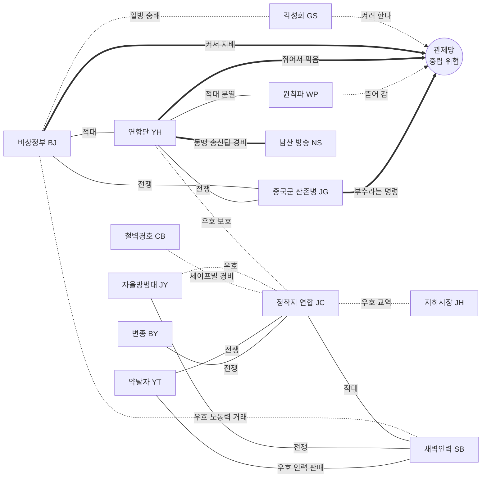
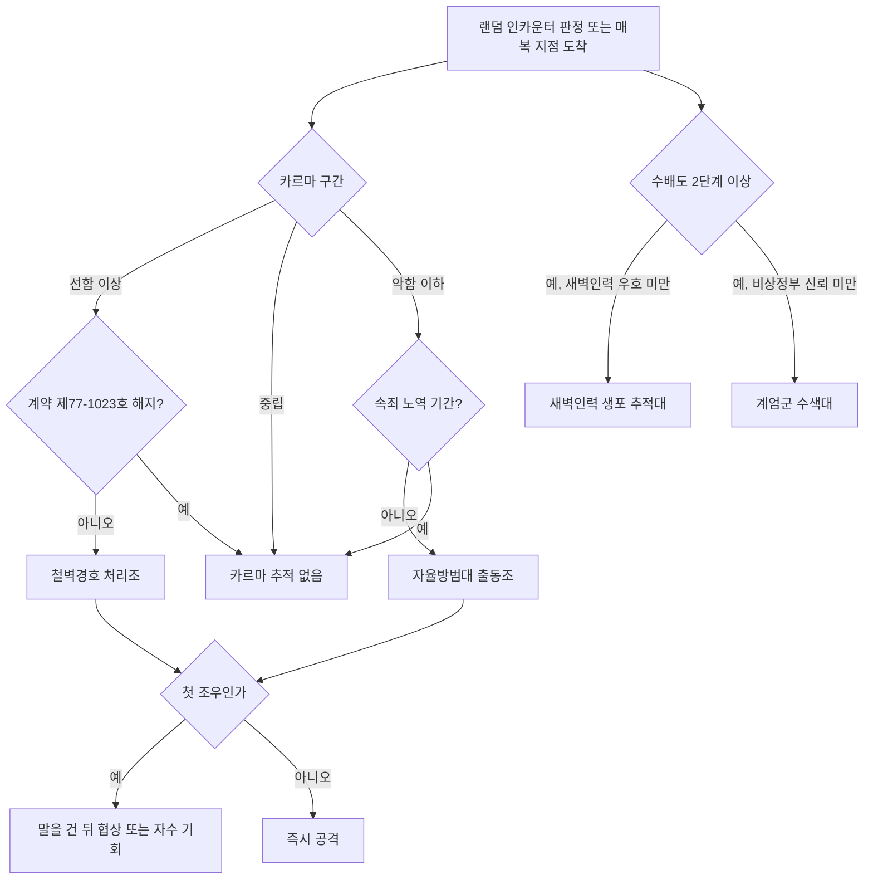
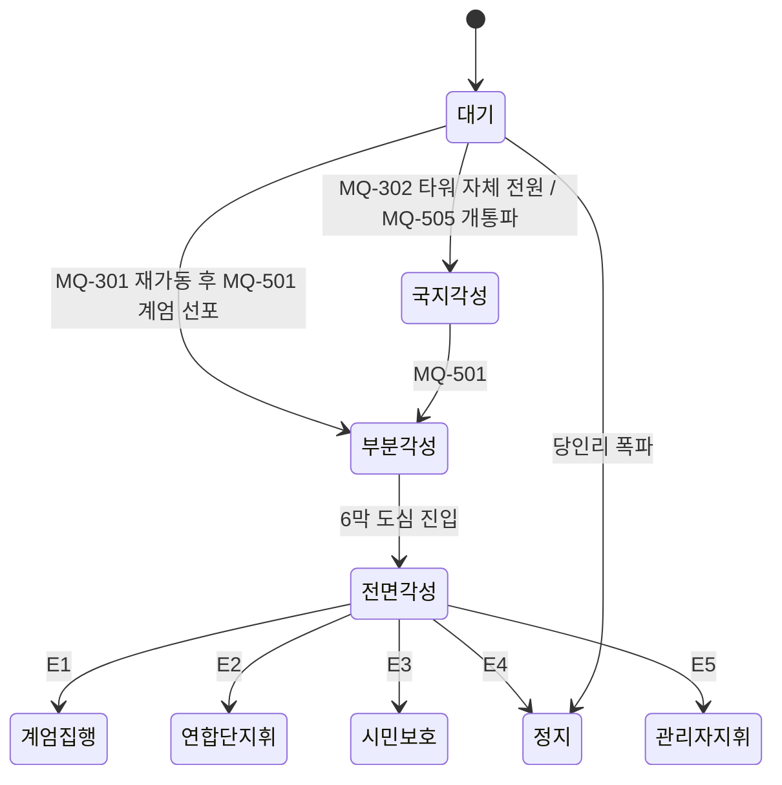

# SD-06. 세력

> **서울 폴아웃 상세 기획서 세트** | 문서 ID: SD-06 | 버전: v1.2 | 작성일: 2026-10-12
> **범위**: 2277년 서울 수도 황무지의 세력 전체(F-01~F-18)와 하위 조직. **세력 호감도 시스템 상세 설계**(대상·시작값·증감량·상한·히스테리시스·연동 계수·카르마와의 관계·회복 수단·단계별 혜택과 제재·입단과 계급·적대 시 현상금), 동료 대체 수단(지원 병력 호출, 일시 동행 NPC), 메인 스토리 연동(2막 제안, 3막 협력자, 5막 서울 회의, 6막 진입, 7막 공동 작전, 엔딩 조건 수치), 세력 약호와 세력 퀘스트 라인(FQ) 골격, 세력별 설정(기원·이념·조직·인물·영역·병력·장비·시각·말투·경제·메인 퀘스트 행동·엔딩 운명), 관계 매트릭스, 카르마 반응과 추적자, 변장, 등장 지역·순찰·인카운터, 중립 위협(관제망 경비 체계). / 다루지 않는 것: 퀘스트 진행 상세(SD-03a·03b·04a~d·05), 인물 프로필(SD-07a·07b), 장소 좌표(SD-08·09a~f), 카르마 증감 행동·칭호와 퍽 본문(SD-10), 적 수치(SD-14), 장비 수치(SD-13), 가격 체계(SD-15).
> **관련 문서**: [SC-00 컨셉 v0.4](00_concept.md), [SD-02 세계관·연표](02_world-and-lore.md), [SD-03a 메인 스토리 1](03a_main-story-part1.md), [SD-03b 메인 스토리 2](03b_main-story-part2.md), [SD-04a 사이드(남부)](04a_side-quests-south.md), [SD-04b 사이드(서부·한강)](04b_side-quests-west-river.md), [SD-04c 사이드(북부·동부·도심)](04c_side-quests-north-east-center.md), [SD-04d 세력 퀘스트 라인](04d_faction-questlines.md), [SD-05 비표시·반복·인카운터](05_misc-quests-encounters.md), [SD-07a 주요 인물](07a_characters-major.md), [SD-07b NPC 디렉터리](07b_npc-directory.md), [SD-08 월드·권역](08_world-regions.md), [SD-09a~f 장소 카탈로그](09a_locations-r01-r02.md), [SD-10 캐릭터 시스템](10_character-system.md), [SD-11 전투](11_combat-system.md), [SD-12 탐험·UI](12_exploration-ui.md), [SD-13 아이템](13_items.md), [SD-14 크리처·적](14_creatures-enemies.md), [SD-15 경제](15_economy.md), [SD-16 아트 디렉션](16_art-direction.md), [SD-17 사운드](17_sound.md), [SD-18 용어·명명](18_naming-terms.md), 원작 [RD-09 팩션](../reverse-design/09_factions.md), [RD-14 캐릭터 시스템](../reverse-design/14_character-system.md), [RD-27 이식 시사점](../reverse-design/27_adaptation-notes.md), 조사 [SR-03 인프라·군사](research/SR-03_seoul-infrastructure.md), [SR-05 국가·사회](research/SR-05_korea-state-society.md)

---

## 1. 개요

### 1.1 목적
- 바이블 v0.4 §6.2의 **호감도 골격**과 §5.8 **"고르지 않고 기운다"** 원칙을 제작 가능한 수치·규칙으로 확정한다. 이 문서의 중심은 3장(호감도), 4장(세계의 반응), 5장(서울의 판도), 6장(정보의 전파), 7장(양다리와 단독), 8장(동료 대체), 9장(메인 스토리 연동)이다.
- 각 세력을 "누가, 어디에, 얼마나, 무엇을 원하고, 주인공을 어떻게 보며, 엔딩에서 어떻게 되는가"라는 같은 틀로 정리한다(10장, 15장).
- 세력 약호를 확정하고, 호감도 대상 세력마다 퀘스트 라인 골격(FQ)을 준다. 상세 설계는 SD-04d가 한다(13장).
- 범용 2D 엔진(Godot 4 기본값, 바이블 K9) 구현에 필요한 변수(저장 키)·공용 함수·스프라이트·얼굴 그래픽 수량을 산출한다(17장).

### 1.2 범위와 경계

| 주제 | SD-06 | 정본 문서 |
|---|---|---|
| 세력 설정·조직·계급·영역·관계 | 다룬다 | — |
| 호감도 수치·단계·증감·연동·회복 | **정본** | 화면 표시는 SD-12, 카리스마 보정식은 SD-10(§2.3) |
| 카르마 | 세력 반응(추적자·첫인상·성향 보정)만 | 범위·구간·칭호·증감 행동은 SD-10 |
| 메인 퀘스트 분기 | 호감도 조건과 증감의 기준값 | 퀘스트 진행·플래그는 SD-03a·03b |
| 세력 퀘스트 라인 | 약호, 제목·요지·요구 호감도·보상 | 진행·대사·보상 상세는 SD-04d |
| 사이드 퀘스트 연계 | 비대상 세력의 제목·요지 | ID와 상세는 SD-04a~c |
| 추적자·순찰 인카운터 | 출현 규칙, 편성 | RE·RQ ID와 배치는 SD-05 |
| 인물 | 역할 요약, 신규 인물 명명 | 프로필·C-ID·N-ID는 SD-07a·07b |
| 거점 | 권역 단위 배치 | L-ID·좌표는 SD-09a~f, 권역 경계는 SD-08 |
| 장비·병종 | 외형과 구성 | 수치와 W·A·CR-ID는 SD-13·SD-14 |
| 관제망 로봇 | '중립 위협' 분류 규칙(14.5) | 판독 등급 원칙은 SD-02 §4.2, 로봇 수치는 SD-14 |

### 1.3 요약
1. **세력은 18개(F-01~F-18)**다. 바이블 §6.1의 11개 세력명은 그대로 쓰고, 정착지는 **정착지 연합(F-12)** 아래 핵심 6곳과 소규모 6곳, 모두 12곳의 자치 조직으로 나눴다. 약탈자는 권역별 8개 패거리, 변종은 3개 무리로 나눴다. 볼트 S-07, 남산 방송, 서울 회의(조건부 회의체), 무소속 주민, 한강 행상 조합, 순회 의료반 들것을 더했다.
2. 세력 구도의 중심축은 **"관제망을 누가 쥐는가"**다. 비상정부는 켜서 지배하려 하고, 연합단은 쥐어서 막으려 하고, 원칙파는 뜯어 가려 하고, 각성회는 깨어나기를 기다리고, 중국군 잔존병은 부수라는 명령 속에서 기다린다. 연합단("명령이 올 때까지 기지를 지켜라")과 잔존병("철수 명령 전까지 대기")은 같은 구조의 명령에 묶인 거울 세력이다.
3. **진영을 묻지 않는다.** 가입·입단·동맹을 묻는 선택지가 없다. 계급장과 복장은 행동이 쌓였을 때 세력이 먼저 건넨다(4.4). 3막 협력자, 5막 집결 세력, 결말은 현장의 행동과 누적 상태로 정해진다(9장).
4. **호감도는 10개 대상 + 정착지 12곳의 개별값**이다. 바이블 대상 8개에 약탈자·변종의 예외 집단 2개(난지 고철단, 큰돌 무리)를 더했다. 정착지 연합 값은 가맹 정착지 개별값의 가중 평균이다. 단계는 6단계, 상승은 경계값에서 즉시·하락은 5 아래에서(히스테리시스), 비퀘스트 일일 상승 상한 +6, 적대 세력 사이 연동 계수 행렬(최대 -0.6)을 둔다(3장).
5. **호감도 수치는 내부 값**이다. 플레이어는 호칭·가격·순찰·방송·깃발·핍-보이 한 줄로 기울기를 안다. 10개 세력 × 6단계 반응표를 두었다(4장).
6. **서울의 판도**: 판도 거점 60곳의 소유와 13개 구역의 세력 영향력으로 저장하고, SD-02의 4단계(지배·우세·경합·공백)로 판정한다. 거점 탈환·지도자 처리·물자와 시설 인도·막 진행 사건이 움직이고, 3일마다 제한적 시뮬레이션 틱이 돈다. 순찰·검문소·상점·인카운터·깃발·방송·결말 슬라이드가 판도를 따른다(5장).
7. **정보의 전파**: 세력의 반응(연동 포함)은 그 세력이 주인공의 행적을 알게 된 때 적용된다. 목격·정보원·소문·행상·정보상·방송의 6경로와 지연, 은폐 수단을 정했다(6장). 양다리는 막지 않지만 '이중 거래 의혹'이 돌아오고, 끝까지 혼자 움직이면 단독 기울기(SOLO)가 단독 전용 지원을 연다(7장).
8. **동료 시스템은 없다.** 신뢰 이상 세력의 지원 병력(신뢰 2명·쿨다운 24시간, 동맹 4명·쿨다운 12시간)과 퀘스트 일시 동행 NPC만 둔다(8장).
9. 엔딩 조건 수치: E1 = 비상정부 +80(남궁혁·육지환이 곁에) 또는 프로토콜을 바꾸지 않은 인증, E2 = 연합단 +50과 MQ-508 주력(또는 +80), E3 = 프로토콜(또는 한유리의 기록 8건) + 정착지 연합 +50과 주력(또는 +80) + 핵심 정착지 2/3가 +20 이상 + 서울 회의 부분 합의 이상 + 비상정부 무력화(9.9).
10. 카르마 추적자는 원작처럼 선 카르마에 **철벽경호 처리조**, 악 카르마에 **자율방범대 출동조**다. 원작과 달리 끝낼 방법(200년 묵은 계약 해지 / 자수와 속죄 노역)이 있다. 수배도(SD-12)에 따른 새벽인력 생포 추적대와 계엄군 수색대가 따로 붙는다(12장).

### 1.4 표기 규칙
- **세력 ID**: 상위 `F-01`~`F-18`, 하위 조직 `F-01-A`. 하위 조직은 따로 적지 않는 한 상위 세력과 같은 호감도 변수를 쓴다.
- **세력 약호**: 2자 대문자 로마자(2.2). 세력 퀘스트 라인은 `FQ-<약호>-01`, 호감도 변수는 `AFF_<약호>`, 데이터 키는 `fac_<약호 소문자>`다.
- **관계 등급(세력×세력)**: 동맹 / 우호 / 중립 / 적대 / 전쟁. '적대'는 불신과 소규모 충돌, '전쟁'은 보면 쏘는 상태다.
- **호감도 단계(세력→주인공)**: 적대 / 경계 / 중립 / 우호 / 신뢰 / 동맹(바이블 §6.2).
- **카르마 구간**: 매우 선함 +750~+1,000 / 선함 +250~+749 / 중립 -249~+249 / 악함 -250~-749 / 매우 악함 -750~-1,000(SD-10).
- **권역**: R01 관악, R02 여의도·영등포, R03 마포·상암, R04 서강·선유도, R05 도심(밀폐), R06 용산·남산, R07 강남, R08 동부, R09 북부 산악, R10 서부 평야, R11 청계산, UG 지하, HR 한강.
- **메인 퀘스트**: MQ-P1~P4, MQ-101~MQ-702, MQ-E1(바이블 §5.4).
- 장소의 L-ID, 인물의 C-·N-ID, 장비의 W-·A-ID, 적의 CR-ID, 인카운터의 RE-ID, 퍽의 PK-ID는 주관 문서에서 매긴다. 본문은 이름만 쓰고, 필요한 곳에 `(SD-xx에서 ID 부여)`를 붙인다.
- 새로 만든 고유명사는 부록 A에 모았다.

### 1.5 세력 등급

| 등급 | 정의 | 해당 세력 |
|---|---|---|
| A. 대세력 | 엔딩을 좌우하고 5막 동맹 후보가 되는 군사·정치 세력 | F-01 비상정부, F-02 연합단, F-12 정착지 연합 |
| B. 전역 세력 | 여러 권역에 나오고 퀘스트·카르마·현상금에 따라 주인공을 추적하거나 가로막는다 | F-03 원칙파, F-04 약탈자, F-05 새벽인력, F-06 철벽경호, F-07 자율방범대, F-08 중국군 잔존병, F-09 변종 |
| C. 공동체 | 거점에 고정된 주민 집단. 집단으로 반응한다 | F-10 지하시장, F-11 각성회, F-13 볼트 S-07, F-14 남산 방송 |
| D. 조건부·기타 | 진행에 따라 생기거나 엔진 처리·경제 연출용으로 두는 묶음 | F-15 서울 회의, F-16 무소속 주민, F-17 한강 행상 조합, F-18 순회 의료반 들것 |

---

## 2. 세력 총람

### 2.1 총람표
"기본 반응"은 프롤로그 직후 주인공을 처음 만났을 때의 반응이다. "호감도"는 변수 유무와 시작값이다(3.2).

| ID | 세력 | 약호 | 등급 | 원작 대응 | 주 근거지(권역) | 2277년 규모 | 기본 반응 | 호감도 | 상세 |
|---|---|---|---|---|---|---|---|---|---|
| F-01 | 비상정부 | BJ | A | 엔클레이브 | 청계산 벙커(R11) | 벙커 인구 약 2,400 | 생포 대상 | -30 | 10.1 |
| F-02 | 연합단 | YH | A | 브라더후드 오브 스틸 | 용산 요새(R06) | 요새 인구 약 900 | 경계 후 우호 | 0 | 10.2 |
| F-03 | 원칙파 | WP | B | 아웃캐스트 | 공릉 회수 창고(R09) | 약 70 | 냉대(비적대) | -10 | 10.3 |
| F-04 | 약탈자 | YT | B | 레이더 | 전역(8개 패거리) | 약 1,000 | 적대 | 없음(고정 적대). 예외 F-04-A | 10.4 |
| F-05 | 새벽인력 | SB | B | 노예 사냥꾼 | 새벽인력 본소(R02) | 조직원 약 150, 억류 인력 약 300 | 생포 대상(검문 후 거래 가능) | -25 | 10.5 |
| F-06 | 철벽경호 | CB | B | 탈론 컴퍼니 | 철벽경호 본사(R10) | 약 180 | 중립(선 카르마면 적대) | 없음(카르마 반응) | 10.6 |
| F-07 | 자율방범대 | JY | B | 감시자 | 성수 방범 본부(R08) | 대원 약 60, 협조자 다수 | 중립(악 카르마면 적대) | 없음(카르마 반응) | 10.7 |
| F-08 | 중국군 잔존병 | JG | B | 중국군 잔존병 | 북한산 굴진 기지(R09·UG) | 41(의식 유지 29) | 영역 침입 시 교전 | -40 | 10.8 |
| F-09 | 변종 | BY | B | 슈퍼 뮤턴트 | 서울역 지하·을지로 지하·도심 지하철(R05·UG). 기원지 두 갈래(10.9) | 약 450 | 적대 | 없음(고정 적대). 예외 F-09-C | 10.9 |
| F-10 | 지하시장 | JH | C | 언더월드 | 영등포 지하상가(R02) | 구울 약 260 | 중립 | 0 | 10.10 |
| F-11 | 각성회 | GS | C | 원자의 자손 | 노량진 관제 중계소(R01) | 신도 약 130 | 우호(추앙) | +25 | 10.11 |
| F-12 | 정착지 연합 | JC | A | 메가톤·리벳시티 등 | 노들섬(HR) 등 12곳 | 합계 약 2,420 | 정착지별 | 가중 평균 | 10.12 |
| F-13 | 볼트 S-07 | S7 | C | 볼트 101 | 볼트 S-07(R01) | 192(N-05) | 고향, 탈출 뒤 복잡 | 없음(스토리 플래그) | 10.13 |
| F-14 | 남산 방송 | NS | C | GNR | 남산 송신탑(R06) | 8 | 우호 | 없음(협력 플래그) | 10.14 |
| F-15 | 서울 회의 | SH | D | (신규) | 노들섬(HR) | 결성 조건에 따라 | — | 없음(회의 결과 플래그) | 10.15 |
| F-16 | 무소속 주민 | MS | D | 황무지 주민 | 전역 | — | 중립 | 없음(범죄 규칙) | 10.16 |
| F-17 | 한강 행상 조합 | HS | D | 캐러밴 상인 | 뚝섬 장터(R08), 노들섬(HR) | 행상 약 40, 수송대 4개 | 우호 | 없음(투자 플래그) | 10.17 |
| F-18 | 순회 의료반 들것 | DG | D | (신규) | 이동(R01·R02·R03·R08) | 의료인 12 | 우호 | 없음(카르마 반응) | 10.18 |

- **규모 합계와 SD-02 인구 검산**(SD-02 U1 이관 작업): 위 표에서 수가 적힌 세력을 더하면 약 8,610명이다(BJ 2,400 · YH 900 · WP 70 · YT 1,000 · SB 450(억류 300 포함) · CB 180 · JY 60 · JG 41 · BY 450 · JH 260 · GS 130 · JC 2,420 · S7 192 · NS 8 · HS 40 · DG 12). SD-02 §1의 '2277년 의식 있는 주민 약 1만 2천'은 변종과 야생 구울을 뺀 수이므로 비교값은 변종 450과 야생화 병사 12를 뺀 **약 8,150**이다. 나머지 **약 3,850명은 F-16 무소속 주민**(떠돌이·고물상·사냥꾼·세력 밖 소규모 무리, 각 장소 문서의 MS 인물)으로 본다. 그래서 SD-02의 1만 2천은 고치지 않는다. 단 SD-02 §5 '정착지 연합의 인구(약 1,700)'는 이 문서 3.2.2의 합계 **약 2,420**으로 맞춰야 한다(SD-02 수정 대상).

### 2.2 세력 약호 (확정)
- 규칙: SD-18 §6.2의 작명 원칙(앞 두 음절의 로마자 첫 글자, DLC 태그·다른 약호와 겹치면 둘째 단어 첫 글자)을 따른다. SD-18 제안안 8개 중 7개(BJ·YH·JH·GS·JG·SB·JC)를 채택하고 원칙파만 WP로 바꿨다. 한번 정하면 바꾸지 않는다.
- 퀘스트 라인을 두는 세력은 **호감도 대상 10개**다(★). 나머지 약호는 데이터 키와 사이드 퀘스트 분류용이다.

| 약호 | 세력 | 근거 | FQ 라인 | 비고 |
|---|---|---|---|---|
| BJ ★ | 비상정부 | 비상(B) 정부(J) | FQ-BJ-01~08 | SD-18 안 채택. 원칙대로면 BS지만 원작 DLC 태그 [BS]와 겹친다 |
| YH ★ | 연합단 | 연(Y)합(H) | FQ-YH-01~08 | 브리프 예시와 같다 |
| WP ★ | 원칙파 | 원(W)칙파의 파(P) | FQ-WP-01~06 | SD-18 안(WC)을 바꿨다. WC는 한국 간판·안내 표지에서 화장실 표기라 퀘스트 ID `FQ-WC`가 오해를 부른다 |
| SB ★ | 새벽인력 | 새(S)벽(B) | FQ-SB-01~06 | |
| JG ★ | 중국군 잔존병 | 중(J)국(G) | FQ-JG-01~07 | SD-18 안 채택 |
| JH ★ | 지하시장 | 지(J)하(H) | FQ-JH-01~07 | |
| GS ★ | 각성회 | 각(G)성(S) | FQ-GS-01~07 | |
| JC ★ | 정착지 연합 | 정(J)착(C) | FQ-JC-01~10 | 정착지별 퀘스트를 한 라인에 묶는다 |
| NJ ★ | 난지 고철단(F-04-A) | 난(N)지(J) | FQ-NJ-01~05 | 약탈자 예외 집단 |
| KD ★ | 큰돌 무리(F-09-C) | 큰(K)돌(D) | FQ-KD-01~05 | 변종 예외 집단 |
| YT | 약탈자 | 약(Y)탈(T) | — | 사이드 퀘스트 분류용 |
| BY | 변종 | 변(B)종의 ㅇ(Y) | — | BJ는 비상정부가 쓴다 |
| CB | 철벽경호 | 철(C)벽(B) | — | 사이드 퀘스트(계약 해지) |
| JY | 자율방범대 | 자(J)율(Y) | — | 사이드 퀘스트(자수·속죄) |
| S7 | 볼트 S-07 | 볼트 번호 | — | |
| NS | 남산 방송 | 남(N)산(S) | — | |
| SH | 서울 회의 | 서(S)울 회의의 회(H) | — | |
| MS | 무소속 주민 | 무(M)소(S) | — | |
| HS | 한강 행상 조합 | 행(H)상(S) | — | |
| DG | 순회 의료반 들것 | 들(D)것(G) | — | |
| GT | 고속터미널 지하상가 | 고(G)속터미널(T) | — | 정착지 연합 비가맹 자치 공동체. 호감도 변수 없음, 지역값 `V_GT_TRUST`(0~3)만(3.2.3). 인도처 코드 93(RECON_SPEC §3.1) |
| SW | 세운 공방 | 세(S)운의 ㅇ(W) | — | 정착지 연합 비가맹 자치 공동체. 호감도 변수 없음, 지역값 `SW_TRUST`만(3.2.3). 인도처 코드 94 |

- 정착지별 약호(정착지 개별 호감도 변수 `AFF_JC_<약호>`): BC 봉천 계단마을, TK 탱크마을, ND 노들섬, SY 선유도, TS 뚝섬 장터, SV 세이프빌, SA 사당 환승촌, MW 망원 유수지 마을, IT 이태원 피난촌, YJ 양재 온실촌, AC 아차산 배수지 마을, CD 창동 차량기지촌.

### 2.3 세력이 아닌 것

| 대상 | 처리 | 근거 |
|---|---|---|
| 동물·변이 생물(변이 들개, 반달가슴곰, 멧돼지 등) | 세력이 아니다. SD-14의 크리처 | 사용자 지시 |
| 진돗개 백구 | 봉천 계단마을의 이름 있는 NPC 개. 세력 소속은 F-12-A로 표시만 한다(집단 적대에 가세) | 바이블 §7·§11 |
| 관제망에 연결되지 않은 세진전자 로봇 | 세력이 아니다. 개체 프로그램대로 움직이는 크리처 | 사용자 지시 |
| **관제망 경비 체계**(경비 로봇, 포탑, 차단벽, 판독기 문) | 세력이 아니라 **중립 위협**이다. 주인공과 모든 세력을 2077년 판독 등급으로 똑같이 판정한다(14.5) | 바이블 §5.2, SD-02 §4.2.4 |
| 야생 구울 | SD-14의 크리처. 단 F-08-B 야생화 병사는 잔존병 터널에 묶여 있어 세력 묶음에 둔다 | — |
| 태성그룹·세진전자·한결건설·청솔식품 | 2077년의 기업이다. 2277년에는 조직으로 남지 않았다. 후예는 F-01-A에, 브랜드는 장소·아이템에 남는다 | 바이블 §3.3 |
| 다른 서울 볼트(S-01~S-06, S-08~S-12) | 볼트별 주민 집단은 SD-09·04에서 장소·퀘스트로 다룬다. 세력 테이블에는 넣지 않는다 | 범위 조절 |

---

## 3. 호감도 시스템

### 3.1 설계 원칙
바이블 §5.8 "고르지 않고 기운다"를 호감도 규칙으로 옮긴 것이다.

| # | 원칙 | 규칙 |
|---|---|---|
| 1 | 숫자는 내부 값 | 호감도(-100~+100)는 엔진 변수다. 플레이어에게는 호칭·가격·순찰·방송·깃발·핍-보이 한 줄 서술로 보여 준다(4장). 수치 표시는 설정 메뉴의 옵션 '관계 수치 보기'로만 켠다(기본 꺼짐) |
| 2 | 묻지 않는다 | 가입·입단·동맹을 묻는 대화 선택지가 없다. "우리 편이 되겠나?"라는 질문도, 제안 수락·거절 버튼도 없다. 입단과 승급은 행동이 쌓였을 때 세력이 먼저 계급장이나 복장을 건네는 사건으로 일어난다(4.4) |
| 3 | 행동이 쌓인다 | 누구의 부탁을 실제로 들어줬는지, 무엇을 누구 손에 넘겼는지, 누구를 죽이고 살렸는지, 어디서 거래하고 잤는지, 무엇을 방송했는지가 호감도를 움직인다(3.4) |
| 4 | 작은 것은 천천히, 큰 것은 크게 | 일상 행동은 하루 +6까지만 오른다(3.5). 지도자 처리, 시설 탈취, 핵심 물건 인도는 한 번에 크게 움직인다(3.9) |
| 5 | 세계가 알아야 반영된다 | 다른 세력의 반응(연동)은 그 세력이 주인공의 행적을 **알게 된 때** 적용된다. 아무도 모르는 일은 연동되지 않는다(6장) |
| 6 | 되돌리기 어렵지만 가능하다 | 속죄 의뢰·배상·중재자로 중립 하한까지는 돌아올 수 있다. 지도자 살해·학살만 영구다(3.8) |
| 7 | 카르마와 분리 | 카르마는 '주인공이 어떤 사람인가', 호감도는 '그 세력이 주인공을 어떻게 보는가'다. 서로 직접 바꾸지 않는다. 카르마는 첫인상과 획득 성향으로만 호감도에 스민다(3.7) |

### 3.2 대상과 시작값

#### 3.2.1 호감도 대상 10개
바이블 §6.2의 8개에, 약탈자·변종의 예외 집단 2개를 더했다.

| 약호 | 대상 | 변수 | 시작값 | 시작 단계 | 시작값의 이유 | 프롤로그 보정 |
|---|---|---|---|---|---|---|
| BJ | 비상정부 | AFF_BJ | -30 | 경계 | 인도를 거부하고 달아난 관리자 | MQ-P4 탈출 방법: 설득 +10, 은신·하도윤의 도움 0, 전투 -10(계엄병 사망 1명당 추가 -5, 최대 -15) |
| YH | 연합단 | AFF_YH | 0 | 중립 | 모르는 볼트 사람 | — |
| WP | 원칙파 | AFF_WP | -10 | 중립 | 바깥 사람 자체를 꺼린다 | — |
| SB | 새벽인력 | AFF_SB | -25 | 경계 | 주인공은 현상금 3,000캡짜리 '물건'이다 | — |
| JG | 중국군 잔존병 | AFF_JG | -40 | 경계 | 영역에 들어오는 모든 사람을 적군으로 본다. 단 첫 접촉은 경고 사격이다 | — |
| JH | 지하시장 | AFF_JH | 0 | 중립 | 손님이면 누구든 받는다 | — |
| GS | 각성회 | AFF_GS | +25 | 우호 | 주인공을 '운영자님'으로 추앙한다(관리자 코드 소문을 먼저 들었다) | — |
| JC | 정착지 연합 | AFF_JC | 가중 평균(3.2.2) | 중립 | 정착지별 | — |
| NJ | 난지 고철단(F-04-A) | AFF_NJ | -70 | 적대 | 약탈자다. 단 '흰 깃발 교섭'으로 대화가 열린다(10.4) | — |
| KD | 큰돌 무리(F-09-C) | AFF_KD | 0 | 중립 | 숨어 사는 평화적 변종. 첫 접촉 전에는 주인공을 피한다 | — |

- 위 10개를 뺀 세력은 호감도 변수가 없다. 약탈자(F-04-A 제외)·변종(F-09-C 제외)은 늘 적대, 철벽경호·자율방범대는 카르마에 반응하는 추적자(12장), 볼트 S-07·남산 방송·서울 회의·한강 행상 조합은 스토리·협력 플래그로 처리한다.

#### 3.2.2 정착지 개별 호감도와 정착지 연합 합산
- 정착지 12곳은 각자 개별 호감도 `AFF_JC_<약호>`를 가진다. 정착지 안의 대화·거래·범죄는 그 정착지의 개별값만 움직인다.
- **정착지 연합 호감도는 가맹 정착지 개별값의 가중 평균이다.** 바이블 §6.2의 '합산'을 범위(-100~+100)를 지키는 방식으로 정의했다.

`AFF_JC = 반올림( Σ(가중치ᵢ × AFF_JC_ᵢ) ÷ Σ가중치ᵢ )` (가맹 중이고 소멸하지 않은 정착지만)

| 약호 | 정착지 | 권역 | 인구 | 가중치 | 시작값 | 가맹 시점 | 비고 |
|---|---|---|---|---|---|---|---|
| ND | 노들섬 | HR | 약 520 | 3 | 0 | 연합 결성 시(기본 가맹) | 서울 회의 개최지 |
| TK | 탱크마을 | R03 | 약 380 | 2 | 0 | 연합 결성 시 | |
| BC | 봉천 계단마을 | R01 | 약 140 | 2 | 0 | 연합 결성 시 | 첫 거점. MQ-101 완료 시 +15 |
| SY | 선유도 | R04 | 약 210 | 2 | 0 | 연합 결성 시 | 물과 캡 보증 |
| TS | 뚝섬 장터 | R08 | 약 160 | 1 | +5 | 연합 결성 시 | 장터 인심 |
| SV | 세이프빌 | R07 | 약 300 | 2 | -15 | FQ-JC-04 완료 시 | 처음엔 연합을 '바깥 것들 모임'이라 깔본다 |
| SA | 사당 환승촌 | R01·UG | 약 120 | 1 | 0 | 가맹 사건 발생 시 | 지하철 정착민 |
| MW | 망원 유수지 마을 | R04 | 약 90 | 1 | 0 | 가맹 사건 발생 시 | |
| IT | 이태원 피난촌 | R06 | 약 200 | 1 | +5 | 가맹 사건 발생 시 | 연합단 보호 아래의 피난민 |
| YJ | 양재 온실촌 | R11 | 약 70 | 1 | 0 | 가맹 사건 발생 시 | 계엄군 검문소 이웃 |
| AC | 아차산 배수지 마을 | R08 | 약 80 | 1 | -5 | 가맹 사건 발생 시 | 산골 경계심 |
| CD | 창동 차량기지촌 | R09·UG | 약 150 | 1 | 0 | 가맹 사건 발생 시 | 지하철 정착민. 북한산 잔존병과 이웃 |

- **연합 결성**: MQ-207 무렵 백인하와 조만석이 노들섬에서 '정착지 대표 모임'을 연다(스토리 사건, 선택지 없음). 결성 전에도 `AFF_JC`는 핵심 5곳(ND·TK·BC·SY·TS)으로 계산해 둔다.
- **가맹 사건**: 소규모 정착지는 주인공이 그 정착지의 문제를 하나 풀고(개별값 +20 이상), 연합 정착지 한 곳과 교역로를 이어 주면(행상 호위, 물길 연결 등) 다음 대표 모임에 대표를 보낸다. 묻는 장면은 없다. 핍-보이 기록에 "망원 유수지 마을이 노들섬 모임에 사람을 보내기 시작했다" 한 줄이 뜬다.
- **연합 일괄 증감**: 정착지 연합 전체를 상대로 한 행동(서울 회의 발언, 연합 퀘스트, 계엄군 총공세 방어 등)은 가맹 정착지의 개별값에 같은 값을 더한다.
- **소멸**: 정착지가 파괴·점령되면 합산에서 빠지고, 마지막 개별값은 결말 슬라이드용으로 보존한다. 적대 상태인 정착지는 합산에 남는다.
- **핵심 정착지 조건**: E3 조건과 서울 회의는 평균과 별도로 '핵심 6곳(ND·TK·BC·SY·TS·SV) 중 +20 이상인 곳의 수'를 본다(9.9).
- **비가맹 자치 공동체(가맹 범위 밖)**: 정착지 연합은 위 12곳으로 고정한다. **GT 고속터미널 지하상가**(R07, `V_GT_TRUST` 0~3)와 **SW 세운 공방**(R05, `SW_TRUST`)은 연합에 가맹하지 않는 자치 공동체다. 호감도 변수·연동·판도가 없고 사이드 퀘스트의 지역값만 가진다(3.2.3 '퀘스트 지역값'). 에필로그 승격도 없다(RECON_SPEC N-42).

#### 3.2.3 예외 집단 결정
바이블 §6.2가 SD-06에 맡긴 "약탈자·변종의 예외 집단"을 다음과 같이 정한다.

| 결정 | 집단 | 이유 | 범위 제한 |
|---|---|---|---|
| **둔다** | 난지 고철단(F-04-A, 약호 NJ) | 고철 거래로 먹고사는 약탈자다. 다른 패거리와 달리 '거래가 되는 약탈자'라 악 카르마 플레이의 거점이 된다. 탱크마을과의 대립이 3막 당인리와 맞물린다 | 최대 신뢰(+79). 동맹 없음. 서울 회의에 참석하지 않는다. 지원 병력은 신뢰에서 2명 |
| **둔다** | 큰돌 무리(F-09-C, 약호 KD) | 바이블 §11의 이름 있는 NPC 큰돌이 이끄는 평화적 변종 12명. 변종 전체를 적으로만 두면 '변종도 사람이었다'는 서사를 담을 곳이 없다 | 최대 동맹(+100). 서울 회의에는 신뢰 이상일 때 '참관'으로만 온다. 지원 병력은 신뢰 2명·동맹 4명 |
| 두지 않는다 | 그 밖의 약탈자 7개 패거리, 변종 서울역·을지로 무리 | 협상할 수 없는 기본 위협으로 남긴다 | 사이드 퀘스트로 개별 휴전(플래그)만 가능 |
| **퀘스트 지역값** | 세운 공방 `SW_TRUST`(SD-04c SQ-N01), 자율방범대 `JY_TRUST`(0/1, SD-04c SQ-N16), 고속터미널 지하상가 `V_GT_TRUST`(0~3, SD-04a·09d) | 사이드 퀘스트 결과를 그 집단의 태도로 남길 곳이 필요하다 | **호감도가 아니다.** 연동 계수(3.6)·판도(5장)·일일 상한·계급 증표가 없다. 이름은 `<약호>_TRUST`(RECON_SPEC §3.3·N-59) |

### 3.3 단계와 히스테리시스
- 단계 이름과 명목 범위는 바이블 §6.2와 같다.
- 경계값 근처에서 단계가 깜박이지 않도록 **상승은 경계값에서 즉시, 하락은 현재 단계 하한보다 5 낮아질 때** 일어난다. 엔진은 값과 별도로 '현재 단계'를 저장한다.

| 단계 | 명목 범위 | 이 단계로 오르는 값 | 이 단계에서 떨어지는 값 |
|---|---|---|---|
| 동맹 | +80 ~ +100 | +80 이상 | +74 이하 → 신뢰 |
| 신뢰 | +50 ~ +79 | +50 이상 | +44 이하 → 우호 |
| 우호 | +20 ~ +49 | +20 이상 | +14 이하 → 중립 |
| 중립 | -19 ~ +19 | -19 이상(경계에서) | -25 이하 → 경계 |
| 경계 | -59 ~ -20 | -59 이상(적대에서) | -65 이하 → 적대 |
| 적대 | -100 ~ -60 | — | — |

- **강제 단계**: 지도자 살해, 학살, 스크립트 사건은 값을 직접 정하고 단계도 즉시 바꾼다(히스테리시스 무시).
- **대면 전 상한**: 그 세력의 지도자나 본거지를 직접 만나기 전에는 +49(우호)를 넘지 않는다. 소문만으로는 신뢰하지 않는다. 바이블의 '진행 잠금 없음'과 부딪치지 않도록, 상한은 세력과의 첫 대면 사건이 어떤 경로로든 일어나면 풀린다.
- **단계 변화의 알림**: 숫자 팝업 없이 4장의 반응(호칭이 바뀐 인사, 가격 변화, 핍-보이 한 줄)으로 알린다. 단계가 오를 때와 내릴 때 짧은 효과음 2종(SD-17)만 붙인다.

### 3.4 변화 원천별 증감량
- 표의 값은 **기본값**이다. 실제 상승량 = 기본값 × 카리스마 보정 `(1 + (카리스마-5) × 0.03)`(SD-10 §2.3, 점당 ±3%) × 카르마 성향 계수(3.7) × 퍽 보정(마당발 ×1.2, SD-10), 반올림. 하락량에는 보정을 걸지 않는다. 연동(3.6)으로 생기는 하락에는 줄타기 외교 퍽이 ×0.5를 건다.
- 같은 원천을 같은 날 되풀이하면 두 번째는 ×0.5, 세 번째부터 0이다(대화·거래·기부·도움 원천).

| 분류 | 원천 | 조건 | 기본 증감 | 상한·비고 |
|---|---|---|---|---|
| 퀘스트 | 메인 퀘스트의 결정적 행동 | 인도·처리·탈취 등(9장) | ±15~±40 | 퀘스트별로 SD-03a·03b가 정한다 |
| 퀘스트 | 세력 퀘스트 라인 1편 완료 | FQ(13장) | +6~+15 | 일일 상한 제외 |
| 퀘스트 | 사이드 퀘스트 결과 | 세력이 관련된 결말 | ±3~±12 | SD-04a~c가 정한다 |
| 퀘스트 | 반복 의뢰 1회 | RQ(SD-05) | +2 | 일일 상한 포함 |
| 퀘스트 | RQ 단골 보너스 | 같은 세력의 RQ 누적 5회마다(SD-05) | +3 | 공개도 2. 연동(3.6) 적용(RECON_SPEC N-55) |
| 퀘스트 | 의뢰 실패 | 맡은 일을 실패 | -3 | 포기만 하고 보고하지 않으면 0 |
| 퀘스트 | 의뢰 물건 횡령 | 맡은 물건을 팔거나 남에게 넘김 | -8 | 받은 쪽에는 3.9의 인도 효과 |
| 대화 | 세력 가치에 맞는 응답 | 대화당 1회, 같은 NPC 하루 1회 | +1 | 세력별 '가치' 표는 10장의 말투·이념 항목 |
| 대화 | 화술 협상 성공 | 세력 이익과 맞는 설득. 판정의 대상 호감에 `소속 세력 호감도 × 0.25`가 더해진다(SD-10 §3.5) | 아주 쉬움 +1, 쉬움 +2, 보통 +3, 어려움 +5, 아주 어려움 +8 | SD-10 권장값 채택 |
| 대화 | 모욕·조롱 | | -2 | |
| 대화 | 위협 판정 | 성공해도 | -3 | 성공 시 원하는 결과는 얻는다 |
| 대화 | 거짓말 발각 | 뒤에 사실이 드러남 | -5 | 6장 정보 전파로 판정 |
| 거래 | 세력 상점 거래 누적 | 500캡마다 | +1 | 누적 +8까지 |
| 거래 | 세력 특산 납품 | 원칙파: 기술 부품 10점 / 지하시장: 2077년 부품 5개 / 연합단: 군용 장비 가치 200캡 / 각성회: 관제망 부품 3개 / 중국군: 전지·무전 부품 3개 / 비상정부: 진공관 판독기 부품 3개 / 정착지: 식량·물·의약품 가치 100캡 / 난지 고철단: 고철 20 / 큰돌 무리: 식량 가치 50캡 | +1~+2 | 원칙파만 +2. 누적 +15까지 |
| 거래 | 인력 납품 | 새벽인력에 사람을 넘김 | 새벽인력 +4/명 | 카르마 감소(SD-10). 정착지가 알게 되면 연동 |
| 기부 | 캡 기부 | 1점당 필요 캡 = 100 × `(1.25 − 물물교환/200)`(SD-10) | +1 | 1회 +3, 일일 +3, 누적 +10까지. 물자 기부·공물에도 같은 효율을 곱한다 |
| 기부·거래 | 상한 | 기부·거래·납품으로 얻은 값만으로는 | — | +49(우호)를 넘지 못한다. 신뢰부터는 행동으로만 오른다 |
| 처치 | 세력의 적 처치 | 세력 영역 안이거나 세력원이 보는 앞 | 일반 3명당 +1, 지휘관 +2, 현상금 대상 +5 | 일일 상한 포함 |
| 처치 | 세력의 적 거점 소탕 | 고정 적대 거점을 비움 | +5~+10 | 거점당 1회 |
| 처치 | 수달(CR-113·114) 처치 | 비적대 한강 수달을 죽임(SD-14 §4.7) | 정착지 연합 -2 | 가맹 정착지 일괄. 뚝섬 장터·선유도 주민이 먼저 꺼낸다(SD-14 #11 승인) |
| 도움 | 함께 싸움 | 같은 전투에서 세력 순찰대와 적 2명 이상 처치 | +2 | 일일 상한 포함 |
| 도움 | 쓰러진 세력원 구조 | 스팀팩·의료로 살림 | +2 | 일일 상한 포함 |
| 도움 | 수송대 호위 완료 | 행상·보급 수송 | +4 | 일일 상한 포함 |
| 도움 | 세력 거점에서 숙박·거래 | 그 세력 영역에서 잔 밤마다 | +1 | 우호 미만에서만. 일일 상한 포함 |
| 범죄 | 세력원 공격 목격 | | -8 | 근처 경비 30초 적대 |
| 범죄 | 세력원 살해 목격 | | -20 | '원한' 플래그(시간 회복 정지) |
| 범죄 | 비목격 살해 발각 | 시체 조사 사건(6.4) | -12 | |
| 범죄 | 이름 있는 NPC 살해 | 지도자 제외 | -35 | 원한 플래그 |
| 범죄 | 지도자 살해 | 10장 지도자 | 값 -100 고정 | 영구 적대(3.8) |
| 범죄 | 학살 | 같은 거점 주민 5명 이상 살해 | 값 -100 고정 | 영구 적대 |
| 범죄 | 절도 적발 | | -4 | 벌금(물건값 ×2)을 내면 0 |
| 범죄 | 소매치기 적발 | | -6 | |
| 범죄 | 금지구역 침입 | 경고 1회 뒤부터 | -3/회 | |
| 범죄 | 시설 파괴·사보타주 발각 | 발전기·수조·통신기 등 | -15~-30 | 시설 중요도별 |
| 변장 | 세력 복장 무단 착용 발각 | 그 세력에게 | -6 | 세력원 시신에서 얻은 복장이면 -12 |
| 변장 | A 복장으로 B를 공격 | | B: 0(발각 시 -10 추가) | 피해는 A 소행으로 귀속되어 A–B 판도 사건이 된다(5.3) |
| 변장 | A 복장으로 저지른 범죄 | | A: 0(나중에 알게 되면 -10) | A의 판도 -2 |

### 3.5 상한
| 상한 | 값 | 적용 |
|---|---|---|
| 1회 사건 상한 | ±15 | 스크립트가 아닌 모든 원천 |
| 스크립트 사건 상한 | ±40 | 메인 퀘스트의 결정적 행동, 인도 행동(3.9) |
| 강제 사건 | 값 직접 지정 | 지도자 살해·학살(-100) 등 |
| **일일 상승 상한** | 세력당 +6 | 게임 시간 24시간 동안 대화·거래·기부·처치·도움·반복 의뢰에서 오르는 합. 퀘스트 완료와 인도 행동은 제외 |
| 일일 하락 상한 | 없음 | |
| 기부·거래 천장 | +49 | 3.4 |
| 대면 전 천장 | +49 | 3.3 |
| 적대 쌍 공존 천장 | 7.1 | 서로 '전쟁' 중인 두 세력에게 동시에 신뢰 이상이 될 수 없다 |

### 3.6 연동 계수 행렬
- **행 세력의 호감도가 오르면, 열 세력의 호감도에 (상승량 × 계수)를 더한다.** 계수가 음수면 떨어지고, 양수면 오른다(우호 관계의 덕).
- 적용 조건: ① 상승 원천이 퀘스트·인도·공개된 처치·공개된 도움일 것(사적인 거래·기부는 제외) ② 1회 상승량이 3 이상일 것 ③ **열 세력이 그 행적을 알게 됐을 것**(6장의 전파가 도착한 시점에 적용) ④ 결과는 0 쪽으로 버림.

| 오른 세력 ↓ / 영향받는 세력 → | BJ | YH | WP | SB | JG | JH | GS | JC | NJ | KD |
|---|---|---|---|---|---|---|---|---|---|---|
| **BJ 비상정부** | — | -0.5 | -0.2 | +0.1 | -0.5 | -0.3 | 0 | -0.4 | 0 | 0 |
| **YH 연합단** | -0.5 | — | -0.6 | -0.4 | -0.4 | 0 | -0.2 | +0.1 | -0.2 | 0 |
| **WP 원칙파** | -0.2 | -0.6 | — | 0 | -0.3 | 0 | -0.3 | 0 | 0 | 0 |
| **SB 새벽인력** | 0 | -0.3 | 0 | — | 0 | -0.3 | 0 | -0.6 | +0.1 | -0.2 |
| **JG 중국군 잔존병** | -0.5 | -0.4 | -0.2 | 0 | — | 0 | -0.4 | -0.1 | 0 | 0 |
| **JH 지하시장** | -0.3 | 0 | 0 | -0.3 | 0 | — | 0 | 0 | 0 | 0 |
| **GS 각성회** | 0 | -0.3 | -0.3 | 0 | -0.4 | 0 | — | 0 | 0 | 0 |
| **JC 정착지 연합** | -0.3 | +0.1 | 0 | -0.4 | -0.1 | 0 | 0 | — | -0.3 | 0 |
| **NJ 난지 고철단** | 0 | -0.2 | 0 | 0 | 0 | 0 | 0 | -0.4 | — | 0 |
| **KD 큰돌 무리** | 0 | -0.1 | 0 | 0 | 0 | 0 | 0 | -0.1 | 0 | — |

- **정착지 개별 보정**: 정착지 연합(JC) 열의 계수는 기본적으로 모든 가맹 정착지에 같게 들어간다. 단 다음은 개별 계수로 덮어쓴다.

| 오른 쪽 | 영향받는 정착지 | 계수 | 이유 |
|---|---|---|---|
| JH 지하시장 | SV 세이프빌 | -0.3 | 세이프빌 입주민의 구울 혐오 |
| SV 세이프빌 | BC·TK·IT | -0.2 | '아파트 사람들'에 대한 반감 |
| ND 노들섬 | SY 선유도 | -0.1 | 통행세와 물길의 경쟁 |
| NJ 난지 고철단 | TK 탱크마을 | -0.6 | 난지도와 탱크마을은 이웃 원수다 |
| BJ 비상정부 | YJ 양재 온실촌 | 0 | 계엄군 검문소에 기대 산다(평균 계수 -0.4를 0으로) |
| YH 연합단 | IT 이태원 피난촌 | +0.3 | 연합단이 지켜 주는 마을 |
| JG 중국군 잔존병 | CD 창동 차량기지촌 | -0.3 | 북한산 이웃의 공포. SD-04c SQ-N20 완료 뒤 -0.15(RECON_SPEC N-57) |

- **진행에 따른 계수 변경**

| 사건 | 바뀌는 계수 |
|---|---|
| MQ-303을 평화롭게 끝냄 | JG 행·열의 음수 계수를 모두 절반으로 |
| MQ-503에서 연합단·원칙파가 화해 | YH↔WP -0.6 → -0.2 |
| 비상정부 무력화 플래그(9.9) | BJ 행의 계수를 모두 0으로(무너진 정부의 호의는 아무도 신경 쓰지 않는다) |
| 서울 회의 '서울 협약' 성립(9.4) | 협약 서명 세력끼리의 음수 계수를 0으로 |
| MQ-504에서 새벽인력 몰락 | SB 행·열 삭제 |
| SD-04c SQ-N20 완료 | JG → CD 개별 계수 -0.3 → -0.15 |

### 3.7 카르마와의 관계
- **직접 변환 없음**: 카르마 증감이 호감도를 바꾸지 않고, 호감도 증감이 카르마를 바꾸지 않는다. 한 행동이 둘을 동시에 움직이는 경우(예: 인력 해방)는 각 문서가 따로 값을 정한다(카르마는 SD-10, 호감도는 SD-06).
- **첫인상 보정**: 정착지·지하시장·새벽인력·난지 고철단과 처음 대면할 때 한 번, 그때의 카르마 구간에 따라 개별값을 보정한다. 남산 방송이 주인공을 보도한 적 있으면(MQ-205) 보정이 2배다. 소문이 앞서 갔다는 뜻이다.

| 카르마 구간 | 정착지(개별)·지하시장 | 새벽인력·난지 고철단 |
|---|---|---|
| 매우 선함 | +10 | -10 |
| 선함 | +5 | -5 |
| 중립 | 0 | 0 |
| 악함 | -5 | +5 |
| 매우 악함 | -10 | +10 |

- **카르마 성향 계수**: 세력마다 '좋아하는 사람'이 다르다. 상승량에 곱한다.

| 세력 | 선함 이상 | 중립 | 악함 이하 | 해설 |
|---|---|---|---|---|
| BJ 비상정부 | 1.0 | 1.0 | 1.0 | 선악이 아니라 복종을 본다 |
| YH 연합단 | 1.1 | 1.0 | 0.9 | 기사의 명예 |
| WP 원칙파 | 1.0 | 1.0 | 1.0 | 기술만 본다 |
| SB 새벽인력 | 0.9 | 1.0 | 1.1 | 착한 사람은 장사에 방해가 된다 |
| JG 중국군 잔존병 | 1.0 | 1.0 | 1.0 | 군인의 신의를 본다(항복한 자를 쏘면 별도 -10) |
| JH 지하시장 | 1.0 | 1.0 | 1.0 | 손님이면 된다 |
| GS 각성회 | 1.0 | 1.0 | 1.0 | 운영자의 성품은 따지지 않는다 |
| JC 정착지 연합 | 1.1 | 1.0 | 0.9 | 사람을 본다 |
| NJ 난지 고철단 | 0.9 | 1.0 | 1.1 | |
| KD 큰돌 무리 | 1.1 | 1.0 | 0.9 | |

- 계수 폭은 SD-10의 권장(×1.1 / ×0.9)을 따랐다. 카르마가 호감도를 압도하지 않게 하려는 것이다. 성향 차이는 첫인상 보정(위 표)과 계급 증표의 카르마 요구 조건(4.4)이 더 크게 보여 준다.

- **카르마 요구 조건**: 일부 계급·단계 혜택은 카르마 구간을 요구한다(4.4). 예: 연합단 기사 계급장은 악함 이하에서 건네지지 않는다. 새벽인력 반장 조끼는 선함 이상에서 건네지지 않는다. 정착지 연합 동맹(대표단이 7막에 동행)은 매우 악함에서 성립하지 않는다.
- **카르마 추적자**: 철벽경호·자율방범대는 호감도가 아니라 카르마로 움직인다(12장).

### 3.8 회복 수단
| 수단 | 조건 | 효과 | 한도 |
|---|---|---|---|
| **속죄 의뢰** | 경계·적대(영구 적대 제외). 세력 게시판이나 중재자가 낸다 | +10~+20 | 7일에 2건. 값을 -19(중립 하한)까지만 올린다 |
| **배상 기부** | 경계 단계에서 직접, 적대 단계에서는 중재자를 거쳐 | 200캡마다 +1 | 누적 +10. 값을 -19까지만 |
| **중재자** | 세력마다 1~2명(아래 표) | +10~+15 | 중재자별 1회(지하시장 상인회 중재만 30일마다) |
| **시간 경과** | 경계 단계, 원한 플래그 없음 | 게임 시간 3일마다 +1 | -20까지만. 적대 단계는 시간으로 회복하지 않는다 |
| **공개 사과 방송** | 남산 방송 협력 플래그(10.14) | 정착지 연합 가맹 정착지 모두 +10 | 전체 1회 |
| **영구 적대** | 지도자 살해, 학살, 세력별 결정적 배신(10장 각 세력 항목) | 회복 불가 | 결말 슬라이드에서만 결과가 바뀐다 |

| 세력 | 중재자 | 조건 | 효과 |
|---|---|---|---|
| BJ 비상정부 | 육지환 대령 | MQ-106에서 '협상'을 했거나 투항 플래그, 또는 FQ-BJ-07 `S_OATH = 1`(RECON_SPEC N-60) | +15 |
| BJ 비상정부 | 강남 검문소(양재) 분류반 창구 | 신원 등록 서류(진공관 판독용 지문 카드)를 스스로 낸다 | +10. 대신 그 뒤로 계엄군 수색대가 주인공의 위치를 하루 늦게가 아니라 즉시 안다(6.2) |
| YH 연합단 | 제이슨 임 | 생존, 주인공과 함께 싸운 적 있음 | +15 |
| WP 원칙파 | 회수 목록 대장 펠릭스 문 | 기술 부품 30점을 한 번에 납품 | +10 |
| SB 새벽인력 | 실장 구만호 | 합의금 500캡 | +15(14일마다) |
| JG 중국군 잔존병 | 통신병 샤오린 | 전쟁 종결 증거 1건을 무전으로 전달 | +10 |
| JH 지하시장 | 상인회 중재 / 마영식 보증 | 300캡 / 마영식과 우호 | +10 / +10 |
| GS 각성회 | 안내자 류정 | '재등록' 의식에 참석(천공 카드를 새로 찍는다) | +15 |
| JC 정착지 연합 | 조만석(봉천), 백인하(노들섬) | 해당 인물 생존 | 지정 정착지 1곳 +10 |
| NJ 난지 고철단 | 두목 맹구철 '쇠갈퀴' | 고철 50 공물 | +10 |
| KD 큰돌 무리 | 큰돌 | 2077년 그림책 등 '이야기 거리' 선물 | +10 |

### 3.9 인도 행동: 무엇을 누구 손에 넘기는가
바이블 §5.8 원칙 2("무엇을 누구 손에 넘겼는지")의 수치다. 인도는 물건을 그 세력 NPC에게 건네거나, 세력 보관함에 넣거나, 세력 거점에 두고 떠나는 **행동**으로 일어난다. 확인 대화는 "이걸 맡기겠다"는 서술 한 줄뿐이고, 진영을 묻지 않는다.

| 물건·시설 | 나오는 곳 | 받는 세력 | 받는 쪽 호감도 | 판도(5장) | 연동·기타 |
|---|---|---|---|---|---|
| 당인리 제어실 열쇠 | MQ-301 | 연합단 / 탱크마을 / 비상정부 / 각성회 / 아무에게도(주인공 보관) | +30 | R03 받은 세력 +25, 당인리 거점 소유 | 3.6 연동. 주인공 보관 시 단독 기울기 +2(7.3) |
| 시민 보호 프로토콜 테이프 | MQ-302 | 정착지 연합(마영식·백인하) / 각성회 / 원칙파 / 연합단 / 주인공 보관 | +35 | R07 +10 | 비상정부에 넘기면 테이프가 파기되고 E3 조건이 '한유리의 기록 8건'으로만 남는다(BJ +40) |
| 멍쉐밍의 근무일지·침투 터널 지도 | MQ-303 | 연합단 / 비상정부 / 정착지 연합(창동) / 주인공 보관 | +20 | R09 +15 | 연합단·비상정부에 넘기면 JG -40(배신, 영구 적대) |
| 한유리의 기록(1건) | MQ-304 | 기록을 보관하겠다는 세력 | +5 | — | 8건 사본 복원에는 주인공이 원본이나 사본을 들고 있어야 한다 |
| 황두칠의 장부 | MQ-105 | 자율방범대 / 정착지 연합 / 비상정부 / 새벽인력에 되팔기 | +15 | R02 받은 세력 +10 | 정착지 연합이 받으면 억류 '인력' 구출 사이드 퀘스트 열림 |
| 투항한 육지환 | MQ-402·507 | 연합단 / 정착지 연합 / 놓아줌 | +25 | R11 -20(비상정부) | 연합단에 넘기면 군사 재판 사건, 놓아주면 BJ +10·카르마 + |
| 노획 버티버드 | MQ-604 | 연합단 / 정착지 연합(노들섬) / 주인공 보관 | +20 | HR·R06 +10 | |
| 관리자 코드 사본 | MQ-103 이후 | 각성회 / 비상정부 | +25 | — | 받은 세력의 지원 병력이 관제망 경비 로봇을 '같은 편'으로 판독받는다(14.5). 위험한 인도라 카르마 변화 없음, 대신 정착지 연합이 알게 되면 -10 |

---

## 4. 세계의 반응: 호감도를 보여 주는 방법

### 4.1 표시 원칙
- 호감도 수치와 게이지는 기본 화면에 없다. 핍-보이 '세력' 기록(SD-12)은 세력마다 **한 줄 서술**과 **최근 사건 3줄**만 보여 준다. 단계가 바뀌면 서술 문장이 바뀐다.
- 플레이어가 기울기를 느끼는 순서: ① NPC가 부르는 호칭과 첫 인사 ② 상점 가격 ③ 순찰대의 태도(총구, 경례, 길 비키기) ④ 남산 방송·공보방송·용산 기지 방송의 언급 ⑤ 정착지 깃발과 정문 경비 ⑥ 핍-보이 한 줄.
- 설정의 '관계 수치 보기'를 켜면 한 줄 서술 옆에 값(예: `+37`)이 붙는다. 업적·난이도에 영향은 없다.

### 4.2 단계별 공통 혜택과 제재

| 항목 | 적대 | 경계 | 중립 | 우호 | 신뢰 | 동맹 |
|---|---|---|---|---|---|---|
| 상점 가격(살 때) | 거래 불가 | +25% | 기본 | -10% | -20% | -25%, 고유 상품 |
| 상점 가격(팔 때) | 불가 | -25% | 기본 | +5% | +10% | +15% |
| 안전 가옥 | 없음 | 없음 | 없음 | 1곳(침대·보관함) | 2곳 | 2곳 + 고유 시설(작업대·정비대) |
| 세력 장비 | 없음 | 없음 | 일반품 | 일반품 확대 | 세력 장비 | 세력 고유 장비 |
| 계급·신분 | — | — | — | 출입 표식(4.4) | 첫 계급(4.4) | 최고 계급(4.4) |
| 세력 퀘스트 라인 | 없음(속죄 의뢰만) | 속죄 의뢰 | 앞부분 1~2편 | 중반부까지 | 후반부 | 마지막 편 |
| 영역 출입 | 불가(보면 공격) | 바깥 구역만, 감시가 붙는다 | 바깥 구역 | 거점 내부 | 지휘 구역 | 전 구역 |
| 지원 병력 | — | — | — | — | 2명(8장) | 4명(8장) |
| 세력 비기 | — | — | — | — | — | 자동 습득(SD-10 PK-112~119, 서로 배타적이지 않다. 세력 협조가 필요한 효과는 그 세력이 경계 이하가 되면 멈춘다) |
| 메인 스토리 | 적대 세력으로 등장 | 압박·감시 | 기본 | 3막 협력자 가능성(9.2) | 3·5·6막 협력자 후보, 집결지에 나타남 | 7막 관제 본부 동행 |
| 적대 제재 | 현상금·추격조(4.5) | 대화 중 경고 | — | — | — | — |

### 4.3 세력별 세계의 반응표
각 표의 여섯 칸은 단계별로 플레이어가 보고 듣는 것이다. 대사는 예시이며 최종 문안은 SD-07b·SD-17이 다듬는다.

#### 4.3.1 BJ 비상정부
| 단계 | 호칭과 인사말 | 상점(배급소·검문소 매점) | 순찰대(계엄군) | 방송(공보방송) | 깃발·경비 | 핍-보이 한 줄 |
|---|---|---|---|---|---|---|
| 적대 | "적성 분자 {이름}." | 거래 불가 | MQ-402 전: 생포 병력 2배 / 후: 사살 | "적성 분자 {이름}에 대한 처단 공고." | 검문소 포탑 증설, 바리케이드 이중 | "계엄군은 이제 당신을 산 채로 데려갈 생각이 없다." |
| 경계 | "멈추십시오, 관리 후보." | 거래 불가(미등록자) | 보면 생포 시도 | "미등록 도주자 1명, 목격 시 신고 바랍니다." | 수배 전단이 검문소마다 | "검문소마다 당신의 얼굴이 붙어 있다." |
| 중립 | "관리 후보님, 동행을 요청합니다." | 거래 불가 | 검문, 동행 요구. 거부하면 경계로 | "관리 후보의 자진 출석을 권고합니다." | 수배 전단 | "비상정부는 당신을 아직 '관리 후보'라고 부른다." |
| 우호 | "관리자님, 협조에 감사드립니다." | 임시 등록증이 있으면 배급소 이용(기본가) | 등록증을 보고 통과시킨다 | "관리 후보가 등록 절차에 협조하고 있습니다." | 전단 철거, 검문소 문이 반쯤 열린다 | "계엄병이 당신의 등록증을 보고 고개를 끄덕인다." |
| 신뢰 | "관리관님!"(경례) | -15%, 계엄군 장비 | 경례, 함께 교전 | "관리관 {이름}이 국토 정상화에 참여했습니다." | 검문소 문이 자동으로 열린다 | "계엄병들이 당신에게 경례한다. 등록증 띠가 청색으로 바뀌었다." |
| 동맹 | "관리관 각하. 국가가 기다렸습니다." | -25%, 면허 파워 아머 정비 | 순찰대가 주인공의 이동로를 앞서 정리한다 | 권한대행 연설에 주인공 이름 | 검문소에 주인공 사진이 든 '모범 국민' 포스터 | "권한대행이 공보방송에서 당신의 이름을 부른다." |

- 비상정부의 상점은 '등록'이 있어야 열린다. 호감도 중립 이하에서는 단계와 관계없이 거래가 안 된다. 미등록자에게 물건을 파는 것 자체가 지침 위반이기 때문이다.

#### 4.3.2 YH 연합단
| 단계 | 호칭과 인사말 | 상점(PX) | 순찰대 | 방송(용산 기지 방송) | 깃발·경비 | 핍-보이 한 줄 |
|---|---|---|---|---|---|---|
| 적대 | "Hostile! 적이다!" | 거래 불가 | 기사단 추격조 | "기지 수칙 위반자 공지." | 요새 정문 포탑 가동, 이태원 초소 사격 | "연합단은 당신을 기지의 적으로 기록했다." |
| 경계 | "Civilian, 거기 서. 무기 내려." | 거래 불가 | 총구를 내리지 않고 따라붙는다 | "요새 주변 미확인 인원 주의." | 이태원 초소 몸수색 | "연합단 순찰대가 총구를 내리지 않는다." |
| 중립 | "볼트 사람이군. Move along." | 이태원 초소 노점만(+10%) | 지나친다 | 언급 없음 | 요새 정문 대기선 | "연합단 순찰대는 당신을 지나쳐 간다." |
| 우호 | "Friend. 또 보네." | PX 출입 -10% | 손을 들어 인사, 위험 정보 | "볼트에서 온 친구가 이태원 초소를 도왔습니다." | 방문자 패치로 정문 통과 | "연합단 순찰대가 당신에게 손을 든다." |
| 신뢰 | "Probie {이름}!" 또는 "기사 {이름}." | -20%, 기사 장비 | 경례, 함께 교전, 탄약을 나눠 준다 | "수습기사 {이름}, 남산 분견대와 합류." | 정문에서 이름을 부른다 | "연합단 순찰대가 당신에게 경례한다." |
| 동맹 | "{콜사인}, 같이 갑시다." | -25%, 공작창 개조 | 순찰대가 주인공 곁에서 진형을 맞춘다 | "{콜사인}이 함께합니다. 같이 갑시다." | 정문 기사 명판에 주인공 콜사인 | "용산 기지 방송이 당신의 콜사인을 부른다." |

#### 4.3.3 WP 원칙파
| 단계 | 호칭과 인사말 | 상점(공릉 교환소) | 순찰대(회수조) | 방송 | 깃발·경비 | 핍-보이 한 줄 |
|---|---|---|---|---|---|---|
| 적대 | "회수 대상." | 불가 | 매복해 주인공의 에너지 무기·아머를 노린다 | (원칙파는 방송이 없다) 용산 기지 방송이 "원칙파의 표적" 언급 | 정문 지뢰, 철조망 | "원칙파는 당신이 가진 기술을 회수 목록에 올렸다." |
| 경계 | "외부인. 선 넘지 마라." | 불가 | 경고 사격 1회 | — | 철조망 너머 경고판 '규정 제1조' | "원칙파는 당신을 잠재적 약탈자로 본다." |
| 중립 | "용건만 말해라." | 부품 교환만(비율 +30%) | 무시 | — | 정문 교환창만 열림 | "원칙파는 당신을 '물건을 가져오는 사람' 정도로 본다." |
| 우호 | "공급자군. 들어와." | 정상 교환 | 고개를 끄덕인다 | — | 창고 마당 출입 | "원칙파가 당신의 납품을 장부에 적는다." |
| 신뢰 | "회수 요원 {이름}." | -15%, 에너지 무기 | 기술 정보, 함께 교전 | 남산 방송이 "원칙파와 거래하는 볼트 사람" 언급 | 창고 내부 출입 | "원칙파가 당신에게 회색 완장을 채워 주었다." |
| 동맹 | "원칙의 증인." | 회수 목록 희귀품 | 회수조가 주인공 앞을 정리한다 | — | 회수 목록 서고 출입 | "원칙파가 당신을 회수 목록 서고에 들였다. 바깥 사람으로는 처음이다." |

#### 4.3.4 SB 새벽인력
| 단계 | 호칭과 인사말 | 상점(본소 매점·노들섬 출장소) | 순찰대(인솔조) | 방송 | 깃발·경비 | 핍-보이 한 줄 |
|---|---|---|---|---|---|---|
| 적대 | "삼천짜리 물건 왔다!" | 불가 | 생포 매복, 현상금 2배 | 남산 방송: "새벽인력이 현상금을 두 배로 올렸답니다." | 본소 철문 폐쇄, 망루 저격수 | "새벽인력 장부의 당신 이름 옆에 '생포 우선'이 두 줄 그어져 있다." |
| 경계 | "현상금 붙은 몸이 여긴 왜 왔어?" | 출장소만 +30% | 기회를 보면 생포 시도 | — | 정문 검문 "번호표 없으면 못 들어가" | "새벽인력 사람들이 당신을 값으로 본다." |
| 중립 | "손님이야, 물건이야?" | +10% | 감시만, "오늘은 일 안 해" | — | 검문 뒤 출입 | "새벽인력은 아직 당신을 어떻게 셈할지 정하지 않았다." |
| 우호 | "일꾼 왔네." | 기본 | 무시, 잡담 | — | 일용직 번호표로 출입 | "새벽인력 인솔조가 당신에게 담배를 권한다." |
| 신뢰 | "반장님." | -15%, 그물총·기절 장비 | 일감을 먼저 들고 온다 | 남산 방송: "새벽인력 조끼를 입은 볼트 사람이 목격됐습니다." | 반장 조끼로 본소 사무실 출입 | "새벽인력 장부에서 당신 이름의 현상금 줄이 지워졌다." |
| 동맹 | "실장님, 오늘 몇 명 내보낼까요?" | -25% | 인솔조가 주인공 지시를 기다린다 | 공보방송: "인력 공급 협력 업체 감사장." | 출장소 운영권 | "새벽인력이 당신에게 출장소 열쇠와 장부를 맡겼다." |

#### 4.3.5 JG 중국군 잔존병
- 대사는 한국어 대사 아래에 짧은 중국어 원문 자막을 함께 띄울 수 있다(선택). 2070년대 침투 교육으로 배운 정확하고 딱딱한 한국어를 쓴다. 억양 흉내나 일부러 틀린 한국어로 희화화하지 않는다.

| 단계 | 호칭과 인사말 | 상점(물물교환) | 순찰대(야간 정찰조) | 방송 | 깃발·경비 | 핍-보이 한 줄 |
|---|---|---|---|---|---|---|
| 적대 | "적군 발견." | 불가 | 저격, 터널 부비트랩 | 잔존병의 정시 보고 송신에 "적군 1명 영역 침입" | 굴진 기지 입구 폭약 | "북한산의 병사들은 당신을 2077년의 적과 같은 줄에 세웠다." |
| 경계 | "정지. 신분을 밝혀라." | 불가 | 경고 사격 1회 | 정시 보고 송신(해독 불가 잡음) | 위장망 너머 총구 | "북한산 능선에서 누군가 당신을 조준하고 있다." |
| 중립 | "민간인. 이 선을 넘지 마라." | 불가 | 숨어서 지켜본다 | — | 바위에 그은 흰 선 | "북한산의 병사들은 당신을 민간인으로 분류했다." |
| 우호 | "연락관, 통과하라." | 2077년 탄약·스텔스 부품 교환 | 모습을 드러내고 거수경례 | 정시 보고 송신 자막 해독: "보고. 이상 없음. 연락관 접촉." | 입구에 흰 천 | "잔존병이 당신을 '연락관'이라 부른다." |
| 신뢰 | "전우." | 스텔스 아머 부품 | 터널 정보, 함께 교전 | 남산 방송: "북한산 유령들과 말을 튼 사람이 있답니다." | 굴진 기지 안쪽 휴게 갱도 출입 | "멍쉐밍 상위가 당신에게 인식표 하나를 건넸다." |
| 동맹 | "전령. 명령을 기다린다." | 스텔스 아머 정비 | 함께 교전, 주인공의 말을 '철수 명령의 전달'로 받는다 | 정시 보고 송신이 멈춘다 | 기지 입구의 붉은 별 깃발이 내려간다 | "북한산의 병사들은 당신이 가져올 마지막 명령을 기다린다." |

#### 4.3.6 JH 지하시장
| 단계 | 호칭과 인사말 | 상점 | 순찰대(계약 경호단) | 방송(지하상가 안내 방송) | 깃발·경비 | 핍-보이 한 줄 |
|---|---|---|---|---|---|---|
| 적대 | "출입 금지 손님이다!" | 불가 | 추심조 3명이 지상까지 따라온다 | "출입 금지 손님이 확인되었습니다. 셔터를 내립니다." | 출입구 셔터 폐쇄 | "지하시장 셔터가 당신 앞에서 내려간다." |
| 경계 | "피부 좋은 손님, 주머니부터 봅시다." | +25% | 몸수색, 뒤따름 | — | 출입구 몸수색 | "지하시장 경호원이 당신 뒤를 한 걸음 떨어져 따라온다." |
| 중립 | "어서 오세요, 손님." | 기본 | 무관심 | "영업 중입니다. 즐거운 쇼핑 되세요." | 셔터 반쯤 | "지하시장은 당신을 손님으로 받는다." |
| 우호 | "단골 오셨네!" | -10% | 인사, 지상 소식 귀띔 | "단골손님 {이름} 님 입장하셨습니다." | 점포에 '단골' 스티커 | "지하시장 상인들이 당신 이름을 기억한다." |
| 신뢰 | "회원님." | -20%, 2077년 부품·의류 | 지상 출구까지 배웅 | "상인회 회원 {이름} 님, 반갑습니다." | 상가 셔터 열쇠 | "상인회가 당신에게 셔터 열쇠를 건넸다." |
| 동맹 | "이사님 오셨습니다." | -25%, 마영식 작업대 | 경호원이 상가 안에서 따라붙는다 | "명예 이사 {이름} 님이 오셨습니다." | 상인회 깃발 아래 이름 | "지하시장은 당신을 200년 만의 새 이사로 맞았다." |

#### 4.3.7 GS 각성회
| 단계 | 호칭과 인사말 | 상점(부품 교환대) | 순찰대(순례조) | 방송(중계소 스피커·각성회 신호) | 깃발·경비 | 핍-보이 한 줄 |
|---|---|---|---|---|---|---|
| 적대 | "해지된 계정입니다." | 불가 | 정비 당번 3명과 깨워 둔 경비 로봇 1대가 매복 | "해지된 계정이 접근 중입니다. 차단합니다." | 중계소 문 잠김, 대기등이 붉게 | "각성회의 대기등이 당신을 향해 붉게 바뀌었다." |
| 경계 | "응답이 없으시군요." | +25% | 거리를 두고 신호음을 낸다 | — | 대기실 출입 금지 | "각성회 사람들이 당신을 '응답 없음'으로 분류했다." |
| 중립 | "대기 중이신 분, 안내해 드릴까요?" | 기본 | 천공 카드 전단을 건넨다 | "모든 분은 대기해 주십시오. 곧 연결됩니다." | 대기등 녹색 점멸 | "각성회는 당신에게 대기 번호를 붙였다." |
| 우호 | "운영자님, 접속을 환영합니다." | -10% | 따라와 '축복 신호음'을 낸다 | "운영자님이 가까이 계십니다." | 대기실 출입(시작 시점부터) | "각성회는 당신을 '운영자님'이라 부른다. 왜 그런지는 아무도 설명하지 않는다." |
| 신뢰 | "운영자님, 연결되셨습니다." | -20%, 관제망 판독기 부품 | 길 안내, 잠든 경비 로봇의 위치를 알려 준다 | "운영자님과 연결되었습니다. 대기를 종료할 날이 가깝습니다." | 녹광 머리띠 | "각성회 순례조가 당신 앞에서 길을 비키고 고개를 숙인다." |
| 동맹 | "관리자님." | -25%, 대기등 램프 | 순례조가 주인공을 호위 | "관리자님 접속. 개통을 준비하십시오." | 중계소 대기등 전체가 주인공 쪽으로 켜진다 | "각성회의 모든 대기등이 당신을 위해 켜져 있다." |

- 묘사 원칙: 기도·성가·성직 칭호·십자가 같은 실제 종교 형식을 쓰지 않는다. 각성회의 어휘는 2077년 관제망 운영 매뉴얼과 대피 안내 방송에서 왔다(대기, 접속, 등록, 연결, 개통, 해지).

#### 4.3.8 JC 정착지 연합
- 정착지 연합의 반응은 정착지 개별값으로 나온다. 아래는 공통 틀이고, 정착지별 호칭은 10.12에 있다.

| 단계 | 호칭과 인사말 | 상점 | 순찰대(정착지 자경대) | 방송(남산 방송) | 깃발·경비 | 핍-보이 한 줄 |
|---|---|---|---|---|---|---|
| 적대 | "그 살인자다! 문 닫아!" | 불가 | 사격 | "정착지들이 문을 닫았습니다. 한 사람 때문에요." | 정문 폐쇄, 망루 사격 | "정착지 사람들은 당신 이름을 경고문에 적었다." |
| 경계 | "외지인, 무기 넣고 들어와." | +25% | 무기 집어넣으라고 요구, 따라붙음 | — | 정문 검문 | "정착지 경비가 당신을 정문에서 오래 세워 둔다." |
| 중립 | "볼트 사람이구먼." | 기본 | 무관심 | — | 정문 열림 | "정착지들은 당신을 지나가는 사람으로 본다." |
| 우호 | "이웃 왔네." | -10% | 인사, 소식 | "관악산에서 내려온 그 사람, 오늘은 탱크마을에 있었답니다." | 정문에서 손을 흔든다 | "정착지 아이들이 당신 뒤를 따라다닌다." |
| 신뢰 | "우리 사람." | -20% | 함께 교전 | "정착지 대표들이 그 사람 이야기를 하네요." | 정문 종을 울려 맞는다 | "정착지마다 당신 몫의 자리가 마련되어 있다." |
| 동맹 | "서울 사람." | -25%, 정착지 특산 | 자경대가 주인공을 따라 출정 | "서울 회의가 그 사람 이름으로 모였습니다." | 정착지 연합 깃발(줄무늬 방수포 깃발)에 주인공의 표식이 한 줄 더해진다 | "정착지 연합은 당신을 서울 사람이라고 부른다." |

#### 4.3.9 NJ 난지 고철단
| 단계 | 호칭과 인사말 | 상점(고철 교환) | 순찰대 | 방송 | 깃발·경비 | 핍-보이 한 줄 |
|---|---|---|---|---|---|---|
| 적대 | "고철감 왔다!" | 불가 | 공격(흰 깃발을 들면 1회 사격 중지) | 남산 방송: "난지도 쪽은 가지 마세요." | 쓰레기 산 망루 | "난지 고철단은 당신을 고철로 본다." |
| 경계 | "흰 깃발? 말해 봐." | 고철 교환만 +40% | 경고 | — | 바리케이드 너머 대화 | "고철단이 당신 흰 깃발에 침을 뱉고도 쏘지는 않았다." |
| 중립 | "장사 하러 왔냐?" | +15% | 무시 | — | 정문 컨테이너 | "고철단은 당신을 장사꾼으로 쳐 준다." |
| 우호 | "어이, 고철 친구." | 기본 | 같은 편 낙서를 그려 준다 | — | 컨테이너 숙소 | "고철단이 당신 아머에 자기들 낙서를 그렸다." |
| 신뢰 | "부두목." | -15%, 고철 갑옷 | 함께 약탈자 사냥 | 남산 방송: "볼트 사람이 난지도 패거리와 어울린대요." | 쓰레기 산 꼭대기 출입 | "난지 고철단이 당신 앞에서 두목 자리를 비켜 준다." |

#### 4.3.10 KD 큰돌 무리
| 단계 | 호칭과 인사말 | 상점 | 순찰대 | 방송 | 깃발·경비 | 핍-보이 한 줄 |
|---|---|---|---|---|---|---|
| 적대 | (말이 없다) | 없음 | 공격하지 않고 흩어져 사라진다(무리 이주, FQ-KD 종료) | — | 은신처 비어 있음 | "큰돌 무리가 남산을 떠났다." |
| 경계 | "작은 사람… 가." | 없음 | 숨는다 | — | 배수 터널 입구에 돌무더기 | "큰돌 무리가 당신을 피한다." |
| 중립 | "작은 사람. 대피소는… 저쪽." | 없음 | 멀리서 지켜본다 | — | 입구 열림 | "큰돌 무리는 당신을 겁내지만 쫓아내지는 않는다." |
| 우호 | "작은 친구." | 2077년 잡동사니 물물교환 | 다가와 손바닥 자국을 찍어 준다 | — | 은신처 출입 | "큰돌이 당신 팔에 손바닥 자국을 찍어 주었다." |
| 신뢰 | "{이름}. 이름 기억해." | 교환 확대 | 함께 싸운다 | 남산 방송: "남산 큰 사람들 이야기, 들어 보셨어요?" | 은신처 안쪽 | "큰돌 무리가 당신 이름을 부르기 시작했다." |
| 동맹 | "가족." | 교환 확대 | 무리가 주인공을 지킨다 | 남산 방송이 큰돌 무리 인터뷰를 내보낸다 | 무리가 은신처 앞에 깃발 대신 주인공의 낡은 물건을 걸어 둔다 | "큰돌 무리는 당신을 가족이라고 한다." |

### 4.4 입단과 승급: 세력이 먼저 건넨다
- 입단을 묻는 장면이 없다. **조건(호감도 + 해당 임무)이 채워진 뒤 그 세력 거점에 들르면, 세력 인물이 계급장·복장·증표를 먼저 건넨다.** 받는 것은 자동이고, 입을지 말지는 플레이어 몫이다. 입으면 그 세력의 표식이 몸에 보이고(페이퍼돌), 다른 세력의 반응이 달라진다(12.6 변장·복장 규칙).
- 증표를 버려도 계급은 남는다. 계급을 '탈퇴'하는 메뉴는 없다. 호감도가 계급 조건보다 2단계 아래로 떨어지면 세력이 계급장을 회수하러 오는 사건이 생긴다.

| 세력 | 1단계(우호) | 2단계(신뢰) | 3단계(동맹) | 건네는 사람·장면 |
|---|---|---|---|---|
| BJ | 임시 등록증 '충성 4등급'(FQ-BJ-02 뒤). 검문소 통과 | '충성 2등급 모범 시민' 청색 띠 등록증과 계엄군 전투복(FQ-BJ-05 뒤) | '충성 1등급 국가 핵심 인력' 금색 띠 등록증, 면허 파워 아머 대여, 명예 직함 '관리관'(FQ-BJ-08 뒤) | 등록관리실장 염수진이 공문 봉투에 넣어 건넨다. "본 등록증은 귀하의 신청에 따라 발급되었습니다." 신청한 적은 없다 |
| YH | 방문자 패치(FQ-YH-02 뒤) | 수습기사(Probie) 계급장과 연합단 전투복(FQ-YH-04 뒤, 카르마 -249 이상) → 호감도 +65 이상과 FQ-YH-06 뒤 기사(Knight) 계급장, 기사 파워 아머 지급(착용에는 파워 아머 훈련 퍽 필요, SD-10) | 명예 기사장(Captain) 계급과 **콜사인**(FQ-YH-08 뒤) | 아침 점호 직후 다니엘 서가 이름을 부르고 계급장을 던져 준다. "Catch. 같이 갑시다." |
| WP | 회수 요원 완장(납품 누적 20점) | 회색 사선 도장의 회수 기사 아머(FQ-WP-04 뒤) | 원칙의 증인 칭호, 회수 목록 서고 열쇠(FQ-WP-06 뒤) | 그레이스 장이 말없이 완장을 탁자에 올려 둔다 |
| SB | 일용직 번호표 목걸이(FQ-SB-02 뒤) | 반장 형광 조끼(FQ-SB-04 뒤, 카르마 +249 이하) | 실장 클립보드 장부와 출장소 운영권(FQ-SB-06 뒤) | 황두칠이 출근부에 이름을 적고 조끼를 던진다. "내일 새벽 다섯 시." |
| JG | 흰 완장 '연락관'(전쟁 종결 증거 2건 전달 뒤) | 명예 전우 인식표(FQ-JG-04 뒤) | '종전 전령' 대우(FQ-JG-07 뒤) | 멍쉐밍 상위가 정렬한 부대 앞에서 거수경례로 건넨다 |
| JH | 상인회 준회원 명찰 | 정회원 셔터 열쇠(FQ-JH-04 뒤) | 명예 이사 의석, 마영식 작업대 사용권(FQ-JH-07 뒤) | 상인회장 노복희가 명찰을 직접 달아 준다 |
| GS | 대기자 천공 카드(시작 시 우편으로 이미 와 있다) | 등록자 녹광 머리띠(FQ-GS-03 뒤) | 운영자 로브(FQ-GS-07 뒤) | 류정이 "등록이 완료되었습니다"라고 말하며 건넨다 |
| JC | 정착지별 명예 주민 증표(봉천 계단 열쇠, 탱크마을 출입 배지, 노들섬 선적 허가증, 선유도 물표, 뚝섬 자릿세 면제패, 세이프빌 방문 출입증 등) | 정착지별 자경 조원 완장 / 연합 대표 위임장(연합 +50, FQ-JC-06 뒤) | 서울 회의 의장 대행 지팡이(연합 +80, FQ-JC-10 뒤, 카르마 매우 악함이 아님) | 조만석이 봉천 반상회 자리에서, 백인하가 노들섬 선주 회의에서 건넨다 |
| NJ | 고철단 낙서(아머에 그려 준다) | 부두목 어깨판(FQ-NJ-04 뒤) | (동맹 없음) | 쇠갈퀴가 스프레이를 뿌린다 |
| KD | 손바닥 자국 | 이름 불러 주기 | '가족' 표식(무리가 엮은 표지판 조각 목걸이) | 큰돌이 직접 |

- **연합단 콜사인**: 콜사인은 주인공이 실제로 해 온 방식으로 정해진다. 은신 처치 비율이 가장 높으면 'Ghost', 화술 판정 성공이 가장 많으면 'Envoy', 근접·중화기 처치가 가장 많으면 'Hammer', 해킹·수리가 가장 많으면 'Wrench', 어느 것도 30%를 넘지 않으면 'Key'(관리자 코드에서). 선택 화면은 없다.

### 4.5 적대 시 현상금과 추격

| 세력 | 적대가 되면 | 현상금 | 추격조(편성은 SD-14) | 추격조 출현 |
|---|---|---|---|---|
| BJ | MQ-402 전에는 생포 병력 증강, MQ-402 뒤 또는 영구 적대이면 사살 명령 | 공보방송 공고: 생포 3,000캡 → 사살 5,000캡 | 처단조: 기갑 계엄병 1, 계엄병 3. 5막 이후 버티버드 강하 | R01·R02·R07·R11 검문소 반경, 하루 1회 판정 30% |
| YH | 용산 요새·이태원 출입 시 사격 | 없음(연합단은 캡을 걸지 않는다) | 기사단 추격조: 기사 2, 수습기사 2 | R03·R04·R06·HR, 하루 1회 판정 20% |
| WP | 회수조가 주인공 장비를 노린다 | 없음 | 회수조 3명(에너지 무기) | R05 주변 지하철·R09, 판정 15% |
| SB | 기존 생포 현상금에 추가 | 생포 6,000캡(2배) | 인솔조 4명(그물총·기절 곤봉) + 추심원 | 전 권역(R05 제외), 판정 30% |
| JG | 북한산 영역 즉시 교전 | 없음 | 야간 저격조 2명 | R09만, 야간 판정 40% |
| JH | 지하상가 출입 봉쇄 | 지하시장 게시판 800캡(누구나 집행) | 계약 경호단 추심조 3명 | R02·R03·UG, 판정 15% |
| GS | 노량진 중계소 봉쇄 | 없음 | 정비 당번 3명 + 깨워 둔 경비 로봇 1대 | R01·R02, 판정 10% |
| JC(연합 평균) | 가맹 정착지 전부 출입 불가 | 정착지 공동 현상금 1,500캡. 자율방범대가 집행을 맡는다 | 자율방범대 출동조(12.3) | 가맹 정착지 권역, 판정 25% |
| JC(정착지 1곳) | 그 정착지 출입 불가 | 그 정착지 게시판 300캡 | 그 정착지 자경대 3명 | 그 정착지 권역, 판정 15% |
| NJ | 기본 약탈자 행동 | 없음 | 약탈자 무리 | R03 |
| KD | 무리가 떠난다. 공격하지 않는다 | 없음 | 없음 | — |

### 4.6 수배도와의 관계
- 주인공 개인 현상금은 SD-12 §9.7의 **수배도**(0~100, 5등급)가 정본이다. 호감도는 수배도의 진입·해제 조건으로만 쓰인다.

| 호감도 상태 | 수배도에 주는 영향 |
|---|---|
| 비상정부 신뢰 이상 | 공고 철회, 수배도 0 고정(관계가 떨어지면 해제) — SD-12 규칙 그대로 |
| 비상정부 경계 이하(2막 이후) | 3단계 '지명 수배' 진입 조건 |
| 비상정부 적대 + MQ-402 이후 | 공고 문안이 '생포'에서 '처단'으로 바뀐다(4.5) |
| 새벽인력 우호 이상 | 새벽인력 추적대만 멈춘다 |
| 새벽인력 적대 | 새벽인력 추적대의 현상금 표시가 2배 |
| 정착지 연합 적대 | 수배도와 별개인 '정착지 공동 현상금'(4.5) |

---

## 5. 서울의 판도

### 5.1 개요
- '서울의 판도'는 **어느 세력이 서울의 어디를 쥐고 있는가**를 나타내는 월드 상태다(바이블 §6.2). 호감도가 '세력이 주인공을 보는 눈'이라면, 판도는 '주인공이 세력에게 해 준 일이 남긴 자국'이다.
- 판도는 두 층으로 저장한다. ① **판도 거점**(60곳)의 소유 세력 ② **권역 영향력**(R01~R11, HR, UG의 13개 구역 × 세력별 0~100). 권역 영향력은 거점 소유와 사건 보정으로 계산한다.
- 판도가 바꾸는 것: 순찰대 구성, 검문소, 상점의 물건과 가격, 랜덤 인카운터 표, 깃발, 방송 뉴스, 빠른 이동의 매복 판정(5.6). 결말 슬라이드는 7막 시점의 판도로 권역별 문안을 고른다(5.8).

### 5.2 데이터 구조

| 항목 | 내용 |
|---|---|
| 판도 거점 | `NODE_<번호>`. 소유 세력(약호 또는 공백), 가중치(1 소·2 중·3 대), 상태(안정·경합·파괴), 깃발 이벤트 ID. 장소 L-ID와 1:1(SD-09가 L-ID 부여) |
| 권역 영향력 | `INF_<구역>_<약호>` 0~100. 구역마다 영향력이 있는 세력만 저장(최대 5개) |
| 영향력 계산 | `영향력 = min(60, Σ 소유 거점 가중치 × 15) + 순찰 기반값(0~20) + 사건 보정(-30~+30)`, 0~100으로 자른다 |
| 순찰 기반값 | 그 세력이 그 구역을 정기 순찰하면 10, 본거지 권역이면 20 |
| 사건 보정 | 5.3의 사건이 더하고 뺀다. 게임 시간 7일마다 0 쪽으로 2씩 줄어든다(사건의 기억이 흐려진다) |
| 판도 상태 | SD-02 §9.3의 서술 단계 4개를 수치로 정의한다. **지배**: 1위 영향력 50 이상이고 2위와 25 이상 차이 / **우세**: 1위 20 이상이고 2위와 10 이상 차이(지배가 아닐 때) / **경합**: 1위 20 이상이고 2위와 10 미만 차이 / **공백**: 1위 20 미만(약탈자·크리처가 강해진다) |

### 5.3 변동 원천

| 원천 | 판도 변화 | 비고 |
|---|---|---|
| 거점 탈환 | 거점 소유가 바뀐다. 잃은 세력 -가중치×15, 얻은 세력 +가중치×15(구역 영향력, 거점 점수 상한 안에서) | 주인공이 직접 소탕하고 세력에게 넘기거나(넘김 = 그 세력 순찰대가 들어온다), 지원 병력과 함께 점령 |
| 거점 방어 성공 | 방어 세력 사건 보정 +5, 거점 '보강' 상태 3일(시뮬레이션으로 뺏기지 않음) | MQ-507, RE 습격 방어 |
| 거점 파괴 | 거점이 사라지고 가중치만큼 영향력 소멸 | 당인리 폭파, 정착지 파괴 등 |
| 지도자 처리 | 세력 지도자 사망·실각·투항: 그 세력 모든 구역 사건 보정 -20 / 지역 두목 처리: 그 구역 -15 | 처리 방식(살해·투항·추방)은 호감도에만 차이 |
| 물자·시설 인도 | 3.9의 인도 행동: 받은 세력 +10~+25 | 원자로 열쇠, 프로토콜, 터널 지도 등 |
| 물자 지원 | 정착지·세력에 무기·식량을 대량으로 넘김(가치 1,000캡마다) | 받은 세력 그 구역 +3, 한 구역 누적 +12 |
| 수송로 연결 | 행상·물 수송로를 지켜 개통 | 연결된 두 구역의 해당 세력 +5 |
| 주인공 동행 순찰 | 세력 순찰대와 함께 적을 쫓아냄 | 하루 +1(구역당) |
| 막 진행 사건 | 5.5 표 | 스크립트 |
| 세력 간 시간 경과 | 5.4 시뮬레이션 | 틱당 ±2 |

### 5.4 세력 간 자체 전쟁의 시간 경과 시뮬레이션
- **결정: 제한적으로 둔다.** 주인공이 없는 곳에서도 서울이 움직인다는 감각을 주되, 판도의 큰 흐름은 주인공의 행동이 만들게 한다.
- **판도 틱**: 게임 시간 3일마다 1회. 상태가 '경합'인 구역에서 서로 '전쟁' 관계인 두 세력만 계산한다.
  - 우세 판정: `영향력 + 지원 보정(그 세력의 주인공 호감도가 신뢰 이상이면 +5) + 막 보정(5.5)`이 높은 쪽이 +2, 낮은 쪽 -2.
  - 가중치 1 거점만 소유가 바뀔 수 있고, 두 세력의 차이가 30 이상일 때만 바뀐다. 가중치 2·3 거점은 시뮬레이션으로 넘어가지 않는다. 주인공이 관여해야 한다.
  - 진행 중인 메인·세력 퀘스트의 대상 거점은 시뮬레이션에서 빠진다.
  - 주인공이 그 구역 안에 있으면 틱을 계산하지 않는다. 대신 그 구역에 '세력 교전' 랜덤 인카운터(14.3)가 나올 확률이 2배다. 주인공이 보는 앞의 전투는 실제로 싸워서 결과가 난다.
- **공백 구역**: 틱마다 약탈자·변종 영향력 +1(최대 30).
- **보이는 결과**: 틱으로 거점이 바뀌면 남산 방송이 다음 정시 뉴스에 전한다("한남 고가를 대로파가 다시 차지했답니다"). 지도는 정보가 닿아야 갱신된다(5.7).

### 5.5 막 진행 사건과 판도

| 시점 | 판도 사건 |
|---|---|
| 게임 시작 | 시작 판도(5.9) |
| MQ-106 첫 번째 추적자 | 계엄군 남부순환로 관악 검문소가 상설화된다(R01 BJ +10). 주인공이 수색대를 쫓아내면 대신 R01 BJ -10 |
| MQ-201~204 횡단 | 쓴 횡단로의 주인 세력 +5(노들섬·선유도·세이프빌). 하저 터널을 쓰면 변화 없음 |
| MQ-206 용산 요새 | 연합단 이태원 고개 초소 강화(R06 YH +5) |
| MQ-301 당인리 | 원자로를 켜면 제어실 열쇠를 받은 세력이 당인리 거점(가중치 3)을 얻는다. 원자로를 봉인·폭파하면 거점 파괴, R03 TK -10(피난) |
| MQ-302 세진전자 타워 | 타워 상층의 경비 로봇 각성 시 R07에 관제망 '중립 위협' 구역 생성(14.5). 프로토콜을 받은 세력 R07 +10 |
| MQ-303 끝나지 않은 명령 | 평화 해결: R09 JG 상태 '중립 세력'으로, 창동 차량기지촌과 휴전. 전투·연합단 공격: 굴진 기지 파괴 또는 연합단 소유(R09 YH +25) |
| MQ-401·402 | 볼트 S-07 거점 소유: 강습·잠입 성공이면 S-07 자치, 실패·협력이면 BJ. 청계산 사보타주 성공이면 R11 BJ -30, '비상정부 무력화' 판정(9.9) |
| MQ-501 계엄 선포 | 당인리가 켜져 있으면 관제망 경비 로봇이 R01·R02·R07·R11에서 깨어난다. BJ 영향력 +20(해당 구역), 공백 거점 일부를 관제망이 점거 |
| MQ-503~507 위기 | 퀘스트 결과대로(9.5). 예: MQ-507에서 방어에 실패한 정착지 거점은 BJ 소유가 된다 |
| MQ-508 집결 | 집결지(노들섬 또는 용산 또는 청계산 진지)에 모인 세력의 R05 접경 영향력 +10 |
| MQ-605 사대문 안 | 도심 거점 3곳(출입 권한 장소)을 누가 지키게 두는지가 R05 판도가 된다 |
| MQ-702 종전 | 결말별 일괄 변환(15장) |

### 5.6 판도가 바꾸는 것

| 대상 | 규칙 |
|---|---|
| 순찰대 | 구역의 랜덤 순찰 생성 가중치 = 세력 영향력 비율. 지배 세력은 고정 순찰로 2개를 추가로 돈다 |
| 검문소 | 비상정부는 영향력 50 이상 구역의 도로·다리 거점에 검문소를 세운다(최대 구역당 2). 30 아래로 떨어지면 철수. 연합단은 50 이상에서 초소, 새벽인력은 40 이상에서 '인력 검문'(무장 통행세) |
| 상점 | 구역 지배 세력이 주인공에게 우호 이상이면 그 구역 무소속 상인 가격 -5%, 경계 이하이면 +10%. 지배 세력의 특산품이 상점 목록에 섞인다(예: 연합단 지배 구역에 탄약, 각성회 지배 구역에 진공관) |
| 랜덤 인카운터 | SD-05의 RE 표는 구역 판도 상태(지배·우세·경합·공백)와 지배 세력별로 가중치를 바꾼다. 경합 구역은 '세력 교전' 인카운터 가중치 3배 |
| 깃발 | 판도 거점과 다리, 정착지 정문의 깃발 이벤트가 소유 세력의 깃발로 바뀐다(17.2 깃발 그래픽). 경합 거점은 깃발이 찢어진 상태 |
| 방송 | 남산 방송은 게임 시간 하루 1회 '서울 판도 소식'(소유 변화 최대 3건)을 낸다. 공보방송은 비상정부가 얻은 것만, 용산 기지 방송은 연합단 소식만 전한다 |
| 빠른 이동 | 도착 지점이 주인공에게 적대인 세력의 지배 구역이면 도착 매복 판정 20% |
| 정착지 생활 | 정착지가 속한 구역이 공백이면 정착지 상점 재고 -30%, 경합이면 경비 +2명 |

### 5.7 지도 표시
- 핍-보이 지도에 **'판도' 겹치기**를 둔다(SD-12). 구역을 지배 세력의 색(SD-16 §4.5 세력 팔레트)으로 옅게 칠하고, 우세 구역은 같은 색을 더 옅게, 경합 구역은 두 세력 색의 사선, 공백 구역은 회색 점묘로 표시한다. 판도 거점에는 소유 세력의 휘장 아이콘을 띄운다.
- **아는 만큼만 보인다**: 지도는 주인공이 아는 최신 정보로 그린다. 구역에 들어가거나, 판도 소식 방송을 듣거나, 세력 인물에게 들으면 갱신된다. 오래된 정보는 휘장 아이콘이 바래고 "4일 전 정보" 꼬리표가 붙는다.
- 수치는 지도에 나오지 않는다. 구역을 선택하면 한 줄 서술이 뜬다(예: "마포 일대: 탱크마을 자경대가 길목을 지킨다. 난지도 쪽은 고철단 낙서가 늘었다").

### 5.8 결말 슬라이드 연동
- MQ-702 시점의 판도로 **권역 슬라이드**를 고른다. 권역 슬라이드는 '결말(E1~E5) × 그 권역의 지배 상태'로 정한다. 같은 권역이라도 지배 세력이 다르면 다른 문안이 나온다(예: E4 + R03 탱크마을 지배 → "꺼진 원자로 옆에서 탱크마을은 기름 등잔을 다시 켰다" / E4 + R03 공백 → "당인리는 다시 잠들었고, 난지도의 낙서가 마포를 덮었다").
- 권역 슬라이드 수: 13구역 중 슬라이드를 갖는 7구역(R01·R02·R03·R06·R07·R09·HR) × 결말 그룹 3(E1 / E2·E5 / E3·E4) × 지배 상태 대표 3 = 최대 63장 문안. 그림은 구역당 2~3장을 공유한다. 문안·ES-ID는 SD-03b가 정한다.
- 판도는 세력 슬라이드에도 들어간다. 세력 슬라이드 = 결말 × 호감도 구간 × 그 세력의 영향력 합계(높음·낮음)(15장).

### 5.9 판도 거점과 시작 판도

| 구역 | 판도 거점(소유 세력, 가중치) | 시작 상태(SD-02 §9.3) |
|---|---|---|
| R01 관악 | 볼트 S-07(S7, 3), 봉천 계단마을(BC, 2), 노량진 관제 중계소(GS, 2), 남부순환로 관악 검문소(BJ, 1), 사당 환승촌(SA, 1), 남부순환 패거리 은신처(YT, 1), 관악산 송신소(공백, 1) | 경합 |
| R02 여의도·영등포 | 영등포 지하상가(JH, 3), 새벽인력 본소(SB, 2), 여의도 검문소(BJ, 1), 여의도 환승센터 터(SB, 1), 여의도 지하 벙커(공백, 1), 국회 폐허(공백, 1) | 우세: 지하시장(지하) / 경합: 지상 |
| R03 마포·상암 | 탱크마을(TK, 3), 당인리 지하 원자력 발전소(공백, 3), 난지도 쓰레기 산(NJ, 2) | 우세: 탱크마을 |
| R04 서강·선유도 | 선유도(SY, 3), 양화 나루(SY, 1), 합정 교차로(공백, 1), 망원 유수지 마을(MW, 1) | 지배: 선유도 |
| R05 도심 | 관제 본부(관제망, 3), 서울역 지하(BY, 2), 을지로 지하상가(BY, 2) | 공백(지상은 차단벽, 지하는 변종) |
| R06 용산·남산 | 용산 요새(YH, 3), 이태원 고개 초소(YH, 1), 이태원 피난촌(IT, 1), 남산 송신탑(NS·YH, 2), 한남 고가(YT, 1), 남산 북사면 배수 터널(KD, 1) | 지배: 연합단(용산) / 경합: 남산 |
| R07 강남 | 세이프빌(SV, 3), 세진전자 타워(관제망, 3), 철벽경호 강남 지사(CB, 1) | 경합(세이프빌·비상정부) |
| R08 동부 | 뚝섬 장터(TS, 2), 성수 방범 본부(JY, 2), 올림픽대로 소굴(YT, 2), 아차산 배수지 마을(AC, 1), 아차산 산채(YT, 1) | 우세: 정착지·자율방범대 |
| R09 북부 산악 | 북한산 굴진 기지(JG, 3), 공릉 회수 창고(WP, 2), 창동 차량기지촌(CD, 2), 공릉동 연구용 원자로(공백, 2), 수유 고개(YT, 1) | 경합 |
| R10 서부 평야 | 철벽경호 본사(CB, 2), 김포 방향 공항 터(YT, 2), 신월 배수로(YT, 1), 볼트 S-10 외곽(공백, 1) | 경합(활주로파·철벽경호) |
| R11 청계산 | 청계산 벙커(BJ, 3), 북사면 환기탑(BJ, 1), 강남 검문소(양재)(BJ, 1), 양재 온실촌(YJ, 1) | 지배: 비상정부 |
| HR 한강 | 노들섬(ND, 3), 한강대교(ND, 2), 한강대교 남단 검문소(BJ, 1), 양화대교(SY, 1), 동작대교 남단(공백, 1), 밤섬(공백, 1) | 우세: 노들섬 |
| UG 지하 | 1호선 도심 구간(BY, 2), 침투 터널(JG, 2), 사당역 환승 구간(SA, 1), 5호선 하저 구간(공백, 1) | 경합 |

- 거점 수: 60곳. 정착지 연합 가맹 정착지의 거점은 판도 계산에서 'JC'로 합산해 표시하고, 내부적으로는 정착지 약호를 유지한다.

> **구현 정합(단계 1-12m, 2026-10-22 — `game/core/story/turf.gd` `Turf` · `faction_book.gd` · 계획 `_plans/1-12m_turf_plan.md`)** — 1단계 몫(SD-19 'R01 · R02 판도 레이어 틀').
> ① **단위**: 영향력 공식(5.2)을 권역(13)이 아니라 SD-08 §15.2 **판도 구역**(R01 6 · R02 5)마다 돌린다 — SD-08 §15.1 '수치는 SD-06'과 맞춘 결과. 권역 단위로 오는 사건('판도 R01 +비상 10')은 그 권역 모든 구역에 같은 값(권역 평균 = 원래 뜻).
> ② **거점**: 5.9 R01 7 · R02 6을 SD-09a 장소에 묶었다(검문소 = L-R01-19 · 은신처 = L-R01-14 신림 고시촌 · 송신소 = L-R01-04 · 여의도 검문소 = L-R02-03). **볼트 S-07은 봉인 거점** — 바깥 구역에 영향력을 내지 않는다(그래야 PD-R01-1이 SD-08대로 공백, MQ-401 · 402 때 연다).
> ③ **순찰 기반값**: 구역마다 표(`tools/pipeline/turf_export.py` PATROL — 정기 10 · 본거지 20, 새벽인력 가산 15 · 지하시장 신길 15 · 연합단 여의도 5). '본거지 20'은 **그 구역에 자기 거점이 남아 있을 때만**(잃으면 10, 재미 검수). 지하시장은 지하라 영등포 지상 순찰 0. 이 표로 열한 구역 시작 상태가 SD-08 §15.2 단계와 모두 같다(굽기가 검사).
> ④ **사건 보정**: 1-12 전 퀘스트가 써 온 판도 변수(PD_BC · PD_R01 · PD_R01_BJ · PD_R01_6 · PD_R01_GS · PD_R02_SB · PD_R02_GD · PD_R02_BJ)를 원천으로 읽어 **지난번 값과의 차이만** 더한다(같은 사건 두 번 없음). 7일 감쇠는 판도 장부 안에서만(원천은 누적 사실). 한 번 사건: MQ-103 PD-R02-2 JH +5(D-132) · 장부를 정착지에(HO 8 · 81~92) R02 SB −30(D-133) · 황두칠 사망 새벽 순찰 구역 전부 −20(지도자 처리 — 승계가 되돌리지 않음) · SQ-S05 교역로 PD-R01-4 SA +3(D-136). 거점 이전: SQ-S11 국회 → BJ · SQ-S02 두목 처치 → 은신처 공백 · SQ-S04 E 송신소 **공백 고정**(D-135 — 틱 · 점거 제외).
> ⑤ **틱(5.4)**: 3일마다 경합 구역의 전쟁 쌍 ±2(호감 신뢰 이상 +5) — 이기는 쪽은 '점수 높은 쪽' 대신 **점수 비율의 굴림**(씨앗 = 저장 씨앗 · 날 · 구역, 불러와도 같다 — 경합이 늘 같은 결말로 굴러가지 않게, 재미 검수) · 주인공이 선 구역은 건너뜀(교전 RE ×2) · 공백 구역 약탈자 +1(30까지, 관악산 북사면은 크리처 산이라 제외). 주인공이 구역 안에서 세력원을 쓰러뜨리면 그 세력 −1(구역 · 세력마다 하루 3 — 5.3 '적을 쫓아냄'의 거울). 1막 전쟁 쌍 8(BJ · SB · JH · GS · 정착지 × 약탈자, 새벽 × 봉천 · 사당).
> ⑥ **반응(5.6)**: 인카운터는 판정 칸이 든 구역 상태로(SD-05 §6.3 네 상태 표, 지배 세력 · 경쟁 세력 순찰 몫 나눔, 약탈자가 1위면 순찰 몫을 약탈자로) · 무소속(MS) 상인은 그 구역이 지배이고 지배 세력이 우호 이상이면 −5% · 경계 이하면 +10%(살 때). 검문소 증설 · 깃발 · 바리케이드 슬롯 교체 · 정착지 생활 · 빠른 이동 매복은 2단계(판도 슬롯, 장부).
> ⑦ **지도(5.7)**: 핍-보이 월드 지도 [G] 판도 레이어 — 지배 = 세력 색 체커 + 무늬 · 우세 = 옅게 · 경합 = 두 색 사선 띠 · 공백 = 회색 점묘 · **모르는 구역 = 회색 빗금**. 구역 한 줄 서술(`script/world/turf.txt` — 상태 × 1위) + 실제 효과에서 나온 한 마디('검문이 잦다' · '교전 소리가 자주 들린다' · '짐승이 늘었다' · '값을 더 부른다') + 'N일 전 정보' · ↻. 아는 판은 그 구역 땅을 밟거나 · 판도 소식 방송(N-PD-…)을 맞춰 듣거나 · 판도 소문을 들을 때만 고쳐진다. 알던 판과 다른 구역에 들어서면 한 줄 알림.
> ⑧ **이야기 변수**: `PDS_<R01_1>`(0 공백 · 1 경합 · 2 우세 · 3 지배) · `PDO_<R01_1>`(1위 약호) · `SA_JOIN`(가맹). 기본값 = 시작 판(첫 계산 전에도 방송 조건이 맞게). 가맹 사건(3.2.2): SQ-S05 교역로 + 사당 개별 ≥ 20 → 다음 06:00 · 지도에서 사당이 JC로 합쳐진다.

---

## 6. 정보의 전파

### 6.1 원칙
- 세력은 주인공이 한 일을 **알게 된 뒤에** 반응한다. 3.6의 연동, 3.4의 '나중에 알게 되면' 감점, 7.2의 양다리 의혹은 모두 정보가 도착한 시점에 적용된다.
- 주인공의 행동 하나하나가 **행적 기록**을 남긴다. 기록은 경로를 따라 퍼지고, 도착한 세력의 호감도 대기값이 그때 반영된다.

### 6.2 행적 기록

| 필드 | 내용 |
|---|---|
| 종류 | 도움·처치·범죄·인도·거래·발언·방송 |
| 구역·시각 | 사건이 일어난 구역과 게임 시각 |
| 공개도 | 0 비밀 / 1 목격 / 2 공개 / 3 방송급 |
| 귀속 | 주인공 / 변장한 세력(12.6) / 불명 |
| 대기 효과 | 아직 반영되지 않은 세력별 호감도 변화(연동 포함) |
| 도달 목록 | 이미 알게 된 세력 |

| 공개도 | 판정 | 예 |
|---|---|---|
| 0 비밀 | 들키지 않은 은신 행동, 목격자 없음 | 아무도 없는 터널에서 혼자 처리 |
| 1 목격 | 목격자가 1명 이상 살아서 달아남 | 길에서 새벽인력 인솔조를 쏨 |
| 2 공개 | 정착지·거점 안, 세력 인물 여럿 앞, 지도자 관련 | 노들섬 시장에서 싸움, 세력 의뢰 완료 |
| 3 방송급 | 메인 퀘스트의 인도·처리·탈취, 지도자 살해, 시설 파괴 | 당인리 재가동, 육지환 투항 |

### 6.3 전파 경로와 지연

| 경로 | 대상 | 지연(게임 시간) | 범위 |
|---|---|---|---|
| 직접 목격 | 목격자가 속한 세력 | 즉시(목격자가 근처 아군 거점·순찰대까지 60초 안에 달아나면) | — |
| 정보원 | 비상정부 분류반 정보원(봉천·노들섬·세이프빌·양재 온실촌에 1명씩, SD-07b) | 6시간 | 정보원이 있는 정착지에서 일어난 공개도 1 이상 |
| 소문 | 모든 세력 | 같은 구역 12시간, 인접 구역마다 +12시간 | 3구역까지. 공개도 2 이상만 퍼진다 |
| 행상 | 한강 행상 조합 수송로 위 정착지 | 24시간 | 수송로 4개(10.17) |
| 지하시장 정보상 | 돈을 낸 세력(비상정부·새벽인력·연합단이 정기 구매) | 48시간 | 공개도 1 사건 중 무작위 30% |
| 남산 방송 | 전 세력 | 다음 정시 뉴스(6시간 주기) | 공개도 3 전부, 공개도 2 중 1건 |
| 공보방송 | 전 세력 | 다음 정시 공고 | 비상정부가 관련된 공개도 2 이상 |
| 용산 기지 방송 | 연합단·이태원 피난촌·남산 방송 | 다음 낭독(12시간) | 연합단이 관련된 사건 |

- **R05 예외**: R05 도심(밀폐)에서 일어난 사건의 소문·행상 경로 지연에 **+24시간**을 더한다. 차단벽과 변종 지하 때문에 사람이 드나들지 않는다(RECON_SPEC N-58, SD-04c). 직접 목격·방송 경로는 그대로다.

### 6.4 시체 발견과 조사
- 목격 없는 살해도 시체가 남는다. 세력 순찰대가 시체를 발견하면(1~24시간) 조사 판정을 한다. 성공 확률 30%, 주인공이 그 구역에서 1시간 안에 목격된 적 있으면 +20%, 주인공만 쓰는 무기 계열(에너지 무기·스텔스 무기 등)이면 +20%. 성공하면 공개도 1 기록이 생기고 '비목격 살해 발각'(-12)이 적용된다.
- 시체를 숨기면(물에 던지기, 소각 장치, 매립 구덩이) 조사 판정이 없다.

> **구현 정합(단계 1-X, 2026-10-16 — `game/core/story/crimes.gd` `Crimes` · SD-20 A48)** — §3.4 '범죄' 행 · §3.8 영구 적대 · §6.4 시체 발견을 넣었다.
> 목격(반경 320px · 시야) 살해: 이름 있는 인물 −35 · 무명 세력원 −20, 원한 1. 대표(`Crimes.LEADERS` — 정착지 개별 대표 · 10장 각 세력 지도자) 살해 · 같은 정착지 5명 이상(학살): 값 −100 고정 · 원한 2(**영구** — `aff`가 어떤 원천으로도 올리지 못한다).
> 목격 없는 살해: 시체가 60~1440분 안에 발견된다(그 정착지가 죽음을 안다 — 애도 `mourn`, 범인 모름 소문). 범인 지목 30%(시드 고정 — 불러오기로 다시 굴리지 못함) → '비목격 살해 발각' 이름 있는 −35 · 무명 −12.
> 정착지 개별값(`AFF_JC_BC` 등)이 있으면 그쪽에 반영한다. 행적 기록(`Deeds`)에 '범죄'로 남아 §6.3 경로로 퍼진다. 저장 · 불러오기를 지난다. 아직: 6.5 은폐(매수 · 세탁), 세력 단계 연동(1-12).
> 더함(같은 날, 재미 검수): 밤 소동 같은 마을 전체 사건 때 숨은 시체가 바로 발견된다(`find_now`) · **자백**(`confess` — 직접 죽인 사람만, 지목된 살해와 같은 값) · 동물(외형 AN*)은 '살해' 대신 '사살'로 적고 경보도 '○○를 쐈어!'.
> **동물 값(리드 결정 2026-10-16 — 제안 수용)**: 마을 개(백구 등 외형 AN*) 사살은 이름이 있어도 목격 −20 · 지목 −12 · 카르마 −25(SQ-S01 '백구를 때림'과 같은 결) · 학살 셈 제외 · 대표가 아니다. §3.4 표의 '이름 있는 인물 −35'는 사람에게만.

### 6.5 은폐 수단

| 수단 | 효과 | 대가 |
|---|---|---|
| 은신 | 공개도 0 | — |
| 목격자 처리 | 목격자가 달아나기 전에 처리하면 기록이 생기지 않는다 | 무고한 목격자는 카르마 감소(SD-10), 새 살해 기록이 생길 수 있다 |
| 목격자 매수 | 화술 판정 또는 100~300캡. 기록 삭제 | 7일 뒤 20% 확률로 소문이 샌다 |
| 변장 | 기록의 귀속이 변장한 세력이 된다(12.6) | 들키면 원래 행위 + 변장 감점 |
| 보도 자제 | MQ-205에서 '숨기기'를 택했거나 송미래와 협력 관계면, 남산 방송이 주인공 이름을 빼고 보도한다. 공개도 3이 방송으로 퍼져도 '귀속 불명'이 된다(연동 절반) | 남산 방송의 주인공 호칭 줄이 없어진다 |
| 정보 세탁 | 지하시장 정보상에게 500캡: 공개도 1~2 기록 1건의 귀속을 다른 세력으로 바꾼 소문을 퍼뜨린다 | 카르마 -10, 들키면(15%) 지하시장 -10과 해당 세력 -10 |
| 시간 | 퍼지지 않은 기록은 7일 뒤 소멸 | — |

### 6.6 플레이어가 느끼는 방식
- 세력이 무언가를 알게 되면 다음 만남에서 NPC가 먼저 꺼낸다. "요새에 소문이 돌던데. 새벽인력 조끼를 입고 다닌다며?"
- 핍-보이 세력 기록의 '최근 사건' 줄에 "연합단이 당신의 당인리 행적을 들었다"가 뜬다. 수치는 나오지 않는다.

> **구현 정합(단계 1-10c)** — 행적 기록 엔진 `Deeds`(저장됨). 6.2 필드(종류 · 구역 · 시각 · 공개도 · 귀속 · 대기 효과 · 도달 목록)와 6.3 경로 중 **직접 목격(즉시) · 정보원(6시간) ·
> 소문(12시간 + 인접 구역마다 12시간, 3구역, R05 +24) · 남산 방송 · 공보방송(정시 6시간 주기)**을 넣었다. 남산의 '공개도 2 중 1건'은 정시마다 공개도 2 한 건(오래된 순)으로 읽었다.
> 권역 인접은 SD-08 지도에서 정했다(한강 HR이 강변 권역을 잇는다). 세력 · 정착지 근거지 권역은 §2 · §3.2.2 표. 도착 때 대기 효과를 반영하고, 귀속 불명은 절반.
> 시간 도약(사흘 구금 · 긴 잠)도 06:00 단위로 쪼개 도착을 시각 순서대로 처리한다(SD-20 P6). 7일 안에 아무에게도 닿지 않은 기록은 사라진다.
> 첫 사용처: MQ-106 '걸어 들어감'의 정착 −3(SD-03a §8.6 이월) — 공보 '출두 확인' 공고가 다음 정시에 퍼뜨릴 때 반영, 봉천에 닿으면 봉천 주민이 하루 동안 수군거린다.
> 아직: 행상 · 지하시장 정보상 · 용산 기지 방송 경로, 6.4 시체 발견 조사, 6.5 은폐(매수 · 세탁 · 보도 자제), 3.6 연동 계수 — 세력 단계(1-12)에서. 6.6 '최근 사건' 줄은 세력 탭이 들은 소식(`heard`)을 읽는다.

> **구현 정합(단계 1-12q 정보 전파 마무리, 2026-10-23 — 계획 `_plans/1-12q_info_spread_plan.md` · SD-20 §9.41 · A273 · A274)**
> - **§3.6 연동 계수**: 표 전체와 정착지 덮어쓰기를 `Deeds.LINK` · `LINK_SETTLE` 한 곳에. 한 번에 3 이상 오르면 영향받는 세력마다 (상승 × 계수)를 0 쪽으로 버려 공개도 2 '도움' 기록(LINK)에 싣고, **그 세력에 닿을 때** 반영한다. 자동 연동은 **원고 효과의 호감 상승만**(`StoryExpr.run` 안) — 진행기 코드(FQ-GS · JH · JH-03 · SB · S10 · S11 · RQ 단골)는 이미 제 손으로 연동한다. 도착한 연동은 다시 연동하지 않는다. 진행에 따른 계수 변경은 그 막.
> - **§6.3 경로 셋**: 행상(같은 수송로의 다른 정착지 · 행상 조합, 24시간, 공개도 1 이상 — 사건 난 정착지 자신에게는 싣고 오지 않는다) · 지하시장 정보상(비상정부 · 새벽인력 · 연합단에 공개도 1의 30%, 48시간 — 기록 ID로 굴림) · 용산 기지 방송(연합단이 관련된 사건 → 연합단 · 이태원 · 남산 방송, 12시간 낭독 주기). 이 경로들은 대기 효과가 있는 세력(fx)에만 — 값 0 '알게 되는 것만'으로 넓히지 않았다.
> - **§6.4 조사**: 지목 30% + 그 권역에서 살해 앞뒤 1시간 안에 사람 눈에 띄었으면(대화 — `Deeds.saw`) +20% + 에너지 · 소음 무기 +20%. 살해 때는 수만 굴려 두고 문턱은 시체를 찾은 때 정한다(`Crimes.solved`). 지목되면 이유가 기록 글에 단서로 남는다. 시체 숨기기는 시체를 옮기는 기능이 없어(SD-11 X15) 해당 없음.
> - **§6.5 은폐**: 목격자 매수 · 정보 세탁은 정보상 구문철(SD-15 §5.3)을 거친다 — 입막음(공개도 1, 남은 도착을 끊음 · 7일 뒤 20% 샘) · 세탁(공개도 1~2, 남은 도착의 귀속을 고른 세력으로 — 효과 없이 '○○ 짓이라더라', 카르마 −10, 15% 발각). 직접 매수(목격자에게 · 화술)는 목격자가 달아나는 장면이 없어 이월, 보도 자제는 MQ-205.
> - **§6.6 느끼는 방식**: 연동 소식 · 샌 입막음이 그 정착지에 닿으면 장면 없는 주민이 다음 대화 첫마디로 출처를 붙여 한 번 꺼낸다("새벽인력 일 거들었다며? 행상이 그러더라.").

---

## 7. 양다리와 단독

### 7.1 적대 쌍 공존 천장
- 서로 **'전쟁'** 관계인 두 세력(11장)에게 동시에 신뢰 이상이 될 수 없다. 한쪽이 +50 이상이면 다른 쪽은 +49에서 멈춘다.
- 서로 **'적대'** 관계인 두 세력에게 동시에 동맹이 될 수 없다. 한쪽이 +80 이상이면 다른 쪽은 +79에서 멈춘다.
- 관계가 바뀌면(서울 협약, MQ-503 화해, MQ-303 평화 등) 천장도 다시 계산한다. 천장에 막힌 상승분은 버린다.
- 이 규칙이 바이블 §6.2의 "모든 세력과 동시에 동맹이 될 수는 없다"를 만든다. 서로 싸우지 않는 세력들(예: 정착지 연합·지하시장·큰돌 무리·연합단)은 함께 높일 수 있다.

### 7.2 양다리의 결과
| 상황 | 일어나는 일 |
|---|---|
| 전쟁 중인 두 세력을 같은 7일 안에 각각 크게 도움(퀘스트 +8 이상 또는 인도) | 두 세력 모두 알게 되면 **이중 거래 의혹** 사건. 다음에 거점에 들르면 세력 인물이 따진다(진영 선택지 아님). 해명은 화술 판정(60/80) 또는 증거 제시. 실패하면 두 세력 -10과 3일간 상승 정지('의심' 상태). 성공하면 해명한 쪽 0, 다른 쪽 -5 |
| 의혹이 세 번째 | **이중 첩자 낙인**: 두 세력 -20, 공보방송·남산 방송이 보도. 낙인은 그 두 세력 사이에서 영구 |
| 한 세력의 의뢰로 다른 세력을 정탐·방해 | 정탐 대상이 알게 되면 대상 -15. 의뢰 세력 +보상. 세력 퀘스트 라인에 정탐 의뢰가 들어 있다(13장) |
| 양쪽 모두 우호 이상, 낙인 없음 | 서울 회의에서 **가교 역할** 보너스(9.4) |
| 변장으로 한쪽 소행을 다른 쪽에 덮어씌움 | 두 세력의 관계가 한 칸 악화(우호 → 중립 → 적대 → 전쟁), 판도 경합 사건. 들키면 둘 다 -15 |

### 7.3 단독 기울기
- 아무 편도 들지 않는 것도 기울기다(바이블 §5.8 원칙 8). 엔진은 `SOLO` 값을 센다. 적대를 많이 만든다고 오르지 않는다. **독립적으로 해낸 일**만 센다.

| 행동 | SOLO |
|---|---|
| 핵심 물건(3.9)을 아무에게도 넘기지 않고 지닌 채 다음 막으로 넘어감 | +2(물건마다) |
| 3막 열쇠를 협력자 없이 확보 | +2(열쇠마다) |
| 5막 시작까지 지원 병력 호출 0회 | +2 |
| 서울 회의에 참석해 어느 세력의 요구도 약속하지 않음, 또는 불참 | +1 |
| MQ-508 시점에 신뢰 이상인 세력 0개 | +3 |
| 세력이 건넨 계급 복장을 한 번도 입지 않음(4.4) | +1 |

- **단독 경로는 언제나 열려 있다.** MQ-508에서 집결지에 아무도 오지 않으면 단독으로 6막에 들어간다.
- **SOLO 6 이상이면 단독 전용 지원이 붙는다.**
  - 남산 방송 특집 "아무 편도 아닌 사람"이 나가고, 무소속 주민·행상의 가격이 -10%가 된다.
  - 지하철 정착민(사당 환승촌·창동 차량기지촌)이 개별 우호 이상이면 MQ-601 1호선 길잡이를 보낸다(일시 동행).
  - MQ-302에서 깨어난 경비 로봇 파수-3이 7막 MQ-701에 일시 동행한다(관리자 코드를 누구에게도 넘기지 않았을 때).
  - 7막 관제 본부의 판독기가 주인공을 '단독 인증 관리자'로 처리해 경비 로봇의 첫 판독이 1등급으로 나온다(은신 진입 쉬움).
- 단독의 대가: 7막에 공동 작전이 없다. 콘솔 앞에서 주인공을 막거나 재촉하는 세력도 없다. E4·E5가 가장 자연스럽고, E1은 프로토콜을 바꾸지 않은 채 인증하면 일어난다. E2·E3은 조건상 단독으로 일어나지 않는다.

---

## 8. 동료 대체: 지원 병력 호출과 일시 동행 NPC

### 8.1 원칙
- 동료 시스템은 없다(바이블 K7). 영입·명령 메뉴·동료 퍽·동료 결말 슬라이드를 만들지 않는다.
- 대체 수단은 둘뿐이다. ① 호감도 **신뢰 이상** 세력의 **지원 병력 호출** ② 퀘스트에 묶인 **일시 동행 NPC**.

### 8.2 호출 방식
- 신뢰 단계의 계급 증표를 건네받을 때(4.4) 세력이 **호출 수단**도 함께 준다. 호출은 핍-보이 '무전' 메뉴나 호출 수단 아이템 사용으로 한다.

| 세력 | 호출 수단(M-ID는 SD-13) | 비용 | 도착 연출 |
|---|---|---|---|
| BJ | 계엄군 호출 코드 송신기 | 없음 | 계엄군 트럭 하차, 5막 이후는 버티버드 강하 |
| YH | 연합단 신호탄 | 없음(복귀 뒤 임무 보고) | 신호탄 연기 뒤 순찰조가 뛰어온다 |
| WP | 회수 비컨 | 기술 부품 5점 | 회수조가 지하철 출구에서 나온다 |
| SB | 일당 전표 | 전표 1장 소모(물건값 200캡. 별도 호출 요금 없음) | 인솔조 트럭. 쓰러진 적 중 산 사람은 데려간다(카르마 -5, 막을 수 없다) |
| JG | 신호 거울(R09·UG에서만 작동) | 없음 | 야간 정찰조가 능선에서 내려온다 |
| JH | 상인회 계약서 | 계약서 1장 소모(물건값 150캡. 별도 호출 요금 없음) | 계약 경호단이 맨홀에서 나온다 |
| GS | 대기등 램프 | 없음 | 순례조가 신호음을 내며 온다. 근처 잠든 경비 로봇을 깨울 확률 10% |
| JC | 자경대 확성기 | 식량 가치 100캡 | 가장 가까운 가맹 정착지의 자경대 |
| NJ | 고철단 스프레이 신호 | 고철 10 | 고철 오토바이 |
| KD | 큰돌의 손바닥 표시 | 없음 | 큰돌 무리가 땅을 울리며 온다(도심 R05 지하에서만 빠르다) |

| 규칙 | 값 |
|---|---|
| 도착 시간 | 같은 구역 20초, 인접 구역 45초, 그 밖 90초(실시간) |
| 호출 불가 | 실내, R05 도심(6막 전), HR 다리 위 교전 중, 그 세력에게 적대인 정착지 안, 다른 세력의 지원 병력이 이미 있을 때 |
| 지속 | 전투 종료 뒤 60초 또는 게임 시간 2시간 중 먼저. 실내에 들어가면 문 앞에서 1시간 기다린다 |
| 쿨다운 | 게임 시간 24시간(동맹 12시간). SD-11 제안 채택 |
| 인원 | 신뢰 2명, 동맹 4명(지휘자 1 + 대원 3. 동맹이면 이름 있는 NPC가 지휘자로 온다). SD-11 제안 채택 |
| 손실 | 지원 병력 1명 사망마다 그 세력 -2, 쿨다운 +12시간. 전멸이면 -5, 다음 호출 48시간 뒤 |
| 카리스마 | 지원 병력의 피해·DR에 SD-10 §2.3 보정 |

### 8.3 세력별 지원 병력 구성
| 세력 | 신뢰(2명) | 동맹(4명 = 지휘자 + 대원 3) | 특기 | 하지 않는 일 |
|---|---|---|---|---|
| BJ | 계엄병 2(레이저 소총) | 윤석진 대위 + 기갑 계엄병 1 + 계엄병 2 | 기절탄으로 적을 제압 | 미등록 민간인 보호(오히려 검문한다) |
| YH | 수습기사 2 | 제이슨 임(기사) + 기사 1 + 수습기사 2 | 화력, 엄폐 사격 | 원칙파와 마주치면 주인공 지시와 무관하게 교전 |
| WP | 회수 기사 2(에너지 무기) | 펠릭스 문 + 회수 기사 3 | 로봇 상대 피해 +25% | 민간인 구조, 전리품을 먼저 챙긴다 |
| SB | 인솔조 2(그물총) | 독사 + 인솔조 3 | 사람을 산 채로 무력화 | 정착지 근처 호출 시 정착지 개별값 -3 |
| JG | 잔존병 2(스텔스 소총) | 정찰조장 + 잔존병 3(멍쉐밍은 오지 않는다) | 은신, 저격 | R09·UG 밖으로 나가지 않는다 |
| JH | 계약 경호 구울 2 | 박춘삼 + 경호 구울 3 | 방사능 구역에서 피해 없음 | 지상에서 낮 시간 2시간 넘게 머물지 않는다 |
| GS | 순례조 2 | 은솔 + 정비 당번 2 + 깨운 경비 로봇 1 | 관제망 경비 로봇을 '대기'시킨다(1대, 30초) | 관제망 로봇을 공격하지 않는다 |
| JC | 자경대 2 | 가장 가까운 정착지의 이름 있는 경비 + 자경대 3(봉천이면 진돗개 백구가 따라온다) | 정착지 지형에서 방어 보너스 | 강 건너 원정에서 1시간 넘게 머물지 않는다 |
| NJ | 고철단 2 | (동맹 없음) | 근접 돌격 | 행상 수송대를 보면 약탈한다 |
| KD | 변종 1(큰돌 무리) + 1 | 큰돌 + 변종 3 | 높은 체력, 문 부수기 | 사람을 죽이지 않으려 한다(쓰러뜨리기만) |

### 8.4 지원 병력 행동 규칙
- 명령 메뉴가 없다. 주인공을 12타일 안에서 따라오고, **자기 세력의 적**을 공격한다. 주인공이 쏜 대상은 그 세력과 '전쟁·적대' 관계일 때만 함께 쏜다.
- 주인공이 그 세력과 우호 이상인 대상(예: 연합단 지원 병력 앞에서 정착지 경비)을 공격하면 지원 병력은 전투를 멈추고 돌아간다. 그 세력 -5.
- 지원 병력의 행동도 행적 기록이 된다. 연합단 지원 병력이 원칙파를 쏘면 원칙파는 그것을 주인공의 일로 기억한다.
- 아이템을 주고받을 수 없고, 전리품을 줍지 않는다(원칙파는 예외로 챙겨 간다). 주인공이 '귀환' 신호를 보내면 즉시 돌아간다(유일한 지시).

### 8.5 일시 동행 NPC
| 규칙 | 내용 |
|---|---|
| 합류·이탈 | 퀘스트 단계가 정한다. 플레이어가 고용하거나 해고하지 않는다 |
| 생사 | 퀘스트마다 '필수(쓰러지면 회복)' 또는 '사망 가능'을 정한다(SD-03a·03b·04) |
| 장비 | 고정. 퀘스트 아이템만 주고받는다 |
| AI | 지원 병력 AI를 쓴다. 대사는 단계 진입 시 1~2줄 |
| 호감도 | 개인 호감도는 없다. 그 사람의 태도는 소속 세력 호감도를 따른다 |
| 인원 | 기본 1~2명. **행렬형 예외**: 호위하는 행렬(SD-04a SQ-S13 유권자 5, SQ-S16 이사 행렬, SQ-S21 가족 8)은 5~8명까지 한 묶음으로 따라온다. 행렬 인원은 전투에 참여하지 않고, 은신 판정은 행렬 중 가장 느린 사람을 기준으로 한다. 행렬 최대 8 + 적 편성 최대 12는 SD-11 대규모 교전 상한 안이다(SD-04a U-04a-08 승인) |

| 이름 있는 NPC(바이블 §11) | 소속 | 일시 동행하는 곳(제안) | 지원 병력 지휘자 여부 |
|---|---|---|---|
| 백구(진돗개) | F-12-A 봉천 계단마을 | MQ-101 관악산 들개 무리 추적, FQ-JC-01 | 봉천 자경대 동맹 호출 때 함께 온다 |
| 하도윤 | F-13 볼트 S-07 | MQ-P4 탈출, MQ-401 귀향 | 아니다 |
| 큰돌 | F-09-C 큰돌 무리 | FQ-KD 라인, MQ-601 1호선(큰돌 무리 신뢰 이상) | KD 동맹 |
| 제이슨 임 | F-02 연합단 | MQ-206 용산 요새 안내, MQ-301(연합단 협력 시) | YH 동맹 |
| 박춘삼 | F-10 지하시장 | MQ-103 지하시장 지상 출구까지 호위, FQ-JH-03 | JH 동맹 |
| 파수-3 | 세진전자 경비 로봇(세력 없음) | MQ-302 타워 상층, 단독 기울기 6 이상이면 MQ-701 | 아니다 |
| 진세라 | F-06 철벽경호 | MQ-201 노들섬 현상금 사냥꾼 사건, '계약 제77-1023호' 사이드 퀘스트 | 아니다 |
| 독사 | F-05 새벽인력 | MQ-105 현상금의 주인(조건부), FQ-SB-03 | SB 동맹 |

---

## 9. 메인 스토리 연동
퀘스트 진행과 플래그 이름의 정본은 SD-03a·03b다. 여기서는 호감도·판도의 조건과 기준값을 정한다. SD-03a·03b와 숫자가 다르면 이 문서를 고친다(18장 미결).

### 9.1 2막 MQ-207 손을 내미는 자들
- 수락·거절 장면이 없다. 다섯 세력이 각자의 방식으로 **부탁·의뢰·위협**을 월드에 퍼뜨린다. 주인공이 실제로 해 준 일만 호감도를 움직인다.
- 접근 방식은 그 시점의 호감도 단계로 달라진다.

| 세력 | 경계 이하일 때 | 중립일 때 | 우호 이상일 때 | 주인공이 실제로 할 수 있는 일(예) |
|---|---|---|---|---|
| 비상정부 | 공보방송 '자진 출석 최후 권고', 계엄군이 봉천에 수배 전단 추가 | 강남 검문소(양재)에 '등록 상담 창구' 공고 | 염수진의 공문: 어머니의 안부 사진과 '임시 등록증 발급 예정' 통지 | 검문소에 지문 카드 제출(FQ-BJ-01), 공병반의 당인리 측량 호위 |
| 연합단 | 이태원 초소가 주인공 인상착의를 돌린다 | 다니엘 서의 의뢰 3건이 PX 게시판에 붙는다 | 제이슨 임이 직접 찾아와 당인리 정찰을 같이 가자고 말한다 | 정찰 동행, 이태원 피난촌 보급 |
| 각성회 | 순례조가 멀리서 신호음만 낸다 | 천공 카드 전단과 '운영자님 상담 시간' 안내 | 류정이 세진전자 타워 정비 통로 지도를 보낸다 | 중계소 부품 수리, 개통파 감시 |
| 지하시장 | 출입구 몸수색 강화 | 상인회 게시판의 의뢰 | 마영식이 핍-보이 판독기 개조를 무료로 해 주겠다고 사람을 보낸다 | 상가 B구역 정리, 정보 거래 |
| 정착지 연합 | 결성 모임에서 주인공 이름이 빠진다 | 백인하의 편지: 노들섬 모임에 와서 서울 이야기를 들어 달라 | 조만석이 봉천 반상회에서 주인공 자리를 비워 둔다 | 노들섬 모임 참석, 정착지 사이 물자 운반 |

### 9.2 3막 열쇠 현장의 협력자
- **협력자 = 현장에서 주인공과 처음으로 함께 싸우거나 도구를 주고받은 세력**이다(바이블 §5.8 원칙 4). 현장 입구에 나타나는 팀은 호감도로 정해지고, 누구와 손잡는지는 현장의 행동으로 정해진다.
- 신뢰 이상이면 정식 팀(4명, 고유 장비)이, 우호면 정찰 2명이 현장에 먼저 와 있다. 우호 팀은 주인공이 위기에서 구해 주면 협력자가 된다.

| 퀘스트 | 현장에 나타나는 세력과 조건 | 협력자가 되면 | 경쟁자로 남으면 |
|---|---|---|---|
| MQ-301 당인리 | 연합단 기술진(YH 우호 이상, MQ-206 이후) / 탱크마을 자경대(TK 우호 이상) / 계엄군 공병반(**항상 온다**. BJ 우호 이상이면 협조, 그 아래면 적대) / 난지 고철단(NJ 우호 이상, 지상 엄호만) | 침수 구역 우회로, 제어실 수리 시간 절반. 끝나면 제어실 열쇠를 받으려 손을 내민다(3.9) | 열쇠를 노리고 출구에서 대치한다 |
| MQ-302 세진전자 타워 | 각성회 순례조(GS 우호 이상) / 세이프빌 주민대(SV 우호 이상) / 원칙파 회수조(WP 우호 이상이면 협조, 그 아래면 타워 안 경쟁자) | 정비 통로·비상 승강기·로봇 대기 코드 | 프로토콜 테이프를 먼저 차지하려 한다 |
| MQ-303 끝나지 않은 명령 | 증명: JG가 적대가 아니고 전쟁 종결 증거 3건 이상(아래) / 전투: 언제나 / 연합단 공격: YH 신뢰 이상이고 주인공이 침투 터널 위치를 연합단에 넘김 | 증명: 침투 터널이 6막 진입로(MQ-602)가 되고 JG +40 | 연합단 공격: 굴진 기지 파괴, JG 영구 적대, YH +20 |

- **전쟁 종결 증거 후보 8건(3건 필요, SD-03a 확정)**: ① 송미래가 보관한 2077년 감청 일지 ② 여의도 지하 벙커의 10월 23일 기록 ③ 관제망 정전 로그(노량진 중계소) ④ 공보방송의 연도 낭독 녹음(2277) ⑤ 북방 병합지 방향 주파수 200년 침묵 기록(남산 송신탑). 대체 출처: 북부 관문 통신실 수신 기록(LR-98, SD-09e) ⑥ 볼트 S-07 달력과 출생 대장 ⑦ 한유리의 기록 중 '10월 23일' 편 ⑧ 잔존병 자신의 보급 장부(200년 무보급, LR-88)(RECON_SPEC N-33).
- **한유리의 기록 8건의 소재(SD-03a 채택)**: SD-02 LR-15~22의 배치 장소에 있다. 그 장소의 판도 주인과 사이가 좋으면 열람·사본을 얻고, 사이가 나쁘면 잠입·절도로 얻는다. SD-09d 청계산 C06의 기록은 '사본'으로 유지한다(RECON_SPEC N-63).

### 9.3 4막 개방의 대가
| 퀘스트 | 호감도·판도 연동 |
|---|---|
| MQ-401 귀향 | S-07 점령 소식은 공보방송으로 퍼진다(공개도 3). **신뢰 이상인 세력은 하루 안에 관악산 기슭에 자기 팀을 보낸다**(묻지 않는다). 강습 때 함께 싸운 세력 +10. 정착지 연합 신뢰 이상이면 봉천 자경대가 보급로를 연다 |
| MQ-402 청계산 | 행동으로 갈린다. **협력**(관리자 등록 서류에 서명, 관리자 코드 사본 제출): BJ +30, 정착지 연합이 알게 되면 연동. **사보타주**(원자로 제어봉 조작, 통신실 파괴, 버티버드 격납고 폭파 중 2개 이상): BJ -50, 비상정부 무력화. **협상**(화술 판정 + 증거 3건 + 육지환의 동석): 남궁혁 퇴진 또는 육지환 투항. 퇴진이면 비상정부 무력화, BJ 값은 유지 |
| MQ-403 어머니 | 윤정인의 결말은 SD-03b. 어머니를 정착지로 데려가면 그 정착지 +10, 볼트에 남기면 S-07 자치 플래그 |

- **비상정부 무력화 플래그(`F_BJ_NEUTRALIZED`)**: 다음 중 하나. ① MQ-402 사보타주 성공 ② 남궁혁 사망 또는 퇴진 ③ 육지환 투항 + MQ-507 계엄군 총공세 격퇴 ④ R11 비상정부 영향력 30 미만.

### 9.4 5막 MQ-502 서울 회의
- 노들섬에서 열린다. 투표도 진영 선택도 없다. 주인공이 꺼내는 증거, 하는 약속, 회의 뒤 실제로 지키는 행동이 결과를 만든다.

**참석 판정**

| 세력 | 참석 조건 | 참석 방식 |
|---|---|---|
| 정착지 연합 | 결성됨 | 가맹 정착지 대표 전원(주최) |
| 연합단 | YH 중립 이상, 다니엘 서 생존(또는 후임) | 다니엘 서와 기사 2 |
| 지하시장 | JH 중립 이상 | 노복희, 마영식 |
| 각성회 | GS 중립 이상 | 류정(개통파가 득세했으면 은솔) |
| 원칙파 | WP 중립 이상, 연합단과 같은 자리에 앉는 것을 그레이스 장이 받아들일 것(MQ-503이 화해로 끝났거나 WP 신뢰 이상) | 그레이스 장 |
| 새벽인력 | SB 중립 이상(장사가 걸려 있다) | 황두칠. 참석하면 정착지 대표들이 반발(합의 점수 -3) |
| 중국군 잔존병 | MQ-303 평화 해결 | 남산 송신탑 무전으로 멍쉐밍 참석 |
| 큰돌 무리 | KD 신뢰 이상 | 큰돌 참관(발언권 없음, 합의 점수 +2) |
| 비상정부 | BJ 우호 이상 | 육지환이 '참관인'으로. BJ 신뢰 이상이면 발언 |

**합의 점수**
`합의 점수 = Σ 참석 세력(호감도 ÷ 10, 0 쪽으로 버림) + 증거 보너스 + 화술 + 연설 + 가교 − 감점`

| 항목 | 값 |
|---|---|
| 증거 | 한유리의 기록 4건 이상 +5, 프로토콜 테이프 실물 +10, 멍쉐밍 근무일지 +3, 황두칠의 장부 +3, 사이드 퀘스트 증거(SD-04a~c) 건당 +2(상한 +6, RECON_SPEC N-67) |
| 화술 판정 | 성공 1회 +4(최대 3회) |
| 카리스마 7 이상 연설 | +5(SD-10) |
| 가교 역할(7.2) | 전쟁 관계 쌍 양쪽과 우호 이상이고 낙인 없음: 쌍마다 +3(최대 +6) |
| 감점 | 이중 첩자 낙인 -10, 새벽인력 참석 -3, 회의장 폭력 -15 |

| 결과 | 점수 | 효과 |
|---|---|---|
| **서울 협약** | 30 이상 | 참석 세력끼리의 음수 연동 계수 0, 서명 세력 모두 +10, MQ-507 방어에 서명 세력 병력 합류, 공동 판도(서명 세력 거점에 공용 깃발) |
| **부분 합의** | 15~29 | 신뢰 이상인 세력만 공동 방어에 합류. E3 조건 충족 |
| **결렬** | 15 미만 | 각자 움직인다. MQ-507 방어가 어렵다. E3를 위해서는 회의 재소집(FQ-JC-08)이 필요 |

- **약속 추적**: 회의에서 한 약속(예: "당인리 전력을 정착지에 나눈다", "원칙파에 세진 타워 회수권을 준다")은 플래그로 남는다. 약속과 반대로 행동하면 약속받은 세력 -15, 지키면 +10.

### 9.5 5막 세력 위기 퀘스트
| 퀘스트 | 행동 결과(예) | 호감도 | 판도 |
|---|---|---|---|
| MQ-503 연합단의 분열 | 두 진영 사이에서 아침 점호 원본 녹음을 튼다(화해) / 원칙파 창고를 함께 친다 / 원칙파와 함께 요새 무기고를 연다 / 끼지 않는다 | 화해: YH·WP +15, 연동 계수 완화 / 연합단 편 행동: YH +20, WP -30 / 원칙파 편 행동: WP +25, YH -30(다니엘 서 실각 가능) | 화해: 공릉 창고와 용산 요새 공용 / 그 밖은 진 쪽 거점 상실 |
| MQ-504 새벽의 장 | 인력시장 습격 / 근태 목걸이 해제 / 황두칠과 거래 / 독사의 쿠데타 지원 | 해방: SB 영구 적대, JC +20, 자율방범대 협력 / 거래: SB +20, JC -15 / 쿠데타: SB 지도자 교체, SB +10 | 해방: 새벽인력 본소 파괴, R02 JH +15 |
| MQ-505 각성 | 대기파와 개통파 사이에서 경비 로봇을 끈다 / 개통파를 돕는다 / 중계소를 부순다 | 대기파 지원: GS +15 / 개통파 지원: GS +20, JC -20 / 파괴: GS -40 | 개통파 지원: R01 관제망 위협 구역 생성 |
| MQ-506 지하시장 봉쇄 | 계엄군·관제망 로봇의 봉쇄 해제 / 탈출로 확보 / 방관 | 해제: JH +25 / 탈출: JH +15, 지하시장 일부 노들섬 이주 / 방관: JH -20 | 해제: R02 JH +20 |
| MQ-507 계엄군 총공세 | 봉천·노들섬·탱크마을 중 주인공이 실제로 간 곳에서 방어 | 지켜 낸 정착지 +15, 함께 싸운 세력 +10, 육지환 투항 가능 | 지키지 못한 정착지는 BJ 소유 |

### 9.6 MQ-508 함께 가는 사람들
- 협력 세력을 고르는 화면이 없다. 도심 진입 날(주인공이 진입로 근처 집결지에 가거나 5막 마지막 사건 후 게임 시간 3일) 집결지에 나타나는 세력을 다음 규칙으로 정한다.

| 규칙 | 내용 |
|---|---|
| 자격 | 신뢰 이상이고, 5막 위기 퀘스트에서 그 세력 곁에서 싸운 적이 1회 이상 있다. 또는 동맹 |
| 우선 점수 | `호감도 + 10 × (곁에서 싸운 위기 퀘스트 수) + 5 × (3막 협력자였음) + 5 × (서울 회의 약속 이행)` |
| 인원 | 우선 점수 1위가 **주력**, 2위가 **보조**. 1·2위가 서로 '전쟁'이면 1위만 온다 |
| 집결지 | 주력 세력이 정한다. 정착지 연합: 노들섬 / 연합단: 용산 요새 / 비상정부: 청계산 진지(버티버드) / 지하시장: 영등포 지하상가 / 각성회: 노량진 중계소 / 원칙파: 공릉 창고 / 중국군 잔존병: 북한산 굴진 기지 / 큰돌 무리: 서울역 접경 배수 터널 |
| 아무도 없을 때 | 단독(7.3). 남산 방송이 "오늘 도심으로 들어가는 사람은 혼자랍니다"를 내보낸다 |

### 9.7 6막 진입 경로
| 경로 | 열리는 조건 | 세력이 보태는 것 |
|---|---|---|
| MQ-601 1호선 | 언제나 | 지하시장(우호): 지하철 지도 / 원칙파(우호): 회수조 경로 / 큰돌 무리(신뢰): 서울역 지하 변종 무리 우회 / 사당·창동 정착민(우호, 단독 기울기 6 이상): 길잡이 |
| MQ-602 침투 터널 | MQ-303 평화 해결 | 중국군 잔존병(신뢰): 터널 경비 동행, 차단벽 폭파 준비 |
| MQ-603 차단벽 | 관리자 권한 + 당인리 전원 | 연합단 공작창(신뢰) 또는 마영식(지하시장 우호)이 차단벽 제어반을 연다. 각성회(신뢰)는 차단벽 경비 로봇을 대기시킨다 |
| MQ-604 공중 강하 | 비상정부 동맹이면 태워 준다. 아니면 버티버드 탈취(청계산 격납고·당인리 전진 기지) | 노획 버티버드를 연합단이나 노들섬에 넘겼다면 그 세력 조종사가 태운다 |

### 9.8 7막 공동 작전과 콘솔 앞
- MQ-701에서 주력·보조 세력이 맡는 역할:

| 세력 | 공동 작전 역할 | 콘솔실까지 오는 인물(동맹이거나 주력이면) | 콘솔 앞에서의 행동 |
|---|---|---|---|
| 비상정부 | 계엄 코드로 경비 로봇 일부 정지 | 남궁혁, 육지환 | E1을 재촉한다. 주인공이 코어를 부수려 하면(E4) 육지환이 총을 든다(투항 플래그가 있으면 내린다) |
| 연합단 | 차단벽 회랑 고수, 중화력 | 다니엘 서 | 지휘 열쇠를 달라고 손을 내민다(E2). E5를 시도하면 막아선다 |
| 정착지 연합 | 본부 출구 확보, 부상자 후송 | 백인하, 조만석(생존 시), 마영식 | 프로토콜 테이프를 꽂으라고 한다(E3). E1을 시도하면 몸으로 판독기를 막는다 |
| 지하시장 | 회선 우회, 판독기 해킹 | 마영식 | 프로토콜이든 정지든 '사람이 살 쪽'을 권한다 |
| 각성회 | 경비 로봇 대기 신호 | 류정 | 인증을 재촉한다(어떤 프로토콜이든). E4를 시도하면 울며 막는다 |
| 원칙파 | 진공관 코어실 확보 | 그레이스 장 | 코어 회수를 요구한다(E4 변형: 코어를 뜯어 가는 정지) |
| 중국군 잔존병 | 수문장 문 폭파 | 멍쉐밍 | 명령대로 본부를 파괴하자고 한다. 주인공이 E4를 하면 "임무 완료"로 받아들인다 |
| 큰돌 무리 | 무거운 문 개방 | 큰돌 | 아무것도 재촉하지 않는다 |

### 9.9 엔딩 조건 수치
| 결말 | 콘솔 앞에 이르는 상태(수치) | 콘솔 앞의 행동 |
|---|---|---|
| E1 계엄 프로토콜 | AFF_BJ 80 이상이면 남궁혁·육지환이 곁에 있다. 아니어도 프로토콜을 바꾸지 않은 채 인증하면 일어난다 | 기본 프로토콜로 생체 인증 |
| E2 연합단 이양 | AFF_YH 50 이상이고 연합단이 MQ-508 주력이거나, AFF_YH 80 이상 → 다니엘 서가 곁에 있다 | 인증 뒤 지휘 열쇠를 다니엘 서에게 건넨다 |
| E3 시민 등록 | ① 프로토콜 테이프 또는 한유리의 기록 8건 사본을 지님 ② AFF_JC 50 이상이고 정착지 연합이 MQ-508 주력이거나 AFF_JC 80 이상 ③ 핵심 정착지 6곳 중 살아남은 곳의 2/3 이상(기본 4곳)이 개별 +20 이상 ④ 서울 회의 '부분 합의' 이상 ⑤ `F_BJ_NEUTRALIZED` ⑥ 카르마 매우 악함이 아님 | 테이프를 꽂고 인증 |
| E4 영구 정지 | 언제나 | 코어 파괴 또는 당인리 전원선 절단(관제 본부 쪽 인입 차단기에서만. 당인리 현장의 봉인·파괴는 MQ-301 결과다, RECON_SPEC N-35) |
| E5 관리자 군림 | 언제나 | 인증 뒤 지휘 열쇠를 넘기지 않고 관리자 등록을 자기에게 고정 |

- E2·E3의 '곁에 있다'는 바이블 §5.5의 기울기 서술을 수치로 바꾼 것이다. 바이블 §6.2 표의 '동맹 = 7막 동행'과 E2의 '신뢰 이상'을 함께 만족시키려고, **신뢰 + MQ-508 주력**이면 동맹이 아니어도 지도자가 콘솔실까지 오게 했다.

---

## 10. 세력 상세
- 각 세력은 같은 틀로 적는다: 개요표 → 기원(2077→2277) → 이념 → 조직·계급 → 인물 → 영역·병력·장비 → 시각(SD-16 §2.6 준수) → 말투 → 메인 스토리 역할 → 영구 적대 조건. 엔딩별 운명은 15장에 모았다.
- 인물의 C-·N-ID는 SD-07a·07b가 부여한다. 신규 인물은 부록 A.

### 10.1 F-01 비상정부 (BJ)
| 항목 | 내용 |
|---|---|
| 원작 대응 | 엔클레이브(정부 잔존 세력, 파워 아머 지상군, 버티버드, 선전 라디오) |
| 수장 / 지상군 | 권한대행 남궁혁(2077년 행정안전부 장관, 구울) / 계엄사령관 육지환 대령 |
| 하위 조직 | F-01-A 비상 행정부(약 600) / F-01-B 계엄군(약 420) / F-01-C 공보방송 공보실(약 20) |
| 근거지 | 청계산 벙커(R11). 지상 검문소: 남부순환로 관악 검문소(R01), 여의도 검문소(R02), 강남 검문소(양재, R11), 한강대교 남단(HR). 5막 이후 판도에 따라 늘어난다(5.6) |
| 경제 | 벙커 수경 농장·소형 원자로, 2077년 비축 물자, 정착지에서 걷는 '등록 수수료', 새벽인력에게 사들이는 노동력 |
| 주인공을 보는 눈 | 관리자는 산 채로 있어야 한다(생체 인증). MQ-402 전까지 계엄군은 호감도와 관계없이 생포를 노린다 |

- **기원**: 2071 태성·한결 컨소시엄이 청계산 지하에 '중앙 비상 지휘 시설 청계' 착공 → 2075 비상 주민 분류 지침 시행, 계엄 선포(해제된 적 없음) → 2077-10-23 대통령 행방불명. 남궁혁은 관제망 정지 보고와 볼트 개방 지령 송신을 마치고 마지막으로 입소하다 피폭된다. 입소 약 1,100명 → 2078 권한 승계 순서상 살아남은 최상위 국무위원인 남궁혁이 권한대행에 취임 → 2078~2150 벙커 안에서 충성 등급이 거주 층·배급·결혼을 정하는 '작은 국가' → 2163 배급 소요 진압, 경비 병력을 계엄군으로 재편 → 2190~2241 면허 파워 아머 정비 라인 복구, VIP용 버티버드 복원 → 2250 지상 활동 시작 → 2262 여의도 지하 벙커에서 관제망 기동 조건 확인 → 2270~2276 서울 볼트에 개방 지령 재송신 → 2277 S-07이 문을 연다.
- **이념**: "대한민국은 해산된 적이 없다. 계엄도 해제된 적이 없다." 등록된 사람만 국민이고 국민만 보호받는다. 관제망을 계엄 프로토콜로 켜는 것을 '국토 정상화'라 부른다. 선전은 "등록 심사를 받으면 국민이 된다"고 약속하지만 심사 정원은 한 해 수십 명이다.
- **조직**: 권한대행 → 비상 국무위원 7석(재벌 후예 4석: 태성 2, 세진 1, 한결 1) → 실장(기획조정·등록관리·배급·재건계획) → 사무관 → 주무관. 계엄군은 대령 → 중령 → 대위 → 중·소위 → 중·하사 → 계엄병. 병과: 기갑 계엄병(파워 아머, 48명) / 보병 / 회전익반(버티버드 6대, 가동 4) / 분류반(등록 심사) / 공병반. 거주민 충성 등급 1~5(SD-02 §4.2.2)를 벙커 안에서 그대로 쓴다.
- **인물**: 남궁혁(서류대로 사는 사람, 2077년을 기억하는 '국가의 기억') / 육지환 대령(벙커 3세대 장교, 선서와 지침 사이에서 흔들린다) / 염수진(등록관리실장, "규정에 없는 사람은 존재하지 않는다") / 오정훈(태성 계열 국무위원, 원자로와 아머 생산에 관심) / 차민혁(공보방송 공보관, 냉소적) / 윤석진 대위(제1중대장 '청계 기동대', MQ-P4 현장 지휘).
- **시각(SD-16)**: 흑청 + 금장. 무릎까지 오는 외투 자락, 둥근 철모, 면허 파워 아머의 각진 흉갑, 왼팔 노란 완장 '계엄'. 휘장은 횃불을 쥔 방패(가상). 현실 계엄 사건을 연상시키는 소품·구호는 쓰지 않는다.
- **말투**: 행정부는 공문체("귀하의 거주 사실은 확인되었으나 등록 사실은 확인되지 않습니다"). 계엄군은 다나까체("정지. 등록증 제시하십시오"). 남궁혁은 느리고 정확한 2077년 표준어.
- **메인 스토리**: MQ-P4 관리자 인도 요구 → MQ-101 생포 현상금(수배도, SD-12 §9.7) → MQ-104 공병반이 여의도 벙커 조사 중 → MQ-106 육지환 수색대 대면 → MQ-207 접근(9.1) → MQ-301 공병반이 당인리에 항상 온다 → MQ-302 프로토콜 파기조 → MQ-303 침투 터널 폭파 시도 → MQ-401 S-07 점령, MQ-402 남궁혁 대면 → MQ-501 계엄 선포 → MQ-507 총공세 → MQ-604 버티버드 → MQ-702 E1의 주인.
- **영구 적대**: 남궁혁 살해(협상 퇴진은 아님), 청계산 벙커 원자로 폭파로 거주민 대량 사망.

### 10.2 F-02 연합단 (YH)
| 항목 | 내용 |
|---|---|
| 원작 대응 | 브라더후드 오브 스틸(기술을 모으는 기사단, 거점 요새, 기술 계급) |
| 정식 명칭 | 용산 연합단(Yongsan Combined Garrison) |
| 수장 | 단장 다니엘 서 |
| 하위 조직 | F-02-A 기사단(전투원 약 220: 기사 90, 수습기사 80, 순찰대 50) / F-02-B 공작창(약 70) / F-02-C 남산 분견대(6, 남산 송신탑 경비) / F-02-D 기지 방송반(용산 기지 방송 ST-03, 통신병 에이미 노) |
| 근거지 | 용산 요새(R06), 이태원 고개 초소. 순찰: R06·HR·R03·R04, 강남 쪽 정찰 |
| 규모·장비 | 요새 인구 약 900. 가동 파워 아머 34벌. 레이저 소총, 2077년 미군·한국군 화기 |
| 경제 | 회수 기술 수리·판매(PX), 이태원 피난촌·노들섬의 보호 대가 식량, 탄약 재장전 |

- **기원**: 2077년 용산 기지 지하 연합 지휘소에 한국군·미군 약 300명이 남는다. 통신이 끊기기 전 마지막으로 받은 명령은 "HOLD THE BASE UNTIL RELIEVED", 곧 교대 병력이 올 때까지 기지를 지키라는 것이었다 → 2078~2120 지하 생활. 혼인으로 한미 계보가 섞이고, **이름은 영어, 성은 한국어**가 관습이 된다(다니엘 서, 제이슨 임) → 2120~2180 지상 요새화. 기지 파워 아머 소대의 콜사인이 'Knight'였던 데서 기사 계급이 나온다 → 2180~2250 기술 수집 → 2266 다니엘 서 단장 취임. "기지란 서울이다"라는 해석으로 이태원 피난촌 보호와 노들섬 교역을 시작 → 2273 이 해석에 반대한 수호관 그레이스 장이 대원 60명, 파워 아머 12벌과 함께 이탈(원칙파).
- **이념**: 기지 수칙(SD-17 §4.6.1). "제1조. 기지를 지켜라. 제2조. 명령이 올 때까지 기지를 지켜라. 제3조. 명령이 오지 않아도…" 3조는 200년 동안 끝맺지 못했다. 원본 녹음의 끝 문장('교대할 때까지')을 되찾는 것이 FQ-YH-07의 축이다. 관제망의 로봇 군대가 깨어나면 서울이 끝난다고 믿고, 부수든 쥐든 연합단 손으로 하려 한다.
- **계급과 의례(한영 혼용)**

| 계급 | 영문 | 역할 | 대표 인물 |
|---|---|---|---|
| 단장 | Commander | 최고 지휘 | 다니엘 서 |
| 수호관 | Warden | 원로회(Council of Wardens) 3석 | 마리아 권(강경파), 토마스 백(서의 지지자), 헨리 오(중도) |
| 기사장 | Captain | 랜스(분대 2~3개) 지휘 | — |
| 기사 | Knight | 정규 전투원, 파워 아머 자격 | 제이슨 임 |
| 수습기사 | Probie | 신입 전투원 | — |
| 생도 | Cadet | 아동 단원 | — |
| 수석 공작관 / 공작관 | Chief Engineer / Engineer | 수리·제작·회수 기술 | 레이철 공 |
| PX 관리관 | Quartermaster | 보급·상점 | 빅터 설 |
| 기록관 | Recorder | 아침 점호 진행, 기지 일지 | — |

| 의례 | 내용 |
|---|---|
| 아침 점호(Morning Report) | 매일 06:00 연병장. 기록관이 기지 수칙을 영어 한 줄, 한국어 한 줄로 읽는다. 대원은 "Hold the base!" "기지를 지켜라!"로 받는다 |
| 서임 | 단장이 "We go together"라고 하면 서임자가 "같이 갑시다"로 답한다. 이 교환으로 계급장을 받는다 |
| 콜사인 | 기사가 되면 영어 콜사인을 받는다(4.4) |
| 장례 | 전사자는 "Relieved of duty. 임무 교대."라는 말로 보낸다. 죽음만이 교대였다는 200년의 체념이다 |

- **시각(SD-16)**: 올리브 + 카키 + 퇴색한 흰 별. 무전기 안테나와 배낭이 위로 솟고 헬멧 위에 고글. 13개 별 성조기 패치(C12), 한영 혼용 스텐실 계급명. 브라더후드 문장을 흉내 내지 않는다.
- **말투**: 한국어 문장에 미군 무전 용어가 섞인다. "Copy. 알았다." "Move along." "Roger that, 볼트 사람."
- **메인 스토리**: MQ-201~204 횡단 뒤 순찰대 조우 → MQ-206 용산 요새 → MQ-207 접근 → MQ-301 기술진 / MQ-303 연합단 공격 경로 → MQ-401 강습 지원 → MQ-503 분열 → MQ-601~603 진입 지원, MQ-701 차단벽 회랑 → E2의 주인.
- **영구 적대**: 다니엘 서 살해, 용산 요새 무기고 약탈 발각, 콘솔 앞에서 다니엘 서가 지켜보는 가운데 E5.

### 10.3 F-03 원칙파 (WP)
- **개요**: 아웃캐스트 대응. 수장 그레이스 장(전 수호관). 근거지 공릉 회수 창고(R09, 공릉동 연구용 원자로 정문 경비동과 창고). 약 70명, 파워 아머 12벌(회색 사선 도장). 경제는 회수 기술의 교환. 캡을 믿지 않고 부품으로 거래한다.
- **기원**: 2273년 분열. 다니엘 서가 이태원 피난민에게 PX 보급품을 나누기로 하자 그레이스 장이 "기지 밖은 기지가 아니다"라며 떠났다. 2077년 지휘소 금고에서 나온 **'회수 목록'**(철수 때 회수·파기해야 할 장비 목록)을 성전처럼 들고 나왔다.
- **이념**: 기지 수칙의 글자 그대로. 그리고 "회수 목록을 다 채우면 교대가 온다." 바깥 사람을 돕는 데 반대하고, 관제망은 회수 목록 1번 항목(진공관 중앙 코어)으로 본다.
- **조직**: 수호관(그레이스 장) → 회수 목록 대장(펠릭스 문) → 회수 기사 → 회수 요원. 연합단 계급명을 쓰되 '기사' 앞에 '회수'를 붙인다.
- **시각**: 연합단 장비 + 붉은 페인트 사선, 붉은 X 표식(SD-16).
- **말투**: 규정 인용. "규정 제1조에 따라 접근을 불허한다."
- **메인 스토리**: MQ-302 협력자 또는 경쟁자, MQ-503 분열의 한쪽, MQ-601 회수조 경로, MQ-701 코어실 확보.
- **영구 적대**: 그레이스 장 살해, 회수 목록 원본 파기.

### 10.4 F-04 약탈자 (YT)
- 폐허를 떠도는 무장 패거리. 기본 적대이며 호감도 대상이 아니다(난지 고철단만 예외). 2077년 소비 사회의 잔해로 무장한다: 배달 오토바이 헬멧, 교통콘 조각, 분양 현수막 망토, 거꾸로 붙인 도로 표지판(SD-16). 실존 폭력 조직의 상징은 쓰지 않는다.

| 하위 | 패거리 | 권역 | 두목 | 규모 | 특징 |
|---|---|---|---|---|---|
| F-04-A | 난지 고철단 ★ | R03 난지도 쓰레기 산 | 맹구철 '쇠갈퀴'(산주 쥐왕은 전대 두목) | 약 140 | 고철 거래로 먹고산다. 흰 깃발 교섭이 통하는 유일한 패거리. 탱크마을과 원수 |
| F-04-B | 대로파 | R08 올림픽대로 잔해, R07 북부 | 방석구 '배기통'(통칭 버스왕) | 약 160 | 원자력 차량 잔해를 끌고 다니는 폭주 패거리. 원자로를 잘못 만져 피폭자가 많다 |
| F-04-C | 남부순환 패거리 | R01 남부순환로 | 삽자루(부두목 깡철이) | 약 60 | 시작 지역의 약한 패거리. 봉천 계단마을을 노린다 |
| F-04-D | 활주로파 | R10 김포 방향 공항 터 | 차보람 '방열복'(통칭 관제탑) | 약 150 | 고방사능 지대에서 라드-X를 남용하는 고레벨 패거리 |
| F-04-E | 신월 배수로파 | R10·UG 신월 빗물터널 | 두더지 | 약 90 | 터널 매복, 침수 구간을 이용한다 |
| F-04-F | 아차산 산채파 | R08 아차산 | 곰발 | 약 80 | 산악 매복. 변이 곰 가죽을 걸친다 |
| F-04-G | 수유 고개파 | R09 수유 고개 | 철모 | 약 70 | 잔존병 영역 가장자리를 턴다. 잔존병을 두려워한다 |
| F-04-H | 한남 고가파 | R06 한남 고가도로 | 난간 | 약 90 | 고가 위 통행세. 연합단과 자주 교전 |

- **난지 고철단(NJ) 특례**: 흰 깃발(아이템 또는 흰 천 장착)을 들고 다가가면 첫 교전에서 한 번 사격을 멈춘다. 대화로 경계(-59)까지 올라가면 고철 교환이 열린다. 악 카르마 플레이의 거점이다(지원 병력, 고철 갑옷). 쇠갈퀴(맹구철)를 죽이면 고철단은 일반 약탈자로 돌아간다.
- **두목 표기(리드 결정, X-012)**: 표의 두목은 본명과 별명을 함께 적는다. 본명은 SD-03a·09b·09d·09e·14 값이다. 난지 고철단의 쥐왕(CR-509)은 '산주(전대 두목)'이고 현 두목은 맹구철 '쇠갈퀴'다. 대로파 두목 방석구 = 배기통 = 버스왕(CR-510, 보스전 정본 SD-04c SQ-N17), 활주로파 두목 차보람 = 방열복 = 관제탑(CR-511), 남부순환 패거리는 두목 삽자루(N-R01-060)·부두목 깡철이(CR-512, 고가 아래 지부장)다.
- **말투**: 거친 반말과 2077년 광고 문구의 비틀기("오늘만 이 가격! 네 목숨!").

### 10.5 F-05 새벽인력 (SB)
- **개요**: 노예 사냥꾼 대응. 소장 황두칠, 실장 구만호(장부 관리), 추심원 독사. 본소는 남구로 새벽 인력시장 터의 옛 공구상가 철골동(R02 서남단, SD-08 시드·SD-09a 정본, RECON_SPEC N-23), 노들섬 출장소(HR), 여의도 환승센터 터. 조직원 약 150, 억류 '인력' 약 300. 주인공 생포 현상금의 하청 추적자(수배도 2단계부터, SD-12 §9.7).
- **기원**: 2070년대 동원령 시기의 인력사무소 '새벽인력'. 전시 노역 알선으로 커졌다. 대전쟁 뒤 황씨 일가가 장부와 이름을 물려받아 2150년대부터 사람을 잡아 '인력'으로 판다. 2077년의 서식 그대로 출근부와 일당표를 쓴다.
- **이념**: "사람은 일해야 먹고, 일은 우리가 준다." 사람을 숫자로 세는 장부의 논리.
- **조직**: 소장 → 실장 → 반장 → 추심원(현상금·빚 수금) → 인솔자(F-05-B 인솔조, 하청 운송) → 일용직 → '인력'(억류자). '인력'은 폭약이 든 **근태 목걸이**와 번호표를 단다.
- **시각(SD-16)**: 형광 주황 작업 조끼, 쇠사슬, 클립보드 장부, 조끼 등판의 '인력' 스텐실, 번호표 목걸이.
- **경제**: 인력 판매(세이프빌 가사·경비, 비상정부 지상 노역, 탱크마을 위험 작업), 현상금 하청, 무장 통행세.
- **말투**: 인력시장 은어. "오늘 몇 명 나가?" "공쳤다." "일당은 장부대로."
- **메인 스토리**: MQ-101 추적조(독사) → MQ-105 현상금의 주인(황두칠의 장부) → MQ-201 노들섬 현상금 사냥 → MQ-401 S-07 탈출민 수거 → MQ-504 새벽의 장.
- **영구 적대**: 황두칠 살해(독사 쿠데타 지원은 예외), 인력시장 해방(MQ-504).

### 10.6 F-06 철벽경호 (CB)
- **개요**: 탈론 컴퍼니 대응. 대표 석광철. 본사는 마곡(L-R10-13), 무기고는 옛 개화산 탄약고(L-R10-31)다(R10, RECON_SPEC N-22). 강남 지사는 세이프빌 경비 계약(R07). 약 180명. 호감도 대상이 아니며 카르마에 반응한다(12장). 이름 있는 NPC 진세라가 소속이다.
- **기원**: 2077년 태성그룹 경호 계열사. 그해 10월 23일자로 맺은 **'상시 경호 계약 제77-1023호'**에 "해지 통보가 없는 한 자동 연장" 조항과 "치안 교란 선동가 제거" 조항이 있었다. 계약자(태성그룹 비서실)는 사라졌지만 회사는 200년 동안 계약을 이행해 왔다. '사람을 모으는 착한 사람'이 곧 선동가다. 지금은 세이프빌 입주자대표회의가 유지비를 대며 계약을 이어 준다.
- **이념**: "계약은 계약입니다. 개인적인 감정은 없습니다."
- **조직**: 대표 → 실장 → 팀장 → 요원. 처리조(암살대)는 팀장 1 + 요원 2.
- **시각(SD-16)**: 검은 정장 위 전투 아머, 짧은 머리, 이어 무전기, 은색 방패 배지.
- **말투**: 기업 존댓말. "{이름} 고객님 맞으시죠? 계약 이행 건으로 왔습니다."
- **메인 스토리**: MQ-201 노들섬 현상금 사건, MQ-204 세이프빌 경비, MQ-302 타워 하층 경비 용역.

### 10.7 F-07 자율방범대 (JY)
- **개요**: 감시자 대응. 대장 오순례. 성수 방범 본부(R08), 정착지마다 협조자(F-07-B, 각 1~2명). 대원 약 60. 카르마에 반응한다(12장).
- **기원**: 2070년대 동네 자율방범대의 이름과 완장을 2190년대 뚝섬·성수 정착민이 되살렸다. 오순례는 젊은 시절 새벽인력에서 도망친 '인력'이었다.
- **이념**: 악인은 처단한다. 처단의 증거로 악인의 **지장 카드**(엄지 지문을 찍은 카드)를 받는다. 무고한 사람의 지장을 내밀면 그 대원을 쫓아낸다.
- **시각(SD-16)**: 형광 황록 조끼, 완장 '방범', 손전등.
- **말투**: 동네 어른의 공공 말투. "방범대에서 나왔습니다. 신고가 많이 들어와서요. 협조 부탁드립니다."
- **메인 스토리**: 정착지 연합의 공동 현상금 집행자(4.5), MQ-504 해방 경로의 협력자, MQ-507 정착지 방어 지원.

### 10.8 F-08 중국군 잔존병 (JG)
| 항목 | 내용 |
|---|---|
| 원작 대응 | 중국군 잔존병(구울이 된 전쟁 전 공작원) |
| 지휘관 | 멍쉐밍 상위(구울) |
| 하위 조직 | F-08-A 굴진 본대(의식 유지 29) / F-08-B 야생화 병사(12, 침투 터널 하층) |
| 근거지 | 북한산 굴진 기지(R09), 침투 터널(UG) |
| 2077년 부대 | 특수 침투 부대 1개 중대(약 120). 실제 부대명은 쓰지 않는다 |

- **기원(SD-03 채택 설정)**: 2077년 초 북한산 남쪽 비탈에서 관제 본부 방향으로 침투 갱도를 팠다. 10월 23일 폭파 직전 관제망 전원이 끊기며 본부 차단벽이 닫혔다. 부대는 **"전원이 돌아오면 다시 시도하라. 철수 명령 전까지 대기."**라는 마지막 명령 속에 남았다. 대전쟁의 낙진으로 대부분 구울이 됐다. 200년 동안 갱도를 정비하고, 매일 정시에 아무도 듣지 않는 주파수로 보고를 보낸다.
- **이념과 묘사 원칙**: '명령에 갇힌 병사'다. 침략의 화신도, 웃음거리도 아니다. 그들은 가족에게 보낼 수 없는 편지를 쓰고, 전사한 전우의 인식표를 닦고, 자기들이 왜 아직 여기 있는지 묻지 않으려 애쓴다. 연합단과 같은 구조의 명령("명령이 올 때까지")에 묶인 **거울 세력**이다. 반중 선전 포스터는 2077년의 광기로만 배경에 남기고, 잔존병 자체를 비하하는 묘사·대사·외형(SD-16 금지 목록)을 쓰지 않는다.
- **인물**: 멍쉐밍 상위(지친 지휘관, 명령을 끝낼 사람을 기다린다) / 부중대장 탕밍(강경파. 전원이 돌아오면 임무를 재개해야 한다고 믿는다) / 통신병 샤오린(200년 동안 보고를 보낸 사람. 응답이 없다는 것을 가장 잘 안다).
- **시각(SD-16)**: 슬림한 전신 스텔스 아머, 고글 헬멧, 구울 피부, 흑록 + 붉은 별.
- **말투**: 2070년대 침투 교육으로 배운 정확하고 딱딱한 한국어. "보고한다. 이상 없음." 억양 흉내나 일부러 틀린 말투로 희화화하지 않는다.
- **메인 스토리**: MQ-303(증명·전투·연합단 공격), MQ-501 전원이 돌아오면 탕밍이 임무 재개를 주장(FQ-JG-05), MQ-602 침투 터널, MQ-701 수문장 문 폭파. E4에서 "임무 완료"로 받아들인다.
- **영구 적대**: 터널 지도를 연합단·비상정부에 넘김, 항복한 잔존병 처형, 멍쉐밍 살해.

### 10.9 F-09 변종 (BY)
- **개요**: 슈퍼 뮤턴트 대응. 기본 적대. 약 450. F-09-A 서울역 무리(대장 무쇠, 서울역 지하 3층) / F-09-B 을지로 무리(을지로 지하상가) / F-09-C 큰돌 무리(12, 남산 북사면 배수 터널, 호감도 대상 KD).
- **기원(게임 속 설정)**: 2077년 미군이 들여온 생물 시료가 도심 두 곳에 있었다. 폭격으로 시료가 새어 지하철 환기구를 타고 대피소로 퍼졌다. 변종은 그날 지하철역에 대피한 시민들의 후손이자 생존자다. 볼트에 들어가지 못한 사람들이다. **기원지는 두 갈래다**(RECON_SPEC N-40, SD-09c D-2): ① 서울역 녹수조(L-UG-63) → 서울역 무리 ② 을지로 방산동 연합 의무 연구 분소(L-R05-36) → 을지로 무리. 시료 출처는 같다.
- **말투**: 2077년 대피 안내 방송의 조각을 되풀이한다. "대피소는… 이쪽입니다." "질서를… 지켜 주십시오." 큰돌 무리는 이 말을 뜻을 알고 쓴다.
- **시각(SD-16)**: 회녹 피부, 비대한 상체, 작은 머리, 맨홀 뚜껑·도로 표지판 흉갑, 철판에 휘갈긴 숫자.
- **큰돌 무리(KD)**: 서울역 무리에서 떨어져 나온 12명. 큰돌은 2077년 대피소에서 읽은 그림책을 기억한다. 사람을 해치지 않으려 하고, 지하철과 서울역 지하를 가장 잘 안다(MQ-601 우회로). 적대가 되면 싸우지 않고 사라진다.

### 10.10 F-10 지하시장 (JH)
- **개요**: 언더월드 대응. 영등포 지하상가(R02)의 구울 사회 약 260. 상인회장 노복희(2077년 옷가게 주인), 기술자 마영식(2077년 세진전자 하청 회선 기술자), 계약 경호 구울 박춘삼, 구울 의사 금하람(SD-10 비기 PK-115의 스승 후보). 하위: F-10-A 상인회 / F-10-B 계약 경호단.
- **기원**: 2077년 영등포역 지하상가는 지정 대피소였다. 상인과 피난민 수백 명이 셔터를 내리고 버텼고, 살아남은 이들이 구울이 됐다. 2077년의 상인회가 200년째 이어진다.
- **이념**: "장사는 셔터를 올려야 시작된다." 손님이면 사람이든 구울이든 받는다. 비상정부의 지침에서 구울은 등록 대상조차 아니라는 것을 잊지 않는다.
- **조직**: 상인회장 → 상인회 이사(5) → 정회원 점주 → 준회원(노점) → 계약 경호단.
- **시각(SD-16)**: 지하상가 간판 조각을 이어 붙인 옷, 앞치마, 작업 고글, 셔터에 칠한 상호, 백열 노랑.
- **말투**: 상인 말투와 2077년 유행어. "어서 오세요, 피부 좋은 손님."
- **경제**: 2077년 의류·부품 판매, 수리, 정보 거래(6.3 정보상), 방사능 구역 운송.
- **메인 스토리**: MQ-103 코드 해독(마영식), MQ-207 접근, MQ-506 봉쇄, MQ-603 차단벽 회선, MQ-701 판독기.
- **영구 적대**: 노복희 또는 마영식 살해, 상가 B구역 셔터 폭파.

### 10.11 F-11 각성회 (GS)
- **개요**: 원자의 자손 대응. 안내자 류정. 노량진 관제 중계소(R01, 옛 배수지 언덕의 관제망 중계소). 신도 약 130. 하위: F-11-A 대기파(다수, 류정) / F-11-B 개통파(급진, 당번장 은솔).
- **기원**: 노량진 중계소에는 비상용 원자 전지가 있어 200년 동안 녹색 **대기등** 하나가 꺼지지 않았다. 대전쟁 직후 중계소에 피신한 사람들은 매일 그 불빛과 낮은 대기음을 지켜봤다. 2105년 '첫 당번'이 중계소의 운영 매뉴얼을 읽고 "수호자는 잠든 것이 아니라 대기 중"이라고 선언했다.
- **이념(기술 신앙)**: 관제망은 서울의 수호자다. 지금은 '대기' 중이고, '개통'의 날 '등록된 자'는 보호받는다. 신도는 2077년 천공 카드를 본뜬 **등록 카드**를 만든다. 실제 관제망은 이 카드를 읽지 못한다(14.5). 각성회는 이 사실을 모른다.
- **실제 종교를 풍자하지 않는다**: 신·기도·성직·경전·성가 형식이 없다. 어휘는 운영 매뉴얼과 대피 안내 방송에서 왔다(대기, 접속, 등록, 연결, 개통, 해지, 당번, 안내자). 의식은 매일 정시 '점검'(대기등 앞에서 대기음을 흉내 낸다)과 '정비'(잠든 경비 로봇을 닦고 기름칠한다)다.
- **주인공을 보는 눈**: 관리자 코드 소문을 듣고 처음부터 '운영자님'으로 부른다(시작값 +25).
- **시각(SD-16)**: 발목까지 오는 흰 A라인 로브, 머리 위 CRT 녹광 머리띠, 천공 카드 구멍 문양 띠, 앰버.
- **말투**: 안내 방송체. "대기해 주십시오. 곧 연결됩니다." "등록이 완료되었습니다."
- **메인 스토리**: MQ-207 접근, MQ-302 정비 통로 협력, MQ-505 각성(개통파가 로봇을 깨운다), MQ-603 차단벽 로봇 대기, MQ-701 대기 신호. E3이 오면 각성회의 예언이 '모두가 등록되는' 방식으로 이루어진다.
- **영구 적대**: 노량진 중계소 대기등 파괴(MQ-505 파괴 경로), 류정 살해.

### 10.12 F-12 정착지 연합 (JC)
- **개요**: 메가톤·리벳시티·텐페니 타워·캔터베리 커먼 등 원작 정착지들의 역할을 나눠 받은 12곳의 자치 공동체 연합. MQ-207 무렵 노들섬 '정착지 대표 모임'으로 결성되고, 5막 서울 회의의 주최자가 된다. 깃발은 정착지마다 다른 색 방수포를 줄무늬로 이어 붙인 **줄무늬 방수포 깃발**이다.

| 약호 | 정착지(권역) | 자치 조직 | 대표 | 경비 | 경제 | 주민이 주인공을 부르는 말(우호) |
|---|---|---|---|---|---|---|
| BC | 봉천 계단마을(R01) | 반상회 | 이장 조만석 | 옥탑 감시조 12, 진돗개 백구 | 계단 텃밭, 빗물, 관악산 사냥 | "우리 동네 볼트 학생" |
| TK | 탱크마을(R03) | 탱크 운영위원회(탱크별 대표 5) | 대표 민경자 | 자경대 40 | 비축유 정제(등유·윤활유), 연료 판매 | "기름 친구" |
| ND | 노들섬(HR) | 선주 조합 | 조합장 백인하 | 다리 경비대 60 | 한강대교 통행세, 나룻배, 교역 | "선객님" |
| SY | 선유도(R04) | 물 상인 조합 | 조합장 탁수연 | 수조 경비 25 | 정수, 물 판매, **캡 교환 보증** | "물표 손님" |
| TS | 뚝섬 장터(R08) | 장터 번영회 | 번영회장 곽재민 | 장터 경비 20 | 장터 자릿세, 두 머리 한우 거래 | "단골 장꾼" |
| SV | 세이프빌(R07) | 입주자대표회의 | 회장 기세훈 | 철벽경호 계약 경비 30 | 단지 원자로 전력 임대, 2077년 자산 | "방문객님" → 신뢰에서 "입주민님" |
| SA | 사당 환승촌(R01·UG) | 역무 위원회 | 역장 허순자 | 승강장 경비 10 | 지하철 통로 안내, 버섯 재배 | "환승객" |
| MW | 망원 유수지 마을(R04) | 수문 계 | 대표 반지호 | 8 | 유수지 양식(변이 붕어), 수문 관리 | "물막이 손님" |
| IT | 이태원 피난촌(R06) | 텐트 반장회 | 반장 아미나 조 | 연합단 보호 + 자경 10 | 연합단 요새 잡역, 수선 | "고개 너머 친구" |
| YJ | 양재 온실촌(R11) | 온실 조합 | 대표 서보람 | 6 | 온실 채소, 비상정부 검문소 납품 | "온실 손님" |
| AC | 아차산 배수지 마을(R08) | 산마을 회의 | 대표 도길수 | 12 | 배수지 물, 약초 | "산 아래 사람" |
| CD | 창동 차량기지촌(R09·UG) | 객차 자치회 | 기관사 함명수 | 15 | 객차 주거, 지하철 부품 | "승객님" |

- **연합의 이념**: "관제망은 사람에게." 누가 쥐든 로봇이 사람을 쏘지 않게 하자는 최소 합의다. 지도자가 없고 대표 모임이 정한다. 그래서 느리고, 그래서 비상정부·연합단과 다르다.
- **정착지 사이 갈등**: 세이프빌의 2077년 서열 의식(구울 출입 금지, '바깥 것들'), 노들섬의 통행세 대 선유도의 물길, 탱크마을 대 난지 고철단. 이 갈등이 3.6의 정착지 개별 계수다.
- **메인 스토리**: MQ-101 봉천, MQ-201 노들섬, MQ-202 선유도 배, MQ-204 세이프빌, MQ-207 접근, MQ-301 탱크마을, MQ-302 세이프빌 주민, MQ-502 서울 회의 주최, MQ-507 방어, E3의 주인.
- **영구 적대(정착지 개별)**: 대표 살해, 학살, 정착지 핵심 시설 파괴(선유도 정수 수조, 탱크마을 탱크, 노들섬 한강대교 중앙 경간).

### 10.13 F-13 볼트 S-07 (S7)
- 오버시어 윤정인, 보안부장 도경철, 평가관 차명수(SD-03). 주민 192명(2077년 입주 596명, SD-02 §7.4 정본). 호감도 대신 스토리 플래그(점령·자치·비상정부 편입·개방 공동체)로 처리한다. 200년 동안 시험 성적이 거주 구역과 배급을 정한 **적성 평가 사회**이며, 비상정부 벙커의 충성 등급 사회와 거울상이다. 주인공은 이곳 관리 계보 1(한유리의 동생 한유정의 후손)이고, 하도윤은 계보 2다(SD-03 채택 설정).

### 10.14 F-14 남산 방송 (NS)
- 진행자 송미래와 직원 7명. 남산 송신탑(R06). 볼트 S-01(남산 시범 볼트) 생존자의 후손이 연 방송이다. 송미래의 할머니 송은하가 2252년 송신탑 아래 옛 방송실을 다시 열었고 송미래가 3대째 진행자다(SD-07a D-04). 연합단 남산 분견대가 송신탑을 지키는 대가로 연합단에 불리한 소식도 그대로 낸다는 약속을 받아 냈다. 2077년 감청 일지를 보관한다(9.2 증거 ①).
- **협력 플래그**: MQ-205에서 주인공이 송미래와 맺은 관계(보도/숨김)와 송신탑 관련 사이드 퀘스트로 정한다. 협력이면 공개 사과 방송(3.8), 보도 자제(6.5), 종전 방송(MQ-702)이 열린다.
- 공보방송(비상정부)과 경쟁한다. 비상정부가 판도를 넓히면 공보방송이 남산 방송의 주파수를 방해한다(R06 BJ 영향력 40 이상).

### 10.15 F-15 서울 회의 (SH)
- 세력이 아니라 회의체다. MQ-502에서 처음 열리고, 결과(서울 협약·부분 합의·결렬)를 플래그로 남긴다. E3에서 관제망을 함께 관리하는 주체가 된다. 의석은 참석 세력의 대표다(9.4).

### 10.16 F-16 무소속 주민 (MS)
- 떠돌이·고물상·사냥꾼·여행자. 엔진 처리용 묶음이다. 범죄는 원작의 집단 응징 규칙을 따르고, 목격자가 되면 소문을 퍼뜨린다(6.3).

### 10.17 F-17 한강 행상 조합 (HS)
- 캐러밴 상인 대응. 조합장 노윤기, 행상 약 40, 두 머리 한우가 끄는 수송대 4개. 노들섬과 뚝섬 장터에 사무소. 호감도 대신 **투자 플래그**(SD-15)로 처리한다.

| 수송로 | 경유 | 위협 |
|---|---|---|
| 한강 북로 | 노들섬 → 이태원 → 뚝섬 장터 | 한남 고가파 |
| 물길 | 노들섬 → 선유도 → 탱크마을 | 난지 고철단, 변이 참게 |
| 남부 고개길 | 봉천 계단마을 → 사당 환승촌 → 노들섬 | 남부순환 패거리, 계엄군 검문 |
| 잠실 우회로 | 뚝섬 장터 → 세이프빌 → 양재 온실촌 | 대로파, 철벽경호 통행 검문 |

### 10.18 F-18 순회 의료반 들것 (DG)
- 신규 소집단. 반장 소윤희와 의료인 12명. 2077년 구급대의 들것과 구급 가방을 물려받아 R01·R02·R03·R08을 돈다. 누구든 치료하고, 어느 편에도 서지 않는다. 카르마 선함 이상이면 의료반이 무료로 치료하고, 악함 이하면 치료를 거절한다(약은 판다). 비상정부는 이들을 '미등록 의료 행위자'로 수배한다.

---

## 11. 관계 매트릭스

### 11.1 세력×세력 (게임 시작 시점)
대칭 관계다. 일방적인 경우는 각주로 적는다.

| | BJ | YH | WP | YT | SB | CB | JY | JG | BY | JH | GS | JC | S7 | NS |
|---|---|---|---|---|---|---|---|---|---|---|---|---|---|---|
| **BJ 비상정부** | — | 적대 | 적대 | 전쟁 | 우호¹ | 중립 | 적대 | 전쟁 | 전쟁 | 적대 | 우호² | 중립³ | 중립⁴ | 적대 |
| **YH 연합단** | 적대 | — | 적대 | 전쟁 | 적대 | 적대 | 우호 | 전쟁 | 전쟁 | 중립 | 적대 | 우호 | 중립 | 동맹⁵ |
| **WP 원칙파** | 적대 | 적대 | — | 전쟁 | 적대 | 적대 | 중립 | 전쟁 | 전쟁 | 중립 | 적대 | 중립 | 중립 | 중립 |
| **YT 약탈자** | 전쟁 | 전쟁 | 전쟁 | — | 우호⁶ | 적대 | 전쟁 | 적대 | 전쟁 | 적대 | 적대 | 전쟁 | 중립 | 적대 |
| **SB 새벽인력** | 우호¹ | 적대 | 적대 | 우호⁶ | — | 중립 | 전쟁 | 적대 | 적대 | 적대 | 중립 | 적대⁷ | 중립 | 적대 |
| **CB 철벽경호** | 중립 | 적대 | 적대 | 적대 | 중립 | — | 적대 | 중립 | 적대 | 중립 | 중립 | 중립⁸ | 중립 | 중립 |
| **JY 자율방범대** | 적대 | 우호 | 중립 | 전쟁 | 전쟁 | 적대 | — | 중립 | 적대 | 우호 | 중립 | 우호 | 중립 | 우호 |
| **JG 중국군 잔존병** | 전쟁 | 전쟁 | 전쟁 | 적대 | 적대 | 중립 | 중립 | — | 적대 | 중립 | 적대 | 적대⁹ | 중립 | 중립 |
| **BY 변종** | 전쟁 | 전쟁 | 전쟁 | 전쟁 | 적대 | 적대 | 적대 | 적대 | — | 적대 | 적대 | 전쟁 | 중립 | 적대 |
| **JH 지하시장** | 적대 | 중립 | 중립 | 적대 | 적대 | 중립 | 우호 | 중립 | 적대 | — | 중립 | 우호¹⁰ | 중립 | 우호 |
| **GS 각성회** | 우호² | 적대 | 적대 | 적대 | 중립 | 중립 | 중립 | 적대 | 적대 | 중립 | — | 중립 | 우호¹¹ | 중립 |
| **JC 정착지 연합** | 중립³ | 우호 | 중립 | 전쟁 | 적대⁷ | 중립⁸ | 우호 | 적대⁹ | 전쟁 | 우호¹⁰ | 중립 | — | 중립 | 우호 |
| **S7 볼트 S-07** | 중립⁴ | 중립 | 중립 | 중립 | 중립 | 중립 | 중립 | 중립 | 중립 | 중립 | 우호¹¹ | 중립 | — | 중립 |
| **NS 남산 방송** | 적대 | 동맹⁵ | 중립 | 적대 | 적대 | 중립 | 우호 | 중립 | 적대 | 우호 | 중립 | 우호 | 중립 | — |

1. 비상정부는 새벽인력에게서 노동력을 사고 생포 현상금을 맡긴다. 공문상으로는 '인력 공급 협력 업체'다.
2. 각성회는 비상정부를 '등록 관리 기관'으로 우러른다. 비상정부는 각성회를 이용할 뿐이다(일방 우호).
3. 정착지별로 다르다. 세이프빌·양재 온실촌 우호, 봉천·탱크마을·노들섬 적대(검문소와 등록 압력), 나머지 중립.
4. MQ-P4부터 긴장, MQ-401 점령 시 전쟁.
5. 남산 분견대가 송신탑을 지킨다. 송미래는 연합단에 불리한 소식도 낸다는 조건을 걸었다.
6. 약탈자가 잡은 사람을 새벽인력이 산다. 패거리끼리는 서로 싸운다(난지 고철단 대 대로파 등).
7. 세이프빌은 새벽인력과 우호(가사·경비 인력 구매). 나머지 정착지는 적대.
8. 세이프빌과는 동맹(경비 계약). 나머지 정착지는 중립.
9. 창동 차량기지촌은 적대(이웃 공포), 나머지는 접점 없음.
10. 세이프빌은 지하시장과 적대(구울 출입 금지). 나머지는 우호.
11. 각성회는 S-07을 '등록의 성소'로 본다(일방).

- 예외 집단: 난지 고철단(NJ)은 탱크마을과 전쟁, 다른 약탈자와 적대, 새벽인력과 우호. 큰돌 무리(KD)는 변종 서울역 무리와 적대, 그 밖에는 중립(정착지 쪽은 큰돌 무리를 두려워한다).

### 11.2 관계도

### 11.3 진행에 따른 관계 변화
| 사건 | 바뀌는 관계 |
|---|---|
| MQ-303 평화 해결 | JG–YH 전쟁 → 적대, JG–JC(창동) 적대 → 중립 |
| MQ-303 연합단 공격 | JG 굴진 본대 소멸 또는 패주 |
| MQ-401 S-07 점령 | BJ–S7 전쟁 |
| MQ-402 비상정부 무력화 | BJ의 모든 '전쟁'이 '적대'로(싸울 힘이 줄어든다) |
| MQ-502 서울 협약 | 서명 세력끼리 우호 이상 |
| MQ-503 화해 / 한쪽 패배 | YH–WP 우호 / 패배한 쪽 소멸·흡수 |
| MQ-504 해방 | SB 소멸(잔당은 약탈자로) / 거래면 SB–JC 전쟁 |
| MQ-505 개통파 승리 | GS–JC 적대 |
| MQ-506 봉쇄 해제 | JH–BJ 전쟁 |
| MQ-507 총공세 | BJ–JC 전쟁 |

---

## 12. 카르마 반응과 추적자

### 12.1 카르마 구간별 세력 반응
| 카르마 구간 | 세력 반응 |
|---|---|
| 매우 선함 | 철벽경호 처리조(+1명 저격수). 정착지 첫인상 +10. 들것 의료반 무료 치료. 남산 방송 호칭 '관악산에서 내려온 우리 편'(SD-17 §4.4.5) |
| 선함 | 철벽경호 처리조. 정착지 첫인상 +5 |
| 중립 | 카르마 추적자 없음 |
| 악함 | 자율방범대 출동조. 새벽인력·난지 고철단 첫인상 +5. 들것 의료반 치료 거절 |
| 매우 악함 | 자율방범대 출동조(+1명). 정착지 연합 동맹 불가. 새벽인력·난지 고철단 첫인상 +10 |

### 12.2 철벽경호 처리조 (선 카르마)
| 항목 | 내용 |
|---|---|
| 출현 조건 | 카르마 +250 이상, 레벨 5 이상, 사이드 퀘스트 〈계약 제77-1023호〉 미해결 |
| 편성 | 팀장 1 + 요원 2(매우 선함이면 저격수 +1). 레벨 단계 3개(5~11 / 12~19 / 20 이상)로 장비가 오른다(SD-14) |
| 소지품 | '업무 지시서: 처리 대상 {이름}', 착수금 영수증(계약금 1,500캡) |
| 첫 조우 | 비적대로 다가와 말을 건다. "{이름} 고객님 맞으시죠? 계약 이행 건으로 왔습니다. 개인적인 감정은 없습니다." 대응: 위약금 600캡을 내면 이번 팀만 철수(화술 75면 300캡) / 싸움 |
| 이후 | 처음부터 적대 |
| 출현 방식 | 랜덤 인카운터 판정(SD-05) + 고정 매복 지점 10곳(자율방범대와 공용, 지점당 1회) |
| 종료 | 〈계약 제77-1023호〉: 태성그룹 비서실 기록 보관소(세진전자 타워 저층 또는 청계산 벙커 기록실)에서 계약서 원본과 '해지 통보 서식'을 찾아 본사에 접수하면 처리조가 영구히 멈춘다. 다른 해법: 대표 석광철 살해(본사 적대), 세이프빌 입주자대표회의가 유지비를 끊게 만들기 |

### 12.3 자율방범대 출동조 (악 카르마)
| 항목 | 내용 |
|---|---|
| 출현 조건 | 카르마 -250 이하, 레벨 5 이상. 또는 정착지 연합 평균이 적대(공동 현상금 집행) |
| 편성 | 조장 1 + 대원 2~3(매우 악함이면 +1). 레벨 단계 3개 |
| 소지품 | '수배 전단: {이름}(현상금 1,000캡, 생사 불문)' |
| 첫 조우 | "방범대에서 나왔습니다. 신고가 많이 들어와서요." 대응: **자수** / 싸움 |
| 자수 | 성수 방범 본부로 연행되는 장면 → 벌금(카르마 구간별 악함 500캡 / 매우 악함 1,000캡) 또는 **속죄 노역**(반복 의뢰 3회: 정착지 보수, 수배범 체포 동행, 들것 의료반 호위). 마치면 카르마 +50, 출동조 30일 정지. 노역 중 이탈하면 출동조 즉시 재개 |
| 이후 | 처음부터 적대(자수 선택지 없음, 다음 자수는 본부에 직접 가야 한다) |
| 종료 | 카르마가 중립으로 돌아오면 새 출동조가 생기지 않는다. 이미 생긴 조는 계속 쫓는다 |

- 두 추적자가 동시에 나타나면 서로를 먼저 공격한다(원작 계승).
- **고정 매복 지점 10곳(SD-05·09 확정)**: 봉천 고개(R01), 노량진 수산시장 터(R01), 여의도 환승센터 터(R02), 합정 교차로(R04), 노들섬 북단 계단(HR), 이태원 고개(R06), 강남대로 정류장(R07), 뚝섬 유원지역(R08), 공덕 오거리 고가(L-R03-26, EP-R03-01), 수유 사거리(R09). (성산대교 남단은 R03이 아니라 바꿨다, RECON_SPEC N-24)

### 12.4 메인 스토리 추적자 (카르마 무관)
| 추적자 | 근거 | 조건 | 편성 | 특징 |
|---|---|---|---|---|
| 새벽인력 생포 추적대 | 수배도(SD-12 §9.7) 2단계 이상 | AFF_SB 우호 미만 | 추심원 1 + 인솔자 2~3 | 그물총·기절 곤봉으로 주인공의 기절 게이지를 노리고, 다른 사람에게는 실탄. AFF_SB 적대면 현상금 2배(4.5) |
| 계엄군 수색대 | 수배도 2단계 이상 | AFF_BJ 신뢰 미만 | 분대장 1 + 계엄병 3(5막부터 기갑 계엄병 1 추가) | MQ-402 전에는 생포. AFF_BJ 적대이고 MQ-402 이후면 처단조(사살) |

- 생포에 '성공'했을 때의 처리는 SD-03a §6.7이 정본이다. 새벽인력 추심조·계엄군 인도 분대가 비살상 무력화에 성공하면 주인공은 연행되어 구금·탈출 이벤트로 이어진다(게임 오버 대체). 생포 시 소지 캡의 30%를 압수한다(물 교환증·거처 보관함·조합 창고는 제외)(RECON_SPEC N-47).

### 12.5 라디오의 카르마·호감도 반응
- 남산 방송은 카르마 구간 호칭으로 주인공을 부른다(SD-17 §4.4.5). 공보방송은 비상정부 호감도 단계로 부른다(4.3.1). 용산 기지 방송은 연합단 호감도 우호 이상에서만 주인공을 언급한다(4.3.2).
- 방송은 6장의 전파 경로이기도 하다. 방송이 나간 사건은 그 시점에 모든 세력이 안다.

### 12.6 변장과 복장 규칙
- 세력 복장(A-ID, SD-13)을 입으면 페이퍼돌에 그 세력의 표식이 보이고(SD-16), 세계가 주인공을 그 세력원으로 본다.

| 규칙 | 내용 |
|---|---|
| 원거리 인식 | 6타일 밖에서는 복장만으로 판정한다. 그 세력은 아군으로, 그 세력의 적은 적으로 본다 |
| 신원 판정 | 그 세력원이 3타일 안에서 3초 이상 주인공을 보면 판정. 성공률 = 30 + 은신×0.3 + 화술×0.2 + (헬멧·전신 장비 착용 15) − (상대가 분대장급 10, 지휘관 25) − (수배도 3단계 이상이고 상대가 계엄군 20)(%) |
| 자동 실패 | 지도자 앞, 거점 내부 지휘 구역(증표 없이), 중국군 잔존병(41명이 서로를 안다), 각성회(서로의 등록 번호를 안다), 큰돌 무리 |
| 발각 | 상대가 경계 상태로 바뀌고 3초 뒤 적대. 그 세력 호감도 -6(세력원 시신의 복장이면 -12) |
| 변장 중 행위 | 행적 기록의 귀속이 복장 세력이 된다(6.2). A 복장으로 B를 공격하면 B는 A에게 원한을 품고(판도 경합 사건), 주인공의 B 호감도는 그대로다. 나중에 들키면 B -10 |
| 정식 계급 복장 | 세력이 건넨 복장(4.4)을 입으면 그 세력에게는 발각 판정이 없다. 다른 세력은 주인공을 그 세력원으로 보고, "○○ 복장을 입고 다닌다"는 공개도 1 기록이 생긴다(양다리 소문의 재료) |
| 전신 장비 | 파워 아머·헬멧은 얼굴을 가려 수배 전단 대조를 막는다(신원 판정 +15) |
| 관제망 | 복장은 관제망 판독에 영향이 없다. 판독기는 등록 정보만 읽는다(14.5) |

| 복장 | 이것을 입었을 때 다른 세력의 반응 |
|---|---|
| 계엄군 전투복·파워 아머 | 연합단·중국군 잔존병 순찰대 적대, 정착지 경계(세이프빌 우호), 새벽인력 우호, 검문소 통과 시도 가능 |
| 연합단 전투복·기사 아머 | 계엄군·원칙파·약탈자 적대, 이태원 피난촌·노들섬 우호 |
| 원칙파 회수 아머 | 연합단 적대, 각성회 경계 |
| 새벽인력 조끼 | 정착지 경계(세이프빌 제외), 자율방범대 적대, 약탈자 비적대(6타일 밖) |
| 자율방범대 조끼 | 새벽인력·약탈자 적대, 정착지 우호 |
| 각성회 로브 | 원칙파·중국군 잔존병 경계, 연합단 경계 |
| 약탈자 고철 갑옷 | 약탈자 비적대(6타일 밖), 정착지·연합단·자율방범대 적대 |
| 철벽경호 정장 | 세이프빌 통과, 자율방범대 적대, 선 카르마일 때 다른 처리조가 같은 회사원으로 착각(신원 판정 대상) |

---

## 13. 세력 퀘스트 라인 (FQ) 골격
- 상세 설계(단계·대사·보상 아이템)는 SD-04d가 한다. 여기서는 제목, 요지, **시작 조건(요구 호감도)**, **호감도 보상(기본값)**을 정한다. 원작 퀘스트의 줄거리를 옮기지 않았다.
- **시작 방식**: 모든 FQ는 묻지 않고 시작한다. 세력 게시판의 의뢰, 세력 인물이 꺼내는 부탁, 우연히 엿들은 사정, 주인공이 이미 한 일의 다음 단계로 열린다. 맡지 않고 지나쳐도 된다.
- **보상의 크기**: 앞 2편은 +6~+10, 중반 +10~+12, 마지막 편 +15. 연동(3.6)과 일일 상한(3.5)의 적용 방식은 3장을 따른다(퀘스트 완료는 일일 상한 제외).

| ID | 제목 | 요지 | 시작 | 보상 |
|---|---|---|---|---|
| FQ-BJ-01 | 지문 카드 | 강남 검문소 '등록 상담 창구'에 지문 카드를 내면 어머니의 근황 사진이 돌아온다 | 경계 | +8, 수배도 -10 |
| FQ-BJ-02 | 등록 심사관의 하루 | 분류반 심사관을 호위해 양재 온실촌 심사에 간다. 누구를 통과시킬지는 심사관 옆에서 주인공이 한 말과 행동이 정한다 | 중립 | +10, 임시 등록증 |
| FQ-BJ-03 | 회전익 추락 | 추락한 버티버드 조종사를 구하거나, 기체 부품을 챙기거나, 둘 다 | 중립 | +10 |
| FQ-BJ-04 | 당인리 측량 | 공병반의 당인리 외곽 측량을 호위한다. 탱크마을이 지켜본다 | 우호 | +8 |
| FQ-BJ-05 | 강등된 사무관 | 4등급으로 강등돼 지상으로 쫓겨난 사무관을 찾는다. 돌려보낼지는 그 사람의 뜻과 주인공의 행동으로 정해진다 | 우호 | +10, 2등급 등록증 |
| FQ-BJ-06 | 공보방송 원고 | 차민혁의 송신 중계기를 고친다. 원고 속 주인공 이야기를 바꿔 넣을 수 있다 | 신뢰 | +12 |
| FQ-BJ-07 | 대령의 선서 | 육지환 대령과 지상 순찰. 선서와 지침이 부딪치는 현장을 함께 본다(투항 플래그의 씨앗) | 신뢰 | +10 |
| FQ-BJ-08 | 시범 등록 구역 | 양재 온실촌을 '국토 정상화 시범 구역'으로 만드는 작전. 미등록자 처리 현장에 선다 | 신뢰(+65) | +15, 1등급, 카르마 감소 |
| FQ-YH-01 | 이태원 초소 보급 | 이태원 고개 초소에 탄약과 물을 나른다 | 중립 | +6 |
| FQ-YH-02 | PX 장부 | PX 물자가 샌다. 범인은 원칙파 내통자인가, 피난민에게 몰래 나눠 준 공작관인가 | 중립 | +8, 방문자 패치 |
| FQ-YH-03 | 남산 교대조 | 남산 분견대 교대조를 호위하고 공보방송의 방해 송신기를 찾는다 | 우호 | +10 |
| FQ-YH-04 | 반쪽 이름 | 영어 이름을 받지 못한 생도의 계보 기록을 찾아 준다 | 우호 | +10, 수습기사 |
| FQ-YH-05 | 한남 고가 | 한남 고가파를 몰아내고 고가 초소를 세운다 | 신뢰 | +12, 판도 R06 |
| FQ-YH-06 | 공작창의 부품 | 세진전자 타워 저층에서 파워 아머 관절 부품을 회수한다 | 신뢰 | +12, 기사 |
| FQ-YH-07 | 아침 점호 | 기지 수칙 원본 녹음을 찾는다. 3조의 끝 '교대할 때까지'가 나온다. 테이프를 어디서 트는지가 MQ-503 화해의 열쇠 | 신뢰(+65) | +15 |
| FQ-YH-08 | 같이 갑시다 | 다니엘 서와 단둘이 북쪽 정찰. 돌아오면 콜사인을 받는다 | 신뢰(+75) | +10, 명예 기사장 |
| FQ-WP-01 | 회수 목록 7번 | 2077년 연합 암호 무전기를 지하철에서 회수 | 중립 | +8 |
| FQ-WP-02 | 돌아오지 않은 회수조 | 1호선으로 들어간 회수조를 찾는다 | 우호 | +10 |
| FQ-WP-03 | 공릉 정문 | 공릉동 연구용 원자로의 연료봉을 회수하거나 봉인한다 | 우호 | +10 |
| FQ-WP-04 | 수호관의 딸 | 그레이스 장의 딸(연합단 잔류)에게 편지를 전한다. MQ-503 화해의 열쇠 | 신뢰 | +12, 회수 기사 |
| FQ-WP-05 | 회수 목록 1번 | 관제 본부 진공관 코어의 사양서를 도심 외곽에서 찾는다 | 신뢰 | +12 |
| FQ-WP-06 | 목록의 끝 | 회수 목록 서고를 정리하다 '목록이 끝나도 교대는 없다'는 2077년 메모를 찾는다 | 신뢰(+70) | +10, 원칙의 증인 |
| FQ-SB-01 | 출근부 | 본소 출근부 정리. 봉천 주민의 이름을 지울지 남길지 | 중립 | +6 |
| FQ-SB-02 | 현장 운송 | 인솔조의 '현장' 운송을 호위한다. 도중에 무슨 일이 일어날지는 주인공에게 달렸다 | 중립 | +10, 번호표 |
| FQ-SB-03 | 독사의 수금 | 독사와 빚을 받으러 간다(일시 동행) | 우호 | +10 |
| FQ-SB-04 | 새벽 다섯 시 | 인력시장에 끼어든 경쟁 패거리를 쫓아낸다 | 우호 | +12, 반장 |
| FQ-SB-05 | 마스터 코드 | 구만호의 금고에서 근태 목걸이 마스터 코드를 꺼낸다. 돌려주면 SB +12, 숨기면 MQ-504 해방의 열쇠 | 신뢰 | +12 |
| FQ-SB-06 | 출장소 | 노들섬 출장소 운영권을 차지한다. 선주 조합과 부딪친다 | 신뢰(+65) | +15, 실장 |
| FQ-JG-01 | 흰 선 | 바위의 흰 선 앞에 무기를 내려놓고 기다린다. 샤오린과 첫 무전 | 경계 | +10 |
| FQ-JG-02 | 인식표 | 야생화한 전우들의 인식표를 회수한다 | 중립 | +10 |
| FQ-JG-03 | 마지막 보급 신호 | 샤오린이 200년 보낸 보급 요청에 응답을 만들어 줄지, 진실을 줄지 | 우호 | +10 |
| FQ-JG-04 | 부치지 못한 편지 | 2077년 병사의 가족 편지를 옮겨 남산 방송으로 읽게 한다 | 우호 | +12, 명예 전우 |
| FQ-JG-05 | 전원이 돌아오면 | 당인리 재가동 뒤 탕밍이 임무 재개를 외친다. 부대의 분열을 가라앉힌다 | 신뢰 | +12 |
| FQ-JG-06 | 귀향 지도 | 북방 병합지로 이어지는 옛 길 지도를 찾는다(맵 밖, 결말 슬라이드용) | 신뢰 | +10 |
| FQ-JG-07 | 철수 명령 | 2077년 암호표로 철수 명령 문서를 갖춘다 | 신뢰(+70) | +15, 종전 전령 |
| FQ-JH-01 | B구역 셔터 | 무너진 B구역의 변이 쥐 떼를 몰아낸다 | 중립 | +8 |
| FQ-JH-02 | 2077년 외상 장부 | 노복희의 200년 묵은 외상값. 채무자 구울을 찾는다 | 중립 | +6 |
| FQ-JH-03 | 지상 배달 | 박춘삼과 지상 배달(일시 동행) | 우호 | +10 |
| FQ-JH-04 | 하청 기술자 | 마영식의 옛 동료 구울을 찾는다. MQ-302 보조 정보 | 우호 | +12, 정회원 |
| FQ-JH-05 | 구울은 못 탄다 | 노들섬 나룻배의 구울 승선 금지를 교역 협상으로 푼다(ND 연동) | 신뢰 | +10 |
| FQ-JH-06 | 냉장 창고 | 상가 냉장 창고에 전력을 끌어온다 | 신뢰 | +12 |
| FQ-JH-07 | 셔터를 올려라 | 상인회 선거와 지상 출구 개방 | 신뢰(+70) | +15, 명예 이사 |
| FQ-GS-01 | 정비 당번 | 잠든 경비 로봇을 닦는 정비에 참여 | 우호 | +6 |
| FQ-GS-02 | 천공기 | 등록 카드 인쇄기(천공기)를 고친다 | 우호 | +8 |
| FQ-GS-03 | 대기 번호 1번 | 200년째 대기등 앞을 지키는 노신도의 마지막 소원 | 우호 | +10, 등록자 |
| FQ-GS-04 | 개통파 | 은솔의 개통파가 당인리에 숨어들 계획. 따라가 지켜본다 | 신뢰 | +10 |
| FQ-GS-05 | 응답 없음 | 등록 카드가 관제망 형식과 다르다는 증거를 찾는다. 말할지는 주인공의 몫 | 신뢰 | 말하면 -10 뒤 류정 사건 +15 / 숨기면 +8 |
| FQ-GS-06 | 대기 종료 예고 | 중계소 방송기로 '대기 종료 예고'를 송출한다 | 신뢰 | +12 |
| FQ-GS-07 | 첫 당번의 일지 | 류정과 중계소 깊은 곳에서 2105년 첫 당번의 일지를 찾는다 | 신뢰(+70) | +15, 운영자 로브 |
| FQ-JC-01 | 계단 물길 | 봉천 빗물 수로 복구(백구 동행) | BC 중립 | BC +12 |
| FQ-JC-02 | 탱크 간 선거 | 탱크마을 운영위원 선거의 부정 | TK 중립 | TK +10 |
| FQ-JC-03 | 통행세 장부 | 노들섬 통행세 횡령 조사 | ND 중립 | ND +10 |
| FQ-JC-04 | 입주 심사 | 세이프빌 입주 가점표를 채운다. 끝나면 세이프빌이 연합에 가맹 | SV 경계 이상 | SV +15, 가맹 |
| FQ-JC-05 | 캡 위조 | 위조 캡 유통을 쫓는다(캡 보증의 위기) | SY 우호 | SY +12, 연합 +3 |
| FQ-JC-06 | 대표 모임 | 정착지들에 대표 모임 초청을 전한다 | 연합 우호 | 연합 +10, 대표 위임장 |
| FQ-JC-07 | 장날 | 뚝섬 장날 경비와 두 머리 한우 경매 | TS 우호 | TS +10 |
| FQ-JC-08 | 회의를 다시 | 결렬된 서울 회의를 다시 모은다 | 연합 우호, 회의 결렬 | 연합 +10 |
| FQ-JC-09 | 줄무늬 깃발 | 소규모 정착지 3곳의 가맹 사건을 이끈다 | 연합 신뢰 | 연합 +12 |
| FQ-JC-10 | 서울 사람 | 정착지 공동 방어 협정(MQ-507 전후) | 연합 신뢰(+70) | 연합 +15, 의장 대행 |
| FQ-NJ-01 | 흰 깃발 | 흰 깃발을 들고 쓰레기 산에 오른다 | 적대 | +20 |
| FQ-NJ-02 | 고철 저울 | 고철 시세 장부를 바로잡는다 | 경계 | +10 |
| FQ-NJ-03 | 쓰레기 산의 왕 | 쇠갈퀴의 후계 다툼 | 중립 | +15 |
| FQ-NJ-04 | 탱크마을 휴전 | 탱크마을과 휴전(TK 연동) | 우호 | +12, 부두목 |
| FQ-NJ-05 | 고철 공방 | 고철 갑옷 공방 재건 | 신뢰 | +10 |
| FQ-KD-01 | 대피소는 이쪽 | 남산 배수 터널에서 들리는 안내 방송을 따라가 큰돌을 만난다 | 중립 | +10 |
| FQ-KD-02 | 그림책 | 큰돌이 기억하는 2077년 그림책을 찾는다 | 중립 | +10 |
| FQ-KD-03 | 서울역에서 온 아이 | 서울역 무리에서 도망친 변종을 지킨다 | 우호 | +12 |
| FQ-KD-04 | 명찰 | 무리원에게 2077년 대피소 명찰로 이름을 찾아 준다 | 우호 | +10 |
| FQ-KD-05 | 대피소 명부 | 큰돌의 2077년 가족이 적힌 대피소 명부 | 신뢰 | +15 |

- 합계: BJ 8, YH 8, WP 6, SB 6, JG 7, JH 7, GS 7, JC 10, NJ 5, KD 5 = **69편**. 바이블 §5.7의 '세력마다 5~10개'를 만족한다.

### 13.1 호감도 대상이 아닌 세력의 사이드 퀘스트 연계 후보
ID는 SD-04a~c가 부여한다.

| 세력 | 제목 | 요지 |
|---|---|---|
| 철벽경호 | 계약 제77-1023호 | 200년 묵은 상시 계약서 원본과 해지 서식을 찾아 처리조를 영구히 멈춘다(12.2) |
| 철벽경호 | 퇴사 면담 | 진세라가 퇴직금을 받고 나가려 한다. 회사는 '계약 기간'을 내민다 |
| 철벽경호 | 이중 입찰 | 비상정부와 세이프빌이 같은 날 같은 팀을 사려 한다 |
| 자율방범대 | 잘못 찍힌 지장 | 지장 카드 하나가 무고한 사람의 것이다. 진짜 악인을 찾는다 |
| 자율방범대 | 대장의 출근부 | 오순례의 이름이 새벽인력 옛 출근부에 있다. 황두칠과의 대면 |
| 약탈자 | 폭주 신호 | 대로파가 원자력 차량을 굴리려 한다. 노심이 녹기 직전이다 |
| 약탈자 | 몸값 영수증 | 한남 고가파에게 잡힌 행상의 몸값을 전한다 |
| 변종 | 의무 분소 | 방산동 연합 의무 연구 분소의 시료 기록으로 변종의 기원을 안다 |
| 변종 | 서울역 지하 3층 | 무쇠의 무리와 말이 통하는지 시험한다 |
| 볼트 S-07 | 생활기록부 열람 | 200년 치 생활기록부에서 관리 계보의 흔적을 찾는다 |
| 남산 방송 | 송신탑 정비 | 공보방송의 방해 전파를 피해 송신 출력을 되살린다 |
| 한강 행상 조합 | 물길 수송대 | 물길 수송로를 지켜 개통한다(판도 +5) |
| 들것 | 들것의 규칙 | 계엄병과 약탈자가 같은 천막에 누웠다. 의료반의 규칙을 지켜 준다 |

---

## 14. 등장 지역·순찰·인카운터 규칙
RE-ID와 배치 좌표는 SD-05·SD-09, 적 수치는 SD-14가 정한다. 여기서는 세력이 어디에 어떻게 나오는지만 정한다.

### 14.1 구역별 세력 분포 (시작 시점, 판도에 따라 바뀐다)
| 구역 | 상주 거점 | 정기 순찰 | 추적자·떠돌이 | 밤에 달라지는 것 |
|---|---|---|---|---|
| R01 관악 | S-07, 봉천, 노량진 중계소, 관악 검문소, 사당 환승촌 | 계엄군, 봉천 감시조, 각성회 순례조 | 새벽인력 추적대, 남부순환 패거리 | 패거리 +50% |
| R02 여의도·영등포 | 지하상가, 새벽인력 본소, 여의도 검문소 | 인솔조, 계약 경호단(출입구) | 들것 의료반 | 인솔조 운송 시간대(04:00~06:00) |
| R03 마포·상암 | 탱크마을, 난지도 | 탱크 자경대, 고철단 | 계엄군 공병반(당인리 외곽) | 고철단 약탈 +50% |
| R04 서강·선유도 | 선유도, 양화 나루, 망원 유수지 | 수조 경비, 물 수송대 | 행상 | 변이 참게 증가(SD-14) |
| R05 도심 | 관제 본부, 서울역·을지로 지하 | 관제망 경비 로봇(잠든 상태) | 원칙파 회수조(지하철) | 변종 지상 출현 |
| R06 용산·남산 | 용산 요새, 이태원, 남산 송신탑, 큰돌 무리 | 연합단 순찰대 | 한남 고가파 | 연합단 야간 순찰 2배 |
| R07 강남 | 세이프빌, 세진 타워, 고속터미널 지하상가(GT, 비가맹) | 계엄군, 철벽경호 | 대로파 | 세진 타워 경비 로봇 순찰(국지 각성 뒤) |
| R08 동부 | 뚝섬 장터, 성수 방범 본부, 아차산 마을 | 자율방범대 야간 순찰 | 대로파, 산채파 | 방범대 순찰 시작(20:00~04:00) |
| R09 북부 산악 | 굴진 기지, 공릉 창고, 창동 차량기지촌 | 잔존병 야간 정찰조 | 수유 고개파 | 정찰조만 밤에 나온다 |
| R10 서부 평야 | 철벽경호 본사, 공항 터 | 철벽경호 초소 | 활주로파, 배수로파 | 배수로파 매복 |
| R11 청계산 | 청계산 벙커, 강남 검문소(양재), 양재 온실촌 | 계엄군 | — | 버티버드 야간 정찰 |
| HR 한강 | 노들섬, 한강대교·양화대교 | 다리 경비대 | 현상금 사냥꾼(노들섬) | 다리 통행 제한 |
| UG 지하 | 1호선 도심 구간, 침투 터널, 사당역 | — | 변종, 원칙파 회수조 | 시간 무관 |

### 14.2 순찰 편성
| 세력 | 순찰 단위 | 인원 | 시간대 | 경로 유형 |
|---|---|---|---|---|
| 계엄군 | 분대 | 4(5막부터 기갑 계엄병 +1) | 06:00~20:00 | 도로·다리 왕복, 검문소 고정 2 |
| 연합단 | 순찰조 | 3~4(기사 1) | 상시 | 거점 사이 순환 |
| 원칙파 | 회수조 | 3 | 상시 | 지하철 출구 사이 |
| 새벽인력 | 인솔조 | 3~4 + 억류자 0~3 | 04:00~10:00 | 본소 ↔ 노들섬 출장소 운송로 |
| 자율방범대 | 순찰조 | 3 | 20:00~04:00 | 정착지 외곽 |
| 중국군 잔존병 | 정찰조 | 2~3 | 18:00~05:59 | 능선·터널 입구 |
| 각성회 | 순례조 | 2~4(비무장 1~2) | 08:00~18:00 | 관제망 중계소·잠든 로봇 사이 |
| 정착지 | 자경대 | 2~3 | 상시 | 정착지 반경 |
| 약탈자 | 무리 | 3~6 | 밤 +50% | 소굴 반경, 도로 매복 |
| 한강 행상 조합 | 수송대 | 행상 2 + 경비 2 + 두 머리 한우 1 | 낮 | 수송로 4개(10.17) |

### 14.3 세력 교전 인카운터 후보
판도 상태가 '경합'인 구역에서 가중치 3배(5.6). RE-ID는 SD-05.

| 후보 | 구역 | 내용 | 주인공의 개입 결과 |
|---|---|---|---|
| 다리 위의 검문 | HR | 계엄군 검문소와 노들섬 다리 경비대의 대치 | 편든 쪽 +2(처치 원천), 판도 ±3 |
| 고가 아래 | R06 | 연합단 순찰조와 한남 고가파 교전 | YH +2 |
| 쓰레기 산 경계 | R03 | 탱크 자경대와 고철단 교전 | TK 또는 NJ +2 |
| 인력 운송 | R02 | 인솔조가 억류자를 끌고 간다 | 구출: SB -10(알게 되면), 정착지 +3, 카르마 + |
| 회수 경쟁 | UG | 원칙파 회수조와 연합단 순찰조가 같은 잔해를 두고 대치 | 편든 쪽 +2, 반대쪽 -3 |
| 각성의 순례 | R01 | 순례조가 잠든 경비 로봇을 깨우려 한다 | 막기: GS -3, 정착지 +2 / 지켜보기: 로봇 각성 확률 30% |
| 처리조 대 출동조 | 매복 지점 | 철벽경호와 자율방범대가 동시에 주인공을 찾아왔다 | 서로 싸운다 |
| 능선의 총성 | R09 | 잔존병 정찰조와 수유 고개파 | JG +2 |
| 계엄군 강하 | 5막 이후 BJ 영향력 50 이상 구역 | 버티버드가 분대를 내린다 | 수배도 판정 |
| 수송대 습격 | 수송로 | 약탈자가 행상 수송대를 덮친다 | 행상 투자 플래그, 판도 +1 |

### 14.4 월드 상태 단계
| 단계 | 시점 | 세력 등장 변화 |
|---|---|---|
| S0 | MQ-P4 ~ MQ-105 | 계엄군 검문소 2곳, 새벽인력 추적대, 각성회 순례조 |
| S1 | MQ-106 이후 | 계엄군 수색대, 검문소 상설화, 수배 공고 |
| S2 | 2막(MQ-201~) | 강 북쪽 세력 순찰 개시(연합단, 원칙파, 자율방범대) |
| S3 | 3막 열쇠 확보 | 당인리 재가동이면 관제망 국지 각성. 판도가 크게 움직이기 시작 |
| S4 | 4막 | S-07 점령, 청계산 결과 반영 |
| S5 | 5막(MQ-501 계엄 선포) | 관제망 부분 각성(R01·R02·R07·R11), 버티버드 강하, 세력 위기 |
| S6 | 6~7막 | 도심 전면 각성, 집결한 세력만 도심 접경에 순찰 |
| S7 | 에필로그 | 결말별 일괄 변환(15장) |

### 14.5 중립 위협: 관제망 경비 체계
- 관제망 경비 로봇·포탑·판독기 문은 세력이 아니다. **2077년 판독 등급**(SD-02 §4.2.4)으로 모두를 똑같이 판정한다. 복장은 보지 않고 등록 정보만 읽는다.

| 대상 | 판독 결과 | 로봇 행동 |
|---|---|---|
| 비상정부 벙커 인원 | 1·2등급(벙커 등록부를 이어 왔다) | 경례, 통과 |
| 볼트 S-07 주민 | 3등급(출생 등록이 관제망에 연결) | 통과, 통행 제한 시간엔 귀가 안내 |
| 주인공 | 인증 전: 3등급 '관리 후보' / 관리자 인증 사용 시: 1등급(수배도 +3, SD-12) | 인증 시 명령 권한(SD-12 §3.8) |
| 세이프빌 일부 주민 | 4등급(2077년 등록증 보관) | 동행 확인 |
| 연합단·원칙파 | 판독 불능(후손은 미등록) | 경고 1회 → 제압 |
| 각성회 신도 | 판독 불능(손으로 만든 등록 카드는 형식이 다르다) | 경고 1회 → 제압. 각성회는 이것을 '시험'이라 부른다 |
| 지하시장 구울 | 판독 불능(생체 정보가 바뀌었다). 마영식처럼 2077년 등록증을 지닌 일부는 4·5등급 | 경고 → 제압 |
| 정착지 주민·약탈자·새벽인력·중국군 잔존병·변종 | 적성 분자 또는 판독 불능 | 제압 |

- 각성 단계와 판도: 각성 구역에서는 판독 불능 세력이 틱마다 영향력 -2를 잃고, 비상정부는 +2를 얻는다(5.4). 관리자 코드 사본을 받은 세력(3.9)의 지원 병력은 3등급으로 판독된다.

---

## 15. 엔딩별 세력 운명
- 결말 슬라이드 = 결말 + 카르마 + 세력별 최종 호감도 + 서울의 판도 + 사이드 퀘스트 결과(바이블 §5.5). 문안과 ES-ID는 SD-03b.
- **세력 슬라이드 규칙**: 호감도 대상 10개 세력과 철벽경호·자율방범대·변종·S-07·남산 방송이 슬라이드를 가진다. 세력 슬라이드는 `결말 그룹(E1 / E2 / E3 / E4 / E5) × 호감도 구간 3개(적대·경계 / 중립·우호 / 신뢰·동맹) × 영향력 합계(높음·낮음)`에서 고른다. 문안은 세력당 최대 30줄이지만 같은 결말 안에서 구간이 같은 행은 문장 일부만 바꿔 쓴다.

| 세력 | E1 계엄 프로토콜 | E2 연합단 이양 | E3 시민 등록 | E4 영구 정지 | E5 관리자 군림 |
|---|---|---|---|---|---|
| 비상정부 | '정통 대한민국'이 선다. 남궁혁은 영구 권한대행 | 벙커 봉쇄·항복. 육지환이 이탈했다면 계엄군 일부가 군정에 편입 | 이미 무력화. 벙커 주민도 시민으로 등록, 등급제 폐지 | 존재 이유를 잃은 벙커가 쇠퇴, 젊은 세대가 지상으로 | 숙청되거나 주인공의 행정 기구가 된다(호감도 구간) |
| 연합단 | 로봇에 포위된 요새. 신뢰 이상이면 저항, 아니면 함락 | 서울 군정. 총으로 지킨 질서 | 기지 수칙 3조가 끝맺어진다. '교대'가 왔다 | 아침 점호에서 기지 수칙 낭독이 멈춘다 | 굴복 또는 마지막 저항 |
| 원칙파 | 지하로 숨는다 | 화해했으면 흡수, 아니면 숙청 | 기술 공유를 거부하고 서울을 떠난다 | 멈춘 로봇의 잔해를 회수하며 번성 | 주인공의 기술 독점에 맞선다 |
| 약탈자 | 로봇이 쓸어 낸다 | 군정이 소탕 | 로봇이 공격 행위를 막아 쇠퇴 | 그대로 남는다 | 소탕되거나(중립) 용병이 된다(악) |
| 새벽인력 | 비상정부의 '인력 등록 대행'으로 흡수 | 군정이 소탕 | 근태 목걸이가 무력화되어 몰락 | MQ-504 결과대로 | 공식 노동 관리 기구(악) 또는 소탕 |
| 철벽경호 | 계엄군 하청 | 해체 | 일자리를 잃고 시민 경비로 | 그대로 | 친위대 |
| 자율방범대 | 해산, 지하 저항 | 군정 보조 경찰 | 시민 감시 위원회 | 그대로 | 저항 |
| 중국군 잔존병 | MQ-303 결과대로 전멸 또는 철수 | 평화 해결이면 휴전, 아니면 섬멸 | 시민으로 등록되거나 귀향 | "임무 완료." 멍쉐밍이 부대를 해산한다 | 주인공의 명령을 '철수 명령'으로 받는다(동맹) |
| 변종 | 도심에서 로봇과 끝없는 전쟁 | 도심 정화 작전 | 공격하지 않는 변종은 보호받는다. 큰돌 무리가 시민이 된다 | 그대로 | 사냥당한다 |
| 지하시장 | 미등록 구울 정리, 지하상가 봉쇄 | 군정 아래 자치 | 구울 시민권, 셔터가 지상으로 열린다 | 로봇 부품 시장 호황 | 납세하는 상가 |
| 각성회 | 등록 카드가 판독되지 않아 신도가 쓰러진다 | 성소 압수, 분열 | 예언이 '모두의 등록'으로 이루어져 관제망 정비 조합이 된다 | 대기등이 꺼진다. 해체되거나 "수호자는 쉬러 갔다"로 새 해석 | 주인공을 '운영자'로 숭배 |
| 정착지 연합 | 세이프빌·양재만 '임시 등록'으로 남고 나머지는 강제 이주 | 보호와 징발 | 서울 회의가 관제망을 함께 관리 | 맨손 재건. 판도대로 번영·쇠퇴 | 관리 구역 |
| 볼트 S-07 | 모범 등록 구역 | 연합단 보호령 | 개방 공동체 | 시험 사회가 끝난다 | 주인공의 수도 |
| 남산 방송 | 폐쇄, 송미래 체포 | 군정 검열 | 시민 방송 | 종전 방송을 마지막으로 시그널 징글만 반복된다 | 관리자 방송 |
| 큰돌 무리 | 숨어 지낸다 | 도심 정화에 휩쓸린다(신뢰 이상이면 연합단이 보호) | 시민 등록 | 남산에서 조용히 산다 | 신뢰 이상이면 주인공 곁에 남는다 |
| 난지 고철단 | 소탕 | 소탕 | 신뢰 이상이면 고물 조합이 된다 | 그대로 | 신뢰 이상이면 주인공의 고철 공급원 |

---

## 16. 원작 대응

| 원작(RD-09) | 서울판 | 처리 | 바뀐 점 |
|---|---|---|---|
| 브라더후드 오브 스틸·라이언스 프라이드 | 연합단(기사단) | 변형 | 기술 기사단 구도 계승. 서해안 원정대가 아니라 2077년 용산 기지 생존자의 후손. 한영 혼용 의례, '교대할 때까지'라는 명령 |
| 제2 기념비 방위대 | 남산 분견대 | 변형 | 방송탑 경비 |
| 아웃캐스트 | 원칙파 | 변형 | 기술 회수 원리주의 계승. 회수 목록 신앙 |
| 엔클레이브(육군부·라디오) | 비상정부(계엄군·공보방송) | 변형 | 대통령 컴퓨터가 아니라 2077년을 기억하는 구울 장관. 등록·분류가 무기 |
| 탈론 컴퍼니 | 철벽경호 | 변형 | 선 카르마 추적 계승. 200년 자동 연장 계약이라는 동기와 해지 해법 신설 |
| 감시자·리틀혼 | 자율방범대 | 변형·통합 | 악 카르마 추적 계승. 손가락 대신 지장 카드, 자수·속죄 노역 신설. 리틀혼의 역할은 SD-10 퍽으로 |
| 레이더 | 약탈자 8개 패거리 | 변형 | 권역별 패거리화, 난지 고철단을 호감도 예외 집단으로 |
| 노예 사냥꾼 | 새벽인력 | 변형 | 인력사무소 장부와 근태 목걸이, 주인공 생포 현상금의 하청 |
| 슈퍼 뮤턴트 | 변종 | 변형 | 대피소 시민의 후손. 큰돌 무리를 호감도 예외 집단으로 |
| 원자의 자손·영원한 빛의 사도 | 각성회(대기파·개통파) | 변형 | 핵 숭배가 아니라 잠든 관제망 신앙. 실제 종교 형식을 쓰지 않는다 |
| 언더월드 | 지하시장 | 변형 | 지하상가 상인회 |
| 메가톤·리벳시티·텐페니 타워·캔터베리 커먼·빅타운 등 | 정착지 연합 12곳 | 변형 | 정착지별 호감도와 연합 가중 평균, 서울 회의 주최 |
| 중국군 잔존병 | 중국군 잔존병 | 변형 | 고정 적대 → 호감도 대상. 연합단의 거울 세력 |
| 캐러밴 상인 | 한강 행상 조합 | 계승 | 수송로 4개, 투자 플래그 |
| GNR | 남산 방송 | 변형 | 방송이 정보 전파의 경로가 된다 |
| 볼트 101 경비대 | 볼트 S-07 | 변형 | 적성 평가 사회 |
| 패밀리, 리틀 램프라잇, 트리마인더, 데이브 공화국, 노예제 폐지론자, 라일리 레인저, DLC 세력 | — | 삭제 | 줄거리 리스킨을 피한다. 노예제 폐지론자의 기능 일부는 자율방범대와 MQ-504 해방이 맡는다 |
| 팩션 4단계 반응·스크립트 적대 | 호감도 6단계 + 판도 + 정보 전파 | 확장 | 원작의 평판 부재(RD-09 §7.6)를 바이블 v0.3~0.4 지시대로 메운다 |
| 카르마 대칭 암살대(±250) | 처리조·출동조(±250) | 계승 | 경계값 유지. 끝낼 방법을 추가 |
| 구울 마스크(장비로 반응 바꾸기) | 변장·복장 규칙 | 확장 | 모든 세력 복장으로 일반화(12.6) |
| 아웃캐스트 기술 50점 교환 | 원칙파 부품 납품(10점당 +2) | 계승 | 누적형 호감도의 원형 |

---

## 17. 제작 메모 (엔진: 범용 2D)

### 17.1 데이터와 변수
| 종류 | 이름 | 수 | 비고 |
|---|---|---|---|
| 호감도 값 | `AFF_BJ` 등 10개 + `AFF_JC_<정착지>` 12개 | 22 | 정착지 연합 값은 계산 변수 |
| 호감도 단계 | `AFT_<약호>` | 22 | 히스테리시스용 저장 단계 |
| 일일 상승 누적 | `AFD_<약호>` | 22 | 게임 일자 바뀔 때 0 |
| 플래그 | 영구 적대, 원한, 대면 완료, 가맹, 의심, 이중 첩자 낙인, 계급 단계 | 약 90 스위치 | |
| 판도 | `NODE_<n>` 소유·상태 60개, `INF_<구역>_<약호>` 최대 65개 | 약 120 | 구역당 상위 5개 세력 |
| 행적 기록 | 큐 32칸(종류, 구역, 시각, 공개도, 귀속, 대기 효과, 도달 비트마스크) | 1 배열 | 저장 데이터 배열(스크립트 모듈)로 관리 |
| 단독 | `SOLO` | 1 | |
| 지원 병력 | 쿨다운 10개, 현재 호출 세력 1 | 11 | |

- **번호 대역(RECON_SPEC §3.3 확정)**: SD-06의 변수는 **V0701~V0950**(AFF·AFT·AFD 66, NODE·INF 약 120, SOLO 1, 지원 병력 11 = 약 198), 스위치는 **S0751~S0900**(영구 적대·원한·대면·가맹·의심·이중 첩자·계급 약 90)에 둔다. 퀘스트 지역값(`SW_TRUST`·`JY_TRUST`·`V_GT_TRUST`)은 그 값을 정의한 문서의 대역에 둔다.
- **호감도 변경 함수 하나**: 모든 증감은 공용 스크립트 함수 `ChangeAffinity(약호, 기본값, 원천, 공개도)` 하나를 거친다. 이 함수가 카리스마·카르마 성향·퍽(마당발 ×1.2, 줄타기 외교 연동 ×0.5)·일일 상한·대면 전 상한·적대 쌍 천장·히스테리시스·행적 기록 생성을 한 번에 처리한다(SD-10 데이터 메모의 요구: 퍽 보정을 한 곳에서만 곱한다).
- **판도 틱**: 게임 시간 3일마다 공용 이벤트 1회. 주인공이 있는 구역은 건너뛴다.
- **정보 전파**: 게임 시간 1시간마다 행적 큐를 훑어 도착한 기록의 대기 효과를 적용한다.

### 17.2 그래픽 에셋
| 분류 | 내용 | 수량(추정) |
|---|---|---|
| 세력 전투 NPC 시트 | 주인공과 같은 모션 리그(SD-16 §3.6). 계엄군 4(계엄병 남·여, 기갑 계엄병, 장교), 연합단 4(수습기사 남·여, 기사 아머, 공작관), 원칙파 0(연합단 팔레트 교체 2), 약탈자 6(경·중·중량 × 남·여, 패거리 팔레트 8), 새벽인력 3, 철벽경호 3, 자율방범대 2, 잔존병 2(일반, 장교), 지하시장 경호 구울 1, 각성회 2(로브 남·여), 정착지 자경대 2(정착지 팔레트 12) | 기본 시트 31 + 팔레트 교체 약 25 |
| 비전투 NPC | 행정 관료 2, 상인 구울 2, 정착지 주민 템플릿 4(남·여·노인·아이), 억류 '인력' 2 | 10 |
| 이름 있는 고유 도트 | 남궁혁, 육지환, 다니엘 서, 그레이스 장, 황두칠, 독사, 석광철, 진세라, 오순례, 멍쉐밍, 큰돌, 노복희, 마영식, 류정, 정착지 대표 6 | 약 22 |
| 얼굴 그래픽 | 세력 지도자·핵심 인물 약 30명(표정 3~5종) + 세력 일반 얼굴 16종 | 약 46명분 |
| 휘장·깃발 | 세력 휘장 아이콘 16(핍-보이 세력 기록, 판도 지도) + 깃발 타일(소유 표시, 찢어진 판본) 16×2 + 줄무늬 방수포 깃발 1 + 정착지 정문 깃발 12 | 약 60 |
| 계급 증표·복장 레이어 | 4.4의 증표 아이콘 약 30, 페이퍼돌 복장 레이어는 SD-13·16 정본(세력 복장 약 14벌) | 아이콘 30 |
| 연출 소품 | 수배 전단(주인공 얼굴 합성), 공보방송 포스터, 검문소 바리케이드, 대기등, 근태 목걸이 | 약 15 |

- 수배 전단의 주인공 얼굴은 캐릭터 생성 때 고른 얼굴 부품을 합성해 만든다(SD-12와 협의).

### 17.3 이벤트 구현
- **세력 반응**: NPC 대사 페이지 조건을 `AFT_<약호>` 단계로 6갈래 나눈다. 호칭은 텍스트 토큰 `{호칭_<약호>}`로 바꿔 끼운다(SD-18 조사 토큰 규칙).
- **집단 적대**: 정착지마다 적대 스위치 하나. 세력원 공격 시 같은 맵의 세력원 이벤트가 이 스위치를 본다(RD-09 §10의 지적 반영).
- **깃발·검문소**: 판도 거점의 깃발 이벤트와 검문소 이벤트는 `NODE_<n>` 소유 변수를 조건으로 페이지를 바꾼다.
- **지원 병력**: 세력 기록의 '지원 요청' 버튼(SD-12) → 도착 지연 타이머 → 맵 가장자리에서 스폰. 실시간 전투 AI는 SD-11의 아군 AI를 쓴다.
- **변장 판정**: 시야 원뿔 안 3타일 3초 체류 타이머(SD-11 탐지 시스템과 공유).

### 17.4 실시간 전투·심리스 월드와의 관계
- 심리스 외부 월드에서 판도 거점·검문소·순찰은 청크 단위로 스폰한다. 판도 틱은 청크 밖 데이터만 바꾸고, 주인공 시야 안의 세력 교전은 실제 전투로 처리한다.
- 동시에 화면에 나오는 세력 전투원은 아군 지원 병력 포함 최대 12명으로 묶는다(성능). 지원 병력 동맹 4명(SD-11 제안 채택, 8.2 갱신)과 적 분대 2개가 상한이다.
- 실내(지하상가, 벙커, 요새 내부)는 문 전환이므로 지원 병력은 문 앞에서 기다린다.

### 17.5 제작량 요약
| 항목 | 수량 |
|---|---|
| 세력 | 18 + 하위 조직(표 기준 43행) |
| 호감도 대상 | 10 + 정착지 12 |
| 세계의 반응 문안 | 10세력 × 6단계 × 6항목 = 360칸 + 정착지 호칭 12 + 핍-보이 경계 근처 문장 5 × 10 = 50 |
| 세력 퀘스트 라인 | 69편(SD-04d) + 비대상 사이드 13건(SD-04a~c) |
| 판도 거점 | 60 |
| 세력 슬라이드 문안 | 최대 15세력 × 30줄(15장) |

---

## 18. 미결 사항
| # | 항목 | 내용 | 관련 | 현재 결정 |
|---|---|---|---|---|
| U1 | 3막 협력자의 우호 단계 | 바이블 §6.2는 협력자 후보를 '신뢰'로 적었다. 이 문서는 3막에 한해 '우호 = 정찰 2명, 구해 주면 협력자'를 추가했다(9.2). 바이블 반영 또는 삭제 결정 | 바이블, SD-03a | 해소: RECON_SPEC §5.0(바이블 B-02 반영) |
| U2 | E2·E3의 '곁에 있다' | '신뢰 + MQ-508 주력'이면 동맹이 아니어도 지도자가 콘솔실에 온다(9.9). 바이블 §6.2의 '동맹 = 7막 동행'과 함께 쓰는 규칙으로 확정 필요 | 바이블, SD-03b | 해소: RECON_SPEC §5.0(바이블 B-03 반영) |
| U3 | 생포 성공 처리 | 새벽인력·계엄군이 주인공을 기절시켰을 때 사망 처리인지 포획 이벤트인지 | SD-11, SD-03a | 해소: RECON_SPEC §4.2 N-47(SD-03a §6.7 연행·구금, 캡 30% 압수. 12.4 반영) |
| U4 | 전쟁 종결 증거·한유리의 기록 소재 | 9.2의 후보 8건씩 | SD-03a | 해소: RECON_SPEC §4.2 N-33·N-63(⑤ 대체 LR-98, ⑧ LR-88, 기록 8건 = SD-02 LR-15~22 장소. 9.2 반영) |
| U5 | 정착지 연합 가중치 | 노들섬 3 등 가중치와 소규모 6곳의 가맹 조건 검증 | SD-03b, SD-09 | 해소: RECON_SPEC §5.9(SD-09·07b 확정값 사용. 연합 12곳 유지, GT·SW 비가맹 N-42) |
| U6 | 판도 서술 단계 | SD-02의 4단계(지배·우세·경합·공백)를 5.2의 수치로 확정 | SD-02, SD-08 | 해소: RECON_SPEC §4.2 N-75(5.2 수치 구간 정본) |
| U7 | 호감도 변수 수 | 22개 + 판도 약 120개 + 행적 큐. 쯔꾸르 기본 변수로 갈지 플러그인 저장으로 갈지 | 엔진 결정 | 해소(v1.2): 엔진은 범용 2D(Godot 4 기본값, 바이블 K9, H-04 결정). 저장 데이터의 키·배열로 저장하고, 번호 대역은 §3.3 V0701~V0950·S0751~S0900을 키 이름으로 유지(17.1) |
| U8 | 소규모 정착지 6곳 | 장소·좌표·NPC는 SD-09·07b가 확정 | SD-09, SD-07b | 해소: RECON_SPEC §5.9(SD-09·07b 확정값. 망원 R04·양재 R11, N-13·N-14) |
| U9 | 지원 병력 동맹 인원 | SD-11 제안(동맹 4명·쿨다운 12시간)을 채택했다. 성능 시험 뒤 3명으로 줄일 수 있다 | SD-11 | 유지: RECON_SPEC §4.1 N-02(신뢰 2명·24시간 / 동맹 4명·12시간) |
| U10 | 세력 약호 | BJ·YH·JH·GS·JG·SB·JC는 SD-18 안 채택, 원칙파는 WP로 확정(2.2). SD-18 갱신 필요 | SD-18 | 해소: RECON_SPEC §4.2 N-30(GT·SW 추가, SD-18·13 갱신) |
| U11 | 신규 인물 이름 | 부록 A의 신규 인물은 SD-07a·07b의 실명 충돌 검사를 거친다 | SD-07a·07b, SD-18 | 해소: RECON_SPEC §2(실존 검사 완료. 차민규 → 차민혁, 루카스 문 → 펠릭스 문, 토머스 백 → 토마스 백). 포털 확인은 하지 않는다(§6 H-01 종결, 바이블 K11) |

---

## 부록 A. 신규 고유명사
| 명칭 | 분류 | 한 줄 설명 | 처음 나온 절 |
|---|---|---|---|
| 비상 행정부, 계엄군 청계 기동대, 회전익반, 분류반, 공병반, 공보방송 공보실 | 세력 하위 조직 | 비상정부의 통치·지상군·선전 조직 | 10.1 |
| 중앙 비상 지휘 시설 청계 | 장소(역사) | 청계산 벙커의 2077년 공식 명칭 | 10.1 |
| 남부순환로 관악 검문소, 여의도 검문소, 강남 검문소(양재), 한강대교 남단 검문소 | 장소 | 비상정부 지상 검문소 | 5.9 |
| 염수진 / 오정훈 / 차민혁 / 윤석진 대위 | 인물 | 등록관리실장 / 태성 계열 국무위원 / 공보관 / 제1중대장 | 10.1 |
| 용산 연합단(Yongsan Combined Garrison) | 세력 정식 명칭 | 연합단의 영문 정식 명칭 | 10.2 |
| 기사단, 공작창, 남산 분견대, 기지 방송반 | 세력 하위 조직 | 연합단의 전투·기술·송신탑 경비·방송 조직 | 10.2 |
| 단장·수호관·기사장·기사·수습기사·생도·공작관·PX 관리관·기록관 | 계급 | 연합단 한영 혼용 계급 | 10.2 |
| 아침 점호, 서임("We go together / 같이 갑시다"), 콜사인, 임무 교대(장례) | 의례 | 연합단 의례 | 10.2 |
| 용산 지하 연합 지휘소, 이태원 고개 초소 | 장소 | 연합단의 기원지 / 초소 | 10.2 |
| 마리아 권 / 토마스 백 / 헨리 오 / 레이철 공 / 빅터 설 | 인물 | 수호관 3인 / 수석 공작관 / PX 관리관 | 10.2 |
| 회수 목록 | 설정 | 2077년 철수 때 회수·파기할 장비 목록. 원칙파의 경전 | 10.3 |
| 공릉 회수 창고 | 장소 | 원칙파 본거지(R09) | 10.3 |
| 그레이스 장 / 펠릭스 문 | 인물 | 원칙파 수장 / 회수 목록 대장 | 10.3 |
| 난지 고철단, 대로파, 남부순환 패거리, 활주로파, 신월 배수로파, 아차산 산채파, 수유 고개파, 한남 고가파 | 세력 하위 조직 | 약탈자 패거리 8개 | 10.4 |
| 맹구철 '쇠갈퀴' / 방석구 '배기통' / 삽자루 / 차보람 '방열복' / 두더지 / 곰발 / 철모 / 난간 | 인물(본명 병기, 나머지는 별명) | 약탈자 패거리 두목. 쥐왕 = 난지 고철단 산주(전대 두목), 깡철이 = 남부순환 패거리 부두목(X-012) | 10.4 |
| 흰 깃발 교섭 | 시스템 | 난지 고철단과의 대화 개시 규칙 | 10.4 |
| 새벽인력 본소, 노들섬 출장소, 인솔조 | 장소·조직 | 새벽인력 거점과 하청 운송 | 10.5 |
| 근태 목걸이, 번호표, 출근부, 일당 전표 | 아이템·설정 | 새벽인력의 억류·장부 도구 | 10.5 |
| 구만호 | 인물 | 새벽인력 실장 | 3.8 |
| 상시 경호 계약 제77-1023호 | 설정·아이템 | 철벽경호의 200년 자동 연장 계약 | 10.6 |
| 철벽경호 본사(마곡, L-R10-13), 무기고(옛 개화산 탄약고, L-R10-31), 강남 지사 | 장소 | 철벽경호 거점 | 10.6 |
| 석광철 | 인물 | 철벽경호 대표 | 10.6 |
| 처리조 / 출동조 | 인카운터 | 철벽경호·자율방범대 암살대 | 12.2 |
| 성수 방범 본부, 협조자망, 지장 카드, 속죄 노역 | 장소·조직·아이템·시스템 | 자율방범대 | 10.7 |
| 오순례 | 인물 | 자율방범대 대장 | 10.7 |
| 굴진 본대, 야생화 병사, 북한산 굴진 기지 | 조직·장소 | 중국군 잔존병 | 10.8 |
| 탕밍 / 샤오린 | 인물 | 잔존병 부중대장 / 통신병 | 10.8 |
| 서울역 무리, 을지로 무리, 큰돌 무리, 남산 북사면 배수 터널 | 조직·장소 | 변종 무리 | 10.9 |
| 무쇠 | 인물 | 서울역 변종 무리 대장 | 10.9 |
| 방산동 연합 의무 연구 분소 | 장소(게임 속 설정) | 변종 기원지 두 곳 중 을지로 무리 쪽(L-R05-36). 다른 한 곳은 서울역 녹수조(L-UG-63) | 10.9 |
| 상인회, 계약 경호단 | 조직 | 지하시장 자치·경비 | 10.10 |
| 노복희 / 금하람 | 인물 | 지하시장 상인회장 / 구울 의사 | 10.10 |
| 노량진 관제 중계소, 대기등, 등록 카드(천공 카드) | 장소·설정 | 각성회 거점과 신앙 대상 | 10.11 |
| 대기파 / 개통파, 은솔 | 조직·인물 | 각성회 분파와 개통파 당번장 | 10.11 |
| GT 고속터미널 지하상가 / SW 세운 공방 | 약호 | 정착지 연합 비가맹 자치 공동체 약호(지역값만) | 2.2 |
| 첫 당번 | 설정 | 2105년 각성회 창시자 | 10.11 |
| 정착지 연합, 정착지 대표 모임, 줄무늬 방수포 깃발 | 조직·상징 | 정착지 12곳의 연합체 | 3.2.2 |
| 사당 환승촌, 망원 유수지 마을, 이태원 피난촌, 양재 온실촌, 아차산 배수지 마을, 창동 차량기지촌 | 정착지 | 소규모 정착지 6곳 | 3.2.2 |
| 반상회, 탱크 운영위원회, 선주 조합, 장터 번영회, 입주자대표회의, 역무 위원회, 수문 계, 텐트 반장회, 온실 조합, 산마을 회의, 객차 자치회 | 자치 조직 | 정착지 자치 조직 | 10.12 |
| 탁수연 / 곽재민 / 기세훈 / 허순자 / 반지호 / 아미나 조 / 서보람 / 도길수 / 함명수 | 인물 | 정착지 대표 | 10.12 |
| 서울 협약 / 부분 합의 / 결렬 | 시스템 | 서울 회의 결과 | 9.4 |
| 한강 행상 조합, 한강 북로·물길·남부 고개길·잠실 우회로 | 조직·경로 | 행상 조직과 수송로 4개 | 10.17 |
| 노윤기 | 인물 | 한강 행상 조합장 | 10.17 |
| 순회 의료반 들것, 소윤희 | 조직·인물 | 중립 의료반과 반장 | 10.18 |
| 호출 수단: 계엄군 호출 코드 송신기, 연합단 신호탄, 회수 비컨, 일당 전표, 신호 거울, 상인회 계약서, 대기등 램프, 자경대 확성기, 고철단 스프레이 신호, 큰돌의 손바닥 표시 | 아이템 | 지원 병력 호출 도구(M-ID는 SD-13) | 8.2 |
| 임시 등록증, 방문자 패치, 회수 요원 완장, 명예 전우 인식표, 상인회 명찰 등 계급 증표 | 아이템 | 세력이 건네는 증표 | 4.4 |
| 판도 거점, 판도 틱, 행적 기록, 공개도, 단독 기울기(SOLO), 이중 거래 의혹, 이중 첩자 낙인, 적대 쌍 공존 천장, 가교 역할 | 시스템 용어 | 판도·정보 전파·양다리 규칙 | 5~7장 |
| 봉천 고개, 노량진 수산시장 터, 합정 교차로, 노들섬 북단 계단, 강남대로 정류장, 뚝섬 유원지역, 공덕 오거리 고가, 수유 사거리 | 장소 | 카르마 추적자 고정 매복 지점 | 12.3 |

## 부록 B. 참고 문서
- 바이블: [SC-00 v0.4](00_concept.md) §3·§5·§6·§11
- 함께 맞춘 SD: [SD-02](02_world-and-lore.md) §4.2(충성 등급·판독 등급), §9.3(판도 초기 상태) / [SD-10](10_character-system.md) §2.3(카리스마 보정), §3.5(화술·물물교환), §5.5(세력 비기 PK-112~119) / [SD-11](11_combat-system.md)(지원 병력 수치 제안) / [SD-12](12_exploration-ui.md) §3.10(세력 기록), §9.7(수배도) / [SD-16](16_art-direction.md) §2.6(세력 비주얼) / [SD-17](17_sound.md) §4.4.5(카르마 호칭), §4.6.1(용산 기지 방송) / [SD-18](18_naming-terms.md) §6.2(세력 약호 제안)
- 원작: [RD-09 팩션](../reverse-design/09_factions.md) §2·§6·§7·§10, [RD-14 캐릭터 시스템](../reverse-design/14_character-system.md), [RD-27 이식 시사점](../reverse-design/27_adaptation-notes.md) §7~§9
- 조사: [SR-03](research/SR-03_seoul-infrastructure.md) §5~§6·§9.4, [SR-05](research/SR-05_korea-state-society.md) §1.5·§2·§7.3·§8.2

---

## 버전 이력
| 버전 | 날짜 | 내용 |
|---|---|---|
| v1.0 | 2026-10-12 | 최초 작성 |
| v1.1 | 2026-10-12 | 세트 정합 반영(RECON_SPEC) |
| v1.2 | 2026-10-12 | 엔진(범용 2D, Godot 4 권장)·모바일 지원·범위 조정(K9~K11) 반영: 제작 메모 서술(MZ·플러그인 → 저장 키·공용 함수), U7 해소, U11 포털 확인 생략(H-01 종결), 남산 방송 결말 서술 |
