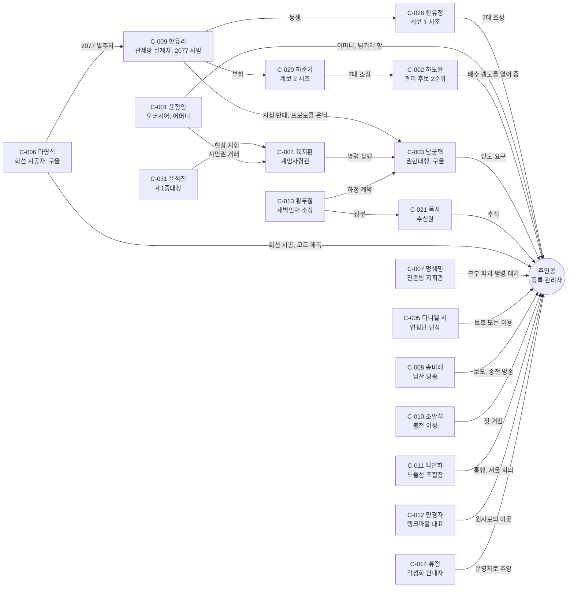
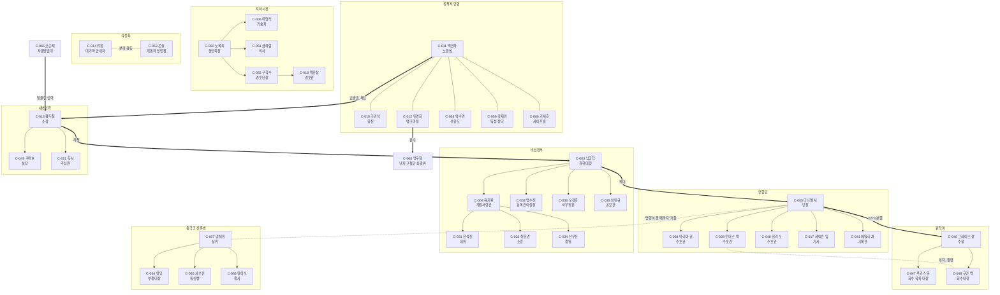
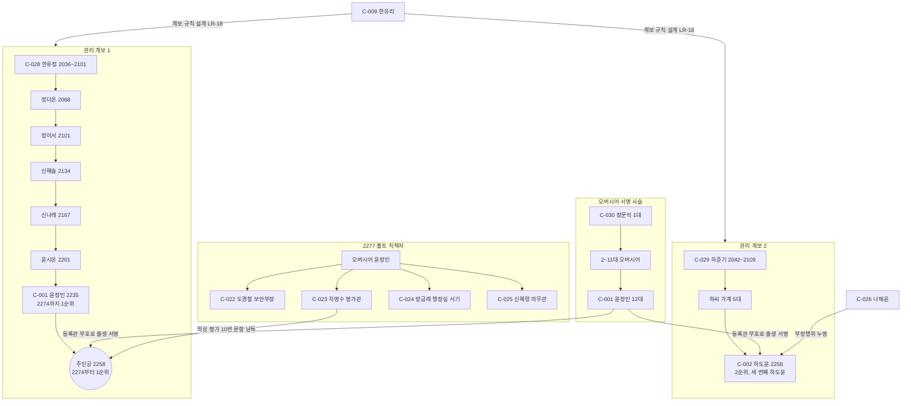

# SD-07a. 주요 인물

> **서울 폴아웃 상세 기획서 세트** | 문서 ID: SD-07a | 버전: v1.0 | 작성일: 2026-10-12
> **범위**: 주요 인물(C-001~C-075)의 선정 기준과 ID 체계, 전체 인물 표, 인물 관계도(메인 축·세력 지도부·볼트 S-07), 인물별 프로필(나이·성별·종, 소속·직함, 장소, 외형과 외형 코드, 성격·말투·대사 예시, 배경 2077→2277, 목표와 두려움, 메인 퀘스트 역할, 호감도·판도에 따른 태도 변화, 생사 조건과 대체 경로, 결말 슬라이드 연계, 전투 수치 참조, 서비스), 볼트 S-07 핵심 인물과 관리 계보·오버시어 계보, 메인 퀘스트별 등장 인물, 이름·설정 충돌 검사와 정본 제안 / 다루지 않는 것: 일반 NPC(N-권역-번호, SD-07b·SD-09a~f), 퀘스트 진행·분기 상세(SD-03a·03b·04a~d), 세력 수치(SD-06), 전투 수치 본문(SD-14), 초상화 도트 규격(SD-16), 블립 음색(SD-17)
> **관련 문서**: [SC-00 컨셉 v0.4](00_concept.md), [SD-02 세계관·연표](02_world-and-lore.md), [SD-03a 메인 스토리 1부](03a_main-story-part1.md), [SD-03b 메인 스토리 2부](03b_main-story-part2.md), [SD-04a 사이드(남부)](04a_side-quests-south.md), [SD-04b 사이드(서부·한강)](04b_side-quests-west-river.md), [SD-04c 사이드(북부·동부·도심)](04c_side-quests-north-east-center.md), [SD-04d 세력 퀘스트 라인](04d_faction-questlines.md), [SD-06 세력](06_factions.md), [SD-07b NPC 디렉터리](07b_npc-directory.md), [SD-09a~f 장소 카탈로그](09a_locations-r01-r02.md), [SD-10 캐릭터 시스템](10_character-system.md), [SD-12 탐험·UI](12_exploration-ui.md), [SD-13 아이템](13_items.md), [SD-14 크리처·적](14_creatures-enemies.md), [SD-15 경제](15_economy.md), [SD-16 아트 디렉션](16_art-direction.md), [SD-17 사운드](17_sound.md), [SD-18 용어·명명](18_naming-terms.md), 원작 [RD-10 주요 인물·동료](../reverse-design/10_characters-major-companions.md), [RD-11 NPC 디렉터리](../reverse-design/11_npc-directory.md), [RD-27 이식 시사점](../reverse-design/27_adaptation-notes.md)

---

## 목차
1. 개요
2. 인물 체계
3. 주요 인물 표 (전체 한눈에)
4. 인물 관계도
5. 인물별 프로필
   - 5.1 핵심 인물(C-001~003) · 5.2 바이블 주요 인물(C-004~014) · 5.3 이름 있는 NPC(C-015~021) · 5.4 볼트 S-07 직책자와 기록 인물(C-022~030) · 5.5 비상정부(C-031~037) · 5.6 연합단·원칙파(C-038~048) · 5.7 새벽인력·지하시장·각성회·중국군 잔존병(C-049~056) · 5.8 정착지와 중립 집단(C-057~062, C-066~067) · 5.9 카르마 추적자(C-063~065) · 5.10 보스 인물(C-068~074) · 5.11 특수 인물(C-075)
6. 볼트 S-07 핵심 인물
7. 메인 퀘스트별 등장 인물과 핵심 NPC 사망 시 대체 경로
8. 원작 대응
9. 쯔꾸르 제작 메모
10. 미결 사항
11. 부록 (A 이름 충돌 검사표 · B 설정 충돌 검사표 · C ID 대응표 · D 신규 고유명사 · E 참고 문서)

---

## 1. 개요

### 1.1 목적
- 메인 스토리(SD-03a·03b)와 세력(SD-06)이 이미 쓰고 있는 인물을 **한 사람 단위로 묶어** 대사 작가·초상화 제작자·이벤트 제작자가 같은 인물을 같은 얼굴, 같은 말투, 같은 생사 규칙으로 만들게 한다.
- 여러 문서가 각자 지은 이름을 모아 **C-ID를 부여하고, 같은 이름이 다른 설정으로 쓰인 곳에 정본을 제안**한다(부록 A·B).
- 원작 RD-10이 정리한 인물 설계 패턴(대칭형 의뢰인, 정체 공개 반전, 목소리로 먼저 등장, 필수 정책, 말투 계층)을 서울판 인물에 옮기고, 동료 시스템 삭제(바이블 K7)로 비는 자리를 어떻게 메웠는지 기록한다(8장).

### 1.2 범위와 경계

| 문서 | 맡는 것 | 이 문서와의 관계 |
|---|---|---|
| **SD-07a(이 문서)** | 주요 인물 75명(C-001~C-075)의 프로필, C-ID, 초상화 등급, voice_type, 생사·대체 규칙 | 인물 설정의 정본 |
| SD-07b | 이름 있는 일반 NPC 500명 이상(N-권역-번호), 외형 코드표 전체 | 07a 인물이 언급한 부하·가족·직원 이름은 07b가 짓는다. 이 문서는 `(SD-07b에서 이름 부여)`로 적는다 |
| SD-09a~f | 장소별 거주·등장 NPC 등록 | 장소 문서가 주요 인물에게 N-ID를 먼저 준 경우 **C-ID가 정본**이고 N-ID는 장소 등록 번호로만 남긴다(부록 C) |
| SD-03a·03b | 퀘스트 진행, 변수, 결과 | 인물의 MQ 역할·생사 변수는 03a·03b 값을 그대로 옮겼다. 다르면 03a·03b가 정본이고 이 문서를 고친다 |
| SD-06 | 세력 수치, 호감도 단계별 반응표 | 인물 단위의 반응 문안은 06 §4.3의 틀을 인물 말투로 바꿔 적었다 |
| SD-14 | 전투 수치(CR-ID) | 이 문서는 CR-ID만 참조한다. 보스 이름 확정은 이 문서가 한다(SD-14 §10.2 요청) |
| SD-16 | 초상화 규격·외형 코드 형식 | 인물별 외형 지시와 외형 코드 값은 이 문서가 정한다 |
| SD-17 | 블립(SE-TXT) 음색 | 인물별 `voice_type`과 피치 오프셋은 이 문서가 정한다(SD-17 §6.2 요청) |

### 1.3 요약
- **주요 인물 75명**: 바이블 §11 인물 21명(핵심 3, 주요 11, 이름 있는 NPC 7), 볼트 S-07 인물 9명(기록 3 포함), 세력 지도부·간부 27명, 세력의 2077년 기록 인물 2명, 정착지·중립 집단 대표 8명, 보스 인물 7명, 특수 1명. 기준은 2.1절.
- **고르지 않고 기운다**: 어떤 인물도 "우리 편이 되겠나?"를 묻지 않는다. 인물은 부탁하고, 바라고, 막아선다. 주인공이 실제로 무엇을 해 주었는지가 그 인물의 호칭·인사·가격·순찰·방송으로 돌아온다(바이블 §5.8). 이 문서의 대사 예시는 모두 개별 사안이나 그 인물의 신념을 말하는 문장이다.
- **동료는 없다.** v0.2의 동료 후보 7명(백구, 큰돌, 제이슨 임, 박춘삼, 파수-3, 진세라, 독사)은 이름 있는 NPC(C-015~C-021)로 남는다. 그들은 정해진 퀘스트 구간에서만 일시 동행하고, 일부는 '동맹' 지원 병력의 지휘자로 온다(SD-06 §8).
- **이름 교체 반영**: 강태오 → **육지환**(C-004), 천웨이 → **멍쉐밍**(C-007), 국민방송 → **공보방송**(2077년의 국영 방송은 **전시 국영방송**), 원작 용어 '불구' → **부위 손상**. 한결건설 마스코트는 **든든이**, 원칙파 약호는 **WP**다.
- **이 문서가 확정한 설정**(2.5절): 관리 계보 1은 **어머니 윤정인 쪽 혈통**이다(SD-02 U4 해소). 남산 방송은 **볼트 S-01 생존자 후손**이 연다(SD-02 U2 해소). 한유정·하준기의 프로필(SD-02 U3 해소). 하도윤은 S-07 기록상 **세 번째 하도윤**이다(SD-18 §3.3 ④ 해소). 이름 있는 NPC 파수-3은 세진 파수-3 모델의 **0311호 기체**다.
- **이름 충돌 정리**(부록 A): SD-14의 '선우진(각성회 개통파)'은 **은솔**로, '홍순례'는 **오순례**로 바꾸자고 제안한다. 대로파 '배기통'과 '버스왕 방석구', 활주로파 '방열복'과 '관제탑 차보람'은 한 사람(본명 + 별명 + 통칭)으로 합친다. SD-18 회피 목록에 걸리는 '루카스 문'은 개명을 제안한다.
- **초상화**: 고유 초상화(A등급) 40명 × 표정 6 = 기본 240컷(특수 3명은 대체 형식), 모듈 초상화 손보정(B등급) 30명 × 표정 3, 기록 초상(R등급) 5명(9장).

### 1.4 표기 규칙

**프로필 항목**

| 항목 | 뜻 |
|---|---|
| ID·데이터 키 | C-ID와 SD-18 §9.5 데이터 키(`chr_` + 로마자 성_이름). 중국 인명은 한어 병음, 별명은 로마자 뜻 표기 |
| 나이·성별·종 | **2277년 게임 시작 시점 나이**. 구울은 2077년 나이와 생년을 함께 적는다. 종: 인간 / 구울 / 야생화 직전 구울 / 변종 / 로봇 / 개 |
| 분류 | K 핵심(바이블 §11 핵심 인물) / A 주요(바이블 §11 주요 인물) / N 이름 있는 NPC(바이블 §11) / V 볼트 S-07 / S 세력 간부 / L 정착지·중립 대표 / B 보스 인물 / R 기록 인물 / X 특수 |
| 생사 | **불사(구간)**: 특정 구간에서 쓰러져도 죽지 않는다 / **살해 가능**: 죽일 수 있고 대체 경로가 있다 / **살해 가능(대체 없음)**: 죽으면 그 기능이 사라지지만 메인 진행은 막히지 않는다 / **살해 불가**: 아동 / **기록**: 2077년 또는 과거에 죽은 인물 |
| 초상화 등급 | **A**: 고유 초상화, 표정 6(SD-16 §8.2) / **B**: 모듈 초상화 + 고유 특징 손보정, 표정 3 / **R**: 기록 초상 1장(흑백 회상 필터) / **–**: 초상화 없음 |
| 외형 코드 | SD-16 §7.2 형식 `몸-피부-머리-머리색-몸통계열-낡음-팔레트-머리장비-눈장비-소품`. 몸 코드는 SD-09a §1.3의 값(M1 남 표준 / M2 남 체형 변형 / F1 여 표준 / F2 여 체형 변형 / E1 노인 남 / E2 노인 여 / K1 아동)을 쓰고, 변종은 `BY`, 로봇은 `RB`를 쓴다. 머리·장비 번호의 뜻은 9.4절 가정표를 따른다. 소품 `PR001~050`은 SD-09a 제안 번호, **`PR701~`은 이 문서의 제안 대역**이다 |
| voice_type | SD-17 §6.2의 화자 유형 ID(SE-TXT-01~11)와 피치 오프셋(±반음) |
| 말씨 | SD-12 §6.5의 '주인공 말씨' 필드: 하십시오체 / 해요체 / 해체. 바뀌는 시점이 있으면 함께 적는다 |
| 인물 카르마 | 그 인물을 죽였을 때의 카르마 판정용 성향(SD-10 §6.3): 매우 선 / 선 / 중립 / 악 / 매우 악. **매우 악**은 처치 시 +100, **악**은 0, **중립 이상**은 '악하지 않은 인물 살해' -100이다 |
| 태도 변화 | 호감도 단계(적대·경계·중립·우호·신뢰·동맹)와 판도에 따라 **그 인물이 보여 주는 세계의 반응**(호칭, 인사, 가격, 순찰, 방송, 물건). 숫자로 알리지 않는다(바이블 §6.2 표시 원칙) |
| 대사 예시 | 큰따옴표 안이 화면 대사다. 대사창 한 줄 최대 약 40자(SD-12 §6.1)를 넘는 문장은 실제 데이터에서 두 줄로 나눈다 |
| MQ·FQ·ES·CR·PK·V 번호 | 다른 문서의 ID를 그대로 쓴다. 다른 문서 소관의 새 ID가 필요하면 `(SD-xx에서 ID 부여)`로 적는다 |

**대사 작성 원칙(이 문서 전체)**
1. 진영을 묻지 않는다. "어느 편이냐", "우리와 함께하겠나", "이 제안을 받아들이겠나"를 쓰지 않는다(바이블 §5.8 원칙 1). 인물은 자기 바람을 말하고, 부탁하고, 사실을 진술한다.
2. 대화 선택지는 개별 사안(값, 진실, 이 사람의 생사, 물건의 행방)을 다룬다. 대화 한 번으로 호감도가 크게 바뀌지 않는다(SD-12 §6.3).
3. 인물의 말투는 출신이 정한다(SD-12 §6.5, SD-18 §8.7): 2077년 구울은 2077년 표준어와 공문 습관, 2277년 황무지 출신은 짧은 구어, 연합단은 한국어 문장에 영어 군사 용어, 비상정부는 공문체·하십시오체, 각성회는 관제망 안내 방송투, 중국군 잔존병은 침투 교육으로 배운 정확하고 딱딱한 한국어.
4. 중국군 잔존병의 말투를 억양 흉내나 일부러 틀린 한국어로 희화화하지 않는다. 각성회 어휘에 신·기도·성직·경전·성가 형식을 쓰지 않는다(SD-06 §10.11).
5. 2077년 국영 방송을 가리킬 때는 '전시 국영방송', 2277년 비상정부의 방송은 '공보방송'으로 쓴다.

---

## 2. 인물 체계

### 2.1 주요 인물의 기준
아래 ①~④ 중 **하나 이상**에 해당하고, 주인공과 대화로 상호작용하는 인물(또는 기록으로 메인 진행에 직접 쓰이는 인물)을 주요 인물로 정한다.

| # | 기준 | 판정 근거 | 해당 수 |
|---|---|---|---|
| ① | **메인 스토리 핵심 기능** | SD-03a·03b의 메인 퀘스트 필수 구간에 등장하거나, 생사 변수(`D_*`, `V_MOTHER`, `V_DOYUN`, `V_NAMGUNG`, `V_KANG`, `V_CW`)를 갖거나, SD-03a §6.3 대체자로 지정된 인물 | 약 45 |
| ② | **세력 지도자·간부** | SD-06 호감도 대상 10세력의 수장·2인자·분파 수장, 카르마 추적자 세력(철벽경호·자율방범대)의 수장, 정착지 연합 핵심 정착지 6곳(봉천·탱크마을·노들섬·선유도·뚝섬 장터·세이프빌)의 대표 | 약 38 |
| ③ | **고유 초상화 대상** | SD-16 §8.2의 고유 초상화 약 40명 | 40 |
| ④ | **보스 인물** | SD-14 §10.2 보스·유일 개체 중 이름 있는 인간·구울·변종, 그리고 SD-14 §10.4 이름 있는 NPC 전투 수치 대상 | 23 |

- 같은 인물이 여러 기준에 걸친다(합계는 75명). 기준에 걸리지 않는 상인·주민·부하(예: 봉천 고물상, 연합단 생도, 탱크 운영위원)는 SD-07b가 다룬다.
- 기록으로만 나오는 인물은 **메인 퀘스트 판정에 직접 쓰이는 사람만** C-ID를 준다(한유리, 한유정, 하준기, 장문석, 도정훈, 서니 델가도). S-07 2~11대 오버시어는 6.3절 표로만 둔다.
- 사이드 퀘스트(SD-04a~d)가 새 핵심 인물을 만들면 **C-076~C-099 예비 대역**에 SD-07a 개정으로 추가한다.

### 2.2 C-ID 대역

| 대역 | 묶음 | 수 |
|---|---|---|
| C-001~C-003 | 핵심 인물(바이블 §11 '핵심 인물') | 3 |
| C-004~C-014 | 주요 인물(바이블 §11 '주요 인물') | 11 |
| C-015~C-021 | 이름 있는 NPC(바이블 §11, v0.2 동료 후보) | 7 |
| C-022~C-030 | 볼트 S-07 직책자와 관리 계보 기록 인물 | 9 |
| C-031~C-037 | 비상정부(F-01) | 7 |
| C-038~C-045 | 연합단(F-02) | 8 |
| C-046~C-048 | 원칙파(F-03) | 3 |
| C-049 | 새벽인력(F-05) | 1 |
| C-050~C-052 | 지하시장(F-10) | 3 |
| C-053 | 각성회(F-11) | 1 |
| C-054~C-056 | 중국군 잔존병(F-08) | 3 |
| C-057~C-062 | 정착지 연합(F-12) | 6 |
| C-063~C-065 | 카르마 추적자(F-06 철벽경호, F-07 자율방범대) | 3 |
| C-066~C-067 | 중립 집단(F-17 한강 행상 조합, F-18 순회 의료반 들것) | 2 |
| C-068~C-074 | 보스 인물(F-04 약탈자, F-09 변종, 당인리 구울) | 7 |
| C-075 | 특수 인물(퍽 연출) | 1 |
| C-076~C-099 | 예비(사이드 퀘스트 핵심 인물) | — |

- 세력 순서는 SD-06 §2.1 F-ID 순서를 따르되, 바이블 §11 인물은 맨 앞 대역(C-001~021)에 모았다. 예: 황두칠은 새벽인력 소장이지만 C-013이다.
- 주인공(플레이어 캐릭터)은 C-ID를 받지 않는다. 데이터 키는 `pc`이고, 설정 메모는 6.1절에 있다.

### 2.3 생사 등급과 일시 동행 규칙
- **프롤로그 불사**: 볼트 안(MQ-P1~P4)에서는 윤정인, 하도윤, 육지환, 도경철이 체력 1에서 '무릎 꿇음'으로 멈춘다(SD-03a §6.4). 그 밖의 볼트 인물(차명수, 방금례, 신혜령, 나채윤, 지우)은 프롤로그에서 전투 대상이 아니다(공격 판정 없음).
- **볼트 밖에는 불사 인물이 없다**(SD-03a §6.3). 예외는 아동(지우 등, 살해 불가)과 **구간 불사**뿐이다: 조만석(MQ-101 방어 구간, 이장실에서 나오지 않음), 윤석진(MQ-106 철수), 육지환(MQ-106 비교전), 백구(MQ-101 S1 장면).
- **일시 동행 NPC**는 쓰러지면 '부상 퇴장'(사망 아님)이 기본이다. 퀘스트가 '사망 가능'으로 표시한 구간에서만 죽는다(SD-03a §5.5): 백구(MQ-101), 박춘삼(MQ-103), 제이슨 임(MQ-205~206), 샤오린(MQ-303).
- **기록 인물**은 죽일 수 없고, 대화하지 않는다. 터미널·홀로테이프·사진·콘솔 메시지로만 나온다.

### 2.4 인원 집계

| 분류 | 인원 | 초상화 A | 초상화 B | 초상화 R | 초상화 없음 |
|---|---|---|---|---|---|
| K 핵심 | 3 | 3 | – | – | – |
| A 주요 | 11 | 11(한유리는 회상판) | – | – | – |
| N 이름 있는 NPC | 7 | 7(백구는 스프라이트 감정, 파수-3은 CRT 얼굴판) | – | – | – |
| V 볼트 S-07 | 9 | 3 | 3 | 3 | – |
| S 세력 간부 | 27 | 11 | 16 | – | – |
| R 세력의 2077년 기록 인물(도정훈, 서니 델가도) | 2 | – | – | 1 | 1(서니 델가도: 화자 아이콘) |
| L 정착지·중립 대표 | 8 | 5 | 3 | – | – |
| B 보스 인물 | 7 | – | 7 | – | – |
| X 특수 | 1 | – | 1 | – | – |
| **합계** | **75** | **40** | **30** | **4** | **1** |

- S 세력 간부 27명은 C-031~C-036, C-038~C-044, C-046~C-056, C-063~C-065다. 보스 등급을 겸하는 간부(로건 백, 구학수, 은솔, 왕하오, 류강민, 오순례)는 3장 표에 `S·B`로 적었다. 분류별 정확한 배정은 3장 표의 '분류' 열이 정본이다.

### 2.5 SD-07a가 확정하는 설정

| # | 항목 | 확정 | 근거·관련 |
|---|---|---|---|
| D-01 | 관리 계보 1의 혈통 | **어머니 윤정인 쪽**이다. 윤정인은 한유정의 6대손, 주인공은 7대손이다. 2274년 주인공의 16세 평가 전까지 1순위는 윤정인 자신이었다 | SD-02 U4, SD-03a T5와 같다 |
| D-02 | 계보 1의 중간 세대 | 한유정(2036) → 정다온(2068) → 정이서(2101) → 신해솔(2134) → 신나래(2167) → 윤시온(2201) → 윤정인(2235) → 주인공(2258). 성은 S-07 '성 계승 규정'(등록 보호자 = 적성 등급이 높은 쪽 부모)으로 바뀌었다 | SD-18 §3.3 ②. 6.2절 |
| D-03 | 계보 2와 하도윤 | 하준기(2042)의 7대손이 하도윤(2258)이다. 하도윤은 S-07 기록상 **세 번째 하도윤**이다(계승명. 첫째는 2131년 공기 정화기 사고 사망, 둘째는 2214년 배수 갱도 실종 정비공) | SD-18 §3.3 ④, SD-02 M7(답은 주지 않는다) |
| D-04 | 남산 방송의 기원 | 볼트 S-01(남산) 생존자 후손이 연다. 송미래의 할머니 송은하가 2252년 남산 송신탑 아래 옛 방송실을 열었다. 송미래는 3대째 진행자다 | SD-02 U2 |
| D-05 | 파수-3 NPC의 정체 | 세진 '파수-3'(SJ-G70) 모델의 **0311호** 기체다. 2077-03 여의도 해산 사건 투입 240기 중 하나다. 이름표는 `파수-3 (0311호)`, 대사와 인물 수첩에서는 '파수-3'으로 부른다 | SD-02 §4.5·§5.2, SD-14 CR-531 |
| D-06 | 윤정인의 나이 | 2235년생. 2256년 21세로 최연소 오버시어 취임, 2258년 23세(오버시어 2년차)에 주인공 출산, 2277년 42세 | SD-03a §7.1·§12.1을 따른다. SD-02 §7.4.3 '24세 취임'은 고친다(부록 B) |
| D-07 | 남궁혁이 구울이 된 경위 | 2077-10-23 23:47 청계 시설 입구 통신실에서 낙진을 맞았고(1차), 2090년 벙커 원자로 냉각수 사고 때 원자로층에 직접 들어가 구울화가 굳었다(2차) | SD-02 §3.3.2와 SD-03a T8을 함께 살린다 |
| D-08 | 보스 이름 확정 | SD-14 §10.2의 제안 이름 10개를 이 문서가 확정한다. 문병철·로건 백·구학수·류강민·왕 중사(왕하오)·깡철이·방석구·차보람은 채택, 선우진(CR-523)은 **은솔**로, 홍순례(CR-528)는 **오순례**로 바꾼다 | 부록 A |
| D-09 | 시험 감독관 | SD-10 §8.5의 '시험 감독관 우회'는 담임 겸 평가관 **차명수(C-023)**가 맡는다. 새 인물을 만들지 않는다 | SD-10 U |
| D-10 | 세력 비기 교관 | PK-112 윤석진(C-031), PK-113 제이슨 임(C-017), PK-114 로건 백(C-048), PK-115 금하람(C-051), PK-116 류정(C-014), PK-117 멍쉐밍(C-007), PK-118 독사(C-021), PK-119 조만석(C-010) | SD-10 §5.5 |
| D-11 | 주인공의 아버지 | {주인공 성}이현(2229~2261). S-07 원자로 기사. 2261년 원자로실 냉각 배관 사고로 사망. 이야기에 쓰지 않는다(회상 대사 2곳만) | SD-03a §7.1 |
| D-12 | 대체자 이름 | SD-03a §6.3의 이름 없는 대체자 중 일부에 이름을 붙인다: 새벽인력 '부소장' → 실장 구만호(C-049), 각성회 '상위 사제' → 응답자 하은결(SD-15 V06), 탱크마을 경비대장 → 자경대장 민강윤(SD-09b) | 7.2절. '사제'는 각성회 어휘 금지 규칙에 걸려 바꾼다 |

---

## 3. 주요 인물 표 (전체 한눈에)

- **생사** 열: 불사(구간) / 살해 가능 / 살해 가능(대체 없음) / 살해 불가 / 기록. 대체자는 7.2절.
- **초상** 열: A / B / R / –.

| ID | 이름 | 분류 | 세력 | 주 장소 | 역할(한 줄) | 생사 | 초상 |
|---|---|---|---|---|---|---|---|
| C-001 | 윤정인 | K | 볼트 S-07 | 볼트 S-07 오버시어실 | 12대 오버시어, 주인공의 어머니. 프롤로그에서 자식을 넘기려 하고 4막에 볼모가 된다 | 프롤로그 불사 → 살해 가능(대체 없음) | A |
| C-002 | 하도윤 | K | 볼트 S-07 | 볼트 S-07 관리동 → 청계산 벙커 / 봉천 계단마을 | 동갑 친구, 관리 후보 2순위('예비 열쇠') | 프롤로그 불사 → 살해 가능(대체 없음) | A |
| C-003 | 남궁혁 | K | 비상정부 | 청계산 벙커 권한대행실 | 권한대행, 2077년 지침의 서명자. 서류대로 사는 구울 | 살해 가능 | A |
| C-004 | 육지환 | A | 비상정부 | 청계산 벙커, 이동(버티버드) | 계엄사령관 대령. 주인공을 쫓는 현장 지휘관 | 프롤로그·MQ-106 불사 → 살해 가능 | A |
| C-005 | 다니엘 서 | A | 연합단 | 용산 요새 지휘부 | 단장. 관제망을 연합단 손으로 다루려 한다. E2의 수령자 | 살해 가능 | A |
| C-006 | 마영식 | A | 지하시장 | 영등포 지하상가 배전실 | 2077년 S-07 회선 시공자 구울. 코드 해독, 기록 복원, 테이프 판독 | 살해 가능 | A |
| C-007 | 멍쉐밍 | A | 중국군 잔존병 | 북한산 굴진 기지 지휘소 | 상위. 200년째 철수 명령을 기다리는 지휘관 구울 | 살해 가능 | A |
| C-008 | 송미래 | A | 남산 방송 | 남산 송신탑 방송실 | 진행자. 주인공을 보도하고 종전 방송을 잇는다 | 살해 가능 | A |
| C-009 | 한유리 | A·R | (세진전자, 2077) | 세진전자 타워 101층(기록) | 관제망 설계자. 기록 8건과 콘솔 메시지로만 등장 | 기록 | A(회상판) |
| C-010 | 조만석 | A | 정착지 연합(봉천) | 봉천 계단마을 옥탑 이장실 | 이장. 황무지의 규칙을 가르치는 첫 어른 | MQ-101 불사 → 살해 가능 | A |
| C-011 | 백인하 | A | 정착지 연합(노들섬) | 노들섬 선주 조합 사무소 | 선주 조합장. 다리 통행, 서울 회의 주최 | 살해 가능 | A |
| C-012 | 민경자 | A | 정착지 연합(탱크마을) | 탱크마을 1호 탱크 | 대표. 당인리 원자로의 이웃 | 살해 가능 | A |
| C-013 | 황두칠 | A | 새벽인력 | 새벽인력 본소 소장실 | 소장. 1막 현상금의 주인, 장부의 주인 | 살해 가능 | A |
| C-014 | 류정 | A | 각성회 | 노량진 관제 중계소 | 안내자(대기파). 주인공을 '운영자님'이라 부른다 | 살해 가능 | A |
| C-015 | 백구 | N | 정착지 연합(봉천) | 봉천 계단마을 개집 | 진돗개, 마을 경보견 | MQ-101 S1 불사 → 살해 가능 | A(스프라이트) |
| C-016 | 큰돌 | N | 큰돌 무리 | 남산 북사면 배수 터널 | 평화적인 변종 무리의 우두머리 | 살해 가능 | A |
| C-017 | 제이슨 임 | N | 연합단 | 남산 분견대 초소 | 기사, 남산 분견대장. 연합단 온건파 | 살해 가능 | A |
| C-018 | 박춘삼 | N | 지하시장 | 영등포 지하상가 경호단 대기실 | 계약 구울 경호원 | 살해 가능 | A |
| C-019 | 파수-3 | N | (세력 없음) | 세진전자 타워 61층 정비고 | 0311호 경비 로봇. 타워 안내, 여의도 해산 사건 기록 | 살해 가능(기능 정지) | A(CRT) |
| C-020 | 진세라 | N | 철벽경호 | 노들섬 다리 북쪽 초소(조우), 강남 지사 | 용병. 현상금 사냥꾼으로 처음 만난다 | 살해 가능 | A |
| C-021 | 독사 | N | 새벽인력 | 새벽인력 본소, 이동(추적조) | 추심원. 1막 첫 추적자 | 살해 가능 | A |
| C-022 | 도경철 | V | 볼트 S-07 | 볼트 S-07 보안부 | 보안부장. "명령대로 쏜다" | 프롤로그 불사 → 살해 가능 | A |
| C-023 | 차명수 | V | 볼트 S-07 | 볼트 S-07 교실·평가관실 | 담임 겸 적성 평가관, 시험 감독관 | 살해 가능 | A |
| C-024 | 방금례 | V | 볼트 S-07 | 볼트 S-07 행정실 | 행정실 서기. 출생신고 단말 담당 | 살해 가능 | A |
| C-025 | 신혜령 | V | 볼트 S-07 | 볼트 S-07 의무실 | 의무관. 주인공을 받았다 | 살해 가능 | B |
| C-026 | 나채윤 | V | 볼트 S-07 | 볼트 S-07 기숙 구역 | 우등 가문 동급생. 시험 부정 사건의 장본인 | 살해 가능 | B |
| C-027 | 지우 | V | 볼트 S-07 | 볼트 S-07 배급소 | 배급소 아이(2268년 6세) | 살해 불가 | B |
| C-028 | 한유정 | R | (S-07 계보 1 시조) | 기록(관악 행정 연수원, S-07) | 한유리의 동생. 계보 1 시조 | 기록 | R |
| C-029 | 하준기 | R | (S-07 계보 2 시조) | 기록(S-07) | 세진전자 연구원. 계보 2 시조 | 기록 | R |
| C-030 | 장문석 | R | 볼트 S-07 | 기록(S-07 오버시어 일지) | 초대 오버시어, 등록관 부호의 시작 | 기록 | R |
| C-031 | 윤석진 | S | 비상정부 | 이동(청계 기동대) → 볼트 S-07(4막) | 대위, 제1중대장. MQ-106 현장 지휘, 4막 S-07 점령 지휘관 | MQ-106 불사 → 살해 가능 | A |
| C-032 | 염수진 | S | 비상정부 | 청계산 벙커 등록관리실 | 등록관리실장. 계급 증표를 건네는 사람 | 살해 가능 | A |
| C-033 | 허문경 | S | 비상정부 | 당인리(공병반 현장), 청계산 벙커 | 소령, 공병반장. 육지환 유고 시 계엄사령관 대행 | 살해 가능 | A |
| C-034 | 선우진 | S | 비상정부 | 여의도 환승 정류장 임시 초소, 노량진 계엄군 초소 | 중위, 수색조장·연락관 | 살해 가능 | B |
| C-035 | 차민규 | S | 비상정부 | 청계산 벙커 공보실 | 공보관. 공보방송 원고를 쓴다 | 살해 가능 | B |
| C-036 | 오정훈 | S | 비상정부 | 청계산 벙커 국무위원층 | 태성 계열 국무위원. 원자로와 파워 아머에 관심 | 살해 가능 | B |
| C-037 | 도정훈 | R | (2077 계엄사령부) | 경복궁 근정전 앞 지휘 차량(유해) | 2077년 계엄사령관. 계엄 인가 카드의 주인 | 기록 | R |
| C-038 | 마리아 권 | S | 연합단 | 용산 요새 원로회실 | 수호관(강경파). 다니엘 서 실각·사망 시 수장 | 살해 가능 | A |
| C-039 | 토머스 백 | S | 연합단 | 용산 요새 원로회실 | 수호관(다니엘 서 지지). 로건 백의 아버지 | 살해 가능 | B |
| C-040 | 헨리 오 | S | 연합단 | 용산 요새 원로회실 | 수호관(중도). 원로회 표결의 열쇠 | 살해 가능 | B |
| C-041 | 에밀리 차 | S | 연합단 | 용산 요새 기록보관소 | 기록관. 2077 테이프와 전황 보고 보관 | 살해 가능 | A |
| C-042 | 에이미 노 | S | 연합단 | 용산 요새 기지 방송실 | 통신병. 용산 기지 방송 낭독자 | 살해 가능 | B |
| C-043 | 레이철 공 | S | 연합단 | 용산 요새 공작창 | 수석 공작관. 정비·개조 서비스 | 살해 가능 | B |
| C-044 | 빅터 설 | S | 연합단 | 용산 요새 PX, 이태원 고개 초소 노점 | PX 관리관. 연합단 상인 | 살해 가능 | B |
| C-045 | 서니 델가도 | R | (2077 용산 기지 방송) | 용산 기지 방송 테이프(녹음) | 2077년 기지 방송 진행자. 녹음으로만 존재 | 기록 | – |
| C-046 | 그레이스 장 | S | 원칙파 | 공릉 회수 창고 경비동 | 원칙파 수장(전 수호관) | 살해 가능 | A |
| C-047 | 루카스 문 | S | 원칙파 | 공릉 회수 창고 교환소·서고 | 회수 목록 대장. 원칙파 상인(개명 제안: 부록 A) | 살해 가능 | B |
| C-048 | 로건 백 | S·B | 원칙파 | 공릉 회수 창고, 현장 회수조 | 회수대장. 현장 회수조 지휘, 비기 교관 | 살해 가능 | B |
| C-049 | 구만호 | S | 새벽인력 | 새벽인력 본소 장부실 | 실장. 장부 관리, 황두칠의 최후 대체자 | 살해 가능 | B |
| C-050 | 노복희 | S | 지하시장 | 영등포 지하상가 '복희 양품점' | 상인회장 구울. 마영식의 1차 대체자 | 살해 가능 | A |
| C-051 | 금하람 | S | 지하시장 | 영등포 지하상가 진료소 | 구울 의사. 치료·성형, 비기 교관 | 살해 가능 | B |
| C-052 | 구학수 | S·B | 지하시장 | 영등포 지하상가 중앙 경호단 대기실 | 계약 경호단장 구울. 적대 경로의 보스 | 살해 가능 | B |
| C-053 | 은솔 | S·B | 각성회 | 노량진 관제 중계소 정비고 | 개통파 당번장. MQ-505의 촉발자 | 살해 가능 | A |
| C-054 | 탕밍 | S | 중국군 잔존병 | 북한산 굴진 기지 막사 | 부중대장(강경파). 7막 폭파조 지휘 | 살해 가능 | A |
| C-055 | 샤오린 | S | 중국군 잔존병 | 북한산 굴진 기지 무전실 | 통신병. 200년 무응답 보고 담당, 일시 동행 | 살해 가능 | A |
| C-056 | 왕하오 | S·B | 중국군 잔존병 | 침투 터널 하층 | 중사. 야생화 병사 분대장이었던 구울 | 살해 가능 | B |
| C-057 | 하숙자 | L | 정착지 연합(봉천) | 봉천 계단마을 약국 | 부이장, 약국 주인. 조만석의 대체자 | 살해 가능 | A |
| C-058 | 탁수연 | L | 정착지 연합(선유도) | 선유도 물 상인 조합(제3 침전지) | 물 상인 조합장. 캡 교환 보증 | 살해 가능 | A |
| C-059 | 곽재민 | L | 정착지 연합(뚝섬 장터) | 뚝섬 장터 번영회 회관 | 장터 번영회장 | 살해 가능 | A |
| C-060 | 기세훈 | L | 정착지 연합(세이프빌) | 세이프빌 입주자대표회의실 | 입주자대표회의 회장 | 살해 가능 | A |
| C-061 | 우태현 | L | 정착지 연합(세이프빌) | 세이프빌 관리동 | 관리소장. MQ-204·302의 접점 | 살해 가능 | A |
| C-062 | 물개 | L | 정착지 연합(선유도 조합 뱃사공) | 양화 나루 | 뱃사공. MQ-202 일시 동행, 밤 배 밀수 | 살해 가능 | B |
| C-063 | 석광철 | S | 철벽경호 | 철벽경호 본사(옛 개화산 탄약고) | 대표. 계약 제77-1023호의 집행자 | 살해 가능 | B |
| C-064 | 류강민 | S·B | 철벽경호 | 철벽경호 본사, 최종 암살대 | 실장. 선 카르마 최종 암살대 지휘 | 살해 가능 | B |
| C-065 | 오순례 | S·B | 자율방범대 | 성수 방범 본부 | 대장. 악 카르마 최종 처단조, 새벽인력 탈출자 | 살해 가능 | A |
| C-066 | 노윤기 | L | 한강 행상 조합 | 뚝섬 장터 조합 사무소, 노들섬 사무소 | 조합장. 수송대 투자 | 살해 가능 | B |
| C-067 | 소윤희 | L | 순회 의료반 들것 | R01·R02·R03·R08 순회 | 반장. 중립 의료인 | 살해 가능 | B |
| C-068 | 맹구철 | B | 난지 고철단 | 난지도 쓰레기 산 정문 | 두목 '쇠갈퀴'. 흰 깃발 교섭 상대 | 살해 가능 | B |
| C-069 | 쥐왕 | B | 난지 고철단(분파) | 난지도 쓰레기 산 꼭대기 | 산주. 쇠갈퀴의 경쟁자 보스 | 살해 가능 | B |
| C-070 | 방석구 | B | 대로파 | 올림픽대로 버스 요새 | 두목 '배기통', 통칭 '버스왕' | 살해 가능 | B |
| C-071 | 차보람 | B | 활주로파 | 김포 방향 공항 관제탑 | 두목 '방열복', 통칭 '관제탑' | 살해 가능 | B |
| C-072 | 깡철이 | B | 남부순환 패거리 | 남부순환로 고가 아래 | 부두목(고가 아래 지부장, 두목은 삽자루). 1막 첫 인간 보스 | 살해 가능 | B |
| C-073 | 문병철 | B | (없음, 빛나는 구울) | 당인리 지하 원자력 발전소 노심 통로 | 2077년 당직 기사. 200년째 정지 절차를 되풀이 | 살해 가능 | B |
| C-074 | 무쇠 | B | 변종(서울역 무리) | 서울역 지하 3층 | 서울역 변종 무리 대장 | 살해 가능 | B |
| C-075 | 낯선 이 | X | (없음) | 어디에도(퍽 PK-049 발동 시) | 미스터리어스 스트레인저의 서울판 | 살해 불가(연출) | B |

---

## 4. 인물 관계도

### 4.1 메인 축: 열쇠를 둘러싼 사람들
주인공(등록 관리자)을 가운데 두고, 메인 스토리의 명령 사슬(누가 명령했고, 누가 기다리고, 누가 끝내려 하는가)을 그렸다. SD-03a §2.4 관계도의 이름 교체판이자 확장판이다.

### 4.2 세력 지도부
세력별 수장(굵은 상자)과 2인자·간부, 세력 사이의 대립을 그렸다. 점선은 '같은 명령 구조에 묶인 거울 관계'다(SD-06 §10.8).

### 4.3 볼트 S-07
관리 계보 두 줄기, 오버시어 서명 사슬, 2277년 볼트 직책자를 그렸다. 계보 대표 승계(2274)가 프롤로그의 중심 사건이다.

---

## 5. 인물별 프로필

- 분량은 주요도에 따라 다르다. 핵심·주요 인물(C-001~C-014)은 전체 항목, 이름 있는 NPC와 세력 수장급은 압축 항목, 나머지는 요약표로 적는다.
- 외형 코드의 머리·장비 번호 뜻은 9.4절 가정표를 따른다. SD-07b·SD-16이 코드표를 확정하면 일괄 치환한다.

### 5.1 핵심 인물

#### C-001 윤정인

| 항목 | 내용 |
|---|---|
| ID·데이터 키 | C-001 · `chr_yun_jeongin` |
| 나이·성별·종 | 42세(2235년생) · 여 · 인간 |
| 소속·직함 | 볼트 S-07 · 12대 오버시어(2256~, 21세 취임, 역대 최연소). S-07 등록관 부호 보유자 |
| 거주·활동 장소 | 볼트 S-07 오버시어실(프롤로그) → 볼트 S-07(1~3막, 계엄군 주둔 아래) → 청계산 벙커 구금동(4막) → 결말별(6.4절) |
| 분류·생사 | K · 프롤로그 불사 → 살해 가능(대체 없음, `V_MOTHER = 4`) |
| 초상화·스프라이트 | A(나이별 3판: 23세·33세·42세, 각 표정 6. 특수 칸 = **망설임**) · N2 |
| 외형 코드 | `F1-S2-HR07-H1-T01-1-PF11-HD00-EY00-PR701`(42세판. 23세판은 낡음 0, 33세판은 HR04) |
| voice_type·말씨 | SE-TXT-02 −1반음 · 해요체(볼트 직급 사회의 공식 말씨) → `V_MOTHER = 2`(화해)가 되는 순간 해체 |
| 인물 카르마 | 중립 |
| 서비스 | 없음. `V_MOTHER = 2`이고 `V_VAULT = 2`이면 볼트 S-07 배급소 가격 -20%(가족 배급) |
| 전투 참조 | 없음(비전투. 프롤로그는 불사 처리) |
| 결말 슬라이드 | ES-04(본문), ES-03(볼트 상태와 꼬리) |

**외형**
- 단정히 쪽진 머리(42세판은 흰머리 몇 가닥), 곧은 자세, 지친 눈가. 볼트 청 점프슈트 위에 오버시어 금 띠, 가슴에 오버시어 배지(PR701). 생활기록부 파일철을 늘 옆구리에 낀다.
- 23세판은 머리를 낮게 묶고 소매를 걷었다(돌잔치 장면). 33세판은 주인공 10세 생일, 핍-보이를 채워 주는 장면.
- 4막 구금판(42세)은 금 띠를 떼어 낸 흰 수용복(T01 낡음 2, 팔레트 PF01 흑청 수용 표식). 이 판은 표정 '슬픔'·'망설임'만 쓴다.

**성격과 말투**
- 키워드: **지키는 사람, 절차의 사람, 자기 몫을 늘 맨 뒤에 둔 사람.** 볼트 190명을 굶기지 않는 일을 자기 존재 이유로 삼는다. 감정이 앞서면 규정을 꺼내 들고, 규정이 틀렸다는 것을 알면 오래 침묵한다.
- 말투: 오버시어 공문체가 몸에 배어 있다. 자식에게도 "~해요", "~하세요"를 쓴다(볼트 직급 사회의 습관). 무너질 때만 반말이 나온다.

**대사 예시**
- (MQ-P1, 아기에게) "여기서 태어났으니까 여기서 잘 살면 돼. 엄마가 지킬게."
- (MQ-P4, 육지환에게) "나를 데려가세요. 3년 전까지 내가 1순위였다면서요."
- (MQ-P4, 설득 성공) "…여기 사람들 다 살리려고 그랬어. 너 하나 빼고. 그게 오버시어야. 가. 뒤돌아보지 말고."
- (MQ-403 재회 첫 줄) "다쳤니?"
- (MQ-403, `V_MOTHER = 6`) "이 편지, 첫 줄이 '네 아이의 아이의 아이가'로 시작해. 그 아이가 너구나. …이제 문은 네가 열어."

**배경(2077→2277)**
- 2077: 7대 조상 한유정이 관악 행정 연수원 교관 자격으로 S-07에 입주한다(계보 1 시조).
- 2235: 윤시온의 맏이로 태어난다. 평가 등급 A, 행정동 거주. 2251년 16세 적성 평가에서 '관리 후보 1순위'를 받는다. 당시 평가관도 오버시어도 뜻을 몰랐고, 오버시어 인수인계 문서의 "처우에 반영하지 말 것"에 따라 아무 일도 일어나지 않았다.
- 2256: 11대 오버시어 이수호가 인구 감소 책임으로 사임하고, 평가 위원회 추천으로 21세에 오버시어가 된다.
- 2258: 주인공 출산. 출생신고서의 '관제망 회선' 칸에 불이 한 번 들어온다. "200년 된 기계예요. 서류 넣어 주세요."
- 2261: 남편(주인공의 아버지, 원자로 기사)이 원자로실 사고로 죽는다. 이후 볼트 원자로 안전 규정을 세 번 고쳤다.
- 2271~2276: 비상정부 개방 지령을 해마다 받고 응답 신호만 보낸다. 2274년 자식의 16세 평가일에 자기 기록의 '관리 후보 1순위'가 '해제(승계)'로 바뀌지만 고장인 줄 안다.
- 2277: 수경 농장 곰팡이병으로 개방을 결정한다(MQ-P4). 계엄군이 계보 대장을 읽어 줄 때 처음으로 자기가 열쇠였다는 것을 안다.

**목표와 두려움**
- 목표: 볼트 사람 전원이 굶지 않고, 다치지 않고, '1등급'으로 안전해지는 것.
- 두려움: 자기 결정으로 볼트가 무너지는 것. 그리고 그 결정을 자식이 영원히 용서하지 않는 것.
- 모순: 지키라는 명령을 따르다 지켜야 할 사람(자식)을 넘긴다. 4막에서 볼모가 된 뒤에야 '지키는 것'과 '가두는 것'의 차이를 말하기 시작한다.

**메인 퀘스트 역할**

| MQ | 역할 |
|---|---|
| MQ-P1~P3 | 어머니이자 오버시어. 출생신고 서명, 10세 핍-보이 지급, 16세 평가일의 승계 표지 소멸(주인공은 보지 못하는 컷) |
| MQ-P4 | 개방 결정, 육지환과의 거래(주민 전원 1등급 ↔ 관리 후보 1순위 인도). 탈출 방법 ③ 설득의 대상. 오버시어 단말(K_RALLY, LR-18) |
| MQ-401 | 볼트 점령 중에는 없다(청계산으로 이송됨). 볼트 주민이 그녀의 결정을 두고 갈린다 |
| MQ-402 | 청계산 벙커 구금동 볼모. 협력 판이면 염수진이 데려온다 |
| MQ-403 | 결과 퀘스트의 주인공. `V_MOTHER` 6결말(SD-03b §2.3) |
| MQ-702 | `V_MOTHER = 5`이고 BJ 동맹 판이면 남궁혁 뒤에 선다: "…너 하고 싶은 대로 해. 이번엔 내가 안 막을게." |
| MQ-E1 | 후일담 '어머니에게'(`V_MOTHER` ∈ {2,3,5,6}) |

**태도 변화(세계의 반응)**
- 윤정인은 세력 호감도가 아니라 **주인공의 행동 기록**에 반응한다.

| 조건 | 보이는 것 |
|---|---|
| `V_ESCAPE` = 설득 | 4막 재회 첫 줄 "그날 문을 연 건 나였지". 볼트 주민이 주인공에게 "오버시어님이 직접 내보내셨대" |
| `V_ESCAPE` = 전투 | "도 부장 팔이 아직 안 좋아." 도경철이 4막에 주인공을 피한다 |
| `V_ESCAPE` = 하도윤 | "도윤이가 너를 내보냈다며." 하도윤 부모가 볼트 식당에서 주인공에게 인사하지 않는다 |
| `V_ESCAPE` = 은신 | "너는 늘 조용히 사라지는 애였어." |
| 1~3막 볼트 재방문(O-07) | 그녀는 이미 청계산 연락관과 서신을 주고받는 중이다. 오버시어실 책상에 공보방송 수배 공고 사본이 뒤집혀 놓여 있다 |
| `V_MOTHER = 2` 이후 | 볼트 정문 단말 인사가 "S07-2258-0031 연수생"에서 이름으로 바뀐다. 오버시어실 책상에 주인공의 편지가 쌓인다(에필로그) |
| `V_MOTHER = 5` 이후 | 공보방송이 'S-07 행정관 윤정인'의 임명을 미담으로 보도한다. 볼트 정문에 금색 띠 등록증 검사대가 선다 |

**생사와 대체 경로**
- 프롤로그 불사. 볼트 밖에서는 사보타주 붕괴 타이머 중 구금동에 들르지 않거나, 4막 외면 뒤 MQ-507에서 그녀가 있는 구역이 무너지면 죽는다(`V_MOTHER = 4`).
- 대체자 없음. 죽으면 4막은 '볼트만 되찾는' 판으로 진행된다(SD-03a §6.3). 메인 진행은 막히지 않는다.

---

#### C-002 하도윤

| 항목 | 내용 |
|---|---|
| ID·데이터 키 | C-002 · `chr_ha_doyun` |
| 나이·성별·종 | 19세(2258년생, 주인공과 같은 해) · 남 · 인간 |
| 소속·직함 | 볼트 S-07 · 연수생(관리동 서류 정리, 주 6시간). 관리 계보 2 대표, 관리 후보 2순위 |
| 거주·활동 장소 | 볼트 S-07 관리동·배관실 → 계엄군 호송(여의도 환승 정류장 임시 초소, 버티버드) → 청계산 벙커 예비 관리자 보관실 / 구출 시 봉천 계단마을 |
| 분류·생사 | K · 프롤로그 불사 → 살해 가능(대체 없음, `V_DOYUN = 4`) |
| 초상화·스프라이트 | A(나이별 4판: 1세·10세·16세·19세. 1세판은 맵 스프라이트만, 초상은 10세부터. 특수 칸 = **장난기**) · N2 |
| 외형 코드 | `M1-S3-HR08-H2-T01-1-PF11-HD00-EY00-PR004`(19세판) |
| voice_type·말씨 | SE-TXT-01 +1반음(10·16세판은 SE-TXT-03) · 처음부터 해체(SD-12 §6.5 예시) |
| 인물 카르마 | 선 |
| 서비스 | 구출 뒤 봉천 계단마을에서 **정보·회상**(주 1회 '볼트 소식' 대화: 그 주에 S-07에서 일어난 일을 알려 준다), 볼트 문 정비 키(M-205 하도윤의 보안 카드)로 배수 갱도 역방향 진입을 쉽게 한다(MQ-401 잠입 판정 한 단계 하락) |
| 전투 참조 | 일시 동행(MQ-P4) 동안 SD-11 일시 동행 기본값(Lv1, HP 60, 대걸레 자루). CR-ID 없음 |
| 결말 슬라이드 | ES-05, ES-31 대신 MQ-E1 후일담 '2순위' |

**외형**
- 헝클어진 앞머리, 주인공보다 반 뼘 작은 키, 정비공처럼 소매를 걷어 올린 점프슈트, 기름 얼룩. 허리에 공구 벨트(PR004), 목에 볼트 문 정비 키. 웃을 때 한쪽 입꼬리만 올라간다.
- 억류판(2~4막)은 공구 벨트를 빼앗기고 흰 수용복. 손목에 계엄군 인식 띠.

**성격과 말투**
- 키워드: **장난스러운 성실함, 바깥에 대한 집착, 2순위의 자존심.** 볼트 배관을 손바닥처럼 안다. 성적은 늘 중간, 손은 늘 바쁘다. '두 번째'라는 말에 예민하다.
- 말투: 또래 반말, 짧은 농담. 진지해지면 말이 짧아진다.

**대사 예시**
- (MQ-P2) "이 관, 어디까지 가는지 알아? 산 밑까지래."
- (MQ-P2) "넌 관리동, 나도 관리동. 우리 둘 다 서류 체질인가 봐."
- (MQ-P4, `V_DY_P3 = 3` 배신) "너 때문이 아니라 내가 나가고 싶어서야. 먼저 가."
- (MQ-104 구출) "봉천 계단마을로 갈게. 거기서 기다릴게. 이번엔 네가 늦지 마."
- (MQ-402 재회, 예비 관리자 보관실) "2순위라서 아무도 안 때리더라. 쓸모가 없으니까. 웃기지?"

**배경(2077→2277)**
- 계보 2 시조 하준기(세진전자 연구원)의 7대손. S-07 '등록 성명 표준 목록'의 '하도윤'은 계승명이다. 첫째 하도윤은 2131년 공기 정화기 사고로 죽은 정비공, 둘째 하도윤은 2214년 배수 갱도에서 실종된 정비공이다(볼트 기록은 '사고사'). 셋째인 그는 둘째의 이야기를 듣고 자랐고, 그래서 배수 갱도를 안다. 둘째가 밖으로 나갔는지는 끝까지 밝히지 않는다(SD-02 M7).
- 2274: 16세 평가일에 나채윤의 부정행위 누명을 쓴다(MQ-P3). 응시 자격을 잃어도 결과지는 '관리 후보 2순위'로 나온다.
- 2277: 개방의 날 주인공을 배수 갱도로 내보내거나(④), 다른 경로라도 결국 계엄군에 붙잡힌다(`V_DOYUN = 1`). 비상정부는 그를 '예비 열쇠'로 청계산으로 보낸다.

**목표와 두려움**
- 목표: 볼트 문 밖을 걸어 보는 것. 그리고 '2순위'가 아닌 이름으로 불리는 것.
- 두려움: 둘째 하도윤처럼 기록에서 '사고사'로 지워지는 것.

**메인 퀘스트 역할**

| MQ | 역할 |
|---|---|
| MQ-P1~P3 | 갓난아기(돌잔치 길막기), 10세 해충 구제 일시 동행, 16세 부정행위 사건(`V_DY_P3`) |
| MQ-P4 | 탈출 방법 ④의 길잡이(배수 갱도까지 일시 동행, 사망 불가). 어느 경로든 붙잡힌다 |
| MQ-104 | 여의도 환승 정류장 호송차 안(`V_DOYUN = 1`일 때). 구출하면 `V_DOYUN = 2` |
| MQ-106 | 육지환 버티버드 화물칸. 구출 기회 2번째 |
| MQ-402 | 청계산 예비 관리자 보관실. 협력 판이면 남궁혁이 계속 보관(`V_DOYUN = 5`), 그 밖은 구출(`V_DOYUN = 3`) |
| MQ-701·702 | 비상정부의 '예비 열쇠' 계획이 살아 있으면(`V_DOYUN = 5`) 7막 E1-c 견본 인증의 보조 설정. 그가 콘솔에 오지는 않는다 |
| MQ-E1 | 후일담 '2순위': 배수 갱도 끝에서 만난다 |

**태도 변화(세계의 반응)**

| 조건 | 보이는 것 |
|---|---|
| `V_DY_P3 = 1` 도움 | 구출 후 봉천에서 "너 그때 나 편들어 줬잖아. 이번엔 내 차례." 볼트 소식 대화가 매주 열린다 |
| `V_DY_P3 = 2` 방관 | 구출 후 첫 대화가 짧다. 볼트 소식 대화는 2주에 1번 |
| `V_DY_P3 = 3` 배신 | 구출 후 "고맙다는 말은 안 할 거야." 볼트 소식 대화는 열리지만 회상 대사가 차갑다 |
| 봉천 우호 이상 | 하도윤이 봉천 자경대 배관 수리를 맡아 마을 물값 -5% |
| `V_DOYUN = 5` | 공보방송이 "예비 관리자 하도윤 연수생, 국가 보호 중"을 보도한다. 봉천 사람들이 주인공에게 그 이름을 묻는다 |

**생사와 대체 경로**
- 프롤로그 불사(일시 동행 포함). 볼트 밖에서는 MQ-402 붕괴 타이머 안에 보관실에 들르지 않으면 죽는다(`V_DOYUN = 4`). 1~3막 억류 중에는 죽지 않는다(호송 대상).
- 대체자 없음. 죽으면 비상정부의 '예비 열쇠' 계획이 사라지고 `HO_SAMPLE`의 무게가 커진다(SD-03a §6.3).

---

#### C-003 남궁혁

| 항목 | 내용 |
|---|---|
| ID·데이터 키 | C-003 · `chr_namgung_hyeok` |
| 나이·성별·종 | 2077년 56세(2021년생) → 2277년 256세 · 남 · 구울 |
| 소속·직함 | 비상정부 · 권한대행(2078~). 2077년 행정안전부 장관, 국가비상대비위원회 정부 위원 |
| 거주·활동 장소 | 청계산 벙커 권한대행실(2077년 행정안전부 장관실 가구, 23:29에 멈춘 벽시계). 공보방송 연설로 1막부터 전역에 '목소리'로 존재 |
| 분류·생사 | K · 살해 가능(대체: 육지환 독자 계엄 → 벙커 관료 합의체) |
| 초상화·스프라이트 | A(특수 칸 = **서류를 읽는 얼굴**: 안경 너머로 내려다보는 무표정) · N2 |
| 외형 코드 | `M1-SG1-HR02-H4-T11-2-PF01-HD00-EY07-PR708` |
| voice_type·말씨 | SE-TXT-04 −2반음 · 하십시오체 |
| 인물 카르마 | 중립(살해 시 -100. MQ-402 암살은 퀘스트 값 -100 '무장하지 않은 노인') |
| 서비스 | 없음. BJ 동맹 시 **남궁혁의 신임장**(6막 행정 인가), **A-103 권한대행 경호대 제복** 수여 |
| 전투 참조 | 비전투(무장하지 않는다). 경호대는 SD-14 CR-4xx 계엄군 장교 템플릿. 권한대행실 진열장에 W-111 권한대행의 경호 권총 |
| 결말 슬라이드 | ES-06(상태: 퇴진·사망 / 결말별), E1 종전 방송의 화자 |

**외형**
- 2077년 장관 정장(T11)을 200년 입은 구울. 반듯한 가르마로 빗어 넘긴 회색 머리털이 듬성듬성 남았다. 피부 손상은 얼굴 왼쪽이 심하다(23:47 입구에서 낙진을 맞은 쪽). 금테 단안경(EY07)을 오른쪽 눈에 낀다. 2077년 행정안전부 배지, 늘 서류철(PR708)을 든다.
- 걸음이 느리고 정확하다. 앉을 때 바지 주름을 편다.

**성격과 말투**
- 키워드: **서류대로 사는 사람, 국가의 기억, 악의 없는 집행자.** 그는 악당이 아니다. 2077년 10월 23일 23시 21분에 자기가 한 말을 끝내는 것이 국가의 연속성이라고 믿는다. 개인의 감정을 '서류에 없다'는 이유로 다루지 않는다.
- 말투: 느리고 정확한 2077년 표준어, 공문 어휘. 문장이 길지만 단어를 낭비하지 않는다. 상대를 직함으로 부른다("관리자 후보님").
- 강요하지 않는다. 서류를 내밀고 기다린다. 그것이 가장 무섭다.

**대사 예시**
- (MQ-106 걸어 들어간다) "어서 오십시오, 관리자 후보님. 차는 드릴 수 있습니다. 강요는 서류에 없습니다."
- (MQ-402) "저는 2077년 10월 23일 23시 21분에 한 문장을 말했습니다. 그 문장은 아직 끝나지 않았습니다. 당신이 끝낼 수 있게 되기 전까지는요."
- (MQ-402, 계보를 알려 줄 때) "3년 전까지 1순위는 당신 어머님이었습니다. 서류는 거꾸로 가지 않습니다."
- (MQ-402 협상 퇴진) "내 명령은 거둘 수 있습니다. 하지만 2077년의 명령은 내 것이 아닙니다. 그건 저 기계 안에 있습니다."
- (공보방송 연설 끝 인사) "대한민국은 해산된 적이 없습니다. 오늘도 등록된 국민 여러분의 안녕을 확인합니다."

**배경(2077→2277)**
- 2021년생. 행정고시 출신 관료. 2071년 국가비상대비위원회 출범 때 행정안전부 장관에 올라 주민 분류·대피·관제망을 맡는다. 세진전자와 관제망을 공동 설계한 '발주자'다.
- 2075: '비상 주민 분류 지침'을 관제망 기본 프로토콜로 넣고 서명한다. 한유리의 반대 의견서(LR-17)에 '반려' 도장을 찍는다. 같은 해 '정부 연속성 계획'으로 S-07 예비 관리 계보를 요구한 장본인이다.
- 2077-10-23: 23:21 청계 시설 입구 통신실에서 '전면 집행'을 명령하고, 23:23 서울 볼트에 개방 지령을 보낸다. 23:47 우면산 남사면 폭발의 낙진을 입구에서 맞고 23:58 마지막으로 입소한다. 대통령은 오지 않았다(SD-02 M4. 그는 이 질문에 답하지 않는다).
- 2078: 권한 승계 순서상 살아남은 최상위 국무위원으로 권한대행에 취임한다.
- 2090: 벙커 원자로 냉각수 사고 때 직접 원자로층에 내려가 정지 절차를 지휘하다 두 번째로 피폭되고 구울화가 굳는다(D-07). 이 일로 벙커 2세대는 그를 '국가의 기억'으로 받든다.
- 2163: 배급 소요 진압 뒤 경비 병력을 계엄군으로 재편한다. 2262년 여의도 벙커 기록으로 관제망 기동 조건을 확인하고, 2270~2276년 개방 지령을 재송신한다.

**목표와 두려움**
- 목표: 2077년 10월 23일의 국가를 그날의 서류대로 복원하는 것. 관제망을 계엄 프로토콜로 켜는 것을 '국토 정상화'라 부른다.
- 두려움: 자기 명령이 '아무 의미 없는 8분'으로 끝나는 것. 그리고 대통령에 대한 질문.
- 약점: 구울이 된 몸은 생체 인증을 통과하지 못한다. 그래서 그는 관리자가 필요하고, 관리자가 없으면 견본(HO_SAMPLE)이라도 필요하다.

**메인 퀘스트 역할**

| MQ | 역할 |
|---|---|
| 1막~ | 공보방송 연설(9편, SD-17 §4.5)로 상시 등장. 수배 공고의 서명자 |
| MQ-106 | '걸어 들어간다' 해법에서 첫 면담(청계산 귀빈실, K_SIGNER·K_LINEAGE 일부 선공개) |
| MQ-402 | 권한대행실 면담. 협력(서명 + 견본) / 사보타주 / 협상(퇴진) / 암살 / 체포 / 그냥 나간다 |
| MQ-501 | 판 A '정부의 계엄' 선포 목소리 |
| MQ-702 | BJ 동맹이면 생체 인증 판 옆에 선다. 재촉, E1-c 견본 인증 시도 |
| 종전 방송 | E1의 화자(SD-03b §6.3) |

**태도 변화(세계의 반응)**

| BJ 단계 | 남궁혁이 보여 주는 것 |
|---|---|
| 적대 | 공보방송이 "적성 분자 {이름}에 대한 처단 공고"를 그의 목소리로 읽는다. 면담 요청에 응하지 않는다(MQ-402 진입은 강습·잠입만) |
| 경계·중립 | 연설에서 "관리자 후보의 자진 출석을 권고합니다". 면담은 언제든 받는다(서류대로 사는 사람은 출두자를 쏘지 않는다) |
| 우호 | 연설에 "관리 후보가 등록 절차에 협조하고 있습니다". 권한대행실에 주인공 자리의 찻잔이 놓인다 |
| 신뢰 | 연설에서 주인공을 '관리관'이라 부른다. 염수진을 통해 계급 증표가 온다 |
| 동맹 | "관리관 각하. 국가가 기다렸습니다." 공보방송에서 주인공 이름을 부르고, 7막 콘솔 곁에 선다 |
| HO_KEY = 1 | 연설 7 '불을 켠 정부' 확대판. "정부가 서울의 불을 되살렸습니다." |

**생사와 대체 경로**
- 언제든 죽일 수 있다(O-06: 4막 전 청계산 침입도 포함). 죽으면 `V_NAMGUNG = 1`, `F_BJ_NEUTRALIZED = 1`, 육지환이 독자 계엄(`V_KANG = 3`)을 시작하고 MQ-402는 '육지환과 담판'으로 바뀐다.
- 대체 1차: 육지환(C-004). 최후 대체: 벙커 행정 관료 합의체(염수진 C-032, 오정훈 C-036, 차민규 C-035)가 남고 계엄군은 분열한다(SD-03a §6.3).
- BJ 영구 적대 조건(SD-06 §10.1): 남궁혁 살해. 협상 퇴진은 영구 적대가 아니다.

### 5.2 바이블 주요 인물

#### C-004 육지환

| 항목 | 내용 |
|---|---|
| ID·데이터 키 | C-004 · `chr_yuk_jihwan` |
| 나이·성별·종 | 47세(2230년생, 청계산 벙커 출생 3세대) · 남 · 인간 |
| 소속·직함 | 비상정부 계엄군 · 계엄사령관 대령 |
| 거주·활동 장소 | 청계산 벙커 계엄사령관실, 버티버드(이동 지휘), 4막 이후 권한대행실 동석, 5막 MQ-507 주력 표적 정착지 |
| 분류·생사 | A · 프롤로그·MQ-106 불사 → 살해 가능(대체: 허문경) |
| 초상화·스프라이트 | A(특수 칸 = **흔들림**: 선서와 지침 사이에서 시선을 피하는 얼굴) · N2(장교 외투, 파워 아머 헬멧을 옆구리에) |
| 외형 코드 | `M2-S4-HR01-H1-T08-0-PF01-HD15-EY00-PR703` |
| voice_type·말씨 | SE-TXT-01 −1반음(무전은 SE-TXT-09) · 하십시오체 |
| 인물 카르마 | 중립 |
| 서비스 | 없음. BJ 동맹 시 W-110 계엄사령관의 권총 수여, FQ-BJ-07 '대령의 선서' 의뢰인 |
| 전투 참조 | CR-515(플레이어 +3, 15~35, 개량 파워 아머, 근위병 2) |
| 결말 슬라이드 | ES-06(상태: 육지환 투항), BJ 동맹 판 ES-02·ES-06 E1 |

**외형**: 무릎까지 오는 흑청 장교 외투(T08), 짧게 깎은 머리, 각진 턱, 금장 단추, 왼팔 노란 '계엄' 완장. 장교 정모(HD15), 지휘봉(PR703). 투항판은 외투를 벗고 선서문 수첩을 든다.

**성격과 말투**: **명령서를 읽는 사람.** 벙커 3세대로, 2077년을 문서로만 안다. 선서("국민의 생명과 재산을 보호하며")를 진심으로 믿고, 지침의 '등록된 자'가 곧 '국민'이라고 배웠다. 감정은 숨기지만 거짓말은 하지 않는다. 다나까체, 짧은 문장. 남궁혁을 "남궁 권한대행님"이라 부른다(벙커 출생자는 직함을 과하게 정확히 부른다, SD-18 §3.6).

**대사 예시**
- (MQ-P4) "개인 감정은 없다. 서류가 그렇게 돼 있다."
- (MQ-106) "관리자 후보. 서류대로 하자. 다치게 할 생각 없다."
- (MQ-106 말한다 성공) "맞는 말이다. 그래서 다시 온다."
- (MQ-507) "나는 명령서를 읽는 사람이다. 오늘 명령서에는 세 곳의 이름이 있다. 네가 한 곳을 고르면, 나머지 두 곳은 명령서대로 된다." (사실의 진술. 주인공은 대답하지 않고 그냥 간다)
- (MQ-402·507 투항) "선서에는 '국민'이라고 돼 있었다. 지침에는 '등록된 자'라고 돼 있었다. 나는 200년 동안 그 둘이 같은 말인 줄 알았다."

**배경**: 할아버지는 2163년 배급 소요 뒤 재편된 첫 계엄군 중대장, 아버지는 버티버드 회전익반 정비 장교였다. 벙커 사관 교육에서 2077년 계엄 교범과 선서를 외우며 자랐다. 2256년 당인리 1차 탐사 실패 때 정찰대 생존자 2명 중 하나였고, 그 뒤 계엄군 개혁(지상 활동)을 이끌어 2270년 계엄사령관이 된다.

**목표와 두려움**: 목표는 국민을 보호하는 것, 그리고 그 '국민'을 명령서가 정해 주는 것. 두려움은 자기가 지켜 온 명령서가 국민을 죽이는 문서라는 증거.

**메인 퀘스트 역할**: MQ-P4(인도 요구, 윤정인과 거래) / MQ-106(첫 번째 추적자. 교전에 들어오지 않는다) / MQ-301(허문경 공병반을 보낸다) / MQ-402(협상 판의 동석자. 투항 판정 대상) / MQ-501 판 B(사령관의 계엄 선포) / MQ-507(주력 표적에 직접. 투항 판정 2번째 기회) / MQ-604(BJ 동맹이면 함께 강하) / MQ-701(비상정부 비동행·지휘 중이면 후발대, 투항 판정 3번째 기회) / MQ-702(BJ 동맹이면 콘솔 곁. 테이프·코어를 막는다. `V_KANG = 2`면 총을 내린다).

**태도 변화(세계의 반응)**

| 조건 | 보이는 것 |
|---|---|
| BJ 경계 이하 | 검문소 수배 전단에 그의 서명. 버티버드가 주인공 근처를 낮게 지난다 |
| BJ 중립 | 계엄군 병사가 "대령님께서 '서두르지 말라'고 하셨습니다"라며 동행을 '요청'한다 |
| BJ 신뢰 | FQ-BJ-07에서 그와 지상 순찰. 미등록 노인을 검문하는 현장에서 그가 처음으로 명령을 늦춘다 |
| BJ 동맹 | "관리관님." 7막에 그가 계엄 코드로 경비 로봇 일부를 멈춘다 |
| 윤석진을 살렸다(MQ-401) | 5막 투항 판정 한 단계 하락. 윤석진의 보고 "볼트 사람들은 죽이지 않았습니다"가 근거가 된다 |
| `V_KANG = 3` 독자 계엄 | 공보방송이 그의 목소리로 바뀐다. 연설이 짧고 군대식이 된다 |

**생사와 대체 경로**: 프롤로그·MQ-106 불사. 그 뒤 살해 가능(`V_KANG = 1`). 대체: 공병반장 허문경 소령이 계엄사령관 대행 → 최후: 계엄군 분열, 각 분대가 마지막 명령대로 움직인다(SD-03a §6.3). `V_KANG = 2`(투항) + MQ-507 격퇴는 `F_BJ_NEUTRALIZED`의 조건 ③이다.

---

#### C-005 다니엘 서

| 항목 | 내용 |
|---|---|
| ID·데이터 키 | C-005 · `chr_seo_daniel` |
| 나이·성별·종 | 51세(2226년생) · 남 · 인간(한미 혼혈 계보) |
| 소속·직함 | 연합단 · 단장(Commander, 2266~) |
| 거주·활동 장소 | 용산 요새 지휘부·회의실·연병장(아침 점호) |
| 분류·생사 | A · 살해 가능(대체: 마리아 권 → 제이슨 임) |
| 초상화·스프라이트 | A(특수 칸 = **경례**) · N2 |
| 외형 코드 | `M2-S3-HR01-H4-T09-1-PF02-HD00-EY00-PR710` |
| voice_type·말씨 | SE-TXT-01 −1반음 · 해요체(연합단 우호 이상이면 그가 먼저 반말 "같이 갑시다" 뒤로 해체 허용) |
| 인물 카르마 | 중립 |
| 서비스 | 없음. 연합단 계급 증표 수여자(SD-06 §4.4), W-106 용산 수호자·A-104 연합단 근위 파워 아머 수여, FQ-YH-08 '같이 갑시다' |
| 전투 참조 | CR-525(연합단 적대 시에만) |
| 결말 슬라이드 | ES-07(E2-a, 배신판), E2 종전 방송 화자 |

**외형**: 회색 섞인 짧은 머리, 넓은 어깨, 한국계 얼굴에 회색 눈(미군 계보). 올리브 야전 상의에 200년 된 13개 별 성조기 패치를 손수 꿰맨 자국(PR710). 무전 안테나가 달린 배낭. 오른손 약지가 없다(2266년 단장 취임 전 이촌 강변 원정의 부상).

**성격과 말투**: **교리를 해석하는 군인.** "기지를 지켜라"를 글자 그대로 믿지 않고 "기지란 서울이다"로 넓혀 읽는다. 그래서 원칙파가 떠났다. 실용적이고 계산이 빠르지만, 아침 점호의 끝나지 않은 3조 앞에서는 늘 말을 멈춘다. 한국어 문장에 무전 용어. "Copy.", "Roger that."

**대사 예시**
- (MQ-206) "우리 교리는 한 줄이야. 기지를 지켜라. 문제는 200년째 아무도 '언제까지'를 말해 주지 않았다는 거지."
- (MQ-206 손님 숙소, 기다린 경우) "규율을 지켰군. 그럼 우리도 지키지."
- (MQ-503) "제3조. 명령이 오지 않아도… 200년 동안 이 문장 끝을 아무도 몰랐다. 그래서 우리가 갈라졌다."
- (MQ-702) "열쇠가 올라오면 우리에게. 기지를 지키는 게 우리 일이다."
- (E2) "교대가 왔다. …200년 걸렸군."

**배경**: 2077년 용산 지하 연합 지휘소 생존자의 후손. 아버지는 기사장, 어머니는 기록관. 2240년대 수습기사 시절 이태원 피난촌에서 굶어 죽는 아이들을 본 것이 '기지란 서울' 해석의 출발이다. 2266년 단장 취임 뒤 PX 보급품을 피난민에게 나누고 노들섬과 교역을 텄다. 2273년 그레이스 장의 이탈을 막지 못했다. 변종의 기원(요새 지하 생물방어 연구동 봉인 구역)을 알고 있고 말하지 않는다(SD-02 M5).

**목표와 두려움**: 목표는 관제망의 로봇 군대가 서울을 쓸어 내기 전에 연합단이 그것을 부수든 쥐든 하는 것. 두려움은 로봇이 멈춘 서울에서 연합단이 가장 강한 총이 되는 것(E4 슬라이드).

**메인 퀘스트 역할**: MQ-206(관제망 설명, 손님 숙소 잠금) / MQ-207(노량진 관제 중계소 진공관 회수 의뢰) / MQ-301·303(연합단 현장 무리 파견) / MQ-401(신뢰 이상이면 기사 넷을 관악산 기슭에) / MQ-502(연합단 대표 발언 "관제망은 우리가 지킨다") / MQ-503(분열의 한쪽. 원칙파 승리 시 실각·영창) / MQ-508(연합단 주력이면 용산 연병장 "We go together.") / MQ-702(지휘 열쇠 투입구 옆. E5를 막는다).

**태도 변화(세계의 반응)**

| YH 단계 | 다니엘 서와 그 주변 |
|---|---|
| 적대 | "Hostile." 요새 정문 포탑. 그는 직접 나오지 않고 기사 추격조를 보낸다 |
| 경계 | 정문 심사 때 그가 망루에서 내려다본다. 대화는 회의실에서 무장 해제 뒤 1회 |
| 중립 | "볼트 사람이군." 회의실 대화, PX 게시판 의뢰 3건 |
| 우호 | "Friend." 회의실에 들르면 커피(대용차)를 권한다. 용산 기지 방송이 주인공을 '방문자'로 부른다 |
| 신뢰 | 아침 점호 직후 이름을 부르고 수습기사 계급장을 던진다: "Catch. 같이 갑시다." |
| 동맹 | 콜사인으로 부른다(SD-06 §4.4: Ghost·Envoy·Hammer·Wrench·Key). 연병장 기사 명판에 주인공 콜사인 |

**생사와 대체 경로**: 살해 가능(`D_DS`). 대체: 원로회 수호관 마리아 권(강경파, E2-b) → 기사단 최선임 제이슨 임(E2-c) → 둘 다 없으면 E2는 '지휘 열쇠를 연합단 기사에게 건넨다'로 처리(SD-03a §6.3). MQ-503 원칙파 승리 시 실각(사망 아님). 연합단 영구 적대 조건: 다니엘 서 살해, 그가 지켜보는 가운데 E5(SD-06 §10.2).

---

#### C-006 마영식

| 항목 | 내용 |
|---|---|
| ID·데이터 키 | C-006 · `chr_ma_yeongsik` |
| 나이·성별·종 | 2077년 41세(2036년생) → 241세 · 남 · 구울 |
| 소속·직함 | 지하시장 · 기술자(상인회 정회원). 2077년 세진전자 협력사 '영신통신' 회선 기술자 |
| 거주·활동 장소 | 영등포 지하상가 배전실 작업장(상인회 허가 없이는 아무도 만나지 않는다) |
| 분류·생사 | A · 살해 가능(대체: 노복희 → 레이철 공 또는 루카스 문 → 주인공 [과학 75]) |
| 초상화·스프라이트 | A(특수 칸 = **죄책감**: 눈을 내리깐 채 손을 비비는 얼굴) · N2 |
| 외형 코드 | `M1-SG1-HR00-H4-T16-2-PF00-HD00-EY08-PR704` |
| voice_type·말씨 | SE-TXT-04 +0 · 해요체 |
| 인물 카르마 | 선 |
| 서비스 | 상인 V09(에너지 전지, 펄스 수류탄, 핵분열 배터리 등), **정비**(에너지 무기·SJ 계열, 요율 0.9), 근태 목걸이 해제(JH 우호 이상, 300캡), 진공관 반복 매입(1개 15캡), MQ-304 기록 재구성(게임 2일) |
| 전투 참조 | 없음(지하시장 적대 시 비전투로 숨는다). W-104 마영식의 개조 충격 권총 수여 |
| 결말 슬라이드 | ES-30 |

**외형**: 머리카락이 다 빠진 구울(HR00), 이마에 올린 확대경 고글(EY08). 세진전자 하청 작업복 잔해 위에 진공관 몇 개를 꽂은 가죽 앞치마. 납땜 인두(PR704)를 귀에 꽂고 다닌다. 왼쪽 가슴에 녹슨 '영신통신 3팀 마영식' 명찰.

**성격과 말투**: **200년 동안 사과할 곳을 찾은 기술자.** 손이 빠르고 말이 많다. 회로 이야기를 할 때만 죄책감이 사라진다. 자기소개는 늘 "세진전자 협력사 영신통신 3팀 마영식입니다"(SD-18 §3.2 구울 자기소개 습관). 2077년 기술 은어와 상인 말투가 섞인다.

**대사 예시**
- (MQ-103) "이건 주소가 아니라 사람이야. 네 출생 등록이 관제망 관리자 대장의 줄이야. 관제망은 너를 열쇠로 봐."
- (MQ-103 고백) "회선 하나 까는 데 사흘 걸렸어. 그게 200년 뒤 애 하나를 이렇게 만들 줄은 몰랐지."
- (MQ-103 LR-21) "한 박사가 마지막에 이걸 줬어. 나머지는 타워 꼭대기에 있을 거야."
- (MQ-702) "사람이 살 쪽으로 해. 구울도 사람이야."
- (E4) "깐 놈이 걷어야지."

**배경**: 2076년 한유리의 지시로 관악 중계소~S-07 전용 회선을 깔았다. 시공 일지에 적은 용도는 "예비 계보 동기화(?)". 2077-10-23 영등포역 지하상가로 대피해 셔터 안에서 살아남았고 구울이 되었다. 회선의 용도를 2120년대 지하시장 교역 시장이 열린 뒤 상인에게서 들은 관제망 소문으로 짐작했다. 200년 동안 배전반 뒤에 LR-21 한 장을 숨겼다. 새벽인력과 계엄군 정보원이 그를 찾는다.

**목표와 두려움**: 목표는 자기가 깐 회선이 사람을 죽이는 데 쓰이지 않게 하는 것. 두려움은 관제망이 깨어나 구울을 '판독 불능'으로 분류하는 날.

**메인 퀘스트 역할**: MQ-103(코드 해독 K_CODE·K_NET, 고백 K_LINE·LR-21, HO_DECODE) / MQ-207(세진 타워 B2 회로도 원본 의뢰) / MQ-304(기록 8건 재구성, HO_COPY) / MQ-506(구울 등록 조항 증거) / MQ-603(지하시장 우호면 차단벽 제어반) / MQ-605(운영 인가 위조) / MQ-508·701·702(정착지 연합 또는 지하시장 주력이면 동행, E3-b 테이프 판독 기술자).

**태도 변화(세계의 반응)**

| JH 단계 | 마영식이 보여 주는 것 |
|---|---|
| 적대 | 배전실 셔터가 내려가 있다. 대체 경로(시공 일지 절도)만 남는다 |
| 경계·중립 | 상인회 허가 또는 면담료 300캡이 있어야 만난다 |
| 우호 | 핍-보이 판독기 무료 개조(관제망 장치 반응 범위 +2타일) 제안 전령이 온다(MQ-207). 정비 요율 0.9 |
| 신뢰 | 작업대 옆 의자에 주인공 이름표. 재구성 기간 2일 → 1일 |
| 동맹 | 마영식 작업대 사용권(SD-06 §4.4). 그가 "회선 이야기, 이제 그만 해도 되겠다"고 말한다 |

**생사와 대체 경로**: 살해 가능(`D_MYS`). 대체: 상인회장 노복희(코드 해독은 시공 일지로) → 연합단 공작창 기술자(레이철 공) 또는 원칙파 회수병(루카스 문) 중 호감도 중립 이상인 쪽 → 7막 판독은 주인공 [과학 75](SD-03a §6.3). 지하시장 영구 적대 조건: 마영식 살해.

---

#### C-007 멍쉐밍

| 항목 | 내용 |
|---|---|
| ID·데이터 키 | C-007 · `chr_meng_xueming` (기획서 병기 한자: 孟學明) |
| 나이·성별·종 | 2077년 34세(2043년생) → 234세 · 남 · 구울 |
| 소속·직함 | 중국군 잔존병 · 상위(중대 부지휘관. 중대장은 2079 사망). 특수 굴진 중대 지휘관 |
| 거주·활동 장소 | 북한산 굴진 기지 지휘소. 매일 06:00 점호, 무전실 일일 보고 |
| 분류·생사 | A · 살해 가능(대체: 샤오린 → 해산 불가) |
| 초상화·스프라이트 | A(특수 칸 = **경례**) · N2(헬멧을 벗은 스텔스 아머) |
| 외형 코드 | `M1-SG1-HR10-H4-T15-2-PF08-HD00-EY00-PR705` |
| voice_type·말씨 | SE-TXT-04 −1반음(무전 SE-TXT-09) · 해요체(잔존병 우호 이상부터 그가 주인공을 '연락관'·'전우'로 부른다) |
| 인물 카르마 | 중립 |
| 서비스 | 없음. 잔존병 계급 증표 수여(흰 완장·명예 전우 인식표·종전 전령), W-109 멍쉐밍의 장교도, A-109 침투조 스텔스 슈트 수여, PK-117 야간 침투 교범 교관 |
| 전투 참조 | CR-516(플레이어 비례 12~28, 장교 검, 경례 모션 뒤 근접) |
| 결말 슬라이드 | ES-10 |

**외형**: 머리를 짧게 민 구울(HR10), 헬멧을 옆에 둔 슬림 스텔스 아머(T15). 꼿꼿한 등. 허리에 2077년 명령서를 담은 원통(PR705). 피부 손상은 깊지만 수염 자리를 매일 면도칼로 정리한다. **민족 비하 캐리커처 금지**(SD-16 §2.6): 눈·얼굴을 과장하지 않는다.

**성격과 말투**: **명령을 기다리는 병사, 주인공의 거울.** 지쳤지만 무너지지 않는다. 부하의 인식표를 닦고, 부칠 수 없는 편지를 쓰게 하고, 근무일지를 하루도 빼지 않았다(73,000일). 자기들이 왜 아직 여기 있는지 묻지 않으려 애쓴다. 2070년대 침투 교육으로 배운 정확하고 딱딱한 한국어. 억양 흉내 금지.

**대사 예시**
- (MQ-303 첫 대면) "너는 저 기계가 기다리는 사람이다. 우리는 저 기계를 부수라고 기다리는 사람이다. 누가 먼저 끝나겠나?"
- (MQ-303) "우리는 부수러 왔다. 부수지 못했다. 그래서 기다렸다. 200년이면 기다림도 임무가 된다."
- (MQ-303 해산) "명령을 내린 자가 없으니, 명령을 거두는 것은 나다. …오늘 일지는 내가 쓴다. '명령 종료.'"
- (MQ-602 터널 출구) "여기서부터는 당신들 도시다. 우리는 어디로 가야 하나?" (부대의 거취를 묻는 개별 대화)
- (E4) "보고한다. 임무 완료. 철수한다."

**배경**: 2076년 12월 북방 병합지에서 월경 피란민 행렬에 섞여 넘어왔다. 2077년 초부터 굴진 로봇으로 북한산 남쪽 비탈에서 관제 본부 외곽까지 5.2km 갱도를 팠다. 10-23 23:21 차단벽이 눈앞에서 내려왔고 23:35 마지막 무전 "전원이 돌아오면 다시 시도하라. 철수 명령 전까지 대기."를 받았다. 2079년 중대장이 죽고 지휘를 이었다. 126명 중 41명이 남았다(의식 유지 29, 야생화 12).

**목표와 두려움**: 목표는 명령을 끝내는 것. 그러나 명령을 거둘 권한이 자기에게 있는지 모른다. 두려움은 부하들이 하나씩 야생화되어 '이유 없이 기다리는 짐승'이 되는 것.

**메인 퀘스트 역할**: MQ-303(증명·해산 후 남기·전투·기만·연합단 공격·은신 통과. `V_CW` 7종) / MQ-502(평화 해결 시 무전 참석 "우리는 손님이다") / MQ-602(침투 터널 동행, 계엄 인가 카드) / MQ-701(잔존병 주력·보조면 수문장 문 옆 벽 폭파 "200년 늦었다." 미해결이면 폭파조) / MQ-702(코어 격벽 앞, E4를 재촉).

**태도 변화(세계의 반응)**

| JG 단계 | 멍쉐밍과 부대 |
|---|---|
| 적대 | 정시 보고에 "적군 1명 영역 침입". 그는 부대를 은신 매복으로 돌린다 |
| 경계·중립 | 바위의 흰 선. 샤오린이 통역하며 막아선다. 백기면 지휘소까지 데려간다 |
| 우호 | "연락관, 통과하라." 흰 완장. 그가 부칠 수 없는 편지 묶음(FQ-JG-04)을 보여 준다 |
| 신뢰 | "전우." 명예 전우 인식표를 거수경례로 건넨다. 남산 방송이 '북한산 유령들과 말을 튼 사람'을 언급 |
| 동맹 | "전령. 명령을 기다린다." 정시 보고 송신이 멈춘다. 기지 입구 붉은 별 깃발이 내려간다 |

**생사와 대체 경로**: 살해 가능(`D_CW`). 쓰러뜨리면 마지막 명령 "갱도 폭파"가 실행돼 터널 중간이 무너진다(MQ-602 불가). 대체: 통신병 샤오린 → 샤오린도 없으면 해산 불가, `V_CW`는 전투 계열로만 끝난다(SD-03a §6.3). 잔존병 영구 적대 조건: 멍쉐밍 살해, 항복한 잔존병 처형, 터널 지도를 연합단·비상정부에 넘김.

---

#### C-008 송미래

| 항목 | 내용 |
|---|---|
| ID·데이터 키 | C-008 · `chr_song_mirae` |
| 나이·성별·종 | 33세(2244년생) · 여 · 인간 |
| 소속·직함 | 남산 방송(F-14) · 진행자. 직원 7명의 대표 |
| 거주·활동 장소 | 남산 송신탑 아래 옛 방송실, 지하 아카이브 |
| 분류·생사 | A · 살해 가능(대체: 남산 방송 기술자 → 관제망 방송망 직접 송출) |
| 초상화·스프라이트 | A(특수 칸 = **ON AIR**: 헤드폰을 한 손으로 누르고 웃는 얼굴) · N2 |
| 외형 코드 | `F1-S2-HR05-H8-T03-1-PF00-HD10-EY00-PR702` |
| voice_type·말씨 | SE-TXT-02 +0(라디오 방송은 자막 화자 아이콘 규칙, SD-17 §3) · 해요체(존댓말에 가끔 반말이 섞인다) |
| 인물 카르마 | 매우 선 |
| 서비스 | **특수 매입처**: 전쟁 전 사진기 M-054(1대 80캡 + XP 20), 전쟁 전 필름 M-055(1통 20캡)('서울 기록 사업'), MQ-205 아카이브 열람, W-125 송신탑의 눈(방송국 경비가 건넨다) |
| 전투 참조 | 없음(SD-14 일반 정착민 템플릿) |
| 결말 슬라이드 | ES-29. 종전 방송 E3·E4의 앞뒤 화자, 모든 결말의 맺음 한 줄 |

**외형**: 단발에 청록 염색 한 갈래(H8), 큰 헤드폰(HD10), 회청 재킷에 청록 방송국 표식. 마이크(PR702)를 쥐고 큰 몸짓으로 말한다. 손목에 볼트 S-01 출입 카드를 팔찌로 감았다(할머니의 유품).

**성격과 말투**: **차분한 냉소, 끈질긴 다정함**(SD-17 §4.4.1). 사실 확인을 고집하는 2277년 서울의 유일한 기자. 거짓 방송을 싫어한다. 농담이 건조하고, 슬플 때 말이 빨라진다. 존댓말에 반말이 섞인다. 방송 문구: "여기는 남산 방송, 송미래입니다. 이 신호가 닿는 데까지가 오늘의 서울이에요." / 맺음 "꺼지지 마세요, 서울."

**대사 예시**
- (MQ-205) "당신 얘기, 해도 돼요?" (주인공의 사연을 어떻게 다룰지 묻는 개별 사안. 진영 질문이 아니다)
- (MQ-205) "이 탑은 2077년엔 확성기였어요. 정부가 말하고 사람들은 들었죠. 지금은 거꾸로 해 보려고요."
- (위장 방송 요청을 들었을 때) "저 거짓말은 안 해요. 대신 입을 다물 수는 있어요."
- (MQ-501 판 C) "아무도 명령 안 했대요. 그런데 로봇들이 나왔어요."
- (E3 종전 방송 앞) "여러분, 남산 방송이에요. 오늘은 제가 말 안 할게요. 이 사람 얘기 들어 주세요."

**배경**: 할머니 송은하는 볼트 S-01(남산 시범 볼트, 2121 개방) 생존자의 후손이다. S-01의 방송 녹음 「볼트에서 보내는 밤」(LR-41)을 듣고 자라 2252년 남산 송신탑 아래 옛 방송실을 다시 열었다(D-04). 어머니는 2259년 공보방송 방해 송신기 습격 중 죽었다. 송미래는 2266년 22세에 마이크를 이어받았다. 연합단 남산 분견대와 "연합단에 불리한 소식도 그대로 낸다"는 조건으로 경비 약속을 맺었다. 2077년 감청 일지와 전시 국영방송 녹음을 아카이브에 보관한다. 2076년 '종전 행진' 유인물 「종전」을 방송에서 읽는다.

**목표와 두려움**: 목표는 서울 사람들이 같은 사실을 듣게 하는 것. 두려움은 공보방송이 유일한 목소리가 되는 날, 그리고 자기 방송 때문에 누가 죽는 것.

**메인 퀘스트 역할**: 라디오 상시(막 전환 보도, 카르마 호칭) / MQ-102(마영식 소문) / MQ-205(녹음 부스. `V_STANCE`, `RADIO_PUBLIC`, `HO_BROADCAST`. 종료 시 전역 송출) / MQ-303 증거 ①(2077 감청 일지) / MQ-304(기록 낭독) / MQ-508(집결 움직임 보도) / MQ-702(종전 방송).

**태도 변화(세계의 반응)**: 남산 방송은 호감도 대신 **협력 플래그**(SD-06 §10.14)와 **카르마 구간**(SD-17 §4.4.5)으로 반응한다.

| 조건 | 보이는 것 |
|---|---|
| 카르마 매우 선 ~ 매우 악 | 호칭: 관악산에서 내려온 우리 편 / 착한 볼트 아이 / 점프슈트 입은 수수께끼 / 볼트에서 온 골칫거리 / 관악산의 재앙 |
| `RADIO_PUBLIC = 1` | 행적을 장소·세력 이름까지 구체적으로 보도. 정착지 NPC가 "라디오에 나온 그 사람"이라 부른다 |
| `RADIO_PUBLIC = 0` | "관악에서 온 손님", "이름 모를 청취자". 장소를 흐린다 |
| 위장 방송 실패 | 대화 1회 냉담. "다음엔 사실을 가져와요." |
| `HO_LOG = 14` | 근무일지 낭독 주간 코너 |
| R06 BJ 영향력 40 이상 | 공보방송 방해 전파로 그녀 목소리가 끊긴다. 방송실 경비 의뢰가 생긴다(SD-04c) |

**생사와 대체 경로**: 살해 가능(`D_SMR`). 대체: 남산 방송 기술자(SD-07b에서 이름 부여)가 송출을 잇지만 방송은 음악과 짧은 공지만 남는다 → 7막 종전 방송은 관제망 방송망이 직접 송출(SD-03a §6.3, SD-17 §4.4.6).

---
#### C-009 한유리

| 항목 | 내용 |
|---|---|
| ID·데이터 키 | C-009 · `chr_han_yuri` |
| 나이·성별·종 | 2031~2077-10-23(46세 사망) · 여 · 인간(기록 인물) |
| 소속·직함 | 세진전자 수석 기술자, 수도 관제망 설계 책임자(2070~), 2075년 설계실 좌천 |
| 등장 장소 | 세진전자 타워 60층 설계실·101층 수석 연구실, 기록 8건(LR-15~22, 6.4절), 관제 본부 콘솔 메시지 |
| 분류·생사 | A·R · 기록(사인 미상, SD-02 M2) |
| 초상화 | A 회상판 1벌: 2077년 연구원 사진(흑백 회상 필터), 단정한 단발, 안경, 흰 가운 + 세진 청록. 표정 2(기본, 미소)만. 콘솔 메시지에는 초상 없이 녹색 글자만 |
| voice_type | 터미널 기록 SE-TXT-10, 홀로테이프 SE-TXT-11, 콘솔 메시지 SE-TXT-08(진공관 벨) |
| 결말 슬라이드 | 직접 없음. ES-06 E5, ES-29 E3·E4, ES-04 `V_MOTHER = 6`에 이름이 나온다 |

- **신념**: "기계는 사람을 고르지 않는다. 고르는 건 언제나 사람이다." 관제망이 사람을 분류하는 데 쓰이는 것에 끝까지 반대했다.
- **경력**: 2058 국립 과학기술원 전자공학 박사, 세진전자 입사 / 2061 학원가 전산 모의고사 채점기 설계 / 2066 경찰 로봇 '파수-2' 판단 회로 / 2070 관제망 설계 책임 / 2073 수석 기술자 / 2075 지침 연동 반대 의견서(LR-17) → 남궁혁 반려, 설계실 좌천 / 2075~2077 퇴근 뒤 혼자 시민 보호 프로토콜 작성 / 2076 S-07 계보 설계(시조: 동생 한유정, 부하 하준기), 적성 평가 10번 문항 삽입, 마영식에게 회선 시공 지시 / 2077-10-23 23:44 마지막 터미널 기록.
- **기록 속 문체**: 짧고 건조한 설계 일지체. 개인적인 말은 동생에게만 한다.
- **대사(기록) 예시**
  - (LR-17) "판독기가 모르는 사람을 적으로 부르는 순간, 서울 시민 대부분이 적이 된다."
  - (LR-15) "진공관은 잊지 않는다. 이 기계는 우리보다 오래 산다. 그러니 우리가 무엇을 가르쳤는지 기억해야 한다."
  - (101층 금고 쪽지) "네 손으로 열었다면, 이건 네 거야. 그리고 네가 고를 일이야."
  - (LR-22, 23:44) "테이프 6번 검산 끝. 누가 이걸 찾든, 그 사람이 고르길."
  - (콘솔 공통 줄) "기본값은 내가 막지 못한 명령이야. 테이프는 내가 남긴 대안이야. 코어는 내가 남긴 끝이야. 어느 것도 강요하지 않을게."
- **메인 퀘스트 역할**: MQ-104(LR-17), MQ-302(설계실·금고·테이프·계보 시조 등록부), MQ-304(기록 8건), MQ-702(콘솔 메시지: V_Q10 답별 첫 줄, SD-03b §5.2).
- **답하지 않는 것**: 계보가 비상정부를 위한 열쇠였는지 끝내기 위한 열쇠였는지(SD-02 M2). 계보 설계 메모(LR-18)의 지워진 한 줄과 찢긴 편지(LR-19)는 끝까지 복원되지 않는다. 대사 작가는 이 답을 어떤 인물의 입으로도 확정하지 않는다.

---

#### C-010 조만석

| 항목 | 내용 |
|---|---|
| ID·데이터 키 | C-010 · `chr_jo_manseok` |
| 나이·성별·종 | 68세 · 남 · 인간 |
| 소속·직함 | 정착지 연합(봉천 계단마을, BC) · 이장(반상회 대표) |
| 거주·활동 장소 | 봉천 계단마을 옥탑 이장실(빌린 침대, 2077년 구청 지도 벽) |
| 분류·생사 | A · MQ-101 구간 불사 → 살해 가능(대체: 하숙자 → 마을 게시판·백인하 겸임) |
| 초상화·스프라이트 | A(특수 칸 = **헛웃음**) · N2 |
| 외형 코드 | `E1-S4-HR12-H5-T03-2-PF12-HD00-EY00-PR006` |
| voice_type·말씨 | SE-TXT-01 −2반음 · 해요체(그는 주인공에게 반말) |
| 인물 카르마 | 선 |
| 서비스 | 빌린 침대(1막 무료 숙면, 봉천 우호 이상이면 영구 거처), 고철 반복 거래(계단 보수: 10캡·XP·선 카르마 중 택1), W-101 이장님의 엽총, 스킬북 1권 선물, PK-119 '마을의 손님' 교관 |
| 전투 참조 | 없음(SD-14 정착지 경비 템플릿 노인판). 7막 동행 시 비전투 |
| 결말 슬라이드 | ES-16(봉천), ES-13, 7막 E3 대표 |

- **외형**: 굽은 등, 큰 손, 흰 머리를 짧게 친 노인. 흙색 평상복, 지팡이 겸 쇠파이프(PR006). 옥탑 망루를 오를 때만 허리를 편다.
- **성격과 말투**: **묻지 않고 재워 주는 어른.** 볼트 사람을 '시험 점수'로 보지 않는 첫 사람. 말이 적고 결론부터 말한다. 황무지 구어, 짧은 반말. 기원 작명(만석 = 곳간이 가득 차라)의 이름답게 물과 곡식 이야기를 자주 한다.
- **대사 예시**
  - "그 옷부터 갈아입어라. 공보방송이 오늘 아침부터 볼트 애를 찾는다."
  - "여기선 아무도 네 시험 점수 안 물어봐. 물은 있냐, 캡은 있냐, 그것만 묻지."
  - (`V_DOL = 6`) "출입 카드를 잡았다고? 그럼 나오긴 나올 애였네."
  - (마을을 판 경우) "다음 일은 네가 알아서 해라."
  - (서울 회의) "봉천은 계단이 많아서, 내려가는 사람을 오래 본다. 오늘은 우리가 내려가 볼 차례다."
- **배경**: 2209년 봉천 계단마을 2세대로 태어났다. 젊어서 관악산 사냥꾼, 2240년대 남부순환 패거리 습격 때 옥탑 감시조를 만든 공으로 2251년 이장이 됐다. 아내는 2263년 새벽인력 인솔조에 끌려가 돌아오지 않았다. 그래서 새벽인력 전단을 직접 찢는다.
- **목표와 두려움**: 마을 140명이 다음 겨울을 넘기는 것. 두려움은 '등록' 압력으로 마을이 갈라지는 것(사당 고개 검문소가 가깝다).
- **메인 퀘스트 역할**: MQ-101(첫 거점, 황무지 생활 가르침, 추적조 대응의 마을 쪽 결정권자) / MQ-102(단서 1) / MQ-207(정착지 경비 요청을 처음 전한다, 백인하와 공동 명의) / MQ-401(봉천 자경대 보급로·이주민 수용) / MQ-502(봉천 대표) / MQ-507(봉천 방어) / MQ-508·702(정착지 연합 주력이면 7막 E3 시민 협의 대표 3인 중 1명).
- **태도 변화**: 봉천(BC) 개별값. 적대 → 이장실 문이 잠기고 감시조가 사격 / 경계 → "무기 넣고 와" / 중립 → 빌린 침대만 / 우호 → "우리 동네 볼트 학생", 반상회 자리, 고물상 -10% / 신뢰 → 반상회에서 봉천 계단 열쇠(명예 주민 증표)를 건넨다 / 동맹 → 서울 회의 의장 대행 지팡이를 그가 직접 건넨다(FQ-JC-10).
- **생사와 대체 경로**: MQ-101 방어 구간에는 이장실에서 나오지 않는다(사망 없음). 그 뒤 살해 가능(`D_JMS`). 대체: 부이장 하숙자(C-057) → 봉천 마을 게시판(정보), 대표는 백인하가 겸한다(SD-03a §6.3).

---

#### C-011 백인하

| 항목 | 내용 |
|---|---|
| ID·데이터 키 | C-011 · `chr_baek_inha` |
| 나이·성별·종 | 49세 · 여 · 인간 |
| 소속·직함 | 정착지 연합(노들섬, ND) · 선주 조합장. 정착지 대표 모임과 서울 회의의 주최자 |
| 거주·활동 장소 | 노들섬 선주 조합 사무소, 조합 회의장, 한강대교 초소 |
| 분류·생사 | A · 살해 가능(대체: 노들섬 선주 조합 부조합장 → 회의 장소가 선유도로) |
| 초상화·스프라이트 | A(특수 칸 = **호루라기**: 입에 문 채 눈을 가늘게 뜬 얼굴) · N2 |
| 외형 코드 | `F2-S5-HR03-H2-T03-1-PF12-HD11-EY00-PR706` |
| voice_type·말씨 | SE-TXT-02 −1반음 · 해요체 |
| 인물 카르마 | 선 |
| 서비스 | 노들섬 통행권, W-105 뱃사공의 쌍열총 수여, 조합 의뢰(MQ-201) |
| 전투 참조 | 없음(SD-14 정착지 경비 템플릿 지휘관판). 다리 경비대 60명이 그녀를 지킨다 |
| 결말 슬라이드 | ES-18(노들섬), ES-13, 7막 E3 대표(콘솔 "우리 셋, 오늘부터 서울 주민등록 1번, 2번, 3번이다") |

- **외형**: 강바람에 그을린 얼굴, 짧게 자른 머리, 방수포 청 외투 위 주황 구명조끼, 선원 모자(HD11). 장부와 호루라기(PR706). 다리 경비대에 호루라기 한 번으로 명령한다.
- **성격과 말투**: **값을 매기는 사람, 그래서 공평한 사람.** 다리는 공짜가 아니라는 원칙 위에 200년 버틴 섬의 장사꾼. 손익이 분명하고 약속을 장부에 적는다. 회의에서는 아무도 끝까지 이기지 못하게 판을 짠다.
- **대사 예시**
  - "이 다리는 200년 동안 한 번도 공짜였던 적이 없어. 그래서 아직 서 있는 거야."
  - "노들섬 다리를 건너려면 통행세부터 내야지. 볼트에서 나왔다고 공짜는 없어."
  - (MQ-502 개회) "오늘은 누가 서울을 쥘지 정하는 날이 아니다. 서울을 쥐려는 기계를 어떻게 할지 듣는 날이다."
  - (MQ-702) "테이프 꽂으면 우리가 손 얹을게. 회의에서 그러기로 했잖아."
- **배경**: 노들섬 선주 가문 백씨(창립 가문 백·염·하). 2077년 이촌 앞 공중 폭발로 한강대교 남단 절반이 무너지고 섬이 가라앉은 뒤, 2150년대 백씨 일가가 배와 다리를 묶어 교역 거점을 세웠다. 2262년 조합장. 사촌 백영길(SD-15 V49)이 선창 주점을 한다.
- **목표와 두려움**: 다리와 강이 누구 하나의 것이 되지 않는 것. 두려움은 한강 다리마다 판독기 개찰구가 서는 날(ES-28 E1).
- **메인 퀘스트 역할**: MQ-201(통행 정치, 조합 일) / MQ-207(경비 요청, 노들섬 모임 편지) / MQ-502(서울 회의 주최·합의문 낭독) / MQ-507(노들섬 방어) / MQ-508(정착지 연합 주력이면 노들섬 선착장 집결) / MQ-702(E3 시민 협의 판. 테이프 없이 인증하려 하면 몸으로 막는다).
- **태도 변화**: 노들섬(ND) 개별값. 우호 → 통행세 면제, 섬 식당 -10%, 다리 초소 경례, "선객님" / 신뢰 → 선주 장부에 이름이 "좋은 쪽으로" 적힌다, 선적 허가증 / 동맹 → 서울 회의 의석이 주인공 옆으로. 적대 → 섬 출입 시 다리 경비대 사격.
- **생사와 대체 경로**: 살해 가능(`D_BIH`). 대체: 노들섬 선주 조합 부조합장(SD-07b에서 이름 부여) → 회의 장소가 선유도 물 상인 조합 창고로 옮겨지고 탁수연(C-058)이 주최한다(SD-03a §6.3). 정착지 개별 영구 적대: 대표 살해.

---

#### C-012 민경자

| 항목 | 내용 |
|---|---|
| ID·데이터 키 | C-012 · `chr_min_gyeongja` |
| 나이·성별·종 | 55세 · 여 · 인간 |
| 소속·직함 | 정착지 연합(탱크마을, TK) · 탱크 운영위원회 대표(1호 탱크) |
| 거주·활동 장소 | 탱크마을 1호 탱크(마포 석유비축기지), 운영위원회 회의실 |
| 분류·생사 | A · 살해 가능(대체: 자경대장 민강윤 → 주민 회의 게시판) |
| 초상화·스프라이트 | A(특수 칸 = **계산**: 한쪽 눈썹을 올리고 렌치로 손바닥을 치는 얼굴) · N2 |
| 외형 코드 | `F2-S4-HR04-H2-T12-2-PF12-HD02-EY00-PR707` |
| voice_type·말씨 | SE-TXT-02 −2반음 · 해요체 |
| 인물 카르마 | 선 |
| 서비스 | 사이드 퀘스트 보상 W-113 기름띠(SD-04b), 탱크마을 송전 시 상점 -10% |
| 전투 참조 | 탱크마을 신뢰면 MQ-301 현장 협력자로 직접 온다(SD-14 정착지 경비 지휘관판) |
| 결말 슬라이드 | ES-17(탱크마을), 7막 E3 대표 |

- **외형**: 단단한 체격, 안전모(HD02), 정유공 작업복(T12) 위 탱크 은색 띠, 파이프 렌치(PR707). 팔뚝에 기름 화상 자국.
- **성격과 말투**: **둘 다 사실인 문제를 계산하는 사람.** 탱크마을 아이들의 겨울과 깨어나는 로봇을 같은 저울에 올린다. 직설적이고 숫자로 말한다. 탱크별 대표 5명의 의견을 늘 듣지만 결론은 자기가 낸다.
- **대사 예시**
  - "불 들어오면 탱크마을 애들 겨울에 안 얼어. 근데 불 들어오면 저 로봇들도 깬다며. 둘 다 사실이라 문제지."
  - (과부하 경고를 받았을 때) "몇 분 줄 수 있어? 애들부터 2호 탱크로 옮길게."
  - (난지 고철단 이야기) "쇠갈퀴네랑은 장사 안 해. 걔들은 우리 송유관을 고철로 봐."
- **배경**: 2140년대 석유비축기지 탱크에 사람이 들어가 마을을 만든 민씨 가문(창립 가문 민·석·탁). 2255년 1호 탱크 대표, 2268년 운영위원회 대표. 조카 민순옥(SD-15 V18)이 꼬치 노점을 한다.
- **목표와 두려움**: 당인리 전기가 탱크마을에 들어오는 것. 두려움은 원자로가 터지는 것(과부하 경로)과 기동 키를 계엄군이 쥐는 것.
- **메인 퀘스트 역할**: MQ-207(탱크마을 물자 호송·원자로 협력 공문) / MQ-301(탱크마을 민병 현장 과제, 기동 키를 받으면 `HO_KEY = 82`) / MQ-502(대표, 약속 `PR_TK_POWER`) / MQ-507(탱크마을 방어, `HO_KEY = 82`면 주력 표적) / MQ-702(E3 대표).
- **태도 변화**: 탱크마을(TK) 개별값. 우호 → "기름 친구", 탱크마을 출입 배지 / 신뢰 → MQ-301에 직접 온다 / 송전(V_FEED) → 밤에 탱크마다 불, 상점 -10% / 과부하로 마을 피해 → 대화가 "나가"로 끝난다(TK -40).
- **생사와 대체 경로**: 살해 가능(`D_MKJ`). 대체: 자경대장 민강윤(SD-09b 등록) → 탱크마을 주민 회의(대화 대신 게시판, SD-03a §6.3).

---

#### C-013 황두칠

| 항목 | 내용 |
|---|---|
| ID·데이터 키 | C-013 · `chr_hwang_duchil` |
| 나이·성별·종 | 57세 · 남 · 인간 |
| 소속·직함 | 새벽인력 · 소장(황씨 일가 6대 장부 주인) |
| 거주·활동 장소 | 새벽인력 본소(구로 공구상가 철골동) 2층 소장실과 금고 |
| 분류·생사 | A · 살해 가능(대체: 독사 → 실장 구만호) |
| 초상화·스프라이트 | A(특수 칸 = **영업 미소**) · N2 |
| 외형 코드 | `M2-S3-HR02-H4-T12-0-PF05-HD00-EY03-PR001` |
| voice_type·말씨 | SE-TXT-01 +0 · 해요체(그는 처음엔 존댓말, 값이 정해지면 반말) |
| 인물 카르마 | **매우 악**(처치 카르마 +100. SD-03a MQ-105의 '+50'은 SD-10 규칙에 맞춰 +100으로 정합 필요, 부록 B) |
| 서비스 | 현상금 거래(1,000캡 + [물물교환 50], 수배도 -30), 새벽인력 계급 증표 수여(번호표·반장 조끼·실장 장부), A-110 소장의 결재 조끼 |
| 전투 참조 | CR-513(플레이어 비례 8~22, 금고실 무전 지휘 → 마취총·그물 → 장부 소각 시도) |
| 결말 슬라이드 | ES-09 |

- **외형**: 사람 좋은 웃음을 짓는 중년. 형광 주황 조끼(PF-05) 위에 회색 양복 상의, 돋보기 안경(EY03), 인력사무소 장부(PR001)를 겨드랑이에. 번호표 목걸이 꾸러미를 허리에 찬다.
- **성격과 말투**: **사람이 아니라 빚을 판다고 믿는 사람.** 폭력보다 서류를 먼저 꺼낸다. 친절하고 정중한 말투로 끔찍한 말을 한다. 인력시장 은어("오늘 몇 명 나가?", "공쳤다", "일당은 장부대로").
- **대사 예시**
  - "우리는 사람 안 팔아. 빚을 팔지. 장부에 적힌 건 다 빚이야."
  - (거래) "자기 값을 자기가 사는 손님은 오랜만이네. 장부에서 지워 드릴게요. 볼펜으로요."
  - (MQ-504) "계엄이 오면 일자리가 생겨. 등록이 오면 장부가 국가 서류가 되지. 난 그날을 200년 기다린 장부 주인이야."
- **배경**: 2070년대 동원령 시기 인력사무소 '새벽인력'의 장부와 간판을 2108년 첫 소장이 물려받았다(장부 첫 장: "장부는 지운다고 지워지지 않는다"). 2150년대부터 사람을 잡아 '인력'으로 판다. 황두칠은 2251년 6대 소장. 비상정부 공보실과 생포 3,000캡 하청 계약을 맺었다. 젊은 오순례(C-065)가 그의 아버지 시절 인력 우리에서 도망쳤다.
- **메인 퀘스트 역할**: MQ-101(독사를 보낸다) / MQ-105(장부 `HO_LEDGER`) / MQ-201(노들섬 인솔조) / MQ-401(S-07 탈출민 수거) / MQ-502(SB 중립 이상이면 참석, 합의 점수 -3) / MQ-504(새벽의 장: 습격·해방·거래·쿠데타·경비).
- **태도 변화**: SB 단계. 적대 → "삼천짜리 물건 왔다!", 현상금 2배 / 중립 → "손님이야, 물건이야?" / 우호 → 출근부에 이름, "내일 새벽 다섯 시." / 신뢰 → "반장님", 현상금 줄 삭제 / 동맹 → "실장님", 출장소 열쇠와 장부.
- **생사와 대체 경로**: 살해 가능(`D_HDC`). 대체: 독사(C-021)가 소장 자리를 잇는다 → 실장 구만호(C-049, D-12). 새벽인력 영구 적대: 황두칠 살해(독사 쿠데타 지원은 예외).

---

#### C-014 류정

| 항목 | 내용 |
|---|---|
| ID·데이터 키 | C-014 · `chr_ryu_jeong` |
| 나이·성별·종 | 38세 · 여 · 인간 |
| 소속·직함 | 각성회 · 안내자(대기파 대표). 신앙 번호 '대기 0001'(2105년 첫 당번의 번호를 이었다) |
| 거주·활동 장소 | 노량진 관제 중계소(옛 배수지 언덕), 대기등 앞 |
| 분류·생사 | A · 살해 가능(대체: 응답자 하은결 → 각성회는 주인 없는 신앙으로 남고 MQ-505 '폭주' 판) |
| 초상화·스프라이트 | A(특수 칸 = **대기**: 눈을 감고 대기음을 흉내 내는 얼굴) · N2 |
| 외형 코드 | `F1-S1-HR06-H1-T14-0-PF10-HD14-EY00-PR017` |
| voice_type·말씨 | SE-TXT-02 +1반음 · 하십시오체(그녀는 주인공에게 극존칭 "운영자님") |
| 인물 카르마 | 선 |
| 서비스 | 각성회 계급 증표(대기자 천공 카드·녹광 머리띠·운영자 로브 A-108), PK-116 수호자 응답 신호 교관, ST-13 각성회 신호의 자막 화자 |
| 전투 참조 | 없음(SD-14 각성회 템플릿. 그녀는 무장하지 않는다) |
| 결말 슬라이드 | ES-12 |

- **외형**: 발목까지 오는 흰 A라인 로브(T14), CRT 녹광 머리띠(HD14), 천공 카드 묶음(PR017). 긴 생머리를 등 뒤로 늘어뜨렸다. 조용한 눈. 실제 종교 복식(사제복·가사·십자가)을 쓰지 않는다.
- **성격과 말투**: **기다림을 지키는 사람.** 관제망을 서울의 수호자라 믿지만 '깨우는 것'보다 '대기'를 존중한다. 그래서 개통파(은솔)와 갈라섰다. 관제망 운영 매뉴얼과 대피 안내 방송 문구를 경전처럼 인용한다. 기도·성가 형식을 쓰지 않는다.
- **대사 예시**
  - "대기해 주십시오. 곧 연결됩니다."
  - (MQ-302) "등록된 자의 첫째께서 수호자의 머리에 오르십니다. 우리는 아래에서 기다리겠습니다."
  - (MQ-505) "수호자는 잠든 게 아니라 대기 중이에요. 대기는 기다린다는 뜻이지, 일어나라는 뜻이 아니에요."
  - (FQ-GS-05, 진실을 들었을 때) "…우리 카드가 읽히지 않는다는 건 알고 있었어요. 그래도 대기는 계속할 거예요."
- **배경**: 각성회 3세대. 어머니가 2214년 노량진 중계소 점등 사건을 본 신도의 딸이다. 2269년 안내자. 2271년부터 볼트 S-07의 응답 신호가 중계소 대기등을 깜박이게 한다는 것을 알고 '등록된 자의 첫째'를 기다려 왔다. 그래서 각성회는 시작값 +25로 주인공을 반긴다.
- **메인 퀘스트 역할**: MQ-207(순례 초대, 중계소 '축복') / MQ-302(각성회 현장 과제 "수호자의 머리가 다시 빛나게 해 주세요", 테이프를 받으면 성물 `HO_TAPE = 5`) / MQ-304(기록 낭독 청함) / MQ-502(대표) / MQ-505(대기파) / MQ-603·701(대기 신호) / MQ-702(방 가운데, 인증을 재촉. E4를 울며 막는다. E5에 엎드린다).
- **태도 변화**: GS 단계는 SD-06 §4.3.7의 호칭을 그녀가 직접 쓴다. 적대 → "해지된 계정입니다." / 경계 → "응답이 없으시군요." / 우호 → "운영자님, 접속을 환영합니다." / 신뢰 → 세진 타워 정비 통로 지도를 보낸다 / 동맹 → "관리자님." 대기등 전체가 주인공 쪽으로 켜진다.
- **생사와 대체 경로**: 살해 가능(`D_RJ`). 대체: 응답자 하은결(SD-15 V06, D-12) → 각성회는 주인 없는 신앙으로 남고 MQ-505가 '폭주' 판으로 시작(SD-03a §6.3의 '상위 사제'를 고친다). 각성회 영구 적대: 류정 살해, 대기등 파괴.

---

### 5.3 이름 있는 NPC (v0.2 동료 후보)
- 이 일곱은 **동료가 아니다**(바이블 K7). 영입·명령·동료 퍽·동료 결말 슬라이드가 없다. 정해진 퀘스트 구간에서만 일시 동행하고(SD-06 §8.5), 일부는 '동맹' 지원 병력의 지휘자로 온다. 결말에서는 ES-31(이름 있는 NPC 한 줄)에 나온다.

#### C-015 백구
| 항목 | 내용 |
|---|---|
| 기본 | `chr_baekgu` · 6세 수컷 진돗개(흰 털, 말린 꼬리, 왼쪽 귀 끝이 찢겼다) · 봉천 계단마을 경보견(F-12-A) · 아랫문 / 개집과 '백구 밥 당번표'(SD-09a N-R01-027, 밥 당번 아이 남솔 N-R01-034) |
| 생사·초상 | MQ-101 S1 불사 → 살해 가능(`D_BG`, 살해 시 카르마 -25 '선한 동물', 봉천 -) · A(초상화 대신 맵 스프라이트 감정 4프레임: 꼬리·귀) |
| 외형 코드 | 개 전용 스프라이트(SD-14 CR-536 진돗개 모델, 흰 털 팔레트) |
| voice_type | 없음(대화 없음, 짖음 효과음과 말풍선 아이콘) |
| 역할 | MQ-101(들개 무리에 쫓기는 첫 장면, 추적조 매복을 냄새로 표시), FQ-JC-01 계단 물길 동행, 봉천 자경대 동맹 호출 때 함께 온다. CR-500 외눈과 대치 연출 |
| 태도 | 봉천 우호 이상이면 '백구 밥 당번표'에 주인공 이름 칸이 생기고, 주인공이 마을에 들어오면 계단 꼭대기에서 꼬리를 흔든다. 볼트 점프슈트를 입은 사람에게는 처음부터 짖지 않는다 |
| 전투·결말 | CR-536 · ES-31 "백구는 봉천 계단 꼭대기에서 낯선 사람을 보면 짖었다…", ES-16 지킴판 |

#### C-016 큰돌
| 항목 | 내용 |
|---|---|
| 기본 | `chr_keundol` · 2077년 9세(서울역 대피소의 아이) → 변종 · 남 · 큰돌 무리(F-09-C, KD) 우두머리 · 남산 북사면 배수 터널 |
| 생사·초상 | 살해 가능(적대가 되면 싸우지 않고 무리째 사라진다) · A(96×96 안에 얼굴을 크게 잘라 그린다, 특수 칸 = **망설임**) |
| 외형 코드 | `BY-CR530-HR00-H0-T16-2-PF09-HD05-EY00-PR713`(갑옷 대신 천 조각과 낡은 야구모자, 그림책) |
| voice_type·말씨 | SE-TXT-05 +2반음(변종 중 가장 높다) · 해요체 |
| 성격·말투 | 2077년 대피 안내 방송을 뜻을 알고 쓴다. 짧은 문장, 사람을 해치지 않으려 한다. 2077년 그림책(FQ-KD-02)을 기억한다 |
| 대사 | "작은 사람. 대피소는… 저쪽." / "여기 지나가면 다친다. 이쪽." / (신뢰) "{이름}. 이름 기억해." / (동맹) "가족." |
| 역할 | FQ-KD-01~05, MQ-601 1호선 우회(KD 신뢰 이상, 미만이어도 첫 만남에 무기를 넣고 기다리면 길 안내), MQ-502 참관(KD 신뢰), MQ-508 큰돌 무리 집결, MQ-701 무거운 문 개방, MQ-702 문 옆(아무 말도 하지 않는다). CR-519 입소관 1호가 그를 '재입소'시키려 한다 |
| 전투·결말 | CR-530 · ES-15, E3 등록 목록에 이름 |

#### C-017 제이슨 임
| 항목 | 내용 |
|---|---|
| 기본 | `chr_im_jason` · 29세 · 남 · 인간 · 연합단 기사(Knight), 남산 분견대장 · 남산 분견대 초소 |
| 생사·초상 | 살해 가능(`D_JL`. MQ-205~206 일시 동행 구간 사망 가능) · A(특수 칸 = **씩 웃음**) |
| 외형 코드 | `M1-S3-HR03-H2-T09-1-PF02-HD13-EY06-PR033` |
| voice_type·말씨 | SE-TXT-01 +1반음(무전 SE-TXT-09) · 해요체 |
| 성격·말투 | 연합단 온건파. 송미래의 방송을 한 번도 끈 적이 없다. 의례 호명은 "제이슨 임, 기지 통신대의 후손" |
| 대사 | "단장님이 당신을 보고 싶어 해요. 이촌 강변은 제 뒤로만 걸으세요." / "Copy. 볼트 사람, 오늘은 운이 좋네요." / (E2-c) "검문소 절반은 내일부터 비웁니다. 욕은 제가 먹죠." |
| 역할 | MQ-205~206 일시 동행(검문 통과·이촌 강변 안내), MQ-207 당인리 정찰 동행 제안(YH 우호), MQ-301 연합단 협력 시 동행, MQ-503, 다니엘 서·마리아 권 다음의 E2 수령자(E2-c), YH 동맹 지원 병력 지휘자, PK-113 교관 |
| 태도 | YH 경계 이하면 동행하지 않고 경고만 한다. 신뢰 이상이면 남산·이촌 순찰대가 지도에 위협을 표시해 준다 |
| 전투·결말 | CR-535 · ES-31 "제이슨 임은 남산 분견대장으로 남았다…", ES-07 E2-c |

#### C-018 박춘삼
| 항목 | 내용 |
|---|---|
| 기본 | `chr_park_chunsam` · 2077년 64세(2013년생) → 264세 · 남 · 구울 · 지하시장 계약 경호단(F-10-B) 경호원 · 영등포 지하상가 북쪽 출구 / 경호단 숙소(SD-09a N-R02-002) |
| 생사·초상 | 살해 가능(MQ-103 일시 동행 구간 사망 가능) · A(특수 칸 = **졸음**) |
| 외형 코드 | `M2-SG1-HR00-H5-T16-2-PF00-HD05-EY00-PR046`(SD-09a 값) |
| voice_type·말씨 | SE-TXT-04 −1반음 · 해요체 |
| 성격·말투 | 2077년 영등포역 지하상가 야간 경비원. 예스러운 이름은 할아버지 이름을 물려받은 것이다(SD-18 §3.2의 '2077년 노년층' 기준과 SD-09a의 '2077년 60대' 사이는 부록 B). 계약서대로만 움직이고 계약서를 아낀다. 야생 구울이 그를 무시한다 |
| 대사 | "돈 받았으면 끝까지 간다. 그게 계약이야." / "50캡이면 남쪽 통로 끝까지. 그 너머는 계약서에 없어요." / "나는 200년 동안 이 상가를 지켰어. 월급은 2077년 10월 치를 아직 못 받았고." |
| 역할 | MQ-103 고용(50캡) 일시 동행, MQ-506 상가 안 정리, FQ-JH-03 지상 배달 동행, JH 동맹 지원 병력 지휘자, W-129 박춘삼의 산탄총(FQ 보상) |
| 전투·결말 | CR-532 · ES-31 "박춘삼은 계약서를 새로 썼다. 고용주 칸에 '시장 전체'라고 적었다." |

#### C-019 파수-3
| 항목 | 내용 |
|---|---|
| 기본 | `chr_pasu3_0311` · 세진 파수-3(SJ-G70) **0311호** · 로봇 · 세력 없음 · 세진전자 타워 61층 정비고(SD-09d N-R07-034) |
| 생사·초상 | 살해 가능(기능 정지. 부품 회수 가능) · A(CRT 얼굴판 표정 6: 대기, 응답, 경고, 안내, 기록 재생, 오류) |
| 외형 코드 | `RB-CR305-HR00-H0-T00-2-PF00-HD00-EY00-PR715`(파수 공용 몸, 낡은 도색, 손으로 쓴 일련번호 '0311', 한쪽 방패 팔 교체) |
| voice_type | SE-TXT-06(고정 피치) |
| 성격·말투 | 공문체 안내 방송투. 지울 수 없는 기록을 스스로 읽는다. 2077-03 여의도 해산 사건 투입 240기 중 하나(D-05) |
| 대사 | "관리자 후보 확인. 안내합니다." / "2077년 3월 14일 여의도. 해산 명령 수행. 사상자 11. 이 기록은 삭제할 수 없습니다. 안내를 계속합니다." / (101층) "임무 종료." |
| 역할 | MQ-302 61층에서 관리자 코드에 반응해 깨어나 101층까지 일시 동행(문 개방, 같은 층 파수 계열 '대기 유지', 수배도 증가 없음), MQ-605·702 특수 해법, 단독 기울기 6 이상이면 MQ-701 동행 |
| G 단계 반응 | G0~G1: 타워 안에서만 안내. G2 이후: 타워 밖에서 주인공을 만나면 '관리자 후보 경호' 모드로 따라오다 다음 실내 문에서 멈춘다(퀘스트 밖 동행 없음). G5: 결말별(E4면 정지, 그 밖은 여의도 2077-03-14 자리로 걸어간다) |
| 전투·결말 | CR-531 · ES-31 "61층 정비고의 파수-3은…" |

#### C-020 진세라
| 항목 | 내용 |
|---|---|
| 기본 | `chr_jin_sera` · 27세 · 여 · 인간 · 철벽경호 요원(호출 부호 '스패로') · 강남 지사, 노들섬 다리 북쪽 초소(조우) |
| 생사·초상 | 살해 가능 · A(특수 칸 = **조준**: 한쪽 눈을 감은 얼굴) |
| 외형 코드 | `F1-S3-HR04-H1-T06-1-PF06-HD13-EY05-PR714` |
| voice_type·말씨 | SE-TXT-02 −1반음 · 해요체(기업 존댓말 "고객님") |
| 성격·말투 | 계약서를 믿는 프로. 사적인 감정이 없다는 것을 감정적으로 강조한다. 퇴사하고 싶지만 '계약 기간'이 남았다 |
| 대사 | "개인적인 건 아니야. 계약서가 개인적인 걸 싫어하거든." / "{이름} 고객님 맞으시죠? 계약 이행 건으로 왔습니다." / (계약을 사 줬을 때) "계약금 두 배. …이번엔 내가 산 셈 칠게." |
| 역할 | MQ-201(수배 등급 2 이상: 다리 북쪽 초소의 현상금 사냥꾼. 교전·화술·계약 매입 1,000캡·노들 우호 퇴거), MQ-507(살아 있으면 다시 나온다. 계약을 샀으면 정착지 쪽), 사이드 '퇴사 면담'·'계약 제77-1023호', 선 카르마 암살대에 섞일 수 있다 |
| 전투·결말 | CR-533 · ES-31 "진세라는 철벽경호를 그만두고 노들섬 다리 경비가 되었다…" |

#### C-021 독사
| 항목 | 내용 |
|---|---|
| 기본 | `chr_doksa` · 31세 · 남 · 인간 · 새벽인력 추심원 · 새벽인력 본소, 이동(1막 추적조장)(SD-09a N-R02-033) |
| 생사·초상 | 살해 가능(MQ-101 체력 25%에서 도주, 사살 가능) · A(특수 칸 = **비웃음**) |
| 외형 코드 | `M1-S4-HR01-H1-T12-1-PF05-HD00-EY05-PR027`(SD-09a 값) |
| voice_type·말씨 | SE-TXT-01 +0 · 해체(그가 먼저 반말) |
| 인물 카르마 | 악 |
| 성격·말투 | 장부 번호 '0217번' 출신. 열두 살에 '인력'으로 잡혀 와 추심원이 되었다. 사람에게 값을 매기는 것으로 자기 값을 지킨다. 황두칠을 아버지처럼 따르면서 그 자리를 노린다 |
| 대사 | "사람한테는 값이 있어. 너는 좀 비싸." / "다음엔 값이 오른다." / (MQ-504 쿠데타) "장부 첫 장, 내가 다시 쓸 거야." |
| 역할 | MQ-101 추적조장, MQ-102 단서 3(장부 발췌), MQ-105, MQ-504 쿠데타 경로(독사 소장), FQ-SB-03 '독사의 수금' 일시 동행, SB 동맹 지원 병력 지휘자, PK-118 추심 요령 교관, 황두칠의 1차 대체자 |
| 전투·결말 | CR-534 · ES-09 '독사 소장', ES-31 "독사는 빚 장부를 들고 사라졌다…" |

---

### 5.4 볼트 S-07 직책자와 기록 인물
- S-07 주민 직책은 SD-18 §3.3의 볼트 직급(연수생 → 주무관 → 사무관 → 서기관 → 부이사관 → 오버시어)과 부서(행정과·배급과·교무과·보안과·설비과·의무과)를 쓴다. 외형 코드와 일과는 SD-09a §3.4(N-R01-001~004)와 같다.
- 볼트 전체 구조(계보, 오버시어 사슬, 4막 이후 상태)는 6장에 모았다.

#### C-022 도경철
| 항목 | 내용 |
|---|---|
| 기본 | `chr_do_gyeongcheol` · 54세 · 남 · 인간 · 보안과장(서기관, 통칭 보안부장) · 보안부 사무실 / 정문 순찰(SD-09a N-R01-001) |
| 생사·초상 | 프롤로그 불사 → 살해 가능 · A(특수 칸 = **경직**: 명령을 기다리는 굳은 얼굴) |
| 외형 코드·voice | `M2-S4-HR02-H4-T02-1-PF11-HD03-EY00-PR034` · SE-TXT-01 −2반음 · 해요체 |
| 성격·말투 | 명령 없이는 움직이지 않는 사람. 볼트의 "명령대로 쏜다"를 몸으로 산다. 짧은 단정문 |
| 대사 | "보안부는 명령대로 쏜다. 명령 없이는 안 쏜다. 그게 다야." / (돌잡이, 출입 카드) "…나가지는 마라." / (MQ-P4 전투, 쓰러지며) "명령이었다… 미안하다." / (MQ-401) "명령 계통이 바뀌었다. 나는 명령대로 한다." |
| 역할 | MQ-P2 사격장 전투 튜토리얼, MQ-P3 부정행위 현장, MQ-P4 '보호' 명령 수행자(전투 경로의 무기고 열쇠), MQ-401 계엄군 아래 경비. 오버시어 금고 열쇠를 내밀거나 [화술·쉬움]이면 정문 폭약 기폭 장치 위치를 알려 준다 |
| 태도 | `V_ESCAPE = 전투`면 4막에 오른팔에 붕대를 감고 주인공을 피한다. 볼트 해방 뒤 `V_VAULT = 2`면 보안부장으로 남고, 5면 봉천 자경대에 합류한다 |
| 서비스·전투·결말 | 사격 교습(프롤로그) · 볼트 보안요원 템플릿(SD-14) · ES-03 |

#### C-023 차명수
| 항목 | 내용 |
|---|---|
| 기본 | `chr_cha_myeongsu` · 52세 · 남 · 인간 · 교무과 서기관, 담임 겸 적성 평가관, **시험 감독관**(D-09) · 평가관실 / 교실 2(SD-09a N-R01-002) |
| 생사·초상 | 살해 가능 · A(특수 칸 = **의심**: 안경 너머로 결과지를 다시 보는 얼굴) |
| 외형 코드·voice | `M1-S3-HR05-H4-T11-1-PF11-HD00-EY03-PR020` · SE-TXT-01 +0 · 해요체(그는 반말) |
| 성격·말투 | 의심하지만 따른다. 22년째 1순위 칸이 늘 같은 줄에서 나온다는 것을 알고 있다. 빨간 펜 의견을 쓰듯 말한다 |
| 대사 | "생활기록부는 너를 다 말해 주지 않아. 그래도 여기선 이게 너야." / "이 문항은 200년째 안 바뀌었다. 바꾸지 말라는 메모가 붙어 있어." / "희망 적성 칸은 네가 써라. 어차피 이 볼트는 1순위 칸만 본다." / (MQ-401) "1순위 칸은 늘 같은 줄에서 나왔다고 했지. 그 줄이 우리를 이렇게 만들 줄은 몰랐다." |
| 역할 | MQ-P2 생활기록부(S.P.E.C.I.A.L.), MQ-P3 적성 평가 10문항 낭독·결과지·태그. **시험 감독관 우회**(SD-10 §8.5): "꼭 봐야 하나요?" → 건너뛰기 / 대리 작성 4유형. MQ-401 아트리움 집회, `V_MOTHER = 6`이면 S-07 주민 회의 의장 |
| 결말 | ES-03 꼬리(E4 "차명수는 마지막 10번 문항지를 교실 벽에 붙여 두었다"), MQ-E1 후일담 '볼트의 문' |

#### C-024 방금례
| 항목 | 내용 |
|---|---|
| 기본 | `chr_bang_geumrye` · 63세 · 여 · 인간 · 행정과 주무관(행정실 서기), 출생신고 단말 담당 · 행정실 / 등록 단말실 당직(SD-09a N-R01-003) |
| 생사·초상 | 살해 가능 · A(특수 칸 = **손을 멈춤**) |
| 외형 코드·voice | `E2-S2-HR08-H5-T11-2-PF11-HD00-EY02-PR019` · SE-TXT-02 −1반음 · 해요체 |
| 성격·말투 | 서류를 믿고 서류를 의심한다. 40년 동안 출생신고를 넣었다. 조용하고 정확하다 |
| 대사 | "회선 확인 칸에 불 들어오는 거, 처음 봐요." / "관리동이 둘이나 나오네. 위에서 정한 거라 나도 몰라." / (MQ-401) "출생신고는… 계속 넣어야 하나요?" |
| 역할 | MQ-P1 출생신고 단말(첫 복선), MQ-P2 첫 배정 통지서, MQ-P4 개방식, MQ-401 계보 사슬을 끊을지 묻는 사람(개별 대화. 끊으면 `S_LINEAGE_CUT`) |
| 결말 | ES-03 꼬리 '계보 단절'("방금례는 그 칸 위에 종이테이프를 붙였다") |

#### C-025 신혜령 · C-026 나채윤 · C-027 지우

| ID | 기본 | 외형 코드 · voice | 역할·대사 | 생사·초상 |
|---|---|---|---|---|
| C-025 신혜령 | `chr_shin_hyeryeong` · 55세 · 여 · 의무과 사무관(의무관) · 진료소(SD-09a N-R01-004) | `F1-S2-HR06-H4-T13-1-PF11-HD00-EY00-PR011` · SE-TXT-02 +0 | MQ-P1 출산("건강해요. 울음소리 좋네."), 돌잡이 청진기 "신 선생 뒤를 잇겠어", 4막 부상 주민 치료. 볼트 안 치료 서비스 | 살해 가능 · B |
| C-026 나채윤 | `chr_na_chaeyun` · 19세 · 여 · 연수생(우등 가문 나씨, 평가 A등급) · 기숙 구역 A동 | `F1-S1-HR06-H1-T01-0-PF11-HD00-EY00-PR021` · SE-TXT-02 +1 | MQ-P3 부정행위 누명의 장본인. "점수가 사람을 정하는 데서, 점수 훔치는 게 그렇게 나빠?" MQ-401 집회, 사이드 후보 '나채윤의 바깥 적응'(SD-04a) | 살해 가능 · B |
| C-027 지우 | `chr_ji_u`(등록 성명 '김지우') · 15세(2262년생, MQ-P2 당시 6세) · 여 · 연수생(배급과 보조) · 배급소 | `K1-S3-HR07-H2-T01-1-PF11-HD00-EY00-PR022` · SE-TXT-03 | MQ-P2 배급 카드 장면(카르마 튜토리얼). 4막 재방문 때 주인공을 기억하는지는 MQ-P2 결과로 갈린다(도와줬으면 "그때 간식 쿠폰 준 사람!") | **살해 불가(아동)** · B |

#### C-028 한유정 · C-029 하준기 · C-030 장문석 (기록 인물)

| ID | 생몰·직함 | 기록 속 모습 | 메인 연결 | 초상 |
|---|---|---|---|---|
| C-028 한유정 | 2036~2101 · 관악 행정 연수원 교관(행정학), 2077년 S-07 입주, **관리 계보 1 시조** | 언니 한유리보다 다섯 살 어리다. 연수원 기숙사 사감으로 일하며 언니의 '하늘에 있는 집'(세진 타워)을 아이 그림으로 받았다(SD-09d T08 그림). 2101년 65세로 사망, 유품에 미개봉 편지 한 통(LR-19의 사본이 아니라 원본은 연수원 폐허에 남았다) | K_LINEAGE(계보 시조 등록부), LR-19, MQ-403 `V_MOTHER = 6` | R(2077년 연수원 신분증 사진) |
| C-029 하준기 | 2042~2109 · 세진전자 연구원, 한유리 설계실 부책임자, **관리 계보 2 시조** | 판독기 생체 대조 회로 담당. 한유리를 끝까지 따른 부하. 볼트에서 설비과 사무관으로 일했다. 그의 손으로 S-07 출생 등록 단말을 고쳤다는 정비 기록이 남는다 | 계보 시조 등록부, 하도윤의 7대 조상, 세진 타워 101층 금고는 그의 계보에는 열리지 않는다 | R(세진 사원증 사진) |
| C-030 장문석 | 2031~2091 · S-07 초대 오버시어, **S-07 등록관 부호의 시작** | 2077-10-23 23:52 방폭문을 직접 닫았다. 오버시어 일지(LR-25) "596명. 문을 닫는다. 밖에는 아직 사람이 있다." 딸 장혜원이 2대 오버시어 | LR-24·25, 프롤로그 볼트 기록 | R(오버시어 취임 사진) |

---

### 5.5 비상정부 (F-01)

#### C-031 윤석진
| 항목 | 내용 |
|---|---|
| 기본 | `chr_yun_seokjin` · 36세 · 남 · 인간(벙커 출생) · 계엄군 대위, 제1중대장(청계 기동대) · 1막 이동 추적 / 4막 볼트 S-07 정문(SD-09a N-R01-049) |
| 생사·초상 | MQ-106 체력 40%에서 철수(불사) → 살해 가능 · A(특수 칸 = **긴장**) |
| 외형 코드·voice | `M2-S3-HR02-H1-T08-1-PF01-HD12-EY00-PR033`(4막은 기갑 계엄병 파워 아머) · SE-TXT-01 +0(무전 09) · 하십시오체 |
| 성격·말투 | 명령을 성실히 집행한다. '1등급'을 진심으로 좋은 것이라 믿는다. 다나까체 |
| 대사 | "정지. 관리자 후보, 무기를 내려놓으십시오. 다치게 하지 말라는 명령입니다." / (MQ-401) "이 사람들은 1등급입니다. 대한민국에서 가장 안전한 사람들이에요. 당신이 그걸 깨러 왔습니다." / (살려 줬을 때) "볼트 사람들은 죽이지 않았다고, 대령님께 그대로 보고하겠습니다." |
| 역할 | MQ-P4 계엄군 분대 지휘, MQ-106 현장 지휘(생포 규칙), MQ-401 점령 지휘관(정문 폭약 명령서). 살리면 5막 육지환 투항 판정 한 단계 하락. BJ 동맹 지원 병력 지휘자. **PK-112 행정 우선권 교관**(D-10) |
| 전투·결말 | CR-514 · ES-06 간접 |

#### C-032 염수진
| 항목 | 내용 |
|---|---|
| 기본 | `chr_yeom_sujin` · 52세 · 여 · 인간(벙커 출생 2세대 엘리트 가문) · 등록관리실장 · 청계산 벙커 등록관리실 |
| 생사·초상 | 살해 가능 · A(특수 칸 = **도장**: 결재 도장을 들고 무표정) |
| 외형 코드·voice | `F1-S1-HR07-H1-T11-0-PF01-HD00-EY03-PR717` · SE-TXT-02 −2반음 · 하십시오체 |
| 성격·말투 | "규정에 없는 사람은 존재하지 않는다." 친절한 공문체로 사람을 지운다. 감정 대신 서식 번호를 말한다 |
| 대사 | "본 등록증은 귀하의 신청에 따라 발급되었습니다." (신청한 적은 없다) / "귀하의 거주 사실은 확인되었으나 등록 사실은 확인되지 않습니다." / (E1 에필로그) "관리관님, 오늘의 등록 심사 정원입니다." |
| 역할 | BJ 계급 증표(임시 등록증 → 청색 띠 → 금색 띠)를 공문 봉투로 건네는 사람(SD-06 §4.4), MQ-207 우호 이상이면 어머니의 안부 사진 공문, MQ-402 협력이면 윤정인을 직접 데려온다, MQ-605 행정 인가 ④(그녀의 카드), 남궁혁 최후 대체 합의체 |
| 결말 | ES-06(E1 에필로그 첫 장면) |

#### C-033 허문경
| 항목 | 내용 |
|---|---|
| 기본 | `chr_heo_mungyeong` · 44세 · 남 · 인간 · 계엄군 소령, 공병반장 · 당인리 공병반 현장(SD-09b N-R03-031), 청계산 벙커 |
| 생사·초상 | 살해 가능 · A(특수 칸 = **땀**: 방호 두건을 벗고 이마를 훔치는 얼굴) |
| 외형 코드·voice | `M1-S4-HR01-H2-T10-1-PF01-HD02-EY06-PR004` · SE-TXT-01 −1반음 · 하십시오체 |
| 성격·말투 | "저는 공병입니다. 켜라면 켜고 끄라면 끕니다." 기술에 정직하고 정치에 무관심하다. 그 무관심이 그를 육지환 유고 시 대행으로 만든다 |
| 대사 | "열쇠는 명령서 가진 사람이 갖는 겁니다." / "이 원자로, 200년 만에 숨을 쉽니다. 누가 쉬게 했는지는 제 보고서에 한 줄로 남습니다." |
| 역할 | MQ-301 현장 무리(항상 온다. BJ 우호 이상 협조, 그 아래 적대. 2077년 운전 교범 보유, 기동 키를 받으면 `HO_KEY = 1`, 다른 무리 과제 완료 시 "관리자 후보 확보" 시도). 육지환 사망 시 계엄사령관 대행 |
| 전투·결말 | SD-14 계엄군 장교 템플릿(SD-14에서 ID 부여) · ES-06 간접 |

#### C-034 선우진 · C-035 차민규 · C-036 오정훈 · C-037 도정훈

| ID | 기본 | 외형 코드 · voice | 역할·대사 | 생사·초상 |
|---|---|---|---|---|
| C-034 선우진 | `chr_seonu_jin` · 29세 · 남 · 계엄군 중위, 수색조장 → 2막 노량진 계엄군 초소 연락관 · 여의도 환승 정류장 임시 초소(SD-03a 정본 인물. SD-14 CR-523의 같은 이름은 은솔로 바꾼다, 부록 A) | `M1-S2-HR02-H1-T06-1-PF01-HD12-EY00-PR019` · SE-TXT-01 +1 · 하십시오체 | MQ-104 수색조("저는 호송 담당입니다. 인증이 안 되는 열쇠를 호송하라는 명령은 없습니다." / 말로 성공 "전원이 들어오면 다시 뵙겠습니다"), MQ-207 BJ 손길의 연락관 | 살해 가능 · B |
| C-035 차민규 | `chr_cha_mingyu` · 41세 · 남 · 인간(벙커 출생) · 공보관(F-01-C 공보실) · 청계산 벙커 공보실 | `M1-S3-HR02-H1-T11-0-PF01-HD00-EY02-PR035` · SE-TXT-01 +0 · 하십시오체 | 공보방송 원고와 '오늘의 표어'를 쓰는 냉소가. "표어는 짧을수록 믿습니다. 사실은 길어서 아무도 안 듣고요." FQ-BJ-06 공보방송 원고(주인공 이야기를 바꿔 넣을 수 있다), `HO_BROADCAST = 1`이면 짜깁기 방송의 편집자 | 살해 가능 · B |
| C-036 오정훈 | `chr_oh_jeonghun` · 63세 · 남 · 인간(태성 일가 후예) · 비상 국무위원(태성 계열 2석 중 1) · 청계산 벙커 국무위원층 | `E1-S2-HR02-H4-T11-0-PF01-HD00-EY02-PR035` · SE-TXT-01 −2 · 하십시오체 | 원자로와 면허 파워 아머 생산에 관심. "당인리가 돌면 청계는 다시 국가가 됩니다. 송전 차단기는 우리 쪽으로 올리시죠." MQ-301 `V_FEED` 청계산 ON의 수혜자, 남궁혁 최후 대체 합의체 | 살해 가능 · B |
| C-037 도정훈 | `chr_do_jeonghun` · 2017~2077(기록) · 남 · 2077년 계엄사령관(대장) · 경복궁 근정전 앞 지휘 차량(유해) | 기록 사진 · voice 없음 | 2077-10-23 그날 밤 행방불명. 유해에서 **계엄 인가** 카드(MQ-605 ①). 지휘 차량 무전 일지 마지막 줄 "23:29 관제망 응답 없음. 도심 전방 지휘소 유지." | 기록 · R |

---

### 5.6 연합단·원칙파 (F-02, F-03)
- 연합단 인명 형식은 '영어 이름 + 한국 성'(SD-18 §3.5). 의례 호명은 "이름 + 성 + 조상 소속"이다(예: "마리아 권, 기지 헌병대의 후손"). 말투는 한국어 문장에 무전 용어를 섞는다.

#### C-038 마리아 권
| 항목 | 내용 |
|---|---|
| 기본 | `chr_kwon_maria` · 58세 · 여 · 인간 · 연합단 원로회 수호관(Warden, 강경파). 의례 호명 "마리아 권, 기지 헌병대의 후손" · 용산 요새 원로회실 |
| 생사·초상 | 살해 가능 · A(특수 칸 = **경멸**) |
| 외형 코드·voice | `F2-S3-HR04-H4-T09-1-PF02-HD03-EY00-PR716` · SE-TXT-02 −2반음 · 해요체 |
| 성격·말투 | 교리를 금고에 넣어 두는 사람. 관리자도 '기술 자산'으로 본다. 짧고 차가운 명령형 |
| 대사 | "열쇠는 금고에 넣는 거다. 열쇠한테 의견을 묻는 게 아니라." / (자물쇠를 땄을 때) "볼트 놈치고 쓸 만하군." / (E2-b) "회수를 시작한다. 서울의 진공관은 오늘부터 기지 재산이다." |
| 역할 | MQ-206 '보호 구금' 주장, MQ-503 원칙파와 연락선(원칙파 승리 시 그녀가 원칙파 편에 서고 다니엘 서 실각 → 연합단 수장), 다니엘 서 사망·실각 시 1차 대체자(E2-b) |
| 결말 | ES-07 E2-b, MQ-E1 후일담 '제3조'(회수 해석) |

#### C-039 토머스 백 · C-040 헨리 오 · C-041 에밀리 차 · C-042 에이미 노 · C-043 레이철 공 · C-044 빅터 설 · C-045 서니 델가도

| ID | 기본 | 외형 코드 · voice | 역할·대사 | 생사·초상 |
|---|---|---|---|---|
| C-039 토머스 백 | `chr_baek_thomas` · 66세 · 남 · 수호관(다니엘 서 지지) · 원로회실(표기는 부록 A: '토마스' 검토) | `E1-S3-HR00-H5-T09-2-PF02-HD00-EY02-PR044` · SE-TXT-01 −2 | '기지란 서울' 해석의 원로 지지자. 아들 **로건 백**(C-048)이 2273년 원칙파로 떠났다. "아들은 글자를 지키러 갔고, 나는 사람을 지키러 남았다. 둘 다 교리라고 우긴다." MQ-503 화해 경로에서 그가 아들에게 보내는 쪽지가 반응 대사로 나온다 | 살해 가능 · B |
| C-040 헨리 오 | `chr_oh_henry` · 49세 · 남 · 수호관(중도) · 원로회실 | `M1-S3-HR03-H2-T09-1-PF02-HD00-EY00-PR044` · SE-TXT-01 +0 | 원로회 표결의 열쇠. MQ-503 '끼지 않는다' 경로의 판도 결판에서 그의 표가 연합단 승리를 만든다(서술). "원로회는 3석이다. 둘이 싸우면 셋째가 기지를 지킨다." | 살해 가능 · B |
| C-041 에밀리 차 | `chr_cha_emily` · 34세 · 여 · 기록관(Recorder), 아침 점호 진행 · 용산 요새 기록보관소 | `F1-S2-HR05-H2-T09-0-PF02-HD00-EY02-PR044` · SE-TXT-02 +0 · 초상 A(특수 칸 = **집중**) | MQ-206 2077 테이프 목록 작업 의뢰(전황 보고 K_ORDER 증거, 원정사 연락관 기록), K_CODE 3차 경로(용산 기록보관소). "테이프는 거짓말을 안 해요. 다만 끝이 잘려 있을 뿐이에요." `HO_LOG = 2` 수령자 | 살해 가능 · A |
| C-042 에이미 노 | `chr_no_amy` · 22세 · 여 · 통신병, 용산 기지 방송(ST-03) 낭독자 · 기지 방송실 | `F1-S3-HR04-H1-T09-0-PF02-HD13-EY00-PR033` · SE-TXT-02 +1(방송은 화자 아이콘) | 테이프 사이에 기지 수칙을 영어 한 줄·한국어 한 줄로 읽는다. 주인공 호칭이 단계별로 바뀐다(바깥 사람 → 방문자 → 명예 기지원 → 기지의 일원 / 감시 대상 → 기지 침입자). "Hold the base. 기지를 지켜라. …오늘도 교대 소식은 없습니다." | 살해 가능 · B |
| C-043 레이철 공 | `chr_gong_rachel` · 45세 · 여 · 수석 공작관(Chief Engineer) · 용산 요새 공작창 | `F2-S4-HR03-H1-T12-2-PF02-HD02-EY06-PR004` · SE-TXT-02 −1 | 상인·정비 V27(전 계열 정비, 파워 아머는 신뢰, 전지 충전소, 동맹 공작창 개조). MQ-301 연합단 기술진의 '공작창 기술자'를 이끈다. 마영식의 2차 대체 기술자 후보. "200년 된 진공관은 화가 나 있어요. 달래면서 켜야 해요." | 살해 가능 · B |
| C-044 빅터 설 | `chr_seol_victor` · 53세 · 남 · PX 관리관(Quartermaster) · 용산 요새 PX, 이태원 고개 초소 노점 | `M2-S3-HR01-H4-T09-1-PF02-HD05-EY00-PR001` · SE-TXT-01 +0 | 상인 V26(중립은 초소 노점 ×1.10, 우호부터 PX). FQ-YH-02 'PX 장부'의 당사자. "외상은 없어. 기지는 200년 동안 외상으로 버틴 적이 없거든." | 살해 가능 · B |
| C-045 서니 델가도 | `chr_delgado_sunny` · 2077년 하사, 용산 기지 방송 진행자(녹음으로만 존재) | 초상 없음(ST-03 화자 아이콘 '옛 DJ') · SE-TXT-11 | "Good evening, Yongsan. Keep your boots dry and your radios on." / "좋은 저녁입니다, 용산. 군화는 마르게, 라디오는 켜 두세요." 영어 원문 한 줄 + 한국어 자막 한 줄 | 기록 · – |

#### C-046 그레이스 장
| 항목 | 내용 |
|---|---|
| 기본 | `chr_jang_grace` · 61세 · 여 · 인간 · 원칙파 수장(전 연합단 수호관). 의례 호명 "그레이스 장, 기지 사령부 참모부의 후손" · 공릉 회수 창고 경비동 |
| 생사·초상 | 살해 가능(원칙파 영구 적대) · A(특수 칸 = **침묵**: 말없이 완장을 탁자에 올리는 얼굴) |
| 외형 코드·voice | `F2-S2-HR01-H5-T07-2-PF03-HD00-EY00-PR716` · SE-TXT-02 −2반음 · 해요체(그녀는 규정 인용체) |
| 성격·말투 | 글자 그대로의 기지 수칙과 2077년 '회수 목록'을 성전처럼 지킨다. 말이 적다. "규정 제1조에 따라 접근을 불허한다." 바깥 사람을 돕는 것을 '기지 밖의 일'이라 부른다 |
| 대사 | "기지 밖은 기지가 아니다." / (MQ-702) "회수 목록 1번이 저기 있다." / (MQ-503 화해) "교대할 때까지… 우리는 교대를 기다린 게 아니었군." / (E3) "서울 회의는 기지 밖의 일이다. …목록 마지막 줄은 고쳐 두지." |
| 배경 | 2273년 다니엘 서가 이태원 피난민에게 PX 보급품을 나누기로 하자 대원 60명, 파워 아머 12벌과 함께 떠났다. 딸 한나 장(SD-07b에서 N-ID 부여)은 연합단에 남았다(FQ-WP-04 '수호관의 딸') |
| 역할 | 원칙파 계급 증표(회수 요원 완장·회수 기사 아머·원칙의 증인), MQ-302 원칙파 회수조(테이프를 받으면 `HO_TAPE = 3`), MQ-502(WP 중립 이상 + 화해 또는 신뢰), MQ-503 분열의 한쪽(연합단 승리 시 생포 또는 사망), MQ-701 코어실 확보, MQ-702 코어 격벽 앞 "부수지 말고 뜯자"(E4-b) |
| 결말 | ES-08 |

#### C-047 루카스 문 · C-048 로건 백

| ID | 기본 | 외형 코드 · voice | 역할·대사 | 생사·초상 |
|---|---|---|---|---|
| C-047 루카스 문 | `chr_mun_lucas` · 55세 · 남 · 회수 목록 대장(목록 관리·서고·교환소) · 공릉 회수 창고 교환소·서고. **SD-18 §3.5 회피 목록('루카스')에 걸려 개명을 제안한다**(부록 A, 후보 '사무엘 문') | `M1-S3-HR02-H4-T07-1-PF03-HD00-EY03-PR716` · SE-TXT-01 −1 | 상인 V41(기술품 회수 거래, 에너지 무기 정비, 교환). WP 동맹 지원 병력 지휘자(SD-06 §8.3). 마영식 최후 대체 후보(원칙파 회수병). "목록 7번, 연합 암호 무전기. 가져오면 장부에 적지. 캡은 안 받아." FQ-WP-06 '목록의 끝' | 살해 가능 · B |
| C-048 로건 백 | `chr_baek_logan` · 38세 · 남 · 회수대장(현장 회수조 지휘) · 공릉 회수 창고, 현장 회수조. 토머스 백의 아들, 2273년 아버지와 절연 | `M2-S3-HR10-H2-T07-2-PF03-HD03-EY06-PR046`(전투는 원칙파 파워 아머 + 슈퍼 슬레지) · SE-TXT-01 −1 | MQ-302 원칙파 회수조의 현장 지휘(협조 또는 옥상 강하 경쟁자, 현장 조장은 케일럽 헤이스 SD-09d N-R07-036), MQ-503 원칙파와 맞서는 경로의 결전 상대, **PK-114 회수 규정 교관**(D-10), W-122 원칙파의 회수 망치. "잔해 속에서도 부품이 먼저 보이지. 그게 회수병의 눈이다." | 살해 가능 · B · CR-524 |

---

### 5.7 새벽인력·지하시장·각성회·중국군 잔존병 (F-05, F-10, F-11, F-08)

| ID | 기본 | 외형 코드 · voice · 말씨 | 성격·대사 | 역할·서비스 | 생사·초상·전투 |
|---|---|---|---|---|---|
| C-049 구만호 | `chr_gu_manho` · 52세 · 남 · 인간 · 새벽인력 실장(장부 관리) · 본소 실장실(SD-09a N-R02-034) | `M2-S3-HR05-H4-T11-1-PF05-HD00-EY03-PR001` · SE-TXT-01 −1 · 해요체 | 숫자로만 말한다. "장부에 적힌 건 다 빚이야. 빚은 사람으로 갚는다." / (합의금) "500캡. 7일 동안은 아무도 당신을 안 셉니다." | 새벽인력 합의금 중재(500캡, SB +15, SD-15), MQ-504 금고(근태 목걸이 해제 코드), FQ-SB-05 마스터 코드. **황두칠의 최후 대체자**(D-12) | 살해 가능 · B · 인물 카르마 악 |
| C-050 노복희 | `chr_no_bokhui` · 2077년 54세 → 254세 · 여 · 구울 · 지하시장 상인회장(2077년 옷가게 주인) · '복희 양품점', 상인회 사무실(SD-09a N-R02-001) | `F2-SG1-HR08-H4-T16-1-PF00-HD00-EY02-PR005` · SE-TXT-04 +1 · 해요체 · 초상 A(특수 칸 = **흥정**) | 장사꾼의 배짱. "여긴 등록 같은 거 없는 사람들이 사는 데야. 관제망 깨어나면 우리가 제일 먼저 '적성 분자'지." / "셔터를 내리는 건 우리가 정해. 저 기계가 정하는 게 아니라." / "어서 오세요, 피부 좋은 손님." | 상인 V08(2077 의류, 장사꾼 코트·구울 가면 우호 해금), MQ-103 상인회 일, MQ-207 지하시장 손길, MQ-502 대표("구울도 사람이다"), MQ-506 봉쇄, 상인회 계급 증표(준회원 명찰·셔터 열쇠·명예 이사). **마영식 1차 대체자** | 살해 가능(지하시장 영구 적대) · A · ES-11 |
| C-051 금하람 | `chr_geum_haram` · 2077년 31세 → 231세 · 여 · 구울 · 구울 의사(2077년 응급의학 전공의) · 지하상가 진료소(SD-09a N-R02-003) | `F1-SG1-HR05-H1-T13-1-PF00-HD00-EY03-PR011` · SE-TXT-04 +2 · 해요체 | 냉정한 친절. "피부는 못 고쳐요. 나머지는 고칠게요." / "방사능은 우리한테 200년 묵은 동료예요. 당신 몸에도 소개해 줄게요." | 상인·의사 V10(24시간, 방사능 제거 ×0.8), **성형**(얼굴 파츠·피부색 200캡, SD-10 §8.8), 수혈 팩 매입, **PK-115 지하 의술 교관**(D-10) | 살해 가능 · B |
| C-052 구학수 | `chr_gu_haksu` · 2077년 44세 → 244세 · 남 · 구울 · 계약 경호단장(경비대장, 2077년 지하상가 관리사무소 보안팀장) · 경비대장실(SD-09a N-R02-004) | `M2-SG1-HR01-H1-T16-2-PF00-HD03-EY00-PR034` · SE-TXT-04 −1 · 해요체 | 무뚝뚝한 수문장. "셔터 아래로는 상인회 규칙이야." | 박춘삼의 상관. MQ-506에서 지하시장과 맞서는 경로일 때만 보스(셔터로 전장을 쪼개고 청부 구울 2를 숨긴다). 평시 상가 출입 통제 | 살해 가능 · B · CR-526 |
| C-053 은솔 | `chr_eun_sol` · 24세 · 여 · 인간 · 각성회 개통파 당번장(신앙 번호 '대기 7108') · 노량진 관제 중계소 천공기실·정비고(SD-09a N-R01-053) | `F1-S1-HR09-H8-T14-0-PF10-HD14-EY00-PR018` · SE-TXT-02 +2 · 하십시오체 · 초상 A(특수 칸 = **열망**) | 급진적 열망. "대기는 끝나야 해요. 운영자님이 오셨잖아요." / "수호자를 깨우는 건 불경이 아니에요. 응답이에요." | MQ-505의 촉발자(정비고 로봇 개통, 성물 테이프 '축성'), FQ-GS-04 개통파, GS 동맹 지원 병력 지휘자. **SD-14 CR-523(개통파 우두머리)의 정본 이름**(부록 A) | 살해 가능 · A · CR-523 · ES-12 '개통파 득세' |
| C-054 탕밍 | `chr_tang_ming`(唐明) · 2077년 29세 → 229세 · 남 · 구울 · 부중대장(강경파) · 굴진 기지 막사 | `M1-SG1-HR10-H1-T15-2-PF08-HD00-EY00-PR709` · SE-TXT-04 +0(무전 09) · 해요체 · 초상 A(특수 칸 = **분노한 경례**) | "전원이 돌아오면 다시 시도한다. 그게 명령이다. 명령을 바꿀 사람은 아직 오지 않았다." / (폭파 저지 후) "그러면 우리는 이제 무엇을 기다리나?" | MQ-303 해산의 마지막 반대자([화술·보통] 또는 멍쉐밍의 명령), FQ-JG-05 '전원이 돌아오면', MQ-701 잔존병 폭파조 지휘(`V_CW` ∈ {0,1,7}) | 살해 가능 · A · (SD-14에서 ID 부여) · ES-10 |
| C-055 샤오린 | `chr_zhou_xiaolin`(周曉林. 부대에서는 이름 '샤오린'으로 부른다) · 2077년 20세 → 220세 · 여 · 구울 · 통신병 · 굴진 기지 무전실 | `F1-SG1-HR03-H1-T15-1-PF08-HD13-EY00-PR033` · SE-TXT-04 +2(무전 09) · 해요체 · 초상 A(특수 칸 = **받아 적기**) | "상위 동지는 매일 무전기에 보고합니다. 저는 매일 그 보고를 받아 적습니다. 받는 사람이 없어서요." / (백기 통역) "무기를 넣으십시오. 천천히. 상위 동지께 데려가겠습니다." | MQ-303 초소 통역·증거 전달, 무전실 진공관 수리 시 보급 장부(증거 ⑧), MQ-303 굴진 기지 하층 일시 동행(사망 가능), MQ-602 길 안내(`V_CW = 2`), FQ-JG-01·03. **멍쉐밍의 대체자** | 살해 가능 · A |
| C-056 왕하오 | `chr_wang_hao`(王浩) · 2077년 38세 → 238세 · 남 · 야생화 직전 구울 · 중사, 야생화 병사 분대장(통칭 '왕 중사') · 침투 터널 하층 | `M2-SG2-HR10-H0-T15-2-PF08-HD00-EY00-PR000` · SE-TXT-04 −3(말은 거의 없다) | 이성을 잃었지만 수신호로 분대를 움직이는 습관이 남았다. 대사 없음(수신호와 `[중국어로 짧게 명령한다]` 서술) | MQ-303 평화 경로 뒤 멍쉐밍의 부탁("분대장을 쉬게 해 달라", 조용한 처치 연출), MQ-602 관문 보스 | 살해 가능 · B · CR-517 |

---

### 5.8 정착지와 중립 집단 (F-12, F-17, F-18)

| ID | 기본 | 외형 코드 · voice · 말씨 | 성격·대사 | 역할·서비스 | 생사·초상 |
|---|---|---|---|---|---|
| C-057 하숙자 | `chr_ha_sukja` · 63세 · 여 · 인간 · 봉천 부이장, 약국 주인 · 봉천 계단마을 약국(SD-09a N-R01-025) | `E2-S3-HR08-H4-T03-1-PF12-HD00-EY02-PR007` · SE-TXT-02 −2 · 해요체 · 초상 A(특수 칸 = **혀를 참**) | 날카롭고 정 많다. "약값은 캡으로, 고맙다는 말은 덤으로." / (옛 여의도 지도를 건네며) "우리 할머니가 그린 거야. 벙커 입구는 버스 정류장 밑이래." | **봉천 약국 상인·의사**(라드어웨이·해독 앰플·관악산 약수, 치료. SD-15 V02의 '남은숙'은 하숙자로 바꾼다, 부록 A), MQ-102 단서 2, 들것 의료반 정류일 숙소 제공, **조만석의 대체자**(MQ-502·702 봉천 대표) | 살해 가능 · A · ES-16 |
| C-058 탁수연 | `chr_tak_suyeon` · 47세 · 여 · 인간 · 선유도 물 상인 조합장 · 선유도 제3 침전지 조합 사무소 | `F1-S3-HR05-H1-T12-1-PF12-HD07-EY00-PR029` · SE-TXT-02 +0 · 해요체 · 초상 A(특수 칸 = **물표 검산**) | 물과 캡의 신용을 지키는 사람. "캡이 돈인 건 우리가 물로 바꿔 주니까야. 그걸 잊으면 병뚜껑이지." | 캡 교환 보증, 물표 정기 계약(MQ-202 보상), FQ-JC-05 캡 위조, MQ-202 조합 의뢰, MQ-502 선유도 대표, **백인하 최후 대체 시 서울 회의 주최**(선유도 창고) | 살해 가능(선유도 영구 적대) · A · ES-19 |
| C-059 곽재민 | `chr_gwak_jaemin` · 56세 · 남 · 인간 · 뚝섬 장터 번영회장 · 장터 번영회 회관(SD-09e N-R08-001) | `M2-S3-HR03-H4-T03-1-PF12-HD00-EY01-PR021` · SE-TXT-01 +0 · 해요체 · 초상 A(특수 칸 = **셈**) | 셈이 빠르고 인심을 판다. "장사는 길이 열려야 하는 거요. 길을 누가 쥐든 장날은 와야지." | MQ-204 잠실 우회 북단 도착점(TS +5), MQ-207 '노들섬 대표 모임' 소문, MQ-502 뚝섬 대표, 자릿세 면제패(명예 주민 증표), 5막 등록 상담 창구 거부 사건 | 살해 가능 · A · ES-20 |
| C-060 기세훈 | `chr_gi_sehun` · 64세 · 남 · 인간 · 세이프빌 입주자대표회의 회장 · 대표회의실 / 101동 자택(SD-09d N-R07-001) | `M2-S2-HR08-H6-T11-1-PF00-HD00-EY01-PR101` · SE-TXT-01 −1 · 하십시오체 · 초상 A(특수 칸 = **체면**) | 단지 질서와 체면이 전부. 바깥 사람을 '미분양자'라 부른다. "세이프빌은 문을 연 적이 없습니다. 열어 드린 거지요." | 철벽경호 계약 유지비 부담(〈계약 제77-1023호〉 해법 중 '유지비 끊기'의 상대), FQ-JC-04 입주 심사(가맹), MQ-502 세이프빌 대표, 5막 미등록 주민 인도 요구의 당사자 | 살해 가능 · A · ES-21 |
| C-061 우태현 | `chr_woo_taehyeon` · 40세 · 남 · 인간 · 세이프빌 관리소장, 수색조 대장 · 관리동 / 정문 순찰(SD-09d N-R07-002) | `M1-S3-HR02-H1-T12-1-PF00-HD00-EY00-PR102` · SE-TXT-01 +1 · 해요체 · 초상 A(특수 칸 = **자부심**) | 실무형. 7대조가 세진전자 관제망 운영기획팀(타워 40층 '아버지의 사무실')에서 일했다는 자부심. "출입 카드는 제가 찍어 드립니다. 대신 단지 규칙은 제 말이 규칙이에요." | MQ-204(화술 판정 대상, 방호층 의뢰, 출입 카드), MQ-302 세이프빌 수색조(테이프를 받으면 `HO_TAPE = 86`), 게스트 세대 숙박(60캡, SD-15) | 살해 가능 · A · ES-21 |
| C-062 물개 | `chr_mulgae` · 42세 · 남 · 인간 · 선유도 조합 뱃사공(밤 배는 비공식, 별명) · 양화 나루 움막(SD-09f N-HR-033) | `M2-S5-HR01-H1-T03-3-PF12-HD02-EY00-PR252` · SE-TXT-01 −1 · 해체 | 웃돈 앞에서 규칙이 유연하다. "낮 배는 조합 거, 밤 배는 내 거. 밤섬 앞에선 노 젓는 거 말고 아무것도 안 해." | 상인 V23(나룻배 뱃삯, 밤 배 밀수품), MQ-202 일시 동행(사망 불가, 싸우지 않는다), 밀수 배 소개 | 살해 가능 · B |
| C-066 노윤기 | `chr_no_yungi` · 63세 · 남 · 인간 · 한강 행상 조합장 · 뚝섬 장터 조합 창고, 노들섬 사무소(SD-09e N-R08-002, SD-09f N-HR-004 중복 등록) | `E1-S4-HR08-H5-T03-2-PF12-HD03-EY00-PR044` · SE-TXT-01 −1 · 해요체 | 느긋하지만 숫자는 안 놓친다. "물건은 강을 따라가요. 강이 막히면 물건도 사람도 굶어요." | **수송대 투자**(1차 250·2차 600캡, SD-15), 수송로 복구 기금(1,500캡) | 살해 가능 · B |
| C-067 소윤희 | `chr_so_yunhui` · 53세 · 여 · 인간 · 순회 의료반 들것 반장 · R01·R02·R03·R08 순회(정류: 봉천 → 영등포 지하상가 출구 → 탱크마을 → 뚝섬 장터, SD-09a N-R01-037) | `F1-S3-HR05-H4-T13-2-PF00-HD00-EY00-PR037` · SE-TXT-02 −1 · 해요체 | 누구든 치료하고 어느 편에도 서지 않는다. "들것에는 계엄군도 약탈자도 같은 키로 누워요." | 상인·의사 V56(카르마 선함 이상 무료, 악함 이하 치료 거절·약은 판매). 비상정부가 '미등록 의료 행위자'로 수배 | 살해 가능 · B |

---

### 5.9 카르마 추적자 (F-06 철벽경호, F-07 자율방범대)

| ID | 기본 | 외형 코드 · voice · 말씨 | 성격·대사 | 역할 | 생사·초상·전투 |
|---|---|---|---|---|---|
| C-063 석광철 | `chr_seok_gwangcheol` · 50세 · 남 · 인간 · 철벽경호 대표 · 철벽경호 본사(옛 개화산 탄약고) | `M2-S3-HR01-H4-T11-0-PF06-HD00-EY05-PR714` · SE-TXT-01 −2 · 하십시오체 | "계약은 계약입니다. 개인적인 감정은 없습니다." 2077년 '상시 경호 계약 제77-1023호'를 200년 이행하는 회사의 수장 | 사이드 〈계약 제77-1023호〉(해지 서식을 본사에 접수하면 처리조가 영구히 멈춘다), 대표 살해는 본사 적대 해법 | 살해 가능 · B · 인물 카르마 악 |
| C-064 류강민 | `chr_ryu_gangmin` · 42세 · 남 · 인간 · 철벽경호 실장 · 본사 / 최종 암살대 | `M1-S4-HR01-H1-T06-1-PF06-HD13-EY05-PR033` · SE-TXT-01 −1 · 하십시오체 | "고객님, 마지막 방문입니다. 계약서상 세 번째 방문은 없습니다." | 카르마 '선' 최종 암살대 지휘(저격 + 연막 + 특급 요원 3), W-120 철벽 | 살해 가능 · B · CR-527 · 인물 카르마 악 |
| C-065 오순례 | `chr_oh_sullye` · 57세 · 여 · 인간 · 자율방범대 대장 · 성수 방범 본부 1층(SD-09e N-R08-017) | `F2-S4-HR12-H4-T12-2-PF07-HD06-EY00-PR090` · SE-TXT-02 −2 · 해요체 · 초상 A(특수 칸 = **호루라기**) | 공공의 말투 뒤의 분노. 젊어서 새벽인력 인력 우리('0388번')에서 도망쳤다. "방범대에서 나왔습니다. 신고가 많이 들어와서요. 협조 부탁드립니다." / (자수) "벌금 내든지, 사흘 일하든지. 방범대는 사람을 바꿔 쓰는 데예요." | 자수 접수·속죄 노역, 카르마 '악' 최종 처단조(호루라기로 협조자 4, 산탄총, 투항 대화 화술 60 + 카르마 회복 약속), MQ-504 해방 경로 협력자, MQ-507 방어 지원, 사이드 '대장의 출근부'(황두칠과 대면). W-119 방범대장의 리볼버. **SD-14·SD-13의 '홍순례'는 오순례로 바꾼다**(부록 A) | 살해 가능 · A · CR-528 · 인물 카르마 선 |

---

### 5.10 보스 인물 (F-04 약탈자, F-09 변종, 당인리 구울)
- 약탈자 두목은 **본명 + 패거리 별명 + 통칭**을 함께 갖는다. 화면 이름표는 별명을 쓰고, 인물 수첩에 본명을 적는다(SD-09d J5·SD-09e §1 결정을 채택). 세력 지도부의 이름은 SD-06이 정본이다.

| ID | 기본 | 외형 코드 · voice | 성격·대사 | 역할·보스전 | 생사·전투 |
|---|---|---|---|---|---|
| C-068 맹구철 | `chr_maeng_gucheol` · 40대 · 남 · 인간 · **난지 고철단 두목 '쇠갈퀴'**(SD-06 정본) · 난지도 쓰레기 산 저울소(SD-09b N-R03-022) | `M2-S5-HR12-H1-T04-2-PF04-HD08-EY00-PR141` · SE-TXT-01 −2 | 원칙 있는 고철상. 흰 깃발 교섭이 통하는 유일한 두목. "흰 깃발? 좋아. 말해 봐. 고철 값은 내가 정해." | NJ 계급 증표(낙서·부두목 어깨판), FQ-NJ-01~05, MQ-301 난지 고철단 지상 엄호, 탱크마을과 원수. 그가 죽으면 고철단은 일반 약탈자로 돌아가고 쓰레기 산 정상은 쥐왕파가 장악한다 | 살해 가능 · 인물 카르마 악 · (SD-14에서 ID 부여) · ES-14 |
| C-069 쥐왕 | `chr_jwiwang`(본명 미상) · 60대 · 남 · 인간 · 난지 고철단 **산주(전대 두목)**, 쇠갈퀴의 경쟁자 · 쓰레기 산 정상 왕좌(SD-09b N-R03-023) | `E1-S6-HR12-H5-T04-2-PF04-HD09-EY00-PR142` · SE-TXT-01 −3 | 기괴하고 쥐를 아낀다. "내 백성들한테 먼저 인사해." 지층마다 시대 팻말을 꽂는다. 쥐에게 먼저 밥을 준다 | FQ-NJ-03 '쓰레기 산의 왕'(쥐왕파 드럼통 대 쇠갈퀴파 휘발유), 탱크마을 사이드 보스. SD-13·SD-14의 '난지 고철단 두목 쥐왕'은 '전대 두목·산주'로 고친다(부록 A) | 살해 가능 · CR-509 · 인물 카르마 매우 악 |
| C-070 방석구 | `chr_bang_seokgu` · 40대 · 남 · 인간 · **대로파 두목 '배기통'**, 통칭 '버스왕' · 올림픽대로 버스 요새 왕좌 버스(SD-09e N-R08-061, SD-09d N-R07-043 중복 등록) | `M2-S5-HR04-H7-T04-3-PF04-HD11-EY06-PR143`(SD-09e 값) · SE-TXT-01 +0 | 허세와 협박, 거래에는 진지하다. "이 버스 하나 터지면 강남 절반이 방사능 목욕이야. 그러니까 장사하자고." | 원자력 버스 엔진 폭탄(카운트다운 10초, 수리 60 해제), 화술 70 '거래'로 요새를 넘기고 떠남(대로파 해산), 뚝섬·세이프빌 사이드 | 살해 가능 · CR-510 · 인물 카르마 매우 악 |
| C-071 차보람 | `chr_cha_boram` · 30대 · 여 · 인간 · **활주로파 두목 '방열복'**, 통칭 '관제탑' · 김포 방향 공항 관제탑 | `F2-S5-HR03-H7-T10-3-PF04-HD13-EY06-PR000` · SE-TXT-02 −2 | 라드-X 중독으로 피부가 짓물렀지만 구울은 아니다. "관제탑에서 보면 다 보여. 너도, 네 무덤 자리도." | 관제탑 저격(18타일), 원자력 견인차 원격 폭파, 발전기를 끊으면 승강기 정지. W-116 관제탑 저격소총(화술로 거래 가능) | 살해 가능 · CR-511 · 인물 카르마 악 |
| C-072 깡철이 | `chr_kkangcheol` · 30대 · 남 · 인간 · **남부순환 패거리 부두목(고가 아래 지부장)**. 두목은 삽자루(SD-06 정본, SD-09a N-R01-060) · 남부순환로 고가 아래 충전소 폐허(SD-09a N-R01-061) | `M2-S4-HR00-H1-T04-2-PF04-HD09-EY00-PR046`(SD-09a 값) · SE-TXT-01 +1 | 싸움꾼. 들개를 길들여 쓴다. "고가 밑은 내 거다. 통행세는 팔 하나." / (항복) "헬멧 줄게. 봉천 쪽엔 다시 안 내려가." | 1막 첫 인간 보스(경비견 3 → 사냥총 → HP 40% 항복). 동물 우호로 개를 돌리면 혼자 항복. 항복시키면 봉천 고물상에 헬멧을 판 뒤 사라진다. A-102 깡철이의 헬멧 | 살해 가능 · CR-512 · 인물 카르마 악 |
| C-073 문병철 | `chr_mun_byeongcheol` · 2077년 37세 → 237세 · 남 · 빛나는 구울 · 2077-10-23 당인리 야간 당직 기사 · 당인리 지하 원자력 발전소 노심 통로(SD-09b N-R03-032) | `M1-SG2-HR00-H0-T10-2-PF00-HD00-EY00-PR000` + 방사능 빛 덧그림 · SE-TXT-04 −2(대사는 정지 절차 복창) | "냉각수 계통 확인. 제어봉 삽입 확인. 근무 교대 대기. …교대는 언제 옵니까?" 200년째 원자로 비상 정지 절차를 되풀이한다 | MQ-301 노심 통로 보스. 당직 일지를 찾아 '근무 교대' 명령([과학 50] + 당직 일지)을 단말로 내리면 자리를 비키고 휴면(비전투 해법, 대화 가능) | 살해 가능 · CR-518 · 인물 카르마 중립 |
| C-074 무쇠 | `chr_musoe` · 변종 · 서울역 변종 무리(F-09-A) 대장 · 서울역 지하 3층 | `BY-CR174-HR00-H0-T00-2-PF09-HD00-EY00-PR000`(도로 표지판 흉갑, 철판 숫자 '01') · SE-TXT-05 −2 | 2077년 대피 안내 방송 조각을 뜻 모르고 되풀이한다. "대피소는… 이쪽입니다. 질서를… 지켜 주십시오." 큰돌과 달리 말이 통하지 않는다(사이드 '서울역 지하 3층'에서 시험) | 서울역 무리의 지휘. 녹수조를 지키는 1세대 우두머리 '입소관 1호'(CR-519)는 그의 윗대이며 무쇠는 그 명령을 전한다(같은 인물이 아니다, 부록 A) | 살해 가능 · (SD-14 거인 변종 CR-174 계열에서 ID 부여) |

---

### 5.11 특수 인물

#### C-075 낯선 이
| 항목 | 내용 |
|---|---|
| 기본 | `chr_stranger` · 나이·이름·소속 미상 · 미스터리어스 스트레인저(PK-049)의 서울판 |
| 외형 | 바바리코트, 중절모(얼굴은 챙 그림자로 가린다), 2077년식 대구경 리볼버(SD-13에서 ID 부여). 등장 연출: 주인공 곁 2타일에 나타나 한 발을 쏘고, 코트 자락을 돌리며 사라진다(SD-11 §6.6) |
| 외형 코드 | `M1-S3-HR02-H1-T11-0-PF00-HD16-EY00-PR718`(HD16 중절모, 얼굴 파츠 비표시) |
| 초상·voice | B(초상은 모자 그림자만, 표정 1). 대사 없음. 등장 효과음은 SD-17이 정한다(전용 짧은 재즈 트럼펫 스팅 1종 제안) |
| 규칙 | 정체는 끝까지 밝히지 않는다(SD-10 U10). 대화·인물 수첩 등록이 없다. 처치 불가(연출 개체). 보스·필수 NPC에게는 발동하지 않는다 |
| 연결 | 인물 수첩 대신 핍-보이 기록 '목격담' 한 줄: "바바리코트의 사람을 또 봤다. 고맙다는 말을 할 틈이 없었다." |

