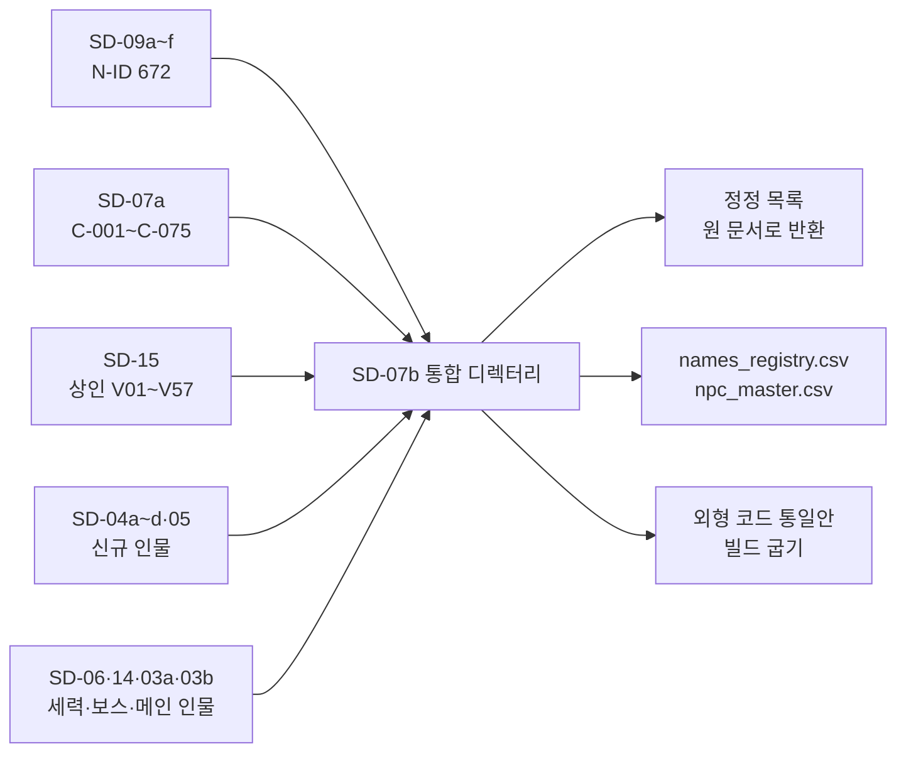

# SD-07b. NPC 디렉터리

> **서울 폴아웃 상세 기획서 세트** | 문서 ID: SD-07b | 버전: v1.2 | 작성일: 2026-10-12
> **범위**: 세트 전체의 이름 있는 NPC 정본 목록. 장소 카탈로그(SD-09a~f)의 권역별 NPC 표, 주요 인물(SD-07a C-001~C-075), 상인·서비스 NPC(SD-15), 세력 인물(SD-06), 보스 인물(SD-14), 메인 스토리 인물(SD-03a·03b), 세력 퀘스트 라인(SD-04d)과 사이드 퀘스트·기타 퀘스트(SD-04a·04b·04c·05, 작성된 범위)의 신규 인물을 하나로 묶는다. 외형 코드 통일안, 서비스 NPC 색인, 중복·충돌 검사와 정정 목록, 이름 통계를 담는다.
> **관련 문서**: [SC-00 컨셉](00_concept.md), [SD-02 세계관](02_world-and-lore.md), [SD-03a](03a_main-story-part1.md)·[SD-03b](03b_main-story-part2.md) 메인 스토리, [SD-04a](04a_side-quests-south.md)·[SD-04b](04b_side-quests-west-river.md)·[SD-04c](04c_side-quests-north-east-center.md) 사이드 퀘스트, [SD-04d 세력 퀘스트](04d_faction-questlines.md), [SD-05 기타 퀘스트](05_misc-quests-encounters.md), [SD-06 세력](06_factions.md), [SD-07a 주요 인물](07a_characters-major.md), [SD-09a](09a_locations-r01-r02.md)·[09b](09b_locations-r03-r04-r10.md)·[09c](09c_locations-r05-r06.md)·[09d](09d_locations-r07-r11.md)·[09e](09e_locations-r08-r09.md)·[09f](09f_locations-underground-river.md) 장소 카탈로그, [SD-14 크리처·적](14_creatures-enemies.md), [SD-15 경제](15_economy.md), [SD-16 아트 디렉션](16_art-direction.md), [SD-18 명명 규칙](18_naming-terms.md)

---

## 목차
1. 개요
2. ID 체계와 집계
3. 외형 코드 통일안
4. 권역별 NPC 디렉터리 (R01~R11, UG, HR, 공통)
5. 서비스 NPC 색인
6. 중복·충돌 검사와 정정 목록
7. 이름 통계
8. 원작 대응
9. 제작 메모 (엔진: 범용 2D)
10. 미결 사항
11. 부록 (신규 고유명사, 추출 스크립트, 참고 문서)

---

## 1. 개요

### 1.1 목적
- 문서마다 따로 지은 이름 있는 NPC를 **한 사람 한 행**으로 모은다. 대사 작가, 이벤트 제작자, 도트 제작자가 이 표 하나로 같은 사람을 같은 이름·같은 얼굴·같은 자리로 만든다.
- 문서마다 뜻이 다른 외형 코드를 **하나의 코드표**로 맞추고, NPC마다 통일안 코드를 다시 적는다(원래 값은 보존).
- 같은 이름의 다른 사람, 같은 사람의 다른 ID, 성별·나이 불일치, 회피 목록·실존 인물 저촉을 찾아 **정정 목록 155건**으로 넘긴다. 이 문서는 다른 문서를 고치지 않는다.

### 1.2 범위와 경계
| 문서 | 이 문서와의 관계 |
|---|---|
| SD-07a | 주요 인물(C-ID)의 프로필·생사·초상·voice의 정본. 이 문서는 C-ID 인물을 권역 표에 함께 싣고 장소 등록 N-ID와 묶는다. 이름·나이는 07a 값을 쓴다(정정 제안이 있으면 표에 `←옛 이름`) |
| SD-09a~f | N-ID의 최초 등록 문서. 일과·성격·대표 대사는 장소 문서가 정본이다. 이 문서는 표의 핵심 열만 옮기고 성격·대사는 옮기지 않는다 |
| SD-15 | 상인 번호(V01~V57)와 요율·재고의 정본. 상인이 누구인지는 이 문서가 정한다(§5.1) |
| SD-16 | 외형 코드 형식(§7.2)과 몸·팔레트·몸통 계열(§3.4·§4·§5.9)의 정본. 번호 뜻(머리·장비·소품)은 이 문서가 정한다(§3) |
| SD-18 | 명명 규칙과 중복 회피 규칙 D1~D8의 정본. 이 문서는 그 규칙으로 검사하고 개정안을 낸다(§6·§7) |
| SD-04a~d·05 | 퀘스트 문서가 새로 만든 인물에게 이 문서가 N-ID를 준다(07b 신규 대역 501~) |

### 1.3 요약
- **총 738명**(주요 인물 C 75명 + 일반 NPC N 663명, v1.1 지온 N-R11-505 추가). 대화하는 이름 있는 NPC는 기록 인물 3명을 뺀 **735명**으로 바이블 §5.7의 '500명 이상'을 넘는다.
- 장소 문서 N-ID 672개 중 주요 인물 62명이 겹친다. 같은 사람의 이중 등록 4건(노윤기·방석구·윤석진·허문경)은 주 N-ID 하나만 남기고 나머지를 결번으로 돌린다.
- SD-04a~d·05가 만든 인물과 SD-15의 등록되지 않은 상인 52명을 **07b 신규 대역(N-권역-501~)**에 등록했다.
- **외형 코드 통일안**: 몸 7코드 + 특수 4, 머리 12종, 머리 장비 18종, 눈 장비 8종, 소품 라이브러리 200종(PR001~PR200). 문서별 치환 규칙으로 688명의 인간형 코드를 다시 적었다. 같은 장소 안 같은 코드 0건, 같은 장소 안 같은 소품 0건.
- **SD-15 상인 57명 대조**: 같은 인물 8, 다른 이름으로 이미 등록된 인물에 대응 39, 07b 신규 등록 9, 디렉터리 밖(무명 템플릿) 1.
- **정정 목록 155건**(결정 반영 20, 중복 ID 6, 성별·나이 15, 이름 중복 27, 실존·회피 9, 신규 인물 통합 16, SD-15 대응 47, 외형 코드 4, 기타 11). 행마다 '기준(정본)' 열에 어느 문서를 기준으로 삼았는지 적었다.

### 1.4 표기 규칙
| 열 | 뜻 |
|---|---|
| ID | 주요 인물은 `C-ID · 주 N-ID`. 결번으로 돌릴 이중 등록은 괄호에 적는다. 일반 NPC는 N-ID. 501 이상은 07b 신규 |
| 이름 | 정본 이름. 별명·호출 부호·신앙 번호는 괄호 안 작은따옴표. `←`는 정정 목록에서 제안한 개명의 옛 이름 |
| 성·나이 | 2277년 기준. 주요 인물은 SD-07a의 정확한 나이, 일반 NPC는 나이대. 구울은 2077년 나이를 함께 적는다 |
| 종 | 인 인간 / 구 구울 / 빛구 빛나는 구울 / 야구 야생화 직전 구울 / 변 변종 / 로 로봇 / 개 / 기록 기록 인물 |
| 세력 | SD-06 §2.2 약호. 정착지 연합은 `JC·정착지 약호`(BC 봉천, TK 탱크마을, ND 노들섬, SY 선유도, TS 뚝섬, SV 세이프빌, SA 사당, MW 망원, IT 이태원, YJ 양재, AC 아차산, CD 창동). `—`는 소속 없음 |
| 장소 | 주 거주 L-ID(표에서는 앞의 `L-`를 줄였다. 예: `R01-09` = L-R01-09). 순회는 정류 장소 |
| 서비스 | 상 상인 / 의 의사 / 수 수리·정비 / 정 정보 / 숙 숙박 / 통 통행 / 지 지원 병력 / 동 일시 동행 / 교 교습·비기. 뒤의 V번호는 SD-15 상인 번호 |
| 외형 코드(통일안) | §3의 코드표 값. `몸-피부-머리-머리색-몸통-낡음-팔레트-머리장비-눈장비-소품` |
| 원래 코드와 다른 칸 | 원래 문서 값 → 통일안 값. `=`는 모든 원래 문서 값과 같음, `신규`는 07b가 처음 지은 코드, 주요 인물(C-ID)처럼 원래 문서가 둘 이상이고 값이 다르면 다른 쪽 문서를 앞에 적는다(예: `09a HR03→06`). 통일안 값이 정본이다, `W`는 낡음 칸. 머리·장비·소품은 접두어를 줄였다(예: `HD12→04` = HD12 → HD04) |
| 관련 퀘스트 | 원래 표의 퀘스트 연계에서 뽑은 ID(최대 5개). `+`는 SD-04d 세력 퀘스트 블록에 이름이 나오는 경우(예: `+JH-04` = FQ-JH-04) |
| 출처 | 행을 만든 문서(07a·09a 등). 괄호 안은 이름의 원 출처 |

---

## 2. ID 체계와 집계

### 2.1 ID 체계
| ID | 형식 | 부여 문서 | 규칙 |
|---|---|---|---|
| C-001~C-075 | 주요 인물 | SD-07a | 인물 정본. 장소 문서의 N-ID는 '장소 등록 번호'로 함께 쓴다 |
| C-076~C-099 | 예비 | SD-07a | 사이드 퀘스트 핵심 인물 추가용 |
| N-<권역>-001~ | 일반 NPC | SD-09a~f | 권역 = R01~R11, UG, HR. 장소 문서 등록 순서 |
| N-<권역>-501~ | 일반 NPC(07b 신규) | SD-07b | 퀘스트 문서·SD-15가 만든 인물. 장소 문서 번호와 충돌하지 않게 대역을 띄운다 |
| 결번 | — | SD-07b | 같은 사람의 두 번째 N-ID. 재사용하지 않는다(세이브 데이터 호환) |

- 한 사람은 C-ID 하나와 주 N-ID 하나를 가진다. 이벤트 데이터의 인물 키는 C-ID가 있으면 C-ID, 없으면 N-ID다.
- **신규 크리처 템플릿과 개체 연결**(RECON_SPEC §3.6): 불끄미 N-R03-055 = CR-303(소방 로봇)의 비적대 개체, 할당-7 N-R10-019 = CR-304(S-10 생산 로봇), 감독-1 N-R10-018 = CR-307(S-10 감독 로봇). 로봇 외형 코드는 §3.2 정본 형식 `RB-<모델>·<표식>`으로 적는다(RECON_SPEC §3.6의 `RB-CR3xx-…` 형식은 쓰지 않는다).
- 기록 인물(대화하지 않는 2077년·과거 인물)은 C-ID가 있는 7명만 디렉터리에 싣고(그중 대사가 녹음·회상으로 나오는 4명은 집계에 포함), 나머지는 §7.6 기록 인물 표에 둔다.

### 2.2 총 인원과 바이블 §5.7 달성 확인
| 항목 | 값 | 판정 |
|---|---|---|
| 디렉터리 행 | 738 | v1.1 지온(N-R11-505) 추가. §7 이름 통계는 v1.0 집계(737명) 그대로다 |
| 대화하는 이름 있는 NPC(기록 인물 제외) | **735** | 바이블 §5.7 목표 500 이상 **달성(147%)** |
| 사람(인간·구울) | 692명 안팎 | 로봇 32·변종 9·개 1·기계 1은 따로 센다 |
| 서비스를 하나 이상 가진 NPC | 378 | 전체의 약 51% |
| 상인 역할 | 202 | SD-15 목록 57명 + 노점·물물교환·소규모 판매 143명 |
| 장소 문서 N-ID | 672 | 주요 인물 62명 겹침, 이중 등록 4건 |
| 07b 신규 등록 | 53 | SD-04a~d·05 신규 인물, SD-15 미등록 상인 |

### 2.3 권역별 집계
| 권역 | 이름 | 주요 인물(C) | 장소 문서 N-ID | 07b 신규 | 합계 | 이 중 상인 | 의사 | 수리 |
|---|---|---|---|---|---|---|---|---|
| R01 | 관악 | 18 | 53 | 7 | **78** | 20 | 4 | 3 |
| R02 | 여의도·영등포 | 9 | 44 | 7 | **60** | 18 | 4 | 7 |
| R03 | 마포·상암 | 4 | 50 | 4 | **58** | 16 | 2 | 5 |
| R04 | 서강·선유도 | 1 | 39 | 2 | **42** | 8 | 1 | 3 |
| R05 | 도심(밀폐) | 1 | 45 | 3 | **49** | 17 | 2 | 4 |
| R06 | 용산·남산 | 12 | 55 | 6 | **73** | 22 | 3 | 4 |
| R07 | 강남 | 4 | 55 | 0 | **59** | 13 | 3 | 2 |
| R08 | 동부 | 4 | 59 | 3 | **66** | 25 | 2 | 6 |
| R09 | 북부 산악 | 7 | 42 | 0 | **49** | 13 | 2 | 3 |
| R10 | 서부 평야 | 4 | 33 | 8 | **45** | 7 | 3 | 1 |
| R11 | 청계산 | 7 | 39 | 5 | **51** | 7 | 2 | 2 |
| UG | 지하철망·지하 | 1 | 55 | 2 | **58** | 22 | 2 | 6 |
| HR | 한강·섬·다리 | 2 | 41 | 6 | **49** | 14 | 2 | 3 |
| 공통 | 권역 공통 | 1 | 0 | 0 | **1** | 0 | 0 | 0 |
| 합계 | | 75 | 610 | 53 | **738** | 202 | 32 | 49 |

- 시작 권역 R01·R02에 138명(19%)이 몰려 1막의 대화·거래 밀도가 높다. 고위험 권역 R10·R11은 상인이 각 7명이다(SD-15의 '고위험 권역 2명 이하'는 SD-15 목록 기준이고, 나머지는 물물교환·소규모 판매다).
- R05 도심은 6막 전 밀폐 구역이지만 49명이 있다. 세운 공방·을지로·지하 각성회·고립 회수조가 대부분이고, 로봇 NPC 비율이 가장 높다.

### 2.4 종별 집계
| 종 | 인원 | 비율 | 비고 |
|---|---|---|---|
| 인간 | 566 | 76.7% |  |
| 구울 | 123 | 16.7% | 외형은 SG1 피부 |
| 로봇 | 32 | 4.3% | SD-14 CR 리그 |
| 변종 | 9 | 1.2% | SD-14 CR 리그 |
| 인간(기록) | 3 | 0.4% | 대화 없음, 집계에서 뺀다 |
| 개 | 1 | 0.1% | SD-14 CR 리그 |
| 야생화 직전 구울 | 1 | 0.1% |  |
| 빛나는 구울 | 1 | 0.1% |  |
| 기계 | 1 | 0.1% |  |
| 야생 구울 | 1 | 0.1% |  |

### 2.5 세력별 집계
| 약호 | 세력 | 인원 | 주요 인물(C) |
|---|---|---|---|
| MS | 무소속 주민 | 177 | 0 |
| JC | 정착지 연합 | 175 | 10 |
| BJ | 비상정부 | 58 | 8 |
| — | 소속 없음(관제망·2077년 기록 등) | 54 | 6 |
| YH | 연합단 | 45 | 9 |
| YT | 약탈자 | 30 | 3 |
| S7 | 볼트 S-07 | 29 | 11 |
| JH | 지하시장 | 27 | 5 |
| SB | 새벽인력 | 20 | 3 |
| GS | 각성회 | 20 | 2 |
| JG | 중국군 잔존병 | 19 | 4 |
| HS | 한강 행상 조합 | 19 | 1 |
| CB | 철벽경호 | 14 | 3 |
| NS | 남산 방송 | 12 | 1 |
| WP | 원칙파 | 11 | 3 |
| NJ | 난지 고철단 | 10 | 2 |
| KD | 큰돌 무리 | 7 | 1 |
| JY | 자율방범대 | 5 | 1 |
| DG | 순회 의료반 들것 | 4 | 1 |
| BY | 변종 | 2 | 1 |

- 정착지 연합(JC) 내역: 10개 정착지. 아래 표.

| 정착지 약호 | 인원 |
|---|---|
| JC·SY | 27 |
| JC·TK | 24 |
| JC·ND | 21 |
| JC·SV | 21 |
| JC·BC | 15 |
| JC·TS | 14 |
| JC·SA | 12 |
| JC·MW | 9 |
| JC·IT | 8 |
| JC·CD | 8 |
| JC·YJ | 7 |
| JC·AC | 7 |
| JC | 2 |

### 2.6 역할(서비스)별 집계
| 역할(서비스) | 약자 | 인원 | 비고 |
|---|---|---|---|
| 상인 | 상 | 202 | |
| 의사 | 의 | 32 | |
| 수리 | 수 | 49 | |
| 정보 | 정 | 98 | |
| 숙박 | 숙 | 14 | |
| 통행 | 통 | 40 | |
| 지원 | 지 | 3 | |
| 동행 | 동 | 10 | |
| 교습 | 교 | 8 | |

- '지원'은 장소 문서 서비스 칸에 적힌 인원이다. 세력 지원 병력 지휘자·연락책 전체는 §5.7(지휘자 13명). 한 사람이 서비스를 여럿 가질 수 있다. 서비스가 없는 NPC는 대화·퀘스트·분위기 담당이다.

---

## 3. 외형 코드 통일안

### 3.1 원칙과 문제
- **기준**: SD-16 §7.2의 형식 `몸-피부-머리-머리색-몸통계열-낡음-팔레트-머리장비-눈장비-소품`을 그대로 쓴다. SD-16이 수량만 정한 칸(몸 6벌, 머리 12종, 머리 장비 18종, 눈 장비 8종, 소품 목표 200종)에 이 문서가 **번호 뜻**을 붙인다.
- **문제(통일 전)**
  1. 몸 코드: SD-09a·07a는 `E1·E2`(노인 남·여), SD-09b·09c는 `E1`(노인 공용), SD-09d·09e는 `OL`·`CH`, SD-09f는 `O1`.
  2. 머리: SD-16은 12종인데 SD-09b·09d·09e·07a가 HR12~HR17을 썼다.
  3. 낡음: SD-09a~c·07a는 0~2, SD-09d~f는 1~3.
  4. 머리 장비·눈 장비: 같은 번호의 뜻이 문서마다 다르다(예: HD11은 SD-07a 선원 모자, SD-09b 농부 모자, SD-09e 오토바이 헬멧). SD-07a §9.4 가정표가 이 문제를 미결로 넘겼다.
  5. 소품: SD-09a는 PR001~050에 뜻을 적었고, SD-07a는 PR701~718, SD-09b·09d·09e는 PR0xx·1xx를 뜻 없이, SD-09c는 PR5xx·6xx, SD-09f는 PR160~263을 썼다. 같은 번호가 다른 물건이다.
- **통일 방법**: ① 뜻이 적힌 번호(SD-09a·07a)를 기준으로 삼는다. ② 뜻이 없는 번호는 그 문서 안의 쓰임새(역할·세력)로 뜻을 추론해 통일안 번호로 옮긴다(§3.11). ③ 소품은 **역할 추론 + 같은 장소 안 중복 금지**로 다시 배정한다(§3.10). ④ 원래 값은 §4 표의 '원래 코드와 다른 칸'에 남긴다.
- **결과**: 인간형 688명 중 칸별 변경 수 — 소품 526, 낡음 287, 머리 장비 199, 머리 105, 눈 장비 100, 몸 47. 같은 장소 안 같은 코드 0건, 같은 장소 안 같은 소품 0건(SD-16 §7.2 규칙 충족).

### 3.2 몸 코드
| 코드 | 뜻 |
|---|---|
| M1 | 남 표준(몸 시트 1) |
| M2 | 남 체형 변형(마름·거구, 몸 시트 2) |
| F1 | 여 표준(몸 시트 3) |
| F2 | 여 체형 변형(몸 시트 4) |
| E1 | 노인 남(노인 공용 몸 시트 5 + 남 얼굴형) |
| E2 | 노인 여(노인 공용 몸 시트 5 + 여 얼굴형) |
| K1 | 아동(아동 공용 몸 시트 6, 성별은 머리·얼굴 파츠) |
| BY | 변종(SD-14 CR 리그, 96×96) |
| RB | 로봇(SD-14 모델 리그) |
| AN | 동물(SD-14 CR 리그) |

- 몸 시트는 SD-16 §7.2대로 6벌이다. E1·E2는 노인 공용 시트 한 벌을 쓰고 얼굴형·머리 파츠만 다르다. 7코드인 이유는 초상화 모듈(SD-16 §8.3 노인 얼굴형 4종)을 남녀로 나눠 고르기 위해서다(SD-07a B-06과 같다).
- **로봇 외형 코드 형식(정본 결정, v1.1)**: 로봇은 `RB-<모델>·<표식>` 형식만 쓴다(예: `RB-CR303·불끄미`, `RB-SJ-H66·개체 '방긋'`). RECON_SPEC §3.6의 `RB-CR303-PR173`처럼 소품 번호를 하이픈으로 붙이는 형식은 쓰지 않는다(정합 책임자 결정).
- 특수 몸: `BY-CR###·표식`(변종), `RB-<모델>·표식`(로봇, 모델은 SD-14 CR-3xx 또는 세진 모델명), `AN-CR536`(진돗개 백구), `OBJ`(고정 단말 오브젝트). 특수 몸은 머리·몸통 칸을 쓰지 않고 표식(도색·덧그림·명찰)만 적는다.

### 3.3 피부·머리색·몸통·낡음·팔레트
| 칸 | 값 | 정본 |
|---|---|---|
| 피부 | S1~S6, SG1(구울), SG2(야생 구울·빛나는 구울 바탕) | SD-16 §4.3 |
| 머리색 | H0(머리카락 없음, 특수 몸·민머리 표기용), H1~H8 | SD-16 §4.3 |
| 몸통 | T01~T16 | SD-16 §5.9 |
| 낡음 | **0 깨끗 / 1 보통 / 2 넝마** | SD-16 §5.1 '낡음 3단계'. SD-09d~f의 1~3은 1씩 내린다 |
| 팔레트 | PF00(세력 팔레트 없음), PF01~PF12 | SD-16 §4.5 |

### 3.4 머리 HR (12종, HR00~HR11)
| 코드 | 뜻 |
|---|---|
| HR00 | 민머리 |
| HR01 | 짧은 스포츠(짧게 깎음) |
| HR02 | 가르마(짧게 정돈) |
| HR03 | 짧은 커트 |
| HR04 | 낮게 묶음 |
| HR05 | 단발 |
| HR06 | 긴 생머리 |
| HR07 | 쪽머리·올림 묶음 |
| HR08 | 헝클어진 앞머리·덥수룩 |
| HR09 | 장발 묶음(꽁지) |
| HR10 | 반삭·옆머리 민 머리 |
| HR11 | 파마·곱슬 |

### 3.5 머리 장비 HD (18종, HD01~HD18)
| 코드 | 뜻 |
|---|---|
| HD00 | 없음 |
| HD01 | 두건(천을 묶음) |
| HD02 | 안전모 |
| HD03 | 철모·경비 헬멧(둥근 돔. 세력 팔레트로 구분) |
| HD04 | 계엄군 철모(흑청) |
| HD05 | 챙모자(야구모자) |
| HD06 | 제복 모자(역무·기관사·방범대·관리인) |
| HD07 | 머릿수건(식당·시장·텃밭) |
| HD08 | 약탈자 머리 장비(끈 머리띠·가시 두건·털가죽 두건) |
| HD09 | 풀페이스 헬멧(오토바이·조종사) |
| HD10 | 헤드폰·귀마개 |
| HD11 | 선원 모자 |
| HD12 | 방호 후드·방독 두건 |
| HD13 | 무전 헤드셋 |
| HD14 | 각성회 녹광 머리띠 |
| HD15 | 장교 정모 |
| HD16 | 중절모 |
| HD17 | 헤드램프·이마 고글 띠 |
| HD18 | 밀짚모자·양봉 망모 |

- SD-16 §5.9의 실루엣 원칙에 맞춰 둥근 돔(HD03·HD04), 챙(HD05·HD06·HD11·HD18), 높은 관(HD15·HD16), 후드(HD12), 일체형(HD09), 끈형(HD01·HD07·HD08·HD14·HD17)으로 나뉜다. 파워 아머 헬멧은 리그 소속이라 이 표에 없다.
- 계엄군은 PF01 + HD04, 장교는 HD15. 연합단·원칙파·잔존병·정착지 경비의 둥근 헬멧은 모두 HD03이고 팔레트(PF02·03·08·12)로 구분한다.

### 3.6 눈 장비 EY (8종, EY01~EY08)
| 코드 | 뜻 |
|---|---|
| EY00 | 없음 |
| EY01 | 둥근 안경 |
| EY02 | 각진 안경 |
| EY03 | 돋보기 안경(반달) |
| EY04 | 안대 |
| EY05 | 색안경 |
| EY06 | 작업 고글 |
| EY07 | 단안경 |
| EY08 | 확대경·조준 고글 |

### 3.7 문서별 치환 규칙: 머리
| 문서 | 머리 HR 치환(원래 → 통일안) |
|---|---|
| SD-07a | HR12→HR01 |
| SD-09a | 그대로 |
| SD-09b | HR10→HR07, HR11→HR06, HR12→HR01 |
| SD-09c | 그대로 |
| SD-09d | HR10→HR04, HR11→HR05, HR12→HR01(남)·HR11(여) |
| SD-09e | HR10→HR04, HR11→HR07, HR12→HR11, HR13→HR03, HR14→HR06, HR15→HR05, HR16→HR04, HR17→HR10 |
| SD-09f | HR10→HR04, HR11→HR08(남)·HR11(여) |

- 표에 없는 번호는 SD-09a의 뜻(§3.4)과 같다고 본다. SD-09d·09f의 HR12·HR11처럼 남녀가 섞여 쓰인 번호는 성별로 나눠 옮겼다.

### 3.8 문서별 치환 규칙: 머리 장비
| 문서 | 머리 장비 HD 치환(원래 → 통일안) |
|---|---|
| SD-07a | HD12→HD04 |
| SD-09a | HD12→HD04 |
| SD-09b | HD02→HD01, HD04→HD05, HD05→HD02, HD06→HD02, HD07→HD02, HD10→HD07, HD11→HD18, HD13→HD17, HD15→HD13, HD16→HD14 |
| SD-09c | HD02→HD05, HD04→HD08, HD05→HD17, HD06→HD15, HD08→HD14, HD09→HD18, HD10→HD02, HD12→HD13, HD16→HD03 |
| SD-09d | HD01→HD05, HD05→HD06, HD06→HD12, HD07→HD14, HD08→HD03, HD09→HD08, HD10→HD09, HD11→HD18 |
| SD-09e | HD03→HD05, HD04→HD05, HD05→HD03, HD08→HD14, HD09→HD08, HD10→HD08, HD11→HD09, HD12→HD03, HD13→HD06, HD14→HD03, HD15→HD08, HD16→HD13 |
| SD-09f | HD02→HD05, HD03→HD01, HD04→HD02, HD05→HD03, HD06→HD03, HD07→HD06, HD08→HD03, HD09→HD02, HD10→HD07, HD11→HD14, HD13→HD03 |

- 추가 규칙: 세력이 비상정부(BJ)인데 HD03(둥근 돔)이면 HD04(계엄군 철모)로 바꾼다.

### 3.9 문서별 치환 규칙: 눈 장비
| 문서 | 눈 장비 EY 치환(원래 → 통일안) |
|---|---|
| SD-07a | 그대로 |
| SD-09a | EY04→EY06 |
| SD-09b | EY03→EY05, EY04→EY06, EY05→EY06 |
| SD-09c | EY01→EY02, EY02→EY03, EY03→EY06, EY04→EY08, EY05→EY06 |
| SD-09d | EY03→EY06, EY04→EY06, EY05→EY06, EY06→EY08 |
| SD-09e | EY04→EY06, EY05→EY08, EY06→EY08, EY07→EY02 |
| SD-09f | EY03→EY02, EY04→EY01, EY05→EY08, EY06→EY08, EY07→EY06 |

- 치환은 그 번호를 쓴 인물들의 역할(예: SD-09b EY03 = 저격수·초소장·실장 → 색안경, SD-09e EY05 = 수리공·기술자 → 확대경 고글)에서 추론했다. 주요 인물은 SD-07a 프로필 서술(예: 레이철 공 '작업 고글')과 맞는지 확인했다.

### 3.10 소품 라이브러리 (PR001~PR200)
- PR001~050은 SD-09a 번호 그대로, PR051~068은 SD-07a PR701~718을 옮긴 번호(PR701 → PR051 … PR718 → PR068), PR069~200은 이 문서가 더한 소품이다. '사용'은 현재 디렉터리에서 그 소품을 든 인물 수다.
- **배정 규칙**: ① SD-09a·07a 인물은 원래 소품을 유지한다. ② 그 밖은 역할 키워드(의사 → 청진기·주사기, 뱃사공 → 노·삿대, 약탈자 → 교통콘 장식·스프레이 깡통 등)로 후보를 고르고, ③ **같은 장소(L-ID) 안에서 이미 쓴 소품은 건너뛴다**. ④ 후보가 다 쓰였으면 범용 소품(수첩·등유 램프·우산 등)으로 채운다.
- 소품은 16×16 이하 스탬프다(SD-16 §7.2). 라이브러리 200종 중 139종을 쓰고 있다.

- 표기: `번호 이름(사용 인원)`.

PR001 장부(16) · PR002 클립보드(15) · PR003 확성기(6) · PR004 공구 벨트(8) · PR005 앞치마(2) · PR006 지팡이(6) · PR007 약봉지(6) · PR008 주민등록증 목걸이(1) · PR009 배달 상자(0) · PR010 낚싯대(6) · PR011 청진기(24) · PR012 열쇠 꾸러미(14) · PR013 사냥총 끈(10) · PR014 망원경(10) · PR015 고철 자루(13) · PR016 등사 유인물(1) · PR017 천공 카드 묶음(1) · PR018 녹광 머리띠(1) · PR019 출석부(2) · PR020 빨간 펜(2) · PR021 시험지 묶음(3) · PR022 배급 카드(3) · PR023 진공관 상자(18) · PR024 용접 마스크(1) · PR025 쇠사슬(3) · PR026 번호표 목걸이(2) · PR027 그물총(1) · PR028 근태 목걸이(1) · PR029 계산기(6) · PR030 명찰(5) · PR031 버섯 바구니(3) · PR032 물통 지게(13) · PR033 무전기(13) · PR034 경광봉(22) · PR035 서류 가방(5) · PR036 붕대 감은 팔(1) · PR037 구급 가방(3) · PR038 진공관 목걸이(1) · PR039 야구 방망이(1) · PR040 손수레(3) · PR041 등유 램프(7) · PR042 칠판 지우개(1) · PR043 볼트 출입 카드(1) · PR044 수첩(47) · PR045 강아지 줄(1) · PR046 망치(8) · PR047 확대경(1) · PR048 우산(6) · PR049 담배(1) · PR050 장화(1) · PR051 오버시어 배지(1) · PR052 방송 마이크(1) · PR053 지휘봉(1) · PR054 납땜 인두(1) · PR055 명령서 원통(1) · PR056 호루라기(2) · PR057 파이프 렌치(1) · PR058 2077년 장관 서류철(1) · PR059 근무일지(1) · PR060 성조기 패치(1) · PR061 장교도(0) · PR062 지장 카드 묶음(1) · PR063 그림책(0) · PR064 계약서 철(2) · PR065 손으로 쓴 일련번호 판(0) · PR066 회수 목록 원본(2) · PR067 결재 도장(1) · PR068 대구경 리볼버(1) · PR069 물 바가지(1) · PR070 물표 묶음(1) · PR071 정수 필터 통(1) · PR072 노(11) · PR073 삿대(3) · PR074 구명 튜브(1) · PR075 밧줄 타래(1) · PR076 그물(1) · PR077 국자(12) · PR078 솥뚜껑(1) · PR079 꼬치 묶음(0) · PR080 막걸리 주전자(3) · PR081 술병(0) · PR082 쟁반(0) · PR083 장바구니(31) · PR084 채소 바구니(13) · PR085 호미(3) · PR086 삽(2) · PR087 물뿌리개(0) · PR088 벌집 틀(2) · PR089 약초 망태(0) · PR090 약재 저울(0) · PR091 주사기(0) · PR092 부목 묶음(0) · PR093 접은 들것(0) · PR094 가이거 계수기(1) · PR095 공구함(35) · PR096 드라이버 묶음(7) · PR097 라디오 수신기(0) · PR098 안테나 막대(0) · PR099 손전등(0) · PR100 곡괭이(0) · PR101 쇠지렛대(0) · PR102 고철 저울(1) · PR103 용접봉 묶음(1) · PR104 기름통(2) · PR105 등유 깡통(1) · PR106 연료 주입기(1) · PR107 전지 꾸러미(0) · PR108 부품 상자(9) · PR109 설계도 두루마리(1) · PR110 지도 두루마리(15) · PR111 나침반(2) · PR112 신호 깃발(1) · PR113 신호탄 통(3) · PR114 통행세 징수함(10) · PR115 캡 주머니(3) · PR116 등록증 판독기(3) · PR117 탄약 벨트(9) · PR118 군번줄(5) · PR119 휴대 무전 수화기(3) · PR120 기사 서약 메달(5) · PR121 랜스 깃발(3) · PR122 파워 아머 기름 주입기(0) · PR123 옆구리에 낀 헬멧(1) · PR124 작전 지도판(4) · PR125 군용 수통(4) · PR126 편지 묶음(1) · PR127 교통콘 장식(15) · PR128 스프레이 페인트 깡통(8) · PR129 버스 핸들(1) · PR130 드럼통 뚜껑 방패(2) · PR131 곰 가죽 두름(1) · PR132 타이어 조각 방패(2) · PR133 2077년 명함첩(8) · PR134 2077년 상품권 묶음(0) · PR135 멈춘 손목시계(0) · PR136 2077년 신문 뭉치(0) · PR137 2077년 승차권(0) · PR138 회중시계(0) · PR139 공문 봉투(3) · PR140 타자 원고 뭉치(0) · PR141 녹음 테이프 릴(1) · PR142 휴대 녹음기(0) · PR143 책 더미(3) · PR144 교과서(7) · PR145 장난감 로봇(0) · PR146 고무공(16) · PR147 헝겊 인형(1) · PR148 종이비행기(0) · PR149 연(0) · PR150 빨래 바구니(1) · PR151 물 양동이(0) · PR152 장작 묶음(0) · PR153 빗자루(0) · PR154 톱(0) · PR155 대패(0) · PR156 바늘쌈지(1) · PR157 가위(1) · PR158 가죽 두루마리(3) · PR159 소 고삐(16) · PR160 닭장 바구니(0) · PR161 붕어 통(0) · PR162 통발(0) · PR163 덫(0) · PR164 짐승 가죽 꾸러미(0) · PR165 육포 꾸러미(0) · PR166 부채(1) · PR167 손거울(0) · PR168 향수병(0) · PR169 꽃 바구니(0) · PR170 붓과 팔레트(0) · PR171 기타(1) · PR172 하모니카(0) · PR173 바이올린 케이스(0) · PR174 대본 묶음(2) · PR175 진공관 카메라(0) · PR176 벽보 뭉치(0) · PR177 풀통과 벽보 붓(0) · PR178 자물쇠 따개 꾸러미(0) · PR179 이중 바닥 가방(1) · PR180 위조 도장 세트(2) · PR181 장물 보따리(0) · PR182 현상금 전단 묶음(5) · PR183 수갑(3) · PR184 포승줄(1) · PR185 각성회 등록 카드 묶음(11) · PR186 대기등 램프(4) · PR187 천공 테이프 띠(1) · PR188 관제망 휘장 걸개(0) · PR189 세진 사원증(0) · PR190 관리비 고지서 다발(1) · PR191 번개사이다 병 상자(0) · PR192 뉴카-콜라 병(0) · PR193 청솔 상품권(0) · PR194 냉장 상자(0) · PR195 소화기(0) · PR196 허리에 찬 방독면(0) · PR197 쥐 우리(애완 쥐)(1) · PR198 담요 두름(1) · PR199 깡통 모금함(0) · PR200 정착지 깃발 막대(1)

### 3.11 주요 인물 코드 처리
- SD-07a 코드가 장소 문서 코드를 그대로 옮긴 경우(예: 곽재민 = SD-09e 값)는 그 장소 문서의 치환 규칙을 적용했다. 그렇지 않으면 SD-07a 가정표(§9.4)의 뜻을 따랐다.
- 소품을 직접 정한 주요 인물: 석광철 PR064 계약서 철, 진세라 PR182 현상금 전단 묶음, 맹구철 PR102 고철 저울, 쥐왕 PR197 쥐 우리, 방석구 PR129 버스 핸들, 차보람 PR014 망원경, 문병철 PR094 가이거 계수기, 왕융성 PR118 군번줄, 펠릭스 문(←루카스 문) PR066 회수 목록 원본, 그레이스 장 PR124 작전 지도판, 마리아 권 PR120 기사 서약 메달, 헨리 오 PR143 책 더미, 우태현 PR012 열쇠 꾸러미, 곽재민 PR029 계산기, 기세훈 PR190 관리비 고지서 다발. SD-07a가 PR000(소품 없음)으로 둔 보스는 모두 소품을 받았다(SD-16 §7.2 '이름 있는 NPC마다 1개').
- 백구·큰돌·파수-3·무쇠는 특수 몸 코드로 적었다(§3.2).

---

## 4. 권역별 NPC 디렉터리

- 권역마다 주요 인물(C-ID)을 함께 싣고, 장소 문서 번호순으로 정렬한다. 성격·대표 대사·자세한 일과는 장소 문서(SD-09a~f)와 SD-07a를 본다.
- 07b 신규 인물(501~)은 각 권역 표 끝에 있다.

### 4.1 R01 관악 (78명)
- 주요 인물 18명 + 일반 NPC 60명(그중 07b 신규 등록 7명). 종: 인 72, 구 3, 로 2, 개 1. 인원이 많은 장소: 볼트 S-07(L-R01-01) 28명, 봉천 계단마을(L-R01-09) 16명, 사당 환승촌(L-R01-18) 8명, 노량진 관제 중계소(L-R01-23) 7명.

|ID|이름|성·나이|종|세력|장소|역할|서비스|일과(낮 / 밤)|외형 코드(통일안)|원래 코드와 다른 칸|관련 퀘스트|출처|
|---|---|---|---|---|---|---|---|---|---|---|---|---|
|C-022 · N-R01-001|도경철|남 54세|인|S7|R01-01|보안부장. "명령대로 쏜다"|교|보안부 사무실 / 정문…|M2-S4-HR02-H4-T02-1-PF11-HD03-EY00-PR034|=|MQ-P4 MQ-401 MQ-P2 MQ-P3|07a·09a|
|C-023 · N-R01-002|차명수|남 52세|인|S7|R01-01|담임 겸 적성 평가관, 시험 감독관|—|평가관실 / 교실 2 …|M1-S3-HR05-H4-T11-1-PF11-HD00-EY03-PR020|=|MQ-401 MQ-P2 MQ-P3 MQ-E1|07a·09a|
|C-024 · N-R01-003|방금례|여 63세|인|S7|R01-01|행정실 서기. 출생신고 단말 담당|—|행정실 / 등록 단말실…|E2-S2-HR08-H5-T11-2-PF11-HD00-EY02-PR019|=|MQ-401 MQ-P1 MQ-P2 MQ-P4|07a·09a|
|C-025 · N-R01-004|신혜령|여 55세|인|S7|R01-01|의무관. 주인공을 받았다|의|진료소 / 격리실 기록…|F1-S2-HR06-H4-T13-1-PF11-HD00-EY00-PR011|=|MQ-P1|07a·09a|
|C-026 · N-R01-005|나채윤|여 19세|인|S7|R01-01|우등 가문 동급생. 시험 부정 사건…|—|교실·도서실 / A동|F1-S1-HR06-H1-T01-0-PF11-HD00-EY00-PR021|09a HR03→06|MQ-P3 MQ-401|07a·09a|
|C-027 · N-R01-006|송지우('지우') ←안지우·김지우|여 15세|인|S7|R01-01|배급소 아이(2268년 6세)|—|수경 농장 / C동|K1-S3-HR07-H2-T01-1-PF11-HD00-EY00-PR022|09a HR04→07|MQ-P2|07a·09a|
|N-R01-007|하로운|남 47세|인|S7|R01-01|설비과 배관 기사, 하도윤의 아버지|수|배관실 / B동|M2-S3-HR01-H2-T12-2-PF11-HD02-EY00-PR095|PR004→095|MQ-P1 MQ-P4 MQ-401|09a|
|N-R01-008|임소율|여 45세|인|S7|R01-01|수경 농장 사무관, 하도윤의 어머니|—|농장 2동 / B동|F1-S3-HR05-H2-T12-1-PF11-HD00-EY00-PR031|=|MQ-P1 MQ-402|09a|
|N-R01-009|서한별|남 52세|인|S7|R01-01|설비과장, 원자로 기사장|—|원자로실 / A동|M1-S4-HR02-H4-T10-1-PF11-HD10-EY06-PR044|EY04→06|MQ-P4 MQ-401|09a|
|N-R01-010|송새봄|여 38세|인|S7|R01-01|수경 농장 주임|상|농장 1동 / C동|F1-S2-HR07-H3-T12-1-PF11-HD00-EY00-PR084|PR031→084|LR-27 훅 「곰팡이의 근원」|09a|
|N-R01-011|전도하|남 33세|인|S7|R01-01|배급과 주무관(배급소 창구)|통|배급소 / D동|M1-S3-HR04-H1-T11-0-PF11-HD00-EY00-PR159|PR022→159|MQ-P2|09a|
|N-R01-012|문이준|남 58세|인|S7|R01-01|교무과장, 평가 위원회 위원장(부이…|—|평가 위원회 회의실 /…|E1-S2-HR05-H5-T11-1-PF11-HD00-EY03-PR035|=|MQ-P4|09a|
|N-R01-013|홍태린|여 29세|인|S7|R01-01|구내방송 ST-11 진행(행정과)|—|구내방송실 / A동|F1-S1-HR09-H2-T11-0-PF11-HD00-EY00-PR003|=|MQ-P4|09a|
|N-R01-014|정연우|남 44세|인|S7|R01-01|공기 정화기 기사|—|공기 정화기실 / D동|M2-S5-HR01-H1-T12-2-PF11-HD02-EY01-PR008|PR004→008|4막 붕괴판 생존 안내|09a|
|N-R01-015|장해솔|여 24세|인|S7|R01-01|정비동 D등급 영구 고정 가문(21…|—|배관실 청소 / D동|F2-S4-HR02-H1-T12-2-PF11-HD00-EY00-PR050|=|MQ-P4 훅 「개방파의 손녀」|09a|
|N-R01-016|강지호|남 18세|인|S7|R01-01|연수생, S-07 야구부 마지막 주장|—|체육관 / C동|M1-S3-HR07-H1-T01-1-PF11-HD05-EY00-PR039|=|MQ-401|09a|
|N-R01-017|오윤슬|여 67세|인|S7|R01-01|학교 도서실 사서(퇴직 서기관)|정|도서실 / A동|E2-S2-HR08-H5-T03-1-PF11-HD00-EY03-PR143|PR044→143|13.1 「생활기록부 열람」 연계|09a|
|N-R01-018|권서준|남 27세|인|S7|R01-01|보안요원(무기고 담당)|—|무기고 / B동|M1-S3-HR03-H1-T02-1-PF11-HD03-EY00-PR012|=|MQ-P4|09a|
|N-R01-019|최보미 ←최가온|여 31세|인|S7|R01-01|보안요원(정문 경비)|—|정문 제어실 / B동|F1-S4-HR02-H2-T02-1-PF11-HD03-EY00-PR113|PR034→113|MQ-P4 MQ-401|09a|
|N-R01-020|이수겸 ←이수호|남 77세|인|S7|R01-01|11대 전 오버시어(2238~225…|—|A동 베란다식 휴게실 …|E1-S2-HR00-H5-T11-2-PF11-HD00-EY03-PR006|=|LR-24|09a·02(오버시어 …|
|N-R01-021|김하율|남 8세|인|S7|R01-01|출생 허가 2269년생 아이|—|교실 1 / C동|K1-S3-HR06-H1-T01-0-PF11-HD00-EY00-PR043|=|V_VAULT 5 이주민(봉천 계단 학…|09a|
|N-R01-022|박아린|여 12세|인|S7|R01-01|연수생(첫 배정: 세탁)|—|세탁실 / D동|K1-S5-HR04-H1-T01-1-PF11-HD00-EY00-PR180|PR021→180|MQ-P4|09a|
|N-R01-023|조안민|남 82세|인|S7|R01-01|2196 회색 열병 생존자, 원로|—|납골 벽 / D동|E1-S3-HR00-H5-T03-2-PF11-HD00-EY00-PR166|PR006→166|V-12 납골 벽(계승명), 4막 붕괴…|09a|
|N-R01-024|고나래|여 26세|인|S7|R01-01|C등급 주민, 출생 허가 없는 임신|—|수경 농장 3동 / C동|F1-S3-HR03-H2-T12-1-PF11-HD00-EY00-PR036|=|4막: 아이가 '1등급 구역'에서 태어…|09a|
|C-057 · N-R01-025|하숙자|여 63세|인|JC·BC|R01-09|부이장, 약국 주인. 조만석의 대체자|상·의 V02|약국 / 약국 안채|E2-S3-HR08-H4-T03-1-PF12-HD00-EY02-PR007|=|MQ-102 MQ-502|07a·09a|
|N-R01-026|오봉수|남 50대|인|JC·BC|R01-09|고물상|상 V01|고물상 / 고물상|M2-S4-HR01-H2-T03-2-PF12-HD05-EY00-PR015|=|MQ-101|09a|
|C-015 · N-R01-027|백구|수컷 6세|개|JC·BC|R01-09|진돗개, 마을 경보견|—|아랫문 / 개집|AN-CR536·흰 털 진돗개|—|MQ-101 FQ-JC-01|07a·09a|
|N-R01-028|남태하|남 30대|인|JC·BC|R01-09|옥탑 감시조장|—|망루 / 아랫문 야간 …|M1-S4-HR03-H1-T05-1-PF12-HD05-EY05-PR014|=|MQ-101 MQ-507|09a|
|N-R01-029|조담희|여 40대|인|JC·BC|R01-09|계단 텃밭 담당(반상회 총무)|상|옥상 텃밭 / 반상회관|F2-S3-HR05-H2-T03-1-PF12-HD07-EY00-PR048|=|FQ-JC-01|09a|
|N-R01-030|남무진|남 40대|인|JC·BC|R01-09|대장장이('땜장이 남씨')|상·수 V03|대장간 / 대장간|M2-S5-HR01-H1-T12-2-PF12-HD00-EY06-PR046|=|MQ-101 훅 「보라매 마지막 비행」|09a|
|N-R01-031|오해인|여 30대|인|JC·BC|R01-09|계단 학교 선생|상|학교 / 약국 2층 하숙|F1-S2-HR04-H2-T03-0-PF12-HD00-EY02-PR042|=|M-058 선행 거래, V_VAULT …|09a|
|N-R01-032|조수안|남 30대|인|JC·BC|R01-10|배수지 관리인|상|밸브실 / 밸브실|M1-S3-HR02-H1-T12-1-PF12-HD02-EY00-PR004|=|훅 「배수지 밸브」|09a|
|N-R01-033|엄태경|남 40대|인|JC·BC|R01-09|관악산 사냥꾼|상 V04|관악산 사냥 / 아랫문…|M2-S5-HR03-H2-T05-2-PF12-HD05-EY00-PR013|=|훅 「외눈의 인식표」|09a|
|N-R01-034|남솔|여 10세|인|JC·BC|R01-09|백구 밥 당번 아이|—|개집 / 주민 집|K1-S3-HR07-H2-T03-1-PF12-HD00-EY00-PR045|=|MQ-101|09a|
|N-R01-035|오재윤|남 20대|인|JC·BC|R01-09|마을 청년(계단참① 수비)|—|고물상 일 / 계단참①|M1-S3-HR03-H1-T03-1-PF12-HD00-EY00-PR044|PR015→044|MQ-101|09a|
|N-R01-036|조하진|여 20대|인|JC·BC|R01-09|마을 청년(계단참③ 수비, 감시조)|—|망루 교대 / 계단참③|F2-S4-HR02-H1-T05-1-PF12-HD00-EY00-PR112|PR013→112|MQ-101|09a|
|C-067 · N-R01-037|소윤희|여 53세|인|DG|순회(R01-09)|반장. 중립 의료인|상·의 V56|월·목 봉천, 화 사당…|F1-S3-HR05-H4-T13-2-PF00-HD00-EY00-PR037|=|+JH-03|07a·09a|
|N-R01-038|석라희|여 30대|인|MS|R01-11|봉천 번개24 점주('24시')|상|카운터 / 카운터(24…|F1-S2-HR09-H6-T03-1-PF00-HD00-EY00-PR005|=|BK-R01-10 판매|09a|
|N-R01-039|남건희|남 20대|인|JC·BC|R01-09|마을 청년, 몰래 패거리와 거래|—|텃밭 / 밤에 윗문 밖|M1-S3-HR04-H1-T03-1-PF12-HD00-EY00-PR049|=|훅 「낙성대 척후의 지도」|09a|
|N-R01-040|연보경|여 40대|인|HS|순회(R01-09·18)|한강 행상 조합 행상(남부 고개길)|상·동 V54|낮 수송로 / 사당 캐…|F2-S4-HR05-H2-T03-2-PF00-HD05-EY00-PR040|=|MQ-201|09a|
|N-R01-041|허순자|여 60대|인|JC·SA|R01-18|역장(역무 위원회)|상·정|역무실 / 역무실|E2-S3-HR08-H4-T11-2-PF12-HD06-EY02-PR003|=|훅 「환승촌 막차」 +JC-09|09a·06|
|N-R01-042|표하경|남 40대|인|JC·SA|R01-18|버섯 재배 주임|상 V05|재배 측실 / 대합실 …|M2-S3-HR03-H2-T12-2-PF12-HD00-EY00-PR031|=|훅 「환승촌 막차」|09a|
|N-R01-043|위강윤|남 30대|인|JC·SA|R01-18|캐러밴 정류장 관리인|—|4번 출구 광장 / 개…|M1-S4-HR02-H1-T05-1-PF12-HD05-EY00-PR002|=|인카운터 수송대 호위|09a|
|N-R01-044|성지후|여 30대|인|JC·SA|R01-18|승강장 경비대장|—|개찰구 초소 / D-0…|F2-S5-HR02-H1-T06-2-PF12-HD03-EY00-PR041|=|훅 「환승촌 막차」|09a|
|N-R01-045|반로아|여 12세|인|JC·SA|R01-18|터널 안내꾼('남태령 꼬마')|—|4호선 남쪽 터널 / …|K1-S4-HR07-H2-T03-1-PF12-HD00-EY00-PR146|PR041→146|MQ-106|09a|
|N-R01-046|탁순복|여 70대|인|JC·SA|R01-18|환승촌 의원('의원 할매')|의|대합실 천막 / 대합실|E2-S3-HR00-H5-T03-2-PF12-HD07-EY00-PR011|=|1막 치료 거점|09a|
|N-R01-047|황보서현|여 20대|인|BJ|R01-19|계엄군 소위, 검문소장|—|차단봉 / 막사|F1-S1-HR02-H1-T08-0-PF01-HD04-EY00-PR033|HD12→04|MQ-106 훅 「탈영병」|09a|
|N-R01-048|권은서|여 30대|인|BJ|R01-19|분류관(분류반)|상 V07|분류 천막 / 막사|F1-S2-HR05-H1-T11-0-PF01-HD00-EY03-PR002|=|훅 「검문소 배급 줄」 FQ-BJ-02|09a|
|N-R01-050|엄도현|남 20대|인|BJ|R01-20|계엄군 하사, 노량진 다리목 분대장|—|차단봉 / 다리목 막사|M1-S4-HR02-H1-T06-1-PF01-HD04-EY00-PR034|HD12→04|MQ-105 MQ-201|09a|
|N-R01-051|신승원|남 40대|인|BJ|R01-21|계엄군 상사, 동작대교 남단 검문소장|—|망원경 초소 / 막사|M2-S3-HR01-H4-T06-2-PF01-HD04-EY05-PR014|HD12→04|X10 횡단, 세력 교전 인카운터|09a|
|N-R01-052|길덕수|남 70대|인|MS|R01-22|묘지기|정|안치소 / 안치소|E1-S4-HR00-H5-T03-2-PF00-HD05-EY00-PR048|=|훅 「귀환 유해 대장」|09a|
|C-053 · N-R01-053|은솔|여 24세|인|GS|R01-23|개통파 당번장. MQ-505의 촉발자|—|대기실 천공기실 / 중…|F1-S1-HR09-H8-T14-0-PF10-HD14-EY00-PR018|=|MQ-505 FQ-GS-04 +GS-06|07a·09a|
|N-R01-054|마노을|남 80대|인|GS|R01-23|노신도(대기 1401), 대기등 앞…|—|대기등 홀 / 대기등 홀|E1-S3-HR00-H5-T14-2-PF10-HD14-EY00-PR038|=|FQ-GS-03|09a|
|N-R01-055|한가람|남 30대|인|GS|R01-23|정비 당번장(대기 6203)|상 V06|점검 마당 / 대기실|M2-S3-HR02-H1-T14-1-PF10-HD14-EY06-PR004|=|FQ-GS-01|09a|
|N-R01-056|손재석|남 2077년 40대(구울)|구|MS|R01-24|2077년 학원 일타 강사|—|3층 강의실 / 원장실|M1-SG1-HR01-H1-T11-2-PF00-HD00-EY03-PR021|=|훅 「일타 강사의 문항집」|09a|
|N-R01-057|심도겸|남 50대|인|MS|R01-25|수산시장 경매사|—|경매장 / 냉동 창고 옆|M2-S5-HR02-H4-T12-2-PF00-HD05-EY00-PR029|=|훅 「어시장 냉동고」|09a|
|N-R01-058|간호 7호|—|로|MS|R01-26|병동 간호 로봇|상|병동 5층 / 같음|RB-(SD-14 모델)·살핌-1 + 붉은 십자 대신 '7' 덧그림|RB 살핌-1 + 붉은 십자 대신 '7' 덧그림|훅 「흑석 병원 혈액은행」|09a|
|N-R01-059|권성민|남 2077년 20대(구울)|구|MS|R01-14|2077년 행정고시 준비생|상|D동 3층 / 같음(불…|M1-SG1-HR04-H1-T03-2-PF00-HD00-EY03-PR021|=|훅 「고시생의 마지막 시험」|09a|
|N-R01-060|삽자루|남 40대|인|YT|R01-14|남부순환 패거리 두목|—|B동 옥상 '분양 사무…|M2-S5-HR01-H7-T04-2-PF04-HD08-EY00-PR015|=|훅 「배수지 밸브」|09a·06|
|C-072 · N-R01-061|깡철이|남 30대|인|YT·남부순환|R01-15|부두목(고가 아래 지부장, 두목은 …|—|고가 아래 / 충전소 …|M2-S4-HR00-H1-T04-2-PF04-HD09-EY00-PR046|=|—|07a·09a|
|N-R01-062|사이렌|여 20대|인|YT|R01-12|낙성대 척후장|—|망루 / 버스 안|F2-S3-HR09-H7-T04-1-PF04-HD00-EY05-PR014|=|훅 「낙성대 척후의 지도」|09a|
|N-R01-063|렌치|남 30대|인|MS|R01-17|떠돌이 고철꾼|—|활주로 잔해 / 조종석…|M1-S4-HR03-H3-T12-2-PF00-HD02-EY06-PR004|=|훅 「보라매 마지막 비행」|09a|
|N-R01-064|진해원|남 20대|인|BJ(탈영)|R01-30|계엄군 일병, 탈영병|—|초소 지하 / 같음|M1-S2-HR02-H1-T06-1-PF01-HD00-EY00-PR033|=|훅 「탈영병」|09a|
|N-R01-065|깔끔이|—|로|MS|R01-06|연수원 청소 로봇|—|본관 광장 / 강당|RB-(SD-14 모델)·살림-2 + 졸업 리본 덧그림|RB 살림-2 + 졸업 리본 덧그림|훅 「연수원의 졸업장」|09a|
|N-R01-501|오영자|여 50대|인|JC·BC|R01-09|계단 미용실 주인|—|미용실 / 계단 아래 집|F2-S3-HR11-H2-T03-1-PF12-HD00-EY00-PR157|신규|—|07b(15 §5.5(…|
|N-R01-502|하은결|여 40대|인|GS|R01-23|응답자(의례 담당), 류정 유고 시…|—|대기등 홀 / 중계소 …|F1-S2-HR06-H2-T14-0-PF10-HD14-EY00-PR185|신규|MQ-505|07b(07a D-12…|
|N-R01-503|오상구|남 30대|인|GS|R01-23|정비 당번(잠든 로봇 닦기)|—|정비고 / 중계소 숙소|M2-S4-HR01-H2-T14-1-PF10-HD14-EY06-PR186|신규|FQ-GS-01 +GS-02|07b(04d §9.3)|
|N-R01-504|문옥례('대기 0502')|여 구울(2077년 60대)|구|GS|R01-23|노신도, 2077년 대피자(첫 당번…|—|대기등 앞 / 같음|E2-SG1-HR07-H5-T14-2-PF10-HD14-EY03-PR187|신규|FQ-GS-03|07b(04d §9.5)|
|N-R01-505|엄기철|남 40대|인|JC·SA|R01-18|버섯 재배 농부(빚 400캡)|—|버섯 선반 / 승강장 …|M1-S4-HR08-H1-T03-2-PF12-HD07-EY00-PR084|신규|FQ-SB-03|07b(04d §6.5)|
|N-R01-506|엄유나|여 9세|인|JC·SA|R01-18|엄기철의 딸|—|승강장 / 같음|K1-S4-HR04-H1-T03-1-PF12-HD00-EY00-PR044|신규|FQ-SB-03|07b(04d §6.5)|
|N-R01-507|엄옥순|여 50대|인|MS(미등록자)|R01-27|엄도현(계엄군 하사)의 어머니, 미…|—|빌라 / 같음|E2-S4-HR11-H4-T03-2-PF00-HD07-EY00-PR002|신규|SD-05 인카운터(엄도현 연계)|07b(05)|
|C-001|윤정인|여 42세|인|S7|R01-01|12대 오버시어, 주인공의 어머니.…|통|—|F1-S2-HR07-H1-T01-1-PF11-HD00-EY00-PR051|PR701→051|MQ-P1 MQ-P4 MQ-403 MQ-402 +BJ-01|07a|
|C-002|하도윤|남 19세|인|S7|R01-01|동갑 친구, 관리 후보 2순위('예…|상·수·정·통|—|M1-S3-HR08-H2-T01-1-PF11-HD00-EY00-PR004|=|MQ-401 MQ-P4 MQ-E1 MQ-P2|07a|
|C-010|조만석|남 68세|인|JC·BC|R01-09|이장. 황무지의 규칙을 가르치는 첫…|상·숙·교|—|E1-S4-HR01-H5-T03-2-PF12-HD00-EY00-PR006|HR12→01|MQ-101 MQ-102 MQ-207 MQ-401 +SB-01·JC-01·JC-06|07a|
|C-014|류정|여 38세|인|GS|R01-23|안내자(대기파). 주인공을 '운영자…|상·교|—|F1-S1-HR06-H1-T14-0-PF10-HD14-EY00-PR017|=|MQ-505 MQ-302 FQ-GS-05 MQ-207 +GS-02·GS-04·GS-06·GS-07|07a|
|C-028|한유정||인|S7|R01-06|한유리의 동생. 계보 1 시조|—|—|—(기록 인물: 사진·회상 초상만)|—|MQ-403|07a|
|C-029|하준기||인|S7|R01-01|세진전자 연구원. 계보 2 시조|—|—|—(기록 인물: 사진·회상 초상만)|—|—|07a|
|C-030|장문석||인|S7|R01-01|초대 오버시어, 등록관 부호의 시작|—|—|—(기록 인물: 사진·회상 초상만)|—|—|07a|

### 4.2 R02 여의도·영등포 (60명)
- 주요 인물 9명 + 일반 NPC 51명(그중 07b 신규 등록 7명). 종: 인 32, 구 26, 로 2. 인원이 많은 장소: 지하시장(L-R02-11) 21명, 새벽인력 본소(L-R02-19) 11명, 문래 철공소 골목(L-R02-14) 3명, 영등포 역전 시장(L-R02-12) 2명.

|ID|이름|성·나이|종|세력|장소|역할|서비스|일과(낮 / 밤)|외형 코드(통일안)|원래 코드와 다른 칸|관련 퀘스트|출처|
|---|---|---|---|---|---|---|---|---|---|---|---|---|
|C-050 · N-R02-001|노복희|여 구울(2077년 54세)|구|JH|R02-11|상인회장 구울. 마영식의 1차 대체자|상·통 V08|상인회 사무실 / 같음|F2-SG1-HR08-H4-T16-1-PF00-HD00-EY02-PR005|=|MQ-103 MQ-207 MQ-502 MQ-506 +JH-01·JH-02·JH-05·JH-07|07a·09a|
|C-018 · N-R02-002|박춘삼|남 구울(2077년 64세)|구|JH|R02-11|계약 구울 경호원|동|북쪽 출구 / 경호단 …|M2-SG1-HR00-H5-T16-2-PF00-HD05-EY00-PR046|=|MQ-103 MQ-506 FQ-JH-03|07a·09a|
|C-051 · N-R02-003|금하람|여 구울(2077년 31세)|구|JH|R02-11|구울 의사. 치료·성형, 비기 교관|상·의 V10|진료소 / 같음|F1-SG1-HR05-H1-T13-1-PF00-HD00-EY03-PR011|=|+JG-04·JH-05|07a·09a|
|C-052 · N-R02-004|구학수|남 구울(2077년 44세)|구|JH|R02-11|계약 경호단장 구울. 적대 경로의 …|—|경비대장실 / 상가 순찰|M2-SG1-HR01-H1-T16-2-PF00-HD03-EY00-PR034|=|MQ-506 +JH-07|07a·09a|
|N-R02-005|진재석|남 2077년 50대|구|JH|R02-11|상인회 이사, 부품상(2077년 전…|—|A구역 / 같음|M1-SG1-HR02-H4-T16-1-PF00-HD00-EY06-PR023|=|FQ-JH-04|09a|
|N-R02-006|엄수연|여 2077년 40대|구|JH|R02-11|상인회 이사, 약상|상 V11|A구역 / 같음|F1-SG1-HR06-H2-T16-1-PF00-HD00-EY00-PR007|=|약물 상점|09a|
|N-R02-007|변상민|남 2077년 30대|구|JH|R02-11|상인회 이사, '지하 분식'|상|A구역 / 같음|M2-SG1-HR03-H1-T16-1-PF00-HD07-EY00-PR077|PR005→077|음식 상점|09a|
|N-R02-008|염희정|여 2077년 30대|구|JH|R02-11|상인회 이사, 위조상(2077년 안…|상 V13|A구역 뒤칸 / 같음|F1-SG1-HR09-H1-T16-0-PF00-HD00-EY07-PR047|=|훅 「탈영병」|09a|
|N-R02-009|함준호|남 2077년 30대|구|JH|R02-11|상인회 이사, 관리사무소장(2077…|정|관리사무소 / 같음|M1-SG1-HR02-H1-T11-1-PF00-HD00-EY03-PR012|=|훅 「같은 명찰」|09a|
|N-R02-010|도민지|여 2077년 20대|구|JH|R02-11|정수 노점|상|A구역 / 같음|F1-SG1-HR07-H2-T16-1-PF00-HD00-EY00-PR032|=|물 상점|09a|
|N-R02-011|설태호|남 2077년 40대|구|JH|R02-11|버섯 재배장|상|재배장 / 같음|M2-SG1-HR01-H4-T12-2-PF00-HD02-EY00-PR031|=|FQ-JH-06|09a|
|N-R02-012|사공민영|여 2077년 50대|구|JH|R02-11|수집가|상·통 V14|중앙 광장 / 같음|F2-SG1-HR08-H5-T16-1-PF00-HD00-EY02-PR044|=|수집 거래|09a|
|N-R02-013|국태윤|남 2077년 20대|구|JH|R02-11|계약 경호원|—|북쪽 출구 / 숙소|M1-SG1-HR02-H1-T16-1-PF00-HD03-EY00-PR113|PR034→113|MQ-103|09a|
|N-R02-014|인지영|여 2077년 60대|구|JH|R02-11|원로(첫 세대), 2077년 종전 …|상|중앙 광장 벤치 / 진…|E2-SG1-HR00-H5-T16-2-PF00-HD00-EY00-PR016|=|훅 「해산 사건 명단」|09a|
|N-R02-015|김민수(명찰 A)|남 2077년 ?(이름 잊음)|구|JH|R02-11|짐꾼. 본명 하경수(2077년 지하상가 택배 기사, SD-04a SQ-S08)|—|상가 / 같음|M1-SG1-HR01-H1-T16-2-PF00-HD00-EY00-PR030|=|훅 「같은 명찰」|09a|
|N-R02-016|김민수(명찰 B)|남 2077년 ?(이름 잊음)|구|JH|R02-11|수리공. 본명 봉재민(2077년 영등포 전자상가 수리 기사, SD-04a SQ-S08)|수|B구역 셔터 앞 / 같음|M2-SG1-HR04-H1-T16-2-PF00-HD02-EY00-PR095|PR030→095|훅 「같은 명찰」|09a|
|N-R02-017|공하경|여 19세|인|JH|R02-11|마영식의 견습생(지상 출신)|수|배전실 / 상가 숙소|F1-S3-HR03-H6-T12-0-PF00-HD00-EY06-PR004|=|MQ-103|09a|
|N-R02-018|주성호|남 2077년 40대|구|JH|순회(R01·R02)|구울 행상(관악 순회)|상|사당 캐러밴 천막 / …|M2-SG1-HR02-H2-T16-2-PF00-HD05-EY00-PR040|=|MQ-102|09a|
|N-R02-019|탁우빈|남 40대|인|MS|R02-12|역전 시장 반장|상|시장 / 시장 2층|M2-S4-HR02-H2-T03-1-PF00-HD05-EY00-PR002|=|MQ-106|09a|
|N-R02-020|표강윤|남 30대|인|MS|R02-12|총포상|상|시장 / 같음|M1-S3-HR03-H1-T05-1-PF00-HD00-EY00-PR013|=|무기 상점|09a|
|N-R02-021|성태경|남 50대|인|MS|R02-14|철공 장인('선반 성씨')|수|철공소 / 같음|M2-S5-HR01-H4-T12-2-PF00-HD00-EY06-PR046|=|훅 「문래 금형」|09a|
|N-R02-022|연시헌|남 20대|인|MS|R02-14|용접공|수|철공소 / 같음|M1-S4-HR04-H1-T12-1-PF00-HD00-EY00-PR024|=|수리 상점|09a|
|N-R02-023|위동현|남 2077년 30대|구|MS|R02-15|2077년 구청 주무관(배급 창구)|통|창구 / 같음|M1-SG1-HR02-H1-T11-2-PF00-HD00-EY03-PR022|=|훅 「구청 배급 증명」|09a|
|C-034 · N-R02-024|선우진|남 29세|인|BJ|R02-28|중위, 수색조장·연락관|—|환승 정류장 초소 / …|M1-S2-HR02-H1-T06-1-PF01-HD04-EY00-PR019|HD12→04|MQ-104 MQ-207|07a·09a|
|N-R02-025|하서현|여 30대|인|BJ|R02-03|회전익 조종사(중사)|—|착륙장 / 천막|F1-S2-HR02-H1-T06-1-PF01-HD13-EY06-PR033|EY04→06|FQ-BJ-03 MQ-604|09a|
|N-R02-026|우도하|남 30대|인|NS|방문(R02-06)|남산 방송 기술자|—|방송사 송출실 / 이동|M1-S3-HR04-H2-T09-1-PF00-HD00-EY00-PR023|=|훅 「송출 진공관」|09a|
|N-R02-027|의사록|남 50대|인|MS|R02-01|국회 기록광(별명)|의|기록관 / 본관 로비|E1-S3-HR05-H4-T11-2-PF00-HD00-EY03-PR035|=|훅 「전시 휴회」|09a|
|N-R02-028|투표함지기 2호|—|로|MS|R02-04|S-02 선거 관리 로봇|—|아트리움 / 같음|RB-(SD-14 모델)·살림-2 변형 + 선거 띠|RB 살림-2 변형 + 선거 띠|훅 「제752차 개표」|09a·신규(02 설정)|
|N-R02-029|개표 4호|—|로|MS|R02-04|S-02 개표 로봇|—|개표실 / 같음|RB-(SD-14 모델)·살림-2 변형 + 개표기 팔|RB 살림-2 변형 + 개표기 팔|훅 「제752차 개표」|09a·신규(02 설정)|
|N-R02-030|어하은|여 2077년 20대|구|MS|R02-05|2077년 전망대 안내원|—|60층 / 같음|F1-SG1-HR09-H1-T11-1-PF00-HD00-EY00-PR003|=|훅 「금탑 전망대」|09a|
|N-R02-031|반수빈|여 2077년 40대|구|MS|R02-09|구울 수간호사|상·의|7층 병동 / 같음|F2-SG1-HR06-H4-T13-2-PF00-HD00-EY00-PR037|=|훅 「병동 7층」|09a|
|N-R02-032|경상현|남 2077년 30대|구|MS|R02-07|2077년 증권사 객장 직원|—|시세판 아래 / 객장|M1-SG1-HR03-H1-T11-2-PF00-HD00-EY00-PR035|=|환경 NPC|09a|
|C-021 · N-R02-033|독사|남 31세|인|SB|R02-19|추심원. 1막 첫 추적자|—|추적 현장 / 본소 2층|M1-S4-HR01-H1-T12-1-PF05-HD00-EY05-PR027|=|MQ-101 MQ-504 MQ-102 MQ-105|07a·09a|
|C-049 · N-R02-034|구만호|남 52세|인|SB|R02-19|실장. 장부 관리, 황두칠의 최후 …|—|실장실 / 같음|M2-S3-HR05-H4-T11-1-PF05-HD00-EY03-PR029|PR001→029|MQ-504 FQ-SB-05 +SB-01·SB-03|07a·09a|
|N-R02-035|십장|남 40대|인|SB|R02-19|반장(인솔조 배차)|—|마당 / 1층|M2-S5-HR02-H2-T12-2-PF05-HD02-EY00-PR002|=|FQ-SB-02·04|09a|
|N-R02-036|빨간펜|여 30대|인|SB|R02-19|출근부 반장|—|출근부실 / 같음|F1-S2-HR05-H2-T12-1-PF05-HD00-EY03-PR020|=|FQ-SB-01|09a|
|N-R02-037|소개비|남 40대|인|SB|R02-19|인력시장 경매인|—|04~06시 마당 / …|M1-S4-HR03-H1-T12-1-PF05-HD05-EY00-PR003|=|MQ-105|09a|
|N-R02-038|철사|남 20대|인|SB|R02-19|근태 목걸이 기술자|—|작업실 / 같음|M1-S3-HR01-H1-T12-1-PF05-HD00-EY06-PR028|=|MQ-504|09a|
|N-R02-039|채윤재('127번')|남 30대|인|SB(억류)|R02-19|억류 '인력'|—|우리 H-03 / 같음|M2-S4-HR02-H1-T16-2-PF05-HD00-EY00-PR026|=|훅 「127번」|09a|
|N-R02-040|기라희('88번')|여 20대|인|SB(억류)|R02-19|억류 '인력'(세이프빌 가사 예정)|—|우리 H-03 / 같음|F1-S2-HR03-H2-T16-1-PF05-HD00-EY00-PR183|PR026→183|훅 「고척 돔 경매」|09a|
|N-R02-041|갈고리|남 30대|인|SB|R02-20|인솔조장|—|운송로 04~10시 /…|M2-S5-HR00-H1-T12-2-PF05-HD05-EY00-PR025|=|훅 「쪽방 통로」|09a|
|N-R02-042|길금순|여 70대|인|MS|R02-20|쪽방 할매(탈출 조력자)|숙|쪽방 / 비밀 통로|E2-S4-HR00-H5-T03-2-PF00-HD07-EY00-PR041|=|훅 「쪽방 통로」|09a|
|N-R02-043|견적|남 40대|인|SB|R02-23|고척 돔 경매 사회자|—|경매 단상 / VIP …|M2-S3-HR02-H6-T11-1-PF05-HD00-EY06-PR003|EY04→06|훅 「고척 돔 경매」 MQ-504|09a|
|N-R02-044|기서윤|여 30대|인|JC·SV|방문(R02-23)|세이프빌 입주자대표회의 대리인|—|VIP 박스 / 이동|F1-S1-HR09-H1-T11-0-PF00-HD00-EY07-PR035|=|훅 「고척 돔 경매」|09a|
|N-R02-045|선불|남 30대|인|SB|R02-28|여의도 출장 반장|—|환승 정류장 창구 / …|M1-S4-HR03-H1-T12-1-PF05-HD05-EY00-PR026|=|MQ-104|09a|
|N-R02-046|손지담|여 40대|인|MS|R02-18|대림 장터 상인회장|—|장터 / 장터 사무실|F2-S4-HR05-H2-T03-1-PF00-HD00-EY00-PR001|=|훅 「대림 시장의 이자」|09a|
|N-R02-047|이자|남 20대|인|SB|R02-18|수금원|—|장터 / 본소|M1-S3-HR03-H1-T12-1-PF05-HD00-EY00-PR029|=|훅 「대림 시장의 이자」|09a|
|N-R02-048|배수관|남 30대|인|YT|R02-16|남부순환 패거리 대방 분대장|—|빌라 옥상 / 지하차도…|M2-S5-HR00-H7-T04-2-PF04-HD08-EY00-PR015|=|훅 「원자력 버스」|09a|
|N-R02-049|모준서|남 2077년 50대|구|MS|R02-21|2077년 공장장|정|품질 관리실 / 같음|M2-SG1-HR01-H4-T12-2-PF00-HD02-EY03-PR002|=|훅 「문래 금형」|09a|
|N-R02-050|채해인|여 30대|인|MS|R02-22|127번의 아내, 숨어 사는 어머니|—|아파트 은신처 / 같음|F1-S3-HR05-H2-T03-2-PF00-HD00-EY00-PR048|=|훅 「127번」|09a|
|N-R02-051|위서하|여 20대|인|DG|순회(R02)|들것 의료반 대원|의|수 영등포·금 대림 /…|F1-S2-HR02-H1-T13-1-PF00-HD00-EY00-PR037|=|「들것의 규칙」(SD-06 13.1)|09a|
|N-R02-501|구문철|남 구울(2077년 50대)|구|JH|R02-11|정보상 '귀동냥'(2077년 상가 …|상·정 V12|뒤 계단참 / 같음|M1-SG1-HR02-H4-T16-2-PF00-HD05-EY00-PR159|신규|—|07b(15 V12)|
|N-R02-502|주현태|남 40대|인|SB|R02-19|본소 매점 반장|상 V15|매점 / 본소 숙소|M2-S3-HR02-H1-T12-1-PF05-HD05-EY00-PR159|신규|—|07b(15 V15)|
|N-R02-503|배정순|여 구울(2077년 40대)|구|JH|R02-11|상인회 이사(식품), 냉장 창고 관리|상|냉장 창고 / 같음|F2-SG1-HR07-H2-T16-1-PF00-HD07-EY00-PR083|신규|FQ-JH-06|07b(04d §8.8)|
|N-R02-504|용두식|남 50대|인|MS|R02-14|문래 금형 장인|수|금형 공장 / 같음|M2-S4-HR01-H4-T12-2-PF00-HD02-EY06-PR103|신규|FQ-JC-05|07b(04d §10.…|
|N-R02-505|오태환|남 20대|인|MS(이탈)|R02-24|새벽인력에서 도망친 형제의 형(봉천…|—|신도림 고가 아래 / …|M1-S4-HR08-H1-T03-2-PF00-HD01-EY00-PR044|신규|FQ-BJ-02|07b(04d §3.4)|
|N-R02-506|오태수|남 10대 후반|인|SB(억류)|R02-19|인솔 중 도망치는 '인력'(오태환의…|—|인솔 대열 / 본소 대…|M1-S3-HR08-H2-T03-2-PF05-HD00-EY00-PR184|신규|FQ-SB-02|07b(04d §6.4)|
|N-R02-507|감경희|여 구울(2077년 20대)|구|JH|R02-11|지하시장 수선집. 왕십리 유실물 센…|수|수선집 / 같음|F1-SG1-HR04-H2-T16-1-PF00-HD00-EY00-PR096|신규|SD-04c §8.2|07b(04c §8.2)|
|N-R02-508|연석규|남 50대|인|JC·TK|방문(R02-23)|탱크마을 위험 작업 십장(경매 구매자)|—|고척 덕아웃 / 이동|M2-S5-HR00-H2-T12-2-PF12-HD02-EY00-PR103|신규|SQ-S10|07b(04a §5.3)|
|N-R02-509|반경모|남 40대|인|BJ|방문(R02-23)|비상정부 지상 노역 감독관(경매 구매자)|—|고척 덕아웃 / 이동|M2-S4-HR02-H1-T06-1-PF01-HD04-EY00-PR002|신규|SQ-S10|07b(04a §5.3)|
|C-006|마영식|남 구울(2077년 41세)|구|JH|R02-11|2077년 S-07 회선 시공자 구…|상·수·정·통 V09|—|M1-SG1-HR00-H4-T16-2-PF00-HD00-EY08-PR054|PR704→054|MQ-304 MQ-103 MQ-702 MQ-207 +WP-05·JH-04·JH-06·JH-07|07a|
|C-013|황두칠|남 57세|인|SB|R02-19|소장. 1막 현상금의 주인, 장부의…|상·통|—|M2-S3-HR02-H4-T12-0-PF05-HD00-EY03-PR001|=|MQ-105 MQ-504 MQ-101 MQ-201 +SB-04·SB-05·SB-06·JC-03|07a|

### 4.3 R03 마포·상암 (58명)
- 주요 인물 4명 + 일반 NPC 54명(그중 07b 신규 등록 4명). 종: 인 51, 구 4, 로 2, 빛구 1. 인원이 많은 장소: 탱크마을(L-R03-03) 22명, 난지도 쓰레기 산(L-R03-04) 7명, 난지 강변 캠프(L-R03-06) 3명, 당인리 굴뚝 공원(L-R03-02) 3명.

|ID|이름|성·나이|종|세력|장소|역할|서비스|일과(낮 / 밤)|외형 코드(통일안)|원래 코드와 다른 칸|관련 퀘스트|출처|
|---|---|---|---|---|---|---|---|---|---|---|---|---|
|C-012 · N-R03-001|민경자|여 55세|인|JC·TK|R03-03|대표. 당인리 원자로의 이웃|상|1호 회의실 / 1호 …|F2-S4-HR04-H2-T12-2-PF12-HD02-EY00-PR057|PR707→057|MQ-301 MQ-207 MQ-502 MQ-507 +JC-02·JC-10·NJ-04|07a·09b|
|N-R03-002|석주원|남 40대|인|JC·TK|R03-03|2호 위원·상인회장|상|2호 상점가 / 2호|M1-S3-HR06-H2-T03-1-PF12-HD00-EY01-PR083|PR034→083|FQ-JC-02|09b|
|N-R03-003|탁윤재|남 30대|인|JC·TK|R03-03|3호 위원·정유 반장|상|3호 증류탑 / 3호 …|M2-S2-HR02-H1-T12-2-PF12-HD02-EY06-PR104|HD07→02, EY04→06, PR052→104|〈겨울 난방〉 +JC-02|09b|
|N-R03-004|오담희|여 60대|인|JC·TK|R03-03|4호 위원·살림 담당|—|4호 학교 / 4호|E2-S3-HR08-H5-T03-1-PF12-HD00-EY02-PR001|E1→2, PR061→001|〈종전 행진의 명부〉 +JC-02|09b|
|N-R03-005|석해든|남 50대|인|JC·TK|R03-03|5호 위원·대장장이|상·수 V16|5호 대장간 / 5호 …|M2-S4-HR01-H4-T07-2-PF12-HD00-EY06-PR046|HR12→01, EY05→06, PR088→046|A-026 제작(TK 신뢰) +JC-02·NJ-04|09b|
|N-R03-006|민강윤|남 30대|인|JC·TK|R03-03|자경대장|지|정문·망루 / 1호 막사|M1-S3-HR04-H1-T06-1-PF12-HD03-EY00-PR034|PR015→034|MQ-301 MQ-507 +BJ-04·JC-02|09b|
|N-R03-007|곽솔|여 20대|인|JC·TK|R03-03|자경대 저격수|—|1호 지붕 / 막사|F1-S2-HR09-H1-T06-1-PF12-HD01-EY05-PR014|HD02→01, EY03→05, PR016→014|〈그릇의 개들〉 일시 동행|09b|
|N-R03-008|스패너|남 10대 후반|인|JC·TK|R03-03|자경대 막내|—|정문 / 2호|M1-S3-HR07-H6-T12-2-PF12-HD00-EY00-PR012|PR040→012|〈몸값 고철〉 의뢰인|09b|
|N-R03-009|탁보경|여 30대|인|JC·TK|R03-03|정유공|상|3호 / 4호|F1-S3-HR07-H2-T10-2-PF12-HD12-EY06-PR105|HR10→07, PR053→105|〈5호 탱크 바닥〉|09b|
|N-R03-010|표동하|남 40대|인|JC·TK|R03-03|연료상|상 V17|2호 상점 / 2호|M1-S5-HR05-H2-T03-1-PF12-HD05-EY00-PR106|HD04→05, PR070→106|상점|09b|
|N-R03-011|함라희|여 30대|인|JC·TK|R03-03|잡화상|상|2호 / 4호|F1-S1-HR06-H3-T03-0-PF12-HD00-EY01-PR117|HR11→06, PR072→117|상점|09b|
|N-R03-012|모금동|남 60대|인|JC·TK|R03-03|꼬치 노점 '솥뚜껑'|상 V18|2호 골목 / 2호|E1-S4-HR01-H5-T03-2-PF12-HD07-EY00-PR077|HR12→01, HD10→07, PR075→077|상점|09b|
|N-R03-013|은민결|남 20대|인|JC·TK|R03-03|수리공|수|5호 수리소 / 5호|M1-S2-HR04-H7-T12-2-PF12-HD00-EY06-PR095|EY04→06, PR090→095|CL-01 보관, 〈불 꺼진 소방서〉|09b|
|N-R03-014|인해인|여 40대|인|JC·TK|R03-03|진료소 의사|의|4호 진료소 / 4호|F1-S3-HR08-H1-T13-1-PF12-HD00-EY02-PR011|PR101→011|〈병동 7층〉|09b|
|N-R03-015|탁채린|여 20대|인|JC·TK|R03-03|4호 교사|—|4호 교실 / 4호|F1-S2-HR07-H3-T03-0-PF12-HD00-EY02-PR144|HR10→07, PR110→144|아이의 감사 편지 후보(SD-10 §7…|09b·10|
|N-R03-016|석겨레|남 30대|인|JC·TK|R03-03|무전기사|정|1호 무전실 / 같음|M1-S3-HR03-H2-T12-1-PF12-HD13-EY00-PR023|HD15→13, PR120→023|〈안테나 숲의 잡음〉|09b|
|N-R03-017|민단우|남 9세|인|JC·TK|R03-03|아이|—|4호 교실 / 4호|K1-S3-HR07-H1-T03-1-PF12-HD00-EY00-PR146|PR130→146|민강윤의 아들|09b|
|N-R03-018|병뚜껑|여 11세|인|JC·TK|R03-03|아이·캡 수집|상|2호 골목 / 4호|K1-S4-HR09-H6-T16-2-PF12-HD00-EY00-PR147|PR131→147|〈5호 탱크 바닥〉 통로 안내 +JC-05|09b|
|N-R03-019|엄규태|남 50대|인|JC·TK|R03-03|정문 문지기|—|정문 / 정문 초소|M2-S5-HR01-H4-T06-2-PF12-HD03-EY00-PR113|HR12→01, PR017→113|판도 반응 대사|09b|
|N-R03-020|석지율|여 40대|인|JC·TK|R03-12|시장 관리인|—|시장 사무소 / 2호|F2-S3-HR05-H2-T12-1-PF12-HD05-EY01-PR044|HD04→05, PR035→044|MQ-207|09b|
|N-R03-021|탁아윤|여 50대|인|JC·TK|R03-03|식당 '기름솥' 주인|상·정|2호 식당 / 같음|F2-S4-HR08-H3-T03-1-PF12-HD07-EY00-PR078|HD10→07, PR076→078|소문 경로(SD-06 §6.3)|09b·06|
|C-068 · N-R03-022|맹구철('쇠갈퀴')|남 40대|인|NJ|R03-04|두목 '쇠갈퀴'. 흰 깃발 교섭 상대|상|저울소 / 저울소 방|M2-S5-HR01-H1-T04-2-PF04-HD08-EY00-PR102|HR12→01, PR141→102|FQ-NJ-01 MQ-301 +NJ-02·NJ-03·NJ-04·NJ-05|07a·09b|
|C-069 · N-R03-023|쥐왕|남 60대|인|NJ|R03-04|산주. 쇠갈퀴의 경쟁자 보스|—|정상 왕좌 / 쥐굴|E1-S6-HR01-H5-T04-2-PF04-HD09-EY00-PR197|HR12→01, PR142→197|FQ-NJ-03|07a·09b|
|N-R03-024|저울|여 30대|인|NJ|R03-04|저울잡이|상 V19|저울소 / 같음|F1-S3-HR02-H7-T04-1-PF04-HD00-EY06-PR127|EY04→06, PR143→127|FQ-NJ-02|09b|
|N-R03-025|용접봉|남 40대|인|NJ|R03-04|갑옷 공방장|수|공방 / 같음|M2-S4-HR01-H1-T07-2-PF04-HD17-EY06-PR128|HR12→01, HD13→17, PR089→128|FQ-NJ-05 +JC-01|09b|
|N-R03-026|불쏘시개|여 20대|인|NJ|R03-04|부두목 후보(쇠갈퀴파)|—|계단 망루 / 저울소|F1-S2-HR06-H7-T04-1-PF04-HD08-EY05-PR130|EY03→05, PR144→130|FQ-NJ-03|09b|
|N-R03-027|드럼통|남 30대|인|NJ|R03-04|부두목 후보(쥐왕파·쥐몰이)|—|정상 / 쥐굴|M2-S5-HR01-H2-T04-2-PF04-HD08-EY00-PR132|HR12→01, PR145→132|FQ-NJ-03 +NJ-02·NJ-04|09b|
|N-R03-028|들쥐|남 15세|인|NJ|R03-04|정찰 소년|—|계단 / 저울소|K1-S3-HR07-H1-T04-2-PF04-HD00-EY00-PR025|PR146→025|FQ-NJ-01|09b|
|N-R03-029|탁하진|남 20대|인|JC·TK|R03-06|포로(정유공 견습)|—|캠프 우리 / 같음|M1-S2-HR04-H1-T12-2-PF12-HD00-EY00-PR104|PR054→104|〈몸값 고철〉|09b|
|N-R03-030|빠루|남 30대|인|NJ|R03-06|강변 초소장|통|초소 / 같음|M1-S4-HR01-H2-T04-1-PF04-HD03-EY05-PR127|HR12→01, EY03→05, PR147→127|〈몸값 고철〉|09b|
|C-073 · N-R03-032|문병철|남 빛나는 구울(2077년 37…|빛구|—|R03-01|2077년 당직 기사. 200년째 …|—|노심 통로 순회|M1-SG2-HR00-H0-T10-2-PF00-HD00-EY00-PR094|PR000→094|MQ-301|07a·09b|
|N-R03-033|기용준|남 20대|인|BJ|R03-01|공병 하사|—|B2 / 같음|M1-S3-HR01-H1-T06-1-PF01-HD02-EY00-PR086|HD06→02, PR153→086|〈피폭 공병〉 +BJ-04|09b|
|N-R03-034|추가람|여 20대|인|BJ|R03-02|공병 상병(측량)|—|굴뚝 공원 / B2|F1-S2-HR01-H1-T06-1-PF01-HD02-EY06-PR086|HD06→02, EY04→06, PR154→086|FQ-BJ-04|09b|
|N-R03-035|굴뚝새|남 70대|인|MS|R03-02|은둔자|—|굴뚝 사다리 / 판잣집|E1-S4-HR01-H5-T16-2-PF00-HD07-EY00-PR006|HR12→01, HD10→07, PR160→006|MQ-301|09b|
|N-R03-036|편시영|여 50대|인|MS(볼트 S-05)|R03-09|보도국장(오버시어)|—|보도국|F1-S1-HR08-H4-T11-0-PF00-HD00-EY02-PR044|PR170→044|〈전방 위문품〉|09b|
|N-R03-037|진예준|남 30대|인|MS(볼트 S-05)|R03-09|'전시 특보' 앵커|—|송출실|M1-S2-HR05-H1-T11-0-PF00-HD00-EY00-PR041|PR171→041|〈전방 위문품〉|09b|
|N-R03-038|구하은|여 12세|인|MS(볼트 S-05)|R03-09|아이|—|아트리움|K1-S1-HR09-H2-T01-0-PF11-HD00-EY00-PR146|PR132→146|〈전방 위문품〉 열쇠 인물|09b|
|N-R03-039|옥상민|남 (2077년 40대)|구|—|R03-08|2077 송출 엔지니어|상|B동 송출실|M1-SG1-HR01-H4-T12-2-PF00-HD13-EY06-PR023|HR12→01, HD15→13, EY04→06, PR121→023|〈안테나 숲의 잡음〉, 〈전방 위문품〉|09b|
|N-R03-040|용은호|남 40대|인|MS|R03-10|고물상|상|102동 상가 / 같음|M1-S4-HR05-H2-T03-2-PF12-HD05-EY00-PR015|HD04→05, PR073→015|상점|09b|
|N-R03-041|길삼월|여 70대|인|MS|R03-11|객차 하숙집 주인|숙|하숙 객차|E2-S3-HR08-H5-T03-2-PF00-HD07-EY00-PR012|E1→2, HD10→07, PR161→012|〈기관차의 심장〉|09b|
|N-R03-042|도보라('대기 7712')|여 20대|인|GS|R03-13|순례 당번|—|정비고 / 중계소 앞 …|F1-S2-HR06-H1-T14-0-PF10-HD14-EY00-PR185|HR11→06, HD16→14, PR180→185|FQ-GS-01|09b|
|N-R03-043|위나연|여 30대|인|HS|R03-15|행상|상|캠프 / 캠프(사흘마다…|F1-S3-HR06-H2-T03-1-PF12-HD05-EY00-PR083|HD04→05, PR074→083|〈공연은 계속된다〉 악보 1장|09b|
|N-R03-044|어상구|남 50대|인|MS|R03-15|땜장이|수|캠프 / 같음|M2-S4-HR01-H4-T12-2-PF12-HD17-EY06-PR046|HR12→01, HD13→17, EY05→06, PR091→046|수리|09b|
|N-R03-045|소라율|여 20대|인|MS|R03-16|기타 떠돌이|—|공연 골목 / 지하 공…|F1-S2-HR09-H8-T03-1-PF00-HD00-EY00-PR044|PR190→044|〈공연은 계속된다〉|09b|
|N-R03-046|양정훈|남 (2077년 50대)|구|—|R03-17|2077 전자공학 강사|—|연구동 3층|M1-SG1-HR01-H4-T13-2-PF00-HD00-EY02-PR023|HR12→01, PR102→023|MQ-304|09b|
|N-R03-047|채서하|여 30대|인|DG|R03-19|의료반원|의|응급실 / 같음|F1-S3-HR07-H1-T13-1-PF00-HD00-EY00-PR044|HR10→07, PR103→044|〈병동 7층〉|09b|
|N-R03-048|진수연|여 (2077년 20대)|구|—|R03-19|격리 병동 간호사|—|7층 회진|F1-SG2-HR08-H1-T13-2-PF00-HD00-EY00-PR011|PR104→011|〈병동 7층〉|09b|
|N-R03-049|레베카 오|여 30대|인|YH|R03-25|초소장 기사|통|바리케이드 / 벙커|F1-S3-HR02-H1-T09-1-PF02-HD03-EY00-PR114|PR155→114|〈애오개 통행증〉|09b|
|N-R03-050|케빈 문|남 18세|인|YH|R03-25|수습기사|—|순찰 / 벙커|M1-S2-HR04-H2-T09-1-PF02-HD03-EY00-PR120|PR156→120|〈애오개 통행증〉 일시 동행|09b|
|N-R03-051|서하 포스터|여 20대|인|YH|R03-25|공작관|수|벙커 / 같음|F1-S2-HR07-H3-T09-1-PF02-HD00-EY06-PR095|HR10→07, EY04→06, PR092→095|MQ-301|09b|
|N-R03-052|노덕수|남 70대|인|MS|R03-20|은둔 노인|—|저택|E1-S2-HR01-H5-T11-2-PF00-HD00-EY02-PR006|HR12→01, PR162→006|꽃분의 주인|09b|
|N-R03-053|꽃분|—|로|MS|R03-20|집사 로봇|—|저택|RB-CR300·꽃분|RB-CR300-PR163|SD-14 CR-300 개체|09b·14|
|N-R03-054|국지영|여 (2077년 30대)|구|—|R03-27|민원 주무관|—|민원 창구|F1-SG1-HR08-H2-T11-2-PF00-HD00-EY02-PR002|PR172→002|〈등본 한 통〉|09b|
|N-R03-055|불끄미|—|로|—|R03-28|소방 로봇(CR-303 비적대 개체)|—|차고|RB-CR303·불끄미|RB-(SD-14 ID 부여)-PR173|〈불 꺼진 소방서〉|09b|
|N-R03-501|탁미란|여 50대|인|JC·TK|R03-03|1번 탱크 여인숙·목욕탕 주인|숙|여인숙 / 같음|F2-S4-HR07-H2-T03-1-PF12-HD07-EY00-PR198|신규|—|07b(15 §5.5(…|
|N-R03-502|조막순|여 60대|인|JC·TK|R03-03|5호 대표 석해든의 보좌|—|5호 탱크 / 같음|E2-S3-HR11-H5-T12-1-PF12-HD00-EY03-PR030|신규|FQ-JC-02|07b(04d §10.…|
|N-R03-503|펜치|남 30대|인|NJ|R03-02|난지 고철단 채집조 반장. 당인리 …|상|송전 관로 / 쓰레기 산|M2-S5-HR10-H1-T04-2-PF04-HD08-EY06-PR127|신규|SQ-W01|07b(04b §3.1)|
|N-R03-504|쇠스랑|남 40대|인|NJ|R03-06|난지 강변 새 초소장(쇠갈퀴 고발 …|통|강변 초소 / 같음|M2-S4-HR01-H2-T04-1-PF04-HD08-EY00-PR128|신규|SQ-W03|07b(04b §3.3)|

### 4.4 R04 서강·선유도 (42명)
- 주요 인물 1명 + 일반 NPC 41명(그중 07b 신규 등록 2명). 종: 인 42. 인원이 많은 장소: 선유도(L-R04-01) 18명, 망원 유수지 마을(L-R04-05) 6명, 선유도 침전지 농장(L-R04-02) 2명, 합정 공구상 골목(L-R04-12) 2명.

|ID|이름|성·나이|종|세력|장소|역할|서비스|일과(낮 / 밤)|외형 코드(통일안)|원래 코드와 다른 칸|관련 퀘스트|출처|
|---|---|---|---|---|---|---|---|---|---|---|---|---|
|C-058 · N-R04-001|탁수연|여 47세|인|JC·SY|R04-01|물 상인 조합장. 캡 교환 보증|—|본부 2층 / 같음|F1-S3-HR05-H1-T12-1-PF12-HD07-EY00-PR029|09b S2→S3, HR03→05, H2→H1, T03→T12, W0→1, HD00→07, EY02→00, PR022→029|MQ-202 FQ-JC-05 MQ-502 +JC-06·JC-08|07a·09b|
|N-R04-002|고윤재|남 50대|인|JC·SY|R04-01|부조합장·물값 고시|—|출납소 / 본부|M1-S3-HR05-H4-T03-1-PF12-HD00-EY01-PR032|PR036→032|판도 반응(비상정부 항의 서한)|09b|
|N-R04-003|변시헌|남 30대|인|JC·SY|R04-01|경비대장|지|수조 둑 / 막사|M2-S4-HR04-H1-T06-1-PF12-HD03-EY00-PR034|PR018→034|MQ-202|09b|
|N-R04-004|양솔|여 20대|인|JC·SY|R04-01|수조 경비|—|둑 순찰 / 막사|F1-S2-HR09-H2-T06-1-PF12-HD01-EY00-PR069|HD02→01, PR019→069|순찰|09b|
|N-R04-005|양무진|남 40대|인|JC·SY|R04-01|경비 교관|교|훈련장 / 막사|M2-S3-HR01-H1-T03-1-PF12-HD00-EY00-PR144|HR12→01, PR020→144|CL-20 대련|09b|
|N-R04-006|고서담|여 50대|인|JC·SY|R04-01|여과공 반장|—|기계실 / 본부|F2-S3-HR08-H4-T12-2-PF12-HD02-EY06-PR070|HD07→02, EY04→06, PR055→070|〈제3 침전지의 이끼〉|09b|
|N-R04-007|변도겸|남 20대|인|JC·SY|R04-01|여과공|—|기계실 / 객사|M1-S2-HR07-H2-T12-2-PF12-HD02-EY00-PR071|HD07→02, PR056→071|수조 생태 사냥 허가|09b|
|N-R04-008|양태경|남 60대|인|JC·SY|R04-02|수경 농장장|상|기둥 농장 / 농장 오…|E1-S4-HR01-H5-T03-1-PF12-HD18-EY00-PR084|HR12→01, HD11→18, PR062→084|〈물막이 손님〉|09b|
|N-R04-009|고예나|여 20대|인|JC·SY|R04-02|농부|—|농장 / 객사|F1-S2-HR07-H3-T03-1-PF12-HD18-EY00-PR085|HR10→07, HD11→18, PR063→085|농장|09b|
|N-R04-010|고다현|여 30대|인|JC·SY|R04-01|물표 출납원|상 V21|출납소 / 본부|F1-S1-HR02-H1-T11-0-PF12-HD00-EY02-PR115|PR037→115|FQ-JC-05|09b|
|N-R04-011|금지후|남 40대|인|JC·SY|R04-01|장부 감사|—|본부 회의실 / 객사|M1-S3-HR06-H2-T11-1-PF12-HD00-EY02-PR001|PR038→001|〈조합장의 금고〉|09b|
|N-R04-012|고옥분|여 70대|인|JC·SY|R04-01|양조장|상|양조장 / 같음|E2-S3-HR08-H5-T03-2-PF12-HD07-EY00-PR080|E1→2, HD10→07, PR077→080|상점|09b|
|N-R04-013|사공주하|여 30대|인|JC·SY|R04-01|선착장 관리|통|선착장 / 객사|F1-S4-HR06-H1-T03-1-PF12-HD05-EY00-PR072|HD04→05, PR039→072|MQ-202|09b|
|N-R04-014|잠자리|여 10대 후반|인|JC·SY|R04-01|선착장 줄잡이 견습|—|선착장 / 객사|F1-S3-HR07-H2-T03-1-PF12-HD00-EY00-PR073|PR079→073|X03 하역, 〈마지막 유람선〉|09b|
|N-R04-015|왜가리|여 40대|인|JC·SY|R04-03|조합 배 '맑은물 2호' 선장|통|양화 나루 / 선착장|F2-S4-HR01-H4-T03-1-PF12-HD05-EY00-PR072|HR12→01, HD04→05, PR080→072|X03 운항(SD-09f §11.2와 …|09b·09f|
|N-R04-016|여은채|여 50대|인|JC·SY|R04-01|의원|의|의원 / 같음|F2-S2-HR08-H4-T13-1-PF12-HD00-EY02-PR011|PR105→011|치료|09b|
|N-R04-017|설태하|남 30대|인|JC·SY|R04-01|선유교 문지기|—|남 차단문 / 막사|M1-S3-HR04-H2-T06-1-PF12-HD03-EY00-PR012|PR023→012|〈당산의 저격수〉 의뢰인|09b|
|N-R04-018|고로아|여 8세|인|JC·SY|R04-01|아이|—|수조 둑 / 객사|K1-S2-HR09-H2-T03-1-PF12-HD00-EY00-PR010|PR133→010|아이의 감사 편지 후보|09b|
|N-R04-019|방수안|여 40대|인|JC·SY|R04-01|물 상점|상|상점 / 객사|F1-S3-HR05-H2-T03-0-PF12-HD00-EY00-PR083|PR078→083|상점|09b|
|N-R04-020|염지담|남 50대|인|HS|R04-01|물장수(물길 행상)|상 V53|물길 수송대 / 객사|M2-S4-HR01-H4-T03-2-PF12-HD05-EY00-PR040|HR12→01, HD04→05, PR081→040|물길 수송로|09b|
|N-R04-021|반지호|남 50대|인|JC·MW|R04-05|대표(수문 계)|—|수문탑 2층 / 같음|M1-S4-HR05-H4-T03-2-PF12-HD02-EY00-PR034|HD05→02, PR024→034|SD-06 §10.12. 가… +JC-09|09b·06|
|N-R04-022|나건희|남 60대|인|JC·MW|R04-05|수문지기|—|수문탑 1층 / 같음|E1-S5-HR01-H5-T12-2-PF12-HD02-EY00-PR012|HR12→01, HD07→02, PR057→012|〈유수지 수문〉|09b|
|N-R04-023|모은호|남 40대|인|JC·MW|R04-05|붕어 양식장|상 V20|연못 / 판잣집|M1-S4-HR04-H2-T03-2-PF12-HD07-EY00-PR010|HD10→07, PR064→010|〈붕어가 죽는다〉|09b|
|N-R04-024|모소이|여 20대|인|JC·MW|R04-05|양식 일꾼|—|연못 / 판잣집|F1-S4-HR09-H2-T03-1-PF12-HD00-EY00-PR076|PR065→076|〈붕어가 죽는다〉|09b|
|N-R04-025|원시원|남 30대|인|JC·MW|R04-09|펌프 기술자|수|펌프장 / 마을|M1-S3-HR02-H1-T12-2-PF12-HD02-EY06-PR095|HD07→02, EY04→06, PR093→095|〈유수지 수문〉|09b|
|N-R04-026|제유나|여 30대|인|JC·MW|R04-06|수상 정원 관리|—|수상 정원 / 마을|F1-S2-HR07-H3-T03-1-PF12-HD18-EY00-PR084|HR10→07, HD11→18, PR066→084|〈물막이 손님〉|09b|
|N-R04-027|문봉선|여 70대|인|JC·MW|R04-05|노인|—|판잣집 / 같음|E2-S3-HR08-H5-T03-2-PF12-HD07-EY00-PR006|E1→2, HD10→07, PR164→006|〈정원 초과〉|09b|
|N-R04-028|반별|여 10세|인|JC·MW|R04-05|아이|—|둑 위 / 수문탑|K1-S4-HR09-H1-T03-1-PF12-HD00-EY00-PR146|PR134→146|반지호의 딸|09b|
|N-R04-029|경지산|남 40대|인|JC·MW|R04-08|취수탑 관리(조합 위탁)|—|취수탑 / 마을|M2-S5-HR06-H2-T12-1-PF12-HD02-EY00-PR032|HD07→02, PR058→032|〈취수탑 파손 의뢰〉|09b|
|N-R04-030|변겸|남 30대|인|JC·SY|R04-04|남단 초소장|통|초소 / 같음|M1-S4-HR04-H1-T06-1-PF12-HD03-EY00-PR114|PR025→114|판도 반응(추심조 차단)|09b|
|N-R04-031|명찬|남 50대|인|MS|R04-12|공구상|상|공구 가게 / 같음|M2-S3-HR01-H4-T12-2-PF12-HD00-EY06-PR108|HR12→01, EY05→06, PR094→108|〈줄다리〉 부품|09b|
|N-R04-032|도휘|남 18세|인|MS|R04-12|공구상 보조|—|가게 / 2층|M1-S2-HR07-H1-T12-1-PF12-HD00-EY00-PR044|PR095→044|상점|09b|
|N-R04-033|연건|여 40대|인|JC·SY|R04-18|당산철교 정비소장|수|정비소 / 같음|F2-S3-HR02-H2-T12-2-PF12-HD02-EY06-PR095|HD07→02, EY04→06, PR096→095|〈줄다리〉|09b|
|N-R04-034|거미|남 20대|인|JC·SY|R04-18|줄다리꾼|—|철교 / 정비소|M2-S2-HR07-H6-T12-1-PF12-HD00-EY00-PR044|PR097→044|〈줄다리〉 일시 동행|09b|
|N-R04-035|고윤아 ←고지후|여 50대|인|JC·SY|R04-15|펌프장 반장|—|제어실 / 펌프장 숙소|F2-S4-HR05-H4-T12-2-PF12-HD02-EY00-PR095|HD07→02, PR059→095|〈양평 펌프장의 생명선〉|09b|
|N-R04-036|피율|여 30대|인|MS|R04-16|비누 장인|—|세제 공장 / 같음|F1-S3-HR07-H7-T12-1-PF00-HD00-EY00-PR044|HR10→07, PR098→044|〈비누와 기름〉|09b|
|N-R04-037|석온|남 50대|인|MS|R04-10|고가 캠프 주인|숙|고가 위 / 같음|M2-S5-HR01-H4-T03-2-PF00-HD07-EY00-PR012|HR12→01, HD10→07, PR165→012|〈붕어가 죽는다〉|09b|
|N-R04-038|뜸부기|여 30대|인|MS|R04-14|밀수 연락책·폐선 고물꾼|통|폐선 / 같음|F1-S5-HR06-H1-T03-2-PF00-HD05-EY05-PR015|HD04→05, EY03→05, PR082→015|〈어미의 알〉. 밀수 배 선주 수달(N…|09b·09f|
|N-R04-039|봉하경|여 30대|인|NS|R04-14|철새 기록원|정|폐선 정박지 / 같음(…|F1-S2-HR07-H2-T03-1-PF00-HD01-EY07-PR044|HR10→07, HD02→01, PR122→044|〈철새 일지〉|09b|
|N-R04-040|권봉수|남 70대|인|MS|R04-17|저격수 노인|—|옥상 / 18층 세대|E1-S4-HR01-H5-T03-2-PF00-HD00-EY07-PR014|HR12→01, PR166→014|〈당산의 저격수〉|09b|
|N-R04-501|변상철|남 50대|인|JC·SY|R04-01|잡화점 주인, 객주 2층 운영|상·수·숙 V22|잡화점 / 객주|M2-S3-HR03-H4-T12-1-PF12-HD05-EY02-PR095|신규|—|07b(15 V22)|
|N-R04-502|조롱박|남 30대|인|MS(물장수 패거리)|R04-07|물장수 패거리 연락책(하건희 선주의…|—|망원 둔치 / 같음|M1-S5-HR08-H1-T03-2-PF00-HD01-EY00-PR032|신규|SD-04b 물값 사건|07b(04b)|

### 4.5 R05 도심(밀폐) (49명)
- 주요 인물 1명 + 일반 NPC 48명(그중 07b 신규 등록 3명). 종: 구 25, 로 11, 인 9, 변 1, 기계 1, 야생 구울 1, 기록 1. 인원이 많은 장소: 세운 공방(L-R05-22) 12명, 서울시청(L-R05-13) 5명, 종로 국립대학병원(L-R05-31) 3명, 대학로 소극장 거리(L-R05-33) 3명.

|ID|이름|성·나이|종|세력|장소|역할|서비스|일과(낮 / 밤)|외형 코드(통일안)|원래 코드와 다른 칸|관련 퀘스트|출처|
|---|---|---|---|---|---|---|---|---|---|---|---|---|
|N-R05-001|염태식|남 70대|구|MS(세운 공방)|R05-22|공방장, 진공관 수리 장인|수|3층 작업대 / 4층 …|M1-SG1-HR00-H4-T12-1-PF00-HD00-EY03-PR046|EY02→03, PR501→046|H05-01|09c|
|N-R05-002|기혜원|여 60대|구|MS(세운 공방)|R05-22|살림·상인|상|4층 매대 / 4층 매대|F1-SG1-HR07-H5-T03-1-PF00-HD00-EY00-PR108|PR502→108|6막 보급 상자|09c|
|N-R05-003|방성호|남 50대|구|MS(세운 공방)|R05-22|무기공|수|3층 사격장 / 4층|M2-SG1-HR00-H1-T12-2-PF00-HD00-EY08-PR095|EY04→08, PR503→095|—|09c|
|N-R05-004|옥나경|여 50대|구|MS(세운 공방)|R05-22|약사·의사|상·의|4층 진료실 / 진료실|F1-SG1-HR04-H4-T13-1-PF00-HD00-EY02-PR011|EY01→02, PR504→011|H05-09|09c|
|N-R05-005|국건우|남 40대|구|MS(세운 공방)|R05-22|하수로 길잡이|정|하수로 출구 / 협곡 …|M1-SG1-HR02-H2-T12-2-PF00-HD17-EY00-PR110|HD05→17, PR505→110|H05-12|09c|
|N-R05-006|납땜|남 불명|구|MS(세운 공방)|R05-22|로봇 수리공|수|3층 로봇 정비대 / …|M1-SG1-HR00-H4-T12-2-PF00-HD00-EY06-PR096|EY03→06, PR506→096|—|09c|
|N-R05-007|제소영|여 40대|구|MS(세운 공방)|R05-22|경비대장|—|2층 관문 / 옥상 망루|F2-SG1-HR06-H1-T06-1-PF00-HD03-EY00-PR034|PR507→034|H05-14|09c|
|N-R05-008|봉우진|남 30대|구|MS(세운 공방)|R05-22|경비|—|보행로 남단 / 관문|M1-SG1-HR03-H2-T06-1-PF00-HD03-EY00-PR012|PR508→012|—|09c|
|N-R05-009|한새롬('연두')|여 17세|인|MS(세운 공방)|R05-22|견습공|—|3층 / 4층|F1-S2-HR09-H3-T12-1-PF00-HD00-EY00-PR146|PR509→146|H05-01|09c|
|N-R05-010|길보늬|여 30대|인|MS(세운 공방)|R05-22|사냥꾼|상|종묘 숲 / 4층|F2-S4-HR05-H1-T05-1-PF00-HD00-EY00-PR013|PR510→013|—|09c|
|N-R05-011|에반 그랜트|남 30대|인|WP(이탈)|R05-22|기술 교환상|상|3층 구석 / 같음|M1-S1-HR04-H3-T09-2-PF03-HD00-EY00-PR080|PR511→080|FQ-WP-02|09c|
|N-R05-012|똑딱이|—|로|MS(세운 공방)|R05-22|경비 로봇|—|상시 2층 관문|RB-CR305·개조(녹색 줄무늬)|CR-305 개조(녹색 줄무늬)|—|09c|
|N-R05-013|엄태호|남 60대|구|MS|R05-23|공구상|상|가게 / 창고 2층|M2-SG1-HR00-H4-T12-2-PF00-HD05-EY00-PR015|HD02→05, PR512→015|H05-01|09c|
|N-R05-014|맹수빈|여 40대|구|MS|R05-23|고철 수집|상|지하상가 입구 / 가게|F1-SG1-HR08-H2-T16-2-PF00-HD00-EY03-PR108|EY02→03, PR513→108|—|09c|
|N-R05-015|도하은|여 30대|구|MS|R05-31|의사(2077년 응급의학 전공의)|의|응급실 / 격리 병동 …|F1-SG1-HR05-H1-T13-1-PF00-HD00-EY02-PR011|EY01→02, PR514→011|H05-09 H05-16|09c|
|N-R05-016|3병동|—|로|MS|R05-31|간호 로봇(돌봄-4)|상|상시 격리 병동|RB-(SD-14 모델)·돌봄-4(병원 흰색)|돌봄-4(병원 흰색)|H05-09|09c|
|N-R05-017|현준서|남 50대|구|MS|R05-33|극단 단장·연출|—|분장실 / 무대|M1-SG1-HR04-H4-T11-1-PF00-HD00-EY03-PR174|EY02→03, PR515→174|H05-02|09c|
|N-R05-018|연다은|여 40대|구|MS|R05-33|배우|—|객석 청소 / 무대|F1-SG1-HR10-H7-T11-1-PF00-HD00-EY00-PR171|PR516→171|H05-02|09c|
|N-R05-019|위민영|여 30대|구|MS|R05-33|조명·음향 기사|수|조명실 / 조명실|F2-SG1-HR02-H1-T12-1-PF00-HD00-EY03-PR095|EY02→03, PR517→095|—|09c|
|N-R05-020|금동환|남 60대|구|MS|R05-32|정원사|상|온실 / 관리실|M1-SG1-HR00-H5-T12-1-PF00-HD05-EY00-PR007|HD02→05, PR518→007|H05-03|09c|
|N-R05-021|망원경 할배|남 70대|인|MS|R05-34|은둔 관찰자|정|성곽 초소 / 같음|E1-S3-HR03-H5-T03-2-PF00-HD01-EY00-PR159|PR519→159|H05-15|09c|
|N-R05-022|편누리('대기 7703')|여 30대|인|GS|R05-13|사대문 순례조장|상·정|서울광장 / 시청 구청사|F1-S3-HR05-H1-T14-0-PF10-HD14-EY00-PR185|HD08→14, PR520→185|H05-10|09c|
|N-R05-023|소한울('대기 7741')|남 20대|인|GS|R05-13|순례자|—|순례조 / 구청사|M1-S2-HR01-H1-T14-1-PF10-HD14-EY00-PR186|HD08→14, PR521→186|H05-10|09c|
|N-R05-024|케일럽 오코너|남 30대|인|WP|R05-13|회수 기사(고립)|상 V25|대피소 안쪽 방|M1-S1-HR04-H3-T09-1-PF03-HD03-EY03-PR066|EY02→03, PR522→066|FQ-WP-02|09c|
|N-R05-025|나오미 카터|여 20대|인|WP|R05-13|회수 요원(부상)|—|같음|F1-S2-HR06-H3-T09-2-PF03-HD00-EY00-PR108|PR523→108|FQ-WP-02|09c|
|N-R05-026|궈융성|남 불명(2077년 30대)|구|JG|R05-05|공병 상사, 출구 경계|정|출구 수직갱 / 지상 …|M1-SG1-HR00-H1-T15-1-PF08-HD02-EY06-PR125|HD10→02, EY05→06, PR524→125|MQ-602 MQ-701|09c|
|N-R05-027|모정석|남 50대|구|MS|R05-16|환전상|상·정|2층 환전소 / 명동 …|M1-SG1-HR00-H2-T11-2-PF00-HD00-EY03-PR115|EY02→03, PR525→115|H05-07|09c|
|N-R05-028|미소|—|로|MS|R05-16|상가 안내 로봇(살림-2)|—|상시 명동 순회|RB-CR300·(분홍 상가 도장)|CR-300(분홍 상가 도장)|H05-07|09c|
|N-R05-029|어순덕|여 80대|구|MS|R05-17|국밥집 주인|상·숙|가게 / 다락|E2-SG1-HR04-H5-T03-2-PF00-HD00-EY00-PR077|E1→2, PR526→077|H05-08|09c|
|N-R05-030|홍민준 ←홍경민|남 50대|구|MS|R05-17|보급소 관리인(2077년 청솔 배급…|—|지하 보급소 / 같음|M1-SG1-HR00-H4-T12-2-PF00-HD05-EY00-PR159|HD02→05, PR527→159|H05-08|09c|
|N-R05-031|문고리|—|로|—(관제망)|R05-18|차단벽 현장 정비|—|상시 정비실|RB-CR309·계열(노랑 띠 정비 도장)|CR-309 계열(노랑 띠 정비 도장)|MQ-603 H05-13|09c|
|N-R05-032|돌쩌귀|—|로|—(관제망)|R05-11|차단벽 현장 정비|—|상시|RB-CR309·계열|CR-309 계열|MQ-603 H05-13|09c|
|N-R05-033|빗장|—|로|—(관제망)|R05-27|차단벽 현장 정비|—|상시|RB-CR309·계열|CR-309 계열|MQ-603 H05-13|09c|
|N-R05-034|걸쇠|—|로|—(관제망)|R05-35|차단벽 현장 정비|—|상시|RB-CR309·계열|CR-309 계열|MQ-603 H05-13|09c|
|N-R05-035|경첩|—|로|—(관제망)|R05-30|차단벽 현장 정비|—|상시|RB-CR309·계열|CR-309 계열|H05-13|09c|
|N-R05-036|바른이|—|로|MS|R05-13|민원 안내 로봇(살림-2)|—|상시 로비|RB-CR300·(청색 공무 도장)|CR-300(청색 공무 도장)|H05-11|09c|
|N-R05-037|조셉 위|남 2077년 40대|구|MS|R05-15|연락 장교|정|2층 연락 사무소 / …|M1-SG1-HR00-H1-T08-1-PF00-HD15-EY00-PR044|HD06→15, PR528→044|H05-04|09c|
|N-R05-038|황보지훈|남 2077년 40대|구|BJ|R05-05|비상 행정 사무관|—|근정전 회랑 / 같음|M1-SG1-HR00-H2-T11-1-PF01-HD00-EY03-PR002|EY02→03, PR529→002|H05-11|09c|
|N-R05-039|사공경택|남 50대|구|MS|R05-19|인쇄 기사|—|인쇄소 / 같음|M1-SG1-HR00-H4-T12-2-PF00-HD00-EY00-PR072|PR530→072|H05-06|09c|
|N-R05-040|인수진|여 60대|구|MS|R05-29|원단상|상|7층 창고 / 같음|F1-SG1-HR07-H4-T03-1-PF00-HD00-EY02-PR158|EY01→02, PR531→158|—|09c|
|N-R05-041|소화전|남(자칭)|변|BY(을지로 무리 이탈)|R05-28|탈주 변종|—|상시 곡면 지붕|BY-CR170·붉은 소화전 흉갑|CR-170(붉은 소화전 흉갑)|H05-05 H05-16|09c|
|N-R05-042|도시락|남 2077년 20대|구|MS|R05-25|고물상|상|판잣집 / 같음|M1-SG1-HR03-H1-T16-2-PF00-HD08-EY00-PR015|HD04→08, PR532→015|—|09c|
|N-R05-043|추미령|여 40대|구|MS|R05-12|양봉가(2077년 주민센터 직원)|상|벌통 / 주민센터|F1-SG1-HR04-H2-T12-1-PF00-HD18-EY00-PR088|HD09→18, PR533→088|—|09c|
|N-R05-044|안내 07|—|기계|—(관제망)|R05-03|관제 본부 음성 안내 단말|—|상시 HQ-1·HQ-5|OBJ·고정 단말 오브젝트|고정 단말 오브젝트|MQ-701·702|09c|
|N-R05-045|정동 1호|—|로|MS|R05-10|공관 안내 로봇(살림-2)|정|상시 공관 로비|RB-CR300·(회색 정장 도장)|CR-300(회색 정장 도장)|—|09c|
|N-R05-501|번개 점원 24-117호|—|로|—|R05-16|명동 번개24 점원 로봇|상·통 V24|24시간|RB-(SD-14 모델)·(SD-14 모델)·번개24 제복 도장|신규|—|07b(15 V24)|
|N-R05-502|피창호|남 40대|인|MS|R05-17|하수로로 도심을 드나드는 비공식 행…|상|하수로 순회 / 남대문…|M2-S4-HR02-H2-T12-2-PF00-HD05-EY00-PR083|신규|SQ-N02|07b(04c §4.3)|
|N-R05-503|석예린|여 구울(2077년 20대)|야생 구울|—|R05-31|2077년 「종전 전야」 주연 배우…|—|격리 병동 14호 / …|F1-SG2-HR06-H2-T13-2-PF00-HD00-EY00-PR174|신규|SQ-N04|07b(04c §4.4)|
|C-037|도정훈|남 기록(2077년 사망)|기록|—(2077)|R05-05|2077년 계엄사령관. 계엄 인가 …|—|—|—(기록 인물: 사진·회상 초상만)|—|MQ-605|07a|

### 4.6 R06 용산·남산 (73명)
- 주요 인물 12명 + 일반 NPC 61명(그중 07b 신규 등록 6명). 종: 인 61, 변 6, 구 3, 로 2, 기록 1. 인원이 많은 장소: 용산 요새(L-R06-01) 18명, 남산 방송(L-R06-08) 10명, 용산 국방 청사(L-R06-02) 9명, 이태원 피난촌(L-R06-14) 8명.

|ID|이름|성·나이|종|세력|장소|역할|서비스|일과(낮 / 밤)|외형 코드(통일안)|원래 코드와 다른 칸|관련 퀘스트|출처|
|---|---|---|---|---|---|---|---|---|---|---|---|---|
|C-038 · N-R06-001|마리아 권|여 58세|인|YH|R06-02|수호관(강경파). 다니엘 서 실각·…|—|원로회 회의실 / 숙소동|F2-S3-HR04-H4-T09-1-PF02-HD03-EY00-PR120|PR716→120|MQ-206 MQ-503 MQ-E1 +YH-04·WP-04|07a·09c|
|C-039 · N-R06-002|토마스 백 ←토머스 백|남 66세|인|YH|R06-02|수호관(다니엘 서 지지). 로건 백…|—|회의실 / 교대 묘역 …|E1-S3-HR00-H5-T09-2-PF02-HD00-EY02-PR044|09c S2→S3, HR03→00, T08→T09, W0→2, EY01→02, PR602→044|MQ-503|07a·09c|
|C-040 · N-R06-003|헨리 오|남 49세|인|YH|R06-02|수호관(중도). 원로회 표결의 열쇠|—|회의실 / 전쟁기념관|M1-S3-HR03-H2-T09-1-PF02-HD00-EY00-PR143|PR044→143|MQ-503|07a·09c|
|C-043 · N-R06-004|레이철 공|여 45세|인|YH|R06-02|수석 공작관. 정비·개조 서비스|상·수 V27|공작창 / 격납고|F2-S4-HR03-H1-T12-2-PF02-HD02-EY06-PR004|09c F1→F2, S3→S4, HR06→03, H2→H1, W1→2, HD00→02, EY03→06, PR604→004|MQ-301 +YH-06|07a·09c|
|C-044 · N-R06-005|빅터 설|남 53세|인|YH|R06-01|PX 관리관. 연합단 상인|상·의 V26|PX / PX 창고|M2-S3-HR01-H4-T09-1-PF02-HD05-EY00-PR001|09c S2→S3, HR05→01, H1→H4, W0→1, HD00→05, PR605→001|FQ-YH-02|07a·09c|
|C-041 · N-R06-006|에밀리 차|여 34세|인|YH|R06-01|기록관. 2077 테이프와 전황 보…|상·정|기록보관소 / 같음|F1-S2-HR05-H2-T09-0-PF02-HD00-EY02-PR044|09c S1→S2, HR08→05, H1→H2, EY01→02, PR606→044|MQ-206|07a·09c|
|C-042 · N-R06-007|에이미 노|여 22세|인|YH|R06-02|통신병. 용산 기지 방송 낭독자|정|통신 벙커 / 같음|F1-S3-HR04-H1-T09-0-PF02-HD13-EY00-PR033|09c S2→S3, HR02→04, HD12→13, PR607→033|—|07a·09c|
|N-R06-008|케빈 임|남 40대|인|YH|R06-01|제1랜스(동문·이태원 고개)|—|이태원 고개 순찰 / …|M2-S3-HR01-H1-T09-1-PF02-HD03-EY00-PR120|PR608→120|FQ-YH-01 FQ-YH-05|09c|
|N-R06-009|줄리아 한|여 30대|인|YH|R06-01|제2랜스(삼각지·이촌)|—|이촌 순찰 / 작전실|F2-S3-HR04-H1-T09-1-PF02-HD03-EY00-PR121|PR609→121|—|09c|
|N-R06-010|서준 워커|남 30대|인|YH|R06-01|제3랜스(회수·철도)|—|철도기지 / 공작창|M1-S2-HR05-H3-T09-1-PF02-HD03-EY03-PR119|EY02→03, PR610→119|H06-08|09c|
|N-R06-011|한나 장|여 20대|인|YH|R06-01|연합단 기사(공작창 파견). 그레이스 장의 딸(잔류)|—|연병장 훈련 / 숙소|F1-S3-HR06-H1-T09-0-PF02-HD03-EY00-PR123|PR611→123|FQ-WP-04 MQ-503|09c|
|N-R06-012|준우 베넷|남 30대|인|YH|R06-08|남산 분견대 부대장|—|분견대 초소 / 송신탑…|M1-S4-HR01-H2-T09-1-PF02-HD03-EY00-PR120|PR612→120|FQ-YH-03|09c|
|N-R06-013|올리비아 안|여 20대|인|YH|R06-08|남산 분견대 저격수|—|저격 둥지 / 초소|F2-S2-HR05-H1-T09-1-PF02-HD03-EY08-PR014|EY04→08, PR613→014|H06-05|09c|
|N-R06-014|벤자민 서|남 30대|인|YH|R06-01|정문 수비, 다니엘 서의 동생|—|정문 / 숙소|M2-S3-HR01-H1-T09-1-PF02-HD03-EY00-PR124|HD16→03, PR614→124|MQ-503|09c|
|N-R06-015|소피아 강|여 30대|인|YH|R06-21|이촌 둔치 검문소장|통|검문소 / 이촌역|F1-S3-HR04-H2-T09-1-PF02-HD03-EY00-PR114|PR615→114|—|09c|
|N-R06-016|오스틴 임|남 19세|인|YH|R06-30|이태원 고개 초소 근무|—|초소 / 초소|M1-S2-HR09-H1-T09-1-PF02-HD03-EY00-PR159|PR616→159|FQ-YH-01|09c|
|N-R06-017|매슈 윤|남 18세|인|YH|R06-01|PX 경비|—|PX 앞 / 숙소|M1-S3-HR02-H1-T09-0-PF02-HD03-EY00-PR034|PR617→034|—|09c|
|N-R06-018|예린 밀러|여 19세|인|YH|R06-05|회수반 보조|—|철도기지 / 숙소|F1-S2-HR05-H3-T09-1-PF02-HD03-EY00-PR120|PR618→120|H06-15|09c|
|N-R06-019|윤겸|남 12세|인|YH|R06-01|영어 이름을 받지 못한 생도|—|생도 교실 / 숙소|K1-S4-HR01-H1-T09-0-PF02-HD00-EY00-PR117|PR619→117|FQ-YH-04|09c|
|N-R06-020|애나 한|여 11세|인|YH|R06-01|생도 반장|—|교실 / 숙소|K1-S3-HR06-H2-T09-0-PF02-HD00-EY00-PR030|PR620→030|—|09c|
|N-R06-021|잭 서|남 13세|인|YH|R06-01|다니엘 서의 조카, 사고뭉치|—|연병장 담 / 숙소|K1-S3-HR02-H1-T09-1-PF02-HD00-EY00-PR041|PR621→041|H06-13|09c|
|N-R06-022|브라이언 고|남 40대|인|YH|R06-02|파워 아머 정비|수|격납고 / 같음|M2-S4-HR00-H1-T12-2-PF02-HD00-EY06-PR095|EY03→06, PR622→095|FQ-YH-06|09c|
|N-R06-023|레베카 표|여 30대|인|YH|R06-02|병기창|수|병기창 / 같음|F1-S3-HR02-H1-T12-1-PF02-HD00-EY03-PR117|EY02→03, PR623→117|—|09c|
|N-R06-024|아담 손|남 50대|인|YH|R06-05|회수반 지휘|상|철도기지 / 전자상가|M2-S4-HR03-H4-T09-2-PF02-HD03-EY00-PR015|PR624→015|H06-08|09c|
|N-R06-025|클레어 맹|여 40대|인|YH|R06-01|의무실|상·의 V28|의무실 / 같음|F1-S3-HR04-H2-T13-0-PF02-HD00-EY02-PR011|EY01→02, PR625→011|H06-14|09c|
|N-R06-026|가브리엘 남|남 50대|인|YH|R06-02|파워 아머 훈련|교|격납고 / 연병장|M2-S3-HR00-H4-T09-1-PF02-HD03-EY00-PR121|HD16→03, PR626→121|SD-13 §5.7.1 경로 ①|09c|
|N-R06-027|윌리엄 서|남 30대|인|YH|R06-20|삼각지 바리케이드 검문|통|바리케이드 / 삼각지역|M1-S3-HR01-H1-T09-1-PF02-HD03-EY00-PR114|PR627→114|H06-13|09c|
|N-R06-028|소율 브룩스|여 20대|인|YH|R06-05|회수반|—|철도기지 / 숙소|F1-S2-HR07-H2-T09-2-PF02-HD03-EY00-PR121|PR628→121|H06-08|09c|
|N-R06-029|현도경|남 40대|인|YH|R06-01|PX 식당|상|식당 / 같음|M2-S3-HR02-H1-T12-1-PF02-HD00-EY00-PR077|PR629→077|—|09c|
|N-R06-030|마이클 그랜트|남 40대|인|YH|R06-01|HOLD THE BASE 테이프 관리|—|성물실 / 같음|M1-S1-HR03-H3-T08-0-PF02-HD00-EY00-PR048|PR630→048|H06-02|09c|
|N-R06-031|어현수|남 40대|인|NS|R06-08|송신 엔지니어|수|송신 진공관실 / 직원…|M1-S3-HR03-H2-T12-1-PF00-HD00-EY06-PR023|EY03→06, PR631→023|MQ-205 H06-05|09c|
|N-R06-032|채유경|여 30대|인|NS|R06-08|자료실·아카이브|상·정|아카이브 / 같음|F1-S2-HR04-H1-T11-0-PF00-HD00-EY02-PR044|EY01→02, PR632→044|MQ-205|09c|
|N-R06-033|위찬희|남 20대|인|NS|R06-08|낭독자(연속극)|—|녹음 부스 / 같음|M1-S2-HR09-H3-T03-0-PF00-HD00-EY00-PR141|PR633→141|H06-04|09c|
|N-R06-034|주명옥|여 50대|인|NS|R06-10|S-01 후손, 발전실 관리|숙|발전실 / S-01 숙소|F1-S3-HR04-H4-T01-1-PF11-HD00-EY00-PR012|PR634→012|H06-07|09c|
|N-R06-035|지태웅|남 30대|인|NS|R06-08|소식꾼(외근 취재)|정|서울 순회 / 방송국|M2-S4-HR05-H2-T03-2-PF00-HD05-EY00-PR182|HD02→05, PR635→182|—|09c|
|N-R06-036|반정애|여 60대|인|NS|R06-08|살림·원로|상|식당 / 숙소|E2-S3-HR03-H5-T03-1-PF00-HD00-EY00-PR077|E1→2, PR636→077|—|09c|
|N-R06-037|안테나|남 14세|인|NS|R06-08|심부름꾼·전령|통|남산 계단길 / 숙소|K1-S2-HR09-H1-T03-1-PF00-HD00-EY00-PR110|PR637→110|—|09c|
|N-R06-038|아미나 조|여 40대|인|JC·IT|R06-14|텐트 반장회 반장|—|반장회 사무실 / 언덕…|F2-S5-HR06-H1-T03-1-PF12-HD00-EY00-PR001|PR638→001|H06-03 FQ-YH-01 +YH-04·JC-09|09c·06|
|N-R06-039|용석규|남 50대|인|JC·IT|R06-14|자경대장(10)|—|고개 쪽 / 반장회|M2-S4-HR00-H4-T05-2-PF12-HD03-EY00-PR034|PR639→034|—|09c|
|N-R06-040|곽시원|남 30대|인|JC·IT|R06-14|수선공(연합단 잡역)|상 V29|수선 천막 / 같음|M1-S3-HR05-H2-T03-1-PF12-HD00-EY00-PR158|PR640→158|—|09c|
|N-R06-041|엄순화|여 60대|인|JC·IT|R06-14|급식소 텐트 반장|상·숙|급식소 / 다락|E2-S4-HR04-H4-T03-1-PF12-HD00-EY00-PR077|E1→2, PR641→077|H06-03|09c|
|N-R06-042|도빛찬|남 9세|인|JC·IT|R06-14|아이|—|남산 남사면 / 텐트|K1-S3-HR09-H2-T03-1-PF12-HD00-EY00-PR146|PR642→146|H06-14|09c|
|N-R06-043|구나윤|여 20대|인|JC·IT|R06-14|진료 천막|의|진료 천막 / 같음|F1-S2-HR06-H1-T13-1-PF12-HD00-EY00-PR011|PR643→011|H06-14|09c|
|N-R06-044|변도엽|남 40대|인|JC·IT|R06-14|고물 교환상|상|공동 창고 / 같음|M2-S5-HR03-H1-T12-2-PF12-HD05-EY00-PR015|HD02→05, PR644→015|—|09c|
|N-R06-045|허다올|여 30대|인|JC·IT|R06-14|태권도 사범(빈 도장)|교|도장 / 같음|F2-S3-HR02-H1-T03-0-PF12-HD00-EY00-PR144|PR645→144|—|09c|
|N-R06-046|벽돌|남(자칭)|변|KD|R06-29|무리의 경계병|—|입구 / 숲|BY-CR171·벽돌 흉갑|CR-171(벽돌 흉갑)|FQ-KD-01|09c|
|N-R06-047|철판|여(자칭)|변|KD|R06-29|무리의 물물교환 담당|상 V30|은신처 / 같음|BY-CR170·철판 앞치마|CR-170(철판 앞치마)|H06-03|09c|
|N-R06-048|기둥|남(자칭)|변|KD|R06-29|막내, 이름을 찾는 중|—|은신처 / 배수 터널 …|BY-CR170·명찰 목걸이|CR-170(명찰 목걸이)|FQ-KD-04|09c|
|N-R06-049|난간|남 40대|인|YT·한남 고가파|R06-15|약탈자 두목|—|고가 위 / 난간의 방|M2-S4-HR00-H1-T04-2-PF04-HD08-EY00-PR127|HD04→08, PR646→127|FQ-YH-05 H06-06|09c·06|
|N-R06-050|교각|여 30대|인|YT·한남 고가파|R06-15|몸값 창구|—|통행세 초소 / 같음|F2-S4-HR06-H7-T04-2-PF04-HD00-EY00-PR128|PR647→128|H06-06|09c|
|N-R06-051|연가희|여 40대|인|MS|R06-28|장터 관리|상|관리소 / 같음|F1-S3-HR04-H2-T03-1-PF12-HD00-EY00-PR083|PR648→083|H06-06|09c|
|N-R06-052|레일|남 50대|인|HS|R06-27|철로 행상(이동)|상|철로 둑 / 남영 장터|M2-S5-HR03-H4-T12-2-PF12-HD05-EY00-PR083|HD02→05, PR649→083|H06-15|09c|
|N-R06-053|심영란|여 50대|인|MS|R06-28|탄약·무기 상인(연합단 납품 허가)|상|장터 / 같음|F1-S4-HR04-H4-T05-1-PF12-HD00-EY00-PR117|PR650→117|—|09c|
|N-R06-054|양우람|남 20대|인|MS|R06-28|정보·심부름|정|장터 / 서울역 광장 …|M1-S3-HR09-H1-T03-2-PF12-HD00-EY00-PR044|PR651→044|H06-11|09c|
|N-R06-055|선기철|남 2077년 50대|구|MS|R06-06|부품상(2077년 전자상가 상인)|상|가게 / 지하 창고|M1-SG1-HR00-H4-T11-2-PF00-HD00-EY03-PR023|EY02→03, PR652→023|H06-08|09c|
|N-R06-056|집게|여 30대|인|MS|R06-06|고철상|상|상가 골목 / 같음|F2-S5-HR05-H1-T16-2-PF12-HD05-EY00-PR015|HD02→05, PR653→015|H06-08|09c|
|N-R06-057|남혜련|여 2077년 40대|구|MS|R06-18|학예사|정|상설 전시관 / 수장고…|F1-SG1-HR04-H4-T11-0-PF00-HD00-EY02-PR044|EY01→02, PR654→044|H06-09|09c|
|N-R06-058|고사리 할매|여 80대|인|MS|R06-13|은둔 노인, 옥상 텃밭|상|옥상 텃밭 / 같음|E2-S4-HR04-H5-T03-2-PF00-HD00-EY00-PR084|E1→2, PR655→084|—|09c|
|N-R06-059|엄유진|여 2077년 30대|구|MS|R06-26|대학 도서관 사서|상|도서관 / 같음|F1-SG1-HR06-H2-T11-1-PF00-HD00-EY02-PR083|EY01→02, PR656→083|—|09c|
|N-R06-060|다림이|—|로|MS|R06-16|집사 로봇(살림-2)|—|상시 저택|RB-CR300·(진주색 집사 도장)|CR-300(진주색 집사 도장)|H06-12 +GS-04|09c|
|N-R06-061|기상우|남 40대|인|MS|R06-17|낚시꾼|상·정|빌라 옥상 / 둔치|M1-S5-HR03-H2-T03-2-PF00-HD05-EY00-PR010|HD02→05, PR657→010|—|09c|
|N-R06-062|견학 3호|—|로|NS|R06-10|S-01 견학 안내 로봇(살림-2 …|—|상시 아트리움|RB-CR300·(볼트 청·황 도장)|CR-300(볼트 청·황 도장)|H06-07|09c|
|N-R06-501|데이비드 곽|남 30대|인|YH|R06-30|이태원 고개 초소장(하사)|—|고개 초소 / 요새 숙소|M1-S3-HR01-H1-T09-1-PF02-HD03-EY00-PR034|신규|FQ-YH-01|07b(04d §4.3…|
|N-R06-502|에단 표|남 30대|인|YH|R06-02|공작관(PX 장부 사건 당사자)|—|공작창 / 피난촌 왕래|M2-S3-HR03-H2-T09-2-PF02-HD02-EY06-PR096|신규|FQ-YH-02|07b(04d §4.4)|
|N-R06-503|샘 하|남 18세|인|YH(이탈 가능)|R06-01|수습기사(원칙파와 무전 거래)|—|수습기사 숙소 / 무전실|M1-S2-HR08-H2-T09-1-PF02-HD00-EY00-PR023|신규|FQ-YH-02 FQ-WP-01|07b(04d §4.4)|
|N-R06-504|주하늘|남 11세|인|YH|R06-01|생도(피난촌 출신). 서임 후 '사…|—|연병장 / 생도 숙소|K1-S4-HR01-H1-T09-0-PF02-HD00-EY00-PR083|신규|FQ-YH-04|07b(04d §4.6)|
|N-R06-505|열셋|남 어린 변종|변|KD|R06-29|서울역 무리에서 도망친 어린 변종|—|배수 터널 입구 / 같음|BY-CR170·철판 명찰 '13'|신규|FQ-KD-03|07b(04d §12.…|
|N-R06-506|쇠다리|남 변종(본명 박정우)|변|KD|R06-29|큰돌 무리원. 명찰로 본명 박정우를…|—|은신처 / 남산 북사면|BY-CR170·쇠 보강 다리|신규|FQ-KD-04|07b(04d §12.…|
|C-005|다니엘 서|남 51세|인|YH|R06-01|단장. 관제망을 연합단 손으로 다루…|상|—|M2-S3-HR01-H4-T09-1-PF02-HD00-EY00-PR060|PR710→060|FQ-YH-08 MQ-206 MQ-503 MQ-702 +YH-04·YH-05·YH-07·WP-04|07a|
|C-008|송미래|여 33세|인|NS|R06-08|진행자. 주인공을 보도하고 종전 방…|상·정|—|F1-S2-HR05-H8-T03-1-PF00-HD10-EY00-PR052|PR702→052|MQ-205 MQ-501 MQ-102 MQ-303 +BJ-06·YH-03·JG-03·JG-04|07a|
|C-016|큰돌|남 변종(2077년 9세 아이)|변|KD|R06-29|평화적인 변종 무리의 우두머리|—|—|BY-CR530·천 조각과 낡은 야구모자(HD05)·그림책(PR063)|BY-CR530-HR00-H0-T16-2-PF…|FQ-KD-02 FQ-KD-01 MQ-601 MQ-502 +KD-03·KD-04·KD-05|07a|
|C-017|제이슨 임|남 29세|인|YH|R06-08|기사, 남산 분견대장. 연합단 온건파|—|—|M1-S3-HR03-H2-T09-1-PF02-HD13-EY06-PR033|=|MQ-205 MQ-207 MQ-301 MQ-503 +YH-05|07a|
|C-045|서니 델가도|남 기록(2077년)|기록|—(2077)|R06-01|2077년 기지 방송 진행자. 녹음…|—|—|—(기록 인물: 사진·회상 초상만)|—|—|07a|

### 4.7 R07 강남 (59명)
- 주요 인물 4명 + 일반 NPC 55명(그중 07b 신규 등록 0명). 종: 인 45, 구 7, 로 6, 기록 1. 인원이 많은 장소: 세이프빌(L-R07-04) 18명, 고속터미널 (통칭 '고터', SD-18 제안)(L-R07-12) 9명, 세진전자 타워 (통칭 '바늘탑', SD-18 고정)(L-R07-01) 6명, 볼트 S-03(L-R07-05) 3명.

|ID|이름|성·나이|종|세력|장소|역할|서비스|일과(낮 / 밤)|외형 코드(통일안)|원래 코드와 다른 칸|관련 퀘스트|출처|
|---|---|---|---|---|---|---|---|---|---|---|---|---|
|C-060 · N-R07-001|기세훈|남 64세|인|JC·SV|R07-04|입주자대표회의 회장|—|대표회의실 / 101동…|M2-S2-HR08-H6-T11-0-PF00-HD00-EY01-PR190|W1→0, PR101→190|FQ-JC-04 MQ-502 +JH-06|07a·09d|
|C-061 · N-R07-002|우태현|남 40세|인|JC·SV|R07-04|관리소장. MQ-204·302의 접점|통|관리동 / 정문 순찰|M1-S3-HR02-H1-T12-0-PF00-HD00-EY00-PR012|W1→0, PR102→012|MQ-204 MQ-302|07a·09d|
|N-R07-003|차다온|여 30대|인|JC·SV|R07-04|101동 동대표, 등록 찬성 측 대…|—|관리동 / 101동|F1-S2-HR05-H1-T11-0-PF00-HD00-EY00-PR002|HR11→05, W1→0, PR103→002|훅 '등록 명부' MQ-502|09d|
|N-R07-004|성한별|남 50대|인|JC·SV|R07-04|110동 동대표, 등록 반대 측|—|텃밭 / 110동|M1-S4-HR05-H3-T03-1-PF00-HD00-EY00-PR116|W2→1, PR104→116|훅 '등록 명부'|09d|
|N-R07-005|맹나래|여 40대|인|JC·SV|R07-05|관리 사무소 경리, 관리비 장부 담당|—|S-03 관리 사무소 …|F1-S3-HR07-H2-T11-1-PF00-HD00-EY01-PR159|W2→1, PR105→159|훅 '관리비 200년' LR-43|09d|
|N-R07-006|금새봄|여 20대|인|JC·SV|R07-04|잡화점 '세이프마트' 주인|상 V31|상가동 / 상가동 2층|F1-S2-HR09-H4-T05-0-PF00-HD00-EY00-PR083|W1→0, PR106→083|상점|09d|
|N-R07-007|노가온|남 50대|인|JC·SV|R07-05|단지 원자로 기사장|—|방호층 원자로실 / 1…|M2-S3-HR01-H1-T12-2-PF00-HD02-EY06-PR095|W3→2, EY03→06, PR107→095|훅 '전깃줄 한 가닥'|09d|
|N-R07-008|표은채|여 30대|인|JC·SV|R07-04|단지 의원 의사|의|상가동 의원 / 102동|F1-S1-HR04-H1-T13-0-PF00-HD00-EY01-PR011|W1→0, PR108→011|훅 '담 넘는 애'|09d|
|N-R07-009|길시헌|남 30대|인|JC·SV|R07-04|수리공, 세진 직원 후손|수|상가동 수리점 / 10…|M1-S2-HR03-H2-T12-1-PF00-HD00-EY06-PR095|W2→1, EY04→06, PR109→095|MQ-302|09d|
|N-R07-010|연서하|여 10대|인|JC·SV|R07-04|108동 옥상 망원경 지기(아이)|정|108동 옥상 / 10…|K1-S2-HR04-H1-T03-0-PF00-HD00-EY00-PR044|CH→K1, HR10→04, W1→0, PR110→044|MQ-204 훅 '바늘탑의 불'|09d|
|N-R07-011|옥우빈|남 60대|인|JC·SV|R07-04|분양 홍보관 관리인|—|홍보관 / 홍보관 숙직실|E1-S3-HR06-H7-T11-1-PF00-HD00-EY02-PR041|OL→E1, W2→1, PR111→041|CL-07|09d|
|N-R07-012|함지율|여 20대|인|JC·SV|R07-05|'연체 세대' 노역반장|—|장벽 보수 / S-03…|F2-S5-HR02-H1-T12-2-PF00-HD02-EY00-PR001|W3→2, PR112→001|훅 '관리비 200년'|09d|
|N-R07-013|엄정민 ←엄태경|남 70대|인|JC·SV|R07-04|2077년 분양 계약서 보관자, 1…|정|103동 / 103동|E1-S2-HR01-H7-T03-1-PF00-HD00-EY01-PR182|OL→E1, HR12→01, W2→1, PR113→182|훅 '1301호의 봉인'|09d|
|N-R07-014|설담희|여 40대|인|JC·SV|R07-04|단지 학당 강사|—|관리동 학당 / 104동|F1-S3-HR08-H2-T11-0-PF00-HD00-EY01-PR144|W1→0, PR114→144|훅 '등록 명부'|09d|
|N-R07-015|사공재윤|남 30대|인|JC·SV|R07-04|정문 판독기 게이트 관리|—|정문 / 게이트하우스|M1-S2-HR04-H1-T12-0-PF00-HD00-EY00-PR072|W1→0, PR115→072|MQ-204|09d|
|N-R07-016|지동하|남 20대|인|JC·SV|R07-04|비등록 청년, 장벽 밖과 몰래 거래|상|텃밭 / 쪽문·미분양촌|M1-S4-HR07-H1-T03-1-PF00-HD00-EY00-PR001|W2→1, PR116→001|훅 '담 넘는 애'|09d|
|N-R07-017|경소이|여 60대|인|JC·SV|R07-04|관리동 식당 주인|상|식당 / 식당 뒷방|E2-S3-HR05-H7-T03-0-PF00-HD00-EY00-PR077|OL→E2, W1→0, PR117→077|훅 '꽃 대신 상추'|09d|
|N-R07-018|위하겸 ←위겨레|남 40대|인|JC·SV|R07-04|옥상 감시조장(주민 감시조)|—|108동 옥상 / 10…|M2-S3-HR01-H1-T05-1-PF12-HD03-EY00-PR014|W2→1, PR118→014|세이프빌 방어 RE|09d|
|N-R07-019|살림-2('관리 반장')|—|로|JC·SV(장비)|R07-04|관리사무소 공지 방송 로봇|—|관리동 / 관리동|RB-SJ-H66·개체 '관리 반장'(관리비 고지서 투입구 덧댐)|로봇 SJ-H66 개체 '관리 반장'(관리비 …|환경 +YH-06·GS-01·GS-02·GS-07|09d|
|N-R07-020|인보경|여 50대|인|JC·SV|R07-04|'등록 주민회' 장부 담당, 4등급…|—|관리동 / 101동|F1-S2-HR06-H6-T11-0-PF00-HD00-EY01-PR139|W1→0, PR119→139|MQ-204 훅 '등록 명부'|09d|
|N-R07-021|봉상훈|남 50대|인|CB|R07-07|철벽경호 강남 지사장|—|지사 1층 / 지사 3층|M2-S2-HR02-H6-T11-0-PF06-HD00-EY02-PR034|W1→0, PR120→034|'이중 입찰', '계약 제77-1023…|09d|
|N-R07-022|은다은('스파크')|여 30대|인|CB|R07-04|세이프빌 경비팀장|—|세이프빌 정문 / 경비…|F1-S3-HR03-H1-T06-0-PF06-HD00-EY02-PR034|W1→0, PR121→034|MQ-204|09d|
|N-R07-023|구승우('하푼')|남 30대|인|CB|R07-07|처리조 팀장|—|지사 / 출동|M1-S2-HR01-H1-T06-0-PF06-HD00-EY02-PR064|W1→0, PR122→064|선 카르마 처리조(SD-06 §12.2)|09d|
|N-R07-024|소혜린|여 20대|인|CB|R07-07|계약 담당|상·정 V34|지사 계약실 / 지사 …|F1-S2-HR04-H2-T11-0-PF06-HD00-EY01-PR001|HR10→04, W1→0, PR123→001|'계약 제77-1023호' 단서|09d|
|N-R07-025|고터 순복|여 70대|인|MS(고터 공동체)|R07-12|점포회 회장, 잡화·막차 여관|상·숙|점포 거리 / 여관|E2-S4-HR11-H7-T03-1-PF00-HD00-EY01-PR012|OL→E2, HR12→11, W2→1, PR201→012|훅 '전깃줄 한 가닥'|09d|
|N-R07-026|고터 무진|남 40대|인|MS(고터 공동체)|R07-12|1번 출구 셔터 지기, 경비 반장|—|1번 출구 / 초소|M2-S4-HR04-H1-T05-1-PF12-HD03-EY00-PR034|W2→1, PR202→034|고터 방어|09d|
|N-R07-027|모재석|남 2077년 50대|구|MS(고터 공동체)|R07-12|2077년 고속버스 기사, '막차 …|정|승차장 1번 / 점포 …|M1-SG1-HR00-H1-T11-2-PF00-HD06-EY00-PR044|W3→2, HD05→06, PR203→044|훅 '고터 막차'|09d|
|N-R07-028|어승민|남 2077년 30대|구|MS(고터 공동체)|R07-12|2077년 세진 협력사 3팀 기술자|정|점포 거리 수리점 뒤 …|M1-SG2-HR00-H1-T12-2-PF00-HD00-EY06-PR095|W3→2, EY04→06, PR204→095|FQ-JH-04 MQ-302|09d|
|N-R07-029|고터 해인|여 30대|인|MS(고터 공동체)|R07-12|3층 수경 재배장|상|3층 꽃상가 터 / 점…|F1-S3-HR09-H2-T03-0-PF00-HD00-EY00-PR084|W1→0, PR205→084|훅 '꽃 대신 상추'|09d|
|N-R07-030|고터 찬|남 10대|인|MS(고터 공동체)|R07-12|심부름꾼, 지하철 길잡이|정|점포 거리 / 3호선 …|K1-S4-HR07-H1-T03-1-PF00-HD00-EY00-PR110|CH→K1, W2→1, PR206→110|4막 지하 우회로|09d|
|N-R07-031|제수연|여 2077년 30대|구|MS(고터 공동체)|R07-12|2077년 터미널 약국 약사, 의사|의|약국 / 약국|F1-SG1-HR00-H1-T13-1-PF00-HD00-EY01-PR011|W2→1, PR207→011|훅 '담 넘는 애'|09d|
|N-R07-032|고터 건희|남 50대|인|MS(고터 공동체)|R07-12|수리점|수|수리점 / 수리점|M2-S3-HR03-H6-T12-2-PF00-HD00-EY06-PR096|W3→2, EY04→06, PR208→096|—|09d|
|N-R07-033|고터 라희|여 40대|인|MS(고터 공동체)|R07-12|무기·탄약 상인|상|무기점 / 무기점|F2-S2-HR01-H2-T05-1-PF00-HD00-EY00-PR117|W2→1, PR209→117|상점|09d|
|C-019 · N-R07-034|파수-3|—|로|—|R07-01|0311호 경비 로봇. 타워 안내,…|—|61층 정비고 대기 /…|RB-CR305·낡은 도색·손글씨 일련번호 0311(PR065)·방패 팔 교체|RB-CR305-HR00-H0-T00-2-PF…|MQ-302 MQ-605 MQ-701 +YH-06·YH-07·WP-05·GS-01|07a·09d|
|N-R07-035|다솜('대기 7735')|여 30대|인|GS|R07-01|각성회 응답자, 로비 제단지기|정|타워 로비 제단 / 송…|F1-S2-HR08-H1-T14-0-PF10-HD14-EY00-PR185|W1→0, HD07→14, PR301→185|MQ-302 FQ-GS-01|09d|
|N-R07-036|케일럽 헤이스|남 30대|인|WP|R07-01|원칙파 회수조장(3막 이후 T15 …|상|타워 골조 캠프 / 같음|M1-S2-HR02-H3-T07-1-PF03-HD03-EY02-PR032|W2→1, HD08→03, PR302→032|MQ-302 훅 '코어 거치대'|09d|
|N-R07-037|용준호|남 2077년 40대|구|—|R07-01|2077년 타워 방재실 당직|정|B3 방재실 / 같음|M1-SG2-HR00-H1-T12-2-PF00-HD00-EY00-PR110|W3→2, PR303→110|MQ-302 훅 '파수 부대의 처분'|09d|
|N-R07-038|살림-2('방긋')|—|로|—|R07-01|세진 갤러리 안내 로봇|—|갤러리 / 같음|RB-SJ-H66·개체 '방긋'(전시용 분홍 리본)|로봇 SJ-H66 개체 '미소'(전시용 분홍 …|FQ-YH-06 +GS-01·GS-02·GS-07|09d|
|N-R07-039|한울('대기 7702')|남 50대|인|GS|R07-30|송파 대기소 분소장|상|대기소 제단 / 대기소…|M2-S3-HR06-H6-T14-1-PF10-HD14-EY00-PR185|W2→1, HD07→14, PR304→185|훅 '깜박임'|09d|
|N-R07-040|이슬('대기 7764')|여 20대|인|GS|R07-30|개통파 성향 신도|—|대기소 / 중계소 정비고|F1-S2-HR05-H1-T14-0-PF10-HD14-EY00-PR186|HR11→05, W1→0, HD07→14, PR305→186|훅 '깜박임' MQ-505|09d|
|N-R07-041|과외-3('선생님')|—|로|—|R07-22|학원 학습 보조 로봇(비전투)|—|대비반 교실 / 같음|RB-SJ-H71·개체 '선생님'(빨간 분필 팔)|로봇 SJ-H71 개체 '선생님'(빨간 분필 …|훅 '시험지 골목의 졸업식' LR-20|09d·14|
|N-R07-042|시험지|남 10대|인|—|R07-22|학원가 떠돌이 아이들 대장|정|학원 옥상 / 독서실|K1-S5-HR07-H1-T16-2-PF00-HD00-EY00-PR044|CH→K1, W3→2, PR401→044|훅 '시험지 골목의 졸업식'|09d|
|N-R07-044|경광 ←사이렌|여 20대|인|YT·대로파|R07-26|부두목, 신호수|—|고가 망루 / 버스 요새|F2-S4-HR03-H5-T04-1-PF04-HD08-EY00-PR127|W2→1, HD09→08, PR502→127|훅 '막차는 남쪽으로'|09d|
|N-R07-045|휘발유|남 30대|인|YT·대로파|R07-26|원자로 버스 정비(피폭)|상|정비장 / 같음|M1-S6-HR00-H1-T04-2-PF04-HD12-EY06-PR128|W3→2, HD06→12, EY03→06, PR503→128|훅 '막차는 남쪽으로' +NJ-03|09d|
|N-R07-046|추영훈|남 40대|인|HS|R07-31|가락 기착지 관리인|상·정|관리 사무소 / 같음|M1-S3-HR05-H2-T03-1-PF00-HD05-EY00-PR083|W2→1, HD01→05, PR601→083|훅 '두 머리 경매'|09d|
|N-R07-047|경매 덕수|남 60대|인|HS|R07-31|두머리소 경매인|상|경매장 / 우리 옆 천막|E1-S4-HR01-H7-T03-1-PF00-HD05-EY00-PR159|OL→E1, HR12→01, W2→1, HD01→05, PR602→159|훅 '두 머리 경매'|09d|
|N-R07-048|선결|여 30대|인|MS|R07-31|장터 국밥집|상|국밥집 / 같음|F1-S3-HR02-H1-T03-0-PF00-HD00-EY00-PR077|W1→0, PR603→077|—|09d|
|N-R07-049|편옥분|여 80대|인|MS|R07-06|압구정 단지의 마지막 주민|정|동 앞 벤치 / 7층 …|E2-S2-HR11-H7-T03-2-PF00-HD00-EY01-PR044|OL→E2, HR12→11, W3→2, PR604→044|훅 '마지막 입주민'|09d|
|N-R07-050|현로아|여 30대|인|MS|R07-17|떠돌이 피아니스트|—|공연장 무대 / 악보 …|F1-S1-HR09-H4-T03-1-PF00-HD00-EY00-PR044|W2→1, PR605→044|훅 '마지막 공연'|09d|
|N-R07-051|국은영|여 2077년 20대|구|—|R07-29|2077년 후송 병동 간호사|의|병원 응급실 / 소아 …|F1-SG1-HR00-H1-T13-2-PF00-HD00-EY00-PR011|W3→2, PR606→011|훅 '후송 명단'|09d|
|N-R07-052|왕상현|남 2077년 40대|구|—|R07-16|2077년 법원 서기|정|증거 보관실 / 같음|M1-SG2-HR00-H1-T11-2-PF00-HD00-EY01-PR044|W3→2, PR607→044|훅 '판결 정정'|09d|
|N-R07-053|원자 토끼 퐁이|—|로|—|R07-02|원자랜드 마스코트 퍼레이드 로봇|—|퍼레이드(15:00) …|RB-(SD-14 모델)·태성 퍼레이드형 개체 '퐁이'(분홍 귀, 원자 궤도 머리띠)|로봇 태성 퍼레이드형 개체 '퐁이'(분홍 귀,…|훅 '퍼레이드는 계속된다'|09d|
|N-R07-054|추가인|여 20대|인|BJ|R07-09|분류반 주무관(검문소 판독 담당)|—|영동 검문소 / 검문소…|F1-S2-HR04-H1-T11-0-PF01-HD00-EY01-PR159|HR10→04, W1→0, PR701→159|훅 '분류반의 아이' FQ-BJ-01|09d|
|N-R07-055|마경민|남 30대|인|BJ|R07-14|반포 검문소장(중위)|—|반포 검문소 / 막사|M1-S3-HR01-H1-T08-0-PF01-HD04-EY00-PR034|W1→0, PR702→034|고터 정기 점검, 반포 검문|09d|
|N-R07-056|심의진 ←심재민|남 30대|인|BJ|R07-09|영동 검문소장(중위)|—|영동 검문소 / 같음|M1-S2-HR02-H1-T08-0-PF01-HD04-EY02-PR034|W1→0, PR703→034|X12 통과 협상|09d|
|N-R07-057|독수리|남 30대|인|YT·대로파|R07-19|테헤란로 저격수|정|23층 저격 둥지 / …|M1-S4-HR05-H1-T05-2-PF04-HD03-EY08-PR127|W3→2, EY06→08, PR504→127|훅 '독수리의 시야'|09d|
|N-R07-058|배은지|여 2077년 20대|구|—|R07-25|2077년 경기장 장내 아나운서|정|경기장 방송실 / 같음|F1-SG2-HR00-H1-T11-2-PF00-HD00-EY00-PR044|W3→2, PR608→044|훅 '응원 방송'|09d|
|N-R07-059|배송-7('번개 3호')|—|로|—|R07-32|번개24 배송 로봇(개체)|—|물류 창고 / 배송 시도|RB-SJ-D72·개체 '번개 3호'(깃발 안테나 꺾임)|로봇 SJ-D72 개체 '번개 3호'(깃발 안…|훅 '배송지 불명'|09d|
|C-009|한유리|여 기록(2077년 사망)|기록|—(2077)|R07-01|관제망 설계자. 기록 8건과 콘솔 …|—|—|—(기록 인물: 사진·회상 초상만)|—|MQ-104 MQ-302 MQ-304 MQ-702 +YH-08·JC-08|07a|

### 4.8 R08 동부 (66명)
- 주요 인물 4명 + 일반 NPC 62명(그중 07b 신규 등록 3명). 종: 인 58, 구 6, 로 2. 인원이 많은 장소: 뚝섬 장터(L-R08-01) 18명, 아차산 배수지 마을(L-R08-21) 7명, 성수 방범 본부(L-R08-04) 4명, 청량리 역전 시장(L-R08-14) 3명.

|ID|이름|성·나이|종|세력|장소|역할|서비스|일과(낮 / 밤)|외형 코드(통일안)|원래 코드와 다른 칸|관련 퀘스트|출처|
|---|---|---|---|---|---|---|---|---|---|---|---|---|
|C-059 · N-R08-001|곽재민|남 56세|인|JC·TS|R08-01|장터 번영회장|—|회관 / 회관|M2-S3-HR03-H4-T03-0-PF12-HD00-EY01-PR029|W1→0, PR021→029|MQ-204 MQ-207 MQ-502 +JC-06·JC-07|07a·09e|
|C-066 · N-R08-002 (N-HR-004 결번)|노윤기|남 63세|인|HS|R08-01|조합장. 수송대 투자|—|조합 창고 / 여관|E1-S4-HR08-H5-T03-2-PF12-HD03-EY00-PR044|09e OL→E1|—|07a·09e·09f|
|N-R08-003|주건|남 30대|인|JC·TS|R08-01|장터 경비대장|정|망루·문 / 회관|M1-S3-HR02-H1-T05-0-PF12-HD03-EY00-PR182|W1→0, HD05→03, PR061→182|MQ-507 FQ-JC-07|09e|
|N-R08-004|마금순|여 60대|인|JC·TS|R08-01|두 머리 한우 거간꾼|상 V38|소 시장 / 집|E2-S4-HR07-H4-T03-1-PF12-HD07-EY00-PR159|OL→E2, HR11→07, W2→1, PR088→159|FQ-JC-07|09e|
|N-R08-005|소달수|남 40대|인|JC·TS|R08-01|무두장이|상·수 V35|고가 아래 / 집|M2-S5-HR01-H1-T12-2-PF12-HD00-EY00-PR158|W3→2, PR112→158|양지담과 경쟁|09e|
|N-R08-006|원은채|여 40대|인|JC·TS|R08-01|물새 집 원장|상|물새 집 / 물새 집|F1-S2-HR06-H2-T03-0-PF12-HD00-EY02-PR083|HR14→06, W1→0, PR130→083|R08-H12|09e|
|N-R08-007|콩|남 8세|인|JC·TS|R08-01|물새 집 아이|—|장터 곳곳 / 물새 집|K1-S3-HR09-H1-T03-1-PF12-HD00-EY00-PR146|CH→K1, W2→1, PR131→146|R08-H12|09e|
|N-R08-008|은기오 ←여태경|남 50대|인|MS|R08-01|잡동사니·설계도 상인|상 V36|천막 골목 / 천막|M1-S3-HR06-H4-T03-2-PF12-HD02-EY06-PR109|W3→2, EY04→06, PR070→109|—|09e|
|N-R08-009|나봉선|여 70대|인|JC·TS|R08-01|국밥집 '장터 솥'|상|국밥집 / 국밥집|E2-S3-HR11-H5-T03-1-PF12-HD07-EY00-PR077|OL→E2, HR12→11, W2→1, PR015→077|소문 정보원|09e|
|N-R08-010|구담희|여 30대|인|JC·TS|R08-01|옷감 상인(S-09 A계)|상|천막 골목 / 집|F1-S1-HR04-H2-T11-0-PF12-HD00-EY00-PR156|HR16→04, W1→0, PR052→156|R08-H02|09e|
|N-R08-011|변무진|남 30대|인|JC·TS|R08-01|고철상(S-09 B계)|상|천막 골목 / 집|M2-S4-HR04-H1-T07-2-PF12-HD03-EY00-PR015|W3→2, HD05→03, PR066→015|R08-H02|09e|
|N-R08-012|강윤|남 40대|인|JC·TS|R08-01|잠실대교 다리지기 반장|통|동문 초소 / 초소|M1-S3-HR03-H2-T05-1-PF12-HD03-EY00-PR114|W2→1, HD05→03, PR061→114|MQ-204 R08-H13|09e|
|N-R08-013|표보경|여 50대|인|HS|R08-01|화물선장|—|부두 / 배|F2-S4-HR03-H4-T03-1-PF12-HD05-EY00-PR072|HR13→03, W2→1, HD03→05, PR047→072|행상 수송|09e|
|N-R08-014|하진|남 30대|인|JC·TS|R08-01|총포상|상·수|총포 천막 / 집|M1-S3-HR05-H1-T05-0-PF12-HD00-EY03-PR095|W1→0, PR072→095|—|09e|
|N-R08-015|맹율|여 20대|인|JC·TS|R08-01|진공관·라디오 수리공|상·수|전망관 1층 / 집|F1-S2-HR04-H3-T12-1-PF12-HD00-EY08-PR023|HR10→04, W2→1, EY05→08, PR079→023|아차산 맹씨 집안 출신|09e|
|N-R08-016|임라희|여 40대|인|JY|R08-01|여관 '강안개' 주인|정·숙|여관 / 여관|F2-S3-HR05-H2-T03-0-PF07-HD00-EY00-PR012|HR15→05, W1→0, PR016→012|악 카르마 시 출동조 정보 제공자|09e|
|C-065 · N-R08-017|오순례|여 57세|인|JY|R08-04|대장. 악 카르마 최종 처단조, 새…|—|본부 1층 / 순찰|F2-S4-HR11-H4-T12-1-PF07-HD06-EY00-PR056|HR12→11, W2→1, PR090→056|MQ-504 MQ-507 +SB-05|07a·09e|
|N-R08-018|공도겸|남 40대|인|JY|R08-04|부대장|—|본부 / 순찰 지휘|M1-S3-HR02-H1-T12-0-PF07-HD06-EY01-PR062|W1→0, PR091→062|R08-H03|09e|
|N-R08-019|방소이|여 20대|인|JY|R08-04|지장 카드 기록원|정·통|기록실 / 숙소|F1-S1-HR10-H2-T11-0-PF07-HD00-EY02-PR044|HR17→10, W1→0, PR092→044|R08-H03|09e|
|N-R08-020|모윤재|남 20대|인|JY|R08-04|신참 대원|동|순찰 / 숙소|M1-S2-HR07-H1-T12-0-PF07-HD06-EY00-PR003|W1→0, PR093→003|R08-H03|09e|
|N-R08-021|양지담|여 50대|인|MS|R08-05|가죽 공방주|상·수|재단실 / 공방|F2-S5-HR07-H4-T12-2-PF12-HD00-EY03-PR095|HR11→07, W3→2, PR112→095|소달수와 경쟁|09e|
|N-R08-022|솔|남 10대|인|MS|R08-05|공방 견습|—|건조실 / 공방|K1-S3-HR09-H2-T12-1-PF12-HD00-EY00-PR146|CH→K1, W2→1, PR113→146|—|09e|
|N-R08-023|인다현|여 30대|인|MS|R08-06|정수 기술자|상|송수실 / 장터 여관|F1-S3-HR04-H1-T12-1-PF12-HD02-EY08-PR032|HR16→04, W2→1, EY05→08, PR079→032|R08-H10|09e|
|N-R08-024|추동하|남 50대|인|MS|R08-02|숲지기 사냥꾼|상·정|서울숲 / 초소|M2-S5-HR04-H4-T05-2-PF12-HD05-EY00-PR013|W3→2, HD03→05, PR074→013|R08-H15|09e|
|N-R08-025|길복례|여 70대|인|MS|R08-07|옥상 텃밭 노인|상|옥상 / 104동|E2-S3-HR11-H5-T03-1-PF12-HD07-EY00-PR084|OL→E2, HR12→11, W2→1, PR026→084|연겸과 바구니|09e|
|N-R08-026|연겸|남 40대|인|MS|R08-08|철로 끝 저격수|정|철로 끝 / 승강장|M1-S4-HR05-H1-T05-1-PF12-HD05-EY08-PR044|W2→1, HD04→05, EY06→08, PR073→044|수배 회피 정보|09e|
|N-R08-027|라온('대기 7733')|여 30대|인|GS|R08-10|각성회 순례조장|—|체육관 앞 / 순례 이동|F1-S2-HR06-H2-T14-0-PF10-HD14-EY00-PR185|HR14→06, W1→0, HD08→14, PR096→185|각성의 순례(SD-06 §14.3)|09e|
|N-R08-028|최성민|남 2077년 20대|구|MS|R08-11|공대 조교|상|연구실 / 연구실|M1-SG1-HR06-H4-T13-2-PF12-HD00-EY08-PR023|W3→2, EY05→08, PR085→023|R08-H09|09e|
|N-R08-029|하재석|남 2077년 40대|구|MS|R08-12|정육점 구울|정|시장 통로 / 냉동 창고|M2-SG1-HR01-H4-T16-2-PF12-HD00-EY00-PR044|W3→2, PR029→044|G7 진입 정보|09e|
|N-R08-030|국태하|남 50대|인|MS|R08-13|철물상|—|철물점 / 철물점|M2-S3-HR03-H4-T12-2-PF12-HD05-EY00-PR044|W3→2, HD03→05, PR067→044|—|09e|
|N-R08-031|나사|여 20대|인|MS|R08-13|부품 수집꾼|정|거리 / 정비소|F1-S3-HR04-H6-T12-2-PF12-HD02-EY06-PR108|HR10→04, W3→2, EY04→06, PR068→108|—|09e|
|N-R08-032|설해든|여 40대|인|MS|R08-14|보부상 회 대표|상·정|사무실 / 여관|F2-S3-HR05-H2-T03-0-PF12-HD07-EY00-PR083|HR15→05, W1→0, PR021→083|R08-H11|09e|
|N-R08-033|금연자|여 60대|인|MS|R08-14|여관 '막차' 주인|숙|여관 / 여관|E2-S4-HR11-H4-T03-1-PF12-HD00-EY01-PR012|OL→E2, HR12→11, W2→1, PR016→012|R08-H11|09e|
|N-R08-034|편현|남 30대|인|MS|R08-14|시장 경비 반장|—|광장 / 경비실|M1-S3-HR02-H1-T05-1-PF12-HD03-EY00-PR034|W2→1, HD05→03, PR061→034|새벽인력 운송 정보|09e|
|N-R08-035|심정훈|남 2077년 50대|구|MS|R08-15|약재상|의|약재상 / 약재상|M2-SG1-HR08-H5-T13-2-PF12-HD00-EY01-PR007|W3→2, PR032→007|FQ-JC-09|09e|
|N-R08-036|어민결|남 10대|인|MS|R08-15|약탕 견습|—|약재상 / 약재상|K1-S2-HR09-H1-T03-1-PF12-HD00-EY00-PR146|CH→K1, W2→1, PR033→146|—|09e|
|N-R08-037|연구 7호|무성|로|—|R08-17|두뇌-4 개체|—|판독 시험동 / 같음|RB-SJ-G74·홍릉07|RB-SJ-G74-홍릉07|관제망 비판 자료|09e|
|N-R08-038|허강|남 60대|인|MS|R08-18|수문지기|—|수문 / 오두막|E1-S5-HR04-H4-T03-2-PF12-HD05-EY00-PR034|OL→E1, W3→2, HD03→05, PR048→034|R08-H01|09e|
|N-R08-039|배현우|남 2077년 30대|구|MS|R08-19|구울 정비사|수|정비 차고 / 중계실|M1-SG1-HR05-H4-T12-2-PF12-HD02-EY08-PR095|W3→2, EY05→08, PR067→095|중계소 배선(5막)|09e|
|N-R08-040|옥덕수|남 70대|인|MS|R08-20|묘지기|—|비석 밭 / 쉼터|E1-S3-HR08-H5-T03-2-PF12-HD07-EY00-PR044|OL→E1, W3→2, PR027→044|R08-H08|09e|
|N-R08-041|도길수|남 50대|인|JC·AC|R08-21|산마을 회의 대표|—|밸브실 / 집|M2-S4-HR03-H4-T03-1-PF12-HD05-EY00-PR001|W2→1, HD03→05, PR048→001|FQ-JC-09 R08-H06|09e·06|
|N-R08-042|도아윤|여 20대|인|JC·AC|R08-21|배수지 관리인|상|2호 저수조 / 집|F1-S3-HR04-H1-T12-1-PF12-HD00-EY00-PR083|HR16→04, W2→1, PR049→083|R08-H06|09e|
|N-R08-043|위서담|여 30대|인|JC·AC|R08-21|약초꾼|상 V39|산자락 / 집|F2-S4-HR03-H2-T05-2-PF12-HD05-EY00-PR007|HR13→03, W3→2, HD03→05, PR035→007|R08-H14|09e|
|N-R08-044|맹산|남 40대|인|JC·AC|R08-21|경비대장·사냥꾼|상|망루 / 집|M2-S5-HR04-H1-T05-2-PF12-HD05-EY00-PR013|W3→2, HD03→05, PR074→013|R08-H14|09e|
|N-R08-045|맹순복|여 60대|인|JC·AC|R08-21|의원·산파|의|의원 / 의원|E2-S3-HR07-H5-T13-1-PF12-HD00-EY01-PR011|OL→E2, HR11→07, W2→1, PR034→011|—|09e|
|N-R08-046|위겨레|남 10세|인|JC·AC|R08-21|마을 아이|—|저수조 지붕 / 집|K1-S4-HR09-H1-T03-1-PF12-HD00-EY00-PR146|CH→K1, W2→1, PR131→146|R08-H14|09e|
|N-R08-047|남지율|여 20대|인|JC·AC|R08-21|펌프 기술자|수|펌프실 / 집|F1-S2-HR04-H3-T12-1-PF12-HD02-EY08-PR095|HR10→04, W2→1, EY05→08, PR067→095|R08-H07|09e|
|N-R08-048|관리인 아저씨|무성|로|—|R08-23|살림-2 개체(A구역 청소)|—|A구역 / 같음|RB-SJ-H66·S09A|RB-SJ-H66-S09A|R08-H02|09e|
|N-R08-049|자물통 ←사이렌|남 30대|인|YT·대로파|R08-23|대로파 창고 분대장|상|B창고 / B창고|M1-S4-HR07-H7-T04-2-PF04-HD08-EY06-PR127|W3→2, HD09→08, EY04→06, PR140→127|R08-H02|09e|
|N-R08-050|곰발|남 40대|인|YT·산채파|R08-24|산채파 두목|—|두목실 / 동굴|M2-S5-HR04-H1-T04-2-PF04-HD08-EY00-PR127|W3→2, HD10→08, PR141→127|R08-H14|09e·06|
|N-R08-051|살쾡이|여 30대|인|YT·산채파|R08-24|부두목|—|능선 / 동굴|F1-S4-HR03-H7-T04-2-PF04-HD08-EY06-PR128|HR13→03, W3→2, HD10→08, EY04→06, PR142→128|R08-H14|09e|
|N-R08-052|정은영|여 2077년 30대|구|MS|R08-25|구울 사육사|—|관리동 / 곰사|F1-SG1-HR06-H4-T12-2-PF12-HD05-EY00-PR133|HR14→06, W3→2, HD03→05, PR075→133|R08-H05|09e|
|N-R08-053|어은호|남 20대|인|MS|R08-26|호수 낚시꾼|상|호숫가 / 체육관|M1-S3-HR07-H2-T03-1-PF12-HD05-EY00-PR010|W2→1, HD03→05, PR076→010|—|09e|
|N-R08-054|제서하|여 30대|인|MS|R08-27|취수장 관리인|상|펌프동 / 취수탑|F2-S3-HR05-H1-T12-1-PF12-HD02-EY00-PR032|HR15→05, W2→1, PR049→032|R08-H07|09e|
|N-R08-055|허담|남 50대|인|MS|R08-28|천호 시장 통장|상|통장 사무실 / 같음|M2-S3-HR03-H4-T11-1-PF12-HD00-EY01-PR083|W2→1, PR021→083|R08-H16|09e|
|N-R08-056|전봇대|남 30대|인|YT·대로파|R08-28|대로파 수금원|—|시장(화·금) / 요새|M2-S4-HR02-H7-T04-2-PF04-HD08-EY00-PR127|W3→2, HD09→08, PR140→127|R08-H16|09e|
|N-R08-057|우건우|남 2077년 40대|구|MS|R08-29|취수장 기사|—|펌프실 / 관리동|M1-SG1-HR01-H4-T10-2-PF12-HD05-EY00-PR032|W3→2, HD04→05, PR067→032|R08-H15|09e|
|N-R08-058|봉상구|남 70대|인|MS|R08-30|움막 은둔자 '선사'|—|움집 / 움집|E1-S5-HR08-H5-T16-2-PF12-HD00-EY00-PR006|OL→E1, W3→2, PR028→006|수배 은신|09e|
|N-R08-059|안귀순|여 70대|인|MS|R08-32|304동 '동대표'|정|304동 / 304동|E2-S3-HR11-H5-T03-1-PF12-HD07-EY01-PR110|OL→E2, HR12→11, W2→1, PR022→110|R08-H17|09e|
|N-R08-060|열쇠|남 12세|인|MS|R08-32|단지 길잡이|동|단지 곳곳 / 304동|K1-S3-HR09-H2-T03-2-PF12-HD01-EY00-PR111|CH→K1, W3→2, PR132→111|R08-H17|09e|
|C-070 · N-R08-061 (N-R07-043 결번)|방석구('배기통·버스왕')|남 40대|인|YT·대로파|R08-34|두목 '배기통', 통칭 '버스왕'|상|왕좌 버스 / 같음|M2-S5-HR04-H7-T04-2-PF04-HD09-EY08-PR129|W3→2, HD11→09, EY06→08, PR143→129|+JC-07|07a·09d·09e|
|N-R08-062|신호등|여 20대|인|YT·대로파|R08-34|요새 저격수|—|버스 지붕 / 같음|F1-S3-HR10-H7-T04-1-PF04-HD08-EY08-PR127|HR17→10, W2→1, HD09→08, EY06→08, PR144→127|R08-H16|09e|
|N-R08-063|경적|남 30대|인|YT·대로파|R08-34|원자력 엔진 정비공(피폭자)|정|정비 차고 / 같음|M1-S4-HR01-H6-T12-2-PF04-HD02-EY08-PR128|W3→2, EY05→08, PR145→128|R08-H15|09e|
|N-R08-501|홍차돌|남 40대|인|JC·TS|R08-01|'번개 수집관' 탄산 수집가|상 V37|수집관 / 장꾼 숙소|M1-S3-HR02-H2-T03-1-PF12-HD05-EY01-PR001|신규|—|07b(15 V37)|
|N-R08-502|쇠돌|남 40대|인|HS|R08-01|잠실 우회로 수송대 상인|상 V55|수송로 순회(뚝섬→세이…|M2-S4-HR01-H1-T05-2-PF12-HD05-EY00-PR108|신규|—|07b(15 V55)|
|N-R08-503|옹재필|남 40대|인|MS(JY 협조자)|R08-28|천호 사거리 시장 통장 보좌, 방범…|—|시장 / 04시 운송 …|M2-S3-HR02-H2-T12-1-PF00-HD05-EY02-PR180|신규|SQ-N16|07b(04c §6.5)|

### 4.9 R09 북부 산악 (49명)
- 주요 인물 7명 + 일반 NPC 42명(그중 07b 신규 등록 0명). 종: 인 28, 구 18, 로 2, 야구 1. 인원이 많은 장소: 북한산 굴진 기지(L-R09-01) 15명, 창동 차량기지촌(L-R09-17) 8명, 공릉 회수 창고(L-R09-24) 5명, 볼트 S-08(L-R09-26) 4명.

|ID|이름|성·나이|종|세력|장소|역할|서비스|일과(낮 / 밤)|외형 코드(통일안)|원래 코드와 다른 칸|관련 퀘스트|출처|
|---|---|---|---|---|---|---|---|---|---|---|---|---|
|C-007 · N-R09-001|멍쉐밍|남 구울(2077년 34세)|구|JG|R09-01|상위. 200년째 철수 명령을 기다…|상·교|지휘소 / 지휘소|M1-SG1-HR10-H4-T15-2-PF08-HD00-EY00-PR055|PR705→055|MQ-303 MQ-602 MQ-502 MQ-701 +BJ-03·YH-08·JG-02·JG-05|07a·09e|
|C-054 · N-R09-002|탕밍|남 구울(2077년 29세)|구|JG|R09-01|부중대장(강경파). 7막 폭파조 지휘|—|갱도 입구 / 막사|M1-SG1-HR10-H1-T15-2-PF08-HD00-EY00-PR059|PR709→059|MQ-303 FQ-JG-05 MQ-701|07a·09e|
|C-055 · N-R09-003|저우샤오린('샤오린')|여 구울(2077년 20세)|구|JG|R09-01|통신병. 200년 무응답 보고 담당…|동|무전실 / 무전실|F1-SG1-HR03-H1-T15-1-PF08-HD13-EY00-PR033|09e HR14→03, W2→1, HD00→13, EY07→00, PR152→033|MQ-303 MQ-602 FQ-JG-01 +BJ-03·WP-01·JG-02·JG-03|07a·09e|
|N-R09-004|탄궈량(譚國良) ←장쥔|남 2077년 40대|구|JG|R09-01|상사, 보급 담당|상 V42|보급 창고 / 막사|M2-SG1-HR03-H4-T15-2-PF08-HD03-EY00-PR125|W3→2, HD12→03, PR153→125|MQ-303|09e|
|N-R09-005|저우하이펑|남 2077년 30대|구|JG|R09-01|공병, 폭약 관리|정|갱도 / 막사|M1-SG1-HR05-H1-T15-2-PF08-HD03-EY06-PR126|W3→2, HD12→03, EY04→06, PR154→126|MQ-602·701|09e|
|N-R09-006|쑨융강|남 2077년 30대|구|JG|R09-01|야간 정찰조장|정|막사 / 능선|M1-SG1-HR02-H1-T15-1-PF08-HD03-EY08-PR118|W2→1, HD12→03, PR155→118|능선의 총성|09e|
|N-R09-007|리타오|남 2077년 20대|구|JG|R09-01|저격수|—|막사 / 능선|M1-SG1-HR07-H1-T15-1-PF08-HD03-EY08-PR119|W2→1, HD12→03, PR156→119|FQ-JG-01|09e|
|N-R09-008|자오핑|여 2077년 30대|구|JG|R09-01|위생병|의|막사 / 막사|F2-SG1-HR03-H2-T15-1-PF08-HD00-EY00-PR011|HR13→03, W2→1, PR157→011|—|09e|
|N-R09-009|궈창|남 2077년 40대|구|JG|R09-01|분대장, 탕밍 측근|—|초소 / 막사|M2-SG1-HR01-H1-T15-2-PF08-HD03-EY00-PR133|W3→2, HD12→03, PR158→133|FQ-JG-05|09e|
|N-R09-010|가오위안|남 2077년 20대|구|JG|R09-01|굴진 로봇 정비|수|갱도 정비 초소 / 같음|M1-SG1-HR05-H4-T12-2-PF08-HD02-EY08-PR095|W3→2, EY05→08, PR159→095|해산 뒤 창동 정비창|09e|
|N-R09-011|뤄원빈|남 2077년 50대|구|JG|R09-01|기록·묘역 관리|정|묘역 / 지휘소|E1-SG1-HR08-H5-T15-2-PF08-HD00-EY01-PR044|OL→E1, W3→2, PR160→044|FQ-JG-02|09e|
|N-R09-012|후젠핑|남 2077년 20대|구|JG|R09-02|성문 터 초소 경계병|—|성문 초소 / 같음|M1-SG1-HR07-H1-T15-1-PF08-HD03-EY08-PR125|W2→1, HD12→03, PR156→125|FQ-JG-01|09e|
|N-R09-013|마칭윈|남 2077년 20대|구|JG|R09-01|취사병|상|막사 취사장 / 같음|M1-SG1-HR06-H1-T15-1-PF08-HD00-EY00-PR077|W2→1, PR161→077|R09-H04|09e|
|N-R09-014|쉬둥|남 2077년 19세|구|JG|R09-01|막내|—|막사 / 막사|M1-SG1-HR07-H1-T15-0-PF08-HD03-EY00-PR146|W1→0, HD12→03, PR162→146|FQ-JG-04|09e|
|N-R09-015|량하이빈|남 2077년 30대|구|JG|R09-01|무전실 야간 당번, 암호표 관리|—|막사 / 무전실|M1-SG1-HR02-H1-T15-1-PF08-HD00-EY02-PR023|W2→1, EY07→02, PR163→023|MQ-303 FQ-JG-07|09e|
|N-R09-016|허즈하오|남 2077년 20대|구|JG|R09-01|정찰병, 귀향 지도 집착|—|막사 / 능선|M1-SG1-HR05-H1-T15-2-PF08-HD03-EY00-PR110|W3→2, HD12→03, PR164→110|FQ-JG-06 R09-H03|09e|
|C-056 · N-R09-017|왕융성('왕 중사') ←왕하오|남 구울(2077년 38세)|야구|JG|UG-58|중사. 야생화 병사 분대장이었던 구울|—|하층 / 하층|M2-SG2-HR10-H0-T15-2-PF08-HD00-EY00-PR118|PR000→118|MQ-303 MQ-602 +JG-02|07a·09e|
|N-R09-018|엄시원|남 50대|인|MS|R09-14|산장 주인|상|매점 / 매점|M2-S4-HR03-H4-T03-1-PF12-HD05-EY00-PR083|W2→1, HD03→05, PR037→083|CL-14 위치|09e|
|N-R09-019|채우빈|남 20대|인|MS|R09-14|짐꾼·산길 안내|—|산길 / 산장|M1-S4-HR07-H2-T05-1-PF12-HD05-EY00-PR110|W2→1, HD03→05, PR038→110|MQ-303|09e|
|N-R09-020|함명수|남 60대|인|JC·CD|R09-17|기관사·객차 자치회 대표|—|자치회칸 / 신호탑|E1-S3-HR08-H5-T12-1-PF12-HD06-EY01-PR095|OL→E1, W2→1, HD13→06, PR170→095|MQ-303 R09-H06 +WP-03·JC-09|09e·06|
|N-R09-021|함건희|남 20대|인|JC·CD|R09-17|견습 기관사|—|정비창 / 객차|M1-S3-HR05-H1-T12-1-PF12-HD06-EY00-PR096|W2→1, HD13→06, PR171→096|R09-H06|09e|
|N-R09-022|진나연|여 40대|인|JC·CD|R09-17|자치회 서기|상·숙 V40|자치회칸 / 주거 객차|F2-S3-HR05-H2-T11-1-PF12-HD00-EY02-PR012|HR15→05, W2→1, PR022→012|—|09e|
|N-R09-023|엄재윤|남 50대|인|JC·CD|R09-17|정비창 반장|수|정비창 / 피트|M2-S5-HR04-H4-T12-2-PF12-HD02-EY08-PR004|W3→2, EY05→08, PR067→004|판도 원칙파 갈등|09e|
|N-R09-024|채로아|여 13세|인|JC·CD|R09-17|선로 전령|—|선로 / 객차|K1-S2-HR09-H2-T03-1-PF12-HD01-EY00-PR110|CH→K1, W2→1, PR132→110|R09-H06|09e|
|N-R09-025|진옥분('창동 할머니')|여 70대|인|JC·CD|R09-17|식당칸|상|식당칸 / 식당칸|E2-S3-HR11-H5-T03-1-PF12-HD07-EY00-PR077|OL→E2, HR12→11, W2→1, PR015→077|—|09e|
|N-R09-026|진훈|남 30대|인|JC·CD|R09-17|경비대장|정|신호탑 / 정문|M1-S4-HR02-H1-T05-0-PF12-HD03-EY00-PR044|W1→0, HD05→03, PR061→044|MQ-507|09e|
|N-R09-027|채수안|여 30대|인|JC·CD|R09-17|의원칸 의사|의|의원칸 / 의원칸|F1-S2-HR04-H1-T13-0-PF12-HD00-EY02-PR011|HR16→04, W1→0, PR034→011|BK-06|09e|
|N-R09-028|별하('대기 7709')|여 40대|인|GS|R09-19|각성회 북부 순례자|—|중계실 / 같음|F2-S3-HR06-H4-T14-1-PF10-HD14-EY00-PR185|HR14→06, W2→1, HD08→14, PR096→185|각성회 북부|09e|
|N-R09-029|1호 선생님|무성|로|—|R09-26|돌봄-4 개체(교무)|—|교무실 / 교실|RB-SJ-C69·S08001|RB-SJ-C69-S08001|R09-H02|09e|
|N-R09-030|박예린 ←박지민|여 20대|인|MS(볼트 S-08)|R09-26|6학년 3반 반장|—|교실 / 기숙 층|F1-S1-HR04-H1-T01-0-PF11-HD00-EY00-PR001|HR16→04, W1→0, PR172→001|R09-H02|09e|
|N-R09-031|오현우|남 40대|인|MS(볼트 S-08)|R09-26|졸업을 기다리는 어른|—|아트리움 / 기숙 층|M1-S3-HR03-H4-T01-1-PF11-HD00-EY01-PR044|W2→1, PR173→044|R09-H02|09e|
|N-R09-032|송은지|여 9세|인|MS(볼트 S-08)|R09-26|아이|—|아트리움 / 기숙 층|K1-S2-HR09-H2-T01-0-PF11-HD00-EY00-PR146|CH→K1, W1→0, PR131→146|R09-H02|09e|
|C-046 · N-R09-033|그레이스 장|여 61세|인|WP|R09-24|원칙파 수장(전 수호관)|—|수호관실 / 서고|F2-S2-HR01-H5-T07-2-PF03-HD00-EY00-PR124|PR716→124|MQ-702 MQ-503 FQ-WP-04 MQ-302 +YH-07·WP-02·WP-03·WP-05|07a·09e|
|C-047 · N-R09-034|펠릭스 문 ←루카스 문|남 55세|인|WP|R09-24|회수 목록 대장. 원칙파 상인(개명…|상·정 V41|서고 / 서고|M1-S3-HR02-H4-T07-1-PF03-HD00-EY03-PR066|PR716→066|FQ-WP-06 +WP-01·WP-05|07a·09e|
|C-048 · N-R09-035|로건 백|남 38세|인|WP|R09-24|회수대장. 현장 회수조 지휘, 비기…|—|창고 마당 / 정비고|M2-S3-HR10-H2-T07-2-PF03-HD03-EY06-PR046|09e S4→S3, HR02→10, H1→H2, W3→2, HD14→03, EY00→06, PR182→046|MQ-302 MQ-503 +YH-06|07a·09e|
|N-R09-036|에반 카터|남 30대|인|WP|R09-24|교환창 담당|상|교환창 / 창고|M1-S1-HR05-H3-T09-1-PF03-HD00-EY00-PR108|W2→1, PR183→108|FQ-WP-01|09e|
|N-R09-037|레베카 헤이스|여 30대|인|WP|R09-24|공작 정비사|수|정비고 / 정비고|F1-S2-HR10-H2-T12-2-PF03-HD02-EY08-PR095|HR17→10, W3→2, EY05→08, PR184→095|MQ-503|09e|
|N-R09-038|서민영|여 2077년 30대|구|MS|R09-23|주임연구원|정|제어실 / 제어실|F1-SG1-HR04-H4-T13-2-PF12-HD00-EY08-PR044|HR16→04, W3→2, EY05→08, PR185→044|R09-H05 FQ-WP-03|09e|
|N-R09-039|철모|남 40대|인|YT·수유 고개파|R09-13|수유 고개파 두목|—|두목실 / 막사|M2-S4-HR02-H7-T04-2-PF04-HD08-EY00-PR127|W3→2, HD15→08, PR186→127|R09-H04|09e·06|
|N-R09-040|반합|남 30대|인|YT·수유 고개파|R09-13|부두목|—|막사 / 망루|M1-S3-HR07-H7-T04-2-PF04-HD08-EY00-PR128|W3→2, HD15→08, PR187→128|R09-H04|09e|
|N-R09-041|채해담|남 50대|인|MS|R09-12|아마추어 무선사|정|옥상 / 빌라|M2-S3-HR06-H4-T03-2-PF12-HD13-EY01-PR023|W3→2, HD16→13, PR188→023|R09-H07|09e|
|N-R09-042|집사|무성|로|—|R09-09|살림-2 개체(태성 별장)|—|본채 / 온실|RB-SJ-H66·TS별장|RB-SJ-H66-TS별장|R09-H08|09e|
|N-R09-043|진규리 ←진하경|여 60대|인|MS|R09-07|은둔 화가|상|저택 / 저택|E2-S2-HR07-H5-T03-1-PF12-HD00-EY02-PR083|OL→E2, HR11→07, W2→1, PR189→083|R09-H12|09e|
|N-R09-044|발자국|여 40대|인|MS|R09-05|곰 추적자|상·정 V43|계곡 / 바위굴|F2-S5-HR03-H2-T05-2-PF12-HD05-EY00-PR013|HR13→03, W3→2, HD03→05, PR074→013|R09-H01|09e|
|N-R09-045|엄해인|여 50대|인|MS|R09-31|서북 장 대표|상|시장 / 시장|F2-S3-HR05-H4-T03-1-PF12-HD07-EY00-PR083|HR15→05, W2→1, PR021→083|R09-H11|09e|
|N-R09-046|주단우|남 30대|인|MS|R09-31|총포상|상|시장 / 시장|M1-S3-HR05-H1-T05-1-PF12-HD00-EY03-PR117|W2→1, PR072→117|R09-H10|09e|
|N-R09-047|윤수진|여 2077년 40대|구|MS|R09-35|학원 원장|—|원장실 / 원장실|F2-SG1-HR05-H4-T11-2-PF12-HD00-EY02-PR144|HR15→05, W3→2, PR190→144|R09-H09|09e|
|N-R09-048|진솔|여 20대|인|MS|R09-34|경계꾼(유품 수집)|상|수용소 / 창동|F1-S4-HR10-H2-T05-2-PF12-HD05-EY06-PR015|HR17→10, W3→2, HD03→05, EY04→06, PR191→015|R09-H03|09e|
|N-R09-049|클레어 브룩스|여 30대|인|YH|R09-08|연합단 북부 정찰 기사|정|측실 야영 / 능선|F1-S1-HR04-H3-T09-1-PF02-HD03-EY08-PR044|HR16→04, W2→1, HD14→03, PR192→044|MQ-303 FQ-YH-08|09e|

### 4.10 R10 서부 평야 (45명)
- 주요 인물 4명 + 일반 NPC 41명(그중 07b 신규 등록 8명). 종: 인 36, 구 7, 로 2. 인원이 많은 장소: 철벽경호 본사(L-R10-13) 9명, 김포 활주로(L-R10-02) 9명, 목동 단지(L-R10-23) 5명, 신월 배수로파 소굴(L-R10-21) 3명.

|ID|이름|성·나이|종|세력|장소|역할|서비스|일과(낮 / 밤)|외형 코드(통일안)|원래 코드와 다른 칸|관련 퀘스트|출처|
|---|---|---|---|---|---|---|---|---|---|---|---|---|
|C-063 · N-R10-001|석광철|남 50세|인|CB|R10-13|대표. 계약 제77-1023호의 집…(처치 카르마 등급 '중립', N-86)|—|사무층 대표실 / 같음|M2-S3-HR01-H4-T11-0-PF06-HD00-EY05-PR064|PR714→064|—|07a·09b|
|C-064 · N-R10-002|류강민|남 42세|인|CB|R10-13|실장. 선 카르마 최종 암살대 지휘|—|지하 훈련장 / 출동|M1-S4-HR01-H1-T06-1-PF06-HD13-EY05-PR033|09b S2→S4, W0→1, HD03→13, EY03→05, PR192→033|—|07a·09b|
|C-020 · N-R10-003|진세라|여 27세|인|CB|R10-13|용병. 현상금 사냥꾼으로 처음 만난다|동|출동 / 본사 숙소|F1-S3-HR04-H1-T06-1-PF06-HD13-EY05-PR182|PR714→182|MQ-201 MQ-507|07a·09b|
|N-R10-004|마수경|여 30대|인|CB|R10-13|고객 상담 창구|—|1층 창구 / 숙소|F1-S1-HR03-H2-T11-0-PF06-HD00-EY02-PR002|PR194→002|〈이중 입찰〉|09b|
|N-R10-005|도동욱|남 40대|인|CB|R10-31|무기고 관리|상|탄약고 / 관리 사무소|M2-S4-HR01-H2-T06-1-PF06-HD03-EY00-PR117|HR12→01, PR195→117|CL-11|09b|
|N-R10-006|나예지|여 30대|인|CB|R10-13|의무관|의|의무실 / 같음|F1-S3-HR07-H1-T13-0-PF06-HD00-EY00-PR011|HR10→07, PR106→011|치료|09b|
|N-R10-007|하상훈('앵커')|남 40대|인|CB|R10-13|훈련 교관|교|훈련장 / 숙소|M2-S4-HR01-H1-T06-1-PF06-HD03-EY00-PR144|PR196→144|훈련장|09b|
|N-R10-008|인슬기('아울')|여 30대|인|CB|R10-13|저격조 팀장|—|옥상 / 숙소|F1-S2-HR02-H1-T06-1-PF06-HD01-EY05-PR014|HD02→01, EY03→05, PR197→014|카르마 '선' 처리조 저격수|09b|
|N-R10-009|공빈|남 14세|인|CB|R10-13|사환|—|로비 / 숙소|K1-S3-HR07-H1-T11-1-PF06-HD00-EY00-PR146|PR135→146|〈퇴사 면담〉|09b|
|N-R10-010|서문경민|남 30대|인|CB|R10-13|계약 문서관|—|계약 보관실 / 같음|M1-S1-HR05-H1-T11-0-PF06-HD00-EY02-PR044|PR198→044|〈계약 제77-1023호〉|09b|
|C-071 · N-R10-011|차보람('방열복·관제탑')|여 30대|인|YT·활주로파|R10-02|두목 '방열복', 통칭 '관제탑'|상|관제실 / 같음|F2-S5-HR03-H7-T10-2-PF04-HD13-EY06-PR014|W3→2, PR000→014|—|07a·09b|
|N-R10-012|알약|남 20대|인|YT·활주로파|R10-02|의무병|의|라드-X 천막 / 같음|M1-S4-HR07-H6-T04-2-PF04-HD12-EY00-PR127|PR149→127|〈관제탑의 왕〉|09b|
|N-R10-013|경보|여 20대|인|YT·활주로파|R10-02|이탈 희망자|—|바리케이드 / 천막|F1-S3-HR09-H1-T04-2-PF04-HD00-EY00-PR128|PR150→128|〈관제탑의 왕〉 의뢰인|09b|
|N-R10-014|두더지|남 40대|인|YT·신월 배수로파|R10-21|두목|—|배수 박스 / 같음|M2-S5-HR01-H1-T04-2-PF04-HD17-EY06-PR127|HR12→01, HD13→17, EY05→06, PR157→127|SD-06 §10.4. 〈두… +SB-04|09b·06|
|N-R10-015|원결|여 30대|인|HS|R10-21|포로 행상|—|소굴 우리|F1-S3-HR06-H2-T03-2-PF12-HD00-EY00-PR083|=|〈두더지 굴〉|09b|
|N-R10-016|권은우 ←권재석|남 (2077년 40대)|구|—|R10-11|태성 연구원|상|태성 연구동 / 같음|M1-SG1-HR01-H4-T13-2-PF00-HD00-EY02-PR108|HR12→01, PR107→108|〈판독 불능〉 보조|09b|
|N-R10-017|안예진|여 (2077년 30대)|구|—|R10-11|세진 판독기 연구원|—|세진 자료실 / 같음|F1-SG1-HR08-H1-T13-2-PF00-HD00-EY02-PR133|PR108→133|〈판독 불능〉|09b|
|N-R10-018|감독-1|—|로|MS(볼트 S-10)|R10-12|생산 감독(CR-307 개체)|—|감독실|RB-CR307·감독-1|RB-(SD-14 ID 부여)-PR174|〈생산 할당〉|09b|
|N-R10-019|할당-7|—|로|MS(볼트 S-10)|R10-12|생산 로봇(CR-304 개체)|상|생산 라인|RB-CR304·할당-7|RB-(SD-14 ID 부여)-PR175|〈생산 할당〉 의뢰인|09b|
|N-R10-020|여새온('대기 7706')|여 30대|인|GS|R10-16|순례조장|—|중계소 앞 / 천막|F1-S2-HR06-H1-T14-0-PF10-HD14-EY00-PR185|HR11→06, HD16→14, PR181→185|〈강서의 대기등〉|09b|
|N-R10-021|남초롱('대기 7731')|여 10대 후반|인|GS|R10-16|순례 신도|—|중계소 / 천막|F1-S3-HR09-H2-T14-0-PF10-HD14-EY00-PR186|HD16→14, PR182→186|〈강서의 대기등〉|09b|
|N-R10-022|구준호|남 (2077년 50대)|구|—|R10-04|화물 하역 반장|—|하역장 / 세관 사무실|M2-SG1-HR01-H4-T12-2-PF00-HD05-EY00-PR072|HR12→01, HD04→05, PR099→072|〈반출 대기〉|09b|
|N-R10-023|봉화|여 60대|인|MS|R10-07|관측자|정|봉수대 / 오두막|E2-S4-HR08-H5-T03-2-PF00-HD07-EY07-PR014|E1→2, HD10→07, PR167→014|〈갈대 속 컨테이너〉|09b|
|N-R10-024|편우빈|남 40대|인|MS|R10-23|옥상 농부·가장|—|옥상 농장 / 7단지 …|M1-S3-HR04-H2-T03-2-PF12-HD18-EY00-PR084|HD11→18, PR067→084|〈옥상의 가족〉|09b|
|N-R10-025|편가을|여 40대|인|MS|R10-23|옥상 농부|—|옥상 농장 / 같음|F1-S3-HR08-H2-T03-2-PF12-HD18-EY00-PR085|HD11→18, PR068→085|〈옥상의 가족〉|09b|
|N-R10-026|편봄|여 9세|인|MS|R10-23|아이|—|옥상 / 같음|K1-S3-HR09-H1-T03-1-PF12-HD00-EY00-PR146|PR136→146|아이의 감사 편지 후보|09b|
|N-R10-027|문성호|남 (2077년 40대)|구|—|R10-24|방송 기술자|—|마스터 테이프실 / 같음|M1-SG1-HR01-H1-T12-2-PF00-HD13-EY06-PR095|HR12→01, HD15→13, EY04→06, PR123→095|〈전선의 메아리〉|09b|
|N-R10-028|수수료|남 40대|인|SB|R10-23|목동 출장 반장|—|관리사무소 / 같음|M1-S3-HR05-H1-T12-1-PF05-HD00-EY01-PR159|PR158→159|〈옥상의 가족〉, SD-06 F-05|09b·06|
|N-R10-029|인감|여 30대|인|SB|R10-23|인솔조|—|관리사무소 / 호송|F1-S2-HR02-H1-T12-1-PF05-HD00-EY02-PR183|PR159→183|인솔 경로(4.7절)|09b|
|N-R10-030|고라니|남 50대|인|MS|R10-32|목동|상|갈대밭 / 천막|M2-S5-HR01-H4-T05-2-PF12-HD07-EY00-PR159|HR12→01, HD10→07, PR168→159|〈매몰지의 돼지〉|09b|
|N-R10-031|하들|여 20대|인|MS|R10-32|목동 딸|—|갈대밭 / 천막|F1-S4-HR09-H2-T05-1-PF12-HD00-EY00-PR013|PR169→013|〈철창 속 어미〉|09b|
|N-R10-032|납|남 (나이 불명)|구|JH|R10-14|방사능 구역 운송|—|서부 운송 경로 / 1…|M1-SG1-HR01-H1-T16-2-PF00-HD12-EY06-PR133|HR12→01, PR084→133|지하시장 운송 경로|09b|
|N-R10-033|지평선|여 30대|인|MS|R10-03|탐사꾼|동|격납고 야영 / 같음|F1-S4-HR06-H6-T05-2-PF00-HD01-EY06-PR015|HD02→01, PR085→015|〈여왕의 페로몬〉|09b|
|N-R10-034|감순복|여 70대|인|MS|R10-18|빌라 의원|의|지하 진료소 / 같음|E2-S3-HR08-H5-T13-2-PF00-HD00-EY02-PR011|E1→2, PR109→011|치료|09b|
|N-R10-035|체인|남 30대|인|YT·활주로파(이탈)|R10-14|고물상|—|101동 / 같음|M1-S4-HR07-H1-T04-2-PF04-HD00-EY00-PR127|PR086→127|〈관제탑의 왕〉 정보|09b|
|N-R10-036|유태호|남 (2077년 40대)|구|—|R10-22|5호선 기관사|정|정비 선로 / 운전실|M1-SG1-HR01-H2-T12-2-PF00-HD05-EY00-PR095|HR12→01, HD04→05, PR100→095|지하 지름길|09b|
|N-R10-037|배은영|여 (2077년 30대)|구|—|R10-10|물재생센터 직원|정|통제실 / 같음|F1-SG1-HR08-H2-T12-2-PF00-HD00-EY02-PR032|PR124→032|정수 필터 부품|09b|
|N-R10-501|철부지|남 30대|인|MS|R10-04|밀매상(요율 1.25)|상 V44|컨테이너 은신처 / 같음|M1-S4-HR10-H7-T05-2-PF00-HD01-EY05-PR179|신규|—|07b(15 V44)|
|N-R10-502|쇠망치|여 40대|인|MS|R10-21|배수로 입구 정비 천막 주인|상·수 V45|정비 천막 / 같음|F2-S5-HR04-H2-T12-2-PF00-HD17-EY06-PR095|신규|—|07b(15 V45)|
|N-R10-503|탑승권|여 20대|인|YT·활주로파(이탈)|R10-02|활주로파 이탈자(격납고 정비조)|—|격납고 / 같음|F1-S5-HR10-H7-T04-2-PF04-HD08-EY00-PR130|신규|SQ-W19|07b(04b §6.1)|
|N-R10-504|수하물|남 30대|인|YT·활주로파(이탈)|R10-02|활주로파 이탈자(짐꾼)|—|화물 터미널 / 격납고|M2-S5-HR01-H1-T04-2-PF04-HD01-EY00-PR132|신규|SQ-W19|07b(04b §6.1)|
|N-R10-505|유도등|남 20대|인|YT·활주로파(이탈)|R10-02|활주로파 이탈자(활주로 신호수)|—|활주로 / 격납고|M1-S4-HR10-H6-T04-2-PF04-HD13-EY06-PR025|신규|SQ-W19|07b(04b §6.1)|
|N-R10-506|기내식|여 30대|인|YT·활주로파(이탈)|R10-02|활주로파 이탈자(취사)|—|관제탑 1층 / 격납고|F2-S4-HR07-H2-T04-2-PF04-HD07-EY00-PR131|신규|SQ-W19|07b(04b §6.1)|
|N-R10-507|탑재표|남 40대|인|YT·활주로파(이탈)|R10-02|활주로파 이탈자(물자 장부)|—|화물 터미널 / 격납고|M1-S5-HR02-H4-T04-2-PF04-HD00-EY02-PR001|신규|SQ-W19|07b(04b §6.1)|
|N-R10-508|고임목|남 10대 후반|인|YT·활주로파(이탈)|R10-02|활주로파 이탈자(막내)|—|격납고 / 같음|M1-S5-HR08-H1-T04-2-PF04-HD05-EY00-PR146|신규|SQ-W19|07b(04b §6.1)|

### 4.11 R11 청계산 (51명)
- 주요 인물 7명 + 일반 NPC 44명(그중 07b 신규 등록 5명). 종: 인 47, 구 4. 인원이 많은 장소: 청계산 벙커(L-R11-01) 23명, 양재 온실촌(L-R11-09) 7명, 원지동 계엄군 주둔지(L-R11-05) 5명, 버티버드 착륙장(L-R11-06) 4명.

|ID|이름|성·나이|종|세력|장소|역할|서비스|일과(낮 / 밤)|외형 코드(통일안)|원래 코드와 다른 칸|관련 퀘스트|출처|
|---|---|---|---|---|---|---|---|---|---|---|---|---|
|C-003 · N-R11-001|남궁혁|남 구울(2077년 56세)|구|BJ|R11-01|권한대행, 2077년 지침의 서명자…|상|집무실 / 집무실|M1-SG1-HR02-H4-T11-2-PF01-HD00-EY07-PR058|PR708→058|MQ-402 MQ-106 MQ-501 MQ-702 +BJ-05|07a·09d|
|C-032 · N-R11-002|염수진|여 52세|인|BJ|R11-01|등록관리실장. 계급 증표를 건네는 …|—|실장실 / 상층동|F1-S1-HR07-H1-T11-0-PF01-HD00-EY03-PR067|PR717→067|MQ-207 MQ-402 MQ-605 +BJ-01·BJ-04·BJ-05·BJ-08|07a·09d|
|C-036 · N-R11-003|오정훈|남 63세|인|BJ|R11-01|태성 계열 국무위원. 원자로와 파워…|—|국무회의실 / 상층동|E1-S2-HR02-H4-T11-0-PF01-HD00-EY02-PR001|PR035→001|MQ-301 +BJ-08·WP-03|07a·09d|
|C-035 · N-R11-004|차민혁 ←차민규|남 41세|인|BJ|R11-01|공보관. 공보방송 원고를 쓴다|—|통신실 / 상층동|M1-S3-HR02-H1-T11-0-PF01-HD00-EY02-PR035|09d S2→S3, HR09→02, H2→H1, W1→0, PR804→035|FQ-BJ-06|07a·09d|
|N-R11-005|남궁서현|여 30대|인|BJ|R11-01|비서실장, 남궁혁의 증손녀|—|비서실 / 상층동|F1-S2-HR05-H1-T11-0-PF01-HD00-EY00-PR002|HR11→05, W1→0, PR805→002|MQ-402|09d|
|N-R11-006|황보은재|남 40대|인|BJ|R11-01|국무위원(세진 계열 후예), 관제망…|—|국무회의실 / 상층동|M1-S2-HR03-H1-T11-0-PF01-HD00-EY01-PR030|W1→0, PR806→030|MQ-302|09d|
|N-R11-007|권태진 ←권도현|남 40대|인|BJ|R11-01|국무위원(한결 계열), 거주 배정|—|국무회의실 / 상층동|M2-S3-HR05-H2-T11-0-PF01-HD00-EY00-PR200|W1→0, PR807→200|훅 '배급표의 40%'|09d|
|N-R11-008|황보규원|여 50대|인|BJ|R11-01|기획조정실장|—|실장실 / 상층동|F1-S2-HR06-H6-T11-0-PF01-HD00-EY01-PR033|W1→0, PR808→033|MQ-501|09d|
|N-R11-009|선우채서|여 40대|인|BJ|R11-01|배급실장|—|실장실 / 상층동|F1-S3-HR02-H1-T11-0-PF01-HD00-EY00-PR116|W1→0, PR809→116|훅 '배급표의 40%'|09d|
|N-R11-010|한준영|남 30대|인|BJ|R11-01|재건계획실장|—|실장실 / 상층동|M1-S2-HR01-H1-T11-0-PF01-HD00-EY02-PR118|W1→0, PR810→118|공보방송 연설 6(SD-17)|09d|
|N-R11-011|유상민|남 2077년 40대|구|BJ|R11-01|2077년 장관 비서관|정|집무실 옆 / 같음|M1-SG2-HR00-H1-T11-2-PF01-HD00-EY01-PR139|W3→2, PR811→139|MQ-402|09d|
|N-R11-012|배소영|여 2077년 30대|구|BJ|R11-01|2077년 한결방호 시설 기술자|정|설비층 / 공조실|F1-SG1-HR00-H1-T12-2-PF01-HD02-EY06-PR095|W3→2, EY04→06, PR812→095|경로 ② 도면|09d|
|N-R11-013|연가인|여 20대|인|BJ|R11-01|기록 보관소 주무관|정|기록 보관소 / 3등급…|F1-S2-HR04-H1-T11-0-PF01-HD00-EY01-PR159|HR10→04, W1→0, PR813→159|MQ-304 LR-38|09d|
|N-R11-014|권다영|여 20대|인|BJ|R11-01|분류반 심사관(주무관)|—|온실촌·검문소 / 3등…|F1-S3-HR08-H2-T11-0-PF01-HD00-EY01-PR022|W1→0, PR814→022|FQ-BJ-02|09d|
|N-R11-015|신소진|여 40대|인|BJ|R11-01|벙커 의무실장|의|의무실 / 의무실|F1-S2-HR04-H6-T13-0-PF01-HD00-EY01-PR011|W1→0, PR815→011|훅 '벙커의 아이들'|09d|
|N-R11-016|방준재|남 30대|인|BJ|R11-01|원자로 운전원|—|제어실 / 4등급 구역|M1-S4-HR03-H1-T10-1-PF01-HD12-EY06-PR124|W2→1, HD06→12, EY03→06, PR816→124|사보타주 ① 정보|09d|
|N-R11-017|지해원|여 30대|인|BJ|R11-01|4등급 거주민, 지상 이주 희망|—|수경 농장 / 4등급 …|F1-S3-HR07-H1-T12-1-PF01-HD00-EY00-PR044|W2→1, PR817→044|훅 '벙커의 아이들'|09d|
|C-004 · N-R11-018|육지환|남 47세|인|BJ|R11-01|계엄사령관 대령. 주인공을 쫓는 현…|상|계엄사령부 / 장교 숙소|M2-S4-HR01-H1-T08-0-PF01-HD15-EY00-PR053|PR703→053|MQ-507 MQ-106 FQ-BJ-07 MQ-P4|07a·09d|
|N-R11-019|한태준|남 50대|인|BJ|R11-01|부사령관 겸 참모장(중령)|—|작전실 / 장교 숙소|M2-S3-HR02-H6-T08-1-PF01-HD04-EY00-PR041|W2→1, PR819→041|MQ-507|09d|
|C-033 · N-R11-020 (N-R03-031 결번)|허문경|남 44세|인|BJ|R11-05|소령, 공병반장. 육지환 유고 시 …|—|당인리·주둔지 / 주둔지|M1-S4-HR01-H2-T10-1-PF01-HD02-EY06-PR004|09d F2→M1, S3→S4, HR03→01, T06→T10, W2→1, HD03→02, EY04→06, PR820→004|MQ-301 +BJ-04|07a·09b·09d|
|N-R11-021|신가람|여 40대|인|BJ|R11-06|회전익반장(소령)|—|착륙장 관제탑 / 같음|F1-S2-HR05-H2-T06-0-PF01-HD09-EY08-PR119|W1→0, HD10→09, EY06→08, PR821→119|MQ-604 훅 '조종사의 망명'|09d|
|C-031 · N-R11-022 (N-R01-049 결번)|윤석진|남 36세|인|BJ|R11-05|대위, 제1중대장. MQ-106 현…|—|출동(R01) / 주둔지|M2-S3-HR02-H1-T08-1-PF01-HD04-EY00-PR033|HD12→04|MQ-106 MQ-401 MQ-P4|07a·09a·09d|
|N-R11-023|권용준|남 30대|인|BJ|R11-05|제2중대장(대위), 주둔지 지휘|상 V46|지휘 막사 / 같음|M1-S2-HR04-H1-T08-0-PF01-HD04-EY02-PR118|W1→0, PR823→118|훅 '납품 장부'|09d|
|N-R11-024|남궁도현|남 30대|인|BJ|R11-01|기갑 근위대장·권한대행 경호대장(대…|—|집무실 앞 / 근위대 …|M2-S2-HR01-H1-T06-0-PF01-HD04-EY00-PR034|W1→0, PR824→034|MQ-402|09d|
|N-R11-025|문소연|여 30대|인|BJ|R11-08|분류반장(중위)|—|등록 상담 창구 / 검…|F1-S2-HR06-H1-T08-0-PF01-HD04-EY01-PR002|W1→0, PR825→002|FQ-BJ-01|09d|
|N-R11-026|서동욱|남 30대|인|BJ|R11-08|양재 고개 검문소장(중위)|—|검문소 / 같음|M1-S3-HR05-H1-T08-1-PF01-HD04-EY00-PR034|W2→1, PR826→034|MQ-204 훅 '납품 장부'|09d|
|N-R11-027|고형준|남 20대|인|BJ|R11-17|헌릉로 소대장(중위)|—|바리케이드 / 컨테이너|M1-S2-HR03-H1-T08-0-PF01-HD04-EY00-PR033|W1→0, PR827→033|훅 '옛골의 탈영병'|09d|
|N-R11-028|방창민|남 20대|인|BJ|R11-07|경부 요금소 검문 소대장(소위)|—|요금소 / 같음|M1-S4-HR07-H1-T08-0-PF01-HD04-EY00-PR159|W1→0, PR828→159|훅 '요금소의 세 사람'|09d|
|N-R11-029|정한솔|여 20대|인|BJ|R11-06|버티버드 조종사(중위, CR-409)|—|착륙장 / 조종사 대기실|F1-S2-HR09-H1-T06-0-PF01-HD09-EY08-PR033|W1→0, HD10→09, EY06→08, PR829→033|FQ-BJ-03|09d|
|N-R11-030|엄기현|남 20대|인|BJ|R11-06|버티버드 조종사(소위)|—|착륙장 / 대기실|M1-S3-HR04-H2-T06-0-PF01-HD09-EY08-PR118|W1→0, HD10→09, EY06→08, PR830→118|훅 '조종사의 망명'|09d|
|N-R11-031|주대현|남 30대|인|BJ|R11-05|분대장(중사, CR-403)|—|순찰 / 막사|M2-S3-HR01-H1-T06-1-PF01-HD04-EY00-PR124|W2→1, HD03→04, PR831→124|지상 순찰|09d|
|N-R11-032|우나은|여 20대|인|BJ|R11-06|정비 하사|수|착륙장 정비 천막·격납…|F2-S3-HR02-H1-T12-1-PF01-HD02-EY06-PR095|W2→1, EY04→06, PR832→095|MQ-604|09d|
|N-R11-033|국진혁|남 20대|인|BJ|R11-14|관측병(상병)|정|감시탑 / 같음|M1-S2-HR07-H1-T06-0-PF01-HD04-EY08-PR044|W1→0, HD03→04, EY06→08, PR833→044|훅 '감시탑의 무전'|09d|
|N-R11-034|마은비|여 20대|인|BJ|R11-08|검문소 초병(일병), 온실촌 출신|—|검문소 / 온실촌(비번)|F1-S3-HR04-H1-T06-0-PF01-HD04-EY00-PR084|HR10→04, W1→0, HD03→04, PR834→084|훅 '납품 장부'|09d|
|N-R11-035|용인호|남 10대|인|BJ|R11-05|동원 신병(이병, CR-400)|—|연병장 / 막사|M1-S2-HR06-H1-T06-0-PF01-HD04-EY00-PR139|W1→0, HD03→04, PR835→139|지상 순찰|09d|
|N-R11-036|서보람|여 40대|인|JC·YJ|R11-09|온실 조합 대표|상 V32|공판장 회관 / 같음|F1-S3-HR05-H2-T03-1-PF12-HD05-EY00-PR084|W2→1, HD01→05, PR901→084|FQ-BJ-02·08 +BJ-08·JC-09|09d·06|
|N-R11-037|벌치기 봉선|여 60대|인|JC·YJ|R11-09|양봉가|상|양봉장 / 작업실|E2-S4-HR11-H7-T03-1-PF12-HD18-EY00-PR088|OL→E2, HR12→11, W2→1, HD11→18, PR902→088|훅 '땅벌집'|09d|
|N-R11-038|서담|남 30대|인|JC·YJ|R11-09|유리 온실 수리|수|온실 구역 / 회관 다락|M1-S3-HR03-H1-T12-1-PF12-HD00-EY06-PR095|W2→1, EY04→06, PR903→095|훅 '크레이터의 유리'|09d|
|N-R11-039|모해든|남 40대|인|JC·YJ|R11-09|납품 담당, 등록 찬성|—|납품 창고 / 정문 옆|M2-S2-HR05-H6-T03-0-PF12-HD05-EY00-PR002|W1→0, HD01→05, PR904→002|훅 '납품 장부' FQ-BJ-08|09d|
|N-R11-040|채지담|여 20대|인|JC·YJ|R11-09|등록 거부 청년|—|온실 / 방풍림|F1-S4-HR09-H1-T03-1-PF12-HD00-EY00-PR116|W2→1, PR905→116|FQ-BJ-08 훅 '양재천 물길'|09d|
|N-R11-041|약초 길수|남 70대|인|JC·YJ|R11-09|약초 의원|의|회관 의원 / 같음|E1-S3-HR01-H7-T03-1-PF12-HD00-EY01-PR011|OL→E1, HR12→01, W2→1, PR906→011|—|09d|
|N-R11-042|도강토|남 20대|인|—|R11-20|탈영 계엄병(전 상병)|정|옛골 캠프 / 같음|M1-S3-HR04-H1-T06-2-PF01-HD00-EY00-PR044|W3→2, PR951→044|MQ-402 훅 '옛골의 탈영병'|09d|
|N-R11-043|공아윤|여 30대|인|NS|R11-20|남산 방송 통신원(벙커 감시 보도)|정|옛골 캠프 / 같음|F1-S2-HR05-H2-T03-1-PF00-HD00-EY02-PR023|HR11→05, W2→1, PR952→023|MQ-402 훅 '조종사의 망명'|09d|
|N-R11-044|사냥꾼 단우|남 50대|인|MS|R11-20|멧돼지 사냥꾼|상|대모산·청계산 / 캠프|M2-S4-HR05-H6-T05-2-PF00-HD05-EY00-PR013|W3→2, HD01→05, PR953→013|훅 '땅벌집'|09d|
|N-R11-045|금진영|남 2077년 50대|구|—|R11-19|2077년 정부 전용 열차 기관사|정|검수고 / 기관실|M1-SG2-HR00-H1-T12-2-PF00-HD06-EY00-PR095|W3→2, HD05→06, PR954→095|MQ-402 훅 '마지막 열차'|09d|
|N-R11-046|원재현|남 40대|인|BJ(강등)|R11-16|4등급으로 강등된 전 사무관|—|은신 주택 / 같음(FQ-BJ-05 발동 뒤 고터 지하상가 L-R07-12 은신)|M1-S2-HR06-H2-T11-2-PF01-HD00-EY01-PR002|W3→2, PR955→002|FQ-BJ-05|09d|
|N-R11-501|구태희|여 30대|인|BJ|R11-08|분류반 창구 주무관(양재 고개 검문…|상·통 V33|검문소 창구 / 주둔지…|F1-S2-HR04-H1-T11-0-PF01-HD00-EY02-PR083|신규|FQ-BJ-01|07b(04d §3.3…|
|N-R11-502|배혜진|여 40대|인|BJ|R11-01|분류반 심사관 사무관(양재 온실촌 …|동|등록관리실 / 벙커 거…|F1-S1-HR07-H1-T11-0-PF01-HD00-EY01-PR084|신규|FQ-BJ-02|07b(04d §3.4)|
|N-R11-503|서지완 ←서지훈|남 10대 후반|인|JC·YJ|R11-09|온실촌 대표 서보람의 아들|—|온실 / 같음|M1-S3-HR08-H2-T03-1-PF12-HD18-EY00-PR085|신규|FQ-BJ-02|07b(04d §3.4)|
|N-R11-504|원하린|여 10대|인|BJ|R11-01|강등된 전 사무관 원재현의 딸(벙커…|—|벙커 거주층 / 같음|K1-S1-HR06-H1-T11-0-PF01-HD00-EY00-PR048|신규|FQ-BJ-05|07b(04d §3.7…|
|N-R11-505|지온|아이 9세|인|BJ|R11-01|4등급 거주민 지해원(N-R11-017)의 아이. 천장 조명만 본 아이|—|4등급 구역 / 같음|K1-S3-HR03-H1-T12-1-PF01-HD00-EY00-PR147|신규|SQ-S21|07b(04a §7.1)|

### 4.12 UG 지하철망·지하 (58명)
- 주요 인물 1명 + 일반 NPC 57명(그중 07b 신규 등록 2명). 종: 인 38, 구 17, 변 2, 로 1. 인원이 많은 장소: 고속터미널 지하상가(L-UG-39) 5명, 사당역 승강장(L-UG-01) 3명, 남태령역(L-UG-05) 2명, 영등포시장역(L-UG-06) 2명.

|ID|이름|성·나이|종|세력|장소|역할|서비스|일과(낮 / 밤)|외형 코드(통일안)|원래 코드와 다른 칸|관련 퀘스트|출처|
|---|---|---|---|---|---|---|---|---|---|---|---|---|
|N-UG-001|사당 아재|남 50대|인|JC·SA|UG-01|4호선 남쪽 터널지기|정·통|4호선 승강장 초소 /…|M2-S4-HR03-H4-T12-1-PF12-HD02-EY00-PR110|W2→1, HD04→02, PR160→110|UG-H01 UG-H09|09f|
|N-UG-002|용은채|여 30대|인|JC·SA|UG-01|버섯 재배사|상|2호선 승강장 버섯 선…|F1-S3-HR07-H2-T03-0-PF12-HD00-EY00-PR084|W1→0, PR161→084|정착지 개별 SA 호감도 거래|09f|
|N-UG-003|편솔|남 10대 후반|인|JC·SA|UG-01|2호선 서쪽 터널 정찰 소년|정·동|터널 정찰 / 승강장 …|M1-S3-HR02-H1-T12-1-PF12-HD05-EY00-PR111|W2→1, HD02→05, PR162→111|MQ-601|09f|
|N-UG-004|신림 서담|여 20대|인|MS|UG-03|고시원 문제집 수집상|상·정|고시촌 폐허 수집 / …|F1-S2-HR09-H2-T03-1-PF12-HD00-EY02-PR083|W2→1, EY03→02, PR163→083|스킬북 소문 정보|09f|
|N-UG-005|다래('대기 7738')|여 20대|인|GS|UG-04|동작역 파수-3 '정비' 당번|정|파수-3 닦기 / 노량…|F1-S3-HR04-H1-T14-0-PF10-HD14-EY00-PR185|W1→0, HD11→14, PR164→185|MQ-207|09f|
|N-UG-006|엄태하|남 30대|인|BJ|UG-05|남태령 지하 초소장|—|초소 / 초소(교대 0…|M1-S4-HR01-H1-T06-0-PF01-HD04-EY00-PR034|W1→0, HD05→04, PR165→034|UG-H01|09f|
|N-UG-007|남태령 할매|여 70대|인|MS|UG-05|밀통로 안내인|정|4호선 대피 측실 / …|E2-S5-HR11-H5-T16-2-PF12-HD01-EY00-PR110|O1→E2, W3→2, HD03→01, PR166→110|UG-H02|09f|
|N-UG-008|고상민|남 2077년 30대(구울)|구|JH|UG-06|영등포시장역 뒷문 문지기, 2077…|—|셔터 초소 / 같음(구…|M1-SG1-HR00-H4-T16-1-PF00-HD03-EY00-PR034|W2→1, HD06→03, PR167→034|지하시장 우회 입구|09f|
|N-UG-009|소민서 ←소은영|여 2077년 40대(구울)|구|JH|UG-06|운반조 반장|—|운반 준비 / 22~0…|F2-SG1-HR04-H4-T12-2-PF00-HD05-EY01-PR001|HR10→04, W3→2, HD02→05, PR168→001|MQ-203|09f|
|N-UG-010|우다현|여 30대|인|BJ|UG-07|여의도역 배전실 조사|—|배전실 / 여의도 착륙…|F1-S3-HR03-H2-T06-0-PF01-HD04-EY02-PR033|W1→0, HD05→04, PR169→033|MQ-104|09f|
|N-UG-011|여의나루 순복|여 70대|인|MS|UG-08|대기 구역 지킴이|상·정 V51|승강장 해골 곁 / 같음|E2-S4-HR11-H5-T03-2-PF12-HD01-EY00-PR044|O1→E2, W3→2, HD03→01, PR170→044|UG-H03 LR-11|09f|
|N-UG-012|기건희|남 40대|인|MS|UG-08|펌프 기술자|수·정|대합실 작업대 / 같음|M2-S3-HR05-H2-T12-1-PF12-HD02-EY01-PR095|W2→1, HD04→02, EY04→01, PR171→095|MQ-203|09f|
|N-UG-013|서정훈|남 2077년 30대(구울)|구|—|UG-09|2077년 5호선 기관사|상·정|운전실 / 같음|M1-SG1-HR02-H1-T11-2-PF00-HD06-EY00-PR095|W3→2, HD07→06, PR172→095|UG-H04|09f|
|N-UG-014|케일럽 한|남 20대|인|YH|UG-10|마포역 환기구 초소|상|초소 / 초소(교대)|M1-S3-HR02-H1-T09-0-PF02-HD03-EY00-PR159|W1→0, HD08→03, PR173→159|MQ-203|09f|
|N-UG-015|공덕 해든|남 10대|인|MS|UG-11|환승 미로 지도 그리는 아이|상·정|미로 탐사 / 벽 지도…|K1-S2-HR06-H2-T03-1-PF12-HD00-EY00-PR083|W2→1, PR174→083|지도 정보|09f|
|N-UG-016|연대보증|남 30대|인|SB|UG-12|인력 대기실 관리|상|대기실 / 본소 귀소|M2-S4-HR01-H1-T12-1-PF05-HD00-EY00-PR083|W2→1, PR175→083|MQ-504|09f|
|N-UG-017|예소이|여 20대|인|—|UG-12|환풍실에 숨은 탈출자|—|환풍실 / 같음|F1-S3-HR08-H2-T16-2-PF00-HD00-EY00-PR044|W3→2, PR176→044|FQ-SB-05|09f|
|N-UG-018|지은호|남 30대|인|DG|UG-13|들것 의료반 임시 진료|의|진료 천막 / 순회 이동|M1-S3-HR05-H1-T13-1-PF12-HD00-EY01-PR011|W2→1, EY04→01, PR177→011|SD-06 들것 '들것의 규칙'|09f|
|N-UG-019|양채린|여 30대|인|JC·SY|UG-14|물 상인 조합 합정역 관리인|상|판매대 / 선유도 귀소|F1-S2-HR07-H3-T03-0-PF12-HD07-EY00-PR032|W1→0, HD10→07, PR178→032|SY 개별 호감도|09f|
|N-UG-020|홍대 들|남 20대|인|MS|UG-15|라디오 수리공|상·수|공작대 / 같음|M1-S2-HR09-H8-T03-1-PF12-HD00-EY08-PR023|W2→1, EY05→08, PR179→023|SD-17 라디오(옛 방송 테이프)|09f|
|N-UG-021|주서하|여 20대|인|MS|UG-16|기록물 거래상(사학도 자칭)|상·정|대학가 탐사 / 역 대…|F1-S3-HR04-H2-T03-0-PF12-HD00-EY02-PR083|W1→0, EY03→02, PR180→083|MQ-304|09f|
|N-UG-022|애런 헤이스|남 30대|인|WP|UG-17|충정로 회수조장|상|회수 칠판 / 터널 회수|M1-S1-HR01-H3-T07-1-PF03-HD03-EY00-PR023|W2→1, HD08→03, PR181→023|FQ-WP-01·02|09f|
|N-UG-023|독립문 겸|남 50대|인|MS|UG-18|정보상|정|셔터 앞 / 같음|M2-S4-HR05-H4-T03-2-PF12-HD01-EY00-PR044|W3→2, HD03→01, PR182→044|6막 이전 도심 정보|09f|
|N-UG-024|정희정|여 2077년 40대(구울)|구|—|UG-20|비상 통로 출입 대장 관리|—|셔터실 / 같음|F1-SG1-HR04-H4-T11-2-PF00-HD00-EY02-PR133|HR10→04, W3→2, PR183→133|UG-H12 MQ-701|09f|
|N-UG-025|세온('대기 7716') ←별하|남 20대|인|GS|UG-21|관제 중계 기둥 '정비'|정|중계 기둥 앞 / 같음|M1-S2-HR02-H1-T14-0-PF10-HD14-EY00-PR185|W1→0, HD11→14, PR184→185|MQ-505|09f|
|N-UG-026|안내 3호|—|로|—(관제망)|UG-23|시청역 승차권 검사|상|개찰구 순환(상시)|RB-CR306·안내 3호|RB-CR306-PR185|MQ-601|09f|
|N-UG-027|문재석|남 2077년 50대(구울)|구|—|UG-25|환승 안내, 노선도 원본 관리|—|정비실 / 같음|M2-SG1-HR08-H4-T11-2-PF00-HD06-EY01-PR133|HR11→08, W3→2, HD07→06, EY04→01, PR186→133|6막 도심 안전 지점|09f|
|N-UG-028|편성호|남 2077년 30대(구울)|구|JH|UG-27(순회)|지하철 지도 행상|상·정|을지로 회랑 순회 / …|M1-SG1-HR00-H4-T16-1-PF00-HD05-EY01-PR083|W2→1, HD02→05, PR187→083|MQ-601|09f|
|N-UG-029|맷돌|남(외형 10대 체구의 변종)|변|KD|UG-30|서울역 무리에서 도망친 어린 변종|—|회현 계단 밑 / 같음|BY-CR170|BY-CR170-PF09-PR188|FQ-KD-03|09f|
|N-UG-030|황보은지|여 2077년 30대(구울)|구|—|UG-32|의류 상가 재봉사|상·수|상가 구석 작업실 / …|F1-SG1-HR07-H6-T11-1-PF00-HD00-EY00-PR095|W2→1, PR189→095|도심 6막 상점|09f|
|N-UG-031|맹건우|남 2077년 20대(구울)|구|—|UG-33|응급 대피 진료소의 의대생|의|진료소 / 같음|M1-SG1-HR02-H1-T13-2-PF00-HD00-EY01-PR011|W3→2, EY04→01, PR190→011|6막 치료 지점|09f|
|C-074 · N-UG-032|무쇠|남(거대)|변|BY|UG-34|서울역 변종 무리 대장|—|B2 접수 창구 / 같음|BY-CR174·2077년 대피 안내 완장|BY-CR174-HR00-H0-T00-2-PF…|—|07a·09f|
|N-UG-033|권은영|여 2077년 40대(구울)|구|—|UG-35|감리실 생존자|정·통|감리실 / 같음|F2-SG1-HR04-H4-T11-2-PF00-HD02-EY02-PR032|HR10→04, W3→2, HD09→02, EY03→02, PR192→032|UG-H06|09f|
|N-UG-034|진도겸|남 20대|인|JC·SA|UG-63|납치된 사당 행상|—|우리 3번|M1-S3-HR03-H2-T03-2-PF12-HD00-EY00-PR083|W3→2, PR193→083|UG-H09|09f|
|N-UG-035|메건 포스터|여 20대|인|WP|UG-64|정비 측실에 갇힌 회수 요원|—|측실 / 같음|F1-S1-HR04-H3-T07-1-PF03-HD03-EY00-PR095|W2→1, HD08→03, PR194→095|FQ-WP-02|09f|
|N-UG-036|앤드루 강|남 30대|인|YH|UG-36|요새 지하 통로 검문|통|개찰구 / 교대|M2-S3-HR01-H1-T09-0-PF02-HD03-EY00-PR114|W1→0, HD08→03, PR195→114|MQ-206|09f|
|N-UG-037|헤일리 박|여 20대|인|YH|UG-37|동작대교 북단 지하 보급 담당|상|이촌역 보급소 / 동작…|F1-S2-HR08-H2-T09-0-PF02-HD03-EY00-PR117|W1→0, HD08→03, PR196→117|X10 정보|09f|
|N-UG-038|여태경|남 50대|인|MS(고터 공동체)|UG-39|번영회장|상|번영회 사무실 / 같음|M2-S3-HR05-H4-T11-1-PF12-HD00-EY01-PR083|W2→1, EY04→01, PR197→083|UG-H10|09f|
|N-UG-039|표라희|여 30대|인|MS(고터 공동체)|UG-39|수경 화훼·약초 재배|상|꽃상가 화단 / 같음|F1-S2-HR07-H3-T03-0-PF12-HD00-EY00-PR007|W1→0, PR198→007|약품 재료 공급|09f|
|N-UG-040|고속터미널 무진|남 40대|인|MS(고터 공동체)|UG-39|세이프빌 거래 중개상|상·수|상가 1구역 / 세이프…|M1-S4-HR03-H1-T12-1-PF12-HD05-EY00-PR095|W2→1, HD02→05, PR199→095|MQ-204|09f|
|N-UG-041|위수안|여 2077년 20대(구울)|구|MS(고터 공동체)|UG-39|2077년 고속버스 매표원|통|매표소 / 같음|F1-SG1-HR04-H4-T11-1-PF00-HD00-EY00-PR133|W2→1, PR200→133|공동체 회원증(상점 할인)|09f|
|N-UG-042|원준호|남 2077년 40대(구울)|구|—|UG-42|2077년 아쿠아리움 사육사|상|수족관 구역 / 같음|M2-SG1-HR00-H4-T12-2-PF00-HD00-EY01-PR032|W3→2, EY04→01, PR201→032|UG-H14|09f|
|N-UG-043|초아('대기 7745') ←라온|여 20대|인|GS|UG-43|세진 타워 셔터 '접속 대기'|수·정|셔터 앞 / 같음|F1-S3-HR09-H1-T14-0-PF10-HD14-EY00-PR185|W1→0, HD11→14, PR202→185|MQ-302|09f|
|N-UG-044|선우연재|남 20대|인|BJ|UG-44|지하 등록 상담 창구|—|창구 / 양재 검문소 …|M1-S2-HR01-H1-T11-0-PF01-HD00-EY02-PR002|W1→0, PR203→002|FQ-BJ-01·02|09f|
|N-UG-045|권해원|남 30대|인|BJ|UG-45|정부 선로 분기 셔터 경비|—|셔터실 / 교대|M2-S4-HR01-H1-T06-0-PF01-HD04-EY00-PR110|W1→0, HD05→04, PR204→110|MQ-402 UG-H11|09f|
|N-UG-046|은성민|남 2077년 50대(구울)|구|—|UG-46|열차 1호 기관사|정|열차 운전실 / 같음|M2-SG1-HR08-H4-T11-2-PF00-HD06-EY00-PR095|HR11→08, W3→2, HD07→06, PR205→095|UG-H11|09f|
|N-UG-047|옥지은|여 2077년 20대(구울)|구|—|UG-47|유실물 센터 접수|—|접수 창구 / 같음|F1-SG1-HR04-H2-T11-1-PF00-HD00-EY02-PR133|W2→1, EY03→02, PR206→133|UG-H05|09f|
|N-UG-048|신설동 봉수|남 70대|인|MS|UG-48|폐승강장 은둔자|정|시운전 객차 / 같음|E1-S5-HR08-H5-T16-2-PF12-HD01-EY00-PR110|O1→E1, HR11→08, W3→2, HD03→01, PR207→110|G5 안내|09f|
|N-UG-049|청량리 율|여 20대|인|JC(청량리)|UG-49|역사 지하 장터 행상|상|장터 좌판 / 같음|F1-S3-HR06-H2-T03-0-PF12-HD07-EY00-PR083|W1→0, HD10→07, PR208→083|청량리 정착 판도|09f|
|N-UG-050|광나루 별|여 30대|인|HS|UG-51|광진교 지하 창고지기|상|창고 / 광진교 통행소|F1-S4-HR03-H2-T12-0-PF12-HD05-EY00-PR083|W1→0, HD02→05, PR209→083|HS 투자 플래그|09f|
|N-UG-051|엄강윤|남 40대|인|JC(산악 정착민)|UG-52|4호선 셔터 앞 사냥꾼|상|성북 사냥 / 역 대합실|M2-S5-HR05-H1-T05-1-PF12-HD01-EY00-PR013|W2→1, HD03→01, PR210→013|G4 정보|09f|
|N-UG-052|채영준 ←채상민|남 2077년 40대(구울)|구|—|UG-56|대피민 학생 구울 군집 곁의 강사|—|셔틀 대기실 / 같음|M1-SG1-HR02-H1-T11-2-PF00-HD00-EY01-PR144|W3→2, EY04→01, PR211→144|UG-H15|09f|
|N-UG-053|빗물 ←배수관|남 20대|인|YT·배수로파(이탈)|UG-57|펌프장 숨은 탈주자|정·통|펌프장 기계실 / 같음|M1-S4-HR06-H7-T04-2-PF04-HD00-EY00-PR127|W3→2, PR212→127|UG-H16|09f|
|N-UG-054|쉬하이빈|남 2077년 20대(구울)|구|JG|UG-58|침투 터널 경계 초소|—|초소 / 같음(정시 보…|M1-SG1-HR01-H1-T15-1-PF08-HD03-EY08-PR125|W2→1, HD13→03, EY06→08, PR213→125|MQ-602|09f|
|N-UG-055|청계 단우|남 30대|인|MS|UG-59|하수로 물길잡이|정|수문 기계실 / 같음|M1-S3-HR03-H2-T12-2-PF12-HD02-EY00-PR110|W3→2, HD04→02, PR214→110|UG-H13|09f|
|N-UG-056|클레어 한|여 30대|인|YH|UG-60|대피 터널 남쪽 입구 경비|—|남쪽 입구 / 송신탑 …|F1-S3-HR04-H1-T09-0-PF02-HD03-EY00-PR011|W1→0, HD08→03, PR215→011|MQ-205|09f|
|N-UG-501|탁만수|남 구울(2077년 50대)|구|MS(고터 공동체)|UG-39|구두 수선 구울(200년 외상 장부)|수|수선 좌판 / 같음|M1-SG1-HR00-H4-T16-2-PF00-HD00-EY03-PR096|신규|FQ-JH-02|07b(04d §8.4)|
|N-UG-502|석대호|남 구울(2077년 40대)|구|MS|UG-43|마영식의 2077년 영신통신 동료|정|잠실역 연결 통로 / …|M2-SG1-HR02-H4-T12-2-PF00-HD02-EY00-PR023|신규|FQ-JH-04|07b(04d §8.6)|

### 4.13 HR 한강·섬·다리 (49명)
- 주요 인물 2명 + 일반 NPC 47명(그중 07b 신규 등록 6명). 종: 인 46, 구 3. 인원이 많은 장소: 노들섬(L-HR-01) 28명, 한강 본류(L-HR-29) 4명, 노들섬 다리(L-HR-02) 2명, 양화 나룻배(L-HR-10) 2명.

|ID|이름|성·나이|종|세력|장소|역할|서비스|일과(낮 / 밤)|외형 코드(통일안)|원래 코드와 다른 칸|관련 퀘스트|출처|
|---|---|---|---|---|---|---|---|---|---|---|---|---|
|C-011 · N-HR-001|백인하|여 49세|인|JC·ND|HR-01|선주 조합장. 다리 통행, 서울 회…|상·통|조합장실 / 섬 순시|F2-S5-HR03-H2-T03-1-PF12-HD11-EY00-PR056|PR706→056|MQ-201 MQ-502 MQ-702 MQ-207 +SB-06·JH-05·JC-03·JC-06|07a·09f|
|N-HR-002|염재윤|남 50대|인|JC·ND(부조합장)|HR-01|부조합장, 회의 실무|—|회관 / 철골 둑|M2-S3-HR05-H4-T03-1-PF12-HD05-EY01-PR001|W2→1, HD02→05, EY04→01, PR221→001|HR-H02|09f|
|N-HR-003|하은호|남 40대|인|JC·ND(다리 경비대장)|HR-01|경비대 60 지휘|지|북문 / 섬 순찰|M2-S4-HR01-H1-T05-0-PF12-HD03-EY00-PR034|W1→0, HD05→03, PR222→034|MQ-201|09f|
|N-HR-005|우강윤|남 40대|인|SB|HR-01|출장소장|상 V50|출장소 / 출장소|M1-S4-HR01-H1-T12-1-PF05-HD00-EY00-PR083|W2→1, PR224→083|MQ-201 FQ-SB-06|09f|
|N-HR-006|심나연|여 30대|인|BJ|HR-01|섬 시장 검량원(위장)|—|검량소 / 주점|F1-S2-HR04-H2-T03-0-PF12-HD00-EY02-PR033|W1→0, PR225→033|HR-H04|09f|
|N-HR-007|양시헌|남 40대|인|JC·ND|HR-01|주점 '물마루'·여관 주인|상·정·숙 V49|주점 / 주점|M2-S3-HR05-H2-T03-1-PF12-HD00-EY00-PR080|W2→1, PR226→080|정보|09f|
|N-HR-008|염시원|남 30대|인|JC·ND|HR-01|다리 시장 무기상(버스 차체 가게)|상 V47|가게 / 가게|M1-S3-HR02-H1-T05-0-PF12-HD00-EY00-PR117|W1→0, PR227→117|—|09f|
|N-HR-009|백복례|여 60대|인|JC·ND|HR-01|다리 시장 식당|상 V48|버스 식당 / 같음|E2-S4-HR11-H4-T03-1-PF12-HD07-EY00-PR077|O1→E2, W2→1, HD10→07, PR228→077|—|09f|
|N-HR-010|하소이|여 20대|인|JC·ND|HR-01|텃밭지기|상|텃밭 / 텃밭 움막|F1-S3-HR09-H2-T03-1-PF12-HD07-EY00-PR084|W2→1, HD10→07, PR229→084|—|09f|
|N-HR-011|변은솔|여 30대|인|JC·ND|HR-01|선적 사무 서기|정·통|장부실 / 같음|F1-S2-HR04-H1-T11-0-PF12-HD00-EY02-PR044|W1→0, EY03→02, PR230→044|FQ-JC-03|09f|
|N-HR-012|삿대|남 40대|인|JC·ND|HR-01|노들 나룻배 선장|통|배 / 선착장|M2-S5-HR01-H1-T03-2-PF12-HD05-EY00-PR072|W3→2, HD02→05, PR231→072|X09|09f|
|N-HR-013|물살|여 30대|인|JC·ND|HR-01|서래섬 구간 사공|통|배 / 서래섬 나루|F1-S4-HR03-H2-T03-1-PF12-HD05-EY00-PR073|W2→1, HD02→05, PR232→073|HR-H14|09f|
|N-HR-014|추오월|여 60대|인|MS|HR-01|교각 아래 마을 대표|정|바지선 집 / 같음|E2-S5-HR11-H5-T16-2-PF12-HD01-EY00-PR182|O1→E2, W3→2, HD03→01, PR233→182|HR-H04|09f|
|N-HR-015|명해인|여 40대|인|JC·ND|HR-01|진료선 의사|의|진료선 / 같음|F1-S3-HR04-H2-T13-1-PF12-HD00-EY01-PR011|HR10→04, W2→1, EY04→01, PR234→011|—|09f|
|N-HR-016|기무진|남 50대|인|JC·ND|HR-01|크레인 정비공|수|크레인 기관실 / 같음|M2-S4-HR00-H4-T12-2-PF12-HD02-EY01-PR095|W3→2, HD04→02, EY04→01, PR235→095|HR-H03|09f|
|N-HR-017|백로아|여 10세|인|JC·ND|HR-01|조합장 집안 아이|—|섬 광장 / 회관|K1-S4-HR06-H2-T03-0-PF12-HD00-EY00-PR030|W1→0, PR236→030|(아이의 감사 편지 후보, SD-10)|09f|
|N-HR-018|염귀순|여 70대|인|JC·ND(원로회)|HR-01|선주 원로|정|원로 방 / 같음|E2-S3-HR11-H5-T03-2-PF12-HD01-EY00-PR074|O1→E2, W3→2, HD03→01, PR237→074|—|09f|
|N-HR-019|하건희|남 40대|인|JC·ND(강경파 선주)|HR-01|통행세 인상파|—|선착장 / 주점|M1-S3-HR03-H1-T03-0-PF12-HD05-EY00-PR114|W1→0, HD02→05, PR238→114|HR-H01|09f|
|N-HR-020|올리비아 한|여 20대|인|YH|HR-01|보호 대가 식량 교역 담당|상|선착장 / 연합단 숙소|F1-S2-HR04-H3-T09-0-PF02-HD03-EY00-PR108|W1→0, HD08→03, PR239→108|HR-H06|09f|
|N-HR-021|모진영|여 2077년 30대(구울)|구|JH|HR-01|지하시장 행상|상|부두 / 교각 아래|F1-SG1-HR04-H4-T16-1-PF00-HD00-EY00-PR023|HR10→04, W2→1, PR240→023|FQ-JH-05|09f|
|N-HR-022|철새|남 30대|인|MS|HR-01|노들섬 현상금 사냥꾼|—|주점 / 다리 위|M1-S5-HR01-H7-T05-1-PF12-HD01-EY02-PR013|W2→1, HD03→01, PR241→013|SD-06 §14.1 현상금 사냥꾼(수…|09f|
|N-HR-023|도해든|남 20대|인|JC·ND|HR-01|회의장 관리·서기|—|회관 2층 / 같음|M1-S2-HR02-H1-T11-0-PF12-HD00-EY02-PR143|W1→0, EY03→02, PR242→143|MQ-502|09f|
|N-HR-024|국보경|여 40대|인|JC·ND|HR-01|다리 시장 고철 수리상|수|수리 천막 / 같음|F2-S4-HR03-H2-T12-1-PF12-HD02-EY01-PR096|W2→1, HD04→02, EY04→01, PR243→096|—|09f|
|N-HR-025|위동하|남 30대|인|HS|HR-01|한강 북로 수송대장|상 V52|수송로 / 노들 사무소|M2-S4-HR05-H2-T05-1-PF12-HD05-EY00-PR041|W2→1, HD02→05, PR244→041|SD-06 '한강 북로'|09f|
|N-HR-026|염강토|남 30대|인|JC·ND|HR-01|선착장 하역 반장|—|선착장 / 같음|M2-S4-HR01-H1-T12-2-PF12-HD02-EY00-PR075|W3→2, HD04→02, PR245→075|HR-H03|09f|
|N-HR-027|하다현|여 30대|인|JC·ND(경비)|HR-02|남문 관문장|통|남문 / 교대|F1-S3-HR01-H1-T05-0-PF12-HD03-EY00-PR114|W1→0, HD05→03, PR246→114|MQ-201|09f|
|N-HR-028|변지율|남 20대|인|JC·ND(경비)|HR-02|북문 초소장|통|북문 / 교대|M1-S3-HR02-H2-T05-0-PF12-HD03-EY00-PR115|W1→0, HD05→03, PR247→115|—|09f|
|N-HR-029|독촉|남 30대|인|SB|HR-03|한강철교 매복조장|—|철교 / 출장소|M2-S4-HR06-H7-T12-1-PF05-HD00-EY00-PR183|W2→1, PR248→183|X07|09f|
|N-HR-030|인겨레|남 50대|인|MS|HR-04|4호선 거더 밧줄지기|정|거더 중간 움막 / 같음|M2-S5-HR05-H4-T12-2-PF12-HD02-EY00-PR110|W3→2, HD04→02, PR249→110|HR-H09|09f|
|N-HR-031|녹물|남 30대|인|MS|HR-05|폭심 침전물 채집꾼|상·의|수면 뗏목 / 이촌 둔치|M1-S5-HR00-H4-T10-2-PF12-HD12-EY06-PR083|W3→2, EY07→06, PR250→083|HR-H07|09f|
|N-HR-032|변찬|남 20대|인|MS|HR-06|잠수교 참게잡이|상|아래층 그물 / 반포 …|M1-S4-HR06-H2-T03-1-PF12-HD05-EY00-PR010|W2→1, HD02→05, PR251→010|HR-H10|09f|
|C-062 · N-HR-033|물개|남 42세|인|JC·SY|HR-10|뱃사공. MQ-202 일시 동행, …|상·통·동 V23|배 / 나루 움막|M2-S5-HR01-H1-T03-2-PF12-HD05-EY00-PR072|W3→2, HD02→05, PR252→072|MQ-202|07a·09f|
|N-HR-034|고하린|여 20대|인|JC·SY|HR-10|조합 승선표 판매원|상·통|매표소 / 선유도 귀소|F1-S2-HR07-H3-T03-0-PF12-HD07-EY00-PR032|W1→0, HD10→07, PR253→032|MQ-202|09f|
|N-HR-035|공성호|남 2077년 40대(구울)|구|—|HR-07|2077년 수상 레스토랑 주방장|상|주방 / 같음|M2-SG1-HR00-H4-T03-2-PF00-HD00-EY00-PR010|W3→2, PR254→010|HR-H10|09f|
|N-HR-036|수달|남 30대|인|MS|HR-30|밀수 배 선주(처치 카르마 등급 '악함', N-86)|통|정박지 / 밤 운항|M1-S4-HR06-H7-T03-1-PF12-HD05-EY00-PR072|W2→1, HD02→05, PR255→072|HR-H05|09f|
|N-HR-037|여소영|여 2077년 30대(구울)|구|—|HR-30|2077년 계류장 관리사무소 직원|정|요트 사무실 / 같음|F1-SG1-HR04-H4-T11-1-PF00-HD00-EY00-PR159|W2→1, PR256→159|—|09f|
|N-HR-038|현윤재|남 30대|인|MS|HR-31|구조대 초소 무전 지기|수·정|무전탑 / 초소|M1-S3-HR03-H2-T12-1-PF12-HD02-EY01-PR023|W2→1, HD04→02, EY04→01, PR257→023|HR-H08|09f|
|N-HR-039|선담희|여 30대|인|JC·ND|HR-08|서래섬 나루지기|통|나루 / 같음|F1-S3-HR07-H2-T03-0-PF12-HD07-EY00-PR072|W1→0, HD10→07, PR258→072|HR-H14|09f|
|N-HR-040|주성결|남 40대|인|JC·TS(다리지기)|HR-21|잠실대교 다리지기|통|다리 초소 / 같음|M2-S3-HR05-H2-T05-1-PF12-HD03-EY00-PR114|W2→1, HD05→03, PR259→114|MQ-204|09f|
|N-HR-041|채아윤|여 30대|인|HS|HR-23|광진교 통행소장|통|통행소 / 같음|F1-S4-HR04-H2-T12-0-PF12-HD05-EY00-PR114|W1→0, HD02→05, PR260→114|—|09f|
|N-HR-042|진하경|여 40대|인|HS|HR-29|화물선 '두물호' 선장|—|강 위 / 노들섬 선착장|F2-S5-HR03-H2-T03-2-PF12-HD05-EY00-PR072|W3→2, HD02→05, PR261→072|HR-H11|09f|
|N-HR-043|망루|남 50대|인|MS|HR-24|주탑 꼭대기 저격 은자|정|주탑 초소 / 같음|M2-S5-HR08-H4-T05-2-PF12-HD01-EY02-PR044|HR11→08, W3→2, HD03→01, PR262→044|HR-H12|09f|
|N-HR-044|권해솔|여 20대|인|MS|HR-25|가양대교 정찰꾼|정|거더 북단 / 상암 쪽|F1-S3-HR02-H1-T05-1-PF12-HD05-EY01-PR110|W2→1, HD02→05, PR263→110|HR-H13|09f|
|N-HR-501|노지후|남 20대|인|HS|HR-01|한강 북로 수송대원, 노윤기의 손자…|—|수송로 순회|M1-S3-HR03-H2-T05-1-PF12-HD05-EY00-PR048|신규|SQ-N10|07b(04c §5.5)|
|N-HR-502|마루|남 20대|인|HS|HR-01|한강 행상 조합 수송대 경비. 6막…|—|수송로 순회|M2-S4-HR01-H1-T05-1-PF12-HD03-EY00-PR029|신규|SD-04c §4.7|07b(04c §4.7)|
|N-HR-503|반하율|여 10대 후반|인|MS(피난민)|HR-01|볼트 작업복을 주워 입은 피난민. …|—|노들섬 교각 아래|F1-S3-HR08-H2-T01-2-PF00-HD00-EY00-PR150|신규|SD-05 철새 인카운터|07b(05)|
|N-HR-504|닻줄|남 40대|인|HS|HR-29|화물선 '두물호' 갑판장|—|두물호 갑판 / 선실|M2-S4-HR01-H4-T03-2-PF12-HD11-EY00-PR073|신규|SD-04b 두물호 사건|07b(04b)|
|N-HR-505|하예담|여 20대|인|HS|HR-29|두물호 기관 담당 선원|—|기관실 / 선실|F1-S3-HR04-H2-T12-1-PF12-HD17-EY06-PR044|신규|SD-04b 두물호 사건|07b(04b)|
|N-HR-506|백재이|남 20대|인|HS|HR-29|두물호 견습 선원|—|갑판 / 선실|M1-S3-HR08-H2-T03-1-PF12-HD05-EY00-PR146|신규|SD-04b 두물호 사건|07b(04b)|

### 4.14 공통 권역 공통 (1명)
- 주요 인물 1명 + 일반 NPC 0명(그중 07b 신규 등록 0명). 종: 인 1. 인원이 많은 장소: .

|ID|이름|성·나이|종|세력|장소|역할|서비스|일과(낮 / 밤)|외형 코드(통일안)|원래 코드와 다른 칸|관련 퀘스트|출처|
|---|---|---|---|---|---|---|---|---|---|---|---|---|
|C-075|낯선 이|미상|인|—|어디에도(퍽 PK-049 발…|미스터리어스 스트레인저의 서울판|—|—|M1-S3-HR02-H1-T11-0-PF00-HD16-EY00-PR068|PR718→068|—|07a|

---

## 5. 서비스 NPC 색인

### 5.1 상인: SD-15 57명 대조
- SD-15 §4.2·4.3의 상인 57명을 디렉터리 인물에 하나씩 대응시켰다. **'대응'**은 SD-15가 가칭으로 지은 상인이 같은 자리에 장소 문서가 이미 등록한 NPC라는 뜻이다. SD-15는 이름을 디렉터리 정본으로 바꾸고 요율·재고·갱신은 그대로 둔다(정정 목록 G).
- SD-15 §8.1 고정 시세 매입처와 SD-05 §9 M-04·M-06의 이름 불일치(에스더 남·조은솔·엄정희)도 아래 서비스 전용 표에서 정리했다. 정본은 SD-05가 쓴 SD-09 인물(오해인·원은채)과 기록관 에밀리 차다.
- 상인 역할을 가진 NPC는 모두 202명이다. SD-15 목록 밖 143명은 노점·물물교환·소규모 판매(보유 캡 E등급, 재고 갱신 2일)로 본다. SD-15에 추가 등록할지는 미결 U-07b-03.

| SD-15|SD-15 이름|판정|디렉터리 정본|권역·장소|메모 |
|---|---|---|---|---|---|
| V01|오봉구 (가칭)|대응|N-R01-026 오봉수|L-R01-09|오봉수(SD-09a). SD-15 이름을 오봉수로 |
| V02|남은숙 (가칭)|대응|C-057 하숙자|L-R01-09|하숙자(SD-03a·09a). 의사 겸 약국 |
| V03|조두례 (가칭)|대응|N-R01-030 남무진|L-R01-09|남무진(SD-09a). 조두례는 지운다 |
| V04|곰배 (가칭, 별명)|대응|N-R01-033 엄태경|L-R01-09|관악산 사냥꾼(SD-09a). 별명 곰배는 이 인물의 별명으로 둔다. 본명 엄태경 유지(D1 중복은 R07… |
| V05|사당 아재 (역 별명)|대응|N-R01-042 표하경|L-R01-18|표하경(I-044 판매). 별명 '사당 아재'는 N-UG-001 하나만 쓴다(D3) |
| V06|하은결 (가칭)|대응|N-R01-055 한가람|L-R01-23|부품 교환대는 한가람(SD-09a). 하은결은 응답자(류정 대체자, SD-07a D-12)로 N-R01-5… |
| V07|선우채린 주무관 (가칭)|대응|N-R01-048 권은서|L-R01-19|사당 고개 검문소 분류관 권은서(임시 등록증 발급). 배급소 상점을 겸한다 |
| V08|노복희|같음|C-050 노복희|L-R02-11|— |
| V09|마영식|같음|C-006 마영식|L-R02-11|— |
| V10|금하람|같음|C-051 금하람|L-R02-11|— |
| V11|지은자 '약방 할매' (가칭)|대응|N-R02-006 엄수연|L-R02-11|엄수연(상인회 이사, 약상) |
| V12|구문철 '귀동냥' (가칭)|07b 신규|N-R02-501 구문철|L-R02-11|지하시장 정보상. SD-09a에 정보상이 없어 07b가 등록 |
| V13|길영배 '도장장이' (가칭)|대응|N-R02-008 염희정|L-R02-11|염희정(위조상). 신원 세탁도 맡는다. SD-04d '진이'도 이 인물 |
| V14|탁이순 '세월상회' (가칭)|대응|N-R02-012 사공민영|L-R02-11|사공민영(수집가). 고정 시세 매입 |
| V15|주현태 매점 반장 (가칭)|07b 신규|N-R02-502 주현태|L-R02-19|새벽인력 본소 매점 |
| V16|석대철 (가칭)|대응|N-R03-005 석해든|L-R03-03|석해든(5호 위원·대장장이). 석광철과 비슷한 이름 문제(SD-07a A-19)도 사라진다 |
| V17|탁유진 (가칭)|대응|N-R03-010 표동하|L-R03-03|표동하(연료상) |
| V18|민순옥 '민 씨네 꼬치' (가칭)|대응|N-R03-012 모금동|L-R03-03|모금동(꼬치 노점 '솥뚜껑') |
| V19|녹손 (가칭, 별명)|대응|N-R03-024 저울|L-R03-04|저울(저울잡이). 정문 컨테이너 고철 교환 |
| V20|반소영 (가칭)|대응|N-R04-023 모은호|L-R04-05|모은호(붕어 양식장). 평상 숙박을 겸한다 |
| V21|고은비 (가칭)|대응|N-R04-010 고다현|L-R04-01|고다현(물표 출납원). 고은비는 S-07 4대 오버시어 이름이라 쓰지 않는다 |
| V22|변상철 (가칭)|07b 신규|N-R04-501 변상철|L-R04-01|선유도 잡화점·객주. 정비(공구·수제·TS) |
| V23|물개|같음|C-062 물개|L-HR-10|— |
| V24|번개 점원 24-117호 외 2대|07b 신규|N-R05-501 번개 점원 24-117호|L-R05-16|명동 번개24 점원 로봇. 대치동·노량진 기체는 이름 없는 NPC |
| V25|노아 차 (가칭)|대응|N-R05-024 케일럽 오코너|L-R05-13|케일럽 오코너(시청 지하 고립 회수 기사). SD-04d '데릭 하'도 이 인물 |
| V26|빅터 설|같음|C-044 빅터 설|L-R06-01|— |
| V27|레이철 공|같음|C-043 레이철 공|L-R06-02|— |
| V28|데이비드 염 (가칭)|대응|N-R06-025 클레어 맹|L-R06-01|클레어 맹(용산 요새 의무실) |
| V29|하산 백 (가칭)|대응|N-R06-040 곽시원|L-R06-14|곽시원(피난촌 수선공) |
| V30|조약돌 (가칭)|대응|N-R06-047 철판|L-R06-29|철판(큰돌 무리 물물교환 담당) |
| V31|윤슬기 (가칭)|대응|N-R07-006 금새봄|L-R07-04|금새봄(잡화점 '세이프마트') |
| V32|하늘 '온실지기' (가칭)|대응|N-R11-036 서보람|L-R11-09|서보람(온실 조합 대표, 채소 상점) |
| V33|신하윤 주무관 (가칭)|07b 신규|N-R11-501 구태희|L-R11-08|구태희(SD-04d 분류반 창구 주무관, 양재 고개 검문소)로 통합 |
| V34|서지혁 (가칭)|대응|N-R07-024 소혜린|L-R07-07|소혜린(철벽경호 강남 지사 계약 담당) |
| V35|도해순 '무두장이' (가칭)|대응|N-R08-005 소달수|L-R08-01|소달수(무두장이) |
| V36|은기오 '잡동사니 박사' (가칭)|대응|N-R08-008 은기오|L-R08-01|SD-09e 여태경을 은기오로 개명(SD-09f 여태경과 성명 중복 해소). 정비(전 계열)를 더한다 |
| V37|홍차돌 '탄산 수집가' (가칭)|07b 신규|N-R08-501 홍차돌|L-R08-01|뚝섬 '번개 수집관' |
| V38|구판석 '소장수' (가칭)|대응|N-R08-004 마금순|L-R08-01|마금순(두 머리 한우 거간꾼) |
| V39|도분이 '약초꾼' (가칭)|대응|N-R08-043 위서담|L-R08-21|위서담(아차산 약초꾼) |
| V40|함덕구 (가칭)|대응|N-R09-022 진나연|L-R09-17|진나연(자치회 서기, 객차 상점과 침대 대여 겸업) |
| V41|루카스 문|같음|C-047 펠릭스 문|L-R09-24|개명: 펠릭스 문(07b안 에릭 문을 RECON_SPEC P-07이 수정) |
| V42|웨이란 보급병 (가칭)|대응|N-R09-004 탄궈량|L-R09-01|탄궈량(譚國良) 상사(보급 담당). '웨이란' 실존 인물 검사 문제(SD-07a U-05)도 사라진다. 07b안 '장쥔'은 실존 동명이라 RECON_SPEC P-09로 개명 |
| V43|진막례 '산포수' (가칭)|대응|N-R09-044 발자국|L-R09-05|발자국(곰 추적자). 고기·가죽 상점을 겸한다 |
| V44|철부지 '밀매상' (가칭, 별명)|07b 신규|N-R10-501 철부지|L-R10-04|김포 방향 화물 터미널 외곽 밀매상 |
| V45|쇠망치 (가칭, 별명)|07b 신규|N-R10-502 쇠망치|L-R10-21|신월 배수로 입구 정비 천막 |
| V46|황보진 보급 사무관 (가칭)|대응|N-R11-023 권용준|L-R11-05|권용준(제2중대장, PX). 면허 파워 아머 정비는 우나은(N-R11-032) |
| V47|염대근 (가칭)|대응|N-HR-008 염시원|L-HR-01|염시원(다리 시장 무기상) |
| V48|하복순 '하씨네 국밥' (가칭)|대응|N-HR-009 백복례|L-HR-01|백복례(다리 시장 식당) |
| V49|백영길 (가칭)|대응|N-HR-007 양시헌|L-HR-01|양시헌(주점 '물마루'·여관) |
| V50|염판호 출장소장 (가칭)|대응|N-HR-005 우강윤|L-HR-01|우강윤(새벽인력 노들섬 출장소장) |
| V51|여의나루 할머니 (역 별명)|대응|N-UG-011 여의나루 순복|L-UG-08|여의나루 순복(대기 구역 지킴이). 대합실 매트 숙박 |
| V52|북로 수송대 염소희 (가칭)|대응|N-HR-025 위동하|L-HR-01|위동하(한강 북로 수송대장) |
| V53|물길 수송대 고덕배 (가칭)|대응|N-R04-020 염지담|L-R04-01|염지담(물길 행상) |
| V54|고개길 수송대 오만복 (가칭)|대응|N-R01-040 연보경|순회(L-R01-09·18)|연보경(남부 고개길 행상) |
| V55|우회로 수송대 쇠돌 (가칭, 별명)|07b 신규|N-R08-502 쇠돌|L-R08-01|잠실 우회로 수송대 상인 |
| V56|소윤희|같음|C-067 소윤희|순회(L-R01-09)|— |
| V57|떠돌이 고물상 (무명 템플릿 4종)|디렉터리 밖|— |—|이름 없는 랜덤 인카운터 템플릿(SD-05) |

| SD-15 서비스 전용 NPC|자리|판정|디렉터리 정본|메모 |
|---|---|---|---|---|
| 염의원 (가칭)|노들섬 구휼소 의사|대응|N-HR-015 명해인|명해인(진료선 의사) |
| 기은채 (가칭)|세이프빌 단지 의원|대응|N-R07-008 표은채|표은채(단지 의원 의사). 이름 2자 '은채'가 같아 정본은 표은채 |
| 탁미란 (가칭)|탱크마을 1번 탱크 여인숙·목욕탕|07b 신규|N-R03-501 탁미란|— |
| 오미자 (가칭)|봉천 계단 미용실|07b 신규|N-R01-501 오영자|오영자로 등록(D4: 같은 마을 남무진과 초성 ㅁㅈ 겹침) |
| 우태현|세이프빌 게스트 세대|같음|C-061 우태현|— |
| 에스더 남 (가칭)|§8.1 전쟁 전 서적 M-050 매입(연합단 기록관)|대응|C-041 에밀리 차|에밀리 차(기록관, SD-03a·06·07a). SD-04d '오웬 진'도 같은 자리(SD-05 M-04) |
| 조은솔 선생 (가칭)|§8.1 전쟁 전 문제집 M-058 매입(봉천 학교)|대응|N-R01-031 오해인|오해인(계단 학교 선생, 문제집 기부 M-058). SD-05 M-06 채택. '은솔'은 C-053 이름 2자와도 겹친다 |
| 엄정희 원장 '해바라기 집' (가칭)|§8.1 봉제 인형 M-059 매입(뚝섬)|대응|N-R08-006 원은채|원은채('물새 집' 원장, M-059). 시설명은 SD-09e '물새 집'. SD-05 M-06 채택 |
| 성수 방범 본부 증표 접수계 (서비스 전용)|§8.1 손가락 M-060 매입|대응|N-R08-019 방소이|방소이(지장 카드 기록원)가 겸한다 |
| 계엄군 의무관 (무명)|청계산 벙커 의무실|대응|N-R11-015 신소진|신소진(벙커 의무실장) |

**SD-15 목록 밖 상인 역할 NPC(권역별)**

| 권역|SD-15 목록 밖 상인 역할 NPC|대표 |
|---|---|---|
| R01|10|하도윤(002), 조만석(010), 류정(014), 송새봄(010), 조담희(029), 조수안(032) |
| R02|10|황두칠(013), 변상민(007), 도민지(010), 설태호(011), 인지영(014), 주성호(018) |
| R03|12|민경자(012), 맹구철(068), 석주원(002), 탁윤재(003), 탁보경(009), 함라희(011) |
| R04|4|양태경(008), 고옥분(012), 방수안(019), 명찬(031) |
| R05|15|기혜원(002), 옥나경(004), 길보늬(010), 에반 그랜트(011), 엄태호(013), 맹수빈(014) |
| R06|16|다니엘 서(005), 송미래(008), 아담 손(024), 현도경(029), 채유경(032), 반정애(036) |
| R07|11|지동하(016), 경소이(017), 고터 순복(025), 고터 해인(029), 고터 라희(033), 케일럽 헤이스(036) |
| R08|18|방석구(070), 나봉선(009), 구담희(010), 변무진(011), 하진(014), 맹율(015) |
| R09|9|멍쉐밍(007), 마칭윈(013), 엄시원(018), 진옥분(025), 에반 카터(036), 진규리(043) |
| R10|5|차보람(071), 도동욱(005), 권은우(016), 할당-7(019), 고라니(030) |
| R11|4|남궁혁(003), 육지환(004), 벌치기 봉선(037), 사냥꾼 단우(044) |
| UG|21|용은채(002), 신림 서담(004), 서정훈(013), 케일럽 한(014), 공덕 해든(015), 연대보증(016) |
| HR|8|백인하(011), 하소이(010), 올리비아 한(020), 모진영(021), 녹물(031), 변찬(032) |

### 5.2 의사 (32명)
| ID|이름|권역·장소|세력|서비스 원문 |
|---|---|---|---|---|
| C-025|신혜령|R01 L-R01-01|S7|살해 가능 · B 치료(볼트 안) |
| C-057|하숙자|R01 L-R01-09|JC·BC|약·치료(의학 50 상당) |
| C-067|소윤희|R01 순회(L-R01-09)|DG|무료 치료(선 카르마) / 약 판매 |
| N-R01-046|탁순복|R01 L-R01-18|JC·SA|치료(유료), 라드어웨이 |
| C-051|금하람|R02 L-R02-11|JH|치료, 수혈 팩 매입 |
| N-R02-027|의사록|R02 L-R02-01|MS|2077 의사록 해설 |
| N-R02-031|반수빈|R02 L-R02-09|MS|치료, 약 매입 |
| N-R02-051|위서하|R02 순회(R02)|DG|치료(선 카르마 무료) |
| N-R03-014|인해인|R03 L-R03-03|JC·TK|치료 |
| N-R03-047|채서하|R03 L-R03-19|DG|치료(카르마 반응) |
| N-R04-016|여은채|R04 L-R04-01|JC·SY|치료 |
| N-R05-004|옥나경|R05 L-R05-22|MS(세운 공방)|의사(치료·방사능), 약 판매 |
| N-R05-015|도하은|R05 L-R05-31|MS|의사(치료·부위 손상) |
| C-044|빅터 설|R06 L-R06-01|YH|상인(미군 보급품·탄약·전지) |
| N-R06-025|클레어 맹|R06 L-R06-01|YH|의사(치료·방사능·부위 손상) |
| N-R06-043|구나윤|R06 L-R06-14|JC·IT|의사(하급) |
| N-R07-008|표은채|R07 L-R07-04|JC·SV|의사 |
| N-R07-031|제수연|R07 L-R07-12|MS(고터 공동체)|의사 |
| N-R07-051|국은영|R07 L-R07-29|—|의사(기초) |
| N-R08-035|심정훈|R08 L-R08-15|MS|치료제 재료·의약품 |
| N-R08-045|맹순복|R08 L-R08-21|JC·AC|치료, 의약품 |
| N-R09-008|자오핑|R09 L-R09-01|JG|치료(신뢰) |
| N-R09-027|채수안|R09 L-R09-17|JC·CD|치료, 의약품 |
| N-R10-006|나예지|R10 L-R10-13|CB|치료 |
| N-R10-012|알약|R10 L-R10-02|YT·활주로파|라드-X 조제 |
| N-R10-034|감순복|R10 L-R10-18|MS|치료(×1.5) |
| N-R11-015|신소진|R11 L-R11-01|BJ|의사(BJ 우호) |
| N-R11-041|약초 길수|R11 L-R11-09|JC·YJ|의사(기초) |
| N-UG-018|지은호|UG L-UG-13|DG|의사(치료, 카르마 선 무료) |
| N-UG-031|맹건우|UG L-UG-33|—|의사(치료, 라드 제거) |
| N-HR-015|명해인|HR L-HR-01|JC·ND|의사(치료·라드 제거·부위 손상) |
| N-HR-031|녹물|HR L-HR-05|MS|상인(라드 재료·방사능 침전물) |

### 5.3 수리·정비 (49명)
- **R01**(3): 하로운 007, 남무진 030, 하도윤 C-002
- **R02**(7): 김민수 016, 공하경 017, 성태경 021, 연시헌 022, 용두식 504, 감경희 507, 마영식 C-006
- **R03**(5): 석해든 005, 은민결 013, 용접봉 025, 어상구 044, 서하 포스터 051
- **R04**(3): 원시원 025, 연건 033, 변상철 501
- **R05**(4): 염태식 001, 방성호 003, 납땜 006, 위민영 019
- **R06**(4): 레이철 공 C-043, 브라이언 고 022, 레베카 표 023, 어현수 031
- **R07**(2): 길시헌 009, 고터 건희 032
- **R08**(6): 소달수 005, 하진 014, 맹율 015, 양지담 021, 배현우 039, 남지율 047
- **R09**(3): 가오위안 010, 엄재윤 023, 레베카 헤이스 037
- **R10**(1): 쇠망치 502
- **R11**(2): 우나은 032, 서담 038
- **UG**(6): 기건희 012, 홍대 들 020, 황보은지 030, 고속터미널 무진 040, 초아 043, 탁만수 501
- **HR**(3): 기무진 016, 국보경 024, 현윤재 038

### 5.4 정보 (98명)
- 정보상(SD-15 §5.3 상품을 파는 사람)은 구문철 '귀동냥'(N-R02-501), 양시헌(N-HR-007, 소문만), 독립문 겸(N-UG-023)이다. 나머지는 장소 소문·길 안내·기록 열람을 대화로 준다.

- 권역별 목록(이름 뒤 숫자는 N-ID 끝 번호, C로 시작하면 C-ID).

- **R01**(4): 오윤슬 017, 허순자 041, 길덕수 052, 하도윤 C-002
- **R02**(4): 함준호 009, 모준서 049, 구문철 501, 마영식 C-006
- **R03**(2): 석겨레 016, 탁아윤 021
- **R04**(1): 봉하경 039
- **R05**(7): 국건우 005, 망원경 할배 021, 편누리 022, 궈융성 026, 모정석 027, 조셉 위 037, 정동 1호 045
- **R06**(8): 에밀리 차 C-041, 에이미 노 C-042, 채유경 032, 지태웅 035, 양우람 054, 남혜련 057, 기상우 061, 송미래 C-008
- **R07**(14): 연서하 010, 엄정민 013, 소혜린 024, 모재석 027, 어승민 028, 고터 찬 030, 다솜 035, 용준호 037, 시험지 042, 추영훈 046, 편옥분 049, 왕상현 052, 독수리 057, 배은지 058
- **R08**(10): 주건 003, 임라희 016, 방소이 019, 추동하 024, 연겸 026, 하재석 029, 나사 031, 설해든 032, 안귀순 059, 경적 063
- **R09**(9): 저우하이펑 005, 쑨융강 006, 뤄원빈 011, 진훈 026, 펠릭스 문 C-047, 서민영 038, 채해담 041, 발자국 044, 클레어 브룩스 049
- **R10**(3): 봉화 023, 유태호 036, 배은영 037
- **R11**(7): 유상민 011, 배소영 012, 연가인 013, 국진혁 033, 도강토 042, 공아윤 043, 금진영 045
- **UG**(20): 사당 아재 001, 편솔 003, 신림 서담 004, 다래 005, 남태령 할매 007, 여의나루 순복 011, 기건희 012, 서정훈 013, 공덕 해든 015, 주서하 021, 독립문 겸 023, 세온 025, 편성호 028, 권은영 033, 초아 043, 은성민 046, 신설동 봉수 048, 빗물 053, 청계 단우 055, 석대호 502
- **HR**(9): 양시헌 007, 변은솔 011, 추오월 014, 염귀순 018, 인겨레 030, 여소영 037, 현윤재 038, 망루 043, 권해솔 044

### 5.5 숙박 (14명)
| ID|이름|권역·장소|세력|서비스 원문 |
|---|---|---|---|---|
| C-010|조만석|R01 L-R01-09|JC·BC|빌린 침대(1막 무료 숙면, 봉천 우호 이상이면 영구 거처), 고철 반복 거래(계단 … |
| N-R02-042|길금순|R02 L-R02-20|MS|은신처 숙박(무료) |
| N-R03-041|길삼월|R03 L-R03-11|MS|침상 10캡 |
| N-R03-501|탁미란|R03 L-R03-03|JC·TK|숙박(25), 목욕(15) |
| N-R04-037|석온|R04 L-R04-10|MS|화로·침상 |
| N-R04-501|변상철|R04 L-R04-01|JC·SY|상인(잡화), 정비(공구·수제·TS), 숙박(30) |
| N-R05-029|어순덕|R05 L-R05-17|MS|음식, 숙소(20캡) |
| N-R06-034|주명옥|R06 L-R06-10|NS|침대(S-01 숙소) |
| N-R06-041|엄순화|R06 L-R06-14|JC·IT|음식, 침대(다락) |
| N-R07-025|고터 순복|R07 L-R07-12|MS(고터 공동체)|상점, 숙소 |
| N-R08-016|임라희|R08 L-R08-01|JY|침대 대여(SD-15), 소문 |
| N-R08-033|금연자|R08 L-R08-14|MS|침대 대여 |
| N-R09-022|진나연|R09 L-R09-17|JC·CD|침대 대여(SD-15) |
| N-HR-007|양시헌|HR L-HR-01|JC·ND|숙소, 주류, 설계도 M-104 판매, 소문 |

### 5.6 통행 (40명)
- **R01**(3): 전도하 011, 윤정인 C-001, 하도윤 C-002
- **R02**(5): 노복희 C-050, 사공민영 012, 위동현 023, 마영식 C-006, 황두칠 C-013
- **R03**(3): 빠루 030, 레베카 오 049, 쇠스랑 504
- **R04**(4): 사공주하 013, 왜가리 015, 변겸 030, 뜸부기 038
- **R05**(1): 번개 점원 24-117호 501
- **R06**(3): 소피아 강 015, 윌리엄 서 027, 안테나 037
- **R07**(1): 우태현 C-061
- **R08**(2): 강윤 012, 방소이 019
- **R11**(1): 구태희 501
- **UG**(5): 사당 아재 001, 권은영 033, 앤드루 강 036, 위수안 041, 빗물 053
- **HR**(12): 백인하 C-011, 변은솔 011, 삿대 012, 물살 013, 하다현 027, 변지율 028, 물개 C-062, 고하린 034, 수달 036, 선담희 039, 주성결 040, 채아윤 041

### 5.7 지원 병력 연락책 (SD-06 §8.3)
| 세력 | 신뢰(2명) 호출 수단 | 동맹 지휘자(이름 있는 NPC) | 증표·호출 수단을 건네는 사람 |
|---|---|---|---|
| BJ | 계엄군 호출 코드 송신기 | C-031 윤석진 | C-032 염수진(계급 증표) |
| YH | 연합단 신호탄 | C-017 제이슨 임 | C-005 다니엘 서 / C-044 빅터 설 |
| WP | 회수 비컨 | C-047 펠릭스 문(←루카스 문) | C-046 그레이스 장 |
| SB | 일당 전표 | C-021 독사 | C-013 황두칠 |
| JG | 신호 거울 | N-R09-006 쑨융강(야간 정찰조장) | C-007 멍쉐밍 |
| JH | 상인회 계약서 | C-018 박춘삼 | C-050 노복희 |
| GS | 대기등 램프 | C-053 은솔 + 정비 당번 N-R01-503 오상구 | C-014 류정 |
| JC | 자경대 확성기 | 가장 가까운 정착지 경비: 봉천 N-R01-028 남태하(+ C-015 백구), 사당 N-R01-044 성지후, 탱크마을 N-R03-006 민강윤, 선유도 N-R04-003 변시헌, 이태원 N-R06-039 용석규, 세이프빌 N-R07-018 위겨레, 뚝섬 N-R08-003 주건, 아차산 N-R08-044 맹산, 창동 N-R09-026 진훈, 노들섬 N-HR-003 하은호 | 각 정착지 대표 |
| NJ | 고철단 스프레이 신호 | (동맹 없음) | C-068 맹구철 |
| KD | 큰돌의 손바닥 표시 | C-016 큰돌 | C-016 큰돌 |
- 양재 온실촌(YJ)과 망원 유수지 마을(MW)은 이름 있는 경비가 없다. 호출 시 이름 없는 자경대 2~4명이 온다.

### 5.8 일시 동행
- SD-06 §8.5의 바이블 인물 8명(백구, 하도윤, 큰돌, 제이슨 임, 박춘삼, 파수-3, 진세라, 독사)에 퀘스트 문서가 정한 동행자를 더한다: 샤오린(MQ-303), 류정(FQ-GS), 다니엘 서(FQ-YH-08), 물개(MQ-202), 배혜진(←배선영, FQ-BJ-02 비전투), 편솔(N-UG-003, MQ-601 길잡이 후보), 지평선(N-R10-033 탐사꾼), 모윤재(N-R08-020, R08-H03), 열쇠(N-R08-060 단지 길잡이), 권해솔(N-HR-044, SQ-W19), 이탈자 6명(N-R10-503~508, SQ-W19 은신 동행 묶음), 마루(N-HR-502, SD-04c 호위 대상).
- 동료 시스템은 없다(바이블 K7). 위 인물은 퀘스트 구간이 끝나면 돌아간다.

### 5.9 교습·비기
| ID|이름|권역·장소|세력|서비스 원문 |
|---|---|---|---|---|
| C-022|도경철|R01 L-R01-01|S7|사격 교습(P2) |
| C-010|조만석|R01 L-R01-09|JC·BC|빌린 침대(1막 무료 숙면, 봉천 우호 이상이면 영구 거처), 고철 반복 거래(계단 … |
| C-014|류정|R01 L-R01-23|GS|각성회 계급 증표(대기자 천공 카드·녹광 머리띠·운영자 로브 A-108), PK-11… |
| N-R04-005|양무진|R04 L-R04-01|JC·SY|비무장 대련 |
| N-R06-026|가브리엘 남|R06 L-R06-02|YH|파워 아머 훈련(신뢰 + FQ) |
| N-R06-045|허다올|R06 L-R06-14|JC·IT|비무장 훈련(BK-13 증정, IT 우호) |
| C-007|멍쉐밍|R09 L-R09-01|JG|없음. 잔존병 계급 증표 수여(흰 완장·명예 전우 인식표·종전 전령), W-109 멍… |
| N-R10-007|하상훈|R10 L-R10-13|CB|훈련 교관 |

- 세력 비기 교관(PK-112~119)은 SD-07a D-10: 윤석진, 제이슨 임, 로건 백, 금하람, 류정, 멍쉐밍, 독사, 조만석.

---

## 6. 중복·충돌 검사와 정정 목록

### 6.1 검사 항목과 방법
| 검사 | 기준 | 방법 |
|---|---|---|
| 같은 사람의 이중 등록 | 한 사람 = 한 주 N-ID | C-ID 이름·별명으로 장소 문서 행을 묶고, 같은 직함·같은 CR-ID면 같은 사람으로 판정 |
| 성명 중복 | SD-18 D1(게임 전체 유일) | 디렉터리 전체 정규 성명 대조 |
| 이름 중복 | SD-18 D2(이름 2자 게임 전체 3회·같은 권역 1회) | 성을 떼고 집계 |
| 별명·호출 부호·신앙 번호 중복 | SD-18 D3, §3.9 신앙 번호 유일 | 별명 단독 이름·괄호 별명·역할 칸 따옴표 별명·`대기 ####` 대조 |
| 예약어 | SD-18 D6(바이블 인물 이름 2자, 세력·재벌명) | 예약어 목록 대조(위반 0건) |
| 성별·나이 | SD-07a 정본 | C-ID 인물과 장소 문서 행의 성별·나이대 비교 |
| 바이블 고정 이름 침범 | 바이블 §11 | 고정 인물 이름이 다른 인물에게 쓰였는지(위반 0건. 선우진·은솔 건은 리드 결정으로 처리) |
| 볼트 S-07 오버시어·계보 이름 | SD-02 §7.4, SD-07a §6.2 | 오버시어 2~11대·계보 1·2 인물 성명과 대조 |
| 회피 목록 | SD-18 §3.5(원작 인물 이름), §3.1(실존 유명인) | 회피 목록 대조, 실존 유명인은 작성자 지식으로 1차 판정(포털 확인은 미결 U-07b-01) |
| S-07 성씨 | SD-18 §3.3(24개) | S-07 주민 성 대조 |
| 퀘스트 문서의 N-ID 인용 | 인용한 이름 = 디렉터리 이름 | SD-04a~d·05·07a의 `이름(N-ID)` 표기를 대조 |

### 6.2 결과 요약
| 분류 | 뜻 | 건수 |
|---|---|---|
| A | 결정 반영 | 20 |
| B | 중복 ID | 6 |
| C | 성별·나이 | 15 |
| D | 이름 중복 | 27 |
| E | 실존·회피 | 9 |
| F | 신규 인물 통합 | 16 |
| G | SD-15 대응 | 47 |
| H | 외형 코드 | 4 |
| I | 기타 | 11 |
| 합계 | | **155** |

- **RECON_SPEC 추가 정정(v1.1, 7건)**: 정정 155건에 RECON_SPEC §2.1의 실존 동명 개명 7건을 더한다. ① P-07 C-047 에릭 문 → **펠릭스 문**(X-069·X-077의 07b안 수정. '에릭 문'은 실존 가수 에릭(Eric Mun)과 같은 소리) ② P-09 N-R09-004 장쥔 → **탄궈량(譚國良)**(X-123 연동) ③ P-11 C-027 김지우 → **송지우**(X-040 정정안 수정) ④ X-040 대상 SD-09a N-R01-006 '안지우'도 송지우로 ⑤ P-12 N-R01-020 이수호 → **이수겸** ⑥ P-13 N-R11-503 서지훈 → **서지완**(X-088 연동) ⑦ P-14 N-R11-007 권태원 → **권태진**(X-050 정정안 수정). §4 디렉터리 행과 §5·§6.3·§6.4·§7·부록 A에 반영했다.
- **v1.1 등록 추가(SD-04a)**: SD-04a SQ-S21의 '지온(지해원의 아이, 9세)'을 **N-R11-505**로 새로 등록했다. SD-04a SQ-S08의 '하경수'·'봉재민'은 김민수 명찰 A·B(**N-R02-015·N-R02-016**)의 2077년 본명이다. 같은 사람에게 두 번째 N-ID를 주지 않는다는 원칙(§2.1)에 따라 새 ID 없이 기존 행의 역할 칸에 본명을 적었다.
- **처리 상태**: §6.3 표 끝 열에 v1.1 처리 상태(적용됨/보류)를 적었다. '적용됨' = 정정안(또는 RECON_SPEC이 고친 값)이 이 디렉터리 본문에 반영되었고 RECON_SPEC §5가 해당 문서 담당에게 분배해 v1.1 정합에서 고친다. '보류' = 리드 결정(RECON_SPEC §6)을 기다린다.

- 정정이 필요한 문서별 건수: 02 1, 03a 4, 03b 1, 04a 4, 04b 6, 04c 9, 04d 19, 05 5, 06 4, 07a 7, 09a 5, 09a~f 2, 09b 3, 09c 6, 09d 17, 09e 15, 09f 10, 12 1, 13 3, 14 8, 15 50, 16 2, 17 2, 18 5.
- **이미 알려진 결정**(리드): CR-523 선우진 → 은솔, CR-528 홍순례 → 오순례, 남부순환 패거리 두목 삽자루·깡철이 부두목, 난지 고철단 두목 맹구철 '쇠갈퀴'·쥐왕 산주, 방석구 = 배기통 = 버스왕, 차보람 = 방열복, 강태오 → 육지환, 천웨이 → 멍쉐밍, 세이프빌 거처 112동 1503호. 모두 정정 목록 A·I에 넣었다.
- **이 문서가 새로 찾은 주요 충돌**
  1. **이중 등록**: 윤석진(N-R01-049·N-R11-022), 허문경(N-R03-031·N-R11-020)이 SD-07a U-09의 두 건 말고도 더 있다.
  2. **허문경 성별**: SD-09d만 '여 40대'다. SD-03a·07a·09b는 남성 44세.
  3. **나이대 불일치 13건**: SD-09c·09d·09e·09f의 주요 인물 나이대가 SD-07a와 다르다(남궁혁·염수진·오정훈·차민규·헨리 오·빅터 설·그레이스 장·루카스 문·로건 백·탕밍·왕 중사·백인하).
  4. **같은 역할의 다른 이름**: SD-04d가 장소 문서에 이미 있는 자리에 새 이름을 붙였다(기록관 오웬 진(SD-04d)·에스더 남(SD-15) = 에밀리 차, 남산 분견대장 케빈 남 = 제이슨 임, 노들섬 부조합장 여강호 = 염재윤, 위조상 진이 = 염희정, 회전익 조종사 하윤슬 = 정한솔, 강등 사무관 문서진 = 원재현, 인솔조장 방기태 = 갈고리, 회수조장 데릭 하 = 케일럽 오코너, 해나 장 = 한나 장). SD-15 가칭 상인 39명도 같은 경우다.
  5. **신앙 번호 중복**: '대기 7731'을 4명, '대기 7702'를 2명이 쓴다. 신앙 번호는 한 사람만 쓴다(SD-18).
  6. **오버시어 이름 재사용**: 비상정부 국무위원 권도현(N-R11-007)이 S-07 오버시어 권도현과 같은 성명이다. SD-15 V21 고은비(4대 오버시어)는 상인 대응으로 사라진다.
  7. **실존 인물 가능성**: 차민규(C-035), 왕하오(C-056), 최가온, 박지민, 홍경민, 심재민. 같은 성명의 유명 운동선수·가수가 있다(v1.1 개명: 차민혁·왕융성·최보미·박예린·홍민준·심의진, RECON_SPEC §2.1).
  8. **퀘스트 문서끼리의 겹침**: 방석구(CR-510)를 SD-04a SQ-S20과 SD-04c SQ-N17이 모두 보스로 처리한다. 진도겸 구출(UG-H09)은 SD-04c가 SD-04a 몫으로 넘겼지만 SD-04a에 없다. 둘 다 정정 목록 I에 처리 규칙을 넣었다.
  9. **SD-18 자체 모순**: 이름 풀(P5 정규 40개)과 D2(3회 상한)를 함께 지킬 수 없다. 3회를 넘는 이름이 35개다(§7.5 개정안).

### 6.3 정정 목록
- 번호 X-001~. 문서는 SD 번호, 위치는 절·행·ID, 정정안은 이 문서의 정본 제안이다. 분류 A는 리드가 이미 정한 것이다.
- 개명안은 SD-18 D1~D5·D6·§3.1을 모두 통과하는 이름으로 골랐다(검사 스크립트 부록 B).

| 번호|분류|문서|위치|현재|정정안|이유|기준(정본) |처리 상태 |
|---|---|---|---|---|---|---|---|---|
| X-001|결정 반영|SD-14|§10.2 CR-523 행, §10.2 끝 주석, §10.3 CR-523 상세|선우진(각성회 개통파 우두머리)|은솔(C-053, 개통파 당번장)|선우진은 SD-03a 계엄군 중위(C-034). 리드 결정|리드 결정(바이블 v0.4·SD-06) |적용됨 |
| X-002|결정 반영|SD-04d|§9.1 제공자 줄, §18 U1|은솔(SD-14 CR-523 가칭 '선우진'과 같은 인물, §18 미결)|은솔(C-053, CR-523). U1은 해소로 닫는다|CR-523 보스 이름은 은솔로 확정. 선우진은 계엄군 중위로 남는다(리드 결정)|리드 결정(바이블 v0.4·SD-06) |적용됨 |
| X-003|결정 반영|SD-09a|§1 표 CR-523 '개통파 우두머리'|이름 비움|은솔(N-R01-053 = C-053)|SD-07a A-22|리드 결정(바이블 v0.4·SD-06) |적용됨 |
| X-004|결정 반영|SD-14|§10.2 CR-528 행, §10.2 주석, §10.3|홍순례|오순례(C-065)|SD-06·09e 정본. 리드 결정|리드 결정(바이블 v0.4·SD-06) |적용됨 |
| X-005|결정 반영|SD-13|W-119 설명|자율방범대 대장 홍순례(CR-528)|자율방범대 대장 오순례(CR-528)|같은 인물(A-02)|리드 결정(바이블 v0.4·SD-06) |적용됨 |
| X-006|결정 반영|SD-15|부록 E-10 참고 메모|홍순례·쥐왕 두목 표기|오순례, 쥐왕 = 산주(전대 두목), 두목 = 맹구철 '쇠갈퀴'|정본 반영|리드 결정(바이블 v0.4·SD-06) |적용됨 |
| X-007|결정 반영|SD-14|§10.2 CR-509 기반 칸|약탈자 두목(F-04-A 난지 고철단)|난지 고철단 산주(전대 두목)|두목은 맹구철 '쇠갈퀴'(C-068). 리드 결정|리드 결정(바이블 v0.4·SD-06) |적용됨 |
| X-008|결정 반영|SD-13|W-118·A-113 설명|난지 고철단 두목 쥐왕|난지 고철단 산주 쥐왕|같음|리드 결정(바이블 v0.4·SD-06) |적용됨 |
| X-009|결정 반영|SD-14|§10.2 CR-512 기반 칸, §10.3|약탈자 두목(F-04-C 남부순환 패거리) 깡철이|남부순환 패거리 부두목(고가 아래 지부장) 깡철이. 두목은 삽자루(N-R01-060)|리드 결정|리드 결정(바이블 v0.4·SD-06) |적용됨 |
| X-010|결정 반영|SD-14|§10.2 CR-510 이름 칸|버스왕 방석구|방석구(별명 배기통, 통칭 버스왕)|배기통 = 방석구 = 버스왕(한 사람). 리드 결정|리드 결정(바이블 v0.4·SD-06) |적용됨 |
| X-011|결정 반영|SD-14·SD-13|§10.2 CR-511 / W-116|관제탑 차보람|차보람(별명 방열복, 통칭 관제탑)|방열복 = 차보람(한 사람). 리드 결정|리드 결정(바이블 v0.4·SD-06) |적용됨 |
| X-012|결정 반영|SD-06|§10.4 약탈자 패거리 표·부록 A|쇠갈퀴 / 배기통 / 방열복 (별명만)|맹구철 '쇠갈퀴' / 방석구 '배기통' / 차보람 '방열복' (본명 병기)|본명은 SD-03a·09b·09d·09e·14 값|리드 결정(바이블 v0.4·SD-06) |적용됨 |
| X-013|결정 반영|SD-03a|본문 21곳(§2.5 표, MQ-106 등)|강태오|육지환|바이블 v0.4 §11|리드 결정(바이블 v0.4·SD-06) |적용됨 |
| X-014|결정 반영|SD-03a|본문 13곳|천웨이|멍쉐밍|바이블 v0.4 §11|리드 결정(바이블 v0.4·SD-06) |적용됨 |
| X-015|결정 반영|SD-03a|본문 20곳|국민방송|공보방송(2277년) / 전시 국영방송(2077년 녹음)|바이블 v0.4 §11, SD-07a 대사 원칙 5|리드 결정(바이블 v0.4·SD-06) |적용됨 |
| X-016|결정 반영|SD-02|본문 9곳 / 12곳|천웨이 / 국민방송|멍쉐밍 / 전시 국영방송(2077년 기록이므로)|같음|리드 결정(바이블 v0.4·SD-06) |적용됨 |
| X-017|결정 반영|SD-12|§4 표, §9.7·§10 라디오 R-2 등 14곳, 대사 예문 1곳|국민방송 / 강태오|공보방송 / 육지환|같음|리드 결정(바이블 v0.4·SD-06) |적용됨 |
| X-018|결정 반영|SD-16|§5.9 T08 대상 칸, §8.4 인물 표 2행|강태오 대령 / 천웨이 상위|육지환 대령 / 멍쉐밍 상위|같음|리드 결정(바이블 v0.4·SD-06) |적용됨 |
| X-019|결정 반영|SD-17|본문 23곳 / 4곳 / 2곳|국민방송 / 강태오 / 천웨이|공보방송·전시 국영방송 / 육지환 / 멍쉐밍|같음|리드 결정(바이블 v0.4·SD-06) |적용됨 |
| X-020|결정 반영|SD-18|§3.6 예, §3.8 한자 고정(陳偉), §3.11 검사 결과|강태오 / 천웨이(陳偉)|육지환 / 멍쉐밍(孟學明), §3.11을 '교체 완료'로|같음. 데이터 키 chr_meng_xueming|리드 결정(바이블 v0.4·SD-06) |적용됨 |
| X-021|중복 ID|SD-09f|§12 N-HR-004|노윤기(N-HR-004)|결번. 노들섬 사무소 등장은 'C-066 노윤기(등장)'으로 적는다. 주 N-ID는 N-R08-002|같은 인물 이중 등록(SD-07a U-09)|SD-07a C-ID + 주 거주지 장소 문서 |적용됨 |
| X-022|중복 ID|SD-09d|§2.7 N-R07-043|방석구(N-R07-043)|결번. 대로파 소굴 등장은 'C-070 방석구(등장)'. 주 N-ID는 N-R08-061. SD-04a S20의 N-R07-043 참조도 C-070으로|같은 인물 이중 등록(SD-07a U-09)|SD-07a C-ID + 주 거주지 장소 문서 |적용됨 |
| X-023|중복 ID|SD-09a|§3.4 N-R01-049|윤석진(N-R01-049, 순회)|결번. 'C-031 윤석진(1막 순회·4막 S-07 등장)'. 주 N-ID는 N-R11-022(제1중대 주둔지)|같은 인물 이중 등록(이 문서 발견)|SD-07a C-ID + 주 거주지 장소 문서 |적용됨 |
| X-024|중복 ID|SD-09b|§2.5 N-R03-031|허문경(N-R03-031)|결번. 'C-033 허문경(3막 당인리 공병반 현장 등장)'. 주 N-ID는 N-R11-020|같은 인물 이중 등록(이 문서 발견)|SD-07a C-ID + 주 거주지 장소 문서 |적용됨 |
| X-025|중복 ID|SD-09c|§5.6 바이블 고정 인물 표 ID 칸|C-(07a) ×4|C-005 다니엘 서 / C-017 제이슨 임 / C-008 송미래 / C-016 큰돌|C-ID 확정|SD-07a C-ID + 주 거주지 장소 문서 |적용됨 |
| X-026|중복 ID|SD-09a~f|이름 있는 NPC 표 전체|주요 인물 62명이 N-ID로만 적혀 있다|표에 C-ID 열(또는 이름 옆 C-ID)을 더한다. 대응은 SD-07b §6.4|C-ID가 인물 정본(SD-07a §1.2)|SD-07a C-ID + 주 거주지 장소 문서 |적용됨 |
| X-027|성별·나이|SD-09d|§3.7 N-R11-020|허문경 여 40대|남 40대(44세)|SD-03a·07a·09b 모두 남성 44세|SD-07a·SD-03a·SD-09b |적용됨 |
| X-028|성별·나이|SD-09d|§3.7 N-R11-001|남궁혁 2077년 60대|2077년 50대(2021년생, 2077년 56세)|SD-07a C-003|SD-07a |적용됨 |
| X-029|성별·나이|SD-09d|§3.7 N-R11-002|염수진 40대|50대(52세)|SD-07a C-032|SD-07a |적용됨 |
| X-030|성별·나이|SD-09d|§3.7 N-R11-003|오정훈 50대|60대(63세). 몸 코드 E1|SD-07a C-036|SD-07a |적용됨 |
| X-031|성별·나이|SD-09d|§3.7 N-R11-004|차민규 30대|40대(41세)|SD-07a C-035|SD-07a |적용됨 |
| X-032|성별·나이|SD-09c|§5.6 N-R06-003|헨리 오 50대|40대(49세)|SD-07a C-040|SD-07a |적용됨 |
| X-033|성별·나이|SD-09c|§5.6 N-R06-005|빅터 설 40대|50대(53세)|SD-07a C-044|SD-07a |적용됨 |
| X-034|성별·나이|SD-09e|§3.5 N-R09-033|그레이스 장 50대|60대(61세)|SD-07a C-046|SD-07a |적용됨 |
| X-035|성별·나이|SD-09e|§3.5 N-R09-034|루카스 문 40대|50대(55세)|SD-07a C-047|SD-07a |적용됨 |
| X-036|성별·나이|SD-09e|§3.5 N-R09-035|로건 백 40대|30대(38세)|SD-07a C-048|SD-07a |적용됨 |
| X-037|성별·나이|SD-09e|§3.5 N-R09-002|탕밍 2077년 30대|2077년 20대(29세)|SD-07a C-054|SD-07a |적용됨 |
| X-038|성별·나이|SD-09e|§3.5 N-R09-017|왕 중사 2077년 40대|2077년 30대(38세)|SD-07a C-056|SD-07a |적용됨 |
| X-039|성별·나이|SD-09f|§12 N-HR-001|백인하 50대(제안)|40대(49세)|SD-07a C-011|SD-07a |적용됨 |
| X-040|성별·나이|SD-09a|§3.4 N-R01-006|안지우|송지우(통칭 지우) [RECON 수정 P-11. 07b안 '김지우']|SD-07a C-027이 등록 성명을 '김지우'로 정했으나 실존 배우 김지우와 같아 RECON_SPEC이 송지우로 바꿨다|SD-07a C-027 |적용됨(RECON 수정값) |
| X-041|성별·나이|SD-09e|§3.5 N-R09-003|샤오린 하사(蕭林)|저우샤오린(周曉林), 통칭 샤오린|SD-07a C-055 한자·성명. 데이터 키 chr_zhou_xiaolin|SD-07a C-055 |적용됨 |
| X-042|이름 중복|SD-09d·SD-04a|N-R07-013 / SD-04a 인용|엄태경(R07, 70대 분양 계약서 보관자)|엄정민|D1 성명 중복(N-R01-033 관악 사냥꾼과 같음). SD-04a 보고, R07 쪽 개명|SD-09a N-R01-033 유지(SD-04a 권고) |적용됨 |
| X-043|이름 중복|SD-09d·SD-04a|N-R07-044 / SD-04a S20(U-04a-07)|사이렌(대로파 부두목·신호수)|경광|D3 별명 중복(N-R01-062 남부순환 척후장, N-R08-049). SD-04a 보고, R07 쪽 개명|SD-09a N-R01-062 유지(SD-04a 권고) |적용됨 |
| X-044|이름 중복|SD-09e|§2.5 N-R08-049|사이렌(대로파 창고 분대장)|자물통|D3 별명 3중 중복|SD-09a N-R01-062 유지 |적용됨 |
| X-045|이름 중복|SD-04d|§11.4 FQ-NJ-03 등 6곳|부두목 후보 휘발유(N-R03-026)|불쏘시개(N-R03-026)|SD-09b가 N-R03-026을 '불쏘시개'로 등록했고 V_NJ_CHIEF 값도 불쏘시개다. 이렇게 고치면 N-R07-045 휘발유(대로파, SD-04a S20)와의 D3 중복도 사라진다|SD-09b N-R03-026 등록명 |적용됨 |
| X-046|이름 중복|SD-09e|§2.5 N-R08-008|여태경(뚝섬 잡동사니·설계도 상인)|은기오(SD-15 V36 '잡동사니 박사')|D1 성명 중복(N-UG-038 고터 번영회장). SD-15 가칭을 실명으로 채택|SD-09f N-UG-038 유지 + SD-15 V36 이름 |적용됨 |
| X-047|이름 중복|SD-09d·SD-04a|N-R07-018, SD-04a 인용 2곳|위겨레(세이프빌 옥상 감시조장)|위하겸|D1 성명 중복(N-R08-046 아차산 마을 아이). R07 쪽 개명이 인용 수가 적다(R08 쪽은 SD-04c·05가 6곳 인용)|SD-09e N-R08-046 유지 |적용됨 |
| X-048|이름 중복|SD-09e·SD-04c|N-R09-043, SD-04c 7곳|진하경(R09 은둔 화가)|진규리|D1 성명 중복(N-HR-042 두물호 선장). 선장 쪽은 SD-04b가 12곳 인용해 화가 쪽 개명이 비용이 적다|SD-09f N-HR-042 유지 |적용됨 |
| X-049|이름 중복|SD-09b·SD-04b|N-R04-035, SD-04b 물값 사건|고지후|고윤아|D2 같은 권역 이름 중복(N-R04-011 금지후)|먼저 등록한 장소 문서(N-ID) |적용됨 |
| X-050|이름 중복|SD-09d|§3.7 N-R11-007|권도현(국무위원)|권태진 [RECON 수정 P-14. 07b안 '권태원'은 원로 배우와 동명]|S-07 9대 오버시어 권도현(SD-02 §7.4)과 성명 중복, D2 같은 권역(남궁도현)|SD-02 오버시어 권도현 유지 |적용됨(RECON 수정값) |
| X-051|이름 중복|SD-09f|§7 N-UG-052|채상민|채영준|D2 같은 권역(N-UG-008 고상민)|먼저 등록한 장소 문서(N-ID) |적용됨 |
| X-052|이름 중복|SD-09f·SD-05|N-UG-009, SD-05 1곳|소은영|소민서|D2 같은 권역(N-UG-033 권은영). 권은영은 SD-04c가 16곳 인용해 소은영 쪽을 바꾼다|SD-09f N-UG-033 권은영 유지 |적용됨 |
| X-053|이름 중복|SD-09b|§4.5 N-R10-016|권재석(태성 연구원 구울)|권은우|D2 '재석' 6회(상한 초과). 인용이 가장 적은 사람(3곳)을 바꾼다|다른 재석 5명 유지 |적용됨 |
| X-054|이름 중복|SD-04d|§3.4·§6.4 부록 A|오태호|오태환(동생 오태수와 '태' 돌림 유지)|D2 같은 권역(N-R02-011 설태호)|먼저 등록한 장소 문서(N-ID) |적용됨 |
| X-055|이름 중복|SD-04d|§3.4 FQ-BJ-02 등 12곳, 부록 A|배선영(분류반 심사관 사무관)|배혜진|D5 같은 장소·같은 성·한 글자 차이(N-R11-012 배소영)|먼저 등록한 장소 문서(N-ID) |적용됨 |
| X-056|이름 중복|SD-04d|§4.3 FQ-YH-01, 부록 A|브라이언 곽 하사|데이비드 곽 하사|D2 같은 권역 영어 이름 중복(N-R06-022 브라이언 고)|먼저 등록한 장소 문서(N-ID) |적용됨 |
| X-057|이름 중복|SD-09a|§3.4 N-R01-042 역할|버섯 재배 주임('사당 아재')|버섯 재배 주임|D3: '사당 아재'는 N-UG-001(4호선 터널지기, SD-18 §3.12.3 역명 별명)만 쓴다|SD-09f N-UG-001 |적용됨 |
| X-058|이름 중복|SD-09f|§7 N-UG-043|대기 7745 라온|대기 7745 초아|D3 이름 중복(N-R08-027 라온)|SD-09e N-R08-027 유지 |적용됨 |
| X-059|이름 중복|SD-09f|§7 N-UG-025|대기 7702 별하|대기 7716 세온|D3 이름 중복(N-R09-028 별하)과 신앙 번호 중복(N-R07-039 한울 7702)|SD-09e N-R09-028 유지 |적용됨 |
| X-060|이름 중복|SD-09d|§2.7 N-R07-023|구승우(호출 부호 '앵커')|호출 부호 '하푼'|D3 호출 부호 중복(N-R10-007 하상훈 '앵커')|SD-09b N-R10-007 유지 |적용됨 |
| X-061|이름 중복|SD-09d|§2.7 N-R07-038|살림-2 '미소'|살림-2 '방긋'|D3 로봇 개체명 중복(N-R05-028 상가 안내 로봇 '미소')|SD-09c N-R05-028 유지 |적용됨 |
| X-062|이름 중복|SD-09d|§2.7 N-R07-035|다솜(대기 7731)|다솜(대기 7735)|신앙 번호는 한 사람만 쓴다(SD-18 §5). 7731은 N-R10-021 남초롱(SD-09b)이 먼저 썼다|SD-09b 남초롱(7731) 유지 |적용됨 |
| X-063|이름 중복|SD-09e|§2.5 N-R08-027|라온(대기 7731)|라온(대기 7733)|같음|SD-09e N-R08-027 유지 |적용됨 |
| X-064|이름 중복|SD-09f|§7 N-UG-005|대기 7731 다래|대기 7738 다래|같음|SD-09b 남초롱(7731) 유지 |적용됨 |
| X-065|이름 중복|SD-04d|§9.5 FQ-GS-03 제공자|문옥례 '대기 번호 1번'(신앙 번호처럼 쓰임)|신앙 번호 '대기 0502'(2105년 입회). 퀘스트 제목 「대기 번호 1번」은 그대로|'대기 0001'은 류정(SD-07a). 번호 앞 두 자리 = 입회 연도(SD-18 §5)|먼저 등록한 장소 문서(N-ID) |적용됨 |
| X-066|이름 중복|SD-04b|§3.1 SQ-W01, 부록 A|고철단 채집조 반장 '집게'|'펜치'(N-R03-503)|D3 별명 중복(N-R06-056 용산 전자상가 고철상 집게)|SD-09c N-R06-056 유지 |적용됨 |
| X-067|이름 중복|SD-04b|§4.6, 부록 A|갈고리(사망한 약탈자)|삼각뿔(교통콘 고깔 문신에서 딴 별명)|D3 별명 중복(N-R02-041 새벽인력 인솔조장 갈고리)|SD-09a N-R02-041 유지 |적용됨 |
| X-068|이름 중복|SD-04c|신앙 번호 인용|대기 7731 / 대기 7702|해당 인물의 새 번호(7733·7735·7738 / 7716)|위 D 정정 연동|SD-09b 남초롱(7731)·SD-09d 한울(7702) 유지 |적용됨 |
| X-069|실존·회피|SD-07a·06·03b·04d·05·09c·09e·15|C-047 / V41 등 41곳|루카스 문|펠릭스 문 [RECON 수정 P-07. 07b안 '에릭 문'은 실존 가수 에릭(Eric Mun)과 같은 소리]|SD-18 §3.5 회피 목록(루카스). SD-07a 후보 '사무엘 문'은 SD-04d의 '사무엘 주'·'샘 하'와 같은 퀘스트(FQ-WP-01)에 나와 D7(첫 글자)·D2에 걸린다|SD-18 §3.1·§3.5 |적용됨(RECON 수정값) |
| X-070|실존·회피|SD-07a·06·09c·04c|C-039 등 12곳|토머스 백|토마스 백|SD-18 §3.5 표기표(Thomas = 토마스). SD-07a A-15|SD-18 §3.1·§3.5 |적용됨 |
| X-071|실존·회피|SD-07a·14·09e·04d·09f|C-056, CR-517 '왕 중사'|왕하오(王浩)|왕융성(王永盛), 통칭 '왕 중사'(SD-09e 이름 채택)|'왕하오'는 같은 소리의 중국 탁구 올림픽 금메달리스트(王皓)가 있어 SD-18 §3.1 실존 인물 검사에 걸린다(SD-07a U-05)|SD-09e N-R09-017(리드 지시) |적용됨 |
| X-072|실존·회피|SD-07a·06·04d·09d|C-035 등 19곳|차민규(공보관)|차민혁|같은 성명의 실존 스피드스케이팅 국가대표(올림픽 메달리스트)가 있다(SD-18 §3.1)|SD-18 §3.1·§3.5 |적용됨 |
| X-073|실존·회피|SD-09a|§3.4 N-R01-019|최가온(S-07 정문 경비)|최보미|같은 성명의 실존 스노보드 국가대표가 있다(SD-18 §3.1)|SD-18 §3.1·§3.5 |적용됨 |
| X-074|실존·회피|SD-09e|§3.5 N-R09-030|박지민(S-08 6학년 3반 반장)|박예린|같은 성명의 실존 유명 가수가 여럿 있다(SD-18 §3.1)|SD-18 §3.1·§3.5 |적용됨 |
| X-075|실존·회피|SD-09c·SD-04c|N-R05-030, SD-04c 12곳|홍경민(2077년 청솔 배급소 관리인)|홍민준|같은 성명의 실존 가수가 있다(SD-18 §3.1). SD-04c가 작성 중이므로 지금 바꾸면 비용이 적다|SD-18 §3.1·§3.5 |적용됨 |
| X-076|실존·회피|SD-09d|§2.7 N-R07-056|심재민(영동 검문소장)|심의진|같은 성명의 실존 프로야구 선수가 있다(SD-18 §3.1, 확인 수준 '중')|SD-18 §3.1·§3.5 |적용됨 |
| X-077|실존·회피|SD-04c|SQ-N 인용 각 14·2·4·1·1곳|홍경민 / 차민규 / 박지민 / 루카스 문 / 토머스 백|홍민준 / 차민혁 / 박예린 / 펠릭스 문 [RECON 수정 P-07] / 토마스 백|위 E 정정 연동|SD-18 §3.1·§3.5 |적용됨(RECON 수정값) |
| X-078|신규 인물 통합|SD-04d|§4.6·§4.9 FQ-YH-04·07 등 13곳, 부록 A|기록관 오웬 진|기록관 에밀리 차(C-041)|연합단 기록관은 SD-03a·06·07a가 정한 에밀리 차 한 명이다|N-ID 등록 장소 문서·SD-07a |적용됨 |
| X-079|신규 인물 통합|SD-04d|§4.5 FQ-YH-03 등 5곳, 부록 A|남산 분견대장 케빈 남 하사|남산 분견대장 제이슨 임(C-017). 현장 대행은 부대장 준우 베넷(N-R06-012)|분견대장은 바이블 §11·SD-07a의 제이슨 임|N-ID 등록 장소 문서·SD-07a |적용됨 |
| X-080|신규 인물 통합|SD-04d|§5.6 FQ-WP-04 등 8곳, 부록 A|해나 장(22세, 견습 공작관)|한나 장(N-R06-011, 20대, 연합단 기사)|SD-07a·09c가 정한 그레이스 장의 딸. SD-18 표기 Hannah = 한나|N-ID 등록 장소 문서·SD-07a |적용됨 |
| X-081|신규 인물 통합|SD-04d|§5.4 FQ-WP-02 등 6곳, 부록 A|원칙파 회수조장 데릭 하(1호선 고립)|케일럽 오코너(N-R05-024, 시청 지하 고립 회수 기사)|같은 역할의 인물이 SD-09c에 이미 있다. SD-15 V25 '노아 차'도 같은 인물로 합친다|N-ID 등록 장소 문서·SD-07a |적용됨 |
| X-082|신규 인물 통합|SD-04d|§6.4 FQ-SB-02 등 7곳, 부록 A|인솔조장 방기태|갈고리(N-R02-041, 인솔조장, 운송로 04~10시)|SD-09a에 같은 직함의 인물이 있다. 새벽인력 현장 요원은 별명이 원칙(SD-18 §3.7)|SD-09a N-R02-041 |적용됨 |
| X-083|신규 인물 통합|SD-04b|U7(신규 인물 ID)|집게·조롱박·쇠스랑·이탈자 6·두물호 선원 3 ID 없음|펜치 N-R03-503(SD-04b '집게'는 N-R06-056 용산 고철상과 별명이 겹쳐 D3에 따라 개명), 쇠스랑 N-R03-504, 조롱박 N-R04-502, 이탈자 탑승권·수하물·유도등·기내식·탑재표·고임목 N-R10-503~508, 선원 닻줄·하예담·백재이 N-HR-504~506|N-ID 부여(엑스트라도 이름 있는 상호작용 NPC로 등록)|SD-09c N-R06-056 유지 |적용됨 |
| X-084|신규 인물 통합|SD-04d|§10.5 FQ-JC-03 등 12곳, 부록 A|노들섬 부조합장 여강호|염재윤(N-HR-002, 부조합장)|SD-09f가 부조합장을 이미 등록했다. SD-07a의 '(SD-07b에서 이름 부여)'도 염재윤으로 채운다|N-ID 등록 장소 문서·SD-07a |적용됨 |
| X-085|신규 인물 통합|SD-04d|§10.7 FQ-JC-05, 부록 A|지하시장 위조상 진이|염희정(N-R02-008, 상인회 이사·위조상)|같은 역할의 인물이 SD-09a에 이미 있다. SD-15 V13 '길영배'도 같은 인물|N-ID 등록 장소 문서·SD-07a |적용됨 |
| X-086|신규 인물 통합|SD-04d|§3.5 FQ-BJ-03 등 6곳, 부록 A|회전익 조종사 하윤슬 중위(CR-409 판본)|정한솔 중위(N-R11-029, 버티버드 조종사 CR-409)|같은 직위·같은 CR 판본의 인물이 SD-09d에 이미 있다|N-ID 등록 장소 문서·SD-07a |적용됨 |
| X-087|신규 인물 통합|SD-04d|§3.7 FQ-BJ-05 등 11곳, 부록 A|강등된 전 사무관 문서진 / 딸 문하린|원재현(N-R11-046) / 원하린(N-R11-504, 07b 등록)|'4등급으로 강등된 전 사무관'이 SD-09d에 이미 있다. 은신 장소(고터 지하상가)는 SD-09d 거주(R11-16)와 맞춰야 한다(미결 U-07b-05)|N-ID 등록 장소 문서·SD-07a |적용됨 |
| X-088|신규 인물 통합|SD-04d|부록 A 나머지 인물|N-ID 없음|07b 신규 등록: 구태희 N-R11-501, 배혜진 N-R11-502, 서지완 N-R11-503 [RECON 수정 P-13. 07b안 '서지훈'은 실존 배우와 동명], 원하린 N-R11-504, 데이비드 곽 N-R06-501, 에단 표 N-R06-502, 샘 하 N-R06-503, 주하늘 N-R06-504, 열셋 N-R06-505, 쇠다리 N-R06-506, 오상구 N-R01-503, 문옥례 N-R01-504, 엄기철 N-R01-505, 엄유나 N-R01-506, 배정순 N-R02-503, 용두식 N-R02-504, 오태환 N-R02-505, 오태수 N-R02-506, 조막순 N-R03-502, 탁만수 N-UG-501, 석대호 N-UG-502|N-ID 부여(07b 신규 대역 501~)|N-ID 등록 장소 문서·SD-07a |적용됨(RECON 수정값) |
| X-089|신규 인물 통합|SD-04b·04c·05|신규 인물 표기 '(SD-07b에서 ID 부여)'|ID 없음|조롱박 N-R04-502, 피창호 N-R05-502, 노지후 N-HR-501, 마루 N-HR-502, 엄옥순 N-R01-507, 반하율 N-HR-503|N-ID 부여. 석예린(야생 구울 '14호 환자')은 적 개체로 디렉터리 밖(부록). 옹재필·감경희는 SD-04c 본문이 나오면 등록|N-ID 등록 장소 문서·SD-07a |적용됨 |
| X-090|신규 인물 통합|SD-07a|§5.2 송미래·백인하 대체 경로, §7.2|남산 방송 기술자 / 노들섬 부조합장 (SD-07b에서 이름 부여)|어현수(N-R06-031, 송신 엔지니어) / 염재윤(N-HR-002)|SD-07a U-10 해소|N-ID 등록 장소 문서·SD-07a |적용됨 |
| X-091|신규 인물 통합|SD-07a|D-12, §7.2|응답자 하은결(SD-15 V06)|하은결 N-R01-502(응답자, 류정 대체 안내자). V06 부품 교환대 상인은 한가람(N-R01-055)|SD-09a 정비 당번장이 교환대를 이미 맡았다|N-ID 등록 장소 문서·SD-07a |적용됨 |
| X-092|신규 인물 통합|SD-03a|§8.4 MQ-104 '관리 요원 신분증 12장'|(SD-07b에서 이름 부여)|권이준·민서아·장유준·황채아·송로운·전하린·홍지안·안시우·서이안·임해온·강수아·문도하(2077년 관리 요원, 기록 인물)|이름 부여 요청 처리(§7.6)|N-ID 등록 장소 문서·SD-07a |적용됨 |
| X-093|신규 인물 통합|SD-04c|§부록 A, 등장 인물 표|신규 인물 6명 N-ID 없음|피창호 N-R05-502, 석예린 N-R05-503(야생 구울, 반응 연출 NPC), 옹재필 N-R08-503, 감경희 N-R02-507, 노지후 N-HR-501, 마루 N-HR-502|N-ID 부여|SD-07b |적용됨 |
| X-094|SD-15 대응|SD-15|§8.1 매입 NPC 표의 V 상인 가칭|지은자 V11 / 신하윤 V33 / 데이비드 염 V28 / 서지혁 V34 / 하은결 V06(태그·등록증 매입)|엄수연 / 구태희 / 클레어 맹 / 소혜린 / 한가람(V06 교환대 상인)|§4.2 상인 대응(G)을 §8.1에도 같게 적용. SD-05가 쓰는 매입 NPC와 맞춘다|SD-09 N-ID 등록 + SD-05 §9 M-06 |적용됨 |
| X-095|SD-15 대응|SD-15|§4.2 V01|오봉구 (가칭)|N-R01-026. 오봉수(SD-09a). SD-15 이름을 오봉수로|같은 자리 선등록(가칭 해제)|SD-09 N-ID 등록 |적용됨 |
| X-096|SD-15 대응|SD-15|§4.2 V02|남은숙 (가칭)|C-057. 하숙자(SD-03a·09a). 의사 겸 약국|같은 자리 선등록(가칭 해제)|SD-09 N-ID 등록 |적용됨 |
| X-097|SD-15 대응|SD-15|§4.2 V03|조두례 (가칭)|N-R01-030. 남무진(SD-09a). 조두례는 지운다|같은 자리 선등록(가칭 해제)|SD-09 N-ID 등록 |적용됨 |
| X-098|SD-15 대응|SD-15|§4.2 V04|곰배 (가칭, 별명)|N-R01-033. 관악산 사냥꾼(SD-09a). 별명 곰배는 이 인물의 별명으로 둔다. 본명 엄태경 유지(D1 중복은 R07 쪽 개명)|같은 자리 선등록(가칭 해제)|SD-09 N-ID 등록 |적용됨 |
| X-099|SD-15 대응|SD-15|§4.2 V05|사당 아재 (역 별명)|N-R01-042. 표하경(I-044 판매). 별명 '사당 아재'는 N-UG-001 하나만 쓴다(D3)|같은 자리 선등록(가칭 해제)|SD-09f N-UG-001 |적용됨 |
| X-100|SD-15 대응|SD-15|§4.2 V06|하은결 (가칭)|N-R01-055. 부품 교환대는 한가람(SD-09a). 하은결은 응답자(류정 대체자, SD-07a D-12)로 N-R01-502에 따로 등록|같은 자리 선등록(가칭 해제)|SD-09 N-ID 등록 |적용됨 |
| X-101|SD-15 대응|SD-15|§4.2 V07|선우채린 주무관 (가칭)|N-R01-048. 사당 고개 검문소 분류관 권은서(임시 등록증 발급). 배급소 상점을 겸한다|같은 자리 선등록(가칭 해제)|SD-09 N-ID 등록 |적용됨 |
| X-102|SD-15 대응|SD-15|§4.2 V11|지은자 '약방 할매' (가칭)|N-R02-006. 엄수연(상인회 이사, 약상)|같은 자리 선등록(가칭 해제)|SD-09 N-ID 등록 |적용됨 |
| X-103|SD-15 대응|SD-15|§4.2 V13|길영배 '도장장이' (가칭)|N-R02-008. 염희정(위조상). 신원 세탁도 맡는다. SD-04d '진이'도 이 인물|같은 자리 선등록(가칭 해제)|SD-09 N-ID 등록 |적용됨 |
| X-104|SD-15 대응|SD-15|§4.2 V14|탁이순 '세월상회' (가칭)|N-R02-012. 사공민영(수집가). 고정 시세 매입|같은 자리 선등록(가칭 해제)|SD-09 N-ID 등록 |적용됨 |
| X-105|SD-15 대응|SD-15|§4.2 V16|석대철 (가칭)|N-R03-005. 석해든(5호 위원·대장장이). 석광철과 비슷한 이름 문제(SD-07a A-19)도 사라진다|같은 자리 선등록(가칭 해제)|SD-09 N-ID 등록 |적용됨 |
| X-106|SD-15 대응|SD-15|§4.2 V17|탁유진 (가칭)|N-R03-010. 표동하(연료상)|같은 자리 선등록(가칭 해제)|SD-09 N-ID 등록 |적용됨 |
| X-107|SD-15 대응|SD-15|§4.2 V18|민순옥 '민 씨네 꼬치' (가칭)|N-R03-012. 모금동(꼬치 노점 '솥뚜껑')|같은 자리 선등록(가칭 해제)|SD-09 N-ID 등록 |적용됨 |
| X-108|SD-15 대응|SD-15|§4.2 V19|녹손 (가칭, 별명)|N-R03-024. 저울(저울잡이). 정문 컨테이너 고철 교환|같은 자리 선등록(가칭 해제)|SD-09 N-ID 등록 |적용됨 |
| X-109|SD-15 대응|SD-15|§4.2 V20|반소영 (가칭)|N-R04-023. 모은호(붕어 양식장). 평상 숙박을 겸한다|같은 자리 선등록(가칭 해제)|SD-09 N-ID 등록 |적용됨 |
| X-110|SD-15 대응|SD-15|§4.2 V21|고은비 (가칭)|N-R04-010. 고다현(물표 출납원). 고은비는 S-07 4대 오버시어 이름이라 쓰지 않는다|같은 자리 선등록(가칭 해제)|SD-09 N-ID 등록 |적용됨 |
| X-111|SD-15 대응|SD-15|§4.2 V25|노아 차 (가칭)|N-R05-024. 케일럽 오코너(시청 지하 고립 회수 기사). SD-04d '데릭 하'도 이 인물|같은 자리 선등록(가칭 해제)|SD-09 N-ID 등록 |적용됨 |
| X-112|SD-15 대응|SD-15|§4.2 V28|데이비드 염 (가칭)|N-R06-025. 클레어 맹(용산 요새 의무실)|같은 자리 선등록(가칭 해제)|SD-09 N-ID 등록 |적용됨 |
| X-113|SD-15 대응|SD-15|§4.2 V29|하산 백 (가칭)|N-R06-040. 곽시원(피난촌 수선공)|같은 자리 선등록(가칭 해제)|SD-09 N-ID 등록 |적용됨 |
| X-114|SD-15 대응|SD-15|§4.2 V30|조약돌 (가칭)|N-R06-047. 철판(큰돌 무리 물물교환 담당)|같은 자리 선등록(가칭 해제)|SD-09 N-ID 등록 |적용됨 |
| X-115|SD-15 대응|SD-15|§4.2 V31|윤슬기 (가칭)|N-R07-006. 금새봄(잡화점 '세이프마트')|같은 자리 선등록(가칭 해제)|SD-09 N-ID 등록 |적용됨 |
| X-116|SD-15 대응|SD-15|§4.2 V32|하늘 '온실지기' (가칭)|N-R11-036. 서보람(온실 조합 대표, 채소 상점)|같은 자리 선등록(가칭 해제)|SD-09 N-ID 등록 |적용됨 |
| X-117|SD-15 대응|SD-15|§4.2 V34|서지혁 (가칭)|N-R07-024. 소혜린(철벽경호 강남 지사 계약 담당)|같은 자리 선등록(가칭 해제)|SD-09 N-ID 등록 |적용됨 |
| X-118|SD-15 대응|SD-15|§4.2 V35|도해순 '무두장이' (가칭)|N-R08-005. 소달수(무두장이)|같은 자리 선등록(가칭 해제)|SD-09 N-ID 등록 |적용됨 |
| X-119|SD-15 대응|SD-15|§4.2 V36|은기오 '잡동사니 박사' (가칭)|N-R08-008. SD-09e 여태경을 은기오로 개명(SD-09f 여태경과 성명 중복 해소). 정비(전 계열)를 더한다|같은 자리 선등록(가칭 해제)|SD-09 N-ID 등록 |적용됨 |
| X-120|SD-15 대응|SD-15|§4.2 V38|구판석 '소장수' (가칭)|N-R08-004. 마금순(두 머리 한우 거간꾼)|같은 자리 선등록(가칭 해제)|SD-09 N-ID 등록 |적용됨 |
| X-121|SD-15 대응|SD-15|§4.2 V39|도분이 '약초꾼' (가칭)|N-R08-043. 위서담(아차산 약초꾼)|같은 자리 선등록(가칭 해제)|SD-09 N-ID 등록 |적용됨 |
| X-122|SD-15 대응|SD-15|§4.2 V40|함덕구 (가칭)|N-R09-022. 진나연(자치회 서기, 객차 상점과 침대 대여 겸업)|같은 자리 선등록(가칭 해제)|SD-09 N-ID 등록 |적용됨 |
| X-123|SD-15 대응|SD-15|§4.2 V42|웨이란 보급병 (가칭)|N-R09-004. 탄궈량(譚國良) 상사(보급 담당) [RECON 수정 P-09. 07b안 '장쥔'은 실존 고위 인사·운동선수와 동명]. '웨이란' 실존 인물 검사 문제(SD-07a U-05)도 사라진다|같은 자리 선등록(가칭 해제)|SD-09 N-ID 등록 |적용됨(RECON 수정값) |
| X-124|SD-15 대응|SD-15|§4.2 V43|진막례 '산포수' (가칭)|N-R09-044. 발자국(곰 추적자). 고기·가죽 상점을 겸한다|같은 자리 선등록(가칭 해제)|SD-09 N-ID 등록 |적용됨 |
| X-125|SD-15 대응|SD-15|§4.2 V46|황보진 보급 사무관 (가칭)|N-R11-023. 권용준(제2중대장, PX). 면허 파워 아머 정비는 우나은(N-R11-032)|같은 자리 선등록(가칭 해제)|SD-09 N-ID 등록 |적용됨 |
| X-126|SD-15 대응|SD-15|§4.2 V47|염대근 (가칭)|N-HR-008. 염시원(다리 시장 무기상)|같은 자리 선등록(가칭 해제)|SD-09 N-ID 등록 |적용됨 |
| X-127|SD-15 대응|SD-15|§4.2 V48|하복순 '하씨네 국밥' (가칭)|N-HR-009. 백복례(다리 시장 식당)|같은 자리 선등록(가칭 해제)|SD-09 N-ID 등록 |적용됨 |
| X-128|SD-15 대응|SD-15|§4.2 V49|백영길 (가칭)|N-HR-007. 양시헌(주점 '물마루'·여관)|같은 자리 선등록(가칭 해제)|SD-09 N-ID 등록 |적용됨 |
| X-129|SD-15 대응|SD-15|§4.2 V50|염판호 출장소장 (가칭)|N-HR-005. 우강윤(새벽인력 노들섬 출장소장)|같은 자리 선등록(가칭 해제)|SD-09 N-ID 등록 |적용됨 |
| X-130|SD-15 대응|SD-15|§4.2 V51|여의나루 할머니 (역 별명)|N-UG-011. 여의나루 순복(대기 구역 지킴이). 대합실 매트 숙박|같은 자리 선등록(가칭 해제)|SD-09 N-ID 등록 |적용됨 |
| X-131|SD-15 대응|SD-15|§4.2 V52|북로 수송대 염소희 (가칭)|N-HR-025. 위동하(한강 북로 수송대장)|같은 자리 선등록(가칭 해제)|SD-09 N-ID 등록 |적용됨 |
| X-132|SD-15 대응|SD-15|§4.2 V53|물길 수송대 고덕배 (가칭)|N-R04-020. 염지담(물길 행상)|같은 자리 선등록(가칭 해제)|SD-09 N-ID 등록 |적용됨 |
| X-133|SD-15 대응|SD-15|§4.2 V54|고개길 수송대 오만복 (가칭)|N-R01-040. 연보경(남부 고개길 행상)|같은 자리 선등록(가칭 해제)|SD-09 N-ID 등록 |적용됨 |
| X-134|SD-15 대응|SD-15|§5·§8.1 서비스 전용 NPC|염의원 (가칭)|N-HR-015. 명해인(진료선 의사)|자리가 같은 장소 문서 인물이 있다|SD-09 N-ID 등록 |적용됨 |
| X-135|SD-15 대응|SD-15|§5·§8.1 서비스 전용 NPC|기은채 (가칭)|N-R07-008. 표은채(단지 의원 의사). 이름 2자 '은채'가 같아 정본은 표은채|자리가 같은 장소 문서 인물이 있다|SD-09 N-ID 등록 |적용됨 |
| X-136|SD-15 대응|SD-15|§5·§8.1 서비스 전용 NPC|에스더 남 (가칭)|C-041. 에밀리 차(기록관, SD-03a·06·07a). SD-04d '오웬 진'도 같은 자리(SD-05 M-04)|자리가 같은 장소 문서 인물이 있다|SD-09 N-ID 등록 |적용됨 |
| X-137|SD-15 대응|SD-15|§5·§8.1 서비스 전용 NPC|조은솔 선생 (가칭)|N-R01-031. 오해인(계단 학교 선생, 문제집 기부 M-058). SD-05 M-06 채택. '은솔'은 C-053 이름 2자와도 겹친다|자리가 같은 장소 문서 인물이 있다|SD-09 N-ID 등록 |적용됨 |
| X-138|SD-15 대응|SD-15|§5·§8.1 서비스 전용 NPC|엄정희 원장 '해바라기 집' (가칭)|N-R08-006. 원은채('물새 집' 원장, M-059). 시설명은 SD-09e '물새 집'. SD-05 M-06 채택|자리가 같은 장소 문서 인물이 있다|SD-09 N-ID 등록 |적용됨 |
| X-139|SD-15 대응|SD-15|§5·§8.1 서비스 전용 NPC|성수 방범 본부 증표 접수계 (서비스 전용)|N-R08-019. 방소이(지장 카드 기록원)가 겸한다|자리가 같은 장소 문서 인물이 있다|SD-09 N-ID 등록 |적용됨 |
| X-140|SD-15 대응|SD-15|§5·§8.1 서비스 전용 NPC|계엄군 의무관 (무명)|N-R11-015. 신소진(벙커 의무실장)|자리가 같은 장소 문서 인물이 있다|SD-09 N-ID 등록 |적용됨 |
| X-141|외형 코드|SD-09a~f, SD-07a|NPC 표·프로필의 외형 코드 전체|문서마다 다른 번호 뜻(HR·HD·EY·PR·낡음·몸)|SD-07b §4 '외형 코드(통일안)' 열 값으로 일괄 치환. 원래 값은 07b가 보존|SD-07a U-03, SD-09a~f 미결(코드 확정 시 일괄 치환)|SD-16 §7.2 + SD-07b §3 |적용됨 |
| X-142|외형 코드|SD-09d·09e·09f|외형 코드 낡음 칸|1~3|0~2(1→0, 2→1, 3→2)|SD-16 §5.1 '낡음 3단계'를 0부터 센다(SD-09a~c·07a와 같게)|SD-16 §7.2 + SD-07b §3 |적용됨 |
| X-143|외형 코드|SD-09d·09e·09f|외형 코드 몸 칸|OL·O1 / CH|E1(노인 남)·E2(노인 여) / K1|SD-07a B-06 정본|SD-16 §7.2 + SD-07b §3 |적용됨 |
| X-144|외형 코드|SD-16|§7.2 외형 코드 형식 아래|번호 뜻 없음(머리 12종·머리 장비 18종·눈 장비 8종·소품 목표 200종만 적음)|SD-07b §3 코드표를 참조 정본으로 링크|코드 뜻을 한 곳에 둔다|SD-16 §7.2 + SD-07b §3 |적용됨 |
| X-145|기타|SD-15|§7.2 거처 표, 부록 주석|세이프빌 1203호|세이프빌 112동 1503호|SD-09d §2.4.2·SD-04a §2.5 정본(리드 결정)|SD-09d·SD-04a |적용됨 |
| X-146|기타|SD-17|RS-K10|오태민 악단|오태원 악단|S-07 3대 오버시어 오태민(SD-02)과 성명 중복(SD-07a A-11)|SD-02 오버시어 |적용됨(v1.2: RS-K10 삭제로 미사용) |
| X-147|기타|SD-05|RQ-01·RQ-04 의뢰인|고은비 V21|고다현(N-R04-010) V21|고은비는 S-07 4대 오버시어(SD-02). V21 가칭을 SD-09b 인물로 대응|SD-02 오버시어 + SD-09b N-R04-010 |적용됨 |
| X-148|기타|SD-04b|물값 사건 인물 줄|고지후(N-R04-035)|고윤아(N-R04-035)|위 D2 정정 연동|SD-09b N-R04-011 금지후 유지 |적용됨 |
| X-149|기타|SD-18|§3.3 S-07 성씨 24개|24개 목록|28개(도·차·방·나 추가). 정·신은 이미 있다|SD-03a 인물(도경철·차명수·방금례·나채윤)이 목록 밖(SD-07a U-06, SD-09a U-09a-06)|SD-03a 인물 |적용됨 |
| X-150|기타|SD-18|§3.12.4 D2|같은 이름 게임 전체 3회까지|게임 전체 5회까지, 같은 권역 1회까지(유지). §3.12.5 이름 풀을 SD-07b §7.5 보강 풀로 넓힌다|이름 풀(P5 정규 40개)로 정착지 주민 300명 이상을 지으면 3회 상한을 지킬 수 없다. 현재 3회 초과 35개 이름(최대 6회)|SD-07b 집계 |적용됨 |
| X-151|기타|SD-18|§3.12.4 D4|같은 장소에 초성 같은 2자 이름 금지|적용 범위를 '같은 대화 장면·같은 퀘스트 로그'로 좁힌다(D7과 같은 단위)|장소 단위로 적용하면 정착지 29곳에서 위반(§6.5). 실제 혼동은 같은 화면에서만 생긴다|SD-07b 집계 |적용됨 |
| X-152|기타|SD-18|§3.2 구울 명찰 규칙|명찰 이름 구울 둘 '있을 수 있다'|김민수(명찰 A·B, N-R02-015·016)를 D1의 명시적 예외로 적는다|SD-04a S08이 이 동명을 퀘스트 소재로 쓴다|SD-18 §3.2 |적용됨 |
| X-153|기타|SD-05|§9 M-04·M-06, RQ-09|연합단 기록관(직함만) / 매입 NPC 이름 불일치 미결|기록관 = 에밀리 차(C-041). 매입 NPC = 오해인(N-R01-031)·원은채(N-R08-006). M-04·M-06은 해소로 닫는다|SD-07b 정본 결정|SD-07a C-041 + SD-09a·09e |적용됨 |
| X-154|기타|SD-04a·SD-04c·SD-14|SD-04a SQ-S20 「막차는 남쪽으로」 / SD-04c SQ-N17 「버스왕의 보호비」, SD-14 CR-510 위치 칸|두 퀘스트가 모두 방석구(CR-510)를 보스로 처리한다|방석구의 생사·해산은 공통 변수 D_C070 하나로 판정한다. 보스전 정본은 SD-04c SQ-N17(주 거주지 버스 요새 L-R08-34). SD-04a SQ-S20은 방석구가 살아 있으면 지금 판본, 이미 처리됐으면 부두목 경광(←사이렌) 판본으로 진행한다. SD-14 CR-510 위치는 'R08 버스 요새(주), R07 대로파 소굴(SQ-S20)'|같은 인물의 이중 처리(SD-04c §13 N-06)|SD-07a C-070(주 N-ID N-R08-061) |적용됨 |
| X-155|기타|SD-04c|§13 N-08, SQ-N24 연계|진도겸 구출(UG-H09)은 SD-04a 퀘스트의 목표라고 적었다|SD-04a에는 UG-H09 퀘스트가 없다. UG-H09 「포로 우리」(의뢰인 사당 아재 N-UG-001)는 SD-04c SQ-N24 「녹수」의 선택 목표로 흡수한다. 진도겸(N-UG-034)을 꺼내면 UG-H09 완료 플래그를 함께 켠다|SD-04a·04c 겹침 해소|SD-09f UG-H09 정의 + SD-04c SQ-N24 |적용됨 |

### 6.4 C-ID ↔ N-ID 대응표
- SD-07a 부록 C를 보강한다. '07a 부록 C에 없던 대응' ○ 표시가 이 문서가 찾은 대응이다.

| C-ID|이름(정본)|주 N-ID|결번 처리할 N-ID|07a 부록 C에 없던 대응|CR-ID |
|---|---|---|---|---|---|
| C-001|윤정인|—|—||— |
| C-002|하도윤|—|—||— |
| C-003|남궁혁|N-R11-001|—|○|— |
| C-004|육지환|N-R11-018|—|○|CR-515 |
| C-005|다니엘 서|—|—||CR-525 |
| C-006|마영식|—|—||— |
| C-007|멍쉐밍|N-R09-001|—|○|CR-516 |
| C-008|송미래|—|—||— |
| C-009|한유리|—|—||— |
| C-010|조만석|—|—||— |
| C-011|백인하|N-HR-001|—|○|— |
| C-012|민경자|N-R03-001|—|○|— |
| C-013|황두칠|—|—||CR-513 |
| C-014|류정|—|—||— |
| C-015|백구|N-R01-027|—||CR-536 |
| C-016|큰돌|—|—||CR-530 |
| C-017|제이슨 임|—|—||CR-535 |
| C-018|박춘삼|N-R02-002|—||CR-532 |
| C-019|파수-3|N-R07-034|—||CR-531 |
| C-020|진세라|N-R10-003|—|○|CR-533 |
| C-021|독사|N-R02-033|—||CR-534 |
| C-022|도경철|N-R01-001|—||— |
| C-023|차명수|N-R01-002|—||— |
| C-024|방금례|N-R01-003|—||— |
| C-025|신혜령|N-R01-004|—||— |
| C-026|나채윤|N-R01-005|—|○|— |
| C-027|송지우('지우') ←안지우·김지우|N-R01-006|—|○|— |
| C-028|한유정|—|—||— |
| C-029|하준기|—|—||— |
| C-030|장문석|—|—||— |
| C-031|윤석진|N-R11-022|N-R01-049||CR-514 |
| C-032|염수진|N-R11-002|—|○|— |
| C-033|허문경|N-R11-020|N-R03-031||— |
| C-034|선우진|N-R02-024|—|○|— |
| C-035|차민혁 ←차민규|N-R11-004|—|○|— |
| C-036|오정훈|N-R11-003|—|○|— |
| C-037|도정훈|—|—||— |
| C-038|마리아 권|N-R06-001|—|○|— |
| C-039|토마스 백 ←토머스 백|N-R06-002|—|○|— |
| C-040|헨리 오|N-R06-003|—|○|— |
| C-041|에밀리 차|N-R06-006|—|○|— |
| C-042|에이미 노|N-R06-007|—|○|— |
| C-043|레이철 공|N-R06-004|—|○|— |
| C-044|빅터 설|N-R06-005|—|○|— |
| C-045|서니 델가도|—|—||— |
| C-046|그레이스 장|N-R09-033|—|○|— |
| C-047|펠릭스 문 ←루카스 문|N-R09-034|—|○|— |
| C-048|로건 백|N-R09-035|—|○|CR-524 |
| C-049|구만호|N-R02-034|—||— |
| C-050|노복희|N-R02-001|—||— |
| C-051|금하람|N-R02-003|—||— |
| C-052|구학수|N-R02-004|—||CR-526 |
| C-053|은솔|N-R01-053|—||CR-523 |
| C-054|탕밍|N-R09-002|—|○|— |
| C-055|저우샤오린('샤오린')|N-R09-003|—|○|— |
| C-056|왕융성 ←왕하오|N-R09-017|—|○|CR-517 |
| C-057|하숙자|N-R01-025|—||— |
| C-058|탁수연|N-R04-001|—|○|— |
| C-059|곽재민|N-R08-001|—||— |
| C-060|기세훈|N-R07-001|—||— |
| C-061|우태현|N-R07-002|—||— |
| C-062|물개|N-HR-033|—||— |
| C-063|석광철|N-R10-001|—|○|— |
| C-064|류강민|N-R10-002|—|○|CR-527 |
| C-065|오순례|N-R08-017|—||CR-528 |
| C-066|노윤기|N-R08-002|N-HR-004||— |
| C-067|소윤희|N-R01-037|—||— |
| C-068|맹구철|N-R03-022|—||— |
| C-069|쥐왕|N-R03-023|—||CR-509 |
| C-070|방석구|N-R08-061|N-R07-043||CR-510 |
| C-071|차보람|N-R10-011|—|○|CR-511 |
| C-072|깡철이|N-R01-061|—||CR-512 |
| C-073|문병철|N-R03-032|—||CR-518 |
| C-074|무쇠|N-UG-032|—|○|— |
| C-075|낯선 이|—|—||— |

### 6.5 같은 장소의 초성 겹침(SD-18 D4, 권고)
- 장소 단위로 검사하면 23쌍이 걸린다. 정정 목록에 개별 개명을 넣지 않고, D4의 적용 단위를 '같은 대화 장면·같은 퀘스트 로그'로 좁히는 SD-18 개정을 제안했다(정정 목록 I). 같은 퀘스트에 함께 나오는 쌍이 확인되면 그때 개명한다.

| 장소|이름 1|이름 2 |
|---|---|---|
| L-R01-01|C-001 윤정인|C-027 송지우 |
| L-R01-01|C-023 차명수|C-030 장문석 |
| L-R11-01|C-004 육지환|C-036 오정훈 |
| L-R11-01|C-032 염수진|N-R11-015 신소진 |
| L-R11-01|N-R11-008 황보규원|N-R11-013 연가인 |
| L-R02-11|N-R02-005 진재석|N-R02-503 배정순 |
| L-HR-01|C-011 백인하|N-HR-003 하은호 |
| L-HR-01|N-HR-002 염재윤|N-HR-021 모진영 |
| L-HR-01|N-HR-008 염시원|N-HR-010 하소이 |
| L-HR-01|N-HR-015 명해인|N-HR-503 반하율 |
| L-R03-03|N-R03-004 오담희|N-R03-010 표동하 |
| L-R10-13|C-064 류강민|N-R10-010 서문경민 |
| L-R10-13|N-R10-004 마수경|N-R10-008 인슬기 |
| L-R05-05|C-037 도정훈|N-R05-038 황보지훈 |
| L-R04-01|C-058 탁수연|N-R04-019 방수안 |
| L-R04-01|N-R04-011 금지후|N-R04-013 사공주하 |
| L-R07-04|C-060 기세훈|N-R07-009 길시헌 |
| L-R07-04|C-060 기세훈|N-R07-010 연서하 |
| L-R07-04|N-R07-003 차다온|N-R07-022 은다은 |
| L-R07-04|N-R07-009 길시헌|N-R07-010 연서하 |
| L-R07-04|N-R07-014 설담희|N-R07-016 지동하 |
| L-R06-14|N-R06-044 변도엽|N-R06-045 허다올 |
| L-R06-28|N-R06-053 심영란|N-R06-054 양우람 |

---

## 7. 이름 통계

### 7.1 이름 형식 분포
| 형식 | 인원 | 비율 |
|---|---|---|
| 정규 성명(성 + 이름 2자) | 505 | 68.5% |
| 영어 포함(연합단·원칙파) | 54 | 7.3% |
| 비인간·기록 | 45 | 6.1% |
| 별명 단독 | 44 | 6.0% |
| 성 + 외자 | 43 | 5.8% |
| 역명·직업 + 이름 | 27 | 3.7% |
| 중국 이름(잔존병) | 19 | 2.6% |

- SD-18 §3.4의 황무지 출신 비율(정규 55%·외자 15%·별명 20%·직업명 10%)보다 정규 성명이 많다. 볼트·비상정부·구울(2077년 이름) 인물이 정규 성명 100%이기 때문이다. 황무지 정착민만 보면 별명·외자 비율이 25% 안팎으로 목표에 가깝다.

### 7.2 성씨 분포 (상위 30)
- 정규 성명·외자 이름 548명, 성씨 116종.

| 순위|성|인원|비율 |
|---|---|---|---|
| 1|엄|17|3.1% |
| 2|하|15|2.7% |
| 3|고|13|2.4% |
| 4|진|12|2.2% |
| 5|도|12|2.2% |
| 6|오|12|2.2% |
| 7|권|11|2.0% |
| 8|위|11|2.0% |
| 9|채|11|2.0% |
| 10|탁|10|1.8% |
| 11|변|10|1.8% |
| 12|구|9|1.6% |
| 13|기|9|1.6% |
| 14|석|9|1.6% |
| 15|주|9|1.6% |
| 16|모|9|1.6% |
| 17|편|9|1.6% |
| 18|염|8|1.5% |
| 19|연|8|1.5% |
| 20|인|8|1.5% |
| 21|양|8|1.5% |
| 22|마|7|1.3% |
| 23|조|7|1.3% |
| 24|방|7|1.3% |
| 25|소|7|1.3% |
| 26|맹|7|1.3% |
| 27|문|7|1.3% |
| 28|서|7|1.3% |
| 29|남|7|1.3% |
| 30|반|7|1.3% |

- 김·이·박·최·정은 15명(2.7%, v1.1 김지우 → 송지우 반영)이다. SD-18 §3.1의 상한(45%)은 지키지만, 현실 분포(약 45%)와 너무 멀어 '드문 성씨만 사는 서울'로 보인다. 장소 문서가 창립 가문 성씨와 드문 성씨를 골고루 쓴 결과다. **보강안**: 앞으로 지을 이름 있는 NPC(SD-04c 이후)는 김·이·박·최·정을 20% 이상 쓴다. 기존 인물은 바꾸지 않는다.

### 7.3 볼트 S-07 성씨 목록 보강안
- S-07 주민(29명)의 성: 하 3, 장 2, 송 2, 김 1, 윤 1, 도 1, 차 1, 방 1, 신 1, 나 1, 한 1, 임 1, 서 1, 전 1, 문 1, 홍 1, 정 1, 강 1, 오 1, 권 1, 최 1, 이 1, 박 1, 조 1, 고 1(v1.1: 김지우 → 송지우 반영).
- SD-18 §3.3의 24개 목록 밖 성은 **도·차·방·나**(SD-03a의 도경철·차명수·방금례·나채윤)다. 정·신(SD-07a 계보)은 이미 목록에 있다. **보강안: 28개 = 기존 24개 + 도·차·방·나.** 2077년 입주 가문이 28개였다고 SD-02 §7.4에 함께 적는다(정정 목록 I).
- 지우의 등록 성명은 **송지우**(통칭 지우)다. SD-09a '안지우'를 SD-07a가 '김지우'로 정했으나, 실존 배우 김지우와 같아 RECON_SPEC P-11로 송지우로 바꿨다.

### 7.4 창립 가문 성씨 점검 (SD-18 §3.12.2)
| 정착지 | 창립 가문 성씨(SD-18) | 정규 성명 인원 | 창립 성씨 인원 | 비율 | 판정(25~35%) |
|---|---|---|---|---|---|
| JC·BC | 조·오·남 | 14 | 12 | 86% | 높음 |
| JC·TK | 민·석·탁 | 23 | 13 | 57% | 높음 |
| JC·SY | 고·변·양 | 24 | 16 | 67% | 높음 |
| JC·ND | 백·염·하 | 19 | 11 | 58% | 높음 |
| R09 | 진·엄·채 | 21 | 12 | 57% | 높음 |

- 다섯 곳 모두 SD-18의 목표(25~35%)를 넘는다. 장소 문서가 대표·위원·경비를 창립 가문으로 채웠기 때문이다. 집성촌 감각은 살아 있으므로 수치 개정(상한 70%)을 제안하고(미결 U-07b-04), 봉천(86%)만 앞으로의 신규 인물을 다른 성으로 짓는다.

### 7.5 이름 2자 중복과 이름 풀 보강안 (SD-18 D2)
- 3회 초과 또는 같은 권역 2회 이상인 이름 35개(정정 반영 후). 같은 권역 중복 6건과 6회 이름 2개('태경'·'재석')는 정정 목록 D로 고쳤다. 나머지는 D2 개정(게임 전체 5회까지)으로 허용한다.

| 이름(성 제외)|횟수|사용 인물 |
|---|---|---|
| 정훈|5|오정훈(R11), 도정훈(R05), 양정훈(R03), 심정훈(R08), 서정훈(UG) |
| 담희|5|조담희(R01), 오담희(R03), 설담희(R07), 구담희(R08), 선담희(HR) |
| 해인|5|오해인(R01), 채해인(R02), 인해인(R03), 엄해인(R09), 명해인(HR) |
| 라희|5|석라희(R01), 기라희(R02), 함라희(R03), 임라희(R08), 표라희(UG) |
| 건희|5|남건희(R01), 나건희(R04), 함건희(R09), 기건희(UG), 하건희(HR) |
| 보경|5|연보경(R01), 탁보경(R03), 인보경(R07), 표보경(R08), 국보경(HR) |
| 강윤|5|위강윤(R01), 표강윤(R02), 민강윤(R03), 엄강윤(UG), 우강윤(HR) |
| 로아|5|반로아(R01), 고로아(R04), 현로아(R07), 채로아(R09), 백로아(HR) |
| 재석|5|손재석(R01), 진재석(R02), 모재석(R07), 하재석(R08), 문재석(UG) |
| 성호|5|주성호(R02), 문성호(R10), 방성호(R05), 편성호(UG), 공성호(HR) |
| 윤재|5|채윤재(R02), 탁윤재(R03), 고윤재(R04), 모윤재(R08), 현윤재(HR) |
| 서하|5|위서하(R02), 채서하(R03), 연서하(R07), 제서하(R08), 주서하(UG) |
| 은호|5|용은호(R03), 모은호(R04), 어은호(R08), 지은호(UG), 하은호(HR) |
| 소이|5|모소이(R04), 경소이(R07), 방소이(R08), 예소이(UG), 하소이(HR) |
| 수연|4|탁수연(R04), 엄수연(R02), 진수연(R03), 제수연(R07) |
| 태하|4|남태하(R01), 설태하(R04), 국태하(R08), 엄태하(UG) |
| 무진|4|남무진(R01), 양무진(R04), 변무진(R08), 기무진(HR) |
| 수안|4|조수안(R01), 방수안(R04), 채수안(R09), 위수안(UG) |
| 태경|4|엄태경(R01), 성태경(R02), 양태경(R04), 여태경(UG) |
| 재윤|4|오재윤(R01), 사공재윤(R07), 엄재윤(R09), 염재윤(HR) |
| 하경|4|표하경(R01), 공하경(R02), 봉하경(R04), 진하경(HR) |
| 도겸|4|심도겸(R01), 변도겸(R04), 공도겸(R08), 진도겸(UG) |
| 준호|4|함준호(R02), 구준호(R10), 용준호(R07), 원준호(UG) |
| 우빈|4|탁우빈(R02), 편우빈(R10), 옥우빈(R07), 채우빈(R09) |
| 시헌|4|연시헌(R02), 변시헌(R04), 길시헌(R07), 양시헌(HR) |
| 지담|4|손지담(R02), 염지담(R04), 채지담(R11), 양지담(R08) |
| 해든|4|석해든(R03), 모해든(R11), 설해든(R08), 도해든(HR) |
| 동하|4|표동하(R03), 지동하(R07), 추동하(R08), 위동하(HR) |
| 지율|4|석지율(R03), 함지율(R07), 남지율(R08), 변지율(HR) |
| 아윤|4|탁아윤(R03), 공아윤(R11), 도아윤(R08), 채아윤(HR) |
| 다현|4|고다현(R04), 인다현(R08), 우다현(UG), 하다현(HR) |
| 은채|4|여은채(R04), 표은채(R07), 원은채(R08), 용은채(UG) |
| 시원|4|원시원(R04), 곽시원(R06), 엄시원(R09), 염시원(HR) |
| 은영|4|배은영(R10), 국은영(R07), 정은영(R08), 권은영(UG) |
| 민수|2|김민수(R02), 김민수(R02) |

**보강 풀(SD-18 §3.12.5에 더할 이름, 50)** — 이 문서의 개명안과 앞으로의 작명에 쓴다. 바이블 예약어·실존 유명인 동명을 피했다.
- 남성형·중립 25: 태석, 지석, 하겸, 도율, 시훈, 윤호, 건율, 이찬, 승재, 태율, 의진, 주안, 선재, 연호, 하온, 유건, 진율, 재이, 도은, 해람, 가림, 세온, 지완, 태환, 은우
- 여성형·중립 25: 다인, 예인, 수정, 하랑, 보미, 채원, 가윤, 나린, 연주, 은수, 지수, 여름, 단비, 이레, 규리, 미루, 정민, 초아, 예담, 설아, 윤아, 예린, 하늬, 민서, 혜진

### 7.6 기록 인물과 이름 부여
| 이름 | 설명 | 출처 | 권역 |
|---|---|---|---|
| 옌보 | 2077년 전사한 중국군 잔존병 하사. 편지 11통 | SD-04d §7.6 | R09 |
| 도석 / 도경순 | 큰돌의 2077년 이름 / 그 어머니(충성 4등급) | SD-04d §12.6 | R06 |
| 장혜원·오태민·고은비·문재하·서미란·남기현·차유진·권도현·백승아 | S-07 2~10대 오버시어(11대 이수겸(←이수호, RECON_SPEC P-12)은 N-R01-020) | SD-02 §7.4 | R01 |
| 정다온·정이서·신해솔·신나래·윤시온 | 관리 계보 1의 1~5대손 | SD-07a D-02 | R01 |
| 하은수·하가온·하민결·하서준·하지환, 첫째·둘째 하도윤 | 관리 계보 2의 가계 | SD-07a §6.2 | R01 |
| {주인공 성}이현 | 주인공의 아버지(2229~2261) | SD-07a D-11 | R01 |
| 송은하 | 송미래의 할머니, 2252 남산 방송 재개 | SD-07a D-04 | R06 |
| 관리 요원 12명 | 여의도 지하 벙커 유해(이름은 아래 ID12) | SD-03a §8.4 | R02 |
| 삼각뿔(구 갈고리) | 권봉수 아들을 죽인 약탈자(사망, 양평 금속 공장 뒤 유골). 교통콘 고깔 문신 | SD-04b §4.6 | R04 |

**여의도 지하 벙커 관리 요원 신분증 12장**(SD-03a §8.4 '(SD-07b에서 이름 부여)'). 2077년 관리 요원, 출생 2025~2048년(SD-18 §3.2의 2010~2045 풀).

| 번호 | 이름 | 2077년 나이(제안) |
|---|---|---|
| 신분증 01 | 권이준 | 41세 |
| 신분증 02 | 민서아 | 33세 |
| 신분증 03 | 장유준 | 47세 |
| 신분증 04 | 황채아 | 29세 |
| 신분증 05 | 송로운 | 38세 |
| 신분증 06 | 전하린 | 31세 |
| 신분증 07 | 홍지안 | 44세 |
| 신분증 08 | 안시우 | 52세 |
| 신분증 09 | 서이안 | 35세 |
| 신분증 10 | 임해온 | 40세 |
| 신분증 11 | 강수아 | 36세 |
| 신분증 12 | 문도하 | 45세 |

---

## 8. 원작 대응

| 원작(RD 세트) | 서울판 SD-07b | 처리 |
|---|---|---|
| 원작은 이름 있는 NPC를 지역(맵)마다 개별 배치하고 통합 목록을 두지 않았다(RD-10 인물, RD-22 상인) | 권역별 통합 디렉터리 + C-ID/N-ID 이중 키 | 변형. 500명 이상을 여러 문서가 동시에 지어서 정본 목록이 필요하다 |
| 상인·의사·수리공은 정착지마다 1~3명(RD-22 §4) | 상인 202, 의사 32, 수리 49 | 계승·확장. SD-15 상인 57명이 핵심, 나머지는 소규모 판매 |
| 캐러밴 상인 4명(RD-22 §4.4) | 한강 행상 조합 수송대 4명(위동하·염지담·연보경·쇠돌) | 계승(SD-15 §4.3) |
| 동료 8명 | 일시 동행 NPC와 지원 병력 지휘자(§5.7·5.8) | 삭제·대체(바이블 K7) |
| 외형: 원작은 3D 모델 조합(종족·머리·의복) | 페이퍼돌 외형 코드(§3) | 변형(RD-27 P9, SD-16 §7.2) |
| 원작 인물 이름 | 회피 목록 검사(§6.1) | 원작 이름 음차 0건(루카스 문 → 펠릭스 문 개명 후) |

---

## 9. 제작 메모 (엔진: 범용 2D)

### 9.1 데이터 테이블
- **NPC 마스터 테이블**(`npc_master.csv`): 열 = `key`(C-ID 또는 N-ID), `retired_nids`, `name`, `alias`, `faith_no`, `sex`, `age_band`, `species`, `faction`, `settlement`, `lid`, `role`, `svc_flags`(9비트: 상·의·수·정·숙·통·지·동·교), `v_id`(SD-15), `schedule_day`, `schedule_night`, `appearance_code`, `appearance_code_src`(원래 값), `quest_refs`, `src_doc`. 이 문서 §4 표가 그대로 1행 = 1인물이다.
- **이름 레지스트리**(`names_registry.csv`, SD-18 §3.12.4)는 이 테이블에서 자동 생성한다. 개명안이 확정되면 `name`만 바꾸고 key는 그대로 둔다.
- **결번 N-ID**는 레지스트리에 `retired`로 남겨, 다른 문서가 실수로 다시 쓰면 검사 스크립트가 잡는다.

### 9.2 외형 코드 빌드
- 빌드 단계에서 `appearance_code`를 읽어 몸 시트(6벌) + 몸통 계열 시트 + 머리 앵커 합성(머리·머리 장비·눈 장비) + 소품 스탬프를 굽는다(SD-16 §5.1). 인물 1명당 최대 9장 드로우.
- **같은 장소 같은 코드 검사**: 빌드 스크립트가 L-ID 단위로 코드 중복과 소품 중복을 막는다(현재 0건).
- 초상화 모듈 조립도 같은 코드로 한다(SD-16 §8.3). 주요 인물 A·B등급 70명은 SD-07a §9.1대로 고유·손보정이고, 나머지 약 665명은 모듈 조립 + 손보정 1회다.

### 9.3 제작량
| 항목 | 수량 | 비고 |
|---|---|---|
| 몸 시트 | 6 | SD-16 §7.2 |
| 머리 12 × 머리색 8, 머리 장비 18, 눈 장비 8 | 38종 | 머리 앵커 합성 15컷/종 |
| 소품 스탬프 | 200종(현재 사용 139) | 16×16 이하, 대기·걷기·생활 모션만 |
| 특수 몸 개체 표식 | 로봇 32, 변종 9, 개 1 | 덧그림·도색 차분 |
| 모듈 초상화 손보정 | 약 665명 | 1인당 고유 특징 1개 |
| 일과 이벤트 | 735명 × 낮/밤 2페이지 | 공통 이벤트가 시간대 스위치로 위치 이동 |

### 9.4 이벤트 구현
- 일과: 낮(06~20시)·밤 두 위치를 기본으로 하고, 상인은 SD-15 §4.1 영업시간을 따른다. 위치 이동은 같은 맵 안 이동만 실시간으로 걷고, 맵을 바꾸는 이동은 시간대 전환 때 순간 배치한다.
- 서비스 플래그는 대화 선택지를 자동 생성한다(상인 → 거래, 의사 → 치료, 수리 → 정비, 숙박 → 침대). 서비스 문구는 SD-15·SD-12 공통 대화 템플릿을 쓴다.
- 결번 N-ID를 참조한 퀘스트 이벤트는 빌드 경고를 낸다.

---

## 10. 미결 사항

| # | 항목 | 현재 결정 | 확정 주체 |
|---|---|---|---|
| U-07b-01 | 실존 인물 동명 포털 확인 | **종결(2026-10-12)**: 확인하지 않는다(RECON_SPEC §6 H-01 종결, 바이블 K11 사용자 결정). 작성자 지식 검사는 RECON_SPEC §2에서 끝났고 14건을 바꿨다(이 문서 반영: 펠릭스 문·탄궈량·송지우·이수겸·서지완·권태진). 바꾼 이름은 그대로 쓴다 | — |
| U-07b-02 | 휘발유 중복의 처리 방향 | 해소: X-045 채택(SD-04d의 N-R03-026을 등록명 '불쏘시개'로. N-R07-045 휘발유는 유지) | SD-04d |
| U-07b-03 | SD-15 목록 밖 상인 역할 143명 | 해소: 노점·물물교환(E등급) 유지, SD-15 상인 번호를 주지 않는다(RECON_SPEC §5.11) | SD-15 |
| U-07b-04 | 창립 가문 성씨 비율 | 해소: RECON_SPEC §4.2 N-81(상한 70%, SD-18 §3.12.2 개정) | SD-18 |
| U-07b-05 | 원재현(←문서진)의 위치 | 해소: RECON_SPEC §4.2 N-89(평소 R11-16 강등 거주지, FQ-BJ-05 발동 뒤 고터 지하상가 L-R07-12 은신. §4.11 행 반영) | SD-04d·09d |
| U-07b-06 | 외형 코드 추론 치환의 검수 | 유지: 원 작성 문서가 의도와 다르면 그 행만 고친다. 통일안 값이 정본이며, 로봇은 `RB-<모델>·<표식>` 형식(§3.2) | SD-09b~f·SD-16 |
| U-07b-07 | SD-04c 미작성 인물 | 해소: X-093(옹재필 N-R08-503, 감경희 N-R02-507 등록. 석예린 N-R05-503은 반응 연출 NPC) | SD-04c |
| U-07b-08 | 한나 장의 직함 | 해소: RECON_SPEC §4.2 N-90(연합단 기사, 공작창 파견. §4.6 행 반영) | SD-04d |

---

## 11. 부록

### 부록 A. 신규 고유명사 (SD-07b)
| 명칭 | 분류 | 한 줄 설명 | 처음 나온 절 |
|---|---|---|---|
| N-<권역>-501~ | ID 체계 | SD-07b 신규 등록 대역 | §2.1 |
| 결번 N-ID | ID 규칙 | 같은 사람의 두 번째 N-ID를 재사용하지 않는 규칙 | §2.1 |
| HR00~HR11, HD01~HD18, EY01~EY08 | 코드 | 외형 코드 통일안 번호표 | §3.4~3.6 |
| PR069~PR200 | 코드 | 소품 라이브러리 추가분(PR051~068은 SD-07a PR701~718 재번호) | §3.10 |
| AN·OBJ | 코드 | 동물·고정 오브젝트 특수 몸 코드 | §3.2 |
| 오영자(R01-501), 하은결(R01-502), 오상구(R01-503), 문옥례(R01-504), 엄기철(R01-505), 엄유나(R01-506), 구문철(R02-501), 주현태(R02-502), 배정순(R02-503), 용두식(R02-504), 오태환(R02-505), 오태수(R02-506), 탁미란(R03-501), 조막순(R03-502), 변상철(R04-501), 번개 점원 24-117호(R05-501), 데이비드 곽(R06-501), 에단 표(R06-502), 샘 하(R06-503), 주하늘(R06-504), 열셋(R06-505), 쇠다리(R06-506), 홍차돌(R08-501), 쇠돌(R08-502), 철부지(R10-501), 쇠망치(R10-502), 구태희(R11-501), 배혜진(R11-502), 서지완(R11-503), 원하린(R11-504), 지온(R11-505), 탁만수(UG-501), 석대호(UG-502), 엄옥순(R01-507), 조롱박(R04-502), 피창호(R05-502), 석예린(R05-503), 옹재필(R08-503), 감경희(R02-507), 노지후(HR-501), 마루(HR-502), 반하율(HR-503), 펜치(R03-503), 쇠스랑(R03-504), 탑승권(R10-503), 수하물(R10-504), 유도등(R10-505), 기내식(R10-506), 탑재표(R10-507), 고임목(R10-508), 닻줄(HR-504), 하예담(HR-505), 백재이(HR-506) | 인물(07b 신규 등록) | 역할은 §4 권역 표 | §4 |
| 엄정민·위하겸·진규리·고윤아·권태진·채영준·소민서·권은우·오태환 | 인물(개명) | SD-18 D1·D2 위반 해소 개명 | §6.3 |
| 경광·자물통·빗물·초아·세온·하푼·방긋·삼각뿔·펜치 | 별명(개명안) | SD-18 D3 위반 해소 별명 | §6.3 |
| 차민혁·최보미·박예린·홍민준·심의진·왕융성(채택)·펠릭스 문 | 인물(개명) | 실존 인물·회피 목록 해소 | §6.3 |
| 송지우·이수겸·서지완·탄궈량(譚國良) | 인물(RECON 개명) | 실존 동명 해소(RECON_SPEC P-09·P-11~P-13) | §4 |
| 데이비드 곽·배혜진 | 인물(개명안) | SD-04d 신규 인물의 D2·D5 해소 | §6.3 |
| 대기 0502·7733·7735·7738·7716 | 신앙 번호 | 중복 해소 번호 | §6.3 |
| 권이준·민서아·장유준·황채아·송로운·전하린·홍지안·안시우·서이안·임해온·강수아·문도하 | 인물(기록) | 2077년 관리 요원 12명 | §7.6 |

### 부록 B. 추출·검사 스크립트 위치
- 위치: 작성 세션 scratchpad `sd07b/`(리드 작업 공간). 실행은 `python3 -I <스크립트>`.

| 파일 | 하는 일 |
|---|---|
| `extract09.py` | SD-09a~f의 `N-` 행을 표 머리글 기준으로 추출 → `n09.json`(672행) |
| `extract07a.py` | SD-07a §3 표와 프로필에서 C-ID·나이·외형 코드·퀘스트 추출 → `c07a.json` |
| `extract_loc.py` | SD-09a~f의 L-ID → 장소 이름 → `loc.json` |
| `codes.py` | 외형 코드 통일안 번호표와 문서별 치환 규칙, 소품 라이브러리·배정 규칙 |
| `decisions.py` | 수동 결정: 주요 인물 배치, 주 N-ID, SD-15 대조(VMAP), 07b 신규 등록(NEW), 개명안(RENAME), 신앙 번호 정정 |
| `build.py` | 통합 디렉터리 생성, 코드 통일, 소품 배정, 서비스 분류, SD-04d FQ 연결 → `dir.json` |
| `analyze.py` | SD-18 D1~D6, S-07 성씨, 오버시어 이름, 회피 목록, D4·D5 검사 → `analysis.json` |
| `choose.py` | 개명 후보 검사(미사용 이름, 같은 장소 D4·D5) |
| `corrections.py` | 정정 목록 원본 |
| `render.py`·`assemble.py` | 표 조각 생성과 이 문서 조립 |

- 장소 문서가 바뀌면 `extract09.py → build.py → analyze.py → render.py → assemble.py` 순서로 다시 돌린다. 개명안이 확정되면 `decisions.py`의 RENAME에서 지우고 원 문서 값을 고친다.

### 부록 C. 참고 문서
- 바이블: [SC-00](00_concept.md) §5.7(볼륨), §11(고정 명칭)
- 인물: [SD-07a](07a_characters-major.md) §2·§3·§9.4·부록 A~C, [SD-03a](03a_main-story-part1.md) §2.5·§8.4, [SD-03b](03b_main-story-part2.md)
- 장소: [SD-09a](09a_locations-r01-r02.md) §1.3·§3.4·§4.4, [SD-09b](09b_locations-r03-r04-r10.md), [SD-09c](09c_locations-r05-r06.md), [SD-09d](09d_locations-r07-r11.md), [SD-09e](09e_locations-r08-r09.md), [SD-09f](09f_locations-underground-river.md)
- 세력·경제: [SD-06](06_factions.md) §2.2·§8·§10, [SD-15](15_economy.md) §4·§5·§7
- 퀘스트: [SD-04a](04a_side-quests-south.md), [SD-04b](04b_side-quests-west-river.md), [SD-04c](04c_side-quests-north-east-center.md), [SD-04d](04d_faction-questlines.md) 부록 A, [SD-05](05_misc-quests-encounters.md)
- 그래픽·명명: [SD-14](14_creatures-enemies.md) §10, [SD-16](16_art-direction.md) §4·§5·§7·§8, [SD-18](18_naming-terms.md) §3
- 원작: [RD-10](../reverse-design/10_characters-major-companions.md), [RD-22](../reverse-design/22_economy-housing.md), [RD-27](../reverse-design/27_adaptation-notes.md)

---

## 버전 이력
| 버전 | 날짜 | 내용 |
|---|---|---|
| v1.0 | 2026-10-12 | 최초 작성 |
| v1.1 | 2026-10-12 | 세트 정합 반영(RECON_SPEC) |
| v1.2 | 2026-10-12 | 엔진(범용 2D, Godot 4 권장)·모바일 지원·범위 조정(K9~K11) 반영: 제작 메모 절 제목, U-07b-01 종결(H-01), N-UG-020 라디오 수록곡 판매 → 옛 방송 테이프, X-146 미사용 표기 |
