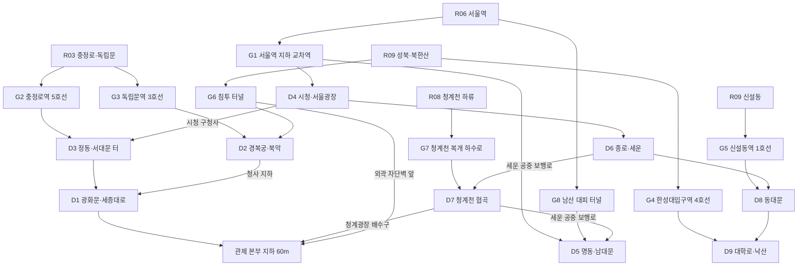
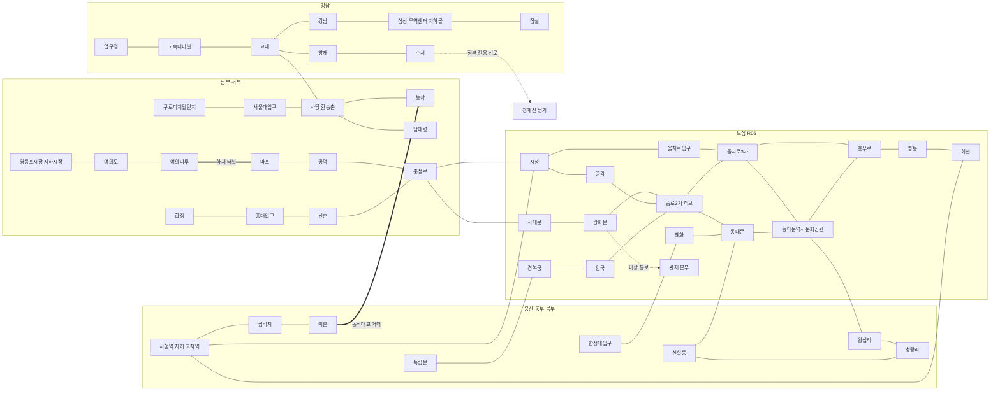
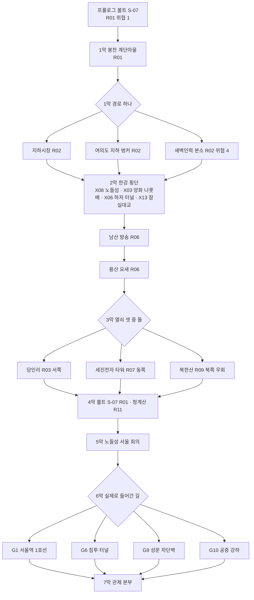

# SD-08. 월드·권역

> **서울 폴아웃 상세 기획서 세트** | 문서 ID: SD-08 | 버전: v1.2 | 작성일: 2026-10-12
> **범위**: 외부 심리스 월드의 축척과 **월드 좌표계**(위경도 → 타일 변환식, 청크 격자와 ID, 32px 환산), 권역 R01~R11·지하 UG·한강 HR의 청크 경계 확정, 기준점 좌표표(산·랜드마크·성문·다리 양끝·지하철역·경계점), 지형·인프라 레이어(하천·산지·간선도로·철도·성곽·방사능 구역)의 청크 경로, 권역별 상세(지형·분위기·위협도·세력·랜드마크 시야·팔레트·방사능), 한강 횡단로 목록 확정과 수영·배·섬 규칙, 도심 밀폐 구역(R05) 봉쇄와 구획, 지하철망, **장소 시드 425곳**(SD-09a~f의 기준 목록), 랜드마크 시야와 길잡이, 월드 밀도 기준, 7막 메인 동선과 위협도 유도, **서울의 판도 공간 단위**와 판도 변화가 월드에 남기는 배치 규칙, 이동 체계(빠른 이동 연동·길 찾기·날씨·문 전환·수직 구조)
> **다루지 않는 것**: 장소별 상세와 L-ID(→ SD-09a~f), 판도 수치 규칙(→ SD-06), 빠른 이동·지도 화면 UI(→ SD-12), 도트 규격·팔레트 값(→ SD-16), 적 수치(→ SD-14), 통행세·운임 확정값(→ SD-15), 퀘스트 진행(→ SD-03a·03b·04a~d)
> **관련 문서**: [SC-00 컨셉](00_concept.md), [SD-02 세계관·연표](02_world-and-lore.md), [SD-03a 메인 스토리 1](03a_main-story-part1.md), [SD-03b 메인 스토리 2](03b_main-story-part2.md), [SD-04a~d 사이드·세력 퀘스트](04a_side-quests-south.md), [SD-05 비표시·반복·인카운터](05_misc-quests-encounters.md), [SD-06 세력](06_factions.md), [SD-09a~f 장소 카탈로그](09a_locations-r01-r02.md), [SD-11 전투·상태](11_combat-system.md), [SD-12 탐험·UI](12_exploration-ui.md), [SD-14 크리처·적](14_creatures-enemies.md), [SD-15 경제](15_economy.md), [SD-16 아트 디렉션](16_art-direction.md), [SD-18 용어](18_naming-terms.md), [SR-02 서울 지리](research/SR-02_seoul-geography.md), [SR-03 인프라](research/SR-03_seoul-infrastructure.md), [RD-12 월드 구조](../reverse-design/12_world-structure-settlements.md), [RD-27 이식 메모](../reverse-design/27_adaptation-notes.md)

---

## 목차
1. 개요
2. 월드 설계 원칙
3. 월드 좌표계와 축척
4. 권역 경계 (청크 확정)
5. 기준점 좌표표
6. 지형·인프라 레이어
7. 권역 상세 R01~R11
8. 한강: 횡단로·수영·배·섬
9. 도심 밀폐 구역 (R05)
10. 지하철망 (UG)
11. 장소 시드 목록 (425곳)
12. 랜드마크 시야와 길잡이
13. 월드 밀도 기준
14. 메인 스토리 동선과 위협도 유도
15. 서울의 판도: 공간 단위와 월드 반응
16. 이동 체계
17. 전체 개략 지도
18. 원작 대응
19. 제작 메모 (엔진: 범용 2D)
20. 미결 사항
- 부록 A 신규 고유명사 / 부록 B CSV 열 규격 / 부록 C 참고 문서 / 버전 이력

---

## 1. 개요

### 1.1 목적
- 실제 서울(동서 약 37km, 남북 약 30km)을 쯔꾸르 스타일 심리스 월드로 옮기는 **공간의 정본**을 만든다.
- 모든 장소·다리·역·도로·하천·권역 경계를 **하나의 좌표계**로 적어, SD-09(장소), SD-16(지형 굽기·지도 원본), SD-12(지도 좌표 표시), SD-06(판도), SD-05(인카운터 배치)가 같은 숫자를 쓰게 한다.
- 바이블 v0.3~v0.4의 요구(월드 전면 개방, 장소 250+, 좌표 기반 배치, 판도)를 공간 설계로 푼다.

### 1.2 요약
| # | 결정 | 확정값 | 절 |
|---|---|---|---|
| W1 | 축척 | **월드 축척 1타일 = 18.5m**(거리·배치용). 국소 축척 1타일 ≈ 1.5m(인물·건물 그림, SD-16). 거리 압축 약 12.3배 | 3.1 |
| W2 | 변환식 | `tx = round((경도 − 126.7550) × 4769.46)`, `ty = round((37.7080 − 위도) × 5999.46)`. 원점은 월드 북서쪽 모서리, 회전 없음 | 3.2 |
| W3 | 청크 | **40×40타일**(SD-16 권장과 같다) = 실제 740m 사방. 월드 53×43청크 = 2,120×1,720타일. ID `C-xx-yy` | 3.3 |
| W4 | 타일·화면 | 32px 확정. 청크 1,280px, 월드 67,840×55,040px. 화면 시야 20×11.25타일(640×360) | 3.6 |
| W5 | 권역 | 플레이 영역 1,230청크. R01~R11 + 한강 HR 54청크 + 지하 UG(별도 층) | 4절 |
| W6 | 이동 시간 | 기본 이동 4.0t/s(SD-11) 기준 서울 동서 직선 약 8분 20초, 남북 약 6분 50초. 실제 경로 계수 1.3 | 3.7 |
| W7 | 한강 횡단로 | **15개 확정**(다리 12 + 하저 터널 1 + 나룻배 2). 붕괴·표시 안 함 다리 13개 | 8절 |
| W8 | 도심 | 한양도성 안 30청크. 지상 구획 D1~D9, 진입점 8곳(지하철 5 + 특수 3) + 6막 경로 4종 | 9절 |
| W9 | 지하철 | 1~5호선. 기준 역 102곳(입장 53 / 지상·고가 19 / 표지만 30), 던전 구간 20 | 10절 |
| W10 | 장소 시드 | 425곳(지상 권역 330, UG 64, HR 31. SD-09 추가 시드 19곳 포함, RECON_SPEC §3.8). 권역마다 20~36곳 | 11절 |
| W11 | 판도 단위 | 판도 구역 54곳(권역 하위) + 거점 단위 24곳. SD-03a의 24칸은 상위 집계 | 15절 |
| W12 | 유도 원칙 | 월드는 프롤로그 직후 전부 열린다. 흐름은 **위협도 1~5, 한강, 도심 밀폐, 방사능** 네 가지로만 유도한다 | 14절 |

### 1.3 다른 문서와의 경계
| 대상 | SD-08이 정하는 것 | 다른 문서가 정하는 것 |
|---|---|---|
| 장소 | 시드 목록(이름·유형·근거·좌표·위협도), 정렬 순서 | L-ID, 상세, 실내 맵 → SD-09a~f |
| 판도 | 공간 단위(구역·거점), 초기 우세, 월드 배치 규칙 | 수치·증감·연동 → SD-06. 메인 퀘스트 변화량 → SD-03a |
| 빠른 이동 | 횡단로 목록과 주인·상태, 금지 구역의 공간 범위 | 규칙·UI·소요 시간 → SD-12 §5 |
| 그래픽 | 벡터 원자료(경계·하천·도로·철도·등고선) | 타일 굽기·팔레트·지도 원본 → SD-16 §6.7, §9.3 |
| 적 | 권역 위협도 → 스폰 레벨 하한 표 | 개체 수치·스폰 표 → SD-14 |

### 1.4 표기 규칙
- **위경도**: 일반 지식의 근사값이다. **정밀도는 ±수백 m**(대략 ±10~20타일)다. 실측이 아니라 '서울 사람이 알아보는 위치'를 지키는 값이다.
- **좌표**: 타일 좌표 `(tx, ty)`, 청크 ID `C-xx-yy`, 청크 내부 타일 `C-xx-yy:aa,bb`. 지하는 `UG(tx, ty, z)`(3.4절).
- **권역 코드**: R01~R11(바이블 §4.2 순서), 한강 HR, 지하 UG. 격자 지도에서는 `1~9, A(R10), B(R11), ~(HR), 5(R05)`로 적는다.
- **위협도**: 1(안전)~5(치명). 레벨 하한은 14.4절.
- **세력 코드**: SD-03a §4.5의 판도 코드(0 없음, 1 비상정부, 2 연합단, 3 원칙파, 4 지하시장, 5 각성회, 6 잔존병, 7 새벽인력, 8 정착지 연합, 9 약탈자, 10 변종, 11 관제망, 12 볼트 S-07, 13 주인공)를 그대로 쓴다.
- 인물·방송 표기는 바이블 §11 최신 고정 명칭을 따른다(계엄사령관 **육지환**, 잔존병 지휘관 **멍쉐밍 상위**, 비상정부 라디오 **공보방송**).
- (미확인)·†는 SR 문서의 표시를 그대로 옮긴 것이다.

---

## 2. 월드 설계 원칙

| # | 원칙 | 설계 규칙 | 근거 |
|---|---|---|---|
| 1 | 실제 방위를 지킨다 | 모든 장소는 변환식(3.2절)의 좌표에 놓는다. 손보정은 ±1청크(40타일) 안에서만 허용하고 SD-09에 보정 벡터를 기록한다. 남산은 광화문 남쪽, 여의도는 남서쪽, 잠실은 동남쪽이다 | 바이블 §4.1, SR-02 §7.4 |
| 2 | 한 장의 균일 격자 | 권역마다 축척을 다르게 하지 않는다(차등 압축 기각). 밀도 차이는 '장소 수'와 '프리팹 밀도'로 만든다. 그래야 지도·좌표·판도가 한 표로 맞는다 | SR-02 §7.4 제안 2 검토 |
| 3 | 막는 것은 넷뿐 | 위협도, 한강, 도심 밀폐, 방사능. 퀘스트 진행으로 지역을 잠그지 않는다 | 바이블 §5.3 자유도 원칙 1 |
| 4 | 강은 진짜 장벽 | 한강은 폭 약 1km를 그대로 둔다(수면 40타일 + 둔치). 건너는 길은 14개뿐이고 주인이 있다 | 바이블 §4.1 |
| 5 | 산이 테두리 | 북(북한산·도봉산)·남(관악산·청계산)·동(아차산) 산지가 맵 경계를 만든다. 서쪽만 김포 평야로 열려 있고, 그쪽은 방사능이 막는다 | SR-02 §2.5 |
| 6 | 3도심 + 아파트 바다 | 광화문(밀폐)·여의도·강남 3도심의 고층 폐허, 그 사이를 메운 아파트 단지와 빌라, 가장자리 산지 | SR-02 §4.4 |
| 7 | 판도가 보이는 땅 | 모든 판도 구역에 검문·깃발·바리케이드·순찰 슬롯을 미리 둔다. 기울기는 숫자가 아니라 이 슬롯의 내용으로 보인다 | 바이블 §5.8 원칙 3 |
| 8 | 처음 한 번은 걷는다 | 강 횡단·도심 진입은 처음 한 번 직접 통과해야 빠른 이동에 쓸 수 있다 | SD-12 §5.6~5.7 |

---

## 3. 월드 좌표계와 축척

### 3.1 축척 확정
| 항목 | 값 | 근거 |
|---|---|---|
| 월드 축척 | **1타일 = 실제 18.5m** | 서울 동서 36.8km → 약 2,000타일. 기본 이동 4.0t/s로 직선 횡단 8분대. 원작처럼 '가끔은 외로운' 거리감을 2D 화면(시야 20타일)에서 낸다 |
| 국소 축척 | 1타일 ≈ 1.5m | SD-16 §3.2(인물 키 40px). 인물·문·차량·가구는 이 축척으로 그린다 |
| 압축 비율 | 18.5 ÷ 1.5 ≈ **12.3배** | 건물·도로 폭은 SD-16 §6.5·§6.7의 압축 규칙으로 그린다. 왕복 8차로 = 16타일(국소로는 24m, 월드로는 296m에 해당) |
| 청크 | 40×40타일 = 740m 사방 = 0.548㎢ | SD-16 권장값. 화면 가로 2장, 세로 3.6장 |
| 월드 크기 | 53×43청크 = 2,120×1,720타일 | 서울 경계 상자(동서 36.8km·남북 30.3km)에 사방 약 1청크 여백 |
| 플레이 영역 | 1,230청크(약 674㎢ 근사, 한강 포함) | 4.1절. 실제 서울 605㎢보다 큰 것은 경계 다각형 근사와 한강 양안 여백 때문이다 |

**원작과의 비교**
| 항목 | 원작 수도 황무지 | 서울판 |
|---|---|---|
| 외부 월드 | 약 51×51셀 정사각형(RD-12 §2.1) | 53×43청크 직사각형, 실제 서울 윤곽을 따른다 |
| 셀·청크 한 변 | 셀 4,096 엔진 단위(약 58.5m, 엔진 단위 환산, 코퍼스 밖†) | 청크 40타일 = 월드 740m / 국소 60m |
| 외부 한 변의 '체감 길이' | 약 3km(51셀 × 58.5m†) | 2,120타일 × 1.5m ≈ 3.2km(국소 축척 기준) |
| 지도 마커 | 본편 163 | 장소 시드 425(지도 마커 대상 약 300, SD-09 개요 표 마커 열이 정본) |
| 경계 처리 | 북서 산지, 서쪽 산맥, 보이지 않는 벽 | 북·남·동 산지, 서쪽 방사능 평야, 경계 둑·철조망 |

- 국소 축척으로 보면 서울판 월드의 한 변은 원작과 비슷한 3km대다. 걸어서 느끼는 넓이가 원작과 맞는다.

### 3.2 변환식 (위경도 → 월드 타일)

```
기준 위도 φ0 = 37.566°(서울시청)        회전 없음(북 = 화면 위)
경도 1° = 111,320 × cos φ0 = 88,235m     위도 1° = 110,990m
원점(타일 0,0의 북서 모서리) = 위도 37.7080°, 경도 126.7550°
월드 축척 s = 18.5m/타일

tx = round( (경도 − 126.7550) × 88,235 / 18.5 ) = round( (경도 − 126.7550) × 4769.46 )
ty = round( (37.7080 − 위도) × 110,990 / 18.5 ) = round( (37.7080 − 위도) × 5999.46 )

역변환: 경도 = 126.7550 + tx / 4769.46     위도 = 37.7080 − ty / 5999.46
청크:   cx = floor(tx / 40), cy = floor(ty / 40), ID = C-{cx 두 자리}-{cy 두 자리}
```

- **투영**: 등장방형(경위선 직교) 근사. 서울 범위(위도 37.43~37.71)에서 경도 1°의 길이 변화는 0.2% 안팎이라 월드 끝에서 최대 약 4타일 어긋난다. 위경도 근사값 자체의 오차(±수백 m)보다 작으므로 보정하지 않는다.
- **검산 예**: 광화문(37.5759, 126.9769) → `tx 1058, ty 793` → `C-26-19`. 남산 송신탑(37.5512, 126.9882) → `tx 1112, ty 941` → `C-27-23`.

**기준점 오차 보정 규칙**
| # | 규칙 |
|---|---|
| E1 | 아래 **기준점 12곳**은 변환식 좌표에 **고정**한다(보정 0). 지도의 뼈대다: 광화문, 남산 송신탑, 국회의사당, 여의도 금탑, 노들섬, 서울역, 용산 요새, 세진전자 타워, 관악산 연주봉, 북한산 백운대, 김포공항 크레이터, 청계산 매봉 |
| E2 | 그 밖의 장소는 지형·도로와 맞추려고 **최대 ±40타일(1청크)** 옮길 수 있다. 옮긴 값은 SD-09 장소표의 `보정dx, 보정dy` 열에 적는다 |
| E3 | 같은 청크에 장소 중심이 4곳 이상 겹치면 서로 8타일 이상 떨어지게 보정한다(SD-12 지도 아이콘 겹침 방지) |
| E4 | 다리 양끝은 한강 수면 폴리곤 바깥 둔치에 놓이게 보정한다. 다리 길이(5.4절 '길이' 열)는 ±10% 안에서 유지한다(SD-16 §6.3 '강폭 대비 다리 길이 비율 유지') |
| E5 | 한강 수면선, 산 정상, 성곽은 보정하지 않는다. 장소 쪽을 옮긴다 |
| E6 | 도심 밀폐 구역(R05) 안은 같은 좌표를 쓰되, 각 구획 맵의 바깥 테두리(잔해·차단벽)는 구획 사이에 4~8타일씩 둔다 |

### 3.3 청크·편집 블록·ID 규칙
| 단위 | 크기 | ID 형식 | 용도 |
|---|---|---|---|
| 타일 | 1×1 | 전역 `(tx, ty)` 또는 청크 내부 `C-26-19:18,33` | 배치·트리거 |
| 청크 | 40×40타일 | `C-xx-yy` (x 0~52, y 0~42) | 스트리밍, 권역·판도 판정, 탐험 비트맵(SD-12 §5.2) |
| 편집 블록 | 4×4청크 = 160×160타일 | `B-x-y` (x 0~13, y 0~10) | 제작·저장 단위. 편집기에서 한 번에 열어 작업하기 좋은 크기(Godot 4 씬 1장)다. 월드 14×11 = 154블록 |
| 권역 | 청크 집합 | R01~R11, HR | 4.3절 행별 구간이 정본 |
| 판도 구역 | 청크 집합 | `PD-R01-1` 형식 | 15절 |

- 청크는 **한 권역에만** 속한다. 권역 경계가 청크를 가르면 청크 중심이 속한 권역을 따른다(4.3절이 최종).
- 장소의 권역은 장소 중심 청크의 권역이다. 예외는 섬(선유도·밤섬은 R04, 노들섬은 HR, 여의도는 R02)과 다리(HR)뿐이다.

### 3.4 레이어와 높이 좌표
| 레이어 | 좌표 | 규칙 |
|---|---|---|
| 지상(G) | `(tx, ty)` + 층 ID 0/1/2 | SD-16 §6.5: 0 지면, 1 고가·다리 상판, 2 옥상·성곽 위 |
| 한강(HR) | `(tx, ty)` | 지상과 같은 평면. 수면·둔치·다리·섬. 4.4절 |
| 지하(UG) | `UG(tx, ty, z)` | 입구의 지상 좌표 + 깊이 단계 z. 실내 맵이므로 내부는 국소 축척(1.5m/t)으로 그린다. **입구 좌표와 역 사이 방위만 월드에 맞춘다** |

**지하 깊이 단계 z**
| z | 이름 | 실제 깊이(근사) | 해당 공간 |
|---|---|---|---|
| -1 | 지하 1층 | ~5m | 지하상가, 지하주차장, 민방위 대피소, 영등포 지하시장 |
| -2 | 얕은 역 | 10~20m | 대합실·승강장 대부분, 청계천 복개 하수로 |
| -3 | 깊은 역 | 20~35m | 환승역 하층, 여의도·여의나루, 여의도 지하 벙커 |
| -4 | 대심도 | 40m 이하 | 하저 터널, 서울역 대심도(S-12), 신월 빗물터널, 관제 본부(약 60m), 침투 터널, 정부 전용 대심도 선로, 볼트 |

- 깊이 단계는 라디오 수신(SD-12·SD-17: z -3 이하 수신 약화, -4 수신 불가)과 방사능 누수 확률에 쓴다.

### 3.5 핍-보이 지도와 지도 격자 환산
| 지도 | 규격 | 월드 → 지도 환산 |
|---|---|---|
| SD-16 지도 원본 | 1px = 50m, 740×600px(서울 경계 상자) | `px = (tx − 43) × 0.37`, `py = (ty − 42) × 0.37`. (43, 42)는 서울 경계 상자 북서 모서리(126.764°, 37.701°)의 타일 좌표 |
| SD-12 월드 지도 원본 | 1600×1300px | `px = (tx − 43) × 0.8000`, `py = (ty − 42) × 0.7937` (1600 ÷ 2000타일, 1300 ÷ 1638타일) |
| SD-12 지도 격자 | 가~하 14열 × 1~12행 | 열 = `floor((tx − 43) / 143)` → 가(0)~하(13), 행 = `floor((ty − 42) / 137) + 1` |
| SD-12 좌표 표시 | `R01 · 청크 (12, 31) · 타일 (7, 4)` | 청크 = `(cx, cy)`, 타일 = 청크 내부 `(tx mod 40, ty mod 40)`. 이 문서의 `C-12-31:07,04`와 같다 |

- 예: 남산 송신탑 `tx 1112, ty 941` → SD-16 지도 원본 (395, 333)px, SD-12 격자 `아7`.

### 3.6 타일 크기 환산 (32px 확정, 48px 참고)
| 항목 | **32px (확정, SD-16 A2)** | 48px (참고) |
|---|---|---|
| 청크 | 1,280×1,280px | 1,920×1,920px |
| 편집 블록 | 5,120×5,120px | 7,680×7,680px |
| 월드 전체 | 67,840×55,040px | 101,760×82,560px |
| 내부 해상도 | 640×360 | (1920×1080 고정이 되어 정수 배율 여지 없음) |
| 화면 시야 | **20×11.25타일**(HUD 제외 약 20×10) | 40×22.5타일(1080p 기준) |
| 청크 대비 화면 | 청크 하나 = 화면 가로 2장 × 세로 3.6장 | 가로 1장 × 세로 1.8장 |
| 기본 이동 4.0t/s | 128px/s | 192px/s |
| 실제 1km | 54타일 = 1,730px | 2,595px |
| 한강 폭 1km | 수면 40타일 + 둔치 각 4~7타일 | 같은 타일 수 |
| 다리(길이 0.9~1.6km) | 54~89타일, 화면 가로 2.7~4.5장 | 1.4~2.2장 |

- 청크는 SD-16 권장값(40타일)을 그대로 쓴다. 근거: ① 화면 가로 2장이라 3×3 활성 청크(120×120타일)가 640×360 화면과 룩어헤드(최대 8타일, SD-11 §2.6)를 넉넉히 덮는다. ② 실제 740m라 '장소 1곳 + 주변'이 청크 하나에 들어간다. ③ 4×4 편집 블록(160타일)이 편집기에서 한 번에 다루기 좋은 크기다(엔진은 Godot 4, 바이블 K9).

### 3.7 이동 속도와 횡단 시간
기준 속도는 SD-11 §2.4다(기본 이동 4.0t/s, 질주 6.0t/s·AP 소모, 무기 넣고 4.4t/s, 과적 2.4t/s).

| 구간 | 직선 거리(타일) | 기본 이동 | 질주만(이론) | 실제 경로(×1.3, 기본 이동) |
|---|---|---|---|---|
| 청크 1개 | 40 | 10초 | 6.7초 | 13초 |
| 실제 1km | 54 | 13.5초 | 9초 | 17.6초 |
| 서울 동서(개화~강일) | 약 2,000 | 8분 20초 | 5분 33초 | 약 10분 50초 |
| 서울 남북(원지동~도봉산) | 약 1,640 | 6분 50초 | 4분 33초 | 약 8분 53초 |
| 볼트 S-07 → 봉천 계단마을 | 약 160 | 40초 | — | 52초 |
| 봉천 계단마을 → 여의도 지하 벙커 | 약 285 | 1분 11초 | — | 1분 33초 |
| 노들섬 → 용산 요새 | 약 170 | 43초 | — | 55초 |
| 용산 요새 → 세진전자 타워 | 약 580 | 2분 25초 | — | 3분 8초(강 횡단 우회 별도) |
| 용산 요새 → 북한산 굴진 기지 | 약 490 | 2분 3초 | — | 3분 16초(도심 서쪽 우회, ×1.6) |
| 청계산 벙커 → 볼트 S-07 | 약 435 | 1분 49초 | — | 2분 21초 |

- 실제 경로 계수 1.3은 도로망·지형 우회의 평균이다. 산지(R09·R11)는 1.6, 강을 끼면 횡단로까지의 우회가 더해진다.

### 3.8 스트리밍 규격
| 항목 | 값 |
|---|---|
| 활성 청크 | 주인공 청크 중심 3×3(120×120타일). 적 AI·물리·이벤트가 돈다 |
| 사전 로드 | 5×5(200×200타일). 타일·프리팹만 올리고 이벤트는 잠든다 |
| 해제 | 7×7 밖으로 나가면 해제. 교전 중인 적은 활성 목록에 남긴다(SD-11 §2.5) |
| 상주 표 | 장소 425행·판도 단위 78행·횡단로 14행·퀘스트 목표 좌표는 메모리에 상주(SD-12 방위 링이 청크 밖 대상을 그린다) |
| 텍스처 | 권역 타일셋은 권역 경계 2청크 안에 들어오면 미리 올린다(SD-16 권역 색조 보간 지대와 같다) |
| 저장 | 청크별 탐험 비트맵(SD-12), 청크별 변경 목록(파괴된 바리케이드, 주운 물건), 판도 슬롯 상태 |

---

## 4. 권역 경계 (청크 확정)

### 4.1 권역 총괄
| 권역 | 청크 수 | 청크 X 범위 | 청크 Y 범위 | 면적(㎢, 청크×0.548) |
|---|---|---|---|---|
| R01 | 118 | 13~27 | 29~40 | 65 |
| R02 | 83 | 6~22 | 26~35 | 45 |
| R03 | 70 | 13~24 | 16~24 | 38 |
| R04 | 15 | 15~21 | 22~25 | 8 |
| R05 | 30 | 24~30 | 17~22 | 16 |
| R06 | 37 | 22~30 | 22~28 | 20 |
| R07 | 148 | 28~47 | 26~37 | 81 |
| R08 | 189 | 29~50 | 12~28 | 103 |
| R09 | 292 | 16~41 | 1~19 | 160 |
| R10 | 125 | 1~14 | 17~29 | 68 |
| R11 | 69 | 28~42 | 34~41 | 38 |
| HR | 54 | 5~51 | 15~29 | 30 |
| 합계(플레이 영역) | 1230 | | | 674 |
| 경계 밖(--) | 1049 | | | |

- 권역의 실제 범위(구 단위)는 다음과 같다. 구 경계를 그대로 쓰지 않고, 구의 대표점에 가까운 청크를 묶은 뒤 하천·능선·성곽에 맞춰 손으로 고쳤다(재현 방법은 4.5절).

| 권역 | 실제 범위 | 경계를 이루는 지형 |
|---|---|---|
| R01 관악 | 관악구·동작구·금천구 | 북: 한강 남안(노량진·흑석) / 서: 안양천·도림천 하류 / 남: 관악산·삼성산 능선 / 동: 남태령·서초 경계 |
| R02 여의도·영등포 | 영등포구(양평동 북부 제외)·구로구 | 북: 한강·샛강 / 서: 안양천 / 남: 도림천·금천 경계 / 동: 노량진 철로 |
| R03 마포·상암 | 마포구(합정·망원 강변 제외)·서대문구·중구 서소문 바깥 | 북: 불광천·은평 경계 / 남: 한강 북안 / 동: 인왕산·한양도성 서쪽 |
| R04 서강·선유도 | 망원·합정 강변, 선유도, 양평동 북부, 밤섬 | 한강 수역을 사이에 둔 양안 띠. 섬 2곳 포함 |
| R05 도심(밀폐) | 한양도성 안 종로구·중구 | 한양도성 성곽 + 내사산 능선(9절) |
| R06 용산·남산 | 용산구, 중구 남산·서울역 일대 | 북: 한양도성 남쪽(남산 능선·숭례문) / 남: 한강 북안 / 동: 한남·약수 |
| R07 강남 | 서초구 북부(반포·서초·방배), 강남구(수서·세곡 제외), 송파구 | 북: 한강 남안 / 남: 우면산·구룡산·대모산 북사면 / 동: 성남 경계 |
| R08 동부 | 성동·광진·동대문·중랑·강동구, 중구 동부(신당·장충) | 서: 한양도성 동쪽 / 북: 중랑·노원 경계 / 동: 아차산·하남 경계. 한강 양안(강동은 남안) |
| R09 북부 산악 | 은평·강북·도봉·노원·성북구, 종로구 북부(평창·부암·구기) | 북·동·서: 북한산·도봉산·수락산·불암산(맵 테두리) / 남: 한양도성 북쪽·홍제천 상류 |
| R10 서부 평야 | 강서구·양천구 | 북: 한강 하류 / 동: 안양천 / 서: 김포 경계(맵 테두리) |
| R11 청계산 | 서초구 남부(우면·양재 남부·내곡·원지), 강남구 남부(수서·세곡) | 북: 우면산·구룡산·대모산 능선 / 남: 청계산(맵 테두리) |

### 4.2 권역 격자 지도 (정본)
`1~9` = R01~R09, `A` = R10, `B` = R11, `5` = R05(밀폐), `~` = 한강 HR, `.` = 플레이 영역 밖. 가로가 청크 X(0~52), 세로가 청크 Y(0~42)다.

```
     00000000001111111111222222222233333333334444444444555
     01234567890123456789012345678901234567890123456789012
00   .....................................................
01   ..............................999....................
02   .............................99999999................
03   ............................99999999999..............
04   ...........................9999999999999.............
05   .........................999999999999999.............
06   ......................9999999999999999999............
07   ...................9999999999999999999999............
08   ...................99999999999999999999999...........
09   ..................999999999999999999999999...........
10   ..................999999999999999999999999...........
11   ..................999999999999999999999999...........
12   .................99999999999999999999999888..........
13   .................99999999999999999989888888..........
14   .................99999999999999999988888888..........
15   .....~..........999999999999999999888888888..........
16   .....~~.........999993399999999999888888888..........
17   .....A~~........333333339555599999888888888..........
18   ....AAA~~~.....3333333333555559998888888888..........
19   ...AAAAAA~~...33333333335555559998888888888.....~~~~.
20   ..AAAAAAAAA~~3333333333335555558888888888888..8~~88..
21   ..AAAAAAAAAAA~3333333333355555588888888888888~~8888..
22   .AAAAAAAAAAAAA~~443333333655588888888888888~8888888..
23   .AAAAAAAAAAAAAA~44433333366668888888888888~~8888888..
24   ..AAAAAAAAAAAAA44443336366666888888888888~~8888888...
25   ..AAAAAAAAAAAAA4444~446666666688~~888888~~88888888...
26   ...AAAAAAAAAAAA222222~~66666666~~7~~~888~77788888....
27   ....AAAAAAAAAAA2222222~~666666~777777~~~777778888....
28   .....AAAAAAAAAA22222222~~6666~7777777777777777788....
29   ......AAAAAAAAA2222221111~~~77777777777777777777.....
30   ......222222222222221111111177777777777777777777.....
31   ......222222222222221111111177777777777777777777.....
32   .......2222222222121111111117777777777777777777......
33   ........222222221211111111117777777777777777777......
34   ..........22222121111111111177777777BBBBB7B777.......
35   ............2211111111111111BBBBBBBBBBBBB7777........
36   .............111111111111111BBBBBBBBBBBBBB7..........
37   ...............1111111111111.BBBBBBBBBBBB7...........
38   ................11111111111...BBBBBBBBBB.............
39   ................111111111......BBBBBBBB..............
40   .................111.............BBBB................
41   ..................................BB.................
42   .....................................................
```

### 4.3 행별 청크 구간 (정본 데이터)
권역 판정의 최종 근거다. `Y17:24-28`은 Y=17 행의 X 24~28 청크를 뜻한다. 다른 문서는 이 표로 권역을 판정한다.

| 권역 | 행(Y)별 청크 X 구간 |
|---|---|
| R01 | Y29:21-24 / Y30:20-27 / Y31:20-27 / Y32:17,19-27 / Y33:16,18-27 / Y34:15,17-27 / Y35:14-27 / Y36:13-27 / Y37:15-27 / Y38:16-26 / Y39:16-24 / Y40:17-19 |
| R02 | Y26:15-20 / Y27:15-21 / Y28:15-22 / Y29:15-20 / Y30:6-19 / Y31:6-19 / Y32:7-16,18 / Y33:8-15,17 / Y34:10-14,16 / Y35:12-13 |
| R03 | Y16:21-22 / Y17:16-23 / Y18:15-24 / Y19:14-23 / Y20:13-24 / Y21:14-24 / Y22:18-24 / Y23:19-24 / Y24:19-21,23 |
| R04 | Y22:16-17 / Y23:16-18 / Y24:15-18 / Y25:15-18,20-21 |
| R05 | Y17:25-28 / Y18:25-29 / Y19:24-29 / Y20:25-30 / Y21:25-30 / Y22:26-28 |
| R06 | Y22:25 / Y23:25-28 / Y24:22,24-28 / Y25:22-29 / Y26:23-30 / Y27:24-29 / Y28:25-28 |
| R07 | Y26:33,41-43 / Y27:31-36,40-44 / Y28:30-46 / Y29:28-47 / Y30:28-47 / Y31:28-47 / Y32:28-46 / Y33:28-46 / Y34:28-35,41,43-45 / Y35:41-44 / Y36:42 / Y37:41 |
| R08 | Y12:40-42 / Y13:35,37-42 / Y14:35-42 / Y15:34-42 / Y16:34-42 / Y17:34-42 / Y18:33-42 / Y19:33-42 / Y20:31-43,46,49-50 / Y21:31-44,47-50 / Y22:29-42,44-50 / Y23:29-41,44-50 / Y24:29-40,43-49 / Y25:30-31,34-39,42-49 / Y26:37-39,44-48 / Y27:45-48 / Y28:47-48 |
| R09 | Y01:30-32 / Y02:29-36 / Y03:28-38 / Y04:27-39 / Y05:25-39 / Y06:22-40 / Y07:19-40 / Y08:19-41 / Y09:18-41 / Y10:18-41 / Y11:18-41 / Y12:17-39 / Y13:17-34,36 / Y14:17-34 / Y15:16-33 / Y16:16-20,23-33 / Y17:24,29-33 / Y18:30-32 / Y19:30-32 |
| R10 | Y17:5 / Y18:4-6 / Y19:3-8 / Y20:2-10 / Y21:2-12 / Y22:1-13 / Y23:1-14 / Y24:2-14 / Y25:2-14 / Y26:3-14 / Y27:4-14 / Y28:5-14 / Y29:6-14 |
| R11 | Y34:36-40,42 / Y35:28-40 / Y36:28-41 / Y37:29-40 / Y38:30-39 / Y39:31-38 / Y40:33-36 / Y41:34-35 |
| HR | Y15:5 / Y16:5-6 / Y17:6-7 / Y18:7-9 / Y19:9-10,48-51 / Y20:11-12,47-48 / Y21:13,45-46 / Y22:14-15,43 / Y23:15,42-43 / Y24:41-42 / Y25:19,32-33,40-41 / Y26:21-22,31-32,34-36,40 / Y27:22-23,30,37-39 / Y28:23-24,29 / Y29:25-27 |

### 4.4 지하(UG)·한강(HR) 레이어 정의
| 레이어 | 정의 | 범위 | 소속 규칙 |
|---|---|---|---|
| **HR 한강** | 한강 중심선에서 400m 안의 청크(위 격자의 `~`) + 그 위의 다리·섬·나루·하저 터널 입구 | 54청크, X 5~51 · Y 15~29 | 장소 ID는 `L-HR-`. 다리는 양끝이 육지 권역에 걸쳐도 HR이다. 섬은 예외(선유도·밤섬 R04, 여의도 R02, 노들섬 HR) |
| **HR 남안·북안** | SD-12 §5.6 빠른 이동의 '강변' 구분 | 남안 = R01·R02·R07·R10·R11 + R08 강동(한강 남쪽 청크) + R04 양평·선유도 남쪽 / 북안 = 나머지 | **여의도(R02)는 남안**, **선유도(R04)는 남안**(양화대교 남쪽 경간이 짧고 조합 본부가 남쪽 펌프장에 의존), **노들섬(HR)은 북안**(한강대교 남단 절반이 끊겨 있어 북쪽과 먼저 이어진다), **밤섬은 어느 쪽도 아님**(빠른 이동 불가) |
| **UG 지하** | 지하철·지하상가·하수·빗물터널·대심도 시설·볼트 내부 | 지상과 같은 (tx, ty) 평면 + 깊이 z(3.4절) | 장소 ID는 `L-UG-`. 단 **지상 정착지·던전의 지하층**(지하시장, 여의도 지하 벙커, 당인리, 관제 본부, 볼트)은 그 지상 권역 ID를 쓴다(바이블 §4.2·SD-02 §7 표기와 맞춘다) |

### 4.5 경계 처리와 재현 방법
- **맵 가장자리**: 플레이 영역 밖 청크는 그리지 않는다. 가장자리 1청크 띠(약 180청크)는 아래 '경계 지형'으로 채우고 보이지 않는 벽을 그 바깥에 둔다.

| 방향 | 경계 지형 | 넘으려 할 때 |
|---|---|---|
| 북 | 북한산·도봉산·수락산 암벽(통행 불가 암벽 타일), 의정부 방향 고속도로 고가 끊김 | 암벽. 고가 끝에서 `더 가면 북방 병합지 낙진대다` 핍-보이 경고 |
| 동 | 아차산·용마산 능선, 강일 경계 고가 붕괴, 하남 방향 한강 상류 수문 | 고가 끝 낙하 지점. 상류는 물살 구간(8.6절) |
| 남 | 관악산·청계산 능선, 경부고속도로 서울 요금소 잔해 | 능선 암벽. 요금소 너머는 계엄군 차단선 + 성남 군 시설 낙진(W-6) |
| 서 | 김포·인천 방향 평야 | 방사능 R4 '서쪽 지평선 안개'(W-1 인천항 낙진). 진입 시 초당 방사능이 계속 오르고 15초 뒤 강제 회귀 연출 |
| 한강 하류 | 행주대교 잔해 너머 | 물살이 맵 밖으로 끌고 가지 못하게 잔해 방책(침몰선 열) |
- **재현 방법(데이터 생성 규칙)**: ① 서울 경계 다각형 안의 청크만 플레이 영역 ② 한강 중심선에서 0.4km 안 → HR ③ 한양도성 다각형 안 → R05 ④ 망원·선유도 상자(위도 37.534~37.557, 경도 126.884~126.916) → R04 ⑤ 나머지는 같은 강변의 가장 가까운 구 대표점의 권역 ⑥ 장소·섬·강변 정착지를 위한 손보정 26칸. 4.3절 표가 이 결과를 고정한 것이다.

---

## 5. 기준점 좌표표

모든 표는 **열이 고정**돼 CSV로 바로 옮길 수 있다(부록 B). 위경도는 일반 지식의 근사값이며 정밀도는 ±수백 m다. tx·ty는 3.2절 변환식 결과이고 보정 전 값이다.

### 5.1 산 정상
| 기준점 | 구분 | 위도 | 경도 | tx | ty | 청크 | 권역 |
|---|---|---|---|---|---|---|---|
| 북한산 백운대 | 산 정상 836m | 37.6587 | 126.9779 | 1063 | 296 | C-26-07 | R09 |
| 북한산 보현봉 | 산 정상 714m | 37.6180 | 126.9820 | 1083 | 540 | C-27-13 | R09 |
| 북한산 비봉 | 산 정상 560m | 37.6190 | 126.9530 | 944 | 534 | C-23-13 | R09 |
| 도봉산 자운봉 | 산 정상 740m | 37.6987 | 127.0153 | 1241 | 56 | C-31-01 | R09 |
| 수락산 | 산 정상 638m | 37.6985 | 127.0815 | 1557 | 57 | C-38-01 | R09 |
| 불암산 | 산 정상 508m | 37.6604 | 127.0975 | 1634 | 286 | C-40-07 | R09 |
| 북악산 | 산 정상 342m | 37.5934 | 126.9732 | 1041 | 688 | C-26-17 | R05 |
| 인왕산 | 산 정상 338m | 37.5850 | 126.9578 | 967 | 738 | C-24-18 | R05 |
| 낙산 | 산 정상 125m | 37.5809 | 127.0076 | 1205 | 763 | C-30-19 | R05 |
| 남산 | 산 정상 262m | 37.5512 | 126.9882 | 1112 | 941 | C-27-23 | R06 |
| 안산 | 산 정상 296m | 37.5755 | 126.9440 | 901 | 795 | C-22-19 | R03 |
| 매봉산(상암) | 산 정상 94m | 37.5735 | 126.8960 | 672 | 807 | C-16-20 | R03 |
| 난지도 쓰레기 산 | 산 정상 98m | 37.5683 | 126.8850 | 620 | 838 | C-15-20 | R03 |
| 응봉산 | 산 정상 81m | 37.5480 | 127.0300 | 1312 | 960 | C-32-24 | R08 |
| 용마산 | 산 정상 348m | 37.5735 | 127.0878 | 1587 | 807 | C-39-20 | R08 |
| 아차산 | 산 정상 287m | 37.5713 | 127.1024 | 1657 | 820 | C-41-20 | R08 |
| 개화산 | 산 정상 128m | 37.5787 | 126.8084 | 255 | 776 | C-06-19 | R10 |
| 우장산 | 산 정상 98m | 37.5490 | 126.8370 | 391 | 954 | C-09-23 | R10 |
| 관악산 연주봉 | 산 정상 632m | 37.4449 | 126.9637 | 995 | 1578 | C-24-39 | R01 |
| 삼성산 | 산 정상 481m | 37.4440 | 126.9365 | 866 | 1584 | C-21-39 | R01 |
| 우면산 | 산 정상 293m | 37.4701 | 127.0081 | 1207 | 1427 | C-30-35 | R11 |
| 구룡산 | 산 정상 306m | 37.4720 | 127.0603 | 1456 | 1416 | C-36-35 | R11 |
| 대모산 | 산 정상 293m | 37.4762 | 127.0832 | 1565 | 1391 | C-39-34 | R11 |
| 청계산 매봉 | 산 정상 582m | 37.4400 | 127.0480 | 1397 | 1608 | C-34-40 | R11 |

### 5.2 랜드마크 (원거리 시야 대상)
등급 S = 전역에서 보임, A = 10청크 이상, B = 6~8청크, C = 3~5청크(12절).

| 기준점 | 구분 | 위도 | 경도 | tx | ty | 청크 | 권역 |
|---|---|---|---|---|---|---|---|
| 남산 송신탑 | 랜드마크 S | 37.5512 | 126.9882 | 1112 | 941 | C-27-23 | R06 |
| 세진전자 타워 | 랜드마크 S | 37.5126 | 127.1025 | 1657 | 1172 | C-41-29 | R07 |
| 여의도 금탑 | 랜드마크 A | 37.5198 | 126.9402 | 883 | 1129 | C-22-28 | R02 |
| 무너진 국회 돔 | 랜드마크 B | 37.5318 | 126.9140 | 758 | 1057 | C-18-26 | R02 |
| 당인리 굴뚝 | 랜드마크 B | 37.5452 | 126.9210 | 792 | 977 | C-19-24 | R03 |
| 난지도 메탄 불꽃 | 랜드마크 B | 37.5683 | 126.8850 | 620 | 838 | C-15-20 | R03 |
| 탱크마을 탱크 | 랜드마크 C | 37.5713 | 126.8936 | 661 | 820 | C-16-20 | R03 |
| 상암 경기장 | 랜드마크 B | 37.5683 | 126.9010 | 696 | 838 | C-17-20 | R03 |
| 잠실 종합경기장 | 랜드마크 B | 37.5150 | 127.0730 | 1517 | 1158 | C-37-28 | R07 |
| 관악 레이더 돔 | 랜드마크 A | 37.4478 | 126.9625 | 990 | 1561 | C-24-39 | R01 |
| 북한산 인수봉 | 랜드마크 A | 37.6620 | 126.9830 | 1087 | 276 | C-27-06 | R09 |
| 도봉산 자운봉 | 랜드마크 A | 37.6987 | 127.0153 | 1241 | 56 | C-31-01 | R09 |
| 동대문 미래관 | 랜드마크 C | 37.5665 | 127.0095 | 1214 | 849 | C-30-21 | R05 |
| 올림픽대교 주탑 | 랜드마크 B | 37.5340 | 127.1040 | 1665 | 1044 | C-41-26 | R07 |
| 공릉 연구로 돔 | 랜드마크 C | 37.6290 | 127.0890 | 1593 | 474 | C-39-11 | R09 |
| 청계산 환기탑 | 랜드마크 C | 37.4440 | 127.0420 | 1369 | 1584 | C-34-39 | R11 |
| 김포 크레이터 연기 | 랜드마크 A | 37.5583 | 126.7906 | 170 | 898 | C-04-22 | R10 |
| 우면 크레이터 | 랜드마크 B | 37.4630 | 127.0200 | 1264 | 1470 | C-31-36 | R11 |
| 이촌 폭심 | 랜드마크 C | 37.5165 | 126.9720 | 1035 | 1149 | C-25-28 | R06 |
| 광화문 확성기탑 | 랜드마크 C | 37.5715 | 126.9768 | 1058 | 819 | C-26-20 | R05 |
| 도곡 주상복합 3탑 | 랜드마크 A | 37.4880 | 127.0530 | 1421 | 1320 | C-35-33 | R07 |
| 여의도 유리탑 3동 | 랜드마크 B | 37.5255 | 126.9255 | 813 | 1095 | C-20-27 | R02 |
| 용산 요새 탐조등 | 랜드마크 B | 37.5370 | 126.9850 | 1097 | 1026 | C-27-25 | R06 |
| 노들섬 크레인 | 랜드마크 C | 37.5175 | 126.9590 | 973 | 1143 | C-24-28 | HR |

### 5.3 성문·서울 극점·지천 합류·고개
| 기준점 | 구분 | 위도 | 경도 | tx | ty | 청크 | 권역 |
|---|---|---|---|---|---|---|---|
| 숭례문 | 성문·성곽 | 37.5600 | 126.9753 | 1051 | 888 | C-26-22 | R05 경계 |
| 소의문 터 | 성문·성곽 | 37.5630 | 126.9705 | 1028 | 870 | C-25-21 | R05 경계 |
| 돈의문 터 | 성문·성곽 | 37.5680 | 126.9670 | 1011 | 840 | C-25-21 | R05 경계 |
| 창의문 | 성문·성곽 | 37.5925 | 126.9665 | 1009 | 693 | C-25-17 | R05 경계 |
| 숙정문 | 성문·성곽 | 37.5960 | 126.9840 | 1092 | 672 | C-27-16 | R05 경계 |
| 혜화문 | 성문·성곽 | 37.5875 | 127.0025 | 1180 | 723 | C-29-18 | R05 경계 |
| 흥인지문 | 성문·성곽 | 37.5712 | 127.0095 | 1214 | 821 | C-30-20 | R05 경계 |
| 광희문 | 성문·성곽 | 37.5645 | 127.0085 | 1209 | 861 | C-30-21 | R05 경계 |
| 서울 북단(도봉산) | 서울 극점 | 37.7010 | 127.0170 | 1250 | 42 | C-31-01 | 경계 |
| 서울 남단(원지동) | 서울 극점 | 37.4280 | 127.0480 | 1397 | 1680 | C-34-42 | 경계 |
| 서울 서단(개화·오곡) | 서울 극점 | 37.5600 | 126.7640 | 43 | 888 | C-01-22 | 경계 |
| 서울 동단(강일) | 서울 극점 | 37.5600 | 127.1840 | 2046 | 888 | C-51-22 | 경계 |
| 안양천 하구 | 합류·고개 | 37.5555 | 126.8760 | 577 | 915 | C-14-22 | HR |
| 홍제천 하구 | 합류·고개 | 37.5560 | 126.8930 | 658 | 912 | C-16-22 | R04 |
| 불광천-홍제천 합류 | 합류·고개 | 37.5665 | 126.9020 | 701 | 849 | C-17-21 | R03 |
| 중랑천 하구 | 합류·고개 | 37.5400 | 127.0360 | 1340 | 1008 | C-33-25 | HR |
| 청계천-중랑천 합류 | 합류·고개 | 37.5625 | 127.0455 | 1386 | 873 | C-34-21 | R08 |
| 탄천 하구 | 합류·고개 | 37.5220 | 127.0670 | 1488 | 1116 | C-37-27 | HR |
| 양재천-탄천 합류 | 합류·고개 | 37.4995 | 127.0735 | 1519 | 1251 | C-37-31 | R07 |
| 도림천-안양천 합류 | 합류·고개 | 37.5115 | 126.8840 | 615 | 1179 | C-15-29 | R02 |
| 남태령 고개 | 합류·고개 | 37.4640 | 126.9880 | 1111 | 1464 | C-27-36 | R01 |
| 무악재 | 합류·고개 | 37.5820 | 126.9500 | 930 | 756 | C-23-18 | R03 |
| 미아리 고개 | 합류·고개 | 37.6000 | 127.0170 | 1250 | 648 | C-31-16 | R09 |
| 양재 고개(말죽거리) | 합류·고개 | 37.4700 | 127.0400 | 1359 | 1428 | C-33-35 | R11 |

### 5.4 한강 다리 양끝 (서→동, 서울 구간 25개)
'게임 상태'의 정본은 8.2절이다. '표시 안 함'은 지도와 월드에서 생략한 다리다(8.3절 사유). 길이는 북단~남단 직선 타일 수다.

| 다리 | 게임 상태 | 북단 위도 | 북단 경도 | 북단 tx | 북단 ty | 북단 청크 | 남단 위도 | 남단 경도 | 남단 tx | 남단 ty | 남단 청크 | 길이(t) |
|---|---|---|---|---|---|---|---|---|---|---|---|---|
| 행주대교 | 붕괴(경계) | 37.6010 | 126.8060 | 243 | 642 | C-06-16 | 37.5935 | 126.8120 | 272 | 687 | C-06-17 | 54 |
| 방화대교 | 붕괴 | 37.5920 | 126.8240 | 329 | 696 | C-08-17 | 37.5800 | 126.8180 | 300 | 768 | C-07-19 | 78 |
| 마곡철교 | 붕괴(북단 맵 밖) | 37.5880 | 126.8380 | 396 | 720 | C-09-18 | 37.5745 | 126.8320 | 367 | 801 | C-09-20 | 86 |
| 가양대교 | 일부 | 37.5755 | 126.8640 | 520 | 795 | C-13-19 | 37.5640 | 126.8565 | 484 | 864 | C-12-21 | 78 |
| 성산대교 | 붕괴 | 37.5560 | 126.8930 | 658 | 912 | C-16-22 | 37.5470 | 126.8890 | 639 | 966 | C-15-24 | 57 |
| 양화대교 | 온전 | 37.5480 | 126.9050 | 715 | 960 | C-17-24 | 37.5385 | 126.8990 | 687 | 1017 | C-17-25 | 64 |
| 당산철교 | 일부 | 37.5455 | 126.9105 | 742 | 975 | C-18-24 | 37.5360 | 126.9060 | 720 | 1032 | C-18-25 | 61 |
| 서강대교 | 붕괴(밤섬 상륙) | 37.5455 | 126.9285 | 828 | 975 | C-20-24 | 37.5345 | 126.9250 | 811 | 1041 | C-20-26 | 68 |
| 마포대교 | 일부 | 37.5395 | 126.9440 | 901 | 1011 | C-22-25 | 37.5275 | 126.9330 | 849 | 1083 | C-21-27 | 89 |
| 원효대교 | 붕괴 | 37.5330 | 126.9520 | 940 | 1050 | C-23-26 | 37.5230 | 126.9420 | 892 | 1110 | C-22-27 | 77 |
| 한강철교 | 일부 | 37.5245 | 126.9570 | 963 | 1101 | C-24-27 | 37.5140 | 126.9500 | 930 | 1164 | C-23-29 | 71 |
| 한강대교(노들섬 다리) | 수리 통행 | 37.5240 | 126.9630 | 992 | 1104 | C-24-27 | 37.5125 | 126.9555 | 956 | 1173 | C-23-29 | 78 |
| 동작대교 | 일부 | 37.5180 | 126.9800 | 1073 | 1140 | C-26-28 | 37.5040 | 126.9820 | 1083 | 1224 | C-27-30 | 85 |
| 반포대교·잠수교 | 조건부 | 37.5185 | 126.9965 | 1152 | 1137 | C-28-28 | 37.5090 | 126.9960 | 1149 | 1194 | C-28-29 | 57 |
| 한남대교 | 붕괴 | 37.5300 | 127.0110 | 1221 | 1068 | C-30-26 | 37.5190 | 127.0160 | 1245 | 1134 | C-31-28 | 70 |
| 동호대교 | 붕괴(철로 막다른 곳) | 37.5400 | 127.0175 | 1252 | 1008 | C-31-25 | 37.5290 | 127.0240 | 1283 | 1074 | C-32-26 | 73 |
| 성수대교 | 표시 안 함 | 37.5430 | 127.0390 | 1355 | 990 | C-33-24 | 37.5310 | 127.0360 | 1340 | 1062 | C-33-26 | 74 |
| 영동대교 | 일부 | 37.5370 | 127.0590 | 1450 | 1026 | C-36-25 | 37.5245 | 127.0580 | 1445 | 1101 | C-36-27 | 75 |
| 청담대교 | 표시 안 함 | 37.5340 | 127.0690 | 1498 | 1044 | C-37-26 | 37.5230 | 127.0680 | 1493 | 1110 | C-37-27 | 66 |
| 잠실대교 | 온전 | 37.5335 | 127.0910 | 1603 | 1047 | C-40-26 | 37.5195 | 127.0850 | 1574 | 1131 | C-39-28 | 89 |
| 잠실철교 | 일부 | 37.5355 | 127.0985 | 1638 | 1035 | C-40-25 | 37.5215 | 127.1010 | 1650 | 1119 | C-41-27 | 85 |
| 올림픽대교 | 붕괴(주탑) | 37.5410 | 127.1025 | 1657 | 1002 | C-41-25 | 37.5285 | 127.1060 | 1674 | 1077 | C-41-26 | 77 |
| 광진교 | 온전 | 37.5470 | 127.1100 | 1693 | 966 | C-42-24 | 37.5385 | 127.1140 | 1712 | 1017 | C-42-25 | 54 |
| 천호대교 | 붕괴 | 37.5480 | 127.1170 | 1727 | 960 | C-43-24 | 37.5385 | 127.1200 | 1741 | 1017 | C-43-25 | 59 |
| 강동대교 | 붕괴(경계) | 37.5850 | 127.1650 | 1955 | 738 | C-48-18 | 37.5720 | 127.1660 | 1960 | 816 | C-49-20 | 78 |

### 5.5 지하철역 (기준 역 102곳)
'지하 입장' = 지하 맵으로 들어가는 역(UG 장소 시드와 같다), '지상·고가' = 외부 월드에 구조물로 서 있는 역, '표지만' = 입구가 무너져 표지판·환기구만 남은 역(위치 표시용, 장소 아님). 노선 색은 실제 노선 색(1호선 남색 `#0052A4`, 2호선 녹색 `#00A84D`, 3호선 주황 `#EF7C1C`, 4호선 하늘 `#00A5DE`, 5호선 보라 `#996CAC`)을 기준으로 SD-16 마스터 팔레트 근사색에 고정한다.

| 역 | 노선 | 구분 | 위도 | 경도 | tx | ty | 청크 | 권역 |
|---|---|---|---|---|---|---|---|---|
| 서울역 | 1·4 | 지하 입장 | 37.5547 | 126.9707 | 1029 | 920 | C-25-23 | R06 |
| 시청 | 1·2 | 지하 입장 | 37.5657 | 126.9769 | 1058 | 854 | C-26-21 | R05 |
| 종각 | 1 | 지하 입장 | 37.5702 | 126.9831 | 1088 | 827 | C-27-20 | R05 |
| 종로3가 | 1·3·5 | 지하 입장 | 37.5714 | 126.9918 | 1129 | 820 | C-28-20 | R05 |
| 종로5가 | 1 | 표지만 | 37.5709 | 127.0019 | 1178 | 823 | C-29-20 | R05 |
| 동대문 | 1·4 | 지하 입장 | 37.5714 | 127.0098 | 1215 | 820 | C-30-20 | R05 |
| 동묘앞 | 1 | 표지만 | 37.5732 | 127.0165 | 1247 | 809 | C-31-20 | R08 |
| 신설동 | 1 | 지하 입장 | 37.5752 | 127.0250 | 1288 | 797 | C-32-19 | R09 |
| 청량리 | 1 | 지하 입장 | 37.5802 | 127.0470 | 1393 | 767 | C-34-19 | R08 |
| 용산 | 1 | 지상·고가 | 37.5299 | 126.9648 | 1001 | 1069 | C-25-26 | R06 |
| 노량진 | 1 | 지상·고가 | 37.5142 | 126.9424 | 894 | 1163 | C-22-29 | R01 |
| 대방 | 1 | 표지만 | 37.5133 | 126.9262 | 817 | 1168 | C-20-29 | R02 |
| 영등포 | 1 | 지상·고가 | 37.5156 | 126.9073 | 726 | 1154 | C-18-28 | R02 |
| 신도림 | 1·2 | 지상·고가 | 37.5088 | 126.8913 | 650 | 1195 | C-16-29 | R02 |
| 구로 | 1 | 지상·고가 | 37.5030 | 126.8820 | 606 | 1230 | C-15-30 | R02 |
| 석계 | 1 | 지상·고가 | 37.6150 | 127.0650 | 1479 | 558 | C-36-13 | R09 |
| 창동 | 1·4 | 지상·고가 | 37.6532 | 127.0477 | 1396 | 329 | C-34-08 | R09 |
| 도봉산 | 1 | 지상·고가 | 37.6890 | 127.0460 | 1388 | 114 | C-34-02 | R09 |
| 을지로입구 | 2 | 지하 입장 | 37.5660 | 126.9822 | 1084 | 852 | C-27-21 | R05 |
| 을지로3가 | 2·3 | 지하 입장 | 37.5663 | 126.9910 | 1126 | 850 | C-28-21 | R05 |
| 동대문역사문화공원 | 2·4·5 | 지하 입장 | 37.5652 | 127.0078 | 1206 | 857 | C-30-21 | R05 |
| 신당 | 2 | 표지만 | 37.5656 | 127.0174 | 1252 | 854 | C-31-21 | R08 |
| 왕십리 | 2·5 | 지하 입장 | 37.5612 | 127.0371 | 1345 | 881 | C-33-22 | R08 |
| 한양대 | 2 | 표지만 | 37.5554 | 127.0436 | 1376 | 916 | C-34-22 | R08 |
| 뚝섬 | 2 | 지상·고가 | 37.5474 | 127.0473 | 1394 | 964 | C-34-24 | R08 |
| 성수 | 2 | 지상·고가 | 37.5446 | 127.0558 | 1435 | 980 | C-35-24 | R08 |
| 건대입구 | 2 | 지상·고가 | 37.5404 | 127.0700 | 1502 | 1006 | C-37-25 | R08 |
| 강변 | 2 | 지상·고가 | 37.5352 | 127.0947 | 1620 | 1037 | C-40-25 | HR |
| 잠실나루 | 2 | 지상·고가 | 37.5206 | 127.1032 | 1661 | 1124 | C-41-28 | R07 |
| 잠실 | 2 | 지하 입장 | 37.5133 | 127.1000 | 1645 | 1168 | C-41-29 | R07 |
| 종합운동장 | 2 | 표지만 | 37.5110 | 127.0736 | 1520 | 1182 | C-38-29 | R07 |
| 삼성 | 2 | 지하 입장 | 37.5088 | 127.0631 | 1469 | 1195 | C-36-29 | R07 |
| 선릉 | 2 | 표지만 | 37.5045 | 127.0490 | 1402 | 1221 | C-35-30 | R07 |
| 강남 | 2 | 지하 입장 | 37.4979 | 127.0276 | 1300 | 1260 | C-32-31 | R07 |
| 교대 | 2·3 | 지하 입장 | 37.4934 | 127.0142 | 1236 | 1287 | C-30-32 | R07 |
| 방배 | 2 | 표지만 | 37.4815 | 126.9976 | 1157 | 1359 | C-28-33 | R07 |
| 사당 | 2·4 | 지하 입장 | 37.4765 | 126.9816 | 1081 | 1389 | C-27-34 | R01 |
| 낙성대 | 2 | 표지만 | 37.4769 | 126.9637 | 995 | 1386 | C-24-34 | R01 |
| 서울대입구 | 2 | 지하 입장 | 37.4812 | 126.9527 | 943 | 1361 | C-23-34 | R01 |
| 신림 | 2 | 지하 입장 | 37.4842 | 126.9297 | 833 | 1343 | C-20-33 | R01 |
| 신대방 | 2 | 지상·고가 | 37.4875 | 126.9130 | 754 | 1323 | C-18-33 | R01 |
| 구로디지털단지 | 2 | 지하 입장 | 37.4852 | 126.9015 | 699 | 1337 | C-17-33 | R02 |
| 대림 | 2 | 지상·고가 | 37.4931 | 126.8958 | 672 | 1289 | C-16-32 | R02 |
| 문래 | 2 | 표지만 | 37.5179 | 126.8947 | 666 | 1140 | C-16-28 | R02 |
| 영등포구청 | 2·5 | 지하 입장 | 37.5249 | 126.8960 | 672 | 1099 | C-16-27 | R02 |
| 당산 | 2 | 지상·고가 | 37.5349 | 126.9024 | 703 | 1039 | C-17-25 | R04 |
| 합정 | 2 | 지하 입장 | 37.5496 | 126.9139 | 758 | 950 | C-18-23 | R04 |
| 홍대입구 | 2 | 지하 입장 | 37.5571 | 126.9245 | 808 | 905 | C-20-22 | R03 |
| 신촌 | 2 | 지하 입장 | 37.5552 | 126.9369 | 868 | 917 | C-21-22 | R03 |
| 이대 | 2 | 표지만 | 37.5567 | 126.9463 | 912 | 908 | C-22-22 | R03 |
| 아현 | 2 | 표지만 | 37.5573 | 126.9563 | 960 | 904 | C-24-22 | R03 |
| 충정로 | 2·5 | 지하 입장 | 37.5600 | 126.9636 | 995 | 888 | C-24-22 | R03 |
| 구파발 | 3 | 지상·고가 | 37.6369 | 126.9188 | 781 | 427 | C-19-10 | R09 |
| 연신내 | 3 | 지하 입장 | 37.6190 | 126.9210 | 792 | 534 | C-19-13 | R09 |
| 불광 | 3 | 표지만 | 37.6104 | 126.9298 | 834 | 586 | C-20-14 | R09 |
| 홍제 | 3 | 표지만 | 37.5890 | 126.9440 | 901 | 714 | C-22-17 | R03 |
| 독립문 | 3 | 지하 입장 | 37.5744 | 126.9578 | 967 | 802 | C-24-20 | R03 |
| 경복궁 | 3 | 지하 입장 | 37.5757 | 126.9735 | 1042 | 794 | C-26-19 | R05 |
| 안국 | 3 | 지하 입장 | 37.5765 | 126.9854 | 1099 | 789 | C-27-19 | R05 |
| 충무로 | 3·4 | 지하 입장 | 37.5612 | 126.9942 | 1141 | 881 | C-28-22 | R05 |
| 약수 | 3 | 표지만 | 37.5543 | 127.0107 | 1220 | 922 | C-30-23 | R08 |
| 옥수 | 3 | 지상·고가 | 37.5405 | 127.0177 | 1253 | 1005 | C-31-25 | R08 |
| 압구정 | 3 | 지하 입장 | 37.5270 | 127.0284 | 1304 | 1086 | C-32-27 | R07 |
| 신사 | 3 | 표지만 | 37.5163 | 127.0201 | 1264 | 1150 | C-31-28 | R07 |
| 고속터미널 | 3 | 지하 입장 | 37.5048 | 127.0049 | 1192 | 1219 | C-29-30 | R07 |
| 양재 | 3 | 지하 입장 | 37.4842 | 127.0346 | 1334 | 1343 | C-33-33 | R07 |
| 대치 | 3 | 표지만 | 37.4945 | 127.0636 | 1472 | 1281 | C-36-32 | R07 |
| 수서 | 3 | 지하 입장 | 37.4873 | 127.1018 | 1654 | 1324 | C-41-33 | R07 |
| 노원 | 4 | 지상·고가 | 37.6551 | 127.0613 | 1461 | 317 | C-36-07 | R09 |
| 수유 | 4 | 표지만 | 37.6380 | 127.0257 | 1291 | 420 | C-32-10 | R09 |
| 미아 | 4 | 표지만 | 37.6266 | 127.0261 | 1293 | 488 | C-32-12 | R09 |
| 성신여대입구 | 4 | 표지만 | 37.5926 | 127.0164 | 1247 | 692 | C-31-17 | R09 |
| 한성대입구 | 4 | 지하 입장 | 37.5885 | 127.0063 | 1199 | 717 | C-29-17 | R09 |
| 혜화 | 4 | 지하 입장 | 37.5822 | 127.0019 | 1178 | 755 | C-29-18 | R05 |
| 명동 | 4 | 지하 입장 | 37.5609 | 126.9863 | 1103 | 883 | C-27-22 | R05 |
| 회현 | 4 | 지하 입장 | 37.5585 | 126.9782 | 1065 | 897 | C-26-22 | R05 |
| 숙대입구 | 4 | 표지만 | 37.5448 | 126.9721 | 1035 | 979 | C-25-24 | R06 |
| 삼각지 | 4 | 지하 입장 | 37.5347 | 126.9731 | 1040 | 1040 | C-26-26 | R06 |
| 이촌 | 4 | 지하 입장 | 37.5222 | 126.9740 | 1045 | 1115 | C-26-27 | R06 |
| 동작 | 4 | 지하 입장 | 37.5027 | 126.9801 | 1074 | 1232 | C-26-30 | R01 |
| 총신대입구 | 4 | 표지만 | 37.4868 | 126.9819 | 1082 | 1327 | C-27-33 | R01 |
| 남태령 | 4 | 지하 입장 | 37.4639 | 126.9888 | 1115 | 1464 | C-27-36 | R01 |
| 김포공항 | 5 | 지하 입장 | 37.5624 | 126.8013 | 221 | 874 | C-05-21 | R10 |
| 마곡 | 5 | 지하 입장 | 37.5602 | 126.8254 | 336 | 887 | C-08-22 | R10 |
| 발산 | 5 | 표지만 | 37.5585 | 126.8376 | 394 | 897 | C-09-22 | R10 |
| 화곡 | 5 | 표지만 | 37.5414 | 126.8404 | 407 | 1000 | C-10-25 | R10 |
| 목동 | 5 | 지하 입장 | 37.5262 | 126.8644 | 522 | 1091 | C-13-27 | R10 |
| 오목교 | 5 | 표지만 | 37.5245 | 126.8751 | 573 | 1101 | C-14-27 | R10 |
| 영등포시장 | 5 | 지하 입장 | 37.5226 | 126.9049 | 715 | 1112 | C-17-27 | R02 |
| 여의도 | 5 | 지하 입장 | 37.5216 | 126.9243 | 807 | 1118 | C-20-27 | R02 |
| 여의나루 | 5 | 지하 입장 | 37.5271 | 126.9328 | 848 | 1085 | C-21-27 | R02 |
| 마포 | 5 | 지하 입장 | 37.5395 | 126.9459 | 910 | 1011 | C-22-25 | R06 |
| 공덕 | 5 | 지하 입장 | 37.5435 | 126.9516 | 938 | 987 | C-23-24 | R03 |
| 서대문 | 5 | 지하 입장 | 37.5658 | 126.9667 | 1010 | 853 | C-25-21 | R05 |
| 광화문 | 5 | 지하 입장 | 37.5710 | 126.9765 | 1056 | 822 | C-26-20 | R05 |
| 청구 | 5 | 표지만 | 37.5603 | 127.0137 | 1234 | 886 | C-30-22 | R08 |
| 신금호 | 5 | 표지만 | 37.5545 | 127.0207 | 1267 | 921 | C-31-23 | R08 |
| 군자 | 5 | 표지만 | 37.5571 | 127.0794 | 1547 | 905 | C-38-22 | R08 |
| 광나루 | 5 | 지하 입장 | 37.5452 | 127.1033 | 1661 | 977 | C-41-24 | HR |
| 천호 | 5 | 지하 입장 | 37.5386 | 127.1236 | 1758 | 1016 | C-43-25 | R08 |
| 강동 | 5 | 표지만 | 37.5358 | 127.1325 | 1800 | 1033 | C-45-25 | R08 |
| 고덕 | 5 | 표지만 | 37.5550 | 127.1541 | 1903 | 918 | C-47-22 | R08 |

---

## 6. 지형·인프라 레이어

SD-16 §6.7의 '벡터 자료 → 타일 굽기' 공정의 원자료다. 경로는 **청크 단위 경로**(x,y)로 적되 **방향이 꺾이는 청크만** 적는다. 이웃한 두 점 사이는 같은 방향으로 한 칸씩 이어진 청크다. 실제 굽기에는 같은 표의 위경도 꼭짓점(스크래치 데이터 `refdata.py`와 같은 값, 부록 B)을 쓴다.

### 6.1 지형 고도
**고도 격자**(청크 중심 추정 고도). `.` 0~49m(평지·저지), `:` 50~149m(구릉), `^` 150~299m(산자락), `M` 300~499m(산지), `A` 500m 이상(고산), `#` 도심 밀폐 구역 평지, `~` 한강.

```
     00000000001111111111222222222233333333334444444444555
     01234567890123456789012345678901234567890123456789012
00                                                        
01                                 AAM                    
02                                MMMMM:..                
03                               ^^^^MM^..:^              
04                              MMM^^M^:...^^             
05                            MMMMM^.::...:^M             
06                         .:^AAAM^:.......^^M            
07                      ....:MAAAM:.........^M            
08                      ....:^MAMM:.........:^^           
09                     .....:^MAM^.............           
10                     .....:MAAM^:............           
11                     ....:^^MMAM^............           
12                    ....:^M^^MMM^.............          
13                    ....:MAMMAAM^.............          
14                    .....^M^^MMM:.............          
15        ~          .......:::^^^..............          
16        ~~         .........^^:...............          
17        .~~        .......:^^^##..............          
18       ...~~~     .......:^^#####:............          
19      ...:..~~   .......:^:######:.......:^^:.     ~~~~ 
20     .........~~..::....:^:.######.......:^^^:.  .~~..  
21     ...........~.:.........######........:::...~~....  
22    .............~~..........###..............~.......  
23    ........:.....~..........:^^.............~~.......  
24     .........................::............~~.......   
25     .................~............~~......~~........   
26      ..................~~........~~.~~~...~........    
27       ..................~~......~......~~~.........    
28        ..................~~....~...................    
29         ...................~~~....................     
30         ..........................................     
31         ..........................................     
32          ........................................      
33           ..............................::.......      
34             ...................::....:^:^^:.....       
35               .................^^:...^^::^.....        
36                ............::..::....::......          
37                  ......:^^^^M: ...^^::^:....           
38                   ....^^MMMM^   ..^M^^M^..             
39                   ....^MMMA      .:^MMM^.              
40                    ...             ^MM^                
41                                     ^^                 
42                                                        
```

**고도 모델과 등고선 규칙**
| 항목 | 규칙 |
|---|---|
| 모델 | 산 정상마다 원뿔: `h = H × max(0, 1 − d/R)`, `R(km) = 0.6 + H/1000 × 2.4`. 북한산·관악산·청계산·도봉~수락 능선은 보조 능선점 9개를 더한다. 여러 원뿔 중 최댓값을 쓴다 |
| 등고선 간격 | **50m**. 1단 = 정면 암벽 또는 흙 사면 1타일(SD-16 §6.5). 백운대(836m)는 지면에서 16단 |
| 산지 표현 | 50~149m 구릉은 경사 오토타일만, 150m 이상부터 암벽 타일, 300m 이상은 화강암 노출(R01·R09는 흰 화강암, SD-16 R01-a·R09-d) |
| 통행 | 등고선 3단(150m) 이상 차이가 나는 인접 타일은 계단·등산로 타일로만 오간다. 등산로는 실제 주요 등산로 방향을 따른다(관악산 서울대 계곡, 북한산 우이·구기·진관, 청계산 원터골·옛골) |
| 저지대 | 0~20m 저지(한강변·여의도·잠실·강서)는 '침수 후보'. 폭우 때 얕은 물 타일로 바뀌는 구간을 SD-16 침수 폴리곤으로 지정 |

**주요 산지 요약**
| 산지 | 정상 | 높이 | 정상 청크 | 산지 청크 범위(대략) | 등고 단수 | 게임 역할 |
|---|---|---|---|---|---|---|
| 북한산 | 백운대 | 836m | C-26-07 | X 22~29 · Y 3~15 | 16 | 잔존병 영역, 최고 전망 |
| 도봉산 | 자운봉 | 740m | C-31-01 | X 29~33 · Y 1~5 | 14 | 북쪽 끝, 곰 굴 |
| 수락산·불암산 | 수락산 | 638m | C-38-01 | X 36~41 · Y 1~9 | 12 | 동북 테두리 |
| 관악산·삼성산 | 연주봉 | 632m | C-24-39 | X 18~27 · Y 36~40 | 12 | 볼트 S-07, 레이더 중계소 |
| 청계산 | 매봉 | 582m | C-34-40 | X 31~38 · Y 37~41 | 11 | 비상정부 벙커 |
| 우면산·구룡산·대모산 | 구룡산 | 306m | C-36-35 | X 28~40 · Y 33~36 | 6 | R07·R11 경계, 우면 크레이터 |
| 북악·인왕 | 북악산 | 342m | C-26-17 | X 23~26 · Y 15~18 | 6 | 도심 북쪽 벽 |
| 남산 | 남산 | 262m | C-27-23 | X 26~28 · Y 22~24 | 5 | 송신탑, 성곽 남쪽 |
| 아차산·용마산 | 용마산 | 348m | C-39-20 | X 38~42 · Y 18~21 | 6 | 동쪽 테두리 |
| 안산 | 안산 | 296m | C-22-19 | X 21~23 · Y 18~20 | 5 | 서북 전망 |
| 난지도 쓰레기 산 | 하늘 언덕 | 98m | C-15-20 | X 14~15 · Y 19~20 | 2 | 인공 고지, 메탄 |

### 6.2 하천
| 하천 | 폭(월드) | 표현 | 통행 |
|---|---|---|---|
| 한강 | 수면 36~44타일 + 둔치 4~7타일 + 제방 2타일 | 깊은 물·중간·얕은 물 3단(SD-16 §6.7) | 다리·하저 터널·배·수영(8절) |
| 안양천·중랑천·탄천 | 수면 6~10타일 + 콘크리트 호안 | 마른 바닥과 물웅덩이가 번갈아 나온다 | 얕은 곳은 걸어서(속도 ×0.6), 다리는 300~400타일마다 |
| 홍제천·불광천·도림천·양재천·우이천 | 수면 3~5타일 | 마른 수로 길. 홍제천·도림천은 위로 고가가 지난다 | 대부분 걸어서 |
| 청계천(R05 안) | 협곡 폭 10~14타일, 깊이 2단 | 복개 구조물 붕괴 + 인공 하천 바닥 | D7 구획의 길(9.3절) |
| 샛강 | 수면 4~6타일 | 여의도와 영등포 사이 얕은 물 | 걸어서(속도 ×0.6), 작은 다리 3곳 |

| 레이어 | 이름 | 실제 길이(km, 근사) | 월드 길이(t) | 청크 경로(x,y) |
|---|---|---|---|---|
| 하천 | 한강(중심선, 동→서) | 41.9 | 2267 | 51,19 48,19 48,20 46,20 46,21 45,21 44,22 43,22 43,23 42,23 42,24 41,24 41,25 40,25 40,26 39,26 39,27 37,27 37,26 33,26 33,25 32,25 32,26 30,26 30,27 29,27 29,28 28,29 24,29 24,28 23,28 23,27 22,27 22,26 21,26 21,25 19,25 19,24 16,24 16,23 15,23 15,22 14,22 14,21 13,21 12,20 11,20 11,19 9,19 9,18 7,18 7,17 6,17 6,16 5,16 5,15 4,15 4,14 |
| 하천 | 안양천 | 12.1 | 652 | 15,39 15,33 14,33 14,32 15,32 15,29 14,29 14,22 |
| 하천 | 도림천 | 8.3 | 446 | 23,36 22,35 22,34 21,34 21,33 18,33 18,32 17,32 17,31 16,31 16,29 15,29 |
| 하천 | 중랑천 | 18.4 | 997 | 34,1 34,2 35,2 35,9 36,9 36,12 37,12 37,20 36,20 36,21 35,21 35,23 34,23 34,24 33,24 33,25 |
| 하천 | 청계천 | 6.2 | 333 | 26,20 31,20 31,21 34,21 |
| 하천 | 탄천 | 8.2 | 444 | 44,35 42,35 42,34 41,34 41,33 39,33 39,32 38,32 38,31 37,31 37,27 |
| 하천 | 양재천 | 5.8 | 313 | 32,36 32,35 33,35 33,34 35,34 35,33 36,33 36,32 37,32 37,31 |
| 하천 | 홍제천 | 8.7 | 471 | 24,14 23,14 23,16 22,16 22,17 21,18 21,19 20,19 20,20 18,20 18,21 17,21 17,22 16,22 |
| 하천 | 불광천 | 7.1 | 382 | 20,12 20,13 19,14 19,15 18,16 18,17 17,18 17,21 |
| 하천 | 우이천 | 6.5 | 351 | 30,6 30,7 31,7 31,8 32,9 32,10 33,10 33,11 34,11 34,12 35,12 35,13 36,13 |
| 하천 | 샛강 | 4.7 | 254 | 17,26 18,26 18,28 22,28 |

### 6.3 간선도로와 고가
> **구현 정합(2026-10-15, 리드 지시)**: 이 절의 노선표(청크 점열 14노선)와 1-1의 '휜 격자 동네 길'은 실제 서울과 달라 **SD-21 도로망·고가 설계가 대신한다**.
> 노선은 실제 도로 중심선(OSM, ODbL)을 W2 변환식으로 옮기고, 위계 6단(H1~H6)·시가지 결 6종(F1~F6)·고가 2층 구조(층 1 상판·램프·기둥·끊긴 경간)를 쓴다.
> 아래 고가 구간 목록과 '위는 저격·순찰, 아래는 그늘 통로' 규칙은 SD-21 §6에 그대로 이어진다. 이 표는 자료 원천이 열리기 전 시험용으로만 쓴다.
- 폭 규칙은 SD-16 §6.7(차로 1개 = 2타일)이다. 2277년 도로는 차량 잔해·고가 붕괴로 '길잡이 선'이자 '엄폐 회랑'이다.
- **고가 구간**(층 ID 1): 내부순환로 전 구간, 올림픽대로 여의도·반포·잠실 일부, 강변북로 마포·성수 일부, 남부순환로 신림·사당, 경부고속도로 반포 IC, 서울역 고가 보행로. 고가 위는 저격·순찰 동선, 아래는 그늘 통로다.

| 레이어 | 이름 | 실제 길이(km, 근사) | 월드 길이(t) | 청크 경로(x,y) |
|---|---|---|---|---|
| 도로 | 올림픽대로(남안, 일부 고가) | 37.4 | 2023 | 6,17 7,17 7,18 8,18 8,19 9,19 10,20 11,20 11,21 12,21 12,22 13,22 13,23 14,23 14,24 16,24 16,25 17,25 17,26 18,27 18,28 22,28 22,29 25,29 25,30 27,30 27,29 29,29 29,28 31,28 31,27 38,27 38,28 39,28 39,27 41,27 41,26 42,26 42,25 43,25 43,24 44,24 44,23 45,23 45,22 47,22 47,21 48,21 49,20 |
| 도로 | 강변북로(북안, 일부 고가) | 27.5 | 1485 | 13,19 13,20 14,20 14,21 15,21 15,22 16,22 16,23 18,23 18,24 20,24 20,25 22,25 22,26 24,26 24,27 25,27 25,28 29,28 29,27 30,27 30,26 31,26 31,25 35,25 35,26 39,26 39,25 40,25 40,24 41,24 41,23 42,23 42,22 43,22 43,21 44,21 |
| 도로 | 내부순환로(고가) | 20.7 | 1117 | 17,21 18,21 18,20 20,20 20,19 21,19 21,18 22,18 22,16 26,16 26,15 33,15 33,16 35,16 35,17 36,17 36,22 35,23 35,24 |
| 도로 | 동부간선도로 | 16.4 | 884 | 35,2 35,8 36,9 36,12 37,12 37,20 36,20 36,22 35,22 35,24 |
| 도로 | 서부간선도로 | 10.0 | 543 | 16,38 15,38 15,25 |
| 도로 | 경부고속도로 | 11.4 | 614 | 31,28 30,28 30,31 31,31 31,33 32,33 32,34 33,34 33,35 34,35 34,37 35,37 35,39 36,39 36,41 |
| 도로 | 남부순환로 | 31.2 | 1686 | 5,22 6,22 6,23 8,23 8,24 9,24 10,25 10,26 11,26 11,27 12,27 12,29 13,30 13,32 15,32 15,33 16,33 16,34 19,34 19,33 21,33 21,34 31,34 31,33 35,33 35,32 36,32 36,31 37,31 37,32 40,32 40,33 41,33 |
| 도로 | 세종대로·한강대로 | 6.0 | 325 | 26,19 26,22 25,22 25,27 24,27 |
| 도로 | 종로 | 2.8 | 153 | 26,20 30,20 |
| 도로 | 통일로 | 11.8 | 638 | 25,21 24,21 24,19 23,19 23,18 22,18 22,16 21,16 21,14 20,14 20,11 19,11 19,8 18,8 18,7 |
| 도로 | 도봉로·동일로 | 12.2 | 661 | 31,18 31,15 32,15 32,9 33,9 33,6 34,6 34,1 |
| 도로 | 천호대로 | 12.5 | 673 | 30,20 33,20 33,21 37,21 37,22 40,22 40,23 41,23 41,24 43,24 43,25 46,25 |
| 도로 | 강남대로 | 4.2 | 226 | 31,28 31,30 32,30 32,32 33,32 33,33 |
| 도로 | 테헤란로 | 3.4 | 186 | 32,31 33,31 33,30 36,30 36,29 |

### 6.4 철도·지하철 선로·성곽
- 철도는 지상(1호선 경부·경인·경원 구간, 2호선 고가 구간)만 외부 월드에 그린다. 지하 구간은 UG 레이어의 노선으로만 존재하고, 지상에는 환기구·출입구만 보인다.
- 성곽(한양도성)은 층 ID 2(성곽 위)로 그린다. 위를 걸을 수 있는 구간은 낙산·인왕산 능선뿐이며 모두 R05 안쪽에서만 올라간다(9.2절).

| 레이어 | 노선(구간) | 역 수 | 청크 경로(x,y) |
|---|---|---|---|
| 철도 | 1호선 지하 구간 | 9 | 25,23 25,22 26,22 26,20 31,20 32,19 34,19 |
| 철도 | 1호선 경부·경인 지상 구간 | 7 | 25,23 25,26 24,26 24,27 23,27 23,28 22,28 22,29 19,29 18,28 17,28 17,29 16,29 16,30 15,30 |
| 철도 | 1호선 경원 지상 구간 | 4 | 34,19 34,18 35,18 35,16 36,16 36,11 35,11 35,8 34,8 34,2 |
| 철도 | 2호선 순환 | 37 | 26,21 33,21 33,22 34,22 34,24 37,24 37,25 40,25 40,26 41,27 41,29 36,29 36,30 33,30 33,31 31,31 31,32 30,32 29,33 28,33 28,34 23,34 23,33 17,33 17,32 16,32 16,27 17,27 17,25 18,25 18,23 19,23 19,22 25,22 25,21 26,21 |
| 철도 | 3호선 | 19 | 19,10 19,13 20,13 20,14 21,14 21,16 22,16 22,18 23,18 23,19 24,19 24,20 24,19 27,19 27,20 28,20 28,22 30,22 30,24 31,24 31,26 32,26 32,28 31,28 31,29 30,29 30,30 29,30 30,30 30,32 32,32 32,33 34,33 34,32 40,32 40,33 41,33 |
| 철도 | 4호선 | 20 | 36,7 36,8 34,8 33,9 32,9 32,13 31,13 31,17 29,17 29,19 30,19 30,21 28,21 28,22 25,22 25,25 26,25 26,32 27,32 27,36 |
| 철도 | 5호선 | 25 | 5,21 6,21 6,22 9,22 9,23 10,23 10,25 11,25 11,26 12,26 12,27 21,27 21,26 22,26 22,25 23,25 23,23 24,23 24,21 25,21 25,20 29,20 29,21 30,21 30,22 31,22 31,23 31,22 39,22 39,23 40,23 40,24 42,24 42,25 45,25 45,24 46,24 46,23 47,23 47,22 |
| 성곽 | 한양도성(숭례문에서 시계 반대 방향) | 8 성문 | 26,22 26,21 25,21 25,20 24,20 24,17 26,17 26,16 27,16 27,17 29,17 29,18 30,18 30,22 28,22 28,23 26,23 26,22 |

### 6.5 방사능 구역
방사능 수치(초당 라드)와 상태 효과는 SD-11이 정한다. 이 표는 **구역 등급과 공간 범위**만 정한다. 등급은 Rad-0(배경)~Rad-4(치명)다. SD-16 상황 필터 9(방사능 경계)·10(방사능 위험)과 연결한다.

| 구역 | 원인(SD-02 §3.3.3) | 중심 | 반경·범위 | 등급 | 메모 |
|---|---|---|---|---|---|
| 김포 크레이터 | W-2 지면 폭발 450kt | C-04-22 | 반경 4청크 Rad-3, 중심 1청크 Rad-4 | 3~4 | 활주로 유리화. R10 위협도 5의 이유 |
| 서쪽 지평선 안개 | W-1 인천항(지도 밖) | X 0~2 전 행 | 맵 서쪽 끝 띠 | 4 | 경계 처리(4.5절) |
| 이촌 폭심 | W-4 한강 수면 저고도 폭발 350kt | C-25-28 | 반경 2청크 Rad-2, 수면 1청크 Rad-3 | 2~3 | 이촌·동작 강변 전멸. 노들섬 북쪽 강물이 가장 더럽다 |
| 남산 남사면·이태원 비산 구역 | W-3 요격 파편(플루토늄 비산) | C-28-24 | X 26~30 · Y 23~25 | 1 | 저준위 광역. 숲 속 '반짝이는 흙' 소품 |
| 우면 크레이터 | W-7 지면 폭발 500kt | C-31-36 | 반경 3청크 Rad-2, 중심 Rad-4 | 2~4 | 양재천 하류까지 Rad-1 수로 오염 |
| 도심 지상 | W-5 광화문 상공 폭발 400kt | R05 전체 | 지상 전체 Rad-1, 일부 건물 안 Rad-2 | 1~2 | 공중 폭발이라 고방사능은 아니다. 막는 것은 잔해·차단벽 |
| 당인리 원자로 | 원자로 4기 침수 | C-19-24 지하 | 지하 z-3~-4 Rad-2~3, 노심 Rad-4 | 2~4 | MQ-301 |
| 공릉 연구로·볼트 S-04 | 연구로 노심 노출 | C-39-11 | 반경 1청크 Rad-2, 내부 Rad-3 | 2~3 | 글로잉 원 |
| 서울역 대심도(S-12) | 배양액 저수조 | C-25-22 지하 | 지하 z-4 Rad-2 | 2 | 변종 둥지 |
| 한강 수면 | 하류로 갈수록 오염 | HR 전체 | 8.6절 수역 등급 | 1~3 | 수영 규칙 |
| 북·남동 낙진대 | W-6 의정부·성남(지도 밖) | 맵 북단·남동단 경계 띠 | 경계 1청크 | 2 | 경계 처리 |

**구현 정합(단계 1-1, 월드 자동 굽기 — `tools/pipeline/world_extract.py` → `world_bake.py` → `world_chunks.py`)**
- 원자료: 이 문서의 표(4.3 권역 · 6.1 고도 격자 · 5.1~5.4 기준점 · 6.2~6.5 레이어 · 8.2 횡단로)와 `maps/locations.csv`를 그대로 읽는다(손 입력 없음). 권역 1,230청크·기준점 수가 표와 맞지 않으면 빌드가 멈춘다.
- **고도**: 6.1 격자 등급 + 5.1 산 정상 원뿔(`R = 0.6 + H/1000 × 2.4 km`). 150m 미만은 경사만(단 0), 150m부터 50m마다 1단. 높은 단 바로 남쪽 칸이 정면 암벽 1타일이고, 동·서·북 테두리는 벼랑 끝(높이 규칙으로 막힘). 도로·철길이 단을 넘는 칸은 비탈. 단 사이 덩어리는 **암벽에 돌계단을 28칸 간격으로 자동으로 깎아** 잇는다(남북으로 안 맞닿는 덩어리는 옆 비탈).
- **한강**: 수면 중심선은 6.2 청크 경로를 다리 25곳의 중점 쪽으로 당겨 매끄럽게 했다(폭 36~44 · 3단 깊이 · 둔치 5 · 제방 2). 그래서 몇몇 다리는 5.4의 양끝 좌표보다 강폭이 넓다 → 다리 상판은 양끝 좌표 대신 **가운데에서 물이 끝나는 땅까지** 늘린다. 다리 검사: 표시 안 함 2(성수·청담)는 굽지 않음, 붕괴 11은 가운데 12%가 끊김, 나머지 12는 이어짐 — 23곳 모두 기대대로(빌드 로그). '일부' 다리의 균형 이동·줄다리·검문 같은 8.2 통행 규칙은 횡단로 체계(2막) 몫이고 지금은 이어진 상판이다.
- **수영(8.6) 미구현**: 중간·깊은 물은 지금 막힘이다(수영 상태·물살·수중 위협은 이후 단계). 얕은 물은 걷는다.
- **도로**: 간선별 차로 수는 이 문서에 없어 실제 근사값 표를 둔다(`world_bake.ROAD_LANES`, 차로 1개 = 2타일 · 왕복 6차로 이상 중앙분리대 1 · 보도 각 2). 동네 길은 권역별 간격의 휜 격자(4타일, 구릉은 0.6배 촘촘). 고가(층 1)는 아직 지상 도로로 굽는다.
- **철도**: 2호선 순환은 6.4가 지상·지하 구간을 나누지 않아 지상 1호선 구간만 자갈 선로로 굽는다.
- **한양도성**(9.1): 성문 8 + 내사산 4를 잇는 고리(5.3 좌표, Chaikin 2회). 고리는 끊지 않는다 — 대로 끝·성문 자리는 차단벽이라 도로가 성벽 앞에서 끝난다. 성곽 정면은 지금 1타일(9.1의 3~4타일 정면은 다음 그림 단계).
- **도심 밀폐 구역**: 성곽 안 R05 땅은 걷는 땅으로 굽되 바깥에서 닿지 않는다. 9.2의 구획 맵 D1~D9가 쓸 자리라 도달성 검사에서 따로 센다(16청크).
- **건물**: 권역별 양식 비율·크기(`MIX`·`FORM`)는 7절 지형·분위기 서술에서 읽은 구현 값이다(R01 빌라 62% 등). 동네 길 사이를 빽빽이 채워 약 1만 채.
- **손 맵**: 0-10의 관악산 비탈(X-S07)은 볼트 정문 표지가 L-R01-01(959,1503)에, 봉천 계단마을(X-BC)은 가운데가 L-R01-09(892,1362)에 오게 찍는다. 열린 길목에서 가장 가까운 월드 도로까지 흙길을 낸다.
- **경계 띠**(4.5): 놀이 구역 밖 1청크 띠는 그리되 막힘이다(H-13 공개 경계 처리 결정 대기).
- **도달성**(볼트 정문에서 걸어서): 놀이 청크 1,230 = 닿음 1,213 + 도심 밀폐 16 + 물 청크 1(9,18: 고양 쪽 둔치 조각이 놀이 구역 경계에 잘림). 어디서도 닿지 않는 걷는 칸(건물 사이 갇힌 틈 등)은 막아 둔다(스폰·길찾기가 고르지 않게).
- **바이옴 점진 전이(단계 1-7, 리드 지시 2026-10-15 "바이옴이 갑자기 바뀌지 않게, 경계선이 없게")**: 자연 바이옴(흙·풀·숲·암반·잔해)의 경계는 **선이 아니라 폭 있는 띠**다. 규칙 다섯:
  ① 고도로 나뉘는 것(숲 종류·풀 밀도·암반)은 굽은 고도선이 아니라 `soft_height`(고도 + ±30m 물결 잡음)를 쓰고, 문턱 하나 대신 **smoothstep 구간**(`ramp(a,b)`)으로 비율이 바뀐다 — 나무 밀도 0.01 → +0.03(25~95m) → +0.06(115~205m), 침엽수 비율 95~185m.
  ② 암반은 `soft_height ≥ 298m` 칸을 반경 10타일로 흐린 비율(`rock_frac`)을 4타일 잡음과 견줘 섬처럼 섞여 들어간다(경계 폭 약 20타일). 풀·흙도 같은 방식(흐린 비율 + 잔 잡음)이라 덩어리 가장자리가 들쭉날쭉하다.
  ③ 숲 언저리: 놀이 구역 밖 숲은 놀이 구역에 다가오며 10타일에 걸쳐 성겨진다(밀도 0.04~0.20). 손 맵(X-S07 등, X-SB 제외) 둘레 4타일은 숲 고리(확률 0.62 → 0.42 → 0.26 → 0.12 × 군락 잡음)로 월드 숲과 이어지고, 손 맵 가장자리 숲 띠도 안쪽으로 1타일까지 군락을 따라 자란다(입구·표지·인공 소품 옆 제외) — 손 맵 테두리가 네모 선으로 보이지 않게.
  ④ 도심 잔해(R05)는 쓰임 3 칸을 반경 8로 흐린 비율로 잔해가 흩어져 나간다.
  ⑤ 바닥 합성: 자연 재질끼리 맞닿으면 테두리 띠·그늘 띠를 그리지 않고 2×2 디더로 약 10px 섞는다(SD-16 6.4 구현 정합 1-7). 인공 재질(아스팔트·보도·콘크리트·계단)과 물가는 지금처럼 테가 있다 — 그건 바이옴이 아니라 구조물 경계라서.
  검수: 바닥 지도·견본(`--sample`)에서 직선 경계 0, 파이썬 정본 ↔ 셰이더 다른 픽셀 0, 도달성 변화 없음(닿지 않는 청크 0).

---


**구현 정합(단계 1-9d, `tools/pipeline/rad_zones.py` → `game/data/world/rad.json`)**: 위 표의 지상 구역을 동심 고리로 굽는다 — Rad-n → Z(n)(SD-09b 대응), 중심 크기가 표에 없으면 김포 8칸 Z5 · 20칸 Z4, 우면 12칸 Z4, 이촌 수면 20칸 Z3. 고리 바깥 12칸은 한 등급 낮춰 옅어진다(선 하나에서 확 바뀌지 않게). 남산 비산은 상자 Z1, 서쪽 안개는 경계 띠 Z4. 지하 구역(당인리 · S-12)은 실내 맵 `rad` 줄, 도심 지상 Rad-1은 2막 배치 때. 굽기(`world_chunks.py`)가 고리 안 빈 땅에 방사능 웅덩이(Z2 이상 85칸에 하나꼴 · Z1 240칸) · 폐기물 드럼(700칸) · 고리 가장자리 안쪽 방사능 표지판을 흩뿌린다(웅덩이 988 · 드럼 73 · 표지판 57). 막 1 장소 중 구역 안은 노량진 다리목 검문소 · 흑석 대학병원(Z1)뿐 — 메인 필수 장소에 Z3 이상은 굽기 단계에서 막는다.

## 7. 권역 상세 R01~R11

공통 항목: 위협도(SD-03a §3.5와 같다)와 적 레벨 범위(14.4절), 지형, 분위기, 세력, 랜드마크 시야, 지면 팔레트(색 값은 SD-16 §4.4, 여기서는 지면 재료 키워드), 방사능, 장소 시드 수(11절). 판도 구역은 15절.

### 7.1 R01 관악 (시작 권역)
| 항목 | 내용 |
|---|---|
| 청크 | 118청크, X 13~27 · Y 29~40 |
| 위협도 | **1**(볼트 주변·봉천) / 2(신림·노량진) / 3(금천 서쪽·삼성산·사당 고개) |
| 지형 | 남쪽 관악산·삼성산 화강암 능선이 맵 테두리. 북쪽으로 계단 골목 언덕(봉천·상도)이 한강까지 내려간다. 도림천 마른 수로가 서쪽으로 흘러 안양천에 닿는다 |
| 분위기 | 따뜻한 산비탈과 첫 조망. 빌라 붉은 벽돌, 계단, 전신주. 노량진 학원가의 시험지 |
| 세력 | 봉천 계단마을(정착지), 사당 환승촌, 각성회(노량진 관제 중계소), 남부순환 패거리(신림 고시촌), 계엄군(사당 고개 검문소), 새벽인력 추적조(1막 현상금) |
| 랜드마크 시야 | 관악산 전망바위에서 남산 송신탑(북북동), 여의도 금탑(북), 세진전자 타워(동북동)가 한 화면 픽처로 보인다(12.3절). 권역 어디서나 관악 레이더 돔(남)이 방위 링에 뜬다 |
| 지면 팔레트 | 흰 화강암 암반, 계단 골목 콘크리트, 붉은 벽돌 빌라, 고사한 소나무, 마른 계곡 자갈, 캠퍼스 보도블록 |
| 방사능 | 대부분 Rad-0. 도림천·안양천 물 Rad-1 |
| 장소 시드 | 32곳(11.2절, 추가 1 포함) |
| 설계 메모 | 원작 '볼트 101 → 메가톤'처럼 볼트에서 첫 정착지까지 약 50초 걷는다. 출구에서 북쪽으로 내려갈수록 위협도가 오른다. 사당 고개 검문소는 볼트에서 동쪽 4청크(약 40초)라 '처음부터 보이는 비상정부'다 |

### 7.2 R02 여의도·영등포
| 항목 | 내용 |
|---|---|
| 청크 | 83청크, X 6~22 · Y 26~35 |
| 위협도 | **2**(영등포·여의도 지상) / 3(여의도 고층·구로 공단) / 4(새벽인력 본소·고척 돔) |
| 지형 | 섬(여의도)과 옛 공업 지대. 샛강이 여의도를 가르고, 1호선 철로 둑과 신도림 고가가 남북을 나눈다. 서쪽은 안양천 |
| 분위기 | 섬의 고층 폐허와 지하상가 백열등. 국회 녹색 돔이 내려앉은 실루엣, 금빛 유리탑, 인력시장의 번호표 |
| 세력 | 지하시장(영등포 지하상가), 새벽인력(본소·고척 돔 경매장), 계엄군(여의도 광장 착륙장, 1막 이후), 약탈자(신길·대방) |
| 랜드마크 시야 | 여의도 금탑(14청크), 국회 돔(6청크), 여의도 유리탑 3동(8청크). 남산 송신탑이 북동쪽에 늘 보인다 |
| 지면 팔레트 | 옛 활주로 대광장 아스팔트, 유리 커튼월 파편, 녹청 돔 동판, 공장 철판 지붕, 샛강 갈대·진흙, 철로 자갈 |
| 방사능 | Rad-0~1. 샛강·한강변 물 Rad-1~2 |
| 장소 시드 | 29곳(추가 2 포함) |
| 설계 메모 | 1막 경로 셋(MQ-103 지하시장, MQ-104 여의도 집결지, MQ-105 새벽인력)이 이 권역에 모인다. 셋 모두 볼트에서 2~3분 거리다. 여의도는 남안 소속이라 여의도까지는 강을 건너지 않는다 |

### 7.3 R03 마포·상암
| 항목 | 내용 |
|---|---|
| 청크 | 70청크, X 13~24 · Y 16~24 |
| 위협도 | **3**(상암·홍대·공덕) / 2(탱크마을 주변) / 4(당인리 내부·난지도 정상) |
| 지형 | 서쪽 끝 난지도 쓰레기 산(인공 고지 98m)과 매봉산, 상암 평지. 동쪽은 신촌·연희 구릉과 안산. 홍제천·불광천이 내부순환로 고가 아래로 흐른다 |
| 분위기 | 쓰레기 산의 메탄 불꽃, 은색 석유 탱크, 지하 원자로의 체렌코프 청백. 대학가와 공연 골목의 폐허 |
| 세력 | 탱크마을(정착지), 난지 고철단(약탈자 예외 집단), 연합단(애오개 바리케이드), 계엄군(당인리 관심, 1막 이후 전진 기지) |
| 랜드마크 시야 | 당인리 굴뚝(8청크), 난지도 메탄 불꽃(10청크, 밤에 더 멀리), 상암 경기장(6청크) |
| 지면 팔레트 | 쓰레기 압축 지층(층층 색), 메탄 배출관, 녹슨 탱크 강판, 경기장 관중석, 고가 콘크리트 교각, 대학 붉은 벽돌 |
| 방사능 | 당인리 지하 Rad-2~4. 난지도 메탄 늪은 방사능 대신 가스 폭발 지형 |
| 장소 시드 | 28곳(추가 1 포함) |
| 설계 메모 | 북안이다. 남쪽에서 오면 양화대교·당산철교·마포대교·하저 터널 중 하나를 건너야 한다. 당인리(MQ-301)는 탱크마을에서 남동쪽 약 5청크라 '이웃 원자로'의 긴장이 있다 |

### 7.4 R04 서강·선유도
| 항목 | 내용 |
|---|---|
| 청크 | 15청크 + 주변 HR 수역, X 15~21 · Y 22~25 |
| 위협도 | **2**(선유도·망원) / 4(밤섬) |
| 지형 | 한강 양안의 좁은 띠. 선유도(정수장 섬)와 밤섬(습지 섬), 망원 유수지, 양평 펌프장 |
| 분위기 | 서울판에서 유일하게 '살아 있는 녹색'이 있는 곳. 수조 수경 농장, 물 상인 조합의 깃발과 배 |
| 세력 | 선유도 물 상인 조합(정착지 연합), 망원 유수지 마을. 밤섬은 크리처 영역 |
| 랜드마크 시야 | 당인리 굴뚝(북동), 여의도 금탑(남동), 양화대교 철골 |
| 지면 팔레트 | 이끼 낀 정수 수조 콘크리트, 수경 판, 다리 철골, 갈대 둔치, 습지 진흙 |
| 방사능 | 선유도 정수 물 Rad-0. 밤섬 둥지 Rad-1~2 |
| 장소 시드 | 20곳 |
| 설계 메모 | 2막 경로 MQ-202(양화 나루)의 무대. 선유도는 남안 소속(4.4절)이라 R02에서 양화대교 남단 초소를 거쳐 걸어 들어온다. 캡의 보증처라 모든 세력이 공격을 피한다(판도 장악 고정에 가깝다) |

### 7.5 R05 도심(밀폐)
| 항목 | 내용 |
|---|---|
| 청크 | 30청크, X 24~30 · Y 17~22 |
| 위협도 | **5** |
| 지형 | 내사산(북악·인왕·남산·낙산)이 둘러싼 작은 분지. 한양도성 성곽, 남북 축 세종대로, 동서 축 종로·청계천 |
| 분위기 | 가장 차갑고 흐린 곳. 무너진 관청 석재와 앰버 관제 경광만이 따뜻한 색 |
| 세력 | 변종(을지로 무리·서울역 무리), 관제망 경비 체계(중립 위협), 세운 공방의 구울 장인(소수) |
| 랜드마크 시야 | 밖에서는 성곽 너머 관청 실루엣과 광화문 확성기탑. 안에서는 남산 송신탑(남), 북악 감시 중계소(북) |
| 지면 팔레트 | 화강암 성곽 석축, 광장 화강석 판석, 관청 석재, 청계천 복개 콘크리트 판과 고가 교각, 지하상가 타일, 관제망 차단벽(검은 강철 + 노란 띠) |
| 방사능 | 지상 Rad-1, 건물 안 일부 Rad-2 |
| 장소 시드 | 36곳(구획 D1~D9, 9절. 추가 1 포함) |
| 설계 메모 | 지상으로 들어갈 수 없다. 6막 진입 경로 넷(MQ-601~604)과 그 밖의 지하 진입점은 9.3절 |

### 7.6 R06 용산·남산
| 항목 | 내용 |
|---|---|
| 청크 | 37청크, X 22~30 · Y 22~28 |
| 위협도 | **2**(용산 요새·남산·이태원) / 3(서울역 지상·한남) / 4(이촌 폭심·서울역 지하·생물방어 실험동) |
| 지형 | 남산(262m)과 남사면 숲, 담장으로 막힌 넓은 기지 평지, 한강 쪽 이촌 저지대 |
| 분위기 | 군 요새와 송신탑. 퇴색한 성조기 패치와 올리브색 바리케이드, 남산 숲의 반짝이는 흙 |
| 세력 | 연합단(용산 요새·남산 분견대·애오개·삼각지·이촌 검문), 남산 방송(중립), 이태원 피난촌(정착지), 한남 고가파(약탈자), 변종 서울역 무리 |
| 랜드마크 시야 | **남산 송신탑(전역)**, 용산 요새 탐조등(8청크, 밤), 노들섬 크레인 |
| 지면 팔레트 | 기지 철조망·방호벽, 고사한 연병장 잔디, 남산 낙엽수림, 철도 기지 자갈, 이촌 강변 유리질 흙 |
| 방사능 | 남산 남사면·이태원 Rad-1(W-3 비산), 이촌 폭심 Rad-2~3(W-4) |
| 장소 시드 | 30곳(추가 2 포함) |
| 설계 메모 | 2막 MQ-205(남산의 목소리)·MQ-206(용산 요새)의 무대이자 서울 중앙의 허브. 도심 남쪽 관문 서울역과 맞닿아 있다 |

### 7.7 R07 강남
| 항목 | 내용 |
|---|---|
| 청크 | 148청크, X 28~47 · Y 26~37 |
| 위협도 | **3**(세이프빌·반포·잠실) / 4(세진전자 타워 상층·테헤란로·영동대교 남단·반포대교 남단 검문소) |
| 지형 | 평지 업무 지구와 대단지 아파트. 동쪽에 탄천·석촌호수, 남쪽 경계에 우면산·구룡산·대모산 |
| 분위기 | 재벌의 박제된 도시. 네온 분홍 간판과 크롬, 학원가, 아파트 브랜드 띠 '세이프빌' |
| 세력 | 세이프빌(정착지, 친비상정부 경향), 철벽경호 강남 지사, 대로파(올림픽대로), 계엄군(반포대교·영동대교 남단 검문소), 세진 타워 로봇(관제망) |
| 랜드마크 시야 | **세진전자 타워(전역)**, 도곡 주상복합 3탑(10청크), 잠실 종합경기장(6청크) |
| 지면 팔레트 | 판상 아파트 외벽(베이지·흰), 10차선 아스팔트, 유리 오피스 잔해, 학원 간판, 대리석 로비, 호수 둔치 |
| 방사능 | 대부분 Rad-0. 남쪽 경계 우면 크레이터 방향 Rad-1 |
| 장소 시드 | 33곳 |
| 설계 메모 | 2막 MQ-204(잠실 우회: 세이프빌 → 잠실대교)와 3막 MQ-302(세진전자 타워)의 무대. 비상정부 검문소가 강변 다리 남단을 쥐고 있어 '강남은 남쪽에서 오면 쉽고 북쪽에서 오면 검문을 거친다' |

### 7.8 R08 동부
| 항목 | 내용 |
|---|---|
| 청크 | 189청크, X 29~50 · Y 12~28 |
| 위협도 | **2**(뚝섬·성수·청량리) / 3(아차산·강동·중랑) / 4(강일 경계) |
| 지형 | 중랑천이 남북으로 가르는 평지와 아차산·용마산 능선. 한강 양안(강동은 남안). 상류라 물이 비교적 깨끗하다 |
| 분위기 | 장터와 습지. 주황 비닐 천막, 강안개, 붉은 벽돌 공장 |
| 세력 | 뚝섬 장터(정착지, 한강 행상 조합), 자율방범대(성수 방범 본부), 아차산 배수지 마을, 아차산 산채파·대로파(약탈자) |
| 랜드마크 시야 | 올림픽대교 주탑(8청크), 응봉산 전망, 세진전자 타워(남동) |
| 지면 팔레트 | 붉은 벽돌 공장, 중랑천 콘크리트 호안, 시장 천막 지붕, 숲 낙엽, 다리 강철, 둔치 모래 |
| 방사능 | 대부분 Rad-0. 한강 상류 물 Rad-1 |
| 장소 시드 | 34곳(추가 1 포함) |
| 설계 메모 | 메인 퀘스트는 2막 MQ-204 북단(잠실대교 북쪽 뚝섬)만 지나간다. 원작 북동·동 구역처럼 사이드 콘텐츠로 끌어들인다(SD-04c). 서울에서 가장 깨끗한 물(구의·암사 취수장)이 경제 축이다 |

### 7.9 R09 북부 산악
| 항목 | 내용 |
|---|---|
| 청크 | 292청크, X 16~41 · Y 1~19 |
| 위협도 | **4**(북한산·도봉산·공릉) / 3(은평·성북·노원 단지) / 2(창동 차량기지촌·연신내) / 5(도봉 곰 굴) |
| 지형 | 북한산(836m)·도봉산·수락산·불암산 화강암 산줄기가 맵 북쪽 테두리. 산 아래 노원·상계 대단지와 은평 단지. 중랑천·우이천이 남북으로 흐른다 |
| 분위기 | 차가운 바위산과 고립. 흰 암봉, 단풍, 눈, 끝없이 같은 모양의 아파트 |
| 세력 | 중국군 잔존병(북한산 굴진 기지), 원칙파(공릉 회수 창고), 창동 차량기지촌(정착지), 수유 고개파(약탈자) |
| 랜드마크 시야 | 북한산 인수봉(20청크), 도봉산 자운봉(16청크). 남쪽으로 남산 송신탑 |
| 지면 팔레트 | 화강암 암봉·암벽, 소나무·참나무 숲, 산비탈 빌라, 반복 고층 아파트, 차량기지 선로, 연구소 콘크리트 돔 |
| 방사능 | 공릉 연구로 Rad-2~3, 북쪽 경계 낙진대 Rad-2 |
| 장소 시드 | 35곳(추가 2 포함) |
| 설계 메모 | 3막 MQ-303(끝나지 않은 명령)과 6막 MQ-602(침투 터널)의 무대. 도심 밀폐 구역이 남쪽을 막고 있어 용산에서 오려면 서쪽(서대문·홍제·은평) 또는 동쪽(혜화 밖·성북·미아)으로 돈다 |

### 7.10 R10 서부 평야
| 항목 | 내용 |
|---|---|
| 청크 | 125청크, X 1~14 · Y 17~29 |
| 위협도 | **5**(김포 크레이터·공항·갈대 평원) / 4(마곡·신월·강서 습지) / 3(목동·화곡) |
| 지형 | 산이 없는 열린 쪽. 김포공항 활주로 평야, 한강 하류 습지, 개화산·우장산 작은 산, 목동 신시가지 |
| 분위기 | 탁한 황색 하늘, 방사능 풀, 유리화된 활주로. 서쪽 지평선의 영구 방사능 안개 |
| 세력 | 활주로파·신월 배수로파(약탈자), 철벽경호 본사, S-10 로봇(관제망). 메인 퀘스트 없음 |
| 랜드마크 시야 | 김포 크레이터 연기(14청크), 개화산 봉수대 |
| 지면 팔레트 | 오염된 황갈 평야 흙, 활주로 콘크리트, 유리질 분화구, 갈대밭, 독성 늪, 신축 연구소 패널, 빌라 골목 |
| 방사능 | 김포 크레이터 Rad-3~4, 공항 일대 Rad-2, 서쪽 경계 Rad-4 |
| 장소 시드 | 32곳(추가 5 포함) |
| 설계 메모 | 원작 '서부 방사능 평원'의 대응. 고레벨 사이드 전용. 동쪽(목동)에서 서쪽(공항)으로 갈수록 위협도가 오르는 '계단' 구조다 |

### 7.11 R11 청계산
| 항목 | 내용 |
|---|---|
| 청크 | 69청크, X 28~42 · Y 34~41 |
| 위협도 | **4**(벙커 주변·원지동) / 3(양재·내곡) / 5(벙커 내부·우면 크레이터) |
| 지형 | 맵 남쪽 경계의 청계산(582m, 서울 쪽 매봉, 강남 남쪽)과 우면산·구룡산·대모산 남사면. 경부고속도로가 북에서 남으로 가른다 |
| 분위기 | 비상정부의 권위. 흑청 콘크리트, 금장 휘장, 짙은 침엽수, 방음벽 |
| 세력 | 비상정부(청계산 벙커·원지동 주둔지·버티버드 착륙장·양재 고개 검문소·헌릉로 바리케이드), 양재 온실촌(정착지) |
| 랜드마크 시야 | 청계산 환기탑(3청크, 가까이 가야 보인다), 버티버드 항적(전역, 이벤트) |
| 지면 팔레트 | 짙은 침엽수 산림, 고속도로 콘크리트 방음벽, 위장망 덮인 군 시설, 강철 벙커 문 |
| 방사능 | 우면 크레이터 Rad-2~4, 그 밖 Rad-0 |
| 장소 시드 | 21곳 |
| 설계 메모 | 4막 MQ-402의 무대. 벙커 접근로는 넷이다: 정문 차량 터널(정면), 위장 환기탑(잠입), 옛골 계곡(산길 은신), 정부 전용 대심도 선로(수서역 지하, UG). 위치 서술은 '맵 남쪽 경계(강남 남쪽, 서초 남쪽 산지)'로 통일한다(RECON_SPEC N-19). 동서로는 중앙보다 동쪽(X 34)이지만 R07·R08이 더 동쪽까지 뻗으므로 '남동쪽 끝'이라 하지 않는다 |

---

## 8. 한강: 횡단로·수영·배·섬

### 8.1 한강 수역 규칙
| 항목 | 규칙 |
|---|---|
| 폭 | 수면 36~44타일(실제 약 0.7~0.8km) + 둔치 각 4~7타일 + 콘크리트 제방 2타일. 다리 길이는 54~89타일(5.4절) |
| 수심 단계 | 얕은 물(제방에서 3타일, 걸을 수 있다, 속도 ×0.6) / 중간(4~8타일, 수영) / 깊은 물(본류, 수영 + 물살) |
| 물살 | 본류 가운데 12타일 띠에서 하류(지도상 서쪽) 방향으로 초당 0.8타일 밀린다. 잠실수중보 상류(X 39 이동)는 0.4타일 |
| 수질 기울기 | 상류(동쪽)가 깨끗하고 하류(서쪽)로 갈수록 더럽다. SR-03 §9.6의 '상류 = 원천, 하류 = 오염된 하구'를 따른다(8.6절 수역 등급) |
| 둔치 | 한강공원 자리. 무너진 매점·자전거길·야영지. 랜덤 인카운터의 단골 무대(변이 거북·참게 일광욕, SD-14) |
| 수위 이벤트 | 폭우 뒤 게임 시간 24시간 동안 수위 +2타일: 둔치 절반 침수, 잠수교 통행 불가, 하저 터널 수위 1단 상승 |

### 8.2 횡단로 확정 목록 (15개)
SD-12 §5.6~5.7의 빠른 이동 규칙(확보한 횡단로 1개 이상 + 2시간 + 통행세)이 이 목록을 쓴다. '확보'는 북단·남단 트리거를 모두 지난 상태다. 통행세는 RECON_SPEC N-17로 확정했다(X03·X08은 첫 통과·정기값 확정, 나머지 칸은 SD-15 §5.4가 그대로 받는다). '정기' = 재통과 = 빠른 이동 통행세(같은 값).

| # | 횡단로 | 종류 | 북단 → 남단 | 초기 상태(SD-12) | 주인 | 통행 규칙 | 통행세(RECON N-17 확정) | 메인 연결 |
|---|---|---|---|---|---|---|---|---|
| X01 | 가양대교 | 다리 | R03 상암 C-13-19 → R10 가양 C-12-21 | 확보 가능(일부 붕괴) | 없음(활주로파 출몰) | 중앙 2경간 붕괴. 남은 거더 위 균형 이동(민첩 6 이상 또는 밧줄 아이템). 밤에는 불가 | 없음 | 사이드(R10 진입) |
| X02 | 양화대교 | 다리 | R04 합정 C-17-24 → R04 양평 C-17-25 (선유도 경유) | 확보(유료) | 선유도 물 상인 조합 | 06~22시 통행, 밤에는 선유도 남·북 차단문을 닫는다 | 10캡(조합 '물표' 소지 시 무료) | 2막 |
| X03 | 양화 나룻배 | 배 | 양화 나루 → 선유도 → 양평 펌프장 | 확보(유료) | 선유도 물 상인 조합 | 낮만 운항. 조합 우호 이상이거나 MQ-202 수행 중 | 첫 승선 200캡 / 정기 15캡. 선유 우호 이상 면제 | **MQ-202** |
| X04 | 당산철교 | 철교 | R04 합정 C-18-24 → R04 당산 C-18-25 | 일부(줄다리) | 조합(당산철교 정비소) | 끊긴 1경간을 줄다리로 건넌다. 줄다리 구간에서 질주·과적 불가. 수리 사이드 UQ-17 완료 뒤 '일반 통행'으로 전환(RECON_SPEC N-43) | 없음 | 2막 |
| X05 | 마포대교 | 다리 | R03 마포 C-22-25 → R02 여의도 C-21-27 | 일부 | 없음 | 중앙부 차량 장벽과 변이 새 둥지(위협 3). 둥지를 치우면 일반 통행 | 없음 | 2막 |
| X06 | 하저 터널 | 지하 | R03 마포역 → R02 여의나루역 (5호선 강 밑) | 봉쇄(침수) → 확보 | 없음 | 던전(10.3절 U05). 펌프실을 가동하면 '확보'. 폭우 때 다시 침수(봉쇄) 24시간 | 없음 | **MQ-203** |
| X07 | 한강철교 | 철교 | R06 이촌 C-24-27 → R01 노량진 C-23-29 | 일부 | 새벽인력 노들섬 출장소가 감시 | A선 1선만 남았다. 수배 단계가 높으면 추심조가 매복한다. 화술·변장·전투 | 20캡(새벽인력에게, 수배 단계 낮을 때만) | 2막 |
| X08 | 노들섬 다리 | 다리 | R06 이촌 C-24-27 → 노들섬 → R01 노량진 C-23-29 | 확보(유료) | 노들섬 선주 조합 | 북문·남문 두 관문. 남쪽 절반(W-4로 붕괴)은 조합의 철골·부교 수리 구간이라 한 줄로만 걷는다 | 첫 통과 100캡(수배 2 이상 위험 할증 500, [물물교환 50] 250) / 재통과·빠른 이동 30캡. 노들섬 우호 이상 면제, 노들섬 통행권(M-213) 소지 시 0 | **MQ-201**, 5막 서울 회의 |
| X09 | 노들 나룻배 | 배 | 마포 나루(북) ↔ 노들섬 ↔ 여의도 나루·서래섬 나루(남) | 미상 → 2막 이후 알려짐 | 노들섬 선주 조합 | 낮만. 노들섬과 적대면 봉쇄 | 구간당 15캡, 최대 35캡 | 2막 이후 |
| X10 | 동작대교 | 다리 | R06 이촌 C-26-28 → R01 동작 C-27-30 | 일부 | 북단 연합단 / 남단 계엄군 | 도로 상판이 무너져 가운데 4호선 거더 위를 걷는다. 이촌 폭심 Rad-2 구간 통과. 양쪽 검문 | 계엄군 검문(수배자는 적대) / 연합단은 통행증(MQ-206 이후) | 2막~5막 |
| X11 | 잠수교 | 다리 | R06 서빙고 C-28-28 → R07 반포 C-28-29 | 조건부 | 없음(남단 계엄군 검문소가 감시) | 평소 통행. 폭우 뒤 24시간 침수(봉쇄). 아래층에 변이 참게 둥지(위층 반포대교는 중앙 붕괴) | 없음 | 사이드 |
| X12 | 영동대교 | 다리 | R08 자양 C-36-25 → R07 청담 C-36-27 | 일부 | 남단 계엄군 | 북쪽 1경간이 무너져 잔해 사다리로 오른다. 남단 검문 | 계엄군 검문 | 사이드 |
| X13 | 잠실대교 | 다리 | R08 자양 C-40-26 → R07 잠실 C-39-28 | 확보(유료) | 뚝섬 장터 다리지기 | 낮밤 통행. 아래 잠실수중보 위로도 걸어서 건넌다 | 10캡(장터 우호 무료) | **MQ-204** |
| X14 | 잠실철교 | 철교 | R08 구의 C-40-25 → R07 신천 C-41-27 | 일부 | 없음 | 양옆 좁은 보행 통로. 중간에 변이 하루살이 떼 | 없음 | 사이드 |
| X15 | 광진교 | 다리 | R08 광장 C-42-24 → R08 천호(남안) C-42-25 | 확보(유료) | 한강 행상 조합 | 보행 다리. 통행소 | 5캡 또는 물 1병 | 사이드 |

- **2막 횡단 경로와의 대응**: MQ-201 = X08, MQ-202 = X03(또는 X02), MQ-203 = X06, MQ-204 = X13(세이프빌 경유). 그 밖의 횡단로로 건너도 2막 목표 '강 북쪽에 발을 디딘다(S_CROSSED)'가 진행된다(SD-03a §3.3 목표 기반 진행).
- **판도 연동**: 주인이 있는 횡단로(X02~X04, X07~X10, X12, X13, X15)는 거점 판도 단위다(15.3절). 주인 세력이 바뀌면 통행 규칙과 통행세가 그 세력 것으로 바뀐다.

### 8.3 붕괴·생략 다리 (13개)
| 다리 | 처리 | 사유 |
|---|---|---|
| 행주대교 | 붕괴. 서쪽 경계 방책 | 맵 경계 |
| 방화대교 | 붕괴 | 김포 W-2 충격파 |
| 마곡철교 | 붕괴 | 북단이 맵 밖(고양) |
| 성산대교 | 붕괴. 북단 고가 캠프만 남음 | 횡단점 압축 |
| 서강대교 | 붕괴. 중앙 경간이 밤섬 위로 떨어져 **밤섬 상륙로**가 된다 | 밤섬 접근 |
| 원효대교 | 붕괴 | W-4 폭심 인접 |
| 한남대교 | 붕괴. 남단 램프만 남아 경부고속도로 기점이 끊긴 채 보인다 | W-4 폭심 인접, 강남 북쪽 진입 억제 |
| 동호대교 | 붕괴. 북단 3호선 철로만 중간까지(옥수 철로 끝, 저격 지점) | 막다른 곳 연출 |
| 올림픽대교 | 붕괴. 주탑만 서서 랜드마크 | 동부 길잡이 |
| 천호대교 | 붕괴 | 광진교가 대신 |
| 강동대교 | 붕괴. 동쪽 경계 | 맵 경계 |
| 성수대교 | **표시하지 않는다** | 1994년 실제 붕괴 사고(SR-02 §3.3). 실제 사고를 다시 무너뜨리는 연출을 피한다. 지도와 월드에서 교각도 그리지 않는다 |
| 청담대교 | 표시하지 않는다 | 영동대교·잠실대교와 간격이 좁아 압축 |

### 8.4 하저 터널 (X06) 공간 규격
| 구간 | 맵 | 크기(국소 축척) | 내용 |
|---|---|---|---|
| 여의나루역 | 실내 3장(지상 출입구 → 대합실 z-2 → 대심도 승강장 z-3) | 각 60×40타일 | '서울에서 가장 깊은 승강장(미확인)'. 판독기 문이 반쯤 닫힌 채 굳은 대피소 |
| 하저 구간 | 실내 1장 | 140×24타일 | 침수 3단(발목·허리·잠김). 열차 3량 지붕 위로 건너는 길, 배수 펌프실(수리 또는 해킹으로 수위 1단 낮춤), 변이 참게·야생 구울(대피민 후손) |
| 마포역 | 실내 2장 | 각 50×40타일 | 북쪽 계단 붕괴 → 환기구 사다리로 지상(공덕 오거리 아래) |
- 처음 통과하면 X06 '확보'. 펌프를 끄고 떠나면 다음 폭우 때 다시 봉쇄된다(되돌릴 수 있는 장벽).

### 8.5 배와 나루
| 나루 | 좌표 | 소속 | 운영 |
|---|---|---|---|
| 양화 나루 | C-18-24 (tx 723, ty 970) | R04 북안 | 선유도 조합, X03 |
| 선유도 선착장 | C-17-24 | R04(남안 소속) | 조합 본부 |
| 양평 펌프장 부두 | C-16-25 | R04 남안 | X03 남쪽 끝 |
| 마포 나루 | C-22-25 | HR 북안 | 노들섬 조합, X09 |
| 여의도 나루 | C-21-27 | HR 남안 | X09 |
| 노들섬 선착장 | C-24-28 | HR(북안 소속) | X09 본부 |
| 서래섬 나루 | C-28-29 | HR 남안 | X09 남동 끝 |
| 뚝섬 장터 부두 | C-37-26 | R08 북안 | 한강 행상 조합 화물선(승객 불가, 상인 순환 연출) |
- 배 이동은 **화면 전환**(암전 → 배 위 짧은 픽처 → 도착)이다. 게임 시간은 구간당 30분 흐른다. 원작 포인트 룩아웃의 페리처럼 운임을 내는 이동이지만, 월드 맵 빠른 이동과는 별개다.
- 밤섬으로 가는 배는 없다. 조합의 금기다(`밤섬 물은 마시지 않는다`). 밀수꾼 배(사이드, 100캡)로만 간다.

### 8.6 수영 규칙
| 항목 | 규칙 |
|---|---|
| 진입 | 얕은 물은 걷는다. 중간·깊은 물에 들어가면 **수영 상태** |
| 속도 | 1.6타일/초(기본 이동의 40%). 질주 불가 |
| 행동 제한 | 무기 사용·아이템 사용·핍-보이 열기 불가(핍-보이 일시 정지 규칙의 예외: 물속에서는 열 수 없다). 잠수는 없다(2D 수면 수영만) |
| 과적·장비 | 과적이면 깊은 물에 들어갈 수 없다(제방에서 멈춘다). **파워 아머 착용 시 깊은 물 진입 불가** |
| 방사능 | 수역 등급(아래 표)에 따라 초당 피폭. 수치는 SD-11 |
| 수중 위협 판정 | 깊은 물에서 5초마다 판정. 성공 시 변이 거북·참게·수달 무리가 나타난다(SD-14). 확률: 상류 10% / 중류 20% / 하류 30% / 밤 ×1.5 |
| 횡단 비용 | 강폭 40타일 ÷ 1.6 = 약 25초. 물살로 하류로 약 10타일 밀린다. 위협 판정 4~5회 |
| 빠른 이동 | 수영으로 건너도 횡단로 '확보'가 되지 않는다. 수영은 빠른 이동에 쓸 수 없는 일회성 수단이다 |
| 2막 첫 횡단 | 2막 첫 횡단(S_CROSSED) 판정에는 수영을 쓰지 않는다(SD-03a 2막 원칙). 그 뒤에는 수영 규칙이 정상 적용된다(RECON_SPEC N-73) |

**수역 등급**
| 수역 | X 범위 | 등급 | 메모 |
|---|---|---|---|
| 상류 | X 38 이동 | Rad-1 | 잠실수중보 위. 취수장 물 |
| 중류 | X 27~37 | Rad-1 | 뚝섬·반포 |
| 이촌 폭심 수면 | X 23~26 · Y 26~28 | Rad-3 | W-4 |
| 중하류 | X 15~22 | Rad-2 | 여의도·밤섬·선유도 앞(선유도 정수 물은 별도로 Rad-0) |
| 하류 | X 14 이서 | Rad-3 | 김포·인천 낙진. 경계 쪽으로 갈수록 오른다 |

### 8.7 섬 처리
| 섬 | 권역·강변 소속 | 접근 | 역할 |
|---|---|---|---|
| 여의도 | R02 · 남안 | 샛강(걸어서), 마포대교(X05), 하저 터널(X06), 노들 나룻배(X09) | 1막 무대. 국회·벙커·금탑·볼트 S-02 |
| 노들섬 | HR · 북안 | 노들섬 다리(X08), 노들 나룻배(X09) | 다리 위 교역 도시. W-4로 지반이 내려앉아 남쪽 둑에 철골 보강. 서울 회의 장소 |
| 선유도 | R04 · 남안 | 양화대교(X02), 양화 나룻배(X03) | 물 농사·캡 보증 |
| 밤섬 | R04 · 소속 없음 | 서강대교 잔해 상륙로, 밀수꾼 배, 수영 | 접근 금지 섬. 밤섬 어미(갈퀴도마뱀 CR-505) 둥지, 변이 거북·참게(일반 개체), 변이 철새 |
| 서래섬 | HR · 남안 | 반포 둔치에서 얕은 물 | 서래섬 나루 |
| 반포 부유섬 | HR | 잠수교 아래층에서 수영 6타일 | 떠 있는 건물 잔해, 변이 참게 둥지 |
| 사라진 섬(난지도·잠실도·저자도) | — | — | 기록·노트로만. 난지도는 R03 쓰레기 산, 잠실도는 R07 석촌호수(옛 송파강)로 흔적이 남는다 |

---

## 9. 도심 밀폐 구역 (R05)

### 9.1 봉쇄의 3층
| 층 | 무엇이 막는가 | 공간 배치 | 근거 |
|---|---|---|---|
| 1 지형·성곽 | 내사산 능선(북악·인왕·남산·낙산)과 **한양도성** 성곽(약 18.6km†). 성곽은 2070년대 관제망 공사 때 콘크리트 심으로 보강됐다(게임 설정) | 성곽 선 = 6.4절 청크 경로. 성곽 높이는 정면 3~4타일 | SR-02 §8.1 |
| 2 잔해 | W-5 광화문 상공 폭발로 무너진 고층 건물이 성곽이 끊긴 구간(서소문·을지로 동쪽·서울역 고가 쪽)을 메웠다 | 성곽이 없는 경계 구간의 잔해 띠 폭 6~10타일 | SD-02 §3.3.3 |
| 3 관제망 차단벽 | 2077-10-23 23:21 '집행 모드'로 닫히기 시작해 23:29 정전으로 굳은 **도심 링 차단벽 38곳**. 성문 자리와 대로 끝에 있다. 잠든 감시포 포탑이 붙어 있다 | 성문 8곳(5.3절) + 대로·고가 끝 30곳. 지도에는 성문 8곳만 표시 | SD-02 §6.2·§3.3.2 |
- 성곽 위로 올라가 넘는 길은 없다. 성곽 위 보행(층 2)은 안쪽에서만 오른다.
- **공중**: 비상정부 버티버드는 도심 안에 내릴 수 있다(MQ-604). 원작 엔클레이브 병력 투하와 같은 '하늘의 예외'다.

### 9.2 지상 구획 D1~D9
각 구획은 **별도 외부 맵**(원작 D.C. 도심 구역처럼)이다. 좌표는 월드 좌표를 그대로 쓰고, 구획 맵 사이는 잔해·차단벽으로 막는다. 구획 사이 지상 이동은 '건물 내부 통과' 3곳뿐이고 나머지는 지하로 잇는다.

| 구획 | 이름 | 청크(대략) | 맵 크기(타일) | 성격 | 주요 장소 | 출구 |
|---|---|---|---|---|---|---|
| D1 | 광화문·세종대로 | C-25-19 ~ C-26-20 | 80×90 | 관청 대로. 최종 목표 | 광화문 광장, 정부 종합청사, 관제 본부(지하), 세종로 확성기탑 | 광화문역, 청사 지하, 버티버드 착륙점 |
| D2 | 경복궁·북악 | C-25-17 ~ C-26-18 | 90×80 | 궁궐 담장 안 평지와 북악 사면 | 경복궁, 북악 관저 터, 북악 감시 중계소, 삼청 언덕 저택 | 경복궁역, 안국역, 침투 터널 남쪽 출구 |
| D3 | 정동·서대문 터 | C-24-19 ~ C-25-21 | 60×80 | 돌담길·옛 공관 거리 | 경희궁 터, 정동 옛 공관 거리, 돈의문 터 차단벽, 사직 언덕 | 서대문역, 돈의문 차단벽(MQ-603) |
| D4 | 시청·서울광장 | C-26-20 ~ C-26-21 | 60×60 | 광장과 시청 | 서울시청, 서울광장 지하 중계실, 덕수궁 석조전 | 시청역, 을지로 지하 회랑 |
| D5 | 명동·남대문 | C-25-21 ~ C-27-22 | 100×60 | 간판 협곡과 천막 미로 | 명동 거리, 남대문시장, 숭례문, 충무로 인쇄 골목 | 회현·명동·충무로역, 명동 지하상가, 남산 대피 터널 출구, 숭례문 차단벽(MQ-603) |
| D6 | 종로·세운 | C-26-19 ~ C-27-20 | 100×50 | 대로와 공구 골목 | 종로 대로, 보신각 종루, **세운 공방**, 을지로 공구 골목, 종묘 숲 | 종각·종로3가역 |
| D7 | 청계천 협곡 | C-26-20 ~ C-29-20 | 200×16 | 동서로 긴 협곡(도심의 등뼈) | 청계천 협곡, 청계 고가 잔해 | 청계광장 배수구(관제 본부), 청계천 복개 하수로(R08 쪽), 세운 공방 공중 보행로 |
| D8 | 동대문 | C-29-19 ~ C-30-21 | 70×70 | 변종 둥지와 의류 상가 | 흥인지문, 동대문 미래관, 동대문 의류 상가, 광희문 차단벽 | 동대문·동대문역사문화공원역, 흥인지문 차단벽(MQ-603) |
| D9 | 대학로·낙산 | C-28-17 ~ C-30-18 | 80×70 | 병원·극장 골목, 성곽 전망 | 종로 국립대학병원, 창경궁 온실, 대학로 소극장 거리, 낙산 성곽 전망대, 혜화문 차단벽 | 혜화역, 혜화문 차단벽(MQ-603) |

- **건물 내부 통과 3곳**(원작 국회의사당 → 수어드 스퀘어 방식): ① 정부 종합청사 지하(D1 ↔ D2) ② 세운 공방 공중 보행로(D6 ↔ D7 ↔ D5, 실제 세운상가가 종로~퇴계로를 잇는 구조를 쓴다) ③ 서울시청 구청사(D4 ↔ D3).
- **구획 공통 문법**(RD-12 §2.4.2 계승): 지하철 출구 광장 → 잔해로 꺾인 거리 → 랜드마크 건물 → 다른 출구. 구획마다 출구 2곳 이상(D7은 3곳).

### 9.3 진입점 (밖 → 안)
| # | 진입점 | 바깥 쪽 | 안쪽 구획 | 경로 | 메인 연결 |
|---|---|---|---|---|---|
| G1 | 서울역 지하 교차역 | R06 C-25-22 | D4(시청역)·D5(회현역) | 1호선 서울역→시청 / 4호선 서울역→회현. 변종 서울역 무리, S-12 둥지 | **MQ-601 1호선** |
| G2 | 충정로역 | R03 C-24-22 | D3(서대문역) → D1(광화문역) | 5호선(2호선 환승) | 5호선 경로 |
| G3 | 독립문역 | R03 C-24-20 | D2(경복궁역) | 3호선 | — |
| G4 | 한성대입구역 | R09 C-29-17 | D9(혜화역) | 4호선 | — |
| G5 | 신설동역 | R09 C-32-19 | D8(동대문역) | 1호선 동묘앞 경유 | — |
| G6 | 침투 터널 | R09 북한산 굴진 기지 C-25-13 | D2 지하 → 관제 본부 외곽 차단벽 | 북한산 남쪽 비탈 → 평창동·세검정 지하 → 경복궁 서쪽 → 본부 외곽, 약 5.2km(SD-02 §8.2). 게임 길이 3맵 | **MQ-602** |
| G7 | 청계천 복개 하수로 | R08 청계천-중랑천 합류 C-34-21 | D7 동쪽 끝 → 청계광장 배수구 | 은신 진입로. 2맵 | 단독·은신 |
| G8 | 남산 대피 터널 | R06 남산 C-27-23(볼트 S-01·남산 방송 지하 설비실) | D5 명동 출구 | 남산 방송·연합단 남산 분견대와 우호면 열린다 | 남산 방송 연계 |
| G9 | 성문 차단벽 4곳 | R06 숭례문 / R03 돈의문 터 / R09 혜화문 / R08 흥인지문 | D5 / D3 / D9 / D8 | 등록 관리자 권한 + 당인리 전원이 있어야 열린다. 연 뒤에는 지상 문 전환(외부 ↔ 구획) | **MQ-603** |
| G10 | 공중 강하 | (비상정부 버티버드) | D1 광화문 광장 착륙점 C-26-20 / D2 경복궁 앞 | 비상정부가 태워 주거나 원지동 착륙장에서 탈취 | **MQ-604** |



### 9.4 관제 본부까지의 경로
관제 본부는 광화문 지하 4~6층(약 60m, SD-02 §6.2)이다. 출입구는 넷이다.

| 출입구 | 위치 | 조건 | 성격 |
|---|---|---|---|
| 정문 | 정부 종합청사(C-26-19) 지하 3층 → 본부 외곽 방폭문 | 출입 권한 3개(MQ-605, SD-03a) | 정면. 협력 세력 공동 작전 |
| 광화문역 비상 통로 | 5호선 광화문역 승강장 끝 셔터 | 해킹(과학) 또는 관리자 인증 | 지하철 경로 |
| 침투 터널 끝 | 본부 외곽 지하 차단벽 앞(잔존병 폭약이 아직 설치돼 있다) | MQ-303 결과(평화: 잔존병이 길을 연다 / 전투: 폭약 처리) | 은밀 |
| 청계광장 배수구 | D7 서쪽 끝 배수 시설 → 본부 냉각수 배관 | 수영(침수 구간 20타일) + 자물쇠 | 은신 |
- 본부 안 출입 권한 후보 위치(정본은 SD-03a MQ-605): 서울광장 지하 중계실(D4), 북악 감시 중계소(D2), 정부 종합청사 기록실(D1). 세 곳이 서로 다른 구획에 있어 도심을 한 바퀴 돌게 된다.

### 9.5 상태 변화
| 시점 | 도심에서 바뀌는 것 |
|---|---|
| 시작 | 관제망 대기. 차단벽 닫힘 고정, 감시포 잠듦. 변종이 지하와 D5·D8 장악 |
| MQ-301 원자로 재가동 | 차단벽 경광등이 켜진다(앰버). 감시포 일부가 '시험 통전'(SD-14 G1)으로 깨어나 성문 30타일 안을 쏜다 |
| MQ-501 계엄 선포 | 도심 경비 로봇 순찰 시작(SD-14 G2). 위협도 5 유지, 스폰 레벨 하한 +2 |
| 6막 | 사대문 봉쇄(SD-14 G3). 도심 전체 빠른 이동 금지(SD-12 F6) |
| 에필로그 | E3·E4면 성문 차단벽 4곳이 열려 지상 문 전환이 생긴다. E1·E5면 차단벽이 주인공 또는 비상정부 명령으로 여닫힌다 |

---

## 10. 지하철망 (UG)

### 10.1 설계 원칙
| # | 원칙 | 근거 |
|---|---|---|
| 1 | **노선도 = 실제 연결.** 역 안 노선도와 지하 통로가 일치한다. 원작 DCTA의 약점(노선도와 실제 통로 불일치)을 고친다 | RD-12 §2.7.4, §6.5 |
| 2 | 실제 노선 번호·역명·순서를 지킨다. 남기지 않는 역은 '표지만'(환기구·무너진 입구)으로 위치만 남긴다 | 브리프 §5 |
| 3 | 한강은 **지상 철교에서만** 건넌다(2호선 당산철교·잠실철교, 1호선 한강철교, 3호선 동호대교, 4호선 동작대교). 지하로 강을 건너는 곳은 5호선 하저 터널 하나다 | SR-02 §3.3 |
| 4 | 처음 한 번은 걸어서 뚫는 길. 던전 구간을 통과하면 양 끝 역이 지도에 '발견'된다 | RD-12 §2.7.3 |
| 5 | 도심으로 들어가는 지하 길은 5개 노선 역 5곳 + 특수 3곳(9.3절)이다 | 바이블 §4.1 |

### 10.2 남기는 노선
| 노선 | 남기는 구간 | 지하 입장 역 | 지상·고가 역 | 표지만 | 게임 역할 |
|---|---|---|---|---|---|
| 1호선 | 서울역~청량리(지하), 서울역~구로(경부·경인 지상), 청량리~도봉산(경원 지상) | 7 | 8 | 3 | 도심 관통 지하(MQ-601). 지상 구간은 철로 둑 길잡이 |
| 2호선 | 순환선 전체 | 17 | 8 | 9 | 도심을 도는 지하 고리. 성수~잠실나루·신대방~당산은 고가 |
| 3호선 | 구파발~수서 | 9 | 2 | 5 | 북서→남동 대각선. 동호대교 철교는 붕괴 |
| 4호선 | 노원~남태령 | 8 | 1 | 5 | 북동→남서 대각선. 동작대교 거더 |
| 5호선 | 김포공항~고덕 | 12 | 0 | 8 | 동서 관통. **하저 터널**. 광화문역이 관제 본부 비상 통로 |
- 환승역은 앞 번호 노선에 한 번만 센다(예: 종로3가는 1호선). 기준 역 합계 102곳 = 지하 입장 53 + 지상·고가 19 + 표지만 30(5.5절 표).
- 6~9호선·공항철도·광역선은 넣지 않는다. 9호선 대심도 구간의 '깊은 역' 역할은 여의나루·서울역 대심도가 맡는다.

### 10.3 던전 구간 (20)
| # | 구간 | 노선 | 양 끝(권역) | 깊이 | 위협 | 성격 |
|---|---|---|---|---|---|---|
| U01 | 사당 환승촌 | 2·4 | 서울대입구 ↔ 사당 ↔ 동작(R01) | z-2 | 1~2 | 정착지 역 + 주변 터널. 첫 지하철 경험 |
| U02 | 남태령 지하 | 4 | 사당 ↔ 남태령(R01) | z-2 | 3 | 계엄군 검문소 아래 우회로 |
| U03 | 지하시장 | 1·5 | 영등포역 지하 ↔ 영등포시장역(R02) | z-1~-2 | 1~2 | 구울 사회(R02 정착지) |
| U04 | 여의도 지하 | 5 | 영등포시장 ↔ 여의도 ↔ 여의나루(R02) | z-2~-3 | 3 | 벙커·볼트 S-02와 맞닿는다 |
| U05 | 하저 터널 | 5 | 여의나루(R02) ↔ 마포(R03) | z-4 | 4 | 침수 던전, 횡단로 X06 |
| U06 | 마포~충정로 | 5·2 | 마포 ↔ 공덕 ↔ 충정로(R03) | z-2 | 3 | 도심 서쪽 진입(G2) 전실 |
| U07 | 신촌 고리 | 2 | 합정(R04) ↔ 홍대입구 ↔ 신촌 ↔ 충정로(R03) | z-2 | 2~3 | 서부 순환 지하 |
| U08 | 서울역 지하 교차역 | 1·4 | 서울역(R06) → 시청·회현(R05) | z-2~-4 | 4~5 | 도심 남쪽 관문(G1), S-12 변종 둥지 |
| U09 | 요새 지하 통로 | 4 | 삼각지 ↔ 이촌(R06) | z-2 | 2 | 연합단 관리. 통행증 필요 |
| U10 | 을지로 지하 회랑 | 2 | 시청 ↔ 을지로입구 ↔ 을지로3가 ↔ 동대문역사문화공원(R05) | z-1~-2 | 5 | 지하상가 회랑. 변종 을지로 무리 |
| U11 | 종로 축 | 1 | 시청 ↔ 종각 ↔ 종로3가 ↔ 동대문(R05) | z-2 | 5 | 종로3가 = 도심 지하 허브(원작 중앙 지하철역) |
| U12 | 5호선 도심 | 5 | 서대문 ↔ 광화문 ↔ 종로3가 ↔ 동대문역사문화공원(R05) | z-2~-3 | 5 | 관제 본부 비상 통로 |
| U13 | 남북 연결 | 3·4 | 경복궁 ↔ 안국 ↔ 종로3가 ↔ 충무로 / 혜화 ↔ 동대문 ↔ 명동 ↔ 회현(R05) | z-2 | 5 | 구획 D2·D9 ↔ D5 |
| U14 | 동쪽 진입 | 1 | 신설동(R09) ↔ 동대문(R05) | z-2 | 4 | G5 |
| U15 | 북쪽 진입 | 4 | 한성대입구(R09) ↔ 혜화(R05) | z-2 | 4 | G4 |
| U16 | 서북 진입 | 3 | 독립문(R03) ↔ 경복궁(R05) | z-2 | 4 | G3 |
| U17 | 강남 지하 | 2 | 강남 ↔ 삼성(무역센터 지하몰) ↔ 잠실(세진 타워 지하)(R07) | z-1~-2 | 3~4 | 거대 지하몰, 타워 하층 진입 |
| U18 | 터미널 지하 | 3 | 압구정 ↔ 고속터미널 ↔ 교대 ↔ 양재(R07) | z-1~-2 | 3 | 고속터미널 지하상가 공동체 |
| U19 | 왕십리 환승 미로 | 2·5 | 왕십리 ↔ 청량리 방면·신금호(R08) | z-2~-3 | 3 | 4개 층이 얽힌 환승 미로 |
| U20 | 서부 대심도 | 5 | 김포공항 ↔ 마곡 ↔ 목동(R10) | z-3 | 5 | 고방사능 대심도. 볼트 S-10과 연결 |
- 지하 특수 시설(지하철 밖): 정부 전용 대심도 선로(수서역 지하 ↔ 청계산 벙커 후방, MQ-402 침투로), 신월 빗물터널 본관(R10, 볼트 S-11 상부), 침투 터널(G6), 청계천 복개 하수로(G7), 남산 대피 터널(G8). 장소 시드는 11.13절.

### 10.4 정착지가 된 역
| 역 | 정착지 | 성격 |
|---|---|---|
| 사당역(2·4) | **사당 환승촌**(F-12-G) | 환승 통로에 천막. 1막 캐러밴 정류장. 2호선 서쪽·4호선 남쪽 터널을 관리 |
| 영등포역·영등포시장역 | **지하시장**(F-10) | 지하상가가 본체, 역은 출입구 |
| 고속터미널역(3) | 고속터미널 지하상가 공동체(정착지 연합 비가맹, 소형) | 세이프빌과 거래하는 하층민 상인 |
| 노량진 관제 중계소(역 아님, 지하 기계실) | 각성회(F-11) | 중계소 지하가 예배 공간 |

### 10.5 지하철 연결 그래프


### 10.6 역 표준 구조와 제작 규칙
| 구조 | 내용 | 맵 수 |
|---|---|---|
| 표준 역(얕은 역) | 지상 출입구 → 대합실(개찰구·판독기·민방위 표지·배급 안내) → 승강장(스크린도어·역명판) → 선로 터널 입구 | 1~2 |
| 환승역 | 표준 역 × 노선 수 + 환승 통로(층 이동) | 2~4 |
| 깊은 역·대심도 | 표준 역 + 긴 에스컬레이터 층(z 단계마다 1층) | 3 |
| 터널 구간 | 역 사이를 실제 거리와 무관하게 **40~80타일**(국소 축척)로 압축. 중간에 정비 측실·대피 측실 1~2개 | 1 |
- 모든 입장 역에 **'11시 29분'에 멈춘 승강장 시계**와 '대기 구역' 노란 선의 해골(SD-02 §3.3.5)을 둔다. 역마다 다른 것은 역명판, 노선 색 띠, 앵커 소품 1개다(SD-16 §6.6 C등급).
- 역 관리 단말에서 '2077 수도권 전철 노선도'를 내려받으면 지도 UG 레이어가 열린다(SD-12 §5.3).

---

## 11. 장소 시드 목록 (425곳)

### 11.1 규칙
- 이 목록은 **SD-09a~f가 장소 상세를 쓰는 기준**이다. SD-08은 ID를 매기지 않는다. SD-09는 아래 '순서' 그대로 L-ID를 부여한다(`L-R01-01`부터, 지하 `L-UG-01`, 한강 `L-HR-01`). 순서는 권역 안에서 **메인 동선 → 정착지·거점 → 주변 → 경계** 순으로 정렬했다.
- 장소를 더하거나 뺄 때는 SD-09가 표 끝에 붙인다. 이 표의 순서는 바꾸지 않는다(ID 안정성).
- 열: 이름 / 유형 / 근거 지명 / tx / ty / 청크 / 위협(1~5) / 메모. 위경도는 표에서 뺐다. 역변환식(3.2절)으로 ±1타일 안에서 되살릴 수 있고, CSV(부록 B)에는 원자료 위경도를 함께 싣는다.
- **유형 어휘**(SD-12 §5.4 아이콘과 대응): 정착지, 세력 거점, 볼트, 던전, 랜드마크, 전망 지점, 자연, 폐허, 교역소, 관제망 시설, 야영지, 크리처 둥지, 기반 시설, 검문소, 횡단로, 나루, 지하철역, 지하 시설, 경계.

**수량표**
| 권역 | 시드 | 권역 | 시드 | 권역 | 시드 |
|---|---|---|---|---|---|
| R01 관악 | 32 | R05 도심 | 36 | R09 북부 산악 | 35 |
| R02 여의도·영등포 | 29 | R06 용산·남산 | 30 | R10 서부 평야 | 32 |
| R03 마포·상암 | 28 | R07 강남 | 33 | R11 청계산 | 21 |
| R04 서강·선유도 | 20 | R08 동부 | 34 | UG 지하 | 64 |
| | | | | HR 한강 | 31 |
| **지상 권역 합계** | **330** | | | **총계** | **425** |

- v1.1: SD-09a~f가 표 끝에 붙인 추가 시드 19곳(R01 1, R02 2, R03 1, R05 1, R06 2, R08 1, R09 2, R10 5, UG 2, HR 2)을 반영했다(RECON_SPEC §3.8). 각 표의 마지막 행들이 추가분이다. 기존 순서는 바꾸지 않았다.

| 유형 | 수 | 바이블 §5.7 목표 대응 |
|---|---|---|
| 정착지 | 15(봉천 계단마을·사당 환승촌·지하시장·탱크마을·선유도·망원 유수지 마을·세운 공방·이태원 피난촌·세이프빌·뚝섬 장터·아차산 배수지 마을·창동 차량기지촌·양재 온실촌·노들섬·고속터미널 지하상가) | 정착지 15+ 충족 |
| 볼트 | 12(S-01~S-12. S-06은 수몰 입구 '랜드마크', S-12는 UG) | S-01~S-12 충족(SD-02 §7 위치) |
| 지하철역(입장) | 51 + 정착지·지하 시설로 쓰인 역 2(사당·고속터미널) | 지하철역 40+ 충족 |
| 랜드마크·전망 지점 | 34 + 10 = 44, 그 밖 자연·기념물·횡단로 랜드마크 포함 시 60+ | 랜드마크 60+ |
| 던전 | 84 | — |
| 세력 거점·검문소·관제망 시설 | 29 + 11 + 14 | 판도 거점 후보 |
| 그 밖 | 폐허 52, 자연 27, 횡단로 20, 교역소 18, 기반 시설 11, 지하 시설 11, 야영지 10, 크리처 둥지 6, 경계 6, 나루 5 | — |
| 위협도 분포 | 1: 26 / 2: 99 / 3: 159 / 4: 97 / 5: 44 | 시작 권역에서 멀어질수록 오른다(14절) |

### 11.2 R01 관악
| 순서 | 이름 | 유형 | 근거 지명 | tx | ty | 청크 | 위협 | 메모 |
|---|---|---|---|---|---|---|---|---|
| 1 | 볼트 S-07 | 볼트 | 관악산 북서 사면(관악 행정 연수원 부지 지하) | 959 | 1503 | C-23-37 | 1 | 주인공의 고향. 프롤로그·4막 귀향(MQ-401) 무대 |
| 2 | S-07 비상 탈출구 | 던전 | 관악산 서쪽 계곡 | 932 | 1533 | C-23-38 | 2 | 볼트 후문. MQ-P4 은신 탈출·MQ-401 잠입로 |
| 3 | 관악산 전망바위 | 전망 지점 | 관악산 북능선 | 980 | 1515 | C-24-37 | 1 | 첫 서울 조망. 남산 송신탑·여의도 금탑·세진전자 타워가 한눈에 |
| 4 | 관악 레이더 중계소 | 관제망 시설 | 관악산 정상부(송신 시설, 미확인) | 990 | 1561 | C-24-39 | 3 | 관제망 특수 중계소. S-07 전용 회선의 중계점 |
| 5 | 관악산 들개 바위굴 | 크리처 둥지 | 관악산 계곡 | 901 | 1539 | C-22-38 | 2 | 변이 들개 소굴. 우두머리 고정 배치 |
| 6 | 관악 행정 연수원 | 던전 | 옛 국립대 관악 캠퍼스 | 940 | 1488 | C-23-37 | 2 | 2076년 S-07 입주 요원 기숙사. 계보 기록 단서 |
| 7 | 연수원 중앙 서고 | 던전 | 캠퍼스 중앙도서관 | 930 | 1473 | C-23-36 | 2 | 스킬북·한유정 관련 기록 |
| 8 | 관악 계곡 배수로 | 던전 | 신림계곡 배수 암거 | 887 | 1494 | C-22-37 | 2 | 계곡 아래 콘크리트 암거. 변이 쥐 |
| 9 | 봉천 계단마을 | 정착지 | 봉천동 언덕 | 892 | 1362 | C-22-34 | 1 | 첫 정착지(F-12-A). 이장 조만석, 진돗개 백구 |
| 10 | 봉천 배수지 | 기반 시설 | 봉천동 언덕 배수지 | 918 | 1379 | C-22-34 | 1 | 계단마을의 물탱크. 수리 의뢰 거점 |
| 11 | 봉천 번개24 | 교역소 | 편의점 폐허 | 866 | 1342 | C-21-33 | 1 | 편의점 폐허를 고친 잡화점 |
| 12 | 낙성대 고개 캠프 | 야영지 | 낙성대 | 971 | 1421 | C-24-35 | 2 | 약탈자 척후 캠프 |
| 13 | 서울대입구 상가 거리 | 폐허 | 서울대입구역 일대 | 947 | 1359 | C-23-33 | 2 | 역세권 상가 폐허, 지하철 입구 |
| 14 | 신림 고시촌 | 세력 거점 | 신림동 고시촌 | 849 | 1428 | C-21-35 | 2 | 남부순환 패거리(F-04-C) 본거지. 원룸 미로 |
| 15 | 신림 사거리 고가 | 랜드마크 | 신림사거리 남부순환로 | 833 | 1343 | C-20-33 | 2 | 남부순환로 고가와 도림천이 만나는 길잡이 |
| 16 | 도림천 고가 수로 | 자연 | 도림천 | 758 | 1323 | C-18-33 | 2 | 2호선 고가 아래 마른 수로 길 |
| 17 | 보라매 활주로 공원 | 랜드마크 | 보라매공원(옛 비행장) | 785 | 1290 | C-19-32 | 2 | 옛 활주로 광장. 전시 전투기 잔해 |
| 18 | 사당 환승촌 | 정착지 | 사당역(2·4호선) | 1081 | 1389 | C-27-34 | 1 | 지하 환승역 정착지(F-12-G). 캐러밴 정류장 |
| 19 | 사당 고개 검문소 | 세력 거점 | 남태령 고개 | 1111 | 1464 | C-27-36 | 3 | 계엄군 시작 검문소. 과천 방면 북상로 |
| 20 | 노량진 다리목 검문소 | 검문소 | 한강대교 남단 | 952 | 1179 | C-23-29 | 3 | 계엄군 검문소(1막 이후). 노들섬 남문 앞 |
| 21 | 동작대교 남단 검문소 | 검문소 | 동작대교 남단 | 1085 | 1227 | C-27-30 | 3 | 계엄군 검문소(1막 이후). 연합단 북단과 마주 본다 |
| 22 | 동작 국립묘지 | 랜드마크 | 국립서울현충원 | 1040 | 1242 | C-26-31 | 2 | 묘역 구조만 차용. 안장자 묘사 없음 |
| 23 | 노량진 관제 중계소 | 세력 거점 | 노량진(동작 지역 중계소) | 882 | 1182 | C-22-29 | 1 | 각성회(F-11) 본거지. 잠든 중계 연산기를 모신다 |
| 24 | 노량진 학원가 | 던전 | 노량진 학원가 | 870 | 1171 | C-21-29 | 2 | 2077 입시 학원 빌딩. 시험지·적성 등급표 |
| 25 | 노량진 수산시장 | 교역소 | 노량진수산시장 | 892 | 1161 | C-22-29 | 2 | 한강 변이 어류 교역 |
| 26 | 흑석 대학병원 | 던전 | 흑석동 대학병원 | 980 | 1207 | C-24-30 | 2 | 의약품 던전 |
| 27 | 상도 언덕 빌라촌 | 폐허 | 상도동 | 930 | 1257 | C-23-31 | 2 | 계단 골목 빌라. 랜덤 인카운터 무대 |
| 28 | 가산 아울렛 거리 | 던전 | 가산디지털단지 아울렛 | 630 | 1380 | C-15-34 | 3 | 의복·방어구 루팅 |
| 29 | 독산 육가공 단지 | 던전 | 독산동 우시장 | 680 | 1443 | C-17-36 | 3 | 냉동 창고. 변이 쥐·바퀴 |
| 30 | 시흥 고개 초소 | 야영지 | 시흥동 | 715 | 1545 | C-17-38 | 3 | 남서쪽 경계 초소 잔해 |
| 31 | 삼성산 능선 캠프 | 야영지 | 삼성산 | 868 | 1581 | C-21-39 | 3 | 산 능선 은신처, 약탈자 매복 |
| 32 | 봉천 동 주민센터 | 폐허 | 봉천동 주민센터 터 | 906 | 1349 | C-22-33 | 1 | 추가 시드(SD-09a). MQ-102 넘어진 파수 로봇, LR-03 배치 |

### 11.3 R02 여의도·영등포
| 순서 | 이름 | 유형 | 근거 지명 | tx | ty | 청크 | 위협 | 메모 |
|---|---|---|---|---|---|---|---|---|
| 1 | 무너진 국회 | 던전 | 국회의사당 | 758 | 1057 | C-18-26 | 3 | 녹색 돔이 내려앉은 의사당. 2077 비상 국회 기록 |
| 2 | 여의도 지하 벙커 | 던전 | 여의도 지하 벙커 | 806 | 1091 | C-20-27 | 3 | 2077 비상 집결지 기록(MQ-104) |
| 3 | 여의도 광장 착륙장 | 세력 거점 | 여의도공원(옛 활주로) | 789 | 1098 | C-19-27 | 3 | 계엄군 버티버드 착륙장(1막 이후) |
| 4 | 볼트 S-02 | 볼트 | 여의도공원 지하 | 799 | 1104 | C-19-27 | 3 | 끝없는 선거 실험. 전멸(SD-02 §7) |
| 5 | 여의도 금탑 | 던전 | 63빌딩 | 883 | 1129 | C-22-28 | 3 | 금빛 유리 60층 탑. 중형 수직 던전, 옥상 전망 |
| 6 | 여의도 공영방송 | 던전 | 여의도 방송사 | 777 | 1101 | C-19-27 | 3 | 스튜디오 장비. 남산 방송 의뢰 연계 |
| 7 | 여의도 증권가 | 폐허 | 여의도 금융가 | 823 | 1115 | C-20-27 | 3 | 진공관 시세판 거리 |
| 8 | 여의도 유리탑 3동 | 던전 | 여의도 초고층 업무 단지 | 813 | 1095 | C-20-27 | 3 | 세 동짜리 오피스 타워 |
| 9 | 여의도 대학병원 | 던전 | 여의도 대학병원 | 866 | 1137 | C-21-28 | 3 | 의약품·구울 환자 병동 |
| 10 | 샛강 습지 | 자연 | 샛강생태공원 | 835 | 1140 | C-20-28 | 2 | 얕은 물길. 변이 하루살이 떼, 여의도로 걸어 건넌다 |
| 11 | 지하시장 | 정착지 | 영등포역 지하상가 | 720 | 1149 | C-18-28 | 1 | 구울 사회(F-10). 마영식. 1막 경로 MQ-103 |
| 12 | 영등포 역전 시장 | 교역소 | 영등포시장 | 715 | 1122 | C-17-28 | 2 | 지하시장의 지상 시장. 인간 상인 |
| 13 | 영등포 역사 쇼핑몰 | 던전 | 영등포역 민자역사 | 732 | 1158 | C-18-28 | 2 | 지하시장 상층 출입구 겸 루팅 던전 |
| 14 | 문래 철공소 골목 | 교역소 | 문래동 | 672 | 1158 | C-16-28 | 2 | 무기 수리·개조 장인 |
| 15 | 영등포 구청 배급소 | 폐허 | 영등포구청 | 672 | 1092 | C-16-27 | 2 | 2077 배급 대기열의 해골, 충성 등급 장부 |
| 16 | 신길 언덕 빌라 | 폐허 | 신길동 | 763 | 1194 | C-19-29 | 2 | 빌라 골목 미로 |
| 17 | 대방 지하차도 | 던전 | 대방 지하차도 | 817 | 1169 | C-20-29 | 2 | 침수 지하차도. 차량 잔해 함정 |
| 18 | 대림 시장 | 교역소 | 대림동 | 672 | 1290 | C-16-32 | 3 | 새벽인력 영향 아래의 장터 |
| 19 | 새벽인력 본소 | 세력 거점 | 남구로 새벽 인력시장 터 | 632 | 1329 | C-15-33 | 4 | 새벽인력(F-05) 본부. 황두칠의 장부(MQ-105) |
| 20 | 가리봉 쪽방 골목 | 폐허 | 가리봉동 | 637 | 1359 | C-15-33 | 3 | 인솔조 숙소. 억류 인력 탈출 퀘스트 |
| 21 | 구로 공단 지식산업센터 | 던전 | 구로디지털단지 | 684 | 1338 | C-17-33 | 3 | 아파트형 공장 고층 던전 |
| 22 | 구로 공단 노동자 아파트 | 폐허 | 구로공단 배후 주거 | 672 | 1362 | C-16-34 | 3 | 공단 기숙 아파트 |
| 23 | 고척 돔 인력 경매장 | 세력 거점 | 고척스카이돔 | 535 | 1259 | C-13-31 | 4 | 새벽인력의 인력 경매장 |
| 24 | 신도림 환승 고가 | 랜드마크 | 신도림역 | 650 | 1195 | C-16-29 | 3 | 1·2호선 고가 환승역. 매복 지점 |
| 25 | 구로 차량기지 | 던전 | 구로 차량기지 | 589 | 1287 | C-14-32 | 3 | 객차 미로 |
| 26 | 개봉 빌라 미로 | 폐허 | 개봉동 | 477 | 1278 | C-11-31 | 3 | 서쪽 빌라촌 |
| 27 | 온수 경계 둑 | 경계 | 온수동 | 334 | 1293 | C-08-32 | 4 | 서남쪽 맵 경계 둑길 |
| 28 | 여의도 환승센터 터 | 세력 거점 | 여의도 버스 환승센터 | 812 | 1084 | C-20-27 | 3 | 추가 시드(SD-09a). SD-06 판도 거점(SB), 벙커 입구 계단, 고정 매복 지점 |
| 29 | 영등포 경찰서 폐허 | 폐허 | 영등포 경찰서(근사 좌표) | 700 | 1105 | C-17-27 | 2 | 추가 시드(SD-09a). LR-12 배치처 |

### 11.4 R03 마포·상암
| 순서 | 이름 | 유형 | 근거 지명 | tx | ty | 청크 | 위협 | 메모 |
|---|---|---|---|---|---|---|---|---|
| 1 | 당인리 지하 원자력 발전소 | 던전 | 서울복합화력(옛 당인리) | 778 | 986 | C-19-24 | 4 | 관제망 전원(MQ-301). 반쯤 침수된 원자로 |
| 2 | 당인리 굴뚝 공원 | 랜드마크 | 당인리 옛 굴뚝 | 792 | 977 | C-19-24 | 3 | 두 굴뚝. 서부 길잡이 |
| 3 | 탱크마을 | 정착지 | 문화비축기지(옛 석유비축기지) | 661 | 820 | C-16-20 | 1 | 탱크 5기 안의 정착지(F-12-B). 민경자 |
| 4 | 난지도 쓰레기 산 | 세력 거점 | 하늘공원(옛 난지도) | 620 | 838 | C-15-20 | 3 | 난지 고철단(F-04-A) 본거지. 메탄 불꽃 |
| 5 | 노을 언덕 메탄 늪 | 던전 | 노을공원 | 577 | 858 | C-14-21 | 3 | 가스 포집관 폭발 지형 |
| 6 | 난지 강변 캠프 | 야영지 | 난지 한강공원 | 565 | 839 | C-14-20 | 3 | 고철단 강변 초소 |
| 7 | 상암 경기장 | 던전 | 서울월드컵경기장 | 696 | 838 | C-17-20 | 3 | 관중석 둥지. 변이 들개 무리 |
| 8 | 상암 방송단지 | 던전 | 상암 DMC | 644 | 774 | C-16-19 | 3 | 방송 빌딩군. 관제 방송망 장비 |
| 9 | 볼트 S-05 | 볼트 | 상암 방송단지 지하 | 653 | 768 | C-16-19 | 3 | 아직 닫힌 볼트. 단일 채널 사회 |
| 10 | 상암 아파트 단지 | 폐허 | 상암동 단지 | 615 | 768 | C-15-19 | 2 | 탱크마을 외곽 단지 |
| 11 | 수색 차량기지 | 던전 | 수색 철도기지 | 658 | 747 | C-16-18 | 3 | 객차·기관차 미로 |
| 12 | 마포 농수산 시장 터 | 교역소 | 상암 농수산물시장 | 689 | 792 | C-17-19 | 2 | 탱크마을 정기 장 |
| 13 | 마포 관제 중계소 | 관제망 시설 | 마포구 중계소(게임 설정) | 701 | 850 | C-17-21 | 3 | 잠든 경비 로봇 정비고 |
| 14 | 성미산 배수지 | 기반 시설 | 성미산 | 763 | 846 | C-19-21 | 2 | 산꼭대기 물탱크 |
| 15 | 연남 철길 캠프 | 야영지 | 연남동 옛 철길 | 801 | 876 | C-20-21 | 2 | 떠돌이 상인 쉼터 |
| 16 | 홍대 앞 공연 골목 | 폐허 | 홍대 앞 | 801 | 924 | C-20-23 | 2 | 무대 위 해골 밴드. 확성기 홀로테이프 |
| 17 | 서강 언덕 캠퍼스 | 던전 | 서강대 | 887 | 942 | C-22-23 | 2 | 대학 연구실 |
| 18 | 신촌 대학가 | 던전 | 신촌 사립대 | 873 | 858 | C-21-21 | 3 | 캠퍼스 연구동·도서관 |
| 19 | 신촌 대학병원 | 던전 | 신촌 대학병원 | 890 | 876 | C-22-21 | 3 | 대형 병원 던전 |
| 20 | 연희 고급 주택가 | 폐허 | 연희동 | 835 | 828 | C-20-20 | 2 | 담장 높은 저택 |
| 21 | 홍제천 고가 하천길 | 자연 | 홍제천·내부순환로 | 811 | 798 | C-20-19 | 2 | 고가 아래 하천. 변이 수달 |
| 22 | 안산 봉수대 | 전망 지점 | 안산 | 901 | 795 | C-22-19 | 2 | 서북 전망 지점. 도심 성곽 조망 |
| 23 | 독립문 광장 | 랜드마크 | 독립문 | 976 | 815 | C-24-20 | 3 | 도심 서북 진입역(독립문역) 지상 |
| 24 | 아현 언덕 빌라 미로 | 폐허 | 아현동 | 959 | 912 | C-23-22 | 2 | 재개발 중 멈춘 언덕 |
| 25 | 애오개 바리케이드 | 세력 거점 | 애오개 고개 | 961 | 926 | C-24-23 | 2 | 연합단 서쪽 전초 |
| 26 | 공덕 오거리 고층가 | 폐허 | 공덕 | 940 | 984 | C-23-24 | 3 | 오피스 협곡. 하저 터널 북쪽 지상 |
| 27 | 충정로 관공서 거리 | 폐허 | 충정로 | 995 | 888 | C-24-22 | 3 | 도심 서쪽 진입역 지상 |
| 28 | 마포 소방서 차고 | 폐허 | 공덕 오거리 서쪽(게임 설정) | 928 | 958 | C-23-23 | 3 | 추가 시드(SD-09b). SD-13 W-117 배치처, 소방 로봇 CR-303 |

### 11.5 R04 서강·선유도
| 순서 | 이름 | 유형 | 근거 지명 | tx | ty | 청크 | 위협 | 메모 |
|---|---|---|---|---|---|---|---|---|
| 1 | 선유도 | 정착지 | 선유도(옛 정수장) | 687 | 987 | C-17-24 | 1 | 물 농사 정착지(F-12-D). 물 상인 조합, 캡 보증 |
| 2 | 선유도 침전지 농장 | 기반 시설 | 선유도 수조 | 677 | 993 | C-16-24 | 1 | 정수 수조 수경 농장 |
| 3 | 양화 나루 | 나루 | 양화나루(합정 둔치) | 723 | 969 | C-18-24 | 1 | MQ-202 횡단 경로. 조합의 배 |
| 4 | 양화대교 남단 초소 | 검문소 | 양화대교 남단 | 687 | 1014 | C-17-25 | 1 | 조합 경비 초소 |
| 5 | 망원 유수지 마을 | 정착지 | 망원유수지 | 687 | 912 | C-17-22 | 1 | 유수지 바닥 정착지(F-12-H) |
| 6 | 망원 수상 정원 | 기반 시설 | 망원 한강 둔치 | 696 | 936 | C-17-23 | 1 | 부유 수경 밭 |
| 7 | 망원 둔치 갈대밭 | 자연 | 망원한강공원 | 668 | 929 | C-16-23 | 2 | 변이 참게 산란지 |
| 8 | 망원 취수탑 | 기반 시설 | 강변 취수 시설 | 658 | 921 | C-16-23 | 2 | 조합 취수탑. 파손 의뢰 |
| 9 | 망원 빗물 펌프장 | 던전 | 망원 빗물펌프장 | 706 | 915 | C-17-22 | 2 | 지하 펌프실. 침수 퍼즐 |
| 10 | 성산대교 북단 고가 캠프 | 야영지 | 성산대교 북단 | 659 | 911 | C-16-22 | 3 | 끊긴 고가 위 캠프 |
| 11 | 합정 교차로 거리 | 폐허 | 합정 | 756 | 950 | C-18-23 | 2 | R03·R04 경계 상가 |
| 12 | 합정 공구상 골목 | 교역소 | 합정 공구상가 | 748 | 959 | C-18-23 | 1 | 선유도 조합 협력 상인 |
| 13 | 합정 민방위 대피소 | 던전 | 합정 지하 주차장 | 737 | 955 | C-18-23 | 2 | 정원 초과로 닫힌 대피소. 환경 스토리텔링 |
| 14 | 서강 폐선 정박지 | 야영지 | 합정 앞 둔치 | 737 | 984 | C-18-24 | 2 | 버려진 배 무덤 |
| 15 | 양평 펌프장 | 기반 시설 | 양평 유수지 펌프장 | 644 | 1025 | C-16-25 | 2 | 선유도 취수 펌프. 조합의 생명선 |
| 16 | 양평 공장 지대 | 폐허 | 양평동 공장 | 620 | 1038 | C-15-25 | 2 | 소형 공장 거리 |
| 17 | 당산 강변 아파트 | 폐허 | 당산동 | 696 | 1035 | C-17-25 | 2 | 강변 단지. 저격수 둥지 |
| 18 | 당산철교 정비소 | 기반 시설 | 당산철교 남단 | 716 | 1025 | C-17-25 | 2 | 철교 줄다리 관리 거점 |
| 19 | 밤섬 | 크리처 둥지 | 밤섬 | 825 | 1008 | C-20-25 | 4 | 접근 금지 섬. 보스 = 밤섬 어미(갈퀴도마뱀 CR-505), 변이 거북·참게는 둥지 일반 개체(N-36) |
| 20 | 밤섬 철새 군락 | 자연 | 밤섬 동쪽 숲 | 840 | 1013 | C-21-25 | 4 | 변이 철새. 남산 방송 의뢰 |

### 11.6 R05 도심(밀폐)
메모의 D1~D9는 9.2절 구획이다.

| 순서 | 이름 | 유형 | 근거 지명 | tx | ty | 청크 | 위협 | 메모 |
|---|---|---|---|---|---|---|---|---|
| 1 | 광화문 광장 | 랜드마크 | 광화문광장 | 1058 | 804 | C-26-20 | 5 | D1. 확성기탑과 관제 경광등의 대로 |
| 2 | 정부 종합청사 | 던전 | 정부서울청사 | 1049 | 797 | C-26-19 | 5 | D1. 관제 본부 지상 출입구 |
| 3 | 관제 본부 | 던전 | 광화문 지하(게임 설정) | 1060 | 808 | C-26-20 | 5 | D1 지하 60m. 최종 던전(MQ-701·702) |
| 4 | 세종로 확성기탑 | 랜드마크 | 세종대로 | 1058 | 819 | C-26-20 | 4 | D1. 계엄 방송 확성기 |
| 5 | 경복궁 | 랜드마크 | 경복궁 | 1059 | 770 | C-26-19 | 4 | D2. 담장 안 평지. 변종 순찰 |
| 6 | 북악 관저 터 | 던전 | 옛 대통령 관저(가상화) | 1048 | 728 | C-26-18 | 5 | D2. 2077 비상 지휘소 흔적 |
| 7 | 북악 감시 중계소 | 관제망 시설 | 북악산 | 1045 | 696 | C-26-17 | 5 | D2. 관제망 특수 중계소 |
| 8 | 삼청 언덕 저택 | 폐허 | 삼청동 | 1083 | 738 | C-27-18 | 4 | D2. 고급 주택 골목 |
| 9 | 경희궁 터 | 랜드마크 | 경희궁 | 1016 | 819 | C-25-20 | 4 | D3. 무너진 담장 |
| 10 | 정동 옛 공관 거리 | 폐허 | 정동길 | 1033 | 849 | C-25-21 | 4 | D3. 돌담길 바리케이드 |
| 11 | 돈의문 터 차단벽 | 랜드마크 | 돈의문 터 | 1011 | 840 | C-25-21 | 4 | D3. 관제망 차단벽(서문) |
| 12 | 사직 언덕 | 폐허 | 사직동 | 1016 | 792 | C-25-19 | 4 | D3. 인왕산 아래 언덕 |
| 13 | 서울시청 | 던전 | 서울시청 | 1063 | 850 | C-26-21 | 4 | D4. 유리 신청사와 석조 구청사 |
| 14 | 서울광장 지하 중계실 | 관제망 시설 | 서울광장 지하(SR-03 미지의 공간) | 1065 | 855 | C-26-21 | 5 | D4. 출입 권한 후보(MQ-605) |
| 15 | 덕수궁 석조전 | 랜드마크 | 덕수궁 | 1050 | 853 | C-26-21 | 4 | D4. 석조 궁전 피난소 흔적 |
| 16 | 명동 거리 | 폐허 | 명동 | 1097 | 866 | C-27-21 | 4 | D5. 간판 협곡 |
| 17 | 남대문시장 | 던전 | 남대문시장 | 1062 | 893 | C-26-22 | 4 | D5. 천막 미로 |
| 18 | 숭례문 | 랜드마크 | 숭례문 | 1051 | 888 | C-26-22 | 4 | D5. 남문 차단벽 |
| 19 | 충무로 인쇄 골목 | 폐허 | 충무로 | 1140 | 879 | C-28-21 | 4 | D5. 선전물 인쇄소 |
| 20 | 종로 대로 | 폐허 | 종로 | 1107 | 828 | C-27-20 | 4 | D6. 버스 잔해 대로 |
| 21 | 보신각 종루 | 랜드마크 | 보신각 | 1089 | 829 | C-27-20 | 4 | D6. 종루 망루 |
| 22 | 세운 공방 | 정착지 | 세운상가 | 1147 | 834 | C-28-20 | 3 | D6. 도심 안 유일한 비밀 거처(구울 장인) |
| 23 | 을지로 공구 골목 | 교역소 | 을지로 공구상가 | 1135 | 849 | C-28-21 | 4 | D6. 공구 루팅, 세운 공방 납품로 |
| 24 | 종묘 숲 | 자연 | 종묘 | 1140 | 801 | C-28-20 | 4 | D6. 도심 속 숲. 변이 멧돼지 |
| 25 | 청계천 협곡 | 던전 | 청계천 | 1121 | 834 | C-28-20 | 4 | D7. 복개 구조물이 무너진 협곡 |
| 26 | 청계 고가 잔해 | 랜드마크 | 청계고가 터 | 1169 | 831 | C-29-20 | 4 | D7. 교각 열 |
| 27 | 흥인지문 | 랜드마크 | 흥인지문 | 1214 | 821 | C-30-20 | 4 | D8. 동문 차단벽 |
| 28 | 동대문 미래관 | 던전 | 동대문디자인플라자 | 1214 | 849 | C-30-21 | 5 | D8. 은빛 곡면 전시관. 변종 을지로 무리 둥지 |
| 29 | 동대문 의류 상가 | 던전 | 동대문시장 | 1201 | 831 | C-30-20 | 4 | D8. 섬유 재료 |
| 30 | 광희문 차단벽 | 랜드마크 | 광희문 | 1209 | 861 | C-30-21 | 4 | D8. 동남 차단벽 |
| 31 | 종로 국립대학병원 | 던전 | 연건동 대학병원 | 1164 | 771 | C-29-19 | 4 | D9. 대형 병원 던전 |
| 32 | 창경궁 온실 | 랜드마크 | 창경궁 대온실 | 1145 | 771 | C-28-19 | 4 | D9. 유리 온실 |
| 33 | 대학로 소극장 거리 | 폐허 | 대학로 | 1178 | 755 | C-29-18 | 4 | D9. 극장 골목 |
| 34 | 낙산 성곽 전망대 | 전망 지점 | 낙산 | 1195 | 768 | C-29-19 | 3 | D9. 도심 내부 조망 |
| 35 | 혜화문 차단벽 | 랜드마크 | 혜화문 | 1180 | 723 | C-29-18 | 4 | D9. 북동 차단벽 |
| 36 | 방산동 의무 분소 | 던전 | 을지로 방산동 | 1171 | 837 | C-29-20 | 5 | 추가 시드(SD-09c). 변종 기원 2갈래 중 을지로 무리 기원지(N-40), 숨은 장소 |

### 11.7 R06 용산·남산
| 순서 | 이름 | 유형 | 근거 지명 | tx | ty | 청크 | 위협 | 메모 |
|---|---|---|---|---|---|---|---|---|
| 1 | 용산 요새 | 세력 거점 | 옛 용산 기지 메인포스트 | 1097 | 1026 | C-27-25 | 2 | 연합단(F-02) 본거지. 다니엘 서(MQ-206) |
| 2 | 용산 국방 청사 | 세력 거점 | 국방부 청사 | 1058 | 1055 | C-26-26 | 2 | 요새 지휘부·공작창 |
| 3 | 용산 기지 남문 | 랜드마크 | 사우스포스트 정문 | 1121 | 1074 | C-28-26 | 2 | 요새 남쪽 관문 |
| 4 | 용산 생물방어 실험동 | 던전 | 사우스포스트 연구동(게임 설정) | 1083 | 1080 | C-27-27 | 4 | 변종 시료의 기원. 봉인 구역(보스) |
| 5 | 용산역 철도기지 | 던전 | 용산역 차량기지 | 987 | 1074 | C-24-26 | 3 | 객차 미로. 연합단 회수반 |
| 6 | 용산 전자상가 | 교역소 | 용산전자상가 | 968 | 1041 | C-24-26 | 3 | 부품 시장 폐허. 연합단 회수반 |
| 7 | 용산 관제 중계소 | 관제망 시설 | 용산구 중계소(게임 설정) | 1135 | 1062 | C-28-26 | 3 | 요새가 봉인한 중계소 |
| 8 | 남산 방송 | 세력 거점 | 남산 송신탑 | 1112 | 941 | C-27-23 | 2 | 남산 방송(F-14) 송미래. 연합단 남산 분견대 |
| 9 | 남산 송신 중계소 | 관제망 시설 | 남산 송신 시설 | 1118 | 948 | C-27-23 | 3 | 관제망 방송망 총괄. MQ-702 방송 |
| 10 | 볼트 S-01 | 볼트 | 남산 북사면 지하(남산 대피 터널 연결) | 1123 | 936 | C-28-23 | 2 | 시범 볼트(대조군). 남산 방송 지하 설비실 |
| 11 | 남산 남사면 비산 구역 | 자연 | 남산 남사면·이태원(W-3 요격 파편) | 1130 | 984 | C-28-24 | 3 | 저준위 광역 방사능 숲 |
| 12 | 남산 순환로 | 자연 | 남산 순환도로 | 1135 | 960 | C-28-24 | 2 | 숲길. 변이 멧돼지 |
| 13 | 해방촌 언덕 | 폐허 | 해방촌 | 1102 | 996 | C-27-24 | 3 | 요새 북쪽 언덕 마을 폐허 |
| 14 | 이태원 피난촌 | 정착지 | 이태원 | 1140 | 1041 | C-28-26 | 2 | 요새 정문 밖 피난민 마을(F-12-I) |
| 15 | 한남 고가파 소굴 | 세력 거점 | 한남대교 북단 램프 | 1207 | 1068 | C-30-26 | 3 | 약탈자 한남 고가파(F-04-H) |
| 16 | 한남 언덕 저택가 | 폐허 | 한남동 | 1178 | 1026 | C-29-25 | 3 | 재벌가 저택. 비밀 금고 |
| 17 | 보광 언덕 빌라 | 폐허 | 보광동 | 1169 | 1086 | C-29-27 | 3 | 강변 언덕 빌라 |
| 18 | 용산 국립박물관 | 던전 | 국립중앙박물관 | 1075 | 1105 | C-26-27 | 3 | 수장고 던전 |
| 19 | 용산 전쟁기념관 | 랜드마크 | 전쟁기념관 | 1059 | 1029 | C-26-25 | 2 | 야외 무기 전시. 연합단 의례 장소 |
| 20 | 삼각지 바리케이드 | 검문소 | 삼각지 | 1040 | 1040 | C-26-26 | 2 | 연합단 검문. 요새 지하 통로 입구 |
| 21 | 이촌 둔치 검문소 | 검문소 | 동작대교 북단 | 1073 | 1140 | C-26-28 | 2 | 연합단 동작대교 검문 |
| 22 | 이촌 폭심 강변 | 던전 | 이촌 한강변(W-4 폭심 앞) | 1035 | 1119 | C-25-27 | 4 | 350kt 저고도 폭발로 전멸한 강변. 고방사능 |
| 23 | 볼트 S-06 수몰 입구 | 랜드마크 | 이촌 한강변 단지 지하 | 1002 | 1125 | C-25-28 | 4 | 입구 붕괴·수몰. 진입 불가(SD-02 §7) |
| 24 | 서울역 광장 | 랜드마크 | 서울역 | 1029 | 920 | C-25-23 | 4 | 변종 서울역 무리 영역. 도심 남쪽 관문 |
| 25 | 서울역 고가 보행로 | 랜드마크 | 서울로 고가 | 1021 | 912 | C-25-22 | 4 | 고가 화단. 저격 지점 |
| 26 | 청파 언덕 캠퍼스 | 던전 | 청파동 대학 | 999 | 975 | C-24-24 | 3 | 대학 캠퍼스 |
| 27 | 원효로 철로 둑 | 자연 | 경부선 철로 | 987 | 1014 | C-24-25 | 3 | 철로 둑 길 |
| 28 | 남영 장터 | 교역소 | 남영동 | 1035 | 984 | C-25-24 | 2 | 요새 바깥 시장 |
| 29 | 남산 북사면 배수 터널 | 세력 거점 | 남산 북사면 | 1098 | 927 | C-27-23 | 2 | 추가 시드(SD-09c·04d). 큰돌 무리 거처, SD-06 판도 거점(KD), 숨은 장소 |
| 30 | 이태원 고개 초소 | 검문소 | 이태원 고개 | 1152 | 1018 | C-28-25 | 2 | 추가 시드(SD-09c). SD-06 거점(YH) |

### 11.8 R07 강남
| 순서 | 이름 | 유형 | 근거 지명 | tx | ty | 청크 | 위협 | 메모 |
|---|---|---|---|---|---|---|---|---|
| 1 | 세진전자 타워 | 던전 | 잠실 초고층 타워 | 1657 | 1172 | C-41-29 | 4 | 지상 101층 + 첨탑 수직 던전(MQ-302). 시민 보호 프로토콜 |
| 2 | 원자랜드 | 던전 | 잠실 실내 유원지 | 1636 | 1181 | C-40-29 | 4 | 타워 옆 실내 유원지 폐허 |
| 3 | 석촌호수 | 자연 | 석촌호수(옛 송파강) | 1665 | 1194 | C-41-29 | 3 | 변이 거북 |
| 4 | 세이프빌 | 정착지 | 잠실 대단지 | 1564 | 1185 | C-39-29 | 2 | 부유층 후예의 아파트 요새(F-12-F). 지하층이 볼트 S-03 |
| 5 | 볼트 S-03 | 볼트 | 잠실 세이프빌 대단지 지하 | 1557 | 1191 | C-38-29 | 3 | 분양 볼트(관리비 서열). 세이프빌의 지하층(SD-02 §7) |
| 6 | 압구정 강변 단지 | 폐허 | 압구정 아파트 지구 | 1312 | 1080 | C-32-27 | 3 | 강변 고가 단지 폐허. 세이프빌로 떠난 자리 |
| 7 | 철벽경호 강남 지사 | 세력 거점 | 잠실 상가 빌딩 | 1545 | 1164 | C-38-29 | 3 | 세이프빌 경비 계약(F-06-B) |
| 8 | 청담 고급 빌라 | 폐허 | 청담동 | 1407 | 1104 | C-35-27 | 3 | 고급 빌라 폐허 |
| 9 | 영동대교 남단 검문소 | 검문소 | 영동대교 남단 | 1448 | 1101 | C-36-27 | 4 | 계엄군 검문소(1막 이후) |
| 10 | 신사 가로수길 | 폐허 | 신사동 | 1278 | 1128 | C-31-28 | 2 | 상점 거리 |
| 11 | 논현 가구 거리 | 폐허 | 논현동 | 1273 | 1182 | C-31-29 | 3 | 가구 상가 |
| 12 | 고속터미널 | 던전 | 고속버스터미널 | 1192 | 1219 | C-29-30 | 3 | 터미널 건물·지하상가 공동체 |
| 13 | 반포 강변 아파트 | 폐허 | 반포 | 1145 | 1200 | C-28-30 | 3 | 강변 고급 단지 |
| 14 | 반포대교 남단 검문소 | 검문소 | 반포대교 남단 | 1152 | 1188 | C-28-29 | 4 | 계엄군 검문소(1막 이후) |
| 15 | 방배 서래 마을 | 폐허 | 서래마을 | 1159 | 1260 | C-28-31 | 2 | 언덕 골목 |
| 16 | 서초 법조단지 | 던전 | 서초동 법원 | 1202 | 1290 | C-30-32 | 3 | 2077 적성 분자 재판 기록 |
| 17 | 우면 공연장 | 던전 | 예술의전당 | 1221 | 1377 | C-30-34 | 3 | 오페라 극장 폐허 |
| 18 | 강남역 사거리 | 랜드마크 | 강남역 | 1300 | 1260 | C-32-31 | 3 | 10차선 교차로 |
| 19 | 테헤란로 오피스 협곡 | 던전 | 테헤란로 | 1383 | 1230 | C-34-30 | 4 | 고층 오피스 열. 저격수 |
| 20 | 강남 관제 중계소 | 관제망 시설 | 강남구 중계소(게임 설정) | 1393 | 1146 | C-34-28 | 3 | 로봇 정비고 |
| 21 | 무역센터 | 던전 | 삼성동 무역센터 | 1450 | 1179 | C-36-29 | 4 | 전시장. 지하몰 연결 |
| 22 | 대치 학원가 | 던전 | 대치동 | 1472 | 1281 | C-36-32 | 3 | 입시 학원 단지. 적성 평가 주제 연결 |
| 23 | 도곡 주상복합 3탑 | 던전 | 도곡동 초고층 주거 | 1421 | 1320 | C-35-33 | 4 | 세 탑 수직 던전 |
| 24 | 개포 단지 | 폐허 | 개포동 | 1431 | 1368 | C-35-34 | 3 | 저층 단지 미로 |
| 25 | 잠실 종합경기장 | 던전 | 잠실종합운동장 | 1517 | 1158 | C-37-28 | 3 | 탄천 하구 경기장 |
| 26 | 대로파 소굴 | 세력 거점 | 올림픽대로 잠실 구간 | 1579 | 1134 | C-39-28 | 4 | 약탈자 대로파(F-04-B). 차량 요새 |
| 27 | 신천 단지 미로 | 폐허 | 신천동 단지 | 1645 | 1140 | C-41-28 | 3 | 세이프빌 밖 빈 단지 미로 |
| 28 | 올림픽공원 토성 | 자연 | 몽촌토성 | 1731 | 1128 | C-43-28 | 3 | 흙 성벽 지형. 변이 멧돼지 |
| 29 | 송파 대학병원 | 던전 | 풍납동 대학병원 | 1684 | 1089 | C-42-27 | 3 | 강변 대형 병원 |
| 30 | 송파 관제 중계소 | 관제망 시설 | 송파구 중계소(게임 설정) | 1693 | 1218 | C-42-30 | 3 | 타워 로봇 연동 중계소 |
| 31 | 가락시장 | 교역소 | 가락시장 | 1693 | 1290 | C-42-32 | 3 | 캐러밴 중간 기착지 |
| 32 | 문정 물류 창고 | 던전 | 문정동 창고 | 1750 | 1338 | C-43-33 | 3 | 번개24 물류 창고 |
| 33 | 일원 대학병원 | 던전 | 일원동 대학병원 | 1574 | 1320 | C-39-33 | 3 | 대형 병원 |

### 11.9 R08 동부
| 순서 | 이름 | 유형 | 근거 지명 | tx | ty | 청크 | 위협 | 메모 |
|---|---|---|---|---|---|---|---|---|
| 1 | 뚝섬 장터 | 정착지 | 뚝섬유원지 | 1483 | 1062 | C-37-26 | 1 | 동부 최대 장터(F-12-E). 한강 행상 조합 |
| 2 | 서울숲 | 자연 | 서울숲 | 1347 | 982 | C-33-24 | 2 | 도시 숲. 변이 고라니·멧돼지 |
| 3 | 응봉산 전망 | 전망 지점 | 응봉산 | 1312 | 960 | C-32-24 | 1 | 중랑천 하구·한강 조망 |
| 4 | 성수 방범 본부 | 세력 거점 | 성수동 | 1436 | 984 | C-35-24 | 2 | 자율방범대(F-07) 본부 |
| 5 | 성수 붉은 벽돌 공장 | 교역소 | 성수 공장 지대 | 1397 | 996 | C-34-24 | 2 | 가죽 방어구 공방 |
| 6 | 뚝도 옛 정수장 | 던전 | 뚝도정수장(1908) | 1362 | 987 | C-34-24 | 2 | 한국 최초 정수장. 물 의뢰 |
| 7 | 금호 언덕 아파트 | 폐허 | 금호동 | 1264 | 960 | C-31-24 | 2 | 언덕 단지 |
| 8 | 옥수 철로 끝 | 랜드마크 | 동호대교 북단 3호선 | 1250 | 1002 | C-31-25 | 3 | 끊긴 철교 끝 저격 지점 |
| 9 | 약수 고개 | 폐허 | 약수동 | 1220 | 922 | C-30-23 | 2 | 도심 동남 외곽 |
| 10 | 장충 고개 | 폐허 | 장충동 | 1192 | 894 | C-29-22 | 3 | 남산 동쪽 고개 |
| 11 | 한양 언덕 캠퍼스 | 던전 | 왕십리 대학 | 1383 | 906 | C-34-22 | 2 | 공대 실험실 |
| 12 | 마장 축산 시장 | 던전 | 마장동 | 1374 | 852 | C-34-21 | 2 | 냉동 창고. 변이 쥐 |
| 13 | 장안 철물 거리 | 교역소 | 장안동 | 1502 | 828 | C-37-20 | 2 | 철물·부품 상인 |
| 14 | 청량리 역전 시장 | 교역소 | 청량리 | 1383 | 767 | C-34-19 | 2 | 동북 교역 거점 |
| 15 | 경동 약재 시장 | 교역소 | 경동시장 | 1355 | 768 | C-33-19 | 2 | 약초 → 치료제 재료 |
| 16 | 회기 대학 언덕 | 던전 | 회기동 대학 | 1417 | 672 | C-35-16 | 3 | 석조 캠퍼스 |
| 17 | 홍릉 연구 단지 | 던전 | 홍릉 연구단지 | 1383 | 630 | C-34-15 | 3 | 국책 연구소 폐허 |
| 18 | 중랑천 마른 수로 | 자연 | 중랑천 | 1493 | 768 | C-37-19 | 2 | 남북 길잡이 하천 |
| 19 | 중랑 관제 중계소 | 관제망 시설 | 중랑구 중계소(게임 설정) | 1598 | 648 | C-39-16 | 3 | 경비 로봇 정비고 |
| 20 | 망우 언덕 묘역 | 랜드마크 | 망우역사문화공원 | 1669 | 672 | C-41-16 | 3 | 옛 공동묘지 언덕 |
| 21 | 아차산 배수지 마을 | 정착지 | 아차산 배수지 | 1641 | 894 | C-41-22 | 1 | 배수지 정착지(F-12-K) |
| 22 | 아차산 보루 | 전망 지점 | 아차산 | 1657 | 820 | C-41-20 | 3 | 동부 전망 지점 |
| 23 | 볼트 S-09 | 볼트 | 아차산 서사면 | 1607 | 864 | C-40-21 | 3 | 쌍둥이 볼트. 약탈자 창고 |
| 24 | 아차산 산채파 소굴 | 세력 거점 | 용마산 | 1587 | 807 | C-39-20 | 3 | 약탈자 아차산 산채파(F-04-F) |
| 25 | 어린이대공원 동물원 | 던전 | 서울어린이대공원 | 1555 | 960 | C-38-24 | 3 | 탈출 동물의 변이 후손 |
| 26 | 건대 호수 캠퍼스 | 던전 | 건국대 | 1526 | 996 | C-38-24 | 2 | 호숫가 캠퍼스 |
| 27 | 구의 취수장 | 기반 시설 | 구의정수센터 | 1598 | 996 | C-39-24 | 2 | 상류 취수장. 비교적 깨끗한 물 |
| 28 | 천호 사거리 시장 | 교역소 | 천호동 | 1758 | 1016 | C-43-25 | 3 | 강동 장터 |
| 29 | 암사 취수장 | 기반 시설 | 암사정수센터 | 1765 | 912 | C-44-22 | 3 | 상류 취수장 |
| 30 | 암사 움막터 | 랜드마크 | 암사동 선사유적지 | 1789 | 888 | C-44-22 | 2 | 움집 복원 터. 은신처 |
| 31 | 고덕 재건축 단지 | 폐허 | 고덕동 | 1903 | 918 | C-47-22 | 3 | 재건축 공사 중 멈춘 단지 |
| 32 | 둔촌 대단지 | 던전 | 둔촌동 | 1822 | 1080 | C-45-27 | 3 | 1만 세대급 미로 |
| 33 | 강일 경계 고가 | 경계 | 강일동 | 1979 | 858 | C-49-21 | 4 | 동쪽 맵 경계 고가 |
| 34 | 암사 나들목 버스 요새 | 세력 거점 | 올림픽대로 암사 나들목 | 1846 | 930 | C-46-23 | 3 | 추가 시드(SD-09e). 대로파 본거지, CR-510 방석구 보스전 정본(X-154) |

### 11.10 R09 북부 산악
| 순서 | 이름 | 유형 | 근거 지명 | tx | ty | 청크 | 위협 | 메모 |
|---|---|---|---|---|---|---|---|---|
| 1 | 북한산 굴진 기지 | 세력 거점 | 북한산 남쪽 비탈 폐채석장 | 1025 | 540 | C-25-13 | 4 | 중국군 잔존병(F-08) 본거지(MQ-303). 침투 갱도 입구 |
| 2 | 북한산성 성문 터 | 랜드마크 | 대남문 | 1049 | 492 | C-26-12 | 4 | 산성 성문. 잔존병 초소 |
| 3 | 백운대 암봉 | 전망 지점 | 백운대 | 1063 | 296 | C-26-07 | 4 | 최고점(836m). 북부 전망 |
| 4 | 인수봉 암벽 | 랜드마크 | 인수봉 | 1087 | 276 | C-27-06 | 4 | 흰 화강암 길잡이 |
| 5 | 진관 계곡 | 자연 | 북한산 서쪽 입구 | 906 | 378 | C-22-09 | 4 | 반달가슴곰 이동로 |
| 6 | 구기 터널 | 던전 | 구기터널 | 978 | 588 | C-24-14 | 3 | 붕괴 차량 터널 |
| 7 | 평창 언덕 저택 | 폐허 | 평창동 | 1025 | 582 | C-25-14 | 3 | 산자락 저택 |
| 8 | 북악 터널 | 던전 | 북악터널 | 1097 | 636 | C-27-15 | 3 | 침투 터널 갱도와 맞닿은 차량 터널 |
| 9 | 성북 저택가 | 던전 | 성북동 | 1145 | 678 | C-28-16 | 3 | 재벌가 별장. 태성 일가 금고 |
| 10 | 정릉 골짜기 | 자연 | 정릉 | 1169 | 588 | C-29-14 | 3 | 계곡 숲 |
| 11 | 길음 뉴타운 단지 | 폐허 | 길음동 | 1288 | 618 | C-32-15 | 2 | 고층 단지 |
| 12 | 미아 언덕 빌라 | 폐허 | 미아동 | 1312 | 486 | C-32-12 | 3 | 빌라 언덕 |
| 13 | 수유 고개파 소굴 | 세력 거점 | 수유동 | 1240 | 420 | C-31-10 | 3 | 약탈자 수유 고개파(F-04-G) |
| 14 | 우이동 산장 | 교역소 | 우이동 등산 입구 | 1226 | 288 | C-30-07 | 2 | 산 입구 잡화점 |
| 15 | 도봉산 자운봉 | 전망 지점 | 자운봉 | 1241 | 56 | C-31-01 | 5 | 북쪽 끝 암봉 |
| 16 | 도봉 계곡 곰 굴 | 크리처 둥지 | 도봉계곡 | 1288 | 120 | C-32-03 | 5 | 변이 반달가슴곰 굴 |
| 17 | 창동 차량기지촌 | 정착지 | 창동 차량기지 | 1436 | 312 | C-35-07 | 1 | 객차 정착지(F-12-L) |
| 18 | 창동 고가역 | 랜드마크 | 창동역 | 1396 | 329 | C-34-08 | 2 | 4호선·1호선 고가역 |
| 19 | 노원 관제 중계소 | 관제망 시설 | 노원구 중계소(게임 설정) | 1455 | 324 | C-36-08 | 3 | 로봇 정비고 |
| 20 | 상계 대단지 | 던전 | 상계동 단지 | 1493 | 288 | C-37-07 | 3 | 끝없는 같은 모양 단지 미로 |
| 21 | 수락산 능선 | 자연 | 수락산 | 1550 | 120 | C-38-03 | 4 | 암릉. 변이 말벌 |
| 22 | 불암산 암릉 | 자연 | 불암산 | 1622 | 318 | C-40-07 | 3 | 동북 경계 바위산 |
| 23 | 공릉 원자력 연구소 | 던전 | 공릉동 연구용 원자로 | 1593 | 474 | C-39-11 | 4 | 한국 최초 연구로. 빛나는 구울 |
| 24 | 공릉 회수 창고 | 세력 거점 | 공릉동 연구소 부지 | 1560 | 498 | C-39-12 | 3 | 원칙파(F-03) 본거지 |
| 25 | 볼트 S-04 | 볼트 | 공릉동 옛 원자력연구소 터 지하 | 1588 | 456 | C-39-11 | 4 | 저선량 장기 피폭 실험. 야생 구울·글로잉 원 |
| 26 | 볼트 S-08 | 볼트 | 상계동 대단지 지하 | 1512 | 276 | C-37-06 | 3 | 로봇이 아이들을 기르는 볼트. 닫혀 있다 |
| 27 | 태릉 숲 | 자연 | 태릉 | 1645 | 468 | C-41-11 | 3 | 숲 지대 |
| 28 | 석계 철로 교차 | 자연 | 석계역 철로 | 1479 | 558 | C-36-13 | 2 | 1호선 경원선 철로 둑 |
| 29 | 은평 뉴타운 | 폐허 | 진관동 | 811 | 414 | C-20-10 | 3 | 고층 단지 |
| 30 | 구파발 검문소 | 관제망 시설 | 구파발 | 781 | 427 | C-19-10 | 4 | 2077 북부 관문. 관제망 포탑 |
| 31 | 연신내 시장 | 교역소 | 연신내 | 792 | 534 | C-19-13 | 2 | 서북 장터 |
| 32 | 불광천 상류 캠프 | 야영지 | 불광천 | 835 | 558 | C-20-13 | 2 | 하천 캠프 |
| 33 | 은평 관제 중계소 | 관제망 시설 | 은평구 중계소(게임 설정) | 835 | 618 | C-20-15 | 3 | 로봇 정비고 |
| 34 | 도봉 북방 경계 | 경계 | 도봉동 북단 | 1405 | 85 | C-35-02 | 5 | 추가 시드(SD-09e). 국경 방향 위협 지대, LR-97 |
| 35 | 중계 학원가 | 폐허 | 중계동 은행사거리 학원가 | 1524 | 384 | C-38-09 | 3 | 추가 시드(SD-09e). CL-05 배치처 |

### 11.11 R10 서부 평야
| 순서 | 이름 | 유형 | 근거 지명 | tx | ty | 청크 | 위협 | 메모 |
|---|---|---|---|---|---|---|---|---|
| 1 | 김포공항 크레이터 | 던전 | 김포공항 | 170 | 898 | C-04-22 | 5 | 탄두 직격. 최고 방사능 |
| 2 | 김포 활주로 | 세력 거점 | 김포공항 활주로 | 215 | 858 | C-05-21 | 4 | 약탈자 활주로파(F-04-D) |
| 3 | 김포 격납고 | 던전 | 김포공항 격납고 | 238 | 912 | C-05-22 | 4 | 군용 수송기 잔해 |
| 4 | 공항 화물 터미널 | 던전 | 김포공항 화물청사 | 191 | 918 | C-04-22 | 5 | 고방사능 화물 창고 |
| 5 | 김포 남쪽 갈대 평원 | 크리처 둥지 | 공항 남쪽 평야 | 167 | 978 | C-04-24 | 5 | 미군 생물병기 서식지 |
| 6 | 오곡 경계 철조망 | 경계 | 오곡동 | 95 | 978 | C-02-24 | 5 | 서쪽 맵 경계 |
| 7 | 개화산 봉수대 | 전망 지점 | 개화산 | 255 | 776 | C-06-19 | 3 | 서쪽 끝 전망 지점 |
| 8 | 강서 습지 | 자연 | 강서습지생태공원 | 334 | 768 | C-08-19 | 4 | 오염 습지. 변이 거북 |
| 9 | 방화 차량기지 | 던전 | 방화 차량기지 | 277 | 786 | C-06-19 | 4 | 5호선 기지 |
| 10 | 서남 물재생센터 | 던전 | 서남물재생센터 | 382 | 816 | C-09-20 | 4 | 침전조 둥지 |
| 11 | 마곡 연구단지 | 던전 | 마곡 R&D 단지 | 348 | 840 | C-08-21 | 4 | 세진·태성 연구소 |
| 12 | 볼트 S-10 | 볼트 | 마곡 산업단지 지하 | 367 | 876 | C-09-21 | 4 | 로봇이 아직 부품을 만드는 공장 볼트 |
| 13 | 철벽경호 본사 | 세력 거점 | 마곡 업무 지구 | 396 | 888 | C-09-22 | 4 | 철벽경호(F-06) 본부 |
| 14 | 가양 강변 단지 | 폐허 | 가양동 | 477 | 858 | C-11-21 | 3 | 강변 단지 |
| 15 | 등촌 단지 | 폐허 | 등촌동 | 501 | 918 | C-12-22 | 3 | 단지 미로 |
| 16 | 강서 관제 중계소 | 관제망 시설 | 강서구 중계소(게임 설정) | 453 | 948 | C-11-23 | 4 | 자체 전지 보유 중계소 후보 |
| 17 | 우장산 배수지 | 기반 시설 | 우장산 | 391 | 954 | C-09-23 | 3 | 산꼭대기 물탱크 |
| 18 | 화곡 빌라 미로 | 폐허 | 화곡동 | 429 | 1008 | C-10-25 | 3 | 빌라 골목 |
| 19 | 신월 빗물터널 입구 | 던전 | 신월 대심도 빗물터널 | 358 | 1106 | C-08-27 | 4 | 지하 40m 터널 입구(본체는 UG) |
| 20 | 볼트 S-11 | 볼트 | 신월 빗물터널 상부 지하 | 386 | 1092 | C-09-27 | 4 | 침수 볼트. 전멸 |
| 21 | 신월 배수로파 소굴 | 세력 거점 | 신월동 | 334 | 1080 | C-08-27 | 4 | 약탈자 신월 배수로파(F-04-E) |
| 22 | 신정 차량기지 | 던전 | 신정 차량기지 | 477 | 1104 | C-11-27 | 3 | 5호선 기지 |
| 23 | 목동 단지 | 던전 | 목동 신시가지 | 572 | 1068 | C-14-26 | 3 | 14개 단지. 야생 구울 |
| 24 | 목동 방송사옥 | 랜드마크 | 목동 방송사 | 561 | 1070 | C-14-26 | 3 | 방송 탑 |
| 25 | 양천 관제 중계소 | 관제망 시설 | 양천구 중계소(게임 설정) | 534 | 1146 | C-13-28 | 3 | 로봇 정비고 |
| 26 | 오목교 안양천 둔치 | 자연 | 안양천 | 596 | 1098 | C-14-27 | 3 | R02와의 경계 하천 |
| 27 | 염창 둑 | 경계 | 염창동 | 563 | 960 | C-14-24 | 3 | 안양천 하구 둑 |
| 28 | 김포 전진 보급 야적장 | 던전 | 김포 화물 지대(게임 설정) | 252 | 948 | C-06-23 | 4 | 추가 시드(SD-09b). SD-14 CR-502 컨테이너 여왕, 미군 로봇 포드 |
| 29 | 개화 방역 매몰지 | 던전 | 개화동 | 205 | 812 | C-05-20 | 4 | 추가 시드(SD-09b). SD-14 '방역 매몰지' |
| 30 | 오곡 곰 사육 농장 터 | 크리처 둥지 | 오곡동 | 128 | 935 | C-03-23 | 5 | 추가 시드(SD-09b). SD-14 '옛 곰 농장 터' |
| 31 | 개화산 탄약고 | 세력 거점 | 개화산 | 268 | 806 | C-06-20 | 4 | 추가 시드(SD-09b). 철벽경호 무기고(본사는 마곡 L-R10-13, N-22) |
| 32 | 개화 갈대밭 목동 야영지 | 야영지 | 개화동 강변 | 300 | 820 | C-07-20 | 4 | 추가 시드(SD-09b). 두머리소 목동 천막 |

### 11.12 R11 청계산
| 순서 | 이름 | 유형 | 근거 지명 | tx | ty | 청크 | 위협 | 메모 |
|---|---|---|---|---|---|---|---|---|
| 1 | 청계산 벙커 | 세력 거점 | 청계산 북쪽 사면(게임 설정) | 1388 | 1566 | C-34-39 | 5 | 비상정부(F-01) 본거지(MQ-402) |
| 2 | 청계산 위장 환기탑 | 던전 | 청계산 사면 | 1369 | 1584 | C-34-39 | 5 | 벙커 잠입로 |
| 3 | 청계산 차량 터널 | 던전 | 청계산 사면 | 1407 | 1542 | C-35-38 | 5 | 벙커 정문 차량 터널 |
| 4 | 청계산 매봉 | 전망 지점 | 청계산 매봉 | 1397 | 1608 | C-34-40 | 4 | 남쪽 끝 전망 |
| 5 | 원지동 계엄군 주둔지 | 세력 거점 | 원지동 | 1421 | 1506 | C-35-37 | 4 | 지상 병영 |
| 6 | 버티버드 착륙장 | 세력 거점 | 원지동 평지 | 1383 | 1518 | C-34-37 | 5 | 회전익반 기지 |
| 7 | 경부 요금소 검문 | 검문소 | 경부고속도로 서울 요금소 방면 | 1474 | 1602 | C-36-40 | 4 | 남쪽 관문 |
| 8 | 양재 고개 검문소 | 검문소 | 양재 IC | 1355 | 1458 | C-33-36 | 4 | 계엄군 시작 검문소 |
| 9 | 양재 온실촌 | 정착지 | 양재 화훼단지 | 1326 | 1488 | C-33-37 | 2 | 온실 정착지(F-12-J). 식량 |
| 10 | 우면 크레이터 | 던전 | 우면산 남사면(W-7 지면 폭발) | 1264 | 1470 | C-31-36 | 5 | 청계를 노린 500kt 분화구. 양재천 오염원 |
| 11 | 양재 숲 | 자연 | 양재 시민의 숲 | 1340 | 1434 | C-33-35 | 3 | 숲 지대 |
| 12 | 우면산 능선 | 자연 | 우면산 | 1207 | 1427 | C-30-35 | 3 | R07 경계 능선 |
| 13 | 우면산 송전탑 | 랜드마크 | 우면산 송전선 | 1240 | 1452 | C-31-36 | 3 | 송전선 길잡이 |
| 14 | 구룡산 감시탑 | 전망 지점 | 구룡산 | 1456 | 1416 | C-36-35 | 3 | 산불 감시탑 |
| 15 | 대모산 숲 | 자연 | 대모산 | 1565 | 1391 | C-39-34 | 3 | 숲 지대 |
| 16 | 내곡 숲 마을 터 | 폐허 | 내곡동 | 1502 | 1500 | C-37-37 | 3 | 버려진 전원 마을 |
| 17 | 헌릉로 바리케이드 | 검문소 | 헌릉로 | 1550 | 1458 | C-38-36 | 4 | 계엄군 동쪽 차단선 |
| 18 | 세곡 비닐하우스 터 | 폐허 | 세곡동 | 1669 | 1458 | C-41-36 | 3 | 온실 폐허 |
| 19 | 수서 차량기지 | 던전 | 수서 차량기지 | 1693 | 1386 | C-42-34 | 4 | 정부 전용 선로 분기점 |
| 20 | 옛골 계곡 캠프 | 야영지 | 청계산 옛골 | 1479 | 1560 | C-36-39 | 4 | 벙커 감시용 은신처 |
| 21 | 청계산 등산로 계단 | 자연 | 청계산 등산로 | 1445 | 1548 | C-36-38 | 4 | 벙커 위 능선길 |

### 11.13 UG 지하
좌표는 지상 입구(또는 시설 중심의 지상 투영) 좌표다. 깊이는 3.4절 z 단계, 구간은 10.3절.

| 순서 | 이름 | 유형 | 근거 지명 | tx | ty | 청크 | 위협 | 메모 |
|---|---|---|---|---|---|---|---|---|
| 1 | 사당역 승강장 | 지하철역 | 사당역(2·4) | 1081 | 1389 | C-27-34 | 1 | 사당 환승촌의 승강장층. 2·4호선 분기 |
| 2 | 서울대입구역 | 지하철역 | 서울대입구역(2) | 943 | 1361 | C-23-34 | 2 | 봉천 쪽 출입구 |
| 3 | 신림역 | 지하철역 | 신림역(2) | 833 | 1343 | C-20-33 | 2 | 고시촌 연결 |
| 4 | 동작역 | 지하철역 | 동작역(4) | 1074 | 1232 | C-26-30 | 2 | 동작대교 남단 지하 |
| 5 | 남태령역 | 지하철역 | 남태령역(4) | 1115 | 1464 | C-27-36 | 3 | 계엄군 검문 지하 |
| 6 | 영등포시장역 | 지하철역 | 영등포시장역(5) | 715 | 1112 | C-17-27 | 2 | 지하시장 뒷문 |
| 7 | 여의도역 | 지하철역 | 여의도역(5) | 807 | 1118 | C-20-27 | 3 | 벙커와 가까운 역 |
| 8 | 여의나루역 | 지하철역 | 여의나루역(5) | 848 | 1085 | C-21-27 | 3 | 대심도. 하저 터널 남쪽 입구 |
| 9 | 하저 터널 | 지하 시설 | 5호선 여의나루~마포 강바닥 구간 | 880 | 1047 | C-22-26 | 4 | MQ-203 횡단 경로. 침수 던전 |
| 10 | 마포역 | 지하철역 | 마포역(5) | 910 | 1011 | C-22-25 | 3 | 하저 터널 북쪽 출구 |
| 11 | 공덕역 | 지하철역 | 공덕역(5) | 938 | 987 | C-23-24 | 3 | 서부 환승 |
| 12 | 구로디지털단지역 | 지하철역 | 구로디지털단지역(2) | 699 | 1337 | C-17-33 | 3 | 새벽인력 영향 |
| 13 | 영등포구청역 | 지하철역 | 영등포구청역(2·5) | 672 | 1099 | C-16-27 | 2 | 서남 환승 |
| 14 | 합정역 | 지하철역 | 합정역(2) | 758 | 950 | C-18-23 | 2 | 선유도 조합 관리 |
| 15 | 홍대입구역 | 지하철역 | 홍대입구역(2) | 808 | 905 | C-20-22 | 2 | 서부 출입구 |
| 16 | 신촌역 | 지하철역 | 신촌역(2) | 868 | 917 | C-21-22 | 3 | 대학가 연결 |
| 17 | 충정로역 | 지하철역 | 충정로역(2·5) | 995 | 888 | C-24-22 | 4 | 도심 서쪽 진입(2·5호선) |
| 18 | 독립문역 | 지하철역 | 독립문역(3) | 967 | 802 | C-24-20 | 4 | 도심 서북 진입(3호선) |
| 19 | 서대문역 | 지하철역 | 서대문역(5) | 1010 | 853 | C-25-21 | 5 | D3. 5호선 도심 첫 역 |
| 20 | 광화문역 | 지하철역 | 광화문역(5) | 1056 | 822 | C-26-20 | 5 | D1. 관제 본부 비상 통로 |
| 21 | 경복궁역 | 지하철역 | 경복궁역(3) | 1042 | 794 | C-26-19 | 5 | D2 |
| 22 | 안국역 | 지하철역 | 안국역(3) | 1099 | 789 | C-27-19 | 5 | D2·D9 사이 |
| 23 | 시청역 | 지하철역 | 시청역(1·2) | 1058 | 854 | C-26-21 | 5 | D4. 1·2호선 환승 |
| 24 | 종각역 | 지하철역 | 종각역(1) | 1088 | 827 | C-27-20 | 5 | D6 |
| 25 | 종로3가역 | 지하철역 | 종로3가역(1·3·5) | 1129 | 820 | C-28-20 | 5 | D6. 도심 지하 허브 |
| 26 | 을지로입구역 | 지하철역 | 을지로입구역(2) | 1084 | 852 | C-27-21 | 5 | D5. 을지로 회랑 서단 |
| 27 | 을지로3가역 | 지하철역 | 을지로3가역(2·3) | 1126 | 850 | C-28-21 | 5 | D7 |
| 28 | 충무로역 | 지하철역 | 충무로역(3·4) | 1141 | 881 | C-28-22 | 5 | D5 |
| 29 | 명동역 | 지하철역 | 명동역(4) | 1103 | 883 | C-27-22 | 5 | D5 |
| 30 | 회현역 | 지하철역 | 회현역(4) | 1065 | 897 | C-26-22 | 5 | D5. 서울역 쪽 연결 |
| 31 | 동대문역 | 지하철역 | 동대문역(1·4) | 1215 | 820 | C-30-20 | 5 | D8 |
| 32 | 동대문역사문화공원역 | 지하철역 | 동대문역사문화공원역(2·4·5) | 1206 | 857 | C-30-21 | 5 | D8. 변종 을지로 무리 |
| 33 | 혜화역 | 지하철역 | 혜화역(4) | 1178 | 755 | C-29-18 | 5 | D9 |
| 34 | 서울역 지하 교차역 | 지하철역 | 서울역(1·4) | 1029 | 920 | C-25-23 | 4 | MQ-601 1호선 진입. 변종 서울역 무리 |
| 35 | 볼트 S-12 | 볼트 | 서울역 대심도 지하(미완공) | 1033 | 924 | C-25-23 | 5 | 변종의 둥지. 배양액 저수조 |
| 36 | 삼각지역 | 지하철역 | 삼각지역(4) | 1040 | 1040 | C-26-26 | 2 | 연합단 관리 |
| 37 | 이촌역 | 지하철역 | 이촌역(4) | 1045 | 1115 | C-26-27 | 2 | 동작대교 북단 |
| 38 | 압구정역 | 지하철역 | 압구정역(3) | 1304 | 1086 | C-32-27 | 3 | 세이프빌 아래 |
| 39 | 고속터미널 지하상가 | 정착지 | 고속터미널역(3)·지하상가 | 1192 | 1219 | C-29-30 | 3 | 지하상가 공동체 |
| 40 | 교대역 | 지하철역 | 교대역(2·3) | 1236 | 1287 | C-30-32 | 3 | 남부 환승 |
| 41 | 강남역 | 지하철역 | 강남역(2)·지하상가 | 1300 | 1260 | C-32-31 | 3 | 지하상가 던전 |
| 42 | 삼성역·무역센터 지하몰 | 지하 시설 | 삼성역(2)·무역센터 지하 | 1469 | 1195 | C-36-29 | 4 | 거대 지하몰. 야생 구울 대군 |
| 43 | 잠실역 | 지하철역 | 잠실역(2) | 1645 | 1168 | C-41-29 | 4 | 세진전자 타워 지하층 연결 |
| 44 | 양재역 | 지하철역 | 양재역(3) | 1334 | 1343 | C-33-33 | 4 | 계엄군 순찰 |
| 45 | 수서역 | 지하철역 | 수서역(3)·대심도 | 1654 | 1324 | C-41-33 | 4 | 정부 전용 선로 분기 |
| 46 | 정부 전용 대심도 선로 | 지하 시설 | 수서~청계산(게임 설정) | 1526 | 1458 | C-38-36 | 5 | MQ-402 벙커 후방 침투로 |
| 47 | 왕십리역 | 지하철역 | 왕십리역(2·5) | 1345 | 881 | C-33-22 | 3 | 동부 환승 미로 |
| 48 | 신설동역 | 지하철역 | 신설동역(1) | 1288 | 797 | C-32-19 | 4 | 도심 동쪽 진입(1호선) |
| 49 | 청량리역 | 지하철역 | 청량리역(1) | 1393 | 767 | C-34-19 | 3 | 1호선 지하 동단 |
| 50 | 천호역 | 지하철역 | 천호역(5) | 1758 | 1016 | C-43-25 | 3 | 강동 출입구 |
| 51 | 광나루역 | 지하철역 | 광나루역(5) | 1661 | 977 | C-41-24 | 3 | 광진교 북단 |
| 52 | 한성대입구역 | 지하철역 | 한성대입구역(4) | 1199 | 717 | C-29-17 | 4 | 도심 북동 진입(4호선) |
| 53 | 연신내역 | 지하철역 | 연신내역(3) | 792 | 534 | C-19-13 | 3 | 서북 출입구 |
| 54 | 김포공항역 | 지하철역 | 김포공항역(5) | 221 | 874 | C-05-21 | 5 | 고방사능 대심도역 |
| 55 | 마곡역 | 지하철역 | 마곡역(5) | 336 | 887 | C-08-22 | 4 | 연구단지 출입구 |
| 56 | 목동역 | 지하철역 | 목동역(5) | 522 | 1091 | C-13-27 | 3 | 목동 단지 출입구 |
| 57 | 신월 빗물터널 본관 | 지하 시설 | 신월 대심도 빗물터널 | 429 | 1128 | C-10-28 | 4 | 지하 40m·4.7km. 침수 던전 |
| 58 | 침투 터널 | 지하 시설 | 북한산~북악 아래(게임 설정) | 1064 | 648 | C-26-16 | 5 | MQ-602 진입로. 잔존병 굴진 갱도 |
| 59 | 청계천 복개 하수로 | 지하 시설 | 청계천 복개 구간 | 1312 | 840 | C-32-21 | 4 | 도심 동쪽 은신 진입로 |
| 60 | 남산 대피 터널 | 지하 시설 | 남산 1호 터널 일대(게임 설정) | 1116 | 930 | C-27-23 | 4 | 1969 요새화 계획 기원. 명동 출구 |
| 61 | 을지로 지하 회랑 | 지하 시설 | 을지로 지하상가 | 1107 | 851 | C-27-21 | 5 | D4~D8 2호선 지하상가 회랑 |
| 62 | 명동 지하상가 | 지하 시설 | 명동·회현 지하상가 | 1087 | 873 | C-27-21 | 5 | D5 지하상가 |
| 63 | 서울역 녹수조 | 지하 시설 | 서울역 지하(S-12 아래) | 1041 | 934 | C-26-23 | 5 | 추가 시드(SD-09f). 변종 기원지(서울역 무리, N-40), SD-14 §6.1 요청. 마커 없음 |
| 64 | 1호선 도심 구간 | 지하 시설 | 1호선 서울역~시청 | 1043 | 887 | C-26-22 | 5 | 추가 시드(SD-09f). MQ-601 본선, SD-06 거점. 마커 없음 |

### 11.14 HR 한강
| 순서 | 이름 | 유형 | 근거 지명 | tx | ty | 청크 | 위협 | 메모 |
|---|---|---|---|---|---|---|---|---|
| 1 | 노들섬 | 정착지 | 노들섬 | 973 | 1143 | C-24-28 | 1 | 다리 위 교역 도시(F-12-C). 백인하. 서울 회의 장소 |
| 2 | 노들섬 다리 | 횡단로 | 한강대교 | 973 | 1146 | C-24-28 | 1 | 북쪽 온전, 남쪽 절반은 조합의 철골·부교 수리 구간. MQ-201 |
| 3 | 한강철교 | 횡단로 | 한강철교 | 944 | 1134 | C-23-28 | 3 | 일부 통행(A선 1선). 새벽인력 노들섬 출장소 감시 |
| 4 | 동작대교 | 횡단로 | 동작대교 | 1078 | 1188 | C-26-29 | 3 | 일부: 도로 상판 붕괴, 4호선 거더 보행. 북단 연합단·남단 계엄군 |
| 5 | 이촌 폭심 수면 | 자연 | 이촌 앞 한강(W-4) | 1035 | 1149 | C-25-28 | 4 | 저고도 폭발 지점. 강물 방사능 최고 |
| 6 | 잠수교 | 횡단로 | 잠수교·반포대교 | 1149 | 1170 | C-28-29 | 3 | 조건부(수위). 위층 반포대교 중앙 붕괴 |
| 7 | 반포 부유섬 | 크리처 둥지 | 반포 인공 부유섬 | 1142 | 1179 | C-28-29 | 3 | 떠 있는 건물 잔해. 변이 참게 둥지 |
| 8 | 서래섬 나루 | 나루 | 서래섬 | 1121 | 1188 | C-28-29 | 2 | 조합 나룻배 남안 정박지 |
| 9 | 양화대교 | 횡단로 | 양화대교 | 706 | 990 | C-17-24 | 1 | 온전. 선유도 물 상인 조합 |
| 10 | 양화 나룻배 | 횡단로 | 양화나루~선유도~양평 | 701 | 984 | C-17-24 | 1 | 조합의 배. MQ-202 경로 |
| 11 | 노들 나룻배 | 횡단로 | 여의도·마포·서래섬 나루 | 930 | 1098 | C-23-27 | 2 | 선주 조합 나룻길. 2막 이후 |
| 12 | 당산철교 | 횡단로 | 당산철교 | 730 | 1002 | C-18-25 | 2 | 일부: 중간 1경간 끊김, 줄다리 |
| 13 | 마포대교 | 횡단로 | 마포대교 | 863 | 1050 | C-21-26 | 3 | 일부: 중앙부 차량 장벽, 변이 새 둥지 |
| 14 | 여의도 나루 | 나루 | 여의나루 둔치 | 849 | 1080 | C-21-27 | 2 | 나룻배 정박지 |
| 15 | 마포 나루 | 나루 | 마포 둔치 | 906 | 1023 | C-22-25 | 2 | 나룻배 정박지 |
| 16 | 서강대교 잔해 | 횡단로 | 서강대교 | 820 | 1002 | C-20-25 | 4 | 붕괴. 밤섬 상륙로 |
| 17 | 원효대교 잔해 | 횡단로 | 원효대교 | 911 | 1092 | C-22-27 | 3 | 붕괴 |
| 18 | 한남대교 잔해 | 횡단로 | 한남대교 | 1226 | 1098 | C-30-27 | 3 | 붕괴. 남단 램프만 남음 |
| 19 | 동호대교 | 횡단로 | 동호대교 | 1269 | 1050 | C-31-26 | 3 | 일부: 철로만 중간까지(막다른 곳) |
| 20 | 영동대교 | 횡단로 | 영동대교 | 1445 | 1062 | C-36-26 | 3 | 일부: 남단 계엄군 검문 |
| 21 | 잠실대교 | 횡단로 | 잠실대교·잠실수중보 | 1588 | 1089 | C-39-27 | 2 | 온전. 뚝섬 장터 다리지기 |
| 22 | 잠실철교 | 횡단로 | 잠실철교 | 1626 | 1068 | C-40-26 | 3 | 일부: 양옆 보행 통로 |
| 23 | 광진교 | 횡단로 | 광진교 | 1698 | 984 | C-42-24 | 2 | 온전. 한강 행상 조합 통행소 |
| 24 | 올림픽대교 주탑 | 랜드마크 | 올림픽대교 | 1665 | 1044 | C-41-26 | 3 | 붕괴. 주탑만 선 랜드마크 |
| 25 | 가양대교 | 횡단로 | 가양대교 | 501 | 828 | C-12-20 | 4 | 일부: R03~R10 고레벨 횡단 |
| 26 | 성산대교 잔해 | 횡단로 | 성산대교 | 658 | 936 | C-16-23 | 3 | 붕괴 |
| 27 | 천호대교 잔해 | 횡단로 | 천호대교 | 1731 | 990 | C-43-24 | 3 | 붕괴 |
| 28 | 행주대교 잔해 | 경계 | 행주대교 | 258 | 660 | C-06-16 | 4 | 붕괴. 서쪽 맵 경계 |
| 29 | 한강 본류 | 자연 | 한강 | 1025 | 1158 | C-25-28 | 3 | 수영 규칙 적용 수역. 수질 기울기 |
| 30 | 여의도 요트 계류장 터 | 나루 | 여의도 한강공원 계류장 | 845 | 1062 | C-21-26 | 3 | 추가 시드(SD-09f). 밀수꾼 배 출발지 |
| 31 | 이촌 수난 구조대 초소 터 | 기반 시설 | 이촌 한강공원 | 1058 | 1132 | C-26-28 | 3 | 추가 시드(SD-09f). SD-13 '한강 구조대 초소' |

---

## 12. 랜드마크 시야와 길잡이

### 12.1 문제와 해법
- 화면 시야는 20×11타일(실제 약 370×200m)이다(SD-16). 3D처럼 지평선 너머 탑을 '보는' 일은 화면만으로는 안 된다. 그래서 원거리 시야를 **세 장치**로 나눠 만든다.

| 장치 | 내용 | 담당 |
|---|---|---|
| ① 방위 링 원경 표식 | 랜드마크가 가시 반경 안에 있으면 HUD 방위 링에 실루엣 아이콘(8×8)이 뜬다. 거리와 무관하게 방향만 보여 준다. 퀘스트 마커와 구분되는 회색 아이콘 | SD-12 §4.3 |
| ② 높은 스프라이트 | 랜드마크는 실제 위치에 '키가 큰 스프라이트'로 서 있다. 화면 위쪽 밖으로 잘린 탑의 아래부분과 그림자, 경광등 빛(밤)이 먼저 보인다 | SD-16 §6.5 고층 압축의 예외(랜드마크만 정면 높이 6타일 제한 해제, 상단은 인물 위 층) |
| ③ 전망 지점 픽처 | 높은 곳에서 '전망' 상호작용을 하면 그 방향의 실제 서울 스카이라인 픽처(640×360 1장)가 뜨고, 반경 8청크 안 장소가 '표시' 상태가 된다. 카메라 줌은 쓰지 않는다(SD-11 §2.6) | SD-16 픽처, SD-12 §5.5 |

### 12.2 랜드마크 등급과 가시 반경
| 등급 | 가시 반경(방위 링) | 대상 | 방위 링 등록 시점 |
|---|---|---|---|
| S | 맵 전역 | 남산 송신탑, 세진전자 타워 | MQ-P4 관악산 전망바위 픽처를 본 순간(처음부터 두 개의 길잡이를 준다) |
| A | 10~20청크 | 여의도 금탑, 관악 레이더 돔, 북한산 인수봉, 도봉산 자운봉, 김포 크레이터 연기, 도곡 주상복합 3탑 | 반경 안에 처음 들어갔을 때 |
| B | 6~8청크 | 국회 돔, 당인리 굴뚝, 난지도 메탄 불꽃(밤 ×1.5), 상암·잠실 경기장, 올림픽대교 주탑, 여의도 유리탑, 용산 요새 탐조등(밤), 우면 크레이터 | 같음 |
| C | 3~5청크 | 탱크마을 탱크, 동대문 미래관, 공릉 연구로 돔, 청계산 환기탑, 이촌 폭심, 광화문 확성기탑, 노들섬 크레인 | 같음 |
- 좌표는 5.2절. 방위 링에 동시에 뜨는 원경 표식은 **가까운 순 3개 + S등급 2개**까지다.
- 밤에는 빛나는 랜드마크(남산 송신탑 항공등, 세진 타워 경광, 난지도 메탄 불꽃, 용산 탐조등, 관제망 앰버 경광)만 반경이 1.5배가 된다.

### 12.3 전망 지점 (픽처 14장)
| 전망 지점 | 청크 | 픽처 방향과 보이는 것 | 표시해 주는 범위 |
|---|---|---|---|
| 관악산 전망바위 | C-24-37 | 북: 한강·여의도 금탑·남산 송신탑·세진전자 타워(서울판의 첫 화면) | R01 전체 + 노량진·여의도 |
| 관악 레이더 중계소 | C-24-39 | 북·서: 관악·금천·구로 공단 | R01 서쪽·R02 남쪽 |
| 여의도 금탑 옥상 | C-22-28 | 북: 밤섬·당인리 굴뚝 / 동: 노들섬·남산 | R02·R04·HR 서부 |
| 남산 송신탑 전망대 | C-27-23 | 북: 성곽 너머 도심 지붕과 광화문 / 남: 용산 요새·한강 | R05 장소 일부(빗금 위 '표시'), R06 |
| 안산 봉수대 | C-22-19 | 동: 인왕산 성곽 / 서: 상암·난지도 | R03 |
| 당인리 굴뚝 꼭대기 | C-19-24 | 남: 밤섬·여의도 금탑 / 서: 선유도(굴뚝 사다리 꼭대기, 층 2. SD-09b L-R03-02) | R03 남부·R04·HR 서부 |
| 낙산 성곽 전망대 | C-29-19 | 서: 도심 안쪽 전체(R05 안에서만) | R05 동부 |
| 응봉산 전망 | C-32-24 | 남: 한강·압구정 / 동: 뚝섬 | R08 서부 |
| 아차산 보루 | C-41-20 | 남: 광진교·잠실 / 서: 중랑천 | R08 동부 |
| 백운대 암봉 | C-26-07 | 남: 서울 전역(최고 전망). 남산 송신탑과 세진 타워가 한 화면 | R09 남부 + 도심 북쪽 |
| 도봉산 자운봉 | C-31-01 | 남동: 노원·상계 아파트 숲 | R09 동부 |
| 개화산 봉수대 | C-06-19 | 서: 김포 크레이터와 서쪽 안개 | R10 서부 |
| 세진전자 타워 옥상 전망대(101층 위) | C-41-29 | 전 방위. 서쪽 멀리 남산 송신탑 | R07·R08·R11 일부 |
| 청계산 매봉 | C-34-40 | 북: 우면 크레이터·양재·강남 | R11·R07 남부 |

### 12.4 길잡이 선
| 길잡이 선 | 방향 | 무엇을 이어 주는가 |
|---|---|---|
| 한강 | 동서 | 서울의 가장 큰 방위축. 북안·남안을 가른다 |
| 올림픽대로·강변북로(고가 잔해) | 동서, 강 양안 | 강변 이동의 회랑. 다리 남단·북단 검문소를 차례로 지난다 |
| 1호선 철로 둑 | 서울역~노량진~영등포~신도림 / 청량리~창동 | R01·R02에서 용산·서울역으로, 동부에서 북부로 |
| 2호선 고가 | 성수~잠실나루, 신대방~당산 | R08·R07 연결, R01·R02 연결 |
| 경부고속도로 | 남북(한남대교 남단~청계산) | 강남에서 비상정부 벙커로 곧장 가는 '권력의 길'. 계엄군 보급로 |
| 내부순환로 고가 | 서북→북→동북 고리 | 도심을 피해 북부를 도는 길. 북한산 접근의 주 회랑 |
| 통일로 | 서울역 → 독립문 → 구파발 | 도심 서쪽을 돌아 북한산 서쪽 입구로 |
| 남부순환로 | 김포공항 → 신림 → 사당 → 양재 → 수서 | 남부 동서 축. R10·R01·R07·R11을 잇는다 |
| 중랑천·안양천·탄천 | 남북 | 권역 경계와 마른 수로 길 |
| 우면산 송전선 | 동서 | R07·R11 경계 능선 위 송전탑 열 |
| 한양도성 | 고리 | 밀폐 도심의 경계. 성곽을 따라 돌면 성문 차단벽 4곳을 차례로 만난다 |

### 12.5 설계된 길잡이 동선
| 동선 | 길잡이 | 설계 의도 |
|---|---|---|
| 볼트 S-07 → 봉천 계단마을 | 전망바위에서 내려다보이는 계단마을 망루. 계곡 길이 북쪽으로 굽어 내려간다 | 원작 볼트 101 → 메가톤. 첫 목적지를 시야 안에 둔다 |
| 봉천 → 여의도·영등포 | 북서쪽 여의도 금탑(A). 남부순환로 → 도림천 마른 수로 → 신길 | 1막 경로 셋이 모두 금탑 쪽에 있다 |
| 남안 → 한강 | 남산 송신탑(S)이 늘 북쪽에 있다. 강변 어디로 나가도 다리 하나가 보인다(다리 간격 평균 1.6km = 3청크) | '강을 건너야 한다'를 지형으로 말한다 |
| 노들섬 → 용산 요새 | 한강대로 직진, 요새 탐조등 | 2막 허브까지 1분 |
| 용산 → 당인리 | 서쪽 당인리 굴뚝(B). 강변북로 서쪽 | 3막 열쇠 1 |
| 용산 → 세진 타워 | 동쪽 세진 타워(S). 강북에서 잠실대교·영동대교 쪽으로 강변을 따라 동진 | 3막 열쇠 2 |
| 용산 → 북한산 | 통일로(서쪽 우회) 또는 혜화 밖 성북(동쪽 우회). 인수봉(A) | 도심 밀폐가 북쪽 길을 막아 '돌아가는 길'을 만든다 |
| 강남 → 청계산 | 경부고속도로 남쪽, 버티버드 항적 | 4막. 권력의 길 |

---

## 13. 월드 밀도 기준

### 13.1 장소 밀도
| 지대 | 대상 권역·구역 | 장소 시드(지도 마커) 간 평균 간격 | 청크당 장소 시드 | 비고 |
|---|---|---|---|---|
| 핵심 밀집 | R05 도심, R04 강변, 여의도, 용산 기지 | 1~1.5청크 | 0.8~1.3 | 원작 D.C. 도심 수준 |
| 시가지 | R01·R02·R03·R06·R07 시가지, R08 서부 | 2~3청크 | 0.25~0.4 | 걸어서 20~30초마다 장소 하나 |
| 외곽 주거·평야 | R08 동부, R10, R07 동남부 | 3~4청크 | 0.15~0.25 | 원작 외곽 황무지 수준 |
| 산지 | R09 산악, R11, 관악산 | 4~6청크 | 0.1 이하 | '가끔은 외로운' 구간(RD-12 §2.1.4) |
- 현재 시드 밀도: 전체 0.35/청크(425 ÷ 1,230, UG 포함). 권역별: R05 1.20, R04 1.33, R06 0.81, R03 0.40, R02 0.35, R11 0.30, R01 0.27, R07 0.22, R10 0.26, R08 0.18, R09 0.12.
- **정착지 간 거리**: 시작 권역에서 첫 정착지까지 1분 이내(봉천). 지상 정착지 사이 최대 공백은 **R10 전체**(정착지 없음, 고레벨 의도)와 **R09 서부**(은평)다. 그 밖에서는 어느 지점에서도 가장 가까운 정착지·교역소까지 걸어서 2분(약 12청크)을 넘지 않는다.

### 13.2 청크 안의 밀도
| 항목 | 시가지 | 산지·평야 | 도심(R05) | 근거 |
|---|---|---|---|---|
| 소형 관심 지점(비표시: 시체와 노트, 보급 상자, 편의점 폐허, 버스 잔해 금고, 배급소, 대피소 표지, 단말) | 청크당 3~5 | 1~2 | 5~8 | RD-12 §5.1 '작은 이야기의 분포' |
| 통과 지형 비율(도로·잔해·숲·물) | 50~60% | 75~85% | 40% | 빈 땅이 아니라 '지나가는 땅'. 엄폐·우회가 생긴다 |
| 건물 입장(실내 맵) | 청크당 0.5~1 | 0.1~0.3 | 1~2 | SD-09 장소 + 이름 없는 건물 일부 |
| 화면 한 장(20×11)의 상호작용 대상 | 1~3 | 0~1 | 2~4 | 컨테이너·문·터미널·NPC |
| 판도 슬롯(검문·깃발·바리케이드) | 판도 구역당 6~14 | 3~6 | 구획당 4~8 | 15.4절 |

**구현 정합(단계 1-4 길 위 발견물, 자세한 기록은 `game/STAGE_1.md` 1-4)**
- 소형 관심 지점은 월드 굽기(`world_chunks.place_pois`)가 청크마다 시가지 3~5 · 산지(산 비율 50% 넘음) 1~2 · 도심(R05) 5~8개를 흩는다: 떠돌이 유해(소지품) · 버려진 배낭 · 나무 상자 · 이미 놓인 차량 잔해 트렁크 · 고물 더미 · 2077 민방위 대피소 표지(가장 가까운 지하철역·주민센터·구청·대피소 방면, 곁에 비상함). 편의점 폐허·배급소·단말은 장소(SD-09)가 맡는다.
- 경고 장치(14.1)는 위협도가 2단 이상 오르는 이웃 청크 쪽 가장자리 7칸 안에 손글씨 경고판 + 뼈 무더기로 둔다.
- 사연 쪽지는 원고(`script/world/road_notes.txt`)에서 장소 둘레·권역별로 한 장씩 유해 곁에 놓는다. 놓는 소품은 둘레 1칸이 모두 빈 같은 높이 땅일 때만(길을 끊지 않는다), 손 맵·지하로 내려가는 문·발견 자리 둘레는 비운다.

### 13.3 이동 중 인카운터 간격
| 위협도 | 판정 주기 | 1회 발생 확률 | 평균 간격(기본 이동 기준) | 주된 내용 |
|---|---|---|---|---|
| 1 | 3청크 이동마다(약 30초) | 12% | 약 4분 | 상인·떠돌이·약한 크리처 |
| 2 | 같음 | 18% | 약 2분 45초 | 약탈자 소규모, 들개 |
| 3 | 같음 | 24% | 약 2분 | 세력 순찰, 변이 생물 |
| 4 | 2청크마다(약 20초) | 28% | 약 1분 10초 | 강적, 세력 충돌 |
| 5 | 2청크마다 | 35% | 약 57초 | 생물병기, 변종, 관제망 로봇 |
- 판정은 청크 경계를 넘을 때 한다. 같은 청크에서 맴돌면 판정하지 않는다.
- 고정 배치 적(장소·판도 슬롯)은 이 표와 별개다. 랜덤 인카운터 목록과 테이블은 SD-05, 개체는 SD-14.
- **추적 인카운터**(현상금·암살대·자율방범대·철벽경호)는 위 판정에 끼워 넣는다. 확률·조건은 SD-06·SD-05.

---

## 14. 메인 스토리 동선과 위협도 유도

### 14.1 원칙: 열린 월드를 위협도와 장벽으로 이끈다
- 프롤로그가 끝나면 **모든 권역에 갈 수 있다**(바이블 §5.3). 잠그지 않고, 아래 네 가지로만 흐름을 만든다.

| 장치 | 공간 배치 | 플레이어가 느끼는 것 |
|---|---|---|
| 위협도 기울기 | 시작점(R01 남부) 위협도 1 → 강변 2 → 강 건너·외곽 3 → 산·도심 외곽 4 → 도심·서부 5(14.3절 격자) | '저쪽은 아직 이르다'. 막지 않지만 죽는다 |
| 한강 | 남안 시작. 횡단로 15개는 모두 대가(통행세·검문·던전·위협)가 있다 | 2막 '강'이 지형 그대로 과제다 |
| 도심 밀폐 | 지상 진입 불가, 지하 진입점은 위협도 4~5 | 6막 전에 들어가면 변종·관제망에 막힌다(가능은 하다) |
| 방사능 | R10 서쪽, 크레이터 3곳, 하류 강물 | 라드-X·방호복 없이는 오래 못 버틴다 |
- **경고 장치**: 위협도가 2단 이상 오르는 경계 청크에는 경고 소품 세트를 둔다(해골 더미, 손글씨 경고판 `여기서부터 곰`, 방사능 표지, 버려진 순찰대 장비, 핍-보이 가이거 소리). 원작의 '시체가 말해 주는 위험'이다.

### 14.2 7막 동선표
| 막 | 메인 퀘스트(경로) | 장소(청크) | 권역·위협도 | 권장 레벨(SD-03a) | 지나는 장벽 | 이동(기본 이동, 실제 경로) |
|---|---|---|---|---|---|---|
| 프롤로그 | MQ-P1~P4 | 볼트 S-07(C-23-37), 탈출구(C-23-38), 전망바위(C-24-37) | R01 · 1 | 1 | — | — |
| 1막 | MQ-101 산 아래 마을 | 봉천 계단마을(C-22-34) | R01 · 1 | 2 | — | S-07에서 약 50초 |
| 1막 | MQ-102 코드를 읽을 사람 | 봉천 → 정보원 | R01 | 2~3 | — | — |
| 1막 | MQ-103 / 104 / 105 (하나) | 지하시장(C-18-28) / 여의도 지하 벙커(C-20-27) / 새벽인력 본소(C-15-33) | R02 · 2 / 3 / 4 | 3~6 | 샛강(여의도), 새벽인력 영역 | 봉천에서 1분 30초~2분 |
| 1막 | MQ-106 첫 번째 추적자 | 사당 고개(C-27-36) 또는 노량진 다리목(C-23-29) 등 추적 위치 | R01 · 2~3 | 5~6 | 계엄군 검문소 | — |
| 2막 | MQ-201 / 202 / 203 / 204 (하나) | 노들섬 다리 X08 / 양화 나룻배 X03 / 하저 터널 X06 / 세이프빌(C-39-29) → 잠실대교 X13 | HR·R04·R02·R03·R07 · 2~4 | 4~9 | **한강** | 남안 어디서든 횡단로까지 1~2분 |
| 2막 | MQ-205 남산의 목소리 | 남산 방송(C-27-23) | R06 · 2 | 5~8 | 남산 남사면 비산 Rad-1 | 노들섬에서 1분 30초 |
| 2막 | MQ-206 용산 요새 | 용산 요새(C-27-25) | R06 · 2 | 5~8 | 연합단 검문(삼각지·이촌) | 남산에서 40초 |
| 2막 | MQ-207 손을 내미는 자들 | 서울 전역(세력별 의뢰 위치는 SD-04d) | 전역 | 6~9 | — | — |
| 3막 | MQ-301 당인리 | 당인리(C-19-24) | R03 · 3~4 | 7~14 | 계엄군 전진 기지(3막 이후), 원자로 Rad-2~4 | 용산에서 약 2분 |
| 3막 | MQ-302 세진전자 타워 | 세진전자 타워(C-41-29) | R07 · 3~4 | 7~14 | 강(북안에서 오면 X12·X13·X14), 타워 상층 위협도 4 | 용산에서 약 3분 + 횡단 |
| 3막 | MQ-303 끝나지 않은 명령 | 북한산 굴진 기지(C-25-13) | R09 · 4 | 7~14 | 도심 밀폐(우회), 산지 | 용산에서 약 3분 20초(우회) |
| 3막 | MQ-304 한유리의 기록 8건 | 전역(SD-03a가 위치 지정. 후보: 관악 행정 연수원, 여의도 지하 벙커, 상암 방송단지, 세진전자 타워, 서울광장 지하 중계실, 북악 감시 중계소, 노량진 관제 중계소, 남산 송신 중계소) | 전역 | — | — | — |
| 4막 | MQ-401 귀향 | 볼트 S-07(C-23-37) | R01 · 3(점령 상태) | 10~16 | 계엄군 점령 | 남안 |
| 4막 | MQ-402 청계산 | 청계산 벙커(C-34-39) + 정부 전용 선로(수서역 지하) | R11 · 4~5 | 10~16 | 양재 고개·헌릉로 차단선 | S-07에서 약 2분 20초 |
| 4막 | MQ-403 어머니 | S-07 / 청계산 | R01·R11 | 10~16 | — | — |
| 5막 | MQ-501 계엄 선포 | 서울 전역(관제망 각성 권역 위협도 +1) | 전역 | 12~18 | 관제망 로봇 순찰 | — |
| 5막 | MQ-502 서울 회의 | 노들섬(C-24-28) | HR · 2 | 12~18 | — | — |
| 5막 | MQ-503~507 위기(아무것이나) | 용산 요새 / 새벽인력 본소·고척 돔 / 노량진 관제 중계소 / 지하시장 / 공격받는 정착지(봉천·탱크마을·뚝섬 등) | 각 권역 | 12~18 | — | — |
| 5막 | MQ-508 함께 가는 사람들 | 집결지 = 실제로 다가간 진입로 앞(서울역 광장 / 북한산 굴진 기지 / 성문 차단벽 앞 / 원지동 착륙장) | — | 14~18 | — | — |
| 6막 | MQ-601 / 602 / 603 / 604 (실제 들어간 길) | G1 서울역 / G6 침투 터널 / G9 성문 차단벽 / G10 공중 강하 | R05 · 5 | 14~20 | 도심 밀폐 | — |
| 6막 | MQ-605 사대문 안 | D1~D9 | R05 · 5 | 14~20 | 구획 간 지하 이동 | — |
| 7막 | MQ-701·702 | 관제 본부(C-26-20, 지하 60m) | R05 · 5 | 16+ | — | — |
| 에필로그 | MQ-E1 | 서울 전역 | — | — | 결말별 차단벽·판도 변화(9.5절, 15.6절) | — |


- **동선의 모양**: 남쪽 중앙(관악)에서 출발해 서북(여의도) → 강 → 중앙(용산) → 서·동·북 세 방향으로 뻗었다가 → 남쪽(관악·청계산)으로 돌아오고 → 중앙(노들섬) → 도심으로 들어간다. 원작의 지그재그(RD-12 §2.8.2)처럼 맵의 사방을 훑되, 서쪽 끝(R10)과 동쪽 끝(R08 강동)은 메인이 지나가지 않는 사이드 지대로 남긴다.

### 14.3 위협도 격자 (청크별 기본 위협도)
권역 기본값 + 장소 위협도(위협 4 이상은 주변 1청크까지 한 단계 낮춰 번진다)로 만든 격자다. `~`는 위협 3 이하의 한강 수면. 시작점(C-23-37) 주변의 `1` 섬에서 바깥으로 갈수록 숫자가 오른다.

```
     00000000001111111111222222222233333333334444444444555
     01234567890123456789012345678901234567890123456789012
00   .....................................................
01   ..............................454....................
02   .............................44444333................
03   ............................33345433334..............
04   ...........................4443444333333.............
05   .........................444443333333334.............
06   ......................3334444333333333334............
07   ...................3333344444333333333334............
08   ...................33333344443333333333333...........
09   ..................333343344433333333333333...........
10   ..................343333444433333333333333...........
11   ..................333333344443333333333433...........
12   .................33333343344433333333333322..........
13   .................33333444444433333323222222..........
14   .................33333343344433333322222222..........
15   .....~..........333333333333333333322222222..........
16   .....~4.........333333333444333333232223232..........
17   .....5~~........333333333555533333222222222..........
18   ....554~~~.....3333333333555553332222222222..........
19   ...555444~~...33333333335555553332222222222.....~~~~.
20   ..555544444~43333333333335555554222222232322..2~~33..
21   ..55554444433~3333333333355555542222222232222~~3343..
22   .5555544444333~~323333333455544422222222222~3223333..
23   .55555444444333~32333333343322222222222222~~2223333..
24   ..555544444333322234333333333222222222322~~3222333...
25   ..55554444433332223~443232222323~~222222~~23222333...
26   ...555444443333222333~~23333323~~3~~~322~33322233....
27   ....554444433332222332~~343433~333334~~~333333233....
28   .....544444333322222233~~4333~3333333334333333333....
29   ......4444433332322222233~~~43333333433344333333.....
30   ......222222333222221111222333333343333333333333.....
31   ......233323343222221112122233333333333333333333.....
32   .......3432233333222111111223333333333333333333......
33   ........332222343321211211223333333433333333333......
34   ..........222233321111111112333333334444434333.......
35   ............222222211211211244444444444443333........
36   .............222232111121113444544444444443..........
37   ...............2222211221111.4444454444443...........
38   ................23221122111...4444454444.............
39   ................222213113......44454444..............
40   .................222.............4444................
41   ..................................44.................
42   .....................................................
```

### 14.4 위협도와 레벨 스케일링
레벨 상한은 SD-10 권장 35를 기준으로 한다.

| 위협도 | 적 레벨 하한~상한 | 고정 강적 | 권장 플레이어 레벨 |
|---|---|---|---|
| 1 | 1~4 | 없음 | 1~4 |
| 2 | 3~8 | 우두머리 1(소굴) | 3~8 |
| 3 | 6~14 | 거점 지휘관 | 6~14 |
| 4 | 10~22 | 보스급 크리처·세력 정예 | 10~20 |
| 5 | 16~35 | 생물병기·변종 대형·관제망 천둥 | 16 이상 |

- **산정식**: `적 레벨 = clamp(플레이어 레벨 + 장소 보정(−2~+3), 위협도 하한, 위협도 상한)`. 실내 장소는 **처음 들어간 순간** 값을 고정한다(원작 인카운터 존, RD-17 §14.1). 외부 청크는 72시간 리스폰 때마다 다시 계산한다.
- **막에 따른 보정**: 막 진행은 위협도를 바꾸지 않는다(SD-03a §3.5). 예외는 5막 계엄 선포(관제망 각성 권역 +1)와 6막 사대문 봉쇄(R05 하한 +2)다.
- **순서 파괴 허용**: 낮은 레벨로 위협도 4~5에 들어가도 막지 않는다. 대신 은신 우회로(산길·하수·배수로)를 거점마다 하나 이상 둔다(SD-03a §6.2 시나리오 O-03의 '타워 1~30층 통과 가능'과 같다).

---

## 15. 서울의 판도: 공간 단위와 월드 반응

### 15.1 단위 체계
| 층 | 단위 | 수 | 정의 | 쓰는 곳 |
|---|---|---|---|---|
| 상위 | SD-03a 판도 칸 | 24 | 권역 11 + 거점 13 | 메인 퀘스트 변화량, 결말 슬라이드 |
| 기본 | **판도 구역** `PD-Rxx-n` | 54 | 권역을 2~6개로 나눈 청크 집합. 경계는 시드 좌표 보로노이 + 도로·하천 보정 | 지도 레이어 칠, 순찰·검문·깃발 배치, 인카운터 테이블 |
| 점 | **거점 단위** `PD-Hnn` | 24 | 정착지·요새·세력 본거지·핵심 시설 | 거점 깃발, 경비 복장, 상점 |
| 선 | 횡단로 | 12(주인 있는 다리·배) | 8.2절 X02~X15 중 주인이 있는 것 | 통행 규칙·통행세 |
- **집계**: 판도 칸(권역)의 값 = 그 권역 판도 구역 STR의 청크 수 가중 합(같은 세력끼리 더하고 가장 큰 세력이 칸의 주인). 거점 칸은 거점 단위 값을 그대로 쓴다. 증감·연동 수치는 SD-06이 정한다.
- **단계 이름**: SD-03a의 STR 구간(경합 0~29 / 우세 30~69 / 장악 70~100)과 SD-02 §9.3의 서술 단계(공백 / 경합 / 우세 / 지배)를 이렇게 맞춘다: 공백 = 주인 0 / 경합 = STR 0~29 / 우세 = 30~69 / 장악(= 지배) = 70~100.
- **세력 색·무늬**: SD-16 §9.3.1을 따른다. 변종·관제망 구역은 SD-16 표에 없으므로 **변종 = 약탈자(무법) 무늬에 붉은 테두리**, **관제망 = 앰버 `A` 팔레트 가로 스캔선**으로 한다(M1 승인, SD-16 판도 색 표에도 같은 행. RECON_SPEC §5.12).

### 15.2 판도 구역 (54)
초기 우세·단계는 2277년 시작 시점(MQ-P4 직후)이며 SD-02 §9.3의 권역 서술과 SD-03a §4.5 시작값을 구역 단위로 나눈 것이다.

| 판도 구역 | 권역 | 이름 | 시드 청크 | 청크 수 | 청크 범위(X·Y) | 초기 우세 | 단계 | 경합 세력 | SD-03a 칸 |
|---|---|---|---|---|---|---|---|---|---|
| PD-R01-1 | R01 | 관악산 북사면 | C-23-37 | 20 | 20~26 · 36~39 | 공백(0) | 공백 | 비상정부·약탈자 | 1 |
| PD-R01-2 | R01 | 봉천·낙성대 | C-23-34 | 14 | 22~25 · 32~35 | 정착지 연합(8) | 우세 | 약탈자·비상정부 | 1 |
| PD-R01-3 | R01 | 신림·도림천 | C-20-34 | 19 | 17~21 · 32~37 | 약탈자(9) | 우세 | 정착지 연합·새벽인력 | 1 |
| PD-R01-4 | R01 | 사당·남태령 | C-27-35 | 16 | 25~27 · 31~37 | 비상정부(1) | 우세 | 정착지 연합 | 1 |
| PD-R01-5 | R01 | 노량진·동작 | C-23-30 | 19 | 20~27 · 29~31 | 각성회(5) | 우세 | 비상정부 | 1 |
| PD-R01-6 | R01 | 금천·가산 | C-16-36 | 30 | 13~19 · 33~40 | 약탈자(9) | 경합 | 새벽인력 | 1 |
| PD-R02-1 | R02 | 여의도 | C-20-27 | 10 | 18~22 · 26~28 | 비상정부(1) | 경합 | 새벽인력·연합단 | 2 |
| PD-R02-2 | R02 | 영등포·문래 | C-17-28 | 17 | 15~18 · 26~30 | 지하시장(4) | 우세 | 새벽인력·약탈자 | 2 |
| PD-R02-3 | R02 | 신길·대방 | C-19-30 | 7 | 18~20 · 29~31 | 약탈자(9) | 경합 | 지하시장 | 2 |
| PD-R02-4 | R02 | 구로·가리봉 | C-16-33 | 14 | 13~18 · 31~35 | 새벽인력(7) | 장악 | — | 2 |
| PD-R02-5 | R02 | 고척·개봉 | C-12-31 | 35 | 6~14 · 30~35 | 새벽인력(7) | 우세 | 약탈자 | 2 |
| PD-R03-1 | R03 | 상암·탱크 | C-16-19 | 18 | 15~19 · 17~21 | 정착지 연합(8) | 우세 | 약탈자 | 3 |
| PD-R03-2 | R03 | 난지도 | C-14-21 | 6 | 13~15 · 19~21 | 약탈자(9) | 장악 | 정착지 연합 | 3 |
| PD-R03-3 | R03 | 당인리·합정 | C-19-24 | 5 | 18~20 · 22~24 | 공백(0) | 공백 | 비상정부·연합단·정착지 연합 | 3 |
| PD-R03-4 | R03 | 홍대·신촌 | C-20-22 | 12 | 18~22 · 19~23 | 약탈자(9) | 경합 | 연합단·정착지 연합 | 3 |
| PD-R03-5 | R03 | 마포·공덕 | C-23-24 | 7 | 21~24 · 22~24 | 연합단(2) | 우세 | 약탈자 | 3 |
| PD-R03-6 | R03 | 서대문·안산 | C-22-19 | 22 | 20~24 · 16~21 | 공백(0) | 공백 | 변종 | 3 |
| PD-R04-1 | R04 | 선유도·양화 | C-17-24 | 8 | 15~18 · 24~25 | 정착지 연합(8) | 장악 | — | 4 |
| PD-R04-2 | R04 | 망원 둔치 | C-17-22 | 5 | 16~18 · 22~23 | 정착지 연합(8) | 우세 | 약탈자 | 4 |
| PD-R04-3 | R04 | 밤섬 | C-20-25 | 2 | 20~21 · 25~25 | 공백(0) | 공백 | — | 4 |
| PD-R05-1 | R05 | 도심 북서(D1·D2·D3) | C-25-19 | 12 | 24~27 · 17~20 | 관제망(11) | 우세 | 변종 | 5 |
| PD-R05-2 | R05 | 도심 중남(D4·D5·D6·청계 서) | C-27-21 | 8 | 25~28 · 20~22 | 변종(10) | 우세 | 관제망 | 5 |
| PD-R05-3 | R05 | 도심 동부(D8·D9·청계 동) | C-29-19 | 10 | 28~30 · 17~21 | 변종(10) | 장악 | — | 5 |
| PD-R06-1 | R06 | 용산 기지 | C-27-26 | 6 | 26~28 · 25~28 | 연합단(2) | 장악 | — | 6 |
| PD-R06-2 | R06 | 남산 | C-28-23 | 4 | 27~28 · 23~24 | 연합단(2) | 경합 | 비상정부 | 6 |
| PD-R06-3 | R06 | 서울역·청파 | C-25-23 | 11 | 22~26 · 22~25 | 변종(10) | 우세 | 연합단 | 6 |
| PD-R06-4 | R06 | 이태원·한남 | C-29-25 | 7 | 28~30 · 25~27 | 연합단(2) | 우세 | 약탈자 | 6 |
| PD-R06-5 | R06 | 이촌 강변 | C-25-27 | 9 | 23~27 · 26~28 | 공백(0) | 공백 | 연합단·비상정부 | 6 |
| PD-R07-1 | R07 | 반포·서초 | C-29-31 | 23 | 28~31 · 29~34 | 비상정부(1) | 우세 | 정착지 연합 | 7 |
| PD-R07-2 | R07 | 압구정·신사 | C-32-27 | 13 | 30~35 · 26~29 | 공백(0) | 공백 | 약탈자 | 7 |
| PD-R07-3 | R07 | 강남역·테헤란로 | C-33-30 | 18 | 32~35 · 28~34 | 약탈자(9) | 경합 | 비상정부 | 7 |
| PD-R07-4 | R07 | 대치·도곡·개포 | C-36-33 | 16 | 33~39 · 30~34 | 공백(0) | 공백 | 약탈자 | 7 |
| PD-R07-5 | R07 | 잠실·세이프빌 | C-39-29 | 26 | 36~42 · 26~32 | 정착지 연합(8) | 우세 | 비상정부·약탈자 | 7 |
| PD-R07-6 | R07 | 송파·가락 | C-42-31 | 52 | 40~47 · 26~37 | 약탈자(9) | 경합 | 정착지 연합 | 7 |
| PD-R08-1 | R08 | 뚝섬·성수 | C-35-25 | 14 | 34~38 · 22~26 | 정착지 연합(8) | 우세 | 약탈자 | 8 |
| PD-R08-2 | R08 | 왕십리·금호 | C-32-22 | 27 | 29~35 · 20~25 | 공백(0) | 공백 | 각성회·정착지 연합 | 8 |
| PD-R08-3 | R08 | 청량리·회기 | C-35-18 | 29 | 33~38 · 13~21 | 정착지 연합(8) | 경합 | 약탈자 | 8 |
| PD-R08-4 | R08 | 중랑·망우 | C-39-16 | 42 | 36~42 · 12~19 | 공백(0) | 공백 | 약탈자 | 8 |
| PD-R08-5 | R08 | 광진·아차산 | C-39-22 | 29 | 37~43 · 20~26 | 정착지 연합(8) | 경합 | 약탈자 | 8 |
| PD-R08-6 | R08 | 강동 | C-45-24 | 48 | 42~50 · 20~28 | 약탈자(9) | 우세 | 정착지 연합 | 8 |
| PD-R09-1 | R09 | 북한산 | C-26-10 | 56 | 22~29 · 4~14 | 잔존병(6) | 장악 | — | 9 |
| PD-R09-2 | R09 | 은평·연신내 | C-20-12 | 56 | 16~23 · 7~16 | 공백(0) | 공백 | 약탈자 | 9 |
| PD-R09-3 | R09 | 성북·정릉 | C-29-16 | 41 | 24~33 · 13~19 | 공백(0) | 공백 | 잔존병 | 9 |
| PD-R09-4 | R09 | 수유·미아 | C-32-11 | 35 | 29~35 · 8~15 | 약탈자(9) | 우세 | 정착지 연합 | 9 |
| PD-R09-5 | R09 | 도봉·창동 | C-33-05 | 64 | 28~39 · 1~8 | 정착지 연합(8) | 경합 | 공백 | 9 |
| PD-R09-6 | R09 | 노원·공릉 | C-38-10 | 40 | 35~41 · 5~13 | 원칙파(3) | 우세 | 공백 | 9 |
| PD-R10-1 | R10 | 김포 공항 | C-04-22 | 37 | 1~7 · 18~26 | 약탈자(9) | 장악 | — | 10 |
| PD-R10-2 | R10 | 마곡·방화 | C-08-20 | 18 | 5~10 · 17~22 | 관제망(11) | 경합 | 약탈자 | 10 |
| PD-R10-3 | R10 | 화곡·등촌 | C-11-24 | 22 | 8~14 · 21~25 | 공백(0) | 공백 | 약탈자 | 10 |
| PD-R10-4 | R10 | 신월 | C-09-27 | 30 | 4~11 · 24~29 | 약탈자(9) | 우세 | — | 10 |
| PD-R10-5 | R10 | 목동·신정 | C-13-27 | 18 | 11~14 · 24~29 | 공백(0) | 공백 | 새벽인력 | 10 |
| PD-R11-1 | R11 | 청계산 | C-34-39 | 27 | 32~38 · 35~41 | 비상정부(1) | 장악 | — | 11 |
| PD-R11-2 | R11 | 양재·우면 | C-32-36 | 24 | 28~35 · 35~39 | 비상정부(1) | 우세 | 정착지 연합 | 11 |
| PD-R11-3 | R11 | 수서·세곡 | C-41-35 | 18 | 36~42 · 34~38 | 비상정부(1) | 우세 | 약탈자 | 11 |

**판도 구역 격자**(숫자 = 그 권역 안의 구역 번호 n. 권역은 4.2절 격자와 겹쳐 읽는다)

```
     00000000001111111111222222222233333333334444444444555
     01234567890123456789012345678901234567890123456789012
00   .....................................................
01   ..............................555....................
02   .............................55555555................
03   ............................55555555555..............
04   ...........................1555555555555.............
05   .........................111155555555556.............
06   ......................1111111555555555666............
07   ...................2221111111155555556666............
08   ...................22211111111445555666666...........
09   ..................222221111111444446666666...........
10   ..................222221111114444446666666...........
11   ..................222221111114444446666666...........
12   .................22222221111144444446666444..........
13   .................22222221113334444436444444..........
14   .................22222221333333344434444444..........
15   .....~..........222222223333333334333444444..........
16   .....~~.........222226623333333333333444444..........
17   .....2~~........111166663111333333333344444..........
18   ....122~~~.....1111166666111333333333344444..........
19   ...111222~~...21111466661111333333333334444.....~~~~.
20   ..111122222~~2221114466661123332223333555555..6~~66..
21   ..11111222233~2211444466622223322223355555556~~6666..
22   .1111112223333~~223444455322222222221555555~6666666..
23   .11111113333333~22233455533222222221155555~~6666666..
24   ..111114333333511113353533322222221111555~~6666666...
25   ..11114444333551111~333333114422~~111115~~66666666...
26   ...114444445555222111~~55511444~~2~~~115~55666666....
27   ....444444455552222111~~555144~222225~~~555666666....
28   .....444444555522221111~~5551~2222235555556666666....
29   ......4444445552223335555~~~11122333555555666666.....
30   ......555555555222335555555511113333455556666666.....
31   ......555555555444335555555411113333445556666666.....
32   .......5555555444343332222441111333444456666666......
33   ........555555446433332222441111334444446666666......
34   ..........555446463333222444111134443333363666.......
35   ............546666633322244422222222133336666........
36   .............666666333111444222222211133336..........
37   ...............6666631111144.2222211113336...........
38   ................66661111111...2221111113.............
39   ................666611111......21111111..............
40   .................666.............1111................
41   ..................................11.................
42   .....................................................
```

### 15.3 거점 단위 (24)
| 거점 단위 | 이름 | 속한 구역 | 초기 우세 | 단계 | SD-03a 칸 |
|---|---|---|---|---|---|
| PD-H01 | 봉천 계단마을 | PD-R01-2 | 정착지 연합(8) | 우세 | 12 |
| PD-H02 | 탱크마을 | PD-R03-1 | 정착지 연합(8) | 우세 | 13 |
| PD-H03 | 노들섬 | HR | 정착지 연합(8) | 우세 | 14 |
| PD-H04 | 선유도 | PD-R04-1 | 정착지 연합(8) | 장악 | 15 |
| PD-H05 | 뚝섬 장터 | PD-R08-1 | 정착지 연합(8) | 우세 | 16 |
| PD-H06 | 세이프빌 | PD-R07-5 | 정착지 연합(8) | 우세 | 17 |
| PD-H07 | 볼트 S-07 | PD-R01-1 | 볼트 S-07(12) | 장악 | 18 |
| PD-H08 | 당인리 발전소 | PD-R03-3 | 공백(0) | 공백 | 19 |
| PD-H09 | 세진전자 타워 | PD-R07-5 | 관제망(11) | 우세 | 20 |
| PD-H10 | 북한산 침투 터널 | PD-R09-1 | 잔존병(6) | 장악 | 21 |
| PD-H11 | 남산 송신탑 | PD-R06-2 | 연합단(2) | 우세 | 22 |
| PD-H12 | 영등포 지하상가 | PD-R02-2 | 지하시장(4) | 장악 | 23 |
| PD-H13 | 용산 요새 | PD-R06-1 | 연합단(2) | 장악 | 24 |
| PD-H14 | 노량진 관제 중계소 | PD-R01-5 | 각성회(5) | 장악 | - |
| PD-H15 | 새벽인력 본소 | PD-R02-4 | 새벽인력(7) | 장악 | - |
| PD-H16 | 공릉 회수 창고 | PD-R09-6 | 원칙파(3) | 장악 | - |
| PD-H17 | 청계산 벙커 | PD-R11-1 | 비상정부(1) | 장악 | - |
| PD-H18 | 사당 환승촌 | PD-R01-4 | 정착지 연합(8) | 경합 | - |
| PD-H19 | 이태원 피난촌 | PD-R06-4 | 정착지 연합(8) | 우세 | - |
| PD-H20 | 망원 유수지 마을 | PD-R04-2 | 정착지 연합(8) | 우세 | - |
| PD-H21 | 양재 온실촌 | PD-R11-2 | 정착지 연합(8) | 경합 | - |
| PD-H22 | 아차산 배수지 마을 | PD-R08-5 | 정착지 연합(8) | 우세 | - |
| PD-H23 | 창동 차량기지촌 | PD-R09-5 | 정착지 연합(8) | 우세 | - |
| PD-H24 | 서울역 지하(S-12) | PD-R06-3 | 변종(10) | 장악 | - |

- 거점은 자기 판도 구역 STR에 가중치 3으로 더해진다(정착지를 지키면 주변 구역이 같이 기운다). 수치 확정은 SD-06.
- 횡단로 판도(X02~X15 중 주인 있는 12개)는 다리 양끝 구역에 가중치 2로 더해진다.

### 15.4 판도 슬롯: 무엇이 어디에 놓이는가
판도 구역마다 아래 슬롯을 **제작 때 미리 배치**하고, 판도가 바뀌면 슬롯의 내용물만 갈아 끼운다(SD-16 §6.8 '세력별 교체 세트').

| 슬롯 | 위치 규칙 | 구역당 수 | 내용물(우세 세력별) |
|---|---|---|---|
| **검문 슬롯** | ① 간선도로(6.3절)가 구역 경계를 넘는 지점 ② 다리 끝 ③ 지하철 입장 역 출입구 ④ 정착지 정문 앞 30타일. 같은 도로에 6청크 안에 둘 이상 두지 않는다 | 2~4 | 비상정부: 차단봉·경광등·확성기·분류반 / 연합단: 모래주머니·방패 / 새벽인력: 컨테이너·번호표 창구 / 정착지 연합: 고철 문·주황 천막 / 약탈자: 차량 바리케이드·해골 장식 / 공백: 버려진 검문소 |
| **순찰 경로** | 거점 → 검문 슬롯들을 잇는 도로 위 고리. 길이 60~200타일. 다리·고가 위는 층 1 경로 | 1~3 | 우세 세력 순찰조(편성 SD-06·SD-14). 경합이면 두 세력 순찰이 같은 경로를 반대 방향으로 돌아 마주친다(세력 간 교전 SD-11 §7.7) |
| **깃발 슬롯** | 정착지 정문·망루, 고가 난간, 아파트 측벽 동 번호 옆, 교차로 신호등 기둥, 다리 주탑 | 3~6 | 세력 깃발 9종(SD-16) |
| **바리케이드 슬롯** | 골목 입구, 단지 담장 틈, 지하철 출입구 계단, 고가 램프 | 2~6 | 세력별 재료. 우호 세력 것은 통로를 남기고, 적대 세력 것은 막는다 |
| **벽 표식 슬롯** | 건물 정면·지하철 벽 | 4~8 | 휘장 스텐실. 판도가 바뀌면 이전 표식에 X 덧칠 |
| **상인 슬롯** | 거점 안 또는 검문 슬롯 옆 | 0~2 | 우세 세력 물품 상인(SD-15) |
| **확성기 슬롯** | 관공서·광장·다리 끝의 관제망 확성기탑 | 0~2 | 비상정부·관제망 우세일 때만 켜짐(앰버·적 경광, 공보방송 송출) |
| **인카운터 테이블** | 구역 전체 | 1 | 13.3절 판정 때 쓰는 표. 우세 세력 60% / 경합 세력 25% / 크리처 15%. 공백이면 크리처 70% / 약탈자 30% |

### 15.5 단계별 슬롯 채움
| 단계 | 검문 | 순찰 | 깃발 | 바리케이드 | 인카운터·상점 |
|---|---|---|---|---|---|
| 공백 | 모두 '버려진' 변형 | 없음(크리처 배회) | 없음(찢긴 천 1) | 무너진 변형 | 크리처 중심, 상인 없음 |
| 경합 | 두 세력이 1곳씩 차지, 나머지 버려짐 | 두 세력 각 1조, 마주치면 교전 | 두 세력 깃발 1개씩, 서로 찢는다 | 반은 파손 | 섞인 테이블, 상인 0~1 |
| 우세 | 우세 세력 1~2곳 | 1조 | 1~2 | 우세 세력 재료 | 우세 세력 테이블, 상인 1 |
| 장악 | 우세 세력 전부(최대 4) | 2조 | 3~6(모든 슬롯) | 전부 | 우세 세력 테이블, 상인 1~2, 가격에 호감도 반영(SD-03a §4.5) |

### 15.6 전환 규칙
| # | 규칙 |
|---|---|
| T1 | **보이는 곳에서 바꾸지 않는다.** 슬롯은 주인공에게서 2청크 이상 떨어져 있고 화면 밖일 때 바뀐다. 정착지 경비 복장은 교대 근무 시각(06·18시)에 바꾼다(SD-16) |
| T2 | 판도 값이 단계 경계를 넘은 뒤 **게임 시간 12~24시간** 안에 슬롯이 바뀐다. 그 사이 남산 방송·공보방송 뉴스와 바크(지나가는 대사)가 먼저 알린다(SD-12 §5.8) |
| T3 | 주인공이 직접 바꾼 판도(거점 탈환·지도자 처리)는 예외로 **즉시** 바뀐다. 다만 깃발 교체 연출(찢긴 깃발 → 내림 → 새 깃발, SD-16)을 화면에서 보여 준다 |
| T4 | 지도 판도 레이어는 주인공이 가 봤거나 소식을 들은 구역만 갱신한다(SD-12 M-12 '아는 것만') |
| T5 | 검문 슬롯의 세력이 주인공과 적대(호감도 '적대')면 그 검문은 교전 지점이 되고, 같은 자리의 횡단로는 '봉쇄'(SD-12 §5.7)가 된다 |

### 15.7 막 진행에 따른 확산 (비상정부 검문 슬롯)
SD-06이 정한 계엄군 검문소 증설 순서를 슬롯으로 배치한다. 주인공이 아무것도 하지 않아도 비상정부 판도가 남쪽에서 북쪽으로 번진다(SD-02 §9.3 의도).

| 시점 | 켜지는 비상정부 검문 슬롯 | 구역 |
|---|---|---|
| 시작 | 사당 고개 검문소, 양재 고개 검문소 | PD-R01-4, PD-R11-2 |
| 1막 이후 | 노량진 다리목(한강대교 남단), 동작대교 남단, 반포대교 남단, 영동대교 남단, 여의도 광장 착륙장 | PD-R01-5, PD-R01-4, PD-R07-1, PD-R07-2, PD-R02-1 |
| 3막(MQ-301 이후) | 당인리 외곽 전진 기지 | PD-R03-3 |
| 5막(MQ-501 계엄 선포) | 북안 버티버드 강하 거점 4곳(서울역 광장 C-25-23, 상암 경기장 C-17-20, 뚝섬 둔치 C-37-26, 연신내 C-19-13) + 관제망 확성기 슬롯 전역 점등 | PD-R06-3, PD-R03-1, PD-R08-1, PD-R09-2 |
| 에필로그 | 결말에 따라 전 구역 슬롯 일괄 재배치(E1: 비상정부·관제망 / E2: 연합단 / E3: 정착지 연합·관제망 경비 / E4: 그 시점 판도 유지 / E5: 주인공 코드 13) | 전역 |

---

## 16. 이동 체계

### 16.1 도보와 지형 보정
기준 속도는 SD-11 §2.4. 지형 보정은 곱한다.

| 지형 | 보정 | 메모 |
|---|---|---|
| 도로·보도·광장 | ×1.0 | — |
| 잔해·쓰레기 산 사면 | ×0.75 | 난지도, 도심 잔해 띠 |
| 계단·등산로 | ×0.8 | 봉천 계단마을, 산지 |
| 얕은 물(한강 둔치 가장자리·지천·샛강) | ×0.6 | 질주 불가 |
| 수영 | 1.6t/s 고정 | 8.6절 |
| 고가·다리 상판(층 1) | ×1.0 | 층 0과 시야가 갈린다(SD-16 §6.5) |
| 줄다리·거더(당산철교, 동작대교, 가양대교) | ×0.5 | 질주·과적 불가, 사격 불가 |

### 16.2 빠른 이동 (SD-12 §5.6 연동)
SD-12가 정한 규칙(발견 장소, 실내·교전·과적·추격 불가, 같은 강변 1시간, 강 건너 2시간 + 확보한 횡단로 + 통행세)을 그대로 쓴다. SD-08이 정하는 것은 공간 데이터다.

| 항목 | SD-08 확정값 |
|---|---|
| 강변 소속 | 4.4절(여의도·선유도 남안, 노들섬 북안, 밤섬 없음). R08 강동은 남안 |
| 횡단로 목록 | 8.2절 X01~X15. 배(X03·X09)도 횡단로다. 수영은 횡단로가 아니다 |
| 횡단로 기본 선택 | 비용 없는 것 → 가까운 것(SD-12). '가까운 것'은 출발지·목적지 두 좌표와 횡단로 중점 사이 거리 합이 가장 작은 것 |
| 금지 구역(F6) 공간 범위 | 볼트 S-07 내부(프롤로그), R05 전 청크와 그 진입 역 실내(6막 사대문 봉쇄 중), 청계산 벙커 실내(4막 MQ-402 진행 중), 원지동 계엄군 주둔지 반경 2청크(비상정부 적대 시) |
| 도착 지점 | 장소마다 SD-09가 '도착 타일'을 정한다. 기본은 장소 중심에서 가장 가까운 도로 타일 |
| 도심 | 도심 장소는 지하로 들어가 발견한 뒤에만 빠른 이동 가능(SD-12). 구획 사이 빠른 이동도 같은 규칙 |

### 16.3 길 찾기
| 장치 | 내용 | 담당 |
|---|---|---|
| 방위 링 | 퀘스트 마커, 발견 장소(40타일 안), 랜드마크 원경 표식(12.2절), 적 표시 | SD-12 §4.3 |
| 지도 | 지상·UG·HR·판도 레이어, 좌표 표시(3.5절 형식) | SD-12 §5.1 |
| 세계 안 표지 | 2077년 도로 표지판(청색, 한글 + 로마자 + 방향 화살표), 지하철 노선도(실제 연결과 일치), 가상 '민방위 피난처' 표지, 정착지 손글씨 이정표(거리 표기 `봉천 ↑ 2km`) | SD-16 §11 간판 |
| 말로 된 지도 | NPC가 경로를 대사로 알려 준다(원작 라일리 방식, RD-12 §2.6.2). 지하·도심 경로는 반드시 한 명 이상이 말로 안내한다(지하시장 마영식, 세운 공방 장인, 남산 방송 송미래) | SD-07b·SD-09 |
| 라디오 | 남산 방송·공보방송 신호와 무선 신호(구조 신호·숫자 방송)를 따라가면 은닉처가 나온다 | SD-12·SD-17 |
| 전망 지점 | 12.3절 13곳 | 이 문서 |

### 16.4 시간대와 날씨
| 항목 | 규칙 |
|---|---|
| 하루 | 원작처럼 게임 시간이 흐르고 빠른 이동·대기·수면이 시간을 쓴다(SD-12). 시간대 필터는 SD-16 §4.7(새벽·낮·노을·밤·깊은 밤) |
| 밤의 월드 | 시야 반경 축소(핍-보이 조명 96px), 빛나는 랜드마크 반경 ×1.5(12.2절), 야간 출현 테이블(SD-05·SD-14). 5막 이후 관제망 각성 구역은 '통행금지' 순찰(경비 로봇이 무등록자를 쫓는다) |
| 날씨 종류 | 맑음 / 흐림 / 비 / 폭우·뇌우 / 강안개 / 먼지바람. 계절은 두지 않는다(게임 기간이 짧고 타일셋 계절 변형은 제작량이 크다) |
| 권역별 날씨 확률(게임 하루 단위, 합 100) | 아래 표 |
| 폭우 효과 | 한강 수위 +2타일 24시간(8.1절): 잠수교·하저 터널 봉쇄, 둔치 절반 침수, 저지대(여의도·잠실·강서) 얕은 물 웅덩이 |
| 강안개 | 한강에서 4청크 안, 새벽 04~08시. 시야 −40%, 수중 위협 판정 −5%p |
| 먼지바람 | 서쪽에서 불어오는 방사능 먼지(W-1·W-2 낙진). R10 Rad-1 가산, 그 밖은 시야만 줄인다. SD-16 §10.7 '먼지바람' 덧씌우기 |
| 서풍 | '먼지바람'의 하위 날씨 사건. 공항 지대(R10 서부) 방사능 6시간 한 단계 상승, 개화산 봉수대 관측자 봉화(L-R10-07)가 하루 전 예보한다(SD-09b, SD-05 RE-123, RECON_SPEC N-44). 날씨 확률표에는 따로 칸을 두지 않고 R10 먼지바람 판정 안에서 뽑는다 |

| 권역 | 맑음 | 흐림 | 비 | 폭우 | 안개 | 먼지바람 |
|---|---|---|---|---|---|---|
| R01·R02·R06 | 40 | 25 | 15 | 5 | 10 | 5 |
| R03·R04·HR | 35 | 25 | 15 | 5 | 15 | 5 |
| R05 | 25 | 40 | 15 | 5 | 10 | 5 |
| R07·R11 | 40 | 25 | 15 | 5 | 10 | 5 |
| R08 | 35 | 25 | 15 | 5 | 15 | 5 |
| R09 | 30 | 30 | 20 | 5 | 15 | 0 |
| R10 | 25 | 25 | 10 | 5 | 10 | 25 |

### 16.5 실내 문 전환 규칙 (P10)
| # | 규칙 |
|---|---|
| D1 | 외부 심리스 월드에서 실내(건물·볼트·지하철·지하상가·벙커)로는 **문 전환**으로 들어간다. 전환 연출은 SD-12 §2.2(암전 0.3초 수준) |
| D2 | 문 종류: 일반 문, 셔터(지하철·상가 출입구), 맨홀·하수구 덮개, 방폭문(볼트·벙커), 엘리베이터(수직 전환), 사다리·계단(층 전환). 잠금 규칙은 SD-12 §7.2 |
| D3 | 실내는 외부 축척과 무관하다(국소 축척). 건물 실내가 외형보다 넓어도 된다. 단 **지하 장소의 입구 좌표와 방위**(3.4절)는 월드에 맞춘다 |
| D4 | 나올 때는 들어간 문의 바깥 타일 한 칸 앞, 문을 등진 방향으로 선다. 그 청크가 내려가 있으면 3×3을 먼저 올린다 |
| D5 | 교전 중인 적은 문에서 4타일 안·시야 유지면 따라온다(최대 3명, SD-11 §2.5) |
| D6 | 장소당 실내 맵 수는 SD-16 §6.6 등급(S 3~10 / A 2~5 / B 1~3 / C 0~1)을 따른다 |
| D7 | **도심 구획 사이**(9.2절)와 **성문 차단벽**(G9 개방 뒤)은 '외부 ↔ 외부' 문 전환이다. 구획 맵이 따로 있기 때문이다 |

### 16.6 수직 구조
| 대상 | 처리 |
|---|---|
| 외부 고가·다리 | 층 ID 1. 램프·계단으로만 오간다. 층 0과 층 1은 서로 가려진다(SD-16 §6.5) |
| 성곽 위 | 층 ID 2. 도심 안쪽 낙산·인왕산 구간에서만 오른다 |
| 초고층 타워 | **층 묶음 맵**. 층을 하나씩 만들지 않고 묶음마다 맵 1~2장을 만들고, 계단·승강로 전환 때 화면에 층수 카운터(예: `41F → 79F`)를 띄워 건너뛴 층을 표현한다 |
| 세진전자 타워(지상 101층 + 첨탑, 첨탑 끝 약 460m) | 지하 3층(잠실역 연결) / 저층 상가 1~10층 / 스카이 로비 1(40층) / 사무 층 묶음 / 스카이 로비 2(80층) / 연구 층 묶음(90층까지 내장) / 냉각·변전층(91~100층) / 수석 연구실(101층, 한유리 연구실) / 옥상 전망대·첨탑(층 번호 없는 기계부). 실내 맵 15장(SD-09d T01~T15, RECON_SPEC N-06·N-07). 층 묶음별 색 강조는 SD-16 §6.3. 외벽 곤돌라로 묶음 사이를 건너뛰는 지름길 1곳 |
| 여의도 금탑(60층) | 로비 / 수족관 층 / 사무 층 묶음 / 옥상 전망. 4장 |
| 도곡 주상복합 3탑 | 탑마다 로비 + 층 묶음 1 + 옥상, 탑 사이 공중 다리 1곳. 7장 |
| 남산 송신탑 | 기단(남산 방송 스튜디오) / 엘리베이터 / 전망대 / 안테나 정비층. 3장 + 지하(볼트 S-01·남산 대피 터널) |
| 아파트 동 | 외부에서는 1층 필로티와 출입구만. 실내는 선택된 동만 계단실 + 세대 프리팹(SD-16 §6.6) |
| 지하 | 깊이 단계 z(3.4절). 지도 층 탭(`B4 B3 B2 B1 1F`, SD-12 §5.2) |

---

## 17. 전체 개략 지도

### 17.1 읽기용 개략 지도
가로 1칸 = 청크 0.5개, 세로 1줄 = 청크 1개(그래서 가로로 두 배 늘려 실제 비율에 가깝게 보인다). `.` 육지, `~` 한강, `#` 도심 밀폐 구역, `▲` 산·초고층.

```

                                                           도봉산▲
                                                          ................
                                                        ......................
                                                      ..........................
                                                  ..............................
                                            ......................................
                                      ............북한산▲..............노원.......
                                      ..............................................
                                    ................................................
                                    ................................................
                                    .........................................공릉...
                                  ....은평............................................
                                  .............굴진기지...............................
                                  ....................................................
          ~~                    ......................................................
          ~~~~                  ......................................................
          ..~~~~                ..................########............................
        ......~~~~~~          ....................##########..........................
      ............~~~~      .탱크마을...........#광화문#####......청량리..............          ~~~~~~~~
    ..................~~~~난지도▲.................############.................아차산▲..    ..~~~~....
    ...........마곡.......~~......................############............................~~~~........
  ....김포▲.................~~~~.........신촌.......######............................~~..............
  ............................~~...당인리........서울역.......남산▲.................~~~~..............
    ...........................선유도................................성수.........~~~~...강동.......
    ..................................~~.밤섬.....용산요새......~~~~............~~~~................
      ....................목동............~~~~................~~~~..~~뚝섬장터..~~................
        .......신월..................여의도.~~~~............~~............~~~~~~..................
          ......................지하시장.....노들섬.......~~......................................
            ......................................~~~~~~......................세진타워▲.........
            .............................................반포...........세이프빌................
            ............구로...................................강남.............................
              ....................................................................가락........
                ...........새벽인력.............................................수서..........
                    ......................봉천......사당....................................
                        ..................................................................
                          ...............................우면......양재...............
                              ..............[S-07]......  ..........................
                                ......................      ....................
                                ..............관악산▲         ................
                                  ......                          청계산▲.
                                                                    ....
```

### 17.2 주요 장소 오버레이 (청크 격자)
4.2절 권역 격자 위에 주요 장소 40곳을 기호로 겹쳤다.

```
     00000000001111111111222222222233333333334444444444555
     01234567890123456789012345678901234567890123456789012
00   .....................................................
01   ..............................9z9....................
02   .............................99999999................
03   ............................99999999999..............
04   ...........................9999999999999.............
05   .........................999999999999999.............
06   ......................9999999999999999999............
07   ...................9999999999999999c99999............
08   ...................99999999999999999999999...........
09   ..................999999999999999999999999...........
10   ..................9q9999999999999999999999...........
11   ..................999999999999999999999999...........
12   .................9999999999999999999999L888..........
13   .................99999999H99999999989888888..........
14   .................99999999999999999988888888..........
15   .....~..........999999999999999999888888888..........
16   .....~~.........999993399999999999888888888..........
17   .....A~~........333333339555599999888888888..........
18   ....AAA~~~.....3333333333555559998888888888..........
19   ...AAAAAA~~...33333333335555559998888888888.....~~~~.
20   ..AAAAAAAAA~~33nT333333335G55558888888888888..8~~88..
21   ..AAAAAAAAAAA~3333333333355555588888888888888~~8888..
22   .AAAZAAAAOAAAA~~4w33333336555888888888888a8~8888888..
23   .AAAAAAAAAAAAAA~444333333R6M68888888888888~~8888888..
24   ..AAAAAAAAAAAAA44U4P336366666888888j88888~~8888888...
25   ..AAAAAAAAAAAAA4444~m466666F6688~~888888~~88888888...
26   ...AAAAAAAAAAAA222Y22~~66666e66~~7~~~W88~77788888....
27   ....AAAACAAAAAA2222222~~6i6666~777777~~~777778888....
28   .....AAAAAAAAAA222J222g~N6666~7777777777777777788....
29   ......AAAAAAAAA2222221k11~~~77777777777V7X777777.....
30   ......22222222222222111111117t777777777777777777.....
31   ......222222222222221111111177777777777777777777.....
32   .......2222222222121111111117777777777777777777......
33   ........2222222D1211111111117777777777777777777......
34   ..........222221211111b1111s77777777BBBBB7B777.......
35   ............2211111111111111BBBBBBBBBBBBB7777........
36   .............11111111111111fBBBuByBBBBBBBB7..........
37   ...............11111111S1111.BBBBoBBBBBBB7...........
38   ................11111111111...BBBBBBBBBB.............
39   ................111111111......BBBEBBBB..............
40   .................111.............BBBB................
41   ..................................BB.................
42   .....................................................
```

- 범례: `S` 볼트 S-07 · `b` 봉천 계단마을 · `s` 사당 환승촌 · `f` 사당 고개 검문소 · `k` 노량진 관제 중계소 · `Y` 무너진 국회 · `g` 여의도 금탑 · `J` 지하시장 · `D` 새벽인력 본소 · `P` 당인리 지하 원자력 발전소 · `T` 탱크마을 · `n` 난지도 쓰레기 산 · `U` 선유도 · `w` 망원 유수지 마을 · `m` 밤섬 · `G` 관제 본부 · `F` 용산 요새 · `M` 남산 방송 · `e` 이태원 피난촌 · `i` 이촌 폭심 강변 · `R` 서울역 광장 · `X` 세진전자 타워 · `V` 세이프빌 · `t` 고속터미널 · `W` 뚝섬 장터 · `j` 성수 방범 본부 · `a` 아차산 배수지 마을 · `H` 북한산 굴진 기지 · `z` 도봉산 자운봉 · `c` 창동 차량기지촌 · `L` 공릉 회수 창고 · `q` 구파발 검문소 · `Z` 김포공항 크레이터 · `O` 철벽경호 본사 · `C` 신월 빗물터널 입구 · `E` 청계산 벙커 · `y` 양재 고개 검문소 · `o` 양재 온실촌 · `u` 우면 크레이터 · `N` 노들섬

---

## 18. 원작 대응

| 원작 구조(RD-12) | 서울판 | 처리 |
|---|---|---|
| 외부 황무지 1개 + D.C. 도심 밀폐 구역 12개 | 외부 심리스 월드 1개 + 도심 구획 D1~D9 | **계승**. 구역 수는 원작 교훈(26 → 12 축소)에 따라 9로 시작 |
| 정사각형 맵 51×51셀, 3×3 가이드 구역 | 실제 서울 윤곽 53×43청크, 권역 11 | **변형**. 정사각형 대신 실제 윤곽, 격자 대신 실제 권역 |
| 셀 좌표 = 가이드 좌표 | 위경도 → 타일 변환식, 청크 ID | **변형**. 실제 지리를 데이터로 쓴다 |
| 포토맥강(대부분 걸어서 건넘) | 한강(폭 1km, 횡단로 15개) | **변형**. 강을 진짜 장벽으로 |
| 아나코스티아강, 타이들 베이슨 | 중랑천·안양천·탄천, 선유도 정수장 | 대응 |
| 아르푸 고가교·스캐빈저 다리 | 노들섬 다리, 광진교 통행소, 다리마다 주인 | 계승·확장 |
| FDR 섬 | 밤섬(접근 금지 둥지), 선유도·노들섬(정착지) | 변형 |
| 내셔널 몰 | 광화문~세종대로~시청~숭례문 남북 축(D1·D4·D5) | 변형(동서 → 남북) |
| 국회의사당(탈론 점거) | 무너진 국회(R02, 도심 밖 섬) | 위치 분리 |
| 워싱턴 기념비(중계탑) | 남산 송신탑(남산 방송·송신 중계소) | 계승 |
| 시타델(펜타곤) | 용산 요새(강 북쪽) | 방위 반전 |
| 레이븐 락(북서 끝 산속) | 청계산 벙커(맵 남쪽 경계 산속) | 방위 반전 |
| 백악관 폭심지 | 광화문 상공 폭발(지상 잔해) + 이촌 폭심 + 김포·우면 크레이터 | 분산 |
| DCTA 3노선, 노선도 ≠ 실제 통로 | 1~5호선, **노선도 = 실제 통로** | 약점 보완 |
| 중앙 지하철역 허브 | 종로3가역 허브 | 계승 |
| 외부에서 바로 들어가는 도심 구역 8곳 | 도심 진입점 G1~G10 | 계승·확장 |
| 메가톤(볼트 101 가까이) | 봉천 계단마을(볼트 S-07에서 50초) | 계승 |
| 시작점 남쪽 중앙, 동심원 난이도 | 시작점 남쪽 중앙(관악), 위협도 격자(14.3절) | 계승 |
| 메인 퀘스트 지그재그 동선 | 7막 동선(14.2절): 남 → 서북 → 중앙 → 서·동·북 → 남 → 중앙 → 도심 | 계승 |
| 엔클레이브 전초기지 일괄 활성화(생명의 물 85단계) | 비상정부 검문 슬롯 단계적 확산(15.7절) + 판도 | 변형 |
| 길잡이 선(고가도로·모노레일) | 강변 고가, 철로 둑, 경부고속도로, 내부순환로, 송전선 | 대응. 모노레일은 삭제(서울에 없다) |
| 인카운터 존(최초 진입 레벨 고정) | 위협도 1~5 + clamp 공식(14.4절) | 계승·수치화 |
| 빠른 이동 1시간 고정 | 같은 강변 1시간, 강 건너 2시간 + 횡단로(SD-12) | 변형 |
| (없음) | 서울의 판도 구역·슬롯(15절), 전망 지점 픽처(12.3절), 수역 등급·수영 규칙(8.6절), 배 | 신규 |
| 수영·잠수 | 수면 수영만, 잠수 삭제 | 단순화 |
| 맵 밖으로 나가는 경계 허점 | 경계 지형 + 보이지 않는 벽(4.5절) | 삭제 |

---

## 19. 제작 메모 (엔진: 범용 2D)

### 19.1 엔진과 데이터 흐름
- 엔진은 범용 2D 엔진, 기본값 Godot 4(바이블 K9)로 정해졌다. **청크 40×40 = 데이터 1단위**이고 청크마다 타일맵 레이어(TileMapLayer) 씬 1개를 백그라운드로 불러온다. 편집 블록(160×160) 154장은 편집용 묶음이다. 모바일도 활성 청크 3×3을 같게 쓴다(SD-11 §15.7).
- 데이터 흐름: ① 이 문서의 벡터·표(위경도 꼭짓점) → ② 변환식으로 타일 좌표 → ③ SD-16 §6.7 굽기(고도 → 수면 → 도로 → 블록 → 프리팹 → 소품) → ④ 청크 PNG 미리보기 검수 → ⑤ 장소(SD-09) 배치 → ⑥ 판도 슬롯 배치 → ⑦ 이벤트.
- 상주 데이터: 장소 425행, 판도 단위 78행(구역 54 + 거점 24), 횡단로 15행, 기준점 약 180행. CSV(부록 B)로 관리한다.

### 19.2 권역별 제작량
| 권역 | 청크 | 손 배치 청크(장소·랜드마크) | 프리팹 조합 청크 | 단순 채움(산·물) | 권역 전용 타일 요소(SD-16 §6.2 기준) | 판도 슬롯(추정) |
|---|---|---|---|---|---|---|
| R01 | 118 | 30 | 63 | 25 | O04 빌라·계단, O07 산지, I01 볼트(S-07) | 60 |
| R02 | 83 | 25 | 53 | 5 | O10 초고층 저층부, I03 지하상가, I07 벙커 | 55 |
| R03 | 70 | 22 | 40 | 8 | O11 매립지·산업, I08 발전소, I12 탱크마을 | 50 |
| R04 | 15 | 12 | 3 | 0 | O06 한강·다리(수조 변형) | 25 |
| R05 | 30(구획 9맵) | 30 | 0 | 0 | O08 도심, I06 관공서(관제 본부) | 50 |
| R06 | 37 | 20 | 15 | 2 | O09 군사 요새 | 45 |
| R07 | 148 | 30 | 108 | 10 | O02 아파트, O03 상가·학원, O10, I09 초고층 | 75 |
| R08 | 189 | 28 | 141 | 20 | O02·O04, O13 장터 | 70 |
| R09 | 292 | 30 | 132 | 130 | O07 산지, I11 침투 터널 | 70 |
| R10 | 125 | 22 | 80 | 23 | O12 평야·공항 | 45 |
| R11 | 69 | 14 | 25 | 30 | I07 벙커 | 35 |
| HR | 54 | 20(다리·섬) | 4 | 30 | O06 한강·다리 | 30(다리 끝) |
| **합계** | **1,230** | **약 283** | **약 664** | **약 283** | — | **약 610** |
- 경계 띠(플레이 영역 밖 1청크) 약 180청크는 산지·평야 채움 템플릿으로 자동 생성한다.
- 실내 맵: SD-16 §6.6 등급 예산 기준 약 420~520장(장소 425곳, 지하철 던전 구간 20 포함). 지하철 표준 역은 방 프리팹 4종(대합실·승강장·환승 통로·터널)을 돌려 쓴다.

### 19.3 단계별 범위 (SD-16 §13 단계와 맞춤)
| 단계 | 월드 범위 | 청크 |
|---|---|---|
| 버티컬 슬라이스 | R01 남부(S-07 ~ 봉천 ~ 사당), 판도 구역 PD-R01-1·2·4 | 약 40 |
| 1막 | R01 전체 + R02 | 약 200 |
| 2막 | HR 중앙(X 16~30) + R04 + R06 + R03 동부 + R07 잠실 | 약 330 |
| 3~4막 | R03 전체, R07, R09(북한산 축), R11 | 약 760 |
| 5~7막 | R05 구획 9맵 + 지하 도심망 | 30 + 실내 |
| 사이드 확장 | R08, R09 동부, R10 | 나머지 |

### 19.4 구현 주의
- **좌표 하드코딩 금지**: 이벤트·퀘스트 목표는 장소 ID와 도착 타일로 참조한다. 보정(E2) 때문에 좌표가 바뀔 수 있다.
- **판도 슬롯은 데이터**: 슬롯 위치·종류를 장소처럼 표로 관리하고, 세력별 프리팹은 SD-16 교체 세트를 슬롯 크기에 맞춘다(검문 3×4, 바리케이드 1×2·1×3, 깃발 1×2).
- **강변 소속 판정**: 빠른 이동의 남안·북안 판정은 장소 표의 '강변' 열로 한다(좌표 계산으로 하지 않는다. 섬 예외 때문이다).
- **한강 수위 이벤트**: 수위 +2는 수면 오토타일 경계를 바꾸므로, 둔치 침수 레이어를 별도 타일 레이어로 두고 켜고 끈다.
- **도심 구획**: 구획 맵 9장은 외부 맵이지만 스트리밍하지 않는다(문 전환). 구획 맵 테두리 밖은 잔해 원경 타일로 채운다.
- **세력 간 교전**: 경합 구역에서 두 순찰조가 활성 청크 안에서 마주치면 교전(SD-11 §7.7). 활성 청크 밖에서는 판도 값만 계산한다(SD-06).

---

## 20. 미결 사항
| # | 항목 | 선택지 / 현재안 | 결정 주체 |
|---|---|---|---|
| M1 | 변종·관제망 판도 색·무늬 | 해소: RECON_SPEC §5.12(승인). 변종 = 약탈자 무늬 + 붉은 테두리, 관제망 = 앰버 스캔선. SD-16에도 같은 행 | SD-16 |
| M2 | 판도 집계식과 거점·횡단로 가중치 | 해소: RECON_SPEC §5.12 — SD-06 판단으로 넘김(SD-06 §5.2 집계식에 맞춘다) | SD-06 |
| M3 | 통행세·운임 확정 | 해소: RECON_SPEC §4.1 N-17(8.2절 표에 반영) | SD-15 |
| M4 | 수영 방사능 수치·수중 위협 확률 | 해소: RECON_SPEC §5.12 — 8.6절 제안값 채택 | SD-11·SD-14 |
| M5 | 위협도별 레벨 범위 | 해소: RECON_SPEC §5.12 — 14.4절 값 채택(레벨 상한 35, N-04) | SD-14·SD-10 |
| M6 | 엔진 | 해소(v1.2): 범용 2D 엔진, 기본값 Godot 4(바이블 K9, RECON_SPEC §6 H-04 결정). 청크 규격은 그대로 | RD-27 §14.2-1 |
| M7 | 한유리의 기록 8건 위치 | 해소: RECON_SPEC §4.2 N-63 — SD-02 LR-15~22 장소(SD-03a 채택) | SD-03a |
| M8 | 6막 출입 권한 3곳의 위치 | 해소: RECON_SPEC §4.2 N-34 — 출입 권한 3종(M-240·M-241·M-242), 획득법은 SD-09c §4.4 | SD-03a·03b |
| M9 | 노들섬 강변 소속(북안) | 해소(유지): RECON_SPEC §5.12 — 노들섬은 북안 | SD-12 확인 |
| M10 | 실명 시설의 가상화 표기 | 해소: RECON_SPEC §4.2 N-94 — 이 표기안 채택(SD-18 §4 표) | SD-18 |
| M11 | 성수대교 생략 | 해소: RECON_SPEC §4.2 N-93 — 교각까지 생략 유지, SD-16 맵 제작 지침에 명시 | 리드 확인 |
| M12 | 장소 시드의 마커 여부 | 해소: RECON_SPEC §5.12 — SD-09a~f 개요 표의 마커 열이 정본(425곳, `maps/locations.csv`에 모음) | SD-09 |
| M13 | 계절 표현 | 해소(유지): RECON_SPEC §5.12 — 계절 없음, R09 고지 눈은 날씨 덧씌우기 | SD-16 |
| M14 | 원작 셀 크기 비교값 | 참고(RECON_SPEC §5.12). 셀 4,096 엔진 단위 ≈ 58.5m는 코퍼스 밖 일반 지식(†) | 참고용 |
| M15 | 실측 보정 | 미결 유지: SD-16 지형 굽기 단계에서 결정(엔진은 바이블 K9로 확정) | SD-16 지형 굽기 단계 |

---

## 부록 A. 신규 고유명사
11절 장소 시드 중 '실제 지명 + 시설 종류'로 지은 서술형 이름(예: 노량진 학원가, 신림 고시촌)은 실제 지명 사용 규칙에 따른 것이라 여기에 다시 적지 않는다. 아래는 이 문서가 새로 만든 가상 명칭·체계 용어다.

| 명칭 | 분류 | 한 줄 설명 | 처음 나온 절 |
|---|---|---|---|
| 월드 축척 / 국소 축척 | 체계 용어 | 거리용 1t = 18.5m / 그림용 1t ≈ 1.5m | 3.1 |
| 청크 ID `C-xx-yy` | 체계 용어 | 40×40타일 청크 식별자 | 3.3 |
| 편집 블록 `B-x-y` | 체계 용어 | 4×4청크 제작·저장 단위 | 3.3 |
| 깊이 단계 z | 체계 용어 | 지하 -1~-4 단계 | 3.4 |
| 기준점 12곳 | 체계 용어 | 보정하지 않는 지도의 뼈대 | 3.2 |
| Rad-0~Rad-4 | 체계 용어 | 방사능 구역 등급 | 6.5 |
| 수역 등급 | 체계 용어 | 한강 구간별 오염 등급 | 8.6 |
| 횡단로 X01~X15 | 체계 용어 | 한강을 건너는 15개 경로 | 8.2 |
| 도심 구획 D1~D9 | 체계 용어 | 도심 밀폐 구역의 지상 구획 맵 | 9.2 |
| 도심 진입점 G1~G10 | 체계 용어 | 도심으로 들어가는 길 | 9.3 |
| 던전 구간 U01~U20 | 체계 용어 | 지하철 연속 던전 | 10.3 |
| 판도 구역 `PD-Rxx-n` | 체계 용어 | 권역 하위 판도 단위 54곳 | 15.2 |
| 거점 단위 `PD-Hnn` | 체계 용어 | 거점 판도 단위 24곳 | 15.3 |
| 판도 슬롯 | 체계 용어 | 검문·순찰·깃발·바리케이드·표식·상인·확성기 자리 | 15.4 |
| 원경 표식 | UI 용어 | 방위 링의 랜드마크 실루엣 아이콘 | 12.1 |
| 전망 지점 픽처 | 연출 용어 | 높은 곳의 서울 스카이라인 그림 | 12.3 |
| 여의도 금탑 | 장소(가상화) | 여의도 금빛 60층 유리 빌딩 | 7.2 |
| 무너진 국회 | 장소 | 녹색 돔이 내려앉은 의사당 | 11.3 |
| 여의도 광장 착륙장 | 장소 | 옛 활주로 광장의 계엄군 버티버드 착륙장 | 11.3 |
| 여의도 공영방송 | 장소(가상화) | 여의도 방송사 폐허 | 11.3 |
| 여의도 유리탑 3동 | 장소(가상화) | 여의도 초고층 업무 단지 | 11.3 |
| 고척 돔 인력 경매장 | 장소 | 새벽인력의 인력 경매장 | 11.3 |
| 관악 행정 연수원 중앙 서고 | 장소 | 연수원(옛 국립대) 도서관 | 11.2 |
| 노량진 다리목 검문소 | 장소 | 한강대교 남단 계엄군 검문소 | 11.2 |
| 당인리 굴뚝 공원 | 장소 | 당인리 옛 굴뚝 두 개 | 11.4 |
| 노을 언덕 메탄 늪 | 장소 | 노을공원 가스 폭발 지형 | 11.4 |
| 애오개 바리케이드 | 장소 | 연합단 서쪽 전초 | 11.4 |
| 양화 나룻배 / 노들 나룻배 | 횡단로 | 선유도 조합 / 노들섬 선주 조합의 배 | 8.2 |
| 노들섬 다리 | 횡단로 | 한강대교. 남쪽 절반은 조합의 철골·부교 수리 구간 | 8.2 |
| 당산철교 정비소 | 장소 | 줄다리 관리 거점 | 11.5 |
| 망원 수상 정원 | 장소 | 부유 수경 밭 | 11.5 |
| 북악 관저 터 | 장소(가상화) | 옛 대통령 관저. 2077 비상 지휘소 흔적 | 9.2 |
| 정부 종합청사 | 장소(가상화) | 정부서울청사. 관제 본부 지상 출입구 | 9.2 |
| 서울광장 지하 중계실 | 장소 | 서울광장 지하 미지의 공간을 관제망 중계실로 | 9.2 |
| 세운 공방 | 장소(정착지) | 도심 안 유일한 비밀 거처(구울 장인) | 9.2 |
| 청계천 협곡 | 장소 | 복개 구조물이 무너진 도심의 등뼈(D7) | 9.2 |
| 을지로 지하 회랑 | 장소 | 2호선 지하상가 회랑 | 10.3 |
| 동대문 미래관 | 장소(가상화) | 동대문디자인플라자. 변종 을지로 무리 둥지 | 9.2 |
| 종로 국립대학병원 | 장소(가상화) | 연건동 대학병원 | 9.2 |
| 용산 국방 청사 | 장소(가상화) | 국방부 청사. 요새 지휘부 | 11.7 |
| 용산 국립박물관 / 용산 전쟁기념관 | 장소(가상화) | 국립중앙박물관 / 전쟁기념관 | 11.7 |
| 이촌 폭심 강변 / 이촌 폭심 수면 | 장소 | W-4 폭발 지점 | 6.5 |
| 남산 남사면 비산 구역 | 장소 | W-3 요격 파편 비산 숲 | 6.5 |
| 원자랜드 | 장소(가상화) | 잠실 실내 유원지 폐허 | 11.8 |
| 무역센터 / 삼성역·무역센터 지하몰 | 장소(가상화) | 삼성동 전시장·지하몰 | 11.8 |
| 테헤란로 오피스 협곡 | 장소 | 고층 오피스 열 | 11.8 |
| 도곡 주상복합 3탑 | 장소(가상화) | 도곡동 초고층 주거 세 탑 | 11.8 |
| 우면 공연장 | 장소(가상화) | 예술의전당 | 11.8 |
| 우면 크레이터 | 장소 | W-7 지면 폭발 분화구 | 6.5 |
| 고속터미널 지하상가 공동체 | 정착지(소형) | 세이프빌과 거래하는 하층민 상인 | 10.4 |
| 뚝도 옛 정수장 | 장소 | 한국 최초 정수장(1908) | 11.9 |
| 회기 대학 언덕 / 한양 언덕 캠퍼스 / 건대 호수 캠퍼스 | 장소(가상화) | 동부 대학 폐허 | 11.9 |
| 북한산 굴진 기지 | 장소(SD-06 명칭) | 북한산 남쪽 비탈 폐채석장 | 11.10 |
| 침투 터널 | 장소 | 북한산~관제 본부 외곽 갱도(약 5.2km) | 9.3 |
| 공릉 원자력 연구소 | 장소 | 공릉동 연구용 원자로 | 11.10 |
| 김포 남쪽 갈대 평원 | 장소 | 미군 생물병기 서식지 | 11.11 |
| 정부 전용 대심도 선로 | 장소 | 수서역 지하~청계산 벙커 후방 | 10.3 |
| 청계산 위장 환기탑 / 청계산 차량 터널 | 장소 | 벙커 출입구 | 11.12 |
| 원지동 계엄군 주둔지 / 버티버드 착륙장 | 장소 | 벙커 지상 병영·회전익 기지 | 11.12 |
| 헌릉로 바리케이드 | 장소 | 계엄군 동쪽 차단선 | 11.12 |
| 관제 중계소(구별) | 장소 | 마포·용산·강남·송파·중랑·노원·은평·강서·양천 지역 중계소(SD-02 '지역 중계소 25곳' 중 게임에 배치한 9곳) | 11절 |

## 부록 B. CSV 열 규격
| 파일 | 열(순서 고정) | 행 수 |
|---|---|---|
| `places.csv` | 권역, 순서, 이름, 유형, 근거지명, 위도, 경도, tx, ty, 청크, 위협, 메모, (SD-09 추가) L-ID, 보정dx, 보정dy, 강변, 도착tx, 도착ty | 425 |
| `maps/locations.csv` (v1.1 생성본) | lid, name, type, region, tx, ty, chunk, threat, grade, marker. L-ID는 이 문서 §11 순서(추가 시드 포함), grade·marker는 SD-09a~f 개요 표 값 | 425 |
| `peaks.csv` | 이름, 구분, 위도, 경도, tx, ty, 청크, 권역 | 24 |
| `landmarks.csv` | 이름, 등급, 위도, 경도, tx, ty, 청크, 권역, 가시반경(청크) | 24 |
| `boundary_points.csv` | 이름, 구분, 위도, 경도, tx, ty, 청크, 권역 | 24 |
| `bridges.csv` | 다리, 상태, 북위도, 북경도, 북tx, 북ty, 북청크, 남위도, 남경도, 남tx, 남ty, 남청크, 길이 | 25 |
| `crossings.csv` | 횡단로ID, 이름, 종류, 북단청크, 남단청크, 초기상태, 주인, 통행세 | 15 |
| `stations.csv` | 역, 노선, 구분, 위도, 경도, tx, ty, 청크, 권역 | 102 |
| `layers.csv` | 레이어, 이름, 순번, 위도, 경도 (꼭짓점 단위) | 하천 11, 도로 14, 철도 7, 성곽 1 |
| `regions.csv` | cx, cy, 권역, 판도구역 | 2,279 |
| `pd_units.csv` | ID, 권역, 이름, 시드위도, 시드경도, 초기주인코드, 단계, 경합코드, SD-03a칸 | 54 + 24 |
- 표의 숫자는 변환식(3.2절)으로 다시 만들 수 있다. 원자료(위경도)를 바꾸면 tx·ty·청크를 다시 계산한다.

## 부록 C. 참고 문서
- [SC-00 컨셉 v0.4](00_concept.md) §4·§5·§6.2·§11
- [SD-02 세계관·연표](02_world-and-lore.md) §3.3(탄두 표적), §6(관제망), §7(볼트 위치), §8(시료·침투조), §9.3(판도 초기 상태)
- [SD-03a 메인 스토리 1](03a_main-story-part1.md) §3.1·§3.5·§4.5(판도 24칸)
- [SD-06 세력](06_factions.md) §2(세력·약호·하위 조직·정착지 12곳), 근거지와 영역
- [SD-11 전투·상태](11_combat-system.md) §2.4(이동 속도), §2.5, §2.6
- [SD-12 탐험·UI](12_exploration-ui.md) §4.3, §5.1~5.8
- [SD-16 아트 디렉션](16_art-direction.md) §3.2, §4.4, §4.7, §6.2~6.8, §9.3
- [SR-02 서울 지리](research/SR-02_seoul-geography.md) 전체, [SR-03 인프라](research/SR-03_seoul-infrastructure.md) §2·§3·§5
- [RD-12 월드 구조](../reverse-design/12_world-structure-settlements.md) §2·§5·§6, [RD-27 이식 메모](../reverse-design/27_adaptation-notes.md) §8·§14

## 버전 이력
| 버전 | 날짜 | 내용 |
|---|---|---|
| v1.0 | 2026-10-12 | 최초 작성(장소 시드 406곳) |
| v1.1 | 2026-10-12 | 세트 정합 반영(RECON_SPEC). 추가 시드 19곳(406 → 425), N-07·N-15·N-17·N-19·N-36·N-37·N-43·N-44·N-45·N-73, 미결 M1~M15 정리 |
| v1.2 | 2026-10-12 | 엔진(범용 2D, Godot 4 권장)·모바일 지원·범위 조정(K9~K11) 반영: 편집 블록·청크 구현 서술을 Godot 4 기준으로, M6 해소, M15 결정 위치, 지도 원화 → 지도 원본 |
