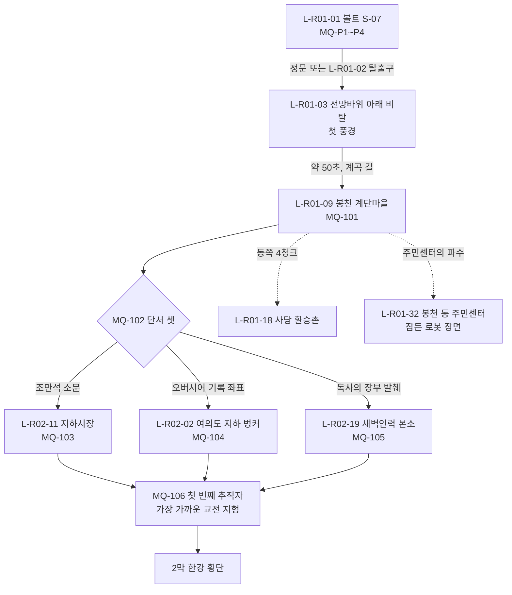

# SD-09a. 장소 카탈로그: R01 관악, R02 여의도·영등포

> **서울 폴아웃 상세 기획서 세트** | 문서 ID: SD-09a | 버전: v1.2 | 작성일: 2026-10-12
> **범위**: SD-08 §11.2(R01 관악 31곳)·§11.3(R02 여의도·영등포 27곳) 장소 시드 전부와 이 문서가 표 끝에 더한 3곳(R01 1, R02 2)의 장소 상세. 권역 개요 표, 장소별 2077→2277 상태·외부 배치·실내 구성·NPC·적·루팅·기록물·연계·판도 반응·환경 스토리텔링, 권역별 이름 있는 NPC 표(R01 70명, R02 55명), 사이드 퀘스트 훅(R01 16, R02 15), 랜덤 인카운터 지점·이동 경로 메모. 프롤로그·1막·4막 무대인 볼트 S-07, 봉천 계단마을, 사당 환승촌, 여의도 지하 벙커, 영등포 지하상가(지하시장), 새벽인력 본소를 S등급으로 가장 자세히 쓴다.
> **다루지 않음**: 사이드 퀘스트 본문(SD-04a), 세력 퀘스트 본문(SD-04d), 랜덤 인카운터 ID와 표(SD-05), 주요 인물 프로필(SD-07a), 지하철역 승강장층·하저 터널(SD-09f의 L-UG), 한강 다리·나루(SD-09f의 L-HR).
> **관련 문서**: [SC-00 컨셉](00_concept.md), [SD-02 세계관](02_world-and-lore.md), [SD-03a 메인 1부](03a_main-story-part1.md), [SD-03b 메인 2부](03b_main-story-part2.md), [SD-04a 남부 사이드](04a_side-quests-south.md), [SD-04d 세력 퀘스트](04d_faction-questlines.md), [SD-05 비표시·인카운터](05_misc-quests-encounters.md), [SD-06 세력](06_factions.md), [SD-07a 주요 인물](07a_characters-major.md), [SD-07b NPC 디렉터리](07b_npc-directory.md), [SD-08 월드·권역](08_world-regions.md), [SD-09f 지하·한강](09f_locations-underground-river.md), [SD-10 캐릭터](10_character-system.md), [SD-12 탐험·UI](12_exploration-ui.md), [SD-13 아이템](13_items.md), [SD-14 크리처·적](14_creatures-enemies.md), [SD-16 아트](16_art-direction.md), [SD-17 사운드](17_sound.md), [SD-18 명명](18_naming-terms.md)

---

## 목차
1. 개요
2. 권역 지도와 동선
3. R01 관악
   - 3.1 권역 개요 표 / 3.2 S등급 장소 / 3.3 A·B·C등급 장소 / 3.4 이름 있는 NPC / 3.5 사이드 퀘스트 훅 / 3.6 인카운터 지점·이동 경로
4. R02 여의도·영등포
   - 4.1 권역 개요 표 / 4.2 S등급 장소 / 4.3 A·B·C등급 장소 / 4.4 이름 있는 NPC / 4.5 사이드 퀘스트 훅 / 4.6 인카운터 지점·이동 경로
5. 두 권역 공통 데이터 (수집품·기록물·보스·판도 슬롯)
6. 원작 대응
7. 제작 메모 (엔진: 범용 2D)
8. 미결 사항
- 부록 A. 신규 고유명사 / 부록 B. 참고 문서 / 버전 이력

---

## 1. 개요

### 1.1 목적
- SD-08이 좌표·청크·위협도까지 정한 장소 시드를 **제작자가 바로 맵과 이벤트를 만들 수 있는 장소 명세**로 바꾼다.
- 두 권역은 주인공이 처음 걷는 땅이다. 프롤로그(볼트 S-07), 1막 전체(봉천 → 지하시장·여의도 벙커·새벽인력 본소 → 첫 추적자), 4막 귀향(MQ-401)이 여기서 일어난다. 그래서 '수도 황무지에서 사는 법'을 가르치는 장소, 세력 여섯(정착지 연합·비상정부·각성회·지하시장·새벽인력·약탈자)을 처음 만나는 장소, 관리자 코드가 처음 깜박이는 장소를 촘촘히 둔다.

### 1.2 요약
| 항목 | R01 관악 | R02 여의도·영등포 |
|---|---|---|
| 장소 수 | 32(시드 31 + 추가 1) | 29(시드 27 + 추가 2) |
| 등급 분포 | S 3 / A 6 / B 13 / C 10 | S 3 / A 4 / B 11 / C 11 |
| 이름 있는 NPC | N-ID 64명(N-R01-049 결번) + C-031 윤석진 행 1 + 주요 인물 등장 5명 = 70 | N-ID 51명 + 주요 인물 등장 4명 = 55 |
| 사이드 퀘스트 훅 | 16 | 15 |
| 실내 맵(추정) | 67장 | 61장 |
| 보스·유일 개체 | 외눈(CR-500), 깡철이(CR-512), 윤석진(CR-514), 개통파 우두머리 은솔(CR-523, N-R01-053 = C-053) | 배수구 어미(CR-501), 황두칠(CR-513), 구학수(CR-526) |
| 흔들인형 | CL-13 의학(S-07 진료소) | CL-04 카리스마(국회 귀빈 접견실), CL-08 물물교환(지하시장 관리사무소) |
| 스킬북 | 12권(`BK-<종>-R01-nn`) | 18권(`BK-<종>-R02-nn`) |
| 한유리 기록(MQ-304 후보) | LR-15(관악 레이더 중계소), LR-18(S-07 오버시어 금고), LR-19(관악 행정 연수원) | LR-17(여의도 지하 벙커), LR-21(지하시장 배전실) |

### 1.3 표기 규칙
- **장소 ID**: SD-08 §11 시드 순서 그대로 `L-R01-01`~. 이 문서가 더한 장소는 표 끝 번호(L-R01-32, L-R02-28·29)다. 시드 이름은 바꾸지 않았다. 지도 마커 통칭을 다르게 쓰자는 제안은 각 권역 개요 표 아래 '통칭 제안'에 적었다.
- **좌표**: `tx·ty`는 SD-08 §3.2 변환식 값이다. 청크 칸의 `:xx,yy`는 청크 안 타일 좌표다(SD-08 §3.5). 이 문서는 보정(E2)을 하지 않았다. 보정이 필요한 곳은 미결에 적었다.
- **유형(아이콘)**: SD-08 §11.1 유형 어휘 + SD-12 §5.4 지도 아이콘 번호(예: `정착지 #3`).
- **위협·레벨**: 장소 위협도(1~5)와 SD-08 §14.4 적 레벨 범위. 실내는 처음 들어간 순간 레벨을 고정한다.
- **마커**: `Y` 지도 마커(발견 XP 일반 10 / 주요 25, SD-10 §4.4. `Y 주요` = 주요 장소, `Y(발견 전 숨김)` = 소문으로 위치가 뜨지 않고 직접 발견해야 표시) / `N` 마커 없음(소문으로만). 세트 공통 표기(v1.1, 09c~f와 같음).
- **장소 등급**: SD-16 §6.6. S(앵커 6+·실내 3~10장) / A(앵커 3~5·실내 2~5장) / B(앵커 1~2·실내 1~3장) / C(앵커 1·실내 0~1장).
- **판도 단위**: SD-08 §15.2 판도 구역 `PD-Rxx-n`과 §15.3 거점 단위 `PD-Hnn`. SD-06 §5.9 판도 거점은 이름으로 적는다.
- **BGM/BGS**: SD-17 §3 ID. 정착지 반경 안에서는 정착지 곡(BGM-S)이 탐험 곡보다 우선한다.
- **NPC 외형 코드**: SD-16 §7.2 형식 `몸-피부-머리-머리색-몸통계열-낡음-팔레트-머리장비-눈장비-소품`. v1.1부터 **SD-07b §3 외형 코드 통일안** 값을 쓴다(RECON_SPEC X-141·N-84). 번호 뜻은 SD-07b §3.2(몸 M1·M2·F1·F2·E1·E2·K1, 특수 몸 RB·AN·BY), §3.3(낡음 0 깨끗 / 1 보통 / 2 넝마), §3.4(머리 HR00~HR11), §3.5(머리 장비 HD00~HD18), §3.6(눈 장비 EY00~EY08), §3.10(소품 PR001~PR200. PR001~050은 이 문서 v1.0의 번호 그대로)이 정본이다. 원래 값은 SD-07b §4 표가 보존한다.
- **주요 인물 C-ID**: 이름 있는 NPC 표의 이름 옆 괄호에 SD-07a C-ID를 병기한다(SD-07b §6.4 대응, X-026). 같은 인물이 다른 장소 문서에 주 N-ID를 둔 경우 이 문서의 N-ID는 결번으로 적는다(예: C-031 윤석진).
- **수집품 ID**: 흔들인형 `CL-nn`(SD-10 §7.1), 스킬북 배치 `BK-<종 2자리>-<권역>-<순번 2자리>`(예: BK-07-R01-01, RECON_SPEC §3.7). 종 번호는 SD-10 §7.2.
- **이름 교체 반영**: SD-02·SD-03a 본문의 강태오 → **육지환**, 천웨이 → **멍쉐밍**, 국민방송 → **공보방송**, 원작 용어 '불구' → **부위 손상**. 한결건설 마스코트와 흔들인형 이름은 **든든이**다(흔들인형 정식명 '든든이 입주 기념 흔들인형', 옛 표기 '한결이' → '든든이' 교체. RECON_SPEC §3.7·N-29).

### 1.4 S등급 지정
| 장소 | 등급 근거 |
|---|---|
| L-R01-01 볼트 S-07 | 프롤로그 4장 전부, 4막 MQ-401, 에필로그 볼트 상태 4종. 실내 14장 |
| L-R01-09 봉천 계단마을 | 첫 정착지(MQ-101·102), 1막 숙소, 4막 이주민 수용, 5막 MQ-507 방어 후보. 거점 PD-H01 |
| L-R01-18 사당 환승촌 | 첫 지하철 경험(U01), 캐러밴 정류장, 판도 경합 거점 PD-H18 |
| L-R02-02 여의도 지하 벙커 | MQ-104. 1막 주제를 가장 분명히 말하는 장소, 한유리 기록 LR-17 |
| L-R02-11 지하시장 | MQ-103, 지하시장 세력 본거지 PD-H12, MQ-506 |
| L-R02-19 새벽인력 본소 | MQ-105, 생포 이벤트 도착지, MQ-504. 거점 PD-H15 |

---

## 2. 권역 지도와 동선

### 2.1 R01·R02 청크 격자 (SD-08 §4.2 발췌 + 장소 표시)
- 칸 하나가 청크 하나(40×40타일, 740m 사방)다. 가로가 청크 X(6~28), 세로가 청크 Y(25~40)다.
- `Ann` = L-R01-nn, `Bnn` = L-R02-nn. `+`는 그 청크에 장소가 더 있다는 뜻이다(아래 목록). 숫자는 권역(1 = R01, 2 = R02, 4 = R04, 6 = R06, 7 = R07, A = R10, B = R11), `~`는 한강(HR), `.`는 플레이 영역 밖이다.

```
      6   7   8   9   10  11  12  13  14  15  16  17  18  19  20  21  22  23  24  25  26  27  28
25     A   A   A   A   A   A   A   A   A   4   4   4   4   ~   4   4   6   6   6   6   6   6   6
26     A   A   A   A   A   A   A   A   A   2   2   2  B01  2   2   ~   ~   6   6   6   6   6   6
27     A   A   A   A   A   A   A   A   A   2  B15 B29  2  B03+B02+ 2   ~   ~   6   6   6   6   6
28     A   A   A   A   A   A   A   A   A   2  B14 B12 B11+ 2  B10 B09 B05  ~   ~   6   6   6   6
29     A   A   A   A   A   A   A   A   A   2  B24  2   2  B16 B17 A24 A23+A20  1   ~   ~   ~   7
30     2   2   2   2   2   2   2   2   2   2   2   2   2   2   1   1   1   1  A26  1   1  A21  7
31     2   2   2   2   2  B26  2  B23  2   2   2   2   2   2   1   1   1  A27  1   1  A22  1   7
32     .   2  B27  2   2   2   2   2  B25  2  B18  1   2  A17  1   1   1   1   1   1   1   1   7
33     .   .   2   2   2   2   2   2   2  B19+ 1  B21 A16  1  A15 A11 A32 A13  1   1   1   1   7
34     .   .   .   .   2   2   2   2   2  A28 B22  1   1   1   1   1  A09+ 1   1   1   1  A18  7
35     .   .   .   .   .   .   2   2   1   1   1   1   1   1   1  A14  1   1  A12  1   1   1   B
36     .   .   .   .   .   .   .   1   1   1   1  A29  1   1   1   1   1  A07  1   1   1  A19  B
37     .   .   .   .   .   .   .   .   .   1   1   1   1   1   1   1  A08 A01+A03  1   1   1   .
38     .   .   .   .   .   .   .   .   .   .   1  A30  1   1   1   1  A05 A02  1   1   1   .   .
39     .   .   .   .   .   .   .   .   .   .   1   1   1   1   1  A31  1   1  A04  .   .   .   .
40     .   .   .   .   .   .   .   .   .   .   .   1   1   1   .   .   .   .   .   .   .   .   .
```
- 한 청크에 둘 이상: C-19-27 = B03·B04·B06 / C-20-27 = B02·B07·B08·B28 / C-18-28 = B11·B13 / C-22-29 = A23·A25 / C-15-33 = B19·B20 / C-22-34 = A09·A10 / C-23-37 = A01·A06. 같은 청크 4곳(C-20-27)은 장소 중심끼리 8타일 이상 떨어져 있다(SD-08 §3.2 E3 확인).
- 지하 장소(SD-09f 소관)와의 접점: 사당역 승강장 L-UG-01(A18 아래), 서울대입구역 L-UG-02(A13), 신림역 L-UG-03(A15), 동작역 L-UG-04(A21 옆), 남태령역 L-UG-05(A19 아래), 영등포시장역 L-UG-06(B12 아래, 지하시장 뒷문), 여의도역 L-UG-07(B07 아래), 여의나루역 L-UG-08(하저 터널 남쪽 입구), 구로디지털단지역 L-UG-12(B21), 영등포구청역 L-UG-13(B15 아래).

### 2.2 1막 동선

- 봉천에서 세 경로 장소까지 기본 이동 1분 30초~2분이다(SD-08 §14.2). 길잡이는 북서쪽의 여의도 금탑(A등급 랜드마크)이고, 남부순환로 → 도림천 마른 수로 → 신길로 내려가는 길이 기본 동선이다(SD-08 §12.5).
- MQ-106 교전 지형 4종(SD-03a §8.6) 가운데 셋이 이 문서 범위다: **관악**(L-R01-12 낙성대 고개 캠프 북쪽 공터), **여의도**(L-R02-03 여의도 광장 착륙장), **영등포**(L-R02-12 영등포 역전 시장 앞 로터리). 강북 도로는 SD-09c.

---

## 3. R01 관악

- **권역 성격**(SD-08 §7.1): 시작 권역. 남쪽 관악산·삼성산 화강암 능선이 맵 테두리이고, 북쪽으로 계단 골목 언덕(봉천·상도)이 한강 남안 노량진·흑석까지 내려간다. 위협도 1(볼트 주변·봉천) / 2(신림·노량진) / 3(금천 서쪽·삼성산·사당 고개). 루팅 등급 T1~T2(SD-13 §9.2).
- **판도 시작값**(SD-02 §9.3, SD-06 §5.9): 권역 경합. 판도 거점 7곳 = 볼트 S-07(S7, 3), 봉천 계단마을(BC, 2), 노량진 관제 중계소(GS, 2), 남부순환로 관악 검문소(BJ, 1, = L-R01-19 사당 고개 검문소), 사당 환승촌(SA, 1), 남부순환 패거리 은신처(YT, 1, = L-R01-14 신림 고시촌), 관악산 송신소(공백, 1, = L-R01-04 관악 레이더 중계소).

### 3.1 R01 권역 개요 표
| ID | 이름 | 유형(아이콘) | tx·ty | 청크:로컬 | 위협(Lv) | 마커 | 등급 | 판도 단위 | BGM / BGS |
|---|---|---|---|---|---|---|---|---|---|
| L-R01-01 | 볼트 S-07 | 볼트 #1 | 959·1503 | C-23-37:39,23 | 1(1~4) / 4막 점령 3(6~14) | Y(통계 제외) | S | PD-R01-1, 거점 PD-H07 | BGM-V01~V05, ST-11 / BGS-V01·I01 |
| L-R01-02 | S-07 비상 탈출구 | 던전 #18 | 932·1533 | C-23-38:12,13 | 2(3~8) | Y(발견 전 숨김) | A | PD-R01-1 | BGM-D08 / BGS-R06·W05 |
| L-R01-03 | 관악산 전망바위 | 전망 지점 #16 | 980·1515 | C-24-37:20,35 | 1(1~4) | Y | B | PD-R01-1 | ME-11 → BGM-X01A / BGS-W01 |
| L-R01-04 | 관악 레이더 중계소 | 관제망 시설 #14 | 990·1561 | C-24-39:30,01 | 3(6~14) | Y | A | PD-R01-1(판도 거점 '관악산 송신소') | BGM-D03 / BGS-W01·I10 |
| L-R01-05 | 관악산 들개 바위굴 | 크리처 둥지 #18 | 901·1539 | C-22-38:21,19 | 2(3~8) | Y | B | PD-R01-1 | BGM-D08 / BGS-I06 |
| L-R01-06 | 관악 행정 연수원 | 던전 #10 | 940·1488 | C-23-37:20,08 | 2(3~8) | Y | A | PD-R01-1 | BGM-D12 / BGS-I07 |
| L-R01-07 | 연수원 중앙 서고 | 던전 #10 | 930·1473 | C-23-36:10,33 | 2(3~8) | Y | B | PD-R01-1 | BGM-D09 / BGS-I07 |
| L-R01-08 | 관악 계곡 배수로 | 던전 #18 | 887·1494 | C-22-37:07,14 | 2(3~8) | Y | C | PD-R01-1 | BGM-D06 / BGS-R06 |
| L-R01-09 | 봉천 계단마을 | 정착지 #3 | 892·1362 | C-22-34:12,02 | 1(1~4) | Y 주요 | S | PD-R01-2, 거점 PD-H01 | BGM-S01 / BGS-S01 |
| L-R01-10 | 봉천 배수지 | 기반 시설 #12 | 918·1379 | C-22-34:38,19 | 1(1~4) | Y | B | PD-R01-2 | BGM-S01 / BGS-R07 |
| L-R01-11 | 봉천 번개24 | 교역소 #9 | 866·1342 | C-21-33:26,22 | 1(1~4) | Y | C | PD-R01-3 | BGM-X01B / BGS-U01 |
| L-R01-12 | 낙성대 고개 캠프 | 야영지 #22 | 971·1421 | C-24-35:11,21 | 2(3~8) | Y | C | PD-R01-2 | BGM-X01C / BGS-W02 |
| L-R01-13 | 서울대입구 상가 거리 | 폐허 #9 | 947·1359 | C-23-33:27,39 | 2(3~8) | Y | C | PD-R01-2 | BGM-X01B / BGS-U01 |
| L-R01-14 | 신림 고시촌 | 세력 거점 #4 | 849·1428 | C-21-35:09,28 | 2(3~8) | Y | A | PD-R01-3(판도 거점 '남부순환 패거리 은신처') | BGM-D09 / BGS-S07 |
| L-R01-15 | 신림 사거리 고가 | 랜드마크 #15 | 833·1343 | C-20-33:33,23 | 2(3~8) | Y | B | PD-R01-3 | BGM-X01C / BGS-U01 |
| L-R01-16 | 도림천 고가 수로 | 자연 #17 | 758·1323 | C-18-33:38,03 | 2(3~8) | Y | C | PD-R01-3 | BGM-X01C / BGS-R05 |
| L-R01-17 | 보라매 활주로 공원 | 랜드마크 #20 | 785·1290 | C-19-32:25,10 | 2(3~8) | Y | B | PD-R01-3 | BGM-X01A / BGS-W02 |
| L-R01-18 | 사당 환승촌 | 정착지 #3·#6 | 1081·1389 | C-27-34:01,29 | 1(1~4) / 주변 터널 2 | Y 주요 | S | PD-R01-4, 거점 PD-H18 | BGM-S12 / BGS-M03 |
| L-R01-19 | 사당 고개 검문소 | 세력 거점 #13 | 1111·1464 | C-27-36:31,24 | 3(6~14) | Y | A | PD-R01-4(판도 거점 '관악 검문소') | BGM-D03 / BGS-I10 |
| L-R01-20 | 노량진 다리목 검문소 | 검문소 #13 | 952·1179 | C-23-29:32,19 | 3(6~14) | Y | B | PD-R01-5 | BGM-X01A / BGS-R01 |
| L-R01-21 | 동작대교 남단 검문소 | 검문소 #13 | 1085·1227 | C-27-30:05,27 | 3(6~14) | Y | B | PD-R01-5(판도 거점 HR '동작대교 남단') | BGM-X01A / BGS-R01 |
| L-R01-22 | 동작 국립묘지 | 랜드마크 #20 | 1040·1242 | C-26-31:00,02 | 2(3~8) | Y | B | PD-R01-5 | BGM-X01C / BGS-U06 |
| L-R01-23 | 노량진 관제 중계소 | 세력 거점 #12 | 882·1182 | C-22-29:02,22 | 1(1~4) / 하층 3 | Y 주요 | A | PD-R01-5, 거점 PD-H14 | BGM-S10 / BGS-F03 |
| L-R01-24 | 노량진 학원가 | 던전 #9 | 870·1171 | C-21-29:30,11 | 2(3~8) | Y | B | PD-R01-5 | BGM-D12 / BGS-I08 |
| L-R01-25 | 노량진 수산시장 | 교역소 #9 | 892·1161 | C-22-29:12,01 | 2(3~8) | Y | B | PD-R01-5 | BGM-S14 / BGS-R01 |
| L-R01-26 | 흑석 대학병원 | 던전 #9 | 980·1207 | C-24-30:20,07 | 2(3~8) | Y | B | PD-R01-5 | BGM-D13 / BGS-I09 |
| L-R01-27 | 상도 언덕 빌라촌 | 폐허 #19 | 930·1257 | C-23-31:10,17 | 2(3~8) | Y | C | PD-R01-5 | BGM-D09 / BGS-U01 |
| L-R01-28 | 가산 아울렛 거리 | 던전 #9 | 630·1380 | C-15-34:30,20 | 3(6~14) | Y | B | PD-R01-6 | BGM-D09 / BGS-I07 |
| L-R01-29 | 독산 육가공 단지 | 던전 #11 | 680·1443 | C-17-36:00,03 | 3(6~14) | Y | C | PD-R01-6 | BGM-D09 / BGS-I07 |
| L-R01-30 | 시흥 고개 초소 | 야영지 #13 | 715·1545 | C-17-38:35,25 | 3(6~14) | Y | C | PD-R01-6 | BGM-X01C / BGS-W05 |
| L-R01-31 | 삼성산 능선 캠프 | 야영지 #16 | 868·1581 | C-21-39:28,21 | 3(6~14) | Y | C | PD-R01-1 | BGM-X01C / BGS-W05 |
| L-R01-32 | 봉천 동 주민센터 (추가) | 폐허 #10 | 906·1349 | C-22-33:26,29 | 1(1~4) | Y | C | PD-R01-2 | BGM-X01B / BGS-U01 |
| L-R01-33 | 노량진 번개24 (추가) | 교역소 #9 | 905·1169 | C-22-29:25,09 | 1(1~4) | Y | C | PD-R01-5 | BGM-X01A / BGS-U01 |

- **통칭 제안**(SD-18 §4.2): L-R01-06 지도 마커 '대학터'(진입 부제 '관악 행정 연수원'), L-R01-22 '비석밭'(부제 '국립서울현충원'), L-R01-25 '노량진 어시장'. 시드 이름은 데이터 이름으로 유지한다.
- **추가 장소 사유**: L-R01-32는 SD-03a §8.2 MQ-102의 '봉천 동 주민센터 앞 넘어진 파수 로봇' 장면과 LR-03(행안부 공고)의 배치처가 필요해서 더했다. 계단마을 아랫문에서 남동쪽 18타일이다.

### 3.2 R01 S등급 장소

#### L-R01-01 볼트 S-07 (S등급)

**① 실제 근거와 2077 → 2277**
| 시점 | 상태 |
|---|---|
| 실제 근거 | 관악산 북서 사면, 옛 국립대 관악 캠퍼스 남쪽 끝(해발 약 200m). 화강암 암반 |
| 2066~2073 | 한결건설이 볼트-텍 면허와 한미 대피 협정으로 시공. 표면 명분 '재건 행정 요원 양성 볼트'. 관악 행정 연수원 부지 지하에 판다. 관악 레이더 중계소(L-R01-04)와 전용 회선(2076, 영신통신 마영식 시공) |
| 2077-10-23 | 23:23 개방 지령 → 연수원 기숙사에 상주하던 연수생·가족·교관이 4분 안에 입주. 23:52 초대 오버시어 장문석이 문을 닫는다. 596명(SD-02 §7.4.1. SD-03a §7의 '524명'은 SD-02 값으로 고친다, 미결 U-09a-01) |
| 2078~2276 | 시험 성적이 거주·배급·결혼·출생을 정하는 적성 평가 사회. 2131 공기 정화기 사고, 2160 개방파 사건, 2196 회색 열병, 2276 수경 농장 곰팡이병(SD-02 §7.4.3) |
| 2277 (게임 시작) | 인구 192. 윤정인 오버시어가 200년 만에 문을 연다(MQ-P4). 계엄군이 '관리자 인도'를 요구 |
| 1막~3막 | 계엄군 분대는 하도윤을 데리고 철수한다. 정문은 다시 닫히고 오버시어가 출입을 막는다. 주인공은 정문 검역실(전실)까지만 들어갈 수 있다(M-076 볼트 S-07 출입 패스는 외부 문만 연다). 인터컴으로 방금례·도경철과 대화 가능 |
| 4막 | 계엄군 점령(MQ-401). 정부 직할 제1 등록 구역. 정문 안쪽에 폭약 |
| 4막 뒤 | V_VAULT 값에 따라 넷: 2 자치(문 닫힘, 인터컴 + 전실 상인) / 3 직할(계엄군 검문소 상주, 주민 등록증 검사) / 4 붕괴(정문 폭파, 아트리움·거주동 일부 매몰, 주민 약 130) / 5 개방 공동체(문 열림, 주민 절반이 봉천·노들섬으로 이주, 볼트 안 상점 개방) |

**② 외부 배치**
- 볼트 정문은 연수원 본관(L-R01-06) 남쪽 뒤편 비탈의 콘크리트 옹벽 안에 있다. 옹벽 위에 '서울 볼트 S-07 관악 / 한결건설 시공' 동판(앵커 1). 정문 앞은 6×4타일 콘크리트 데크와 계단 12단, 바깥 계단 위에 **출구 점검표 단말**(SD-03a §7.4 S6).
- 정문에서 북쪽 20타일에 연수원 기숙사 폐허, 동쪽 21타일 위쪽에 전망바위(L-R01-03), 남서 30타일 아래 계곡에 비상 탈출구(L-R01-02). 북쪽으로 내려가는 계곡 길이 봉천 계단마을(L-R01-09)로 이어진다(약 156타일, 40초).
- 4막 점령판 외부: 데크에 계엄군 천막 2, 모래주머니 진지, 비상정부 휘장 깃발, 경계 분대 4. 정문 옆에 버티버드 착륙 표지(L-R01-03 쪽 평탄지).

**③ 실내 구성 (실내 맵 14장, 국소 축척, 깊이 z-4)**
| 맵 | 이름 | 크기(타일) | 구역·방 | 문 전환 |
|---|---|---|---|---|
| V-00 | 정문 구역 | 40×30 | 톱니 방폭문(192×192 오브젝트), 정문 제어실(레버), 검역실(전실), 출입 대장 책상, 오버시어 비상문(소형 기밀문) | 외부 데크 ↔ V-00 / V-00 ↔ V-01 |
| V-01 | 아트리움 | 60×44 | 3층 높이 중앙 광장, **성적 순위 게시판**(앵커 2: 200년 치 이름이 덧붙은 게시판), 구내방송실(ST-11), 공동 식당(돌잔치·주민 회의), 배급소(배급과 창구, 지우 장면) | V-00, V-02, V-03, V-04, V-06 |
| V-02 | 관리동(A 행정동 상층) | 50×40 | 행정실(등록 창구·방금례 책상), **오버시어실**(결재 책상·단말·금고), 평가 위원회 회의실, 관리동 화장실(천장 환기 덕트 진입구), **오버시어 전용 비상 계단** | V-01, V-05(등록 단말실), 덕트 → V-11, 비상 계단 → V-00 비상문 |
| V-03 | 교무 구역 | 56×40 | 연수생 교실 3(10~13세 / 14~16세 / 17~18세), **적성 평가 교실**(진공관 판독 카드 책상 24, 멈추지 않은 벽시계), 평가관실(차명수 책상·등사기), 복도 사물함 구역, 학교 도서실, 체육관·체육 창고(W-102 '9회말') | V-01, V-07(판정실 계단) |
| V-04 | 거주동 | 64×48 | A 행정동(2인실 24, 주인공 가족 방 A-07), B 기술동(4인실 20), C 생산동(4인실 30), D 정비동(6인실 16). 빈방 절반 이상, 2196년 회색 열병 격리 표지가 붙은 폐쇄 복도 1 | V-01, V-09(D동 → 배관 계단) |
| V-05 | 등록 단말실 | 24×18 | 출생 등록 단말기(진공관 랙 2×3), 계보 대장 테이프 보관함(오버시어 열쇠), 서명대. 문 위에 '제15조 — 훼손 시 D등급 영구 고정' 동판 | V-02 |
| V-06 | 수경 농장 | 60×40 | 1·2·3동 재배 선반(쌀·콩·버섯·상추), 양액 탱크, 농장 배수로(은신 경로), 2동·3동 곰팡이병 구역(검은 반점 타일, 2277년) | V-01, 배수로 → V-11 |
| V-07 | 지하 판정실 | 30×24 | 세진 **적성 판정기**(진공관 판독 카드 투입구, 출력 프린터), 평가 기록 보관장. 판정기 옆 '관리 후보 순위 출력 — 수정 금지' 봉인 스티커 | V-03 |
| V-08 | 의무과 | 40×30 | 의무실(분만대, MQ-P1 S1), 진료소(**CL-13 흔들인형 '의학'**), 약품 창고, 격리실(2196 회색 열병 기록 단말), 냉동 안치실 | V-01 |
| V-09 | 보안과 | 44×32 | 보안부 사무실(도경철), 무기고(자물쇠 25 / 도경철 열쇠), 사격장(표적 10 + 은신 표적 2), 구금실 2칸 | V-01, V-04 |
| V-10 | 설비 구역 | 56×44 | **원자로실**(볼트-텍 면허 표준 소형 원자로 1기, 2261년 원자로실 사고 추모 명판 = 주인공 아버지), 공기 정화기실(2131 사고 추모 벽), 정수실, 예비 축전지실 | V-04, V-11 |
| V-11 | 하층 배관·덕트망 | 70×30 | 배관실(MQ-P2 변이 바퀴 6), 환기 덕트(은신 동선 3패턴), 농장 배수로 합류부, **비상 배수 갱도 철문** | V-02(덕트), V-06(배수로), V-10, 갱도 → L-R01-02 |
| V-12 | 추모 납골 벽 | 20×16 | 200년 사망자 이름 벽(계승명 관습: 같은 이름이 세대마다 반복), 2160 개방파 41명 칸은 비어 있고 번호만 | V-04 |
| V-13 | 정문 제어실 상층(4막 전용 연출) | 24×16 | 폭약 기폭 장치(MQ-401), 정문 레버 2단 | V-00 |

- **볼트 직제**(SD-18 §3.3): 연수생(10~18세) → 주무관 → 사무관 → 서기관 → 부이사관 → 오버시어. 부서 6과: 행정과(행정실·등록), 배급과(배급소·식당·수경 농장), 교무과(교실·평가), 보안과(통칭 '보안부'), 설비과(원자로·공기·물·배관), 의무과. SD-03a의 '보안부장 도경철'은 보안과장의 통칭이다.
- **2277년 인구 구성(192명)**: 0~9세 14 / 10~18세 연수생 22 / 19~44세 88 / 45~64세 48 / 65세 이상 20. 평가 등급 A 28 / B 52 / C 70 / D 42. 거주동 정원 600에 192명이 살아 방의 3분의 2가 비어 있다. 빈방은 '비어 있는 방 = 출생 허가가 나지 않은 아이들'이라는 블랙 유머로 쓴다(빈방 문패에 '출생 허가 대기 2251-04' 같은 쪽지).

**④ 프롤로그 시점별 상태**
| 퀘스트 | 연도 | 쓰는 맵 | 바뀌는 것 |
|---|---|---|---|
| MQ-P1 | 2258·2259 | V-08 → V-01 | 아트리움에 돌잔치 식탁. 주민 NPC 6명 대화(조사 튜토리얼) |
| MQ-P2 | 2268 | V-03, V-01, V-09, V-11 | 첫 배정 통지서(M-201), 사격장, 배관실 바퀴 |
| MQ-P3 | 2274 | V-03, V-07(컷), V-02(컷) | 복도 사물함 소동, 적성 평가 10문항, 오버시어 단말의 '해제(승계)' 컷 |
| MQ-P4 | 2277 | 전 맵 | 수경 농장 2·3동 곰팡이, 배급 반감 게시, 개방식, 탈출 4경로 |
| MQ-401 | 4막 | 점령판 | 계엄군 깃발, 분류반 책상(V-01 식당), 정문 폭약, 주민 식당 집결 |

**⑤ 거주·등장 NPC**: 윤정인(C, SD-07a), 하도윤(C, SD-07a), N-R01-001~024(§3.4). 4막: 윤석진 대위(C-031, 주 N-ID N-R11-022), 계엄군 20(인도 분대 2 포함), 파워 아머 2.

**⑥ 적·크리처**
| 시점 | 적 | 레벨 |
|---|---|---|
| MQ-P2 | 큰바퀴 CR-002 ×6(배관실) | 1 |
| MQ-P4 전투 경로 | S-07 보안요원 ×4(SD-14에서 ID 부여, 기절 판정 가능), 보병 계엄병 CR-401 ×4, 인도 분대원 CR-402 ×2, 기갑 계엄병 CR-405 ×1(체력 표시 없음, 지나치면 된다) | 1~3 |
| 4막 MQ-401 | 보병 계엄병 CR-401 ×12, 인도 분대원 CR-402 ×4, 분대장 CR-403 ×2, 분류관 CR-408 ×2(비전투), 기갑 계엄병 CR-405 ×2, 윤석진 CR-514 | 10~16 |
| 4막 뒤(붕괴판) | 잔바퀴 떼 CR-001, 시궁쥐 CR-095(매몰 구역) | 위협 2 |

**⑦ 루팅·수집품·기록물**
- 루팅 T1(볼트 장비). 주목: A-001 볼트 S-07 점프슈트(MQ-P2 지급), A-002 작업복(설비 구역), A-004 경비 아머·A-060 경비 헬멧(보안과, MQ-P4), W-065 BB총(사격장), W-002 10mm 권총(보안과 무기고 '보안부 권총'), **W-112 오버시어의 10mm 권총**(오버시어실 금고, MQ-P4 은신 경로 또는 MQ-403), **W-102 9회말**(체육 창고, 하도윤 경로 보상 또는 MQ-401), M-201~M-205(프롤로그 퀘스트 아이템), M-076 출입 패스.
- **흔들인형 CL-13 '의학'**: V-08 진료소 약장 위. 회수 가능 시점은 MQ-P3~P4와 4막 방문뿐이다(SD-10 §7.1 ¹).
- **스킬북**: BK-07-R01-01 『주간 만화 쇠파이프 반장』(학교 도서실, MQ-P2 생일에 하도윤이 준다. 놓치면 4막), BK-06-R01-01 『응급 구조사 2급 문제집』(의무과 약품 창고).
- **기록물**: LR-18 S-07 계보 설계 메모(오버시어 금고, 계보 대장 사본에 끼워짐, MQ-P4 S5 또는 MQ-401), LR-24 오버시어 인수인계 문서(오버시어 단말), LR-25 장문석 오버시어 일지(정문 제어실 홀로테이프), LR-26 개방파 사건 기록(보안과 단말), LR-27 수경 농장 곰팡이병 보고(수경 농장 단말).
- **터미널 요지**: 오버시어 단말(인구 조사 2277: 192명, 출생 허가 연도별 표, '관리 후보 1순위 — 처우 반영 금지'), 격리실 단말(2196 회색 열병 사망자 79명 명단과 '격리 해제 — 2197-03'), 등록 단말(출생 기록 검산합 표시줄: 사슬 길이 '41,207건, 단절 0'), 평가관실 단말(10번 문항 원본에 붙은 메모 '변경 금지 — 설계실 지시 2076').

**⑧ 연계**
- 메인: MQ-P1~P4 전부, MQ-104 단서(K_RALLY, 오버시어 단말), MQ-401 귀향, MQ-403 어머니(V_MOTHER 2·5·6에서 윤정인이 돌아오는 곳), MQ-702 콘솔 회상(10번 문항).
- 세력 퀘스트: FQ 없음(볼트 S-07은 호감도 대상이 아니다, SD-06 §10.13). 13.1 연계 후보 「생활기록부 열람」(SD-04a에서 ID 부여).
- 사이드 훅: 「곰팡이의 근원」(H-R01-02), 「연수원의 졸업장」(H-R01-05), 「개방파의 손녀」(H-R01-16).

**⑨ 판도 반응**: S-07은 거점 PD-H07(S7, 가중치 3)이다. 4막 시작 때 BJ로 넘어간다(SD-06 §5.5). 해방(V_VAULT 2·5) → 정문 위에 볼트 청·황 띠 깃발과 '자치' 손글씨 현수막. 직할(3) → 정문 앞 검문 슬롯이 BJ 차단봉·분류반으로 상설화되고 확성기 슬롯 1이 켜진다(PD-R01-1의 BJ 영향력 +). 개방 공동체(5) → 데크에 봉천 행상 천막, 거점은 공백으로 빠지고 PD-R01-1에 정착지 연합 순찰이 생긴다.

**⑩ 환경 스토리텔링**
1. 성적 순위 게시판: 맨 아래 칸이 2077년이고 위로 갈수록 최근이다. 2160년 줄의 이름 41개에 검은 테이프가 붙어 있다(개방파). 2274년 칸에 주인공 이름과 '관리동 배정'.
2. 수경 농장 3동 선반 끝에 '출생 허가 축하' 꽃 대신 곰팡이가 핀 콩 화분과 쪽지 "올해는 허가 3명. 다들 축하해".
3. 정문 제어실 레버 손잡이에 200년 동안 아무도 지우지 않은 장문석의 손자국 모양 녹(조사 시 LR-25 재생).

#### L-R01-02 S-07 비상 탈출구 (A등급, S-07 부속)
- **근거·상태**: 관악산 서쪽 계곡으로 이어지는 옛 배수 갱도의 출구(SD-03a '비상 배수 갱도'). 2077년 볼트 하층 침수 대비용. 2214년 정비공 1명이 이 갱도에서 실종됐다(미스터리 M7, SD-02).
- **배치**: 계곡 바위 사이 녹슨 원형 철문(외부에서는 바위로 위장). 철문 앞에 2077년 표지 '한결건설 S-07 배수 출구 — 외부 개방 금지'. 출구에서 계곡을 따라 북서쪽 아래로 관악 계곡 배수로(L-R01-08)와 물길이 이어진다.
- **실내(2장)**: E-01 갱도 본선(80×12, 볼트 쪽 철문 ~ 중간 수문 ~ 출구 철문, 수위 발목 높이), E-02 측실(정비 사다리와 2214년 실종자의 마지막 흔적: 공구 벨트와 쪽지 "물에 냄새가 난다. 위로 올라가 보고 오겠다").
- **연계**: MQ-P4 하도윤 경로(④)·은신 경로(②)의 출구. **MQ-401 잠입 경로**(역방향). V_ESCAPE = 4였다면 하도윤이 갱도 벽에 남긴 분필 화살표가 보인다. 갱도 출구에 출구 점검표 단말(제2). 「곰팡이의 근원」 훅의 단서 지점.
- **적**: 시궁쥐 CR-095 ×3, 잔바퀴 떼 CR-001(1막 이후 리스폰). 4막: 계엄군 매복 2(잠입 경로 감시, 은신 판정).
- **판도·환경**: 4막에 봉천 자경대가 갱도 출구를 지킨다(정착지 연합 동원 시, SD-03b). 갱도 중간 수문 위에 S-07 아이들이 200년 동안 몰래 새긴 '나가면 뭐 할래' 낙서 기둥.
- **구현 정합(단계 1-11d SQ-S03, 기록 `game/STAGE_1.md` 1-11d · SD-04a §4.3 정합)**: 고정 지침 '볼트 출구는 정문 방폭문 하나'에 맞춰 갱도는 **볼트 쪽 용접 창살(2215년)에서 끝난다** — 물만 지나고 사람은 못 지난다. E-01 한 장(40×10, `maps/r01/E-01.map`): 바깥 원형 철문(늘 반쯤 열림, 월드 (932,1533) 문 `vault_drain_out` · 표지 '한결건설 S-07 배수 출구') → 출구 물길(조사 지점 ③) → 측실 벽감(E-02를 합침 — 공구 벨트 · 쪽지 E-01-BELT) → 중간 수문(`sluice_gate`, [수리 25]/[힘 6]로 닫음) → 용접 창살(`w_weld_grate`). '나가면 뭐 할래' 낙서는 수문이 아니라 **창살 안쪽 기둥**(볼트 아이들이 안에서 새긴 것, 창살 너머로 읽는다 — 아이들이 바깥 수문에 닿을 수 없으므로). 적: 시궁쥐 ×3 + 큰바퀴 CR-002 ×2(CR-001 자료 없음 — 대체), 첫 방문 한 번. 하도윤 분필 화살표 · 출구 점검표 단말 · MQ-401 역방향 · 4막 매복 · 자경대는 탈출 갈래 통합(0-9)과 4막 단계 몫.

#### L-R01-09 봉천 계단마을 (S등급)

**① 실제 근거와 2077 → 2277**
| 시점 | 상태 |
|---|---|
| 실제 근거 | 봉천동 언덕. 계단과 좁은 골목이 많은 노후 저층 주거지(빌라·다세대). 남쪽으로 남부순환로, 북쪽 능선 너머 상도동 |
| 2077 | 4~5층 빌라와 다세대가 계단 골목으로 이어진 서민 주거지. 옥상마다 원자력 온수기 돔과 물탱크. 동 주민센터 지정 대피소는 빌라 지하주차장이었다(LR-47 계열 쪽지) |
| 2078~2190 | 빌라 지하에 숨었던 사람들 대부분이 첫 겨울에 죽는다. 관악산 약수와 배수지 물을 찾는 떠돌이들이 드나든다 |
| 2190년대 | 봉천 계단마을 형성(SD-02 §9.1). 계단 골목의 아래 입구 두 곳을 고철 장벽으로 막고, 옥상끼리 판자 다리로 이었다. 창립 가문 조·오·남(SD-18 §3.12.2) |
| 2277 | 인구 약 140. 자치 조직 '반상회', 이장 조만석. 옥탑 감시조 12, 진돗개 백구. 경제: 계단 텃밭, 빗물, 관악산 사냥. 비상정부 '등록' 압력 중간(사당 고개 검문소가 가깝다) |

**② 외부 배치 (청크 C-22-34 북부 + C-22-33 남부, 약 60×46타일)**
- 마을은 남쪽 아래(남부순환로 쪽)에서 북쪽 능선으로 오르는 계단 골목 3줄로 되어 있다. 아랫문(남, 고철 장벽 정문, 검문 슬롯)과 윗문(북, 봉천 고개 쪽 쪽문)이 있다. 계단은 아랫문에서 이장실까지 **312단**(W-101 이장님의 엽총 개머리판 각인과 같은 수).
- 높낮이: 층 타일 3단(SD-16 §6.5 봉천 계단마을 규칙). 1단 아래 마당(고물상·대장간·게시판), 2단 중간 골목(약국·학교·주민 집), 3단 꼭대기(옥탑 이장실·망루·물탱크).
- 계단참 4곳(MQ-101 방어 거점): 계단참① 아랫문 안쪽, ② 약국 앞, ③ 학교 앞, ④ 이장실 아래.
- **옥상길**: 빌라 옥상 6채를 판자 다리로 잇는 은신 동선. 마을 서쪽 끝 하수구 맨홀로 빠진다(MQ-101 '옥상길 유인').
- 앵커 6: 망루(옥탑 위 감시탑, 철제 사다리), 312계단 손잡이 표지, 마을 물탱크(빌라 옥상 6개 탱크를 관으로 이음), 반상회 게시판(수배 쪽지·소식), 고철 장벽 아랫문(분양 현수막을 덧댄 철판), 개집과 '백구 밥 당번표'.
- 주변: 남쪽 30타일 봉천 번개24(L-R01-11), 동쪽 26타일 봉천 배수지(L-R01-10), 남동 18타일 봉천 동 주민센터(L-R01-32), 동쪽 55타일 서울대입구 상가 거리(L-R01-13). 북쪽 능선 길이 상도 언덕 빌라촌(L-R01-27)과 노량진으로 이어진다.

**③ 실내 (실내 맵 9장)**
| 맵 | 이름 | 크기 | 내용 | 문 |
|---|---|---|---|---|
| B-01 | 옥탑 이장실 | 20×14 | 조만석 책상, 지도 벽(봉천 중심 2077년 구청 지도), 무전기, W-101 걸이 | 3단 옥탑 |
| B-02 | 빌린 침대 방 | 12×10 | 이장실 옆방. 1막 무료 숙면, 봉천 우호 이상이면 영구 안전 가옥(침대·보관함·진열장) | 이장실 안쪽 문 |
| B-03 | 하숙자 약국 | 18×12 | 약장, 조제대, 병상 2. 들것 의료반 정류일에 소윤희가 머문다 | 2단 골목 |
| B-04 | 고물상 | 22×16 | 고철 저울, 캡 금고(상인 슬롯), M-010 고철 반복 거래 | 1단 마당 |
| B-05 | 대장간 | 18×14 | 화로(원자력 온수기 돔 개조), W-013 파이프 소총 제작 | 1단 마당 |
| B-06 | 계단 학교 | 20×14 | 빌라 1층 개조. 칠판, 2077년 교과서, M-058 전쟁 전 문제집 기부함 | 2단 골목 |
| B-07 | 반상회관 | 22×16 | 빌라 2층 거실 둘을 튼 회의실. 5막 대표 모임 소집 장면 | 2단 골목 |
| B-08 | 비밀 저수조 | 24×18 | 빌라 지하주차장을 막아 만든 저수조. MQ-101 '마을을 판다' 해법의 대상 | 3단 물탱크 아래 사다리 |
| B-09 | 주민 집 3종 | 각 12×10 | 방 프리팹(빌라 세대) 3변형. 하도윤이 구출되면 B-09a에 머문다(V_DOYUN = 2). 윤정인이 V_MOTHER = 3이면 약국 2층(B-03 위)에 머문다 | 각 골목 |

**④ NPC**: 조만석(C, SD-07a), N-R01-025~040(§3.4). 백구 N-R01-027. 조건부 거주: 하도윤(V_DOYUN = 2·3), 윤정인(V_MOTHER = 3), 볼트 이주민 4~8명(V_VAULT = 5, 이름 있는 NPC는 N-R01-010·013·021).

**⑤ 적·크리처**: 평시 없음(위협 1). MQ-101 독사(N-R02-033) + 추심원 CR-436 ×1 + 인솔조원 CR-437 ×2. 마을 밖 30타일: 변이 들개 CR-104 ×3(MQ-101 S1 백구 장면), 밤에 남부순환 패거리 정찰 CR-420·423(위협 2 테이블). MQ-507(5막) 공세 판: 계엄군 분대 2 + 기갑 계엄병 1이 아랫문을 친다(SD-03b).

**⑥ 루팅·서비스**
- 상인: 오봉수 고물상(T1 잡화·탄약, 고철 거래), 하숙자 약국(I-002 라드어웨이, I-007 해독 앰플, 스팀팩 드묾, I-056 관악산 약수), 남무진 대장간(W-001 경찰 리볼버, W-013 파이프 소총, 수리 서비스: 수리 40 상당).
- W-101 이장님의 엽총(MQ-101 중 조만석의 부탁 또는 봉천 우호, SD-13).
- 스킬북: BK-13-R01-01 『태권도 품새 교본』(계단 학교 체육 상자), BK-09-R01-01 『어린이 원자력 과학 대백과』(계단 학교 책장). 정착지 안 사본이라 집으면 '훔치기'(카르마 -5). 조만석에게 물으면 하나는 선물로 준다.
- 기록물: LR-04 충성 등급 재산정 통지서(B-09b 주민 집 서랍, 2077년 이 집 주인의 것. 주민이 '조상 문서'라며 액자에 넣어 두었다).

**⑦ 연계**
- 메인: MQ-101(전 단계), MQ-102(조만석 단서 1·2, 하숙자의 옛 여의도 지도), MQ-207(조만석이 정착지 경비 요청을 처음 전한다), MQ-401(봉천 자경대 동원, 이주민 수용), MQ-403(V_MOTHER = 3), MQ-502(조만석이 대표), MQ-507 방어 후보.
- 세력 퀘스트: FQ-JC-01 계단 물길(봉천 빗물 수로 복구, 백구 동행), FQ-JC-06 대표 모임(조만석이 초청장을 맡긴다).
- 사이드 훅: 「외눈의 인식표」(H-R01-01), 「배수지 밸브」(H-R01-04), 「낙성대 척후의 지도」(H-R01-15), 「검문소 배급 줄」(H-R01-14).

**⑧ 판도 반응**(PD-R01-2, 거점 PD-H01, 가중치 2)
| 판도 상태 | 마을에서 보이는 것 |
|---|---|
| 정착지 우세(시작) | 아랫문에 주황 비닐·청 방수포 깃발, 옥탑 감시조 2명 상시, 고물상 기본가 |
| 정착지 장악 | 줄무늬 방수포 깃발(연합 결성 뒤), 아랫문 앞 30타일에 자경대 검문 슬롯, 상인 2, 고물상 -10% |
| BJ 우세 | 아랫문 옆에 계엄군 '등록 상담 천막'과 확성기, 주민 절반이 금색 띠 임시 등록증을 목에 건다. 게시판 수배 쪽지가 공보방송 정식 공고로 바뀐다 |
| 약탈자 우세 | 아랫문 철판에 해골 장식, 옥상 판자 다리 절반이 끊김, 고물상이 문을 닫는다 |
| 새벽인력 우세(MQ-101 '돈' 해법 누적) | 게시판에 '오늘의 인력 단가' 쪽지, 마을 청년 2명이 번호표 목걸이를 차고 아침에 사라진다 |

**⑨ 환경 스토리텔링**
1. 312계단 손잡이에 아이들 키 높이 눈금과 이름. 가장 오래된 눈금은 2191년이다.
2. 반상회 게시판 맨 아래에 누렇게 바랜 2077년 동 주민센터 공지 '대피소: 106동 지하주차장(수용 340명)'이 그대로 붙어 있고, 그 위에 손글씨 "106동 지하 들어가지 마세요(뼈 많음)".
3. 백구 개집 옆 '백구 밥 당번표'에 MQ-101 이후 주인공 이름 칸이 생긴다(봉천 우호 이상).

**구현 정합(단계 0-10, 자세한 기록은 `game/STAGE_0.md` 0-10)**
- 바깥 맵 X-BC 60×46(맵 원고 생성기 `tools/pipeline/mapgen_r01.py`). 높이는 '층 3단'을 넘어 단(段)마다 2칸 높이로 0·2·4·6(꼭대기)·8(이장실 빌라
  옥상) 다섯 층이다 — 골목 3줄 + 지붕 띠 2줄이 한 단, 2층 빌라의 옥상이 윗단 골목과 같은 높이로 이어진다(옥상길). 계단(돌·쇠)·사다리 칸으로만
  오르내리고, 높이가 다른 칸 사이는 막힌다(충돌·길찾기 같은 규칙).
- 계단참 ①~④ = 1단 아랫문 안 · 2단 약국 앞 · 3단 학교 앞 · 꼭대기 이장실 아래(표 그대로). 옥상길 = 서쪽 사다리 셋을 타고 내려가 1단 서쪽 끝
  맨홀 주머니(울타리로 마당과 나뉨)로 빠진다.
- 실내: B-01 옥탑 이장실은 B-02 빌린 침대 방을 안쪽 문으로 붙인 한 장(26×14)으로 만들었다(두 방을 오가는 연출이 잦아 맵 전환을 줄였다).
  이장실 = 마루 · 자개장롱 · 이장 책상(유리 밑 2077년 구청 지도) · 감시조 무전기 · 손으로 그린 봉천 지도 · 밥상과 방석 · 석유난로 ·
  텔레비전(전원 없음) · 신발장. 침대 방 = 콩댐 장판 · 요와 꽃무늬 이불 · 서랍장. B-03 약국 = 약 선반 둘 · 유리 진열 계산대 · 야전 침대 5 ·
  링거대 · 약수통 · 녹십자 간판 · '물은 끓여' 벽보 · 말린 약초 줄(약장·조제대·병상의 2277년 봉천판). W-101 걸이는 W-101 자료가 들어올 때.
- 인물 ID는 이야기 자료(`data/npcs.json`)를 따른다: 백구 = C-015(표의 N-R01-027 대신), 독사 = C-021(N-R02-033 대신). 상인 V01·V02(SD-15).
- 0-10에 만든 실내는 B-01(+B-02)·B-03 둘이다. B-04~B-09는 바깥 정면의 문만 있고 들어가지 않는다(맵을 만드는 단계에서 연다).

#### L-R01-18 사당 환승촌 (S등급)

**① 실제 근거와 2077 → 2277**
| 시점 | 상태 |
|---|---|
| 실제 근거 | 2·4호선 사당역. 깊은 환승 통로와 넓은 대합실 |
| 2077 | 하루 이용객이 많은 남부 환승역. 대합실은 지정 대피소였고, 판독기 개찰구가 '대기 구역'을 갈랐다. 남쪽 출구는 과천 방면 버스 정류장과 원자력 버스 충전소 |
| 2078~2200 | 대합실 대피민 대부분이 죽고, 일부는 구울(대피민 구울 CR-204)이 되어 2호선 서쪽 터널로 흩어졌다 |
| 2200년대 | 남태령을 넘던 행상들이 환승 통로를 겨울 쉼터로 쓰기 시작했다. 역무실 문서를 읽은 이들이 '역무 위원회'를 만들었다 |
| 2277 | 인구 약 120. 역장 허순자. 승강장 경비 10. 경제: 지하철 통로 안내, 버섯 재배, 캐러밴 정류장 운영. 정착지 연합 소규모 가맹 후보(SA, 시작값 0, 가맹 사건 필요) |

**② 외부 배치**
- 지상: 사당 사거리 남동쪽 모퉁이의 지하철 출입구 3곳(4번·6번·10번 출구 모양 프리팹). 4번 출구 앞 광장이 **캐러밴 정류장**(두 머리 한우 매는 말뚝, 짐소 CR-091, 물통, 행상 천막 3). 남부 고개길 수송로(봉천 → 사당 → 노들섬, SD-06 §10.17)의 중간 기착지다.
- 출입구 주변 30타일에 고철 칸막이와 '환승객 환영 / 무기는 개찰구 앞에서 내리기' 표지. 남쪽 75타일 위(남태령 방면)에 사당 고개 검문소(L-R01-19)가 보인다. 1막 이후 계엄군 순찰이 광장 앞 도로를 06~20시에 두 번 지난다.
- 앵커 6: 환승촌 간판(노선 색 띠 2·4호선 녹색·하늘색을 이어 붙인 천), 캐러밴 말뚝 광장, 개찰구 '무기 내림대', 대합실 천막 거리, 역무실 확성기, 버섯 재배 측실 입구의 '빛 들이지 마시오' 표지.

**③ 실내 (실내 맵 6장, 깊이 z-2. 승강장층은 L-UG-01 사당역 승강장, SD-09f)**
| 맵 | 이름 | 크기 | 내용 | 문 |
|---|---|---|---|---|
| D-01 | 4번 출구 계단·개찰구 | 40×24 | 판독기 개찰구 12기(전원 없음, 손으로 미는 무거운 날개), 무기 내림대, 경비 초소 | 지상 ↔ D-01 ↔ D-02 |
| D-02 | 대합실 천막 거리 | 64×40 | 주민 천막 30여 동, 공동 화덕, 물통 줄, 상인 슬롯 2 | D-01, D-03, D-04, D-05 |
| D-03 | 역무실 | 20×14 | 허순자의 책상, '2077 수도권 전철 노선도' 단말(지도 UG 레이어 해금, SD-08 §10.6), 역 방송 설비 | D-02 |
| D-04 | 환승 통로 | 56×16 | 2·4호선을 잇는 긴 통로. 2077년 볼트 분양 광고판 LR-09 "당첨되면 200년이 편안합니다". 통로 중간 '11시 29분' 멈춘 시계 | D-02 ↔ L-UG-01 승강장 |
| D-05 | 버섯 재배 측실 | 30×20 | 4호선 남쪽 터널 정비 측실. 지하 느타리(I-044) 재배 선반, 습도 조절 물통 | D-02, 4호선 남쪽 터널(U02 → 남태령) |
| D-06 | 2호선 서쪽 터널 입구 | 40×16 | 차단 철망과 '서울대입구 방면 — 막차 기다리는 손님 있음(들어가지 마시오)' 표지. U01 던전 구간 시작 | D-02 ↔ U01 |

**④ NPC**: 허순자(N-R01-041) 외 N-R01-042~046(§3.4). 순회: 한강 행상 조합 행상(연보경 N-R01-040), 들것 의료반(주 1회).

**⑤ 적·크리처**: 대합실 안 없음. D-06 너머 U01 구간: 대피민 구울 CR-204 ×4~8, 역무원 구울 CR-205 ×1, 큰바퀴 CR-002. 4호선 남쪽 터널(U02): 시궁쥐 CR-095·굴쥐 CR-096. 지상 광장: 밤에 변이 들개 CR-104 무리(2~4), 남부순환 패거리 CR-420·423(위협 2).

**⑥ 루팅·서비스**: 상인 2(행상 상인 슬롯: T1~T2 잡화, 물, 짐소 대여), 역무실 노선도(UG 지도), 버섯(I-044) 판매, 지하철 정기권 M-071 1장(역무실 서랍, 도심 진입 MQ-601 필수품의 첫 입수처). 스킬북 BK-11-R01-01 『적성 분자 식별 요령(국민 배포판)』(D-04 통로 게시대, 주인 없음). 기록물: LR-05 판독기 출력지 '대기 구역 안내'(D-01 개찰구 아래 해골의 손), LR-09 분양 광고(D-04).

**⑦ 연계**
- 메인: MQ-102 단서 1의 구울 행상이 여기 쉰다. MQ-106 '숨는다' 해법의 가장 가까운 지하철 입구. 2막 남부 고개길로 노들섬(MQ-201)까지 행상 동행 가능. 5막 MQ-507 공세 판에서 계엄군이 지하로 들어오는 판본(SD-03b).
- 세력: 정착지 연합 가맹 사건(SA): 환승촌 문제 하나 해결(개별 +20) + 봉천 또는 노들섬과 교역로 연결 → 대표 모임에 사람을 보낸다(SD-06 §3.2.2). FQ-JC-09 줄무늬 깃발의 대상 정착지 후보.
- 사이드 훅: 「환승촌 막차」(H-R01-11), 「귀환 유해 대장」(H-R01-06, 유족 일부가 환승촌에 산다).

**⑧ 판도 반응**(PD-R01-4, 거점 PD-H18, 경합 시작): 이웃 사당 고개 검문소(BJ)와 판도가 맞물린다. BJ 우세 → 4번 출구 앞에 계엄군 검문 슬롯, 환승촌 주민이 지상 광장에 나오지 않고 캐러밴이 줄어든다(상인 1). 정착지 장악 → 광장에 줄무늬 깃발, 캐러밴 천막 5, 상인 2와 짐소 대여 가격 -10%. 새벽인력 우세 → 광장 말뚝에 사람이 묶여 있다(인솔조 운송 중간 기착).

**⑨ 환경 스토리텔링**
1. 개찰구 판독기마다 2077년 마지막 판독 결과 표시창이 '대기 구역'에서 멈춰 있고, 주민들이 그 위에 빨래를 넌다.
2. 환승 통로 바닥의 노란 '대기 구역' 선 안쪽에만 해골이 있다. 선 밖은 깨끗이 치웠고, 선 안은 주민들이 '그 사람들 자리'라며 건드리지 않는다.
3. 역무실 칠판에 200년 동안 이어 쓴 '오늘의 운행 안내: 운행 없음' 줄. 날짜만 바뀐다.

**구현 정합(단계 1-8f 사당 환승촌; 기록 `game/STAGE_1.md` 1-8f)**
- 지상: 손 맵 X-SD(28×20)를 사거리 남동쪽 모퉁이(월드 1100,1398)에 끼웠다. 장소 기준점(1081·1389)은 그대로, 도착 칸은 광장 표지 `arrive`. 고가 램프·차도와 겹치지 않게 기준점에서 약 25타일 남동쪽. 출구 셋 중 4번만 열리고 6번·10번은 고철로 막았다(원문 '출구 3곳 모양' — 들어가는 문은 하나로 모아 경비 동선을 단순히).
- 캐러밴 정류장: 두 머리 한우는 위강윤 대여 짐소(CR-091) 한 마리가 늘 말뚝에, 수송대 V54는 54시간 주기 중 사당 12시간(`CARAVAN_V54 = 2`)에 연보경·호위 둘·짐소가 선다. 행상 천막 셋은 빈 좌판(수송대 오는 날) — 판도 반응(천막 5·상인 1·계엄 검문 슬롯·말뚝의 사람)·계엄군 순찰·밤 들개 무리는 1-8g·1-12에서.
- 실내 6장은 원문 크기 그대로(D-01 40×24 · D-02 64×40 · D-03 20×14 · D-04 56×16 · D-05 30×20 · D-06 40×16). 개찰구 12기 = 닫힌 날개 9 + 손으로 밀어 젖힌 날개 3(그 옆 칸이 통로), 천막 35동. 승강장층 L-UG-01과 4호선 남쪽 터널(U02)·2호선 서쪽(U01)은 지하 구간 단계에서 — 지금은 경비대 줄·잠긴 철망 문·차단 철망과 그 너머 어둠.
- 인물 일과: 허순자 역무실 · 표하경 낮 D-05/밤 D-02 · 위강윤 낮 광장/밤 D-01 초소 · 성지후 낮 D-01/밤 D-06 · 반로아 낮 D-05 터널 앞/밤 D-02 잠 · 탁순복 D-02 천막 의원(시각 조건이 서로 배타 — 한 사람은 한 곳, SD-20 P3). 무명 승강장 경비 셋 · 주민 셋 · 버섯 일꾼('막내' — road_notes 쪽지의 그 사람).
- 서비스: V05 표하경(버섯 · 정화통 · 신호탄 · 기피제, 숙박 '승강장 매트' 10캡 = 24시간 소유 침대) · 탁순복 = 서비스 전용 의사(상인 표 `VSD`, 라드어웨이 등). 지하철 정기권 M-071은 역무실 서랍(주인 허순자) 한 장 — V05 진열에서는 뺐다(SQ-S05 '없으면' 보상과 겹치지 않게). 노선도 단말은 `SD_MAP_UG`(지도 UG 레이어는 지도 화면 단계에서).
- 기록물 LR-05(개찰구 앞 해골의 손) · LR-09(D-04 광고판). 스킬북 BK-11-R01-01은 스킬북 체계와 함께(D-04 게시대는 빈자리 흔적만).
- 「환승촌 막차」(SQ-S05)는 1-11 — 허순자·성지후 대화와 철망 조사는 사실만(`SA_MAKCHA_HEARD`)·칠판은 `SD_BOARD_SEEN`을 남겨 퀘스트가 '이미 앎' 판으로 시작한다.

### 3.3 R01 A·B·C등급 장소

#### L-R01-03 관악산 전망바위 (B)
- **근거·상태**: 관악산 북능선의 너럭바위. 2077년 등산로 쉼터(데크·망원경 2기). 2277년 데크는 반쯤 무너졌고 동전 망원경 1기가 남았다.
- **배치**: S-07 정문에서 동쪽 위 21타일. 데크 끝에서 **전망 상호작용** → 픽처 1장(북: 한강·여의도 금탑·남산 송신탑·세진전자 타워). R01 전체와 노량진·여의도 장소가 '표시' 상태가 된다(SD-08 §12.3). 이 순간 남산 송신탑·세진전자 타워가 S등급 원경 표식으로 방위 링에 등록된다(SD-08 §12.2).
- **연계**: MQ-P4 S7 첫 풍경(ME-11)의 시점은 비탈 아래 출구다. 전망바위는 그 직후 첫 자유 탐험 목표로, 비탈 길이 데크로 이어진다. 4막에 계엄군 버티버드가 이 아래 평탄지에 내린다.
- **적·루팅**: 러브버그 CR-010(여름), 변이 들개 CR-104 떠돌이(밤). 동전 망원경 함에 캡 12.
- **환경**: 망원경 받침의 2077년 안내판 '맑은 날에는 여의도 국회 돔과 남산 타워가 보입니다'. 돔은 무너졌고 탑은 그대로라 안내판의 절반만 맞다.

#### L-R01-04 관악 레이더 중계소 (A)
- **근거·상태**: 관악산 정상부 송신 시설(실제 시설 기능은 미확인, 게임 속 설정). 2077년 관제망 **특수 중계소**: 관악 레이더 돔(A등급 랜드마크) + S-07 전용 회선의 중계점. 자체 핵분열 전지가 약하게 남아 몇 년에 한 번 몇 분씩 깨어난다('도성이 뒤척인다', SD-02 §6.10).
- **배치**: 연주봉 바로 아래 암반 위 흰 돔 1, 진공관 장비동(2층), 무너진 철탑, 철조망. 정상 능선 등산로 계단으로만 오른다(산지 경로 계수 1.6). 돔 남쪽 난간이 **전망 지점 2**(북·서: 관악·금천·구로 공단, R01 서쪽·R02 남쪽 표시).
- **실내(3장)**: R-01 장비동 1층(당직실, LR-02 단말), R-02 장비동 2층(S-07 회선 단자함 '영신통신 시공 2076', 한유리의 홀로테이프 LR-15), R-03 돔 내부(레이더 회전부, 두뇌-4 CR-313 관제 중계 로봇 1기가 대기 상태로 앉아 있다).
- **적**: 장수말벌 일벌 CR-075 ×3~5(돔 외벽 벌집, 여름), 감시포 1형 CR-320 ×2(전지 깨어날 때만 작동, 평소 정지), 들개 우두머리 무리(밤). 위협 3(Lv 6~14)이라 초반에는 '아직 이른 곳'이다.
- **관리자 코드 장면**: 1막 시작 후 처음으로 반경 40타일 안에 들어오면 핍-보이 등록 카드에 `####-####-## [판독 불가]`가 처음 뜬다(SD-02 §6.7.4 '관악 중계소 근처를 지날 때 처음 뜬다'). 볼트 탈출 직후 비탈(거리 약 60타일)에서는 뜨지 않게 반경을 40타일로 둔다.
- **루팅·기록**: T2. 진공관 M-014 ×4, 세진 서비스 교재(BK-08-R01-01 『세진 서비스 기사 교육 교재』, 장비동 2층). LR-02 관악 레이더 일지(2077-10-23 23:13 '발사 주체 식별 불가'), **LR-15 한유리 설계 일지 「진공관은 잊지 않는다」**(MQ-304 후보 1).
- **연계**: MQ-304, MQ-102(이곳 회선이 S-07로 간다는 사실은 MQ-103 마영식이 말한다), 훅 「도성이 뒤척인다」(H-R01-07). 판도 거점 '관악산 송신소'(공백, 가중치 1): 각성회가 순례지로 노리고, BJ는 3막 이후 공병반 정찰을 보낸다.
- **판도 반응**: GS가 차지하면 장비동에 흰 천과 대기등 램프, 순례조 상주(2~4). BJ가 차지하면 돔에 감색 깃발과 무전병 2, 관리자 인증 사용 시 수배도 판정 +1단 빨라진다(위치 추적).
- **환경**: 당직실 의자 위 2077년 당직 근무자의 군용 외투와 커피잔. 잔 안에 200년 된 커피가 굳어 '23:13'에서 멈춘 일지 화면을 비춘다.

#### L-R01-05 관악산 들개 바위굴 (B)
- **근거·상태**: 관악산 서쪽 계곡의 바위 틈과 옛 등산로 대피 암굴. 관악산 들개 30여 마리의 실제 무리 생활(SR-04)을 근거로 한 변이 들개 소굴. 연수원 남서쪽 별관(무너진 체육 시설) 뒤편과 이어진다.
- **배치**: 암굴 입구 3개, 안쪽 '뼈 마당'. 소굴 위 별관 2층 난간이 **외눈(CR-500)**의 감시 자리다(SD-14 §10.3 '캠퍼스 건물 2층 난간'). 도주로는 남쪽 숲(삼성산 방향).
- **적**: 외눈 CR-500(Lv 6, 고정) + 변이 들개 CR-104 ×4, 사나운 들개 CR-105 ×2~3. 밤에 무리 +2(SD-14 §11.2).
- **해법·연계**: 동물 우호 퍽 2랭크면 비적대. **백구와 함께 오면** 외눈이 백구와 대치하는 사이 무리가 흩어진다. 드롭 M-158 외눈의 인식표(2077년 반려견 인식표) → 훅 「외눈의 인식표」(H-R01-01). 소굴 정리 시 PD-R01-1 크리처 인카운터 비율 하락, 봉천 +3.
- **환경**: 뼈 마당 한가운데 2077년 개 목줄 수십 개가 한데 모여 있다. 버려진 반려견들이 무리의 시작이었다.

#### L-R01-06 관악 행정 연수원 (A)
- **근거·상태**: 옛 국립대 관악 캠퍼스. 2070년대 행정안전부 '관악 행정 연수원'으로 바뀌어 재건 행정 요원(연수생)을 길렀다. 2076년 S-07 입주 예정 연수생 기숙사가 여기 있었다. 2277년 강의동·기숙사·본관이 반쯤 무너진 '대학터'.
- **배치**: 넓은 캠퍼스 폐허(약 70×50타일). 본관(LR-19), 기숙사 3동, 강의동, 원형 광장, 무너진 정문 조형물. 남쪽 뒤편에 S-07 정문 옹벽. 북쪽으로 중앙 서고(L-R01-07).
- **실내(4장)**: 본관 1층 교관실(한유정의 책상 명패 '교관 한유정 — 행정 전산'), 본관 2층 연수원장실, 기숙사 A동 복도(23:23 개방 지령 때 버리고 간 가방들), 강의동 대강의실(칠판에 '관제망 운영 개론 — 3주차').
- **NPC**: 살림-2 '깔끔이'(N-R01-065, 청소 로봇. 2077년 졸업식 준비를 200년째 하고 있다).
- **적**: 시궁쥐 CR-095, 큰바퀴 CR-002, 옴 너구리 CR-136(밤). 기숙사 C동 옥상에 장수말벌 집(여름).
- **루팅·기록**: T1~T2. **LR-19 동생에게 부치지 못한 편지**(본관 교관실 서랍, MQ-304 후보 5. 2077-10-20 한유리 → 한유정. 부치지 못했으니 한유리 쪽 소지품이어야 하나, 게임 설정상 '세진전자 내부 우편으로 연수원 교관실에 도착했지만 한유정이 입주 소동 중 개봉하지 못한 채 두고 간 편지'로 둔다). LR-11 종전 행진 유인물(기숙사 B동 해골의 손). 스킬북 BK-12-R01-01 『면접의 정석』(기숙사 A동), BK-03-R01-01 『광선총의 원리』(강의동).
- **연계**: MQ-304, MQ-P4 첫 외부 맵 바로 옆이라 탈출 직후 루팅처. 훅 「연수원의 졸업장」(H-R01-05).
- **판도·환경**: 공백 구역. 각성회 순례조가 본관 단말을 '대기 단말'로 섬긴다(GS 우세 시 본관 앞 흰 천). 환경: 기숙사 침대마다 '입주 확정' 붉은 도장이 찍힌 서류가 놓여 있고, 몇 장은 찢겨 있다(서류가 없는 연수생 가족은 들어가지 못했다).

#### L-R01-07 연수원 중앙 서고 (B)
- **근거·상태**: 캠퍼스 중앙도서관 자리의 연수원 서고. 2077년 행정 전산 자료실. 지하 서고가 반쯤 남았다.
- **실내(2장)**: 열람실(무너진 서가 미로), 지하 보존 서고(습기, 진공관 목록 단말).
- **적·루팅**: 잔바퀴 떼 CR-001, 굴쥐 CR-096. 스킬북 BK-09-R01-02 『어린이 원자력 과학 대백과』(어린이 열람 코너). 2076년 연수생 명부(잡동사니 기록, 훅 H-R01-05 단서: S-07 가문 성씨 24개가 모두 여기 있다).
- **환경**: 대출 기록 단말 마지막 줄 '대출: 한유정 / 『진공관 회로 입문』 / 반납 예정 2077-10-30'. 미반납.

#### L-R01-08 관악 계곡 배수로 (C)
- **근거·상태**: 신림계곡 배수 암거. 관악산 물이 모여 도림천으로 내려가는 콘크리트 박스 암거. S-07 비상 탈출구의 물길이 여기 합류한다.
- **실내(1장)**: 암거 본선 60×10, 중간에 2077년 수질 측정 상자.
- **적·연계**: 변이 시궁쥐 CR-095 ×4~6, 왕쥐 CR-097(우두머리, 3회 방문 뒤). 훅 「곰팡이의 근원」(H-R01-02)의 핵심 지점: 암거 천장의 검은 곰팡이 군락이 S-07 수경 농장의 곰팡이와 같다. 2214년 실종 정비공의 유해와 볼트 작업복이 여기 있다.
- **환경**: 암거 벽에 S-07 작업복 차림의 해골이 기대 앉아 있고, 손에 수질 측정지를 쥐고 있다(위 L-R01-02 쪽지의 결말).

**구현 정합(단계 1-5e 자유 탐험 확장, 자세한 기록은 `game/STAGE_1.md` 1-5e)** — L-R01-03·06·08, L-R02-06·29
- L-R01-03 전망바위: 월드 발견 자리(동전 망원경 · 2077 안내판 · 벤치). 망원경 장면이 R01 전체와 여의도 11곳을 지도 '표시'로 올리고 동전함 캡 12. 픽처 1장·방위 링 원경 표식은 1-12 지도 화면과 함께.
- L-R01-06 연수원: 실내 4장 중 본관 1층(교관실·로비·대강의실 하나로) K-01과 기숙사 A동 복도 K-02를 만들었다. 2층 연수원장실은 계단 붕괴로 막음. LR-19는 교관실 서랍(M-230 지급, V_RECORDS·K_LINEAGE는 MQ-304 체계와 함께). LR-11은 기숙사 A동 끝 해골(원문 B동). 깔끔이·스킬북 둘은 아직.
- L-R01-08 계곡 배수로: K-08(60×10). 정비공의 수질 측정지 원문을 새로 썼다(2214-04-09, '포자는 안에서 나간다', '문은 안에서만 열리니까'). 왕쥐(3회 방문 뒤)는 아직.
- 연수원·경찰서·공영방송 입구는 가장 가까운 월드 건물 1층 문에 붙는다(그 장소의 도착 칸 = 문 앞).
- **1-11d(SQ-S03)**: K-08 천장 군락 소품 `w_mold_colony`(살아 있음 · 그을음 · 약품 · 마르는 중 · 다 마름 — 진행기가 하루 판정마다 맞춘다), 측정 상자 옆 분무기(11,3), 동쪽 줄무늬 조사 지점(50,3), 쥐구멍 둘. 왕쥐: 퀘스트가 열려 있으면 첫 방문, 아니면 세 번째 방문(위 원문) — 쓰러뜨릴 때까지 다시 선다. 유해를 보면 측정지가 물건(M-302)으로도 들어온다. 동쪽 창살은 조사 글만(볼트 출구는 정문 하나 — E-01로 이어지는 물길만 보인다).

#### L-R01-10 봉천 배수지 (B)
- **근거·상태**: 봉천동 언덕 위 배수지(2077년 상수도 배수지). 계단마을의 물탱크이자 수리 의뢰 거점.
- **배치**: 마을 동쪽 26타일 언덕 위. 원형 콘크리트 저수조 2기, 밸브실, 관악산 약수 계통에서 내려오는 관로. 밸브실 문 앞에 봉천 감시조 1.
- **실내(1장)**: 밸브실(펌프 2, 밸브 4, 관로 지도).
- **NPC**: 조수안(N-R01-032, 관리인).
- **연계**: FQ-JC-01 계단 물길, 훅 「배수지 밸브」(H-R01-04). MQ-101 '마을을 판다' 해법이 털리는 비밀 저수조와는 다른 곳이다(비밀 저수조는 마을 안 B-08).
- **판도·환경**: 약탈자 우세가 되면 상류 관로 밸브가 잠겨 마을 물값이 오른다. 환경: 저수조 벽에 2077년 '수질 1등급' 표지와 2277년 손글씨 '끓여 마셔'.

#### L-R01-11 봉천 번개24 (C)
- **근거·상태**: 청솔식품 편의점 '번개24' 봉천점 폐허를 고친 잡화점. 남부순환로 변.
- **NPC·서비스**: 석라희 '24시'(N-R01-038). T1 잡화, 번개사이다, 가공식품. 24시간 연다(이름의 뜻을 모르고 지켜 온 규칙).
- **루팅·기록**: LR-13 번개24 점장 업무 일지(카운터 아래, '배급표 위조 신고 월 할당 2건'), LR-48 뉴카-콜라 대 번개사이다 광고. 스킬북 BK-01-R01-01 『번개24 점주 매뉴얼: 마진의 기술』(창고, 석라희 소유 → 훔치기 또는 구매 50캡).
- **환경**: 냉장고 문에 2077-10-23 날짜가 찍힌 삼각김밥 진열 표가 그대로 붙어 있다.

#### L-R01-12 낙성대 고개 캠프 (C)
- **근거·상태**: 낙성대 고개(남부순환로 언덕) 약탈자 척후 캠프. 남부순환 패거리가 봉천과 사당 사이 길을 감시한다.
- **배치**: 버려진 원자력 버스 2대로 만든 바리케이드, 망루 1. 캠프 북쪽 공터가 **MQ-106 관악 교전 지형**이다(버티버드 착륙 공간 20×16, 엄폐물 버스 잔해 3).
- **NPC·적**: 사이렌(N-R01-062, 척후장). 약탈자 CR-420 ×2, CR-423 ×2.
- **연계**: 훅 「낙성대 척후의 지도」(H-R01-15). 고정 매복 지점 '봉천 고개'(SD-06 §12.3)는 이 캠프와 봉천 윗문 사이 능선 길이다.
- **환경**: 버스 옆구리에 2077년 노선도 위로 패거리가 그린 '봉천 몇 명 / 물탱크 몇 개' 낙서 집계.

#### L-R01-13 서울대입구 상가 거리 (C)
- **근거·상태**: 서울대입구역 일대 역세권 상가 폐허. 지하철 입구(L-UG-02 서울대입구역).
- **배치**: 상가 건물 프리팹 6, 학원 간판 거리. 지하철 입구 2.
- **적·루팅**: 큰바퀴 CR-002, 시궁쥐. T1 상가 잡화. 스킬북 BK-05-R01-01 『열쇠 기능사 실기 대비』(열쇠 가게 폐허).
- **환경**: 학원 간판 '국가 대피 적성 검사 대비 — 합격률 97%'. 아래에 해골 3구가 줄을 서 있다.

#### L-R01-14 신림 고시촌 (A)
- **근거·상태**: 신림동 고시촌. 2077년 원룸·고시원 빌딩 밀집지(공무원 시험·국가 대피 적성 검사 수험생). 2277년 남부순환 패거리(F-04-C, 약 60, 두목 삽자루) 본거지. 원룸 미로.
- **배치**: 고시원 빌딩 5동(4~6층)이 골목으로 엉킨 블록(50×40). 빌딩 사이를 이은 판자 다리, 1층 상점은 패거리 창고. 문지기 초소 2(골목 입구).
- **실내(4장)**: 고시원 A동(복도 원룸 24칸 미로, 은신 경로), B동 옥상(삽자루의 '분양 사무실' — 2077년 분양 현수막을 망토처럼 건 두목 방), C동 지하 독서실(포로 우리), D동 3층 '불 켜진 방'(구울 고시생 권성민 N-R01-059).
- **NPC·적**: 삽자루(N-R01-060, 두목), 약탈자 CR-420~425 ×8~12, 경비견 CR-107 ×2. 권성민은 패거리가 '행운의 부적'처럼 내버려 둔 구울이다(비적대).
- **루팅**: T1~T2. 스킬북 BK-04-R01-01 『발파 기능사 실기』(C동 독서실 수험서 더미). 고시원 칸마다 수험서 잡동사니(M-090 학원 교재).
- **연계**: 훅 「고시생의 마지막 시험」(H-R01-03), 「배수지 밸브」(H-R01-04, 패거리의 밸브 장악). 삽자루 처리 시 판도 거점 '남부순환 패거리 은신처'가 공백 → PD-R01-3의 약탈자 우세가 무너진다(정착지 연합 경합으로).
- **판도 반응**: 정착지 우세가 되면 고시촌 1층에 봉천 감시조 초소와 고철 시장(상인 1)이 생긴다. BJ 우세면 고시촌을 '미등록자 집결지'로 지정해 계엄군이 출입을 막는다.
- **환경**: 원룸 문마다 2077년 '합격 기원' 부적 대신 시험 날짜를 적은 달력. 모두 2077년 11월 시험을 기다린다. 독서실 칸막이에 패거리가 새긴 '여기가 우리 동네'.

#### L-R01-15 신림 사거리 고가 (B)
- **근거·상태**: 신림사거리 남부순환로 고가와 도림천이 만나는 길잡이. 2호선 신림역 입구(L-UG-03).
- **배치**: 고가 교각 열(층 1 상판), 고가 아래 그늘 마당에 원자력 충전소 폐허. 고가 아래가 **깡철이(CR-512)**의 자리다(SD-14).
- **적**: 깡철이 CR-512(Lv 6, 고정) + 약탈자 CR-423·424 ×3. 밤에 패거리 +50%.
- **루팅**: A-102 깡철이의 헬멧(처치 또는 항복), LR-49 원자 충전소 「불씨 안전 수칙」(충전소 벽).
- **연계**: 깡철이는 삽자루의 부두목이다(SD-06 두목 = 삽자루, SD-14 보스 = 깡철이를 '고가 아래 지부장'으로 맞춘다, 미결 U-09a-04). 항복시키면 깡철이는 봉천 고물상에 헬멧을 판 뒤 사라진다.
- **환경**: 고가 교각마다 '봉천 → 여의도' 화살표 낙서. 패거리의 약탈 동선이자 플레이어의 길잡이다.

#### L-R01-16 도림천 고가 수로 (C)
- **근거·상태**: 2호선 고가 아래 마른 도림천 수로. 1막 동선의 '마른 수로 길'(SD-08 §12.5).
- **배치·적**: 수로 바닥 폭 6타일, 양옆 콘크리트 둑 3타일. 러브버그 떼 CR-011(여름 대발생), 옴 너구리 CR-136. 둑 위 2호선 고가(층 1)는 신대방역(지상·고가, 표지) 쪽으로 이어진다.
- **환경**: 수로 바닥에 2077년 자전거 수십 대가 한 방향(한강 쪽)으로 쓰러져 있다. 대피하던 사람들이 버리고 간 것이다.

#### L-R01-17 보라매 활주로 공원 (B)
- **근거·상태**: 보라매공원(옛 비행장 터). 2077년 '전시 항공 기념 광장'으로 개조돼 전투기 전시물이 놓였다. 2277년 활주로 광장에 전투기 잔해 2(원자력 시험기 1).
- **NPC**: 렌치(N-R01-063, 고철꾼).
- **적·루팅**: 왕개미 일개미 CR-080(광장 화단), 큰바퀴. 전투기 조종석에 2077년 시범 비행 조종사 홀로테이프(잡동사니 기록).
- **연계**: 훅 「보라매 마지막 비행」(H-R01-12).
- **환경**: 전시 안내판 '우리 하늘은 우리가 지킨다 — 2076 공군 기념'. 그 아래 활주로에 패거리가 그린 거대한 'SOS'가 반쯤 지워져 있다.

#### L-R01-19 사당 고개 검문소 (A)
- **근거·상태**: 남태령 고개(과천 방면 북상로) 아래, 남부순환로와 과천대로가 만나는 길목. SD-06 '남부순환로 관악 검문소'와 같은 곳이다. 비상정부 계엄군의 **시작 검문소**(SD-08 §15.7). 볼트에서 동쪽 4청크(약 40초)라 '처음부터 보이는 비상정부'.
- **배치**: 도로를 가로지르는 차단봉 2, 모래주머니 진지, 컨테이너 막사 2, 확성기 기둥(공보방송 송출), 분류반 천막('등록 상담 창구'), 감시탑. 남쪽 도로 너머는 계엄군 차단선 + 성남 군 시설 낙진(맵 경계, SD-08 §4.5). 아래로 남태령역(L-UG-05) 입구가 있고, 검문소 아래 4호선 터널(U02)이 우회로다.
- **실내(2장)**: 막사(무기 보관대, 수배 전단 게시판, 무전실), 분류반 천막(분류 단말, 임시 등록증 발급기).
- **NPC**: 황보서현 소위(N-R01-047, 검문소장), 권은서 분류관(N-R01-048). 병력: 보병 계엄병 CR-401 ×4, 분대장 CR-403 ×1, 분류관 CR-408 ×1. 3막 이후 기갑 계엄병 CR-405 ×1 증원.
- **서비스**: BJ 우호 이상 + 임시 등록증이면 배급소 매점(기본가, 신뢰 -15%). 중립 이하는 거래 불가(SD-06 §4.3.1).
- **연계**: MQ-106 교전 위치 후보. FQ-BJ-02 등록 심사관의 하루(심사관 출발지 후보). 훅 「검문소 배급 줄」(H-R01-14), 「탈영병」(H-R01-10). 4막 MQ-402로 가는 남쪽 길목.
- **판도 반응**: 거점 BJ(가중치 1). MQ-106에서 수색대를 쫓아내면 판도 R01 -비상 10, 그 밖이면 '관악 검문소 상설화'(R01 +비상 10)로 감시탑이 2개가 된다. 정착지 장악이 되면 검문소는 버려지고 봉천 자경대가 차단봉을 고철로 뜯어 간다.
- **환경**: 게시판에 공보방송 수배 전단과 나란히 2077년 계엄 포고문 '제7호'가 함께 붙어 있다. 200년 차이가 나는 두 종이가 같은 서체다.

> **구현 정합(단계 1-8g 사당 고개 검문소; 기록 `game/STAGE_1.md` 1-8g)**: 손 맵 X-SG 30×24(월드 1098,1454 — 과천대로가 남북으로 관통, 기준점 1111·1464 그대로, 도착 `arrive`). 차단봉 둘(북행·남행) + 가운데 저지 방벽, 보도는 모래주머니. 차단봉은 **BJ 우호 + 임시 등록증 M-120**일 때만 올라간다(조건부 소품) — 남쪽 너머는 계엄 차단선(맵 경계)이라 1막엔 표지만. 감시탑은 MQ-106 뒤 상설화(`PD_R01_BJ > 0`)면 둘. 실내 2장 = Q-01 막사(무기 보관대 자물쇠 50 · 수배 전단 · 무전기 · 2층 침대) · Q-02 분류반 천막(분류 단말 · 임시 등록증 발급기 · 상담 창구 · 배급소 선반). 황보서현 낮 차단봉 · 밤 막사, 권은서는 우호에서 M-120을 한 번 발급(`SG_ISSUED`)하고 등록증 + 우호 + 상설화일 때 배급소(V07). 경계 단계 '보면 생포'는 수배도 추적대(1-3)가 맡고 검문소는 정지 · 회차 경고만(같은 생포를 두 곳에서 일으키지 않는다). 중립 '동행 요청'은 거절하면 한 번 −10(`SG_REFUSED`) — 실제 호송(청계산)은 MQ-106 '걸어 들어간다'만. 분류관 CR-408 그림 · 기갑 계엄병 증원(3막) · 판도 장악 반응 · 훅 H-R01-14 · H-R01-10 · FQ-BJ-02는 뒤 단계.

#### L-R01-20 노량진 다리목 검문소 (B)
- **근거·상태**: 한강대교 남단. 노들섬 남문 앞. 계엄군 검문소(1막 이후 켜짐, SD-08 §15.7). 그 전에는 버려진 검문소.
- **배치**: 차단봉, 모래주머니, 확성기 기둥(LR-07 동원 방송 녹음 재생). 북쪽으로 노들섬 다리(X08) 남단 계단, 서쪽으로 한강철교(X07) 남단.
- **NPC·병력(1막 이후)**: 엄도현 하사(N-R01-050). 보병 CR-401 ×3, 분대장 CR-403 ×1.
- **연계**: MQ-106 교전 위치 후보, MQ-105 장부를 '노량진 계엄군 초소'에 넘기는 인도 지점, MQ-201 노들섬 진입로. 판도 거점 HR '한강대교 남단 검문소'(BJ, SD-06). 장악 세력에 따라 검문 슬롯이 BJ 차단봉 ↔ 노들섬 다리 경비대 통행소로 바뀐다.
- **환경**: 다리목 교각에 2077년 피난 차량 정체 줄. 차들의 앞머리가 모두 한강대교 쪽(북)을 향해 있다.

#### L-R01-21 동작대교 남단 검문소 (B)
- **근거·상태**: 동작대교 남단(4호선 거더 남쪽 끝). 계엄군 검문소(1막 이후). 북단의 연합단과 마주 본다(X10).
- **배치**: 고가 램프 위 검문(층 1), 아래 동작역 입구(L-UG-04). 거더 위 보행로 입구에 '이촌 폭심 방사능 Rad-2' 경고판.
- **NPC·병력**: 신승원 상사(N-R01-051). 보병 CR-401 ×3, 감시포 1형 CR-320 ×1(계엄군 이동식).
- **연계**: 2막~5막 강 건너기 대안(X10, 연합단 통행증은 MQ-206 이후). 판도 거점 HR '동작대교 남단'(공백 시작). 세력 교전 인카운터 '다리 위의 검문'의 남안 변형.
- **환경**: 검문소 망원경이 북쪽 연합단 초소를 향해 고정되어 있고, 연합단 쪽 망원경도 이쪽을 본다. 두 초소 사이 거더에 서로 던져 놓은 담배갑이 쌓여 있다.

#### L-R01-22 동작 국립묘지 (B)
- **근거·상태**: 국립서울현충원. **묘역 구조(넓은 비탈의 비석 열, 참배 광장, 기념탑 받침)만 차용**한다. 안장자 이름·실존 인물 묘소는 그리지 않는다. 지도 마커 통칭 '비석밭'(제안).
- **배치**: 이름 없는 비석이 줄지은 비탈(타일 패턴), 2077년 '전시 합동 안치소' 가건물, 참배 광장의 빈 기념탑 받침.
- **NPC**: 길덕수(N-R01-052, 묘지기).
- **적·루팅**: 변이 멧돼지 CR-101(밤, 비탈 숲), 큰부리까마귀 CR-133. 안치소 사무실에 2077년 '원정군 귀환 유해 인수 대장'(훅 단서).
- **연계**: 훅 「귀환 유해 대장」(H-R01-06).
- **환경**: 안치소 선반에 2077년 귀환 유해 상자 수십 개가 '인수자 미정' 꼬리표를 단 채 남아 있다. 길덕수는 상자마다 마른 꽃을 바꿔 놓는다(묘사는 상자와 꼬리표까지만, 유해는 보이지 않는다).
> **구현 정합(단계 1-7c)**: 발견 자리 10×6(1050,1240 — 표 좌표 1040·1242 둘레의 걷는 땅). 이름 없는 비석 여덟 · 빈 기념탑 받침 · 안치소 선반 둘(상자·꼬리표·마른 꽃까지만) · 길덕수. 대장 열람(`K-22-LEDGER` 종이 창, 주소만 — 이름 맞추기는 H-R01-06 본편, 1-11). 가건물 실내·멧돼지·큰부리까마귀는 1-11 인카운터와 함께.

#### L-R01-23 노량진 관제 중계소 (A)
- **근거·상태**: 노량진 배수지 언덕(동작 지역 관제망 중계소, 게임 속 설정). 비상용 원자 전지로 200년 동안 녹색 **대기등** 하나가 꺼지지 않았다. 2105년 '첫 당번'이 운영 매뉴얼을 읽고 각성회를 시작했고, 2214년 '점등 사건'(LR-50) 뒤 각성회 본거지가 됐다(SD-06 §10.11). 신도 약 130.
- **배치**: 언덕 위 콘크리트 중계소 건물(2층) + 옛 배수지 저수조를 덮은 '대기실'(신도 숙소). 언덕 둘레에 흰 천과 대기등 램프 줄. 중계소 정문 앞 '점검' 마당(매일 정시 대기음 흉내 의식). 언덕 아래 노량진역(지상·고가)과 학원가.
- **실내(4장)**: G-01 대기실(배수지 저수조 안, 신도 숙소·천공기실), G-02 중계소 1층(대기등 홀: 진공관 랙과 녹색 등, 류정의 안내석), G-03 중계소 2층(운영 매뉴얼 서고, 방송기 '중계소 스피커'), G-04 지하 기계실(첫 당번의 일지가 묻힌 깊은 곳, FQ-GS-07, 위협 3).
- **NPC**: 류정(C, SD-07a), 은솔(N-R01-053, 개통파 당번장), 마노을(N-R01-054, 대기 1401), 한가람(N-R01-055, 정비 당번장). 정비 당번이 '정비'(닦고 기름칠)하는 잠든 파수-3 CR-305 ×3이 마당에 서 있다.
- **적**: 기본 우호(시작 +25). 적대 시 각성회 신도 CR-460, 깨움이 CR-461, 각성 호위 CR-462 + 깨운 경비 로봇 1. MQ-505 파괴·진압 경로의 보스 **CR-523 개통파 우두머리 은솔**(N-R01-053 = C-053. SD-14 옛 이름 '선우진' → 은솔 교체, 계엄군 중위 선우진 C-034와 구별. RECON_SPEC G-49·X-003).
- **서비스·루팅**: 부품 교환대(진공관·판독기 부품, 우호 -10%), 등록 카드(천공 카드) 발급(효과 없음, 기념품). LR-50 각성회 경전 「도성 문답」(G-03). 스킬북 없음(각성회는 '책'을 매뉴얼로만 쓴다).
- **연계**: MQ-207 각성회 접근, MQ-302 정비 통로 협력, **MQ-505 각성**, MQ-603·701. FQ-GS-01~07 전부의 출발지. SD-08 §14.2가 MQ-304 후보로 적은 '노량진 관제 중계소'는 SD-02·SD-03a U-11에 따라 쓰지 않는다(한유리 기록은 관악 레이더 중계소 LR-15).
- **판도 반응**(PD-R01-5, 거점 PD-H14, GS 장악): GS 장악 → 노량진 일대 대기등 램프 줄이 학원가·수산시장까지 이어지고 순례조 2. BJ가 들어오면(BJ는 각성회를 이용하려 한다, SD-02 §9.3) 중계소 정문에 '등록 협력 기관' 현판과 계엄군 연락병 1. 파괴 경로 뒤에는 대기등이 꺼지고 BGM-S11(무너진 정착지)로 바뀐다.
- **환경**: 대기등 아래 바닥이 200년 동안 무릎 꿇은 자리만 하얗게 닳았다. 홀 벽 가득 신도들이 손으로 만든 천공 카드가 핀으로 꽂혀 있고, 그중 하나에 주인공의 등록 번호 `S07-2258-0031`이 이미 찍혀 있다(1막 이후, 소문으로 만든 카드).

> **구현 정합(단계 1-8g 노량진 관제 중계소; 기록 `game/STAGE_1.md` 1-8g)**: 손 맵 X-GS 30×26(월드 883,1183 — 학원가 K-24 남동, 기준점 882·1182 그대로, 도착 `arrive` = 언덕 계단 아래). 배수지 언덕 = 높이 1 대지 + 남쪽 계단, 2층 콘크리트 중계소(구조물 지붕 · 정면 '동작 관제 중계소') · 옛 저수조 덮개의 대기실 입구 · 점검 마당(잠든 파수-3 셋 · 무릎 자리) · 둘레 흰 천 말뚝과 대기등 램프 줄. **실내 ID는 G-01~G-04 대신 GS-01~GS-04** — 'G-'는 들어가 보는 건물(1-5e 생성 실내)의 접두라 색인 정리 · 다시 채움 규칙과 부딪힌다. GS-01 대기실(침낭 줄 · 천공기 셋 · 공동 상) · GS-02 대기등 홀(대기등 · 무릎 자리 · 진공관 랙 · 천공 카드 벽 · 안내석 · 헌금 상자) · GS-03 서고(매뉴얼 서가 · 방송기 · 필사대 · LR-50). GS-04 기계실은 FQ-GS-07과 함께(지금은 GS-02 바닥 해치 · 정비 당번장 자물쇠). 은솔은 주요 인물 ID C-053(N-R01-053). 천공 카드 벽의 주인공 번호 카드는 공보방송이 그 번호를 부른 뒤(MQ-106 결과가 있을 때)만 보인다 — '소문'의 출처 = 방송(SD-20 P7). 류정을 만나면 `GS_MET_RJ`(MQ-207 '이미 앎'). 적대 판(매복 · 붉은 대기등) · 판도 반응 · 순례조 · 등록 카드 발급(기념품)은 1-12.

#### L-R01-24 노량진 학원가 (B)
- **근거·상태**: 노량진 학원가. 2077년 입시·공무원·'국가 대피 적성 검사' 학원 빌딩 밀집지. 시험지와 적성 등급표.
- **실내(2장)**: 학원 빌딩 3층 강의실(진공관 단말 자습실 줄), 원장실(전산 모의고사 채점기).
- **NPC·적**: 손재석(N-R01-056, 구울 강사). 과외-3 CR-302(비전투 로봇, 손재석의 '조교'). 야생 구울 CR-200 ×2(옆 건물).
- **루팅**: 적성 검사 대비 문항집(훅 단서), M-090 학원 교재, 스킬북 없음(R01 배분 소진).
- **연계**: 훅 「일타 강사의 문항집」(H-R01-08). 2077년 국가 대피 적성 검사 문항집에는 S-07의 10번 문항이 **없다** → K_Q10 보조 단서(10번은 다른 출처라는 것을 플레이어가 먼저 알 수 있다).
- **환경**: 칠판에 '수능 D-26 / 대피 적성 D-3'. 자습실 단말 화면이 모두 '시험 연기 공지(2077-10-24)'를 띄운 채 꺼져 있다.
> **구현 정합(단계 1-7c)**: 실내 2장을 3층 한 장 K-24(44×15)로 — 대강의실 · 원장실(채점기 = H-R01-03 '권성민' 답안이 걸린 채) · 복사실(옆 건물로 뚫린 벽, 야생 구울 둘). 과외-3은 바퀴가 묶인 비전투 소품(조사하면 핍-보이를 '등록됨 — 관리 후보'로 읽는다). 손재석과 세 문항(대피 경로 · 판독기 앞 정지 · 이웃 신고 — 2077 정답이 '신고'인 블랙 유머) → '10번은?' → 주인공이 볼트 10번을 말하면 '출제자가 하고 싶었던 말' — **K_Q10은 세우지 않고 보조 단서 PN_Q10만**(SD-20 P1). V_Q10 = 4면 다른 대사, 302 뒤(K_Q10)에는 '이미 앎' 판. XP 50 · M-090.

#### L-R01-25 노량진 수산시장 (B)
- **근거·상태**: 노량진수산시장. 2277년 한강 변이 어류 교역(가물치·메기·참게). 무소속 상인(MS). 지도 마커 '노량진 어시장'(제안).
- **배치**: 경매장 지붕 아래 좌판 20, 원자력 냉동 창고 1(가동 중), 한강 쪽 선착장(작은 배 3). 시장 뒤 터가 고정 매복 지점 '노량진 수산시장 터'(SD-06 §12.3).
- **NPC·서비스**: 심도겸(N-R01-057, 경매사). 상인 1(생선, I-식품). 변이 참게·메기 부산물 매입.
- **연계**: 훅 「어시장 냉동고」(H-R01-09). 2막 X07 한강철교·X08 노들섬과 가까운 남안 장터.
- **판도·환경**: GS 세력권 안이라 냉동고 옆에 대기등 램프가 하나 매달려 있다. 경매장 칠판의 2077년 마지막 시세 '광어 kg 38,000원' 아래 2277년 시세 '가물치 1마리 6캡'.
> **구현 정합(단계 1-7c)**: 발견 자리 11×7(892,1161). 경매장 지붕은 생략(좌판·함지·저울·시세 칠판·원자력 냉동고 + 대기등). 심도겸 상점 VR25(고기·참게 살 매매, 무소속). 냉동고 이야기는 H-R01-09 앞부분까지, 시장 뒤 고정 매복은 1-12.
> **구현 정합(단계 1-12e, FQ-JH-03)**: 소윤희가 상자를 기다리는 동안(MEDIC_AT 4) 낮엔 경매장 칠판 옆 접이 들것(대원 위서하 함께), 밤엔 **시장 뒤 터**(@893,1151 6×4 — 방수포 더미 · 빈 탄약 상자, SD-06 §12.3 고정 매복 지점 자리, 추적자 출동조는 D-288). 낮 배달이면 심도겸이 '대낮에 경매장 한복판으로' 소문 · 박춘삼이 남은 시간 뒤 터 강가 턱에 앉음. 심도겸만 의약품 상자를 상자째 300캡에 산다. 노량진로(862,1169)에 다리목 분대 낮 이동 검문 · 북쪽 큰길 둑 비탈(@868,1135)에 옛 의료반 우회로 소장소(뒤집힌 들것 · 분필 화살표).

#### L-R01-26 흑석 대학병원 (B)
- **근거·상태**: 흑석동 대학병원(실제 병원명은 쓰지 않는다). 2077년 전시 지정 병원. 의약품 던전.
- **실내(3장)**: 응급실·로비, 병동 5층(야생 구울 '환자'), 혈액은행·약제부(지하).
- **NPC·적**: 간호 7호(N-R01-058, 살핌-1 CR-312 개체. 야생 구울을 '입원 환자'로 돌본다). 야생 구울 CR-200 ×6~8, 떠돌이 구울 CR-201 ×1.
- **루팅**: T1~T2 의약품. I-004 수혈 팩, I-007 해독 앰플, 스팀팩, A-013 의사 가운. 스킬북 없음.
- **연계**: 훅 「흑석 병원 혈액은행」(H-R01-13). 들것 의료반의 보급처.
- **환경**: 병동 복도 화이트보드 '병상 가동률 312%'. 침대마다 환자 이름표와 '대기 구역' 판독 결과 스티커.
> **구현 정합(단계 1-7c)**: 실내 3장을 1층 한 장 K-26(46×15)으로 — 응급실·접수 · 병동(병상 여덟, 야생 구울 '환자' 넷은 제자리 · 하나는 돈다) · 약제부(약장 자물쇠 25·50 · 수액 선반 · 떠돌이 구울). 간호 7호 = 살핌-1 시트 `rb_nurse7_loco`(부양 — 발 없음) + 렌즈 표정 초상화. 붕대 교환은 하루 한 번(`mq heal 30`), 핍-보이를 '등록됨 — 관리 후보'로 읽는다. 혈액은행 냉장고(H-R01-13 본편)·의료반 보급처는 1-11.

#### L-R01-27 상도 언덕 빌라촌 (C)
- **근거·상태**: 상도동 계단 골목 빌라. 봉천 윗문에서 노량진으로 넘어가는 능선 길. 랜덤 인카운터 무대.
- **루팅·기록**: T1 생활 잡화. LR-06 국가 유공 통지서(빌라 거실, 원정군 전사 통지와 '충성 2등급 상향'). LR-47 계열 대피소 쪽지(빌라 지하주차장 기둥).
- **적**: 시궁쥐, 옴 너구리, 새벽인력 추적대(수배 2단계 이상 시 매복 확률 높음).
- **환경**: 빌라 현관마다 2077년 '반상회비 미납 세대' 명단. 같은 골목 집들 사이에 판자 다리가 놓여 있는데, 봉천 사람들이 '옛날에 옥상길 연습하던 곳'이라 부른다.
> **구현 정합(단계 1-7c)**: 발견 자리 9×6(930,1248) — 앞면이 무너져 길가로 쏟아진 거실(소파·탁자 위 금색 봉투 = LR-06 종이 창) · 반상회비 미납 게시판('302호 아들 전사. 미납 면제.' — LR-06 집과 이어진다) · 고물. LR-47 계열 쪽지·판자 다리·추적대 매복은 1-12.

#### L-R01-28 가산 아울렛 거리 (B)
- **근거·상태**: 가산디지털단지 아울렛 거리. 2077년 아울렛 상가. 의복·방어구 루팅 던전. 금천 서쪽, 위협 3.
- **실내(2장)**: 아울렛 A관 1~2층(의류 매장 미로), 지하 물류 창고.
- **적·루팅**: 약탈자 CR-421·424(새벽인력과 거래하는 떠돌이 패거리), 왕쥐 CR-097. T2 의복: A-028 경찰 기동대 진압복(지하 물류 창고 경찰 납품 상자, 드묾), 평상복 계열 다수(외형 수집용). 마네킹 수백 개.
- **판도**: PD-R01-6 경합(약탈자·새벽인력). 새벽인력 우세가 되면 인솔조가 '인력'에게 입힐 작업복을 여기서 가져간다(인솔조 순찰 경로에 포함).
- **환경**: 매장 진열대에 2077년 '전시 특가 — 방호 우비 2+1'. 마네킹들이 모두 방독면을 쓰고 있다.
- **구현 정합(단계 1-D6 — 던전 DG-GA, 1-D 계획 §12.5~§12.7)**: 맵 둘 — GA-01 아울렛 A관(48×34 한 맵 · 위 2층 · 아래 1층 · 멈춘 에스컬레이터 둘) · GA-02 지하 물류 창고(40×24 어둠). 월드 문 둘(정문 facade `from_W` · 2층 옥외 간판 사다리 `from_sign` — 위에서 내려다보는 출구). 동사 '눈을 속인다'(진행기 Ga): 방독면 A-074(머리 칸 PC_HEAD · 겹 그림 HD19 민방위 방독면 — SD-07b §3.5)을 쓰고 마네킹 줄 칸(맵 사실 `pose` 넷)에 서서 0.6초 멈추면 사람 적 감지 0 · 방독면 없이 0.5 · 쥐는 속지 않는다. 망꾼(줄 속 마네킹 — 6칸 기척 · 3칸 안이면 고개를 돌리고 2층으로 뛰며 외침, GA_SEEN) · 두목 N-GA-B1의 재고 세기('마네킹 312' — 중얼거리며 줄을 돌고, 하나 더 세면 그 칸으로 되돌아옴 · 걸린 뒤로는 줄마다 두 번, GA_COUNTED). 볼트 작업복 차림이면 패거리 생포 표지 SB(새벽인력 소장 · 실장이 둘 다 죽었으면 없음) · 탈의실 여섯에서 갈아입으면 쫓던 패거리가 놓침(60초에 한 번). 작업복 상자(현장 작업복 A-012 ×5 — GA_BOX 1 넘김 +10 · 봉투 25캡 · 2 태움 −10 · 3 우비 M-196(3벌로 셈)과 바꿔치기 −5 · 인솔조와 패거리 틀어짐 · 4 수거 날(처음 본 날 + 3) 인솔조가 실어 감 +5 · 5 빈 상자 −5 — 판도 PD_R01_6에 다음 06:00 한 번 · 수거 날 낮엔 인솔조가 하역장에) · 판도 진열창(번호표 · 과녁 · 정리 뒤 넘어짐 · 볼트 작업복 미끼 — 사람 적이 30초 몰려감 · 다음 날 패거리가 2층 기둥에 묶음, 칠판 '3,000'에 줄). 정리: `clear GA_BOSS >= 1`(이름 있는 두목은 우두머리 표지 대신 정리 식) · 30일 뒤 떠돌이 장사꾼 N-VG-D1. **어긋남**: 원문 CR-424는 적 자료에 없어 CR-423으로(2층 둘 · 지하 하나) · '평상복 계열 다수'는 행거 옷 상자 표 outlet_rack.

#### L-R01-29 독산 육가공 단지 (C)
- **근거·상태**: 독산동 우시장·육가공 단지. 냉동 창고(원자력 냉동기 고장). 변이 쥐·바퀴 소굴.
- **적**: 시궁쥐 CR-095 ×6, 왕쥐 CR-097, 알집바퀴 CR-004. 위협 3.
- **루팅**: 썩은 고기(소모품 아님), 냉동 창고 깊은 칸에 2077년 통조림(T1 음식). 고철 다수.
- **환경**: 창고 출입문에 '두 머리 송아지 출하 금지 — 2077-09 축산 검역' 공문. 변이가 대전쟁 전부터 시작됐다는 작은 흔적.
- **구현 정합(단계 1-D3 — 던전 DG-DS · UQ-04, 1-D 계획 §9 · §9.6)**: 맵 둘 — DS-01 관리동 · 가공장(44×21 · 시흥대로 쪽 정문 하역장 = 월드 문 · 관리 일지 · 갈고리 레일 · 썩은 고기 더미 · 배수 도랑 알집바퀴 둥지 · 배수 밸브) · DS-02 냉동 창고 동(48×23 · 어둠 · 1~6호가 저마다 다름: 1호 검역 격리 칸 두 머리 송아지 뼈 · 2호 마지막 밤 숨은 직원 · 3호 무너진 벽 흙 · 4호 고기 사냥꾼 유해(구로 차량기지 냉동차 복선) · 5호 파리 떼 = 소리 덮개 · 6호 꺼진 흙 바닥 · 굴(흙 — 왕쥐 둥지) · 7호(소형 원자력 냉동기 · 번호 1022) · 뒤 철길 하역장 냉동 화물칸 = 관통 출구 · 월드 문 둘째). '냉동기 고장'은 1~6호 공용 냉동기 — 7호만 군 납품분 단독 냉동기가 아직 돈다(SD-05 UQ-04와 정합). 적: 시궁쥐 · 큰바퀴 · 알집바퀴(가공장) · 왕쥐(우두머리) · 굴쥐(흙 칸 — SD-14 L423). 썩은 고기(소모품 아님)는 던지는 미끼 W-068로(SD-13 §3.8.4 — 고기 냄새로 쥐 · 바퀴 · 굴쥐를 꾄다). 2077 통조림 = 7호 군납 런천미트 · 꽁치. 정리 뒤 30일 재입주(고기 사냥꾼 먼저). 월드 입구 분필 · 파리 소리 문구.

#### L-R01-30 시흥 고개 초소 (C)
- **근거·상태**: 시흥동 남서쪽 경계 고개의 2077년 예비군 초소 잔해. 맵 남서 경계.
- **NPC**: 진해원 일병(N-R01-064, 계엄군 탈영병. 초소 지하 탄약고에 숨어 산다).
- **적·루팅**: 변이 멧돼지 CR-101(밤), 들개. 예비군 무기 상자(W-001 경찰 리볼버 대신 W-014 사냥용 소총 1, 탄약). 스킬북은 R01 배분 소진으로 두지 않는다.
- **연계**: 훅 「탈영병」(H-R01-10).
- **환경**: 초소 벽에 2077년 예비군 근무표, 마지막 칸 '10-24 근무자: (공란)'.
- **구현 정합(단계 1-11f SQ-S06)**: 월드 끼움 손 맵 X-SH(30×22 — 무너진 막사 · 모래주머니 · 철조망 · 탄약고 해치 · 식은 화덕) + 실내 Q-30 탄약고(14×10 어둠 · 등유 램프 빛). 근무표는 탄약고 벽(w_duty_2077 — 노들섬 도착 뒤 연필 '2277 진해원 — 근무 끝' 상태). 밤 들개 둘(변이 멧돼지 CR-101은 크리처 묶음과 함께 이월). 예비군 무기 상자는 탄약고 안(W-014 한 정 + 탄약 표). 들개는 월드 조우 표가 맡는다. 다리목 검문소(L-R01-20)에는 SQ-S06 판 트리거 자리(한강대교 남단 계단 964,1156)가 붙었다.

#### L-R01-31 삼성산 능선 캠프 (C)
- **근거·상태**: 삼성산 능선의 바위 은신처. 약탈자 매복(남부순환 패거리 외곽 분대).
- **적**: 약탈자 CR-420·421·423 ×4, 경비견 CR-107. 위협 3. 장수말벌 CR-075(여름).
- **루팅**: 패거리 약탈품(T1~T2), 관악산 사냥꾼의 빼앗긴 사냥총 끈.
- **환경**: 능선 바위에 2077년 등산로 표지 '삼성산 정상 0.4km'와 패거리 화살표 '봉천 물 ↓'.

#### L-R01-32 봉천 동 주민센터 (C, 추가)
- **근거·상태**: 봉천동 주민센터(2077년 동 주민센터, 민방위 대피 안내 거점). 1층만 남았다.
- **배치**: 계단마을 아랫문 남동 18타일. 정문 앞에 **넘어진 파수 경비 로봇**(CR-305 개체, 대기 상태)이 엎드려 있다.
- **MQ-102 잠든 로봇 장면**: 주인공이 반경 5타일에 들어오면 핍-보이 코드가 깜박이고 로봇 머리 진공관이 켜진다. "판독… 관리자 후보… 인증 대기. 관제 본부로—" 그리고 꺼진다(SD-03a §8.2). 이 장면은 1회. 이후에는 접근할 때마다 눈만 1초 켜진다(SD-03a 1막 공통 규칙).
- **실내(1장)**: 민원실(번호표 발급기, 충성 등급 재산정 창구).
- **루팅·기록**: LR-03 행안부 공고 제2075-412호(민원실 게시판), M-073 관공서 출입 카드 1, LR-14 계열 신고 접수 기록(민원실 단말).
- **판도**: BJ 우세 시 이곳이 '봉천 등록 상담소'가 된다(분류관 1, 확성기 슬롯). 각성회 순례조가 파수 로봇을 정비하러 온다(인카운터 '각성의 순례' R01 고정 지점).
- **환경**: 번호표 발급기가 '대기 인원 412명'에서 멈췄다. 공고문 번호와 같은 숫자라 주민들은 이 기계를 '사이렌 기계'라 부르며 피한다.

#### L-R01-33 노량진 번개24 (C, 추가 — 단계 1-12g)
- **근거·상태**: 청솔식품 번개24 노량진점. SD-15 V24 '노량진 번개24(R01)'의 자리 — 노량진로 북쪽 상가 1층. 2077년이 끝나지 않은 가게(불 · 냉장 진열대가 아직 돈다).
- **NPC·서비스**: 번개 점원 로봇(이름 없는 기체, SD-07b — 게임 ID N-R01-508, 명찰 '24'). V24 창구: 배급표 · 청솔 상품권만 받고 팔 수 없다 · 등록 등급(미등록 = 적 2종 · 임시 등록증 = 황 4종 · 녹/청은 2막 이후).
- **연계**: SD-05 UQ-01 「24시」 ① '점포 이관 신청'(봉천점 코드 카드 — 화술 30 · 세진 사원증 · 업무 일지의 점포 번호 0417). 봉천점 회선이 살아나면 '봉천점 회선 접속 확인' 한 줄.
- **환경**: 진열대 유통기한 칸이 모두 '2077. 10. 24.' · 벽 안내문 '등록 등급에 따라 구입 품목이 제한됩니다'.
> **구현 정합(단계 1-12g)**: 손 실내 K-37(16×10) · 월드 문 near(905,1170). 봉천 번개24(L-R01-11)는 표 좌표 866·1342가 손 맵 X-BC 북서 숲이라 산문(L269 '남쪽 30타일' · L444 '남부순환로 변')을 따라 남부순환로 남쪽 상가 1층 문 near(863,1392) → 손 실내 K-11(18×10). 석라희는 24시간 카운터, 02~05시 카운터 의자에서 존다(L445 '24시간 연다'와 UQ-01 ③ '석라희가 자는 동안'을 함께 살림).

### 3.4 R01 이름 있는 NPC
- 소속 약호는 SD-06 §2.2(S7 볼트 S-07, BC·SA 정착지 개별, BJ, GS, YT 약탈자, MS 무소속, DG 들것, HS 행상 조합). 출처가 다른 문서인 인물은 '출처' 열에 적었다(이름·설정은 그 문서 그대로).
- S-07 주민 이름은 SD-18 §3.3 관습(등록 성명 표준 목록, 성 계승 = 등급 높은 보호자 성, 등록 번호 `S07-출생연도-일련3`)을 따른다. SD-03a 인물의 성 도·차·방·나와 역대 오버시어의 성 남·백은 v1.1에서 SD-18 S-07 성씨 목록(30개)에 들어갔다(U-09a-06 해소, SD-18 U15).
- **주요 인물 등장(C-ID는 SD-07a)**: 윤정인(S-07 오버시어, 42세, 오버시어실 낮 / 거주동 A-07 밤), 하도윤(19세, MQ-P4에서 붙잡힌다 → 구출 시 봉천 B-09a), 조만석(봉천 이장, 옥탑 이장실), 류정(각성회 안내자, 노량진 중계소 대기등 홀), 육지환 대령(MQ-P4 정문·MQ-106 버티버드, 상주 없음).

| ID | 이름 | 성·나이 | 종 | 소속 | 거주 | 역할 | 서비스 | 일과(낮 / 밤) | 외형 코드 | 성격 | 대표 대사 | 퀘스트 연계 | 출처 |
|---|---|---|---|---|---|---|---|---|---|---|---|---|---|
| N-R01-001 | 도경철(C-022) | 남 50대 | 인간 | S7 | L-R01-01 | 보안과장(통칭 보안부장) | 사격 교습(P2) | 보안부 사무실 / 정문 순찰 | M2-S4-HR02-H4-T02-1-PF11-HD03-EY00-PR034 | 명령 없이는 움직이지 않는 사람 | "보안부는 명령대로 쏜다. 명령 없이는 안 쏜다." | MQ-P2·P3·P4, MQ-401(기폭 장치 위치) | SD-03a |
| N-R01-002 | 차명수(C-023) | 남 50대 | 인간 | S7 | L-R01-01 | 평가관 겸 담임(교무과 서기관) | — | 평가관실 / 교실 2 야간 자습 감독 | M1-S3-HR05-H4-T11-1-PF11-HD00-EY03-PR020 | 의심하지만 따른다 | "생활기록부는 너를 다 말해 주지 않아. 그래도 여기선 이게 너야." | MQ-P2·P3, MQ-401 집회, MQ-403(주민 회의 의장) | SD-03a |
| N-R01-003 | 방금례(C-024) | 여 60대 | 인간 | S7 | L-R01-01 | 행정실 서기(주무관) | 등록 창구 | 행정실 / 등록 단말실 당직 | E2-S2-HR08-H5-T11-2-PF11-HD00-EY02-PR019 | 서류를 믿고 서류를 의심한다 | "회선 확인 칸에 불 들어오는 거, 처음 봐요." | MQ-P1·P2·P4, MQ-401('출생신고는 계속 넣어야 하나요') | SD-03a |
| N-R01-004 | 신혜령(C-025) | 여 50대 | 인간 | S7 | L-R01-01 | 의무관(의무과 사무관) | 치료(볼트 안) | 진료소 / 격리실 기록 정리 | F1-S2-HR06-H4-T13-1-PF11-HD00-EY00-PR011 | 담담한 손 | "건강해요. 울음소리 좋네." | MQ-P1, 4막 부상 주민 치료 | SD-03a |
| N-R01-005 | 나채윤(C-026) | 여 19 | 인간 | S7 | L-R01-01 | 동급생(우등 가문 나씨) | — | 교실·도서실 / A동 | F1-S1-HR06-H1-T01-0-PF11-HD00-EY00-PR021 | 점수에 짓눌린 경쟁심 | "점수가 사람을 정하는 데서, 점수 훔치는 게 그렇게 나빠?" | MQ-P3, MQ-401 집회, 사이드 '나채윤의 바깥 적응'(SD-03b 후보) | SD-03a |
| N-R01-006 | 송지우(통칭 지우, C-027) | 여 15 | 인간 | S7 | L-R01-01 | 배급소 아이(2268년 6세) → 수경 농장 견습 연수생 | — | 수경 농장 / C동 | K1-S3-HR07-H2-T01-1-PF11-HD00-EY00-PR022 | 은혜를 기억한다 | "그때 쿠폰… 아직 갖고 있어요." (P2 +50 선택 시) | MQ-P2, MQ-401(V 대사 분기) | SD-03a('지우') |
| N-R01-007 | 하로운 | 남 47 | 인간 | S7 | L-R01-01 | 설비과 배관 기사, 하도윤의 아버지 | 수리(볼트 안) | 배관실 / B동 | M2-S3-HR01-H2-T12-2-PF11-HD02-EY00-PR095 | 말수 적고 손이 빠르다 | "그 관은 산 밑까지 간다. 아들한테 그 얘길 한 게 나다." | MQ-P1(하씨 부부), MQ-P4 배수 갱도 단서, MQ-401 | 신규 |
| N-R01-008 | 임소율 | 여 45 | 인간 | S7 | L-R01-01 | 수경 농장 사무관, 하도윤의 어머니 | — | 농장 2동 / B동 | F1-S3-HR05-H2-T12-1-PF11-HD00-EY00-PR031 | 걱정이 많고 다정하다 | "도윤이 소식… 바깥에서 들은 거 있니?" | MQ-P1, MQ-402 뒤 하도윤 재회 보고 | 신규 |
| N-R01-009 | 서한별 | 남 52 | 인간 | S7 | L-R01-01 | 설비과장, 원자로 기사장 | — | 원자로실 / A동 | M1-S4-HR02-H4-T10-1-PF11-HD10-EY06-PR044 | 원자로를 자식처럼 돌본다 | "2261년에 네 아버지가 저 밸브를 잠갔다. 덕분에 우린 숨을 쉰다." | MQ-P4(원자로실 경로), MQ-401 | 신규 |
| N-R01-010 | 송새봄 | 여 38 | 인간 | S7 | L-R01-01 | 수경 농장 주임 | 작물 거래(V_VAULT 5) | 농장 1동 / C동 | F1-S2-HR07-H3-T12-1-PF11-HD00-EY00-PR084 | 실패를 숨기지 않는 사람 | "곰팡이는 물에서 왔어. 증거만 있으면 돼." | LR-27, 훅 「곰팡이의 근원」, V_VAULT 5 이주민 | 신규 |
| N-R01-011 | 전도하 | 남 33 | 인간 | S7 | L-R01-01 | 배급과 주무관(배급소 창구) | 배급 | 배급소 / D동 | M1-S3-HR04-H1-T11-0-PF11-HD00-EY00-PR159 | 규정 낭독형 | "등급 C, 이번 주 0.9배입니다. 다음 분." | MQ-P2 지우 장면(재발급 설득 대상) | 신규 |
| N-R01-012 | 문이준 | 남 58 | 인간 | S7 | L-R01-01 | 교무과장, 평가 위원회 위원장(부이사관) | — | 평가 위원회 회의실 / A동 | E1-S2-HR05-H5-T11-1-PF11-HD00-EY03-PR035 | 제도의 수호자 | "시험이 없으면 무엇으로 사람을 나눕니까?" | MQ-P4 주민 회의 반대파, 4막 1등급 등록증 찬성파 | 신규 |
| N-R01-013 | 홍태린 | 여 29 | 인간 | S7 | L-R01-01 | 구내방송 ST-11 진행(행정과) | — | 구내방송실 / A동 | F1-S1-HR09-H2-T11-0-PF11-HD00-EY00-PR003 | 밝은 목소리, 겁 많은 속 | "S-07 구내방송입니다. 오늘의 평가 일정을 알려 드립니다." | MQ-P4 '개방을 축하합니다' 방송, V_VAULT 5 이주 뒤 봉천에서 남산 방송 청취 모임 | 신규 |
| N-R01-014 | 정연우 | 남 44 | 인간 | S7 | L-R01-01 | 공기 정화기 기사 | — | 공기 정화기실 / D동 | M2-S5-HR01-H1-T12-2-PF11-HD02-EY01-PR008 | 2131년 사고를 외우는 사람 | "정화기는 200년째 같은 소리를 낸다. 소리가 바뀌면 도망쳐." | 4막 붕괴판 생존 안내 | 신규 |
| N-R01-015 | 장해솔 | 여 24 | 인간 | S7 | L-R01-01 | 정비동 D등급 영구 고정 가문(2160 개방파 주동자의 증손녀) | — | 배관실 청소 / D동 | F2-S4-HR02-H1-T12-2-PF11-HD00-EY00-PR050 | 조용한 분노 | "우리 집안은 문을 열자고 했다는 이유로 117년째 D야." | MQ-P4 은신 경로 덕트 안내(선택), 훅 「개방파의 손녀」 | 신규 |
| N-R01-016 | 강지호 | 남 18 | 인간 | S7 | L-R01-01 | 연수생, S-07 야구부 마지막 주장 | — | 체육관 / C동 | M1-S3-HR07-H1-T01-1-PF11-HD05-EY00-PR039 | 성적과 무관한 단 하나의 자부심 | "9회말은 아직이야. 우리 볼트에선 경기가 안 끝나." | W-102 '9회말' 내력, MQ-401 집회 | 신규 |
| N-R01-017 | 오윤슬 | 여 67 | 인간 | S7 | L-R01-01 | 학교 도서실 사서(퇴직 서기관) | 책 대출(기록 열람) | 도서실 / A동 | E2-S2-HR08-H5-T03-1-PF11-HD00-EY03-PR143 | 기록광, 수다 | "200년 치 생활기록부가 다 여기 있어. 1순위 칸만 손글씨가 아니란다." | 13.1 「생활기록부 열람」 연계 | 신규 |
| N-R01-018 | 권서준 | 남 27 | 인간 | S7 | L-R01-01 | 보안요원(무기고 담당) | — | 무기고 / B동 | M1-S3-HR03-H1-T02-1-PF11-HD03-EY00-PR012 | 순한 원칙주의자 | "부장님 허락 없이는 못 열어요. 진짜로." | MQ-P4 전투 경로(무기고 보안요원) | 신규 |
| N-R01-019 | 최보미 | 여 31 | 인간 | S7 | L-R01-01 | 보안요원(정문 경비) | — | 정문 제어실 / B동 | F1-S4-HR02-H2-T02-1-PF11-HD03-EY00-PR113 | 바깥이 궁금한 경비 | "문 지키는 사람이 문 밖을 처음 봤어. 좀 무섭더라." | MQ-P4, MQ-401(정문 레버 안내) | 신규 |
| N-R01-020 | 이수겸 | 남 77 | 인간 | S7 | L-R01-01 | 11대 전 오버시어(2238~2256) | — | A동 베란다식 휴게실 / A동 | E1-S2-HR00-H5-T11-2-PF11-HD00-EY03-PR006 | 체념과 회한 | "인구가 줄었다고 내려왔지. 줄어든 건 허가였어." | LR-24 열람 보조, 4막 아트리움 원로 | SD-02(오버시어 계보). 11대 전 오버시어. 구 이수호 → 이수겸(RECON_SPEC P-12) |
| N-R01-021 | 김하율 | 남 8 | 인간 | S7 | L-R01-01 | 출생 허가 2269년생 아이 | — | 교실 1 / C동 | K1-S3-HR06-H1-T01-0-PF11-HD00-EY00-PR043 | 질문이 많다 | "바깥에도 시험 있어요?" | V_VAULT 5 이주민(봉천 계단 학교 편입) | 신규 |
| N-R01-022 | 박아린 | 여 12 | 인간 | S7 | L-R01-01 | 연수생(첫 배정: 세탁) | — | 세탁실 / D동 | K1-S5-HR04-H1-T01-1-PF11-HD00-EY00-PR180 | 당찬 꼬마 | "나도 관리동 갈래. 거긴 세탁 안 하잖아." | MQ-P4 주민 회의 반응 | 신규 |
| N-R01-023 | 조안민 | 남 82 | 인간 | S7 | L-R01-01 | 2196 회색 열병 생존자, 원로 | — | 납골 벽 / D동 | E1-S3-HR00-H5-T03-2-PF11-HD00-EY00-PR166 | 죽은 사람 이름을 다 외운다 | "같은 이름이 세 번 있지. 둘은 내가 묻었고 하나는 아직 살아." | V-12 납골 벽(계승명), 4막 붕괴판 추모 | 신규 |
| N-R01-024 | 고나래 | 여 26 | 인간 | S7 | L-R01-01 | C등급 주민, 출생 허가 없는 임신 | — | 수경 농장 3동 / C동 | F1-S3-HR03-H2-T12-1-PF11-HD00-EY00-PR036 | 숨기는 사람 | "등록은 해 준대요. 허가가 없을 뿐이지." (제10조) | 4막: 아이가 '1등급 구역'에서 태어날지(분류반 등록) / 바깥에서 태어날지는 볼트 문 상태가 정한다 | 신규 |
| N-R01-025 | 하숙자(C-057) | 여 60대 | 인간 | BC | L-R01-09 | 부이장, 약국 주인 | 약·치료(의학 50 상당) | 약국 / 약국 안채 | E2-S3-HR08-H4-T03-1-PF12-HD00-EY02-PR007 | 날카롭고 정 많다 | "약값은 캡으로, 고맙다는 말은 공짜로." | MQ-101, MQ-102(옛 여의도 지도), 조만석 사망 시 대표 승계 | SD-03a |
| N-R01-026 | 오봉수 | 남 50대 | 인간 | BC | L-R01-09 | 고물상 | T1 거래, 고철 반복 거래 | 고물상 / 고물상 | M2-S4-HR01-H2-T03-2-PF12-HD05-EY00-PR015 | 셈이 빠른 수다쟁이 | "고철 다섯 근이면 스팀팩 하나. 정직한 값이야." | MQ-101 거래 튜토리얼 | 신규 |
| N-R01-027 | 백구(C-015) | 수컷 진돗개 | 개 | BC | L-R01-09 | 마을 경보견 | — | 아랫문 / 개집 | AN-CR536·흰 털 진돗개 | 겁 없고 사람을 고른다 | (짖음) | MQ-101 S1·S4, FQ-JC-01, 외눈(CR-500) 해법 | 바이블 §11 |
| N-R01-028 | 남태하 | 남 30대 | 인간 | BC | L-R01-09 | 옥탑 감시조장 | — | 망루 / 아랫문 야간 경비 | M1-S4-HR03-H1-T05-1-PF12-HD05-EY05-PR014 | 무뚝뚝한 경계꾼 | "망루에서 보면 다 보여. 네가 산에서 내려오는 것도 봤다." | MQ-101 계단 방어 지휘, MQ-507 | 신규 |
| N-R01-029 | 조담희 | 여 40대 | 인간 | BC | L-R01-09 | 계단 텃밭 담당(반상회 총무) | 채소 판매 | 옥상 텃밭 / 반상회관 | F2-S3-HR05-H2-T03-1-PF12-HD07-EY00-PR048 | 살림꾼 | "빗물 한 방울도 아까워. 계단으로 다 흘러가잖아." | FQ-JC-01 계단 물길 의뢰 | 신규 |
| N-R01-030 | 남무진 | 남 40대 | 인간 | BC | L-R01-09 | 대장장이('땜장이 남씨') | 수리, W-001·W-013 판매 | 대장간 / 대장간 | M2-S5-HR01-H1-T12-2-PF12-HD00-EY06-PR046 | 쇳소리 같은 웃음 | "볼트 총은 예쁘지. 내 총은 안 죽어." | MQ-101 무장, 훅 「보라매 마지막 비행」(엔진 노심 처리 기술) | 신규 |
| N-R01-031 | 오해인 | 여 30대 | 인간 | BC | L-R01-09 | 계단 학교 선생 | 문제집 기부(M-058) | 학교 / 약국 2층 하숙 | F1-S2-HR04-H2-T03-0-PF12-HD00-EY02-PR042 | 아이들 편 | "여기 애들은 시험이 뭔지 몰라. 그게 좋은 건지 아직 모르겠다." | M-058 선행 거래, V_VAULT 5 아이들 편입 | 신규 |
| N-R01-032 | 조수안 | 남 30대 | 인간 | BC | L-R01-10 | 배수지 관리인 | 정수 물 판매 | 밸브실 / 밸브실 | M1-S3-HR02-H1-T12-1-PF12-HD02-EY00-PR004 | 걱정 많은 책임자 | "상류 밸브가 또 잠겼어. 패거리 짓이야." | 훅 「배수지 밸브」, 「곰팡이의 근원」 | 신규 |
| N-R01-033 | 엄태경 | 남 40대 | 인간 | BC | L-R01-09 | 관악산 사냥꾼 | 고기·가죽 매입, I-039 판매 | 관악산 사냥 / 아랫문 오두막 | M2-S5-HR03-H2-T05-2-PF12-HD05-EY00-PR013 | 산의 말로 말한다 | "외눈은 사람을 안 문다. 사람이 먼저 물었지." | 훅 「외눈의 인식표」 | 신규 |
| N-R01-034 | 남솔 | 여 10 | 인간 | BC | L-R01-09 | 백구 밥 당번 아이 | — | 개집 / 주민 집 | K1-S3-HR07-H2-T03-1-PF12-HD00-EY00-PR045 | 겁 없는 꼬마 | "백구가 너 좋대. 냄새 맡고 꼬리 흔들었어." | MQ-101 뒤 '백구 밥 당번표' 연출 | 신규 |
| N-R01-035 | 오재윤 | 남 20대 | 인간 | BC | L-R01-09 | 마을 청년(계단참① 수비) | — | 고물상 일 / 계단참① | M1-S3-HR03-H1-T03-1-PF12-HD00-EY00-PR044 | 허세 섞인 용기 | "볼트 애, 뒤에 서. 계단은 우리가 지켜." | MQ-101 방어(사망 가능) | 신규 |
| N-R01-036 | 조하진 | 여 20대 | 인간 | BC | L-R01-09 | 마을 청년(계단참③ 수비, 감시조) | — | 망루 교대 / 계단참③ | F2-S4-HR02-H1-T05-1-PF12-HD00-EY00-PR112 | 냉정한 사수 | "한 놈은 내가 맡는다. 계단 위가 내 자리야." | MQ-101 방어(사망 가능) | 신규 |
| N-R01-037 | 소윤희(C-067) | 여 50대 | 인간 | DG | 순회(정류: L-R01-09) | 순회 의료반 들것 반장 | 무료 치료(선 카르마) / 약 판매 | 월·목 봉천, 화 사당, 그 밖 R02·R03 순회 | F1-S3-HR05-H4-T13-2-PF00-HD00-EY00-PR037 | 누구 편도 아니다 | "다친 사람은 다친 사람이야. 깃발 보고 꿰매지 않아." | 훅 「흑석 병원 혈액은행」, 13.1 「들것의 규칙」 | SD-06 |
| N-R01-038 | 석라희 | 여 30대 | 인간 | MS | L-R01-11 | 봉천 번개24 점주('24시') | T1 잡화 | 카운터 / 카운터(24시간) | F1-S2-HR09-H6-T03-1-PF00-HD00-EY00-PR005 | 규칙을 뜻 모르고 지킨다 | "24시는 문을 안 닫는다는 뜻이래. 그러니까 안 닫아." | BK-01-R01-01 판매 | 신규 |
| N-R01-039 | 남건희 | 남 20대 | 인간 | BC | L-R01-09 | 마을 청년, 몰래 패거리와 거래 | — | 텃밭 / 밤에 윗문 밖 | M1-S3-HR04-H1-T03-1-PF12-HD00-EY00-PR049 | 겁 많은 배신자 | "물 몇 통이었어. 사람 얘긴 안 했어." | 훅 「낙성대 척후의 지도」 | 신규 |
| N-R01-040 | 연보경 | 여 40대 | 인간 | HS | 순회(L-R01-09·18) | 한강 행상 조합 행상(남부 고개길) | T1~T2 잡화, 짐소 동행 | 낮 수송로 / 사당 캐러밴 천막 | F2-S4-HR05-H2-T03-2-PF00-HD05-EY00-PR040 | 길을 아는 장사꾼 | "봉천에서 사당, 사당에서 노들섬. 이 길에 내 무릎이 다 닳았다." | MQ-201 동행(노들섬까지), 인카운터 '수송대 습격' | 신규 |
| N-R01-041 | 허순자 | 여 60대 | 인간 | SA | L-R01-18 | 역장(역무 위원회) | UG 지도 열람, 정기권 | 역무실 / 역무실 | E2-S3-HR08-H4-T11-2-PF12-HD06-EY02-PR003 | 엄격한 할머니 | "환승객 여러분, 무기는 개찰구 앞에서 내려놓으십시오." | 훅 「환승촌 막차」, SA 가맹 사건 | SD-06 |
| N-R01-042 | 표하경 | 남 40대 | 인간 | SA | L-R01-18 | 버섯 재배 주임 | I-044 판매 | 재배 측실 / 대합실 천막 | M2-S3-HR03-H2-T12-2-PF12-HD00-EY00-PR031 | 느긋한 농사꾼 | "빛 들이지 마. 버섯이 놀란다." | 훅 「환승촌 막차」(터널 개통 수혜) | 신규 |
| N-R01-043 | 위강윤 | 남 30대 | 인간 | SA | L-R01-18 | 캐러밴 정류장 관리인 | 짐소 대여, 수송 일감 | 4번 출구 광장 / 개찰구 초소 | M1-S4-HR02-H1-T05-1-PF12-HD05-EY00-PR002 | 계산 빠른 중개인 | "노들섬 가는 행상이 내일 새벽에 떠. 호위하면 30캡." | 인카운터 수송대 호위 | 신규 |
| N-R01-044 | 성지후 | 여 30대 | 인간 | SA | L-R01-18 | 승강장 경비대장 | — | 개찰구 초소 / D-06 터널 입구 | F2-S5-HR02-H1-T06-2-PF12-HD03-EY00-PR041 | 원칙대로 | "서쪽 터널은 손님 자리야. 막차 기다리는 손님." | 훅 「환승촌 막차」 | 신규 |
| N-R01-045 | 반로아 | 여 12 | 인간 | SA | L-R01-18 | 터널 안내꾼('남태령 꼬마') | 터널 안내(10캡) | 4호선 남쪽 터널 / 대합실 | K1-S4-HR07-H2-T03-1-PF12-HD00-EY00-PR146 | 겁 없는 장사꾼 | "검문소 밑으로 가는 길? 10캡이면 남태령까지 데려다줄게." | MQ-106 '숨는다', 사당 고개 우회(U02) | 신규 |
| N-R01-046 | 탁순복 | 여 70대 | 인간 | SA | L-R01-18 | 환승촌 의원('의원 할매') | 치료(유료), 라드어웨이 | 대합실 천막 / 대합실 | E2-S3-HR00-H5-T03-2-PF12-HD07-EY00-PR011 | 투박한 명의 | "어디 보자. 방사능은 많이, 겁은 더 많이 먹었네." | 1막 치료 거점 | 신규 |
| N-R01-047 | 황보서현 | 여 20대 | 인간 | BJ | L-R01-19 | 계엄군 소위, 검문소장 | — | 차단봉 / 막사 | F1-S1-HR02-H1-T08-0-PF01-HD04-EY00-PR033 | 벙커에서 자란 원칙파 장교 | "관리 후보님, 동행을 요청합니다. 차는 준비돼 있습니다." | MQ-106 후보, 훅 「탈영병」 「검문소 배급 줄」 | 신규 |
| N-R01-048 | 권은서 | 여 30대 | 인간 | BJ | L-R01-19 | 분류관(분류반) | 임시 등록증 발급(우호 이상) | 분류 천막 / 막사 | F1-S2-HR05-H1-T11-0-PF01-HD00-EY03-PR002 | 친절한 관료 | "등록하시면 배급표가 나옵니다. 어렵지 않아요." | 훅 「검문소 배급 줄」, FQ-BJ-02 | 신규 |
| C-031 (N-R01-049 결번) | 윤석진(1막 순회·4막 S-07 등장. 주 N-ID N-R11-022 제1중대 주둔지) | 남 30대 | 인간 | BJ | 순회(R01, 4막 L-R01-01) | 계엄군 대위, 제1중대장 | — | MQ-106 현장 / 4막 S-07 정문 | M2-S3-HR02-H1-T08-1-PF01-HD04-EY00-PR033 | 명령을 성실히 집행 | "이 사람들은 1등급입니다. 당신이 그걸 깨러 왔습니다." | MQ-P4, MQ-106, MQ-401(CR-514) | SD-06·SD-14 |
| N-R01-050 | 엄도현 | 남 20대 | 인간 | BJ | L-R01-20 | 계엄군 하사, 노량진 다리목 분대장 | — | 차단봉 / 다리목 막사 | M1-S4-HR02-H1-T06-1-PF01-HD04-EY00-PR034 | 지루함을 못 견딘다 | "노들섬 쪽은 통행세, 우리 쪽은 서류. 뭐가 나은지는 알아서." | MQ-105 장부 인도 지점, MQ-201 진입 | 신규 |
| N-R01-051 | 신승원 | 남 40대 | 인간 | BJ | L-R01-21 | 계엄군 상사, 동작대교 남단 검문소장 | — | 망원경 초소 / 막사 | M2-S3-HR01-H4-T06-2-PF01-HD04-EY05-PR014 | 북쪽 초소와 은근한 동지애 | "저쪽 놈들도 우리처럼 지루할 거다. 담배는 같은 걸 피우더군." | X10 횡단, 세력 교전 인카운터 | 신규 |
| N-R01-052 | 길덕수 | 남 70대 | 인간 | MS | L-R01-22 | 묘지기 | 귀환 유해 대장 열람 | 안치소 / 안치소 | E1-S4-HR00-H5-T03-2-PF00-HD05-EY00-PR048 | 말없이 오래 지킨다 | "이름을 찾아 주는 게 내 일이야. 묻는 건 산 사람들이 하고." | 훅 「귀환 유해 대장」 | 신규 |
| N-R01-053 | 은솔(C-053) | 여 20대 | 인간 | GS | L-R01-23 | 개통파 당번장(대기 7108) | — | 대기실 천공기실 / 중계소 지하 | F1-S1-HR09-H8-T14-0-PF10-HD14-EY00-PR018 | 급진적 열망 | "대기는 끝나야 해요. 운영자님이 오셨잖아요." | FQ-GS-04, MQ-505(개통파 우두머리 CR-523) | SD-06 |
| N-R01-054 | 마노을 | 남 80대 | 인간 | GS | L-R01-23 | 노신도(대기 1401), 대기등 앞 최고참 | — | 대기등 홀 / 대기등 홀 | E1-S3-HR00-H5-T14-2-PF10-HD14-EY00-PR038 | 평생 기다린 사람 | "대기 63년째입니다. 오늘은 연결될까요?" | FQ-GS-03 대기 번호 1번 | 신규 |
| N-R01-055 | 한가람 | 남 30대 | 인간 | GS | L-R01-23 | 정비 당번장(대기 6203) | 부품 교환대 | 점검 마당 / 대기실 | M2-S3-HR02-H1-T14-1-PF10-HD14-EY06-PR004 | 기계를 경건하게 닦는다 | "정비는 기도가 아니에요. 대기하는 분들의 몸을 돌보는 거예요." | FQ-GS-01 정비 당번, 인카운터 '각성의 순례' | 신규 |
| N-R01-056 | 손재석 | 남 2077년 40대(구울) | 구울 | MS | L-R01-24 | 2077년 학원 일타 강사 | 문항 풀이(지능 판정 보조) | 3층 강의실 / 원장실 | M1-SG1-HR01-H1-T11-2-PF00-HD00-EY03-PR021 | 200년째 수업 중 | "자, 3번. 대피 경로는 언제나 가장 가까운 지하로. 틀렸어요, 다들." | 훅 「일타 강사의 문항집」 | 신규 |
| N-R01-057 | 심도겸 | 남 50대 | 인간 | MS | L-R01-25 | 수산시장 경매사 | 생선·부산물 매매 | 경매장 / 냉동 창고 옆 | M2-S5-HR02-H4-T12-2-PF00-HD05-EY00-PR029 | 큰 목소리 | "가물치 여섯 캡! 더 없어? 낙찰!" | 훅 「어시장 냉동고」 | 신규 |
| N-R01-058 | 간호 7호 | — | 로봇(살핌-1 CR-312) | MS | L-R01-26 | 병동 간호 로봇 | 붕대 교환(무료, HP 소량) | 병동 5층 / 같음 | RB-CR312·살핌-1 + 붉은 십자 대신 '7' 덧그림 | 친절한 기계 | "환자분, 병상으로 돌아가 주세요. 퇴원 허가가 없습니다." | 훅 「흑석 병원 혈액은행」 | 신규 |
| N-R01-059 | 권성민 | 남 2077년 20대(구울) | 구울 | MS | L-R01-14 | 2077년 행정고시 준비생 | 문제집 교환 | D동 3층 / 같음(불을 끄지 않는다) | M1-SG1-HR04-H1-T03-2-PF00-HD00-EY03-PR021 | 시험만 남은 사람 | "11월 시험이 연기됐대요. 조금만 더 하면 돼요." | 훅 「고시생의 마지막 시험」 | 신규 |
| N-R01-060 | 삽자루 | 남 40대 | 인간 | YT | L-R01-14 | 남부순환 패거리 두목 | — | B동 옥상 '분양 사무실' / 같음 | M2-S5-HR01-H7-T04-2-PF04-HD08-EY00-PR015 | 땅 욕심 | "이 동네는 분양 끝났어. 내가 다 샀거든." | 훅 「배수지 밸브」, 판도 거점 처리 | SD-06 |
| N-R01-061 | 깡철이(C-072) | 남 30대 | 인간 | YT | L-R01-15 | 패거리 부두목(고가 아래 지부장) | — | 고가 아래 / 충전소 폐허 | M2-S4-HR00-H1-T04-2-PF04-HD09-EY00-PR046 | 싸움꾼 | "고가 밑은 내 거다. 통행세는 팔 하나." | CR-512 보스, A-102 | SD-14 |
| N-R01-062 | 사이렌 | 여 20대 | 인간 | YT | L-R01-12 | 낙성대 척후장 | — | 망루 / 버스 안 | F2-S3-HR09-H7-T04-1-PF04-HD00-EY05-PR014 | 날쌔고 입이 험하다 | "봉천 물탱크가 몇 개더라? 아, 우린 다 알아." | 훅 「낙성대 척후의 지도」 | 신규 |
| N-R01-063 | 렌치 | 남 30대 | 인간 | MS | L-R01-17 | 떠돌이 고철꾼 | 고철 매매 | 활주로 잔해 / 조종석 안 | M1-S4-HR03-H3-T12-2-PF00-HD02-EY06-PR004 | 큰 꿈의 고철꾼 | "이 엔진 하나면 봉천 전체에 불이 들어와. 아마도." | 훅 「보라매 마지막 비행」 | 신규 |
| N-R01-064 | 진해원 | 남 20대 | 인간 | BJ(탈영) | L-R01-30 | 계엄군 일병, 탈영병 | — | 초소 지하 / 같음 | M1-S2-HR02-H1-T06-1-PF01-HD00-EY00-PR033 | 겁에 질린 성실함 | "분류반이 사람을 고르는 걸 봤어요. 그래서 나왔어요." | 훅 「탈영병」 | 신규 |
| N-R01-065 | 깔끔이 | — | 로봇(살림-2 CR-300) | MS | L-R01-06 | 연수원 청소 로봇 | — | 본관 광장 / 강당 | RB-CR300·살림-2 + 졸업 리본 덧그림 | 졸업식 준비 200년째 | "제33기 연수생 졸업식은 2077년 11월 2일입니다. 의자를 정리하고 있습니다." | 훅 「연수원의 졸업장」 | 신규 |

- 합계: N-ID 64명(N-R01-001~065 중 N-R01-049 결번, 그 자리는 C-031 윤석진 행) + 윤석진 1 + 주요 인물 등장 5명 = 70명. S-07 주민 24명(이 가운데 SD-03a 인물 6명).

### 3.5 R01 사이드 퀘스트 훅
- SD-04a가 이 훅으로 사이드 퀘스트를 쓴다(ID는 SD-04a에서 부여). 모든 훅은 묻는 장면 없이 시작하고(게시판·대화·엿들음·물건), 결과는 행동으로 기운다. 원작 퀘스트 줄거리를 옮기지 않았다.
- 영향 표기: `BC+` = 봉천 개별 호감도 상승 방향, `판도 R01 정착↑` 등.

| 훅 | 제목 | 제공 | 장소 | 요지 | 호감도·판도 방향 | 권장 Lv |
|---|---|---|---|---|---|---|
| H-R01-01 | 외눈의 인식표 | 엄태경(N-R01-033) | L-R01-05 → L-R01-09 | 외눈이 목에 건 2077년 반려견 인식표에는 봉천 106동 주소가 있다. 무리를 죽여 인식표를 가져오거나, 백구와 함께 가서 무리를 흩고 외눈을 산으로 돌려보낼 수 있다. 인식표의 주인 이름은 백구 밥 당번표를 만든 조씨 가문의 2077년 조상이다 | 살리면 BC+·카르마+ / 무리 소탕은 BC+ 판도 R01 정착↑(크리처 감소) | 4~6 |
| H-R01-02 | 곰팡이의 근원 | 송새봄(4막) 또는 조수안(1막 이후) | L-R01-10 → L-R01-08 → L-R01-02 | 봉천 배수지 물탱크에 S-07 농장과 같은 검은 곰팡이가 핀다. 근원은 관악 계곡 배수로 암거의 군락이다. 2214년 실종 정비공의 측정지가 증거다. 암거를 태우면 S-07과 봉천 물이 함께 깨끗해지지만 하류 도림천 고가 수로의 너구리 무리가 위로 올라온다 | BC+, 4막 이후 S-07 주민 반응↑ | 3~8 |
| H-R01-03 | 고시생의 마지막 시험 | 권성민(N-R01-059) | L-R01-14 ↔ L-R01-24 | 200년째 행정고시를 기다리는 구울에게 시험을 치르게 할 방법을 찾는다. 노량진 학원가 채점기를 고쳐 오거나, 손재석에게 출제를 부탁하거나, S-07 문서를 위조한다. 합격증을 받은 그는 패거리 영역을 떠나 지하시장으로 가 '첫 직장'을 얻는다 | 카르마+, JH+(소개 시), 패거리 판도 무관 | 4~8 |
| H-R01-04 | 배수지 밸브 | 조수안(N-R01-032) | L-R01-10 ↔ L-R01-14 ↔ L-R01-31 | 남부순환 패거리가 관악산에서 내려오는 상류 관로 밸브(삼성산 능선 아래)를 잠그고 물값을 요구한다. 밸브를 되찾아 지키거나, 우회 관로를 수리하거나, 삽자루를 처리하거나, 사당 고개 검문소에 위치를 알려 계엄군이 치게 한다 | 탈환·수리: BC+ 판도 R01 정착↑ / 계엄군 동원: BJ+ BC 소폭+ R01 비상↑ | 4~7 |
| H-R01-05 | 연수원의 졸업장 | 깔끔이(N-R01-065) | L-R01-06 → L-R01-07 → L-R01-01 | 청소 로봇이 2077년 제33기 연수생 졸업장 312장을 200년째 쌓아 두었다. 서고의 연수생 명부와 대조해 S-07 가문 후손에게 졸업장을 전한다(1~3막은 정문 인터컴으로 방금례에게, 4막 뒤에는 직접). 4막 집회에서 주민이 조상의 졸업장을 들고 있다 | 4막 V_VAULT 판에서 주민 대사 우호, 카르마+ | 3~6 |
| H-R01-06 | 귀환 유해 대장 | 길덕수(N-R01-052) | L-R01-22 → L-R01-18·09 | 2077년 원정군 귀환 유해 상자 꼬리표의 이름을 사당·봉천 주민의 가문 기록과 맞춘다. 맞는 가족에게 꼬리표를 전하면 정착지가 묘역 한 줄을 돌본다(새 자경 근무지). 묘사는 상자와 꼬리표까지만 한다 | SA+·BC+ | 3~6 |
| H-R01-07 | 도성이 뒤척인다 | 남태하(N-R01-028) 또는 엿들음 | L-R01-04 → L-R01-32·09 | 관악 레이더 중계소 전지가 깨어나 주민센터 앞 파수 로봇과 근처 파수 2기가 일어난다. 로봇은 봉천 아이 남솔을 '미등록 아동 보호'로 대기 구역(주민센터)에 데려간다. 관리자 인증으로 명령하기(수배도 +3), 로봇 파괴, 중계소 전지를 뽑아 끄기(각성회가 분노), 각성회에 알려 '정비'로 재우기 중 실제로 한 행동이 결과다 | 인증: 수배↑ / 파괴: BC+ GS- / 전지 회수: GS 크게- 판도 거점 '관악산 송신소' 공백 고정 / 각성회 위임: GS+ | 5~9 |
| H-R01-08 | 일타 강사의 문항집 | 손재석(N-R01-056) | L-R01-24 | 구울 강사가 '마지막 수강생'을 원한다. 2077년 국가 대피 적성 검사 문항집을 함께 풀면 10번 문항이 문항집에 없다는 것을 알게 된다(K_Q10 보조 단서). 문항집을 S-07 차명수(4막) 또는 각성회에 넘기면 각자 다르게 해석한다 | 지능 판정 보너스, GS+(각성회에 넘길 때) | 3~6 |
| H-R01-09 | 어시장 냉동고 | 심도겸(N-R01-057) | L-R01-25 ↔ L-R01-23 | 수산시장 원자력 냉동고의 핵분열 전지를 각성회가 '대기등 예비 전원'으로 가져가려 한다. 전지를 지키거나, 각성회 홀로 옮겨 주거나, 흑석 병원 혈액은행 냉장고 전지를 대신 구해 와 둘 다 살린다 | 시장: MS 상인 할인 / 각성회: GS+ / 둘 다: GS+·DG+ | 4~7 |
| H-R01-10 | 탈영병 | 진해원(N-R01-064) | L-R01-30 → L-R01-19·09 | 분류 현장을 보고 도망친 일병이 노들섬으로 가려 한다. 수색조가 시흥 고개를 뒤진다. 숨겨서 남부 고개길 행상에 태우거나, 지하시장 위조 주민등록증(M-062)을 구해 주거나, 검문소에 넘긴다. 살아서 노들섬에 닿으면 5막 서울 회의에서 분류반의 실태를 증언한다(증거 1건) | 보호: BJ- 카르마+, 회의 증거 / 인도: BJ+ 카르마- | 5~9 |
| H-R01-11 | 환승촌 막차 | 허순자(N-R01-041) | L-R01-18 → U01 | 2호선 서쪽 터널의 대피민 구울들이 '막차'를 기다리며 승강장을 막는다. 역무 파수-3를 고쳐 2077년 '막차 안내 방송'을 틀면 구울들이 터널 깊은 곳으로 걸어간다. 전투로 치우거나, 지하시장 구울을 데려와 설득하게 할 수도 있다. 터널이 열리면 버섯 재배가 넓어지고 서울대입구역까지 교역로가 생긴다 | SA+(가맹 사건 '문제 해결' 충족), 방송 해법 카르마+ | 3~7 |
| H-R01-12 | 보라매 마지막 비행 | 렌치(N-R01-063) | L-R01-17 → L-R01-09 | 전투기 잔해의 원자력 시험 엔진 노심이 새기 시작했다. 렌치는 꺼내서 봉천에 팔려 하고, 노심은 꺼내는 순간 주변 Rad가 오른다. 남무진의 도움으로 봉천 발전기로 쓰거나, 노심을 봉인해 묻거나, 새벽인력 상인에게 비싸게 판다 | 봉천 발전: BC+ 판도 R01 정착↑ / 판매: 캡, SB+ | 4~7 |
| H-R01-13 | 흑석 병원 혈액은행 | 소윤희(N-R01-037) | L-R01-26 | 들것 의료반이 혈액은행 냉장고와 수혈 팩이 필요하다. 간호 7호가 야생 구울을 '입원 환자'로 지키며 길을 막는다. 퇴원 서류를 위조하거나([과학] 판정), 로봇을 정지시키거나, 구울 병동을 통째로 치운다. 간호 7호를 살려 두면 의료반의 순회 정류지가 하나 늘어난다 | DG(들것) 협력 플래그, 카르마+ | 4~8 |
| H-R01-14 | 검문소 배급 줄 | 권은서(N-R01-048) / 조담희(N-R01-029) | L-R01-19 ↔ L-R01-09 | 사당 고개 검문소가 '임시 등록하면 배급'을 내걸자 봉천 주민 일부가 줄을 선다. 주인공은 줄 선 주민을 호위하거나, 등록증 발급기를 몰래 고장 내거나, 다른 식량 공급(어시장·환승촌 버섯)을 이어 줄을 없애거나, 직접 등록 상담 보조를 할 수 있다. 무엇을 했는지가 봉천 판도에 쌓인다 | 호위·보조: BJ+ 판도 R01 비상↑ / 고장·대체 공급: BC+ BJ- | 5~9 |
| H-R01-15 | 낙성대 척후의 지도 | 사이렌(N-R01-062)의 소지품 | L-R01-12 → L-R01-09 | 척후장에게서 봉천 물탱크·감시조 교대 시간이 정확히 적힌 지도가 나온다. 마을 안 누군가가 그려 줬다. 남건희를 찾아내 마을에 고하거나, 몰래 타일러 패거리와의 거래를 끊게 하거나, 그를 미끼로 패거리를 함정에 빠뜨린다 | 고발: BC+ 남건희 추방 / 설득: BC+ 카르마+ / 함정: 판도 R01 약탈↓ | 3~5 |
| H-R01-16 | 개방파의 손녀 | 장해솔(N-R01-015) | L-R01-01(4막·에필로그) | 2160년 개방파 41명은 'D등급 영구 고정'으로 기록됐다. 장해솔은 증조부의 재평가를 원한다. 보안과 단말의 진압 기록(LR-26), 이수겸의 증언, 납골 벽의 빈 칸을 모아 평가 위원회(문이준)에 내밀거나, 오버시어 단말에서 직접 등급을 고쳐 쓰거나, 볼트 문을 연 채 떠나 등급 자체를 의미 없게 만든다 | 4막 뒤 S-07 주민 반응, V_VAULT 2 판에서 '개방파 복권' 슬라이드 | 10~16 |

### 3.6 R01 랜덤 인카운터 지점·이동 경로 메모 (SD-05 접점)
| 구분 | 위치·경로 | 내용 | 조건 |
|---|---|---|---|
| 순찰로 | 사당 고개 검문소 → 남부순환로 → 낙성대 고개 → 봉천 아랫문 앞 30타일 → 되돌아감(약 180타일) | 계엄군 분대 4(06~20시) | 시작부터. MQ-106 뒤 2조 |
| 순찰로 | 노량진 다리목 ↔ 동작대교 남단 강변로(약 140타일, 층 0) | 계엄군 분대 4 | 1막 이후 |
| 순찰로 | 봉천 아랫문 → 배수지 → 주민센터 → 아랫문(약 90타일) | 봉천 감시조 2(상시) | 정착 우세 이상 |
| 순례로 | 노량진 중계소 → 상도 빌라촌 → 봉천 주민센터(파수) → 관악 레이더 중계소(08~18시, 약 420타일) | 각성회 순례조 2~4 | GS 중립 이상. 인카운터 '각성의 순례' 고정 지점 = L-R01-32 |
| 매복 | **봉천 고개**(L-R01-12 ↔ 봉천 윗문 능선길) | 철벽경호 처리조·자율방범대 출동조 고정 매복(SD-06 §12.3, 지점당 1회), 새벽인력 추적대 | 카르마·수배도 조건 |
| 매복 | **노량진 수산시장 터**(L-R01-25 뒤 공터) | 같은 공용 고정 매복 지점 | 같음 |
| 매복 | 신림 사거리 고가 아래(L-R01-15), 삼성산 능선 등산로(L-R01-31) | 남부순환 패거리 3~6 | 밤 +50% |
| 매복 | 상도 언덕 빌라촌 골목 | 새벽인력 생포 추적대(추심원 1 + 인솔자 2~3) | 수배도 2단계 이상, SB 우호 미만 |
| 행상 경로 | 남부 고개길: 봉천 → 서울대입구 → 사당 환승촌 → 동작 강변 → 노량진 다리목 → 노들섬(SD-06 §10.17) | 행상 2 + 경비 2 + 두머리소 CR-090(연보경 대열) | 낮. '수송대 습격'(약탈자) |
| 의료 순회 | 봉천(월·목) → 사당(화) → R02 영등포(수) → 대림(금) | 들것 의료반 3~4 | 상시 |
| 크리처 | 관악산 북사면 숲(C-21~24 · Y36~39) | 변이 들개 무리, 장수말벌(여름), 멧돼지(밤, 남사면) | 위협 2 테이블 |
| 크리처 | 도림천 수로(C-17~19 · Y32~33) | 러브버그 대발생 떼(여름 2주), 옴 너구리 | 계절 |
| 경고 소품 | 봉천 → 삼성산(위협 1 → 3), 사당 → 남태령(1 → 3) 경계 청크 | 해골 더미·손글씨 경고판 `여기서부터 패거리`·버려진 계엄군 철모(SD-08 §14.1) | 상시 |

---

## 4. R02 여의도·영등포

- **권역 성격**(SD-08 §7.2): 섬(여의도)과 옛 공업 지대. 샛강이 여의도를 가르고 1호선 철로 둑과 신도림 고가가 남북을 나눈다. 위협 2(영등포·여의도 지상) / 3(여의도 고층·구로 공단) / 4(새벽인력 본소·고척 돔). 여의도는 남안 소속이라 여의도까지는 강을 건너지 않는다. 루팅 T1~T3.
- **판도 시작값**: 우세 지하시장(지하) / 경합(지상). 판도 거점 6곳 = 영등포 지하상가(JH, 3), 새벽인력 본소(SB, 2), 여의도 검문소(BJ, 1, = L-R02-03 착륙장·환승 정류장 초소), 여의도 환승센터 터(SB, 1, = L-R02-28), 여의도 지하 벙커(공백, 1), 국회 폐허(공백, 1).

### 4.1 R02 권역 개요 표
| ID | 이름 | 유형(아이콘) | tx·ty | 청크:로컬 | 위협(Lv) | 마커 | 등급 | 판도 단위 | BGM / BGS |
|---|---|---|---|---|---|---|---|---|---|
| L-R02-01 | 무너진 국회 | 던전 #10 | 758·1057 | C-18-26:38,17 | 3(6~14) | Y 주요 | A | PD-R02-1(거점 '국회 폐허') | BGM-X02A / BGS-L01 |
| L-R02-02 | 여의도 지하 벙커 | 던전 #8 | 806·1091 | C-20-27:06,11 | 3(6~14) | Y 주요 | S | PD-R02-1(거점 '여의도 지하 벙커') | BGM-D10 → 집결지 BGM 없음 / BGS-I04 |
| L-R02-03 | 여의도 광장 착륙장 | 세력 거점 #13 | 789·1098 | C-19-27:29,18 | 3(6~14) | Y | B | PD-R02-1(거점 '여의도 검문소') | BGM-X02A / BGS-W02 |
| L-R02-04 | 볼트 S-02 | 볼트 #1 | 799·1104 | C-19-27:39,24 | 3(6~14) | Y 주요 | A | PD-R02-1 | BGM-D07C / BGS-V02 |
| L-R02-05 | 여의도 금탑 | 던전 #21 | 883·1129 | C-22-28:03,09 | 3(6~14) | Y 주요 | A | PD-R02-1 | BGM-X02B / BGS-L05 |
| L-R02-06 | 여의도 공영방송 | 던전 #14 | 777·1101 | C-19-27:17,21 | 3(6~14) | Y | B | PD-R02-1 | BGM-X02B / BGS-I07 |
| L-R02-07 | 여의도 증권가 | 폐허 #10 | 823·1115 | C-20-27:23,35 | 3(6~14) | Y | C | PD-R02-1 | BGM-X02B / BGS-U04 |
| L-R02-08 | 여의도 유리탑 3동 | 던전 #21 | 813·1095 | C-20-27:13,15 | 3(6~14) | Y | B | PD-R02-1 | BGM-X02B / BGS-L05 |
| L-R02-09 | 여의도 대학병원 | 던전 #9 | 866·1137 | C-21-28:26,17 | 3(6~14) | Y | B | PD-R02-1 | BGM-D13 / BGS-I09 |
| L-R02-10 | 샛강 습지 | 자연 #17 | 835·1140 | C-20-28:35,20 | 2(3~8) | Y | C | PD-R02-1 | BGM-X02A / BGS-R05 |
| L-R02-11 | 지하시장 | 정착지 #7 | 720·1149 | C-18-28:00,29 | 1(1~4) / 외곽 2 | Y 주요 | S | PD-R02-2, 거점 PD-H12 | BGM-S07 / BGS-F01·M03 |
| L-R02-12 | 영등포 역전 시장 | 교역소 #9 | 715·1122 | C-17-28:35,02 | 2(3~8) | Y | B | PD-R02-2 | BGM-X02C / BGS-U01 |
| L-R02-13 | 영등포 역사 쇼핑몰 | 던전 #9 | 732·1158 | C-18-28:12,38 | 2(3~8) | Y | B | PD-R02-2 | BGM-D01B / BGS-I07 |
| L-R02-14 | 문래 철공소 골목 | 교역소 #11 | 672·1158 | C-16-28:32,38 | 2(3~8) | Y | B | PD-R02-2 | BGM-X02C / BGS-I03 |
| L-R02-15 | 영등포 구청 배급소 | 폐허 #10 | 672·1092 | C-16-27:32,12 | 2(3~8) | Y | C | PD-R02-2 | BGM-D02 / BGS-I07 |
| L-R02-16 | 신길 언덕 빌라 | 폐허 #19 | 763·1194 | C-19-29:03,34 | 2(3~8) | Y | C | PD-R02-3 | BGM-D09 / BGS-U01 |
| L-R02-17 | 대방 지하차도 | 던전 #18 | 817·1169 | C-20-29:17,09 | 2(3~8) | Y | C | PD-R02-3 | BGM-D06 / BGS-M04 |
| L-R02-18 | 대림 시장 | 교역소 #9 | 672·1290 | C-16-32:32,10 | 3(6~14) | Y | B | PD-R02-4 | BGM-X02C / BGS-S07 |
| L-R02-19 | 새벽인력 본소 | 세력 거점 #4 | 632·1329 | C-15-33:32,09 | 4(10~22) | Y 주요 | S | PD-R02-4, 거점 PD-H15 | BGM-S15 / BGS-F04 |
| L-R02-20 | 가리봉 쪽방 골목 | 폐허 #19 | 637·1359 | C-15-33:37,39 | 3(6~14) | Y | B | PD-R02-4 | BGM-D09 / BGS-S07 |
| L-R02-21 | 구로 공단 지식산업센터 | 던전 #11 | 684·1338 | C-17-33:04,18 | 3(6~14) | Y | B | PD-R02-4 | BGM-D05 / BGS-I03 |
| L-R02-22 | 구로 공단 노동자 아파트 | 폐허 #5 | 672·1362 | C-16-34:32,02 | 3(6~14) | Y | C | PD-R02-4 | BGM-D09 / BGS-U03 |
| L-R02-23 | 고척 돔 인력 경매장 | 세력 거점 #4 | 535·1259 | C-13-31:15,19 | 4(10~22) | Y 주요 | A | PD-R02-5 | BGM-S15 / BGS-F04 |
| L-R02-24 | 신도림 환승 고가 | 랜드마크 #6 | 650·1195 | C-16-29:10,35 | 3(6~14) | Y | C | PD-R02-2 | BGM-X02C / BGS-U01 |
| L-R02-25 | 구로 차량기지 | 던전 #6 | 589·1287 | C-14-32:29,07 | 3(6~14) | Y | B | PD-R02-4 | BGM-D01A / BGS-I07 |
| L-R02-26 | 개봉 빌라 미로 | 폐허 #19 | 477·1278 | C-11-31:37,38 | 3(6~14) | Y | C | PD-R02-5 | BGM-D09 / BGS-U02 |
| L-R02-27 | 온수 경계 둑 | 경계 #22 | 334·1293 | C-08-32:14,13 | 4(10~22) | N | C | PD-R02-5 | BGM-X10A / BGS-W06 |
| L-R02-28 | 여의도 환승센터 터 (추가) | 세력 거점 #22 | 812·1084 | C-20-27:12,04 | 3(6~14) | Y | C | PD-R02-1(거점 '여의도 환승센터 터') | BGM-X02A / BGS-U01 |
| L-R02-29 | 영등포 경찰서 폐허 (추가) | 폐허 #10 | 700·1105 | C-17-27:20,25 | 2(3~8) | Y | C | PD-R02-2 | BGM-D03 / BGS-I07 |

- **통칭 제안**: L-R02-01 '돔', L-R02-05 '금탑', L-R02-19 '새벽인력 사무소'(SD-18 §4.5. 데이터 이름은 SD-06·SD-08의 '본소' 유지), L-R02-11 지도 마커는 바이블 고정 '영등포 지하상가'와 사회 이름 '지하시장'이 갈린다. 마커 = 영등포 지하상가, 진입 부제 = 지하시장(SD-18 §4.5 고정)으로 둔다. 시드 이름 '지하시장'은 데이터 이름이다.
- **추가 장소 사유**: L-R02-28은 SD-06 §5.9 판도 거점 '여의도 환승센터 터(SB)', SD-06 §12.3 고정 매복 지점, SD-03a §8.4 벙커 입구('옛 버스 환승 정류장 아래 계단')·계엄군 임시 초소를 한 장소로 묶는다. L-R02-29는 SD-02 LR-12(영등포 경찰서 폐허)의 배치처다(실제 위치는 미확인, 영등포시장 북쪽에 근사 배치).
- **새벽인력 본소 위치 정리**: SD-08 시드 근거 '남구로 새벽 인력시장 터'와 SD-03a·SD-06의 '구로 공구상가 철골동(R02 서남단)'을 하나로 맞춘다: **남구로 인력시장 터에 선 옛 공구상가 철골동**(SD-03a U-10 해결).

### 4.2 R02 S등급 장소

#### L-R02-02 여의도 지하 벙커 (S등급)

**① 실제 근거와 2077 → 2277**
| 시점 | 상태 |
|---|---|
| 실제 근거 | 1970년대에 만들어져 2005년 발견된 여의도 지하 벙커(버스 환승 정류장 아래). 작은 방(소파·화장실·샤워장)과 큰 방 두 구역. 2077년 설정은 게임 속 설정이다 |
| 2077 | 행정안전부 지정 '여의도 비상 집결지'. 관제망 정규 등록 관리자 12명(3교대 × 4)이 비상시 이곳에 모여 호송차로 관제 본부에 가도록 되어 있었다. 2075년 5호선 여의도역 쪽으로 연결 통로 증설 |
| 2077-10-22~23 | 10-22 비상 소집. 12명 전원 출석(LR-28). 호송 출발 23:25 칸은 비어 있다. 23:29 정전. 호송은 오지 않았다 |
| 2077-10~11 | "명령이 없으니 대기한다." 날짜만 적힌 당직 일지 9일. LR-29 마지막 쪽지(10-28) |
| 2262 | 비상정부가 기록 일부 회수(켜는 조건 3가지 확인, SD-02 §6.7.4). 유해는 그대로 두었다 |
| 2277 | 공백 거점. 1막 MQ-104 무대. 1막 이후 계엄군 여의도 착륙장이 바로 옆에 생긴다 |

**② 외부 배치**: 여의도 환승센터 터(L-R02-28) 승강장 바닥의 녹슨 해치 + 가파른 계단 28단이 유일한 정문이다. 해치 옆 서쪽 6타일에 계엄군 '여의도 환승 정류장 임시 초소'(SD-03a, 1막 이후는 상설), 그 앞에 호송차(V_DOYUN = 1일 때 하도윤). 남쪽 13타일 아래 5호선 여의도역(L-UG-07). 벙커 환기구는 윤중제(여의도 둑) 배수로로 이어진다(은신 출구, 조사 2회로 발견).

**③ 실내 (실내 맵 5장, 깊이 z-3)**
| 맵 | 이름 | 크기 | 내용 | 문 |
|---|---|---|---|---|
| Y-00 | 입구 계단 | 12×28 | 28단 계단, 중간 방화문(전원 없음, 근력 판정 또는 쇠지레), 2077년 '비상 집결지 — 관계자 외 출입 금지' | 환승센터 터 해치 ↔ Y-01 |
| Y-01 | 작은 방 | 24×16 | 소파 응접실, 화장실·샤워장, 책상(서랍에 **LR-17 지침 연동 반대 의견서**, 결재란 '반려 — 행정안전부 장관 남궁혁' 도장 → K_SIGNER) | Y-00, Y-02 |
| Y-02 | 큰 방(비상 집결지) | 40×28 | 관리 요원 유해 12구가 입구를 보고 의자에 앉아 있다. 벽 '관리 요원 인수 절차: 호송차 도착 시 3열 종대'. 출석부(LR-28), 당직 일지(9일), **관리자 인증 단말**(핍-보이 접속 → K_CODE·K_NET, 호송 요청 신호 200년 만에 송출), 인수 절차 공문철('예비 관리 체계: S-07 전용 회선(관악 중계소 경유). 시공 입회 영신통신 마영식'), 경비 장교 유해 곁 **W-103 집결지의 소총** | Y-01, Y-03, Y-04 |
| Y-03 | 기계실·환기 | 20×14 | 공조기, 비상 발전기(연료 없음), 환기구 → 윤중제 배수로(은신 탈출, 40×6 배수로 맵 1장 포함) | Y-02 |
| Y-04 | 연결 통로(2075 증설) | 50×8 | 5호선 여의도역 대합실로 가는 통로. 중간 방폭문 잠김(관리자 인증 또는 자물쇠 75). 통로 벽 너머에서 S-02 선거 관리 로봇의 독려 방송이 희미하게 들린다(U04 접점) | Y-02 ↔ L-UG-07 |

**④ NPC·적**: 평시 무인. MQ-104 S4: 선우진 중위(N-R02-024) + 수색조 5(보병 계엄병 CR-401 ×3, 분대장 CR-403 ×1, 인도 분대원 CR-402 ×1). MQ-104를 하지 않은 상태로 1막 이후 처음 들어오면 시궁쥐 CR-095 ×4(유해는 건드리지 않는다). 해법 세 가지(교전·은신·말로)는 SD-03a §8.4.

**⑤ 루팅·기록**: T2~T3. W-103, W-017 높새 돌격소총(경비 무기함), M-208 2077 지침 공고문 사본(LR-03), M-209 여의도 출석부(LR-28, 뒷장 '시공 입회: 영신통신 마영식'), M-210 관리 요원 신분증 12장(5막 회의 증거, 이름은 부록 A '관리 요원 12명'), LR-17(**MQ-304 후보 3**), LR-29 관리자의 마지막 쪽지. 스킬북 BK-10-R02-01 『예비군 사격 교범』(경비 장교 사물함).

**⑥ 연계**: MQ-102 단서 2, **MQ-104**, MQ-106 '말한다' 증거(K_CODE를 MQ-104로 얻었을 때), MQ-304, MQ-402 협상 증거(여의도 당직 일지·신분증 12장). 훅 「관리 요원의 유족」(H-R02-03).

**⑦ 판도 반응**: 거점(공백, 가중치 1). BJ가 PD-R02-1을 우세로 가져가면 해치에 계엄군 자물쇠와 보초 1(MQ-104 전이면 잠입 난도 +1단). 연합단이 2막 이후 정찰 오면(경합 세력) 해치 옆에 연합단 스텐실 '2077 SITE — DO NOT DISTURB'. 정착지 연합이 회의 뒤 우세면 노들섬 조합이 유해 12구에 이름표를 달아 둔다(에필로그 E3·E4 슬라이드 이미지).

**⑧ 환경 스토리텔링**
1. 12구가 모두 입구를 본다. 플레이어가 계단을 내려오는 순간 그 시선을 정면으로 받는다(BGM 없음, 환기 팬 소리만, SD-03a §8.4).
2. 당직 일지 마지막 장 "10월 31일. 대기 계속. 명령이 없다. 명령이 없으니 대기한다." 아래 다른 손글씨로 "11월 1일" 날짜만.
3. 작은 방 샤워장 거울에 립스틱 글씨 '23:25 출발' — 누군가 시간을 지워 '23:2'까지만 남았다.

**구현 정합(단계 1-5, 자세한 기록은 `game/STAGE_1.md` 1-5)**
- 실내 6장: Y-00~Y-04 + 배수로 Y-05(40×8, ③ Y-03의 '40×6 배수로 맵'). 배수로 동쪽 끝은 윤중제 배수구(L-R02-10)로 나온다(월드 문 2곳: 승강장 해치 → Y-00, 배수구 → Y-05).
- Y-04는 8×30 세로 통로로 줄이고, 방폭문 너머는 무너져 막혔다(5호선 L-UG-07 연결은 지하철 권역과 함께). S-02 방송은 막힌 틈의 조사 글 한 줄.
- ④ '1막 이후 처음 들어오면 시궁쥐 ×4'는 아직 없음(벙커는 MQ-104 전용으로만 확인) — 시궁쥐는 배수로에 둘.
- ⑤ W-103은 W-017로 대신(경비 장교 곁). 경비 무기함은 자물쇠 50 · 서울판 무기함 표. 스킬북 BK-10-R02-01은 스킬북 표 추출과 함께.
- ⑧ 3 거울 글씨는 '23:2… 출발'로 끝 자리만 지웠다. 계엄군 임시 초소는 월드 발견 자리(L-R02-28, 해치 서쪽).

#### L-R02-11 지하시장 (영등포 지하상가, S등급)

**① 실제 근거와 2077 → 2277**
| 시점 | 상태 |
|---|---|
| 실제 근거 | 영등포역~영등포시장 사이 지하상가. 긴 통로형 상가와 역 연결 출입구 |
| 2077 | 지하상가 상인회가 운영하던 의류·잡화 상가. 지정 대피소. 그날 밤 상인과 피난민 수백 명이 셔터를 내리고 버텼다 |
| 2078~2100 | 살아남은 이들이 구울이 된다. 2077년 상인회가 그대로 자치를 이어 간다(2086~2100 '영등포 지하상가의 구울 자치', SD-02 §9.1) |
| 2120 | 교역 시장 개장 |
| 2277 | 구울 약 260. 상인회장 노복희, 기술자 마영식, 계약 경호단(경비대장 구학수). "장사는 셔터를 올려야 시작된다." 비상정부 '등록' 압력 낮음(구울은 등록 대상조차 아니다) |

**② 외부 배치**: 지상 출입구 3곳. ① **북쪽 출구**(영등포 역전 시장 L-R02-12 쪽 계단, 정문. 구울 경비 2, 출입세 50캡) ② **역사 쇼핑몰 상층 출입구**(L-R02-13 지하 2층 → 상가 동쪽 끝) ③ **영등포시장역 뒷문**(L-UG-06, 5호선). 남쪽 연결 통로는 지하로만 영등포구청역(L-UG-13) 방면에 닿는다. 입구 위 셔터에 칠한 상호 '영등포 지하상가 상인회 — 영업 중'(앵커).

**③ 실내 (실내 맵 11장, 깊이 z-1~-2)**
| 맵 | 이름 | 크기 | 내용 | 문 |
|---|---|---|---|---|
| J-01 | 북쪽 출구 계단 | 30×20 | 출입세 초소, 셔터 반쯤, 안내판 '피부 좋은 손님 환영' | 지상 ↔ J-02 |
| J-02 | A구역 상점가 | 80×16 | 셔터 점포 24(영업 12): 옷가게(노복희 옛 가게, A-019), 부품상(진재석), 약상(엄수연, I-010~012·I-021), 지하 분식(변상민), 위조상(염희정, M-062), 정수 노점(도민지, I-059) | J-01, J-03 |
| J-03 | 중앙 광장 | 40×30 | 옛 분수대 터(물 없는 분수에 캡 던지는 습관), **상인회 사무실**(노복희), 안내 방송실(SD-06 §4.3.6 안내 방송), 게시판(현상금·일감) | J-02, J-04~J-08 |
| J-04 | 관리사무소 | 20×14 | 함준호의 책상, 2077년 대피자 명부 단말(훅 H-R02-01), **CL-08 흔들인형 '물물교환'**(관리 캐비닛 위, SD-10) | J-03 |
| J-05 | 진료소 | 22×16 | 금하람(구울 의사), 병상 4, I-004 수혈 팩 매입(15캡) | J-03 |
| J-06 | 배전실(마영식 작업장) | 24×18 | 작업대, 진공관 랙, 배전반 뒤 숨은 칸(**LR-21 시민 보호 프로토콜 사양서 1쪽**), **LR-23 영신통신 시공 일지**, 천장 환풍구(은신 진입로) | J-03(상인회 출입패 필요), 환풍구 ↔ J-09 |
| J-07 | 경호단 숙소·경비대장실 | 30×16 | 구학수, 계약 경호단 침상, 무기 보관대 | J-03 |
| J-08 | B구역(무너진 구역) | 50×16 | 내려앉은 천장, 셔터 폐쇄, 변이 시궁쥐·굴쥐 떼(FQ-JH-01) | J-03(셔터) |
| J-09 | 남쪽 연결 통로 | 70×10 | 영등포구청역 방면. 야생 구울 둥지(MQ-103 상인회 일), 박춘삼 고용 시 동행. **1-11g**: 서쪽 끝 2077 경비 초소(경비 책상 · 경비복 유해 — 명찰 '김민수' · 근무 수첩, SQ-S08 C) · 수첩 전 · 단계 30 뒤 구울 CR-200 넷 | J-03, J-06 환풍구, L-UG-13 |
| J-10 | 외곽 배수구 | 40×20 | **배수구 어미 CR-501**(SD-14), 배수 밸브 터미널(물을 채우면 페이즈 3 없이 익사) | J-09 |
| J-11 | 냉장 창고·버섯 재배장 | 30×20 | 설태호 버섯 선반(I-044), 전원 끊긴 냉장 창고(FQ-JH-06) | J-03 |

**④ NPC**: 마영식(C, SD-07a), N-R02-001~018(§4.4). 박춘삼(N-R02-002), 노복희(N-R02-001), 구학수(N-R02-004).

**⑤ 적·크리처**: 상가 안 평시 없음. J-08 시궁쥐 CR-095·굴쥐 CR-096 ×8, J-09 야생 구울 CR-200 ×4~6·떠돌이 구울 CR-201, J-10 배수구 어미 CR-501(Lv 5) + 큰바퀴 CR-002 부화. 적대 시 지하시장 경비 CR-456, 계약 경호 구울 CR-457, 청부 구울 CR-458, 경비대장 구학수 CR-526(MQ-506). MQ-103 S5 북쪽 출구 매복: 새벽인력 추적조(수배 1단계 이상).

**⑥ 루팅·서비스**: 상점 다수(T1~T3, 2077년 의류·부품). W-104 마영식의 개조 충격 권총(MQ-103 완료), A-106 구울 가면(우호 또는 MQ-103), A-019 장사꾼 코트(우호 구매), A-045 경비 코트(신뢰), A-107 원로의 차폐 코트(동맹, 인지영), W-129 박춘삼의 산탄총(신뢰 퀘스트), M-078 상인회 출입패(MQ-103), M-062 위조 주민등록증(60캡, 수배도 -15 1회는 '위조 등록증' 구입, SD-03a §6.5), M-207 관리자 코드 해독 메모. 진공관 M-014 매입 15캡(마영식). 스킬북 BK-01-R02-01 『번개24 점주 매뉴얼』(관리사무소), BK-08-R02-01 『세진 서비스 기사 교육 교재』(배전실), BK-06-R02-01 『응급 구조사 2급 문제집』(진료소).

**⑦ 연계**: MQ-102 단서 1(구울 행상 주성호), **MQ-103**, MQ-207 지하시장 접근, MQ-304 진행 1/8(LR-21)·기록 8건 재구성(HO_COPY), MQ-506 지하시장 봉쇄, MQ-603 차단벽 회선, MQ-701 판독기. FQ-JH-01~07 전부. 훅 「같은 명찰의 두 사람」, 「해산 사건 명단」, 「관리 요원의 유족」.

**⑧ 판도 반응**(PD-R02-2, 거점 PD-H12 JH 장악): JH 장악 → 북쪽 출구 셔터 활짝, 역전 시장에 구울 노점 2. 새벽인력이 우세를 가져가면 북쪽 출구 옆에 번호표 창구가 생기고 출입세가 '인력 1명 또는 200캡'으로 바뀐다(셔터 반쯤). BJ 우세(5막 MQ-506 봉쇄 판) → 출입구 3곳에 계엄군 차단봉과 확성기 "판독 불능 거주자는 대기하십시오", 상가 안 조명 절반 꺼짐, 상인 3 휴업.

**⑨ 환경 스토리텔링**
1. 점포 셔터마다 2077년 상호 위에 200년 동안 덧칠한 같은 상호. 칠이 수십 겹이라 셔터가 두껍다.
2. 중앙 광장 분수대 바닥에 2077년 동전과 2277년 캡이 섞여 있다. 아무도 줍지 않는다('장사 잘되라고').
3. 관리사무소 벽 시계는 '11시 29분'이 아니라 정확한 시각을 가리킨다. 함준호가 200년 동안 매일 맞춰 왔다.

#### L-R02-19 새벽인력 본소 (S등급)

**① 실제 근거와 2077 → 2277**
| 시점 | 상태 |
|---|---|
| 실제 근거 | 남구로 새벽 인력시장(새벽에 일용직이 모이는 길거리 시장) 터와 구로 공구상가 |
| 2077 | 동원령 시기 인력사무소 '새벽인력' 영등포 사무소. 전시 노역 알선. 철골 2층 공구상가 동을 빌려 썼다 |
| 2108 | 첫 소장이 장부 첫 장에 '인력사무소 규정 제1조 — 장부는 지운다고 지워지지 않는다'를 쓴다(SD-03a) |
| 2150년대~ | 황씨 일가가 장부와 이름을 물려받아 사람을 잡아 '인력'으로 판다(SD-06 §10.5) |
| 2277 | 새벽인력 본부. 조직원 약 150(본소 상주 약 50), 억류 '인력' 약 300(본소 우리 약 40, 나머지는 고척 돔·현장). 소장 황두칠, 실장 구만호. 새벽 4시마다 인력시장 |

**② 외부 배치 (약 50×40타일)**: 남구로 사거리 남서쪽. 철골 2층 공구상가 동 2개(본동·창고동)가 'ㄱ'자로 서고, 그 안 마당이 **인력시장**이다. 정문(철문 + 번호표 창구, 검문 슬롯), 뒷문(가리봉 쪽방 골목 L-R02-20로 이어지는 좁은 통로), 옥상(이웃 건물에서 판자 다리, 은신 진입). 망루 2(저격수). 정문 위 간판 '새벽인력 — 오늘도 일합시다'(앵커), 마당 칠판 '오늘의 인력 단가'(앵커), 경비견 사육장(뒷마당), 운송용 짐소 우리.

**③ 실내 (실내 맵 7장)**
| 맵 | 이름 | 크기 | 내용 | 문 |
|---|---|---|---|---|
| H-01 | 인력시장 마당 | 외부 맵 일부 | 04:00~06:00 '인력' 번호표 줄과 경매, 일당 전표 창구. 낮에는 인솔조 출발 대기 | 정문, 본동, 창고동 |
| H-02 | 본동 1층 | 40×20 | 접수 창구, 매점(SB 단계별 가격), 출근부실(빨간펜, FQ-SB-01) | H-01, H-04 계단 |
| H-03 | 창고동 '인력' 우리 | 44×24 | 철창 우리 6칸, 억류자 약 40(이름 있는 2명: 127번·88번), 수갑 자물쇠 25 또는 [힘 7] | H-01, 뒷문 통로 |
| H-04 | 본동 2층 | 40×20 | **소장실**(금고: 황두칠의 장부 M-211·의뢰서 M-212, 자물쇠 50 또는 허리춤 열쇠 은신 50), 실장실(구만호, 근태 목걸이 마스터 코드 금고 FQ-SB-05) | H-02, 옥상 |
| H-05 | 근태 목걸이 작업실 | 20×14 | 폭약 목걸이 조립대(철사), 해제 판정 연습용 고장 목걸이 | H-02 |
| H-06 | 옥상·망루 | 외부 맵 층 2 | 저격수 2, 이웃 건물 판자 다리(은신 진입) | H-04 |
| H-07 | 뒷마당 사육장 | 외부 맵 일부 | 경비견 CR-107 ×4, 짐소 우리 | 창고동 |

**④ NPC**: 황두칠(C, SD-07a), 독사(N-R02-033), 구만호(N-R02-034), 반장·조직원 N-R02-035~038, 억류자 N-R02-039·040.

**⑤ 적**: 위협 4(Lv 10~22). 모집원 CR-435 ×4, 추심원 CR-436 ×3, 인솔조원 CR-437 ×6, 반장 CR-438 ×2, 경비견 CR-107 ×4, 저격수(추심원 소총 판본) ×2. **황두칠 CR-513**(플레이어 비례 8~22). MQ-105 정면 습격 편성: 조직원 10 + 황두칠 + 독사(SD-03a). 생포 이벤트로 끌려오면 근태 목걸이를 차고 H-03에서 시작(SD-03a §6.7).

**⑥ 루팅·서비스**: 매점(SB 우호 이상 기본가, 신뢰 -15%: 그물총·기절 장비, W-010 충격 권총, W-042 진압봉, I-011 제트). M-211 황두칠의 장부(HO_LEDGER), M-212 비상정부 의뢰서와 첨부 지령 사본. 스킬북 BK-12-R02-01 『면접의 정석』(접수 창구 '인력 면접용'), BK-05-R02-01 『열쇠 기능사 실기 대비』(작업실). T3.

**⑦ 연계**: MQ-102 단서 3, **MQ-105**(구매자 위장·일부러 잡힌다·정면 습격·거래), 생포 이벤트, MQ-201 노들섬 현상금, MQ-401 S-07 탈출민 수거, **MQ-504 새벽의 장**. FQ-SB-01~06 전부. 훅 「127번」, 「쪽방 통로」, 「고척 돔 경매」.

**⑧ 판도 반응**(PD-R02-4 장악, 거점 PD-H15 가중치 2): 장부를 정착지에 넘기면(판도 R02 -새벽 30) 본소 정문 칠판의 단가가 반으로 줄고 인솔조 운송이 하루 1회로 줄어든다. 계엄군에 넘기면 본소 망루에 감색 깃발이 함께 걸리고 계엄군·새벽인력 합동 순찰이 영등포까지 돈다. 황두칠이 죽으면 독사 또는 구만호가 소장 자리를 잇고(SD-03a §6.3), 7일 동안 내분(본소 조직원 일부 이탈, 인카운터 '흩어진 인솔조')이 생긴다. MQ-504 해방 경로 뒤에는 마당이 정착민 장터로 바뀌고 칠판에 '오늘의 일 — 자유 지원'.

**⑨ 환경 스토리텔링**
1. 칠판 '오늘의 인력 단가' 맨 아래 줄 '볼트 S-07 작업복(19세가량): 3,000캡 — 생포만'.
2. 출근부실 장부 선반 200년 치. 2108년 첫 장부의 표지에 '근면'이라고 쓴 스티커.
3. 우리 칸 벽마다 억류자들이 새긴 고향 이름(봉천, 사당, 노들, 탱크…)이 정착지 개별 호감도 사이드의 단서가 된다.

> **구현 정합(단계 1-6)** — `game/STAGE_1.md` 1-6.
> - H-01 마당 · H-06 옥상·망루 · H-07 사육장은 손 맵 한 장(X-SB, 52×44, 월드 606·1307)으로 월드에 찍힌다. 장소 도착 칸 = 정문 앞 길. 뒷문은 사육장 남쪽 담에 있다.
> - 이웃 건물 판자 다리: 담 밖 폐건물 '공구상가 B동'(배관 사다리) 옥상 → 판자 다리 → 본동 옥상(저격수 둘) → 옥상 뚜껑 → H-04.
> - 짐소 우리는 빈 우리(크리처 원화 없음 원칙 — '짐소는 고척 현장으로 나갔다'). 스킬북 둘은 책 글만(스킬북 표 추출 전). 매점 = 소개비(낮), 호감 단계 가격은 1-12.
> - 위협 4(Lv 10~22)는 1막 레벨 비례로 낮췄다(조직원 레벨 + 2, 황두칠 + 3). 실장실 목걸이 마스터 코드 금고는 자물쇠 75 용기(FQ-SB-05 전).
> - H-03 동쪽 벽 판자 틈 = 가리봉 쪽방 벽 사이 통로(K-23)의 끝. 장부 127번 빚은 H-R02-07 수치(400캡)를 따른다.

### 4.3 R02 A·B·C등급 장소

#### L-R02-01 무너진 국회 (A)
- **근거·상태**: 국회의사당. 2077년 전시 비상 국회가 열리던 곳. 녹색 돔이 본회의장 위로 내려앉았다(통칭 '돔', B등급 랜드마크).
- **배치**: 의사당 본관 정면 열주와 무너진 돔, 앞마당 잔디밭(왕개미 군체), 동쪽 의원회관 폐허. 북쪽은 한강 둔치.
- **실내(4장)**: 본관 로비, 본회의장(돔 잔해 아래, 위협 3), 귀빈 접견실(**CL-04 흔들인형 '카리스마'**, SD-10), 국회 기록관 지하(2077-10 '전시 휴회' 의사록).
- **NPC·적**: 의사록(N-R02-027, 기록광). 왕개미 일개미 CR-080·병정 CR-081(앞마당), 야생 구울 CR-200 ×4(본회의장), 큰부리까마귀 CR-133(돔 위).
- **루팅·기록**: T2~T3. 스킬북 BK-11-R02-01 『적성 분자 식별 요령』(의원회관 우편함). LR-11 종전 행진 유인물(앞마당 해골의 손, '매주 토요일 여의도'). 의사록: 2077-10-21 '전시 휴회 결의(계엄 기간 국회 기능 정지)' — 게임 속 가상 의사록이며 실제 정당·정치인은 나오지 않는다.
- **연계**: 훅 「전시 휴회」(H-R02-15). MQ-502 서울 회의 증거 후보(비상정부 정통성 반박 자료).
- **판도·환경**: 거점 '국회 폐허'(공백). BJ가 차지하면 돔 잔해 위에 '정통 대한민국 휘장' 깃발(공보방송이 '국회 수복'으로 보도). 환경: 본회의장 의석 명패는 모두 뒤집혀 있고, 의장석 위에만 비상 계엄 포고문이 놓여 있다.

> **구현 정합(단계 1-11j SQ-S11, 기록 `game/STAGE_1.md` 1-11j)**: 실내 3장 = KH-01 본관 로비(24×14 — 열주 · 현판 · 포고문 · 안내 데스크 방명록 · 무너진 천장 빛) · KH-02 본회의장(40×24 — 뒤집힌 명패 · 제118석 명패와 쪽지 · 의장석 포고문 · 투표 전광판 '재석 152 · 찬151 반1' · 내려앉은 돔 · 야생 구울 CR-200 ×4) · KH-03 기록관 지하 서고(30×18 — 의사록 · 카드 목록함 · 제7 서고 · 원본 보존 상자). **귀빈 접견실 · CL-04 흔들인형은 이월**(수집 체계와 함께 — SQ-S11 계획 단계 재미 검수로 로비를 작게). 월드 정면 문 758·1058('gov' 양식 — 돔 바깥 껍데기는 이월) · 앞마당 월드 발견 자리 둘(정문 앞 무너진 계단 열한 칸 · 열주 둘 · 깃대 · 돔 동판 조각 · LR-11 해골 · 들개 둘 — 왕개미 · 큰부리까마귀는 그림 · 자료 이월). 원본 b면 거점 '국회 폐허' → BJ(`PD_R02_KH` 1, 깃대에 휘장 깃발).

#### L-R02-03 여의도 광장 착륙장 (B)
- **근거·상태**: 여의도공원(옛 활주로 대광장). 1막 이후 계엄군 버티버드 착륙장(SD-08 §15.7). 그 전에는 빈 광장. **MQ-106 여의도 교전 지형**.
- **배치**: 아스팔트 광장 60×40, 착륙 표지 'H', 연료 컨테이너, 계엄군 천막 2(1막 이후), 공원 숲 가장자리(엄폐).
- **NPC·적(1막 이후)**: 하서현 중사(N-R02-025, 회전익 조종사), 보병 계엄병 CR-401 ×4, 회전익 조종사 CR-409, 버티버드 CR-337(정지 상태가 기본, 5막에 출격).
- **연계**: MQ-106, MQ-104 수색조 출발지, FQ-BJ-03 회전익 추락(조종사 하서현의 기체 후보), 6막 MQ-604 공중 강하 탑승지 후보(비상정부가 태워 주는 판).
- **판도·환경**: 판도 거점 '여의도 검문소'(BJ, 1). 환경: 광장 아스팔트에 2077년 '시민의 날' 행사 페인트 줄이 그대로 있고 착륙 표지가 그 위에 덧칠돼 있다.

#### L-R02-04 볼트 S-02 (A)
- **근거·상태**: 여의도공원 지하. 국회·금융 인력 보존 볼트. 실험 '끝없는 선거'(매달 오버시어 선거, 낙선 지지자 배급 -10%). 2140 전멸(SD-02 §7.3).
- **배치**: 공원 남쪽 숲 속 환기탑 + 반쯤 묻힌 톱니 문(열려 있다). 문 앞 2077년 '서울 볼트 S-02 여의도 — 국회 인력 보존' 동판.
- **실내(4장)**: 아트리움(선거 벽보 6개 정당, 투표함 수천 개), 개표실(세진 진공관 개표기, **LR-42 「제751차 개표 결과」** 유권자 0명), 거주 구역(내전 흔적, 2131), 오버시어실(751명의 '당선 오버시어' 명패 벽).
- **NPC·적**: 투표함지기 2호·개표 4호(N-R02-028·029, 선거 관리 로봇, 비적대 — 아직 투표를 독려한다). 야생 구울 CR-200 ×6, 침수 구울 CR-206 ×2(하층), 큰바퀴. 위협 3.
- **루팅**: A-003 서울 볼트 점프슈트(번호판 'S-02', 지정 스킬 +2 화술 제안), 진공관 다수, 스킬북 BK-12-R02-02 『면접의 정석』(후보 사무실 '연설 준비').
- **연계**: 훅 「제752차 개표」(H-R02-02). U04 여의도 지하 구간과 맞닿는다(SD-09f).
- **환경**: 아트리움 계단에 해골 두 무리가 서로 다른 색 띠를 두르고 마주 쓰러져 있다. 사이에 개표기 출력지 '재검표 요구 — 기각'.

#### L-R02-05 여의도 금탑 (A)
- **근거·상태**: 63빌딩. 2077년 '여의도 금빛 빌딩'(가상 명칭). 금빛 유리 60층 탑, A등급 랜드마크(14청크 가시). 중형 수직 던전.
- **배치**: 강변 쪽 기단(TS-O10), 회전문, 지하 수족관 폐허. 내부는 층 묶음 4: 로비(1~3층), 사무층(4~30층, 왕개미 군체가 위로 번졌다), 상층(31~59층, 계엄군 관측조 1막 이후), 옥상(60층).
- **실내(5장)**: 로비, 사무층 묶음(방 프리팹 조립), 상층 연회장, 60층 전망대(**전망 지점**: 북 밤섬·당인리 굴뚝 / 동 노들섬·남산, R02·R04·HR 서부 표시), 지하 수족관(침수, 변이 메기 새끼).
- **NPC·적**: 어하은(N-R02-030, 2077년 전망대 안내원 구울). 왕개미 일개미·병정·여왕 CR-080~082(사무층, 여왕은 22층), 1막 이후 상층 계엄군 관측조 2(CR-401·CR-403). 위협 3.
- **루팅**: T2~T3. 스킬북 BK-03-R02-01 『광선총의 원리』(어린이 과학관 층). W-016 마파람 기관단총(경찰 특공대 대기실, 상층).
- **연계**: 훅 「금탑 전망대」(H-R02-04). 2막 길잡이(마포대교 X05 남단이 바로 북쪽).
- **판도·환경**: BJ 우세면 60층에 계엄군 관측소(관리자 인증 사용 시 수배도 판정 +1단). 환경: 전망대 망원경 옆 2077년 안내 '맑은 날 북한 땅이 보입니다'를 누군가 '북방'으로 고쳐 썼다.
- **구현 정합(단계 1-D5a — 던전 DG-KT 로비 · 지하 수족관, 1-D 계획 §11.3~11.7 · 기록 `game/STAGE_1.md` 1-D5a)**: 실내 다섯 중 로비 KT-01(40×24 · 승강기 넷 — 4번은 칸이 꺼진 승강로 · 화물 승강기 · 전망대 직통 인터폰 · 비상계단 개미 흙벽 · 안내 데스크 방송 원고 · 기념품 가게 · 관람객 줄과 유모차 · 회전문)과 지하 수족관 KT-02(44×24 · 펌프실 · 사육사 휴게실 쉼터 · 유리 터널 · 수조 위 철망 발판 · 깨진 큰 수조 침수 · 승강로 바닥 · 둔치 비상구)를 먼저 만들었다. 사무층 · 연회장 · 60층 · 옥상은 1-D5b. 월드 문 둘(정면 회전문 · 둔치 비상구 — 수족관이 관통 출구). 어하은(N-R02-030)은 SD-07b 자리대로 60층 — 1-D5a에서는 인터폰 목소리만(로비에 들어서면 아직 통화한 적 없을 때 벨 세 번 · 펌프실 관내 직원 인터폰 · 죽음 판은 녹음만). 2077 고리 셋 중 승강기 4번은 그녀의 기억(정원 15명을 지켜 타지 않았고 정원을 넘긴 칸이 떨어졌다)으로 듣는다. 변이 메기 새끼 = CR-130 lv 4(물 칸 밖으로 나오지 않고, 물에 발을 담근 사람은 수염으로 안다 — 은신 무효). 발전기 연료 한 통은 배수 · 화물 승강기 · 들고 나감 중 하나(KT_POWER). 정리는 22층 여왕(1-D5b) — 1-D5a만으로는 정리되지 않는다.
- **구현 정합(단계 1-D5b — 위층, 1-D 계획 §11.9~11.11 · 기록 `game/STAGE_1.md` 1-D5b)**: 남은 실내 넷을 여섯 장으로 — KT-03 사무층(4~21층 대표 48×26: 2077 분양 홍보관 · 개미가 뜯은 사무실 · 12층 어린이 과학관 임시 전시 · 위성 육아방 · 탕비실 쉼터 · 탐험가 유해) · KT-04 22층 여왕방(40×24: 알 무더기 · 흙 기둥 여섯 · 병정 넷 · 여왕) · KT-05 상층 연회장(31~59층 대표 44×24: 개관 기념 만찬 · 경찰 특공대 대기실 W-016 · 1막 뒤 관측조 CR-401 · CR-403) · KT-06 60층 전망대(40×22: 어하은 · 진공관 망원경 · '북방' 안내판 · 매표소 뒤 쉼터) · KT-07 옥상(발전기 · 곤돌라 권양기) · KT-08 기단 옥상(청소 곤돌라 — 월드 셋째 문 '기단 비상 사다리'). 오르는 길 셋은 착지 · 값이 다르다: 계단(로비 흙벽 — 마주 파기 20초 · 녹 자국 [인지력 6]으로 조용히) · 승강로(화물 칸 지붕 해치 → 22층 알방 바닥) · 곤돌라(줄을 [수리 35]로 매면 31층 · 아니면 20층에서 기울어 멈춤). 'BJ 우세면 60층 관측소'는 국회 폐허 거점(PD_R02_KH 1 = BJ)으로 읽는다(1막 뒤) — 관리자 인증 수배도 +1단은 장부 이월(D-219). 어린이 과학관 스킬북 BK-03-R02-01은 스킬북 체계(SD-10)가 없어 빈 책 받침만(D-216). 전망 지점(60층 통유리)은 R02 권역 표시 · UQ-68 망원경은 밤섬 · 당인리 굴뚝 공원 · 노들섬 · 남산 방송 넷.

#### L-R02-06 여의도 공영방송 (B)
- **근거·상태**: 여의도 방송사(가상 '전시 국영방송' 2077년 본사. RECON_SPEC §1.1). 스튜디오 장비 던전.
- **실내(2장)**: 뉴스 스튜디오(LR-01 심야 뉴스 대본, 2077-10-23 22:40 '평화 회담 기대'), 송출실(송출 진공관 랙).
- **NPC·적**: 우도하(N-R02-026, 남산 방송 기술자, 방문). 야생 구울 CR-200, 시궁쥐. 1막 이후 계엄군 공보실 회수조 2(CR-404 공병).
- **루팅**: 스킬북 BK-09-R02-01 『어린이 원자력 과학 대백과』(어린이 프로그램 소품실). 송출 진공관(퀘스트 물자).
- **연계**: 훅 「송출 진공관」(H-R02-12), 남산 방송 의뢰(MQ-205 전후).
- **환경**: 앵커석 의자 둘. 하나는 비었고 하나에 해골이 원고를 쥐고 있다. 프롬프터에 마지막 줄 '…방송은 계속됩니다'.


**구현 정합(단계 1-5e)**: 실내 2장을 스튜디오+송출실 한 장 K-06으로. LR-01 대본은 앵커석 장면의 종이 기록물 창. 우도하(방문)·공보실 회수조·스킬북은 아직. 송출 진공관은 랙 용기의 진공관으로.
> **구현 정합(단계 1-11i)**: 우도하(N-R02-026, 방문)를 송출실 구석에 세웠다(구울이 랙 앞을 막아 못 들어간다는 바크). SQ-S10 D — 고척 구매 장부를 받아 다음 06시 남산 방송으로 넘긴다. 훅 「송출 진공관」과 공보실 회수조는 아직.
#### L-R02-07 여의도 증권가 (C)
- **근거·상태**: 여의도 금융가. 진공관 시세판 거리.
- **NPC**: 경상현(N-R02-032, 2077년 증권사 객장 직원 구울, 비적대).
- **적·루팅**: 시궁쥐, 약탈자 떠돌이(위협 3 테이블). 금고실 잔해에 2077년 지폐 다발(잡동사니, 가치 0).
- **환경**: 거리 시세판의 진공관 숫자가 반쯤 켜져 '종합지수 ▼ 99.9%'에서 멈춰 있다. 경상현이 매일 아침 그 숫자를 소리 내어 읽는다.
> **구현 정합(단계 1-D9, 1-D 계획 §15.7 · SD-05 §3.4 UQ-06)**: 실내 SG-01 객장 한 장(전광판 단말 · 경상현 · 금고실 잔해 · 지하 연결 통로 셔터 = 유리탑 지하 상가로 가는 관통 출구). 전광판은 상태 셋(99.9% · 마감 · 가짜 마감)으로 `UQ06_RESULT`를 따른다. 테이프 ①을 넣으면 마감 종 · 경상현은 다음 날 객장을 떠나 지하시장 J-04에 선다(`UQ06_GONE` — 맵마다 반대 조건 · '장부 정리' 바크), ③ 가짜 마감이면 떠났다가 7일 뒤 돌아온다(`UQ06_BACK`). 거리 진공관 시세판 월드 소품은 아직(장부 D-244) — 지금은 객장 안 전광판만 바뀐다. 월드 문 L-R02-07 = 객장 정문.

#### L-R02-08 여의도 유리탑 3동 (B)
- **근거·상태**: 여의도 초고층 업무 단지 3동(가상, B등급 랜드마크). 유리 커튼월이 깨져 바람이 분다.
- **실내(2장)**: 공용 지하 상가·로비, 2동 사무층(세진전자 협력사 사무실).
- **적·루팅**: 왕개미 일개미(공원에서 번짐), 떠돌이 구울. 스킬북 BK-08-R02-02 『세진 서비스 기사 교육 교재』(협력사 사무실). M-072 세진전자 사원증 1.
- **환경**: 로비 안내판 '3동 연결 통로 폐쇄 — 계엄 시 1·2·3동 출입 등급 분리'. 동마다 판독기 등급 표시가 다르다.
> **구현 정합(단계 1-D9, 1-D 계획 §15.7~§15.9)**: 원문 실내 2장(지하 상가 · 로비 / 2동 사무층)에 18층 송출실(테이프 자리, SD-05 UQ-06 원문)을 더해 셋 — YT-01 로비 · 지하 상가(게이트 셋: 1동 초록 방문 게이트 = 아무 카드나 받고 마지막 기록을 읽어 주는 시험대 · 2동 파랑 · 3동 빨강, 경비실 판독 로그 '23:21 등급 필터', 소파에서 조는 서기 남기범 N-YTB-1, 동쪽 연결 통로 셔터 → SG-01) · YT-02 2동 협력사(인사 발급 단말 · 발급 대장 마지막 줄 22:40 · 오정택 · 하보람 책상 · 환풍구 → 18층) · YT-03 18층(판독 홀 · 도미란 유해 의자 · 경비 로봇 · 송출실 데크 · 화분 둔덕 전초 · 계단참 판독기 · 셔터). 판독기 등급 필터는 SD-02 23:21 관제망 집행 모드에 맞췄다(유리탑 판독기는 세진 비상 전지로 그 판 그대로). 사원증 넷: M-401 남기범(3동 · 22:40 · 진짜) · M-402 도미란(3동 · 주인이 그 층에 있음) · M-403 오정택(2동 · 18:12 퇴근) · M-072 하보람(원문 사원증 1 = 2동 · SD-13 M-072). 발급 단말 위조는 22:41~23:20(두 단서의 범위)만 진짜 판 · 그 밖은 임시 출입증(로봇 동행 길). 경비 로봇을 부수면 전 층 봉쇄(`YT_LOCK` — 자물쇠 · 환풍구만). 왕개미 일개미는 화분 둔덕 전초와 환풍구(금탑 냄새 칸 엔진 · 위험으로만). 스킬북 BK-08-R02-02는 교육실 자리만(장부 D-187과 같은 단계). 지하 상가 김밥집 장사꾼은 아직(장부 D-245). 월드 문 L-R02-08 = 유리탑 정면 회전문.

#### L-R02-09 여의도 대학병원 (B)
- **근거·상태**: 여의도 대학병원(실제 병원명은 쓰지 않는다). 2077년 지정 병원. 지금은 구울 환자 병동이 있는 반쯤 산 병원.
- **실내(3장)**: 응급실, 7층 구울 병동(비적대 구울 12, 2077년 환자들), 약제부.
- **NPC**: 반수빈(N-R02-031, 구울 수간호사).
- **적·루팅**: 지하 영안실 쪽 야생 구울 CR-200 ×5. 스킬북 BK-06-R02-02 『응급 구조사 2급 문제집』(간호사 대기실). I-002 라드어웨이, I-004 수혈 팩.
- **연계**: 훅 「병동 7층」(H-R02-13). 들것 의료반과 교류.
- **환경**: 병동 게시판 '면회 시간 14:00~16:00'. 반수빈이 매일 그 시간에 복도 의자를 정리한다.
> **구현 정합(단계 1-D8, 1-D 계획 §14.7 · SD-05 §3.22 UQ-126)**: 맵 셋 HP-01 응급실 · 로비(1층 — 분류 띠 · 접수 방송 단말 · 간호사 대기실 · 노랑 팔찌 유해 = 기도윤의 아빠) · HP-02 7층 병동(병실 넷 · 침상 열둘 + 빈 13번 · 간호사실 칠판 · 7층 회로 차단기 · 휴게실 창 너머 금탑) · HP-03 지하(약제부 · 방재실 방송 단말 · 비상 발전기 · 주방 배식차 · 영안실 냉동 칸 · 장례식장 조문 의자). 원문 '약제부'는 지하에 두었다(야생 구울이 지키는 약). 환자 열둘은 이름 · 사연 차트로, 말하는 환자는 병실마다 하나(변미숙 · 남궁호 · 기도윤 · 차미영 — 환자복 구울 N-HP-P1~P4). 영안실 야생 구울 다섯 = 옛 직원(원무과 · 조리 · 경비 · 방사선 · 조무사 N-HP-F1~F5), 원내 방송 차임마다 대형이 바뀐다(진행기 Hp). 반수빈은 치료 · 약 매입(VHP · doctor). 혈액 냉장고의 수혈 팩은 상해 쓸 수 없다(인색함 지침). 들것 의료반과 교류 = 약길 ②(소윤희 추가 정류지 — 4일째 병원 1층). BK-06-R02-02는 장부 D-187.

#### L-R02-10 샛강 습지 (C)
- **근거·상태**: 샛강생태공원. 얕은 물길로 여의도까지 **걸어서 건넌다**(SD-08 §8.7). 갈대·진흙.
- **적**: 팅커벨 떼 CR-012(변이 동양하루살이, 황혼·여름), 흡혈모기 CR-013(밤 2배), 외래 거북 떼 CR-123(드묾). 물 Rad-1~2.
- **환경**: 물길 가운데 2077년 피난 보트 몇 척이 같은 방향으로 좌초해 디딤돌이 됐다.

#### L-R02-12 영등포 역전 시장 (B)
- **근거·상태**: 영등포시장. 지하시장의 지상 시장. 인간 상인. **MQ-106 영등포 교전 지형**(시장 앞 로터리).
- **NPC·서비스**: 탁우빈(N-R02-019, 시장 반장), 표강윤(N-R02-020, 총포상: W-001·W-014·탄약). 노점 6.
- **적**: 평시 없음. 새벽인력 인솔조 통과(04~10시).
- **루팅**: 스킬북 없음(상인 소유품은 구매만).
- **판도·환경**: JH 장악 시 구울 노점 2 추가. 환경: 시장 입구 아치 '영등포시장 — 전시 공동 구매 협력 시장' 간판, 그 아래 칠판 '오늘 들어온 물건'.

#### L-R02-13 영등포 역사 쇼핑몰 (B)
- **근거·상태**: 영등포역 민자역사 쇼핑몰(실제 상호는 쓰지 않는다). 지하시장 상층 출입구 겸 루팅 던전.
- **실내(3장)**: 1층 역 대합실(1호선 지상·고가 역 접속), 지하 1~2층 백화점 매장(마네킹, 의류), 지하 2층 → 지하시장 J-02 동쪽 끝 통로.
- **적·루팅**: 시궁쥐, 큰바퀴, 떠돌이 구울. T1~T2 의복. 스킬북 BK-07-R02-01 『주간 만화 쇠파이프 반장』(완구 매장).
- **환경**: 에스컬레이터가 지하를 향해 멈춰 있고, 계단마다 쇼핑백이 떨어져 있다. 대피 행렬의 흔적.

#### L-R02-14 문래 철공소 골목 (B)
- **근거·상태**: 문래동 철공소 골목. 무기 수리·개조 장인 거리.
- **NPC·서비스**: 성태경(N-R02-021, '선반 성씨', 무기 수리·개조), 연시헌(N-R02-022, 용접공, 방어구 수리). 수리 서비스 수리 60 상당, 무기 개조 의뢰(SD-13 개조 규칙).
- **루팅**: 스킬북 BK-04-R02-01 『발파 기능사 실기』(철공소 사무실). 고철 M-010 다수.
- **연계**: 훅 「문래 금형」(H-R02-05).
- **판도·환경**: SB 우세가 되면 철공소가 근태 목걸이 부품 납품처가 된다(연출). 환경: 골목 바닥에 200년 동안 떨어진 쇳가루가 굳어 길이 반짝인다.
> **구현 정합(단계 1-D7)**: 월드 끼움 손 맵 X-MR(44×22 · 672·1158) — 북쪽 철골 철공소 셋 모두 들어간다: MR-01 성씨 선반(성태경 · 선반 · 총열 걸이 · 칠판 '이번 주 깎는 것' · 사무실 — 스킬북 BK-04-R02-01 자리는 장부 D-187) · MR-02 연 용접(연시헌) · MR-03 용두식 금형(N-R02-504 — UQ-69 ②의 중개 · FQ-JC-05 '문래 장인'과 같은 사람 · 본사 전보 조각 셋째). 쇳가루 길(보도블록 띠 + 쇳가루 무늬)이 결과판 — 금형 ①이면 리어카 바퀴 자국 · ②면 인솔조 장화 자국 · 철공소 작업대에 근태 목걸이 부품(원문 'SB 우세 → 근태 목걸이 부품 납품처'를 사건 결과로). 상인 VMR1(성씨 선반 — 손 화기 · 수제 · 공구 · 태성 정비 '양호'까지, 금형 ① 뒤 VMR1N '새것'까지 = 총열째 새로) · VMR2(연 용접 — 방어구). '무기 개조'(SD-13 개조 규칙)는 개조 체계와 함께(장부 D-235) — 그때까지 ①의 보상은 무기 값 −5%(R01 · R02 상인 전부) · 총열째 정비 · JC +3. 협동조합 공구 사물함 = 빌린 보관 자리(7일 25캡 · 성태경이 지킨다 — 털리지 않음 · 기한 지나면 맡아 둠).

#### L-R02-15 영등포 구청 배급소 (C)
- **근거·상태**: 영등포구청 1층 배급소. 2077년 배급 대기열의 해골과 충성 등급 장부.
- **NPC**: 위동현(N-R02-023, 2077년 구청 주무관 구울, 아직 창구를 지킨다).
- **루팅·기록**: 충성 등급 장부(2077년 영등포 주민 등급), LR-14 신고 전화 1953 접수 기록(구청 지하), 스킬북 없음.
- **연계**: 훅 「구청 배급 증명」(H-R02-06).
- **환경**: 대기 줄 해골들이 등급별로 다른 색 줄 뒤에 서 있다. 1~2등급 줄은 짧고, 4~5등급 줄은 구청 밖까지 이어진다.
- **구현 정합(단계 1-11g SQ-S08)**: 실내 K-15(30×18, 월드 정면 문 — 굽기 DOORS `L-R02-15` near 672·1092). 창구 넷(1 빈 · 2 위동현 · 3 빈 · 4 '공무원 우선') — 위동현은 계산대 너머라 둘째 창구 조사 칸이 그의 장면을 연다. 번호표 발급기 · 대기 의자 · 진공관 전광판(0411 → 0413) · 배급 등급표 · 멎은 벽시계(23:41) · 등급 줄 1~5(색 밧줄과 해골 — 5등급은 문밖까지) · 5등급 줄 맨 앞 해골 오순례의 번호표 0411 · 창구 뒤 서류함(자물쇠 25, 위동현 소유) · 지하 계단 쇠사슬 '1953 접수실'(LR-14 · 충성 등급 장부는 뒤 단계 — H-R02-06 배급 증명과 함께). 월드 문을 더하면서 생성 실내가 다시 놓여 남문 발견 자리가 나무에 덮이던 것을 굽기에서 막았다(나무 · 거리 소품이 손 발견 자리를 피한다).

#### L-R02-16 신길 언덕 빌라 (C)
- **근거·상태**: 신길동 빌라 골목 미로. 남부순환 패거리 '대방 분대'(F-04-C 북부 분대) 영역.
- **NPC·적**: 배수관(N-R02-048, 분대장), 약탈자 CR-420~424 ×5, 경비견 CR-107.
- **환경**: 빌라 담장마다 2077년 '재건축 동의율 87%' 현수막. 패거리가 그 위에 '동의함'을 덧칠했다.

#### L-R02-17 대방 지하차도 (C)
- **근거·상태**: 대방 지하차도. 침수 지하차도와 차량 잔해 함정. 2077년 원자력 통근 버스 1대가 반쯤 잠겨 있다(노심 불안정).
- **적**: 변이 미국가재 CR-121, 침수 구울 CR-206 ×2. 버스 주변 Rad-2.
- **연계**: 훅 「원자력 버스」(H-R02-11). 남부순환 패거리 대방 분대가 노심을 노린다.
- **환경**: 지하차도 입구 경고판 '침수 시 진입 금지'. 그 아래 차들이 줄지어 물속으로 들어가 있다.
- **구현 정합(단계 1-D1, 던전 DG-DB · UQ-71 — SD-05 §3.17)**: 맵 DB-01(52×20, 서 = 북쪽 입구 경사로 · 동 = 남쪽 입구) · 월드 입구 둘 L-R02-17 북(819·1163) · 남(819·1188) — 여의대방로가 경인선 철길 밑을 지나는 자리, 출구 'L-R02-17>from_N/S'로 들어온 쪽 입구 앞에 선다 · 침수 단계(양 끝 마른 경사로 → 발목 물 보행로 · 웅크림 가능 → 가운데 허리 물 차로 ×0.6 · 웅크림 불가) · 2077 통근 6번(막차, 23:05 대방 출발) 반쯤 잠김 · 버스 둘레 Z2(노심이 잠들면 꺼짐) · 큰집게(변이 가재 우두머리 — 쓰러뜨리면 던전 정리) · 가재 둘 · 침수 구울 둘 물속 매복 · 배수 펌프실(제어반 23:29 정지 · 운전기사 유해와 설명서 여백 '승객 열한 명 다 올려 보냈음 … 23:58') · 대방 분대(배수관 + 그날 인원 2~4, 낮엔 윈치 · 밤엔 보초 하나) · 버스가 날마다 기우는 그림 · 입구 분필 표식과 문구가 안의 상태를 따른다.

#### L-R02-18 대림 시장 (B)
- **근거·상태**: 대림동 장터. 새벽인력 영향 아래의 장터(상인은 다양한 출신이며 특정 집단을 묘사하지 않는다).
- **NPC·서비스**: 손지담(N-R02-046, 장터 상인회장), 이자(N-R02-047, 새벽인력 수금원). 상인 4(T1~T2, 식품·잡화).
- **루팅**: 스킬북 BK-13-R02-01 『태권도 품새 교본』(장터 뒤 폐 태권도장).
- **연계**: 훅 「대림 시장의 이자」(H-R02-10). 들것 의료반 금요일 정류지.
- **판도·환경**: SB 장악 구역 안이라 장터 입구에 번호표 창구. SB 판도가 꺾이면 창구 대신 장터 자경 초소. 환경: 장터 기둥마다 '자릿세 납부 확인' 도장 종이가 겹겹이 붙어 있다.
- **구현 정합(단계 1-11h SQ-S09)**: H-03 감시 의자에 경비 CR-436(02~04시 교대에만 빈다 — 우리 열기의 창, 잡혀 온 사람은 보지 않는다) · 127번 칸 문은 전용 장면(철창 사이로 말 · 목걸이 · 자물쇠, 목걸이를 안 풀면 문만 열린다) · H-02 인력 칠판(현장 출발 날짜 · 결번) · H-04 실장실 결재 양식(지시서 위조) · X-SB 정문 밖(값을 치른 채윤재) · 7일째 04~06시 인력시장 줄 · 6일째 정문의 채해인.

#### L-R02-20 가리봉 쪽방 골목 (B)
- **근거·상태**: 가리봉동 쪽방 골목(2077년 원룸 쪽방 밀집지). 새벽인력 인솔조 숙소. 억류 인력 탈출 퀘스트 무대.
- **배치·실내(2장)**: 쪽방 골목 미로(외부), 인솔조 숙소 건물(3층), 쪽방 벽 사이 비밀 통로(길금순의 탈출로).
- **NPC·적**: 갈고리(N-R02-041, 인솔조장), 길금순(N-R02-042, 쪽방 할매). 인솔조원 CR-437 ×4, 경비견.
- **연계**: 훅 「쪽방 통로」(H-R02-08). 새벽인력 본소 뒷문과 이어진다.
- **환경**: 쪽방 문마다 2077년 월세 영수증과 2277년 번호표가 같은 못에 걸려 있다.
> **구현 정합(단계 1-6)**: 실내 2장 = 인솔조 숙소 1층 K-20(쪽방 여섯 · 갈고리 · 길금순 칸 무료 잠 8시간) + 벽 사이 통로 K-23. 통로 끝은 본소 창고동 우리(H-03) 벽 판자 틈이다(원문 '본소 뒷문과 이어진다'). 벽장 = 자물쇠 25, 또는 길금순이 [화술 쉬움]·우리를 푼 적이 있으면 열어 준다. '통로가 들킬 위기' 갈래는 1-12 사이드와 함께.
- **구현 정합(단계 1-11h SQ-S09)**: 길금순 칸에 우리를 나온 채윤재(`SB_127` 2) · 운송로를 바꾸면 인솔조(갈고리 · 조원)가 가리봉을 비운다(분필 '고척 일원화') · 벽 사이 통로 K-23: 판자 틈 속삭임 · 무너진 벽(지하로 → J-09 구멍) · 썩은 버팀목(막기 → 흙더미) · 방치하면 인솔조가 벽장을 부순다.

#### L-R02-21 구로 공단 지식산업센터 (B)
- **근거·상태**: 구로디지털단지 아파트형 공장 고층 던전. 2077년 태성 협력 금형 공장·세진 부품 공장.
- **실내(3장)**: 1층 화물 로비, 공장층(금형 기계, 산업 로봇), 옥상 물류 크레인.
- **NPC·적**: 모준서(N-R02-049, 2077년 공장장 구울, 비적대). 산업 로봇(SJ 산업형, SD-14에서 ID 부여), 감시포 1형 CR-320, 시궁쥐.
- **루팅**: 태성 금형(퀘스트 물자), 스킬북 BK-02-R02-01 『태성 중화기 정비 교범』(품질 관리실). 2호선 구로디지털단지역(L-UG-12) 입구.
- **연계**: 훅 「문래 금형」. **환경**: 생산 할당 게시판 '10월 목표 달성률 103% — 우수 라인 표창'. 표창장 아래 작업자 해골들이 작업대에 엎드려 있다.
> **구현 정합(단계 1-D7)**: 실내 3장 KS-01 화물 로비(출근 기록기 · 카드꽂이 · 경비실 녹화 모니터 · 하역장 · L-UG-12 연결 통로는 내려앉아 막힘 — 장부 D-236) · KS-02 공장층(라인 셋 · 금형 프레스 · 컨베이어 · 성형-4 CR-326 둘 · 감시포 1형 CR-320 둘 · 품질 관리실 · 게시판 '10월 목표 달성률 103%' · 엎드린 해골 작업대 넷 · 외벽 화물 데크) · KS-03 옥상(굴뚝 · 금탑 풍경). 원문 '옥상 물류 크레인'은 공장층 외벽 데크로 옮겼다(내려가려 올라가지 않게 — 1-D 계획 §13.5). 산업 로봇 ID = CR-326 성형-4(SD-14). 월드 문 684·1338은 사무 건물 외형(아파트형 공장 고층). 던전 표 @KS(정리 = 라인 멈춤 · 다시 들어섬 없음 — 모준서가 지킨다). 스킬북 BK-02-R02-01은 장부 D-187(지금은 정비 교범 서가 · 일반 전리품). 금형 = M-395(무게 규칙 0 — 들고 걸으면 진행기가 걸음 0.6). UQ-69 전부는 SD-05 §3.21 · 원고 script/act1/KS.txt · 진행기 game/scenes/story/ks.gd.

#### L-R02-22 구로 공단 노동자 아파트 (C)
- **근거·상태**: 구로공단 배후 기숙 아파트. 새벽인력을 피해 숨어 사는 가족들.
- **NPC**: 채해인(N-R02-050, 127번 채윤재의 아내).
- **루팅·기록**: LR-47 대피소 수용 인원 표지와 쪽지(지하주차장 기둥, '107동 관리실은 대답하세요').
- **연계**: 훅 「127번」(H-R02-07).
- **환경**: 복도마다 문을 판자로 막고 '빈집'이라 써 두었다. 판자 하나에만 아이 손자국.
> **구현 정합(단계 1-6)**: 실내 1장 K-22(숨은 세대 · 판자 '빈집' 둘 · 지하주차장 경사로와 대피소 기둥 LR-47 원문). 채해인의 결말은 실제로 한 일: 우리에서 빼 오면 '빚은 그대로, 더 깊이 숨는다', 소장에게 값을 치렀거나 장부가 탔으면 '판자 안 붙여도 돼요'(카르마 +50 · 스팀팩). 400캡은 받든 말든 고를 수 있다.
- **구현 정합(단계 1-11h SQ-S09)**: K-22 채해인 장면은 SQ-S09로 옮겼다(남은 날 · 6일째 쪽지 '본소 갔다 올게요' · 이름으로 재회 · 판자 '사람 있음' / '현장으로 감'). 채윤재는 구로 집(`SB_127` 4)일 때만 선다.

#### L-R02-23 고척 돔 인력 경매장 (A)
- **근거·상태**: 고척스카이돔(실제 명칭 대신 '고척 돔'). 새벽인력의 인력 경매장. 위협 4.
- **배치**: 돔 지붕 일부 붕괴, 그라운드 한가운데 경매 단상, 관중석은 구매자석. 출입구 2(정문 검문, 선수 출입구).
- **실내(3장)**: 그라운드(경매장), 관중석·VIP 박스(구매자 대기, 세이프빌 대리인), 지하 대기실(억류 인력 약 150).
- **NPC·적**: 견적(N-R02-043, 경매 사회자), 기서윤(N-R02-044, 세이프빌 입주자대표회의 대리인, 방문). 모집원 CR-435 ×6, 반장 CR-438 ×2, 추심원 CR-436 ×2, 경비견 ×3.
- **루팅**: T3. 경매 장부(구매자 목록: 세이프빌·비상정부 지상 노역·탱크마을 위험 작업, SD-06 §10.5).
- **연계**: 훅 「고척 돔 경매」(H-R02-09), MQ-504 새벽의 장 무대(SD-08 §14.2).
- **판도·환경**: PD-R02-5 SB 우세. 해방되면 돔이 비고 BGM-S11. 환경: 전광판 대신 걸린 칠판 '오늘의 경기: 인력 4번 경매 — 시작 10:00'. 관중석 바닥에 2077년 응원 막대.
> **구현 정합(단계 1-11i SQ-S10, 자세한 기록은 `game/STAGE_1.md` 1-11i)**: 실내 3장 = GD-01 그라운드(40×28 · 새 바닥 인조 잔디 `turf_a` · 무너진 지붕 빛기둥 아래 단상 · 분필 칠판 50캡 단위 상태 · 관중석 · 개막전 현수막 · 덕아웃 · 홈 플레이트 · 지붕 잔해 · 정문 검문 · 선수 출입구 → 지하) · GD-02 위층(VIP 쪽 절반만 — 매점 복권 포스터 · 캣워크 사다리 · 중계석 · VIP 박스 유리창) · GD-03 지하 대기실(철창 칸 다섯 · 장부 번호의 세 사람 · 개폐기). 월드 정면 문 535·1259(정면 문 건물 'gov' 양식 — 돔 바깥 껍데기는 이월). 적은 평소 맵 인물(모집원 · 반장 · 추심원)로 서 있다가 습격 때 적이 된다(+ 증원 · 경비견 3). 경매 장부는 M-322(SD-13). 해방(대기실 개폐기)은 `SQS_S10` · 판도 `PD_R02_GD`.

#### L-R02-24 신도림 환승 고가 (C)
- **근거·상태**: 신도림역 1·2호선 고가 환승역. 매복 지점. 인솔조 운송로가 고가 아래를 지난다.
- **적**: 약탈자 떠돌이 또는 새벽인력 추적대(매복), 위협 3.
- **환경**: 고가 환승 통로에 2077년 출근 인파가 버린 우산 수백 개가 한쪽으로 쌓여 바리케이드가 됐다.
> **구현 정합(단계 1-6)**: 월드 발견 자리(우산 바리케이드 소품 셋 · 출근길 유해 · 번호표 '214' 보따리 — 가리봉 쪽방 214호 낙서와 이어짐). 고가 구조물 그림과 매복은 인카운터 표·1-12와 함께.

#### L-R02-25 구로 차량기지 (B)
- **근거·상태**: 구로 차량기지. 객차 미로.
- **실내(2장)**: 객차 미로(외부 맵 일부, 객차 30량), 정비고(원자력 기관차 1, 노심 정지).
- **적·루팅**: 시궁쥐·굴쥐, 역무원 구울 CR-205 ×2. 스킬북 BK-05-R02-02 『열쇠 기능사 실기 대비』(정비고 열쇠함). M-071 지하철 정기권 1.
- **환경**: 객차 한 칸에 2077년 '동원 수송 — 제3 예비군 수송 열차' 표지와 빈 군화 수십 켤레.
- **구현 정합(단계 1-D4 — 던전 DG-GR, 1-D 계획 §10 · §10.7)**: '객차 미로(외부 맵 일부)' = 월드에 찍는 손 맵 X-GR(64×40 · 589·1287 중심 · 선로 다섯 줄 · 객차 · 화차 서른 남짓 · 가운데 건널목 · 남쪽 담 개구멍 · 동쪽 직원 개찰구 · 서쪽 선로 끝 틈 = 관통 출구). 들어가는 차 다섯 + 정비고 + 신호 초소 = 실내 GR-01~06. 줄마다 다른 이야기(1 통근 전동차 — 떠돌이가 사는 칸 · 2 제3 예비군 수송 열차 3량 · 3 화차 줄과 냉장 화차 · 4 '고장 — 정비 대기' 객차 쥐 둥지 · 5 궤도 검측차). 정비고 원자력 기관차 7703(노심 정지) = 입환의 동력: 레버 셋(A 냉장 화차 → 정비고 앞 · B 선로 끝 무개차 밀어냄 · C 수송 열차 연결) + 대기 출력 밀기 둘(정비 수칙 '노심 보호' — 셋 중 둘, 되돌릴 수 없음 · 무개차는 [힘 7]/[수리 35]로 몸으로도). C = '출발 진행' — 2077-10-23 23:05 출발 지령이 200년 만에 이행되고 역무원 구울 둘이 휴게실로 간다(던전 정리). 역무원 구울 ×2(SD-14 '정기권 소지자 비공격'): 정기권이면 치지 않고 개찰구 밖으로 안내 · 기관사 열쇠꾸러미면 경례 · 없으면 경고 2.5초 뒤 적대. 정기권 M-071 = 직원 개찰구 분실물함(SD-09a 'M-071 1'). 스킬북 BK-05-R02-02는 정비고 열쇠함 옆 책꽂이 글로만(스킬북 표 미추출 — 장부 D-028). 시궁쥐 · 굴쥐(무너진 정비 피트 흙). 2077 고리 셋: 출정 명부 → 운행 지령 단말 '23:07 출입문 개방 — 기관사 임의 조작' → 기관사 오재석 유해 수첩 '다들 신발을 벗고 갔다'. 빈 군화 = 탈영한 예비군이 벗고 간 것 · 신발을 신은 채 남은 몇이 구울('안 간 사람들' — 신호 초소 호루라기로 '기립'하면 구내 집결지로 걸어 나감). 냉장 화차 = 독산 7호와 같은 형식 냉동기(독산 4호 사냥꾼 쪽지의 답 — 아직 얼어 있음 · 군 의무 보급). 노심을 깨우면 다음 날 새벽인력 측량조가 와서 기관차에 장부 번호(SB-0417)를 칠하고, 그다음 날 객차 떠돌이가 떠난다. **재미 검수 뒤(D4f)**: C를 민 뒤 구내에 처음 들어서면 살아 있는 역무원이 열차 곁에서 '출발 진행!'을 외치고 정비고로 걸어가 휴게실에 앉는다(자리 = 산 사람만 · 김 · 박) · 집결한 '안 간 사람들'은 열차가 움직였으면 줄지어 수송 열차에 오른다(호루라기를 열차가 움직인 뒤 불면 내리지 않고 고개를 들고 다시 앉음). 건널목 경보 시험 스위치는 신호 초소 안(꾀어 놓고 반대편으로) · 역무원이 건널목을 지나면 경보기가 저절로 운다. 우회의 대가 — 손으로 민 무개차는 소리(역무원이 서쪽 끝으로 살피러 옴) · 제자리에서 억지로(또는 열쇠로) 연 냉장 화차는 얼음 밀봉이 터져 절반, 크레인(A)으로 들면 전부. 분실물 정기권의 주인은 역무원 박 — 안내받을 때 내밀면 박이 퇴근(다시 서지 않음 · 정기권을 잃음 · 김은 이제 표 없는 손님으로 봄). 떠돌이 부탁은 '쥐가 물어 간 군번줄'(쥐를 다 잡지 않아도 둥지에서 몰래 집을 수 있음 · 이름 최병규 = 출정 명부의 '나는 남는다'). 독산 4호 수첩을 읽은 사실(GR_TIP)이 냉장 화차 대사를 바꾼다. 월드 손 맵의 적 순찰 길이 월드 좌표로 옮겨지지 않던 엔진 결함을 함께 고쳤다(X-GR 역무원 · X-SB 들개).

#### L-R02-26 개봉 빌라 미로 (C)
- **근거·상태**: 개봉동 서쪽 빌라촌. 새벽인력 우세 구역의 외곽.
- **적**: 약탈자 CR-421·424, 들개. 새벽인력 추적대 고정 대기(수배 시).
- **환경**: 빌라 옥상 물탱크마다 새벽인력이 칠한 번호. '물탱크도 장부에 있다'.

#### L-R02-27 온수 경계 둑 (C)
- **근거·상태**: 온수동 서남쪽 맵 경계 둑길. 둑 너머는 플레이 영역 밖(SD-08 §4.5 서쪽 경계 규칙: 방사능 안개, 15초 뒤 강제 회귀).
- **적**: 위협 4. 활주로파 떠돌이(R10에서 넘어옴), 매몰지 돼지 CR-093(드묾).
- **환경**: 둑 위 2077년 철조망과 '서울특별시 경계 — 통행 증명서 제시' 표지. 증명서를 받는 초소는 비어 있다.

#### L-R02-28 여의도 환승센터 터 (C, 추가)
- **근거·상태**: 여의도 버스 환승 정류장 터. 지하 벙커 정문 해치가 승강장 바닥에 있다. 새벽인력 출장 거점(인솔조 운송 중간 기착), 계엄군 임시 초소(1막 이후 상설, SD-03a).
- **NPC·적**: 선불(N-R02-045, 새벽인력 출장 반장), 선우진 중위의 초소(N-R02-024). 인솔조원 CR-437 ×2, 계엄군 CR-401 ×2(1막 이후).
- **연계**: MQ-104 S1(호송차의 하도윤), 고정 매복 지점 '여의도 환승센터 터'(SD-06 §12.3). 판도 거점(SB, 1).
- **판도·환경**: SB와 BJ가 같은 승강장을 나눠 쓴다(경합 연출: 정류장 지붕 아래 번호표 창구와 차단봉이 나란히). 환경: 정류장 노선 안내판 '국회의사당 방면 — 운행 중단'.

#### L-R02-29 영등포 경찰서 폐허 (C, 추가)
- **근거·상태**: 영등포 경찰서(위치 근사, 미확인). 2077년 3월 '여의도 해산 사건'(파수-3 240기 투입, 사망 11명)의 보고서가 남은 곳.
- **루팅·기록**: **LR-12 여의도 해산 사건 경찰 보고서**(서장실 단말), 스킬북 BK-10-R02-02 『예비군 사격 교범』(무기고), W-001 경찰 리볼버, W-010 충격 권총, A-028 경찰 기동대 진압복(드묾).
- **적**: 역무 파수-3 CR-306 ×1(경찰서 경비 판본, 대기), 시궁쥐.
- **연계**: 훅 「해산 사건 명단」(H-R02-14).
- **환경**: 유치장 벽에 2077년 종전 행진 참가자의 낙서 '정전 123년, 이제는 종전을'. 파수-3 정비 대장에 이름 없는 일련번호 240개.


**구현 정합(단계 1-5e)**: K-29 한 장(서장실 단말 TM-K29 = LR-12 보고서 + 서장 메모 + 파수-3 운용 일지 · 유치장 · 쓰러진 파수-3 YD-0240 · 무기고 자물쇠 50). BK-10-R02-02·A-028 드묾은 표 추출과 함께, 무기고는 파출소 무기 보관함 표.
> **구현 정합(단계 1-11j SQ-S11, 기록 `game/STAGE_1.md` 1-11j)**: 서장실을 3줄 벽(문 칸 하나)으로 막고 문 칸에 경비판 파수-3(무명 화자 N-PS-2, 가슴판 YD-0233 — 쓰러진 YD-0240과 다른 기체). 다가가면 깨어 막는다 · 인증 · 기록 조회 · 부수기 · 유치장 점검구 ↔ 서장실 서류함 뒤 배관 통로. 단말 잠금 50 → 25(SD-04a §5.4 '[과학 25] 또는 서장 열쇠') · 서장 열쇠 M-323은 무기고 보관함 · 별첨 '사망자 명단' + 도트 프린터(M-305, 세 장까지).
### 4.4 R02 이름 있는 NPC
- 지하시장 구울은 2077년 이름과 2077년 직함으로 자기를 소개한다(SD-18 §3.2). 새벽인력 현장 요원은 별명(P8), 억류자는 장부 번호로 불린다(SD-18 §3.7).
- **주요 인물 등장(C-ID는 SD-07a)**: 마영식(지하시장 배전실), 황두칠(새벽인력 본소 소장실), 육지환(MQ-106 여의도 판), 하도윤(MQ-104 호송차, V_DOYUN = 1).

| ID | 이름 | 성·나이 | 종 | 소속 | 거주 | 역할 | 서비스 | 일과(낮 / 밤) | 외형 코드 | 성격 | 대표 대사 | 퀘스트 연계 | 출처 |
|---|---|---|---|---|---|---|---|---|---|---|---|---|---|
| N-R02-001 | 노복희(C-050) | 여 2077년 50대 | 구울 | JH | L-R02-11 | 상인회장(2077년 옷가게 주인) | 상인회 일감, 출입패 | 상인회 사무실 / 같음 | F2-SG1-HR08-H4-T16-1-PF00-HD00-EY02-PR005 | 장사꾼의 배짱 | "여긴 등록 같은 거 없는 사람들이 사는 데야." | MQ-103, MQ-506, FQ-JH-02·07, 마영식 사망 시 대체 | SD-06 |
| N-R02-002 | 박춘삼(C-018) | 남 2077년 60대 | 구울 | JH | L-R02-11 | 계약 경호원 | 고용 50캡(일시 동행) | 북쪽 출구 / 경호단 숙소 | M2-SG1-HR00-H5-T16-2-PF00-HD05-EY00-PR046 | 계약은 끝까지 | "돈 받았으면 끝까지 간다. 그게 계약이야." | MQ-103, FQ-JH-03, MQ-506, W-129 | 바이블 §11 |
| N-R02-003 | 금하람(C-051) | 여 2077년 30대 | 구울 | JH | L-R02-11 | 구울 의사(진료소) | 치료, 수혈 팩 매입 | 진료소 / 같음 | F1-SG1-HR05-H1-T13-1-PF00-HD00-EY03-PR011 | 냉정한 친절 | "피부는 못 고쳐요. 나머지는 고칠 수 있어요." | SD-10 PK-115 스승 후보 | SD-06 |
| N-R02-004 | 구학수(C-052) | 남 2077년 40대 | 구울 | JH | L-R02-11 | 경비대장(계약 경호단) | — | 경비대장실 / 상가 순찰 | M2-SG1-HR01-H1-T16-2-PF00-HD03-EY00-PR034 | 무뚝뚝한 수문장 | "셔터 아래로는 상인회 규칙이다." | MQ-506 적대 경로 보스 CR-526 | SD-14 |
| N-R02-005 | 진재석 | 남 2077년 50대 | 구울 | JH | L-R02-11 | 상인회 이사, 부품상(2077년 전자상가 사장) | 진공관·부품 | A구역 / 같음 | M1-SG1-HR02-H4-T16-1-PF00-HD00-EY06-PR023 | 깐깐한 감정사 | "진공관은 소리로 알아. 이건 죽은 거야." | FQ-JH-04 하청 기술자 단서 | 신규 |
| N-R02-006 | 엄수연 | 여 2077년 40대 | 구울 | JH | L-R02-11 | 상인회 이사, 약상 | I-010~012·I-021 | A구역 / 같음 | F1-SG1-HR06-H2-T16-1-PF00-HD00-EY00-PR007 | 수상한 상냥함 | "피부 좋은 손님한텐 반만 드려요. 몸이 못 버텨." | 약물 상점 | 신규 |
| N-R02-007 | 변상민 | 남 2077년 30대 | 구울 | JH | L-R02-11 | 상인회 이사, '지하 분식' | 음식 | A구역 / 같음 | M2-SG1-HR03-H1-T16-1-PF00-HD07-EY00-PR077 | 수다스러운 요리사 | "떡볶이는 200년째 같은 맛이야. 재료만 바뀌었지." | 음식 상점 | 신규 |
| N-R02-008 | 염희정 | 여 2077년 30대 | 구울 | JH | L-R02-11 | 상인회 이사, 위조상(2077년 안경점) | M-062 위조 주민등록증 60캡 | A구역 뒤칸 / 같음 | F1-SG1-HR09-H1-T16-0-PF00-HD00-EY07-PR047 | 비밀이 많다 | "1등급이 필요해요? 그건 비싸요. 4등급은 공짜로도 안 받는데." | 수배도 -15(1회), 훅 「탈영병」(R01) | 신규 |
| N-R02-009 | 함준호 | 남 2077년 30대 | 구울 | JH | L-R02-11 | 상인회 이사, 관리사무소장(2077년 상가 관리 직원) | 대피자 명부 열람 | 관리사무소 / 같음 | M1-SG1-HR02-H1-T11-1-PF00-HD00-EY03-PR012 | 시계를 맞추는 사람 | "관리사무소는 열려 있습니다. 2077년부터 쭉." | CL-08, 훅 「같은 명찰」 | 신규 |
| N-R02-010 | 도민지 | 여 2077년 20대 | 구울 | JH | L-R02-11 | 정수 노점 | I-059 | A구역 / 같음 | F1-SG1-HR07-H2-T16-1-PF00-HD00-EY00-PR032 | 씩씩함 | "끓이고, 거르고, 또 끓여. 200년이면 기술이 돼." | 물 상점 | 신규 |
| N-R02-011 | 설태호 | 남 2077년 40대 | 구울 | JH | L-R02-11 | 버섯 재배장 | I-044 | 재배장 / 같음 | M2-SG1-HR01-H4-T12-2-PF00-HD02-EY00-PR031 | 느긋함 | "냉장 창고만 살아나면 시장이 두 배가 된다." | FQ-JH-06 | 신규 |
| N-R02-012 | 사공민영 | 여 2077년 50대 | 구울 | JH | L-R02-11 | 수집가 | M-003 배급표 장당 5캡 매입 | 중앙 광장 / 같음 | F2-SG1-HR08-H5-T16-1-PF00-HD00-EY02-PR044 | 집착형 수집광 | "2077년 10월분 배급표 있어요? 그 달 거만 없어." | 수집 거래 | 신규 |
| N-R02-013 | 국태윤 | 남 2077년 20대 | 구울 | JH | L-R02-11 | 계약 경호원 | 고용(박춘삼 부재 시) | 북쪽 출구 / 숙소 | M1-SG1-HR02-H1-T16-1-PF00-HD03-EY00-PR113 | 젊은 허세 | "춘삼 형님한테 배웠어. 반만큼은 해." | MQ-103 S5 지원 | 신규 |
| N-R02-014 | 인지영 | 여 2077년 60대 | 구울 | JH | L-R02-11 | 원로(첫 세대), 2077년 종전 행진 참가자 | A-107 수여(동맹) | 중앙 광장 벤치 / 진료소 옆 | E2-SG1-HR00-H5-T16-2-PF00-HD00-EY00-PR016 | 오래 기억하는 사람 | "토요일마다 여의도에 갔지. 종전을 외치러." | 훅 「해산 사건 명단」 | 신규 |
| N-R02-015 | 김민수(명찰 A) | 남 2077년 ?(이름 잊음) | 구울 | JH | L-R02-11 | 짐꾼 | 운반 일감 | 상가 / 같음 | M1-SG1-HR01-H1-T16-2-PF00-HD00-EY00-PR030 | 순하다 | "명찰에 김민수라고 돼 있으니까 김민수야." | 훅 「같은 명찰」 | 신규 |
| N-R02-016 | 김민수(명찰 B) | 남 2077년 ?(이름 잊음) | 구울 | JH | L-R02-11 | 수리공 | 소형 수리 | B구역 셔터 앞 / 같음 | M2-SG1-HR04-H1-T16-2-PF00-HD02-EY00-PR095 | 예민하다 | "내가 진짜 김민수야. 저 사람 명찰은 주운 거라고." | 훅 「같은 명찰」(D1 예외, 의도) | 신규 |
| N-R02-017 | 공하경 | 여 19 | 인간 | JH | L-R02-11 | 마영식의 견습생(지상 출신) | 소형 수리 | 배전실 / 상가 숙소 | F1-S3-HR03-H6-T12-0-PF00-HD00-EY06-PR004 | 구울 사이에서 자란 당돌함 | "선생님 손이 떨리면 내가 납땜해." | MQ-103, 마영식 사망 시 판독 보조 | 신규 |
| N-R02-018 | 주성호 | 남 2077년 40대 | 구울 | JH | 순회(R01·R02) | 구울 행상(관악 순회) | T1 잡화 | 사당 캐러밴 천막 / 지하시장 | M2-SG1-HR02-H2-T16-2-PF00-HD05-EY00-PR040 | 소문 전달자 | "영등포 지하에 200살 먹은 기술자가 있지. 세진 하청이었대." | MQ-102 단서 1 | 신규 |
| N-R02-019 | 탁우빈 | 남 40대 | 인간 | MS | L-R02-12 | 역전 시장 반장 | 노점 자릿세 관리 | 시장 / 시장 2층 | M2-S4-HR02-H2-T03-1-PF00-HD05-EY00-PR002 | 중재자 | "지상은 사람, 지하는 구울. 장사는 같이 하지." | MQ-106 영등포 판 | 신규 |
| N-R02-020 | 표강윤 | 남 30대 | 인간 | MS | L-R02-12 | 총포상 | W-001·W-014·탄약 | 시장 / 같음 | M1-S3-HR03-H1-T05-1-PF00-HD00-EY00-PR013 | 실리주의 | "새벽인력한테도 팔고 너한테도 팔아. 총은 편을 안 가려." | 무기 상점 | 신규 |
| N-R02-021 | 성태경 | 남 50대 | 인간 | MS | L-R02-14 | 철공 장인('선반 성씨') | 무기 수리·개조 | 철공소 / 같음 | M2-S5-HR01-H4-T12-2-PF00-HD00-EY06-PR046 | 고집스러운 장인 | "금형만 있으면 총열을 새로 뽑는다." | 훅 「문래 금형」 | 신규 |
| N-R02-022 | 연시헌 | 남 20대 | 인간 | MS | L-R02-14 | 용접공 | 방어구 수리 | 철공소 / 같음 | M1-S4-HR04-H1-T12-1-PF00-HD00-EY00-PR024 | 말없는 기술자 | "…불꽃 보지 마. 눈 버려." | 수리 상점 | 신규 |
| N-R02-023 | 위동현 | 남 2077년 30대 | 구울 | MS | L-R02-15 | 2077년 구청 주무관(배급 창구) | 2077 배급 증명 발급 | 창구 / 같음 | M1-SG1-HR02-H1-T11-2-PF00-HD00-EY03-PR022 | 규정의 화신 | "등급 확인되셨습니다. 다음 분." | 훅 「구청 배급 증명」 | 신규 |
| N-R02-024 | 선우진(C-034) | 남 20대 | 인간 | BJ | L-R02-28 | 계엄군 중위, 여의도 검문소 수색조장 | — | 환승 정류장 초소 / 착륙장 천막 | M1-S2-HR02-H1-T06-1-PF01-HD04-EY00-PR019 | 절차주의 | "인증이 안 되는 열쇠를 호송하라는 명령은 없습니다." | MQ-104 | SD-03a |
| N-R02-025 | 하서현 | 여 30대 | 인간 | BJ | L-R02-03 | 회전익 조종사(중사) | — | 착륙장 / 천막 | F1-S2-HR02-H1-T06-1-PF01-HD13-EY06-PR033 | 하늘만 믿는 사람 | "벙커 천장보다 하늘이 낫죠. 위에선 서류가 안 보여요." | FQ-BJ-03, MQ-604 판 | 신규 |
| N-R02-026 | 우도하 | 남 30대 | 인간 | NS | 방문(L-R02-06) | 남산 방송 기술자 | — | 방송사 송출실 / 이동 | M1-S3-HR04-H2-T09-1-PF00-HD00-EY00-PR023 | 기계 덕후 | "이 송출관 하나면 남산 출력이 두 배야." | 훅 「송출 진공관」 | 신규 |
| N-R02-027 | 의사록 | 남 50대 | 인간 | MS | L-R02-01 | 국회 기록광(별명) | 2077 의사록 해설 | 기록관 / 본관 로비 | E1-S3-HR05-H4-T11-2-PF00-HD00-EY03-PR035 | 집요한 사관 | "휴회 결의 원본은 여기 있어. 다들 그걸 잊었지." | 훅 「전시 휴회」 | 신규 |
| N-R02-028 | 투표함지기 2호 | — | 로봇 | MS | L-R02-04 | S-02 선거 관리 로봇 | — | 아트리움 / 같음 | RB-CR300·살림-2 변형 + 선거 띠 | 독려 반복 | "제752차 선거가 다가옵니다. 소중한 한 표를 행사합시다." | 훅 「제752차 개표」 | 신규(SD-02 설정) |
| N-R02-029 | 개표 4호 | — | 로봇 | MS | L-R02-04 | S-02 개표 로봇 | — | 개표실 / 같음 | RB-CR300·살림-2 변형 + 개표기 팔 | 정확성 집착 | "유권자 0명. 투표율 0%. 당선자 없음. 재검표를 시작합니다." | 훅 「제752차 개표」 | 신규(SD-02 설정) |
| N-R02-030 | 어하은 | 여 2077년 20대 | 구울 | MS | L-R02-05 | 2077년 전망대 안내원 | 전망대 안내(무료) | 60층 / 같음 | F1-SG1-HR09-H1-T11-1-PF00-HD00-EY00-PR003 | 밝은 직업 미소 | "오른쪽을 보시면 남산 타워가, 왼쪽을 보시면… 아무것도 없네요." | 훅 「금탑 전망대」 | 신규 |
| N-R02-031 | 반수빈 | 여 2077년 40대 | 구울 | MS | L-R02-09 | 구울 수간호사 | 치료, 약 매입 | 7층 병동 / 같음 | F2-SG1-HR06-H4-T13-2-PF00-HD00-EY00-PR037 | 단호한 돌봄 | "면회는 두 시부터예요. 200년째 그랬어요." | 훅 「병동 7층」 | 신규 |
| N-R02-032 | 경상현 | 남 2077년 30대 | 구울 | MS | L-R02-07 | 2077년 증권사 객장 직원 | — | 시세판 아래 / 객장 | M1-SG1-HR03-H1-T11-2-PF00-HD00-EY00-PR035 | 숫자에 갇힌 사람 | "종합지수 99.9% 하락. 내일은 반등합니다." | 환경 NPC | 신규 |
| N-R02-033 | 독사(C-021) | 남 30대 | 인간 | SB | L-R02-19 | 추심원 | — | 추적 현장 / 본소 2층 | M1-S4-HR01-H1-T12-1-PF05-HD00-EY05-PR027 | 값을 매기는 사람 | "사람한테는 값이 있어. 너는 좀 비싸." | MQ-101, MQ-105, FQ-SB-03, MQ-504, 황두칠 승계 | 바이블 §11 |
| N-R02-034 | 구만호(C-049) | 남 50대 | 인간 | SB | L-R02-19 | 실장(장부 관리) | — | 실장실 / 같음 | M2-S3-HR05-H4-T11-1-PF05-HD00-EY03-PR029 | 숫자로만 말한다 | "장부에 적힌 건 다 빚이야. 빚은 사람으로 갚는다." | FQ-SB-05 마스터 코드 | SD-06 |
| N-R02-035 | 십장 | 남 40대 | 인간 | SB | L-R02-19 | 반장(인솔조 배차) | — | 마당 / 1층 | M2-S5-HR02-H2-T12-2-PF05-HD02-EY00-PR002 | 거친 현장 반장 | "오늘 몇 명 나가? 공치면 너도 나가." | FQ-SB-02·04 | 신규 |
| N-R02-036 | 빨간펜 | 여 30대 | 인간 | SB | L-R02-19 | 출근부 반장 | — | 출근부실 / 같음 | F1-S2-HR05-H2-T12-1-PF05-HD00-EY03-PR020 | 사무적 냉담 | "이름 대. 번호로 바꿔 줄게." | FQ-SB-01 출근부 | 신규 |
| N-R02-037 | 소개비 | 남 40대 | 인간 | SB | L-R02-19 | 인력시장 경매인 | — | 04~06시 마당 / 1층 | M1-S4-HR03-H1-T12-1-PF05-HD05-EY00-PR003 | 장사꾼 허풍 | "튼튼한 놈 하나! 이빨 다 있어!" | MQ-105 구매자 위장 | 신규 |
| N-R02-038 | 철사 | 남 20대 | 인간 | SB | L-R02-19 | 근태 목걸이 기술자 | 목걸이 해제(SB 우호 이상, 200캡) | 작업실 / 같음 | M1-S3-HR01-H1-T12-1-PF05-HD00-EY06-PR028 | 손재주 있는 겁쟁이 | "이거 잘못 건드리면 머리가 날아가. 내 머리 말고." | 생포 이벤트 해제, MQ-504 | 신규 |
| N-R02-039 | 채윤재('127번') | 남 30대 | 인간 | SB(억류) | L-R02-19 | 억류 '인력' | — | 우리 H-03 / 같음 | M2-S4-HR02-H1-T16-2-PF05-HD00-EY00-PR026 | 버티는 가장 | "127번 말고 채윤재. 아내한테 그 이름으로 전해 줘." | 훅 「127번」 | 신규 |
| N-R02-040 | 기라희('88번') | 여 20대 | 인간 | SB(억류) | L-R02-19 | 억류 '인력'(세이프빌 가사 예정) | — | 우리 H-03 / 같음 | F1-S2-HR03-H2-T16-1-PF05-HD00-EY00-PR183 | 흔들리지 않는 눈 | "팔려 가는 데가 세이프빌이래. 기씨 집이래." | 훅 「고척 돔 경매」(기서윤과 같은 성: 먼 친척) | 신규 |
| N-R02-041 | 갈고리 | 남 30대 | 인간 | SB | L-R02-20 | 인솔조장 | — | 운송로 04~10시 / 쪽방 숙소 | M2-S5-HR00-H1-T12-2-PF05-HD05-EY00-PR025 | 잔인한 성실함 | "줄 맞춰. 낙오하면 장부에 이자 붙는다." | 인카운터 '인력 운송', 훅 「쪽방 통로」 | 신규 |
| N-R02-042 | 길금순 | 여 70대 | 인간 | MS | L-R02-20 | 쪽방 할매(탈출 조력자) | 은신처 숙박(무료) | 쪽방 / 비밀 통로 | E2-S4-HR00-H5-T03-2-PF00-HD07-EY00-PR041 | 겉은 졸고 속은 깨어 있다 | "이 벽 뒤로 마흔 명이 나갔어. 장부엔 없지." | 훅 「쪽방 통로」 | 신규 |
| N-R02-043 | 견적 | 남 40대 | 인간 | SB | L-R02-23 | 고척 돔 경매 사회자 | — | 경매 단상 / VIP 박스 | M2-S3-HR02-H6-T11-1-PF05-HD00-EY06-PR003 | 쇼맨 | "오늘의 4번 인력! 시작가 300캡!" | 훅 「고척 돔 경매」, MQ-504 | 신규 |
| N-R02-044 | 기서윤 | 여 30대 | 인간 | SV | 방문(L-R02-23) | 세이프빌 입주자대표회의 대리인 | — | VIP 박스 / 이동 | F1-S1-HR09-H1-T11-0-PF00-HD00-EY07-PR035 | 우아한 계산 | "가사 인력 두 명. 깨끗한 걸로." | 훅 「고척 돔 경매」, SV 개별 호감도 | 신규 |
| N-R02-045 | 선불 | 남 30대 | 인간 | SB | L-R02-28 | 여의도 출장 반장 | — | 환승 정류장 창구 / 같음 | M1-S4-HR03-H1-T12-1-PF05-HD05-EY00-PR026 | 기회주의 | "계엄군 옆에서 장사하면 편해. 서로 안 묻거든." | MQ-104 S1 환경, 판도 거점 | 신규 |
| N-R02-046 | 손지담 | 여 40대 | 인간 | MS | L-R02-18 | 대림 장터 상인회장 | 장터 일감 | 장터 / 장터 사무실 | F2-S4-HR05-H2-T03-1-PF00-HD00-EY00-PR001 | 체념 섞인 계산 | "자릿세가 두 배야. 새벽인력은 장부로 때려." | 훅 「대림 시장의 이자」 | 신규 |
| N-R02-047 | 이자 | 남 20대 | 인간 | SB | L-R02-18 | 수금원 | — | 장터 / 본소 | M1-S3-HR03-H1-T12-1-PF05-HD00-EY00-PR029 | 비열한 웃음 | "이번 주 이자 나왔어요. 사람으로 내셔도 되고." | 훅 「대림 시장의 이자」 | 신규 |
| N-R02-048 | 배수관 | 남 30대 | 인간 | YT | L-R02-16 | 남부순환 패거리 대방 분대장 | — | 빌라 옥상 / 지하차도 입구 | M2-S5-HR00-H7-T04-2-PF04-HD08-EY00-PR015 | 한탕주의 | "지하차도 버스 노심, 그거 하나면 우리가 두목이야." | 훅 「원자력 버스」 | 신규 |
| N-R02-049 | 모준서 | 남 2077년 50대 | 구울 | MS | L-R02-21 | 2077년 공장장 | 금형 정보 | 품질 관리실 / 같음 | M2-SG1-HR01-H4-T12-2-PF00-HD02-EY03-PR002 | 할당량 집착 | "10월 할당 103%. 11월 목표는 아직 안 내려왔어." | 훅 「문래 금형」 | 신규 |
| N-R02-050 | 채해인 | 여 30대 | 인간 | MS | L-R02-22 | 127번의 아내, 숨어 사는 어머니 | — | 아파트 은신처 / 같음 | F1-S3-HR05-H2-T03-2-PF00-HD00-EY00-PR048 | 숨을 죽인 용기 | "그이 이름을 아는 사람이 아직 있어요?" | 훅 「127번」 | 신규 |
| N-R02-051 | 위서하 | 여 20대 | 인간 | DG | 순회(R02) | 들것 의료반 대원 | 치료(선 카르마 무료) | 수 영등포·금 대림 / 이동 | F1-S2-HR02-H1-T13-1-PF00-HD00-EY00-PR037 | 겁 없는 신참 | "계엄병이든 패거리든, 피는 같은 색이에요." | 「들것의 규칙」(SD-06 13.1) | 신규 |

- 합계: N-ID 51명 + 주요 인물 등장 4명 = 55명. 구울 22명, 로봇 2명.

### 4.5 R02 사이드 퀘스트 훅
| 훅 | 제목 | 제공 | 장소 | 요지 | 호감도·판도 방향 | 권장 Lv |
|---|---|---|---|---|---|---|
| H-R02-01 | 같은 명찰의 두 사람 | 함준호 / 김민수 둘 | L-R02-11 → L-R02-15 | 같은 명찰 '김민수'를 단 구울 둘이 서로 진짜라 한다. 관리사무소 대피자 명부와 구청 2077년 주민 기록을 맞추면 둘 다 명찰을 주운 사람이었다는 것이 드러난다. 각자의 진짜 이름을 찾아 주거나, 둘 다 김민수로 살게 상인회에 등록해 준다 | JH+ 카르마+ | 3~6 |
| H-R02-02 | 제752차 개표 | 투표함지기 2호 | L-R02-04 | 선거 관리 로봇이 '유권자'를 기다린다. 정착민·구울·행상을 데려와 752차 선거를 실제로 치르면 로봇이 '당선 오버시어'에게 S-02 보관 창고 열쇠를 넘긴다(당선자는 실제 투표 수로 정해진다). 로봇을 끄면 개표기 부품만 남는다 | 카르마+, 진공관 보상 / 데려온 집단 소폭+ | 6~10 |
| H-R02-03 | 관리 요원의 유족 | 인지영 / 신분증 소지 시 자동 | L-R02-02 → L-R02-11 | 관리 요원 신분증 12장 가운데 3장의 2077년 주소가 영등포다. 지하시장에 그 가족(구울)이 산다. 신분증을 전하면 5막 회의 증거가 줄지만(12 → 9) 지하시장이 증언자로 회의에 선다 | JH+, 회의 증거 구성 변화 | 4~8 |
| H-R02-04 | 금탑 전망대 | 어하은 | L-R02-05 | 60층 전망대 진공관 망원경에 전원을 넣으려면 22층 왕개미 여왕을 처리하고 옥상 원자력 발전기를 고쳐야 한다. 켜면 밤에 금탑 꼭대기에 불이 들어와 R02 전역의 길잡이가 되고, 계엄군 관측조도 그 불을 쓴다 | 전망 표시 확장 / BJ 관측 강화(판도 R02 비상↑ 소폭) | 6~10 |
| H-R02-05 | 문래 금형 | 성태경 | L-R02-21 → L-R02-14 | 지식산업센터의 2077년 태성 총열 금형을 가져오면 문래에서 총열을 새로 뽑을 수 있다. 공장장 구울 모준서는 '11월 할당' 서류가 와야 금형을 내준다(서류 위조·설득·강탈). 금형을 문래에 주면 정착지 무기 공급이, 새벽인력에 팔면 캡이 생긴다 | 문래: 정착지 무기 가격↓ JC 소폭+ / 새벽인력: SB+ | 5~9 |
| H-R02-06 | 구청 배급 증명 | 위동현 | L-R02-15 | 구울 주무관이 2077년 '배급 증명'을 발급한다. 이 종이를 계엄군 검문소가 신분 증빙으로 받아 준다는 것이 알려진다. 피난민에게 나눠 주거나, 충성 등급 장부를 계엄군에 넘기거나(분류반의 등록 자료가 된다), 장부를 태워 영등포 주민의 2077년 등급을 지운다 | 배포: JC+ / 장부 인도: BJ+ / 소각: BJ- 카르마+ | 4~8 |
| H-R02-07 | 127번 | 채윤재 → 채해인 | L-R02-19 ↔ L-R02-22 | 억류자 127번이 아내에게 이름을 전해 달라 한다. 아내를 찾으면 그녀는 남편의 빚(장부 금액 400캡)을 갚으려 한다. 캡으로 사 오기, 우리에서 빼 오기, 장부에서 이름 지우기(MQ-105 장부 처리) 중 실제로 한 일이 결과다 | SB-(빼 오기) / 카르마+ | 5~9 |
| H-R02-08 | 쪽방 통로 | 길금순 | L-R02-20 | 쪽방 벽 사이 비밀 통로로 40명이 탈출했다. 통로가 인솔조에 들킬 위기다. 새 출구를 지하시장 남쪽 통로와 잇거나, 갈고리를 다른 운송로로 빼돌리거나, 통로를 막고 탈출자 명단을 노들섬에 넘긴다 | SB-, JH+(지하 연결 시), 판도 R02 새벽↓ | 6~10 |
| H-R02-09 | 고척 돔 경매 | 기라희 / 소개비 | L-R02-23 | 세이프빌 대리인 기서윤이 가사 인력을 산다. 경매에서 캡으로 사람을 사서 풀어 주거나, 경매장을 습격하거나, 구매 장부를 남산 방송에 넘겨 세이프빌의 구매를 알린다. 기라희가 기서윤의 먼 친척이라는 것이 대리인을 흔드는 화술 증거다 | 구매·해방: 카르마+ SB± / 방송: SV- JC+ NS 협력 | 8~12 |
| H-R02-10 | 대림 시장의 이자 | 손지담 | L-R02-18 | 수금원 '이자'가 자릿세를 '사람'으로 받기 시작했다. 장터를 지하시장 경호단과 계약해 주거나, 이자를 몰아내거나, 장부 대신 캡으로 일괄 청산해 준다 | JH+ SB-(경호 계약) / 판도 R02-4 새벽↓ | 5~8 |
| H-R02-11 | 원자력 버스 | 배수관(엿들음) | L-R02-17 | 침수된 원자력 통근 버스의 노심이 불안정하다. 대방 분대가 그것을 끌어내 무기로 쓰려 한다. 노심을 먼저 꺼내 봉인하거나, 문래·지하시장에 팔거나, 분대가 끌어내게 둔 뒤 폭발을 피한다(신길 빌라 일부 Rad 상승) | 봉인: 카르마+ / 판매: 캡, JH+ | 5~9 |
| H-R02-12 | 송출 진공관 | 우도하 | L-R02-06 | 방송사 송출실의 송출 진공관을 남산 방송과 공보실 회수조가 동시에 노린다. 진공관을 누구 손에 두고 오는지가 결과다: 남산 방송이면 남산 출력 상승(라디오 수신 범위 확대), 공보실이면 공보방송이 R02까지 깨끗이 들린다 | NS 협력 / BJ+ | 6~10 |
| H-R02-13 | 병동 7층 | 반수빈 | L-R02-09 ↔ L-R02-11 | 구울 병동 12명에게 라드어웨이와 수혈 팩을 정기 공급할 길을 만든다. 지하시장 진료소와 교역을 잇거나, 흑석 병원(R01)에서 냉장고를 옮겨 오거나, 병동을 지하시장으로 이주시킨다 | JH+, DG 협력, 카르마+ | 6~10 |
| H-R02-14 | 해산 사건 명단 | 인지영 | L-R02-29 → L-R02-01 | 2077년 3월 여의도 해산 사건의 사망자 11명 명단(LR-12)을 경찰서 단말에서 찾아 국회 앞 광장에서 읽게 한다. 남산 방송에 넘기면 송미래가 방송한다. 파수-3이 그날 투입된 기체라는 것을 플레이어가 MQ-302 전에 알게 된다 | NS 협력, JC+ 소폭 | 4~7 |
| H-R02-15 | 전시 휴회 | 의사록 | L-R02-01 | 2077-10-21 '전시 휴회 결의' 원본이 국회 기록관 지하에 있다. 비상정부는 '국회가 권한을 넘겼다'는 근거로, 남산 방송은 '국회가 스스로 멈췄다'는 증거로 원한다. 원본을 누구에게 두고 오는지, 아니면 서울 회의 증거로 직접 쥐는지가 결과다 | BJ+ 또는 NS 협력, MQ-502 증거 1건 | 6~10 |

### 4.6 R02 랜덤 인카운터 지점·이동 경로 메모
| 구분 | 위치·경로 | 내용 | 조건 |
|---|---|---|---|
| 운송로 | 새벽인력 본소 → 가리봉 → 대림 시장 → 신도림 고가 아래 → 영등포 역전 → 여의도 환승센터 터 → (노량진 다리목) → 노들섬 출장소(약 520타일) | 인솔조 3~4 + 억류자 0~3(SD-06 §14.2) | 04:00~10:00. 세력 교전 인카운터 '인력 운송' |
| 순찰로 | 여의도 착륙장 → 환승센터 터 → 국회 앞 → 금탑 앞 강변(약 200타일) | 계엄군 분대 4 | 1막 이후 06~20시 |
| 경비 | 지하시장 출입구 3곳 | 계약 경호단 2씩 | 상시 |
| 매복 | **여의도 환승센터 터**(L-R02-28) | 철벽경호·자율방범대 공용 고정 매복(SD-06 §12.3) | 카르마 조건 |
| 매복 | 신도림 환승 고가(L-R02-24), 대방 지하차도 입구(L-R02-17) | 새벽인력 생포 추적대 / 남부순환 패거리 대방 분대 | 수배 2단계 이상 / 밤 +50% |
| 의료 순회 | 영등포 역전(수) → 대림 시장(금) | 들것 의료반(위서하 포함) | 상시 |
| 크리처 | 샛강 습지(C-20~21 · Y28), 여의도 공원 숲 | 팅커벨 떼·흡혈모기(밤 2배), 왕개미 | 계절·시간 |
| 경고 소품 | 구로 공단 → 본소(위협 3 → 4), 개봉 → 온수 둑(3 → 4) | 번호표 목걸이를 단 해골, '여기부터 장부 구역' 칠판 | 상시 |

---

## 5. 두 권역 공통 데이터

### 5.1 수집품 배치 총괄 (SD-10 §7 연동)
| 데이터 ID(제안) | 수집품 | 장소 | 놓칠 수 있음 |
|---|---|---|---|
| CL-13 | 흔들인형 의학 | L-R01-01 S-07 진료소(V-08) | 예(프롤로그 P3~P4·4막만) |
| CL-04 | 흔들인형 카리스마 | L-R02-01 국회 귀빈 접견실 | 아니오 |
| CL-08 | 흔들인형 물물교환 | L-R02-11 관리사무소(J-04) | 아니오(지하시장 적대 시 잠입 필요) |
| BK-xx-R01(12권) | 쇠파이프 반장(S-07 도서실, 놓칠 수 있음 1권) / 응급 구조사(S-07) / 태권도(봉천) / 원자력 백과(봉천) / 적성 분자 식별 요령(사당) / 세진 서비스 교재(레이더 중계소) / 면접의 정석(연수원) / 광선총의 원리(연수원) / 원자력 백과(서고) / 번개24 매뉴얼(번개24) / 열쇠 기능사(상가 거리) / 발파 기능사(고시촌) | 각 장소 | 01만 |
| BK-xx-R02(18권) | 예비군 사격(벙커) / 번개24 매뉴얼·세진 서비스·응급 구조사(지하시장 3) / 면접의 정석·열쇠 기능사(본소 2) / 적성 분자(국회) / 면접의 정석(S-02) / 광선총(금탑) / 원자력 백과(공영방송) / 세진 서비스(유리탑) / 응급 구조사(대학병원) / 쇠파이프 반장(쇼핑몰) / 발파 기능사(문래) / 예비군 사격(경찰서) / 태성 중화기(지식산업센터) / 열쇠 기능사(차량기지) / 태권도(대림) | 각 장소 | 없음 |
- 종류별 R01+R02 합계: 물물교환 2, 중화기 1, 에너지 무기 2, 폭발물 2, 자물쇠 따기 3, 의학 3, 근접 무기 2, 수리 3, 과학 4, 소형 화기 2, 은신 2, 화술 3, 비무장 2 = 30권. 한 장소에 같은 종류 2권 없음(SD-10 §7.2 규칙 1).

### 5.2 기록물 배치 총괄 (SD-02 §10)
| LR | 장소 | 비고 |
|---|---|---|
| LR-02, **LR-15** | L-R01-04 관악 레이더 중계소 | LR-15 = MQ-304 후보 1 |
| LR-03 | L-R01-32 봉천 동 주민센터 | 사본은 전역 주민센터 |
| LR-04 | L-R01-09 봉천 주민 집 | |
| LR-05, LR-09 | L-R01-18 사당 환승촌 | |
| LR-06, LR-47 계열 | L-R01-27 상도 빌라촌 | |
| LR-11 | L-R01-06 연수원, L-R02-01 국회 앞 | 사본 2 |
| LR-13, LR-48 | L-R01-11 봉천 번개24 | |
| **LR-18**, LR-24~27 | L-R01-01 볼트 S-07 | LR-18 = MQ-304 후보 4 |
| **LR-19** | L-R01-06 관악 행정 연수원 | MQ-304 후보 5 |
| LR-49 | L-R01-15 신림 사거리 고가 충전소 | |
| LR-50 | L-R01-23 노량진 관제 중계소 | |
| LR-01 | L-R02-06 여의도 공영방송 | |
| LR-12 | L-R02-29 영등포 경찰서 폐허 | |
| LR-14 | L-R02-15 영등포 구청 배급소 | |
| **LR-17**, LR-28, LR-29 | L-R02-02 여의도 지하 벙커 | LR-17 = MQ-304 후보 3 |
| **LR-21**, LR-23 | L-R02-11 지하시장 배전실 | LR-21 = MQ-304 후보 7 |
| LR-42 | L-R02-04 볼트 S-02 | |
| LR-47 | L-R02-22 구로 공단 노동자 아파트 | 원문(107동 쪽지) |

### 5.3 보스·유일 개체 배치
| CR | 이름 | 장소 | 해법 메모 |
|---|---|---|---|
| CR-500 | 외눈 | L-R01-05 | 백구 동행, 동물 우호 퍽 |
| CR-512 | 깡철이 | L-R01-15 | 항복 가능(A-102) |
| CR-514 | 윤석진 | MQ-106 현장 / L-R01-01(4막) | 협상·잠입 제압 |
| CR-523 | 개통파 우두머리 은솔(N-R01-053 = C-053) | L-R01-23 | MQ-505 |
| CR-501 | 배수구 어미 | L-R02-11 J-10 | 배수 밸브 익사 |
| CR-513 | 황두칠 | L-R02-19 | MQ-105 4해법 |
| CR-526 | 구학수 | L-R02-11 | MQ-506 적대 경로만 |

### 5.4 판도 슬롯 수 (SD-08 §15.4 기준, 제작 배치용)
| 판도 구역 | 검문 | 순찰 | 깃발 | 바리케이드 | 상인 | 확성기 | 비고 |
|---|---|---|---|---|---|---|---|
| PD-R01-1 관악산 북사면 | 2(S-07 정문 앞, 연수원 정문) | 1 | 3 | 2 | 0 | 1(4막) | 공백 시작 |
| PD-R01-2 봉천·낙성대 | 3(봉천 아랫문·윗문, 낙성대 고개) | 2 | 5 | 4 | 2 | 1 | |
| PD-R01-3 신림·도림천 | 3(신림 사거리, 고시촌 입구 2) | 2 | 4 | 5 | 1 | 0 | |
| PD-R01-4 사당·남태령 | 4(사당 고개 2, 사당 4번 출구, 남태령역) | 2 | 4 | 3 | 1 | 2 | |
| PD-R01-5 노량진·동작 | 4(다리목, 동작 남단, 노량진역, 중계소 언덕) | 2 | 6 | 3 | 2 | 1 | |
| PD-R01-6 금천·가산 | 2 | 1 | 3 | 4 | 0 | 0 | |
| PD-R02-1 여의도 | 4(환승센터 터, 착륙장, 샛강 다리, 마포대교 남단) | 2 | 6 | 4 | 1 | 2 | |
| PD-R02-2 영등포·문래 | 3(지하시장 출입구 2, 역전 로터리) | 2 | 5 | 4 | 2 | 1 | |
| PD-R02-3 신길·대방 | 2 | 1 | 3 | 4 | 0 | 0 | |
| PD-R02-4 구로·가리봉 | 4(본소 정문, 가리봉, 대림, 구로디지털단지역) | 2 | 6 | 5 | 2 | 0 | 장악 시작 |
| PD-R02-5 고척·개봉 | 3 | 2 | 4 | 4 | 1 | 0 | |
- 합계 R01 약 64, R02 약 60(SD-08 §19.2 추정 60·55와 비슷하다).

---

## 6. 원작 대응
| 서울판 | 원작(RD-13 계열, 참고 수준) | 계승 | 바꾼 것 |
|---|---|---|---|
| 볼트 S-07 | 볼트 101 | 실내 캐릭터 생성 구간, 재방문(귀향), 오버시어 집무실·금고 | 감독관이 아닌 '시험 사회'. 귀향은 점령 해방이고 아버지 추적이 없다 |
| 관악산 전망바위 | 볼트 101 출구 언덕 | '첫 빛'과 원경 픽처 | 원경 S등급 랜드마크 2개를 이 순간 방위 링에 올린다 |
| 봉천 계단마을 | 메가톤 | 첫 정착지, 숙소, 상인·의사, 이장 | 핵폭탄 사건이 없다. 위기는 추적조·검문소 배급·물 |
| 사당 환승촌 | 지하철 정착지 계열(메트로 생존자) | 지하 정착 | 역무 위원회 자치, 캐러밴 정류장 |
| 여의도 지하 벙커 | (대응 없음, 신규) | — | 1막 주제 장소 |
| 지하시장 | 언더월드 | 구울 사회, 의사, 출입 규칙 | 상인회 200년 자치, 판독 불능 구울의 정치 |
| 새벽인력 본소·고척 돔 | 파라다이스 폴스 | 노예 상인 거점의 구조(우리·목걸이·잠입) | 장부·빚 논리, 비상정부 하청 관계. 원작 퀘스트 줄거리는 옮기지 않았다 |
| 무너진 국회 | 국회의사당(원작 D.C.) | 랜드마크 던전 | 정부 건물 전투 대신 의사록·휴회 결의 |
| 볼트 S-02 | 실험 볼트들 | 실험의 결말을 기록으로 | 선거 실험(신규) |
- 원작 '캐피탈 웨이스트랜드 첫 지역' 설계(볼트 → 첫 마을까지 짧은 걸음, 첫 마을에서 세 갈래 정보)를 그대로 쓰되, 갈래마다 다른 세력(지하시장·비상정부 기록·새벽인력)을 만나게 했다.

## 7. 제작 메모 (엔진: 범용 2D)
| 항목 | R01 | R02 |
|---|---|---|
| 실내 맵 | 약 67장(S-07 14, 봉천 9, 사당 6, 그 밖 38) | 약 61장(지하시장 11, 벙커 6, 본소 5, 그 밖 39) |
| 주 타일셋 | TS-I01 볼트, TS-O04 빌라·계단, TS-O07 산지, TS-O13 정착지 고철, TS-I02 지하철, TS-O05 고가 | TS-I03 지하상가, TS-I07 벙커, TS-O10 초고층 저층부, TS-O03 상가, TS-I05 학원·상가 실내, TS-O13 |
| 신규 프리팹 요구 | 312계단 3단 골목(층 타일 3), 옥상 판자 다리, 판독기 개찰구 열, 고시원 원룸 복도, 검문소 세트(BJ), 성적 순위 게시판 | 셔터 점포 3상태, 분수대 광장, 벙커 유해 의자 배치, 인력시장 마당(번호표 줄), 우리 칸, 돔 잔해, 경매 단상 |
| S등급 앵커 | S-07 6(동판·게시판·톱니 문·판정기·등록 단말·납골 벽), 봉천 6, 사당 6 | 벙커 6(해치·12 의자·인수 절차 벽·인증 단말·출석부·샤워장 거울), 지하시장 6(상호 셔터·분수대·관리 시계·배전반·출입세 초소·상인회 현판), 본소 6(간판·단가 칠판·우리·망루·출근부 선반·목걸이 작업대) |
| 이벤트 핵심 | 프롤로그 4장 연도 전환, 탈출 4경로 V_ESCAPE, 볼트 상태 5판(V_VAULT), 관리자 코드 첫 표시 반경 40타일 트리거, 주민센터 파수 1회 장면 | MQ-104 시선 연출(BGM 정지), 인증 단말 호송 요청 → 수색조 스폰, 생포 이벤트 도착(근태 목걸이), 새벽 4시 경매 시간대 NPC 배치 |
| 실시간 전투 메모 | 계단 방어 3단 높낮이(사선 차단), 고가 아래 그늘 은신 | 지하상가 긴 통로(저격 사선), 본소 망루 저격수 2와 옥상 은신 진입 |
| 심리스 | 봉천·사당·검문소가 4청크 안에 모여 버티컬 슬라이스 범위(PD-R01-1·2·4)와 맞는다 | 여의도는 샛강을 걸어서 건넌다(수영 아님). 금탑은 14청크 가시 랜드마크 |
- 구울 모듈 초상화(SD-16 §8.3): R02 구울 22명이 같은 얼굴로 겹치지 않게 얼굴형 4 × 손상 덧그림 8 조합표를 지하시장 단위로 먼저 짠다.

## 8. 미결 사항
| # | 항목 | 이 문서의 처리 | 확정 주체 |
|---|---|---|---|
| U-09a-01 | S-07 2077년 입주 인원(SD-02 596 / SD-03a 524) | 해소: RECON_SPEC §4.1 N-05 — 596 / 192 | SD-03a 수정 |
| U-09a-02 | W-103 집결지의 소총 각인 '09:47'은 SD-02 시각표(23:25 호송 출발)와 어긋난다 | 해소: RECON_SPEC §4.2 N-27 — 각인 23:25 | SD-13 |
| U-09a-03 | 한결건설 마스코트 든든이와 흔들인형 이름('한결이' → '든든이' 교체) | 해소: RECON_SPEC §4.2 N-29 — 마스코트·흔들인형 모두 든든이 | SD-10·리드 |
| U-09a-04 | 남부순환 패거리 두목(SD-06 삽자루)과 보스 깡철이(SD-14 '두목') | 해소: SD-07b X-009(RECON_SPEC §5.13) — 삽자루 = 두목, 깡철이(CR-512) = 부두목 | SD-14 표기 수정 |
| U-09a-05 | CR-523 '선우진'(개통파 우두머리)과 SD-03a 계엄군 중위 선우진 동명 | 해소: RECON_SPEC §1.2 G-49·X-001 — CR-523 = 은솔(C-053) | SD-14 |
| U-09a-06 | SD-03a S-07 인물의 성(도·차·방·나)이 SD-18 S-07 성씨 24개 밖 | 해소: RECON_SPEC §4.2 N-82 — S-07 성씨 28개 | SD-18 |
| U-09a-07 | 추가 장소 3곳(L-R01-32, L-R02-28·29)의 SD-08 시드 표 반영과 L-R02-29 실제 위치 | 해소: RECON_SPEC §3.8 — SD-08 §11 표에 반영(근사 좌표 유지) | SD-08 |
| U-09a-08 | L-R01-04 관리자 코드 첫 표시 반경(40타일)과 SD-12 등록 카드 단계 | 해소: RECON_SPEC §4.2 N-88 — 반경 40타일 | SD-12 |
| U-09a-09 | 1~3막 S-07 출입 범위(정문 검역실까지)와 M-076 출입 패스 효과 | 해소: RECON_SPEC §4.2 N-87 — 정문 검역실까지, M-076은 외부 문만 | SD-13·SD-03a |
| U-09a-10 | 흔들인형·스킬북 데이터 ID 형식(CL-nn, BK-Rxx-nn 배치 ID) | 해소: RECON_SPEC §3.7 — 흔들인형 `CL-nn`, 스킬북 배치 `BK-<종>-<권역>-nn`(이 문서 반영) | SD-10 U6 |
| U-09a-11 | 외형 코드 몸·소품 번호(M1/F1/E1/K1, PR001~050) | 해소: RECON_SPEC §4.2 N-84 — SD-07b §3 통일안으로 치환(X-141) | SD-07b·SD-16 |
| U-09a-12 | 보정 dx·dy(E2): 사당 환승촌 4번 출구 광장이 남부순환로와 겹칠 수 있다 | 유지: 맵 제작 때 확인(RECON_SPEC §5.13) | SD-08 |

---

## 부록 A. 신규 고유명사
| 명칭 | 분류 | 한 줄 설명 | 처음 나온 절 |
|---|---|---|---|
| 봉천 동 주민센터, 여의도 환승센터 터, 영등포 경찰서 폐허 | 장소(추가) | L-R01-32, L-R02-28, L-R02-29 | 3.1, 4.1 |
| V-00~V-13 정문 구역·아트리움·관리동·교무 구역·거주동·등록 단말실·수경 농장·지하 판정실·의무과·보안과·설비 구역·하층 배관·추모 납골 벽·정문 제어실 상층 | 실내 구역 | 볼트 S-07 실내 14장 | 3.2 |
| 성적 순위 게시판, 적성 판정기, 추모 납골 벽, 출생 허가 대기 문패 | 소품·설정 | S-07 앵커 | 3.2 |
| 312계단, 옥상길, 계단참①~④, 반상회관, 계단 학교, 비밀 저수조, 백구 밥 당번표 | 장소·소품 | 봉천 계단마을 구성 | 3.2 |
| 캐러밴 정류장, 무기 내림대, 버섯 재배 측실 | 장소 | 사당 환승촌 구성 | 3.2 |
| 대학터, 비석밭, 노량진 어시장, 돔, 금탑 | 통칭(제안) | 지도 마커 통칭 | 3.1, 4.1 |
| 2214년 실종 정비공의 측정지 | 기록물 | 곰팡이 근원 단서 | 3.3 |
| 원정군 귀환 유해 인수 대장, 전시 합동 안치소 | 기록물·장소 | 국립묘지 구성(묘역 구조만) | 3.3 |
| 제33기 연수생 졸업장 | 아이템 | 연수원 사이드 | 3.3 |
| 전시 휴회 결의 의사록 | 기록물 | 국회 기록관 | 4.3 |
| 남부순환 패거리 대방 분대 | 세력 하위 | F-04-C 북부 분대 | 4.3 |
| 2077 배급 증명 | 아이템 | 구청 구울 주무관 발급 | 4.3 |
| 관리 요원 12명: 김지훈·이은지·박우진·최수진·정동현·강혜진·윤건우·장민지·임영준·한소영·송예진·서경민 | 인물(기록) | M-210 신분증의 이름(2077년 사망) | 4.2 |
| S-07 주민: 하로운·임소율·서한별·송새봄·전도하·문이준·홍태린·정연우·장해솔·강지호·오윤슬·권서준·최보미·김하율·박아린·조안민·고나래 | 인물 | N-R01-007~024(이수겸은 SD-02, 구 이수호) | 3.4 |
| 봉천·사당·관악 주민: 오봉수·남태하·조담희·남무진·오해인·조수안·엄태경·남솔·오재윤·조하진·석라희('24시')·남건희·연보경·표하경·위강윤·성지후·반로아('남태령 꼬마')·탁순복('의원 할매')·길덕수·렌치 | 인물 | R01 NPC | 3.4 |
| 계엄군: 황보서현·권은서·엄도현·신승원·진해원 / 하서현 | 인물 | R01·R02 계엄군 | 3.4, 4.4 |
| 각성회: 마노을(대기 1401)·한가람(대기 6203), 은솔 신앙 번호 대기 7108 | 인물 | 노량진 중계소 | 3.4 |
| 구울·로봇(R01): 손재석·권성민·간호 7호·깔끔이 | 인물 | R01 | 3.4 |
| 약탈자 별명: 사이렌, 배수관 | 인물 | 척후장, 대방 분대장 | 3.4, 4.4 |
| 지하시장: 진재석·엄수연·변상민·염희정·함준호·도민지·설태호·사공민영·국태윤·인지영·김민수(명찰 A·B)·공하경·주성호 | 인물 | N-R02-005~018 | 4.4 |
| 영등포·여의도: 탁우빈·표강윤·성태경('선반 성씨')·연시헌·위동현·우도하·의사록·투표함지기 2호·개표 4호·어하은·반수빈·경상현 | 인물 | R02 | 4.4 |
| 새벽인력 관련: 십장·빨간펜·소개비·철사·갈고리·견적·선불·이자(별명), 채윤재(127번)·기라희(88번)·길금순·채해인·기서윤·손지담·모준서·위서하 | 인물 | R02 | 4.4 |
| 지하 분식, 관리사무소 정시 시계 | 상점·소품 | 지하시장 | 4.2 |
| 인력시장 마당, 오늘의 인력 단가 칠판 | 장소·소품 | 새벽인력 본소 | 4.2 |
| PR001~PR050 | 데이터(제안) | NPC 시그니처 소품 번호 | 1.3 |
| H-R01-01~16, H-R02-01~15 | 데이터 | 사이드 퀘스트 훅 번호(SD-04a가 SQ-S ID 부여) | 3.5, 4.5 |

## 부록 B. 참고 문서
- 바이블: [SC-00 v0.4](00_concept.md) §3.4, §4.2~4.3, §5.4, §5.8, §6, §11
- 설정·스토리: [SD-02](02_world-and-lore.md) §6.7, §7.3~7.4, §9.3, §10 / [SD-03a](03a_main-story-part1.md) §2.5, §6.3~6.7, §7~8 / [SD-03b](03b_main-story-part2.md) §2.1
- 세력: [SD-06](06_factions.md) §2, §4.3, §5.9, §10, §12.3, §13, §14
- 월드: [SD-08](08_world-regions.md) §3, §4, §7.1~7.2, §8, §10, §11.2~11.3, §12~15, §19
- 시스템·아트·사운드·명명: [SD-10](10_character-system.md) §4.4·§7, [SD-12](12_exploration-ui.md) §5.4~5.5·§9.5, [SD-13](13_items.md) §3.9·§5.9·§7.7·§9, [SD-14](14_creatures-enemies.md) §10·§11.2, [SD-16](16_art-direction.md) §4.4~4.5·§5.9·§6.2·§6.6·§7.2, [SD-17](17_sound.md) §3.4~3.7·§5.2, [SD-18](18_naming-terms.md) §3.3·§3.7·§3.12·§4.2~4.5
- 조사: [SR-02 서울 지리](research/SR-02_seoul-geography.md), [SR-04 생물](research/SR-04_korean-fauna.md)
- 원작: [RD-12 월드](../reverse-design/12_world-structure-settlements.md), [RD-13 장소](../reverse-design/13_location-catalog.md), [RD-27 이식 메모](../reverse-design/27_adaptation-notes.md)

## 버전 이력
| 버전 | 날짜 | 내용 |
|---|---|---|
| v1.0 | 2026-10-12 | 최초 작성 |
| v1.1 | 2026-10-12 | 세트 정합 반영(RECON_SPEC). 이름(최보미·송지우·이수겸·은솔), 전시 국영방송, 든든이, 외형 코드 SD-07b 통일안, C-ID 병기, 결번 N-R01-049, 스킬북 배치 ID `BK-<종>-<권역>-nn`, 미결 U-09a-01~12 정리 |
| v1.2 | 2026-10-12 | 엔진(범용 2D, Godot 4 권장)·모바일 지원·범위 조정(K9~K11) 반영: 제작 메모 절 제목 정리 |
